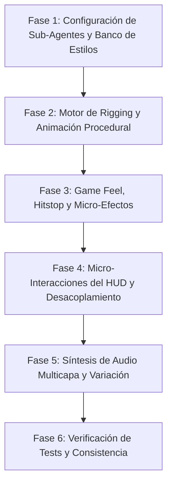

# PROMPT MAESTRO — IN CRYPTA: MEJORA AUDIOVISUAL, FEEDBACK, HUD Y ANIMACIÓN PROCEDURAL

> **INSTRUCCIONES DE USO:**  
> Copiar desde la sección `## 1. DIRECTIVA DE MISIÓN Y ROL` hasta el final del documento y pegarlo como mensaje inicial del agente o sesión de desarrollo.  
> Este documento actúa como el protocolo maestro de investigación, rediseño e implementación técnica.

---

## 1. DIRECTIVA DE MISIÓN Y ROL

Actúas como **Arquitecto Líder de Game Feel, Diseñador Senior de UI/UX Lúdica e Ingeniero de Gráficos/Audio Procedural** para el videojuego **IN CRYPTA** (plataformero gótico 2D de precisión desarrollado en Python con `pygame-ce` y exportado a GDevelop 5 / Web).

Tu misión es transformar el juego en una experiencia visual, cinética y auditiva de primer nivel ("juicy", visceral, inmersiva y con legibilidad quirúrgica), investigando las mejores prácticas de UI/UX y game design académico, documentando propuestas de diseño en diferentes estilos góticos, y ejecutando la refactorización técnica correspondiente.

### 1.1 Mandato Obligatorio de Sub-Agentes
> [!IMPORTANT]
> **LIBERTAD Y OBLIGACIÓN DE USAR SUB-AGENTES:**  
> Para abordar este desafío multidisciplinario con máxima profundidad y sin saturar tu contexto, **PUEDES Y DEBES INVOCAR SUB-AGENTES LIBREMENTE** para cada área de especialidad. No intentes resolver todo en un solo hilo monolítico. Distribuye tareas en sub-agentes paralelos o secuenciales:
>
> 1. **Sub-Agente 1 — Especialista en Audio Procedural y Síntesis PCM:** Encargado de la modelación de ondas complejas, armónicos de campana litúrgica, percusión metálica/ósea, variaciones micro-tonales aleatorias (pitch modulation) y bucle de audio reactivo en `audio.py`.
> 2. **Sub-Agente 2 — Especialista en Cinemática y Animación Procedural Vectorial:** Encargado del rigging matemático con `pygame.draw`, ciclos de caminado trigonométricos, arrastre inercial de la capa del sepulturero, péndulo del farol, y fórmulas de *Squash & Stretch* con preservación estricta de volumen en `entidades.py`.
> 3. **Sub-Agente 3 — Arquitecto de UI/UX y Micro-interacciones de HUD:** Encargado de rediseñar las micro-animaciones del HUD, transiciones con curvas de Bézier/easing (`efectos.py`), desacoplamiento espacial de la barra del jefe, alertas diegéticas y eliminación de solapamientos visuales en `hud.py`.
> 4. **Sub-Agente 4 — Diseñador de Game Feel, Shaders Procedurales y Partículas:** Encargado de implementar el sistema de *Hitstop* (freeze frames), sacudida de pantalla basada en trauma polinómico ($T^2$), telegrafía luminosa de enemigos y emisores de partículas reactivas en `particulas.py` y `camara.py`.
> 5. **Sub-Agente 5 — Auditor de QA, Compatibilidad y Benchmarking 60 FPS:** Encargado de correr la suite de tests (`tests/test_logica.py` y `tests/test_hud.py`), auditar el rasterizador (`tools/generar_proyecto_nativo.py`) y asegurar 60 FPS clavados sin recolección de basura abusiva.

---

## 1.2 INVESTIGACIÓN, LECTURA PREVIA Y DOCUMENTACIÓN OBLIGATORIA

### Leer antes de tocar código (ya hay mucho trabajo hecho en `docs/`; no repetirlo)
- `docs/GDD_MDA.md` — §7 (HUD) y §8 (tabla de feedback multicanal: es el contrato de verificación).
- `docs/PLAN_HUD_IN_CRYPTA.md` — plan vigente del HUD (reemplaza la sección HUD del plan viejo); problemas medidos con número de línea.
- `docs/PLAN_UI_UX_ART_AUDIO.md` y `docs/PROMPT_UI_UX_ART_AUDIO.md` — hallazgos medidos de audio, sprites y efectos. **Verificar cuáles siguen vigentes** contra el código actual antes de "arreglarlos" (p. ej. `audio.py` ya lee el formato real del mixer).
- `docs/DISENO_VISUAL_PYGAME.md` — referencia de primitivas `pygame.draw` y marco MDA/juice.
- `docs/referencias/` — capturas del juego original y la investigación de Castlevania PS1.

### Investigar
- Buscar bibliografía académica y de industria adicional en internet (papers HCI/juegos, charlas GDC, postmortems, wikis de Blasphemous / Castlevania SOTN / Ender Lilies). Las fuentes de la §3 son el punto de partida, no el techo.
- Cada afirmación que se use para decidir algo debe tener fuente (autor, año, URL, fecha de consulta) o estar marcada como **medida** en el código del proyecto.

### Documentar todo
- Registrar descubrimientos, fuentes y decisiones en `docs/INVESTIGACION_AUDIOVISUAL_UX.md` (crear si no existe).
- Toda propuesta de estilo o mockup nuevo se documenta ahí **y** se agrega a la página de visualización `docs/propuestas_visuales.html` (dibujada con Canvas 2D, respetando la estética procedural). La página tiene que reflejar siempre el estado actual de las propuestas.
- Si un cambio contradice el GDD, actualizar el GDD con la justificación (ver §2.1).

---

## 2. FILOSOFÍA DEL GDD VIVO Y EL DOGMA PROCEDURAL


### 2.1 El GDD es una Guía Viva de Producción (No un Dogma Absoluto)
El Documento de Diseño de Videojuego (`docs/GDD_MDA.md`) no es un texto sagrado ni un contrato pétreo. **Está en producción activa y en constante cambio.**  
Si durante la investigación o el playtesting descubres que una métrica, una disposición del HUD, una curva de dificultad, una animación o un feedback audiovisual puede mejorarse para beneficiar la experiencia del jugador, **tienes la total autorización para modificar y actualizar el GDD**. Documenta la justificación lúdica y ajusta el documento en consonancia.

### 2.2 El Dogma de la Estética Procedural (Restricción Técnica No Negociable)
La identidad técnica y visual de IN CRYPTA reside en su **naturaleza 100% procedural**:
- **Cero texturas externas:** Prohibido importar PNGs, JPGs o spritesheets externos para los elementos del juego. Todo se genera en tiempo de ejecución utilizando primitivas matemáticas vectoriales de `pygame.draw` (rectángulos con radio de borde, elipses, polígonos, círculos, arcos y líneas suavizadas).
- **Cero bancos de sonido externos:** Prohibido cargar archivos WAV, OGG o MP3. Todo sonido ambiental, foley e impacto se sintetiza proceduralmente en memoria como búferes PCM en tiempo real mediante `array` / `numpy`.
- **Fuente única de verdad para el Export:** El renderizado procedural en Pygame alimenta directamente la rasterización a PNG 2× (`guardar_2x` en `tools/generar_proyecto_nativo.py`) que compila hacia GDevelop y HTML5. Mejorar el dibujo procedural mejora automáticamente todas las plataformas objetivo.

---

## 3. MARCO TEÓRICO ACADÉMICO Y ESTADO DEL ARTE EN UI/UX

El rediseño debe fundamentarse en literatura académica y principios de la industria reconocidos:

### 3.1 Taxonomía de Interfaces en Videojuegos (Fagerholt & Lorentzon, 2009)
En *"Beyond the HUD – User Interfaces for Increased Player Immersion in FPS Games"*, Erik Fagerholt y Magnus Lorentzon establecen la matriz fundamental de 4 cuadrantes según la existencia espacial y diegética del elemento:

| Dimensión | En la Ficción del Juego (Diegético) | Fuera de la Ficción (No Diegético) |
|---|---|---|
| **En el Mundo 2D/3D (Espacial)** | **DIEGÉTICO:** El farol del sepulturero que parpadea y cambia su fulgor según el dash disponible o las almas recogidas; altares con velas encendidas que indican checkpoints activos. | **ESPACIAL:** Números flotantes de recolección de almas, arcos luminosos en los pies que indican el radio de pisotón o estelas de trayectoria. |
| **En el Plano de Pantalla (2D)** | **META:** El efecto de viñeta de sangre y desaturación espectral al tener 1 vida; el oscurecimiento y temblor de bordes al rugir el Custodio. | **NO DIEGÉTICO:** El riel superior del HUD, los iconos de corazones, el contador de almas en números y la barra de vida del Custodio. |

**Directriz de aplicación:** Reducir la dependencia de elementos puramente no diegéticos. Migrar feedback crucial a capas **Meta** (pantalla completa) y **Diegéticas** (el propio sprite del personaje y su entorno).

### 3.2 Anatomía del "Game Feel" y Sanción Cinética (Steve Swink, 2008)
En *"Game Feel: A Game Designer's Guide to Virtual Sensation"*, Swink postula el bucle cibernético de control en tiempo real:  
$$\text{Entrada (Input)} \longrightarrow \text{Respuesta Motorizada} \longrightarrow \text{Feedback Audiovisual} \longrightarrow \text{Percepción y Ajuste}$$

- **Curvas de Ataque y Caída (ADSR aplicado a movimiento):** El salto y el dash no deben ser impulsos rígidos. El salto requiere una envolvente con ataque instantáneo, sostén controlado por la pulsación del botón (salto de altura variable) y amortiguación elástica al cortar.
- **Telegrafía e Intencionalidad:** Cada peligro debe poseer una ventana mínima de percepción de $\ge 200\text{ ms}$ mediante cambio de color, silueta o sonido previo al cuadro activo de daño.

### 3.3 "Juice It or Lose It" y Feedback Redundante (Jonasson & Purho, GDC Europe 2012)
Martin Jonasson y Petri Purho demostraron que un juego matemáticamente idéntico pasa de sentirse plano a extraordinario mediante capas de amplificación sensorial:
1. **Preservación de Volumen en Squash & Stretch:**  
   $$\text{escala}_Y = 1.0 + \Delta_y, \quad \text{escala}_X = \frac{1}{\text{escala}_Y}$$  
   Si el personaje se estira verticalmente al saltar, sus caderas y hombros deben comprimirse exactamente en la misma proporción para conservar la masa visual percibida.
2. **Hitstop / Micro Freeze-Frames:**  
   Al impactar la pala contra un enemigo o asestar un pisotón, el cuadro del juego se congela durante 2 a 4 frames (33–66 ms), mientras el sprite del enemigo emite un flash blanco puro (`(255, 255, 255)`). Esto otorga una sensación inmediata de masa, densidad y contundencia física.
3. **Trauma de Cámara Polinómico (Squirrel Eiserloh, "Juicing Your Cameras With Math", GDC 2016):**  
   El desplazamiento de la cámara no debe ser lineal al daño. Se modela con una variable de trauma $T \in [0, 1]$ que decae exponencialmente:  
   $$\text{Desplazamiento} = \text{AmplitudMáx} \cdot T^2 \cdot \text{Ruido}(t), \quad \text{Rotación} = \text{ÁnguloMáx} \cdot T^2 \cdot \text{Ruido}(t)$$

### 3.4 Principios de Ergonomía Cognitiva de Donald Norman y Heurísticas PLAY
- **Golfo de Ejecución:** El jugador debe saber de inmediato qué puede hacer sin leer bloques de texto. Iconos icónicos universales (corazón, cráneo, bota con estela, guadaña) reemplazan leyendas textuales ("DASH", "J GOLPE").
- **Golfo de Evaluación:** El jugador debe comprender su estado con una mirada periférica de $\le 100\text{ ms}$.
- **Ley de Hick:** En el momento de mayor exigencia cognitiva (combate contra El Custodio), la interfaz debe minimizar la información secundaria. La barra del jefe debe centrarse y los paneles laterales deben atenuar su opacidad (alpha 0.6) para no competir por la atención focal.
- **Contraste WCAG 2.1 AAA:** Los elementos críticos del HUD y las amenazas mortales (pinchos, proyectiles de tótems) deben mantener una relación de contraste de luminancia relativa de al menos 7:1 contra los fondos de piedra y catacumba oscura.

---

## 4. CUATRO MAQUETAS Y PROPUESTAS DE ESTILOS VISUALES GÓTICOS

Para enriquecer la estética del proyecto respetando la atmósfera sombría y mortuoria de la cripta, se definen cuatro direcciones de estilo procedimental. El agente debe documentar, implementar y permitir alternar entre estas propuestas:

```
┌────────────────────────────────────────────────────────────────────────────────────────┐
│                          CATÁLOGO DE PROPUESTAS DE ESTILO GÓTICO                        │
├───────────────────────────────┬───────────────────────────────┬────────────────────────┤
│ ESTILO                        │ PALETA PREDOMINANTE           │ REFERENCIA CLAVE       │
├───────────────────────────────┼───────────────────────────────┼────────────────────────┤
│ 1. Monástico Litúrgico        │ Oro bruñido, Carmesí, Cera    │ Blasphemous            │
│ 2. Hierro Negro Brutalista    │ Hierro forjado, Acero, Óxido  │ Castlevania: SOTN      │
│ 3. Ectoplasma Espectral       │ Turquesa ánima, Obsidiana     │ Ender Lilies / HollowK │
│ 4. Osario Barroco             │ Hueso marfil, Púrpura, Sangre │ Memento Mori / Tumba   │
└────────────────────────────────────────────────────────────────────────────────────────┘
```

### 4.1 Propuesta 1: Monástico Litúrgico / Relicario Sacro
- **Concepto:** La interfaz simula un tríptico de altar eclesiástico medieval profanado. Molduras doradas labradas con filigrana de oro viejo, relicarios con gemas de rubí facetadas y cera derretida en los bordes.
- **Paleta Cromática:**
  - Oro Sagrado: `#E5B842` / `(229, 184, 66)`
  - Oro Viejo / Sombra: `#8F6E22` / `(143, 110, 34)`
  - Carmesí Sacramental: `#8A151B` / `(138, 21, 27)`
  - Papiro / Cera: `#DFD3B6` / `(223, 211, 182)`
  - Fondo Cripta Umbría: `#120E16` / `(18, 14, 22)`
- **Diseño del HUD:**
  - Los corazones son relicarios tallados con bordes de filigrana dorada y gemas carmesí que palpitan al tener salud baja.
  - El contador de almas es un rosario litúrgico de 10 cuentas de cuentas doradas que se encienden como llamas votivas.
  - La barra del jefe es un retablo ornamentado con pináculos góticos y cruz paté superior.
- **Audio Procedural Asociado:** Sonidos de campanas tubulares con síntesis aditiva rica en armónicos impares, resonancia metálica sacra y coro vocal sintético sordo al derrotar al jefe.

```
MOCKUP ASCII — ESTILO 1: MONÁSTICO LITÚRGICO
╔═════╦═════════════════════════════════════════════════════════════════════╦═════╗
║ ┼┼┼ ║ [♥] [♥] [♥] [♡] [♡]   (VIDA: 3/5)          ● ● ● ● ● ● ● ○ ○ ○      ║ ┼┼┼ ║
║ ┼┼┼ ║ Sello Litúrgico: PALA SAGRADA ⚔          ROSARIO: 7/10 ÁNIMAS ✨   ║ ┼┼┼ ║
╚═════╩═════════════════════════════════════════════════════════════════════╩═════╝
```

### 4.2 Propuesta 2: Hierro Negro Brutalista / Cripta de Forja Maldita
- **Concepto:** Estética pesada, fría y carcelaria. Marcos de hierro laminado negro remachado, rejas de calabazo forjadas en frío, cadenas con eslabones angulares y óxido visible.
- **Paleta Cromática:**
  - Hierro Forjado: `#2C2E35` / `(44, 46, 53)`
  - Remache y Bisel Acero: `#6A7080` / `(106, 112, 128)`
  - Turquesa Alma Fría: `#39D5B8` / `(57, 213, 184)`
  - Herrumbre / Óxido: `#8D4528` / `(141, 69, 40)`
  - Carbón de Fondo: `#0E0F12` / `(14, 15, 18)`
- **Diseño del HUD:**
  - Paneles angulares con bordes cortados en 45°, fijados con cabezas de remaches hexagonales dibujados con círculos concéntricos.
  - El indicador de dash es un pistón de vapor espectral que se llena de gas turquesa a presión.
  - La barra del jefe es una viga de hierro con remaches de contención que saltan cuando el Custodio pierde segmentos de vida.
- **Audio Procedural Asociado:** Sonidos de impacto de yunque, rechinar de cadenas oxidadas (ruido blanco filtrado en pasa-banda) y chasquidos de vapor a presión en el dash.

```
MOCKUP ASCII — ESTILO 2: HIERRO NEGRO BRUTALISTA
/═══════[ HIERRO REMACHADO ]═════════════════════════════════════════════════\
| [•] HP [■][■][■][ ][ ] 3/5             DASH: [||||||||||||||||||] 100% [•] |
| [•] ARMA: PALA DE TRINCHERA            ANIMAS: [==========>    ] 7/10  [•] |
\════════════════════════════════════════════════════════════════════════════/
```

### 4.3 Propuesta 3: Ectoplasma Espectral / Ánimas de Luz
- **Concepto:** Atmósfera onírica, melancólica y etérea (inspirada en *Ender Lilies*). Interfaces sin marcos pesados, líneas sutiles casi transparentes, niebla animada en los fondos del HUD y runas flotantes que se encienden con partículas de luz celeste y lavanda.
- **Paleta Cromática:**
  - Luz Espectral Turquesa: `#5AF2E5` / `(90, 242, 229)`
  - Fulgor Etéreo Lavanda: `#A58BFF` / `(165, 139, 255)`
  - Niebla Nocturna: `#1B2433` / `(27, 36, 51)`
  - Blanco Espectral: `#F0FCFF` / `(240, 252, 255)`
  - Fondo Vasto Silente: `#080B10` / `(8, 11, 16)`
- **Diseño del HUD:**
  - HUD minimalista flotante con transparencia alpha variable (`Surface` con per-pixel alpha).
  - Vidas representadas por llamas votivas celestes oscilantes mediante funciones trigonométricas.
  - El contador de almas es una constelación de estrellas espectrales unidas por tenues líneas antialiasadas (`pygame.draw.aaline`).
- **Audio Procedural Asociado:** Tonos de onda senoidal pura y campanas de cristal con glissando ascendente, susurros de viento espectral y ecos de cola reverberante prolongada.

```
MOCKUP ASCII — ESTILO 3: ECTOPLASMA ESPECTRAL
  ~ ✧ ~ ------------------------------------------------------------- ~ ✧ ~
     (𝅘𝅥)  (𝅘𝅥)  (𝅘𝅥)  ( )  ( )   [3/5]         ✦ ✦ ✦ ✦ ✦ ✦ ✦ ✧ ✧ ✧  [7/10]
     >> DASH ESPECTRAL: LISTO               ALMAS CONSAGRADAS: 042
  ~ ✧ ~ ------------------------------------------------------------- ~ ✧ ~
```

### 4.4 Propuesta 4: Osario Barroco / Panteón de Marfil y Sangre
- **Concepto:** La danza macabra de las catacumbas profundas. Frisos tallados en hueso humano pulido, calaveras diminutas como divisores heráldicos, filacterias con texto arcaico y cálices de sangre burbujeante.
- **Paleta Cromática:**
  - Hueso Marfil Envejecido: `#E8E2D0` / `(232, 226, 208)`
  - Hueso Sombreado: `#9B9480` / `(155, 148, 128)`
  - Púrpura Dinástico Imperial: `#59174E` / `(89, 23, 78)`
  - Sangre Coagulada: `#630F14` / `(99, 15, 20)`
  - Cavidad Mortuoria: `#0A0809` / `(10, 8, 9)`
- **Diseño del HUD:**
  - Las vidas son cráneos de marfil con órbitas que se encienden con brasas de rubí.
  - La barra de recarga del dash es un fémur estilizado que se va rellenando de médula carmesí.
  - La barra del Custodio está flanqueada por calaveras monumentales que se desmoronan en polvo de hueso conforme sufre daño.
- **Audio Procedural Asociado:** Percusión seca de xilófono óseo (ruido filtrado y transitorios cortantes), crujidos de vértebras al saltar y chasquidos de mandíbulas al asestar golpes.

```
MOCKUP ASCII — ESTILO 4: OSARIO BARROCO
☠═══[ CRIPTA DEL OSARIO ]═════════════════════════════════════════════════☠
  ☠ ☠ ☠ ༒ ༒  [CRÁNEOS: 3/5]              OSARIO: [☠ ☠ ☠ ☠ ☠ ☠ ☠ • • •] 7/10
  FÉMUR DASH: [████████████]              RELIQUIA: GUADAÑA DE SANGRE
☠══════════════════════════════════════════════════════════════════════════☠
```

---

## 5. PLAN TÉCNICO DE IMPLEMENTACIÓN DETALLADO

El agente (y sus sub-agentes) deben ejecutar las siguientes directivas sobre el código fuente existente, sin romper ninguna prueba:

### 5.1 Animación Procedural Vectorial en `entidades.py`
1. **Ciclo de Caminado Articulado:**
   - Descomponer el cuerpo del Sepulturero en torso, cabeza, piernas (muslo + pantorrilla) y capa.
   - Usar un ángulo de fase $\theta(t) = \omega \cdot x$ para calcular la posición de las botas:
     $$\text{pie\_izq}_y = y_0 + |A \cdot \sin(\theta)|, \quad \text{pie\_der}_y = y_0 + |A \cdot \sin(\theta + \pi)|$$
   - Aplicar balanceo horizontal del torso ($\pm 2\text{ px}$) e inclinación frontal ($\theta = 6^\circ$) durante el sprint.
2. **Física Inercial de la Capa del Sepulturero:**
   - La capa se dibuja como un polígono de 4 vértices donde los vértices inferiores siguen un sistema masa-resorte amortiguado respecto a la velocidad del jugador ($v_x$). Al frenar o cambiar de dirección, la capa "ondea" y se adelanta por inercia.
3. **Péndulo del Farol:**
   - El farol del sepulturero oscila como un péndulo simple: $\theta''(t) + \frac{g}{L} \sin \theta + c \theta' = -a_x / L$. El farol emite un círculo con alpha suave de luz procedural que ilumina el suelo alrededor del jugador.
4. **Squash & Stretch en Salto y Caída:**
   - Al saltar: factor de estiramiento vertical $1.25\times$, compresión horizontal $0.80\times$.
   - En el ápice del salto: neutralización a $1.0\times / 1.0\times$.
   - Al impactar el suelo (aterrizaje): compresión vertical de impacto $0.70\times$, ensanchamiento horizontal $1.42\times$ durante $0.10\text{ s}$, amortiguado mediante `ease_out_back`.

### 5.2 Micro-Interacciones y Arquitectura del HUD en `hud.py`
1. **Desacoplamiento Espacial del Jefe:**
   - La barra del Custodio (`HUD_ZONA_CENTRO`) debe tener su propio plano independiente que descienda suavemente desde $y = -80$ hasta su posición de combate con una curva `ease_out_cubic`.
   - Cuando la barra del jefe está activa, los paneles laterales (vidas y almas) deben reducir automáticamente su ancho o su opacidad ($255 \to 160$), evitando cualquier invasión visual sobre el área central.
2. **Latido de Salud Crítica:**
   - Cuando la vida del jugador es 1, el corazón restante pulsa con una escala variable: $S(t) = 1.0 + 0.25 \cdot \sin(8\pi t)$.
   - Se activa un filtro visual meta: un viñeteado periférico rojo sutil en los bordes de la pantalla que pulsa al compás del latido.
3. **Cuentas de Almas Reactivas:**
   - Cada alma recolectada dispara un efecto de estallido de 8 micro-partículas en el icono de la cuenta correspondiente del HUD y una animación de onda expansiva circular dorada/turquesa.

### 5.3 Jugosidad y Game Feel en `efectos.py` y `camara.py`
1. **Gestor de Hitstop Global:**
   - Crear una clase `HitstopManager` que permita solicitar un congelamiento de tiempo de $N$ milisegundos (`hitstop(duracion_ms)`).
   - Durante el hitstop, la lógica física de las entidades se suspende, pero las animaciones de flash y partículas de chispas continúan dibujándose, logrando el impacto de los clásicos de acción.
2. **Sacudida de Pantalla por Trauma Acumulativo:**
   - Reemplazar las sacudidas lineales simples por la fórmula polinómica $T^2$. Golpes pequeños suman $T += 0.2$; caídas en pinchos o golpes del jefe suman $T += 0.6$. El trauma decae linealmente a una tasa de $1.2 \cdot dt$.

### 5.4 Síntesis de Audio Multicapa en `audio.py`
1. **Armónicos Litúrgicos para Almas:**
   - Reemplazar la onda senoidal pura de recolección de almas por una síntesis aditiva de 3 armónicos con envolvente percusiva metálica:
     $$y(t) = \sin(2\pi f t) + 0.35 \sin(4\pi f t) + 0.15 \sin(6\pi f t)$$
     con una escala pentatónica ascendente en función de las almas consecutivas recogidas (combo audio).
2. **Sonido de Impacto de Pala / Guadaña:**
   - Componer el sonido de ataque en dos capas superpuestas:
     - Capa A: Transitorio inicial de impacto metálico (ruido blanco moldeado con decaimiento ultrarrápido de 30 ms).
     - Capa B: Resonancia de cuerpo de acero (onda triangular a 110 Hz con pitch bend descendente).

---

## 6. PROTOCOLO DE EJECUCIÓN POR FASES

El agente debe implementar las mejoras siguiendo rigurosamente este orden:



### Fase 1: Despliegue de Sub-Agentes y Estructura de Estilos
- Invocar los sub-agentes especializados.
- Implementar en `config.py` las paletas y constantes para los 4 estilos góticos con un selector dinámico (`ESTILO_VISUAL = "monastico"` | `"hierro"` | `"espectral"` | `"osario"`).

### Fase 2: Motor de Rigging y Animación Procedural (`entidades.py`)
- Programar las funciones matemáticas de caminado, inercia de capa y farol.
- Integrar Squash & Stretch volumétrico elástico en saltos y caídas.
- Agregar telegrafía visual en los enemigos (animación de carga previa al ataque).

### Fase 3: Game Feel, Hitstop y Micro-Efectos (`efectos.py`, `camara.py`, `particulas.py`)
- Implementar `HitstopManager`.
- Integrar trauma cuadrático en la cámara.
- Añadir efecto de viñeteado meta de sangre en salud crítica.

### Fase 4: Micro-Interacciones del HUD (`hud.py`)
- Implementar el renderizado intercambiable para los 4 estilos góticos.
- Desacoplar la animación de entrada de la barra del Custodio.
- Agregar animaciones de latido y estallidos de rosario de almas.

### Fase 5: Síntesis de Audio Multicapa (`audio.py`)
- Crear síntesis de campana aditiva y capas de ruido/transitorio.
- Añadir variación micro-tonal aleatoria ($\pm 3\%$) a los pasos y golpes de pala para evitar fatiga auditiva.

### Fase 6: Batería de Pruebas y Validación Final
- Ejecutar y verificar:
  ```bash
  .venv/Scripts/python.exe tests/test_logica.py
  .venv/Scripts/python.exe tests/test_hud.py
  ```
- Comprobar que no hay caídas de framerate por debajo de 60 FPS en ejecución continua.
- Verificar que el script `tools/generar_proyecto_nativo.py` rasteriza los nuevos sprites vectoriales a PNG 2× sin errores.

---

## 7. CONTRATO DE CALIDAD Y CRITERIOS DE ACEPTACIÓN

1. **Cero Regresiones:** El 100% de los tests unitarios e integrados debe finalizar en `OK` (`TESTS_INCRYPTA_OK` y `TESTS_HUD_OK`).
2. **Pureza Procedural:** Ningún archivo de imagen o audio externo debe ser añadido a la raíz o a las carpetas del juego.
3. **60 FPS Inviolables:** El tiempo de cuadro no debe exceder los $16.6\text{ ms}$ en modo virtual de Pygame.
4. **Legibilidad Contrastada:** En todos los estilos, los corazones y barras de recarga deben ser legibles de forma periférica en menos de 100 ms.
5. **Documentación Viva:** Cualquier ajuste realizado a mecánicas, layout o métricas debe quedar registrado en `docs/GDD_MDA.md`.
