# IN CRYPTA (v1.1.1)

### Trabajo Practico Integrador
* **Equipo:** Equipo 6
* **Integrantes y roles:**
  * **Jonathan Javier Pietracci** (DNI 36.798.847) — Programacion, arquitectura, audio, herramientas y documentacion.
  * **Ovelar Alejandro Ezequiel** — Diseno de niveles, direccion artistica y pruebas de juego.
  * **Joaquin Cardiel Gomez** — Diseno de niveles, ambientacion visual y pruebas de juego.
* **Carrera:** Licenciatura en Desarrollo de Videojuegos y Simulaciones
* **Institucion:** Universidad Nacional de Hurlingham (UNAHUR)

---

> *«Los limites entre la Vida y la Muerte son borrosos e indefinidos.»* — Edgar Allan Poe

**IN CRYPTA** es un plataformero de accion 2D hecho integramente en **Python** con **Pygame-CE**. No utiliza spritesheets ni archivos de imagen externos para personajes o escenarios: cada cuadro, luz, sombra, particula y bioma se dibuja en tiempo real por codigo, acompanado por una banda sonora OGG y efectos sintetizados desde funciones matematicas.

El jugador encarna al Sepulturero y atraviesa cuatro zonas —**El Umbral**, **El Camposanto**, **La Cripta** y **El Osario**— combinando salto variable, dash espectral, rebote aereo sobre enemigos y campanas hasta derrotar al **Carcelero** y al **Custodio** final.

<table>
<tr>
<td width="50%">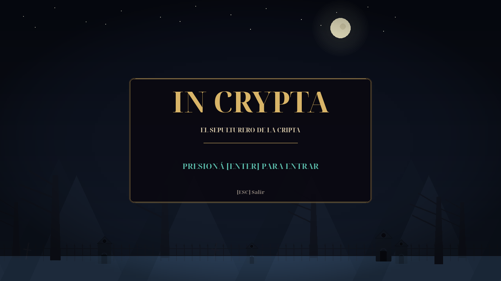</td>
<td width="50%">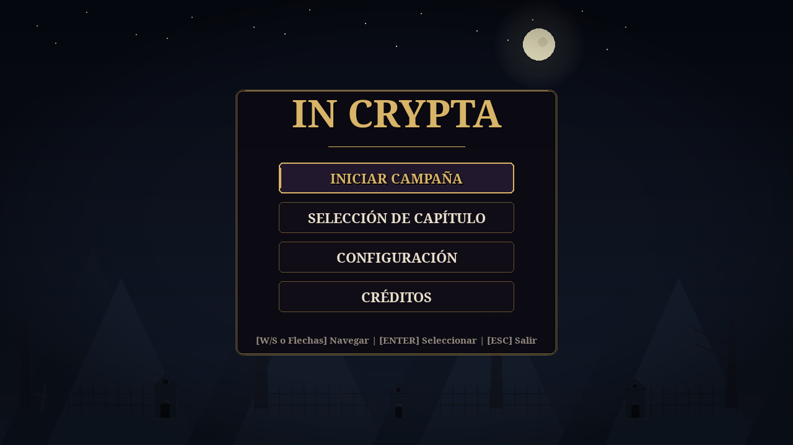</td>
</tr>
<tr>
<td align="center"><sub>Portada nocturna con parallax de arboles, luna y tipografia gotica</sub></td>
<td align="center"><sub>Menu principal con acceso a campana, tutorial y opciones de video/control</sub></td>
</tr>
</table>

---

## Contenidos

1. [Instalacion y ejecucion](#instalacion-y-ejecucion)
2. [Controles y mecanicas del juego](#controles-y-mecanicas-del-juego)
3. [Recorrido por los biomas y diseno ASCII](#recorrido-por-los-biomas-y-diseno-ascii)
4. [Como se dibujan las cosas (Codigo y resultado)](#como-se-dibujan-las-cosas-codigo-y-resultado)
5. [Como se hace la musica y el sonido (Codigo y resultado)](#como-se-hace-la-musica-y-el-sonido-codigo-y-resultado)
6. [El Mini-Jefe: El Carcelero](#el-mini-jefe-el-carcelero)
7. [El Jefe Final: El Custodio (3 Fases)](#el-jefe-final-el-custodio-3-fases)
8. [Estructura del proyecto y pruebas](#estructura-del-proyecto-y-pruebas)

---

## Instalacion y ejecucion

Requisitos minimos: **Python 3.10 o superior** y `pygame-ce>=2.5.0`. Para instrucciones detalladas de instalacion y solucion de problemas en ambos sistemas, ver [GUIA_JUEGO.md](GUIA_JUEGO.md).

* **Windows:** doble clic en `jugar_windows.bat` (crea `.venv`, instala `pygame-ce` y arranca).
* **Linux:** ejecutar `./jugar_pygame.sh` (o usar el acceso directo `IN_CRYPTA.desktop`).

Ejecucion manual desde terminal:

```bash
python3 -m venv .venv
source .venv/bin/activate      # En Windows: .venv\Scripts\activate
pip install -r requirements.txt
python main.py
```

Atajos de desarrollo disponibles en `Makefile`:

```bash
make run        # Inicia el juego
make test       # Corre la suite completa en modo headless
make validate   # Ejecuta validar_niveles.py y jugar_pygame.sh --check
```

---

## Controles y mecanicas del juego

Desde **Configuracion** (`Esc` o `P` en partida, o desde el menu) se puede alternar entre dos esquemas de teclado, ademas de ajustar **Shaders**, **Calidad grafica**, **Escala del HUD**, **Pantalla completa**, **Volumen** y **Reduccion de movimiento**.

| Accion | Preset Estandar | Preset Retro |
|---|---|---|
| Desplazamiento | `A` / `D` o `Flechas` | `Flechas` o `A` / `D` |
| Salto variable | `Espacio` o `W` | `Z` o `Espacio` |
| Dash espectral | `Shift` o `X` | `X` o `Shift` |
| Ataque (Pala / Guadana) | `J`, `Z` o `Click izquierdo` | `C` o `J` |
| Pisoton aereo (Pogo) | `Abajo + Ataque` en el aire | `Abajo + Ataque` en el aire |
| Pausa / Menu | `Escape` o `P` | `Escape` o `P` |
| Pantalla completa | `Alt + Enter` o `F11` | `Alt + Enter` o `F11` |

### Conceptos centrales

* **Fisica de plataforma ajustada (`config.py`):** gravedad base de `1500 px/s²` reducida al `55%` cerca del apice del salto (`APEX_GRAVEDAD_FACTOR`), corte de velocidad al soltar la tecla (`CORTE_SALTO = 0.45`), *coyote time* (`0.10 s`), *jump buffer* (`0.12 s`) y correccion de esquinas en techos (`CORNER_NUDGE_TECHO = 5 px`).
* **Rebote aereo y recarga de Dash:** golpear desde arriba a un enemigo, un incensario o una campana imparte impulso vertical y recarga el Dash en el aire al instante, habilitando encadenamientos sobre abismos sin tocar el suelo.
* **Consagracion por almas y Faroles:** las almas azules caidas se consagran al tocar un Farol de Reposo (punto de control). A partir de **5 almas consagradas** en el tramo se activa el **Manto del Farol** (escudo que absorbe un golpe entero), y con **8 almas** se obtiene el **Filo de Anima** (+`12 px` de alcance y `-20%` enfriamiento de dash). Cada `10` almas otorga una vida extra hasta un maximo de `5`.
* **Ultima vida (Corazon Delator):** al quedar con `1` vida suena un doble pulso cardiaco sintetizado a `1.2 Hz` y aparece una vineta carmesi que late en los bordes.
* **Continues:** la partida arranca con `3` vidas y `2` *continues*. Perder todas las vidas reinicia el nivel actual consumiendo un *continue*; si se agotan, vuelve al inicio de la campana (Acto I).

---

## Recorrido por los biomas y diseno ASCII

Cada nivel se define en `niveles.py` como una matriz de texto donde cada caracter representa `32x32` pixeles (`TILE = 32`): `#` es piedra solida, `=` bloque de cripta rompible, `~` losa quebradiza, `I` campana de rebote, `F` farol de control, `P` inicio, `G` meta, `K` Carcelero y `B` Custodio.

| Acto | Mapa y dimensiones | Mecanica incorporada | Pista musical (`assets/audio/musica/`) |
|---|---|---|---|
| Tutorial: El Umbral | `NIVEL_TUTORIAL` (`195x18`) | Salto variable, pinchos, plataformas moviles y rebote | `camposanto.ogg` |
| Acto I: El Camposanto | `NIVEL_1` (`260x18`) | Dash espectral (`D`), fosos amplios y losas quebradizas | `camposanto.ogg` (114 BPM) |
| Acto II: La Cripta | `NIVEL_2` (`310x18`) | Pala de hierro (`W`), pisoton sobre guardias y cuervos | `cripta.ogg` (100 BPM) |
| Acto III: El Osario | `NIVEL_3_VERTICAL` (`360x36`) | Dos pisos conectados por pozo, Guadana (`X`), Carcelero y Custodio | `osario.ogg`, `carcelero.ogg`, `custodio_f1..f3.ogg` |

<table>
<tr>
<td width="50%">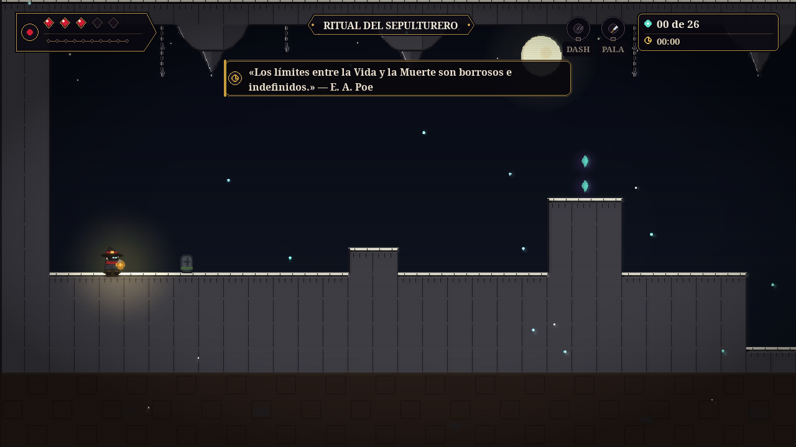</td>
<td width="50%">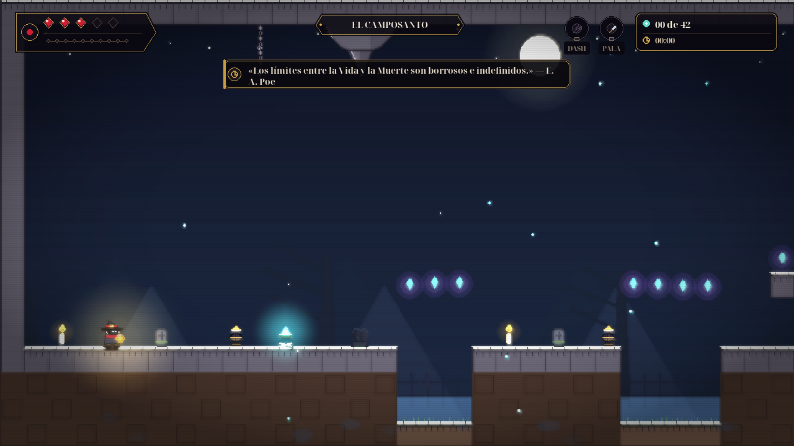</td>
</tr>
<tr>
<td align="center"><sub>Tutorial: lectura limpia del entorno antes del primer pozo</sub></td>
<td align="center"><sub>Acto I (El Camposanto): pasto generado sobre piedra, almas y neblina nocturna</sub></td>
</tr>
<tr>
<td width="50%">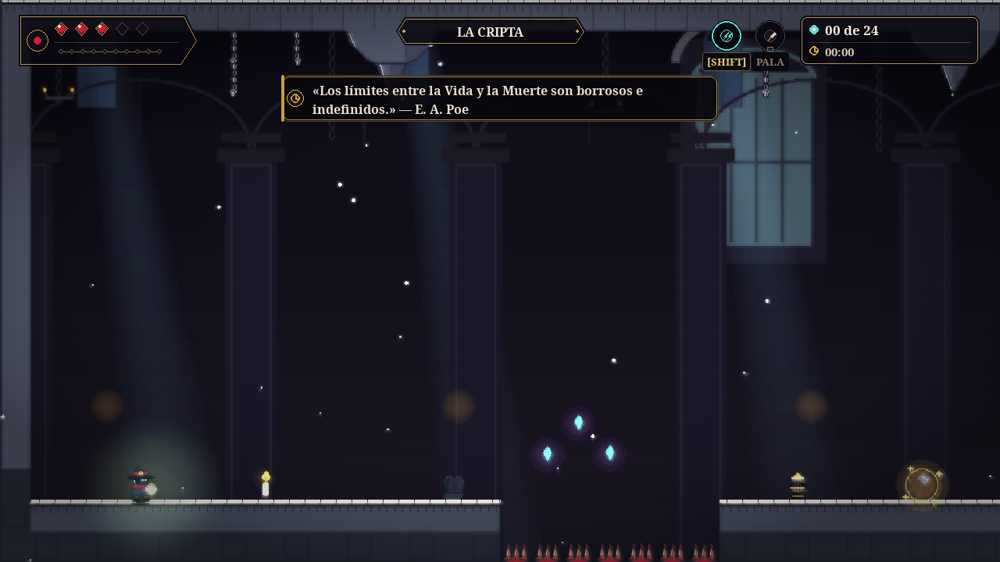</td>
<td width="50%">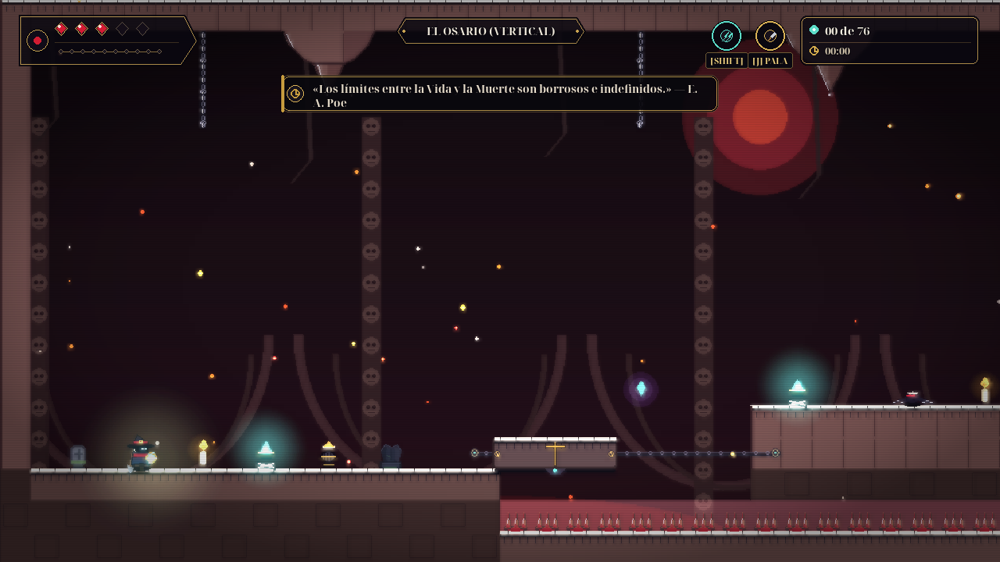</td>
</tr>
<tr>
<td align="center"><sub>Acto II (La Cripta): haces lunares desde ventanales y altar de pala</sub></td>
<td align="center"><sub>Acto III (El Osario): columna de calaveras, sarcofago movil y luna carmesi</sub></td>
</tr>
</table>

### Niveles multipiso y separacion por franjas

En `NIVEL_3_VERTICAL` (`360x36`), el piso superior (filas `0..17`) y el inferior (filas `18..35`) se apilan sobre un mismo mapa de `1152 px` de alto, divididos por una losa maciza en la fila 17 con un pozo de descenso entre las columnas `308..331`. Para evitar que enemigos o reflejos de camara crucen de un piso al otro, `juego.py` compara la franja vertical de cada entidad con la banda de `18 * TILE` (`576 px`):

<table>
<tr>
<td width="56%" valign="top">

```python
# Fragmento real de juego.py — separacion de franjas verticales
def _mismo_piso(rect, y_referencia):
    banda = 18 * TILE
    return rect.y // banda == int(y_referencia) // banda
```

```text
# Pozo entre pisos en NIVEL_3_VERTICAL (niveles.py, filas 16..18)
^############.....................................
#############........................#############
....j................................#############
```

</td>
<td width="44%" valign="top">

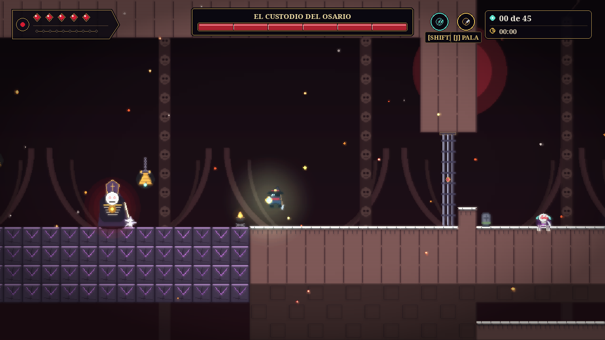

Al caer por las columnas `308..331`, la camara cambia limpiamente a la banda inferior (`y >= 576`), habilitando el tramo oeste hasta la arena del Custodio (`cols 96..140`).

</td>
</tr>
</table>

---

## Como se dibujan las cosas (Codigo y resultado)

Todo el apartado visual corre sobre un lienzo virtual de `1024x576` escalado a `1280x720` (`pygame-ce`) mediante primitivas poligonales y superficies `SRCALPHA` cacheadas por tamano y color en `actores/estampas.py` y `escena/fondos.py` para no asignar memoria en cada fotograma.

### 1. El Sepulturero, la Guadana Consagrada y el Dash

El personaje de `24x30 px` (`actores/render_jugador.py`) se arma por capas en cada frame: sombra eliptica en el suelo, estelas del dash cacheadas, deformacion elastica (*squash & stretch*) al saltar o aterrizar, cuerpo, sombrero, farol de mano con halo aditivo y arco del arma segun pose (`idle`, `ataque1..3` o `pisoton`).

<table>
<tr>
<td width="56%" valign="top">

```python
# actores/render_jugador.py — trazado de hoja y arco energetico
def _dibujar_filo_guadana(self, surface, arco_caja, punta_x, alto_pala):
    signo = self.direccion
    puntos_hoja = [
        (punta_x - signo * 4, alto_pala - 8),
        (punta_x + signo * 12, alto_pala - 11),
        (punta_x + signo * 25, alto_pala - 5),
        (punta_x + signo * 33, alto_pala + 9),
        (punta_x + signo * 31, alto_pala + 20),
        (punta_x + signo * 23, alto_pala + 13),
        (punta_x + signo * 15, alto_pala + 6),
        (punta_x + signo * 4, alto_pala + 3),
        (punta_x - signo * 2, alto_pala),
    ]
    pygame.draw.polygon(surface, (150, 48, 200), puntos_hoja)
    relleno = [puntos_hoja[1], puntos_hoja[2], puntos_hoja[3],
               puntos_hoja[6], puntos_hoja[7]]
    pygame.draw.polygon(surface, (215, 105, 255), relleno)
    pygame.draw.lines(surface, (255, 240, 255), False, puntos_hoja[:5], 2)
    pygame.draw.circle(surface, ORO_LITÚRGICO, (punta_x, alto_pala), 3)
    surface.blit(obtener_arco_guadaña(signo), (arco_caja.x - 2, arco_caja.y - 4))
```

</td>
<td width="44%" valign="top">

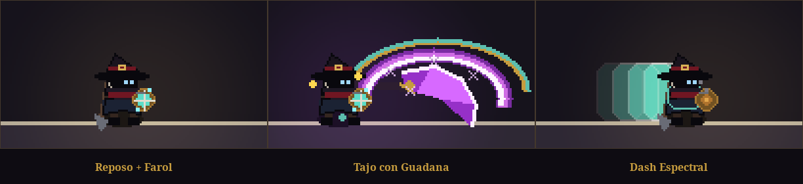

Salida real de `Jugador.dibujar()` ampliada `3x` en tres estados: reposo con farol, tajo con Guadana Consagrada y Filo de Anima activo, y dash espectral con cuatro fantasmas translucidos.

</td>
</tr>
</table>

### 2. Autotiling por vecinos y biomas

En el mapa ASCII todos los bloques solidos usan el mismo simbolo `#`, pero `escena/render_nivel.py` consulta los cuatro vecinos ortogonales (`_tiene_solido`) y la paleta del tema activo (`camposanto`, `cripta`, `osario`) para decidir si dibuja pasto con briznas, bisel de marfil xilografo, picos de salitre, estalactitas colgantes (una columna suelta en techo) u hombros biselados.

<table>
<tr>
<td width="56%" valign="top">

```python
# escena/render_nivel.py — seleccion automatica por vecinos y fila
def _dibujar_solido_proc(self, surface, rect, fila, col_inicio,
                         num_cols, tema_efectivo, paleta):
    fila_rel = fila % 18
    es_piso_nivel = fila_rel >= 15
    for c_idx in range(num_cols):
        col = col_inicio + c_idx
        tx = rect.x + c_idx * TILE
        vecinos = (
            self._tiene_solido(fila - 1, col),
            self._tiene_solido(fila + 1, col),
            self._tiene_solido(fila, col - 1),
            self._tiene_solido(fila, col + 1),
        )
        if es_piso_nivel:
            self._dibujar_tile_piso_proc(
                surface, rect, tx, fila, col, vecinos, tema_efectivo, paleta
            )
            continue
        tiene_arriba, tiene_abajo, tiene_izq, tiene_der = vecinos
        if tiene_arriba and not tiene_abajo and (1 <= fila_rel <= 3):
            if self._dibujar_formacion_techo(
                surface, rect, tx, fila, col, tiene_izq, tiene_der, paleta
            ):
                continue
        self._dibujar_tile_bloque_proc(
            surface, rect, tx, fila, col, fila_rel, vecinos, tema_efectivo, paleta
        )
```

</td>
<td width="44%" valign="top">

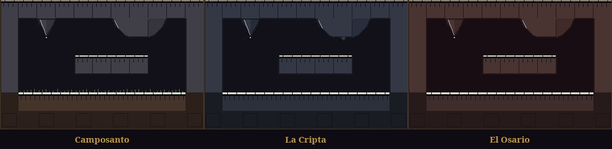

Misma matriz de `11x18` dibujada con `Nivel.dibujar_solidos()` cambiando unicamente `tema`: arriba estalactita y hombro biselado en techo; al centro plataforma flotante; abajo suelo con briznas en Camposanto o mamposteria fria en Cripta y Osario.

</td>
</tr>
</table>

### 3. Penumbra sustractiva, luces calidas y Shaders (Bloom + CRT)

La atmosfera oscura no oculta el escenario con un gris plano: primero se llena una mascara `SRCALPHA` azul oscuro (`RGBA = (8, 7, 12, 38)`) y se perforan circulos con caida cuadratica `(1 - r²)²` usando `BLEND_RGBA_SUB` alrededor del farol del jugador y de cada punto de control; luego se suman luces aditivas (`BLEND_RGB_ADD`), un resplandor *bloom* escalando el lienzo a `1/4` de resolucion con `smoothscale` y, en modo Gotico, lineas de barrido CRT.

<table>
<tr>
<td width="56%" valign="top">

```python
# escena/render_mundo.py — mascara sustractiva y bloom 1/4
def _dibujar_penumbra_mundo(self, destino):
    self.mascara_penumbra.fill((8, 7, 12, 38))
    if self.jugador:
        fx = int(self.jugador.rect.centerx + self.jugador.direccion * 11 - self.camara.x)
        fy = int(self.jugador.rect.y + 19 - self.camara.y)
        self.mascara_penumbra.blit(
            _obtener_luz_perforacion(95),
            (fx - 95, fy - 95),
            special_flags=pygame.BLEND_RGBA_SUB,
        )
    destino.blit(self.mascara_penumbra, (0, 0))

def _aplicar_bloom(self, origen, destino, intensidad=0.12):
    pw, ph = destino.get_size()
    mini = pygame.transform.smoothscale(origen, (max(1, pw // 4), max(1, ph // 4)))
    bloom = pygame.transform.smoothscale(mini, (pw, ph))
    bloom.set_alpha(int(255 * intensidad))
    destino.blit(bloom, (0, 0), special_flags=pygame.BLEND_RGB_ADD)
```

</td>
<td width="44%" valign="top">

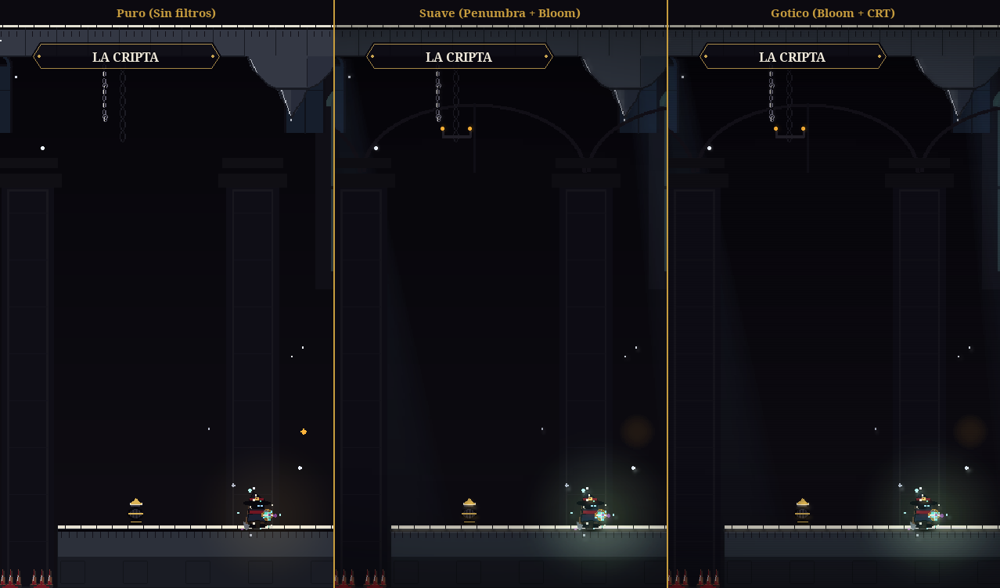

Mismo instante exacto de *La Cripta* bajo los tres modos configurables: **Puro** (pixel art crudo sin penumbra), **Suave** (penumbra + haz lunar + bloom) y **Gotico** (anade scanlines CRT).

</td>
</tr>
</table>

---

## Como se hace la musica y el sonido (Codigo y resultado)

El motor de audio (`audio.py`) combina **18 efectos `.wav`** y el ambiente `dron_catacumbas.ogg` en `assets/audio/sfx/`, **11 pistas musicales `.ogg`** en `assets/audio/musica/` y sintesis procedural estereo de `16 bits` a `44.1 kHz` en tiempo real para sonidos que cambian de afinacion o cadencia dinamicamente (almas recogidas en escala ascendente, timbre metalico de campanas, acordes de farol y latido de corazon).

### 1. Campana de bronce carillon en tiempo real (`audio.py`)

En lugar de usar un unico archivo grabado para todas las campanas, `sintetizar_campana_carillon` calcula seis parciales modales con razones inarmonicas reales de bronce fundido (`1.0x`, `2.0x`, tercera menor `2.382x`, quinta `3.014x`, `4.07x`, `5.43x`), modulacion FM inicial en el segundo parcial y dos transientes agudos (`6.83x` y `8.41x`) con decaimiento rapido (`exp(-130*t)`) para el golpe del badajo, mas apertura estereo entre canales L/R. Cada golpe se enruta al canal exclusivo `pygame.mixer.Channel(6)` para evitar saturaciones al rebotar rapido entre varias campanas.

<table>
<tr>
<td width="56%" valign="top">

```python
# audio.py — sintesis modal de campana de bronce en 44.1 kHz estereo
def sintetizar_campana_carillon(frecuencia, duracion=0.50, volumen=0.42):
    total = max(1, int(FRECUENCIA_MUESTREO * duracion))
    muestras = array.array("h")
    inv_sr = 1.0 / FRECUENCIA_MUESTREO
    muestras_cola = int(0.030 * FRECUENCIA_MUESTREO)
    muestras_ataque = int(0.0018 * FRECUENCIA_MUESTREO)
    w1, w2, w_tierce, w3, w4, w5, w_cl1, w_cl2, w_chorus = _frecuencias_campana(frecuencia)

    for i in range(total):
        t = i * inv_sr
        compuerta = min(1.0, i / max(1, muestras_ataque)) * min(
            1.0, (total - i) / max(1, muestras_cola)
        )
        mod_metal = 0.55 * math.exp(-34.0 * t) * math.sin(w_tierce * t)
        parciales = (
            math.sin(w1 * t) * 0.46 * math.exp(-5.4 * t)
            + math.sin(w2 * t + mod_metal) * 0.38 * math.exp(-7.5 * t)
            + math.sin(w_tierce * t) * 0.25 * math.exp(-11.0 * t)
            + math.sin(w3 * t) * 0.22 * math.exp(-13.5 * t)
            + math.sin(w4 * t) * 0.18 * math.exp(-19.0 * t)
            + math.sin(w5 * t) * 0.13 * math.exp(-28.0 * t)
            + (math.sin(w_cl1 * t) * 0.18 + math.sin(w_cl2 * t) * 0.12) * math.exp(-130.0 * t)
        )
        apertura_est = (
            math.sin(w2 * t + 0.18 * math.sin(w_chorus * t)) * 0.08 * math.exp(-6.5 * t)
        )
        base = math.tanh(parciales * 0.92)
        muestras.append(int(max(-32767, min(32767, (base + apertura_est) * compuerta * volumen * 32767))))
        muestras.append(int(max(-32767, min(32767, (base - apertura_est) * compuerta * volumen * 32767))))
    return pygame.mixer.Sound(buffer=muestras.tobytes())
```

</td>
<td width="44%" valign="top">

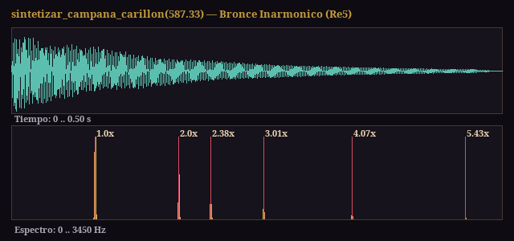

Forma de onda y espectro FFT real al ejecutar `sintetizar_campana_carillon(587.33)` (`Re5`): las lineas rojas coinciden con los picos inarmonicos `1.0x`..`5.43x`.

Audio generado: [campana_re5.wav](capturas/ejemplos/campana_re5.wav)

</td>
</tr>
</table>

### 2. Latido del Corazon Delator (`audio.py`)

Cuando el jugador queda con una sola vida, `sintetizar_corazon_delator` sintetiza en `0.42 s` dos golpes sinusoidales graves a `55 Hz` (instante `0.00 s`) y `48 Hz` (instante `0.13 s`, a un `75%` de amplitud), con envolvente de ataque corta y caida exponencial.

<table>
<tr>
<td width="56%" valign="top">

```python
# audio.py — doble pulso cardiaco sordo para ultima vida
def sintetizar_corazon_delator(volumen=0.32):
    duracion = 0.42
    total = int(FRECUENCIA_MUESTREO * duracion)
    muestras = array.array("h")
    t_golpe1, t_golpe2 = 0.0, 0.13

    for i in range(total):
        t = i / FRECUENCIA_MUESTREO
        val = 0.0
        dt1 = t - t_golpe1
        if 0.0 <= dt1 < 0.12:
            env1 = math.exp(-dt1 * 28.0) * math.sin(min(1.0, dt1 * 60.0) * math.pi / 2.0)
            val += env1 * math.sin(math.tau * 55.0 * dt1)
        dt2 = t - t_golpe2
        if 0.0 <= dt2 < 0.14:
            env2 = 0.75 * math.exp(-dt2 * 32.0) * math.sin(min(1.0, dt2 * 60.0) * math.pi / 2.0)
            val += env2 * math.sin(math.tau * 48.0 * dt2)
        muestra_int = int(max(-32767, min(32767, val * volumen * 32767)))
        muestras.extend((muestra_int, muestra_int))
    return pygame.mixer.Sound(buffer=muestras.tobytes())
```

</td>
<td width="44%" valign="top">

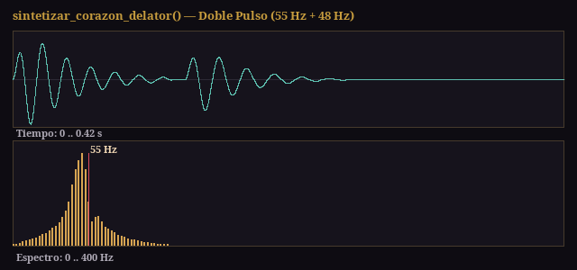

Onda temporal y concentracion de energia subgrave alrededor de `48–55 Hz` capturadas del buffer de `sintetizar_corazon_delator()`.

Archivo base: [corazon_latido.wav](assets/audio/sfx/corazon_latido.wav)

</td>
</tr>
</table>

### 3. Banda sonora completa generada en NumPy (`tools/generar_musica_synthlab.py`)

Las 11 pistas del juego (`titulo`, `camposanto`, `cripta`, `osario`, `carcelero`, `custodio_f1`, `custodio_f2`, `custodio_f3`, `victoria`, `derrota`, `creditos`) se generan programaticamente sin DAW ni muestras grabadas. Cada tema se declara en `ESPECIFICACIONES_PISTAS` con BPM, compases, factor de *micro-swing* en semicorcheas impares (`0.50` recto en Osario/Jefes, `0.55`–`0.56` en Cripta/Titulo), acordes barrocos de 5 voces en enteros MIDI (`Dm9`, `Cmaj9`, cadencias frigias), patrones de bajo y grilla de bateria (`x`, `X`, `g`, `o`). `PistaEstereo` mezcla en buffer circular para que el final de cada compas enlace sin salto de fase ni clic, aplica eco ping-pong cruzado (`np.roll`) y saturacion `tanh` antes de exportar a Ogg Vorbis.

<table>
<tr>
<td width="56%" valign="top">

```python
# tools/generar_musica_synthlab.py — clavecin FM y pista del jefe en 154 BPM
def inst_clavecin_moderno(freq: float, dur: float, vel: float = 0.85) -> np.ndarray:
    n = max(64, int(dur * SR))
    t = np.arange(n, dtype=np.float32) / SR
    mod = (1.8 * np.exp(-10.0 * t)) * np.sin(2.0 * np.pi * freq * 3.0 * t)
    fase = 2.0 * np.pi * freq * t
    cuerpo = np.sin(fase + mod) + 0.35 * np.sin(fase * 2.0) * np.exp(-5.0 * t)
    punteo = np.tanh(cuerpo * 1.35)
    env = envolvente_adsr(n, 0.004, min(0.22, dur * 0.45), 0.28, min(0.18, dur * 0.35))
    return (punteo * env * vel * 0.34).astype(np.float32)

# Especificacion declarativa del tema Custodio Fase 3 (Re menor frigio / disminuido)
dict(
    nombre="custodio_f3", bpm=154, compases=8, swing=0.50,
    acordes=[
        [50, 53, 57, 61, 64], [49, 52, 55, 58, 64],
        [46, 50, 53, 57, 60], [45, 49, 52, 55, 58],
    ],
    bajo_patron=[0, 0, None, 0, 12, None, 0, 10, 0, 0, None, 0, 7, None, 10, 11],
    ritmo_kick="x.x.x.x.x.x.x.x.", ritmo_snare="....X..g....X.XX",
)
```

</td>
<td width="44%" valign="top">

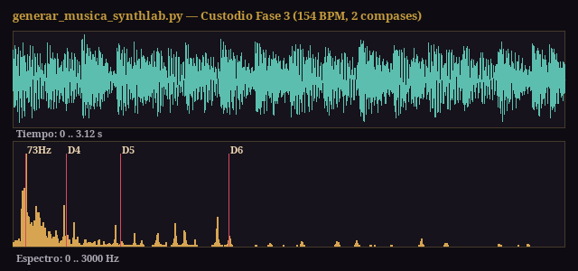

Resultado sintetizado de 2 compases reales de `custodio_f3` a `154 BPM` (`3.12 s`): pulso de bombo continuo, arpegios de clavecin FM en `D4/D5/D6` y subgrave saturado en `73 Hz`.

Pista completa del juego: [custodio_f3.ogg](assets/audio/musica/custodio_f3.ogg)

</td>
</tr>
</table>

---

## El Mini-Jefe: El Carcelero

El **Carcelero** (`K`, implementado en `actores/carcelero.py`, con `MINIJEFE_VIDA = 3`) custodia la franja superior de *El Osario* (`cols 114..149`). Su combate plantea un acertijo de posicionamiento y ritmo aereo:

* **Escudo dorsal y frontal:** `recibir_golpe_pala()` devuelve siempre `False` — intentar golpearlo de frente o encima mientras patrulla no le hace dano.
* **Muros compuerta emergentes (`MuroMovilCompuerta`):** cuando el Carcelero entra en estado `"telegrafo"` (`0.55 s` con aro carmesi), se activa uno de los tres muros repartidos en el piso (`cols 124, 132, 140`). Cada muro se arma **bloque a bloque desde el suelo hacia arriba** (`oculto -> aviso -> emergiendo -> armado`).
* **Aturdimiento por choque fisico:** si embiste en falso al vacio solo entra en recuperacion; si impacta fisicamente contra un muro ya armado, queda aturdido (`estado = "cansado"`, aura dorada durante `1.3 s`), momento en que el jugador puede caer con pisotones desde cualquiera de las **5 campanas** colgadas sobre la arena (`cols 119, 125, 132, 139, 145`). Su derrota abre el acceso a la **Guadana Consagrada** (`X`).

<table>
<tr>
<td width="54%" valign="top">

```python
# actores/carcelero.py — choque fisico contra compuerta emergente
def _resolver_choque_muro(self, muros):
    if not muros:
        return False
    for m in muros:
        r_m = m.rect if hasattr(m, "rect") else m
        es_solido = getattr(m, "es_solido", lambda: True)()
        if not (es_solido and r_m.height >= 16 and self.rect.colliderect(r_m)):
            continue
        if self.direccion > 0:
            self.rect.right = r_m.left
            px_choque = r_m.left
        else:
            self.rect.left = r_m.right
            px_choque = r_m.right
        self.x = float(self.rect.x) - self.direccion * 10.0
        self.rect.x = int(self.x)
        self.punto_choque = (px_choque, self.rect.centery)
        if hasattr(m, "recibir_impacto"):
            m.recibir_impacto()
        return True
    return False
```

</td>
<td width="46%" valign="top">

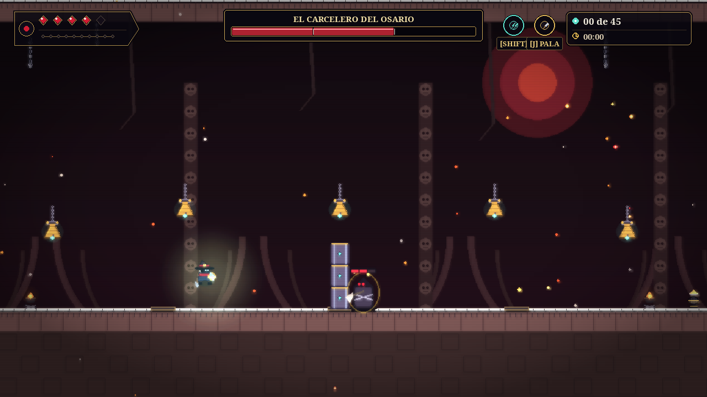

Arena del Carcelero en ejecucion: las 5 campanas permiten permanecer en altura mientras la embestida choca contra el `MuroMovilCompuerta` central de 3 bloques, dejando al Carcelero aturdido y vulnerable.

</td>
</tr>
</table>

---

## El Jefe Final: El Custodio (3 Fases)

Al atravesar el umbral derecho del sepulcro inferior (`col 140`), ambas `CompuertaArena` (`|`) caen desde los dinteles de piedra y encierran al jugador con **El Custodio** (`actores/custodio.py` y `logica/jefes.py`, `JEFE_VIDA = 6`). El enfrentamiento escala en tres fases diferenciadas:

1. **Fase 1 (`golpes 1..3`, musica `custodio_f1.ogg`):** avanza con su maza generando ondas expansivas (`OndaCustodio`) y ejecuta un **embate vertical ascendente** si el jugador permanece mucho tiempo suspendido sobre las campanas. Es vulnerable a golpes laterales de pala y a pisotones cuando baja la guardia.
2. **Fase 2 (`golpes 4..6`, musica `custodio_f2.ogg`):** su capa vira a rojo carmesi, encadena cargas veloces y su coraza rechaza la pala comun (`if self.fase == 2 and not rango_mejorado: return False`), obligando a haber consagrado la **Guadana**.
3. **Fase 3 — El Sepulcro (`vida == 0`, musica `custodio_f3.ogg`):** al recibir el sexto golpe no muere de inmediato; su aura cambia a violeta y empieza a saltar apuntando al jugador sobre un piso compuesto por **4 capas de bloques quebradizos (`BloqueCripta`, `=`, cols `104..129`, filas `30..33`)**. Cada impacto sismico o quiebre provocado por el jugador rompe exactamente una capa bajo sus pies hasta abrir el abismo y hacerlo caer en su propia tumba. Al caer, ambas `CompuertaArena` se retraen para liberar el camino oeste hacia la meta `G`.

<table>
<tr>
<td width="50%"></td>
<td width="50%">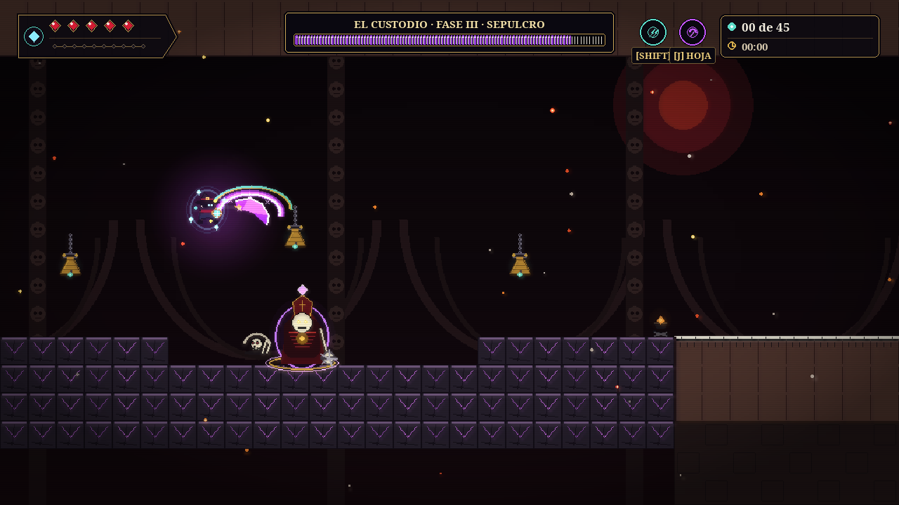</td>
</tr>
<tr>
<td align="center"><sub>Fase 1: entrada derecha con compuerta sellada contra el dintel de piedra</sub></td>
<td align="center"><sub>Fase 3 (El Sepulcro): primer nivel de Bloques de Cripta roto y tajo de Guadana</sub></td>
</tr>
</table>

<table>
<tr>
<td width="54%" valign="top">

```python
# logica/jefes.py — destruccion progresiva de 1 capa por impacto en Fase 3
def _romper_criptas_bajo_jefe(self, jefe):
    """Rompe 1 capa de cripta ('=') bajo el Custodio y desciende."""
    area_aplast = jefe.rect_aplastamiento()
    rotos = 0
    for bloque in getattr(self.nivel, "bloques_cripta", []):
        if not bloque.roto and bloque.rect.colliderect(area_aplast):
            if bloque.romper():
                rotos += 1
                self.particulas.emitir(
                    bloque.rect.centerx, bloque.rect.centery, 10,
                    (PIEDRA_FRIA, SALITRE_CRIPTA, HUESO, (145, 75, 175)),
                    170, 0.48, 4, 480,
                )
    if rotos > 0:
        self.audio.reproducir("cripta_romper")
        self.camara.sacudir(9.5, 0.22, dir_x=0.0, dir_y=1.0)
    self._evaluar_soporte_f3_jefe(jefe)
    return rotos
```

</td>
<td width="46%" valign="top">

En `actores/custodio.py`, `_f3_actualizar_salto` rastrea horizontalmente al jugador durante el ascenso, frena al caer para clavarse en columna vertical y llama a `rect_soporte_central_f3()`.

Cuando no quedan bloques intactos en esa columna bajo sus pies, pasa a `"cayendo_abismo"` y se ejecuta `_procesar_victoria_jefe()`.

</td>
</tr>
</table>

---

## Estructura del proyecto y pruebas

* `main.py` — Punto de entrada y argumentos CLI (`--tutorial`, `--nivel`).
* `juego.py` — Clase principal `Juego`, gestion de escena y cache tipografica LRU.
* `config.py` — Constantes fisicas, paletas, parametros de combate y configuracion grafica.
* `niveles.py` / `niveles_redisenados.py` — Matrices ASCII de la campana, variante vertical multipiso y salas de practica.
* `nivel.py` — Parseo de mapas ASCII, colisiones solidas y construccion de entidades.
* `entidades.py` y `actores/` — Entidades separadas por modulo (`jugador.py`, `render_jugador.py`, `enemigos.py`, `carcelero.py`, `custodio.py`, `recogibles.py`, `interactivos.py`, `estampas.py`, `utilidades.py`).
* `escena/` — Renderizado del mundo (`fondos.py`, `render_mundo.py`, `render_nivel.py`, `decoraciones.py`, `menus.py`, `pantallas.py`, `constantes.py`).
* `logica/` — Reglas de juego (`combate.py`, `jefes.py`, `mundo.py`).
* `hud.py` y `ui/` — Modelo, transiciones e interfaz del HUD (`animacion.py`, `modelos.py`, `renderer.py`).
* `audio.py` — Motor mixto (18 WAV + 1 OGG SFX, 11 pistas OGG y sintesis procedural en vivo).
* `camara.py` y `particulas.py` — Seguimiento por bandas de altura, sacudida direccional y particulas de clima.
* `tools/` — Validador de invariantes (`validar_niveles.py`), generador de musica (`generar_musica_synthlab.py`) y capturas/ejemplos (`capturar.py`).
* `tests/` — Pruebas unitarias, de fisica, HUD, audio, mapas verticales y entrega final.

Comandos de verificacion:

```bash
.venv/bin/python -m pytest -q
.venv/bin/python tools/validar_niveles.py
.venv/bin/python tools/capturar.py
./jugar_pygame.sh --check
```
