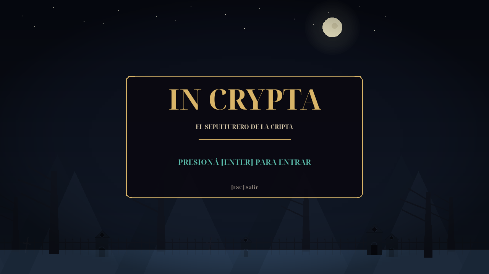

# IN CRYPTA

Plataformero gótico 2D de tres niveles: prototipo en **Python + pygame-ce** y versión de presentación **nativa en GDevelop 5** (objetos y eventos, build HTML5 a 1920 × 1080).

Un sepulturero baja a la cripta a cumplir su jornada. La puerta se cierra detrás de él y la oscuridad despierta. Con salto, dash y golpe de pala, tiene que cruzar **El Camposanto**, **La Cripta** y **El Osario** para escapar.



**Equipo 6:** Ovelar Alejandro Ezequiel · Joaquín Cardiel Gomez · Jonathan Javier Pietracci  
**Referencias:** Blasphemous · Castlevania · Ender Lilies

## Ejecutar

```bash
cd ~/unahur/PlataformeroMDA
source .venv/bin/activate
python main.py
```

Si la carpeta `.venv` no existe:

```bash
python3 -m venv .venv
source .venv/bin/activate
pip install -r requirements.txt
python main.py
```

## Controles

### GDevelop nativo

| Tecla | Acción |
|---|---|
| `←` / `→` | Mover |
| `↑` | Saltar |
| `SHIFT` | Dash de sombra |
| `A` | Golpe de pala (se desbloquea al recogerla en el Nivel 2) |
| `ESC` | Pausa / volver |
| `↑` / `↓` + `ENTER` | Navegar y confirmar en los menús |

### Prototipo Pygame

| Tecla | Acción |
|---|---|
| `A` / `D` o `←` / `→` | Mover |
| `ESPACIO` | Saltar (mantener para saltar más alto) |
| `SHIFT` o `X` | Dash de sombra |
| `P` | Pausa |
| `R` | Reiniciar el juego |
| `ENTER` | Empezar, avanzar de nivel o reintentar |
| `M` | Silenciar / activar sonido |
| `ESC` | Salir |

## Qué incluye

- Loop con delta time y 60 FPS.
- Gravedad, salto variable, coyote time, jump buffer y corte de salto.
- Colisiones AABB contra plataformas.
- Cámara con suavizado, parallax y sacudida.
- Tres niveles definidos con mapas ASCII, temas y decoraciones.
- Almas, moradores que patrullan, golpe de pala, pinchos, vidas y portón.
- Cada 10 almas dan 1 vida extra (máximo 5); al morir se reinician el contador y las almas del nivel.
- Pala recogible en La Cripta: sin pala no hay ataque ni pisotón; al recogerla se desbloquea `A`.
- Plataformas móviles horizontales y verticales en La Cripta y El Osario.
- HUD con almas, progreso a vida extra, hasta cinco corazones, aviso de última vida, tiempo y estado del dash.
- Pantalla de título, pausa, nivel completado, derrota y victoria.
- SFX de recogida de pala, vida extra y UI, además de salto, dash, golpe, daño, almas y portón.
- Partículas y sonidos procedurales en el prototipo.
- Tests de lógica que corren sin ventana.
- Proyecto GDevelop nativo de objetos y eventos, con build HTML5 a 1920 × 1080.
- Runtime JavaScript anterior conservado en `export/gdevelop/` como versión legada.
- El GDD incluye el diseño propuesto de un boss final, **El Custodio del Osario**, no implementado en el build.

## Estructura

```text
PlataformeroMDA/
├── main.py                  ← arranque
├── juego.py                 ← loop, estados, HUD y overlays
├── config.py                ← constantes, identidad y paleta
├── niveles.py               ← mapas ASCII y pistas
├── nivel.py                 ← parser, temas, decoraciones y dibujo
├── entidades.py             ← jugador, morador y alma
├── camara.py                ← seguimiento y coordenadas
├── particulas.py            ← efectos visuales
├── audio.py                 ← sonidos procedurales
├── export/gdevelop_nativo/
│   ├── IN_CRYPTA_NATIVO.json ← proyecto GDevelop nativo
│   ├── assets/              ← PNGs y fuente
│   └── build/               ← HTML5 exportado
├── export/gdevelop/         ← runtime JS legado
├── tools/
│   ├── generar_proyecto_nativo.py
│   ├── export_gdevelop.py
│   ├── instalar_gdevelop.py
│   └── capturar.py
├── tests/
│   ├── test_logica.py
│   └── test_runtime_gdevelop.js
├── capturas/
├── docs/
│   ├── GDD_MDA.md
│   └── GUION_PRESENTACION.md
└── requirements.txt
```

## Verificar

```bash
cd ~/unahur/PlataformeroMDA

PYTHONPATH=. SDL_VIDEODRIVER=dummy SDL_AUDIODRIVER=dummy \
  .venv/bin/python tests/test_logica.py
```

Salida esperada:

```text
niveles: OK
parser: OK
gravedad: OK
salto: OK
dash: OK
pozo de dash: OK
primer salto de La Cripta: OK
alma: OK
enemigo: OK
camara: OK
estados y meta: OK
pala y contacto: OK
pala y límites: OK
plataformas: OK
vidas: OK
reiniciar nivel: OK
titulo: OK
pinchos: OK
juego headless: OK

TESTS_INCRYPTA_OK
```

Runtime legado de GDevelop (no es el proyecto nativo):

```bash
node tests/test_runtime_gdevelop.js
```

Salida esperada:

```text
INCRYPTA_GDEVELOP_OK levels=3
TESTS_GDEVELOP_OK levels=3
```

Exportar y validar el JSON legado:

```bash
PYTHONPATH=. SDL_VIDEODRIVER=dummy SDL_AUDIODRIVER=dummy \
  .venv/bin/python tools/export_gdevelop.py

PYTHONPATH=. SDL_VIDEODRIVER=dummy SDL_AUDIODRIVER=dummy \
  .venv/bin/python tools/export_gdevelop.py --check
```

Salida esperada:

```text
EXPORT_OK levels=3 solids=49 souls=60 enemies=19 hazards=13 decorations=34
```

## Capturas

```bash
PYTHONPATH=. SDL_VIDEODRIVER=dummy SDL_AUDIODRIVER=dummy \
  .venv/bin/python tools/capturar.py
```

Genera `capturas/titulo.png`, `capturas/nivel_1.png`, `capturas/nivel_2.png` y `capturas/nivel_3.png`.

## GDevelop

La versión principal es un **proyecto nativo** en `export/gdevelop_nativo/IN_CRYPTA_NATIVO.json`: escenas de título, pausa, victoria y tres niveles, con objetos, eventos, comportamientos y cámara propios. No ejecuta Python ni carga el runtime JavaScript legado.

- Diseño lógico de 960 × 540, render nativo de **1920 × 1080** con cámara zoom 2 y assets al doble.
- Pausa con `ESC`, menú de continuar / reiniciar nivel / volver al título.
- Build listo para presentar en `export/gdevelop_nativo/build/`; se sirve con cualquier servidor HTTP estático.

Generar el proyecto desde el código Python:

```bash
PYTHONPATH=. .venv/bin/python tools/generar_proyecto_nativo.py
```

Exportar el build HTML5 con GDevelop CLI:

```bash
flatpak kill io.gdevelop.ide 2>/dev/null || true
DISPLAY=:1 WAYLAND_DISPLAY=wayland-1 \
  flatpak run io.gdevelop.ide --no-sandbox --disable-update-check \
  --run-command EXPORT_HTML5_EXTERNAL \
  "$PWD/export/gdevelop_nativo/IN_CRYPTA_NATIVO.json"
```

> Cerrar cualquier instancia de GDevelop antes de exportar: una ventana abierta puede reutilizarse y exportar el proyecto viejo en memoria.

El runtime JavaScript anterior (`export/gdevelop/` y `tools/instalar_gdevelop.py`) queda como versión legada. El build nativo está validado de forma headless con Chromium/CDP: título, los tres niveles, salto, dash, audio, recogida de pala, ataque, pisotón, daño, pozo, límites, plataformas móviles, game over y transiciones. La vista previa real dentro de GDevelop todavía debe validarla una persona.

## Repomix

El proyecto incluye configuración para [Repomix](https://repomix.com) (`repomix.config.json` y `.repomixignore`), optimizada para empaquetar el código fuente, tests y documentación excluyendo assets binarios, builds HTML5 compilados y JSONs gigantes de GDevelop:

```bash
# Empaquetar el repositorio en repomix/repomix-output.xml
npx repomix

# Empaquetar en formato Markdown en repomix/repomix-output.md
npx repomix --style markdown -o repomix/repomix-output.md

# Ver desglose de archivos y árbol de tokens
npx repomix --token-count-tree
```

## Documentación

- [`docs/GDD_MDA.md`](docs/GDD_MDA.md): high concept, MDA, niveles, sistemas, UI/UX, producción y mapas de conceptos.
- [`docs/GUION_PRESENTACION.md`](docs/GUION_PRESENTACION.md): guion de 6 a 8 minutos y demo.
- [`export/gdevelop/LEEME.md`](export/gdevelop/LEEME.md): instalación del runtime JavaScript legado.

## Niveles

| Nivel | Tema | Tamaño | Almas | Moradores | Pinchos | Foco |
|---|---|---|---|---|---|---|
| 1 | El Camposanto | 80 × 18 | 17 | 3 | 4 | Salto y dash; todavía sin pala |
| 2 | La Cripta | 100 × 18 | 18 | 5 | 4 | Dash, recogida de pala, ataque y plataformas móviles |
| 3 | El Osario | 184 × 18 | 25 | 11 | 5 | Las tres mecánicas y plataformas móviles |

## Diseño en una frase

Tres mecánicas que se combinan, dos estéticas que se refuerzan y tres niveles que enseñan: **Desafío** por precisión y **Sensación** por oscuridad, velocidad y feedback.
