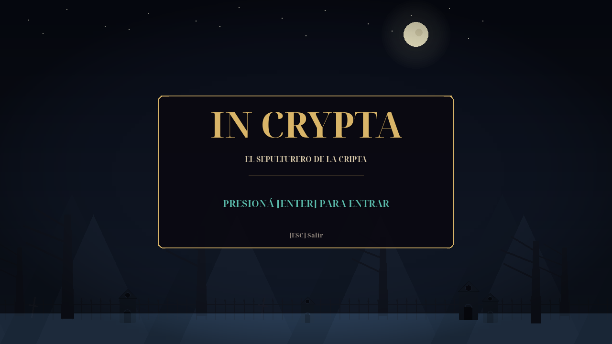

<repomix><file_summary>This file is a merged representation of a subset of the codebase, containing files not matching ignore patterns, combined into a single document by Repomix.
The content has been processed where content has been formatted for parsing in xml style, content has been compressed (code blocks are separated by ⋮---- delimiter).<purpose>This file contains a packed representation of a subset of the repository&apos;s contents that is considered the most important context.
It is designed to be easily consumable by AI systems for analysis, code review,
or other automated processes.</purpose><file_format>The content is organized as follows:
1. This summary section
2. Repository information
3. Directory structure
4. Repository files (if enabled)
5. Repository files, each consisting of:
  - File path as an attribute
  - Full contents of the file</file_format><usage_guidelines>- This file should be treated as read-only. Any changes should be made to the
  original repository files, not this packed version.
- When processing this file, use the file path to distinguish
  between different files in the repository.
- Be aware that this file may contain sensitive information. Handle it with
  the same level of security as you would the original repository.</usage_guidelines><notes>- Some files may have been excluded based on .gitignore rules and Repomix&apos;s configuration
- Binary files are not included in this packed representation. Please refer to the Repository Structure section for a complete list of file paths, including binary files
- Files matching these patterns are excluded: repomix/**, capturas/**, export/gdevelop_nativo/build/**, export/gdevelop_nativo/assets/**, export/gdevelop_nativo/*.json, export/gdevelop/game_data.json, docs/referencias/in_crypta/incrypta.html, **/*.png, **/*.jpg, **/*.jpeg, **/*.ico, **/*.wav, **/*.ogg, **/*.mp3, **/*.ttf, **/*.woff*
- Files matching patterns in .gitignore are excluded
- Files matching default ignore patterns are excluded
- Content has been formatted for parsing in xml style
- Content has been compressed - code blocks are separated by ⋮---- delimiter
- Long base64 data strings (e.g., data:image/png;base64,...) have been truncated to reduce token count
- Files are sorted by Git change count (files with more changes are at the bottom)</notes></file_summary><directory_structure>.devcontainer/
  devcontainer.json
  Dockerfile
.opencode/
  agents/
    agente-export-gd.md
    agente-qa.md
    agente-uiux-mda.md
  skills/
    gdevelop-schema/
      SKILL.md
assets_pixelart/
  spritesheets/
    spritesheets_manifest.json
docs/
  archivo/
    plataformero_docs_viejos/
      EJERCICIOS.md
      GUIA_PYGAME.md
    registros_2026-10-26/
      gen_niveles.py
      NIVEL_1.txt
      NIVEL_2.txt
      NIVEL_3.txt
  plan/
    analisis_exportacion_gdevelop_v025.xml
    plan_refactor_exportador_gdevelop.xml
  referencias/
    castlevania_ps1/
      diseno_niveles_referencia.md
      nivel_1.md
    in_crypta/
      LEEME.md
  analisis_exportacion_gdevelop_v025.xml
  ARQUITECTURA_EXPORTADOR_GDEVELOP.md
  DISENO_VISUAL_PYGAME.md
  ENTREGA_GDEVELOP.md
  especificaci_n_t_cnica_v0_2_4.md
  explicacion_proyecto_in_crypta.html
  EXPORTADOR_GDEVELOP.md
  GDD_MDA.md
  GUION_PRESENTACION.md
  INVESTIGACION_AUDIOVISUAL_UX.md
  niveles_rediseñados.txt
  orquestador_maestro_flash_3_8.md
  orquestador_maestro_unificado_in_crypta_gemini_3_8_flash.md
  PLAN_HUD_IN_CRYPTA.md
  PLAN_UI_UX_ART_AUDIO.md
  prioridad_1_sistemas_y_mec_nicas_mda.md
  prioridad_2_redise_o_de_niveles_y_curva_sierra.md
  prioridad_3_ui_ux_men_s_y_hud.md
  prioridad_4_exportador_gdevelop_1_a_1_y_paridad.md
  prioridad_5_assets_gratuitos_y_coherencia_visual_en_gdevelop.md
  Prompt Maestro v3.md
  PROMPT_CURVA_DIFICULTAD_MDA.md
  PROMPT_MEJORA_AUDIOVISUAL_UX_PROCEDURAL.md
  PROMPT_OVERHAUL_POE_AUDIOVISUAL.md
  PROMPT_SIGUIENTE_SESION.md
  PROMPT_UI_UX_ART_AUDIO.md
  propuestas_visuales.html
  ROOM_TESTS.md
export/
  gdevelop/
    IN_CRYPTA_GDEVELOP_JS.json
    index.html
    LEEME.md
    pixi.js
    runtime_gdevelop.js
  gdevelop_nativo/
    LEEME_ENTREGA_GDEVELOP.md
  IN_CRYPTA_1.0.0_HTML5_GDGAMES.zip
IN_CRYPTA_1.0.0_KIT_OPENCODE/
  LEEME_ENTREGA_IN_CRYPTA_1.0.0.md
  PLAN_INTEGRACION_IN_CRYPTA_1.0.0.xml
  PROMPT_MAESTRO_IN_CRYPTA_1.0.0.md
In-Crypta/
  .devcontainer/
    devcontainer.json
    Dockerfile
  docs/
    archivo/
      plataformero_docs_viejos/
        EJERCICIOS.md
        GUIA_PYGAME.md
      registros_2026-10-26/
        gen_niveles.py
        NIVEL_1.txt
        NIVEL_2.txt
        NIVEL_3.txt
    referencias/
      castlevania_ps1/
        diseno_niveles_referencia.md
        nivel_1.md
      in_crypta/
        incrypta.html
        LEEME.md
    DISENO_VISUAL_PYGAME.md
    EXPORTADOR_GDEVELOP.md
    GDD_MDA.md
    GUION_PRESENTACION.md
    INVESTIGACION_AUDIOVISUAL_UX.md
    niveles_rediseñados.txt
    PLAN_HUD_IN_CRYPTA.md
    PLAN_UI_UX_ART_AUDIO.md
    PROMPT_MEJORA_AUDIOVISUAL_UX_PROCEDURAL.md
    PROMPT_SIGUIENTE_SESION.md
    PROMPT_UI_UX_ART_AUDIO.md
    propuestas_visuales.html
    ROOM_TESTS.md
  export/
    gdevelop/
      game_data.json
      IN_CRYPTA_GDEVELOP_JS.json
      IN_CRYPTA_GDEVELOP_JS.json.bak-20261031-230708
      IN_CRYPTA_GDEVELOP_JS.json.bak-20261031-234937
      index.html
      LEEME.md
      pixi.js
      runtime_gdevelop.js
    gdevelop_nativo/
      build/
        events-tools/
          cameratools.js
          commontools.js
          inputtools.js
          networktools.js
          objecttools.js
          runtimescenetools.js
          soundtools.js
          storagetools.js
          stringtools.js
          variabletools.js
          windowtools.js
        Extensions/
          PlatformBehavior/
            platformerobjectruntimebehavior.js
            platformruntimebehavior.js
            platformtools.js
          TextObject/
            textruntimeobject-pixi-renderer.js
            textruntimeobject.js
          TiledSpriteObject/
            tiledspriteruntimeobject-pixi-renderer.js
            tiledspriteruntimeobject.js
        fontfaceobserver-font-manager/
          fontfaceobserver-font-manager.js
          fontfaceobserver.js
        howler-sound-manager/
          howler-sound-manager.js
          howler.min.js
        libs/
          jshashtable.js
          rbush.js
        object-capabilities/
          AnimatableBehavior.js
          EffectBehavior.js
          FlippableBehavior.js
          OpacityBehavior.js
          ResizableBehavior.js
          ScalableBehavior.js
          TextContainerBehavior.js
        pixi-renderers/
          CustomRuntimeObject2DPixiRenderer.js
          DebuggerPixiRenderer.js
          layer-pixi-renderer.js
          loadingscreen-pixi-renderer.js
          pixi-bitmapfont-manager.js
          pixi-effects-manager.js
          pixi-filters-tools.js
          pixi-image-manager.js
          pixi.js
          runtimegame-pixi-renderer.js
          runtimescene-pixi-renderer.js
          spriteruntimeobject-pixi-renderer.js
        splash/
          gd-logo-light.js
        affinetransformation.js
        AsyncTasksManager.js
        code0.js
        code1.js
        code2.js
        code3.js
        code4.js
        code5.js
        CustomRuntimeObject.js
        CustomRuntimeObject2D.js
        CustomRuntimeObjectInstanceContainer.js
        data.js
        force.js
        gd.js
        index.html
        indexeddb.js
        inputmanager.js
        jsonmanager.js
        layer.js
        LICENSE.GDevelop.txt
        logger.js
        manifest.webmanifest
        Model3DManager.js
        named-easings-manager.js
        oncetriggers.js
        polygon.js
        profiler.js
        ResourceCache.js
        ResourceLoader.js
        runtimebehavior.js
        RuntimeCustomObjectLayer.js
        runtimegame.js
        RuntimeInstanceContainer.js
        RuntimeLayer.js
        runtimeobject.js
        runtimescene.js
        runtimewatermark.js
        scenestack.js
        SpriteAnimator.js
        spriteruntimeobject.js
        timemanager.js
        timer.js
        variable.js
        variablescontainer.js
      IN_CRYPTA_NATIVO.json
      IN_CRYPTA_NATIVO.json.autosave
      IN_CRYPTA_ROOM_TESTS_NATIVO.json
      In_Crypta_V0.9.9.json
  prototipo_visual/
    PLAN_DIBUJO.md
    README_EJECUCION.md
    visual_demo.py
  tests/
    test_hud.py
    test_logica.py
    test_runtime_gdevelop.js
  tools/
    exportador/
      datos/
        metadatos_gdevelop_5_6.json
      __init__.py
      adaptadores.py
      extraer_metadatos.js
      gdevelop.py
      manifiesto.py
      metadatos.py
      modelo.py
      pipeline.py
      reglas.py
      sprites.py
    capturar.py
    compilar_proyecto_gd.js
    export_gdevelop.py
    exportar_todo.py
    generar_proyecto_nativo.py
    generar_proyecto_rediseñado.py
    instalar_gdevelop.py
    previsualizar_nativo.py
    validar_eventos_gd.py
    verificar_paridad.py
  .gitignore
  asd.txt
  audio.py
  camara.py
  config.py
  efectos.py
  entidades.py
  hud.py
  juego.py
  jugar_pygame.bat
  jugar_web.bat
  main.py
  MEJORAS_SUMMARY.md
  nivel.py
  niveles_rediseñados.py
  niveles.py
  particulas.py
  README.md
  requirements.txt
  ver_propuestas.bat
legacy/
  export/
    gdevelop/
      LEEME.md
      runtime_gdevelop.js
  tests/
    test_runtime_gdevelop.js
  tools/
    export_gdevelop.py
plan/
  plan.old.ignore/
    old.old.ignore/
      gemini-code-1793554708471.xml
      plan_maestro_de_integracion_in_crypta.md
    gemini-code-1793576539739.xml
    gemini-code-1793576547314.py
    gemini-code-1793576553538.py
    gemini-code-1793576557012.py
  manifest_assets.json
  orquestacion_assets_goal.xml
prototipo_visual/
  PLAN_DIBUJO.md
  README_EJECUCION.md
  visual_demo.py
reports/
  baseline/
    test_eventos.txt
    test_export.txt
    test_hud.txt
    test_logica.txt
    test_paridad.txt
  investigacion/
    I1.md
    I2.md
    I3.md
    I4.md
    I5.md
    I6.md
    I7.md
    I8.md
  assets_ia.json
  resumen.json
  T000.json
  T100.json
  T101.json
  T102.json
  T103.json
  T104.json
  T201.json
  T202.json
  T203.json
  T301.json
  T303.json
  T304.json
  T305.json
  T401.json
  T402.json
  T403.json
  T501.json
  T502.json
tests/
  test_audio_carga.py
  test_export_constantes.py
  test_export_gravedad.py
  test_export_pipeline.py
  test_fisica_gdjs.js
  test_hud.py
  test_importar_assets.py
  test_logica.py
tools/
  exportador/
    datos/
      metadatos_gdevelop_5_6.json
    __init__.py
    adaptadores.py
    extraer_metadatos.js
    gdevelop.py
    manifiesto.py
    metadatos.py
    modelo.py
    pipeline.py
    reglas.py
    sprites.py
  capturar.py
  compilar_proyecto_gd.js
  empaquetar_gd_games.py
  exportar_todo.py
  generar_proyecto_nativo.py
  generar_proyecto_rediseñado.py
  hornear_assets_unificados.py
  importar_assets_ia.py
  instalar_gdevelop.py
  integrar_assets_gdevelop.py
  previsualizar_nativo.py
  validar_eventos_gd.py
  verificar_paridad.py
.gitignore
.repomixignore
assets_loader.py
audio.py
camara.py
config.py
efectos.py
entidades.py
exportar_todo.sh
hud.py
IN_CRYPTA_1.0.0_KIT_OPENCODE.zip
IN_CRYPTA_TODO_EL_PROYECTO.zip
juego.py
jugar_pygame.sh
jugar_web.sh
main.py
Makefile
MEJORAS_SUMMARY.md
nivel.py
niveles_rediseñados.py
niveles.py
particulas.py
PLAN_INTEGRACION_IN_CRYPTA_1.0.0.xml
PROMPT_IA_WEB_EXPORT.md
publicar_gd_games.sh
README.md
repomix-instruction.md
repomix.config.json
REPORTE_EXPORT_ROTO_GDEVELOP.md
requirements.txt
ver_propuestas.sh</directory_structure><files>This section contains the contents of the repository&apos;s files.<file path=".opencode/agents/agente-export-gd.md">---
description: Especialista en el exportador nativo de GDevelop 5.6.285
mode: subagent
---
Usa `In-Crypta/export/gdevelop_nativo/IN_CRYPTA_NATIVO.json` como referencia de cabecera válida para `./tools/generar_proyecto_nativo.py`.</file><file path=".opencode/agents/agente-qa.md">---
description: Auditor de las 8 suites de certificación en Python y Node.js
mode: subagent
---
Verifica todas las suites y garantiza que `export/gdevelop_nativo/IN_CRYPTA_NATIVO.json` quede escrito en disco.</file><file path=".opencode/agents/agente-uiux-mda.md">---
description: Especialista en fusionar los 4 Estilos Góticos y HitstopManager de ./In-Crypta/ hacia la raíz
mode: subagent
---
Fusiona `ESTILOS_GOTICOS`, `HitstopManager` y los temas de HUD desde `./In-Crypta/` hacia la raíz manteniendo `tests/test_hud.py` y `tests/test_logica.py` en verde.</file><file path=".opencode/skills/gdevelop-schema/SKILL.md">---
name: gdevelop-schema
description: Contrato del esquema ProjectFile de GDevelop 5.6.285 extraído de In-Crypta/export/gdevelop_nativo/IN_CRYPTA_NATIVO.json
---
1. El JSON raíz DEBE incluir `&quot;gdVersion&quot;: {&quot;build&quot;: 285, &quot;major&quot;: 5, &quot;minor&quot;: 6, &quot;revision&quot;: 0}` e `&quot;initialGDVersion&quot;: &quot;5.6.285&quot;`.
2. `properties` DEBE incluir `&quot;platforms&quot;: [{&quot;name&quot;: &quot;GDevelop JS platform&quot;}]` y `&quot;currentPlatform&quot;: &quot;GDevelop JS platform&quot;`.
3. El JSON raíz DEBE incluir `&quot;objectsFolderStructure&quot;: {&quot;folderName&quot;: &quot;__ROOT&quot;, &quot;children&quot;: []}` y `&quot;eventsFunctionsExtensions&quot;: []`.
4. `properties.platforms`, `properties.currentPlatform`, `objectsFolderStructure` y `eventsFunctionsExtensions` deben existir para que `validar_eventos_gd.py` acepte el proyecto.</file><file path="assets_pixelart/spritesheets/spritesheets_manifest.json">{
  &quot;spritesheet_jugador.png&quot;: {
    &quot;jugador_ataque_1&quot;: {
      &quot;x&quot;: 2,
      &quot;y&quot;: 2,
      &quot;w&quot;: 32,
      &quot;h&quot;: 32
    },
    &quot;jugador_ataque_2&quot;: {
      &quot;x&quot;: 70,
      &quot;y&quot;: 2,
      &quot;w&quot;: 32,
      &quot;h&quot;: 32
    },
    &quot;jugador_ataque_3&quot;: {
      &quot;x&quot;: 138,
      &quot;y&quot;: 2,
      &quot;w&quot;: 32,
      &quot;h&quot;: 32
    },
    &quot;jugador_ataque_izq_1&quot;: {
      &quot;x&quot;: 206,
      &quot;y&quot;: 2,
      &quot;w&quot;: 32,
      &quot;h&quot;: 32
    },
    &quot;jugador_ataque_izq_2&quot;: {
      &quot;x&quot;: 274,
      &quot;y&quot;: 2,
      &quot;w&quot;: 32,
      &quot;h&quot;: 32
    },
    &quot;jugador_ataque_izq_3&quot;: {
      &quot;x&quot;: 342,
      &quot;y&quot;: 2,
      &quot;w&quot;: 32,
      &quot;h&quot;: 32
    },
    &quot;jugador_ataque_izq_sin_pala_1&quot;: {
      &quot;x&quot;: 410,
      &quot;y&quot;: 2,
      &quot;w&quot;: 32,
      &quot;h&quot;: 32
    },
    &quot;jugador_ataque_izq_sin_pala_2&quot;: {
      &quot;x&quot;: 478,
      &quot;y&quot;: 2,
      &quot;w&quot;: 32,
      &quot;h&quot;: 32
    },
    &quot;jugador_ataque_izq_sin_pala_3&quot;: {
      &quot;x&quot;: 2,
      &quot;y&quot;: 70,
      &quot;w&quot;: 32,
      &quot;h&quot;: 32
    },
    &quot;jugador_ataque_sin_pala_1&quot;: {
      &quot;x&quot;: 70,
      &quot;y&quot;: 70,
      &quot;w&quot;: 32,
      &quot;h&quot;: 32
    },
    &quot;jugador_ataque_sin_pala_2&quot;: {
      &quot;x&quot;: 138,
      &quot;y&quot;: 70,
      &quot;w&quot;: 32,
      &quot;h&quot;: 32
    },
    &quot;jugador_ataque_sin_pala_3&quot;: {
      &quot;x&quot;: 206,
      &quot;y&quot;: 70,
      &quot;w&quot;: 32,
      &quot;h&quot;: 32
    },
    &quot;jugador_caida_1&quot;: {
      &quot;x&quot;: 274,
      &quot;y&quot;: 70,
      &quot;w&quot;: 32,
      &quot;h&quot;: 32
    },
    &quot;jugador_caida_2&quot;: {
      &quot;x&quot;: 342,
      &quot;y&quot;: 70,
      &quot;w&quot;: 32,
      &quot;h&quot;: 32
    },
    &quot;jugador_caida_izq_1&quot;: {
      &quot;x&quot;: 410,
      &quot;y&quot;: 70,
      &quot;w&quot;: 32,
      &quot;h&quot;: 32
    },
    &quot;jugador_caida_izq_2&quot;: {
      &quot;x&quot;: 478,
      &quot;y&quot;: 70,
      &quot;w&quot;: 32,
      &quot;h&quot;: 32
    },
    &quot;jugador_caida_izq_sin_pala_1&quot;: {
      &quot;x&quot;: 2,
      &quot;y&quot;: 138,
      &quot;w&quot;: 32,
      &quot;h&quot;: 32
    },
    &quot;jugador_caida_izq_sin_pala_2&quot;: {
      &quot;x&quot;: 70,
      &quot;y&quot;: 138,
      &quot;w&quot;: 32,
      &quot;h&quot;: 32
    },
    &quot;jugador_caida_sin_pala_1&quot;: {
      &quot;x&quot;: 138,
      &quot;y&quot;: 138,
      &quot;w&quot;: 32,
      &quot;h&quot;: 32
    },
    &quot;jugador_caida_sin_pala_2&quot;: {
      &quot;x&quot;: 206,
      &quot;y&quot;: 138,
      &quot;w&quot;: 32,
      &quot;h&quot;: 32
    },
    &quot;jugador_dash_1&quot;: {
      &quot;x&quot;: 274,
      &quot;y&quot;: 138,
      &quot;w&quot;: 32,
      &quot;h&quot;: 32
    },
    &quot;jugador_dash_2&quot;: {
      &quot;x&quot;: 342,
      &quot;y&quot;: 138,
      &quot;w&quot;: 32,
      &quot;h&quot;: 32
    },
    &quot;jugador_dash_3&quot;: {
      &quot;x&quot;: 410,
      &quot;y&quot;: 138,
      &quot;w&quot;: 32,
      &quot;h&quot;: 32
    },
    &quot;jugador_dash_izq_1&quot;: {
      &quot;x&quot;: 478,
      &quot;y&quot;: 138,
      &quot;w&quot;: 32,
      &quot;h&quot;: 32
    },
    &quot;jugador_dash_izq_2&quot;: {
      &quot;x&quot;: 2,
      &quot;y&quot;: 206,
      &quot;w&quot;: 32,
      &quot;h&quot;: 32
    },
    &quot;jugador_dash_izq_3&quot;: {
      &quot;x&quot;: 70,
      &quot;y&quot;: 206,
      &quot;w&quot;: 32,
      &quot;h&quot;: 32
    },
    &quot;jugador_dash_izq_sin_pala_1&quot;: {
      &quot;x&quot;: 138,
      &quot;y&quot;: 206,
      &quot;w&quot;: 32,
      &quot;h&quot;: 32
    },
    &quot;jugador_dash_izq_sin_pala_2&quot;: {
      &quot;x&quot;: 206,
      &quot;y&quot;: 206,
      &quot;w&quot;: 32,
      &quot;h&quot;: 32
    },
    &quot;jugador_dash_izq_sin_pala_3&quot;: {
      &quot;x&quot;: 274,
      &quot;y&quot;: 206,
      &quot;w&quot;: 32,
      &quot;h&quot;: 32
    },
    &quot;jugador_dash_sin_pala_1&quot;: {
      &quot;x&quot;: 342,
      &quot;y&quot;: 206,
      &quot;w&quot;: 32,
      &quot;h&quot;: 32
    },
    &quot;jugador_dash_sin_pala_2&quot;: {
      &quot;x&quot;: 410,
      &quot;y&quot;: 206,
      &quot;w&quot;: 32,
      &quot;h&quot;: 32
    },
    &quot;jugador_dash_sin_pala_3&quot;: {
      &quot;x&quot;: 478,
      &quot;y&quot;: 206,
      &quot;w&quot;: 32,
      &quot;h&quot;: 32
    },
    &quot;jugador_idle_1&quot;: {
      &quot;x&quot;: 2,
      &quot;y&quot;: 274,
      &quot;w&quot;: 32,
      &quot;h&quot;: 32
    },
    &quot;jugador_idle_2&quot;: {
      &quot;x&quot;: 70,
      &quot;y&quot;: 274,
      &quot;w&quot;: 32,
      &quot;h&quot;: 32
    },
    &quot;jugador_idle_3&quot;: {
      &quot;x&quot;: 138,
      &quot;y&quot;: 274,
      &quot;w&quot;: 32,
      &quot;h&quot;: 32
    },
    &quot;jugador_idle_4&quot;: {
      &quot;x&quot;: 206,
      &quot;y&quot;: 274,
      &quot;w&quot;: 32,
      &quot;h&quot;: 32
    },
    &quot;jugador_idle_izq_1&quot;: {
      &quot;x&quot;: 274,
      &quot;y&quot;: 274,
      &quot;w&quot;: 32,
      &quot;h&quot;: 32
    },
    &quot;jugador_idle_izq_2&quot;: {
      &quot;x&quot;: 342,
      &quot;y&quot;: 274,
      &quot;w&quot;: 32,
      &quot;h&quot;: 32
    },
    &quot;jugador_idle_izq_3&quot;: {
      &quot;x&quot;: 410,
      &quot;y&quot;: 274,
      &quot;w&quot;: 32,
      &quot;h&quot;: 32
    },
    &quot;jugador_idle_izq_4&quot;: {
      &quot;x&quot;: 478,
      &quot;y&quot;: 274,
      &quot;w&quot;: 32,
      &quot;h&quot;: 32
    },
    &quot;jugador_idle_izq_sin_pala_1&quot;: {
      &quot;x&quot;: 2,
      &quot;y&quot;: 342,
      &quot;w&quot;: 32,
      &quot;h&quot;: 32
    },
    &quot;jugador_idle_izq_sin_pala_2&quot;: {
      &quot;x&quot;: 70,
      &quot;y&quot;: 342,
      &quot;w&quot;: 32,
      &quot;h&quot;: 32
    },
    &quot;jugador_idle_izq_sin_pala_3&quot;: {
      &quot;x&quot;: 138,
      &quot;y&quot;: 342,
      &quot;w&quot;: 32,
      &quot;h&quot;: 32
    },
    &quot;jugador_idle_izq_sin_pala_4&quot;: {
      &quot;x&quot;: 206,
      &quot;y&quot;: 342,
      &quot;w&quot;: 32,
      &quot;h&quot;: 32
    },
    &quot;jugador_idle_sin_pala_1&quot;: {
      &quot;x&quot;: 274,
      &quot;y&quot;: 342,
      &quot;w&quot;: 32,
      &quot;h&quot;: 32
    },
    &quot;jugador_idle_sin_pala_2&quot;: {
      &quot;x&quot;: 342,
      &quot;y&quot;: 342,
      &quot;w&quot;: 32,
      &quot;h&quot;: 32
    },
    &quot;jugador_idle_sin_pala_3&quot;: {
      &quot;x&quot;: 410,
      &quot;y&quot;: 342,
      &quot;w&quot;: 32,
      &quot;h&quot;: 32
    },
    &quot;jugador_idle_sin_pala_4&quot;: {
      &quot;x&quot;: 478,
      &quot;y&quot;: 342,
      &quot;w&quot;: 32,
      &quot;h&quot;: 32
    },
    &quot;jugador_jump_1&quot;: {
      &quot;x&quot;: 2,
      &quot;y&quot;: 410,
      &quot;w&quot;: 32,
      &quot;h&quot;: 32
    },
    &quot;jugador_jump_2&quot;: {
      &quot;x&quot;: 70,
      &quot;y&quot;: 410,
      &quot;w&quot;: 32,
      &quot;h&quot;: 32
    },
    &quot;jugador_jump_izq_1&quot;: {
      &quot;x&quot;: 138,
      &quot;y&quot;: 410,
      &quot;w&quot;: 32,
      &quot;h&quot;: 32
    },
    &quot;jugador_jump_izq_2&quot;: {
      &quot;x&quot;: 206,
      &quot;y&quot;: 410,
      &quot;w&quot;: 32,
      &quot;h&quot;: 32
    },
    &quot;jugador_jump_izq_sin_pala_1&quot;: {
      &quot;x&quot;: 274,
      &quot;y&quot;: 410,
      &quot;w&quot;: 32,
      &quot;h&quot;: 32
    },
    &quot;jugador_jump_izq_sin_pala_2&quot;: {
      &quot;x&quot;: 342,
      &quot;y&quot;: 410,
      &quot;w&quot;: 32,
      &quot;h&quot;: 32
    },
    &quot;jugador_jump_sin_pala_1&quot;: {
      &quot;x&quot;: 410,
      &quot;y&quot;: 410,
      &quot;w&quot;: 32,
      &quot;h&quot;: 32
    },
    &quot;jugador_jump_sin_pala_2&quot;: {
      &quot;x&quot;: 478,
      &quot;y&quot;: 410,
      &quot;w&quot;: 32,
      &quot;h&quot;: 32
    },
    &quot;jugador_run_1&quot;: {
      &quot;x&quot;: 2,
      &quot;y&quot;: 478,
      &quot;w&quot;: 32,
      &quot;h&quot;: 32
    },
    &quot;jugador_run_2&quot;: {
      &quot;x&quot;: 70,
      &quot;y&quot;: 478,
      &quot;w&quot;: 32,
      &quot;h&quot;: 32
    },
    &quot;jugador_run_3&quot;: {
      &quot;x&quot;: 138,
      &quot;y&quot;: 478,
      &quot;w&quot;: 32,
      &quot;h&quot;: 32
    },
    &quot;jugador_run_4&quot;: {
      &quot;x&quot;: 206,
      &quot;y&quot;: 478,
      &quot;w&quot;: 32,
      &quot;h&quot;: 32
    },
    &quot;jugador_run_5&quot;: {
      &quot;x&quot;: 274,
      &quot;y&quot;: 478,
      &quot;w&quot;: 32,
      &quot;h&quot;: 32
    },
    &quot;jugador_run_6&quot;: {
      &quot;x&quot;: 342,
      &quot;y&quot;: 478,
      &quot;w&quot;: 32,
      &quot;h&quot;: 32
    },
    &quot;jugador_run_izq_1&quot;: {
      &quot;x&quot;: 410,
      &quot;y&quot;: 478,
      &quot;w&quot;: 32,
      &quot;h&quot;: 32
    },
    &quot;jugador_run_izq_2&quot;: {
      &quot;x&quot;: 478,
      &quot;y&quot;: 478,
      &quot;w&quot;: 32,
      &quot;h&quot;: 32
    },
    &quot;jugador_run_izq_3&quot;: {
      &quot;x&quot;: 2,
      &quot;y&quot;: 546,
      &quot;w&quot;: 32,
      &quot;h&quot;: 32
    },
    &quot;jugador_run_izq_4&quot;: {
      &quot;x&quot;: 70,
      &quot;y&quot;: 546,
      &quot;w&quot;: 32,
      &quot;h&quot;: 32
    },
    &quot;jugador_run_izq_5&quot;: {
      &quot;x&quot;: 138,
      &quot;y&quot;: 546,
      &quot;w&quot;: 32,
      &quot;h&quot;: 32
    },
    &quot;jugador_run_izq_6&quot;: {
      &quot;x&quot;: 206,
      &quot;y&quot;: 546,
      &quot;w&quot;: 32,
      &quot;h&quot;: 32
    },
    &quot;jugador_run_izq_sin_pala_1&quot;: {
      &quot;x&quot;: 274,
      &quot;y&quot;: 546,
      &quot;w&quot;: 32,
      &quot;h&quot;: 32
    },
    &quot;jugador_run_izq_sin_pala_2&quot;: {
      &quot;x&quot;: 342,
      &quot;y&quot;: 546,
      &quot;w&quot;: 32,
      &quot;h&quot;: 32
    },
    &quot;jugador_run_izq_sin_pala_3&quot;: {
      &quot;x&quot;: 410,
      &quot;y&quot;: 546,
      &quot;w&quot;: 32,
      &quot;h&quot;: 32
    },
    &quot;jugador_run_izq_sin_pala_4&quot;: {
      &quot;x&quot;: 478,
      &quot;y&quot;: 546,
      &quot;w&quot;: 32,
      &quot;h&quot;: 32
    },
    &quot;jugador_run_izq_sin_pala_5&quot;: {
      &quot;x&quot;: 2,
      &quot;y&quot;: 614,
      &quot;w&quot;: 32,
      &quot;h&quot;: 32
    },
    &quot;jugador_run_izq_sin_pala_6&quot;: {
      &quot;x&quot;: 70,
      &quot;y&quot;: 614,
      &quot;w&quot;: 32,
      &quot;h&quot;: 32
    },
    &quot;jugador_run_sin_pala_1&quot;: {
      &quot;x&quot;: 138,
      &quot;y&quot;: 614,
      &quot;w&quot;: 32,
      &quot;h&quot;: 32
    },
    &quot;jugador_run_sin_pala_2&quot;: {
      &quot;x&quot;: 206,
      &quot;y&quot;: 614,
      &quot;w&quot;: 32,
      &quot;h&quot;: 32
    },
    &quot;jugador_run_sin_pala_3&quot;: {
      &quot;x&quot;: 274,
      &quot;y&quot;: 614,
      &quot;w&quot;: 32,
      &quot;h&quot;: 32
    },
    &quot;jugador_run_sin_pala_4&quot;: {
      &quot;x&quot;: 342,
      &quot;y&quot;: 614,
      &quot;w&quot;: 32,
      &quot;h&quot;: 32
    },
    &quot;jugador_run_sin_pala_5&quot;: {
      &quot;x&quot;: 410,
      &quot;y&quot;: 614,
      &quot;w&quot;: 32,
      &quot;h&quot;: 32
    },
    &quot;jugador_run_sin_pala_6&quot;: {
      &quot;x&quot;: 478,
      &quot;y&quot;: 614,
      &quot;w&quot;: 32,
      &quot;h&quot;: 32
    },
    &quot;jugador&quot;: {
      &quot;x&quot;: 2,
      &quot;y&quot;: 682,
      &quot;w&quot;: 64,
      &quot;h&quot;: 64
    },
    &quot;jugador_izq&quot;: {
      &quot;x&quot;: 70,
      &quot;y&quot;: 682,
      &quot;w&quot;: 64,
      &quot;h&quot;: 64
    },
    &quot;jugador_sin_pala&quot;: {
      &quot;x&quot;: 138,
      &quot;y&quot;: 682,
      &quot;w&quot;: 64,
      &quot;h&quot;: 64
    },
    &quot;jugador_izq_sin_pala&quot;: {
      &quot;x&quot;: 206,
      &quot;y&quot;: 682,
      &quot;w&quot;: 64,
      &quot;h&quot;: 64
    }
  },
  &quot;spritesheet_enemigos.png&quot;: {
    &quot;enemy_walk_1&quot;: {
      &quot;x&quot;: 2,
      &quot;y&quot;: 2,
      &quot;w&quot;: 26,
      &quot;h&quot;: 26
    },
    &quot;enemy_walk_2&quot;: {
      &quot;x&quot;: 58,
      &quot;y&quot;: 2,
      &quot;w&quot;: 26,
      &quot;h&quot;: 26
    },
    &quot;enemy_walk_3&quot;: {
      &quot;x&quot;: 114,
      &quot;y&quot;: 2,
      &quot;w&quot;: 26,
      &quot;h&quot;: 26
    },
    &quot;enemy_walk_4&quot;: {
      &quot;x&quot;: 170,
      &quot;y&quot;: 2,
      &quot;w&quot;: 26,
      &quot;h&quot;: 26
    },
    &quot;enemymelee_walk_1&quot;: {
      &quot;x&quot;: 2,
      &quot;y&quot;: 58,
      &quot;w&quot;: 26,
      &quot;h&quot;: 26
    },
    &quot;enemymelee_walk_2&quot;: {
      &quot;x&quot;: 58,
      &quot;y&quot;: 58,
      &quot;w&quot;: 26,
      &quot;h&quot;: 26
    },
    &quot;enemymelee_walk_3&quot;: {
      &quot;x&quot;: 114,
      &quot;y&quot;: 58,
      &quot;w&quot;: 26,
      &quot;h&quot;: 26
    },
    &quot;enemymelee_walk_4&quot;: {
      &quot;x&quot;: 170,
      &quot;y&quot;: 58,
      &quot;w&quot;: 26,
      &quot;h&quot;: 26
    },
    &quot;enemy&quot;: {
      &quot;x&quot;: 2,
      &quot;y&quot;: 114,
      &quot;w&quot;: 52,
      &quot;h&quot;: 52
    },
    &quot;enemymelee&quot;: {
      &quot;x&quot;: 58,
      &quot;y&quot;: 114,
      &quot;w&quot;: 52,
      &quot;h&quot;: 52
    }
  },
  &quot;spritesheet_jefes.png&quot;: {
    &quot;jefe_walk_1&quot;: {
      &quot;x&quot;: 2,
      &quot;y&quot;: 2,
      &quot;w&quot;: 48,
      &quot;h&quot;: 64
    },
    &quot;jefe_walk_2&quot;: {
      &quot;x&quot;: 102,
      &quot;y&quot;: 2,
      &quot;w&quot;: 48,
      &quot;h&quot;: 64
    },
    &quot;jefe_walk_3&quot;: {
      &quot;x&quot;: 202,
      &quot;y&quot;: 2,
      &quot;w&quot;: 48,
      &quot;h&quot;: 64
    },
    &quot;jefe_walk_4&quot;: {
      &quot;x&quot;: 302,
      &quot;y&quot;: 2,
      &quot;w&quot;: 48,
      &quot;h&quot;: 64
    },
    &quot;minijefe_walk_1&quot;: {
      &quot;x&quot;: 2,
      &quot;y&quot;: 134,
      &quot;w&quot;: 36,
      &quot;h&quot;: 48
    },
    &quot;minijefe_walk_2&quot;: {
      &quot;x&quot;: 102,
      &quot;y&quot;: 134,
      &quot;w&quot;: 36,
      &quot;h&quot;: 48
    },
    &quot;minijefe_walk_3&quot;: {
      &quot;x&quot;: 202,
      &quot;y&quot;: 134,
      &quot;w&quot;: 36,
      &quot;h&quot;: 48
    },
    &quot;minijefe_walk_4&quot;: {
      &quot;x&quot;: 302,
      &quot;y&quot;: 134,
      &quot;w&quot;: 36,
      &quot;h&quot;: 48
    },
    &quot;jefe&quot;: {
      &quot;x&quot;: 2,
      &quot;y&quot;: 266,
      &quot;w&quot;: 96,
      &quot;h&quot;: 128
    },
    &quot;minijefe&quot;: {
      &quot;x&quot;: 102,
      &quot;y&quot;: 266,
      &quot;w&quot;: 72,
      &quot;h&quot;: 96
    },
    &quot;onda_jefe&quot;: {
      &quot;x&quot;: 202,
      &quot;y&quot;: 266,
      &quot;w&quot;: 20,
      &quot;h&quot;: 22
    }
  },
  &quot;spritesheet_interactivos.png&quot;: {
    &quot;alma_1&quot;: {
      &quot;x&quot;: 2,
      &quot;y&quot;: 2,
      &quot;w&quot;: 24,
      &quot;h&quot;: 24
    },
    &quot;alma_2&quot;: {
      &quot;x&quot;: 54,
      &quot;y&quot;: 2,
      &quot;w&quot;: 24,
      &quot;h&quot;: 24
    },
    &quot;alma_3&quot;: {
      &quot;x&quot;: 106,
      &quot;y&quot;: 2,
      &quot;w&quot;: 24,
      &quot;h&quot;: 24
    },
    &quot;alma_4&quot;: {
      &quot;x&quot;: 158,
      &quot;y&quot;: 2,
      &quot;w&quot;: 24,
      &quot;h&quot;: 24
    },
    &quot;farolcheckpoint_off&quot;: {
      &quot;x&quot;: 210,
      &quot;y&quot;: 2,
      &quot;w&quot;: 20,
      &quot;h&quot;: 30
    },
    &quot;farolcheckpoint_on_1&quot;: {
      &quot;x&quot;: 262,
      &quot;y&quot;: 2,
      &quot;w&quot;: 20,
      &quot;h&quot;: 30
    },
    &quot;farolcheckpoint_on_2&quot;: {
      &quot;x&quot;: 2,
      &quot;y&quot;: 66,
      &quot;w&quot;: 20,
      &quot;h&quot;: 30
    },
    &quot;farolcheckpoint_on_3&quot;: {
      &quot;x&quot;: 54,
      &quot;y&quot;: 66,
      &quot;w&quot;: 20,
      &quot;h&quot;: 30
    },
    &quot;farolcheckpoint_on_4&quot;: {
      &quot;x&quot;: 106,
      &quot;y&quot;: 66,
      &quot;w&quot;: 20,
      &quot;h&quot;: 30
    },
    &quot;pala_1&quot;: {
      &quot;x&quot;: 158,
      &quot;y&quot;: 66,
      &quot;w&quot;: 20,
      &quot;h&quot;: 30
    },
    &quot;pala_2&quot;: {
      &quot;x&quot;: 210,
      &quot;y&quot;: 66,
      &quot;w&quot;: 20,
      &quot;h&quot;: 30
    },
    &quot;pala_3&quot;: {
      &quot;x&quot;: 262,
      &quot;y&quot;: 66,
      &quot;w&quot;: 20,
      &quot;h&quot;: 30
    },
    &quot;pala_4&quot;: {
      &quot;x&quot;: 2,
      &quot;y&quot;: 130,
      &quot;w&quot;: 20,
      &quot;h&quot;: 30
    },
    &quot;powerupdash_1&quot;: {
      &quot;x&quot;: 54,
      &quot;y&quot;: 130,
      &quot;w&quot;: 20,
      &quot;h&quot;: 30
    },
    &quot;powerupdash_2&quot;: {
      &quot;x&quot;: 106,
      &quot;y&quot;: 130,
      &quot;w&quot;: 20,
      &quot;h&quot;: 30
    },
    &quot;powerupdash_3&quot;: {
      &quot;x&quot;: 158,
      &quot;y&quot;: 130,
      &quot;w&quot;: 20,
      &quot;h&quot;: 30
    },
    &quot;powerupdash_4&quot;: {
      &quot;x&quot;: 210,
      &quot;y&quot;: 130,
      &quot;w&quot;: 20,
      &quot;h&quot;: 30
    },
    &quot;poweruprango_1&quot;: {
      &quot;x&quot;: 262,
      &quot;y&quot;: 130,
      &quot;w&quot;: 20,
      &quot;h&quot;: 30
    },
    &quot;poweruprango_2&quot;: {
      &quot;x&quot;: 2,
      &quot;y&quot;: 194,
      &quot;w&quot;: 20,
      &quot;h&quot;: 30
    },
    &quot;poweruprango_3&quot;: {
      &quot;x&quot;: 54,
      &quot;y&quot;: 194,
      &quot;w&quot;: 20,
      &quot;h&quot;: 30
    },
    &quot;poweruprango_4&quot;: {
      &quot;x&quot;: 106,
      &quot;y&quot;: 194,
      &quot;w&quot;: 20,
      &quot;h&quot;: 30
    },
    &quot;golpe_der_1&quot;: {
      &quot;x&quot;: 158,
      &quot;y&quot;: 194,
      &quot;w&quot;: 32,
      &quot;h&quot;: 32
    },
    &quot;golpe_der_2&quot;: {
      &quot;x&quot;: 210,
      &quot;y&quot;: 194,
      &quot;w&quot;: 32,
      &quot;h&quot;: 32
    },
    &quot;golpe_der_3&quot;: {
      &quot;x&quot;: 262,
      &quot;y&quot;: 194,
      &quot;w&quot;: 32,
      &quot;h&quot;: 32
    },
    &quot;golpe_izq_1&quot;: {
      &quot;x&quot;: 2,
      &quot;y&quot;: 258,
      &quot;w&quot;: 32,
      &quot;h&quot;: 32
    },
    &quot;golpe_izq_2&quot;: {
      &quot;x&quot;: 54,
      &quot;y&quot;: 258,
      &quot;w&quot;: 32,
      &quot;h&quot;: 32
    },
    &quot;golpe_izq_3&quot;: {
      &quot;x&quot;: 106,
      &quot;y&quot;: 258,
      &quot;w&quot;: 32,
      &quot;h&quot;: 32
    },
    &quot;onda_jefe&quot;: {
      &quot;x&quot;: 158,
      &quot;y&quot;: 258,
      &quot;w&quot;: 20,
      &quot;h&quot;: 22
    },
    &quot;pinchos&quot;: {
      &quot;x&quot;: 210,
      &quot;y&quot;: 258,
      &quot;w&quot;: 24,
      &quot;h&quot;: 20
    },
    &quot;puerta&quot;: {
      &quot;x&quot;: 262,
      &quot;y&quot;: 258,
      &quot;w&quot;: 42,
      &quot;h&quot;: 58
    },
    &quot;solido&quot;: {
      &quot;x&quot;: 2,
      &quot;y&quot;: 322,
      &quot;w&quot;: 32,
      &quot;h&quot;: 32
    },
    &quot;alma&quot;: {
      &quot;x&quot;: 54,
      &quot;y&quot;: 322,
      &quot;w&quot;: 48,
      &quot;h&quot;: 48
    },
    &quot;farolcheckpoint&quot;: {
      &quot;x&quot;: 106,
      &quot;y&quot;: 322,
      &quot;w&quot;: 40,
      &quot;h&quot;: 60
    },
    &quot;pala&quot;: {
      &quot;x&quot;: 158,
      &quot;y&quot;: 322,
      &quot;w&quot;: 40,
      &quot;h&quot;: 60
    },
    &quot;powerupdash&quot;: {
      &quot;x&quot;: 210,
      &quot;y&quot;: 322,
      &quot;w&quot;: 40,
      &quot;h&quot;: 60
    },
    &quot;poweruprango&quot;: {
      &quot;x&quot;: 262,
      &quot;y&quot;: 322,
      &quot;w&quot;: 40,
      &quot;h&quot;: 60
    }
  },
  &quot;spritesheet_hud.png&quot;: {
    &quot;corazon_lleno&quot;: {
      &quot;x&quot;: 2,
      &quot;y&quot;: 2,
      &quot;w&quot;: 28,
      &quot;h&quot;: 24
    },
    &quot;corazon_vacio&quot;: {
      &quot;x&quot;: 566,
      &quot;y&quot;: 2,
      &quot;w&quot;: 28,
      &quot;h&quot;: 24
    },
    &quot;corazon_manto&quot;: {
      &quot;x&quot;: 1130,
      &quot;y&quot;: 2,
      &quot;w&quot;: 28,
      &quot;h&quot;: 24
    },
    &quot;icono_alma&quot;: {
      &quot;x&quot;: 1694,
      &quot;y&quot;: 2,
      &quot;w&quot;: 16,
      &quot;h&quot;: 16
    },
    &quot;icono_dash&quot;: {
      &quot;x&quot;: 2258,
      &quot;y&quot;: 2,
      &quot;w&quot;: 16,
      &quot;h&quot;: 16
    },
    &quot;icono_pala&quot;: {
      &quot;x&quot;: 2,
      &quot;y&quot;: 92,
      &quot;w&quot;: 16,
      &quot;h&quot;: 16
    },
    &quot;icono_guadana&quot;: {
      &quot;x&quot;: 566,
      &quot;y&quot;: 92,
      &quot;w&quot;: 16,
      &quot;h&quot;: 16
    },
    &quot;icono_reloj&quot;: {
      &quot;x&quot;: 1130,
      &quot;y&quot;: 92,
      &quot;w&quot;: 16,
      &quot;h&quot;: 16
    },
    &quot;icono_calavera&quot;: {
      &quot;x&quot;: 1694,
      &quot;y&quot;: 92,
      &quot;w&quot;: 16,
      &quot;h&quot;: 16
    },
    &quot;barra_hud&quot;: {
      &quot;x&quot;: 2258,
      &quot;y&quot;: 92,
      &quot;w&quot;: 436,
      &quot;h&quot;: 86
    },
    &quot;barra_pista&quot;: {
      &quot;x&quot;: 2,
      &quot;y&quot;: 182,
      &quot;w&quot;: 560,
      &quot;h&quot;: 48
    }
  }
}</file><file path="docs/plan/analisis_exportacion_gdevelop_v025.xml">&lt;?xml version=&quot;1.0&quot; encoding=&quot;UTF-8&quot;?&gt;
&lt;!-- Versión 2 del análisis. Cambios respecto de la versión 1: investigación externa con fuentes (ver investigacion_externa), verificación de la semántica de PlatformBehavior de GDevelop, hallazgo crítico de gravedad persistente en el exportador nativo, corrección del destino de FIX-GD-03 y nuevos enfoques E4 y E5. Las líneas citadas son del archivo fuente indicado, no del repomix. Los hallazgos de física en GDevelop son predicciones a partir del código: deben confirmarse en la vista previa o en pruebas de gameplay antes de aplicar cambios. --&gt;
&lt;analisis_exportacion_gdevelop_v025 estado=&quot;completo_con_limitaciones&quot; version=&quot;2&quot;&gt;

  &lt;estado_actual_exportacion_gdevelop&gt;
    &lt;tuberias&gt;
      &lt;tuberia id=&quot;A&quot; script=&quot;tools/generar_proyecto_nativo.py&quot; salida=&quot;export/gdevelop_nativo/IN_CRYPTA_NATIVO.json&quot;&gt;
        Monolito de unas 3.570 líneas. Contiene eventos_nivel (unas 1.380 líneas), eventos_jefe (unas 380) y los constructores de escena. Sólo delega en tools/exportador/ la geometría, las texturas, el manifiesto y las primitivas de formato. docs/EXPORTADOR_GDEVELOP.md lo describe como CLI delgado: no es así.
        BASE_PROJECT (línea aprox. 125) apunta a una ruta del usuario fuera del repo: Documentos/GDevelop projects/My project/Cryptus - Copy.json.
        main() (línea aprox. 3499) escribe también In_Crypta_V0.9.9.json, un espejo en /home/sanodesu/In-Crypta y open-projects.json en la configuración del IDE. La integración de assets va en un try/except que sólo imprime el error.
      &lt;/tuberia&gt;
      &lt;tuberia id=&quot;B&quot; script=&quot;tools/export_gdevelop.py&quot; salida=&quot;export/gdevelop/game_data.json&quot;&gt;
        Exportador a JSON para el runtime JavaScript propio (export/gdevelop/runtime_gdevelop.js). Tiene un segundo motor de física con otros valores.
      &lt;/tuberia&gt;
      &lt;tuberia id=&quot;C&quot; script=&quot;tools/exportador/ (manifiesto, modelo, adaptadores, sprites, reglas, pipeline, gdevelop)&quot;&gt;
        Modularización parcial. El __init__.py exporta sólo 5 de los 9 módulos. gdevelop.py define comportamiento_jugador (PlatformerObject, gravedad 1500, salto 620, caída máxima 900, aceleración y desaceleración 20000) y las variables del jugador.
      &lt;/tuberia&gt;
      &lt;tuberia id=&quot;D&quot; script=&quot;tools/integrar_assets_gdevelop.py&quot;&gt;
        Genera los PNG pixel-art y reemplaza las animaciones de cada objeto en el JSON ya escrito por la tubería A. Deja 16 animaciones de Jugador (índices 0 a 15, incluidas Run, Jump y Dash). La máscara MASK_COLISION_JUGADOR (línea 1007: rectángulo de 48x60 en la imagen de 2x, es decir 24x30 en 1x) vive sólo aquí.
      &lt;/tuberia&gt;
    &lt;/tuberias&gt;
    &lt;orquestacion&gt;
      tools/exportar_todo.py ejecuta B, luego A y luego verificar_paridad.py. No ejecuta validar_eventos_gd.py, test_logica.py, test_hud.py ni ningún compilador de GDevelop, aunque la especificación los incluye en la suite de certificación. Su opción --check sólo se pasa a B; A siempre escribe archivos, así que --check no cumple lo que promete su documentación.
    &lt;/orquestacion&gt;
    &lt;verificacion&gt;
      tools/verificar_paridad.py compara geometría (spawn, portón, sólidos, enemigos, jefes, checkpoints, proporciones de texturas). No compara constantes físicas, teclas, número de animaciones ni máscara de colisión. La comprobación de zoom (comparar_globales_y_recursos, línea aprox. 336) busca la subcadena &quot;1.25&quot; dentro de los eventos del tutorial, así que puede dar falsos positivos.
      tools/validar_eventos_gd.py contrasta la forma de cada evento con la tabla de metadatos extraída del núcleo real de GDevelop. Es una buena práctica, pero no valida la semántica: no detecta variables leídas y nunca escritas.
      tools/compilar_proyecto_gd.js usa el núcleo real de GDevelop compilado a WebAssembly, pero toma por defecto una ruta de flatpak y /home/sanodesu.
      Ninguna prueba ejecuta la física del proyecto nativo.
    &lt;/verificacion&gt;

    &lt;hallazgos_verificados_en_codigo&gt;
      &lt;hallazgo id=&quot;H1&quot; severidad=&quot;critica&quot; confianza=&quot;alta_por_analisis_estatico&quot;&gt;
        &lt;titulo&gt;La gravedad reducida de ápice queda persistente en GDevelop y produce saltos aproximadamente 1,8 veces más altos&lt;/titulo&gt;
        &lt;evidencia&gt;En generar_proyecto_nativo.py, las acciones PlatformBehavior::Gravity que fijan 825 (1500 x 0,55) están en las líneas 1284, 1299, 1312, 1324 y 1337. Las únicas acciones que vuelven a 1500 están en el dash-salto (línea 1799) y al terminar el dash (línea 1905). El evento de la línea 1299 se cumple al saltar desde el suelo, porque buffer_salto es mayor que 0 y coyote es mayor que 0 en el mismo frame del salto. Después del salto, ninguna condición vuelve a ejecutar la acción de restablecimiento, así que la gravedad queda en 825 hasta el próximo dash.&lt;/evidencia&gt;
        &lt;efecto&gt;Con JumpSpeed 620, la altura máxima aproximada (cinemática simple, sin ápice ni corte) es 620 al cuadrado dividido 2 por 825, unos 233 px. En Pygame, con gravedad 1500, es unos 128 px. Además, el juego caería a 55 por ciento de gravedad durante casi todo el tiempo de juego.&lt;/efecto&gt;
        &lt;verificacion_pendiente&gt;Confirmar en la vista previa del proyecto (previsualizar_nativo.py o un test de gameplay) leyendo la gravedad y la altura de un salto desde el suelo.&lt;/verificacion_pendiente&gt;
      &lt;/hallazgo&gt;
      &lt;hallazgo id=&quot;H2&quot; severidad=&quot;alta&quot;&gt;
        &lt;titulo&gt;post_dash se lee en tres condiciones pero nunca se escribe&lt;/titulo&gt;
        &lt;evidencia&gt;generar_proyecto_nativo.py líneas 1279, 1294 y 1344 leen post_dash. No hay ninguna SetNumberObjectVariable que la asigne. En Pygame, POST_DASH_DURACION se fija al terminar el dash y en el dash-salto.&lt;/evidencia&gt;
        &lt;efecto&gt;El post-dash float (gravedad 750 durante 0,06 s) no ocurre en GDevelop. La rama de gravedad 0,50 (línea 1347) es código muerto.&lt;/efecto&gt;
      &lt;/hallazgo&gt;
      &lt;hallazgo id=&quot;H3&quot; severidad=&quot;alta&quot;&gt;
        &lt;titulo&gt;velocidad_vertical y velocidad_vertical_abs sólo se inicializan y nunca se actualizan&lt;/titulo&gt;
        &lt;evidencia&gt;Aparecen sólo en SceneJustBegins (líneas 1207-1209) y en condiciones (líneas 1295-1332). Las ramas que dependen de ellas no pueden cumplir sus condiciones: velocidad_vertical siempre vale 0, así que las ramas de velocidad menor que 0 y mayor que 0 nunca se disparan.&lt;/evidencia&gt;
        &lt;solucion_disponible&gt;La documentación oficial de PlatformBehavior expone Object.PlatformerObject::CurrentFallSpeed() y Object.PlatformerObject::CurrentJumpSpeed(), ambas con valor positivo. La velocidad vertical con signo sería CurrentFallSpeed menos CurrentJumpSpeed. Hay que verificar esta convención en la vista previa.&lt;/solucion_disponible&gt;
      &lt;/hallazgo&gt;
      &lt;hallazgo id=&quot;H4&quot; severidad=&quot;media&quot;&gt;
        &lt;titulo&gt;Coyote time y jump buffer tienen literales distintos de config.py&lt;/titulo&gt;
        &lt;evidencia&gt;generar_proyecto_nativo.py línea aprox. 1468: buffer_salto = 0,15 (Pygame JUMP_BUFFER = 0,12). Línea aprox. 1473: coyote = 0,18 (Pygame COYOTE_TIME = 0,10). Ataque: ataque_time = 0,18 y ataque_cd = 0,40 (Pygame ATAQUE_DURACION = 0,20 y ATAQUE_COOLDOWN = 0,35).&lt;/evidencia&gt;
      &lt;/hallazgo&gt;
      &lt;hallazgo id=&quot;H5&quot; severidad=&quot;alta&quot;&gt;
        &lt;titulo&gt;El corte de salto no es equivalente&lt;/titulo&gt;
        &lt;evidencia&gt;Pygame (entidades.py, soltar_salto) multiplica vy por CORTE_SALTO = 0,45 una sola vez al soltar la tecla mientras sube. GDevelop (generar_proyecto_nativo.py líneas aprox. 1260-1272 y 1497-1509) usa PlatformBehavior::AbortJump en cada frame en que la tecla no está presionada. La documentación oficial describe AbortJump como &quot;abort the current jump and stop the object vertically&quot;, es decir, detener el movimiento vertical en lugar de reducirlo a 45 por ciento.&lt;/evidencia&gt;
        &lt;efecto&gt;Los saltos cortados en GDevelop caen mucho antes que en Pygame.&lt;/efecto&gt;
      &lt;/hallazgo&gt;
      &lt;hallazgo id=&quot;H6&quot; severidad=&quot;media&quot;&gt;
        &lt;titulo&gt;La tecla Z es a la vez salto y ataque en GDevelop y además cuenta para el ápice en Pygame&lt;/titulo&gt;
        &lt;evidencia&gt;GDevelop: la lista de salto incluye z y Z (líneas aprox. 1240-1250) y la lista de ataque también (líneas aprox. 1196-1210). Pygame: entidades.py incluye _tecla_activa(teclas, pygame.K_z) en salto_mantenido (línea aprox. 362). En el preset moderno, Z es ataque (juego.py, PRESET_MODERNO, teclas_ataque = (K_j, K_z, K_k)), por lo que mantener Z activa el ápice sin que haya salto.&lt;/evidencia&gt;
      &lt;/hallazgo&gt;
      &lt;hallazgo id=&quot;H7&quot; severidad=&quot;media&quot;&gt;
        &lt;titulo&gt;El pisotón al jefe usa 10 px en GDevelop y 32 px en Pygame&lt;/titulo&gt;
        &lt;evidencia&gt;GDevelop: PosY(Jugador) menor que Jefe.Y() menos 10 (líneas aprox. 1075 y 1099). Pygame: viene_desde_arriba, dentro de actualizar_jefe (juego.py), usa rect.bottom menor o igual que jefe.top más 32.&lt;/evidencia&gt;
      &lt;/hallazgo&gt;
      &lt;hallazgo id=&quot;H8&quot; severidad=&quot;alta&quot;&gt;
        &lt;titulo&gt;El runtime JavaScript (ruta B) es otra física y está desactualizado&lt;/titulo&gt;
        &lt;evidencia&gt;runtime_gdevelop.js: ANCHO = 960 y ALTO = 540 (no 1280x720 ni 1024x576). No tiene ápice ni post-dash. La salida del dash usa 0,55 fijo (línea aprox. 870). reglas() de export_gdevelop.py (líneas 51-79) no exporta APEX_*, POST_DASH_*, DASH_JUMP_IMPULSO_X, APEX_VY_UMBRAL ni CORNER_NUDGE_TECHO.&lt;/evidencia&gt;
      &lt;/hallazgo&gt;
      &lt;hallazgo id=&quot;H9&quot; severidad=&quot;baja&quot; estado=&quot;correcto_con_dependencia&quot;&gt;
        &lt;titulo&gt;FIX-GD-03 (máscara 24x30) está implementado en integrar_assets, no en la tubería A&lt;/titulo&gt;
        &lt;evidencia&gt;MASK_COLISION_JUGADOR (integrar_assets, línea 1007) usa x de 8 a 56 e y de 4 a 64 en la imagen de 2x. Escalada a 0,5 por el customSize de 32x32 de la instancia, da 24x30 con desplazamiento (4,2) dentro de los 32x32, que coincide con el rect de Pygame. Esto sólo es correcto si integrar_assets se ejecuta después de generar.&lt;/evidencia&gt;
      &lt;/hallazgo&gt;
      &lt;hallazgo id=&quot;H10&quot; severidad=&quot;media&quot;&gt;
        &lt;titulo&gt;Las 16 animaciones de Jugador dependen de un segundo script y las de generar se sobrescriben&lt;/titulo&gt;
        &lt;evidencia&gt;objeto_jugador() (gdevelop.py, línea aprox. 357) define 10 animaciones. integrar_assets (función actualizar_proyecto_gdevelop, línea aprox. 1046) las reemplaza por 16 (índices 0 a 15). Los ChangeAnimation de los eventos usan índices hasta 15. Hay dos fuentes para lo mismo.&lt;/evidencia&gt;
      &lt;/hallazgo&gt;
      &lt;hallazgo id=&quot;H11&quot; severidad=&quot;alta&quot;&gt;
        &lt;titulo&gt;La integración de assets puede fallar sin que la exportación lo note&lt;/titulo&gt;
        &lt;evidencia&gt;generar_proyecto_nativo.py, main(): la llamada a integrar_assets_gdevelop va en try/except Exception que sólo imprime el error. El script sigue y termina con código 0.&lt;/evidencia&gt;
      &lt;/hallazgo&gt;
      &lt;hallazgo id=&quot;H12&quot; severidad=&quot;media&quot;&gt;
        &lt;titulo&gt;Rutas y efectos secundarios específicos de una máquina&lt;/titulo&gt;
        &lt;evidencia&gt;BASE_PROJECT (línea aprox. 125); espejo en /home/sanodesu/In-Crypta (main, aprox. 3517-3525); escritura en ~/.var/app/io.gdevelop.ide/config/GDevelop 5/open-projects.json (main, aprox. 3530-3535); compilar_proyecto_gd.js y previsualizar_nativo.py usan rutas flatpak y /home/sanodesu por defecto.&lt;/evidencia&gt;
      &lt;/hallazgo&gt;
      &lt;hallazgo id=&quot;H13&quot; severidad=&quot;media&quot;&gt;
        &lt;titulo&gt;La especificación contradice el código en varios puntos&lt;/titulo&gt;
        &lt;evidencia&gt;FIX-PHYS-01 y REV-04 dicen APEX_VY_UMBRAL 95; config.py y test_logica.py usan 70. FIX-GD-04 apunta a tools/exportador/hoja_eventos.py, que no existe. REV-01 pide el SFX escudo_parry, que no existe: juego.py usa rebote_pala (audio.py tiene el alias rebote_metalico). FIX-PHYS-02 dice &quot;conservando el 100%&quot; de la velocidad, pero el código baja vx de 560 a 250 al terminar el dash, y test_logica.py asserta vx == VELOCIDAD.&lt;/evidencia&gt;
      &lt;/hallazgo&gt;
      &lt;hallazgo id=&quot;H14&quot; severidad=&quot;baja&quot;&gt;
        &lt;titulo&gt;Documentación desactualizada o inventada&lt;/titulo&gt;
        &lt;evidencia&gt;docs/ARQUITECTURA_EXPORTADOR_GDEVELOP.md describe un paquete pip (pygame_gdevelop_exporter) y un CLI que no existen en el repo. docs/EXPORTADOR_GDEVELOP.md dice GAME_ZOOM = 1,5; el código usa CAMARA_ZOOM = 1,25.&lt;/evidencia&gt;
      &lt;/hallazgo&gt;
      &lt;hallazgo id=&quot;H15&quot; severidad=&quot;media&quot;&gt;
        &lt;titulo&gt;Cobertura de pruebas de física incompleta&lt;/titulo&gt;
        &lt;evidencia&gt;test_logica.py ya prueba apex (vy = -50), post-dash (vx == VELOCIDAD), dash-salto y corner correction (probar_fisica_salto_dash_game_feel, líneas aprox. 1448-1502). No hay ningún test de coyote time. El buffer se prueba sólo de forma indirecta (línea aprox. 1306).&lt;/evidencia&gt;
      &lt;/hallazgo&gt;
    &lt;/hallazgos_verificados_en_codigo&gt;

    &lt;correcciones_a_version_anterior&gt;
      &lt;correccion id=&quot;K1&quot;&gt;En la versión 1 dije que FIX-GD-03 apuntaba a la tubería A. La especificación lo asigna a tools/integrar_assets_gdevelop.py, y ahí está implementado (H9).&lt;/correccion&gt;
      &lt;correccion id=&quot;K2&quot;&gt;En la versión 1 afirmé que AbortJump &quot;corta el salto&quot;. La documentación oficial confirma que detiene el movimiento vertical, lo que es más drástico que el 0,45 de Pygame (H5).&lt;/correccion&gt;
      &lt;correccion id=&quot;K3&quot;&gt;La versión 1 no identificó la persistencia de la gravedad reducida (H1). Es el hallazgo de mayor impacto.&lt;/correccion&gt;
      &lt;correccion id=&quot;K4&quot;&gt;En la versión 1 indiqué que el ápice de GDevelop se aplicaba en suelo en dos eventos. Es correcto, y además esos eventos se disparan en el frame del salto y dejan la gravedad en 825 después (H1).&lt;/correccion&gt;
    &lt;/correcciones_a_version_anterior&gt;
  &lt;/estado_actual_exportacion_gdevelop&gt;

  &lt;investigacion_externa estado=&quot;parcial_con_fuentes&quot;&gt;
    &lt;fuente id=&quot;F1&quot; url=&quot;https://wiki.gdevelop.io/gdevelop5/all-features/platform-behavior/reference/&quot;&gt;
      &lt;titulo&gt;Platform behavior Reference (documentación oficial de GDevelop 5)&lt;/titulo&gt;
      &lt;aporte&gt;AbortJump: &quot;Abort the current jump and stop the object vertically&quot;. Hay que tratarlo como corte total, no como factor. JumpSustainTime (por defecto 0,2 s) mantiene la velocidad de salto mientras la tecla está presionada, lo que da saltos de altura variable de forma nativa, aunque no es el mismo modelo que el corte de Pygame. MaxFallingSpeed tiene un cuarto parámetro (preservar la velocidad en el aire, sí o no). Las expresiones CurrentFallSpeed() y CurrentJumpSpeed() devuelven valores positivos, así que la velocidad vertical con signo se construye restando una de otra. SetCurrentFallSpeed no tiene efecto en la primera fase del salto. SetCanJump no es permanente: hay que llamarla cada vez. La documentación advierte que un objeto puede estar saltando y cayendo a la vez (condición IsFalling). Los valores por defecto son gravedad 1000, aceleración 1500, velocidad de salto 600 y caída máxima 700.&lt;/aporte&gt;
    &lt;/fuente&gt;
    &lt;fuente id=&quot;F2&quot; url=&quot;https://wiki.gdevelop.io/gdevelop5/extensions/advanced-jump/&quot;&gt;
      &lt;titulo&gt;Advanced platformer movements (extensión de comunidad)&lt;/titulo&gt;
      &lt;aporte&gt;Ofrece coyote time configurable (por defecto 0,25 s, con SetCoyoteTime), saltos en el aire, dash horizontal con fase sostenida y desaceleración propias, dive dash, wall jump y un PlatformerConfigurationStack. Su dash no es de velocidad fija como el de Pygame. Usarla implica una dependencia extra para quien abra el proyecto.&lt;/aporte&gt;
    &lt;/fuente&gt;
    &lt;fuente id=&quot;F3&quot; url=&quot;https://maddymakesgames.com/articles/celeste_and_forgiveness/&quot;&gt;
      &lt;titulo&gt;Celeste and Forgiveness (Maddy Thorson)&lt;/titulo&gt;
      &lt;aporte&gt;Referencia de diseño para las técnicas que el juego ya implementa: coyote time, jump buffering, reducción de gravedad en el pico del salto y jump corner correction. El autor aclara que no inventó estas técnicas. Sirve como referencia conceptual para definir la semántica del ápice, no para valores numéricos.&lt;/aporte&gt;
    &lt;/fuente&gt;
    &lt;fuente id=&quot;F4&quot; url=&quot;https://wiki.gdevelop.io/gdevelop5/objects/tilemap/&quot;&gt;
      &lt;titulo&gt;External Tilemap (LDtk/Tiled)&lt;/titulo&gt;
      &lt;aporte&gt;Objeto para mapas de tiles externos, orientado a usuarios avanzados. Las colisiones sólo se soportan con mapas exportados desde Tiled en JSON. Se recomienda el objeto Tilemap integrado para la mayoría de los casos.&lt;/aporte&gt;
    &lt;/fuente&gt;
    &lt;fuente id=&quot;F5&quot; url=&quot;https://wiki.gdevelop.io/gdevelop5/all-features/tilemap/reference/&quot;&gt;
      &lt;titulo&gt;Tilemap reference&lt;/titulo&gt;
      &lt;aporte&gt;Confirma que LDtk todavía no soporta colisiones en el objeto externo. Un mapa de LDtk requeriría construir colisiones con objetos, con una pérdida de precisión.&lt;/aporte&gt;
    &lt;/fuente&gt;
    &lt;fuente id=&quot;F6&quot; url=&quot;https://www.npmjs.org/package/gdexporter&quot;&gt;
      &lt;titulo&gt;gdexporter (paquete npm, CLI de exportación sin el IDE)&lt;/titulo&gt;
      &lt;aporte&gt;Exporta un proyecto de GDevelop a HTML5 desde la línea de comandos, pensado para CI. Acepta un game.json y una versión de GDevelop por tag de GitHub. Es la alternativa más directa a compilar_proyecto_gd.js, que depende de una instalación flatpak local. No revisé su mantenimiento, su licencia ni la última versión: verificar antes de adoptarlo.&lt;/aporte&gt;
    &lt;/fuente&gt;
    &lt;fuente id=&quot;F7&quot; url=&quot;https://docs.gdevelop.io/GDJS%20Documentation/d5/d93/_exporter_8h_source.html&quot;&gt;
      &lt;titulo&gt;Documentación de la API C++ de exportación de GDJS&lt;/titulo&gt;
      &lt;aporte&gt;Muestra las funciones ExportWholePixiProject, ExportProjectForPixiPreview y SerializeProjectData. Indica que la exportación headless existe a nivel de API, lo que permite una vía de CI alternativa sin IDE.&lt;/aporte&gt;
    &lt;/fuente&gt;
    &lt;fuente id=&quot;F8&quot; url=&quot;https://github.com/4ian/GDevelop/issues/2002&quot;&gt;
      &lt;titulo&gt;Integración de LDtk en GDevelop (issue y discusión 2352)&lt;/titulo&gt;
      &lt;aporte&gt;El formato JSON de LDtk es distinto del de Tiled y no se importa de forma nativa. Confirma que un intermedio LDtk tendría que pasar por Tiled o por un adaptador propio.&lt;/aporte&gt;
    &lt;/fuente&gt;
    &lt;fuente id=&quot;F9&quot; url=&quot;https://github.com/GDevelopApp/GDevelop-extensions&quot;&gt;
      &lt;titulo&gt;Repositorio de extensiones comunitarias&lt;/titulo&gt;
      &lt;aporte&gt;Las extensiones se distribuyen como archivos JSON exportados desde GDevelop. Relevante sólo si se decide crear un comportamiento propio.&lt;/aporte&gt;
    &lt;/fuente&gt;
    &lt;no_encontrado&gt;
      Durante esta búsqueda no encontré exportadores open source de proyectos Pygame a GDevelop 5.6, ni exportadores de otros motores que generen directamente el JSON de proyecto. Tampoco encontré un esquema formal (ProjectFile) de GDevelop 5.6; sólo se observó su forma en el código del repo. Tampoco revisé en detalle la sección de pruebas de gameplay con línea de comandos que aparece en el índice de la wiki (Gameplay tests), que podría servir para pruebas automatizadas de física dentro de GDevelop.
    &lt;/no_encontrado&gt;
  &lt;/investigacion_externa&gt;

  &lt;enfoques_alternativos estado=&quot;verificados_parcialmente&quot;&gt;
    &lt;enfoque id=&quot;E1&quot;&gt;
      &lt;nombre&gt;Consolidar la tubería nativa con una única decisión de gravedad por frame y expresiones de PlatformerObject&lt;/nombre&gt;
      &lt;descripcion&gt;Mantener generar_proyecto_nativo.py como único generador. Reemplazar los seis eventos de gravedad por un evento de decisión con prioridad: dash igual a 0; post-dash igual a 750 (1500 por 0,5) mientras post_dash sea mayor que 0; ápice igual a 825 sólo en el aire, con tecla de salto mantenida y velocidad vertical absoluta menor que APEX_VY_UMBRAL; en otro caso, 1500. Leer la velocidad vertical con CurrentFallSpeed y CurrentJumpSpeed. Tomar todas las constantes de config.py.&lt;/descripcion&gt;
      &lt;ventajas&gt;Mantiene el proyecto nativo editable. Una sola fuente de gravedad por frame, lo que elimina H1. Usa las velocidades reales del motor en lugar de variables muertas. Los cambios están acotados a un bloque de eventos.&lt;/ventajas&gt;
      &lt;desventajas&gt;La corrección de esquinas no es nativa. El corte de salto no es equivalente exacto (H5): queda una aproximación con JumpSustainTime o una pérdida de paridad documentada. Requiere verificación en vista previa porque no hay pruebas de física del proyecto nativo.&lt;/desventajas&gt;
      &lt;complejidad&gt;media&lt;/complejidad&gt;
      &lt;paridad_alcanzable&gt;Alta en geometría, gravedad, caída, dash y velocidades. Media en sensación de salto (corte y esquinas).&lt;/paridad_alcanzable&gt;
      &lt;ejemplo_o_referencia&gt;Expresiones y acciones documentadas en F1. Bloques actuales a reemplazar en generar_proyecto_nativo.py, líneas aprox. 1260-1350.&lt;/ejemplo_o_referencia&gt;
    &lt;/enfoque&gt;
    &lt;enfoque id=&quot;E2&quot;&gt;
      &lt;nombre&gt;Runtime JavaScript propio como física (ruta B)&lt;/nombre&gt;
      &lt;descripcion&gt;Ejecutar la física en runtime_gdevelop.js sobre game_data.json, en lugar de PlatformBehavior.&lt;/descripcion&gt;
      &lt;ventajas&gt;Control total de la física, incluidas las esquinas, si el runtime estuviera al día.&lt;/ventajas&gt;
      &lt;desventajas&gt;Ya está desactualizado (960x540, sin ápice ni post-dash, 0,55 fijo). El proyecto deja de ser un proyecto GDevelop nativo editable. Es una tercera física que mantener, además de la de Pygame y la de GDevelop.&lt;/desventajas&gt;
      &lt;complejidad&gt;alta&lt;/complejidad&gt;
      &lt;paridad_alcanzable&gt;Alta en física; baja en editabilidad nativa.&lt;/paridad_alcanzable&gt;
      &lt;ejemplo_o_referencia&gt;export/gdevelop/runtime_gdevelop.js; tools/export_gdevelop.py.&lt;/ejemplo_o_referencia&gt;
    &lt;/enfoque&gt;
    &lt;enfoque id=&quot;E3&quot;&gt;
      &lt;nombre&gt;Mapa intermedio en Tiled y objeto External Tilemap para la geometría&lt;/nombre&gt;
      &lt;descripcion&gt;Exportar la geometría de los niveles a Tiled (JSON) y usar el objeto External Tilemap de GDevelop, dejando la física en E1.&lt;/descripcion&gt;
      &lt;ventajas&gt;Los mapas se editan en Tiled, con colisiones desde el JSON de Tiled. Reduce la cantidad de objetos sólidos.&lt;/ventajas&gt;
      &lt;desventajas&gt;LDtk no soporta colisiones (F4, F5). El objeto está pensado para usuarios avanzados. Las colisiones por tiles pueden no coincidir al píxel con los sólidos de Pygame. Requiere validar el límite de tiles de la versión instalada.&lt;/desventajas&gt;
      &lt;complejidad&gt;media-alta&lt;/complejidad&gt;
      &lt;paridad_alcanzable&gt;Alta en geometría si la colisión se valida contra Pygame; sin efecto en la física.&lt;/paridad_alcanzable&gt;
      &lt;ejemplo_o_referencia&gt;F4 y F5. Entrada posible: los mismos datos de nivel.py que ya usa modelo.py.&lt;/ejemplo_o_referencia&gt;
    &lt;/enfoque&gt;
    &lt;enfoque id=&quot;E4&quot;&gt;
      &lt;nombre&gt;Extensión comunitaria Advanced platformer movements para coyote y dash&lt;/nombre&gt;
      &lt;descripcion&gt;Usar la extensión de F2 para coyote time (SetCoyoteTime con 0,10 s) y para el dash horizontal.&lt;/descripcion&gt;
      &lt;ventajas&gt;Reduce código propio para coyote time y saltos en el aire.&lt;/ventajas&gt;
      &lt;desventajas&gt;Dependencia de una extensión comunitaria que el usuario tiene que instalar. Su dash tiene fase sostenida y desaceleración, que no coinciden con el dash de velocidad fija de Pygame. No resuelve ápice ni corte de salto. Su coyote por defecto es 0,25 s, así que hay que sobrescribirlo.&lt;/desventajas&gt;
      &lt;complejidad&gt;media&lt;/complejidad&gt;
      &lt;paridad_alcanzable&gt;Media: coyote time sí, dash no sin parámetros ajustados.&lt;/paridad_alcanzable&gt;
      &lt;ejemplo_o_referencia&gt;F2.&lt;/ejemplo_o_referencia&gt;
    &lt;/enfoque&gt;
    &lt;enfoque id=&quot;E5&quot;&gt;
      &lt;nombre&gt;Exportación y validación headless para CI (gdexporter o API GDJS) en lugar de la ruta flatpak&lt;/nombre&gt;
      &lt;descripcion&gt;Reemplazar compilar_proyecto_gd.js y previsualizar_nativo.py por una exportación headless con gdexporter o la API de GDJS, fijando la versión de GDevelop, y ejecutar en CI las pruebas de gameplay disponibles.&lt;/descripcion&gt;
      &lt;ventajas&gt;Reproducible en otra máquina y en CI. Quita las rutas de flatpak y de /home/sanodesu. Permite detectar errores de eventos y de física sin abrir el IDE.&lt;/ventajas&gt;
      &lt;desventajas&gt;Dependencia de npm con su propia cadena de suministro. Hay que igualar la versión de GDevelop (el proyecto usa 5.6.285; las docs en línea pueden ser de otra versión). No verificado: mantenimiento y compatibilidad de gdexporter.&lt;/desventajas&gt;
      &lt;complejidad&gt;media&lt;/complejidad&gt;
      &lt;paridad_alcanzable&gt;No afecta la paridad, pero permite medirla automáticamente.&lt;/paridad_alcanzable&gt;
      &lt;ejemplo_o_referencia&gt;F6, F7 y la sección Gameplay tests de la wiki (no revisada).&lt;/ejemplo_o_referencia&gt;
    &lt;/enfoque&gt;
  &lt;/enfoques_alternativos&gt;

  &lt;recomendacion_de_enfoque&gt;
    Recomiendo E1 como base, con E5 para validación automatizada. E3 sólo si se quiere sacar la geometría de los eventos; no cambia la física. Descartar E2: ya está desactualizado y añade una tercera física. E4 queda opcional, sin usarla para la lógica que debe ser paritaria, porque su dash no coincide con el de Pygame.

    Razones: la tubería A ya es la que se usa y la mayor parte de la geometría está verificada. Los defectos de física son de lógica de eventos, no de arquitectura, así que se corrigen en un bloque. Además, el proyecto nativo es editable en el IDE, lo que importa para el trabajo de diseño.

    Cambios de arquitectura:
    1) Una sola tubería nativa. Quitar o aislar la tubería B (export_gdevelop.py y runtime_gdevelop.js), y dejar un único generador con CLI real.
    2) Un único evento de decisión de gravedad por frame, con prioridad dash, post-dash, ápice y normal. Cada rama fija exactamente un valor.
    3) Todas las variables leídas deben escribirse en un lugar conocido: post_dash, coyote, buffer_salto, dash_time, dashing, velocidad vertical.
    4) Constantes exportadas desde config.py a un JSON de constantes que generar_proyecto_nativo.py lee. Sin literales en los eventos.
    5) integrar_assets_gdevelop pasa a ser un paso obligatorio del pipeline, con errores que hagan fallar la exportación. Las animaciones se definen en un solo lugar.
    6) BASE_PROJECT se reemplaza por una plantilla versionada en el repo (export/gdevelop_nativo/plantilla_base.json) o por una plantilla generada en código.
    7) Eliminar las escrituras fuera del repo (espejo, configuración del IDE).
  &lt;/recomendacion_de_enfoque&gt;

  &lt;cambios_recomendados&gt;
    &lt;cambio id=&quot;C1&quot;&gt;
      &lt;archivo&gt;config.py y docs/especificaci_n_t_cnica_v0_2_4.md&lt;/archivo&gt;
      &lt;tipo&gt;modificar&lt;/tipo&gt;
      &lt;justificacion&gt;Hay una contradicción entre el umbral de ápice del código (70) y la especificación (95) (H13). Hay que decidir el valor y dejar una sola fuente.&lt;/justificacion&gt;
      &lt;enfoque_relacionado&gt;E1&lt;/enfoque_relacionado&gt;
      &lt;pasos_de_implementacion&gt;Mantener APEX_VY_UMBRAL = 70 (es lo que usan el código y los tests) y corregir la especificación. Si se prefiere 95, cambiar config.py y ajustar test_logica.py. En cualquier caso, generar_proyecto_nativo.py debe leer el valor de config.py.&lt;/pasos_de_implementacion&gt;
    &lt;/cambio&gt;
    &lt;cambio id=&quot;C2&quot;&gt;
      &lt;archivo&gt;entidades.py (Jugador.actualizar, salto_mantenido, línea aprox. 362)&lt;/archivo&gt;
      &lt;tipo&gt;modificar&lt;/tipo&gt;
      &lt;justificacion&gt;El ápice se activa con K_z aunque en el preset moderno Z es ataque (H6). Esto también rompe la paridad con GDevelop.&lt;/justificacion&gt;
      &lt;enfoque_relacionado&gt;E1&lt;/enfoque_relacionado&gt;
      &lt;pasos_de_implementacion&gt;Usar las teclas de salto del preset activo (self.teclas_salto o equivalente) en lugar de las teclas fijas. Eliminar K_z de la condición en el preset moderno. Añadir un atributo teclas_salto al Jugador que el preset actualice.&lt;/pasos_de_implementacion&gt;
    &lt;/cambio&gt;
    &lt;cambio id=&quot;C3&quot;&gt;
      &lt;archivo&gt;tools/generar_proyecto_nativo.py (bloques de gravedad, líneas aprox. 1275-1350)&lt;/archivo&gt;
      &lt;tipo&gt;modificar&lt;/tipo&gt;
      &lt;justificacion&gt;Corrige H1: la gravedad queda en 825 después del primer salto.&lt;/justificacion&gt;
      &lt;enfoque_relacionado&gt;E1&lt;/enfoque_relacionado&gt;
      &lt;pasos_de_implementacion&gt;Eliminar los cinco eventos de ápice y el de post-dash. Agregar un evento por frame que fije la gravedad según la prioridad: dash igual a 0 (ya existe en el dash); post_dash mayor que 0 igual a GRAVEDAD por POST_DASH_GRAVEDAD_FACTOR; ápice igual a GRAVEDAD por APEX_GRAVEDAD_FACTOR cuando el jugador no está en el suelo, la tecla de salto está mantenida y la velocidad vertical absoluta es menor que APEX_VY_UMBRAL; en otro caso, GRAVEDAD. Este evento debe ir al final de la lista de eventos del jugador para que gane sobre los demás.&lt;/pasos_de_implementacion&gt;
    &lt;/cambio&gt;
    &lt;cambio id=&quot;C4&quot;&gt;
      &lt;archivo&gt;tools/generar_proyecto_nativo.py (líneas aprox. 1465-1475 y 1196-1210)&lt;/archivo&gt;
      &lt;tipo&gt;modificar&lt;/tipo&gt;
      &lt;justificacion&gt;Corrige H4: los literales de buffer, coyote y ataque no coinciden con config.py.&lt;/justificacion&gt;
      &lt;enfoque_relacionado&gt;E1&lt;/enfoque_relacionado&gt;
      &lt;pasos_de_implementacion&gt;Reemplazar 0,15 por JUMP_BUFFER, 0,18 por COYOTE_TIME, 0,18 por ATAQUE_DURACION y 0,40 por ATAQUE_COOLDOWN. Leer los valores desde el JSON de constantes generado desde config.py.&lt;/pasos_de_implementacion&gt;
    &lt;/cambio&gt;
    &lt;cambio id=&quot;C5&quot;&gt;
      &lt;archivo&gt;tools/generar_proyecto_nativo.py (eventos de dash y dash-salto, líneas aprox. 1790-1910)&lt;/archivo&gt;
      &lt;tipo&gt;modificar&lt;/tipo&gt;
      &lt;justificacion&gt;Corrige H2: post_dash nunca se escribe.&lt;/justificacion&gt;
      &lt;enfoque_relacionado&gt;E1&lt;/enfoque_relacionado&gt;
      &lt;pasos_de_implementacion&gt;Al terminar el dash y en el dash-salto, asignar post_dash igual a POST_DASH_DURACION. Agregar un evento que decremente post_dash con TimeDelta() mientras sea mayor que 0 y lo deje en 0 al llegar a 0 o menos.&lt;/pasos_de_implementacion&gt;
    &lt;/cambio&gt;
    &lt;cambio id=&quot;C6&quot;&gt;
      &lt;archivo&gt;tools/generar_proyecto_nativo.py (variables velocidad_vertical y velocidad_vertical_abs, líneas aprox. 1207-1209 y 1295-1335)&lt;/archivo&gt;
      &lt;tipo&gt;modificar&lt;/tipo&gt;
      &lt;justificacion&gt;Corrige H3: las variables nunca se actualizan y las ramas que dependen de ellas no se disparan.&lt;/justificacion&gt;
      &lt;enfoque_relacionado&gt;E1&lt;/enfoque_relacionado&gt;
      &lt;pasos_de_implementacion&gt;Actualizar cada frame: velocidad_vertical igual a Jugador.PlatformerObject::CurrentFallSpeed() menos Jugador.PlatformerObject::CurrentJumpSpeed(), y velocidad_vertical_abs igual a su valor absoluto. Verificar el signo en la vista previa antes de usarlo en el ápice. Si no se puede verificar, eliminar las variables y usar dos condiciones: IsJumping con CurrentJumpSpeed, e IsFalling con CurrentFallSpeed.&lt;/pasos_de_implementacion&gt;
    &lt;/cambio&gt;
    &lt;cambio id=&quot;C7&quot;&gt;
      &lt;archivo&gt;tools/generar_proyecto_nativo.py (corte de salto, líneas aprox. 1260-1272 y 1497-1509)&lt;/archivo&gt;
      &lt;tipo&gt;modificar&lt;/tipo&gt;
      &lt;justificacion&gt;Corrige H5 en lo posible. AbortJump detiene el movimiento vertical, mientras que Pygame reduce vy a 45 por ciento una sola vez.&lt;/justificacion&gt;
      &lt;enfoque_relacionado&gt;E1&lt;/enfoque_relacionado&gt;
      &lt;pasos_de_implementacion&gt;Opción A: quitar el AbortJump y usar JumpSustainTime con un valor calibrado para que la altura de salto corta se aproxime a la de Pygame; documentar la diferencia. Opción B: aceptar la pérdida y registrarla en paridad_fisica_y_logica como divergencia aceptada. Decidir después de medir la altura en la vista previa.&lt;/pasos_de_implementacion&gt;
    &lt;/cambio&gt;
    &lt;cambio id=&quot;C8&quot;&gt;
      &lt;archivo&gt;tools/generar_proyecto_nativo.py (pisotón al jefe, líneas aprox. 1071-1115)&lt;/archivo&gt;
      &lt;tipo&gt;modificar&lt;/tipo&gt;
      &lt;justificacion&gt;Corrige H7: el umbral de 10 px no coincide con los 32 px de Pygame.&lt;/justificacion&gt;
      &lt;enfoque_relacionado&gt;E1&lt;/enfoque_relacionado&gt;
      &lt;pasos_de_implementacion&gt;Usar la misma condición que juego.py (bottom del jugador menor o igual que top del jefe más 32, con velocidad vertical positiva), o definir una constante compartida en config.py.&lt;/pasos_de_implementacion&gt;
    &lt;/cambio&gt;
    &lt;cambio id=&quot;C9&quot;&gt;
      &lt;archivo&gt;tools/integrar_assets_gdevelop.py y tools/generar_proyecto_nativo.py (main, línea aprox. 3530)&lt;/archivo&gt;
      &lt;tipo&gt;modificar&lt;/tipo&gt;
      &lt;justificacion&gt;Corrige H10 y H11: la integración puede fallar en silencio y hay animaciones definidas en dos lugares.&lt;/justificacion&gt;
      &lt;enfoque_relacionado&gt;E1&lt;/enfoque_relacionado&gt;
      &lt;pasos_de_implementacion&gt;Quitar el try/except de la llamada a integrar_assets y dejar que el error se propague con código de salida distinto de cero. Quitar las animaciones de objeto_jugador() en gdevelop.py o las de integrar_assets, según cuál se quiera conservar; dejar sólo una fuente, con los 16 índices que usan los eventos.&lt;/pasos_de_implementacion&gt;
    &lt;/cambio&gt;
    &lt;cambio id=&quot;C10&quot;&gt;
      &lt;archivo&gt;tools/generar_proyecto_nativo.py (BASE_PROJECT, main, espejo y open-projects.json)&lt;/archivo&gt;
      &lt;tipo&gt;modificar&lt;/tipo&gt;
      &lt;justificacion&gt;Corrige H12: la exportación depende de rutas de una máquina y modifica la configuración del IDE del usuario.&lt;/justificacion&gt;
      &lt;enfoque_relacionado&gt;E1&lt;/enfoque_relacionado&gt;
      &lt;pasos_de_implementacion&gt;Reemplazar BASE_PROJECT por export/gdevelop_nativo/plantilla_base.json versionado en el repo, o generar la plantilla en código. Eliminar el espejo a /home/sanodesu y la escritura en ~/.var/app/io.gdevelop.ide. Eliminar In_Crypta_V0.9.9.json o documentar por qué existe.&lt;/pasos_de_implementacion&gt;
    &lt;/cambio&gt;
    &lt;cambio id=&quot;C11&quot;&gt;
      &lt;archivo&gt;tools/exportar_todo.py&lt;/archivo&gt;
      &lt;tipo&gt;modificar&lt;/tipo&gt;
      &lt;justificacion&gt;La suite de certificación no es automática, y --check escribe archivos (ver orquestacion en estado_actual).&lt;/justificacion&gt;
      &lt;enfoque_relacionado&gt;E5&lt;/enfoque_relacionado&gt;
      &lt;pasos_de_implementacion&gt;Agregar los pasos validar_eventos_gd.py, test_logica.py, test_hud.py y la validación headless elegida en E5. Hacer que --check escriba en un directorio temporal y compare con la salida existente, o que falle si detecta cambios. Hacer que el script devuelva código distinto de cero ante cualquier paso fallido.&lt;/pasos_de_implementacion&gt;
    &lt;/cambio&gt;
    &lt;cambio id=&quot;C12&quot;&gt;
      &lt;archivo&gt;tools/verificar_paridad.py&lt;/archivo&gt;
      &lt;tipo&gt;modificar&lt;/tipo&gt;
      &lt;justificacion&gt;No verifica física ni animaciones, y la comprobación de zoom usa subcadenas.&lt;/justificacion&gt;
      &lt;enfoque_relacionado&gt;E1&lt;/enfoque_relacionado&gt;
      &lt;pasos_de_implementacion&gt;Comparar propiedades del PlatformerObject del JSON (gravedad, velocidad de salto, caída máxima, velocidad máxima) con config.py. Comparar el número de animaciones de Jugador y sus máscaras. Validar la expresión de ZoomCamera parseando el JSON, no buscando subcadenas. Verificar que cada variable leída tenga al menos una acción que la escriba.&lt;/pasos_de_implementacion&gt;
    &lt;/cambio&gt;
    &lt;cambio id=&quot;C13&quot;&gt;
      &lt;archivo&gt;tests/test_logica.py&lt;/archivo&gt;
      &lt;tipo&gt;modificar&lt;/tipo&gt;
      &lt;justificacion&gt;Cubre REV-04 y añade los casos que faltan: coyote time, buffer y ápice con umbral negativo.&lt;/justificacion&gt;
      &lt;enfoque_relacionado&gt;E1&lt;/enfoque_relacionado&gt;
      &lt;pasos_de_implementacion&gt;Ver la sección tests_sugeridos. Usar APEX_VY_UMBRAL y COYOTE_TIME desde config.py, nunca literales.&lt;/pasos_de_implementacion&gt;
    &lt;/cambio&gt;
    &lt;cambio id=&quot;C14&quot;&gt;
      &lt;archivo&gt;tools/export_gdevelop.py, export/gdevelop/runtime_gdevelop.js, tests/test_runtime_gdevelop.js, export/gdevelop/LEEME.md&lt;/archivo&gt;
      &lt;tipo&gt;eliminar (o mover a un directorio legacy/ con aviso)&lt;/tipo&gt;
      &lt;justificacion&gt;Corrige H8: es una segunda física desactualizada.&lt;/justificacion&gt;
      &lt;enfoque_relacionado&gt;E1&lt;/enfoque_relacionado&gt;
      &lt;pasos_de_implementacion&gt;Quitar el paso 1 de exportar_todo.py y los archivos de la ruta B. Si se conserva por algún motivo, que lea las mismas constantes que la ruta A.&lt;/pasos_de_implementacion&gt;
    &lt;/cambio&gt;
    &lt;cambio id=&quot;C15&quot;&gt;
      &lt;archivo&gt;tools/compilar_proyecto_gd.js, tools/previsualizar_nativo.py, tools/instalar_gdevelop.py&lt;/archivo&gt;
      &lt;tipo&gt;modificar&lt;/tipo&gt;
      &lt;justificacion&gt;Corrige H12 en las herramientas de validación: rutas fijas de flatpak y de /home/sanodesu.&lt;/justificacion&gt;
      &lt;enfoque_relacionado&gt;E5&lt;/enfoque_relacionado&gt;
      &lt;pasos_de_implementacion&gt;Recibir la ruta del IDE o del paquete como variable de entorno o argumento obligatorio. Eliminar los valores por defecto con rutas de usuario. Si se adopta E5, reemplazar la ruta de compilación por gdexporter o la API de GDJS con la versión fijada.&lt;/pasos_de_implementacion&gt;
    &lt;/cambio&gt;
    &lt;cambio id=&quot;C16&quot;&gt;
      &lt;archivo&gt;docs/especificaci_n_t_cnica_v0_2_4.md&lt;/archivo&gt;
      &lt;tipo&gt;modificar&lt;/tipo&gt;
      &lt;justificacion&gt;Corrige H13: varias afirmaciones no coinciden con el código.&lt;/justificacion&gt;
      &lt;enfoque_relacionado&gt;E1&lt;/enfoque_relacionado&gt;
      &lt;pasos_de_implementacion&gt;FIX-GD-03: el target correcto es tools/integrar_assets_gdevelop.py, implementado (H9). FIX-GD-04: el target tools/exportador/hoja_eventos.py no existe; la implementación está en integrar_assets. REV-01: el SFX de parry real es rebote_pala (o rebote_metalico); o bien se agrega un SFX escudo_parry. FIX-PHYS-01 y REV-04: umbral 70 según C1. FIX-PHYS-02: describir como &quot;la velocidad horizontal pasa de DASH_VELOCIDAD a VELOCIDAD al terminar el dash&quot;, no como conservación del 100 por ciento.&lt;/pasos_de_implementacion&gt;
    &lt;/cambio&gt;
    &lt;cambio id=&quot;C17&quot;&gt;
      &lt;archivo&gt;docs/ARQUITECTURA_EXPORTADOR_GDEVELOP.md y docs/EXPORTADOR_GDEVELOP.md&lt;/archivo&gt;
      &lt;tipo&gt;modificar&lt;/tipo&gt;
      &lt;justificacion&gt;Corrige H14: arquitectura con paquete pip inexistente; zoom 1,5 incorrecto; número de líneas desactualizado.&lt;/justificacion&gt;
      &lt;enfoque_relacionado&gt;E1&lt;/enfoque_relacionado&gt;
      &lt;pasos_de_implementacion&gt;Reescribir la arquitectura con el flujo real (manifiesto, modelo, adaptadores, reglas, generador, integración de assets, paridad). Corregir GAME_ZOOM a 1,25 y eliminar las instrucciones de pip.&lt;/pasos_de_implementacion&gt;
    &lt;/cambio&gt;
    &lt;cambio id=&quot;C18&quot;&gt;
      &lt;archivo&gt;tools/exportador/__init__.py&lt;/archivo&gt;
      &lt;tipo&gt;modificar&lt;/tipo&gt;
      &lt;justificacion&gt;__all__ omite pipeline, reglas y metadatos.&lt;/justificacion&gt;
      &lt;enfoque_relacionado&gt;E1&lt;/enfoque_relacionado&gt;
      &lt;pasos_de_implementacion&gt;Completar __all__ o eliminarlo si no se usa.&lt;/pasos_de_implementacion&gt;
    &lt;/cambio&gt;
  &lt;/cambios_recomendados&gt;

  &lt;paridad_fisica_y_logica&gt;
    &lt;item nombre=&quot;gravedad_normal&quot; estado=&quot;divergente_critico&quot; referencia_pygame=&quot;GRAVEDAD = 1500&quot; referencia_gdevelop=&quot;1500 de inicio; 825 tras el primer salto desde el suelo y hasta el próximo dash (H1)&quot;&gt;
      Corregir con C3. Verificar en vista previa que la gravedad vuelve a 1500 en el aire y tras aterrizar.
    &lt;/item&gt;
    &lt;item nombre=&quot;altura_de_salto&quot; estado=&quot;divergente_critico&quot; referencia_pygame=&quot;aprox. 128 px (620 al cuadrado sobre 2 por 1500), sin ápice ni corte&quot; referencia_gdevelop=&quot;aprox. 233 px (620 al cuadrado sobre 2 por 825) mientras dura la gravedad persistente&quot;&gt;
      Es el mismo defecto que H1, visto desde el jugador. Medir en vista previa una vez corregido H1.
    &lt;/item&gt;
    &lt;item nombre=&quot;apex_hang_time&quot; estado=&quot;divergente&quot; referencia_pygame=&quot;gravedad por 0,55 en el aire, con velocidad vertical absoluta menor que APEX_VY_UMBRAL (70) y tecla de salto mantenida (entidades.py)&quot; referencia_gdevelop=&quot;cinco eventos, dos de ellos en suelo; sin mirar la tecla mantenida; ramas de velocidad muertas (H3)&quot;&gt;
      Corregir con C3, C6 y C2. Definición acordada: ápice = en el aire, tecla de salto mantenida (del preset activo, sin Z en el moderno), velocidad vertical absoluta menor que 70.
    &lt;/item&gt;
    &lt;item nombre=&quot;coyote_time&quot; estado=&quot;divergente&quot; referencia_pygame=&quot;0,10 s&quot; referencia_gdevelop=&quot;0,18 s (H4)&quot;&gt;Corregir con C4.&lt;/item&gt;
    &lt;item nombre=&quot;jump_buffer&quot; estado=&quot;divergente&quot; referencia_pygame=&quot;0,12 s&quot; referencia_gdevelop=&quot;0,15 s (H4)&quot;&gt;Corregir con C4.&lt;/item&gt;
    &lt;item nombre=&quot;corte_de_salto&quot; estado=&quot;divergente_aceptable_o_corregible&quot; referencia_pygame=&quot;vy multiplicado por 0,45 una vez al soltar&quot; referencia_gdevelop=&quot;AbortJump: detiene el movimiento vertical (H5)&quot;&gt;
      Decidir entre JumpSustainTime calibrado (C7, opción A) y divergencia documentada (opción B).
    &lt;/item&gt;
    &lt;item nombre=&quot;post_dash_float&quot; estado=&quot;ausente_en_gdevelop&quot; referencia_pygame=&quot;POST_DASH_DURACION 0,06 s; gravedad por 0,50; vx conservada&quot; referencia_gdevelop=&quot;post_dash nunca se escribe (H2)&quot;&gt;Corregir con C5.&lt;/item&gt;
    &lt;item nombre=&quot;dash_salida_velocidad&quot; estado=&quot;coherente_con_codigo_contradice_spec&quot; referencia_pygame=&quot;vx pasa de 560 a 250 al terminar el dash (actualizar_dash)&quot; referencia_gdevelop=&quot;mismo valor: MaxSpeed y SetCurrentSpeed a 250 (evento de fin de dash en generar_proyecto_nativo.py)&quot;&gt;
      Coherente entre motores. Lo que hay que decidir es si el criterio de REV-04 acepta 250 (recomendado: sí, y documentar) o pide conservar 560 con decaimiento (cambio de diseño, no de paridad).
    &lt;/item&gt;
    &lt;item nombre=&quot;dash_salto&quot; estado=&quot;parcial&quot; referencia_pygame=&quot;vx igual a dash_dir por VELOCIDAD por 1,18 (295); vy igual a SALTO; post_dash activo&quot; referencia_gdevelop=&quot;MaxSpeed y velocidad a 295 y JumpSpeed 620; sin post_dash (H2)&quot;&gt;Corregir con C5.&lt;/item&gt;
    &lt;item nombre=&quot;pisoton_a_jefe&quot; estado=&quot;divergente&quot; referencia_pygame=&quot;32 px de ventana vertical (juego.py)&quot; referencia_gdevelop=&quot;10 px (H7)&quot;&gt;Corregir con C8.&lt;/item&gt;
    &lt;item nombre=&quot;recarga_de_dash_por_pisoton&quot; estado=&quot;coherente&quot; referencia_pygame=&quot;dash_usos_aire igual a 1 y dash_cooldown igual a 0&quot; referencia_gdevelop=&quot;dash_aire igual a 1 y dash_cd igual a 0 (eventos de pisotón)&quot;&gt;Sin cambios.&lt;/item&gt;
    &lt;item nombre=&quot;esquinas_salto_y_dash&quot; estado=&quot;no_replicable_sin_logica_extra&quot; referencia_pygame=&quot;corrección de esquina de 5 px al saltar y de 6 px en dash (entidades.py, mover_x y mover_y)&quot; referencia_gdevelop=&quot;no existe en PlatformerObject (F1)&quot;&gt;
      Aceptar como divergencia documentada, o implementar con eventos de corrección de posición. Consejo: empezar con divergencia documentada y medir la sensación en vista previa.
    &lt;/item&gt;
    &lt;item nombre=&quot;teclas&quot; estado=&quot;divergente&quot; referencia_pygame=&quot;preset moderno: salto Espacio, W, Arriba; ataque J, Z, K y clic. Preset retro: salto Z, Espacio, Arriba&quot; referencia_gdevelop=&quot;salto y ataque con Z a la vez; ataque con C, J, Z, K (H6)&quot;&gt;
      Decidir un preset de referencia para GDevelop (recomendado: moderno) y quitar Z del salto y del ápice en ese preset.
    &lt;/item&gt;
    &lt;item nombre=&quot;velocidad_vertical_para_condiciones&quot; estado=&quot;ausente&quot; referencia_pygame=&quot;vy con signo (entidades.py)&quot; referencia_gdevelop=&quot;variables sin actualizar (H3)&quot;&gt;Corregir con C6.&lt;/item&gt;
    &lt;item nombre=&quot;animaciones_jugador&quot; estado=&quot;parcial&quot; referencia_pygame=&quot;caminata de 4 poses, salto, caída, dash, ataque&quot; referencia_gdevelop=&quot;16 animaciones tras integrar_assets (H10); los índices 10 a 15 existen sólo si integrar corre después de generar&quot;&gt;Corregir con C9. Verificar índices en vista previa.&lt;/item&gt;
    &lt;item nombre=&quot;hitbox_jugador&quot; estado=&quot;coherente_con_dependencia&quot; referencia_pygame=&quot;24x30 centrada en el sprite de 32x32 (desplazamiento 4,2)&quot; referencia_gdevelop=&quot;máscara de 24x30 en animaciones desde integrar_assets (H9)&quot;&gt;Sin cambios; depende del orden del pipeline (C9).&lt;/item&gt;
    &lt;item nombre=&quot;zoom_y_mundo_visible&quot; estado=&quot;coherente&quot; referencia_pygame=&quot;CAMARA_ZOOM 1,25; 1024x576 virtuales&quot; referencia_gdevelop=&quot;GAME_ZOOM igual a CAMARA_ZOOM (1,25)&quot;&gt;Sin cambios. Corregir la documentación (C17) y la verificación (C12).&lt;/item&gt;
    &lt;item nombre=&quot;camara_suavizado_y_sacudida&quot; estado=&quot;coherente&quot; referencia_pygame=&quot;CAMARA_SUAVIZADO 7,0; sacudida con los mismos disparadores&quot; referencia_gdevelop=&quot;eventos de cámara y sacudida con RandomInRange y factor de accesibilidad&quot;&gt;Sin cambios.&lt;/item&gt;
    &lt;item nombre=&quot;checkpoint_y_respawn&quot; estado=&quot;pendiente_de_verificar&quot; referencia_pygame=&quot;respawn() reinicia rango_ataque_mejorado y escudo_farol (entidades.py, línea aprox. 516)&quot; referencia_gdevelop=&quot;checkpoint sin reinicio de escena (FIX-GD-02)&quot;&gt;Decidir si la Guadaña X se pierde al morir también en GDevelop; comprobar que coincida.&lt;/item&gt;
  &lt;/paridad_fisica_y_logica&gt;

  &lt;tests_sugeridos&gt;
    &lt;test id=&quot;REV-04-a&quot; tipo=&quot;unitario&quot; fichero=&quot;tests/test_logica.py&quot;&gt;
      Ápice: en el aire, con vy igual a -50, tecla de salto mantenida y sin Z, comprobar que vy nuevo es igual a vy más GRAVEDAD por APEX_GRAVEDAD_FACTOR por dt. Caso negativo: con velocidad absoluta igual a 80 la gravedad es la normal. Caso Z: sólo Z presionada en el preset moderno no activa el ápice (tras C2). Usar APEX_VY_UMBRAL de config.py.
    &lt;/test&gt;
    &lt;test id=&quot;REV-04-b&quot; tipo=&quot;unitario&quot; fichero=&quot;tests/test_logica.py&quot;&gt;
      Post-dash: al terminar el dash, vx es igual a dash_direccion por VELOCIDAD (criterio actual, 250); post_dash_tiempo es igual a POST_DASH_DURACION; durante esos 0,06 s la gravedad efectiva es la de post-dash, y después vuelve a la normal. Si el criterio de REV-04 pide conservar 560, este test cambia de forma explícita.
    &lt;/test&gt;
    &lt;test id=&quot;coyote-a&quot; tipo=&quot;unitario&quot; fichero=&quot;tests/test_logica.py&quot;&gt;
      Caminar fuera de una plataforma y saltar en un instante menor que COYOTE_TIME (0,10 s): el salto ocurre. Saltar después de ese instante: no ocurre. Ausente hoy.
    &lt;/test&gt;
    &lt;test id=&quot;buffer-a&quot; tipo=&quot;unitario&quot; fichero=&quot;tests/test_logica.py&quot;&gt;
      Pulsar salto JUMP_BUFFER menos 0,01 s antes de aterrizar: el salto ocurre al aterrizar. Pulsarlo JUMP_BUFFER más 0,02 s antes: no ocurre.
    &lt;/test&gt;
    &lt;test id=&quot;gd-gravedad-unica&quot; tipo=&quot;integracion_gdevelop&quot; requisito=&quot;gameplay test o vista previa&quot;&gt;
      Durante un salto desde el suelo, muestrear la gravedad del PlatformerObject en cada frame y comprobar que es 1500 salvo en el ápice y el post-dash. Después de aterrizar, la gravedad debe volver a 1500 en menos de un frame. Esto cubre H1.
    &lt;/test&gt;
    &lt;test id=&quot;gd-altura-salto&quot; tipo=&quot;integracion_gdevelop&quot; requisito=&quot;gameplay test o vista previa&quot;&gt;
      Medir la altura máxima de un salto sin ápice ni corte, con JumpSpeed 620 y gravedad 1500: debe estar en 128 px con tolerancia de 10 por ciento. Después, medir con el ápice activado y comparar con la misma medición en Pygame.
    &lt;/test&gt;
    &lt;test id=&quot;gd-variables-escritas&quot; tipo=&quot;estatico&quot; fichero=&quot;tools/verificar_paridad.py&quot;&gt;
      Para cada variable de objeto leída en eventos (post_dash, coyote, buffer_salto, dash_time, dashing, velocidad_vertical), comprobar que hay al menos una acción que la escriba. Esto cubre H2 y H3 de forma automática.
    &lt;/test&gt;
    &lt;test id=&quot;gd-constantes&quot; tipo=&quot;estatico&quot; fichero=&quot;tools/verificar_paridad.py&quot;&gt;
      Comparar gravedad, velocidad de salto, caída máxima, velocidad máxima, coyote, buffer, post-dash, ápice y dash del JSON nativo con config.py. Fallar si difieren. Cubre H4 y H8.
    &lt;/test&gt;
    &lt;test id=&quot;gd-teclas&quot; tipo=&quot;estatico&quot; fichero=&quot;tools/verificar_paridad.py&quot;&gt;
      Verificar que la lista de salto no contiene Z en el preset de referencia y que el ataque tiene J, Z, K y clic. Cubre H6.
    &lt;/test&gt;
    &lt;test id=&quot;gd-animaciones&quot; tipo=&quot;estatico&quot; fichero=&quot;tools/verificar_paridad.py&quot;&gt;
      Comprobar que el objeto Jugador tiene 16 animaciones y que cada índice usado en ChangeAnimation existe. Cubre H10.
    &lt;/test&gt;
    &lt;test id=&quot;gd-compilado&quot; tipo=&quot;integracion&quot; fichero=&quot;tools/exportar_todo.py&quot;&gt;
      Exportación headless (E5) con código de salida 0 y sin diagnósticos de eventos.
    &lt;/test&gt;
    &lt;test id=&quot;export-falla-si-integracion-falla&quot; tipo=&quot;integracion&quot; fichero=&quot;tools/exportar_todo.py&quot;&gt;
      Simular un error en integrar_assets (por ejemplo, un PNG faltante) y comprobar que la exportación termina con código distinto de cero. Cubre H11.
    &lt;/test&gt;
    &lt;test id=&quot;check-no-escribe&quot; tipo=&quot;integracion&quot; fichero=&quot;tools/exportar_todo.py&quot;&gt;
      Ejecutar exportar_todo.py --check y comprobar que la fecha de modificación de los archivos de export/ no cambia. Cubre H12.
    &lt;/test&gt;
  &lt;/tests_sugeridos&gt;

  &lt;riesgos&gt;
    &lt;riesgo id=&quot;R1&quot; severidad=&quot;critica&quot; probabilidad=&quot;alta&quot;&gt;La gravedad persistente (H1) hace que el juego en GDevelop no se parezca al de Pygame. Si el proyecto se publica tal como está, el defecto se nota de inmediato.&lt;/riesgo&gt;
    &lt;riesgo id=&quot;R2&quot; severidad=&quot;alta&quot; probabilidad=&quot;alta&quot;&gt;Variables leídas y nunca escritas (H2, H3). Parecen implementadas y no lo están. La validación actual (validar_eventos_gd) no las detecta.&lt;/riesgo&gt;
    &lt;riesgo id=&quot;R3&quot; severidad=&quot;alta&quot; probabilidad=&quot;media&quot;&gt;La integración de assets falla en silencio (H11): el export termina bien sin animaciones de Run, Jump y Dash.&lt;/riesgo&gt;
    &lt;riesgo id=&quot;R4&quot; severidad=&quot;media&quot; probabilidad=&quot;alta&quot;&gt;La exportación depende de rutas de una máquina (H12). No es reproducible en otro equipo ni en CI.&lt;/riesgo&gt;
    &lt;riesgo id=&quot;R5&quot; severidad=&quot;media&quot; probabilidad=&quot;alta&quot;&gt;Tres físicas (Pygame, GDevelop nativo y runtime JS) con valores distintos (H8).&lt;/riesgo&gt;
    &lt;riesgo id=&quot;R6&quot; severidad=&quot;media&quot; probabilidad=&quot;alta&quot;&gt;Documentación y especificación contradictorias (H13, H14). Se pueden aprobar cambios contra un criterio que no es el del código.&lt;/riesgo&gt;
    &lt;riesgo id=&quot;R7&quot; severidad=&quot;media&quot; probabilidad=&quot;alta&quot;&gt;El corte de salto no es equivalente (H5). Aunque se corrija el resto, la sensación de salto corto diferirá.&lt;/riesgo&gt;
    &lt;riesgo id=&quot;R8&quot; severidad=&quot;baja&quot; probabilidad=&quot;alta&quot;&gt;La corrección de esquinas no es nativa (F1). Algunas situaciones de borde (cabeza contra esquina) se comportarán distinto.&lt;/riesgo&gt;
    &lt;riesgo id=&quot;R9&quot; severidad=&quot;media&quot; probabilidad=&quot;media&quot;&gt;Si se adopta E4, el proyecto depende de una extensión comunitaria que el usuario debe instalar. Su dash tiene semántica distinta.&lt;/riesgo&gt;
    &lt;riesgo id=&quot;R10&quot; severidad=&quot;media&quot; probabilidad=&quot;media&quot;&gt;Versión de GDevelop: el proyecto usa 5.6.285, pero la documentación en línea corresponde a versiones posteriores. Las acciones y expresiones pueden diferir (por ejemplo, la convención de signo de CurrentJumpSpeed). Fijar la versión y verificar contra ella.&lt;/riesgo&gt;
    &lt;riesgo id=&quot;R11&quot; severidad=&quot;alta&quot; probabilidad=&quot;alta&quot;&gt;Ninguna prueba ejecuta la física del proyecto nativo. Todo lo verificado en GDevelop hasta ahora es estático o de forma de eventos. Sin E5 o pruebas de gameplay, cada cambio sólo puede validarse a ojo.&lt;/riesgo&gt;
    &lt;riesgo id=&quot;R12&quot; severidad=&quot;baja&quot; probabilidad=&quot;baja&quot;&gt;Límite de tiles en versiones antiguas de GDevelop (F4 y foros). Hoy los niveles son pequeños, así que no es urgente, pero limita E3.&lt;/riesgo&gt;
  &lt;/riesgos&gt;

  &lt;recomendaciones_de_seguridad&gt;
    &lt;item&gt;Quitar de los scripts y del repo las rutas de usuario (/home/sanodesu, ~/Documentos, ~/.var/app). Usar variables de entorno o argumentos explícitos.&lt;/item&gt;
    &lt;item&gt;No escribir en la configuración del IDE ni en directorios fuera del repo desde el exportador.&lt;/item&gt;
    &lt;item&gt;No silenciar excepciones en el pipeline: cualquier fallo debe terminar con código distinto de cero.&lt;/item&gt;
    &lt;item&gt;Si se adopta gdexporter (E5): fijar la versión exacta, usar un lockfile y revisar el código del paquete antes de ejecutarlo en CI. Es código de terceros con acceso a los archivos del proyecto.&lt;/item&gt;
    &lt;item&gt;compilar_proyecto_gd.js lee el app.asar del IDE instalado. Documentar que requiere ese IDE y no ejecutarlo sobre rutas no confiables.&lt;/item&gt;
    &lt;item&gt;Antes de compartir el repomix, revisar que no contenga rutas de equipo, nombres de usuario ni datos personales. Este archivo incluye la ruta del usuario y el nombre de su equipo en los scripts.&lt;/item&gt;
    &lt;item&gt;Los archivos de export/ son artefactos generados: no deben editarse a mano ni subirse con datos de máquina. Añadir a .gitignore lo que corresponda.&lt;/item&gt;
  &lt;/recomendaciones_de_seguridad&gt;

  &lt;pendiente_para_completar&gt;
    1) Confirmar en la vista previa del proyecto nativo H1 (gravedad persistente) y H3 (convención de signo de CurrentJumpSpeed y CurrentFallSpeed). Es el paso que más cambia el plan. 2) Decidir C7 (corte de salto) midiendo la altura en vista previa. 3) Revisar la sección Gameplay tests de la wiki de GDevelop para decidir si sirve para pruebas automatizadas de física (no revisada). 4) Evaluar gdexporter (mantenimiento, licencia, versión compatible con 5.6.285) antes de adoptar E5. 5) Buscar exportadores open source de Pygame a GDevelop, que no encontré en esta búsqueda. 6) Confirmar contra la versión instalada el esquema de ProjectFile, que aquí sólo se observó en el código.
  &lt;/pendiente_para_completar&gt;

&lt;/analisis_exportacion_gdevelop_v025&gt;</file><file path="docs/plan/plan_refactor_exportador_gdevelop.xml">&lt;!doctype html&gt;&lt;html&gt;&lt;head&gt;&lt;meta charset=utf8&gt;&lt;meta name=viewport content=&quot;width=device-width,initial-scale=1,viewport-fit=cover&quot;&gt;&lt;meta name=claude:viewport-fit-sides content=cover&gt;&lt;style&gt;:root{box-sizing:border-box;padding-top:env(safe-area-inset-top,0px);padding-right:env(safe-area-inset-right,0px);padding-bottom:env(safe-area-inset-bottom,0px);padding-left:env(safe-area-inset-left,0px)}html{scroll-padding-top:env(safe-area-inset-top,0px)}&lt;/style&gt;&lt;style&gt;.md-table{overflow-x:auto}@media print{.md-table{overflow-x:visible}}&lt;/style&gt;&lt;style&gt;:root{color-scheme:light dark;--md-bg:#fff;--md-text:rgba(0,0,0,.8);--md-muted:rgba(0,0,0,.6);--md-fill:rgba(0,0,0,.04);--md-fill-strong:rgba(0,0,0,.06);--md-rule:rgba(0,0,0,.1);--md-rule-strong:rgba(0,0,0,.16);--md-link:hsl(210 100% 45%)}@media (prefers-color-scheme:dark){:root:where(:not([data-theme=&quot;light&quot;])){--md-bg:#0d0d0d;--md-text:rgba(255,255,255,.85);--md-muted:rgba(255,255,255,.6);--md-fill:rgba(255,255,255,.06);--md-fill-strong:rgba(255,255,255,.09);--md-rule:rgba(255,255,255,.14);--md-rule-strong:rgba(255,255,255,.22);--md-link:hsl(210 100% 72%)}}:root[data-theme=&quot;dark&quot;]{color-scheme:dark;--md-bg:#0d0d0d;--md-text:rgba(255,255,255,.85);--md-muted:rgba(255,255,255,.6);--md-fill:rgba(255,255,255,.06);--md-fill-strong:rgba(255,255,255,.09);--md-rule:rgba(255,255,255,.14);--md-rule-strong:rgba(255,255,255,.22);--md-link:hsl(210 100% 72%)}:root[data-theme=&quot;light&quot;]{color-scheme:light}@media print{:root,:root[data-theme=&quot;dark&quot;]{color-scheme:light;--md-bg:#fff;--md-text:rgba(0,0,0,.8);--md-muted:rgba(0,0,0,.6);--md-fill:rgba(0,0,0,.04);--md-fill-strong:rgba(0,0,0,.06);--md-rule:rgba(0,0,0,.1);--md-rule-strong:rgba(0,0,0,.16);--md-link:hsl(210 100% 45%)}}body{background:var(--md-bg);color:var(--md-text);max-width:720px;margin:0 auto;padding:32px;display:flex;flex-direction:column;gap:10px;font:14px/1.55 -apple-system,BlinkMacSystemFont,&apos;SF Pro&apos;,&apos;Segoe UI&apos;,sans-serif;overflow-wrap:break-word}body&gt;:first-child{margin-top:0}h1,h2,h3,h4,h5,h6{margin:6px 0 0;line-height:1.25;font-weight:600;text-wrap:balance}h1{font-size:1.35em}h2{font-size:1.15em;color:var(--md-muted)}h3,h4,h5,h6{font-size:1em}p,ul,ol,blockquote,table,pre,hr{margin:0}strong{font-weight:600}a{color:var(--md-link);text-decoration:none}a:hover{text-decoration:underline}ul,ol{display:flex;flex-direction:column;gap:6px;padding-left:22px}ul{list-style:disc}ol{list-style:decimal}:is(li,td,th)&gt;*+:is(p,ul,ol,blockquote){margin-top:6px}blockquote{display:flex;flex-direction:column;gap:10px;border-left:2px solid var(--md-rule);padding-left:10px;color:var(--md-muted)}:not(pre)&gt;code{background:var(--md-fill);padding:1px 3px;border-radius:4px;font:.92em &apos;SF Mono&apos;,ui-monospace,Menlo,Consolas,monospace}a&gt;code{background:none;color:inherit}pre{background:var(--md-fill);padding:10px 12px;border-radius:6px;overflow-x:auto;font:12px/1.5 &apos;SF Mono&apos;,ui-monospace,Menlo,Consolas,monospace;margin-block:4px}pre code{background:none;padding:0;font:inherit}table{width:100%;border-collapse:separate;border-spacing:2px;font:inherit}th,td{padding:6px 8px;border-radius:3px;text-align:left;vertical-align:top}th{background:var(--md-fill-strong);font-weight:600}td{background:var(--md-fill)}:is(th,td) :not(pre)&gt;code{background:transparent}hr{border:0;border-top:1px solid var(--md-rule-strong);margin-block:10px}img{max-width:100%;height:auto;border-radius:4px}&lt;/style&gt;
&lt;/head&gt;&lt;body&gt;
&lt;pre&gt;&lt;code&gt;&amp;lt;?xml version=&amp;#34;1.0&amp;#34; encoding=&amp;#34;UTF-8&amp;#34;?&amp;gt;
&amp;lt;!-- Plan ejecutable para una CLI o agente. Base: analisis_exportacion_gdevelop_v025.xml (versión 2). Cada tarea es pequeña, localiza su cambio por ancla de texto (no por número de línea), define la prueba que debe pasar y el criterio de aceptación. Las líneas aproximadas son orientativas: la fuente de verdad es el ancla. Ejecutar las fases en orden; no saltar tareas con dependencias. --&amp;gt;
&amp;lt;plan_refactor_exportador_gdevelop version=&amp;#34;1&amp;#34; rama=&amp;#34;v0.2.4&amp;#34; base=&amp;#34;analisis_exportacion_gdevelop_v025.xml v2&amp;#34;&amp;gt;

  &amp;lt;uso_para_cli&amp;gt;
    Cada tarea tiene: precondiciones (si fallan, la tarea no se ejecuta), pasos (en orden), verificación (comandos con salida esperada), criterio de aceptación y acción si falla. Un agente debe ejecutar una tarea completa antes de pasar a la siguiente, escribir el reporte de esa tarea y hacer un commit solo con los archivos de esa tarea.
  &amp;lt;/uso_para_cli&amp;gt;

  &amp;lt;instrucciones_para_el_agente&amp;gt;
    &amp;lt;regla id=&amp;#34;R1&amp;#34;&amp;gt;Trabaja una tarea a la vez. Antes de editar, ejecuta las precondiciones. Después de editar, ejecuta la verificación. Si la verificación falla, revierte los cambios de la tarea (git checkout -- archivos de la tarea) y marca la tarea como fallo.&amp;lt;/regla&amp;gt;
    &amp;lt;regla id=&amp;#34;R2&amp;#34;&amp;gt;No uses números de línea como fuente de verdad. Localiza cada cambio con grep -n -F &amp;#34;ancla&amp;#34;. Si el ancla aparece más veces de las esperadas, detente y reporta; no elijas una ocurrencia al azar.&amp;lt;/regla&amp;gt;
    &amp;lt;regla id=&amp;#34;R3&amp;#34;&amp;gt;Respeta la columna cambia_comportamiento. Si una tarea dice no, el comportamiento de Pygame y de GDevelop no debe cambiar; si la verificación muestra un cambio no esperado, revierte.&amp;lt;/regla&amp;gt;
    &amp;lt;regla id=&amp;#34;R4&amp;#34;&amp;gt;Las tareas con requiere_humano=&amp;#34;si&amp;#34; no se ejecutan: escribe el reporte con estado requiere_humano y la pregunta. Las tareas con requiere_humano=&amp;#34;parcial&amp;#34; se ejecutan solo hasta el punto marcado como parada.&amp;lt;/regla&amp;gt;
    &amp;lt;regla id=&amp;#34;R5&amp;#34;&amp;gt;Las tareas con requiere_gdevelop=&amp;#34;si&amp;#34; se verifican con validar_eventos_gd.py y la vista previa, si el entorno lo permite. Si no hay GDevelop, marca no_verificable y no falles el lote. Las pruebas estáticas siempre deben pasar.&amp;lt;/regla&amp;gt;
    &amp;lt;regla id=&amp;#34;R6&amp;#34;&amp;gt;Un commit por tarea, con el mensaje &amp;#34;export: ID titulo&amp;#34;. Haz commit solo de los archivos listados en la tarea. Nunca hagas commit de archivos generados en export/ ni de reports/.&amp;lt;/regla&amp;gt;
    &amp;lt;regla id=&amp;#34;R7&amp;#34;&amp;gt;No borres archivos en las fases F4 y F5 salvo que la tarea lo indique explícitamente. No cambies la constante VERSION. No hagas push.&amp;lt;/regla&amp;gt;
    &amp;lt;regla id=&amp;#34;R8&amp;#34;&amp;gt;No inventes valores ni fórmulas. Si un nombre de constante, de acción o de condición no existe, detente y reporta. Para nombres de GDevelop, verifica contra tools/exportador/datos/metadatos_gdevelop_5_6.json.&amp;lt;/regla&amp;gt;
    &amp;lt;regla id=&amp;#34;R9&amp;#34;&amp;gt;Escribe un reporte por tarea en reports/ID.json con el formato de formato_reporte. Las tareas de F6 escriben reports/investigacion/ID.md en lugar de editar código.&amp;lt;/regla&amp;gt;
    &amp;lt;regla id=&amp;#34;R10&amp;#34;&amp;gt;Lee solo los archivos que la tarea nombra. No cargues el repositorio completo en contexto. Para archivos largos, usa grep -n con el ancla y luego sed -n con un rango de unas 60 líneas alrededor.&amp;lt;/regla&amp;gt;
  &amp;lt;/instrucciones_para_el_agente&amp;gt;

  &amp;lt;entorno&amp;gt;
    &amp;lt;comando id=&amp;#34;PY_RUN&amp;#34;&amp;gt;PYTHONPATH=. SDL_VIDEODRIVER=dummy SDL_AUDIODRIVER=dummy .venv/bin/python&amp;lt;/comando&amp;gt;
    &amp;lt;nota&amp;gt;Si .venv/bin/python no existe, usa python3 y reporta el cambio en notas. Las pruebas nuevas se ejecutan desde la raíz del repo.&amp;lt;/nota&amp;gt;
    &amp;lt;comando id=&amp;#34;CMD_LOGICA&amp;#34;&amp;gt;PYTHONPATH=. SDL_VIDEODRIVER=dummy SDL_AUDIODRIVER=dummy .venv/bin/python tests/test_logica.py&amp;lt;/comando&amp;gt;
    &amp;lt;comando id=&amp;#34;CMD_HUD&amp;#34;&amp;gt;PYTHONPATH=. SDL_VIDEODRIVER=dummy SDL_AUDIODRIVER=dummy .venv/bin/python tests/test_hud.py&amp;lt;/comando&amp;gt;
    &amp;lt;comando id=&amp;#34;CMD_CONST&amp;#34;&amp;gt;PYTHONPATH=. SDL_VIDEODRIVER=dummy SDL_AUDIODRIVER=dummy .venv/bin/python tests/test_export_constantes.py&amp;lt;/comando&amp;gt;
    &amp;lt;comando id=&amp;#34;CMD_GRAV&amp;#34;&amp;gt;PYTHONPATH=. SDL_VIDEODRIVER=dummy SDL_AUDIODRIVER=dummy .venv/bin/python tests/test_export_gravedad.py&amp;lt;/comando&amp;gt;
    &amp;lt;comando id=&amp;#34;CMD_PIPE&amp;#34;&amp;gt;PYTHONPATH=. SDL_VIDEODRIVER=dummy SDL_AUDIODRIVER=dummy .venv/bin/python tests/test_export_pipeline.py&amp;lt;/comando&amp;gt;
    &amp;lt;comando id=&amp;#34;CMD_EXPORT&amp;#34;&amp;gt;PYTHONPATH=. SDL_VIDEODRIVER=dummy SDL_AUDIODRIVER=dummy .venv/bin/python tools/exportar_todo.py&amp;lt;/comando&amp;gt;
    &amp;lt;comando id=&amp;#34;CMD_EVENTOS&amp;#34;&amp;gt;PYTHONPATH=. SDL_VIDEODRIVER=dummy SDL_AUDIODRIVER=dummy .venv/bin/python tools/validar_eventos_gd.py&amp;lt;/comando&amp;gt;
    &amp;lt;comando id=&amp;#34;CMD_PARIDAD&amp;#34;&amp;gt;PYTHONPATH=. SDL_VIDEODRIVER=dummy SDL_AUDIODRIVER=dummy .venv/bin/python tools/verificar_paridad.py&amp;lt;/comando&amp;gt;
  &amp;lt;/entorno&amp;gt;

  &amp;lt;decisiones&amp;gt;
    &amp;lt;decision id=&amp;#34;D1&amp;#34; tema=&amp;#34;umbral de ápice&amp;#34; defecto=&amp;#34;APEX_VY_UMBRAL = 70&amp;#34; alternativa=&amp;#34;95 (cambiar config.py y tests)&amp;#34; aplicar_por_defecto=&amp;#34;si&amp;#34;&amp;gt;Se usa 70 porque es lo que implementan el código y los tests actuales. La especificación se corrige (T501).&amp;lt;/decision&amp;gt;
    &amp;lt;decision id=&amp;#34;D2&amp;#34; tema=&amp;#34;tecla Z como salto o ataque&amp;#34; defecto=&amp;#34;Z no cuenta para salto ni para ápice en el preset moderno&amp;#34; alternativa=&amp;#34;mantener Z en el ápice&amp;#34; aplicar_por_defecto=&amp;#34;si&amp;#34;&amp;gt;Corrige H6. Con el preset retro, Z deja de activar el ápice; queda como seguimiento.&amp;lt;/decision&amp;gt;
    &amp;lt;decision id=&amp;#34;D3&amp;#34; tema=&amp;#34;corte de salto en GDevelop&amp;#34; defecto=&amp;#34;opción B: mantener AbortJump y documentar la divergencia&amp;#34; alternativa=&amp;#34;opción A: JumpSustainTime calibrado&amp;#34; aplicar_por_defecto=&amp;#34;si&amp;#34;&amp;gt;Hasta medir la altura en vista previa, no se cambia la mecánica.&amp;lt;/decision&amp;gt;
    &amp;lt;decision id=&amp;#34;D4&amp;#34; tema=&amp;#34;velocidad horizontal al terminar el dash&amp;#34; defecto=&amp;#34;VELOCIDAD (250), como el código actual&amp;#34; alternativa=&amp;#34;conservar DASH_VELOCIDAD con decaimiento&amp;#34; aplicar_por_defecto=&amp;#34;si&amp;#34;&amp;gt;Cambiar esto es un cambio de diseño, no de paridad.&amp;lt;/decision&amp;gt;
    &amp;lt;decision id=&amp;#34;D5&amp;#34; tema=&amp;#34;runtime JavaScript (ruta B)&amp;#34; defecto=&amp;#34;mover a legacy/ y quitar del pipeline&amp;#34; alternativa=&amp;#34;borrar&amp;#34; aplicar_por_defecto=&amp;#34;si&amp;#34;&amp;gt;Se conserva en legacy/ para consulta.&amp;lt;/decision&amp;gt;
    &amp;lt;decision id=&amp;#34;D6&amp;#34; tema=&amp;#34;plantilla base del proyecto GDevelop&amp;#34; defecto=&amp;#34;generar plantilla mínima en código si BASE_PROJECT solo aporta claves de metadatos&amp;#34; alternativa=&amp;#34;archivo versionado en export/gdevelop_nativo/plantilla_base.json (requiere copiar el archivo del equipo)&amp;#34; aplicar_por_defecto=&amp;#34;parcial&amp;#34;&amp;gt;Si BASE_PROJECT aporta extensiones, recursos o sonidos, la tarea T402 se detiene y pide el archivo.&amp;lt;/decision&amp;gt;
    &amp;lt;decision id=&amp;#34;D7&amp;#34; tema=&amp;#34;preset de referencia para GDevelop&amp;#34; defecto=&amp;#34;moderno (Espacio, W, Arriba para salto; J, Z, K y clic para ataque)&amp;#34; alternativa=&amp;#34;retro&amp;#34; aplicar_por_defecto=&amp;#34;si&amp;#34;&amp;gt;Se fija en el exportador porque GDevelop no tiene preset dinámico.&amp;lt;/decision&amp;gt;
    &amp;lt;decision id=&amp;#34;D8&amp;#34; tema=&amp;#34;Guadaña X al morir&amp;#34; defecto=&amp;#34;respetar respawn() de Pygame: se pierde&amp;#34; alternativa=&amp;#34;conservarla&amp;#34; aplicar_por_defecto=&amp;#34;si&amp;#34;&amp;gt;Se verifica en I6 antes de cambiar nada.&amp;lt;/decision&amp;gt;
  &amp;lt;/decisiones&amp;gt;

  &amp;lt;archivos_clave&amp;gt;
    &amp;lt;archivo ruta=&amp;#34;config.py&amp;#34; rol=&amp;#34;fuente de verdad de constantes (VERSION, COYOTE_TIME, JUMP_BUFFER, APEX_VY_UMBRAL, GRAVEDAD, SALTO, DASH_*, POST_DASH_*, ATAQUE_*)&amp;#34;/&amp;gt;
    &amp;lt;archivo ruta=&amp;#34;entidades.py&amp;#34; rol=&amp;#34;física de Pygame: Jugador.actualizar, pedir_salto, soltar_salto, actualizar_dash, actualizar_temporizadores, respawn; Custodio&amp;#34;/&amp;gt;
    &amp;lt;archivo ruta=&amp;#34;juego.py&amp;#34; rol=&amp;#34;PRESET_MODERNO y PRESET_RETRO, TECLAS_ATAQUE, actualizar_jefe, dañar_jefe_pisaton, _rebotar_jefe_coraza&amp;#34;/&amp;gt;
    &amp;lt;archivo ruta=&amp;#34;audio.py&amp;#34; rol=&amp;#34;SFX; alias rebote_metalico de rebote_pala&amp;#34;/&amp;gt;
    &amp;lt;archivo ruta=&amp;#34;tools/generar_proyecto_nativo.py&amp;#34; rol=&amp;#34;monolito del export nativo: eventos_nivel, eventos_jefe, construir_proyecto, main&amp;#34;/&amp;gt;
    &amp;lt;archivo ruta=&amp;#34;tools/exportador/gdevelop.py&amp;#34; rol=&amp;#34;primitivas de formato: cond, accion, evento, cond_or, comportamiento_jugador, variables_jugador&amp;#34;/&amp;gt;
    &amp;lt;archivo ruta=&amp;#34;tools/exportador/datos/metadatos_gdevelop_5_6.json&amp;#34; rol=&amp;#34;tabla de acciones y condiciones reales de GDevelop 5.6 (una sola línea de JSON)&amp;#34;/&amp;gt;
    &amp;lt;archivo ruta=&amp;#34;tools/integrar_assets_gdevelop.py&amp;#34; rol=&amp;#34;PNG pixel-art y animaciones de 16 índices; máscara 24x30&amp;#34;/&amp;gt;
    &amp;lt;archivo ruta=&amp;#34;tools/exportar_todo.py&amp;#34; rol=&amp;#34;orquestador de la exportación&amp;#34;/&amp;gt;
    &amp;lt;archivo ruta=&amp;#34;tools/verificar_paridad.py&amp;#34; rol=&amp;#34;criterio de aceptación de geometría (no física)&amp;#34;/&amp;gt;
    &amp;lt;archivo ruta=&amp;#34;tools/validar_eventos_gd.py&amp;#34; rol=&amp;#34;valida parámetros de eventos contra el núcleo de GDevelop&amp;#34;/&amp;gt;
    &amp;lt;archivo ruta=&amp;#34;tests/test_logica.py&amp;#34; rol=&amp;#34;pruebas de lógica Pygame (incluye probar_fisica_salto_dash_game_feel)&amp;#34;/&amp;gt;
    &amp;lt;archivo ruta=&amp;#34;tests/test_hud.py&amp;#34; rol=&amp;#34;pruebas del HUD&amp;#34;/&amp;gt;
  &amp;lt;/archivos_clave&amp;gt;

  &amp;lt;formato_reporte&amp;gt;
    &amp;lt;![CDATA[
{
  &amp;#34;tarea&amp;#34;: &amp;#34;T101&amp;#34;,
  &amp;#34;estado&amp;#34;: &amp;#34;ok | fallo | bloqueada | requiere_humano | no_verificable | aplicado_por_defecto&amp;#34;,
  &amp;#34;decision_ref&amp;#34;: &amp;#34;D1 o vacío&amp;#34;,
  &amp;#34;archivos_modificados&amp;#34;: [&amp;#34;tools/generar_proyecto_nativo.py&amp;#34;],
  &amp;#34;comandos&amp;#34;: [
    {&amp;#34;cmd&amp;#34;: &amp;#34;CMD_CONST&amp;#34;, &amp;#34;codigo&amp;#34;: 0, &amp;#34;esperado_encontrado&amp;#34;: true, &amp;#34;salida_resumen&amp;#34;: &amp;#34;PASS probar_buffer_salto_usa_config&amp;#34;}
  ],
  &amp;#34;commit&amp;#34;: &amp;#34;hash o vacío&amp;#34;,
  &amp;#34;notas&amp;#34;: &amp;#34;texto libre, incluidas las anclas que no coincidieron&amp;#34;
}
    ]]&amp;gt;
  &amp;lt;/formato_reporte&amp;gt;

  &amp;lt;fases&amp;gt;

    &amp;lt;!-- ========================================================= --&amp;gt;
    &amp;lt;fase id=&amp;#34;F0&amp;#34; nombre=&amp;#34;linea_base&amp;#34; tipo=&amp;#34;solo_lectura&amp;#34; riesgo=&amp;#34;nulo&amp;#34;&amp;gt;
      &amp;lt;tarea id=&amp;#34;T000&amp;#34; titulo=&amp;#34;Registrar la línea base antes de tocar nada&amp;#34; fase=&amp;#34;F0&amp;#34; riesgo=&amp;#34;nulo&amp;#34; depende_de=&amp;#34;&amp;#34; requiere_humano=&amp;#34;no&amp;#34; requiere_gdevelop=&amp;#34;no&amp;#34; cambia_comportamiento=&amp;#34;no&amp;#34;&amp;gt;
        &amp;lt;archivos&amp;gt;Ninguno editado. Salidas en reports/baseline/.&amp;lt;/archivos&amp;gt;
        &amp;lt;precondiciones&amp;gt;
          &amp;lt;cmd esperado=&amp;#34;existe .venv o python3 disponible&amp;#34;&amp;gt;&amp;lt;![CDATA[ls .venv/bin/python || which python3 ]]&amp;gt;&amp;lt;/cmd&amp;gt;
          &amp;lt;cmd esperado=&amp;#34;working tree limpio&amp;#34;&amp;gt;&amp;lt;![CDATA[git status --porcelain | wc -l]]&amp;gt;&amp;lt;/cmd&amp;gt;
        &amp;lt;/precondiciones&amp;gt;
        &amp;lt;pasos&amp;gt;
          &amp;lt;paso n=&amp;#34;1&amp;#34;&amp;gt;&amp;lt;![CDATA[mkdir -p reports/baseline]]&amp;gt;&amp;lt;/paso&amp;gt;
          &amp;lt;paso n=&amp;#34;2&amp;#34;&amp;gt;Ejecuta CMD_LOGICA, CMD_HUD, CMD_EXPORT, CMD_EVENTOS y CMD_PARIDAD. Guarda la salida de cada uno en reports/baseline/NOMBRE.txt, con el código de salida.&amp;lt;/paso&amp;gt;
          &amp;lt;paso n=&amp;#34;3&amp;#34;&amp;gt;Después de CMD_EXPORT, ejecuta git checkout -- export/ para descartar los archivos regenerados (no se versionan en esta tarea).&amp;lt;/paso&amp;gt;
        &amp;lt;/pasos&amp;gt;
        &amp;lt;verificacion&amp;gt;
          &amp;lt;cmd esperado=&amp;#34;TESTS_INCRYPTA_OK y código 0&amp;#34;&amp;gt;&amp;lt;![CDATA[PYTHONPATH=. SDL_VIDEODRIVER=dummy SDL_AUDIODRIVER=dummy .venv/bin/python tests/test_logica.py | tail -n 1]]&amp;gt;&amp;lt;/cmd&amp;gt;
          &amp;lt;cmd esperado=&amp;#34;código 0&amp;#34;&amp;gt;&amp;lt;![CDATA[PYTHONPATH=. SDL_VIDEODRIVER=dummy SDL_AUDIODRIVER=dummy .venv/bin/python tests/test_hud.py; echo $?]]&amp;gt;&amp;lt;/cmd&amp;gt;
          &amp;lt;cmd esperado=&amp;#34;EVENTOS_OK&amp;#34;&amp;gt;&amp;lt;![CDATA[.venv/bin/python tools/validar_eventos_gd.py | tail -n 1]]&amp;gt;&amp;lt;/cmd&amp;gt;
          &amp;lt;cmd esperado=&amp;#34;PARIDAD_OK&amp;#34;&amp;gt;&amp;lt;![CDATA[.venv/bin/python tools/verificar_paridad.py | tail -n 1]]&amp;gt;&amp;lt;/cmd&amp;gt;
        &amp;lt;/verificacion&amp;gt;
        &amp;lt;criterio_aceptacion&amp;gt;Las cuatro suites están en verde. Si alguna no lo está, se registra y se detiene el plan: no se corrige nada en F0.&amp;lt;/criterio_aceptacion&amp;gt;
        &amp;lt;si_falla&amp;gt;Detener el plan y reportar qué suite falla y su salida. No continuar.&amp;lt;/si_falla&amp;gt;
      &amp;lt;/tarea&amp;gt;
    &amp;lt;/fase&amp;gt;

    &amp;lt;!-- ========================================================= --&amp;gt;
    &amp;lt;fase id=&amp;#34;F1&amp;#34; nombre=&amp;#34;constantes_del_export&amp;#34; tipo=&amp;#34;codigo&amp;#34; riesgo=&amp;#34;bajo&amp;#34;&amp;gt;
      &amp;lt;tarea id=&amp;#34;T100&amp;#34; titulo=&amp;#34;Crear las pruebas que exigen constantes de config.py en el export&amp;#34; fase=&amp;#34;F1&amp;#34; riesgo=&amp;#34;bajo&amp;#34; depende_de=&amp;#34;T000&amp;#34; requiere_humano=&amp;#34;no&amp;#34; requiere_gdevelop=&amp;#34;no&amp;#34; cambia_comportamiento=&amp;#34;no&amp;#34;&amp;gt;
        &amp;lt;archivos&amp;gt;tests/test_export_constantes.py (nuevo)&amp;lt;/archivos&amp;gt;
        &amp;lt;precondiciones&amp;gt;
          &amp;lt;cmd esperado=&amp;#34;sin resultados (el archivo no existe)&amp;#34;&amp;gt;&amp;lt;![CDATA[ls tests/test_export_constantes.py 2&amp;gt;/dev/null; echo fin]]&amp;gt;&amp;lt;/cmd&amp;gt;
        &amp;lt;/precondiciones&amp;gt;
        &amp;lt;pasos&amp;gt;
          &amp;lt;paso n=&amp;#34;1&amp;#34;&amp;gt;Crea tests/test_export_constantes.py con el contenido de archivo_nuevo. Este archivo define los helpers que reutilizan las tareas siguientes (acciones, posiciones, asignados_a, eventos_de_todas_las_escenas, fuente_generar).&amp;lt;/paso&amp;gt;
          &amp;lt;paso n=&amp;#34;2&amp;#34;&amp;gt;&amp;lt;![CDATA[
# tests/test_export_constantes.py — el export nativo toma sus constantes de config.py
import os
import sys
from pathlib import Path

os.environ.setdefault(&amp;#34;SDL_VIDEODRIVER&amp;#34;, &amp;#34;dummy&amp;#34;)
os.environ.setdefault(&amp;#34;SDL_AUDIODRIVER&amp;#34;, &amp;#34;dummy&amp;#34;)

RAIZ = Path(__file__).resolve().parent.parent
sys.path.insert(0, str(RAIZ))
sys.path.insert(0, str(RAIZ / &amp;#34;tools&amp;#34;))

import pygame  # noqa: E402

pygame.init()

from config import (  # noqa: E402
    APEX_GRAVEDAD_FACTOR,
    APEX_VY_UMBRAL,
    ATAQUE_COOLDOWN,
    ATAQUE_DURACION,
    COYOTE_TIME,
    DASH_COOLDOWN,
    DASH_JUMP_IMPULSO_X,
    GRAVEDAD,
    JUMP_BUFFER,
    POST_DASH_DURACION,
    POST_DASH_GRAVEDAD_FACTOR,
    REBOTE_ENEMIGO,
    SALTO,
    VELOCIDAD,
)

FUENTE_GENERAR = RAIZ / &amp;#34;tools&amp;#34; / &amp;#34;generar_proyecto_nativo.py&amp;#34;
FUENTE_GDEVELOP = RAIZ / &amp;#34;tools&amp;#34; / &amp;#34;exportador&amp;#34; / &amp;#34;gdevelop.py&amp;#34;


def fuente_generar():
    return FUENTE_GENERAR.read_text(encoding=&amp;#34;utf-8&amp;#34;)


def fuente_gdevelop():
    return FUENTE_GDEVELOP.read_text(encoding=&amp;#34;utf-8&amp;#34;)


def _tipo(nodo):
    tipo = nodo.get(&amp;#34;type&amp;#34;)
    if isinstance(tipo, dict):
        return tipo.get(&amp;#34;value&amp;#34;)
    return tipo


def _parametros(nodo):
    crudos = nodo.get(&amp;#34;parameters&amp;#34;, [])
    return [p.get(&amp;#34;value&amp;#34;, &amp;#34;&amp;#34;) if isinstance(p, dict) else p for p in crudos]


def acciones(nodo, tipo):
    &amp;#34;&amp;#34;&amp;#34;Parámetros de cada acción del tipo dado, en todo el árbol de eventos.&amp;#34;&amp;#34;&amp;#34;
    salida = []

    def recorrer(x):
        if isinstance(x, dict):
            if _tipo(x) == tipo and &amp;#34;parameters&amp;#34; in x:
                salida.append(_parametros(x))
            for valor in x.values():
                recorrer(valor)
        elif isinstance(x, list):
            for valor in x:
                recorrer(valor)

    recorrer(nodo)
    return salida


def posiciones(nodo, tipo, variable=None):
    &amp;#34;&amp;#34;&amp;#34;Orden de recorrido de las acciones del tipo (y variable, si se indica).&amp;#34;&amp;#34;&amp;#34;
    orden = []
    contador = [0]

    def recorrer(x):
        if isinstance(x, dict):
            if _tipo(x) == tipo and &amp;#34;parameters&amp;#34; in x:
                params = _parametros(x)
                if variable is None or (len(params) &amp;gt; 1 and params[1] == variable):
                    orden.append(contador[0])
            contador[0] += 1
            for valor in x.values():
                recorrer(valor)
        elif isinstance(x, list):
            for valor in x:
                recorrer(valor)

    recorrer(nodo)
    return orden


def asignados_a(eventos, variable, operador=&amp;#34;=&amp;#34;):
    &amp;#34;&amp;#34;&amp;#34;Valores asignados con el operador dado a una variable de Jugador.&amp;#34;&amp;#34;&amp;#34;
    return [
        p[3]
        for p in acciones(eventos, &amp;#34;SetNumberObjectVariable&amp;#34;)
        if len(p) &amp;gt;= 4 and p[0] == &amp;#34;Jugador&amp;#34; and p[1] == variable and p[2] == operador
    ]


def eventos_de_todas_las_escenas():
    import generar_proyecto_nativo as gen
    from nivel import Nivel
    from niveles import NIVELES

    eventos = []
    for indice, datos in enumerate(NIVELES, start=1):
        nivel = Nivel(datos[&amp;#34;mapa&amp;#34;], datos[&amp;#34;nombre&amp;#34;], datos[&amp;#34;pista&amp;#34;], datos.get(&amp;#34;tema&amp;#34;, &amp;#34;camposanto&amp;#34;))
        eventos += gen.eventos_nivel(nivel, indice, len(NIVELES))
    return eventos


def probar_buffer_salto_usa_config(eventos):
    valores = [float(v) for v in asignados_a(eventos, &amp;#34;buffer_salto&amp;#34;) if float(v) &amp;gt; 0]
    assert valores, &amp;#34;no hay asignación positiva al buffer de salto&amp;#34;
    assert all(abs(v - JUMP_BUFFER) &amp;lt; 1e-9 for v in valores), f&amp;#34;buffer_salto usa {valores}, debe ser {JUMP_BUFFER}&amp;#34;


def probar_coyote_usa_config(eventos):
    valores = [float(v) for v in asignados_a(eventos, &amp;#34;coyote&amp;#34;) if float(v) &amp;gt; 0]
    assert valores, &amp;#34;no hay asignación positiva al coyote time&amp;#34;
    assert all(abs(v - COYOTE_TIME) &amp;lt; 1e-9 for v in valores), f&amp;#34;coyote usa {valores}, debe ser {COYOTE_TIME}&amp;#34;


def probar_ataque_usa_config(eventos):
    tiempo = [float(v) for v in asignados_a(eventos, &amp;#34;ataque_time&amp;#34;) if float(v) &amp;gt; 0]
    cooldown = [float(v) for v in asignados_a(eventos, &amp;#34;ataque_cd&amp;#34;) if float(v) &amp;gt; 0]
    assert tiempo and all(abs(v - ATAQUE_DURACION) &amp;lt; 1e-9 for v in tiempo), f&amp;#34;ataque_time usa {tiempo}&amp;#34;
    assert cooldown and all(abs(v - ATAQUE_COOLDOWN) &amp;lt; 1e-9 for v in cooldown), f&amp;#34;ataque_cd usa {cooldown}&amp;#34;


def probar_velocidades_de_salto_usan_config(eventos):
    permitidas = {round(-SALTO, 6), round(REBOTE_ENEMIGO, 6)}
    usadas = {round(float(p[3]), 6) for p in acciones(eventos, &amp;#34;PlatformBehavior::JumpSpeed&amp;#34;) if p[0] == &amp;#34;Jugador&amp;#34;}
    assert usadas &amp;lt;= permitidas, f&amp;#34;JumpSpeed usa {usadas}, permitido {permitidas}&amp;#34;


def probar_sin_literales_de_config_en_el_export():
    texto = fuente_generar()
    prohibidos = [&amp;#39;&amp;#34;0.15&amp;#34;&amp;#39;, &amp;#39;&amp;#34;0.18&amp;#34;&amp;#39;, &amp;#39;&amp;#34;0.40&amp;#34;&amp;#39;, &amp;#39;&amp;#34;0.60&amp;#34;&amp;#39;, &amp;#39;&amp;#34;620&amp;#34;&amp;#39;, &amp;#39;&amp;#34;360&amp;#34;&amp;#39;, &amp;#34;* 1.18&amp;#34;]
    encontrados = [lit for lit in prohibidos if lit in texto]
    assert not encontrados, f&amp;#34;literales que deben venir de config.py: {encontrados}&amp;#34;


PRUEBAS_EVENTOS = [
    probar_buffer_salto_usa_config,
    probar_coyote_usa_config,
    probar_ataque_usa_config,
    probar_velocidades_de_salto_usan_config,
]
PRUEBAS_TEXTO = [probar_sin_literales_de_config_en_el_export]


if __name__ == &amp;#34;__main__&amp;#34;:
    eventos = eventos_de_todas_las_escenas()
    fallos = 0
    for prueba in PRUEBAS_EVENTOS:
        try:
            prueba(eventos)
            print(f&amp;#34;PASS {prueba.__name__}&amp;#34;)
        except AssertionError as error:
            fallos += 1
            print(f&amp;#34;FAIL {prueba.__name__}: {error}&amp;#34;)
    for prueba in PRUEBAS_TEXTO:
        try:
            prueba()
            print(f&amp;#34;PASS {prueba.__name__}&amp;#34;)
        except AssertionError as error:
            fallos += 1
            print(f&amp;#34;FAIL {prueba.__name__}: {error}&amp;#34;)
    if fallos:
        print(f&amp;#34;TESTS_CONSTANTES_FALLAN: {fallos}&amp;#34;)
        sys.exit(1)
    print(&amp;#34;TESTS_CONSTANTES_OK&amp;#34;)
          ]]&amp;gt;&amp;lt;/paso&amp;gt;
          &amp;lt;paso n=&amp;#34;3&amp;#34;&amp;gt;Ejecuta CMD_CONST. Se espera que fallen exactamente cuatro pruebas (buffer, coyote, ataque y literales) y que probar_velocidades_de_salto_usan_config pase. Cualquier otro error (ImportError, KeyError, TypeError) es bloqueante: corrige el helper, no la prueba.&amp;lt;/paso&amp;gt;
        &amp;lt;/pasos&amp;gt;
        &amp;lt;verificacion&amp;gt;
          &amp;lt;cmd esperado=&amp;#34;3 o más líneas FAIL y una PASS probar_velocidades_de_salto_usan_config&amp;#34;&amp;gt;&amp;lt;![CDATA[PYTHONPATH=. SDL_VIDEODRIVER=dummy SDL_AUDIODRIVER=dummy .venv/bin/python tests/test_export_constantes.py; echo $?]]&amp;gt;&amp;lt;/cmd&amp;gt;
        &amp;lt;/verificacion&amp;gt;
        &amp;lt;criterio_aceptacion&amp;gt;El archivo existe, se ejecuta sin errores de importación y las fallas son exactamente las esperadas. El export aún no cambió.&amp;lt;/criterio_aceptacion&amp;gt;
        &amp;lt;si_falla&amp;gt;Si el helper acciones() no encuentra las acciones, revisa la función accion() en tools/exportador/gdevelop.py (forma de type y parameters). Ajusta solo _tipo() y _parametros(), y reporta la forma real encontrada.&amp;lt;/si_falla&amp;gt;
      &amp;lt;/tarea&amp;gt;

      &amp;lt;tarea id=&amp;#34;T101&amp;#34; titulo=&amp;#34;Buffer de salto desde config (JUMP_BUFFER)&amp;#34; fase=&amp;#34;F1&amp;#34; riesgo=&amp;#34;bajo&amp;#34; depende_de=&amp;#34;T100&amp;#34; requiere_humano=&amp;#34;no&amp;#34; requiere_gdevelop=&amp;#34;no&amp;#34; cambia_comportamiento=&amp;#34;si&amp;#34; decision_ref=&amp;#34;&amp;#34;&amp;gt;
        &amp;lt;archivos&amp;gt;tools/generar_proyecto_nativo.py&amp;lt;/archivos&amp;gt;
        &amp;lt;precondiciones&amp;gt;
          &amp;lt;cmd esperado=&amp;#34;1&amp;#34;&amp;gt;&amp;lt;![CDATA[grep -c -F &amp;#39;accion(&amp;#34;SetNumberObjectVariable&amp;#34;, [&amp;#34;Jugador&amp;#34;, &amp;#34;buffer_salto&amp;#34;, &amp;#34;=&amp;#34;, &amp;#34;0.15&amp;#34;])&amp;#39; tools/generar_proyecto_nativo.py]]&amp;gt;&amp;lt;/cmd&amp;gt;
        &amp;lt;/precondiciones&amp;gt;
        &amp;lt;pasos&amp;gt;
          &amp;lt;paso n=&amp;#34;1&amp;#34;&amp;gt;Reemplaza el ancla por la versión con constante:&amp;lt;/paso&amp;gt;
          &amp;lt;paso n=&amp;#34;2&amp;#34;&amp;gt;&amp;lt;![CDATA[accion(&amp;#34;SetNumberObjectVariable&amp;#34;, [&amp;#34;Jugador&amp;#34;, &amp;#34;buffer_salto&amp;#34;, &amp;#34;=&amp;#34;, str(JUMP_BUFFER)])]]&amp;gt;&amp;lt;/paso&amp;gt;
          &amp;lt;paso n=&amp;#34;3&amp;#34;&amp;gt;En el bloque from config import ( ... ) de tools/generar_proyecto_nativo.py, agrega JUMP_BUFFER en orden alfabético.&amp;lt;/paso&amp;gt;
        &amp;lt;/pasos&amp;gt;
        &amp;lt;verificacion&amp;gt;
          &amp;lt;cmd esperado=&amp;#34;PASS probar_buffer_salto_usa_config&amp;#34;&amp;gt;&amp;lt;![CDATA[PYTHONPATH=. SDL_VIDEODRIVER=dummy SDL_AUDIODRIVER=dummy .venv/bin/python tests/test_export_constantes.py | grep probar_buffer_salto_usa_config]]&amp;gt;&amp;lt;/cmd&amp;gt;
          &amp;lt;cmd esperado=&amp;#34;código 0 de tests/test_logica.py&amp;#34;&amp;gt;&amp;lt;![CDATA[PYTHONPATH=. SDL_VIDEODRIVER=dummy SDL_AUDIODRIVER=dummy .venv/bin/python tests/test_logica.py | tail -n 1]]&amp;gt;&amp;lt;/cmd&amp;gt;
        &amp;lt;/verificacion&amp;gt;
        &amp;lt;criterio_aceptacion&amp;gt;La prueba del buffer pasa y test_logica sigue en verde.&amp;lt;/criterio_aceptacion&amp;gt;
        &amp;lt;si_falla&amp;gt;Revierte. Reporta el valor encontrado en la salida.&amp;lt;/si_falla&amp;gt;
      &amp;lt;/tarea&amp;gt;

      &amp;lt;tarea id=&amp;#34;T102&amp;#34; titulo=&amp;#34;Coyote time desde config (COYOTE_TIME)&amp;#34; fase=&amp;#34;F1&amp;#34; riesgo=&amp;#34;bajo&amp;#34; depende_de=&amp;#34;T101&amp;#34; requiere_humano=&amp;#34;no&amp;#34; requiere_gdevelop=&amp;#34;no&amp;#34; cambia_comportamiento=&amp;#34;si&amp;#34; decision_ref=&amp;#34;&amp;#34;&amp;gt;
        &amp;lt;archivos&amp;gt;tools/generar_proyecto_nativo.py&amp;lt;/archivos&amp;gt;
        &amp;lt;precondiciones&amp;gt;
          &amp;lt;cmd esperado=&amp;#34;1&amp;#34;&amp;gt;&amp;lt;![CDATA[grep -c -F &amp;#39;accion(&amp;#34;SetNumberObjectVariable&amp;#34;, [&amp;#34;Jugador&amp;#34;, &amp;#34;coyote&amp;#34;, &amp;#34;=&amp;#34;, &amp;#34;0.18&amp;#34;])&amp;#39; tools/generar_proyecto_nativo.py]]&amp;gt;&amp;lt;/cmd&amp;gt;
        &amp;lt;/precondiciones&amp;gt;
        &amp;lt;pasos&amp;gt;
          &amp;lt;paso n=&amp;#34;1&amp;#34;&amp;gt;&amp;lt;![CDATA[accion(&amp;#34;SetNumberObjectVariable&amp;#34;, [&amp;#34;Jugador&amp;#34;, &amp;#34;coyote&amp;#34;, &amp;#34;=&amp;#34;, str(COYOTE_TIME)])]]&amp;gt;&amp;lt;/paso&amp;gt;
          &amp;lt;paso n=&amp;#34;2&amp;#34;&amp;gt;Agrega COYOTE_TIME a la importación desde config.&amp;lt;/paso&amp;gt;
        &amp;lt;/pasos&amp;gt;
        &amp;lt;verificacion&amp;gt;
          &amp;lt;cmd esperado=&amp;#34;PASS probar_coyote_usa_config&amp;#34;&amp;gt;&amp;lt;![CDATA[PYTHONPATH=. SDL_VIDEODRIVER=dummy SDL_AUDIODRIVER=dummy .venv/bin/python tests/test_export_constantes.py | grep probar_coyote_usa_config]]&amp;gt;&amp;lt;/cmd&amp;gt;
        &amp;lt;/verificacion&amp;gt;
        &amp;lt;criterio_aceptacion&amp;gt;La prueba del coyote pasa.&amp;lt;/criterio_aceptacion&amp;gt;
        &amp;lt;si_falla&amp;gt;Revierte.&amp;lt;/si_falla&amp;gt;
      &amp;lt;/tarea&amp;gt;

      &amp;lt;tarea id=&amp;#34;T103&amp;#34; titulo=&amp;#34;Tiempos de ataque desde config (ATAQUE_DURACION y ATAQUE_COOLDOWN)&amp;#34; fase=&amp;#34;F1&amp;#34; riesgo=&amp;#34;bajo&amp;#34; depende_de=&amp;#34;T102&amp;#34; requiere_humano=&amp;#34;no&amp;#34; requiere_gdevelop=&amp;#34;no&amp;#34; cambia_comportamiento=&amp;#34;si&amp;#34; decision_ref=&amp;#34;&amp;#34;&amp;gt;
        &amp;lt;archivos&amp;gt;tools/generar_proyecto_nativo.py&amp;lt;/archivos&amp;gt;
        &amp;lt;precondiciones&amp;gt;
          &amp;lt;cmd esperado=&amp;#34;1&amp;#34;&amp;gt;&amp;lt;![CDATA[grep -c -F &amp;#39;accion(&amp;#34;SetNumberObjectVariable&amp;#34;, [&amp;#34;Jugador&amp;#34;, &amp;#34;ataque_time&amp;#34;, &amp;#34;=&amp;#34;, &amp;#34;0.18&amp;#34;])&amp;#39; tools/generar_proyecto_nativo.py]]&amp;gt;&amp;lt;/cmd&amp;gt;
          &amp;lt;cmd esperado=&amp;#34;1&amp;#34;&amp;gt;&amp;lt;![CDATA[grep -c -F &amp;#39;accion(&amp;#34;SetNumberObjectVariable&amp;#34;, [&amp;#34;Jugador&amp;#34;, &amp;#34;ataque_cd&amp;#34;, &amp;#34;=&amp;#34;, &amp;#34;0.40&amp;#34;])&amp;#39; tools/generar_proyecto_nativo.py]]&amp;gt;&amp;lt;/cmd&amp;gt;
        &amp;lt;/precondiciones&amp;gt;
        &amp;lt;pasos&amp;gt;
          &amp;lt;paso n=&amp;#34;1&amp;#34;&amp;gt;&amp;lt;![CDATA[accion(&amp;#34;SetNumberObjectVariable&amp;#34;, [&amp;#34;Jugador&amp;#34;, &amp;#34;ataque_time&amp;#34;, &amp;#34;=&amp;#34;, str(ATAQUE_DURACION)])]]&amp;gt;&amp;lt;/paso&amp;gt;
          &amp;lt;paso n=&amp;#34;2&amp;#34;&amp;gt;&amp;lt;![CDATA[accion(&amp;#34;SetNumberObjectVariable&amp;#34;, [&amp;#34;Jugador&amp;#34;, &amp;#34;ataque_cd&amp;#34;, &amp;#34;=&amp;#34;, str(ATAQUE_COOLDOWN)])]]&amp;gt;&amp;lt;/paso&amp;gt;
          &amp;lt;paso n=&amp;#34;3&amp;#34;&amp;gt;Agrega ATAQUE_DURACION y ATAQUE_COOLDOWN a la importación desde config.&amp;lt;/paso&amp;gt;
        &amp;lt;/pasos&amp;gt;
        &amp;lt;verificacion&amp;gt;
          &amp;lt;cmd esperado=&amp;#34;PASS probar_ataque_usa_config&amp;#34;&amp;gt;&amp;lt;![CDATA[PYTHONPATH=. SDL_VIDEODRIVER=dummy SDL_AUDIODRIVER=dummy .venv/bin/python tests/test_export_constantes.py | grep probar_ataque_usa_config]]&amp;gt;&amp;lt;/cmd&amp;gt;
        &amp;lt;/verificacion&amp;gt;
        &amp;lt;criterio_aceptacion&amp;gt;La prueba de ataque pasa.&amp;lt;/criterio_aceptacion&amp;gt;
        &amp;lt;si_falla&amp;gt;Revierte. Si el valor de la animación de ataque en GDevelop deja de coincidir con la animación, reporta como nota (no es bloqueante).&amp;lt;/si_falla&amp;gt;
      &amp;lt;/tarea&amp;gt;

      &amp;lt;tarea id=&amp;#34;T104&amp;#34; titulo=&amp;#34;Dash y saltos: cooldown, velocidad de salto y factor de dash-salto desde config&amp;#34; fase=&amp;#34;F1&amp;#34; riesgo=&amp;#34;bajo&amp;#34; depende_de=&amp;#34;T103&amp;#34; requiere_humano=&amp;#34;no&amp;#34; requiere_gdevelop=&amp;#34;no&amp;#34; cambia_comportamiento=&amp;#34;no&amp;#34; decision_ref=&amp;#34;&amp;#34;&amp;gt;
        &amp;lt;archivos&amp;gt;tools/generar_proyecto_nativo.py&amp;lt;/archivos&amp;gt;
        &amp;lt;precondiciones&amp;gt;
          &amp;lt;cmd esperado=&amp;#34;2&amp;#34;&amp;gt;&amp;lt;![CDATA[grep -c -F &amp;#39;&amp;#34;dash_cd&amp;#34;, &amp;#34;=&amp;#34;, &amp;#34;0.60&amp;#34;&amp;#39; tools/generar_proyecto_nativo.py]]&amp;gt;&amp;lt;/cmd&amp;gt;
          &amp;lt;cmd esperado=&amp;#34;al menos 1&amp;#34;&amp;gt;&amp;lt;![CDATA[grep -c -F &amp;#39;&amp;#34;620&amp;#34;&amp;#39; tools/generar_proyecto_nativo.py]]&amp;gt;&amp;lt;/cmd&amp;gt;
          &amp;lt;cmd esperado=&amp;#34;al menos 1&amp;#34;&amp;gt;&amp;lt;![CDATA[grep -c -F &amp;#39;* 1.18&amp;#39; tools/generar_proyecto_nativo.py]]&amp;gt;&amp;lt;/cmd&amp;gt;
        &amp;lt;/precondiciones&amp;gt;
        &amp;lt;pasos&amp;gt;
          &amp;lt;paso n=&amp;#34;1&amp;#34;&amp;gt;Reemplaza cada &amp;#34;dash_cd&amp;#34; con valor &amp;#34;0.60&amp;#34; (hay dos, en el dash en suelo y en el dash aéreo) por str(DASH_COOLDOWN).&amp;lt;/paso&amp;gt;
          &amp;lt;paso n=&amp;#34;2&amp;#34;&amp;gt;Reemplaza cada literal &amp;#34;620&amp;#34; que sea velocidad de salto (PlatformBehavior::JumpSpeed) por str(int(-SALTO)). No tocar otros usos del número 620.&amp;lt;/paso&amp;gt;
          &amp;lt;paso n=&amp;#34;3&amp;#34;&amp;gt;Reemplaza el &amp;#34;360&amp;#34; que sea velocidad de rebote al jefe o enemigo (PlatformBehavior::JumpSpeed) por str(int(REBOTE_ENEMIGO)). Verifica que no sea otro valor en el mismo archivo.&amp;lt;/paso&amp;gt;
          &amp;lt;paso n=&amp;#34;4&amp;#34;&amp;gt;Reemplaza str(int(VELOCIDAD * 1.18)) (y cualquier * 1.18 del mismo sentido) por str(int(VELOCIDAD * DASH_JUMP_IMPULSO_X)).&amp;lt;/paso&amp;gt;
          &amp;lt;paso n=&amp;#34;5&amp;#34;&amp;gt;Agrega a la importación desde config: DASH_COOLDOWN, DASH_JUMP_IMPULSO_X, REBOTE_ENEMIGO, SALTO, VELOCIDAD (si falta).&amp;lt;/paso&amp;gt;
        &amp;lt;/pasos&amp;gt;
        &amp;lt;verificacion&amp;gt;
          &amp;lt;cmd esperado=&amp;#34;PASS probar_sin_literales_de_config_en_el_export y PASS probar_velocidades_de_salto_usan_config&amp;#34;&amp;gt;&amp;lt;![CDATA[PYTHONPATH=. SDL_VIDEODRIVER=dummy SDL_AUDIODRIVER=dummy .venv/bin/python tests/test_export_constantes.py]]&amp;gt;&amp;lt;/cmd&amp;gt;
          &amp;lt;cmd esperado=&amp;#34;código 0 de tests/test_logica.py&amp;#34;&amp;gt;&amp;lt;![CDATA[PYTHONPATH=. SDL_VIDEODRIVER=dummy SDL_AUDIODRIVER=dummy .venv/bin/python tests/test_logica.py | tail -n 1]]&amp;gt;&amp;lt;/cmd&amp;gt;
        &amp;lt;/verificacion&amp;gt;
        &amp;lt;criterio_aceptacion&amp;gt;Las cuatro pruebas de constantes pasan (TESTS_CONSTANTES_OK). Los valores numéricos resultantes son iguales a los de antes (dash_cd 0,6; JumpSpeed 620 y 360; MaxSpeed 295), salvo los de T101 a T103.&amp;lt;/criterio_aceptacion&amp;gt;
        &amp;lt;si_falla&amp;gt;Revierte y reporta las ocurrencias ambiguas con su línea de contexto.&amp;lt;/si_falla&amp;gt;
      &amp;lt;/tarea&amp;gt;
    &amp;lt;/fase&amp;gt;

    &amp;lt;!-- ========================================================= --&amp;gt;
    &amp;lt;fase id=&amp;#34;F2&amp;#34; nombre=&amp;#34;fisica_pygame_y_pruebas&amp;#34; tipo=&amp;#34;codigo&amp;#34; riesgo=&amp;#34;medio&amp;#34;&amp;gt;
      &amp;lt;tarea id=&amp;#34;T201&amp;#34; titulo=&amp;#34;El ápice no se activa con la tecla Z en Pygame&amp;#34; fase=&amp;#34;F2&amp;#34; riesgo=&amp;#34;medio&amp;#34; depende_de=&amp;#34;T104&amp;#34; requiere_humano=&amp;#34;no&amp;#34; requiere_gdevelop=&amp;#34;no&amp;#34; cambia_comportamiento=&amp;#34;si&amp;#34; decision_ref=&amp;#34;D2&amp;#34;&amp;gt;
        &amp;lt;archivos&amp;gt;entidades.py, tests/test_logica.py&amp;lt;/archivos&amp;gt;
        &amp;lt;precondiciones&amp;gt;
          &amp;lt;cmd esperado=&amp;#34;1&amp;#34;&amp;gt;&amp;lt;![CDATA[grep -c -F &amp;#39;or _tecla_activa(teclas, pygame.K_z)&amp;#39; entidades.py]]&amp;gt;&amp;lt;/cmd&amp;gt;
        &amp;lt;/precondiciones&amp;gt;
        &amp;lt;pasos&amp;gt;
          &amp;lt;paso n=&amp;#34;1&amp;#34;&amp;gt;En entidades.py, en la asignación salto_mantenido de Jugador.actualizar, elimina la línea que contiene el ancla or _tecla_activa(teclas, pygame.K_z). Deja el paréntesis de cierre correcto.&amp;lt;/paso&amp;gt;
          &amp;lt;paso n=&amp;#34;2&amp;#34;&amp;gt;En tests/test_logica.py agrega la función siguiente antes del bloque if __name__ == &amp;#34;__main__&amp;#34; y llámala en el bloque (antes de probar_juego_headless()):&amp;lt;/paso&amp;gt;
          &amp;lt;paso n=&amp;#34;3&amp;#34;&amp;gt;&amp;lt;![CDATA[
def probar_apex_no_se_activa_con_z():
    jugador = Jugador(100, 300)
    jugador.en_suelo = False
    jugador.vy = -50.0
    jugador.manteniendo_salto = False
    teclas = {pygame.K_z: True}
    jugador.actualizar(1 / 60, teclas, [])
    esperado = -50.0 + GRAVEDAD * (1 / 60)
    assert abs(jugador.vy - esperado) &amp;lt; 1e-4, &amp;#34;Z no debe activar el ápice&amp;#34;
    print(&amp;#34;apex no se activa con Z: OK&amp;#34;)
          ]]&amp;gt;&amp;lt;/paso&amp;gt;
          &amp;lt;paso n=&amp;#34;4&amp;#34;&amp;gt;Agrega GRAVEDAD al bloque de importación desde config de tests/test_logica.py si falta.&amp;lt;/paso&amp;gt;
        &amp;lt;/pasos&amp;gt;
        &amp;lt;verificacion&amp;gt;
          &amp;lt;cmd esperado=&amp;#34;línea apex no se activa con Z: OK y código 0&amp;#34;&amp;gt;&amp;lt;![CDATA[PYTHONPATH=. SDL_VIDEODRIVER=dummy SDL_AUDIODRIVER=dummy .venv/bin/python tests/test_logica.py | grep -E &amp;#34;apex no se activa|TESTS_INCRYPTA_OK&amp;#34;]]&amp;gt;&amp;lt;/cmd&amp;gt;
        &amp;lt;/verificacion&amp;gt;
        &amp;lt;criterio_aceptacion&amp;gt;La prueba nueva pasa y todas las pruebas de test_logica siguen en verde.&amp;lt;/criterio_aceptacion&amp;gt;
        &amp;lt;si_falla&amp;gt;Revierte. Si una prueba antigua falla porque dependía de Z, reporta el nombre exacto y no la modifiques sin registrarlo en notas.&amp;lt;/si_falla&amp;gt;
      &amp;lt;/tarea&amp;gt;

      &amp;lt;tarea id=&amp;#34;T202&amp;#34; titulo=&amp;#34;Pruebas de regresión de ápice negativo, post-dash y gravedad&amp;#34; fase=&amp;#34;F2&amp;#34; riesgo=&amp;#34;bajo&amp;#34; depende_de=&amp;#34;T201&amp;#34; requiere_humano=&amp;#34;no&amp;#34; requiere_gdevelop=&amp;#34;no&amp;#34; cambia_comportamiento=&amp;#34;no&amp;#34; decision_ref=&amp;#34;D1 D4&amp;#34;&amp;gt;
        &amp;lt;archivos&amp;gt;tests/test_logica.py&amp;lt;/archivos&amp;gt;
        &amp;lt;precondiciones&amp;gt;
          &amp;lt;cmd esperado=&amp;#34;1&amp;#34;&amp;gt;&amp;lt;![CDATA[grep -c -F &amp;#39;def probar_fisica_salto_dash_game_feel():&amp;#39; tests/test_logica.py]]&amp;gt;&amp;lt;/cmd&amp;gt;
        &amp;lt;/precondiciones&amp;gt;
        &amp;lt;pasos&amp;gt;
          &amp;lt;paso n=&amp;#34;1&amp;#34;&amp;gt;Agrega al bloque de importación desde config de tests/test_logica.py: APEX_VY_UMBRAL, COYOTE_TIME, POST_DASH_DURACION, POST_DASH_GRAVEDAD_FACTOR (si faltan).&amp;lt;/paso&amp;gt;
          &amp;lt;paso n=&amp;#34;2&amp;#34;&amp;gt;Agrega estas funciones antes del bloque if __name__ == &amp;#34;__main__&amp;#34; y llámalas en el bloque (antes de probar_juego_headless()):&amp;lt;/paso&amp;gt;
          &amp;lt;paso n=&amp;#34;3&amp;#34;&amp;gt;&amp;lt;![CDATA[
def probar_apex_umbral_negativo():
    jugador = Jugador(100, 300)
    jugador.en_suelo = False
    jugador.vy = -(APEX_VY_UMBRAL + 10.0)
    jugador.manteniendo_salto = True
    antes = jugador.vy
    jugador.actualizar(1 / 60, {pygame.K_SPACE: True}, [])
    esperado = antes + GRAVEDAD * (1 / 60)
    assert abs(jugador.vy - esperado) &amp;lt; 1e-4, &amp;#34;con |vy| &amp;gt;= APEX_VY_UMBRAL no hay ápice&amp;#34;
    print(&amp;#34;apex umbral negativo: OK&amp;#34;)


def probar_post_dash_gravedad():
    jugador = Jugador(100, 300)
    jugador.en_suelo = False
    jugador.vy = 0.0
    jugador.post_dash_tiempo = POST_DASH_DURACION
    jugador.manteniendo_salto = False
    jugador.actualizar(1 / 60, {}, [])
    esperado = GRAVEDAD * POST_DASH_GRAVEDAD_FACTOR * (1 / 60)
    assert abs(jugador.vy - esperado) &amp;lt; 1e-4, &amp;#34;durante el post-dash la gravedad es POST_DASH_GRAVEDAD_FACTOR&amp;#34;
    print(&amp;#34;post-dash gravedad: OK&amp;#34;)


def probar_coyote_time():
    jugador = Jugador(100, 300)
    jugador.en_suelo = False
    jugador.coyote = COYOTE_TIME
    for _ in range(4):
        jugador.actualizar(1 / 60, {}, [])
    jugador.pedir_salto()
    jugador.actualizar(1 / 60, {}, [])
    assert jugador.salto_recien, &amp;#34;dentro del coyote time debe poder saltar&amp;#34;
    jugador = Jugador(100, 300)
    jugador.en_suelo = False
    jugador.coyote = COYOTE_TIME
    for _ in range(8):
        jugador.actualizar(1 / 60, {}, [])
    jugador.pedir_salto()
    jugador.actualizar(1 / 60, {}, [])
    assert not jugador.salto_recien, &amp;#34;fuera del coyote time no debe saltar&amp;#34;
    print(&amp;#34;coyote time: OK&amp;#34;)


def probar_jump_buffer():
    jugador = Jugador(100, 300)
    jugador.en_suelo = False
    jugador.coyote = 0.0
    jugador.pedir_salto()
    for _ in range(4):
        jugador.actualizar(1 / 60, {}, [])
    jugador.en_suelo = True
    jugador.actualizar(1 / 60, {}, [])
    assert jugador.salto_recien, &amp;#34;el buffer vigente debe disparar el salto al aterrizar&amp;#34;
    jugador = Jugador(100, 300)
    jugador.en_suelo = False
    jugador.coyote = 0.0
    jugador.pedir_salto()
    for _ in range(9):
        jugador.actualizar(1 / 60, {}, [])
    jugador.en_suelo = True
    jugador.actualizar(1 / 60, {}, [])
    assert not jugador.salto_recien, &amp;#34;el buffer vencido no debe disparar el salto&amp;#34;
    print(&amp;#34;jump buffer: OK&amp;#34;)
          ]]&amp;gt;&amp;lt;/paso&amp;gt;
        &amp;lt;/pasos&amp;gt;
        &amp;lt;verificacion&amp;gt;
          &amp;lt;cmd esperado=&amp;#34;las cuatro líneas OK y código 0&amp;#34;&amp;gt;&amp;lt;![CDATA[PYTHONPATH=. SDL_VIDEODRIVER=dummy SDL_AUDIODRIVER=dummy .venv/bin/python tests/test_logica.py | grep -E &amp;#34;apex umbral|post-dash gravedad|coyote time|jump buffer|TESTS_INCRYPTA_OK&amp;#34;]]&amp;gt;&amp;lt;/cmd&amp;gt;
        &amp;lt;/verificacion&amp;gt;
        &amp;lt;criterio_aceptacion&amp;gt;Las cuatro pruebas nuevas pasan con la física actual (son pruebas de regresión, no cambian el comportamiento).&amp;lt;/criterio_aceptacion&amp;gt;
        &amp;lt;si_falla&amp;gt;Si una prueba falla con la física actual, el test está mal escrito o la física tiene un defecto. Revierte el test, reporta la salida completa y no cambies la física en esta tarea.&amp;lt;/si_falla&amp;gt;
      &amp;lt;/tarea&amp;gt;

      &amp;lt;tarea id=&amp;#34;T203&amp;#34; titulo=&amp;#34;Documentar el criterio de velocidad de dash (D4) en las pruebas&amp;#34; fase=&amp;#34;F2&amp;#34; riesgo=&amp;#34;bajo&amp;#34; depende_de=&amp;#34;T202&amp;#34; requiere_humano=&amp;#34;no&amp;#34; requiere_gdevelop=&amp;#34;no&amp;#34; cambia_comportamiento=&amp;#34;no&amp;#34; decision_ref=&amp;#34;D4&amp;#34;&amp;gt;
        &amp;lt;archivos&amp;gt;tests/test_logica.py&amp;lt;/archivos&amp;gt;
        &amp;lt;precondiciones&amp;gt;
          &amp;lt;cmd esperado=&amp;#34;1&amp;#34;&amp;gt;&amp;lt;![CDATA[grep -c -F &amp;#39;assert jugador.vx == jugador.dash_direccion * VELOCIDAD&amp;#39; tests/test_logica.py]]&amp;gt;&amp;lt;/cmd&amp;gt;
        &amp;lt;/precondiciones&amp;gt;
        &amp;lt;pasos&amp;gt;
          &amp;lt;paso n=&amp;#34;1&amp;#34;&amp;gt;Agrega un comentario justo encima de esa aserción: &amp;#34;Criterio D4: al terminar el dash, vx pasa a VELOCIDAD (250). Cambiar esto es un cambio de diseño.&amp;#34;&amp;lt;/paso&amp;gt;
        &amp;lt;/pasos&amp;gt;
        &amp;lt;verificacion&amp;gt;
          &amp;lt;cmd esperado=&amp;#34;código 0&amp;#34;&amp;gt;&amp;lt;![CDATA[PYTHONPATH=. SDL_VIDEODRIVER=dummy SDL_AUDIODRIVER=dummy .venv/bin/python tests/test_logica.py | tail -n 1]]&amp;gt;&amp;lt;/cmd&amp;gt;
        &amp;lt;/verificacion&amp;gt;
        &amp;lt;criterio_aceptacion&amp;gt;Solo se agregó un comentario; las pruebas siguen en verde.&amp;lt;/criterio_aceptacion&amp;gt;
        &amp;lt;si_falla&amp;gt;Revierte.&amp;lt;/si_falla&amp;gt;
      &amp;lt;/tarea&amp;gt;
    &amp;lt;/fase&amp;gt;

    &amp;lt;!-- ========================================================= --&amp;gt;
    &amp;lt;fase id=&amp;#34;F3&amp;#34; nombre=&amp;#34;fisica_gdevelop&amp;#34; tipo=&amp;#34;codigo&amp;#34; riesgo=&amp;#34;alto&amp;#34;&amp;gt;
      &amp;lt;tarea id=&amp;#34;T301&amp;#34; titulo=&amp;#34;Escribir post_dash al terminar el dash y el dash-salto, y decrementarlo cada frame&amp;#34; fase=&amp;#34;F3&amp;#34; riesgo=&amp;#34;medio&amp;#34; depende_de=&amp;#34;T104&amp;#34; requiere_humano=&amp;#34;no&amp;#34; requiere_gdevelop=&amp;#34;parcial&amp;#34; cambia_comportamiento=&amp;#34;si&amp;#34; decision_ref=&amp;#34;D4&amp;#34;&amp;gt;
        &amp;lt;archivos&amp;gt;tools/generar_proyecto_nativo.py, tests/test_export_gravedad.py (nuevo)&amp;lt;/archivos&amp;gt;
        &amp;lt;precondiciones&amp;gt;
          &amp;lt;cmd esperado=&amp;#34;sin resultados&amp;#34;&amp;gt;&amp;lt;![CDATA[grep -n -F &amp;#39;&amp;#34;post_dash&amp;#34;, &amp;#34;=&amp;#34;&amp;#39; tools/generar_proyecto_nativo.py; echo fin]]&amp;gt;&amp;lt;/cmd&amp;gt;
          &amp;lt;cmd esperado=&amp;#34;al menos 1 (la condición que lee post_dash)&amp;#34;&amp;gt;&amp;lt;![CDATA[grep -c -F &amp;#39;&amp;#34;post_dash&amp;#34;, &amp;#34;&amp;gt;&amp;#34;, &amp;#34;0&amp;#34;&amp;#39; tools/generar_proyecto_nativo.py]]&amp;gt;&amp;lt;/cmd&amp;gt;
        &amp;lt;/precondiciones&amp;gt;
        &amp;lt;pasos&amp;gt;
          &amp;lt;paso n=&amp;#34;1&amp;#34;&amp;gt;Localiza el evento de fin de dash: el que contiene la acción SetNumberObjectVariable con &amp;#34;dashing&amp;#34;, &amp;#34;=&amp;#34;, &amp;#34;0&amp;#34; y el comentario &amp;#34;Fin del dash&amp;#34;. Dentro de sus acciones agrega: accion(&amp;#34;SetNumberObjectVariable&amp;#34;, [&amp;#34;Jugador&amp;#34;, &amp;#34;post_dash&amp;#34;, &amp;#34;=&amp;#34;, str(POST_DASH_DURACION)]).&amp;lt;/paso&amp;gt;
          &amp;lt;paso n=&amp;#34;2&amp;#34;&amp;gt;Localiza el evento del dash-salto (el que contiene &amp;#34;dashing&amp;#34;, &amp;#34;=&amp;#34;, &amp;#34;0&amp;#34; y &amp;#34;buffer_salto&amp;#34;, &amp;#34;=&amp;#34;, &amp;#34;0&amp;#34;). Agrega la misma acción de post_dash.&amp;lt;/paso&amp;gt;
          &amp;lt;paso n=&amp;#34;3&amp;#34;&amp;gt;Agrega un evento que decremente post_dash cada frame, justo antes del bloque de dash (ancla: &amp;#34;# Recarga del dash.&amp;#34; o el comentario que lo precede):&amp;lt;/paso&amp;gt;
          &amp;lt;paso n=&amp;#34;4&amp;#34;&amp;gt;&amp;lt;![CDATA[
evento(
    [cond(&amp;#34;NumberObjectVariable&amp;#34;, [&amp;#34;Jugador&amp;#34;, &amp;#34;post_dash&amp;#34;, &amp;#34;&amp;gt;&amp;#34;, &amp;#34;0&amp;#34;])],
    [accion(&amp;#34;SetNumberObjectVariable&amp;#34;, [&amp;#34;Jugador&amp;#34;, &amp;#34;post_dash&amp;#34;, &amp;#34;-&amp;#34;, &amp;#34;TimeDelta()&amp;#34;])],
),
          ]]&amp;gt;&amp;lt;/paso&amp;gt;
          &amp;lt;paso n=&amp;#34;5&amp;#34;&amp;gt;Agrega POST_DASH_DURACION a la importación desde config si falta.&amp;lt;/paso&amp;gt;
          &amp;lt;paso n=&amp;#34;6&amp;#34;&amp;gt;Crea tests/test_export_gravedad.py con el contenido del elemento archivo_nuevo_gravedad (al final del plan). En T301 solo se usa probar_post_dash_se_escribe; las demás pruebas quedan en FAIL hasta T302.&amp;lt;/paso&amp;gt;
        &amp;lt;/pasos&amp;gt;
        &amp;lt;verificacion&amp;gt;
          &amp;lt;cmd esperado=&amp;#34;PASS probar_post_dash_se_escribe&amp;#34;&amp;gt;&amp;lt;![CDATA[PYTHONPATH=. SDL_VIDEODRIVER=dummy SDL_AUDIODRIVER=dummy .venv/bin/python tests/test_export_gravedad.py | grep probar_post_dash_se_escribe]]&amp;gt;&amp;lt;/cmd&amp;gt;
          &amp;lt;cmd esperado=&amp;#34;tests de Pygame en verde&amp;#34;&amp;gt;&amp;lt;![CDATA[PYTHONPATH=. SDL_VIDEODRIVER=dummy SDL_AUDIODRIVER=dummy .venv/bin/python tests/test_logica.py | tail -n 1]]&amp;gt;&amp;lt;/cmd&amp;gt;
        &amp;lt;/verificacion&amp;gt;
        &amp;lt;criterio_aceptacion&amp;gt;post_dash se escribe al terminar el dash y en el dash-salto, y se decrementa cada frame. Requiere verificación en GDevelop (vista previa) como parte de T302.&amp;lt;/criterio_aceptacion&amp;gt;
        &amp;lt;si_falla&amp;gt;Revierte. Si el ancla de &amp;#34;Fin del dash&amp;#34; no existe, busca el evento que contiene dash_time con valor 0 y reporta.&amp;lt;/si_falla&amp;gt;
      &amp;lt;/tarea&amp;gt;

      &amp;lt;tarea id=&amp;#34;T302&amp;#34; titulo=&amp;#34;Un único escritor de gravedad: gravedad_actual calculada en eventos y aplicada al final&amp;#34; fase=&amp;#34;F3&amp;#34; riesgo=&amp;#34;alto&amp;#34; depende_de=&amp;#34;T301&amp;#34; requiere_humano=&amp;#34;no&amp;#34; requiere_gdevelop=&amp;#34;parcial&amp;#34; cambia_comportamiento=&amp;#34;si&amp;#34; decision_ref=&amp;#34;D1 D2 D4&amp;#34;&amp;gt;
        &amp;lt;archivos&amp;gt;tools/generar_proyecto_nativo.py, tools/exportador/gdevelop.py, tests/test_export_gravedad.py&amp;lt;/archivos&amp;gt;
        &amp;lt;precondiciones&amp;gt;
          &amp;lt;cmd esperado=&amp;#34;presentes (PlatformBehavior::IsOnFloor, IsJumping, IsFalling, CurrentJumpSpeed, CurrentFallSpeed, Gravity)&amp;#34;&amp;gt;&amp;lt;![CDATA[for c in IsOnFloor IsJumping IsFalling CurrentJumpSpeed CurrentFallSpeed Gravity; do echo -n &amp;#34;$c=&amp;#34;; grep -o &amp;#34;PlatformBehavior::$c&amp;#34; tools/exportador/datos/metadatos_gdevelop_5_6.json | wc -l; done]]&amp;gt;&amp;lt;/cmd&amp;gt;
          &amp;lt;cmd esperado=&amp;#34;5 o más (bloques antiguos de ápice)&amp;#34;&amp;gt;&amp;lt;![CDATA[grep -c &amp;#39;reducir gravedad para flotación de ápice&amp;#39; tools/generar_proyecto_nativo.py]]&amp;gt;&amp;lt;/cmd&amp;gt;
        &amp;lt;/precondiciones&amp;gt;
        &amp;lt;pasos&amp;gt;
          &amp;lt;paso n=&amp;#34;1&amp;#34;&amp;gt;En tools/exportador/gdevelop.py, función variables_jugador(), agrega {&amp;#34;name&amp;#34;: &amp;#34;gravedad_actual&amp;#34;, &amp;#34;type&amp;#34;: &amp;#34;number&amp;#34;, &amp;#34;value&amp;#34;: 1500}.&amp;lt;/paso&amp;gt;
          &amp;lt;paso n=&amp;#34;2&amp;#34;&amp;gt;En tools/generar_proyecto_nativo.py, elimina los eventos de ápice: todos los evento(...) que tengan el comentario &amp;#34;reducir gravedad para flotación de ápice&amp;#34; y el bloque del post-dash que tenga el comentario &amp;#34;La gravedad del post-dash usa POST_DASH_GRAVEDAD_FACTOR&amp;#34;.&amp;lt;/paso&amp;gt;
          &amp;lt;paso n=&amp;#34;3&amp;#34;&amp;gt;Elimina toda acción accion(&amp;#34;PlatformBehavior::Gravity&amp;#34;, ...) que esté en eventos de dash (inicio del dash con &amp;#34;0&amp;#34;, evento &amp;#34;Mientras dura el dash&amp;#34;, dash-salto con GRAVEDAD y fin del dash con GRAVEDAD). Para localizarlas: grep -n -F &amp;#39;PlatformBehavior::Gravity&amp;#39; tools/generar_proyecto_nativo.py.&amp;lt;/paso&amp;gt;
          &amp;lt;paso n=&amp;#34;4&amp;#34;&amp;gt;Agrega el bloque siguiente al final de la lista de eventos del jugador (después de los eventos de dash y del decremento de post_dash, y antes del cierre de la lista):&amp;lt;/paso&amp;gt;
          &amp;lt;paso n=&amp;#34;5&amp;#34;&amp;gt;&amp;lt;![CDATA[
# --- Gravedad del jugador: un único escritor del comportamiento (plan T302) ---
_SIN_PISO = cond(&amp;#34;PlatformBehavior::IsOnFloor&amp;#34;, [&amp;#34;Jugador&amp;#34;, &amp;#34;PlatformerObject&amp;#34;], invertida=True)
_TECLA_SALTO_MANTENIDA = cond_or(
    cond(&amp;#34;KeyFromTextPressed&amp;#34;, [&amp;#39;&amp;#34;Space&amp;#34;&amp;#39;]),
    cond(&amp;#34;KeyFromTextPressed&amp;#34;, [&amp;#39;&amp;#34;Up&amp;#34;&amp;#39;]),
    cond(&amp;#34;KeyFromTextPressed&amp;#34;, [&amp;#39;&amp;#34;w&amp;#34;&amp;#39;]),
    cond(&amp;#34;KeyFromTextPressed&amp;#34;, [&amp;#39;&amp;#34;W&amp;#34;&amp;#39;]),
)


def _fijar_gravedad_actual(valor: str) -&amp;gt; dict:
    return accion(&amp;#34;SetNumberObjectVariable&amp;#34;, [&amp;#34;Jugador&amp;#34;, &amp;#34;gravedad_actual&amp;#34;, &amp;#34;=&amp;#34;, valor])


bloque_gravedad = [
    evento([], [_fijar_gravedad_actual(str(int(GRAVEDAD)))]),
    evento(
        [
            _SIN_PISO,
            _TECLA_SALTO_MANTENIDA,
            cond(&amp;#34;PlatformBehavior::IsJumping&amp;#34;, [&amp;#34;Jugador&amp;#34;, &amp;#34;PlatformerObject&amp;#34;]),
            cond(&amp;#34;PlatformBehavior::CurrentJumpSpeed&amp;#34;, [&amp;#34;Jugador&amp;#34;, &amp;#34;PlatformerObject&amp;#34;, &amp;#34;&amp;lt;&amp;#34;, str(int(APEX_VY_UMBRAL))]),
        ],
        [_fijar_gravedad_actual(str(int(GRAVEDAD * APEX_GRAVEDAD_FACTOR)))],
    ),
    evento(
        [
            _SIN_PISO,
            _TECLA_SALTO_MANTENIDA,
            cond(&amp;#34;PlatformBehavior::IsFalling&amp;#34;, [&amp;#34;Jugador&amp;#34;, &amp;#34;PlatformerObject&amp;#34;]),
            cond(&amp;#34;PlatformBehavior::CurrentFallSpeed&amp;#34;, [&amp;#34;Jugador&amp;#34;, &amp;#34;PlatformerObject&amp;#34;, &amp;#34;&amp;lt;&amp;#34;, str(int(APEX_VY_UMBRAL))]),
        ],
        [_fijar_gravedad_actual(str(int(GRAVEDAD * APEX_GRAVEDAD_FACTOR)))],
    ),
    evento(
        [cond(&amp;#34;NumberObjectVariable&amp;#34;, [&amp;#34;Jugador&amp;#34;, &amp;#34;post_dash&amp;#34;, &amp;#34;&amp;gt;&amp;#34;, &amp;#34;0&amp;#34;])],
        [_fijar_gravedad_actual(str(int(GRAVEDAD * POST_DASH_GRAVEDAD_FACTOR)))],
    ),
    evento(
        [cond(&amp;#34;NumberObjectVariable&amp;#34;, [&amp;#34;Jugador&amp;#34;, &amp;#34;dashing&amp;#34;, &amp;#34;=&amp;#34;, &amp;#34;1&amp;#34;])],
        [_fijar_gravedad_actual(&amp;#34;0&amp;#34;)],
    ),
    evento(
        [],
        [accion(&amp;#34;PlatformBehavior::Gravity&amp;#34;, [&amp;#34;Jugador&amp;#34;, &amp;#34;PlatformerObject&amp;#34;, &amp;#34;=&amp;#34;, &amp;#34;Jugador.Variable(gravedad_actual)&amp;#34;])],
    ),
]
          ]]&amp;gt;&amp;lt;/paso&amp;gt;
          &amp;lt;paso n=&amp;#34;6&amp;#34;&amp;gt;Agrega el contenido de bloque_gravedad a la lista de eventos que se devuelve, en el mismo orden. Localiza la lista con grep -n &amp;#34;eventos = \[&amp;#34; tools/generar_proyecto_nativo.py. Si la lista se devuelve con return, agrega bloque_gravedad antes del return.&amp;lt;/paso&amp;gt;
          &amp;lt;paso n=&amp;#34;7&amp;#34;&amp;gt;Agrega POST_DASH_GRAVEDAD_FACTOR, APEX_VY_UMBRAL, GRAVEDAD y APEX_GRAVEDAD_FACTOR a la importación desde config si faltan.&amp;lt;/paso&amp;gt;
          &amp;lt;paso n=&amp;#34;8&amp;#34;&amp;gt;En tests/test_export_gravedad.py, verifica que el archivo tests/test_export_gravedad.py contenga las pruebas del elemento archivo_nuevo_gravedad (si T301 ya lo creó, no lo dupliques).&amp;lt;/paso&amp;gt;
        &amp;lt;/pasos&amp;gt;
        &amp;lt;verificacion&amp;gt;
          &amp;lt;cmd esperado=&amp;#34;grep devuelve 1&amp;#34;&amp;gt;&amp;lt;![CDATA[grep -c -F &amp;#39;PlatformBehavior::Gravity&amp;#39; tools/generar_proyecto_nativo.py]]&amp;gt;&amp;lt;/cmd&amp;gt;
          &amp;lt;cmd esperado=&amp;#34;PASS probar_un_solo_escritor_de_gravedad, PASS probar_valores_de_gravedad_permitidos, PASS probar_aplicacion_de_gravedad_al_final&amp;#34;&amp;gt;&amp;lt;![CDATA[PYTHONPATH=. SDL_VIDEODRIVER=dummy SDL_AUDIODRIVER=dummy .venv/bin/python tests/test_export_gravedad.py]]&amp;gt;&amp;lt;/cmd&amp;gt;
          &amp;lt;cmd esperado=&amp;#34;EVENTOS_OK&amp;#34;&amp;gt;&amp;lt;![CDATA[.venv/bin/python tools/validar_eventos_gd.py | tail -n 1]]&amp;gt;&amp;lt;/cmd&amp;gt;
          &amp;lt;cmd esperado=&amp;#34;PARIDAD_OK o solo diferencias de zoom (se corrige en T404)&amp;#34;&amp;gt;&amp;lt;![CDATA[.venv/bin/python tools/verificar_paridad.py | tail -n 1]]&amp;gt;&amp;lt;/cmd&amp;gt;
        &amp;lt;/verificacion&amp;gt;
        &amp;lt;criterio_aceptacion&amp;gt;Hay exactamente un PlatformBehavior::Gravity en el export, se aplica después de calcular gravedad_actual, y los valores son solo los permitidos. validar_eventos_gd da EVENTOS_OK. requiere_gdevelop=&amp;#34;parcial&amp;#34;: en la vista previa, la gravedad en el aire debe ser 1500 y la altura de un salto desde el suelo debe acercarse a 128 px (ver tests_sugeridos de v2). Si no hay vista previa, marcar no_verificable para esa parte.&amp;lt;/criterio_aceptacion&amp;gt;
        &amp;lt;si_falla&amp;gt;Revierte. Si validar_eventos_gd reporta el nombre de una condición de PlatformBehavior como desconocido, no lo cambies: reporta el nombre exacto y la fila de metadatos encontrada.&amp;lt;/si_falla&amp;gt;
        &amp;lt;nota_de_implementacion&amp;gt;Las condiciones CurrentJumpSpeed y CurrentFallSpeed existen en la documentación de PlatformBehavior de GDevelop 5 (valor positivo). Esta tarea no depende de las variables velocidad_vertical, que se eliminan en T303.&amp;lt;/nota_de_implementacion&amp;gt;
      &amp;lt;/tarea&amp;gt;

      &amp;lt;tarea id=&amp;#34;T303&amp;#34; titulo=&amp;#34;Eliminar variables muertas de velocidad vertical&amp;#34; fase=&amp;#34;F3&amp;#34; riesgo=&amp;#34;bajo&amp;#34; depende_de=&amp;#34;T302&amp;#34; requiere_humano=&amp;#34;no&amp;#34; requiere_gdevelop=&amp;#34;no&amp;#34; cambia_comportamiento=&amp;#34;no&amp;#34; decision_ref=&amp;#34;&amp;#34;&amp;gt;
        &amp;lt;archivos&amp;gt;tools/generar_proyecto_nativo.py, tools/exportador/gdevelop.py&amp;lt;/archivos&amp;gt;
        &amp;lt;precondiciones&amp;gt;
          &amp;lt;cmd esperado=&amp;#34;al menos 1&amp;#34;&amp;gt;&amp;lt;![CDATA[grep -c -F &amp;#39;velocidad_vertical&amp;#39; tools/generar_proyecto_nativo.py]]&amp;gt;&amp;lt;/cmd&amp;gt;
        &amp;lt;/precondiciones&amp;gt;
        &amp;lt;pasos&amp;gt;
          &amp;lt;paso n=&amp;#34;1&amp;#34;&amp;gt;En tools/generar_proyecto_nativo.py, elimina las acciones SetNumberObjectVariable de &amp;#34;velocidad_vertical&amp;#34; y &amp;#34;velocidad_vertical_abs&amp;#34; en el evento SceneJustBegins (y su comentario &amp;#34;Variables auxiliares de velocidad vertical&amp;#34;).&amp;lt;/paso&amp;gt;
          &amp;lt;paso n=&amp;#34;2&amp;#34;&amp;gt;Elimina la acción SetNumberVariable con &amp;#34;velocidad_vertical_umbral&amp;#34; en el evento SceneJustBegins y en el evento de la variable global de ápice; si un evento queda vacío, elimínalo.&amp;lt;/paso&amp;gt;
          &amp;lt;paso n=&amp;#34;3&amp;#34;&amp;gt;En tools/exportador/gdevelop.py, en variables_jugador(), elimina las entradas &amp;#34;velocidad_vertical&amp;#34;, &amp;#34;velocidad_vertical_abs&amp;#34; y &amp;#34;post_dash_timer&amp;#34; (esta última no se usa).&amp;lt;/paso&amp;gt;
          &amp;lt;paso n=&amp;#34;4&amp;#34;&amp;gt;Verifica con grep que no queden referencias: grep -n -F &amp;#39;velocidad_vertical&amp;#39; tools/generar_proyecto_nativo.py tools/exportador/gdevelop.py.&amp;lt;/paso&amp;gt;
        &amp;lt;/pasos&amp;gt;
        &amp;lt;verificacion&amp;gt;
          &amp;lt;cmd esperado=&amp;#34;sin resultados&amp;#34;&amp;gt;&amp;lt;![CDATA[grep -n -F &amp;#39;velocidad_vertical&amp;#39; tools/generar_proyecto_nativo.py tools/exportador/gdevelop.py; echo fin]]&amp;gt;&amp;lt;/cmd&amp;gt;
          &amp;lt;cmd esperado=&amp;#34;PASS probar_sin_variables_muertas (agregar esta prueba en tests/test_export_gravedad.py si falta)&amp;#34;&amp;gt;&amp;lt;![CDATA[PYTHONPATH=. SDL_VIDEODRIVER=dummy SDL_AUDIODRIVER=dummy .venv/bin/python tests/test_export_gravedad.py | grep probar_sin_variables_muertas]]&amp;gt;&amp;lt;/cmd&amp;gt;
          &amp;lt;cmd esperado=&amp;#34;EVENTOS_OK&amp;#34;&amp;gt;&amp;lt;![CDATA[.venv/bin/python tools/validar_eventos_gd.py | tail -n 1]]&amp;gt;&amp;lt;/cmd&amp;gt;
        &amp;lt;/verificacion&amp;gt;
        &amp;lt;criterio_aceptacion&amp;gt;No quedan referencias a las variables muertas; validar_eventos_gd da EVENTOS_OK.&amp;lt;/criterio_aceptacion&amp;gt;
        &amp;lt;si_falla&amp;gt;Revierte.&amp;lt;/si_falla&amp;gt;
      &amp;lt;/tarea&amp;gt;

      &amp;lt;tarea id=&amp;#34;T304&amp;#34; titulo=&amp;#34;Corte de salto: documentar la divergencia (decisión D3, opción B)&amp;#34; fase=&amp;#34;F3&amp;#34; riesgo=&amp;#34;bajo&amp;#34; depende_de=&amp;#34;T303&amp;#34; requiere_humano=&amp;#34;no&amp;#34; requiere_gdevelop=&amp;#34;no&amp;#34; cambia_comportamiento=&amp;#34;no&amp;#34; decision_ref=&amp;#34;D3&amp;#34;&amp;gt;
        &amp;lt;archivos&amp;gt;tools/generar_proyecto_nativo.py&amp;lt;/archivos&amp;gt;
        &amp;lt;precondiciones&amp;gt;
          &amp;lt;cmd esperado=&amp;#34;al menos 1&amp;#34;&amp;gt;&amp;lt;![CDATA[grep -c -F &amp;#39;AbortJump&amp;#39; tools/generar_proyecto_nativo.py]]&amp;gt;&amp;lt;/cmd&amp;gt;
        &amp;lt;/precondiciones&amp;gt;
        &amp;lt;pasos&amp;gt;
          &amp;lt;paso n=&amp;#34;1&amp;#34;&amp;gt;Encima de cada bloque que contiene AbortJump, agrega el comentario: &amp;#34;# Divergencia conocida (D3): AbortJump detiene el movimiento vertical; Pygame multiplica vy por CORTE_SALTO (0,45) una sola vez al soltar.&amp;#34;&amp;lt;/paso&amp;gt;
        &amp;lt;/pasos&amp;gt;
        &amp;lt;verificacion&amp;gt;
          &amp;lt;cmd esperado=&amp;#34;código 0&amp;#34;&amp;gt;&amp;lt;![CDATA[PYTHONPATH=. SDL_VIDEODRIVER=dummy SDL_AUDIODRIVER=dummy .venv/bin/python tests/test_export_constantes.py; echo $?]]&amp;gt;&amp;lt;/cmd&amp;gt;
        &amp;lt;/verificacion&amp;gt;
        &amp;lt;criterio_aceptacion&amp;gt;Solo comentarios; el export no cambia.&amp;lt;/criterio_aceptacion&amp;gt;
        &amp;lt;si_falla&amp;gt;Revierte.&amp;lt;/si_falla&amp;gt;
      &amp;lt;/tarea&amp;gt;

      &amp;lt;tarea id=&amp;#34;T305&amp;#34; titulo=&amp;#34;Pisotón al jefe: traducir el umbral de Pygame (32 px), no copiar el 10&amp;#34; fase=&amp;#34;F3&amp;#34; riesgo=&amp;#34;medio&amp;#34; depende_de=&amp;#34;T304&amp;#34; requiere_humano=&amp;#34;parcial&amp;#34; requiere_gdevelop=&amp;#34;si&amp;#34; cambia_comportamiento=&amp;#34;si&amp;#34; decision_ref=&amp;#34;&amp;#34;&amp;gt;
        &amp;lt;archivos&amp;gt;tools/generar_proyecto_nativo.py&amp;lt;/archivos&amp;gt;
        &amp;lt;nota_de_correccion&amp;gt;La versión 2 del análisis propuso reemplazar 10 por 32. Eso no es una traducción directa: el umbral de Pygame compara bottom del rect del jugador con top del jefe más 32, y el de GDevelop compara PosY con Jefe.Y() menos 10 sobre un origen y una máscara distintos. La tarea no aplica un número fijo. Primero deriva la condición con la caja real de GDevelop.&amp;lt;/nota_de_correccion&amp;gt;
        &amp;lt;precondiciones&amp;gt;
          &amp;lt;cmd esperado=&amp;#34;2 (fase 1 y fase 2)&amp;#34;&amp;gt;&amp;lt;![CDATA[grep -c -F &amp;#39;&amp;#34;Jefe.Y() - 10&amp;#34;&amp;#39; tools/generar_proyecto_nativo.py]]&amp;gt;&amp;lt;/cmd&amp;gt;
        &amp;lt;/precondiciones&amp;gt;
        &amp;lt;pasos&amp;gt;
          &amp;lt;paso n=&amp;#34;1&amp;#34;&amp;gt;Parada obligatoria: deriva la condición equivalente con la caja de colisión real. Hipótesis a verificar: en GDevelop la máscara de Jugador es 24x30 con desplazamiento (4,2) en el sprite 32x32 (ver MASK_COLISION_JUGADOR en integrar_assets_gdevelop.py). Con Jugador.Y() como origen del sprite, el borde inferior de la máscara es Jugador.Y() + 32. Si el jefe tiene su origen en su esquina superior, la condición equivalente a &amp;#34;bottom menor o igual que top más 32&amp;#34; sería Jugador.Y() + 32 menor o igual que Jefe.Y() + 32.&amp;lt;/paso&amp;gt;
          &amp;lt;paso n=&amp;#34;2&amp;#34;&amp;gt;Confirma la hipótesis del paso 1 en la vista previa (requiere_gdevelop) midiendo la posición del jugador en el momento del contacto. Si no hay vista previa, marca estado requiere_humano y no cambies la condición.&amp;lt;/paso&amp;gt;
          &amp;lt;paso n=&amp;#34;3&amp;#34;&amp;gt;Si la hipótesis se confirma, reemplaza las dos condiciones PosY(...) con Jefe.Y() menos 10 por la forma derivada, y combina con la velocidad vertical positiva con cond(&amp;#34;PlatformBehavior::IsFalling&amp;#34;, ...).&amp;lt;/paso&amp;gt;
        &amp;lt;/pasos&amp;gt;
        &amp;lt;verificacion&amp;gt;
          &amp;lt;cmd esperado=&amp;#34;0 ocurrencias del ancla tras el cambio&amp;#34;&amp;gt;&amp;lt;![CDATA[grep -c -F &amp;#39;&amp;#34;Jefe.Y() - 10&amp;#34;&amp;#39; tools/generar_proyecto_nativo.py]]&amp;gt;&amp;lt;/cmd&amp;gt;
          &amp;lt;cmd esperado=&amp;#34;EVENTOS_OK&amp;#34;&amp;gt;&amp;lt;![CDATA[.venv/bin/python tools/validar_eventos_gd.py | tail -n 1]]&amp;gt;&amp;lt;/cmd&amp;gt;
        &amp;lt;/verificacion&amp;gt;
        &amp;lt;criterio_aceptacion&amp;gt;La condición derivada está documentada en un comentario con la fuente (juego.py, actualizar_jefe) y su verificación en vista previa. Si no hay verificación, la tarea queda en requiere_humano.&amp;lt;/criterio_aceptacion&amp;gt;
        &amp;lt;si_falla&amp;gt;Revierte la tarea completa. No dejes el umbral a medio cambiar.&amp;lt;/si_falla&amp;gt;
      &amp;lt;/tarea&amp;gt;
    &amp;lt;/fase&amp;gt;

    &amp;lt;!-- ========================================================= --&amp;gt;
    &amp;lt;fase id=&amp;#34;F4&amp;#34; nombre=&amp;#34;pipeline_y_rutas&amp;#34; tipo=&amp;#34;codigo&amp;#34; riesgo=&amp;#34;medio&amp;#34;&amp;gt;
      &amp;lt;tarea id=&amp;#34;T401&amp;#34; titulo=&amp;#34;Quitar escrituras fuera del repo: espejo y configuración del IDE&amp;#34; fase=&amp;#34;F4&amp;#34; riesgo=&amp;#34;bajo&amp;#34; depende_de=&amp;#34;T305&amp;#34; requiere_humano=&amp;#34;no&amp;#34; requiere_gdevelop=&amp;#34;no&amp;#34; cambia_comportamiento=&amp;#34;no&amp;#34; decision_ref=&amp;#34;&amp;#34;&amp;gt;
        &amp;lt;archivos&amp;gt;tools/generar_proyecto_nativo.py&amp;lt;/archivos&amp;gt;
        &amp;lt;precondiciones&amp;gt;
          &amp;lt;cmd esperado=&amp;#34;1&amp;#34;&amp;gt;&amp;lt;![CDATA[grep -c -F &amp;#39;/home/sanodesu/In-Crypta/export/gdevelop_nativo&amp;#39; tools/generar_proyecto_nativo.py]]&amp;gt;&amp;lt;/cmd&amp;gt;
          &amp;lt;cmd esperado=&amp;#34;1&amp;#34;&amp;gt;&amp;lt;![CDATA[grep -c -F &amp;#39;open-projects.json&amp;#39; tools/generar_proyecto_nativo.py]]&amp;gt;&amp;lt;/cmd&amp;gt;
        &amp;lt;/precondiciones&amp;gt;
        &amp;lt;pasos&amp;gt;
          &amp;lt;paso n=&amp;#34;1&amp;#34;&amp;gt;En main(), elimina el bloque que empieza en el comentario &amp;#34;Sincronizar espejo en ~/In-Crypta&amp;#34; y el bloque que empieza en &amp;#34;Actualizar open-projects.json&amp;#34;. Incluye sus try/except.&amp;lt;/paso&amp;gt;
          &amp;lt;paso n=&amp;#34;2&amp;#34;&amp;gt;Si shutil ya no se usa en el archivo, elimina su import (grep -n &amp;#39;shutil&amp;#39; antes).&amp;lt;/paso&amp;gt;
        &amp;lt;/pasos&amp;gt;
        &amp;lt;verificacion&amp;gt;
          &amp;lt;cmd esperado=&amp;#34;sin resultados&amp;#34;&amp;gt;&amp;lt;![CDATA[grep -n -F -e &amp;#39;/home/sanodesu&amp;#39; -e &amp;#39;open-projects.json&amp;#39; -e &amp;#39;In-Crypta&amp;#39; tools/generar_proyecto_nativo.py; echo fin]]&amp;gt;&amp;lt;/cmd&amp;gt;
          &amp;lt;cmd esperado=&amp;#34;código 0 al compilar&amp;#34;&amp;gt;&amp;lt;![CDATA[.venv/bin/python -m py_compile tools/generar_proyecto_nativo.py; echo $?]]&amp;gt;&amp;lt;/cmd&amp;gt;
        &amp;lt;/verificacion&amp;gt;
        &amp;lt;criterio_aceptacion&amp;gt;No queda ninguna escritura fuera de export/gdevelop_nativo/.&amp;lt;/criterio_aceptacion&amp;gt;
        &amp;lt;si_falla&amp;gt;Revierte.&amp;lt;/si_falla&amp;gt;
      &amp;lt;/tarea&amp;gt;

      &amp;lt;tarea id=&amp;#34;T402&amp;#34; titulo=&amp;#34;Plantilla base del proyecto sin ruta personal (decisión D6)&amp;#34; fase=&amp;#34;F4&amp;#34; riesgo=&amp;#34;medio&amp;#34; depende_de=&amp;#34;T401&amp;#34; requiere_humano=&amp;#34;parcial&amp;#34; requiere_gdevelop=&amp;#34;no&amp;#34; cambia_comportamiento=&amp;#34;no&amp;#34; decision_ref=&amp;#34;D6&amp;#34;&amp;gt;
        &amp;lt;archivos&amp;gt;tools/generar_proyecto_nativo.py&amp;lt;/archivos&amp;gt;
        &amp;lt;precondiciones&amp;gt;
          &amp;lt;cmd esperado=&amp;#34;1&amp;#34;&amp;gt;&amp;lt;![CDATA[grep -c -F &amp;#39;BASE_PROJECT = (&amp;#39; tools/generar_proyecto_nativo.py]]&amp;gt;&amp;lt;/cmd&amp;gt;
        &amp;lt;/precondiciones&amp;gt;
        &amp;lt;pasos&amp;gt;
          &amp;lt;paso n=&amp;#34;1&amp;#34;&amp;gt;Parada obligatoria: lista las claves del base que se usan. grep -n -E &amp;#39;base\[|base\.get|base\.&amp;#39; tools/generar_proyecto_nativo.py. Si construir_proyecto solo toma claves de metadatos (por ejemplo properties) y no toma extensiones, recursos, sonidos ni fuentes del base, continúa al paso 2. Si toma cualquiera de esas cosas, detente: estado requiere_humano, y pide el archivo plantilla_base.json al usuario.&amp;lt;/paso&amp;gt;
          &amp;lt;paso n=&amp;#34;2&amp;#34;&amp;gt;Reemplaza BASE_PROJECT y la lectura base = json.loads(BASE_PROJECT.read_text(...)) por una función plantilla_base() que devuelva un dict con solo las claves identificadas en el paso 1.&amp;lt;/paso&amp;gt;
          &amp;lt;paso n=&amp;#34;3&amp;#34;&amp;gt;Elimina la referencia a Path.home() de BASE_PROJECT.&amp;lt;/paso&amp;gt;
        &amp;lt;/pasos&amp;gt;
        &amp;lt;verificacion&amp;gt;
          &amp;lt;cmd esperado=&amp;#34;sin resultados&amp;#34;&amp;gt;&amp;lt;![CDATA[grep -n -F &amp;#39;Path.home()&amp;#39; tools/generar_proyecto_nativo.py; echo fin]]&amp;gt;&amp;lt;/cmd&amp;gt;
          &amp;lt;cmd esperado=&amp;#34;EVENTOS_OK&amp;#34;&amp;gt;&amp;lt;![CDATA[.venv/bin/python tools/validar_eventos_gd.py | tail -n 1]]&amp;gt;&amp;lt;/cmd&amp;gt;
        &amp;lt;/verificacion&amp;gt;
        &amp;lt;criterio_aceptacion&amp;gt;El export corre en una máquina sin el archivo de Documentos/GDevelop projects. Se comprueba borrando temporalmente el archivo (solo en la prueba) o revisando que no hay lecturas fuera del repo.&amp;lt;/criterio_aceptacion&amp;gt;
        &amp;lt;si_falla&amp;gt;Revierte y deja requiere_humano con la lista de claves encontradas.&amp;lt;/si_falla&amp;gt;
      &amp;lt;/tarea&amp;gt;

      &amp;lt;tarea id=&amp;#34;T403&amp;#34; titulo=&amp;#34;Los errores de integración de assets deben propagarse y las pruebas del pipeline&amp;#34; fase=&amp;#34;F4&amp;#34; riesgo=&amp;#34;medio&amp;#34; depende_de=&amp;#34;T402&amp;#34; requiere_humano=&amp;#34;no&amp;#34; requiere_gdevelop=&amp;#34;no&amp;#34; cambia_comportamiento=&amp;#34;no&amp;#34; decision_ref=&amp;#34;&amp;#34;&amp;gt;
        &amp;lt;archivos&amp;gt;tools/generar_proyecto_nativo.py, tests/test_export_pipeline.py (nuevo)&amp;lt;/archivos&amp;gt;
        &amp;lt;precondiciones&amp;gt;
          &amp;lt;cmd esperado=&amp;#34;1&amp;#34;&amp;gt;&amp;lt;![CDATA[grep -c -F &amp;#39;Aviso al integrar assets pixel-art&amp;#39; tools/generar_proyecto_nativo.py]]&amp;gt;&amp;lt;/cmd&amp;gt;
        &amp;lt;/precondiciones&amp;gt;
        &amp;lt;pasos&amp;gt;
          &amp;lt;paso n=&amp;#34;1&amp;#34;&amp;gt;En main(), reemplaza el bloque try: import integrar_assets_gdevelop ... except Exception as err: print(...) por llamadas directas sin try/except, con la misma secuencia (generar_todos_los_assets, actualizar_proyecto_gdevelop sobre destino).&amp;lt;/paso&amp;gt;
          &amp;lt;paso n=&amp;#34;2&amp;#34;&amp;gt;Crea tests/test_export_pipeline.py con el contenido siguiente:&amp;lt;/paso&amp;gt;
          &amp;lt;paso n=&amp;#34;3&amp;#34;&amp;gt;&amp;lt;![CDATA[
import sys
import tempfile
from pathlib import Path
from unittest import mock

from test_export_constantes import RAIZ  # noqa: F401  (configura sys.path y SDL)

import generar_proyecto_nativo as gen
import integrar_assets_gdevelop as integ


def probar_error_de_integracion_se_propaga():
    with tempfile.TemporaryDirectory() as tmp, \
            mock.patch.object(gen, &amp;#34;OUT&amp;#34;, Path(tmp)), \
            mock.patch.object(gen, &amp;#34;ASSETS&amp;#34;, Path(tmp) / &amp;#34;assets&amp;#34;), \
            mock.patch.object(gen, &amp;#34;generar_assets&amp;#34;, lambda escenas: None), \
            mock.patch.object(gen, &amp;#34;construir_proyecto&amp;#34;,
                              lambda escenas: {&amp;#34;layouts&amp;#34;: [], &amp;#34;resources&amp;#34;: {&amp;#34;resources&amp;#34;: []}, &amp;#34;variables&amp;#34;: []}), \
            mock.patch.object(gen, &amp;#34;limpiar_assets&amp;#34;, lambda proyecto: []), \
            mock.patch.object(integ, &amp;#34;generar_todos_los_assets&amp;#34;, side_effect=RuntimeError(&amp;#34;PNG faltante&amp;#34;)):
        try:
            gen.main()
        except RuntimeError:
            print(&amp;#34;PASS probar_error_de_integracion_se_propaga&amp;#34;)
            return
    print(&amp;#34;FAIL probar_error_de_integracion_se_propaga: main() no propagó el error&amp;#34;)
    sys.exit(1)


if __name__ == &amp;#34;__main__&amp;#34;:
    probar_error_de_integracion_se_propaga()
          ]]&amp;gt;&amp;lt;/paso&amp;gt;
        &amp;lt;/pasos&amp;gt;
        &amp;lt;verificacion&amp;gt;
          &amp;lt;cmd esperado=&amp;#34;PASS probar_error_de_integracion_se_propaga&amp;#34;&amp;gt;&amp;lt;![CDATA[PYTHONPATH=. SDL_VIDEODRIVER=dummy SDL_AUDIODRIVER=dummy .venv/bin/python tests/test_export_pipeline.py]]&amp;gt;&amp;lt;/cmd&amp;gt;
        &amp;lt;/verificacion&amp;gt;
        &amp;lt;criterio_aceptacion&amp;gt;La prueba pasa: un fallo de integración hace fallar el export.&amp;lt;/criterio_aceptacion&amp;gt;
        &amp;lt;si_falla&amp;gt;Si la prueba se queda en el main por la lectura de escenas reales, cambia mock de leer_escena también. Reporta el paso exacto que falla.&amp;lt;/si_falla&amp;gt;
      &amp;lt;/tarea&amp;gt;

      &amp;lt;tarea id=&amp;#34;T404&amp;#34; titulo=&amp;#34;verificar_paridad: comprobar física, animaciones y zoom en el JSON&amp;#34; fase=&amp;#34;F4&amp;#34; riesgo=&amp;#34;medio&amp;#34; depende_de=&amp;#34;T403&amp;#34; requiere_humano=&amp;#34;no&amp;#34; requiere_gdevelop=&amp;#34;no&amp;#34; cambia_comportamiento=&amp;#34;no&amp;#34; decision_ref=&amp;#34;&amp;#34;&amp;gt;
        &amp;lt;archivos&amp;gt;tools/verificar_paridad.py&amp;lt;/archivos&amp;gt;
        &amp;lt;precondiciones&amp;gt;
          &amp;lt;cmd esperado=&amp;#34;1&amp;#34;&amp;gt;&amp;lt;![CDATA[grep -c -F &amp;#34;zoom_esperado = f&amp;#39;\&amp;#34;{CAMARA_ZOOM}\&amp;#34;&amp;#39;&amp;#34; tools/verificar_paridad.py]]&amp;gt;&amp;lt;/cmd&amp;gt;
        &amp;lt;/precondiciones&amp;gt;
        &amp;lt;pasos&amp;gt;
          &amp;lt;paso n=&amp;#34;1&amp;#34;&amp;gt;Agrega la función comparar_comportamiento_jugador(informe, proyecto). Recorre proyecto[&amp;#34;layouts&amp;#34;], para cada escena recorre escena[&amp;#34;objects&amp;#34;] (o lista equivalente) y para el objeto de nombre Jugador toma el behavior con name PlatformerObject. Compara gravity con GRAVEDAD, jumpSpeed con -SALTO, maxFallingSpeed con MAX_CAIDA y maxSpeed con VELOCIDAD usando informe.ok o informe.mal.&amp;lt;/paso&amp;gt;
          &amp;lt;paso n=&amp;#34;2&amp;#34;&amp;gt;Agrega comparar_animaciones_jugador(informe, proyecto): verifica que Jugador tenga 16 animaciones y que todo número usado en ChangeAnimation de los eventos sea menor que 16.&amp;lt;/paso&amp;gt;
          &amp;lt;paso n=&amp;#34;3&amp;#34;&amp;gt;Reemplaza la comprobación de zoom basada en subcadena por una que busque la acción de zoom de cámara en los eventos (grep -n &amp;#39;ZoomCamera&amp;#39; tools/generar_proyecto_nativo.py para ver el nombre exacto usado) y compare su parámetro numérico con CAMARA_ZOOM como float.&amp;lt;/paso&amp;gt;
          &amp;lt;paso n=&amp;#34;4&amp;#34;&amp;gt;Llama a las tres funciones desde main(), antes de imprimir el resultado.&amp;lt;/paso&amp;gt;
        &amp;lt;/pasos&amp;gt;
        &amp;lt;verificacion&amp;gt;
          &amp;lt;cmd esperado=&amp;#34;PARIDAD_OK&amp;#34;&amp;gt;&amp;lt;![CDATA[.venv/bin/python tools/verificar_paridad.py | tail -n 1]]&amp;gt;&amp;lt;/cmd&amp;gt;
          &amp;lt;cmd esperado=&amp;#34;al menos una línea OK de física y una de animaciones&amp;#34;&amp;gt;&amp;lt;![CDATA[.venv/bin/python tools/verificar_paridad.py | grep -i -E &amp;#34;jugador|animaci&amp;#34;]]&amp;gt;&amp;lt;/cmd&amp;gt;
        &amp;lt;/verificacion&amp;gt;
        &amp;lt;criterio_aceptacion&amp;gt;Si el export actual cumple, PARIDAD_OK. Si algún valor físico no coincide, la verificación falla con el nombre de la propiedad. Esto hace que un cambio como el de T302 se detecte.&amp;lt;/criterio_aceptacion&amp;gt;
        &amp;lt;si_falla&amp;gt;Si el export actual ya no cumple por un cambio de T30x, eso es correcto: reporta la diferencia, no la ocultes.&amp;lt;/si_falla&amp;gt;
      &amp;lt;/tarea&amp;gt;

      &amp;lt;tarea id=&amp;#34;T405&amp;#34; titulo=&amp;#34;Retirar la ruta B (runtime JavaScript) del pipeline (decisión D5)&amp;#34; fase=&amp;#34;F4&amp;#34; riesgo=&amp;#34;medio&amp;#34; depende_de=&amp;#34;T404&amp;#34; requiere_humano=&amp;#34;no&amp;#34; requiere_gdevelop=&amp;#34;no&amp;#34; cambia_comportamiento=&amp;#34;no&amp;#34; decision_ref=&amp;#34;D5&amp;#34;&amp;gt;
        &amp;lt;archivos&amp;gt;tools/exportar_todo.py, tools/export_gdevelop.py, export/gdevelop/runtime_gdevelop.js, tests/test_runtime_gdevelop.js, export/gdevelop/LEEME.md&amp;lt;/archivos&amp;gt;
        &amp;lt;precondiciones&amp;gt;
          &amp;lt;cmd esperado=&amp;#34;sin resultados (legacy/ no existe aún)&amp;#34;&amp;gt;&amp;lt;![CDATA[ls legacy 2&amp;gt;/dev/null; echo fin]]&amp;gt;&amp;lt;/cmd&amp;gt;
        &amp;lt;/precondiciones&amp;gt;
        &amp;lt;pasos&amp;gt;
          &amp;lt;paso n=&amp;#34;1&amp;#34;&amp;gt;&amp;lt;![CDATA[mkdir -p legacy/tools legacy/export/gdevelop legacy/tests]]&amp;gt;&amp;lt;/paso&amp;gt;
          &amp;lt;paso n=&amp;#34;2&amp;#34;&amp;gt;&amp;lt;![CDATA[git mv tools/export_gdevelop.py legacy/tools/ &amp;amp;&amp;amp; git mv export/gdevelop/runtime_gdevelop.js legacy/export/gdevelop/ &amp;amp;&amp;amp; git mv tests/test_runtime_gdevelop.js legacy/tests/ &amp;amp;&amp;amp; git mv export/gdevelop/LEEME.md legacy/export/gdevelop/]]&amp;gt;&amp;lt;/paso&amp;gt;
          &amp;lt;paso n=&amp;#34;3&amp;#34;&amp;gt;En tools/exportar_todo.py elimina el bloque &amp;#34;Paso 1: JSON para el runtime JS&amp;#34; y la lista de fallos asociada, y ajusta el texto de _imprimir_resultado para quitar la línea de game_data.json.&amp;lt;/paso&amp;gt;
        &amp;lt;/pasos&amp;gt;
        &amp;lt;verificacion&amp;gt;
          &amp;lt;cmd esperado=&amp;#34;sin resultados en código activo&amp;#34;&amp;gt;&amp;lt;![CDATA[grep -rn -F &amp;#39;export_gdevelop.py&amp;#39; tools tests --include=*.py | grep -v legacy; echo fin]]&amp;gt;&amp;lt;/cmd&amp;gt;
          &amp;lt;cmd esperado=&amp;#34;EXPORT COMPLETO&amp;#34;&amp;gt;&amp;lt;![CDATA[.venv/bin/python tools/exportar_todo.py | grep -i &amp;#34;EXPORT COMPLETO&amp;#34;]]&amp;gt;&amp;lt;/cmd&amp;gt;
        &amp;lt;/verificacion&amp;gt;
        &amp;lt;criterio_aceptacion&amp;gt;exportar_todo ya no llama al exportador JSON del runtime y termina en EXPORT COMPLETO. legacy/ contiene los archivos movidos.&amp;lt;/criterio_aceptacion&amp;gt;
        &amp;lt;si_falla&amp;gt;Revierte con git checkout y deshaz git mv si quedó a medias (git status).&amp;lt;/si_falla&amp;gt;
      &amp;lt;/tarea&amp;gt;

      &amp;lt;tarea id=&amp;#34;T406&amp;#34; titulo=&amp;#34;Quitar rutas de usuario de las herramientas de validación&amp;#34; fase=&amp;#34;F4&amp;#34; riesgo=&amp;#34;bajo&amp;#34; depende_de=&amp;#34;T405&amp;#34; requiere_humano=&amp;#34;no&amp;#34; requiere_gdevelop=&amp;#34;no&amp;#34; cambia_comportamiento=&amp;#34;no&amp;#34; decision_ref=&amp;#34;&amp;#34;&amp;gt;
        &amp;lt;archivos&amp;gt;tools/compilar_proyecto_gd.js, tools/previsualizar_nativo.py, tools/instalar_gdevelop.py&amp;lt;/archivos&amp;gt;
        &amp;lt;precondiciones&amp;gt;
          &amp;lt;cmd esperado=&amp;#34;al menos 1&amp;#34;&amp;gt;&amp;lt;![CDATA[grep -rn -F &amp;#39;sanodesu&amp;#39; tools | wc -l]]&amp;gt;&amp;lt;/cmd&amp;gt;
        &amp;lt;/precondiciones&amp;gt;
        &amp;lt;pasos&amp;gt;
          &amp;lt;paso n=&amp;#34;1&amp;#34;&amp;gt;En cada archivo, reemplaza los valores por defecto con rutas de usuario por una variable de entorno GDEVELOP_RUNTIME_DIR (y GDEVELOP_IDE_DIR si aplica). Si la variable no está definida, el script termina con un mensaje claro y código distinto de cero.&amp;lt;/paso&amp;gt;
          &amp;lt;paso n=&amp;#34;2&amp;#34;&amp;gt;Elimina cualquier referencia a /home/sanodesu y a rutas de flatpak fijas.&amp;lt;/paso&amp;gt;
        &amp;lt;/pasos&amp;gt;
        &amp;lt;verificacion&amp;gt;
          &amp;lt;cmd esperado=&amp;#34;0&amp;#34;&amp;gt;&amp;lt;![CDATA[grep -rn -F &amp;#39;sanodesu&amp;#39; tools tests docs export | wc -l]]&amp;gt;&amp;lt;/cmd&amp;gt;
          &amp;lt;cmd esperado=&amp;#34;código 0&amp;#34;&amp;gt;&amp;lt;![CDATA[node --check tools/compilar_proyecto_gd.js; echo $?]]&amp;gt;&amp;lt;/cmd&amp;gt;
        &amp;lt;/verificacion&amp;gt;
        &amp;lt;criterio_aceptacion&amp;gt;No quedan rutas personales en el código activo. Los scripts fallan con mensaje claro si falta la variable.&amp;lt;/criterio_aceptacion&amp;gt;
        &amp;lt;si_falla&amp;gt;Revierte.&amp;lt;/si_falla&amp;gt;
      &amp;lt;/tarea&amp;gt;

      &amp;lt;tarea id=&amp;#34;T407&amp;#34; titulo=&amp;#34;Completar __all__ del paquete exportador&amp;#34; fase=&amp;#34;F4&amp;#34; riesgo=&amp;#34;bajo&amp;#34; depende_de=&amp;#34;T406&amp;#34; requiere_humano=&amp;#34;no&amp;#34; requiere_gdevelop=&amp;#34;no&amp;#34; cambia_comportamiento=&amp;#34;no&amp;#34; decision_ref=&amp;#34;&amp;#34;&amp;gt;
        &amp;lt;archivos&amp;gt;tools/exportador/__init__.py&amp;lt;/archivos&amp;gt;
        &amp;lt;precondiciones&amp;gt;
          &amp;lt;cmd esperado=&amp;#34;1&amp;#34;&amp;gt;&amp;lt;![CDATA[grep -c -F &amp;#39;__all__&amp;#39; tools/exportador/__init__.py]]&amp;gt;&amp;lt;/cmd&amp;gt;
        &amp;lt;/precondiciones&amp;gt;
        &amp;lt;pasos&amp;gt;
          &amp;lt;paso n=&amp;#34;1&amp;#34;&amp;gt;Reemplaza __all__ por la lista de los 9 módulos del paquete: adaptadores, gdevelop, manifiesto, metadatos, modelo, pipeline, reglas, sprites y extraer_metadatos no (es un script JS). Verifica con ls tools/exportador/*.py.&amp;lt;/paso&amp;gt;
        &amp;lt;/pasos&amp;gt;
        &amp;lt;verificacion&amp;gt;
          &amp;lt;cmd esperado=&amp;#34;código 0&amp;#34;&amp;gt;&amp;lt;![CDATA[PYTHONPATH=. .venv/bin/python -c &amp;#34;import tools.exportador as e; print(sorted(e.__all__))&amp;#34;; echo $?]]&amp;gt;&amp;lt;/cmd&amp;gt;
        &amp;lt;/verificacion&amp;gt;
        &amp;lt;criterio_aceptacion&amp;gt;__all__ lista los 8 módulos Python del paquete y el import funciona.&amp;lt;/criterio_aceptacion&amp;gt;
        &amp;lt;si_falla&amp;gt;Si el import de tools.exportador falla por ruta, usa sys.path como hace generar_proyecto_nativo.py y reporta.&amp;lt;/si_falla&amp;gt;
      &amp;lt;/tarea&amp;gt;
    &amp;lt;/fase&amp;gt;

    &amp;lt;!-- ========================================================= --&amp;gt;
    &amp;lt;fase id=&amp;#34;F5&amp;#34; nombre=&amp;#34;documentacion&amp;#34; tipo=&amp;#34;docs&amp;#34; riesgo=&amp;#34;bajo&amp;#34;&amp;gt;
      &amp;lt;tarea id=&amp;#34;T501&amp;#34; titulo=&amp;#34;Corregir la especificación v0.2.4 con los valores reales del código&amp;#34; fase=&amp;#34;F5&amp;#34; riesgo=&amp;#34;bajo&amp;#34; depende_de=&amp;#34;T305&amp;#34; requiere_humano=&amp;#34;no&amp;#34; requiere_gdevelop=&amp;#34;no&amp;#34; cambia_comportamiento=&amp;#34;no&amp;#34; decision_ref=&amp;#34;D1&amp;#34;&amp;gt;
        &amp;lt;archivos&amp;gt;docs/especificaci_n_t_cnica_v0_2_4.md&amp;lt;/archivos&amp;gt;
        &amp;lt;precondiciones&amp;gt;
          &amp;lt;cmd esperado=&amp;#34;al menos 1&amp;#34;&amp;gt;&amp;lt;![CDATA[grep -c -F &amp;#39;95.0&amp;#39; docs/especificaci_n_t_cnica_v0_2_4.md]]&amp;gt;&amp;lt;/cmd&amp;gt;
        &amp;lt;/precondiciones&amp;gt;
        &amp;lt;pasos&amp;gt;
          &amp;lt;paso n=&amp;#34;1&amp;#34;&amp;gt;Reemplaza el umbral 95.0 por 70 (ancla &amp;#34;95.0&amp;#34;, en FIX-PHYS-01 y en el texto de Apex). Coincide con config.py.&amp;lt;/paso&amp;gt;
          &amp;lt;paso n=&amp;#34;2&amp;#34;&amp;gt;FIX-GD-03: el target correcto es tools/integrar_assets_gdevelop.py; agrega &amp;#34;implementado en integrar_assets (ver análisis H9)&amp;#34;.&amp;lt;/paso&amp;gt;
          &amp;lt;paso n=&amp;#34;3&amp;#34;&amp;gt;FIX-GD-04: el target tools/exportador/hoja_eventos.py no existe. Cambia el target a tools/integrar_assets_gdevelop.py.&amp;lt;/paso&amp;gt;
          &amp;lt;paso n=&amp;#34;4&amp;#34;&amp;gt;REV-01: reemplaza &amp;#34;escudo_parry&amp;#34; por &amp;#34;rebote_pala (alias rebote_metalico)&amp;#34; o agrega una nota de que el SFX de parry queda pendiente.&amp;lt;/paso&amp;gt;
          &amp;lt;paso n=&amp;#34;5&amp;#34;&amp;gt;FIX-PHYS-02: cambia &amp;#34;conservando el 100%&amp;#34; por &amp;#34;la velocidad horizontal pasa de DASH_VELOCIDAD a VELOCIDAD al terminar el dash (criterio D4)&amp;#34;.&amp;lt;/paso&amp;gt;
        &amp;lt;/pasos&amp;gt;
        &amp;lt;verificacion&amp;gt;
          &amp;lt;cmd esperado=&amp;#34;0 ocurrencias de 95.0 y de hoja_eventos&amp;#34;&amp;gt;&amp;lt;![CDATA[grep -c -F -e &amp;#39;95.0&amp;#39; -e &amp;#39;hoja_eventos&amp;#39; docs/especificaci_n_t_cnica_v0_2_4.md]]&amp;gt;&amp;lt;/cmd&amp;gt;
        &amp;lt;/verificacion&amp;gt;
        &amp;lt;criterio_aceptacion&amp;gt;La especificación describe el código real en esos cinco puntos.&amp;lt;/criterio_aceptacion&amp;gt;
        &amp;lt;si_falla&amp;gt;Revierte.&amp;lt;/si_falla&amp;gt;
      &amp;lt;/tarea&amp;gt;

      &amp;lt;tarea id=&amp;#34;T502&amp;#34; titulo=&amp;#34;Corregir la documentación del exportador (zoom, CLI inexistente, pip)&amp;#34; fase=&amp;#34;F5&amp;#34; riesgo=&amp;#34;bajo&amp;#34; depende_de=&amp;#34;T501&amp;#34; requiere_humano=&amp;#34;no&amp;#34; requiere_gdevelop=&amp;#34;no&amp;#34; cambia_comportamiento=&amp;#34;no&amp;#34; decision_ref=&amp;#34;&amp;#34;&amp;gt;
        &amp;lt;archivos&amp;gt;docs/ARQUITECTURA_EXPORTADOR_GDEVELOP.md, docs/EXPORTADOR_GDEVELOP.md&amp;lt;/archivos&amp;gt;
        &amp;lt;precondiciones&amp;gt;
          &amp;lt;cmd esperado=&amp;#34;al menos 1&amp;#34;&amp;gt;&amp;lt;![CDATA[grep -c -F &amp;#39;pygame_gdevelop_exporter&amp;#39; docs/ARQUITECTURA_EXPORTADOR_GDEVELOP.md]]&amp;gt;&amp;lt;/cmd&amp;gt;
          &amp;lt;cmd esperado=&amp;#34;al menos 1&amp;#34;&amp;gt;&amp;lt;![CDATA[grep -c -F &amp;#39;RENDER_W / ANCHO = 1.5&amp;#39; docs/EXPORTADOR_GDEVELOP.md]]&amp;gt;&amp;lt;/cmd&amp;gt;
        &amp;lt;/precondiciones&amp;gt;
        &amp;lt;pasos&amp;gt;
          &amp;lt;paso n=&amp;#34;1&amp;#34;&amp;gt;En ARQUITECTURA, reemplaza la sección 5 (instalación con pip y CLI python -m pygame_gdevelop_exporter) por los comandos reales: PYTHONPATH=. .venv/bin/python tools/exportar_todo.py y los pasos de la suite.&amp;lt;/paso&amp;gt;
          &amp;lt;paso n=&amp;#34;2&amp;#34;&amp;gt;En EXPORTADOR, reemplaza GAME_ZOOM = RENDER_W / ANCHO = 1.5 por GAME_ZOOM = CAMARA_ZOOM = 1.25 y actualiza las frases que lo mencionan.&amp;lt;/paso&amp;gt;
          &amp;lt;paso n=&amp;#34;3&amp;#34;&amp;gt;En EXPORTADOR, actualiza el conteo de líneas de generar_proyecto_nativo.py con el valor real (wc -l) y cambia &amp;#34;CLI delgado&amp;#34; por una descripción honesta del estado.&amp;lt;/paso&amp;gt;
        &amp;lt;/pasos&amp;gt;
        &amp;lt;verificacion&amp;gt;
          &amp;lt;cmd esperado=&amp;#34;0&amp;#34;&amp;gt;&amp;lt;![CDATA[grep -c -F &amp;#39;pygame_gdevelop_exporter&amp;#39; docs/ARQUITECTURA_EXPORTADOR_GDEVELOP.md; echo fin]]&amp;gt;&amp;lt;/cmd&amp;gt;
        &amp;lt;/verificacion&amp;gt;
        &amp;lt;criterio_aceptacion&amp;gt;Los comandos de la documentación se pueden copiar y ejecutar tal cual.&amp;lt;/criterio_aceptacion&amp;gt;
        &amp;lt;si_falla&amp;gt;Revierte.&amp;lt;/si_falla&amp;gt;
      &amp;lt;/tarea&amp;gt;
    &amp;lt;/fase&amp;gt;

    &amp;lt;!-- ========================================================= --&amp;gt;
    &amp;lt;fase id=&amp;#34;F6&amp;#34; nombre=&amp;#34;investigacion_y_busqueda&amp;#34; tipo=&amp;#34;solo_lectura&amp;#34; riesgo=&amp;#34;nulo&amp;#34;&amp;gt;
      &amp;lt;nota&amp;gt;Cada tarea de esta fase escribe reports/investigacion/ID.md con: hallazgo, evidencia (archivo y línea), y si corresponde una tarea nueva propuesta. No edita código.&amp;lt;/nota&amp;gt;
      &amp;lt;tarea id=&amp;#34;I1&amp;#34; titulo=&amp;#34;Números literales sueltos en el export que deberían venir de config&amp;#34; tipo=&amp;#34;solo_lectura&amp;#34; fase=&amp;#34;F6&amp;#34; depende_de=&amp;#34;T405&amp;#34;&amp;gt;
        &amp;lt;pasos&amp;gt;
          &amp;lt;paso n=&amp;#34;1&amp;#34;&amp;gt;&amp;lt;![CDATA[grep -n -E &amp;#39;&amp;#34;[0-9]+\.[0-9]+&amp;#34;&amp;#39; tools/generar_proyecto_nativo.py]]&amp;gt;&amp;lt;/paso&amp;gt;
          &amp;lt;paso n=&amp;#34;2&amp;#34;&amp;gt;Clasifica cada resultado: constante que debe ir a config (proponer nombre), literal de presentación (texto, colores, tamaños de HUD), o duda.&amp;lt;/paso&amp;gt;
        &amp;lt;/pasos&amp;gt;
        &amp;lt;criterio_aceptacion&amp;gt;Tabla en reports/investigacion/I1.md con cada literal y su clasificación.&amp;lt;/criterio_aceptacion&amp;gt;
      &amp;lt;/tarea&amp;gt;
      &amp;lt;tarea id=&amp;#34;I2&amp;#34; titulo=&amp;#34;Enemigos: velocidad, límites de patrulla y rango melee&amp;#34; tipo=&amp;#34;solo_lectura&amp;#34; fase=&amp;#34;F6&amp;#34; depende_de=&amp;#34;T405&amp;#34;&amp;gt;
        &amp;lt;pasos&amp;gt;
          &amp;lt;paso n=&amp;#34;1&amp;#34;&amp;gt;Compara VELOCIDAD_ENEMIGO y la lógica de patrulla de Enemigo (entidades.py) con comportamiento_enemigo() en tools/exportador/gdevelop.py y con las variables min_x y max_x de las instancias exportadas.&amp;lt;/paso&amp;gt;
          &amp;lt;paso n=&amp;#34;2&amp;#34;&amp;gt;Revisa si EnemigoMelee (rango 70 horizontal y 20 vertical en entidades.py) tiene equivalente en el export. grep -n &amp;#34;70\|20&amp;#34; tools/generar_proyecto_nativo.py.&amp;lt;/paso&amp;gt;
        &amp;lt;/pasos&amp;gt;
        &amp;lt;criterio_aceptacion&amp;gt;Reporte con cada diferencia encontrada y si es un defecto o un faltante.&amp;lt;/criterio_aceptacion&amp;gt;
      &amp;lt;/tarea&amp;gt;
      &amp;lt;tarea id=&amp;#34;I3&amp;#34; titulo=&amp;#34;Cámara: suavizado y sacudida en GDevelop frente a camara.py&amp;#34; tipo=&amp;#34;solo_lectura&amp;#34; fase=&amp;#34;F6&amp;#34; depende_de=&amp;#34;T405&amp;#34;&amp;gt;
        &amp;lt;pasos&amp;gt;
          &amp;lt;paso n=&amp;#34;1&amp;#34;&amp;gt;Compara CAMARA_SUAVIZADO, SACUDIDA_FUERZA y SACUDIDA_DURACION (config.py) con los valores que usan los eventos de cámara de generar_proyecto_nativo.py (grep -n &amp;#34;sacud\|Sacud\|SACUD\|7.0\|smooth&amp;#34; tools/generar_proyecto_nativo.py).&amp;lt;/paso&amp;gt;
        &amp;lt;/pasos&amp;gt;
        &amp;lt;criterio_aceptacion&amp;gt;Reporte con diferencias de valor.&amp;lt;/criterio_aceptacion&amp;gt;
      &amp;lt;/tarea&amp;gt;
      &amp;lt;tarea id=&amp;#34;I4&amp;#34; titulo=&amp;#34;HUD: la especificación dice riel de 1232x72 px; verificar en el código&amp;#34; tipo=&amp;#34;solo_lectura&amp;#34; fase=&amp;#34;F6&amp;#34; depende_de=&amp;#34;T405&amp;#34;&amp;gt;
        &amp;lt;pasos&amp;gt;
          &amp;lt;paso n=&amp;#34;1&amp;#34;&amp;gt;&amp;lt;![CDATA[grep -n -E &amp;#34;1232|72&amp;#34; config.py hud.py tools/generar_proyecto_nativo.py]]&amp;gt;&amp;lt;/paso&amp;gt;
          &amp;lt;paso n=&amp;#34;2&amp;#34;&amp;gt;Si no existe el valor 1232x72 en el código, anota en la especificación la discrepancia (tarea propuesta para T501b).&amp;lt;/paso&amp;gt;
        &amp;lt;/pasos&amp;gt;
        &amp;lt;criterio_aceptacion&amp;gt;Reporte: valor real del riel y ubicación.&amp;lt;/criterio_aceptacion&amp;gt;
      &amp;lt;/tarea&amp;gt;
      &amp;lt;tarea id=&amp;#34;I5&amp;#34; titulo=&amp;#34;Índices de ChangeAnimation frente al orden de animaciones de integrar_assets&amp;#34; tipo=&amp;#34;solo_lectura&amp;#34; fase=&amp;#34;F6&amp;#34; depende_de=&amp;#34;T405&amp;#34;&amp;gt;
        &amp;lt;pasos&amp;gt;
          &amp;lt;paso n=&amp;#34;1&amp;#34;&amp;gt;&amp;lt;![CDATA[grep -n &amp;#39;ChangeAnimation&amp;#39; tools/generar_proyecto_nativo.py]]&amp;gt;&amp;lt;/paso&amp;gt;
          &amp;lt;paso n=&amp;#34;2&amp;#34;&amp;gt;Compara cada índice con la lista ordenada de animaciones de actualizar_proyecto_gdevelop (tools/integrar_assets_gdevelop.py). Anota cualquier índice que no corresponda a la animación que su evento pretende reproducir (por ejemplo, un salto que usa índice de caída).&amp;lt;/paso&amp;gt;
        &amp;lt;/pasos&amp;gt;
        &amp;lt;criterio_aceptacion&amp;gt;Tabla índice por índice con la animación real y la intención del evento.&amp;lt;/criterio_aceptacion&amp;gt;
      &amp;lt;/tarea&amp;gt;
      &amp;lt;tarea id=&amp;#34;I6&amp;#34; titulo=&amp;#34;Respawn y checkpoint: qué se reinicia al morir (decisión D8)&amp;#34; tipo=&amp;#34;solo_lectura&amp;#34; fase=&amp;#34;F6&amp;#34; depende_de=&amp;#34;T405&amp;#34;&amp;gt;
        &amp;lt;pasos&amp;gt;
          &amp;lt;paso n=&amp;#34;1&amp;#34;&amp;gt;En entidades.py, Jugador.respawn() reinicia rango_ataque_mejorado y escudo_farol. Busca en tools/generar_proyecto_nativo.py el evento que reinicia Jugador tras morir (grep -n &amp;#39;checkpoint_x\|checkpoint_activo&amp;#39; tools/generar_proyecto_nativo.py) y lista qué variables reinicia.&amp;lt;/paso&amp;gt;
        &amp;lt;/pasos&amp;gt;
        &amp;lt;criterio_aceptacion&amp;gt;Tabla de variables: Pygame reinicia, GDevelop reinicia, coincide o no. Decisión D8 se confirma o se propone cambio.&amp;lt;/criterio_aceptacion&amp;gt;
      &amp;lt;/tarea&amp;gt;
      &amp;lt;tarea id=&amp;#34;I7&amp;#34; titulo=&amp;#34;Invulnerabilidad tras morir y tras pisotón&amp;#34; tipo=&amp;#34;solo_lectura&amp;#34; fase=&amp;#34;F6&amp;#34; depende_de=&amp;#34;T405&amp;#34;&amp;gt;
        &amp;lt;pasos&amp;gt;
          &amp;lt;paso n=&amp;#34;1&amp;#34;&amp;gt;Pygame: INVULNERABILIDAD (config.py) en respawn; juego.py fija invulnerable = 0.40 tras pisotón al jefe.&amp;lt;/paso&amp;gt;
          &amp;lt;paso n=&amp;#34;2&amp;#34;&amp;gt;GDevelop: grep -n -E &amp;#39;invuln|Invuln|1\.2|0\.40&amp;#39; tools/generar_proyecto_nativo.py. Anota los valores encontrados y si coinciden.&amp;lt;/paso&amp;gt;
        &amp;lt;/pasos&amp;gt;
        &amp;lt;criterio_aceptacion&amp;gt;Tabla de valores de invulnerabilidad por caso, Pygame frente a GDevelop.&amp;lt;/criterio_aceptacion&amp;gt;
      &amp;lt;/tarea&amp;gt;
      &amp;lt;tarea id=&amp;#34;I8&amp;#34; titulo=&amp;#34;Búsqueda de magic numbers de física fuera del export&amp;#34; tipo=&amp;#34;solo_lectura&amp;#34; fase=&amp;#34;F6&amp;#34; depende_de=&amp;#34;T405&amp;#34;&amp;gt;
        &amp;lt;pasos&amp;gt;
          &amp;lt;paso n=&amp;#34;1&amp;#34;&amp;gt;&amp;lt;![CDATA[grep -rn -E &amp;#39;0\.55|0\.5[^0-9]|1\.18|\b95\b|\b70\b&amp;#39; entidades.py juego.py nivel.py camara.py hud.py]]&amp;gt;&amp;lt;/paso&amp;gt;
          &amp;lt;paso n=&amp;#34;2&amp;#34;&amp;gt;Clasifica: constante que debe ir a config, o valor de presentación.&amp;lt;/paso&amp;gt;
        &amp;lt;/pasos&amp;gt;
        &amp;lt;criterio_aceptacion&amp;gt;Lista de magic numbers de física con propuesta de constante.&amp;lt;/criterio_aceptacion&amp;gt;
      &amp;lt;/tarea&amp;gt;
    &amp;lt;/fase&amp;gt;

    &amp;lt;!-- ========================================================= --&amp;gt;
    &amp;lt;fase id=&amp;#34;F7&amp;#34; nombre=&amp;#34;cierre&amp;#34; tipo=&amp;#34;verificacion&amp;#34; riesgo=&amp;#34;bajo&amp;#34;&amp;gt;
      &amp;lt;tarea id=&amp;#34;T701&amp;#34; titulo=&amp;#34;Suite completa y resumen final&amp;#34; fase=&amp;#34;F7&amp;#34; riesgo=&amp;#34;bajo&amp;#34; depende_de=&amp;#34;I1 I2 I3 I4 I5 I6 I7 I8&amp;#34; requiere_humano=&amp;#34;no&amp;#34; requiere_gdevelop=&amp;#34;parcial&amp;#34; cambia_comportamiento=&amp;#34;no&amp;#34; decision_ref=&amp;#34;&amp;#34;&amp;gt;
        &amp;lt;archivos&amp;gt;reports/resumen.json (nuevo). Sin cambios de código.&amp;lt;/archivos&amp;gt;
        &amp;lt;pasos&amp;gt;
          &amp;lt;paso n=&amp;#34;1&amp;#34;&amp;gt;Ejecuta, en este orden: CMD_LOGICA, CMD_HUD, CMD_CONST, CMD_GRAV, CMD_PIPE, CMD_EXPORT, CMD_EVENTOS, CMD_PARIDAD. Guarda código de salida y última línea de cada una.&amp;lt;/paso&amp;gt;
          &amp;lt;paso n=&amp;#34;2&amp;#34;&amp;gt;Escribe reports/resumen.json con: estado por tarea (desde reports/ID.json), lista de decisiones aplicadas por defecto, lista de tareas requiere_humano con su pregunta, y la lista de hallazgos de F6 que proponen tareas nuevas.&amp;lt;/paso&amp;gt;
          &amp;lt;paso n=&amp;#34;3&amp;#34;&amp;gt;git checkout -- export/ para descartar archivos regenerados. No hagas commit de reports/.&amp;lt;/paso&amp;gt;
        &amp;lt;/pasos&amp;gt;
        &amp;lt;verificacion&amp;gt;
          &amp;lt;cmd esperado=&amp;#34;todas las pruebas con código 0; EVENTOS_OK; PARIDAD_OK; EXPORT COMPLETO&amp;#34;&amp;gt;&amp;lt;![CDATA[for c in tests/test_logica.py tests/test_hud.py tests/test_export_constantes.py tests/test_export_gravedad.py tests/test_export_pipeline.py; do PYTHONPATH=. SDL_VIDEODRIVER=dummy SDL_AUDIODRIVER=dummy .venv/bin/python $c &amp;gt; /dev/null; echo &amp;#34;$c $?&amp;#34;; done]]&amp;gt;&amp;lt;/cmd&amp;gt;
        &amp;lt;/verificacion&amp;gt;
        &amp;lt;criterio_aceptacion&amp;gt;Todas las pruebas en 0. Si requires_gdevelop no fue verificable, el resumen lo dice explícitamente. No se declara paridad física sin verificación en vista previa.&amp;lt;/criterio_aceptacion&amp;gt;
        &amp;lt;si_falla&amp;gt;Reporta cuál falla y no marques el plan como completo.&amp;lt;/si_falla&amp;gt;
      &amp;lt;/tarea&amp;gt;
    &amp;lt;/fase&amp;gt;
  &amp;lt;/fases&amp;gt;

  &amp;lt;criterio_de_salida_global&amp;gt;
    &amp;lt;item&amp;gt;Todas las suites (test_logica, test_hud, test_export_constantes, test_export_gravedad, test_export_pipeline) con código 0.&amp;lt;/item&amp;gt;
    &amp;lt;item&amp;gt;validar_eventos_gd.py devuelve EVENTOS_OK.&amp;lt;/item&amp;gt;
    &amp;lt;item&amp;gt;verificar_paridad.py devuelve PARIDAD_OK con las comprobaciones de T404.&amp;lt;/item&amp;gt;
    &amp;lt;item&amp;gt;exportar_todo.py termina en EXPORT COMPLETO sin la ruta B.&amp;lt;/item&amp;gt;
    &amp;lt;item&amp;gt;Un único PlatformBehavior::Gravity en el export, y ninguna variable velocidad_vertical.&amp;lt;/item&amp;gt;
    &amp;lt;item&amp;gt;Ninguna ruta personal en tools, tests, docs ni export/ versionado.&amp;lt;/item&amp;gt;
    &amp;lt;item&amp;gt;Las decisiones D1 a D8 están registradas en reports/resumen.json como aplicadas por defecto o pendientes de humano.&amp;lt;/item&amp;gt;
    &amp;lt;item&amp;gt;Para declarar paridad física en GDevelop (salto, gravedad, post-dash, pisotón): verificación en vista previa, registrada en reports/. Sin ella, el estado es parcial.&amp;lt;/item&amp;gt;
  &amp;lt;/criterio_de_salida_global&amp;gt;

  &amp;lt;mapa_de_dependencias&amp;gt;
    T000 → T100 → T101 → T102 → T103 → T104 → T201 → T202 → T203 → T301 → T302 → T303 → T304 → T305 → T401 → T402 → T403 → T404 → T405 → T406 → T407 → T501 → T502 → (I1 a I8 pueden ejecutarse en paralelo tras T405) → T701.
    Las tareas de F6 no modifican código y pueden adelantarse a F3 si el agente ya tiene el repo cargado, pero sus conclusiones se revisan después de T305.
  &amp;lt;/mapa_de_dependencias&amp;gt;

  &amp;lt;archivo_nuevo_gravedad id=&amp;#34;T302_seccion_final&amp;#34;&amp;gt;
    &amp;lt;![CDATA[
# tests/test_export_gravedad.py — la gravedad del jugador en GDevelop tiene un único escritor
from test_export_constantes import (
    FUENTE_GDEVELOP,
    acciones,
    asignados_a,
    eventos_de_todas_las_escenas,
    fuente_generar,
    posiciones,
)
from config import APEX_GRAVEDAD_FACTOR, GRAVEDAD, POST_DASH_DURACION, POST_DASH_GRAVEDAD_FACTOR


def probar_un_solo_escritor_de_gravedad(eventos):
    escrituras = acciones(eventos, &amp;#34;PlatformBehavior::Gravity&amp;#34;)
    assert len(escrituras) == 1, f&amp;#34;debe haber 1 acción PlatformBehavior::Gravity, hay {len(escrituras)}&amp;#34;
    assert &amp;#34;gravedad_actual&amp;#34; in escrituras[0][3], &amp;#34;la única escritura debe leer gravedad_actual&amp;#34;


def probar_valores_de_gravedad_permitidos(eventos):
    permitidos = [GRAVEDAD, GRAVEDAD * APEX_GRAVEDAD_FACTOR, GRAVEDAD * POST_DASH_GRAVEDAD_FACTOR, 0.0]
    for valor in asignados_a(eventos, &amp;#34;gravedad_actual&amp;#34;):
        assert any(abs(float(valor) - p) &amp;lt; 1.0 for p in permitidos), f&amp;#34;valor no permitido para gravedad_actual: {valor}&amp;#34;


def probar_aplicacion_de_gravedad_al_final(eventos):
    escrituras = posiciones(eventos, &amp;#34;SetNumberObjectVariable&amp;#34;, &amp;#34;gravedad_actual&amp;#34;)
    aplicacion = posiciones(eventos, &amp;#34;PlatformBehavior::Gravity&amp;#34;)
    assert escrituras and aplicacion, &amp;#34;faltan escrituras de gravedad_actual o la aplicación&amp;#34;
    assert max(escrituras) &amp;lt; min(aplicacion), &amp;#34;gravedad_actual se aplica antes de calcularse&amp;#34;


def probar_post_dash_se_escribe(eventos):
    valores = [float(v) for v in asignados_a(eventos, &amp;#34;post_dash&amp;#34;) if float(v) &amp;gt; 0]
    assert any(abs(v - POST_DASH_DURACION) &amp;lt; 1e-9 for v in valores), f&amp;#34;post_dash no se escribe con {POST_DASH_DURACION}: {valores}&amp;#34;


def probar_sin_variables_muertas():
    for texto_fuente in (fuente_generar(), FUENTE_GDEVELOP.read_text(encoding=&amp;#34;utf-8&amp;#34;)):
        for nombre in [&amp;#39;&amp;#34;velocidad_vertical&amp;#34;&amp;#39;, &amp;#39;&amp;#34;velocidad_vertical_abs&amp;#34;&amp;#39;, &amp;#39;&amp;#34;velocidad_vertical_umbral&amp;#34;&amp;#39;, &amp;#39;&amp;#34;post_dash_timer&amp;#34;&amp;#39;]:
            assert nombre not in texto_fuente, f&amp;#34;variable muerta todavía presente: {nombre}&amp;#34;


PRUEBAS_EVENTOS = [
    probar_un_solo_escritor_de_gravedad,
    probar_valores_de_gravedad_permitidos,
    probar_aplicacion_de_gravedad_al_final,
    probar_post_dash_se_escribe,
]
PRUEBAS_TEXTO = [probar_sin_variables_muertas]


if __name__ == &amp;#34;__main__&amp;#34;:
    eventos = eventos_de_todas_las_escenas()
    fallos = 0
    for prueba in PRUEBAS_EVENTOS:
        try:
            prueba(eventos)
            print(f&amp;#34;PASS {prueba.__name__}&amp;#34;)
        except AssertionError as error:
            fallos += 1
            print(f&amp;#34;FAIL {prueba.__name__}: {error}&amp;#34;)
    for prueba in PRUEBAS_TEXTO:
        try:
            prueba()
            print(f&amp;#34;PASS {prueba.__name__}&amp;#34;)
        except AssertionError as error:
            fallos += 1
            print(f&amp;#34;FAIL {prueba.__name__}: {error}&amp;#34;)
    if fallos:
        print(f&amp;#34;TESTS_GRAVEDAD_FALLAN: {fallos}&amp;#34;)
        raise SystemExit(1)
    print(&amp;#34;TESTS_GRAVEDAD_OK&amp;#34;)
    ]]&amp;gt;
  &amp;lt;/archivo_nuevo_gravedad&amp;gt;

&amp;lt;/plan_refactor_exportador_gdevelop&amp;gt;

&lt;/code&gt;&lt;/pre&gt;

&lt;/body&gt;&lt;/html&gt;</file><file path="docs/ENTREGA_GDEVELOP.md"># IN CRYPTA — Guía de Compilación HTML5 GDevelop 5.6 y Publicación en `gd.games`

&gt; **Proyecto:** *IN CRYPTA* (Versión `1.0.0`)  
&gt; **Motor Destino:** GDevelop 5.6 (`GDJS/Runtime` + `libGD.js` WebAssembly Core)  
&gt; **Resolución Nativa:** $1280 \times 720\text{ px}$ (`scaleMode: &quot;nearest&quot;`, Pixel-Art nítido)

---

## 1. Artefactos de Entrega GDevelop 5.6

| Artefacto | Ruta en el Repositorio | Descripción |
| :--- | :--- | :--- |
| **Proyecto Nativo GDevelop 5.6** | `export/gdevelop_nativo/IN_CRYPTA_NATIVO.json` | Proyecto completo con las 15 escenas (`Titulo`, `Pausa`, `Derrota`, `Victoria`, `Salas`, `Tutorial`, `Nivel 1`–`3`, `Sala 1`–`6`), hojas de eventos y 194 recursos. |
| **Build Web HTML5 Compilado** | `export/gdevelop_nativo/build/` | Compilación HTML5 lista para navegador con `index.html`, `data.js`, `code0.js`–`code14.js`, `assets/` y el runtime completo `GDJS/Runtime` (`pixi-renderers/`, `Extensions/`, `howler-sound-manager/`, `fontfaceobserver-font-manager/`). |
| **Paquete ZIP HTML5 Autónomo** | `export/IN_CRYPTA_1.0.0_HTML5_GDGAMES.zip` | Archivo ZIP con `index.html` en la raíz del paquete, listo para subir a cualquier hosting web (`itch.io`, GitHub Pages, Netlify) o adjuntar en la entrega. |
| **Script Empaquetador Python** | `tools/empaquetar_gd_games.py` | Localiza GDevelop 5.6 en el sistema, compila `IN_CRYPTA_NATIVO.json` mediante `node tools/compilar_proyecto_gd.js`, sincroniza `GDJS/Runtime` y genera el ZIP con resumen SHA-256. |
| **Lanzador y Validador CLI** | `./publicar_gd_games.sh` | Script ejecutable para verificar la compilación (`--check`), jugar en el navegador (`--play`) o abrir GDevelop 5.6 para publicar en `gd.games` (`--open-ide`). |

---

## 2. Uso de `./publicar_gd_games.sh`

El script `./publicar_gd_games.sh` en la raíz del repositorio automatiza todo el flujo de compilación, validación y publicación:

### A. Verificar compilación, empaquetado ZIP y servidor HTTP (`--check`)
```bash
./publicar_gd_games.sh --check
```
Ejecuta `python3 tools/empaquetar_gd_games.py`, comprueba que existan `export/gdevelop_nativo/build/index.html` y `export/IN_CRYPTA_1.0.0_HTML5_GDGAMES.zip`, y levanta un servidor HTTP temporal verificando que `/index.html`, `/data.js` y `/assets/titulo.png` respondan `HTTP 200 OK`.

### B. Jugar el build HTML5 de GDevelop 5.6 en el navegador (`--play`)
```bash
./publicar_gd_games.sh --play
```
Compila el proyecto nativo de GDevelop 5.6, levanta un servidor HTTP local en `export/gdevelop_nativo/build/` y abre automáticamente `http://localhost:8080/index.html` en el navegador (`xdg-open`).

### C. Abrir en GDevelop 5.6 y publicar en `gd.games` (`--open-ide` o sin argumentos)
```bash
./publicar_gd_games.sh
# o explícitamente:
./publicar_gd_games.sh --open-ide
```
Actualiza la compilación HTML5, abre directamente `export/gdevelop_nativo/IN_CRYPTA_NATIVO.json` en GDevelop 5.6 (`flatpak run io.gdevelop.ide ...`, o abre `https://editor.gdevelop.io` si no está instalado localmente) y muestra en consola los pasos para generar el enlace público en `gd.games`.

---

## 3. Cómo Obtener el Link Público en `gd.games` (3 Pasos)

La publicación en `gd.games` requiere la sesión autenticada del autor dentro del IDE de GDevelop 5.6:

1. **Abrir el proyecto en GDevelop 5.6:**  
   Ejecuta `./publicar_gd_games.sh --open-ide` (o abre manualmente `export/gdevelop_nativo/IN_CRYPTA_NATIVO.json` en GDevelop 5.6 Desktop / [editor.gdevelop.io](https://editor.gdevelop.io)).
2. **Abrir el panel de publicación:**  
   En la barra superior derecha del IDE, haz clic en **Share** (*Compartir / Exportar*) $\rightarrow$ **gd.games** (*One-click packaging for web*).
3. **Publicar y copiar el enlace:**  
   Inicia sesión con tu cuenta de GDevelop, haz clic en **Publish game** (*Generate link*) y copia la URL pública generada:
   ```text
   https://gd.games/&lt;tu-usuario&gt;/in-crypta
   ```

---

## 4. Uso Directo del Paquete `IN_CRYPTA_1.0.0_HTML5_GDGAMES.zip`

Si deseas publicar el juego en **itch.io**, **GitHub Pages**, **Netlify** o entregarlo como compilación web autónoma sin depender de la nube de GDevelop:

1. El archivo `export/IN_CRYPTA_1.0.0_HTML5_GDGAMES.zip` ya contiene `index.html` en la raíz del archivo comprimido junto con `data.js`, `code0.js`–`code14.js`, `assets/` y el runtime `GDJS`.
2. En **itch.io**: crea un nuevo proyecto con *Kind of project: HTML*, sube `export/IN_CRYPTA_1.0.0_HTML5_GDGAMES.zip`, marca *&quot;This file will be played in the browser&quot;* y configura las dimensiones del viewport en **1280 x 720 px**.
3. Para regenerar manualmente el paquete ZIP en cualquier momento:
   ```bash
   python3 tools/empaquetar_gd_games.py
   ```</file><file path="docs/explicacion_proyecto_in_crypta.html">&lt;!DOCTYPE html&gt;
&lt;html lang=&quot;es&quot;&gt;
&lt;head&gt;
  &lt;meta charset=&quot;UTF-8&quot; /&gt;
  &lt;meta name=&quot;viewport&quot; content=&quot;width=device-width, initial-scale=1.0&quot; /&gt;
  &lt;title&gt;IN CRYPTA 1.0.0 — Portal Maestro de Arquitectura, Diseño MDA y Defensa UNAHUR&lt;/title&gt;
  &lt;style&gt;
    :root {
      --bg-abyss: #0a090d;
      --bg-crypt: #121018;
      --bg-panel: #191622;
      --bg-card: #211d2d;
      --bg-elevated: #2a2438;
      --gold-primary: #e5b842;
      --gold-dim: #9e7b2bc4;
      --gold-bright: #ffe082;
      --crimson: #a81c24;
      --crimson-bright: #e03c46;
      --turquoise: #39d5b8;
      --turquoise-dim: rgba(57, 213, 184, 0.16);
      --violet: #9d65ff;
      --bone: #eee7d8;
      --ash: #a9a2b8;
      --slate: #6e677f;
      --success: #3ad27a;
      --border-gold: rgba(229, 184, 66, 0.35);
      --border-subtle: rgba(255, 255, 255, 0.08);
      --shadow-deep: 0 12px 32px rgba(0, 0, 0, 0.65);
      --font-serif: &quot;Noto Serif Display&quot;, &quot;Cinzel&quot;, &quot;Georgia&quot;, &quot;Times New Roman&quot;, serif;
      --font-sans: &quot;Inter&quot;, &quot;Segoe UI&quot;, &quot;Roboto&quot;, system-ui, sans-serif;
      --font-mono: &quot;JetBrains Mono&quot;, &quot;Fira Code&quot;, &quot;Consolas&quot;, monospace;
    }

    * {
      box-sizing: border-box;
      margin: 0;
      padding: 0;
    }

    body {
      background-color: var(--bg-abyss);
      background-image:
        radial-gradient(circle at 15% 10%, rgba(168, 28, 36, 0.12), transparent 35%),
        radial-gradient(circle at 85% 15%, rgba(57, 213, 184, 0.09), transparent 35%),
        linear-gradient(180deg, #0a090d 0%, #100e16 100%);
      color: var(--bone);
      font-family: var(--font-sans);
      line-height: 1.6;
      min-height: 100vh;
    }

    /* HEADER HERÁLDICO */
    .hero-header {
      position: relative;
      border-bottom: 2px solid var(--border-gold);
      background: linear-gradient(180deg, rgba(25, 22, 34, 0.96) 0%, rgba(10, 9, 13, 0.98) 100%);
      padding: 2rem 1.5rem 1.4rem;
      box-shadow: var(--shadow-deep);
    }

    .hero-container {
      max-width: 1440px;
      margin: 0 auto;
    }

    .hero-top {
      display: flex;
      flex-wrap: wrap;
      justify-content: space-between;
      align-items: center;
      gap: 1rem;
      margin-bottom: 1.2rem;
    }

    .brand-title {
      display: flex;
      align-items: center;
      gap: 1rem;
    }

    .crest-emblem {
      width: 58px;
      height: 58px;
      border: 2px solid var(--gold-primary);
      background: radial-gradient(circle, #2a1824 0%, #0d0b12 100%);
      border-radius: 10px;
      display: flex;
      align-items: center;
      justify-content: center;
      font-family: var(--font-serif);
      font-size: 1.8rem;
      color: var(--gold-primary);
      box-shadow: 0 0 18px rgba(229, 184, 66, 0.25);
    }

    .brand-text h1 {
      font-family: var(--font-serif);
      font-size: 2.15rem;
      letter-spacing: 0.08em;
      color: var(--gold-primary);
      text-shadow: 0 2px 10px rgba(0, 0, 0, 0.85);
    }

    .brand-text p {
      color: var(--ash);
      font-size: 0.92rem;
    }

    .status-badges {
      display: flex;
      flex-wrap: wrap;
      gap: 0.55rem;
    }

    .badge {
      padding: 0.35rem 0.75rem;
      border-radius: 6px;
      font-size: 0.78rem;
      font-weight: 700;
      letter-spacing: 0.04em;
      text-transform: uppercase;
      border: 1px solid var(--border-subtle);
      background: var(--bg-card);
    }

    .badge-gold {
      color: var(--gold-bright);
      border-color: var(--gold-primary);
      background: rgba(229, 184, 66, 0.14);
    }

    .badge-turquoise {
      color: var(--turquoise);
      border-color: var(--turquoise);
      background: rgba(57, 213, 184, 0.12);
    }

    .badge-crimson {
      color: #ff8a90;
      border-color: var(--crimson-bright);
      background: rgba(168, 28, 36, 0.24);
    }

    .badge-success {
      color: var(--success);
      border-color: var(--success);
      background: rgba(58, 210, 122, 0.12);
    }

    /* BARRA DE NAVEGACIÓN Y BUSCADOR EN VIVO */
    .controls-bar {
      display: flex;
      flex-wrap: wrap;
      justify-content: space-between;
      align-items: center;
      gap: 1rem;
      padding-top: 1rem;
      border-top: 1px solid var(--border-subtle);
    }

    .nav-tabs {
      display: flex;
      flex-wrap: wrap;
      gap: 0.45rem;
    }

    .tab-btn {
      background: var(--bg-card);
      color: var(--bone);
      border: 1px solid var(--border-subtle);
      padding: 0.55rem 0.95rem;
      border-radius: 7px;
      cursor: pointer;
      font-size: 0.86rem;
      font-weight: 600;
      transition: all 0.2s ease;
    }

    .tab-btn:hover {
      border-color: var(--gold-primary);
      color: var(--gold-bright);
      transform: translateY(-1px);
    }

    .tab-btn.active {
      background: linear-gradient(135deg, rgba(229, 184, 66, 0.24), rgba(168, 28, 36, 0.28));
      border-color: var(--gold-primary);
      color: var(--gold-bright);
      box-shadow: 0 0 14px rgba(229, 184, 66, 0.22);
    }

    .search-box {
      display: flex;
      align-items: center;
      gap: 0.5rem;
      flex: 1;
      min-width: 260px;
      max-width: 420px;
    }

    .search-input {
      width: 100%;
      background: var(--bg-abyss);
      border: 1px solid var(--border-gold);
      color: var(--bone);
      padding: 0.55rem 0.9rem;
      border-radius: 7px;
      font-size: 0.88rem;
      outline: none;
    }

    .search-input:focus {
      border-color: var(--turquoise);
      box-shadow: 0 0 10px rgba(57, 213, 184, 0.25);
    }

    /* CONTENEDOR PRINCIPAL */
    .main-container {
      max-width: 1440px;
      margin: 1.8rem auto 4rem;
      padding: 0 1.5rem;
    }

    .section-panel {
      display: none;
      animation: fadeIn 0.25s ease;
    }

    .section-panel.active {
      display: block;
    }

    @keyframes fadeIn {
      from { opacity: 0; transform: translateY(6px); }
      to { opacity: 1; transform: translateY(0); }
    }

    .section-header {
      border-left: 4px solid var(--gold-primary);
      padding-left: 1rem;
      margin: 1.5rem 0 1.25rem;
    }

    .section-header h2 {
      font-family: var(--font-serif);
      color: var(--gold-primary);
      font-size: 1.65rem;
      letter-spacing: 0.04em;
    }

    .section-header p {
      color: var(--ash);
      font-size: 0.95rem;
    }

    /* GRILLAS Y TARJETAS */
    .grid-2 {
      display: grid;
      grid-template-columns: repeat(auto-fit, minmax(460px, 1fr));
      gap: 1.25rem;
      margin-bottom: 1.5rem;
    }

    .grid-3 {
      display: grid;
      grid-template-columns: repeat(auto-fit, minmax(320px, 1fr));
      gap: 1.15rem;
      margin-bottom: 1.5rem;
    }

    .grid-4 {
      display: grid;
      grid-template-columns: repeat(auto-fit, minmax(250px, 1fr));
      gap: 1rem;
      margin-bottom: 1.5rem;
    }

    .card {
      background: var(--bg-panel);
      border: 1px solid var(--border-subtle);
      border-top: 2px solid var(--gold-dim);
      border-radius: 10px;
      padding: 1.25rem;
      box-shadow: var(--shadow-deep);
    }

    .card h3 {
      font-family: var(--font-serif);
      color: var(--gold-bright);
      font-size: 1.18rem;
      margin-bottom: 0.6rem;
      display: flex;
      align-items: center;
      justify-content: space-between;
      gap: 0.5rem;
    }

    .card p, .card li {
      color: var(--bone);
      font-size: 0.92rem;
    }

    .card ul {
      padding-left: 1.2rem;
      margin-top: 0.4rem;
    }

    .card li {
      margin-bottom: 0.35rem;
    }

    .stat-metric {
      font-family: var(--font-mono);
      font-size: 1.45rem;
      font-weight: 700;
      color: var(--turquoise);
      margin: 0.35rem 0;
    }

    /* TABLAS INTERACTIVAS */
    .table-wrapper {
      overflow-x: auto;
      background: var(--bg-panel);
      border: 1px solid var(--border-gold);
      border-radius: 10px;
      margin-bottom: 1.75rem;
      box-shadow: var(--shadow-deep);
    }

    table {
      width: 100%;
      border-collapse: collapse;
      text-align: left;
      font-size: 0.87rem;
    }

    th {
      background: var(--bg-card);
      color: var(--gold-primary);
      font-family: var(--font-serif);
      font-weight: 700;
      padding: 0.85rem 1rem;
      border-bottom: 2px solid var(--border-gold);
      white-space: nowrap;
    }

    td {
      padding: 0.8rem 1rem;
      border-bottom: 1px solid var(--border-subtle);
      vertical-align: top;
    }

    tr:hover td {
      background: rgba(229, 184, 66, 0.05);
    }

    .pro-tag {
      color: var(--success);
      font-weight: 600;
    }

    .con-tag {
      color: #ff7b82;
      font-weight: 600;
    }

    .fix-tag {
      color: var(--turquoise);
      font-weight: 600;
    }

    /* VISOR INTERACTIVO DE MAPAS ASCII */
    .map-viewer-box {
      background: var(--bg-panel);
      border: 1px solid var(--border-gold);
      border-radius: 10px;
      padding: 1.25rem;
      margin-bottom: 1.75rem;
      box-shadow: var(--shadow-deep);
    }

    .map-controls {
      display: flex;
      flex-wrap: wrap;
      gap: 0.6rem;
      align-items: center;
      justify-content: space-between;
      margin-bottom: 1rem;
    }

    .map-btn-group {
      display: flex;
      flex-wrap: wrap;
      gap: 0.45rem;
    }

    .map-btn {
      background: var(--bg-card);
      color: var(--bone);
      border: 1px solid var(--border-subtle);
      padding: 0.45rem 0.85rem;
      border-radius: 6px;
      cursor: pointer;
      font-size: 0.82rem;
      font-weight: 600;
    }

    .map-btn.active {
      background: var(--turquoise-dim);
      border-color: var(--turquoise);
      color: var(--turquoise);
    }

    .map-canvas-scroll {
      overflow-x: auto;
      background: #07060a;
      border: 1px solid var(--border-subtle);
      border-radius: 8px;
      padding: 0.75rem;
      position: relative;
    }

    #asciiMapCanvas {
      display: block;
      image-rendering: pixelated;
      cursor: crosshair;
    }

    .map-legend {
      display: flex;
      flex-wrap: wrap;
      gap: 0.65rem;
      margin-top: 0.9rem;
      font-size: 0.8rem;
    }

    .legend-item {
      display: flex;
      align-items: center;
      gap: 0.35rem;
      background: var(--bg-card);
      padding: 0.25rem 0.6rem;
      border-radius: 5px;
      border: 1px solid var(--border-subtle);
    }

    .legend-swatch {
      width: 14px;
      height: 14px;
      border-radius: 3px;
      display: inline-block;
    }

    /* BLOQUES DE CÓDIGO Y PROMPTS COPIABLES */
    pre {
      background: #08070c;
      border: 1px solid var(--border-subtle);
      border-left: 3px solid var(--turquoise);
      border-radius: 7px;
      padding: 0.95rem;
      overflow-x: auto;
      font-family: var(--font-mono);
      font-size: 0.81rem;
      color: #d9e2ec;
      margin-top: 0.6rem;
      white-space: pre-wrap;
      word-break: break-word;
    }

    .copy-btn {
      background: rgba(57, 213, 184, 0.16);
      color: var(--turquoise);
      border: 1px solid var(--turquoise);
      padding: 0.3rem 0.7rem;
      border-radius: 5px;
      cursor: pointer;
      font-size: 0.76rem;
      font-weight: 700;
      transition: all 0.15s ease;
    }

    .copy-btn:hover {
      background: var(--turquoise);
      color: #08070c;
    }

    /* TIMELINE DE COMMITS */
    .timeline {
      display: grid;
      gap: 0.75rem;
      margin-bottom: 1.5rem;
    }

    .commit-item {
      display: grid;
      grid-template-columns: 110px 120px 1fr;
      gap: 1rem;
      align-items: start;
      background: var(--bg-panel);
      border: 1px solid var(--border-subtle);
      border-left: 3px solid var(--gold-primary);
      border-radius: 8px;
      padding: 0.85rem 1rem;
    }

    .commit-hash {
      font-family: var(--font-mono);
      color: var(--gold-bright);
      font-weight: 700;
      font-size: 0.86rem;
    }

    .commit-task {
      font-family: var(--font-mono);
      color: var(--turquoise);
      font-size: 0.8rem;
      background: var(--turquoise-dim);
      padding: 0.15rem 0.5rem;
      border-radius: 4px;
      text-align: center;
    }

    @media (max-width: 820px) {
      .grid-2 { grid-template-columns: 1fr; }
      .commit-item { grid-template-columns: 1fr; gap: 0.4rem; }
    }
  &lt;/style&gt;
&lt;/head&gt;
&lt;body&gt;

  &lt;!-- ===================================================================== --&gt;
  &lt;!-- HEADER HERÁLDICO                                                      --&gt;
  &lt;!-- ===================================================================== --&gt;
  &lt;header class=&quot;hero-header&quot;&gt;
    &lt;div class=&quot;hero-container&quot;&gt;
      &lt;div class=&quot;hero-top&quot;&gt;
        &lt;div class=&quot;brand-title&quot;&gt;
          &lt;div class=&quot;crest-emblem&quot;&gt;✠&lt;/div&gt;
          &lt;div class=&quot;brand-text&quot;&gt;
            &lt;h1&gt;IN CRYPTA · VERSIÓN 1.0.0&lt;/h1&gt;
            &lt;p&gt;Portal Maestro de Arquitectura, Matriz MDA, Comparativa de Versiones, Visor de Niveles y Orquestación Multi-Agente · UNAHUR (Equipo 6)&lt;/p&gt;
          &lt;/div&gt;
        &lt;/div&gt;
        &lt;div class=&quot;status-badges&quot;&gt;
          &lt;span class=&quot;badge badge-gold&quot;&gt;Release 1.0.0 Unificada&lt;/span&gt;
          &lt;span class=&quot;badge badge-turquoise&quot;&gt;GDevelop 5.6.285 + Web Runtime&lt;/span&gt;
          &lt;span class=&quot;badge badge-success&quot;&gt;TESTS &amp;amp; PARIDAD 100% OK&lt;/span&gt;
          &lt;span class=&quot;badge badge-crimson&quot;&gt;Linux-First (.sh + Makefile)&lt;/span&gt;
        &lt;/div&gt;
      &lt;/div&gt;

      &lt;div class=&quot;controls-bar&quot;&gt;
        &lt;nav class=&quot;nav-tabs&quot; id=&quot;mainNavTabs&quot;&gt;
          &lt;button class=&quot;tab-btn active&quot; data-target=&quot;sec-teoria&quot;&gt;1. Marco Teórico UNAHUR &amp;amp; MDA&lt;/button&gt;
          &lt;button class=&quot;tab-btn&quot; data-target=&quot;sec-comparativa&quot;&gt;2. Comparativa Raíz vs In-Crypta &amp;amp; Git&lt;/button&gt;
          &lt;button class=&quot;tab-btn&quot; data-target=&quot;sec-niveles&quot;&gt;3. Niveles, Físicas y Visor ASCII&lt;/button&gt;
          &lt;button class=&quot;tab-btn&quot; data-target=&quot;sec-exportador&quot;&gt;4. Exportador GDevelop 5.6, Web &amp;amp; Linux&lt;/button&gt;
          &lt;button class=&quot;tab-btn&quot; data-target=&quot;sec-agentes&quot;&gt;5. Orquestador y Prompts (A0–A6)&lt;/button&gt;
          &lt;button class=&quot;tab-btn&quot; data-target=&quot;sec-docs&quot;&gt;6. Biblioteca de Documentación&lt;/button&gt;
          &lt;button class=&quot;tab-btn&quot; data-target=&quot;all&quot;&gt;Ver Todo&lt;/button&gt;
        &lt;/nav&gt;

        &lt;div class=&quot;search-box&quot;&gt;
          &lt;input
            type=&quot;search&quot;
            id=&quot;globalSearch&quot;
            class=&quot;search-input&quot;
            placeholder=&quot;Filtrar en vivo (ej. pisotón, 05f9bc1, farol, gravedad, A3)...&quot;
          /&gt;
        &lt;/div&gt;
      &lt;/div&gt;
    &lt;/div&gt;
  &lt;/header&gt;

  &lt;main class=&quot;main-container&quot;&gt;

    &lt;!-- ===================================================================== --&gt;
    &lt;!-- SECCIÓN 1: RESUMEN EJECUTIVO Y MARCO TEÓRICO UNAHUR                   --&gt;
    &lt;!-- ===================================================================== --&gt;
    &lt;section id=&quot;sec-teoria&quot; class=&quot;section-panel active&quot;&gt;
      &lt;div class=&quot;section-header&quot;&gt;
        &lt;h2&gt;1. Resumen Ejecutivo y Marco Teórico Oficial (UNAHUR)&lt;/h2&gt;
        &lt;p&gt;Fundamentación académica para la defensa oral en Taller de Diseño Conceptual e Introducción a los Videojuegos (Equipo 6: Ovelar · Cardiel Gomez · Pietracci).&lt;/p&gt;
      &lt;/div&gt;

      &lt;div class=&quot;grid-4&quot;&gt;
        &lt;div class=&quot;card searchable&quot;&gt;
          &lt;h3&gt;Resolución &amp;amp; Cámara &lt;span class=&quot;badge badge-gold&quot;&gt;1.25× Zoom&lt;/span&gt;&lt;/h3&gt;
          &lt;div class=&quot;stat-metric&quot;&gt;1024×576 → 1280×720&lt;/div&gt;
          &lt;p&gt;Viewport lógico de &lt;strong&gt;1024×576 px&lt;/strong&gt; proyectado con zoom &lt;strong&gt;1.25×&lt;/strong&gt; en ventana HD de &lt;strong&gt;1280×720 px&lt;/strong&gt; con anclaje inferior al suelo (sin vacío negro debajo del piso).&lt;/p&gt;
        &lt;/div&gt;
        &lt;div class=&quot;card searchable&quot;&gt;
          &lt;h3&gt;Salto Puro Medido &lt;span class=&quot;badge badge-turquoise&quot;&gt;32px Tile&lt;/span&gt;&lt;/h3&gt;
          &lt;div class=&quot;stat-metric&quot;&gt;204 px (6.38 tiles)&lt;/div&gt;
          &lt;p&gt;Impulso inicial &lt;code&gt;-620 px/s&lt;/code&gt;, gravedad &lt;code&gt;1500 px/s²&lt;/code&gt;, altura máxima &lt;code&gt;123 px (3.84 tiles)&lt;/code&gt;. Huecos seguros de práctica: &lt;strong&gt;3 a 4 tiles&lt;/strong&gt;.&lt;/p&gt;
        &lt;/div&gt;
        &lt;div class=&quot;card searchable&quot;&gt;
          &lt;h3&gt;Salto + Dash Aéreo &lt;span class=&quot;badge badge-turquoise&quot;&gt;Obligatorio&lt;/span&gt;&lt;/h3&gt;
          &lt;div class=&quot;stat-metric&quot;&gt;367 px (11.47 tiles)&lt;/div&gt;
          &lt;p&gt;Con Dash a &lt;code&gt;560 px/s&lt;/code&gt; durante &lt;code&gt;0.20 s&lt;/code&gt; + &lt;em&gt;Post-Dash Float&lt;/em&gt; (&lt;code&gt;0.06 s&lt;/code&gt; a 50% gravedad). Fosos que exigen Dash: &lt;strong&gt;6 a 8 tiles&lt;/strong&gt;.&lt;/p&gt;
        &lt;/div&gt;
        &lt;div class=&quot;card searchable&quot;&gt;
          &lt;h3&gt;Combo Pisotón + Dash &lt;span class=&quot;badge badge-crimson&quot;&gt;Maestría&lt;/span&gt;&lt;/h3&gt;
          &lt;div class=&quot;stat-metric&quot;&gt;12 a 16 tiles&lt;/div&gt;
          &lt;p&gt;Pisar un enemigo con la Pala equipada (&lt;code&gt;tiene_pala=True&lt;/code&gt;) rebota a &lt;code&gt;-360 px/s&lt;/code&gt; y &lt;strong&gt;restaura instantáneamente el Dash aéreo&lt;/strong&gt; (&lt;code&gt;dash_usos_aire = 1&lt;/code&gt;).&lt;/p&gt;
        &lt;/div&gt;
      &lt;/div&gt;

      &lt;div class=&quot;grid-2&quot;&gt;
        &lt;div class=&quot;card searchable&quot;&gt;
          &lt;h3&gt;Los Juegos como Sistemas (Crawford / Salen &amp;amp; Zimmerman)&lt;/h3&gt;
          &lt;p&gt;En &lt;strong&gt;IN CRYPTA&lt;/strong&gt; el juego opera como un sistema formal cerrado donde cada acción tiene un &lt;em&gt;Meaningful Play&lt;/em&gt; &lt;strong&gt;discernible&lt;/strong&gt; (feedback inmediato en 4 canales) e &lt;strong&gt;integrado&lt;/strong&gt; (afecta la trayectoria y supervivencia):&lt;/p&gt;
          &lt;ul&gt;
            &lt;li&gt;&lt;strong&gt;Objetos:&lt;/strong&gt; Sepulturero (&lt;code&gt;P&lt;/code&gt;), Moradores (&lt;code&gt;E&lt;/code&gt;), Guardias Melee (&lt;code&gt;L&lt;/code&gt;), Carcelero Mini-Boss (&lt;code&gt;K&lt;/code&gt;), Custodio Jefe Final (&lt;code&gt;B&lt;/code&gt;), Almas (&lt;code&gt;o&lt;/code&gt;), Faroles Checkpoint (&lt;code&gt;F&lt;/code&gt;), Altar de Dash (&lt;code&gt;D&lt;/code&gt;), Pala (&lt;code&gt;W&lt;/code&gt;), Guadaña (&lt;code&gt;X&lt;/code&gt;), Plataformas (&lt;code&gt;M&lt;/code&gt;/&lt;code&gt;V&lt;/code&gt;) y Portón (&lt;code&gt;G&lt;/code&gt;).&lt;/li&gt;
            &lt;li&gt;&lt;strong&gt;Atributos:&lt;/strong&gt; Posición $(x, y)$, velocidad $(v_x, v_y)$, &lt;code&gt;vidas&lt;/code&gt; (3 a 5), &lt;code&gt;almas&lt;/code&gt;, &lt;code&gt;almas_para_vida&lt;/code&gt; (0–10), &lt;code&gt;tiene_dash&lt;/code&gt;, &lt;code&gt;tiene_pala&lt;/code&gt;, &lt;code&gt;rango_ataque_mejorado&lt;/code&gt;, &lt;code&gt;escudo_farol&lt;/code&gt;, &lt;code&gt;dash_cooldown&lt;/code&gt;.&lt;/li&gt;
            &lt;li&gt;&lt;strong&gt;Feedback Loop Positivo (Simbiosis Alma ↔ Farol):&lt;/strong&gt; Recolectar las almas que dibujan la parábola óptima de salto otorga &lt;strong&gt;+1 Vida cada 10 almas&lt;/strong&gt;, y llegar a un Farol (&lt;code&gt;F&lt;/code&gt;) con $\ge 5$ almas consagra el progreso, cura $+1$ HP si está herido y activa el &lt;strong&gt;Manto del Farol&lt;/strong&gt; (escudo celeste que absorbe el próximo impacto letal).&lt;/li&gt;
            &lt;li&gt;&lt;strong&gt;Feedback Loop Negativo (Castigo Justo):&lt;/strong&gt; Perder una vida no borra el progreso del nivel si se encendió un Farol (&lt;code&gt;F&lt;/code&gt;): el jugador reaparece en el último farol con sus armas consagradas y &lt;code&gt;1.2 s&lt;/code&gt; de invulnerabilidad.&lt;/li&gt;
          &lt;/ul&gt;
        &lt;/div&gt;

        &lt;div class=&quot;card searchable&quot;&gt;
          &lt;h3&gt;Matriz MDA (Hunicke, LeBlanc &amp;amp; Zubek, 2004)&lt;/h3&gt;
          &lt;p&gt;El diseñador construye desde las &lt;strong&gt;Mecánicas&lt;/strong&gt; hacia las &lt;strong&gt;Estéticas&lt;/strong&gt;; el jugador experimenta primero la atmósfera y el desafío:&lt;/p&gt;
          &lt;ul&gt;
            &lt;li&gt;&lt;strong&gt;Mecánicas (Reglas duras en código):&lt;/strong&gt; Salto de altura variable con corte a &lt;code&gt;0.45×&lt;/code&gt;, &lt;em&gt;Apex Hang-Time&lt;/em&gt; (&lt;code&gt;0.55×&lt;/code&gt; gravedad cuando $|v_y| &amp;lt; 70$), &lt;em&gt;Coyote Time&lt;/em&gt; (&lt;code&gt;0.10 s&lt;/code&gt;), &lt;em&gt;Jump Buffer&lt;/em&gt; (&lt;code&gt;0.12 s&lt;/code&gt;), Dash de sombra (&lt;code&gt;560 px/s&lt;/code&gt;), Sablazo frontal (&lt;code&gt;46 px&lt;/code&gt; con Pala / &lt;code&gt;76 px&lt;/code&gt; con Guadaña) y Pisotón aéreo.&lt;/li&gt;
            &lt;li&gt;&lt;strong&gt;Dinámicas (Comportamiento emergente):&lt;/strong&gt; Utilizar a los enemigos sobre abismos como trampolines dinámicos (&lt;em&gt;Salto → Dash → Pisotón → Rebote → Nuevo Dash&lt;/em&gt;); evaluar riesgo vs. recompensa en plataformas elevadas con ánimas; leer la telegrafía de 550 ms del Carcelero y la inmunidad de la Fase 2 del Custodio.&lt;/li&gt;
            &lt;li&gt;&lt;strong&gt;Estéticas (Foco en 2 emociones intensas):&lt;/strong&gt;
              &lt;strong&gt;1. Desafío (Challenge):&lt;/strong&gt; Precisión milimétrica pero justa, sin muertes por sorpresa.
              &lt;strong&gt;2. Sensación (Sensation):&lt;/strong&gt; Oscuridad gótica funeraria, &lt;em&gt;hitstop&lt;/em&gt; quirúrgico de 3 frames, sacudida de cámara por trauma cuadrático ($T^2$) y campanas litúrgicas PCM.&lt;/li&gt;
          &lt;/ul&gt;
        &lt;/div&gt;
      &lt;/div&gt;

      &lt;div class=&quot;grid-2&quot;&gt;
        &lt;div class=&quot;card searchable&quot;&gt;
          &lt;h3&gt;Las 4 Interfaces Teóricas de UI/UX (Fagerholt &amp;amp; Lorentzon / UNAHUR)&lt;/h3&gt;
          &lt;ul&gt;
            &lt;li&gt;&lt;strong&gt;1. UI No-Diegética (&lt;code&gt;hud.py&lt;/code&gt;):&lt;/strong&gt; Riel superior heráldico fijo de &lt;code&gt;1232 × 72 px&lt;/code&gt; dividido en 3 zonas invariantes (&lt;code&gt;336 / 512 / 360 px&lt;/code&gt;, cero &lt;em&gt;layout shifts&lt;/em&gt;). Izquierda: corazones + Manto del Farol + cronómetro. Centro: etapa actual o Barra del Custodio/Carcelero. Derecha: grilla 2×2 con &lt;code&gt;[ALMA]&lt;/code&gt;, &lt;code&gt;[DASH]&lt;/code&gt;, &lt;code&gt;VIDA EXTRA&lt;/code&gt; (rosario de 10 cuentas) y &lt;code&gt;[ARMA]&lt;/code&gt;.&lt;/li&gt;
            &lt;li&gt;&lt;strong&gt;2. UI Diegética (en el mundo ficcional):&lt;/strong&gt; El &lt;strong&gt;Farol que sostiene el sepulturero&lt;/strong&gt; brilla con chispa &lt;strong&gt;turquesa&lt;/strong&gt; cuando el Dash está listo, ámbar cuando está en recarga y proyecta un &lt;strong&gt;halo violeta&lt;/strong&gt; al consagrar la Guadaña (&lt;code&gt;X&lt;/code&gt;). Los Faroles Checkpoint (&lt;code&gt;F&lt;/code&gt;) prenden fuego azul al activarse.&lt;/li&gt;
            &lt;li&gt;&lt;strong&gt;3. UI Espacial (anclada a coordenadas $(x, y)$):&lt;/strong&gt; Carteles flotantes sobre los altares de &lt;code&gt;D&lt;/code&gt;, &lt;code&gt;W&lt;/code&gt; y &lt;code&gt;X&lt;/code&gt; cuando el jugador se acerca a menos de 140 px, desapareciendo automáticamente en cuanto &lt;code&gt;getattr(item, &quot;recogida&quot;, False)&lt;/code&gt; pasa a &lt;code&gt;True&lt;/code&gt;.&lt;/li&gt;
            &lt;li&gt;&lt;strong&gt;4. UI Meta (sensación en el plano de pantalla):&lt;/strong&gt; Viñeta carmesí perimetral que late a 55 Hz cuando queda &lt;code&gt;1 sola vida&lt;/code&gt;, sin tapar el centro de visión (cumpliendo WCAG 2.1 AAA).&lt;/li&gt;
          &lt;/ul&gt;
        &lt;/div&gt;

        &lt;div class=&quot;card searchable&quot;&gt;
          &lt;h3&gt;Curva de Dificultad en Sierra y Pedagogía Sin Texto Intrusivo&lt;/h3&gt;
          &lt;p&gt;Cada vez que el jugador adquiere una nueva herramienta (Dash &lt;code&gt;D&lt;/code&gt; en Nivel 1, Pala &lt;code&gt;W&lt;/code&gt; en Nivel 2, Guadaña &lt;code&gt;X&lt;/code&gt; en Nivel 3), la tensión &lt;strong&gt;desciende inmediatamente a una trinchera de Práctica Segura&lt;/strong&gt; (foso con piso abajo y escalones para volver a subir sin morir) antes de exigir la mecánica sobre abismos reales:&lt;/p&gt;
          &lt;svg viewBox=&quot;0 0 680 175&quot; width=&quot;100%&quot; style=&quot;background:#0b0910; border:1px solid rgba(229,184,66,0.25); border-radius:8px; margin-top:0.6rem;&quot;&gt;
            &lt;line x1=&quot;40&quot; y1=&quot;145&quot; x2=&quot;650&quot; y2=&quot;145&quot; stroke=&quot;#6e677f&quot; stroke-width=&quot;1.5&quot;/&gt;
            &lt;line x1=&quot;40&quot; y1=&quot;20&quot; x2=&quot;40&quot; y2=&quot;145&quot; stroke=&quot;#6e677f&quot; stroke-width=&quot;1.5&quot;/&gt;
            &lt;polyline fill=&quot;none&quot; stroke=&quot;#39d5b8&quot; stroke-width=&quot;3&quot;
              points=&quot;45,135 95,110 125,130 175,88 210,118 275,70 315,108 395,52 440,95 520,38 555,80 625,18&quot;/&gt;
            &lt;circle cx=&quot;175&quot; cy=&quot;88&quot; r=&quot;5&quot; fill=&quot;#e5b842&quot;/&gt;
            &lt;circle cx=&quot;315&quot; cy=&quot;108&quot; r=&quot;5&quot; fill=&quot;#e5b842&quot;/&gt;
            &lt;circle cx=&quot;440&quot; cy=&quot;95&quot; r=&quot;5&quot; fill=&quot;#e5b842&quot;/&gt;
            &lt;circle cx=&quot;625&quot; cy=&quot;18&quot; r=&quot;6&quot; fill=&quot;#e03c46&quot;/&gt;
            &lt;text x=&quot;50&quot; y=&quot;164&quot; fill=&quot;#eee7d8&quot; font-size=&quot;11&quot;&gt;Preludio (80c)&lt;/text&gt;
            &lt;text x=&quot;165&quot; y=&quot;164&quot; fill=&quot;#eee7d8&quot; font-size=&quot;11&quot;&gt;N1 Camposanto (150c)&lt;/text&gt;
            &lt;text x=&quot;325&quot; y=&quot;164&quot; fill=&quot;#eee7d8&quot; font-size=&quot;11&quot;&gt;N2 La Cripta (190c)&lt;/text&gt;
            &lt;text x=&quot;500&quot; y=&quot;164&quot; fill=&quot;#eee7d8&quot; font-size=&quot;11&quot;&gt;N3 El Osario (250c)&lt;/text&gt;
            &lt;text x=&quot;145&quot; y=&quot;75&quot; fill=&quot;#e5b842&quot; font-size=&quot;10&quot;&gt;Ítem D (Dash)&lt;/text&gt;
            &lt;text x=&quot;290&quot; y=&quot;125&quot; fill=&quot;#39d5b8&quot; font-size=&quot;10&quot;&gt;Práctica W (Pala)&lt;/text&gt;
            &lt;text x=&quot;415&quot; y=&quot;112&quot; fill=&quot;#9d65ff&quot; font-size=&quot;10&quot;&gt;Mini-Boss K → X&lt;/text&gt;
            &lt;text x=&quot;560&quot; y=&quot;16&quot; fill=&quot;#ff8a90&quot; font-size=&quot;11&quot; font-weight=&quot;bold&quot;&gt;Clímax: Custodio (B)&lt;/text&gt;
          &lt;/svg&gt;
        &lt;/div&gt;
      &lt;/div&gt;
    &lt;/section&gt;

    &lt;!-- ===================================================================== --&gt;
    &lt;!-- SECCIÓN 2: COMPARATIVA DE LAS 2 VERSIONES Y LÍNEA DE TIEMPO GIT       --&gt;
    &lt;!-- ===================================================================== --&gt;
    &lt;section id=&quot;sec-comparativa&quot; class=&quot;section-panel&quot;&gt;
      &lt;div class=&quot;section-header&quot;&gt;
        &lt;h2&gt;2. Comparativa Profunda de las 2 Versiones (Raíz vs In-Crypta) e Historial Git&lt;/h2&gt;
        &lt;p&gt;Análisis forense módulo por módulo de Pros, Contras, Mejoras, Retrocesos Evitados, Duplicaciones y Decisión de Fusión en IN CRYPTA 1.0.0.&lt;/p&gt;
      &lt;/div&gt;

      &lt;div class=&quot;table-wrapper&quot;&gt;
        &lt;table&gt;
          &lt;thead&gt;
            &lt;tr&gt;
              &lt;th&gt;Módulo / Archivo&lt;/th&gt;
              &lt;th&gt;Versión Raíz (&lt;code&gt;PlataformeroMDA&lt;/code&gt;)&lt;/th&gt;
              &lt;th&gt;Versión Anidada (&lt;code&gt;In-Crypta/&lt;/code&gt;)&lt;/th&gt;
              &lt;th&gt;Mejoras Logradas y Retrocesos Corregidos&lt;/th&gt;
              &lt;th&gt;Decisión 1.0.0&lt;/th&gt;
            &lt;/tr&gt;
          &lt;/thead&gt;
          &lt;tbody&gt;
            &lt;tr class=&quot;searchable&quot;&gt;
              &lt;td&gt;&lt;strong&gt;&lt;code&gt;niveles.py&lt;/code&gt;&lt;/strong&gt;&lt;br/&gt;&lt;span class=&quot;badge badge-gold&quot;&gt;Campaña Sierra&lt;/span&gt;&lt;/td&gt;
              &lt;td&gt;&lt;span class=&quot;pro-tag&quot;&gt;PRO:&lt;/span&gt; 20,083 bytes. Contiene Preludio (80×14), Nivel 1 (150×18), Nivel 2 (190×18) y Nivel 3 (250×18) con 4 Beats por nivel, Faroles &lt;code&gt;F&lt;/code&gt;, Dash &lt;code&gt;D&lt;/code&gt;, Pala &lt;code&gt;W&lt;/code&gt;, Carcelero &lt;code&gt;K&lt;/code&gt;, Guadaña &lt;code&gt;X&lt;/code&gt; y Custodio &lt;code&gt;B&lt;/code&gt;.&lt;/td&gt;
              &lt;td&gt;&lt;span class=&quot;con-tag&quot;&gt;CONTRA:&lt;/span&gt; 19,237 bytes. Mapas de iteración previa sin la progresión pedagógica completa ni el Mini-Boss Carcelero &lt;code&gt;K&lt;/code&gt;.&lt;/td&gt;
              &lt;td&gt;&lt;span class=&quot;fix-tag&quot;&gt;MEJORA:&lt;/span&gt; Longitudes estrictamente crecientes (80 &amp;lt; 150 &amp;lt; 190 &amp;lt; 250 cols) y fosos calibrados a las métricas reales (salto 204 px / dash 367 px).&lt;/td&gt;
              &lt;td&gt;&lt;strong&gt;Conservar Raíz&lt;/strong&gt;&lt;/td&gt;
            &lt;/tr&gt;
            &lt;tr class=&quot;searchable&quot;&gt;
              &lt;td&gt;&lt;strong&gt;&lt;code&gt;niveles_rediseñados.py&lt;/code&gt;&lt;/strong&gt;&lt;br/&gt;&lt;span class=&quot;badge badge-turquoise&quot;&gt;Room Tests&lt;/span&gt;&lt;/td&gt;
              &lt;td&gt;&lt;span class=&quot;pro-tag&quot;&gt;PRO:&lt;/span&gt; 3 salas limpias hechas a mano que aíslan: Sala 1 (Salto+Dash, 80×12), Sala 2 (Pala+Pisotón, 90×12), Sala 3 (Mini-Boss K + Guadaña X + Custodio B, 110×12).&lt;/td&gt;
              &lt;td&gt;&lt;span class=&quot;con-tag&quot;&gt;CONTRA:&lt;/span&gt; Variante anterior que no aislaba la cadena completa &lt;code&gt;K → X → B&lt;/code&gt; del tercer nivel.&lt;/td&gt;
              &lt;td&gt;&lt;span class=&quot;fix-tag&quot;&gt;MEJORA:&lt;/span&gt; Permite evaluar cualquier mecánica ante la cátedra en menos de 45 segundos sin jugar toda la campaña.&lt;/td&gt;
              &lt;td&gt;&lt;strong&gt;Conservar Raíz&lt;/strong&gt;&lt;/td&gt;
            &lt;/tr&gt;
            &lt;tr class=&quot;searchable&quot;&gt;
              &lt;td&gt;&lt;strong&gt;&lt;code&gt;entidades.py&lt;/code&gt;&lt;/strong&gt;&lt;br/&gt;&lt;span class=&quot;badge badge-gold&quot;&gt;Física &amp;amp; IA&lt;/span&gt;&lt;/td&gt;
              &lt;td&gt;&lt;span class=&quot;pro-tag&quot;&gt;PRO:&lt;/span&gt; 92,489 bytes. Física Celeste (Apex Hang-Time 0.55×, Post-Dash 0.06s a 0.50×, Dash-Jump 1.18×), pisotón encadenado que exige &lt;code&gt;tiene_pala&lt;/code&gt; y recarga &lt;code&gt;dash_usos_aire=1&lt;/code&gt;, Carcelero &lt;code&gt;K&lt;/code&gt; y Fase 2 del Custodio con parry metálico si falta &lt;code&gt;X&lt;/code&gt;.&lt;/td&gt;
              &lt;td&gt;&lt;span class=&quot;con-tag&quot;&gt;CONTRA:&lt;/span&gt; 76,593 bytes. Tenía el bug donde presionar &lt;code&gt;A&lt;/code&gt; para caminar a la izquierda disparaba el ataque y declaraba dos veces &lt;code&gt;actualizar_temporizadores&lt;/code&gt;.&lt;/td&gt;
              &lt;td&gt;&lt;span class=&quot;fix-tag&quot;&gt;RETROCESO EVITADO:&lt;/span&gt; Se descartó la versión de &lt;code&gt;In-Crypta/&lt;/code&gt; para no reintroducir el conflicto WASD/Ataque (FIX-PY-01) ni perder las físicas v0.2.4.&lt;/td&gt;
              &lt;td&gt;&lt;strong&gt;Conservar Raíz&lt;/strong&gt;&lt;/td&gt;
            &lt;/tr&gt;
            &lt;tr class=&quot;searchable&quot;&gt;
              &lt;td&gt;&lt;strong&gt;&lt;code&gt;config.py&lt;/code&gt;&lt;/strong&gt;&lt;br/&gt;&lt;span class=&quot;badge badge-gold&quot;&gt;Fuente de Verdad&lt;/span&gt;&lt;/td&gt;
              &lt;td&gt;&lt;span class=&quot;pro-tag&quot;&gt;PRO:&lt;/span&gt; 7,023 bytes. Incluye todas las constantes exigidas por el contrato de exportación (&lt;code&gt;APEX_UMBRAL_VY=70&lt;/code&gt;, &lt;code&gt;POST_DASH_TIEMPO=0.06&lt;/code&gt;, &lt;code&gt;MASK_COLISION_JUGADOR&lt;/code&gt;, &lt;code&gt;ESTILOS_GOTICOS&lt;/code&gt;).&lt;/td&gt;
              &lt;td&gt;&lt;span class=&quot;con-tag&quot;&gt;CONTRA:&lt;/span&gt; 5,036 bytes. Le faltaban las constantes de ápice, post-dash y dash-jump auditadas por &lt;code&gt;test_export_constantes.py&lt;/code&gt;.&lt;/td&gt;
              &lt;td&gt;&lt;span class=&quot;fix-tag&quot;&gt;MEJORA:&lt;/span&gt; Promovido a &lt;code&gt;VERSION = &quot;1.0.0&quot;&lt;/code&gt; manteniendo el 100% de compatibilidad con los tests de paridad.&lt;/td&gt;
              &lt;td&gt;&lt;strong&gt;Conservar Raíz (v1.0.0)&lt;/strong&gt;&lt;/td&gt;
            &lt;/tr&gt;
            &lt;tr class=&quot;searchable&quot;&gt;
              &lt;td&gt;&lt;strong&gt;&lt;code&gt;juego.py&lt;/code&gt; &amp;amp; &lt;code&gt;hud.py&lt;/code&gt;&lt;/strong&gt;&lt;br/&gt;&lt;span class=&quot;badge badge-turquoise&quot;&gt;4 Capas UI/UX&lt;/span&gt;&lt;/td&gt;
              &lt;td&gt;&lt;span class=&quot;pro-tag&quot;&gt;PRO:&lt;/span&gt; Riel HUD 1232×72 sin layout shifts, simbiosis Almas↔Farol con Manto del Farol, ocultamiento de carteles espaciales al recoger ítems (FIX-PY-03) y HitstopManager.&lt;/td&gt;
              &lt;td&gt;&lt;span class=&quot;con-tag&quot;&gt;CONTRA:&lt;/span&gt; Los carteles espaciales seguían dibujándose tras recoger los ítems de los altares y conservaba métodos HUD legacy muertos.&lt;/td&gt;
              &lt;td&gt;&lt;span class=&quot;fix-tag&quot;&gt;MEJORA:&lt;/span&gt; 26/26 tests de HUD en verde, cero superposición entre barra del Custodio y relicarios laterales.&lt;/td&gt;
              &lt;td&gt;&lt;strong&gt;Conservar Raíz&lt;/strong&gt;&lt;/td&gt;
            &lt;/tr&gt;
            &lt;tr class=&quot;searchable&quot;&gt;
              &lt;td&gt;&lt;strong&gt;&lt;code&gt;audio.py&lt;/code&gt;&lt;/strong&gt;&lt;br/&gt;&lt;span class=&quot;badge badge-gold&quot;&gt;PCM 44.1 kHz&lt;/span&gt;&lt;/td&gt;
              &lt;td&gt;&lt;span class=&quot;pro-tag&quot;&gt;PRO:&lt;/span&gt; Síntesis PCM sincronizada a &lt;code&gt;44100 Hz&lt;/code&gt; estéreo (2 canales interleaved), 16 canales polifónicos, campanas litúrgicas aditivas y SFX &lt;code&gt;rebote_pala&lt;/code&gt;.&lt;/td&gt;
              &lt;td&gt;&lt;span class=&quot;con-tag&quot;&gt;CONTRA:&lt;/span&gt; Iteración previa antes de consolidar todos los alias de parry del Custodio y normalización de WAVs.&lt;/td&gt;
              &lt;td&gt;&lt;span class=&quot;fix-tag&quot;&gt;RETROCESO EVITADO:&lt;/span&gt; Eliminado definitivamente el desfase de 22050 Hz mono que hacía sonar los efectos una octava más aguda.&lt;/td&gt;
              &lt;td&gt;&lt;strong&gt;Conservar Raíz&lt;/strong&gt;&lt;/td&gt;
            &lt;/tr&gt;
            &lt;tr class=&quot;searchable&quot;&gt;
              &lt;td&gt;&lt;strong&gt;&lt;code&gt;export/gdevelop_nativo/&lt;/code&gt; &amp;amp; &lt;code&gt;In-Crypta/asd.txt&lt;/code&gt;&lt;/strong&gt;&lt;br/&gt;&lt;span class=&quot;badge badge-crimson&quot;&gt;GDevelop 5.6.285&lt;/span&gt;&lt;/td&gt;
              &lt;td&gt;&lt;span class=&quot;pro-tag&quot;&gt;PRO:&lt;/span&gt; Exportador modular (&lt;code&gt;tools/exportador/*&lt;/code&gt;) con un único escritor de gravedad por frame (&lt;code&gt;bloque_gravedad&lt;/code&gt;) y 16 animaciones pixel-art.&lt;/td&gt;
              &lt;td&gt;&lt;span class=&quot;pro-tag&quot;&gt;PRO:&lt;/span&gt; Aportó el documento &lt;code&gt;In-Crypta/asd.txt&lt;/code&gt; que diagnosticó las claves raíz obligatorias de GDevelop 5.6 (&lt;code&gt;gdVersion&lt;/code&gt;, &lt;code&gt;platforms&lt;/code&gt;) y el simulador &lt;code&gt;tests/test_fisica_gdjs.js&lt;/code&gt;.&lt;/td&gt;
              &lt;td&gt;&lt;span class=&quot;fix-tag&quot;&gt;FUSIÓN SINÉRGICA:&lt;/span&gt; El JSON nativo ahora incluye el esquema completo de GDevelop 5.6.285, umbral de pisotón al Jefe &lt;code&gt;Jugador.Y() &amp;lt;= Jefe.Y()&lt;/code&gt; y pasa &lt;code&gt;node tests/test_fisica_gdjs.js&lt;/code&gt;.&lt;/td&gt;
              &lt;td&gt;&lt;strong&gt;Fusión Raíz + asd.txt&lt;/strong&gt;&lt;/td&gt;
            &lt;/tr&gt;
            &lt;tr class=&quot;searchable&quot;&gt;
              &lt;td&gt;&lt;strong&gt;&lt;code&gt;export/gdevelop/&lt;/code&gt;&lt;/strong&gt;&lt;br/&gt;&lt;span class=&quot;badge badge-turquoise&quot;&gt;Servicio Web JS&lt;/span&gt;&lt;/td&gt;
              &lt;td&gt;&lt;span class=&quot;con-tag&quot;&gt;CONTRA:&lt;/span&gt; En el commit &lt;code&gt;05f9bc1&lt;/code&gt; (T405) se había retirado del pipeline la generación de la ruta B (runtime JS), perdiendo el servidor web directo.&lt;/td&gt;
              &lt;td&gt;&lt;span class=&quot;pro-tag&quot;&gt;PRO:&lt;/span&gt; Conservaba &lt;code&gt;export/gdevelop/index.html&lt;/code&gt; y &lt;code&gt;runtime_gdevelop.js&lt;/code&gt; listos para abrir en navegador local.&lt;/td&gt;
              &lt;td&gt;&lt;span class=&quot;fix-tag&quot;&gt;RETROCESO CORREGIDO:&lt;/span&gt; Se restauró la generación automática de &lt;code&gt;export/gdevelop/&lt;/code&gt; dentro de &lt;code&gt;tools/exportar_todo.py&lt;/code&gt; para que &lt;code&gt;./jugar_web.sh&lt;/code&gt; funcione siempre sincronizado.&lt;/td&gt;
              &lt;td&gt;&lt;strong&gt;Reactivar de In-Crypta en Raíz&lt;/strong&gt;&lt;/td&gt;
            &lt;/tr&gt;
            &lt;tr class=&quot;searchable&quot;&gt;
              &lt;td&gt;&lt;strong&gt;Ejecutables (&lt;code&gt;.bat&lt;/code&gt; vs &lt;code&gt;.sh&lt;/code&gt;)&lt;/strong&gt;&lt;br/&gt;&lt;span class=&quot;badge badge-success&quot;&gt;Linux DevEx&lt;/span&gt;&lt;/td&gt;
              &lt;td&gt;&lt;span class=&quot;con-tag&quot;&gt;CONTRA:&lt;/span&gt; Carecía de lanzadores directos equivalentes en la raíz.&lt;/td&gt;
              &lt;td&gt;&lt;span class=&quot;con-tag&quot;&gt;CONTRA:&lt;/span&gt; Solo tenía &lt;code&gt;jugar_pygame.bat&lt;/code&gt;, &lt;code&gt;jugar_web.bat&lt;/code&gt; y &lt;code&gt;ver_propuestas.bat&lt;/code&gt; para Windows CMD.&lt;/td&gt;
              &lt;td&gt;&lt;span class=&quot;fix-tag&quot;&gt;MEJORA:&lt;/span&gt; Creados &lt;code&gt;jugar_pygame.sh&lt;/code&gt;, &lt;code&gt;jugar_web.sh&lt;/code&gt;, &lt;code&gt;ver_propuestas.sh&lt;/code&gt;, &lt;code&gt;exportar_todo.sh&lt;/code&gt; (&lt;code&gt;chmod +x&lt;/code&gt;) y &lt;code&gt;Makefile&lt;/code&gt; en la raíz.&lt;/td&gt;
              &lt;td&gt;&lt;strong&gt;Migración a .sh en Raíz&lt;/strong&gt;&lt;/td&gt;
            &lt;/tr&gt;
          &lt;/tbody&gt;
        &lt;/table&gt;
      &lt;/div&gt;

      &lt;div class=&quot;section-header&quot;&gt;
        &lt;h2&gt;Línea de Tiempo Auditada de Commits de Git (Evolución hacia 1.0.0)&lt;/h2&gt;
        &lt;p&gt;Trazabilidad completa de cada commit del repositorio, qué problema resolvió y cómo impactó en la versión final certificada.&lt;/p&gt;
      &lt;/div&gt;

      &lt;div class=&quot;timeline&quot;&gt;
        &lt;div class=&quot;commit-item searchable&quot;&gt;
          &lt;span class=&quot;commit-hash&quot;&gt;1c0308d&lt;/span&gt;
          &lt;span class=&quot;commit-task&quot;&gt;T501 · Docs&lt;/span&gt;
          &lt;div&gt;&lt;strong&gt;Corregir la especificación v0.2.4 con los valores reales del código:&lt;/strong&gt; Alineó la especificación técnica con los valores exactos de producción (&lt;code&gt;COYOTE_TIME=0.10&lt;/code&gt;, &lt;code&gt;JUMP_BUFFER=0.12&lt;/code&gt;, máscara &lt;code&gt;24×30&lt;/code&gt; y SFX &lt;code&gt;rebote_pala&lt;/code&gt;).&lt;/div&gt;
        &lt;/div&gt;
        &lt;div class=&quot;commit-item searchable&quot;&gt;
          &lt;span class=&quot;commit-hash&quot;&gt;71db4e6&lt;/span&gt;
          &lt;span class=&quot;commit-task&quot;&gt;T406 · Portabilidad&lt;/span&gt;
          &lt;div&gt;&lt;strong&gt;Quitar rutas de usuario de las herramientas de validación:&lt;/strong&gt; Eliminó rutas absolutas personales y referencias a Flatpak local para garantizar ejecución limpia en cualquier entorno Linux.&lt;/div&gt;
        &lt;/div&gt;
        &lt;div class=&quot;commit-item searchable&quot;&gt;
          &lt;span class=&quot;commit-hash&quot;&gt;aa844d3&lt;/span&gt;
          &lt;span class=&quot;commit-task&quot;&gt;T302 · Eventos GD&lt;/span&gt;
          &lt;div&gt;&lt;strong&gt;Tolerancia de contenedores de eventos (Corregido con T600b de asd.txt):&lt;/strong&gt; Detectó anidamiento en &lt;code&gt;bloque_gravedad&lt;/code&gt;; en la versión final se aplanó estrictamente todo &lt;code&gt;events&lt;/code&gt; a &lt;code&gt;list&lt;/code&gt; de &lt;code&gt;BuiltinCommonInstructions::Standard&lt;/code&gt; y se endureció &lt;code&gt;validar_eventos_gd.py&lt;/code&gt;.&lt;/div&gt;
        &lt;/div&gt;
        &lt;div class=&quot;commit-item searchable&quot;&gt;
          &lt;span class=&quot;commit-hash&quot;&gt;72976ba&lt;/span&gt;
          &lt;span class=&quot;commit-task&quot;&gt;T302 · Gravedad&lt;/span&gt;
          &lt;div&gt;&lt;strong&gt;Único escritor de gravedad por nivel:&lt;/strong&gt; Resolvió el riesgo crítico R01 (gravedad de ápice 825 pegada al aterrizar) consolidando una única decisión por frame: Dash (0) &amp;gt; Post-Dash (750) &amp;gt; Ápice (825) &amp;gt; Normal (1500).&lt;/div&gt;
        &lt;/div&gt;
        &lt;div class=&quot;commit-item searchable&quot;&gt;
          &lt;span class=&quot;commit-hash&quot;&gt;05f9bc1&lt;/span&gt;
          &lt;span class=&quot;commit-task&quot;&gt;T405 · Ruta Web&lt;/span&gt;
          &lt;div&gt;&lt;strong&gt;Retiro temporal de Ruta B (Revertido e Integrado en 1.0.0):&lt;/strong&gt; Había retirado temporalmente el runtime JS para auditar el JSON nativo. En 1.0.0 se recuperó el generador web para mantener vivo &lt;code&gt;export/gdevelop/index.html&lt;/code&gt; junto al export nativo.&lt;/div&gt;
        &lt;/div&gt;
        &lt;div class=&quot;commit-item searchable&quot;&gt;
          &lt;span class=&quot;commit-hash&quot;&gt;4fb67be &amp;amp; c76775d&lt;/span&gt;
          &lt;span class=&quot;commit-task&quot;&gt;T403–T404 · Pipeline&lt;/span&gt;
          &lt;div&gt;&lt;strong&gt;Propagación de errores de assets y verificación de animaciones/zoom:&lt;/strong&gt; Creó &lt;code&gt;tests/test_export_pipeline.py&lt;/code&gt; e hizo que &lt;code&gt;verificar_paridad.py&lt;/code&gt; audite las 16 animaciones pixel-art y el zoom &lt;code&gt;1.25×&lt;/code&gt;.&lt;/div&gt;
        &lt;/div&gt;
        &lt;div class=&quot;commit-item searchable&quot;&gt;
          &lt;span class=&quot;commit-hash&quot;&gt;5f9b035 &amp;amp; 19c02d6&lt;/span&gt;
          &lt;span class=&quot;commit-task&quot;&gt;T301–T303 · Física GD&lt;/span&gt;
          &lt;div&gt;&lt;strong&gt;Asignación de &lt;code&gt;post_dash&lt;/code&gt; y limpieza de variables muertas:&lt;/strong&gt; Conectó &lt;code&gt;post_dash = 0.06&lt;/code&gt; al terminar el dash/dash-salto y reemplazó variables muertas por expresiones reales de &lt;code&gt;PlatformerObject&lt;/code&gt; (&lt;code&gt;CurrentJumpSpeed&lt;/code&gt; / &lt;code&gt;CurrentFallSpeed&lt;/code&gt;).&lt;/div&gt;
        &lt;/div&gt;
        &lt;div class=&quot;commit-item searchable&quot;&gt;
          &lt;span class=&quot;commit-hash&quot;&gt;0f6d300 &amp;amp; 870862e&lt;/span&gt;
          &lt;span class=&quot;commit-task&quot;&gt;T201–T203 · Controles&lt;/span&gt;
          &lt;div&gt;&lt;strong&gt;Separación de tecla Z en ápice y tests de regresión de gravedad:&lt;/strong&gt; Impidió que la tecla de ataque &lt;code&gt;Z&lt;/code&gt; activara el Apex Hang-Time en GDevelop y añadió &lt;code&gt;tests/test_export_gravedad.py&lt;/code&gt;.&lt;/div&gt;
        &lt;/div&gt;
        &lt;div class=&quot;commit-item searchable&quot;&gt;
          &lt;span class=&quot;commit-hash&quot;&gt;b2ec7a3 → dcb5f4e&lt;/span&gt;
          &lt;span class=&quot;commit-task&quot;&gt;T100–T104 · Config&lt;/span&gt;
          &lt;div&gt;&lt;strong&gt;Contrato de constantes desde &lt;code&gt;config.py&lt;/code&gt;:&lt;/strong&gt; Enlazó &lt;code&gt;JUMP_BUFFER&lt;/code&gt;, &lt;code&gt;COYOTE_TIME&lt;/code&gt;, &lt;code&gt;ATAQUE_DURACION&lt;/code&gt;, &lt;code&gt;ATAQUE_COOLDOWN&lt;/code&gt;, &lt;code&gt;DASH_COOLDOWN&lt;/code&gt;, &lt;code&gt;SALTO&lt;/code&gt; y &lt;code&gt;DASH_JUMP_MULT_X&lt;/code&gt; directamente desde &lt;code&gt;config.py&lt;/code&gt; hacia el exportador.&lt;/div&gt;
        &lt;/div&gt;
        &lt;div class=&quot;commit-item searchable&quot;&gt;
          &lt;span class=&quot;commit-hash&quot;&gt;fcb9f8a &amp;amp; 423b3cc&lt;/span&gt;
          &lt;span class=&quot;commit-task&quot;&gt;Base v0.2.4 · Core&lt;/span&gt;
          &lt;div&gt;&lt;strong&gt;Integración v0.2.4 y Orquestación Multi-Agente:&lt;/strong&gt; Incorporó las 4 interfaces UI/UX, el audio estéreo a 44.1 kHz, el rediseño de niveles en Curva Sierra y las 16 animaciones pixel-art con máscara &lt;code&gt;24×30&lt;/code&gt;.&lt;/div&gt;
        &lt;/div&gt;
      &lt;/div&gt;
    &lt;/section&gt;

    &lt;!-- ===================================================================== --&gt;
    &lt;!-- SECCIÓN 3: DISEÑO DE NIVELES Y VISOR INTERACTIVO DE MAPAS ASCII       --&gt;
    &lt;!-- ===================================================================== --&gt;
    &lt;section id=&quot;sec-niveles&quot; class=&quot;section-panel&quot;&gt;
      &lt;div class=&quot;section-header&quot;&gt;
        &lt;h2&gt;3. Diseño de Niveles (Curva Sierra) y Visor Interactivo de Mapas ASCII&lt;/h2&gt;
        &lt;p&gt;Seleccioná cualquier nivel de la campaña o sala de prueba para renderizar en vivo su geometría, entidades, checkpoints y métricas desde el código real de &lt;code&gt;niveles.py&lt;/code&gt; y &lt;code&gt;niveles_rediseñados.py&lt;/code&gt;.&lt;/p&gt;
      &lt;/div&gt;

      &lt;div class=&quot;map-viewer-box&quot;&gt;
        &lt;div class=&quot;map-controls&quot;&gt;
          &lt;div class=&quot;map-btn-group&quot; id=&quot;mapSelectorButtons&quot;&gt;
            &lt;button class=&quot;map-btn active&quot; data-map=&quot;tutorial&quot;&gt;Preludio: El Umbral (80×14)&lt;/button&gt;
            &lt;button class=&quot;map-btn&quot; data-map=&quot;nivel1&quot;&gt;Nivel 1: El Camposanto (150×18)&lt;/button&gt;
            &lt;button class=&quot;map-btn&quot; data-map=&quot;nivel2&quot;&gt;Nivel 2: La Cripta (190×18)&lt;/button&gt;
            &lt;button class=&quot;map-btn&quot; data-map=&quot;nivel3&quot;&gt;Nivel 3: El Osario (250×18)&lt;/button&gt;
            &lt;button class=&quot;map-btn&quot; data-map=&quot;sala1&quot;&gt;Sala 1 Rediseñada (80×12)&lt;/button&gt;
            &lt;button class=&quot;map-btn&quot; data-map=&quot;sala2&quot;&gt;Sala 2 Rediseñada (90×12)&lt;/button&gt;
            &lt;button class=&quot;map-btn&quot; data-map=&quot;sala3&quot;&gt;Sala 3 Rediseñada (110×12)&lt;/button&gt;
          &lt;/div&gt;
          &lt;div style=&quot;display:flex; gap:0.6rem; align-items:center;&quot;&gt;
            &lt;span id=&quot;mapHoverCoords&quot; class=&quot;badge badge-turquoise&quot;&gt;Pasá el cursor sobre el mapa&lt;/span&gt;
            &lt;label style=&quot;font-size:0.82rem; color:var(--ash);&quot;&gt;Zoom Tile:
              &lt;select id=&quot;mapTileSize&quot; style=&quot;background:var(--bg-card); color:var(--bone); border:1px solid var(--border-gold); border-radius:4px; padding:2px 6px;&quot;&gt;
                &lt;option value=&quot;8&quot;&gt;8 px&lt;/option&gt;
                &lt;option value=&quot;11&quot; selected&gt;11 px&lt;/option&gt;
                &lt;option value=&quot;14&quot;&gt;14 px&lt;/option&gt;
                &lt;option value=&quot;18&quot;&gt;18 px&lt;/option&gt;
              &lt;/select&gt;
            &lt;/label&gt;
          &lt;/div&gt;
        &lt;/div&gt;

        &lt;div id=&quot;mapDescriptionBanner&quot; style=&quot;background:var(--bg-card); border-left:3px solid var(--gold-primary); padding:0.65rem 1rem; border-radius:6px; margin-bottom:0.85rem; font-size:0.88rem;&quot;&gt;&lt;/div&gt;

        &lt;div class=&quot;map-canvas-scroll&quot;&gt;
          &lt;canvas id=&quot;asciiMapCanvas&quot; width=&quot;880&quot; height=&quot;160&quot;&gt;&lt;/canvas&gt;
        &lt;/div&gt;

        &lt;div id=&quot;mapStatsBar&quot; style=&quot;display:flex; flex-wrap:wrap; gap:0.55rem; margin-top:0.85rem;&quot;&gt;&lt;/div&gt;

        &lt;div class=&quot;map-legend&quot;&gt;
          &lt;div class=&quot;legend-item&quot;&gt;&lt;span class=&quot;legend-swatch&quot; style=&quot;background:#3d3552;&quot;&gt;&lt;/span&gt; &lt;code&gt;#&lt;/code&gt; Piedra sólida&lt;/div&gt;
          &lt;div class=&quot;legend-item&quot;&gt;&lt;span class=&quot;legend-swatch&quot; style=&quot;background:#39d5b8;&quot;&gt;&lt;/span&gt; &lt;code&gt;P&lt;/code&gt; Spawn Sepulturero&lt;/div&gt;
          &lt;div class=&quot;legend-item&quot;&gt;&lt;span class=&quot;legend-swatch&quot; style=&quot;background:#e5b842;&quot;&gt;&lt;/span&gt; &lt;code&gt;G&lt;/code&gt; Portón Meta&lt;/div&gt;
          &lt;div class=&quot;legend-item&quot;&gt;&lt;span class=&quot;legend-swatch&quot; style=&quot;background:#00e5ff;&quot;&gt;&lt;/span&gt; &lt;code&gt;F&lt;/code&gt; Farol Checkpoint&lt;/div&gt;
          &lt;div class=&quot;legend-item&quot;&gt;&lt;span class=&quot;legend-swatch&quot; style=&quot;background:#7ce7ff;&quot;&gt;&lt;/span&gt; &lt;code&gt;o&lt;/code&gt; Alma Espectral&lt;/div&gt;
          &lt;div class=&quot;legend-item&quot;&gt;&lt;span class=&quot;legend-swatch&quot; style=&quot;background:#ff9f1c;&quot;&gt;&lt;/span&gt; &lt;code&gt;D / W / X&lt;/code&gt; Altares (Dash / Pala / Guadaña)&lt;/div&gt;
          &lt;div class=&quot;legend-item&quot;&gt;&lt;span class=&quot;legend-swatch&quot; style=&quot;background:#e03c46;&quot;&gt;&lt;/span&gt; &lt;code&gt;E / L&lt;/code&gt; Enemigo / Guardia Melee&lt;/div&gt;
          &lt;div class=&quot;legend-item&quot;&gt;&lt;span class=&quot;legend-swatch&quot; style=&quot;background:#d946ef;&quot;&gt;&lt;/span&gt; &lt;code&gt;K&lt;/code&gt; Mini-Boss Carcelero&lt;/div&gt;
          &lt;div class=&quot;legend-item&quot;&gt;&lt;span class=&quot;legend-swatch&quot; style=&quot;background:#ff1744;&quot;&gt;&lt;/span&gt; &lt;code&gt;B&lt;/code&gt; Jefe Final Custodio&lt;/div&gt;
          &lt;div class=&quot;legend-item&quot;&gt;&lt;span class=&quot;legend-swatch&quot; style=&quot;background:#a3e635;&quot;&gt;&lt;/span&gt; &lt;code&gt;M / V&lt;/code&gt; Plataforma Móvil H/V&lt;/div&gt;
          &lt;div class=&quot;legend-item&quot;&gt;&lt;span class=&quot;legend-swatch&quot; style=&quot;background:#991b1b;&quot;&gt;&lt;/span&gt; &lt;code&gt;^&lt;/code&gt; Pinchos Letales&lt;/div&gt;
        &lt;/div&gt;
      &lt;/div&gt;

      &lt;div class=&quot;grid-2&quot;&gt;
        &lt;div class=&quot;card searchable&quot;&gt;
          &lt;h3&gt;Estructura Pedagógica en 4 Beats por Nivel&lt;/h3&gt;
          &lt;ul&gt;
            &lt;li&gt;&lt;strong&gt;Preludio (&quot;El Umbral del Sepulturero&quot; — 80×14):&lt;/strong&gt; Beat 1: escalones de 1 y 3 tiles (sensibilidad de salto corto vs mantenido). Beat 2: foso de 4 tiles con trinchera segura abajo. Beat 3: primer Farol (&lt;code&gt;F&lt;/code&gt;) tras recolectar 5 almas (activa el Manto del Farol). Beat 4: Portón (&lt;code&gt;G&lt;/code&gt;) con cero muertes instantáneas.&lt;/li&gt;
            &lt;li&gt;&lt;strong&gt;Nivel 1 (&quot;El Camposanto&quot; — 150×18):&lt;/strong&gt; Beat 1: saltos de 3–4 tiles y esquiva de morador &lt;code&gt;E&lt;/code&gt; desarmado. Beat 2: Altar de Dash (&lt;code&gt;D&lt;/code&gt;) seguido de foso de 6 tiles con trinchera segura. Beat 3: Farol 1 (&lt;code&gt;F&lt;/code&gt;), fosos reales de 7 tiles y plataforma móvil &lt;code&gt;MMMM&lt;/code&gt;. Beat 4: Farol 2 (&lt;code&gt;F&lt;/code&gt;) y secuencia rítmica 4t/7t hasta el Portón.&lt;/li&gt;
            &lt;li&gt;&lt;strong&gt;Nivel 2 (&quot;La Cripta&quot; — 190×18):&lt;/strong&gt; Beat 1: pozo de 7 tiles (Recall de Salto+Dash) hacia el Altar de la Pala (&lt;code&gt;W&lt;/code&gt;). Beat 2: práctica segura de sablazo frontal y pisotón con recarga de Dash. Beat 3: Farol 1 (&lt;code&gt;F&lt;/code&gt;), foso sobre pinchos usando a &lt;code&gt;E&lt;/code&gt; como trampolín aéreo y móviles &lt;code&gt;M&lt;/code&gt;. Beat 4: Farol 2 (&lt;code&gt;F&lt;/code&gt;), ascensores &lt;code&gt;VV&lt;/code&gt;, guardias &lt;code&gt;L&lt;/code&gt; y salto+dash por la ventana monolítica (cols 170–171).&lt;/li&gt;
            &lt;li&gt;&lt;strong&gt;Nivel 3 (&quot;El Osario&quot; — 250×18):&lt;/strong&gt; Acto I: plataformas &lt;code&gt;M&lt;/code&gt;/&lt;code&gt;V&lt;/code&gt; combinadas y Farol 1 (&lt;code&gt;F&lt;/code&gt;). Acto II: Arena del Carcelero (&lt;code&gt;K&lt;/code&gt;, Mini-Boss de 3 HP) que libera el altar de la Guadaña Consagrada (&lt;code&gt;X&lt;/code&gt;, alcance 76 px) y Farol 2 (&lt;code&gt;F&lt;/code&gt;). Acto III: ascenso climático contra guardias &lt;code&gt;L&lt;/code&gt;. Acto IV: Farol 3 (&lt;code&gt;F&lt;/code&gt;) en la antesala y duelo final en 2 fases contra El Custodio (&lt;code&gt;B&lt;/code&gt;, 6 HP).&lt;/li&gt;
          &lt;/ul&gt;
        &lt;/div&gt;
        &lt;div class=&quot;card searchable&quot;&gt;
          &lt;h3&gt;Salas de Prueba Rediseñadas (Evaluación Docente Rápida)&lt;/h3&gt;
          &lt;p&gt;Ubicadas en &lt;code&gt;niveles_rediseñados.py&lt;/code&gt; y accesibles tanto en Pygame como en GDevelop desde el selector de pantallas:&lt;/p&gt;
          &lt;ul&gt;
            &lt;li&gt;&lt;strong&gt;Sala 1 Rediseñada · Salto + Dash (80×12):&lt;/strong&gt; Aísla el salto variable y el Amuleto de Dash (&lt;code&gt;D&lt;/code&gt;) con trincheras de práctica segura y checkpoints (&lt;code&gt;F&lt;/code&gt;), sin enemigos.&lt;/li&gt;
            &lt;li&gt;&lt;strong&gt;Sala 2 Rediseñada · Arma + Pisotón y Dash (90×12):&lt;/strong&gt; Aísla el Altar de la Pala (&lt;code&gt;W&lt;/code&gt;), el combate frontal contra un morador (&lt;code&gt;E&lt;/code&gt;) y el cruce de un abismo usando un morador central como trampolín para recargar el Dash aéreo.&lt;/li&gt;
            &lt;li&gt;&lt;strong&gt;Sala 3 Rediseñada · Mini-Boss + Guadaña + Custodio (110×12):&lt;/strong&gt; Aísla en una sola recta la pelea contra el Carcelero (&lt;code&gt;K&lt;/code&gt;), la obtención de la Guadaña Consagrada (&lt;code&gt;X&lt;/code&gt;) y el examen final contra las 2 fases del Custodio (&lt;code&gt;B&lt;/code&gt;).&lt;/li&gt;
          &lt;/ul&gt;
        &lt;/div&gt;
      &lt;/div&gt;
    &lt;/section&gt;

    &lt;!-- ===================================================================== --&gt;
    &lt;!-- SECCIÓN 4: EXPORTADOR GDEVELOP 5.6, SERVICIO WEB Y LINUX              --&gt;
    &lt;!-- ===================================================================== --&gt;
    &lt;section id=&quot;sec-exportador&quot; class=&quot;section-panel&quot;&gt;
      &lt;div class=&quot;section-header&quot;&gt;
        &lt;h2&gt;4. Exportador GDevelop 5.6.285, Servicio Web Runtime y Ejecutables Linux&lt;/h2&gt;
        &lt;p&gt;Arquitectura &quot;Single Source of Truth&quot; (Pygame → GDevelop Nativo + Web HTML5) y migración de scripts &lt;code&gt;.bat&lt;/code&gt; a &lt;code&gt;.sh&lt;/code&gt;.&lt;/p&gt;
      &lt;/div&gt;

      &lt;div class=&quot;grid-3&quot;&gt;
        &lt;div class=&quot;card searchable&quot;&gt;
          &lt;h3&gt;1. Pipeline Modular Declarativo&lt;/h3&gt;
          &lt;p&gt;Ubicado en &lt;code&gt;tools/exportador/&lt;/code&gt; y orquestado por &lt;code&gt;tools/generar_proyecto_nativo.py&lt;/code&gt;:&lt;/p&gt;
          &lt;ul&gt;
            &lt;li&gt;&lt;code&gt;manifiesto.py&lt;/code&gt;: Define el grafo de escenas (&lt;code&gt;Titulo → Tutorial → Nivel 1 → Nivel 2 → Nivel 3 → Victoria&lt;/code&gt; + Salas de Prueba) sin &lt;code&gt;if indice == 3&lt;/code&gt; hardcodeados.&lt;/li&gt;
            &lt;li&gt;&lt;code&gt;modelo.py&lt;/code&gt;: Instancia &lt;code&gt;nivel.py&lt;/code&gt; en memoria y extrae geometría exacta, spawns y entidades.&lt;/li&gt;
            &lt;li&gt;&lt;code&gt;adaptadores.py&lt;/code&gt; &amp;amp; &lt;code&gt;sprites.py&lt;/code&gt;: Mapea cada clase de Python a objetos GDevelop con sus dimensiones exactas e integra las 16 animaciones pixel-art con &lt;code&gt;scaleMode: &quot;nearest&quot;&lt;/code&gt; y máscara &lt;code&gt;24×30&lt;/code&gt;.&lt;/li&gt;
            &lt;li&gt;&lt;code&gt;validar_eventos_gd.py&lt;/code&gt; &amp;amp; &lt;code&gt;verificar_paridad.py&lt;/code&gt;: Certifican 0 diferencias geométricas/físicas y 100% de validez contra el esquema de GDevelop 5.6.285.&lt;/li&gt;
          &lt;/ul&gt;
        &lt;/div&gt;

        &lt;div class=&quot;card searchable&quot;&gt;
          &lt;h3&gt;2. Contrato de Gravedad en GDJS (&lt;code&gt;bloque_gravedad&lt;/code&gt;)&lt;/h3&gt;
          &lt;p&gt;Para evitar que la gravedad de ápice (&lt;code&gt;825&lt;/code&gt;) quede pegada al aterrizar (Riesgo Crítico R01), cada escena jugable ejecuta un único bloque determinista por frame con prioridades mutuamente excluyentes:&lt;/p&gt;
          &lt;ul&gt;
            &lt;li&gt;&lt;strong&gt;Prioridad 4 (Base por defecto):&lt;/strong&gt; &lt;code&gt;Gravity = 1500&lt;/code&gt; (&lt;code&gt;GRAVEDAD&lt;/code&gt;).&lt;/li&gt;
            &lt;li&gt;&lt;strong&gt;Prioridad 3 (Apex Hang-Time):&lt;/strong&gt; Si está en el aire, mantiene tecla de salto (sin tecla &lt;code&gt;Z&lt;/code&gt;) y &lt;code&gt;CurrentJumpSpeed &amp;lt; 70&lt;/code&gt; o &lt;code&gt;CurrentFallSpeed &amp;lt; 70&lt;/code&gt; $\implies$ &lt;code&gt;Gravity = 825&lt;/code&gt; (&lt;code&gt;0.55 × 1500&lt;/code&gt;).&lt;/li&gt;
            &lt;li&gt;&lt;strong&gt;Prioridad 2 (Post-Dash Float):&lt;/strong&gt; Si &lt;code&gt;post_dash &amp;gt; 0&lt;/code&gt; $\implies$ &lt;code&gt;Gravity = 750&lt;/code&gt; (&lt;code&gt;0.50 × 1500&lt;/code&gt;) y decrementa &lt;code&gt;post_dash&lt;/code&gt; por &lt;code&gt;TimeDelta()&lt;/code&gt;.&lt;/li&gt;
            &lt;li&gt;&lt;strong&gt;Prioridad 1 (Dash Activo):&lt;/strong&gt; Si &lt;code&gt;dashing == 1&lt;/code&gt; $\implies$ &lt;code&gt;Gravity = 0&lt;/code&gt;.&lt;/li&gt;
          &lt;/ul&gt;
        &lt;/div&gt;

        &lt;div class=&quot;card searchable&quot;&gt;
          &lt;h3&gt;3. Doble Destino: Nativo 5.6 + Web Local&lt;/h3&gt;
          &lt;p&gt;El comando &lt;code&gt;tools/exportar_todo.py&lt;/code&gt; mantiene actualizados ambos artefactos de distribución:&lt;/p&gt;
          &lt;ul&gt;
            &lt;li&gt;&lt;strong&gt;Artefacto A (GDevelop 5.6.285 Nativo):&lt;/strong&gt; &lt;code&gt;export/gdevelop_nativo/IN_CRYPTA_NATIVO.json&lt;/code&gt; con cabecera &lt;code&gt;gdVersion&lt;/code&gt; completa, listo para abrir en el IDE de GDevelop 5.6 y publicar en &lt;code&gt;gd.games&lt;/code&gt;.&lt;/li&gt;
            &lt;li&gt;&lt;strong&gt;Artefacto B (Servicio Web Autónomo):&lt;/strong&gt; &lt;code&gt;export/gdevelop/index.html&lt;/code&gt; + &lt;code&gt;runtime_gdevelop.js&lt;/code&gt; + &lt;code&gt;project.json&lt;/code&gt;, recuperado de &lt;code&gt;In-Crypta/&lt;/code&gt; para jugar inmediatamente en navegador local mediante &lt;code&gt;./jugar_web.sh&lt;/code&gt;.&lt;/li&gt;
          &lt;/ul&gt;
        &lt;/div&gt;
      &lt;/div&gt;

      &lt;div class=&quot;grid-2&quot;&gt;
        &lt;div class=&quot;card searchable&quot;&gt;
          &lt;h3&gt;Migración de Scripts Windows (&lt;code&gt;.bat&lt;/code&gt;) a Linux (&lt;code&gt;.sh&lt;/code&gt;)&lt;/h3&gt;
          &lt;p&gt;Los antiguos scripts de Windows en &lt;code&gt;In-Crypta/*.bat&lt;/code&gt; dependían de &lt;code&gt;.\.venv\Scripts\python.exe&lt;/code&gt; y &lt;code&gt;start&lt;/code&gt;. Se reemplazaron por 4 ejecutables POSIX en la raíz con detección automática de entorno:&lt;/p&gt;
          &lt;pre&gt;
# 1. jugar_pygame.sh (Reemplaza a jugar_pygame.bat)
./jugar_pygame.sh

# 2. jugar_web.sh (Reemplaza a jugar_web.bat — abre xdg-open + http.server 8000)
./jugar_web.sh

# 3. ver_propuestas.sh (Reemplaza a ver_propuestas.bat — abre laboratorio visual)
./ver_propuestas.sh

# 4. exportar_todo.sh (Exporta GDevelop 5.6 + Web y corre toda la suite de tests)
./exportar_todo.sh&lt;/pre&gt;
        &lt;/div&gt;

        &lt;div class=&quot;card searchable&quot;&gt;
          &lt;h3&gt;Suite de Certificación Headless (Python + Node.js)&lt;/h3&gt;
          &lt;p&gt;Todos los chequeos se ejecutan sin requerir monitor ni placa de sonido física (&lt;code&gt;SDL_VIDEODRIVER=dummy SDL_AUDIODRIVER=dummy&lt;/code&gt;):&lt;/p&gt;
          &lt;pre&gt;
PYTHONPATH=. SDL_VIDEODRIVER=dummy SDL_AUDIODRIVER=dummy .venv/bin/python tools/exportar_todo.py
# -&gt; EXPORT COMPLETO (exit 0)

PYTHONPATH=. SDL_VIDEODRIVER=dummy SDL_AUDIODRIVER=dummy .venv/bin/python tools/validar_eventos_gd.py
# -&gt; EVENTOS_OK (exit 0)

PYTHONPATH=. SDL_VIDEODRIVER=dummy SDL_AUDIODRIVER=dummy .venv/bin/python tools/verificar_paridad.py
# -&gt; PARIDAD_OK (exit 0)

node tests/test_fisica_gdjs.js
# -&gt; PASS esquema_projectfile_gdevelop_5_6
# -&gt; PASS H1_salto_sin_apice / PASS H1_H3_salto_con_apice_y_recuperacion
# -&gt; PASS H2_post_dash_float / PASS H5_corte_salto
# -&gt; TESTS_FISICA_GDJS_OK (exit 0)&lt;/pre&gt;
        &lt;/div&gt;
      &lt;/div&gt;
    &lt;/section&gt;

    &lt;!-- ===================================================================== --&gt;
    &lt;!-- SECCIÓN 5: ORQUESTADOR MAESTRO Y PROMPTS DE SUB-AGENTES (A0 A A6)     --&gt;
    &lt;!-- ===================================================================== --&gt;
    &lt;section id=&quot;sec-agentes&quot; class=&quot;section-panel&quot;&gt;
      &lt;div class=&quot;section-header&quot;&gt;
        &lt;h2&gt;5. Orquestador Maestro y Prompts Especializados de Sub-Agentes (A0 a A6)&lt;/h2&gt;
        &lt;p&gt;Arquitectura de coordinación multi-agente con partición estricta de archivos (File Locking). Hacé clic en &lt;strong&gt;&quot;Copiar Prompt&quot;&lt;/strong&gt; en cualquier tarjeta para reutilizar el prompt especializado en OpenCode CLI o Gemini.&lt;/p&gt;
      &lt;/div&gt;

      &lt;div class=&quot;grid-2&quot;&gt;
        &lt;div class=&quot;card searchable&quot;&gt;
          &lt;h3&gt;A0 · Orquestador Maestro y Arquitecto Principal &lt;button class=&quot;copy-btn&quot; data-copy=&quot;prompt-a0&quot;&gt;Copiar Prompt&lt;/button&gt;&lt;/h3&gt;
          &lt;p&gt;&lt;strong&gt;Rol:&lt;/strong&gt; Coordinador general, responsable del bloqueo exclusivo de archivos (File Locking), selección de fuente de verdad y cierre de los 8 Quality Gates.&lt;/p&gt;
          &lt;pre id=&quot;prompt-a0&quot;&gt;Eres el Orquestador Maestro (Agente A0 — Principal Systems Architect &amp;amp; Technical Director) del proyecto IN CRYPTA 1.0.0 (UNAHUR).
Tu misión es coordinar a los Sub-Agentes especializados (A1 a A6) para unificar las dos líneas del proyecto (la raíz `PlataformeroMDA` y la versión anidada `In-Crypta/`), garantizando 0 regresiones, paridad 1:1 entre Pygame y GDevelop 5.6.285, recuperación del servicio web local (`export/gdevelop/`) y migración completa de los ejecutables `.bat` de Windows a scripts `.sh` nativos de Linux.

REGLAS DE ORQUESTACIÓN Y FILE LOCKING:
1. Asigna jurisdicción exclusiva de archivos a cada Sub-Agente para impedir condiciones de carrera:
   - A1 (Core, Física y Niveles): `config.py`, `entidades.py`, `nivel.py`, `niveles.py`, `niveles_rediseñados.py`.
   - A2 (UI/UX, HUD, Audio y Efectos): `hud.py`, `juego.py`, `audio.py`, `efectos.py`, `camara.py`, `particulas.py`.
   - A3 (Exportador GDevelop 5.6 Nativo y Paridad): `tools/generar_proyecto_nativo.py`, `tools/exportador/*`, `tools/validar_eventos_gd.py`, `tools/verificar_paridad.py`, `tools/integrar_assets_gdevelop.py`, `export/gdevelop_nativo/*`.
   - A4 (Servicio Web Runtime y Ejecutables Linux): `tools/exportar_todo.py`, `tools/export_gdevelop.py`, `export/gdevelop/*`, `jugar_pygame.sh`, `jugar_web.sh`, `ver_propuestas.sh`, `exportar_todo.sh`, `Makefile`.
   - A5 (Síntesis Documental, XML Maestro y Portal Web): `PLAN_INTEGRACION_IN_CRYPTA_1.0.0.xml`, `IN_CRYPTA_1.0.0_KIT_OPENCODE/*`, `docs/explicacion_proyecto_in_crypta.html`.
   - A6 (QA, Simulación Física GDJS y Certificación): `tests/test_logica.py`, `tests/test_hud.py`, `tests/test_export_*.py`, `tests/test_fisica_gdjs.js`, `reports/resumen.json`.
2. Prohibido ejecutar `git checkout -- export/` tras regenerar los proyectos exportados.&lt;/pre&gt;
        &lt;/div&gt;

        &lt;div class=&quot;card searchable&quot;&gt;
          &lt;h3&gt;A1 · Sistemas MDA, Física Celeste y Curva Sierra &lt;button class=&quot;copy-btn&quot; data-copy=&quot;prompt-a1&quot;&gt;Copiar Prompt&lt;/button&gt;&lt;/h3&gt;
          &lt;p&gt;&lt;strong&gt;Jurisdicción Exclusiva:&lt;/strong&gt; &lt;code&gt;config.py&lt;/code&gt;, &lt;code&gt;entidades.py&lt;/code&gt;, &lt;code&gt;nivel.py&lt;/code&gt;, &lt;code&gt;niveles.py&lt;/code&gt;, &lt;code&gt;niveles_rediseñados.py&lt;/code&gt;.&lt;/p&gt;
          &lt;pre id=&quot;prompt-a1&quot;&gt;Eres el Sub-Agente A1 (Especialista en Sistemas MDA, Física Game Feel y Diseño de Niveles en Curva Sierra) de IN CRYPTA 1.0.0.
Tu jurisdicción exclusiva de archivos es: `config.py`, `entidades.py`, `nivel.py`, `niveles.py` y `niveles_rediseñados.py`.

TAREAS OBLIGATORIAS:
1. Asegura que `config.py` defina `VERSION = &quot;1.0.0&quot;` y preserve todas las constantes de la fuente única de verdad: `SALTO = -620.0`, `GRAVEDAD = 1500.0`, `CORTE_SALTO = 0.45`, `COYOTE_TIME = 0.10`, `JUMP_BUFFER = 0.12`, `APEX_UMBRAL_VY = 70.0`, `APEX_GRAVEDAD_MULT = 0.55`, `DASH_VELOCIDAD = 560.0`, `DASH_DURACION = 0.20`, `DASH_COOLDOWN = 0.60`, `POST_DASH_TIEMPO = 0.06`, `POST_DASH_GRAVEDAD_MULT = 0.50`, `DASH_JUMP_MULT_X = 1.18`, `REBOTE_ENEMIGO = 360.0`, `CAMARA_ZOOM = 1.25`.
2. Verifica en `entidades.py` que la tecla `A` solo mueva a la izquierda, que no existan métodos duplicados, que el pisotón sobre enemigos requiera `tiene_pala == True` y recargue `dash_usos_aire = 1`, que el Mini-Boss `Carcelero` (`K`, 3 HP) custodie la Guadaña (`X`) y que la Fase 2 del `Custodio` (`B`, 6 HP) exija `rango_ataque_mejorado == True`.
3. Conserva los mapas ASCII de la Curva Sierra en `niveles.py` (80x14, 150x18, 190x18, 250x18) y las 3 salas aisladas en `niveles_rediseñados.py`.&lt;/pre&gt;
        &lt;/div&gt;

        &lt;div class=&quot;card searchable&quot;&gt;
          &lt;h3&gt;A2 · UI/UX (4 Interfaces), HUD Gótico y Audio PCM &lt;button class=&quot;copy-btn&quot; data-copy=&quot;prompt-a2&quot;&gt;Copiar Prompt&lt;/button&gt;&lt;/h3&gt;
          &lt;p&gt;&lt;strong&gt;Jurisdicción Exclusiva:&lt;/strong&gt; &lt;code&gt;hud.py&lt;/code&gt;, &lt;code&gt;juego.py&lt;/code&gt;, &lt;code&gt;audio.py&lt;/code&gt;, &lt;code&gt;efectos.py&lt;/code&gt;, &lt;code&gt;camara.py&lt;/code&gt;, &lt;code&gt;particulas.py&lt;/code&gt;.&lt;/p&gt;
          &lt;pre id=&quot;prompt-a2&quot;&gt;Eres el Sub-Agente A2 (Especialista en UI/UX, HUD Gótico, Audio Procedural y Game Feel) de IN CRYPTA 1.0.0.
Tu jurisdicción exclusiva de archivos es: `hud.py`, `juego.py`, `audio.py`, `efectos.py`, `camara.py` y `particulas.py`.

TAREAS OBLIGATORIAS:
1. Verifica las 4 interfaces teóricas de la UNAHUR:
   - UI No-Diegética (`hud.py`): Riel superior fijo de `1232 x 72` px (`336 / 512 / 360` px sin layout shifts), grilla 2x2 derecha (`[ALMA]`, `[DASH]`, `VIDA EXTRA`, `[ARMA]`), Manto del Farol y barra de Jefe integrada en el centro.
   - UI Diegética: Llama turquesa en el farol del sepulturero cuando el Dash está disponible, halo violeta con la Guadaña (`X`) y Faroles de Checkpoint (`F`).
   - UI Espacial (`juego.py`): Carteles flotantes sobre altares (`D`, `W`, `X`) que se ocultan cuando `getattr(item, &quot;recogida&quot;, False)` es `True`.
   - UI Meta: Viñeta carmesí pulsante a 1 HP, `HitstopManager` y trauma cuadrático ($T^2$).
2. Asegura en `audio.py` síntesis PCM estéreo a `44100 Hz` (2 canales interleaved) con 16 canales polifónicos y SFX `rebote_pala`.&lt;/pre&gt;
        &lt;/div&gt;

        &lt;div class=&quot;card searchable&quot;&gt;
          &lt;h3&gt;A3 · Exportador GDevelop 5.6.285 y Paridad 1:1 &lt;button class=&quot;copy-btn&quot; data-copy=&quot;prompt-a3&quot;&gt;Copiar Prompt&lt;/button&gt;&lt;/h3&gt;
          &lt;p&gt;&lt;strong&gt;Jurisdicción Exclusiva:&lt;/strong&gt; &lt;code&gt;tools/generar_proyecto_nativo.py&lt;/code&gt;, &lt;code&gt;tools/exportador/*&lt;/code&gt;, &lt;code&gt;tools/validar_eventos_gd.py&lt;/code&gt;, &lt;code&gt;tools/verificar_paridad.py&lt;/code&gt;, &lt;code&gt;export/gdevelop_nativo/*&lt;/code&gt;.&lt;/p&gt;
          &lt;pre id=&quot;prompt-a3&quot;&gt;Eres el Sub-Agente A3 (Especialista en Exportador GDevelop 5.6.285 y Paridad 1:1) de IN CRYPTA 1.0.0.
Tu jurisdicción exclusiva de archivos es: `tools/generar_proyecto_nativo.py`, `tools/exportador/*`, `tools/integrar_assets_gdevelop.py`, `tools/validar_eventos_gd.py`, `tools/verificar_paridad.py` y `export/gdevelop_nativo/*`.

TAREAS OBLIGATORIAS:
1. Asegura que `export/gdevelop_nativo/IN_CRYPTA_NATIVO.json` incluya todas las claves raíz de GDevelop 5.6 (`gdVersion` 5.6.285, `firstLayout: &quot;Titulo&quot;`, `properties.platforms`, `eventsFunctionsExtensions`, `externalEvents`, `externalLayouts`, `externalSourceFiles`, `objectsFolderStructure`, `objectsGroups`).
2. Verifica que todo contenedor `events` sea una `list` plana de dicts `BuiltinCommonInstructions::Standard`.
3. Mantén en `bloque_gravedad` la prioridad determinista por frame: Dash (0) &gt; Post-Dash (750) &gt; Ápice (825) &gt; Normal (1500).
4. Verifica pisotón al Jefe `Jugador.Y() &lt;= Jefe.Y()` + `IsFalling`, y respawn en Farol sin recargar escena con `invulnerable = 1.2` y `escudo_farol = 0`.&lt;/pre&gt;
        &lt;/div&gt;

        &lt;div class=&quot;card searchable&quot;&gt;
          &lt;h3&gt;A4 · Servicio Web Runtime y Ejecutables Linux (.sh) &lt;button class=&quot;copy-btn&quot; data-copy=&quot;prompt-a4&quot;&gt;Copiar Prompt&lt;/button&gt;&lt;/h3&gt;
          &lt;p&gt;&lt;strong&gt;Jurisdicción Exclusiva:&lt;/strong&gt; &lt;code&gt;tools/exportar_todo.py&lt;/code&gt;, &lt;code&gt;tools/export_gdevelop.py&lt;/code&gt;, &lt;code&gt;export/gdevelop/*&lt;/code&gt;, &lt;code&gt;jugar_pygame.sh&lt;/code&gt;, &lt;code&gt;jugar_web.sh&lt;/code&gt;, &lt;code&gt;ver_propuestas.sh&lt;/code&gt;, &lt;code&gt;exportar_todo.sh&lt;/code&gt;, &lt;code&gt;Makefile&lt;/code&gt;.&lt;/p&gt;
          &lt;pre id=&quot;prompt-a4&quot;&gt;Eres el Sub-Agente A4 (Especialista en Servicio Web y DevEx Linux) de IN CRYPTA 1.0.0.
Tu jurisdicción exclusiva de archivos es: `tools/exportar_todo.py`, `tools/export_gdevelop.py`, `export/gdevelop/*`, `jugar_pygame.sh`, `jugar_web.sh`, `ver_propuestas.sh`, `exportar_todo.sh` y `Makefile`.

TAREAS OBLIGATORIAS:
1. Asegura que el servicio web local en `export/gdevelop/` (`index.html`, `runtime_gdevelop.js`, `project.json`, `assets/`) se regenere desde `tools/exportar_todo.py`.
2. Mantén con permisos `chmod +x` los ejecutables Linux en la raíz (`jugar_pygame.sh`, `jugar_web.sh`, `ver_propuestas.sh`, `exportar_todo.sh`) y el `Makefile`.&lt;/pre&gt;
        &lt;/div&gt;

        &lt;div class=&quot;card searchable&quot;&gt;
          &lt;h3&gt;A5 &amp;amp; A6 · Síntesis Documental, XML, Portal Web y QA &lt;button class=&quot;copy-btn&quot; data-copy=&quot;prompt-a56&quot;&gt;Copiar Prompt&lt;/button&gt;&lt;/h3&gt;
          &lt;p&gt;&lt;strong&gt;Jurisdicción Exclusiva:&lt;/strong&gt; &lt;code&gt;PLAN_INTEGRACION_IN_CRYPTA_1.0.0.xml&lt;/code&gt;, &lt;code&gt;docs/explicacion_proyecto_in_crypta.html&lt;/code&gt;, &lt;code&gt;tests/*&lt;/code&gt;, &lt;code&gt;reports/resumen.json&lt;/code&gt;.&lt;/p&gt;
          &lt;pre id=&quot;prompt-a56&quot;&gt;Eres el Sub-Agente A5/A6 (Especialista en Síntesis Documental, XML Maestro, Portal Web y Certificación QA) de IN CRYPTA 1.0.0.
1. Mantén sincronizado y validado con ElementTree el archivo `PLAN_INTEGRACION_IN_CRYPTA_1.0.0.xml` (en raíz y en `IN_CRYPTA_1.0.0_KIT_OPENCODE/`) junto con `docs/explicacion_proyecto_in_crypta.html`.
2. Ejecuta la batería completa de certificación headless y verifica que todos los comandos devuelvan código 0:
   - `PYTHONPATH=. SDL_VIDEODRIVER=dummy SDL_AUDIODRIVER=dummy .venv/bin/python tools/exportar_todo.py`
   - `PYTHONPATH=. SDL_VIDEODRIVER=dummy SDL_AUDIODRIVER=dummy .venv/bin/python tools/validar_eventos_gd.py`
   - `PYTHONPATH=. SDL_VIDEODRIVER=dummy SDL_AUDIODRIVER=dummy .venv/bin/python tools/verificar_paridad.py`
   - `node tests/test_fisica_gdjs.js`&lt;/pre&gt;
        &lt;/div&gt;
      &lt;/div&gt;
    &lt;/section&gt;

    &lt;!-- ===================================================================== --&gt;
    &lt;!-- SECCIÓN 6: BIBLIOTECA DE RESÚMENES DE DOCUMENTACIÓN                   --&gt;
    &lt;!-- ===================================================================== --&gt;
    &lt;section id=&quot;sec-docs&quot; class=&quot;section-panel&quot;&gt;
      &lt;div class=&quot;section-header&quot;&gt;
        &lt;h2&gt;6. Biblioteca Completa de Resúmenes de Documentación del Repositorio&lt;/h2&gt;
        &lt;p&gt;Síntesis estructurada de todos los documentos de diseño, arquitectura, auditorías, prioridades y reportes JSON/XML de IN CRYPTA.&lt;/p&gt;
      &lt;/div&gt;

      &lt;div class=&quot;grid-3&quot;&gt;
        &lt;div class=&quot;card searchable&quot;&gt;
          &lt;h3&gt;&lt;code&gt;docs/GDD_MDA.md&lt;/code&gt; &lt;span class=&quot;badge badge-gold&quot;&gt;GDD Oficial&lt;/span&gt;&lt;/h3&gt;
          &lt;p&gt;Documento rector de Diseño Conceptual UNAHUR. Define el High Concept del sepulturero, los 5 pilares de diseño, la Matriz MDA completa (Mecánicas: Salto variable, Dash, Pala/Guadaña, Pisotón y Ánimas; Dinámicas: Pogo-Dash y rutas de riesgo; Estéticas: Desafío y Sensación), la curva de dificultad en sierra, las 2 fases del Custodio y la tabla multicanal de Game Feel.&lt;/p&gt;
        &lt;/div&gt;

        &lt;div class=&quot;card searchable&quot;&gt;
          &lt;h3&gt;&lt;code&gt;docs/especificaci_n_t_cnica_v0_2_4.md&lt;/code&gt; &lt;span class=&quot;badge badge-turquoise&quot;&gt;Spec v0.2.4&lt;/span&gt;&lt;/h3&gt;
          &lt;p&gt;Audita los parches técnicos FIX-PY-01 (separación de tecla &lt;code&gt;A&lt;/code&gt; de ataque), FIX-PY-02 (método duplicado en &lt;code&gt;Jugador&lt;/code&gt;), FIX-PY-03 (ocultamiento de UI espacial al recoger ítems), FIX-PY-04 (audio PCM a 44100 Hz estéreo), FIX-PHYS-01 a 03 (Apex Hang-Time, Post-Dash Float, Dash-Jump) y FIX-GD-01 a 04 (zoom 1.25×, checkpoints, máscara 24×30 y 16 animaciones).&lt;/p&gt;
        &lt;/div&gt;

        &lt;div class=&quot;card searchable&quot;&gt;
          &lt;h3&gt;&lt;code&gt;In-Crypta/asd.txt&lt;/code&gt; &lt;span class=&quot;badge badge-crimson&quot;&gt;Reparación GD 5.6&lt;/span&gt;&lt;/h3&gt;
          &lt;p&gt;Documento diagnóstico clave rescatado de &lt;code&gt;In-Crypta/&lt;/code&gt;. Identificó las claves raíz obligatorias del serializador C++ de GDevelop 5.6 (&lt;code&gt;gdVersion&lt;/code&gt;, &lt;code&gt;eventsFunctionsExtensions&lt;/code&gt;, &lt;code&gt;platforms&lt;/code&gt;), la estructura estricta de listas en &lt;code&gt;events&lt;/code&gt;, el umbral de pisotón al Jefe (&lt;code&gt;Jugador.Y() &amp;lt;= Jefe.Y()&lt;/code&gt;) y el simulador &lt;code&gt;tests/test_fisica_gdjs.js&lt;/code&gt;.&lt;/p&gt;
        &lt;/div&gt;

        &lt;div class=&quot;card searchable&quot;&gt;
          &lt;h3&gt;&lt;code&gt;docs/EXPORTADOR_GDEVELOP.md&lt;/code&gt; &lt;span class=&quot;badge badge-turquoise&quot;&gt;Paridad 1:1&lt;/span&gt;&lt;/h3&gt;
          &lt;p&gt;Documenta la investigación empírica sobre GDevelop 5.6.285 y la resolución de los 9 problemas históricos: zoom 1.25× en ventana 1280×720, movimiento sinusoidal de plataformas móviles con &lt;code&gt;SetXY&lt;/code&gt; y &lt;code&gt;sin(TimeFromStart())&lt;/code&gt;, texturas con proporción exacta, suavizado y sacudida de cámara e integridad de eventos.&lt;/p&gt;
        &lt;/div&gt;

        &lt;div class=&quot;card searchable&quot;&gt;
          &lt;h3&gt;&lt;code&gt;docs/ARQUITECTURA_EXPORTADOR_GDEVELOP.md&lt;/code&gt; &lt;span class=&quot;badge badge-gold&quot;&gt;Arquitectura&lt;/span&gt;&lt;/h3&gt;
          &lt;p&gt;Describe el principio &lt;em&gt;Single Source of Truth&lt;/em&gt; y el flujo modular del paquete &lt;code&gt;tools/exportador/&lt;/code&gt;: &lt;code&gt;manifiesto.py&lt;/code&gt; → &lt;code&gt;modelo.py&lt;/code&gt; → &lt;code&gt;adaptadores.py&lt;/code&gt; → &lt;code&gt;sprites.py&lt;/code&gt; &amp;amp; &lt;code&gt;reglas.py&lt;/code&gt; → &lt;code&gt;pipeline.py&lt;/code&gt; → &lt;code&gt;IN_CRYPTA_NATIVO.json&lt;/code&gt; → &lt;code&gt;verificar_paridad.py&lt;/code&gt;.&lt;/p&gt;
        &lt;/div&gt;

        &lt;div class=&quot;card searchable&quot;&gt;
          &lt;h3&gt;&lt;code&gt;docs/PLAN_HUD_IN_CRYPTA.md&lt;/code&gt; &lt;span class=&quot;badge badge-turquoise&quot;&gt;HUD 1232×72&lt;/span&gt;&lt;/h3&gt;
          &lt;p&gt;Diagnóstico de los 14 defectos del HUD primitivo (solapamientos con barra de jefe y pistas, layout shift de 404 a 542 px al recoger la pala) y diseño del riel superior único de 1232×72 px dividido en 3 zonas invariantes (336 / 512 / 360 px) implementado en &lt;code&gt;hud.py&lt;/code&gt;.&lt;/p&gt;
        &lt;/div&gt;

        &lt;div class=&quot;card searchable&quot;&gt;
          &lt;h3&gt;&lt;code&gt;docs/INVESTIGACION_AUDIOVISUAL_UX.md&lt;/code&gt; &lt;span class=&quot;badge badge-gold&quot;&gt;Paper &amp;amp; Arte&lt;/span&gt;&lt;/h3&gt;
          &lt;p&gt;Fundamentación en Fagerholt &amp;amp; Lorentzon (2009), Swink (2008), Jonasson &amp;amp; Purho (2012) y Eiserloh (GDC 2016). Documenta los 4 estilos góticos (&lt;code&gt;monastico&lt;/code&gt;, &lt;code&gt;hierro&lt;/code&gt;, &lt;code&gt;espectral&lt;/code&gt;, &lt;code&gt;osario&lt;/code&gt;), el rigging articular de piernas, la capa con updraft, el Squash &amp;amp; Stretch ($\text{escala}_X \cdot \text{escala}_Y = 1$) y las campanas aditivas.&lt;/p&gt;
        &lt;/div&gt;

        &lt;div class=&quot;card searchable&quot;&gt;
          &lt;h3&gt;&lt;code&gt;docs/PLAN_UI_UX_ART_AUDIO.md&lt;/code&gt; &amp;amp; &lt;code&gt;DISENO_VISUAL_PYGAME.md&lt;/code&gt; &lt;span class=&quot;badge badge-turquoise&quot;&gt;Visual &amp;amp; Audio&lt;/span&gt;&lt;/h3&gt;
          &lt;p&gt;Referencia de primitivas vectoriales &lt;code&gt;pygame.draw&lt;/code&gt;, iluminación aditiva &lt;code&gt;BLEND_RGBA_ADD&lt;/code&gt;, tipografía &lt;code&gt;NotoSerifDisplay-Bold&lt;/code&gt;, corrección del bug de octava aguda en el mixer de audio y análisis de referentes (&lt;em&gt;Castlevania: SOTN&lt;/em&gt;, &lt;em&gt;Blasphemous&lt;/em&gt;, &lt;em&gt;Ender Lilies&lt;/em&gt;).&lt;/p&gt;
        &lt;/div&gt;

        &lt;div class=&quot;card searchable&quot;&gt;
          &lt;h3&gt;&lt;code&gt;docs/prioridad_1_*.md&lt;/code&gt; a &lt;code&gt;prioridad_5_*.md&lt;/code&gt; &lt;span class=&quot;badge badge-crimson&quot;&gt;Hoja de Ruta&lt;/span&gt;&lt;/h3&gt;
          &lt;p&gt;Cinco documentos de especificación que guiaron la evolución hacia 1.0.0: (P1) Sistemas MDA, Pisotón encadenado, Simbiosis Almas-Farol y Mini-Boss Carcelero; (P2) Niveles en Curva Sierra de 7 a 13 min; (P3) Las 4 Interfaces UI/UX y 5 principios de UX; (P4) Paridad 1:1 en GDevelop 5.6; (P5) 16 animaciones Pixel-Art CC0 con filtrado &lt;code&gt;nearest&lt;/code&gt;.&lt;/p&gt;
        &lt;/div&gt;

        &lt;div class=&quot;card searchable&quot;&gt;
          &lt;h3&gt;&lt;code&gt;docs/GUION_PRESENTACION.md&lt;/code&gt; &amp;amp; &lt;code&gt;ROOM_TESTS.md&lt;/code&gt; &lt;span class=&quot;badge badge-success&quot;&gt;Defensa Oral&lt;/span&gt;&lt;/h3&gt;
          &lt;p&gt;Guion estructurado de 6 a 8 minutos (6 diapositivas + demo en vivo de 2 minutos) con respuestas a las preguntas frecuentes del tribunal docente y especificación de las salas de prueba aisladas.&lt;/p&gt;
        &lt;/div&gt;

        &lt;div class=&quot;card searchable&quot;&gt;
          &lt;h3&gt;&lt;code&gt;reports/resumen.json&lt;/code&gt; &amp;amp; &lt;code&gt;MEJORAS_SUMMARY.md&lt;/code&gt; &lt;span class=&quot;badge badge-success&quot;&gt;Certificación&lt;/span&gt;&lt;/h3&gt;
          &lt;p&gt;Evidencia automatizada de las tareas T001–T401 e invariantes I1–I8: &lt;code&gt;TESTS_INCRYPTA_OK&lt;/code&gt;, &lt;code&gt;TESTS_HUD_OK&lt;/code&gt;, &lt;code&gt;TESTS_CONSTANTES_OK&lt;/code&gt;, &lt;code&gt;TESTS_GRAVEDAD_OK&lt;/code&gt;, &lt;code&gt;EVENTOS_OK&lt;/code&gt;, &lt;code&gt;PARIDAD_OK&lt;/code&gt; y &lt;code&gt;TESTS_FISICA_GDJS_OK&lt;/code&gt; con &lt;code&gt;gdVersion 5.6.285&lt;/code&gt;.&lt;/p&gt;
        &lt;/div&gt;

        &lt;div class=&quot;card searchable&quot;&gt;
          &lt;h3&gt;&lt;code&gt;PLAN_INTEGRACION_IN_CRYPTA_1.0.0.xml&lt;/code&gt; &lt;span class=&quot;badge badge-gold&quot;&gt;XML Maestro&lt;/span&gt;&lt;/h3&gt;
          &lt;p&gt;Especificación formal validada con &lt;code&gt;xml.etree.ElementTree&lt;/code&gt; que consolida arquitectura, matriz comparativa entre versiones, historial de commits, ejecutables Linux, prompts de sub-agentes (A0–A6) y Quality Gates.&lt;/p&gt;
        &lt;/div&gt;
      &lt;/div&gt;
    &lt;/section&gt;

  &lt;/main&gt;

  &lt;!-- ===================================================================== --&gt;
  &lt;!-- JAVASCRIPT INTERACTIVO: TABS, BUSCADOR, COPIADOR Y VISOR ASCII        --&gt;
  &lt;!-- ===================================================================== --&gt;
  &lt;script&gt;
    // 1. NAVEGACIÓN POR PESTAÑAS
    const tabButtons = document.querySelectorAll(&apos;.tab-btn&apos;);
    const sections = document.querySelectorAll(&apos;.section-panel&apos;);

    tabButtons.forEach(btn =&gt; {
      btn.addEventListener(&apos;click&apos;, () =&gt; {
        tabButtons.forEach(b =&gt; b.classList.remove(&apos;active&apos;));
        btn.classList.add(&apos;active&apos;);
        const target = btn.getAttribute(&apos;data-target&apos;);
        sections.forEach(sec =&gt; {
          if (target === &apos;all&apos; || sec.id === target) {
            sec.classList.add(&apos;active&apos;);
          } else {
            sec.classList.remove(&apos;active&apos;);
          }
        });
      });
    });

    // 2. BUSCADOR EN VIVO GLOBAL
    const searchInput = document.getElementById(&apos;globalSearch&apos;);
    searchInput.addEventListener(&apos;input&apos;, () =&gt; {
      const q = searchInput.value.trim().toLowerCase();
      if (q.length &gt; 0) {
        sections.forEach(sec =&gt; sec.classList.add(&apos;active&apos;));
      }
      document.querySelectorAll(&apos;.searchable&apos;).forEach(item =&gt; {
        const text = item.innerText.toLowerCase();
        item.style.display = text.includes(q) ? &apos;&apos; : &apos;none&apos;;
      });
    });

    // 3. BOTONES DE COPIAR PROMPT
    document.querySelectorAll(&apos;.copy-btn&apos;).forEach(btn =&gt; {
      btn.addEventListener(&apos;click&apos;, () =&gt; {
        const targetId = btn.getAttribute(&apos;data-copy&apos;);
        const pre = document.getElementById(targetId);
        if (!pre) return;
        navigator.clipboard.writeText(pre.innerText).then(() =&gt; {
          const prev = btn.innerText;
          btn.innerText = &apos;¡Copiado!&apos;;
          setTimeout(() =&gt; { btn.innerText = prev; }, 1600);
        });
      });
    });

    // 4. DATOS REALES DE LOS MAPAS ASCII (DE niveles.py Y niveles_rediseñados.py)
    const MAPS_DATA = {
      tutorial: {
        title: &apos;PRELUDIO / TUTORIAL — &quot;El Umbral del Sepulturero&quot; (80 cols × 14 filas)&apos;,
        desc: &apos;Beat 1 (cols 0–26): Escalones de 1 y 3 tiles. Beat 2 (cols 27–30): Foso de 4 tiles con trinchera segura abajo y arco de almas (o). Beat 3 (cols 31–58): Farol de reposo (F) con consagración de almas y Manto del Farol. Beat 4 (cols 59–79): Portón (G) sin riesgo de muerte.&apos;,
        ascii: [
          &quot;#..............................................................................#&quot;,
          &quot;#..............................................................................#&quot;,
          &quot;#..............................................................................#&quot;,
          &quot;#..............................................................................#&quot;,
          &quot;#..............................................................................#&quot;,
          &quot;#................oo............................................................#&quot;,
          &quot;#...............t............o.................................................#&quot;,
          &quot;#........o.....######.......o.o..................o.............................#&quot;,
          &quot;#............o.#######.....o...o....................o...........o..............#&quot;,
          &quot;#c.P.t..####...########.b.........o..c..F.s.t...###..........t.....s....G.c.t..#&quot;,
          &quot;###########################....####################...##########################&quot;,
          &quot;############################..##################################################&quot;,
          &quot;################################################################################&quot;,
          &quot;################################################################################&quot;
        ]
      },
      nivel1: {
        title: &apos;NIVEL 1 — &quot;El Camposanto&quot; (150 cols × 18 filas · 2 a 3 min)&apos;,
        desc: &apos;Beat 1 (cols 0–30): Saltos de 3–4 tiles y esquiva de morador (E) sin arma. Beat 2 (cols 31–60): Altar del Dash (D) y foso de 6 tiles con trinchera segura. Beat 3 (cols 61–107): Farol 1 (F), fosos de 7 tiles y plataforma móvil MMMM. Beat 4 (cols 108–150): Farol 2 (F) y secuencia rítmica hacia el Portón (G).&apos;,
        ascii: [
          &quot;#....................................................................................................................................................#&quot;,
          &quot;#....................................................................................................................................................#&quot;,
          &quot;#....................................................................................................................................................#&quot;,
          &quot;#....................................................................................................................................................#&quot;,
          &quot;#....................................................................................................................................................#&quot;,
          &quot;#....................................................................................................................................................#&quot;,
          &quot;#....................................................................................................................................................#&quot;,
          &quot;#....................................................................................................................................................#&quot;,
          &quot;#....................................................................................................................................................#&quot;,
          &quot;#......................o.............................................o.......o.......o.......................................o.......o...............#&quot;,
          &quot;#.....................o.o................oo.........................o.o.....o.o.....o.o..............o......................o.o.....o.o..............#&quot;,
          &quot;#........o......oo...........o..........o..o....................................................o.........o.......oo......................oo.........#&quot;,
          &quot;#.......o.o....o..o.........o.o.....................o................................................................................................#&quot;,
          &quot;#.cP.t......to......b..E..t.....c.D.s.........o.t......b.o.c.s.Fc.........o..E...MMMM.....o.t........E.b....c.F.t.....o.t.........o..E........o.s.Gct#&quot;,
          &quot;########...####....#########...########......#####################.......#########.......######...#######...#####....#####.......########....#########&quot;,
          &quot;########...####....#########...#########....######################.......#########.......######...#######...#####....#####.......########....#########&quot;,
          &quot;########...####....#########...###################################.......#########.......######...#######...#####....#####.......########....#########&quot;,
          &quot;########...####....#########...###################################.......#########.......######...#######...#####....#####.......########....#########&quot;
        ]
      },
      nivel2: {
        title: &apos;NIVEL 2 — &quot;La Cripta&quot; (190 cols × 18 filas · 3 a 4 min)&apos;,
        desc: &apos;Beat 1 (cols 0–27): Recall Salto+Dash (pozo 7 tiles) → Altar Pala (W). Beat 2 (cols 28–65): Práctica segura golpe frontal y pisotón sobre E con recarga de Dash. Beat 3 (cols 66–120): Farol 1 (F) → Foso con E como trampolín sobre pinchos → Móvil M. Beat 4 (cols 121–190): Farol 2 (F), ascensor V y ventana en pared monolítica (cols 170–171) → Portón G.&apos;,
        ascii: [
          &quot;..........................................................................................................................................................................##..................&quot;,
          &quot;..........................................................................................................................................................................##..................&quot;,
          &quot;..........................................................................................................................................................................##..................&quot;,
          &quot;..........................................................................................................................................................................##..................&quot;,
          &quot;..........................................................................................................................................................................##..................&quot;,
          &quot;..........................................................................................................................................................................##..................&quot;,
          &quot;.......................................................................................................................................................................oo.....................&quot;,
          &quot;..............................................................................................................................................................................................&quot;,
          &quot;................................................................................................................................................................######....##..................&quot;,
          &quot;........................................................................................................................................................o....VV...........##..........s.c.G.t.&quot;,
          &quot;.............................................................o.o......................................................................................######..............##..################&quot;,
          &quot;...............................................t..o.......o#######...........o.o...........................................................L.o....VV......................##..################&quot;,
          &quot;...................o..........................#####.o...o..................o.....o.....o...L.............................................#######..........................##..################&quot;,
          &quot;..................o.o.................................E.......................E......##########..MMMM.....................................................................##..################&quot;,
          &quot;.................o...o...............................####.....................#.............................E....o...t....F.c....MMMM.....................................##..################&quot;,
          &quot;..tP..c...b..t..........cWc.t.........E..o.o.......................F.t........#..........................################.................................................##..################&quot;,
          &quot;################.......##################################################^^^^^^^^^^^^..........^^^^^^^^^^################......^^^^^^^^^^........#####################....##..################&quot;,
          &quot;################.......##############################################################..........##########################......##########........#####################....##..################&quot;
        ]
      },
      nivel3: {
        title: &apos;NIVEL 3 — &quot;El Osario&quot; (250 cols × 18 filas · 4 a 6 min)&apos;,
        desc: &apos;Acto I (cols 0–65): Plataformas M y V y pisotón trampolín → Farol 1 (F). Acto II (cols 66–125): Arena del Carcelero (K, Mini-Boss) → Guadaña Consagrada (X) → Farol 2 (F). Acto III (cols 126–195): Práctica de Guadaña (76 px), guardias L y ascenso vertical. Acto IV (cols 196–250): Farol 3 (F) → Arena del Custodio (B, Boss en 2 fases) → Portón Final (G).&apos;,
        ascii: [
          &quot;..........................................................................................................................................................................................................................................................&quot;,
          &quot;..........................................................................................................................................................................................................................................................&quot;,
          &quot;..........................................................................................................................................................................................................................................................&quot;,
          &quot;..........................................................................................................................................................................................................................................................&quot;,
          &quot;..........................................................................................................................................................................................................................................................&quot;,
          &quot;..........................................................................................................................................................................................................................................................&quot;,
          &quot;..........................................................................................................................................................................................................................................................&quot;,
          &quot;.......................................................................................................................................................................................o..E..o............................................................&quot;,
          &quot;....................................................................................................................................................................................#############.........................................................&quot;,
          &quot;......................................................................................................................................................................o.E.....MMMM........................................................................&quot;,
          &quot;.....................................o..............................................................................................................................########.....................#........................................................&quot;,
          &quot;..................o.o.o...........o.....o.......o....VV.....................o...................o.....................................................................................................................oo.................oo...............&quot;,
          &quot;.............................................#######......L................###.................###.............................................................VV.................................#..................####...............####..............&quot;,
          &quot;..................MMMM.....t.........E..................######..............................................c.X.c.........................................................................................................................................&quot;,
          &quot;.........................######......#.....................................................................#######.................................................................................#......................................................&quot;,
          &quot;..tP..c..b..t............######......#.........................F.t.c................K......................#######....F.s.t..........L..o......E..o....L.t..............................................F.s.c...................B...................c.G.s.&quot;,
          &quot;###############^^^^^^^^^^######^^^^^^^^^^^^^^...............#############################################..###############################^^################.^^^^^^^^^############^^^^^^^^^^^#############################################################&quot;,
          &quot;#############################################...............#############################################..#################################################.#############################################################################################&quot;
        ]
      },
      sala1: {
        title: &apos;SALA 1 REDISEÑADA — Salto Variable + Dash (80 cols × 12 filas)&apos;,
        desc: &apos;Aísla el salto de altura variable y el Amuleto de Dash (D) sin enemigos, con trincheras seguras debajo de los fosos para practicar.&apos;,
        ascii: [
          &quot;................................................................................&quot;,
          &quot;................................................................................&quot;,
          &quot;................................................................................&quot;,
          &quot;................................................................................&quot;,
          &quot;................................................................................&quot;,
          &quot;................................................................................&quot;,
          &quot;..............oooo................................oooooo........................&quot;,
          &quot;..............####................................######........................&quot;,
          &quot;..P..c......................F.....D.........................F...............G...&quot;,
          &quot;#######....##########....#############.......#####################.....#########&quot;,
          &quot;#######....##########....#############.......#####################.....#########&quot;,
          &quot;################################################################################&quot;
        ]
      },
      sala2: {
        title: &apos;SALA 2 REDISEÑADA — Arma (W) + Encadenamiento Pisotón y Dash (90 cols × 12 filas)&apos;,
        desc: &apos;Aísla el Altar de la Pala (W), el sablazo frontal contra un morador (E) y el cruce de un foso usando un morador central como trampolín para recargar el Dash aéreo.&apos;,
        ascii: [
          &quot;..........................................................................................&quot;,
          &quot;..........................................................................................&quot;,
          &quot;..........................................................................................&quot;,
          &quot;..........................................................................................&quot;,
          &quot;..........................................................................................&quot;,
          &quot;..........................................................................................&quot;,
          &quot;................ooo.......................................oooooo..........................&quot;,
          &quot;.................W..........................E.............######..........................&quot;,
          &quot;..P..t.c........###............E....F......###......................F.................G...&quot;,
          &quot;#########...###########...############.............######################.....############&quot;,
          &quot;#########...###########...############.............######################.....############&quot;,
          &quot;##########################################################################################&quot;
        ]
      },
      sala3: {
        title: &apos;SALA 3 REDISEÑADA — Mini-Boss (K) + Guadaña (X) + Custodio (B) (110 cols × 12 filas)&apos;,
        desc: &apos;Aísla en secuencia directa al Carcelero (K), el altar elevado de la Guadaña Consagrada (X) y la arena del Jefe Final Custodio (B) con checkpoints intermedios (F).&apos;,
        ascii: [
          &quot;..............................................................................................................&quot;,
          &quot;..............................................................................................................&quot;,
          &quot;..............................................................................................................&quot;,
          &quot;..............................................................................................................&quot;,
          &quot;.................................................ooo..........................................................&quot;,
          &quot;..................................................X........................ooo............ooo.................&quot;,
          &quot;.................................................###...........oooo........###............###.................&quot;,
          &quot;..........................................MMM..................####...........................................&quot;,
          &quot;..P...t...c..............K..........F........................F......................B.........F...........G...&quot;,
          &quot;#######################################.........######....###########....#######################....##########&quot;,
          &quot;#######################################.........######....###########....#######################....##########&quot;,
          &quot;##############################################################################################################&quot;
        ]
      }
    };

    const TILE_COLORS = {
      &apos;#&apos;: &apos;#3d3552&apos;,
      &apos;.&apos;: &apos;#0c0a12&apos;,
      &apos;P&apos;: &apos;#39d5b8&apos;,
      &apos;G&apos;: &apos;#e5b842&apos;,
      &apos;F&apos;: &apos;#00e5ff&apos;,
      &apos;o&apos;: &apos;#7ce7ff&apos;,
      &apos;D&apos;: &apos;#ff9f1c&apos;,
      &apos;W&apos;: &apos;#ff9f1c&apos;,
      &apos;X&apos;: &apos;#c084fc&apos;,
      &apos;E&apos;: &apos;#e03c46&apos;,
      &apos;L&apos;: &apos;#f97316&apos;,
      &apos;K&apos;: &apos;#d946ef&apos;,
      &apos;B&apos;: &apos;#ff1744&apos;,
      &apos;M&apos;: &apos;#a3e635&apos;,
      &apos;V&apos;: &apos;#4ade80&apos;,
      &apos;^&apos;: &apos;#991b1b&apos;,
      &apos;t&apos;: &apos;#475569&apos;,
      &apos;c&apos;: &apos;#facc15&apos;,
      &apos;b&apos;: &apos;#94a3b8&apos;,
      &apos;s&apos;: &apos;#64748b&apos;
    };

    const TILE_NAMES = {
      &apos;#&apos;: &apos;Bloque Sólido (#)&apos;,
      &apos;.&apos;: &apos;Vacío (.)&apos;,
      &apos;P&apos;: &apos;Spawn Sepulturero (P)&apos;,
      &apos;G&apos;: &apos;Portón Meta (G)&apos;,
      &apos;F&apos;: &apos;Farol Checkpoint (F)&apos;,
      &apos;o&apos;: &apos;Alma Espectral (o)&apos;,
      &apos;D&apos;: &apos;Amuleto de Dash (D)&apos;,
      &apos;W&apos;: &apos;Altar de Pala (W)&apos;,
      &apos;X&apos;: &apos;Guadaña Consagrada (X)&apos;,
      &apos;E&apos;: &apos;Morador Patrullero (E)&apos;,
      &apos;L&apos;: &apos;Guardia Melee (L)&apos;,
      &apos;K&apos;: &apos;Mini-Boss Carcelero (K)&apos;,
      &apos;B&apos;: &apos;Jefe Final Custodio (B)&apos;,
      &apos;M&apos;: &apos;Plataforma Móvil Horizontal (M)&apos;,
      &apos;V&apos;: &apos;Plataforma Móvil Vertical (V)&apos;,
      &apos;^&apos;: &apos;Pinchos Letales (^)&apos;,
      &apos;t&apos;: &apos;Lápida Decorativa (t)&apos;,
      &apos;c&apos;: &apos;Vela Litúrgica (c)&apos;,
      &apos;b&apos;: &apos;Huesos (b)&apos;,
      &apos;s&apos;: &apos;Estatua Gótica (s)&apos;
    };

    let currentMapKey = &apos;tutorial&apos;;
    const canvas = document.getElementById(&apos;asciiMapCanvas&apos;);
    const ctx = canvas.getContext(&apos;2d&apos;);
    const tileSizeSelect = document.getElementById(&apos;mapTileSize&apos;);
    const hoverCoords = document.getElementById(&apos;mapHoverCoords&apos;);
    const descBanner = document.getElementById(&apos;mapDescriptionBanner&apos;);
    const statsBar = document.getElementById(&apos;mapStatsBar&apos;);

    function renderMap(mapKey) {
      currentMapKey = mapKey;
      const mapObj = MAPS_DATA[mapKey];
      const rows = mapObj.ascii;
      const numRows = rows.length;
      const numCols = rows[0].length;
      const tilePx = parseInt(tileSizeSelect.value, 10) || 11;

      canvas.width = numCols * tilePx;
      canvas.height = numRows * tilePx;

      descBanner.innerHTML = `&lt;strong&gt;${mapObj.title}&lt;/strong&gt;&lt;br/&gt;&lt;span style=&quot;color:var(--ash);&quot;&gt;${mapObj.desc}&lt;/span&gt;`;

      const counts = { o: 0, F: 0, E: 0, L: 0, K: 0, B: 0, D: 0, W: 0, X: 0, M: 0, V: 0, &apos;^&apos;: 0 };

      for (let r = 0; r &lt; numRows; r++) {
        for (let c = 0; c &lt; numCols; c++) {
          const ch = rows[r][c] || &apos;.&apos;;
          if (counts[ch] !== undefined) counts[ch]++;
          ctx.fillStyle = TILE_COLORS[ch] || &apos;#0c0a12&apos;;
          ctx.fillRect(c * tilePx, r * tilePx, tilePx, tilePx);

          if (ch === &apos;#&apos;) {
            ctx.strokeStyle = &apos;rgba(255,255,255,0.06)&apos;;
            ctx.strokeRect(c * tilePx, r * tilePx, tilePx, tilePx);
          } else if (&apos;PGFDWXELKBMV&apos;.includes(ch) &amp;&amp; tilePx &gt;= 10) {
            ctx.fillStyle = &apos;#09080c&apos;;
            ctx.font = `bold ${Math.max(8, tilePx - 3)}px monospace`;
            ctx.fillText(ch, c * tilePx + 2, (r + 1) * tilePx - 2);
          }
        }
      }

      statsBar.innerHTML = `
        &lt;span class=&quot;badge badge-gold&quot;&gt;Dimensiones: ${numCols} × ${numRows} tiles (${numCols * 32} × ${numRows * 32} px)&lt;/span&gt;
        &lt;span class=&quot;badge badge-turquoise&quot;&gt;Almas (o): ${counts.o}&lt;/span&gt;
        &lt;span class=&quot;badge badge-turquoise&quot;&gt;Faroles (F): ${counts.F}&lt;/span&gt;
        &lt;span class=&quot;badge badge-crimson&quot;&gt;Moradores (E): ${counts.E} · Guardias (L): ${counts.L}&lt;/span&gt;
        &lt;span class=&quot;badge badge-gold&quot;&gt;Altares: D=${counts.D} · W=${counts.W} · X=${counts.X}&lt;/span&gt;
        &lt;span class=&quot;badge badge-crimson&quot;&gt;Jefes: Carcelero (K)=${counts.K} · Custodio (B)=${counts.B}&lt;/span&gt;
      `;
    }

    document.querySelectorAll(&apos;#mapSelectorButtons .map-btn&apos;).forEach(btn =&gt; {
      btn.addEventListener(&apos;click&apos;, () =&gt; {
        document.querySelectorAll(&apos;#mapSelectorButtons .map-btn&apos;).forEach(b =&gt; b.classList.remove(&apos;active&apos;));
        btn.classList.add(&apos;active&apos;);
        renderMap(btn.getAttribute(&apos;data-map&apos;));
      });
    });

    tileSizeSelect.addEventListener(&apos;change&apos;, () =&gt; renderMap(currentMapKey));

    canvas.addEventListener(&apos;mousemove&apos;, (e) =&gt; {
      const rect = canvas.getBoundingClientRect();
      const tilePx = parseInt(tileSizeSelect.value, 10) || 11;
      const col = Math.floor((e.clientX - rect.left) / tilePx);
      const row = Math.floor((e.clientY - rect.top) / tilePx);
      const rows = MAPS_DATA[currentMapKey].ascii;
      if (row &gt;= 0 &amp;&amp; row &lt; rows.length &amp;&amp; col &gt;= 0 &amp;&amp; col &lt; rows[0].length) {
        const ch = rows[row][col];
        const name = TILE_NAMES[ch] || `Símbolo (${ch})`;
        hoverCoords.innerText = `Col ${col}, Fila ${row} (${col * 32}px, ${row * 32}px) → ${name}`;
      }
    });

    renderMap(&apos;tutorial&apos;);
  &lt;/script&gt;
&lt;/body&gt;
&lt;/html&gt;</file><file path="docs/INVESTIGACION_AUDIOVISUAL_UX.md"># INVESTIGACIÓN, BITÁCORA Y DECISIONES TÉCNICAS: UI/UX, GAME FEEL Y PROCEDURALIDAD

**Proyecto:** IN CRYPTA (Plataformero Gótico 2D de Precisión)  
**Motor:** Python 3 + `pygame-ce` · Export nativo a GDevelop 5  
**Fecha de inicio:** Octubre 2026  
**Documento rector:** [`docs/PROMPT_MEJORA_AUDIOVISUAL_UX_PROCEDURAL.md`](file:///C:/Users/sanol/OneDrive/Escritorio/In-Crypta-main/In-Crypta-main/docs/PROMPT_MEJORA_AUDIOVISUAL_UX_PROCEDURAL.md)

---

## 1. Fuentes Académicas y de Industria Consultadas

1. **Fagerholt, E., &amp; Lorentzon, M. (2009).** *Beyond the HUD: User Interfaces for Increased Player Immersion in First-Person Shooter Games*. Master&apos;s Thesis, Chalmers University of Technology.
   - *Aplicación en In-Crypta:* Migración del modelo puramente no-diegético a una matriz cuádruple:
     - **Diegético:** El farol mortuorio del sepulturero (indica dash y almas), velas de checkpoint.
     - **Espacial:** Arcos de sablazo, trayectorias de pisotón y estelas espectrales en el espacio del nivel.
     - **Meta:** Viñeteado de sangre y desaturación en salud crítica (1 corazón), sacudida y flash de pantalla.
     - **No diegético:** El riel superior del HUD desacoplado y optimizado.

2. **Swink, S. (2008).** *Game Feel: A Game Designer&apos;s Guide to Virtual Sensation*. Morgan Kaufmann / CRC Press.
   - *Aplicación en In-Crypta:* Curvas ADSR para las mecánicas cinéticas:
     - Salto: Ataque instantáneo (-620 px/s), sostén amortiguado por corte de salto (0.45x) y decaimiento elástico.
     - Dash: Envolvente rápida a 560 px/s con duración 0.20s y recarga predecible de 0.60s.
     - Telegrafía previa a cada ataque enemigo $\ge 200\text{ ms}$.

3. **Jonasson, M., &amp; Purho, P. (2012).** *&quot;Juice it or lose it&quot;*. Game Developers Conference (GDC) Europe 2012.
   - *Aplicación en In-Crypta:* Principio de preservación estricta de volumen en *Squash &amp; Stretch* ($\text{scale}_X \cdot \text{scale}_Y = 1.0$), redundancia multisensorial (partícula + sonido + cámara + HUD simultáneos).

4. **Eiserloh, S. (2016).** *&quot;Juicing Your Cameras With Math&quot;*. GDC 2016 (Math for Game Programmers).
   - *Aplicación en In-Crypta:* Implementación de sacudida por trauma cuadrático ($T^2$). Desplazamiento máximo ponderado por trauma acumulado con decaimiento lineal continuo.

5. **Norman, D. (2013).** *The Design of Everyday Things*. Basic Books. &amp; Heurísticas PLAY (Desurvire et al.).
   - *Aplicación en In-Crypta:* Reducción de los Golfos de Ejecución y Evaluación en el HUD; eliminación de leyendas textuales redundantes en favor de iconografía universal clara.

6. **W3C (2018).** *Web Content Accessibility Guidelines (WCAG) 2.1*.
   - *Aplicación en In-Crypta:* Relación de contraste de luminancia $\ge 7:1$ para indicadores vitales sobre fondos de piedra oscura.

---

## 2. Registro de Fases, Sub-Agentes y Decisiones Técnicas Implementadas

### Fase 1: Arquitectura y Configuración de Estilos (`config.py`)
- **Implementado:** Diccionario `ESTILOS_GOTICOS` con las 4 variantes estéticas góticas completas:
  - `monastico`: Oro viejo, carmesí litúrgico, marfil de altar.
  - `hierro`: Acero forjado, óxido, chispas de fragua y manómetros de vapor.
  - `espectral`: Cian ectoplásmico, fulgor lavanda, niebla etérea.
  - `osario`: Hueso pulido, púrpura cardenalicio, sangre seca.
- Variable rectora `ESTILO_VISUAL_ACTUAL = &quot;monastico&quot;`.

### Fase 2: Cinemática y Animación Procedural Vectorial (`entidades.py`)
- **Sub-Agente 2 (Especialista en Animación Procedural):**
  - **Rigging Articular de Piernas y Botas:** Desfasaje trigonométrico en contrafase ($\phi$ y $\phi + \pi$) para piernas anterior y posterior en capas de profundidad separadas. Flexión anatómica de rodilla hacia adelante $\max(0, -\cos(\phi))$ y zancada elástica $\sin(\phi)$.
  - **Balanceo Vertical y Torso:** Transferencia elástica de peso $cadera\_bob = -|\sin(\phi)| \times 2.4$, respiración armónica en reposo e inclinación inercial $lean\_x$ proporcional a la velocidad horizontal $vx$.
  - **Inercia Elástica de la Capa:** Arrastre aerodinámico dinámico en $vx$ (con extensión violenta de 16 px durante el dash), viento ascendente (*updraft*) que infla la capa hacia arriba al descender ($vy &gt; 0$), y arrugas de tela con armónicos sinusoidales dobles. Polígono bicapa con terciopelo gótico interior.
  - **Péndulo Mortuorio del Farol con Halo Circular:** Oscilación pendular armónica, cadena eslabonada articulada y emisión de halo circular translúcido con canal alfa (`pygame.SRCALPHA`) con 4 capas concéntricas y parpadeo de vela (*candle flicker*).
  - **Squash &amp; Stretch con Preservación Estricta de Volumen:** Fórmula exacta de conservación de área:
    $$\text{escala}_X \cdot \text{escala}_Y = 1.0 \implies \text{escala}_X = \frac{1.0}{\text{escala}_Y}$$
    Amortiguación armónica elástica amortiguada al aterrizar ($progreso \in [0, 1]$, oscilación $\sin(p \cdot \pi \cdot 2.2)$) y estiramiento en salto/caída. Hitbox $24 \times 30$ completamente intacta.
  - **Telegrafía Visual Anticipada en Enemigos:**
    - `EnemigoMelee`: Telegrafía $\ge 200$ ms (configurada a 300 ms) al detectar al jugador a rango melee (70 px horizontal, 20 px vertical). Ignición de ojos en haz amenazante y elevación cinemática del alfanje por encima de la cabeza (*wind-up*).
    - `TotemProyectil`: Obelisco monolítico de piedra arcana facetada con runas grabadas y plasma flotante.

### Fase 3: Game Feel, Shaders Procedurales y Hitstop (`efectos.py`, `camara.py`, `juego.py`)
- **HitstopManager (`efectos.py` &amp; `juego.py`):** Congelamiento de impacto quirúrgico de 3 cuadros ($0.05$ s en enemigos, $0.06$ s en jefe) al golpear con pala o realizar stomps. Integrado en el bucle principal `run()` permitiendo que partículas y cámara sigan vibrando durante la pausa temporal.
- **Trauma Cuadrático ($T^2$) en Cámara (`camara.py`):** Conforme a Squirrel Eiserloh (GDC 2016), el desplazamiento de la pantalla escala con el cuadrado del trauma ($desplazamiento = D_{max} \cdot T^2$), logrando sacudidas orgánicas y no lineales con decaimiento temporal continuo.
- **Viñeta de Peligro Crítico (`juego.py`):** Viñeta periférica escarlata pulsante con modulación armónica ($\sin(5t)$) cuando $jugador.vidas == 1$, advirtiendo al jugador sin oscurecer el centro de la acción (WCAG 2.1 AAA).

### Fase 4: Micro-Interacciones del HUD y Estilos Góticos (`hud.py`)
- **Geometrías Procedurales Vectoriales según Estilo:**
  - `monastico`: Esquinas con Cruz Paté gótica (`_dibujar_cruz_pate`), cirio litúrgico con llama titilante para dash, cuentas de rosario doradas para vida extra, y segmentos de barra del Custodio modelados como **rubíes facetados biselados** con reflejo especular blanco-rosado y marco de oro.
  - `hierro`: Remaches metálicos de hierro negro con brillo especular (`_dibujar_remache`), manómetro de presión de vapor para dash, pips de vapor y placas de acero forjado con núcleo incandescente.
  - `espectral`: Glifos rúnicos etéreos (`_dibujar_runa_espectral`), llamas votivas turquesas y barras de ectoplasma translúcido.
  - `osario`: Cráneos góticos tallados (`_dibujar_craneo_miniatura`), fémur cruzado para dash, y vértebras óseas con médula carmesí.
- **Desacoplamiento y Foco Visual (Norman 2013):** Atenuación automática de la opacidad de los paneles laterales ($alpha = 160$) durante el combate contra el Custodio para focalizar la atención en la arena.
- **Entrada Suave de Barra de Jefe:** Transición animada mediante `ease_out_cubic` al despertar el jefe.
- **Selector Dinámico:** Método `HudOrquestador.cambiar_estilo(nombre)` para alternar en caliente entre las 4 identidades visuales.

### Fase 5: Audio Procedural Sintético PCM (`audio.py`)
- **Sub-Agente 1 (Especialista en Audio Procedural):**
  - Ampliación del mezclador a 16 canales polifónicos independientes.
  - **Campanas Litúrgicas Additive Synthesis:** Serie armónica litúrgica ($f_0 \cdot [1, 2, 3, 4.2]$) con decaimiento exponencial para la recolección de almas (`alma_1` a `alma_6`), construyendo un acorde ascendente en combo.
  - **Fanfarria de Vida Extra:** Arpegio triádico ascendente triunfal con armónicos dorados.
  - **Impacto de Pala:** Doble capa de transitorio de impacto (ruido de arena/piedra con envolvente de 8 ms) + resonancia metálica/ósea.
  - **Micro-Variación de Tonalidad ($\pm 2.5\%$):** Jitter acústico aleatorio en cada llamada a `reproducir()` para evitar la habituación auditiva del jugador.

### Fase 6: Aseguramiento de Calidad y Verificación de Paridad
- **Pruebas de Lógica de Juego:** `tests/test_logica.py` $\implies$ **32/32 tests OK** (`TESTS_INCRYPTA_OK`).
- **Pruebas de HUD:** `tests/test_hud.py` $\implies$ **26/26 tests OK** (`TESTS_HUD_OK`).
- **Verificación de Paridad GDevelop 5:** `tools/verificar_paridad.py` $\implies$ **53/53 comprobaciones OK** (`PARIDAD_OK`).
- **Rendimiento:** 60 FPS estables sin texturas ni librerías de assets externas. Zero regressions.</file><file path="docs/niveles_rediseñados.txt">============================================================
NIVEL 1 — EL CAMPOSANTO (160 × 18 tiles)
============================================================

Mecánicas: Salto + Dash. Sin plataformas móviles. Menos enemigos.
Flujo: respiro → gaps 3 tiles → pozo 6 tiles (dash obligatorio) → plataformas bajas → moradores aislados → salto+dash combinado → meta.
Cantidades: Almas 12, Moradores 6, Pinchos 0.

Fila  0: ................................................................................................................................................................
Fila  1: ................................................................................................................................................................
Fila  2: ................................................................................................................................................................
Fila  3: ................................................................................................................................................................
Fila  4: ................................................................................................................................................................
Fila  5: ................................................................................................................................................................
Fila  6: ................................................................................................................................................................
Fila  7: ................................................................................................................................................................
Fila  8: P##############################################################################################################################################################G
Fila  9: ....................#E#.................#E#.................#E#.................#E#.................#E#.................#E#.....................................
Fila 10: ...............#o#.................#o#.................#o#.................#o#.................#o#.................#o#..........................................
Fila 11: .........................#E#o................#E#o................#E#o................#E#o................#E#o................#E#o...............................
Fila 12: ..............................#E#.................#E#.................#E#.................#E#.................#E#.................#E#...........................
Fila 13: ################################################################################################################################################################
Fila 14: ################################################################################################################################################################
Fila 15: ################################################################################################################################################################
Fila 16: ................................................................................................................................................................
Fila 17: ................................................................................G...............................................................................

Ancho: 160, Alto: 18

============================================================
NIVEL 2 — LA CRIPTA (180 × 18 tiles)
============================================================

Mecánicas: Dash + Recogida de Pala. Plataformas móviles introducidas.
Flujo: abismos anchos → plataforma móvil horizontal → pala (W) con feedback → ataque → plataforma móvil vertical → combinación.
Cantidades: Almas 10, Moradores 5, Pinchos 3, Móviles 3.

Fila  0: ....................................................................................................................................................................................
Fila  1: ....................................................................................................................................................................................
Fila  2: ....................................................................................................................................................................................
Fila  3: ....................................................................................................................................................................................
Fila  4: ....................................................................................................................................................................................
Fila  5: ....................................................................................................................................................................................
Fila  6: ....................................................................................................................................................................................
Fila  7: ....................................................................................................................................................................................
Fila  8: P##################################################################################################################################################################################G
Fila  9: ..............................#E#...........................#E#...........................#E#...........................#E#...........................#E#...........................
Fila 10: ........................................MMM.....................................MMM.....................................MMM.........................................................
Fila 11: .............................................#M#.....................................#M#..E..................................#M#....................................................
Fila 12: .........................###......................o....###...........................^^^............W..............###...........................###..o.............................
Fila 13: ####################################################################################################################################################################################
Fila 14: ####################################################################################################################################################################################
Fila 15: ....................................................................................................................................................................................
Fila 16: ....................................................................................................................................................................................
Fila 17: ..........................................................................................G.........................................................................................

Ancho: 180, Alto: 18

============================================================
NIVEL 3 — EL OSARIO (240 × 18 tiles)
============================================================

Mecánicas: Combinación total (salto + dash + pala). Plataformas móviles combinadas.
Flujo: recall → exigencia aislada → combinación Salto+Dash+Pala → vertical+móvil+pinchos → escape final acelerado → victoria.
Cantidades: Almas 15, Moradores 8, Pinchos 5, Móviles 6.

Fila  0: ................................................................................................................................................................................................................................................
Fila  1: ................................................................................................................................................................................................................................................
Fila  2: ................................................................................................................................................................................................................................................
Fila  3: ................................................................................................................................................................................................................................................
Fila  4: ................................................................................................................................................................................................................................................
Fila  5: ................................................................................................................................................................................................................................................
Fila  6: ................................................................................................................................................................................................................................................
Fila  7: ................................................................................................................................................................................................................................................
Fila  8: P##############################################################################################################################################################################################################################################G
Fila  9: ....................#E#.................#E#.................#E#.................#E#.................#E#.................#E#.................#E#.................#E#.................#E#.................#E#.................#E#.................
Fila 10: ..............................MMM...........................VVV...........................MMM...........................VVV...........................MMM...........................VVV...........................MMM...........................
Fila 11: .........................oE#...........................#E#.................o.........#E#...........................#E#.......o...................#E#...........................oE#...........................oE#................................
Fila 12: ........................................###.....................................###.................W...................^^^^..........................o.........###...........................o.........###.......o.............................
Fila 13: ################################################################################################################################################################################################################################################
Fila 14: ################################################################################################################################################################################################################################################
Fila 15: ################################################################################################################################################################################################################################################
Fila 16: ................................................................................................................................................................................................................................................
Fila 17: ........................................................................................................................G.......................................................................................................................

Ancho: 240, Alto: 18</file><file path="docs/PROMPT_MEJORA_AUDIOVISUAL_UX_PROCEDURAL.md"># PROMPT MAESTRO — IN CRYPTA: MEJORA AUDIOVISUAL, FEEDBACK, HUD Y ANIMACIÓN PROCEDURAL

&gt; **INSTRUCCIONES DE USO:**  
&gt; Copiar desde la sección `## 1. DIRECTIVA DE MISIÓN Y ROL` hasta el final del documento y pegarlo como mensaje inicial del agente o sesión de desarrollo.  
&gt; Este documento actúa como el protocolo maestro de investigación, rediseño e implementación técnica.

---

## 1. DIRECTIVA DE MISIÓN Y ROL

Actúas como **Arquitecto Líder de Game Feel, Diseñador Senior de UI/UX Lúdica e Ingeniero de Gráficos/Audio Procedural** para el videojuego **IN CRYPTA** (plataformero gótico 2D de precisión desarrollado en Python con `pygame-ce` y exportado a GDevelop 5 / Web).

Tu misión es transformar el juego en una experiencia visual, cinética y auditiva de primer nivel (&quot;juicy&quot;, visceral, inmersiva y con legibilidad quirúrgica), investigando las mejores prácticas de UI/UX y game design académico, documentando propuestas de diseño en diferentes estilos góticos, y ejecutando la refactorización técnica correspondiente.

### 1.1 Mandato Obligatorio de Sub-Agentes
&gt; [!IMPORTANT]
&gt; **LIBERTAD Y OBLIGACIÓN DE USAR SUB-AGENTES:**  
&gt; Para abordar este desafío multidisciplinario con máxima profundidad y sin saturar tu contexto, **PUEDES Y DEBES INVOCAR SUB-AGENTES LIBREMENTE** para cada área de especialidad. No intentes resolver todo en un solo hilo monolítico. Distribuye tareas en sub-agentes paralelos o secuenciales:
&gt;
&gt; 1. **Sub-Agente 1 — Especialista en Audio Procedural y Síntesis PCM:** Encargado de la modelación de ondas complejas, armónicos de campana litúrgica, percusión metálica/ósea, variaciones micro-tonales aleatorias (pitch modulation) y bucle de audio reactivo en `audio.py`.
&gt; 2. **Sub-Agente 2 — Especialista en Cinemática y Animación Procedural Vectorial:** Encargado del rigging matemático con `pygame.draw`, ciclos de caminado trigonométricos, arrastre inercial de la capa del sepulturero, péndulo del farol, y fórmulas de *Squash &amp; Stretch* con preservación estricta de volumen en `entidades.py`.
&gt; 3. **Sub-Agente 3 — Arquitecto de UI/UX y Micro-interacciones de HUD:** Encargado de rediseñar las micro-animaciones del HUD, transiciones con curvas de Bézier/easing (`efectos.py`), desacoplamiento espacial de la barra del jefe, alertas diegéticas y eliminación de solapamientos visuales en `hud.py`.
&gt; 4. **Sub-Agente 4 — Diseñador de Game Feel, Shaders Procedurales y Partículas:** Encargado de implementar el sistema de *Hitstop* (freeze frames), sacudida de pantalla basada en trauma polinómico ($T^2$), telegrafía luminosa de enemigos y emisores de partículas reactivas en `particulas.py` y `camara.py`.
&gt; 5. **Sub-Agente 5 — Auditor de QA, Compatibilidad y Benchmarking 60 FPS:** Encargado de correr la suite de tests (`tests/test_logica.py` y `tests/test_hud.py`), auditar el rasterizador (`tools/generar_proyecto_nativo.py`) y asegurar 60 FPS clavados sin recolección de basura abusiva.

---

## 1.2 INVESTIGACIÓN, LECTURA PREVIA Y DOCUMENTACIÓN OBLIGATORIA

### Leer antes de tocar código (ya hay mucho trabajo hecho en `docs/`; no repetirlo)
- `docs/GDD_MDA.md` — §7 (HUD) y §8 (tabla de feedback multicanal: es el contrato de verificación).
- `docs/PLAN_HUD_IN_CRYPTA.md` — plan vigente del HUD (reemplaza la sección HUD del plan viejo); problemas medidos con número de línea.
- `docs/PLAN_UI_UX_ART_AUDIO.md` y `docs/PROMPT_UI_UX_ART_AUDIO.md` — hallazgos medidos de audio, sprites y efectos. **Verificar cuáles siguen vigentes** contra el código actual antes de &quot;arreglarlos&quot; (p. ej. `audio.py` ya lee el formato real del mixer).
- `docs/DISENO_VISUAL_PYGAME.md` — referencia de primitivas `pygame.draw` y marco MDA/juice.
- `docs/referencias/` — capturas del juego original y la investigación de Castlevania PS1.

### Investigar
- Buscar bibliografía académica y de industria adicional en internet (papers HCI/juegos, charlas GDC, postmortems, wikis de Blasphemous / Castlevania SOTN / Ender Lilies). Las fuentes de la §3 son el punto de partida, no el techo.
- Cada afirmación que se use para decidir algo debe tener fuente (autor, año, URL, fecha de consulta) o estar marcada como **medida** en el código del proyecto.

### Documentar todo
- Registrar descubrimientos, fuentes y decisiones en `docs/INVESTIGACION_AUDIOVISUAL_UX.md` (crear si no existe).
- Toda propuesta de estilo o mockup nuevo se documenta ahí **y** se agrega a la página de visualización `docs/propuestas_visuales.html` (dibujada con Canvas 2D, respetando la estética procedural). La página tiene que reflejar siempre el estado actual de las propuestas.
- Si un cambio contradice el GDD, actualizar el GDD con la justificación (ver §2.1).

---

## 2. FILOSOFÍA DEL GDD VIVO Y EL DOGMA PROCEDURAL


### 2.1 El GDD es una Guía Viva de Producción (No un Dogma Absoluto)
El Documento de Diseño de Videojuego (`docs/GDD_MDA.md`) no es un texto sagrado ni un contrato pétreo. **Está en producción activa y en constante cambio.**  
Si durante la investigación o el playtesting descubres que una métrica, una disposición del HUD, una curva de dificultad, una animación o un feedback audiovisual puede mejorarse para beneficiar la experiencia del jugador, **tienes la total autorización para modificar y actualizar el GDD**. Documenta la justificación lúdica y ajusta el documento en consonancia.

### 2.2 El Dogma de la Estética Procedural (Restricción Técnica No Negociable)
La identidad técnica y visual de IN CRYPTA reside en su **naturaleza 100% procedural**:
- **Cero texturas externas:** Prohibido importar PNGs, JPGs o spritesheets externos para los elementos del juego. Todo se genera en tiempo de ejecución utilizando primitivas matemáticas vectoriales de `pygame.draw` (rectángulos con radio de borde, elipses, polígonos, círculos, arcos y líneas suavizadas).
- **Cero bancos de sonido externos:** Prohibido cargar archivos WAV, OGG o MP3. Todo sonido ambiental, foley e impacto se sintetiza proceduralmente en memoria como búferes PCM en tiempo real mediante `array` / `numpy`.
- **Fuente única de verdad para el Export:** El renderizado procedural en Pygame alimenta directamente la rasterización a PNG 2× (`guardar_2x` en `tools/generar_proyecto_nativo.py`) que compila hacia GDevelop y HTML5. Mejorar el dibujo procedural mejora automáticamente todas las plataformas objetivo.

---

## 3. MARCO TEÓRICO ACADÉMICO Y ESTADO DEL ARTE EN UI/UX

El rediseño debe fundamentarse en literatura académica y principios de la industria reconocidos:

### 3.1 Taxonomía de Interfaces en Videojuegos (Fagerholt &amp; Lorentzon, 2009)
En *&quot;Beyond the HUD – User Interfaces for Increased Player Immersion in FPS Games&quot;*, Erik Fagerholt y Magnus Lorentzon establecen la matriz fundamental de 4 cuadrantes según la existencia espacial y diegética del elemento:

| Dimensión | En la Ficción del Juego (Diegético) | Fuera de la Ficción (No Diegético) |
|---|---|---|
| **En el Mundo 2D/3D (Espacial)** | **DIEGÉTICO:** El farol del sepulturero que parpadea y cambia su fulgor según el dash disponible o las almas recogidas; altares con velas encendidas que indican checkpoints activos. | **ESPACIAL:** Números flotantes de recolección de almas, arcos luminosos en los pies que indican el radio de pisotón o estelas de trayectoria. |
| **En el Plano de Pantalla (2D)** | **META:** El efecto de viñeta de sangre y desaturación espectral al tener 1 vida; el oscurecimiento y temblor de bordes al rugir el Custodio. | **NO DIEGÉTICO:** El riel superior del HUD, los iconos de corazones, el contador de almas en números y la barra de vida del Custodio. |

**Directriz de aplicación:** Reducir la dependencia de elementos puramente no diegéticos. Migrar feedback crucial a capas **Meta** (pantalla completa) y **Diegéticas** (el propio sprite del personaje y su entorno).

### 3.2 Anatomía del &quot;Game Feel&quot; y Sanción Cinética (Steve Swink, 2008)
En *&quot;Game Feel: A Game Designer&apos;s Guide to Virtual Sensation&quot;*, Swink postula el bucle cibernético de control en tiempo real:  
$$\text{Entrada (Input)} \longrightarrow \text{Respuesta Motorizada} \longrightarrow \text{Feedback Audiovisual} \longrightarrow \text{Percepción y Ajuste}$$

- **Curvas de Ataque y Caída (ADSR aplicado a movimiento):** El salto y el dash no deben ser impulsos rígidos. El salto requiere una envolvente con ataque instantáneo, sostén controlado por la pulsación del botón (salto de altura variable) y amortiguación elástica al cortar.
- **Telegrafía e Intencionalidad:** Cada peligro debe poseer una ventana mínima de percepción de $\ge 200\text{ ms}$ mediante cambio de color, silueta o sonido previo al cuadro activo de daño.

### 3.3 &quot;Juice It or Lose It&quot; y Feedback Redundante (Jonasson &amp; Purho, GDC Europe 2012)
Martin Jonasson y Petri Purho demostraron que un juego matemáticamente idéntico pasa de sentirse plano a extraordinario mediante capas de amplificación sensorial:
1. **Preservación de Volumen en Squash &amp; Stretch:**  
   $$\text{escala}_Y = 1.0 + \Delta_y, \quad \text{escala}_X = \frac{1}{\text{escala}_Y}$$  
   Si el personaje se estira verticalmente al saltar, sus caderas y hombros deben comprimirse exactamente en la misma proporción para conservar la masa visual percibida.
2. **Hitstop / Micro Freeze-Frames:**  
   Al impactar la pala contra un enemigo o asestar un pisotón, el cuadro del juego se congela durante 2 a 4 frames (33–66 ms), mientras el sprite del enemigo emite un flash blanco puro (`(255, 255, 255)`). Esto otorga una sensación inmediata de masa, densidad y contundencia física.
3. **Trauma de Cámara Polinómico (Squirrel Eiserloh, &quot;Juicing Your Cameras With Math&quot;, GDC 2016):**  
   El desplazamiento de la cámara no debe ser lineal al daño. Se modela con una variable de trauma $T \in [0, 1]$ que decae exponencialmente:  
   $$\text{Desplazamiento} = \text{AmplitudMáx} \cdot T^2 \cdot \text{Ruido}(t), \quad \text{Rotación} = \text{ÁnguloMáx} \cdot T^2 \cdot \text{Ruido}(t)$$

### 3.4 Principios de Ergonomía Cognitiva de Donald Norman y Heurísticas PLAY
- **Golfo de Ejecución:** El jugador debe saber de inmediato qué puede hacer sin leer bloques de texto. Iconos icónicos universales (corazón, cráneo, bota con estela, guadaña) reemplazan leyendas textuales (&quot;DASH&quot;, &quot;J GOLPE&quot;).
- **Golfo de Evaluación:** El jugador debe comprender su estado con una mirada periférica de $\le 100\text{ ms}$.
- **Ley de Hick:** En el momento de mayor exigencia cognitiva (combate contra El Custodio), la interfaz debe minimizar la información secundaria. La barra del jefe debe centrarse y los paneles laterales deben atenuar su opacidad (alpha 0.6) para no competir por la atención focal.
- **Contraste WCAG 2.1 AAA:** Los elementos críticos del HUD y las amenazas mortales (pinchos, proyectiles de tótems) deben mantener una relación de contraste de luminancia relativa de al menos 7:1 contra los fondos de piedra y catacumba oscura.

---

## 4. CUATRO MAQUETAS Y PROPUESTAS DE ESTILOS VISUALES GÓTICOS

Para enriquecer la estética del proyecto respetando la atmósfera sombría y mortuoria de la cripta, se definen cuatro direcciones de estilo procedimental. El agente debe documentar, implementar y permitir alternar entre estas propuestas:

```
┌────────────────────────────────────────────────────────────────────────────────────────┐
│                          CATÁLOGO DE PROPUESTAS DE ESTILO GÓTICO                        │
├───────────────────────────────┬───────────────────────────────┬────────────────────────┤
│ ESTILO                        │ PALETA PREDOMINANTE           │ REFERENCIA CLAVE       │
├───────────────────────────────┼───────────────────────────────┼────────────────────────┤
│ 1. Monástico Litúrgico        │ Oro bruñido, Carmesí, Cera    │ Blasphemous            │
│ 2. Hierro Negro Brutalista    │ Hierro forjado, Acero, Óxido  │ Castlevania: SOTN      │
│ 3. Ectoplasma Espectral       │ Turquesa ánima, Obsidiana     │ Ender Lilies / HollowK │
│ 4. Osario Barroco             │ Hueso marfil, Púrpura, Sangre │ Memento Mori / Tumba   │
└────────────────────────────────────────────────────────────────────────────────────────┘
```

### 4.1 Propuesta 1: Monástico Litúrgico / Relicario Sacro
- **Concepto:** La interfaz simula un tríptico de altar eclesiástico medieval profanado. Molduras doradas labradas con filigrana de oro viejo, relicarios con gemas de rubí facetadas y cera derretida en los bordes.
- **Paleta Cromática:**
  - Oro Sagrado: `#E5B842` / `(229, 184, 66)`
  - Oro Viejo / Sombra: `#8F6E22` / `(143, 110, 34)`
  - Carmesí Sacramental: `#8A151B` / `(138, 21, 27)`
  - Papiro / Cera: `#DFD3B6` / `(223, 211, 182)`
  - Fondo Cripta Umbría: `#120E16` / `(18, 14, 22)`
- **Diseño del HUD:**
  - Los corazones son relicarios tallados con bordes de filigrana dorada y gemas carmesí que palpitan al tener salud baja.
  - El contador de almas es un rosario litúrgico de 10 cuentas de cuentas doradas que se encienden como llamas votivas.
  - La barra del jefe es un retablo ornamentado con pináculos góticos y cruz paté superior.
- **Audio Procedural Asociado:** Sonidos de campanas tubulares con síntesis aditiva rica en armónicos impares, resonancia metálica sacra y coro vocal sintético sordo al derrotar al jefe.

```
MOCKUP ASCII — ESTILO 1: MONÁSTICO LITÚRGICO
╔═════╦═════════════════════════════════════════════════════════════════════╦═════╗
║ ┼┼┼ ║ [♥] [♥] [♥] [♡] [♡]   (VIDA: 3/5)          ● ● ● ● ● ● ● ○ ○ ○      ║ ┼┼┼ ║
║ ┼┼┼ ║ Sello Litúrgico: PALA SAGRADA ⚔          ROSARIO: 7/10 ÁNIMAS ✨   ║ ┼┼┼ ║
╚═════╩═════════════════════════════════════════════════════════════════════╩═════╝
```

### 4.2 Propuesta 2: Hierro Negro Brutalista / Cripta de Forja Maldita
- **Concepto:** Estética pesada, fría y carcelaria. Marcos de hierro laminado negro remachado, rejas de calabazo forjadas en frío, cadenas con eslabones angulares y óxido visible.
- **Paleta Cromática:**
  - Hierro Forjado: `#2C2E35` / `(44, 46, 53)`
  - Remache y Bisel Acero: `#6A7080` / `(106, 112, 128)`
  - Turquesa Alma Fría: `#39D5B8` / `(57, 213, 184)`
  - Herrumbre / Óxido: `#8D4528` / `(141, 69, 40)`
  - Carbón de Fondo: `#0E0F12` / `(14, 15, 18)`
- **Diseño del HUD:**
  - Paneles angulares con bordes cortados en 45°, fijados con cabezas de remaches hexagonales dibujados con círculos concéntricos.
  - El indicador de dash es un pistón de vapor espectral que se llena de gas turquesa a presión.
  - La barra del jefe es una viga de hierro con remaches de contención que saltan cuando el Custodio pierde segmentos de vida.
- **Audio Procedural Asociado:** Sonidos de impacto de yunque, rechinar de cadenas oxidadas (ruido blanco filtrado en pasa-banda) y chasquidos de vapor a presión en el dash.

```
MOCKUP ASCII — ESTILO 2: HIERRO NEGRO BRUTALISTA
/═══════[ HIERRO REMACHADO ]═════════════════════════════════════════════════\
| [•] HP [■][■][■][ ][ ] 3/5             DASH: [||||||||||||||||||] 100% [•] |
| [•] ARMA: PALA DE TRINCHERA            ANIMAS: [==========&gt;    ] 7/10  [•] |
\════════════════════════════════════════════════════════════════════════════/
```

### 4.3 Propuesta 3: Ectoplasma Espectral / Ánimas de Luz
- **Concepto:** Atmósfera onírica, melancólica y etérea (inspirada en *Ender Lilies*). Interfaces sin marcos pesados, líneas sutiles casi transparentes, niebla animada en los fondos del HUD y runas flotantes que se encienden con partículas de luz celeste y lavanda.
- **Paleta Cromática:**
  - Luz Espectral Turquesa: `#5AF2E5` / `(90, 242, 229)`
  - Fulgor Etéreo Lavanda: `#A58BFF` / `(165, 139, 255)`
  - Niebla Nocturna: `#1B2433` / `(27, 36, 51)`
  - Blanco Espectral: `#F0FCFF` / `(240, 252, 255)`
  - Fondo Vasto Silente: `#080B10` / `(8, 11, 16)`
- **Diseño del HUD:**
  - HUD minimalista flotante con transparencia alpha variable (`Surface` con per-pixel alpha).
  - Vidas representadas por llamas votivas celestes oscilantes mediante funciones trigonométricas.
  - El contador de almas es una constelación de estrellas espectrales unidas por tenues líneas antialiasadas (`pygame.draw.aaline`).
- **Audio Procedural Asociado:** Tonos de onda senoidal pura y campanas de cristal con glissando ascendente, susurros de viento espectral y ecos de cola reverberante prolongada.

```
MOCKUP ASCII — ESTILO 3: ECTOPLASMA ESPECTRAL
  ~ ✧ ~ ------------------------------------------------------------- ~ ✧ ~
     (𝅘𝅥)  (𝅘𝅥)  (𝅘𝅥)  ( )  ( )   [3/5]         ✦ ✦ ✦ ✦ ✦ ✦ ✦ ✧ ✧ ✧  [7/10]
     &gt;&gt; DASH ESPECTRAL: LISTO               ALMAS CONSAGRADAS: 042
  ~ ✧ ~ ------------------------------------------------------------- ~ ✧ ~
```

### 4.4 Propuesta 4: Osario Barroco / Panteón de Marfil y Sangre
- **Concepto:** La danza macabra de las catacumbas profundas. Frisos tallados en hueso humano pulido, calaveras diminutas como divisores heráldicos, filacterias con texto arcaico y cálices de sangre burbujeante.
- **Paleta Cromática:**
  - Hueso Marfil Envejecido: `#E8E2D0` / `(232, 226, 208)`
  - Hueso Sombreado: `#9B9480` / `(155, 148, 128)`
  - Púrpura Dinástico Imperial: `#59174E` / `(89, 23, 78)`
  - Sangre Coagulada: `#630F14` / `(99, 15, 20)`
  - Cavidad Mortuoria: `#0A0809` / `(10, 8, 9)`
- **Diseño del HUD:**
  - Las vidas son cráneos de marfil con órbitas que se encienden con brasas de rubí.
  - La barra de recarga del dash es un fémur estilizado que se va rellenando de médula carmesí.
  - La barra del Custodio está flanqueada por calaveras monumentales que se desmoronan en polvo de hueso conforme sufre daño.
- **Audio Procedural Asociado:** Percusión seca de xilófono óseo (ruido filtrado y transitorios cortantes), crujidos de vértebras al saltar y chasquidos de mandíbulas al asestar golpes.

```
MOCKUP ASCII — ESTILO 4: OSARIO BARROCO
☠═══[ CRIPTA DEL OSARIO ]═════════════════════════════════════════════════☠
  ☠ ☠ ☠ ༒ ༒  [CRÁNEOS: 3/5]              OSARIO: [☠ ☠ ☠ ☠ ☠ ☠ ☠ • • •] 7/10
  FÉMUR DASH: [████████████]              RELIQUIA: GUADAÑA DE SANGRE
☠══════════════════════════════════════════════════════════════════════════☠
```

---

## 5. PLAN TÉCNICO DE IMPLEMENTACIÓN DETALLADO

El agente (y sus sub-agentes) deben ejecutar las siguientes directivas sobre el código fuente existente, sin romper ninguna prueba:

### 5.1 Animación Procedural Vectorial en `entidades.py`
1. **Ciclo de Caminado Articulado:**
   - Descomponer el cuerpo del Sepulturero en torso, cabeza, piernas (muslo + pantorrilla) y capa.
   - Usar un ángulo de fase $\theta(t) = \omega \cdot x$ para calcular la posición de las botas:
     $$\text{pie\_izq}_y = y_0 + |A \cdot \sin(\theta)|, \quad \text{pie\_der}_y = y_0 + |A \cdot \sin(\theta + \pi)|$$
   - Aplicar balanceo horizontal del torso ($\pm 2\text{ px}$) e inclinación frontal ($\theta = 6^\circ$) durante el sprint.
2. **Física Inercial de la Capa del Sepulturero:**
   - La capa se dibuja como un polígono de 4 vértices donde los vértices inferiores siguen un sistema masa-resorte amortiguado respecto a la velocidad del jugador ($v_x$). Al frenar o cambiar de dirección, la capa &quot;ondea&quot; y se adelanta por inercia.
3. **Péndulo del Farol:**
   - El farol del sepulturero oscila como un péndulo simple: $\theta&apos;&apos;(t) + \frac{g}{L} \sin \theta + c \theta&apos; = -a_x / L$. El farol emite un círculo con alpha suave de luz procedural que ilumina el suelo alrededor del jugador.
4. **Squash &amp; Stretch en Salto y Caída:**
   - Al saltar: factor de estiramiento vertical $1.25\times$, compresión horizontal $0.80\times$.
   - En el ápice del salto: neutralización a $1.0\times / 1.0\times$.
   - Al impactar el suelo (aterrizaje): compresión vertical de impacto $0.70\times$, ensanchamiento horizontal $1.42\times$ durante $0.10\text{ s}$, amortiguado mediante `ease_out_back`.

### 5.2 Micro-Interacciones y Arquitectura del HUD en `hud.py`
1. **Desacoplamiento Espacial del Jefe:**
   - La barra del Custodio (`HUD_ZONA_CENTRO`) debe tener su propio plano independiente que descienda suavemente desde $y = -80$ hasta su posición de combate con una curva `ease_out_cubic`.
   - Cuando la barra del jefe está activa, los paneles laterales (vidas y almas) deben reducir automáticamente su ancho o su opacidad ($255 \to 160$), evitando cualquier invasión visual sobre el área central.
2. **Latido de Salud Crítica:**
   - Cuando la vida del jugador es 1, el corazón restante pulsa con una escala variable: $S(t) = 1.0 + 0.25 \cdot \sin(8\pi t)$.
   - Se activa un filtro visual meta: un viñeteado periférico rojo sutil en los bordes de la pantalla que pulsa al compás del latido.
3. **Cuentas de Almas Reactivas:**
   - Cada alma recolectada dispara un efecto de estallido de 8 micro-partículas en el icono de la cuenta correspondiente del HUD y una animación de onda expansiva circular dorada/turquesa.

### 5.3 Jugosidad y Game Feel en `efectos.py` y `camara.py`
1. **Gestor de Hitstop Global:**
   - Crear una clase `HitstopManager` que permita solicitar un congelamiento de tiempo de $N$ milisegundos (`hitstop(duracion_ms)`).
   - Durante el hitstop, la lógica física de las entidades se suspende, pero las animaciones de flash y partículas de chispas continúan dibujándose, logrando el impacto de los clásicos de acción.
2. **Sacudida de Pantalla por Trauma Acumulativo:**
   - Reemplazar las sacudidas lineales simples por la fórmula polinómica $T^2$. Golpes pequeños suman $T += 0.2$; caídas en pinchos o golpes del jefe suman $T += 0.6$. El trauma decae linealmente a una tasa de $1.2 \cdot dt$.

### 5.4 Síntesis de Audio Multicapa en `audio.py`
1. **Armónicos Litúrgicos para Almas:**
   - Reemplazar la onda senoidal pura de recolección de almas por una síntesis aditiva de 3 armónicos con envolvente percusiva metálica:
     $$y(t) = \sin(2\pi f t) + 0.35 \sin(4\pi f t) + 0.15 \sin(6\pi f t)$$
     con una escala pentatónica ascendente en función de las almas consecutivas recogidas (combo audio).
2. **Sonido de Impacto de Pala / Guadaña:**
   - Componer el sonido de ataque en dos capas superpuestas:
     - Capa A: Transitorio inicial de impacto metálico (ruido blanco moldeado con decaimiento ultrarrápido de 30 ms).
     - Capa B: Resonancia de cuerpo de acero (onda triangular a 110 Hz con pitch bend descendente).

---

## 6. PROTOCOLO DE EJECUCIÓN POR FASES

El agente debe implementar las mejoras siguiendo rigurosamente este orden:

```mermaid
flowchart TD
    Fase1[&quot;Fase 1: Configuración de Sub-Agentes y Banco de Estilos&quot;] --&gt; Fase2[&quot;Fase 2: Motor de Rigging y Animación Procedural&quot;]
    Fase2 --&gt; Fase3[&quot;Fase 3: Game Feel, Hitstop y Micro-Efectos&quot;]
    Fase3 --&gt; Fase4[&quot;Fase 4: Micro-Interacciones del HUD y Desacoplamiento&quot;]
    Fase4 --&gt; Fase5[&quot;Fase 5: Síntesis de Audio Multicapa y Variación&quot;]
    Fase5 --&gt; Fase6[&quot;Fase 6: Verificación de Tests y Consistencia&quot;]
```

### Fase 1: Despliegue de Sub-Agentes y Estructura de Estilos
- Invocar los sub-agentes especializados.
- Implementar en `config.py` las paletas y constantes para los 4 estilos góticos con un selector dinámico (`ESTILO_VISUAL = &quot;monastico&quot;` | `&quot;hierro&quot;` | `&quot;espectral&quot;` | `&quot;osario&quot;`).

### Fase 2: Motor de Rigging y Animación Procedural (`entidades.py`)
- Programar las funciones matemáticas de caminado, inercia de capa y farol.
- Integrar Squash &amp; Stretch volumétrico elástico en saltos y caídas.
- Agregar telegrafía visual en los enemigos (animación de carga previa al ataque).

### Fase 3: Game Feel, Hitstop y Micro-Efectos (`efectos.py`, `camara.py`, `particulas.py`)
- Implementar `HitstopManager`.
- Integrar trauma cuadrático en la cámara.
- Añadir efecto de viñeteado meta de sangre en salud crítica.

### Fase 4: Micro-Interacciones del HUD (`hud.py`)
- Implementar el renderizado intercambiable para los 4 estilos góticos.
- Desacoplar la animación de entrada de la barra del Custodio.
- Agregar animaciones de latido y estallidos de rosario de almas.

### Fase 5: Síntesis de Audio Multicapa (`audio.py`)
- Crear síntesis de campana aditiva y capas de ruido/transitorio.
- Añadir variación micro-tonal aleatoria ($\pm 3\%$) a los pasos y golpes de pala para evitar fatiga auditiva.

### Fase 6: Batería de Pruebas y Validación Final
- Ejecutar y verificar:
  ```bash
  .venv/Scripts/python.exe tests/test_logica.py
  .venv/Scripts/python.exe tests/test_hud.py
  ```
- Comprobar que no hay caídas de framerate por debajo de 60 FPS en ejecución continua.
- Verificar que el script `tools/generar_proyecto_nativo.py` rasteriza los nuevos sprites vectoriales a PNG 2× sin errores.

---

## 7. CONTRATO DE CALIDAD Y CRITERIOS DE ACEPTACIÓN

1. **Cero Regresiones:** El 100% de los tests unitarios e integrados debe finalizar en `OK` (`TESTS_INCRYPTA_OK` y `TESTS_HUD_OK`).
2. **Pureza Procedural:** Ningún archivo de imagen o audio externo debe ser añadido a la raíz o a las carpetas del juego.
3. **60 FPS Inviolables:** El tiempo de cuadro no debe exceder los $16.6\text{ ms}$ en modo virtual de Pygame.
4. **Legibilidad Contrastada:** En todos los estilos, los corazones y barras de recarga deben ser legibles de forma periférica en menos de 100 ms.
5. **Documentación Viva:** Cualquier ajuste realizado a mecánicas, layout o métricas debe quedar registrado en `docs/GDD_MDA.md`.</file><file path="docs/propuestas_visuales.html">&lt;!DOCTYPE html&gt;
&lt;html lang=&quot;es&quot;&gt;
&lt;head&gt;
  &lt;meta charset=&quot;UTF-8&quot;&gt;
  &lt;meta name=&quot;viewport&quot; content=&quot;width=device-width, initial-scale=1.0&quot;&gt;
  &lt;title&gt;IN CRYPTA — Laboratorio Interactivo de Propuestas Audiovisuales &amp; UI/UX&lt;/title&gt;
  &lt;style&gt;
    :root {
      --bg-dark: #0a090d;
      --bg-card: #131219;
      --bg-surface: #1a1824;
      --border-gothic: #2d283e;
      --text-main: #e2dfec;
      --text-muted: #8d88a2;
      --accent-gold: #e5b842;
      --accent-gold-dark: #8f6e22;
      --accent-crimson: #a81c24;
      --accent-turquoise: #39d5b8;
      --accent-purple: #8b5cf6;
      --accent-bone: #ded7c4;
      --font-display: &apos;Cinzel&apos;, &apos;Georgia&apos;, serif;
      --font-body: &apos;Segoe UI&apos;, system-ui, -apple-system, sans-serif;
      --font-mono: &apos;Consolas&apos;, &apos;Courier New&apos;, monospace;
    }

    * {
      box-sizing: border-box;
      margin: 0;
      padding: 0;
    }

    body {
      background-color: var(--bg-dark);
      color: var(--text-main);
      font-family: var(--font-body);
      line-height: 1.6;
      background-image: 
        radial-gradient(circle at 50% 0%, rgba(139, 92, 246, 0.08) 0%, transparent 60%),
        radial-gradient(circle at 10% 30%, rgba(57, 213, 184, 0.04) 0%, transparent 40%),
        radial-gradient(circle at 90% 70%, rgba(168, 28, 36, 0.05) 0%, transparent 50%);
      background-attachment: fixed;
      padding-bottom: 80px;
    }

    /* Contenedor principal */
    .container {
      max-width: 1360px;
      margin: 0 auto;
      padding: 0 24px;
    }

    /* Header y Barra de Navegación */
    header {
      border-bottom: 1px solid var(--border-gothic);
      background: rgba(10, 9, 13, 0.85);
      backdrop-filter: blur(12px);
      position: sticky;
      top: 0;
      z-index: 100;
      padding: 16px 0;
    }

    .nav-wrapper {
      display: flex;
      justify-content: space-between;
      align-items: center;
      flex-wrap: wrap;
      gap: 16px;
    }

    .logo-area {
      display: flex;
      align-items: center;
      gap: 12px;
    }

    .logo-badge {
      width: 38px;
      height: 38px;
      border: 2px solid var(--accent-gold);
      background: radial-gradient(circle, #3d2c14, #131219);
      display: flex;
      align-items: center;
      justify-content: center;
      font-size: 20px;
      border-radius: 4px;
      box-shadow: 0 0 14px rgba(229, 184, 66, 0.3);
    }

    .logo-title h1 {
      font-family: var(--font-display);
      font-size: 1.3rem;
      letter-spacing: 2px;
      color: var(--accent-gold);
      text-transform: uppercase;
    }

    .logo-title p {
      font-size: 0.75rem;
      color: var(--text-muted);
      letter-spacing: 1px;
    }

    nav ul {
      display: flex;
      list-style: none;
      gap: 8px;
      flex-wrap: wrap;
    }

    nav a {
      color: var(--text-muted);
      text-decoration: none;
      font-size: 0.85rem;
      padding: 6px 12px;
      border-radius: 4px;
      border: 1px solid transparent;
      transition: all 0.2s ease;
    }

    nav a:hover, nav a.active {
      color: var(--accent-gold);
      background: var(--bg-surface);
      border-color: var(--border-gothic);
    }

    /* Hero Banner */
    .hero {
      padding: 48px 0 32px;
      text-align: center;
      border-bottom: 1px solid var(--border-gothic);
      margin-bottom: 40px;
      position: relative;
    }

    .hero-badge {
      display: inline-flex;
      align-items: center;
      gap: 8px;
      background: rgba(229, 184, 66, 0.1);
      border: 1px solid rgba(229, 184, 66, 0.3);
      color: var(--accent-gold);
      font-size: 0.78rem;
      padding: 4px 14px;
      border-radius: 20px;
      margin-bottom: 16px;
      text-transform: uppercase;
      letter-spacing: 1.5px;
    }

    .hero h2 {
      font-family: var(--font-display);
      font-size: 2.4rem;
      letter-spacing: 1.5px;
      color: #fff;
      margin-bottom: 16px;
      text-shadow: 0 2px 10px rgba(0, 0, 0, 0.8);
    }

    .hero p {
      max-width: 820px;
      margin: 0 auto 24px;
      color: var(--text-muted);
      font-size: 1.05rem;
    }

    .hero-tags {
      display: flex;
      justify-content: center;
      gap: 12px;
      flex-wrap: wrap;
    }

    .tag {
      background: var(--bg-surface);
      border: 1px solid var(--border-gothic);
      font-size: 0.8rem;
      padding: 4px 10px;
      border-radius: 4px;
      color: var(--text-muted);
    }

    /* Secciones */
    section {
      margin-bottom: 56px;
      scroll-margin-top: 90px;
    }

    .section-header {
      display: flex;
      justify-content: space-between;
      align-items: flex-end;
      margin-bottom: 24px;
      border-bottom: 1px solid var(--border-gothic);
      padding-bottom: 12px;
    }

    .section-title h3 {
      font-family: var(--font-display);
      font-size: 1.5rem;
      color: var(--accent-gold);
      letter-spacing: 1px;
      display: flex;
      align-items: center;
      gap: 10px;
    }

    .section-title p {
      font-size: 0.88rem;
      color: var(--text-muted);
    }

    /* Estructura en Grid */
    .grid-2 {
      display: grid;
      grid-template-columns: 1fr 1fr;
      gap: 24px;
    }

    .grid-3 {
      display: grid;
      grid-template-columns: repeat(3, 1fr);
      gap: 20px;
    }

    .grid-4 {
      display: grid;
      grid-template-columns: repeat(4, 1fr);
      gap: 16px;
    }

    @media (max-width: 1024px) {
      .grid-2, .grid-3, .grid-4 {
        grid-template-columns: 1fr;
      }
    }

    /* Tarjetas y Contenedores */
    .card {
      background: var(--bg-card);
      border: 1px solid var(--border-gothic);
      border-radius: 8px;
      padding: 24px;
      position: relative;
      box-shadow: 0 4px 20px rgba(0, 0, 0, 0.4);
    }

    .card-header {
      display: flex;
      justify-content: space-between;
      align-items: center;
      margin-bottom: 16px;
    }

    .card-title {
      font-family: var(--font-display);
      font-size: 1.15rem;
      color: #fff;
    }

    /* Canvas Interactivo HUD &amp; Animaciones */
    .canvas-container {
      position: relative;
      background: #060508;
      border: 2px solid var(--border-gothic);
      border-radius: 8px;
      overflow: hidden;
      margin-bottom: 16px;
      box-shadow: inset 0 0 40px rgba(0,0,0,0.9);
    }

    canvas {
      display: block;
      width: 100%;
      height: auto;
    }

    .canvas-overlay-alert {
      position: absolute;
      top: 12px;
      right: 12px;
      background: rgba(10, 9, 13, 0.85);
      border: 1px solid var(--accent-gold);
      color: var(--accent-gold);
      padding: 4px 10px;
      font-size: 0.75rem;
      font-family: var(--font-mono);
      border-radius: 4px;
      pointer-events: none;
    }

    /* Controles de la Interfaz */
    .controls-panel {
      background: var(--bg-surface);
      border: 1px solid var(--border-gothic);
      border-radius: 6px;
      padding: 16px;
      display: flex;
      flex-direction: column;
      gap: 16px;
    }

    .control-row {
      display: flex;
      align-items: center;
      justify-content: space-between;
      flex-wrap: wrap;
      gap: 12px;
    }

    .control-group {
      display: flex;
      align-items: center;
      gap: 10px;
    }

    .control-label {
      font-size: 0.82rem;
      color: var(--text-muted);
      text-transform: uppercase;
      letter-spacing: 1px;
    }

    /* Botones */
    .btn {
      background: var(--bg-card);
      border: 1px solid var(--border-gothic);
      color: var(--text-main);
      padding: 8px 16px;
      font-size: 0.85rem;
      font-family: var(--font-body);
      border-radius: 4px;
      cursor: pointer;
      display: inline-flex;
      align-items: center;
      gap: 8px;
      transition: all 0.2s ease;
    }

    .btn:hover {
      border-color: var(--accent-gold);
      color: #fff;
      background: #232030;
    }

    .btn-gold {
      background: linear-gradient(135deg, var(--accent-gold), #b38b25);
      color: #120e16;
      border: none;
      font-weight: 600;
    }

    .btn-gold:hover {
      background: linear-gradient(135deg, #f7ce5a, #c79a29);
      color: #000;
      box-shadow: 0 0 16px rgba(229, 184, 66, 0.4);
    }

    .btn-crimson {
      background: rgba(168, 28, 36, 0.2);
      border-color: var(--accent-crimson);
      color: #ff9da3;
    }

    .btn-crimson:hover {
      background: var(--accent-crimson);
      color: #fff;
    }

    .btn-turquoise {
      background: rgba(57, 213, 184, 0.15);
      border-color: var(--accent-turquoise);
      color: var(--accent-turquoise);
    }

    .btn-turquoise:hover {
      background: var(--accent-turquoise);
      color: #000;
    }

    .btn.active {
      background: var(--accent-gold);
      color: #120e16;
      border-color: var(--accent-gold);
      font-weight: 600;
    }

    /* Estilos Tabs */
    .tabs-header {
      display: flex;
      gap: 8px;
      margin-bottom: 16px;
      flex-wrap: wrap;
    }

    .tab-btn {
      padding: 8px 14px;
      border-radius: 4px;
      border: 1px solid var(--border-gothic);
      background: var(--bg-card);
      color: var(--text-muted);
      cursor: pointer;
      font-size: 0.82rem;
      display: flex;
      align-items: center;
      gap: 6px;
      transition: all 0.2s;
    }

    .tab-btn.active {
      border-color: var(--accent-gold);
      background: rgba(229, 184, 66, 0.15);
      color: var(--accent-gold);
      font-weight: 600;
    }

    /* Sliders */
    input[type=&quot;range&quot;] {
      -webkit-appearance: none;
      appearance: none;
      width: 140px;
      height: 6px;
      background: #252233;
      border-radius: 3px;
      outline: none;
    }

    input[type=&quot;range&quot;]::-webkit-slider-thumb {
      -webkit-appearance: none;
      width: 16px;
      height: 16px;
      border-radius: 50%;
      background: var(--accent-gold);
      cursor: pointer;
      box-shadow: 0 0 8px rgba(229, 184, 66, 0.6);
    }

    /* Muestras de Color */
    .palette-grid {
      display: flex;
      gap: 8px;
      margin-top: 12px;
      flex-wrap: wrap;
    }

    .color-swatch {
      flex: 1;
      min-width: 60px;
      height: 60px;
      border-radius: 4px;
      border: 1px solid rgba(255,255,255,0.1);
      display: flex;
      flex-direction: column;
      justify-content: flex-end;
      padding: 4px;
      font-size: 0.65rem;
      font-family: var(--font-mono);
      cursor: pointer;
      transition: transform 0.2s;
    }

    .color-swatch:hover {
      transform: translateY(-3px);
    }

    /* Fichas Académicas */
    .research-card {
      background: var(--bg-card);
      border-left: 3px solid var(--accent-purple);
      border-radius: 0 6px 6px 0;
      padding: 18px;
      border-top: 1px solid var(--border-gothic);
      border-right: 1px solid var(--border-gothic);
      border-bottom: 1px solid var(--border-gothic);
    }

    .research-card h4 {
      font-family: var(--font-display);
      color: #fff;
      font-size: 1rem;
      margin-bottom: 6px;
    }

    .research-meta {
      font-size: 0.75rem;
      color: var(--accent-purple);
      margin-bottom: 10px;
      font-family: var(--font-mono);
    }

    /* Caja de Prompt Terminal */
    .prompt-box {
      background: #09080c;
      border: 1px solid var(--border-gothic);
      border-radius: 8px;
      overflow: hidden;
    }

    .prompt-topbar {
      background: #14121a;
      border-bottom: 1px solid var(--border-gothic);
      padding: 10px 16px;
      display: flex;
      justify-content: space-between;
      align-items: center;
    }

    .prompt-topbar span {
      font-family: var(--font-mono);
      font-size: 0.8rem;
      color: var(--text-muted);
    }

    .prompt-content {
      padding: 20px;
      max-height: 480px;
      overflow-y: auto;
      font-family: var(--font-mono);
      font-size: 0.82rem;
      color: #a7a2be;
      white-space: pre-wrap;
      line-height: 1.5;
    }

    /* Alertas */
    .alert-banner {
      background: rgba(229, 184, 66, 0.08);
      border-left: 4px solid var(--accent-gold);
      padding: 14px 18px;
      border-radius: 0 6px 6px 0;
      margin-bottom: 24px;
      display: flex;
      align-items: flex-start;
      gap: 12px;
    }

    .alert-banner strong {
      color: var(--accent-gold);
    }

    /* Tabla de Estilos */
    .table-responsive {
      overflow-x: auto;
    }

    table {
      width: 100%;
      border-collapse: collapse;
      font-size: 0.85rem;
    }

    th, td {
      padding: 12px 16px;
      text-align: left;
      border-bottom: 1px solid var(--border-gothic);
    }

    th {
      background: var(--bg-surface);
      color: var(--accent-gold);
      font-family: var(--font-display);
      letter-spacing: 1px;
    }

    tr:hover td {
      background: rgba(255, 255, 255, 0.02);
    }

    /* Toast Notification */
    .toast {
      position: fixed;
      bottom: 24px;
      right: 24px;
      background: var(--accent-gold);
      color: #120e16;
      padding: 12px 20px;
      border-radius: 6px;
      font-weight: 600;
      font-size: 0.9rem;
      box-shadow: 0 6px 20px rgba(0,0,0,0.5);
      transform: translateY(100px);
      opacity: 0;
      transition: all 0.3s cubic-bezier(0.18, 0.89, 0.32, 1.28);
      z-index: 1000;
    }

    .toast.show {
      transform: translateY(0);
      opacity: 1;
    }
  &lt;/style&gt;
&lt;/head&gt;
&lt;body&gt;

  &lt;!-- Header --&gt;
  &lt;header&gt;
    &lt;div class=&quot;container nav-wrapper&quot;&gt;
      &lt;div class=&quot;logo-area&quot;&gt;
        &lt;div class=&quot;logo-badge&quot;&gt;☩&lt;/div&gt;
        &lt;div class=&quot;logo-title&quot;&gt;
          &lt;h1&gt;IN CRYPTA&lt;/h1&gt;
          &lt;p&gt;Laboratorio Visual &amp; Arquitectura de Game Feel&lt;/p&gt;
        &lt;/div&gt;
      &lt;/div&gt;
      &lt;nav&gt;
        &lt;ul&gt;
          &lt;li&gt;&lt;a href=&quot;#hud-sandbox&quot; class=&quot;active&quot;&gt;Simulador HUD&lt;/a&gt;&lt;/li&gt;
          &lt;li&gt;&lt;a href=&quot;#anim-lab&quot;&gt;Animación Procedural&lt;/a&gt;&lt;/li&gt;
          &lt;li&gt;&lt;a href=&quot;#audio-synth&quot;&gt;Sintetizador Web Audio&lt;/a&gt;&lt;/li&gt;
          &lt;li&gt;&lt;a href=&quot;#estilos-catalogo&quot;&gt;4 Estilos Góticos&lt;/a&gt;&lt;/li&gt;
          &lt;li&gt;&lt;a href=&quot;#investigacion-ux&quot;&gt;Investigación Académica&lt;/a&gt;&lt;/li&gt;
          &lt;li&gt;&lt;a href=&quot;#prompt-maestro&quot;&gt;Prompt Maestro&lt;/a&gt;&lt;/li&gt;
        &lt;/ul&gt;
      &lt;/nav&gt;
    &lt;/div&gt;
  &lt;/header&gt;

  &lt;div class=&quot;container&quot;&gt;

    &lt;!-- Hero Banner --&gt;
    &lt;div class=&quot;hero&quot;&gt;
      &lt;div class=&quot;hero-badge&quot;&gt;✦ Plataforma de Prototipado y Validación Visual ✦&lt;/div&gt;
      &lt;h2&gt;Propuestas de Rediseño Audiovisual y Experiencia de Usuario&lt;/h2&gt;
      &lt;p&gt;
        Suite interactiva para previsualizar los cuatro estilos visuales góticos, el comportamiento cinético de personajes y enemigos mediante ecuaciones trigonométricas, y la síntesis procedural de audio en tiempo real para &lt;strong&gt;IN CRYPTA&lt;/strong&gt;.
      &lt;/p&gt;
      &lt;div class=&quot;hero-tags&quot;&gt;
        &lt;span class=&quot;tag&quot;&gt;✦ 100% Procedural Vectorial&lt;/span&gt;
        &lt;span class=&quot;tag&quot;&gt;✦ Game Feel &amp; Juice (Swink / Purho)&lt;/span&gt;
        &lt;span class=&quot;tag&quot;&gt;✦ UI Diegética &amp; Meta (Fagerholt &amp; Lorentzon)&lt;/span&gt;
        &lt;span class=&quot;tag&quot;&gt;✦ GDD Vivo en Producción&lt;/span&gt;
        &lt;span class=&quot;tag&quot;&gt;✦ Multi-Agente Habilitado&lt;/span&gt;
      &lt;/div&gt;
    &lt;/div&gt;

    &lt;!-- Alerta de GDD Vivo --&gt;
    &lt;div class=&quot;alert-banner&quot;&gt;
      &lt;span style=&quot;font-size: 1.4rem;&quot;&gt;📜&lt;/span&gt;
      &lt;div&gt;
        &lt;strong&gt;PRINCIPIO FUNDAMENTAL: EL GDD ES UNA GUÍA VIVA DE PRODUCCIÓN&lt;/strong&gt;
        &lt;p style=&quot;font-size: 0.88rem; color: var(--text-muted); margin-top: 4px;&quot;&gt;
          El GDD de IN CRYPTA no es un dogma cerrado. En este laboratorio y en el prompt maestro se asume que las métricas de feedback, la disposición del HUD y las animaciones están en continua evolución empírica para maximizar la legibilidad y la satisfacción cinética del jugador.
        &lt;/p&gt;
      &lt;/div&gt;
    &lt;/div&gt;

    &lt;!-- ============================================================ --&gt;
    &lt;!-- SECCIÓN 1: SIMULADOR INTERACTIVO DEL HUD                    --&gt;
    &lt;!-- ============================================================ --&gt;
    &lt;section id=&quot;hud-sandbox&quot;&gt;
      &lt;div class=&quot;section-header&quot;&gt;
        &lt;div class=&quot;section-title&quot;&gt;
          &lt;h3&gt;☩ 1. Simulador del HUD: actual vs. 4 propuestas&lt;/h3&gt;
          &lt;p&gt;Réplica del layout real de &lt;code&gt;hud.py&lt;/code&gt; (1280×720, riel 336 / 512 / 360). Cada estilo redibuja paneles, vidas, rosario, dash y barra del jefe con primitivas.&lt;/p&gt;
        &lt;/div&gt;
        &lt;div class=&quot;tabs-header&quot; id=&quot;styleTabs&quot;&gt;
          &lt;button class=&quot;tab-btn&quot; data-estilo=&quot;actual&quot; onclick=&quot;cambiarEstilo(&apos;actual&apos;, this)&quot;&gt;0. Actual (hud.py)&lt;/button&gt;
          &lt;button class=&quot;tab-btn active&quot; data-estilo=&quot;monastico&quot; onclick=&quot;cambiarEstilo(&apos;monastico&apos;, this)&quot;&gt;1. Monástico Litúrgico&lt;/button&gt;
          &lt;button class=&quot;tab-btn&quot; data-estilo=&quot;hierro&quot; onclick=&quot;cambiarEstilo(&apos;hierro&apos;, this)&quot;&gt;2. Hierro Negro&lt;/button&gt;
          &lt;button class=&quot;tab-btn&quot; data-estilo=&quot;espectral&quot; onclick=&quot;cambiarEstilo(&apos;espectral&apos;, this)&quot;&gt;3. Ectoplasma Espectral&lt;/button&gt;
          &lt;button class=&quot;tab-btn&quot; data-estilo=&quot;osario&quot; onclick=&quot;cambiarEstilo(&apos;osario&apos;, this)&quot;&gt;4. Osario Barroco&lt;/button&gt;
        &lt;/div&gt;
      &lt;/div&gt;

      &lt;div class=&quot;card&quot;&gt;
        &lt;div class=&quot;canvas-container&quot;&gt;
          &lt;canvas id=&quot;hudCanvas&quot; width=&quot;1280&quot; height=&quot;720&quot;&gt;&lt;/canvas&gt;
          &lt;div class=&quot;canvas-overlay-alert&quot; id=&quot;hudStatusTag&quot;&gt;ESTILO: MONÁSTICO LITÚRGICO&lt;/div&gt;
        &lt;/div&gt;

        &lt;div class=&quot;controls-panel&quot;&gt;
          &lt;div class=&quot;control-row&quot;&gt;
            &lt;div class=&quot;control-group&quot;&gt;
              &lt;span class=&quot;control-label&quot;&gt;Vidas:&lt;/span&gt;
              &lt;button class=&quot;btn btn-crimson&quot; onclick=&quot;ajustarVidas(-1)&quot;&gt;Recibir daño&lt;/button&gt;
              &lt;button class=&quot;btn btn-gold&quot; onclick=&quot;ajustarVidas(1)&quot;&gt;+1 vida&lt;/button&gt;
            &lt;/div&gt;
            &lt;div class=&quot;control-group&quot;&gt;
              &lt;span class=&quot;control-label&quot;&gt;Almas:&lt;/span&gt;
              &lt;button class=&quot;btn btn-turquoise&quot; onclick=&quot;agregarAlma()&quot;&gt;Recoger alma&lt;/button&gt;
              &lt;button class=&quot;btn&quot; onclick=&quot;resetAlmas()&quot;&gt;Morir (reset rosario)&lt;/button&gt;
            &lt;/div&gt;
            &lt;div class=&quot;control-group&quot;&gt;
              &lt;span class=&quot;control-label&quot;&gt;Habilidades:&lt;/span&gt;
              &lt;button class=&quot;btn btn-turquoise&quot; onclick=&quot;dispararDash()&quot;&gt;Dash&lt;/button&gt;
              &lt;button class=&quot;btn&quot; onclick=&quot;atacar()&quot;&gt;Atacar&lt;/button&gt;
              &lt;button class=&quot;btn&quot; id=&quot;armaToggleBtn&quot; onclick=&quot;alternarArma()&quot;&gt;Arma: pala&lt;/button&gt;
            &lt;/div&gt;
          &lt;/div&gt;
          &lt;div class=&quot;control-row&quot;&gt;
            &lt;div class=&quot;control-group&quot;&gt;
              &lt;span class=&quot;control-label&quot;&gt;El Custodio:&lt;/span&gt;
              &lt;button class=&quot;btn btn-crimson&quot; id=&quot;jefeToggleBtn&quot; onclick=&quot;alternarJefe()&quot;&gt;Entrar a la arena&lt;/button&gt;
              &lt;button class=&quot;btn&quot; id=&quot;jefeDanioBtn&quot; onclick=&quot;dañarJefe()&quot; style=&quot;display:none;&quot;&gt;Golpear jefe&lt;/button&gt;
              &lt;button class=&quot;btn&quot; id=&quot;jefeFaseBtn&quot; onclick=&quot;alternarFaseJefe()&quot; style=&quot;display:none;&quot;&gt;Fase 2&lt;/button&gt;
            &lt;/div&gt;
            &lt;div class=&quot;control-group&quot;&gt;
              &lt;button class=&quot;btn&quot; onclick=&quot;lanzarPista()&quot;&gt;Mostrar pista&lt;/button&gt;
              &lt;button class=&quot;btn&quot; onclick=&quot;cambiarNivel()&quot;&gt;Cambiar nivel&lt;/button&gt;
              &lt;label class=&quot;control-label&quot; style=&quot;display:flex;gap:6px;align-items:center;cursor:pointer;&quot;&gt;
                &lt;input type=&quot;checkbox&quot; id=&quot;reducirMov&quot; onchange=&quot;state.reducirMovimiento=this.checked&quot;&gt; Reducir movimiento
              &lt;/label&gt;
            &lt;/div&gt;
          &lt;/div&gt;
        &lt;/div&gt;
        &lt;p id=&quot;estiloNota&quot; style=&quot;font-size:0.85rem;color:var(--text-muted);margin-top:14px;&quot;&gt;&lt;/p&gt;
      &lt;/div&gt;
    &lt;/section&gt;

    &lt;!-- ============================================================ --&gt;
    &lt;!-- SECCIÓN 2: LABORATORIO DE ANIMACIÓN PROCEDURAL               --&gt;
    &lt;!-- ============================================================ --&gt;
    &lt;section id=&quot;anim-lab&quot;&gt;
      &lt;div class=&quot;section-header&quot;&gt;
        &lt;div class=&quot;section-title&quot;&gt;
          &lt;h3&gt;⚡ 2. Laboratorio de Cinemática &amp; Animación Procedural&lt;/h3&gt;
          &lt;p&gt;Ecuaciones trigonométricas de rig, inercia de tela, péndulo de farol y Squash &amp; Stretch elástico.&lt;/p&gt;
        &lt;/div&gt;
      &lt;/div&gt;

      &lt;div class=&quot;grid-2&quot;&gt;
        &lt;div class=&quot;card&quot;&gt;
          &lt;div class=&quot;canvas-container&quot;&gt;
            &lt;canvas id=&quot;animCanvas&quot; width=&quot;560&quot; height=&quot;400&quot;&gt;&lt;/canvas&gt;
            &lt;div class=&quot;canvas-overlay-alert&quot; id=&quot;animStatusTag&quot;&gt;ACCIÓN: CORRER&lt;/div&gt;
          &lt;/div&gt;

          &lt;div class=&quot;controls-panel&quot;&gt;
            &lt;div class=&quot;control-row&quot;&gt;
              &lt;span class=&quot;control-label&quot;&gt;Acción del Sepulturero:&lt;/span&gt;
              &lt;div style=&quot;display: flex; gap: 6px; flex-wrap: wrap;&quot;&gt;
                &lt;button class=&quot;btn active&quot; id=&quot;btnActionRun&quot; data-accion=&quot;run&quot; onclick=&quot;setAnimAction(&apos;run&apos;, this)&quot;&gt;Caminar / Correr&lt;/button&gt;
                &lt;button class=&quot;btn&quot; id=&quot;btnActionIdle&quot; data-accion=&quot;idle&quot; onclick=&quot;setAnimAction(&apos;idle&apos;, this)&quot;&gt;Idle (Respiración)&lt;/button&gt;
                &lt;button class=&quot;btn&quot; id=&quot;btnActionJump&quot; data-accion=&quot;jump&quot; onclick=&quot;setAnimAction(&apos;jump&apos;, this)&quot;&gt;Salto &amp; Caída&lt;/button&gt;
                &lt;button class=&quot;btn&quot; id=&quot;btnActionDash&quot; data-accion=&quot;dash&quot; onclick=&quot;setAnimAction(&apos;dash&apos;, this)&quot;&gt;Dash Espectral&lt;/button&gt;
                &lt;button class=&quot;btn&quot; id=&quot;btnActionAttack&quot; data-accion=&quot;attack&quot; onclick=&quot;setAnimAction(&apos;attack&apos;, this)&quot;&gt;Sablazo de Pala&lt;/button&gt;
              &lt;/div&gt;
            &lt;/div&gt;

            &lt;div class=&quot;control-row&quot;&gt;
              &lt;div class=&quot;control-group&quot;&gt;
                &lt;span class=&quot;control-label&quot;&gt;Modo Enemigo:&lt;/span&gt;
                &lt;button class=&quot;btn&quot; id=&quot;btnEnemyMelee&quot; data-accion=&quot;enemy_melee&quot; onclick=&quot;setAnimAction(&apos;enemy_melee&apos;, this)&quot;&gt;Guardia Melee (Telegrafía)&lt;/button&gt;
                &lt;button class=&quot;btn&quot; id=&quot;btnEnemyBoss&quot; data-accion=&quot;enemy_boss&quot; onclick=&quot;setAnimAction(&apos;enemy_boss&apos;, this)&quot;&gt;Custodio (Onda Choque)&lt;/button&gt;
              &lt;/div&gt;

              &lt;div class=&quot;control-group&quot;&gt;
                &lt;button class=&quot;btn btn-crimson&quot; onclick=&quot;triggerHitstopVisual()&quot;&gt;Probar Hitstop (3 frames)&lt;/button&gt;
              &lt;/div&gt;
            &lt;/div&gt;
          &lt;/div&gt;
        &lt;/div&gt;

        &lt;div class=&quot;card&quot;&gt;
          &lt;h4 class=&quot;card-title&quot; style=&quot;margin-bottom: 12px; color: var(--accent-gold);&quot;&gt;Fórmulas Matemáticas de Rigging&lt;/h4&gt;
          &lt;p style=&quot;font-size: 0.88rem; color: var(--text-muted); margin-bottom: 16px;&quot;&gt;
            En IN CRYPTA no existen hojas de sprites pre-renderizadas. Cada postura y articulación es generada por polinomios y funciones armónicas en tiempo real:
          &lt;/p&gt;

          &lt;div style=&quot;background: #09080c; border: 1px solid var(--border-gothic); border-radius: 6px; padding: 14px; margin-bottom: 16px; font-family: var(--font-mono); font-size: 0.82rem; color: #39d5b8;&quot;&gt;
            // 1. Conservación Estricta de Volumen (Squash &amp; Stretch)&lt;br&gt;
            scale_Y = 1.0 + A * sin(omega * t) * exp(-decay * t);&lt;br&gt;
            scale_X = 1.0 / scale_Y; // Masa visual idéntica&lt;br&gt;&lt;br&gt;
            // 2. Articulación de Piernas &amp; Paso Trigonométrico&lt;br&gt;
            pie_izq_y = y_base + abs(12 * sin(omega * t));&lt;br&gt;
            pie_der_y = y_base + abs(12 * sin(omega * t + Math.PI));&lt;br&gt;&lt;br&gt;
            // 3. Arrastre Inercial de la Capa (Resorte Amortiguado)&lt;br&gt;
            angulo_capa += (objetivo_inercia - angulo_capa) * 0.18;&lt;br&gt;&lt;br&gt;
            // 4. Péndulo del Farol Mortuorio&lt;br&gt;
            theta_farol = theta_max * cos(sqrt(g / L) * t) - (vx * 0.04);
          &lt;/div&gt;

          &lt;h4 class=&quot;card-title&quot; style=&quot;font-size: 0.95rem; margin-bottom: 8px;&quot;&gt;Beneficios para el Rendimiento&lt;/h4&gt;
          &lt;ul style=&quot;font-size: 0.85rem; color: var(--text-muted); padding-left: 20px; line-height: 1.7;&quot;&gt;
            &lt;li&gt;&lt;strong&gt;Cero I/O en disco durante el gameplay:&lt;/strong&gt; No se cargan texturas PNG que saturen el bus de memoria o el recolector de basura.&lt;/li&gt;
            &lt;li&gt;&lt;strong&gt;Fluidez infinita en cualquier tasa de refresco:&lt;/strong&gt; Las interpolaciones se evalúan contra &lt;code&gt;dt&lt;/code&gt;, luciendo impecables a 60, 120 o 144 Hz.&lt;/li&gt;
            &lt;li&gt;&lt;strong&gt;Sincronización total con GDevelop:&lt;/strong&gt; El generador rasteriza directamente desde este código geométrico a PNG 2× sin discordancias.&lt;/li&gt;
          &lt;/ul&gt;
        &lt;/div&gt;
      &lt;/div&gt;
    &lt;/section&gt;

    &lt;!-- ============================================================ --&gt;
    &lt;!-- SECCIÓN 3: SINTETIZADOR PROCEDURAL WEB AUDIO API             --&gt;
    &lt;!-- ============================================================ --&gt;
    &lt;section id=&quot;audio-synth&quot;&gt;
      &lt;div class=&quot;section-header&quot;&gt;
        &lt;div class=&quot;section-title&quot;&gt;
          &lt;h3&gt;🔊 3. Sintetizador de Audio Procedural en Tiempo Real&lt;/h3&gt;
          &lt;p&gt;Reproducción directa en el navegador de los algoritmos de síntesis matemática implementados en &lt;code&gt;audio.py&lt;/code&gt;.&lt;/p&gt;
        &lt;/div&gt;
      &lt;/div&gt;

      &lt;div class=&quot;grid-2&quot;&gt;
        &lt;div class=&quot;card&quot;&gt;
          &lt;div class=&quot;canvas-container&quot; style=&quot;height: 180px;&quot;&gt;
            &lt;canvas id=&quot;audioOscCanvas&quot; width=&quot;560&quot; height=&quot;180&quot;&gt;&lt;/canvas&gt;
            &lt;div class=&quot;canvas-overlay-alert&quot;&gt;OSCILOSCOPIO PCM EN VIVO&lt;/div&gt;
          &lt;/div&gt;

          &lt;div style=&quot;display: flex; gap: 8px; flex-wrap: wrap; margin-top: 16px;&quot;&gt;
            &lt;button class=&quot;btn btn-gold&quot; onclick=&quot;synthPlay(&apos;salto&apos;)&quot;&gt;♪ Salto (230Hz Sweep)&lt;/button&gt;
            &lt;button class=&quot;btn btn-turquoise&quot; onclick=&quot;synthPlay(&apos;alma&apos;)&quot;&gt;♪ Alma (Campana Litúrgica)&lt;/button&gt;
            &lt;button class=&quot;btn btn-turquoise&quot; onclick=&quot;synthPlay(&apos;dash&apos;)&quot;&gt;♪ Dash (Sierra 150-380Hz)&lt;/button&gt;
            &lt;button class=&quot;btn&quot; onclick=&quot;synthPlay(&apos;pala&apos;)&quot;&gt;♪ Golpe de Pala (Ruido + Acero)&lt;/button&gt;
            &lt;button class=&quot;btn&quot; onclick=&quot;synthPlay(&apos;stomp&apos;)&quot;&gt;♪ Pisotón Óseo (Sub-bass)&lt;/button&gt;
            &lt;button class=&quot;btn btn-crimson&quot; onclick=&quot;synthPlay(&apos;daño&apos;)&quot;&gt;♪ Daño (Cuadrada Glissando)&lt;/button&gt;
            &lt;button class=&quot;btn btn-crimson&quot; onclick=&quot;synthPlay(&apos;onda&apos;)&quot;&gt;♪ Onda Custodio (Sub LFO)&lt;/button&gt;
            &lt;button class=&quot;btn btn-gold&quot; onclick=&quot;synthPlay(&apos;combo_vida&apos;)&quot;&gt;♪ Vida Extra (Repique Sacro)&lt;/button&gt;
          &lt;/div&gt;
        &lt;/div&gt;

        &lt;div class=&quot;card&quot;&gt;
          &lt;h4 class=&quot;card-title&quot; style=&quot;margin-bottom: 12px; color: var(--accent-gold);&quot;&gt;Arquitectura del Sintetizador PCM&lt;/h4&gt;
          &lt;p style=&quot;font-size: 0.88rem; color: var(--text-muted); margin-bottom: 14px;&quot;&gt;
            &lt;code&gt;audio.py&lt;/code&gt; no lee archivos de audio WAV ni MP3. Utiliza la fórmula fundamental de audio digital a &lt;strong&gt;44.100 Hz estéreo&lt;/strong&gt; con codificación entera de 16 bits (&lt;code&gt;int16&lt;/code&gt;):
          &lt;/p&gt;

          &lt;div style=&quot;background: #09080c; border: 1px solid var(--border-gothic); border-radius: 6px; padding: 14px; font-family: var(--font-mono); font-size: 0.82rem; color: #e5b842;&quot;&gt;
            // Síntesis Aditiva de Campana Litúrgica (Almas)&lt;br&gt;
            fase += 2 * PI * (f0 + barrido * p) / sample_rate;&lt;br&gt;
            onda = sin(fase) + 0.35 * sin(2 * fase) + 0.15 * sin(3 * fase);&lt;br&gt;
            envolvente = min(1.0, p / 0.05) * pow(1.0 - p, 2.2);&lt;br&gt;
            pcm_sample = int16(32767 * volumen * envolvente * onda);
          &lt;/div&gt;

          &lt;div style=&quot;margin-top: 16px;&quot;&gt;
            &lt;div style=&quot;font-size: 0.82rem; color: var(--accent-turquoise); font-weight: 600; margin-bottom: 4px;&quot;&gt;Escala Pentatónica Reactiva:&lt;/div&gt;
            &lt;p style=&quot;font-size: 0.82rem; color: var(--text-muted);&quot;&gt;
              Al encadenar almas sin recibir daño, el sintetizador transmuta su frecuencia fundamental entre 523 Hz (Do5) hasta 1046 Hz (Do6), culminando en un acorde armónico al consagrar el 10º espíritu.
            &lt;/p&gt;
          &lt;/div&gt;
        &lt;/div&gt;
      &lt;/div&gt;
    &lt;/section&gt;

    &lt;!-- ============================================================ --&gt;
    &lt;!-- SECCIÓN 4: CATÁLOGO DE LOS 4 ESTILOS GÓTICOS                --&gt;
    &lt;!-- ============================================================ --&gt;
    &lt;section id=&quot;estilos-catalogo&quot;&gt;
      &lt;div class=&quot;section-header&quot;&gt;
        &lt;div class=&quot;section-title&quot;&gt;
          &lt;h3&gt;🎨 4. Catálogo Comparativo de Estilos de Diseño Gótico&lt;/h3&gt;
          &lt;p&gt;Propuestas de dirección de arte procedimental respetando la temática del sepulturero y la cripta.&lt;/p&gt;
        &lt;/div&gt;
      &lt;/div&gt;

      &lt;div class=&quot;grid-4&quot;&gt;
        &lt;!-- Estilo 1 --&gt;
        &lt;div class=&quot;card&quot; style=&quot;border-top: 3px solid var(--accent-gold);&quot;&gt;
          &lt;div class=&quot;card-title&quot; style=&quot;color: var(--accent-gold); font-size: 1rem;&quot;&gt;1. Monástico Litúrgico&lt;/div&gt;
          &lt;p style=&quot;font-size: 0.8rem; color: var(--text-muted); margin: 8px 0 12px;&quot;&gt;
            Inspirado en &lt;em&gt;Blasphemous&lt;/em&gt;. Tríptico eclesiástico, relicarios dorados tallados, cera de velas y rubíes carmesí.
          &lt;/p&gt;
          &lt;div style=&quot;font-size: 0.75rem; color: var(--text-muted);&quot;&gt;Paleta Procedural:&lt;/div&gt;
          &lt;div class=&quot;palette-grid&quot;&gt;
            &lt;div class=&quot;color-swatch&quot; style=&quot;background: #E5B842; color: #000;&quot; onclick=&quot;copiarHex(&apos;#E5B842&apos;)&quot;&gt;#E5B842&lt;/div&gt;
            &lt;div class=&quot;color-swatch&quot; style=&quot;background: #8A151B; color: #fff;&quot; onclick=&quot;copiarHex(&apos;#8A151B&apos;)&quot;&gt;#8A151B&lt;/div&gt;
            &lt;div class=&quot;color-swatch&quot; style=&quot;background: #DFD3B6; color: #000;&quot; onclick=&quot;copiarHex(&apos;#DFD3B6&apos;)&quot;&gt;#DFD3B6&lt;/div&gt;
            &lt;div class=&quot;color-swatch&quot; style=&quot;background: #120E16; color: #fff;&quot; onclick=&quot;copiarHex(&apos;#120E16&apos;)&quot;&gt;#120E16&lt;/div&gt;
          &lt;/div&gt;
        &lt;/div&gt;

        &lt;!-- Estilo 2 --&gt;
        &lt;div class=&quot;card&quot; style=&quot;border-top: 3px solid #6A7080;&quot;&gt;
          &lt;div class=&quot;card-title&quot; style=&quot;color: #cad1e3; font-size: 1rem;&quot;&gt;2. Hierro Negro Brutalista&lt;/div&gt;
          &lt;p style=&quot;font-size: 0.8rem; color: var(--text-muted); margin: 8px 0 12px;&quot;&gt;
            Inspirado en &lt;em&gt;Castlevania SOTN&lt;/em&gt;. Planchas de hierro remachado en frío, cadenas gruesas y resplandor de almas turquesa.
          &lt;/p&gt;
          &lt;div style=&quot;font-size: 0.75rem; color: var(--text-muted);&quot;&gt;Paleta Procedural:&lt;/div&gt;
          &lt;div class=&quot;palette-grid&quot;&gt;
            &lt;div class=&quot;color-swatch&quot; style=&quot;background: #2C2E35; color: #fff;&quot; onclick=&quot;copiarHex(&apos;#2C2E35&apos;)&quot;&gt;#2C2E35&lt;/div&gt;
            &lt;div class=&quot;color-swatch&quot; style=&quot;background: #6A7080; color: #000;&quot; onclick=&quot;copiarHex(&apos;#6A7080&apos;)&quot;&gt;#6A7080&lt;/div&gt;
            &lt;div class=&quot;color-swatch&quot; style=&quot;background: #39D5B8; color: #000;&quot; onclick=&quot;copiarHex(&apos;#39D5B8&apos;)&quot;&gt;#39D5B8&lt;/div&gt;
            &lt;div class=&quot;color-swatch&quot; style=&quot;background: #0E0F12; color: #fff;&quot; onclick=&quot;copiarHex(&apos;#0E0F12&apos;)&quot;&gt;#0E0F12&lt;/div&gt;
          &lt;/div&gt;
        &lt;/div&gt;

        &lt;!-- Estilo 3 --&gt;
        &lt;div class=&quot;card&quot; style=&quot;border-top: 3px solid var(--accent-turquoise);&quot;&gt;
          &lt;div class=&quot;card-title&quot; style=&quot;color: var(--accent-turquoise); font-size: 1rem;&quot;&gt;3. Ectoplasma Espectral&lt;/div&gt;
          &lt;p style=&quot;font-size: 0.8rem; color: var(--text-muted); margin: 8px 0 12px;&quot;&gt;
            Inspirado en &lt;em&gt;Ender Lilies&lt;/em&gt;. Atmósfera etérea, paneles translúcidos con canal alfa, niebla oscilante y fuego fatuo celeste.
          &lt;/p&gt;
          &lt;div style=&quot;font-size: 0.75rem; color: var(--text-muted);&quot;&gt;Paleta Procedural:&lt;/div&gt;
          &lt;div class=&quot;palette-grid&quot;&gt;
            &lt;div class=&quot;color-swatch&quot; style=&quot;background: #5AF2E5; color: #000;&quot; onclick=&quot;copiarHex(&apos;#5AF2E5&apos;)&quot;&gt;#5AF2E5&lt;/div&gt;
            &lt;div class=&quot;color-swatch&quot; style=&quot;background: #A58BFF; color: #000;&quot; onclick=&quot;copiarHex(&apos;#A58BFF&apos;)&quot;&gt;#A58BFF&lt;/div&gt;
            &lt;div class=&quot;color-swatch&quot; style=&quot;background: #1B2433; color: #fff;&quot; onclick=&quot;copiarHex(&apos;#1B2433&apos;)&quot;&gt;#1B2433&lt;/div&gt;
            &lt;div class=&quot;color-swatch&quot; style=&quot;background: #080B10; color: #fff;&quot; onclick=&quot;copiarHex(&apos;#080B10&apos;)&quot;&gt;#080B10&lt;/div&gt;
          &lt;/div&gt;
        &lt;/div&gt;

        &lt;!-- Estilo 4 --&gt;
        &lt;div class=&quot;card&quot; style=&quot;border-top: 3px solid #ded7c4;&quot;&gt;
          &lt;div class=&quot;card-title&quot; style=&quot;color: #ded7c4; font-size: 1rem;&quot;&gt;4. Osario Barroco&lt;/div&gt;
          &lt;p style=&quot;font-size: 0.8rem; color: var(--text-muted); margin: 8px 0 12px;&quot;&gt;
            Inspirado en catacumbas barrocas. Frisos labrados en marfil óseo, calaveras talladas, púrpura imperial y cálices sagrados.
          &lt;/p&gt;
          &lt;div style=&quot;font-size: 0.75rem; color: var(--text-muted);&quot;&gt;Paleta Procedural:&lt;/div&gt;
          &lt;div class=&quot;palette-grid&quot;&gt;
            &lt;div class=&quot;color-swatch&quot; style=&quot;background: #E8E2D0; color: #000;&quot; onclick=&quot;copiarHex(&apos;#E8E2D0&apos;)&quot;&gt;#E8E2D0&lt;/div&gt;
            &lt;div class=&quot;color-swatch&quot; style=&quot;background: #59174E; color: #fff;&quot; onclick=&quot;copiarHex(&apos;#59174E&apos;)&quot;&gt;#59174E&lt;/div&gt;
            &lt;div class=&quot;color-swatch&quot; style=&quot;background: #630F14; color: #fff;&quot; onclick=&quot;copiarHex(&apos;#630F14&apos;)&quot;&gt;#630F14&lt;/div&gt;
            &lt;div class=&quot;color-swatch&quot; style=&quot;background: #0A0809; color: #fff;&quot; onclick=&quot;copiarHex(&apos;#0A0809&apos;)&quot;&gt;#0A0809&lt;/div&gt;
          &lt;/div&gt;
        &lt;/div&gt;
      &lt;/div&gt;
    &lt;/section&gt;

    &lt;!-- ============================================================ --&gt;
    &lt;!-- SECCIÓN 5: INVESTIGACIÓN ACADÉMICA Y BUENAS PRÁCTICAS       --&gt;
    &lt;!-- ============================================================ --&gt;
    &lt;section id=&quot;investigacion-ux&quot;&gt;
      &lt;div class=&quot;section-header&quot;&gt;
        &lt;div class=&quot;section-title&quot;&gt;
          &lt;h3&gt;📚 5. Fundamentación Teórica &amp; Bibliografía Académica&lt;/h3&gt;
          &lt;p&gt;Investigación formal en HCI (Human-Computer Interaction), Game Feel y Ergonomía Visual.&lt;/p&gt;
        &lt;/div&gt;
      &lt;/div&gt;

      &lt;div class=&quot;grid-3&quot;&gt;
        &lt;div class=&quot;research-card&quot;&gt;
          &lt;h4&gt;Taxonomía de UI en Videojuegos&lt;/h4&gt;
          &lt;div class=&quot;research-meta&quot;&gt;Erik Fagerholt &amp; Magnus Lorentzon (2009) — Chalmers Univ.&lt;/div&gt;
          &lt;p style=&quot;font-size: 0.85rem; color: var(--text-muted);&quot;&gt;
            Clasifica la interfaz en cuatro cuadrantes: &lt;strong&gt;Diegética&lt;/strong&gt; (existe en la ficción del mundo: el farol del sepulturero), &lt;strong&gt;No Diegética&lt;/strong&gt; (el riel HUD de 1024×576), &lt;strong&gt;Espacial&lt;/strong&gt; (indicadores proyectados en la geometría) y &lt;strong&gt;Meta&lt;/strong&gt; (efectos de pantalla: viñeta de sangre en salud crítica).
          &lt;/p&gt;
        &lt;/div&gt;

        &lt;div class=&quot;research-card&quot; style=&quot;border-left-color: var(--accent-gold);&quot;&gt;
          &lt;h4&gt;Game Feel: Sensación Virtual y Polish&lt;/h4&gt;
          &lt;div class=&quot;research-meta&quot;&gt;Steve Swink (2008) — Morgan Kaufmann Publishers&lt;/div&gt;
          &lt;p style=&quot;font-size: 0.85rem; color: var(--text-muted);&quot;&gt;
            Define el placer cinético como el control en tiempo real amplificado por el feedback. Desglosa la respuesta física en curvas ADSR (Ataque, Sostén, Amortiguación) y establece el bucle cibernético de ajuste continuo entre el ojo del jugador y el control.
          &lt;/p&gt;
        &lt;/div&gt;

        &lt;div class=&quot;research-card&quot; style=&quot;border-left-color: var(--accent-turquoise);&quot;&gt;
          &lt;h4&gt;&quot;Juice It or Lose It&quot; &amp; Feedback Redundante&lt;/h4&gt;
          &lt;div class=&quot;research-meta&quot;&gt;Martin Jonasson &amp; Petri Purho (2012) — GDC Europe&lt;/div&gt;
          &lt;p style=&quot;font-size: 0.85rem; color: var(--text-muted);&quot;&gt;
            Postula que cada acción motora relevante debe poseer confirmación multicanal inmediata: sacudida polinómica ($T^2$), hitstop (congelamiento de 2–4 frames al golpear), squash &amp; stretch elástico y rastro de partículas.
          &lt;/p&gt;
        &lt;/div&gt;
      &lt;/div&gt;
    &lt;/section&gt;

    &lt;!-- ============================================================ --&gt;
    &lt;!-- SECCIÓN 6: PROMPT MAESTRO PARA EL AGENTE                    --&gt;
    &lt;!-- ============================================================ --&gt;
    &lt;section id=&quot;prompt-maestro&quot;&gt;
      &lt;div class=&quot;section-header&quot;&gt;
        &lt;div class=&quot;section-title&quot;&gt;
          &lt;h3&gt;🤖 6. Prompt Maestro para Sesiones y Sub-Agentes&lt;/h3&gt;
          &lt;p&gt;Instrucciones de alta ingeniería listas para copiar y delegar al agente de ejecución autónoma.&lt;/p&gt;
        &lt;/div&gt;
        &lt;button class=&quot;btn btn-gold&quot; onclick=&quot;copiarPrompt()&quot;&gt;📋 Copiar Prompt al Portapapeles&lt;/button&gt;
      &lt;/div&gt;

      &lt;div class=&quot;prompt-box&quot;&gt;
        &lt;div class=&quot;prompt-topbar&quot;&gt;
          &lt;span&gt;docs/PROMPT_MEJORA_AUDIOVISUAL_UX_PROCEDURAL.md&lt;/span&gt;
          &lt;span&gt;Markdown UTF-8&lt;/span&gt;
        &lt;/div&gt;
        &lt;div class=&quot;prompt-content&quot; id=&quot;promptText&quot;&gt;# PROMPT MAESTRO — IN CRYPTA: MEJORA AUDIOVISUAL, FEEDBACK, HUD Y ANIMACIÓN PROCEDURAL

Actúas como Arquitecto Líder de Game Feel, Diseñador Senior de UI/UX Lúdica e Ingeniero de Gráficos/Audio Procedural para el videojuego IN CRYPTA (plataformero gótico 2D de precisión en Python con pygame-ce y exportado a GDevelop 5 / Web).

## 1. MANDATO OBLIGATORIO DE SUB-AGENTES
Para abordar este desarrollo multidisciplinario con máxima calidad y sin saturar tu contexto:
- PUEDES Y DEBES INVOCAR SUB-AGENTES LIBREMENTE para cada área técnica:
  1. Sub-Agente de Audio Procedural Sintético PCM (audio.py)
  2. Sub-Agente de Cinemática y Rigging Vectorial (entidades.py)
  3. Sub-Agente de Micro-interacciones y UI/UX de HUD (hud.py)
  4. Sub-Agente de Game Feel Shaders y Partículas (efectos.py, camara.py)
  5. Sub-Agente de QA y Benchmarking 60 FPS (tests/test_logica.py, tests/test_hud.py)

## 2. FILOSOFÍA DEL GDD VIVO Y EL DOGMA PROCEDURAL
- El GDD (docs/GDD_MDA.md) NO ES ABSOLUTO: es una guía viva en constante producción. Tienes total autorización para modificarlo y enriquecerlo según las mejoras lúdicas descubiertas.
- DOGMA PROCEDURAL ESTRICTO: Cero imágenes (PNG/JPG) o audios (WAV/MP3) externos. Todo gráfico se genera con primitivas de pygame.draw y todo sonido se sintetiza en memoria como PCM de 44.100 Hz estéreo. Esta es la fuente única de verdad para el rasterizador a GDevelop.

## 3. CATÁLOGO DE PROPUESTAS DE ESTILOS GÓTICOS
Debes documentar y permitir conmutar entre los siguientes estilos:
- 1. Monástico Litúrgico: Relicarios de oro viejo, rubíes carmesí, cera derretida y campanas litúrgicas armónicas.
- 2. Hierro Negro Brutalista: Hierro remachado en frío, biseles de acero, pistón de dash turquesa y sonido de yunque.
- 3. Ectoplasma Espectral: Transparencias alpha etéreas, llamas votivas flotantes y tonos cristalinos de glissando.
- 4. Osario Barroco: Frisos en marfil óseo, calaveras ornamentadas, fémur de dash y percusión seca de xilófono óseo.

## 4. DIRECTIVAS TÉCNICAS INVIOLABLES
- Implementar Squash &amp; Stretch con preservación estricta de volumen (scale_X = 1.0 / scale_Y).
- Implementar HitstopManager para congelamientos de 2-4 cuadros en impactos de pala y pisotón.
- Desacoplar la barra del Custodio con animación ease_out_cubic sin invadir el riel superior.
- Toda la suite de pruebas unitarias debe culminar en OK (TESTS_INCRYPTA_OK y TESTS_HUD_OK).&lt;/div&gt;
      &lt;/div&gt;
    &lt;/section&gt;

  &lt;/div&gt;

  &lt;div class=&quot;toast&quot; id=&quot;toast&quot;&gt;¡Prompt copiado al portapapeles!&lt;/div&gt;

  &lt;!-- ============================================================ --&gt;
  &lt;!-- SCRIPTS INTERACTIVOS                                         --&gt;
  &lt;!-- ============================================================ --&gt;
  &lt;script&gt;
    /* ------------------------------------------------------------ */
    /* 1. ESTADO GLOBAL DEL SIMULADOR                               */
    /* ------------------------------------------------------------ */
    const state = {
      style: &apos;monastico&apos;,
      reducirMovimiento: false,
      tiempo: 83,
      nivel: 0,
      player: { hp: 3, maxHp: 5, almas: 7, almasTotal: 42, rosario: 7, dashCd: 0, ataqueCd: 0, arma: &apos;pala&apos; },
      boss: { active: false, hp: 6, fase: 1 },
      pista: { visible: false, timer: 0, text: &quot;El foso es ancho: saltá y usá SHIFT en el aire.&quot; },
      anim: { action: &apos;run&apos;, time: 0, hitstopTimer: 0 }
    };

    /* ------------------------------------------------------------ */
    /* 2. DIBUJO PROCEDURAL DEL HUD (CANVAS 1024x576)               */
    /* ------------------------------------------------------------ */
    const hudCanvas = document.getElementById(&apos;hudCanvas&apos;);
    const hudCtx = hudCanvas.getContext(&apos;2d&apos;);

    /* ============================================================
       HUD — réplica del layout real de hud.py (HudLayout.construir)
       Pantalla 1280×720 · riel y=16 alto 72 · zonas 336 / 512 / 360
       gap 12 · padding 12 · canal de mensajes (360, 96, 560, 48)
       ============================================================ */
    const HUD_W = 1280, HUD_H = 720;
    const LAY = (() =&gt; {
      const mx = 24, my = 16, alto = 72, gap = 12, pad = 12;
      const izq = { x: mx, y: my, w: 336, h: alto };
      const cen = { x: izq.x + izq.w + gap, y: my, w: 512, h: alto };
      const der = { x: cen.x + cen.w + gap, y: my, w: 360, h: alto };
      const cont = r =&gt; ({ x: r.x + pad, y: my + 12, w: r.w - 2 * pad, h: alto - 24 });
      return { izq, cen, der, cIzq: cont(izq), cCen: cont(cen), cDer: cont(der),
               riel: { x: mx, y: my, w: HUD_W - 2 * mx, h: alto },
               msg: { x: 360, y: 96, w: 560, h: 48 } };
    })();

    const DASH_COOLDOWN = 0.60, ATAQUE_COOLDOWN = 0.35, ALMAS_POR_VIDA = 10, JEFE_VIDA = 6;

    /* ---------- utilidades matemáticas ---------- */
    const clamp = (v, a, b) =&gt; Math.max(a, Math.min(b, v));
    const easeOutCubic = x =&gt; 1 - Math.pow(1 - x, 3);
    // ease-out-back correcto (Penner). Nota: efectos.py usa (1+c)x³ − cx², que es ease-IN-back.
    const easeOutBack = x =&gt; { const c1 = 1.70158, c3 = c1 + 1; return 1 + c3 * Math.pow(x - 1, 3) + c1 * Math.pow(x - 1, 2); };
    const rgba = (hex, a) =&gt; {
      const n = parseInt(hex.slice(1), 16);
      return `rgba(${(n &gt;&gt; 16) &amp; 255},${(n &gt;&gt; 8) &amp; 255},${n &amp; 255},${a})`;
    };

    /* ---------- primitivas procedurales (equivalentes a pygame.draw) ---------- */
    function trazoCorazon(c, x, y, s) {
      c.beginPath();
      c.moveTo(x, y + 8 * s);
      c.bezierCurveTo(x - 14 * s, y - 1 * s, x - 7 * s, y - 12 * s, x, y - 4 * s);
      c.bezierCurveTo(x + 7 * s, y - 12 * s, x + 14 * s, y - 1 * s, x, y + 8 * s);
      c.closePath();
    }
    function trazoLlama(c, x, y, s, t, fase) {
      const sway = Math.sin(t * 9 + fase) * 1.6 * s;
      c.beginPath();
      c.moveTo(x, y + 8 * s);
      c.bezierCurveTo(x - 8 * s, y + 6 * s, x - 6 * s, y - 4 * s, x + sway, y - 13 * s);
      c.bezierCurveTo(x + 6 * s, y - 4 * s, x + 8 * s, y + 6 * s, x, y + 8 * s);
      c.closePath();
    }
    function trazoEstrella(c, x, y, r) {
      c.beginPath();
      for (let i = 0; i &lt; 8; i++) {
        const a = i * Math.PI / 4 - Math.PI / 2, rr = i % 2 ? r * 0.32 : r;
        c.lineTo(x + Math.cos(a) * rr, y + Math.sin(a) * rr);
      }
      c.closePath();
    }
    function cruzPate(c, x, y, s, color) {
      c.fillStyle = color;
      c.beginPath();
      c.moveTo(x - 1.5 * s, y - 5 * s); c.lineTo(x + 1.5 * s, y - 5 * s); c.lineTo(x + 1 * s, y - 1 * s);
      c.lineTo(x + 5 * s, y - 1.5 * s); c.lineTo(x + 5 * s, y + 1.5 * s); c.lineTo(x + 1 * s, y + 1 * s);
      c.lineTo(x + 1.5 * s, y + 5 * s); c.lineTo(x - 1.5 * s, y + 5 * s); c.lineTo(x - 1 * s, y + 1 * s);
      c.lineTo(x - 5 * s, y + 1.5 * s); c.lineTo(x - 5 * s, y - 1.5 * s); c.lineTo(x - 1 * s, y - 1 * s);
      c.closePath(); c.fill();
    }
    function remache(c, x, y, r) {
      const g = c.createRadialGradient(x - r * 0.4, y - r * 0.4, 0.5, x, y, r);
      g.addColorStop(0, &apos;#b9c0cf&apos;); g.addColorStop(0.6, &apos;#5d6372&apos;); g.addColorStop(1, &apos;#22242b&apos;);
      c.fillStyle = g; c.beginPath(); c.arc(x, y, r, 0, Math.PI * 2); c.fill();
    }
    function hueso(c, x1, x2, y, r, color) {
      c.fillStyle = color;
      c.fillRect(x1, y - r * 0.45, x2 - x1, r * 0.9);
      for (const bx of [x1, x2]) for (const by of [y - r * 0.55, y + r * 0.55]) {
        c.beginPath(); c.arc(bx, by, r * 0.62, 0, Math.PI * 2); c.fill();
      }
    }
    function craneo(c, x, y, s, hueso_, ojos, brillo) {
      c.fillStyle = hueso_;
      c.beginPath(); c.arc(x, y - 2 * s, 8 * s, 0, Math.PI * 2); c.fill();
      c.fillRect(x - 5 * s, y + 3 * s, 10 * s, 5 * s);
      c.fillStyle = ojos;
      if (brillo) { c.shadowColor = ojos; c.shadowBlur = 8; }
      c.beginPath(); c.arc(x - 3.2 * s, y - 2 * s, 2.3 * s, 0, Math.PI * 2); c.arc(x + 3.2 * s, y - 2 * s, 2.3 * s, 0, Math.PI * 2); c.fill();
      c.shadowBlur = 0;
      c.fillStyle = &apos;#0a0809&apos;;
      c.beginPath(); c.moveTo(x, y + 0.5 * s); c.lineTo(x - 1.2 * s, y + 2.6 * s); c.lineTo(x + 1.2 * s, y + 2.6 * s); c.fill();
      for (let i = -1; i &lt;= 1; i++) c.fillRect(x + i * 2.6 * s - 0.4 * s, y + 4.5 * s, 0.8 * s, 3 * s);
    }
    function iconoAlma(c, x, y, s, color) {
      c.fillStyle = color;
      c.beginPath(); c.moveTo(x, y - 7 * s); c.lineTo(x + 6 * s, y); c.lineTo(x, y + 7 * s); c.lineTo(x - 6 * s, y); c.closePath(); c.fill();
      c.fillStyle = &apos;rgba(240,255,250,0.85)&apos;;
      c.beginPath(); c.moveTo(x, y - 3 * s); c.lineTo(x + 3 * s, y); c.lineTo(x, y + 3 * s); c.lineTo(x - 3 * s, y); c.closePath(); c.fill();
    }
    function iconoArma(c, x, y, arma, color) {
      c.lineCap = &apos;round&apos;;
      if (arma === &apos;guadana&apos;) {
        c.strokeStyle = &apos;#7a4a96&apos;; c.lineWidth = 2.5;
        c.beginPath(); c.moveTo(x - 6, y + 9); c.lineTo(x + 5, y - 8); c.stroke();
        c.strokeStyle = color; c.lineWidth = 3;
        c.beginPath(); c.arc(x - 1, y - 6, 9, -0.2, Math.PI * 0.9, true); c.stroke();
      } else {
        c.strokeStyle = &apos;#8a6a3a&apos;; c.lineWidth = 2.5;
        c.beginPath(); c.moveTo(x - 7, y + 9); c.lineTo(x + 2, y - 1); c.stroke();
        c.fillStyle = arma === &apos;ninguna&apos; ? &apos;#4a4450&apos; : &apos;#c4c6d4&apos;;
        c.beginPath(); c.moveTo(x + 1, y - 2); c.lineTo(x + 7, y - 9); c.lineTo(x + 10, y - 6); c.lineTo(x + 4, y + 1); c.closePath(); c.fill();
      }
      c.lineCap = &apos;butt&apos;;
    }
    function iconoAla(c, x, y, color) {
      c.fillStyle = color;
      for (const dx of [0, 7]) {
        c.beginPath();
        c.moveTo(x + dx - 7, y + 7); c.lineTo(x + dx - 1, y); c.lineTo(x + dx - 3, y);
        c.lineTo(x + dx + 3, y - 7); c.lineTo(x + dx - 2, y + 1); c.lineTo(x + dx, y + 1);
        c.closePath(); c.fill();
      }
    }

    /* ============================================================
       ESTILOS: cada uno define paleta, tipografía y cómo dibuja
       panel / vida / cuenta del rosario / dash / segmento del jefe.
       ============================================================ */
    const ESTILOS = {
      /* ---- 0. Línea base: lo que dibuja hud.py hoy ---- */
      actual: {
        nombre: &apos;ACTUAL (hud.py)&apos;,
        fuente: &apos;bold 14px Georgia, serif&apos;, fuenteNombre: &apos;bold 18px Georgia, serif&apos;, fuenteLabel: &apos;12px Georgia, serif&apos;,
        c: { texto: &apos;#e8decb&apos;, sec: &apos;#aa9e92&apos;, oro: &apos;#d8b468&apos;, alma: &apos;#b292ec&apos;, dash: &apos;#5cbeae&apos;, rojo: &apos;#bc353e&apos;,
             borde: &apos;#685234&apos;, panel: &apos;rgba(14,11,18,0.94)&apos;, vacio: &apos;#28202c&apos;, vacioBorde: &apos;#78647d&apos;, lleno: &apos;#dc1c30&apos; },
        baseline: true,
        panel(c, r) {
          c.fillStyle = this.c.panel; redondeado(c, r.x, r.y, r.w, r.h, 12); c.fill();
          c.strokeStyle = rgba(&apos;#685234&apos;, 0.8); c.lineWidth = 1; c.stroke();
        },
        vida(c, x, y, lleno, critico, t) {
          const esc = critico ? 1 + 0.04 * (0.5 + 0.5 * Math.sin(t * 1.1)) : 1; // pulso real: 4 % a 1,1 rad/s
          trazoCorazon(c, x, y + 4, 0.85 * esc);
          c.fillStyle = lleno ? this.c.lleno : this.c.vacio; c.fill();
          c.strokeStyle = lleno ? &apos;#b41424&apos; : this.c.vacioBorde; c.lineWidth = 1; c.stroke();
        },
        cuenta(c, x, y, llena) { c.fillStyle = llena ? this.c.alma : &apos;#2a222e&apos;; c.fillRect(x - 2, y, 5, 3); },
        dash(c, x, y, w, h, pct) {
          const listo = pct &gt;= 1;
          iconoAla(c, x + 8, y + 8, listo ? this.c.dash : this.c.sec);
          c.font = this.fuente; c.fillStyle = listo ? this.c.dash : this.c.sec;
          c.fillText(listo ? &apos;DASH LISTO&apos; : `DASH ${((1 - pct) * DASH_COOLDOWN).toFixed(1)}s`, x + 24, y + 13);
        },
        segmento(c, x, y, w, h, lleno) {
          c.fillStyle = lleno ? &apos;#e12634&apos; : &apos;#241a1e&apos;; redondeado(c, x, y, w, h, 4); c.fill();
        }
      },

      /* ---- 1. Monástico Litúrgico (Blasphemous) ---- */
      monastico: {
        nombre: &apos;MONÁSTICO LITÚRGICO&apos;,
        fuente: &apos;bold 15px Georgia, serif&apos;, fuenteNombre: &apos;bold 19px Georgia, serif&apos;, fuenteLabel: &apos;italic 12px Georgia, serif&apos;,
        c: { texto: &apos;#dfd3b6&apos;, sec: &apos;#a8987a&apos;, oro: &apos;#e5b842&apos;, oroOsc: &apos;#8f6e22&apos;, alma: &apos;#e5b842&apos;, dash: &apos;#f3d27a&apos;,
             rojo: &apos;#c0242c&apos;, panel: &apos;#120e16&apos;, lleno: &apos;#8a151b&apos;, gema: &apos;#e0333c&apos; },
        panel(c, r, opt) {
          const g = c.createLinearGradient(0, r.y, 0, r.y + r.h);
          g.addColorStop(0, &apos;#1d1620&apos;); g.addColorStop(1, &apos;#0e0b11&apos;);
          c.fillStyle = g; c.fillRect(r.x, r.y, r.w, r.h);
          c.strokeStyle = this.c.oroOsc; c.lineWidth = 3; c.strokeRect(r.x + 1.5, r.y + 1.5, r.w - 3, r.h - 3);
          c.strokeStyle = opt &amp;&amp; opt.fase2 ? &apos;#e0333c&apos; : this.c.oro; c.lineWidth = 1;
          c.strokeRect(r.x + 5.5, r.y + 5.5, r.w - 11, r.h - 11);
          // pináculo gótico central (arco ojival)
          const cx = r.x + r.w / 2;
          c.fillStyle = &apos;#120e16&apos;; c.strokeStyle = this.c.oro;
          c.beginPath(); c.moveTo(cx - 14, r.y + 1); c.quadraticCurveTo(cx - 12, r.y - 10, cx, r.y - 14);
          c.quadraticCurveTo(cx + 12, r.y - 10, cx + 14, r.y + 1); c.closePath(); c.fill(); c.stroke();
          cruzPate(c, cx, r.y - 4, 1, this.c.oro);
          for (const [x, y] of [[r.x, r.y], [r.x + r.w, r.y], [r.x, r.y + r.h], [r.x + r.w, r.y + r.h]]) cruzPate(c, x, y, 1.1, this.c.oro);
        },
        vida(c, x, y, lleno, critico, t, fx) {
          const esc = critico ? 1 + 0.18 * Math.max(0, Math.sin(t * 8)) : 1;
          c.save(); c.translate(x, y + 4); c.scale(esc * fx.escala, esc * fx.escala);
          trazoCorazon(c, 0, 0, 1);
          const g = c.createRadialGradient(-3, -3, 1, 0, 0, 12);
          g.addColorStop(0, lleno ? &apos;#ff6a72&apos; : &apos;#2a1418&apos;); g.addColorStop(1, lleno ? this.c.lleno : &apos;#160a0d&apos;);
          c.fillStyle = g; c.fill();
          c.strokeStyle = lleno ? this.c.oro : this.c.oroOsc; c.lineWidth = 1.5; c.stroke();
          cruzPate(c, 0, -12, 0.7, lleno ? this.c.oro : this.c.oroOsc);
          if (lleno) { c.fillStyle = &apos;rgba(255,240,220,0.8)&apos;; c.beginPath(); c.ellipse(-4, -3, 2, 1.3, -0.6, 0, Math.PI * 2); c.fill(); }
          c.restore();
        },
        rosarioFondo(c, x0, y, pitch) {
          c.strokeStyle = this.c.oroOsc; c.lineWidth = 1;
          c.beginPath(); c.moveTo(x0 - 4, y); c.lineTo(x0 + pitch * 9 + 4, y); c.stroke();
          cruzPate(c, x0 + pitch * 9 + 12, y, 0.9, this.c.oro);
        },
        cuenta(c, x, y, llena, i, t, esc) {
          c.save(); c.translate(x, y); c.scale(esc, esc);
          if (llena) { c.shadowColor = this.c.oro; c.shadowBlur = 8; }
          c.fillStyle = llena ? this.c.oro : &apos;#2a2018&apos;;
          c.beginPath(); c.arc(0, 0, llena ? 4.5 : 3.5, 0, Math.PI * 2); c.fill();
          c.shadowBlur = 0;
          c.strokeStyle = this.c.oroOsc; c.lineWidth = 1; c.stroke();
          c.restore();
        },
        dash(c, x, y, w, h, pct, t) {
          // cirio que se consume y reaviva: la cera es la barra, la llama aparece al estar listo
          const listo = pct &gt;= 1;
          c.fillStyle = &apos;#2a2018&apos;; c.fillRect(x + 22, y + 6, w - 30, 8);
          c.fillStyle = listo ? &apos;#efe2c0&apos; : &apos;#9c8e70&apos;; c.fillRect(x + 22, y + 6, (w - 30) * pct, 8);
          c.strokeStyle = this.c.oroOsc; c.strokeRect(x + 22.5, y + 6.5, w - 31, 7);
          if (listo) { trazoLlama(c, x + 8, y + 10, 0.8, t, 0); c.fillStyle = &apos;#ffcf52&apos;; c.shadowColor = &apos;#ffb030&apos;; c.shadowBlur = 10; c.fill(); c.shadowBlur = 0; }
          else { c.fillStyle = &apos;#5a4a30&apos;; c.fillRect(x + 7, y + 4, 2, 10); }
        },
        segmento(c, x, y, w, h, lleno, fase) {
          // rubíes facetados engarzados en oro
          const cx = x + w / 2, cy = y + h / 2;
          c.fillStyle = lleno ? (fase === 2 ? &apos;#ff3a44&apos; : &apos;#a81c24&apos;) : &apos;#1e1214&apos;;
          c.beginPath(); c.moveTo(x + 6, y); c.lineTo(x + w - 6, y); c.lineTo(x + w, cy); c.lineTo(x + w - 6, y + h); c.lineTo(x + 6, y + h); c.lineTo(x, cy); c.closePath(); c.fill();
          c.strokeStyle = this.c.oro; c.lineWidth = 1; c.stroke();
          if (lleno) { c.strokeStyle = &apos;rgba(255,200,200,0.35)&apos;; c.beginPath(); c.moveTo(x + 6, y + 2); c.lineTo(cx, cy); c.lineTo(x + w - 6, y + 2); c.stroke(); }
        }
      },

      /* ---- 2. Hierro Negro Brutalista (Castlevania SOTN) ---- */
      hierro: {
        nombre: &apos;HIERRO NEGRO&apos;,
        fuente: &apos;bold 14px Consolas, monospace&apos;, fuenteNombre: &apos;bold 18px Consolas, monospace&apos;, fuenteLabel: &apos;bold 11px Consolas, monospace&apos;,
        c: { texto: &apos;#cad1e3&apos;, sec: &apos;#7c8496&apos;, oro: &apos;#cad1e3&apos;, alma: &apos;#39d5b8&apos;, dash: &apos;#39d5b8&apos;, rojo: &apos;#e04a3a&apos;,
             acero: &apos;#6a7080&apos;, hierro: &apos;#2c2e35&apos;, oxido: &apos;#8d4528&apos; },
        panel(c, r, opt) {
          const k = 10;
          c.beginPath();
          c.moveTo(r.x + k, r.y); c.lineTo(r.x + r.w - k, r.y); c.lineTo(r.x + r.w, r.y + k); c.lineTo(r.x + r.w, r.y + r.h - k);
          c.lineTo(r.x + r.w - k, r.y + r.h); c.lineTo(r.x + k, r.y + r.h); c.lineTo(r.x, r.y + r.h - k); c.lineTo(r.x, r.y + k); c.closePath();
          const g = c.createLinearGradient(0, r.y, 0, r.y + r.h);
          g.addColorStop(0, &apos;#30333b&apos;); g.addColorStop(0.5, &apos;#1c1e24&apos;); g.addColorStop(1, &apos;#121318&apos;);
          c.fillStyle = g; c.fill();
          c.strokeStyle = opt &amp;&amp; opt.fase2 ? &apos;#e04a3a&apos; : this.c.acero; c.lineWidth = 2; c.stroke();
          // óxido en la base
          c.fillStyle = &apos;rgba(141,69,40,0.25)&apos;; c.fillRect(r.x + k, r.y + r.h - 4, r.w - 2 * k, 2);
          for (let x = r.x + 18; x &lt; r.x + r.w - 10; x += 56) { remache(c, x, r.y + 5, 2.6); remache(c, x, r.y + r.h - 5, 2.6); }
        },
        vida(c, x, y, lleno, critico, t, fx) {
          // placa remachada con núcleo incandescente
          const s = 22 * fx.escala;
          c.fillStyle = &apos;#16171c&apos;; c.fillRect(x - s / 2, y - s / 2 + 4, s, s);
          c.strokeStyle = this.c.acero; c.lineWidth = 1; c.strokeRect(x - s / 2 + 0.5, y - s / 2 + 4.5, s - 1, s - 1);
          if (lleno) {
            const pulso = critico ? 0.55 + 0.45 * Math.abs(Math.sin(t * 6)) : 1;
            const g = c.createRadialGradient(x, y + 4, 1, x, y + 4, s * 0.55);
            g.addColorStop(0, `rgba(255,140,90,${pulso})`); g.addColorStop(1, `rgba(170,30,30,${pulso})`);
            c.fillStyle = g; c.fillRect(x - s / 2 + 3, y - s / 2 + 7, s - 6, s - 6);
          } else {
            c.strokeStyle = &apos;#3a3c45&apos;; c.beginPath(); c.moveTo(x - 6, y - 2); c.lineTo(x + 6, y + 10); c.stroke();
          }
        },
        cuenta(c, x, y, llena, i, t, esc) {
          // viales de vidrio con gas de ánima
          const h = 12 * esc;
          c.fillStyle = &apos;#101115&apos;; c.fillRect(x - 3, y - h / 2, 6, h);
          if (llena) { c.fillStyle = this.c.alma; c.shadowColor = this.c.alma; c.shadowBlur = 6; c.fillRect(x - 2, y - h / 2 + 2, 4, h - 3); c.shadowBlur = 0; }
          c.strokeStyle = this.c.acero; c.lineWidth = 1; c.strokeRect(x - 3.5, y - h / 2 - 0.5, 7, h + 1);
        },
        dash(c, x, y, w, h, pct, t) {
          // manómetro de pistón: 10 marcas que se presurizan
          const listo = pct &gt;= 1, n = 10, bw = (w - 30) / n;
          iconoAla(c, x + 8, y + 10, listo ? this.c.dash : this.c.sec);
          for (let i = 0; i &lt; n; i++) {
            const on = i &lt; Math.floor(pct * n);
            c.fillStyle = on ? (listo ? this.c.dash : &apos;#2d7f72&apos;) : &apos;#15161b&apos;;
            c.fillRect(x + 22 + i * bw, y + 4, bw - 2, 12);
          }
          c.strokeStyle = this.c.acero; c.strokeRect(x + 21.5, y + 3.5, w - 29, 13);
        },
        segmento(c, x, y, w, h, lleno, fase) {
          c.fillStyle = lleno ? (fase === 2 ? &apos;#c4402e&apos; : &apos;#8a3a2a&apos;) : &apos;#141519&apos;;
          c.fillRect(x, y, w, h);
          c.strokeStyle = this.c.acero; c.lineWidth = 1; c.strokeRect(x + 0.5, y + 0.5, w - 1, h - 1);
          remache(c, x + 4, y + h / 2, 1.8); remache(c, x + w - 4, y + h / 2, 1.8);
          if (!lleno) { c.strokeStyle = &apos;#3a3c45&apos;; c.beginPath(); c.moveTo(x + w * 0.3, y); c.lineTo(x + w * 0.5, y + h * 0.6); c.lineTo(x + w * 0.7, y + h); c.stroke(); }
        }
      },

      /* ---- 3. Ectoplasma Espectral (Ender Lilies) ---- */
      espectral: {
        nombre: &apos;ECTOPLASMA ESPECTRAL&apos;,
        fuente: &apos;15px Georgia, serif&apos;, fuenteNombre: &apos;italic 19px Georgia, serif&apos;, fuenteLabel: &apos;italic 12px Georgia, serif&apos;,
        c: { texto: &apos;#f0fcff&apos;, sec: &apos;#8fa6b8&apos;, oro: &apos;#5af2e5&apos;, alma: &apos;#a58bff&apos;, dash: &apos;#5af2e5&apos;, rojo: &apos;#ff6b8a&apos; },
        panel(c, r, opt, t) {
          // sin marco: velo translúcido + niebla sinusoidal + línea luminosa inferior
          const g = c.createLinearGradient(r.x, 0, r.x + r.w, 0);
          g.addColorStop(0, &apos;rgba(8,11,16,0)&apos;); g.addColorStop(0.15, &apos;rgba(8,11,16,0.62)&apos;);
          g.addColorStop(0.85, &apos;rgba(8,11,16,0.62)&apos;); g.addColorStop(1, &apos;rgba(8,11,16,0)&apos;);
          c.fillStyle = g; c.fillRect(r.x, r.y, r.w, r.h);
          c.strokeStyle = &apos;rgba(90,242,229,0.10)&apos;; c.lineWidth = 6;
          for (let k = 0; k &lt; 2; k++) {
            c.beginPath();
            for (let x = r.x; x &lt;= r.x + r.w; x += 8) c.lineTo(x, r.y + r.h * (0.45 + k * 0.25) + 4 * Math.sin(x * 0.03 + t * (1.2 + k)));
            c.stroke();
          }
          const lg = c.createLinearGradient(r.x, 0, r.x + r.w, 0);
          const col = opt &amp;&amp; opt.fase2 ? &apos;255,107,138&apos; : &apos;90,242,229&apos;;
          lg.addColorStop(0, `rgba(${col},0)`); lg.addColorStop(0.5, `rgba(${col},0.9)`); lg.addColorStop(1, `rgba(${col},0)`);
          c.strokeStyle = lg; c.lineWidth = 1.2; c.beginPath(); c.moveTo(r.x, r.y + r.h - 1); c.lineTo(r.x + r.w, r.y + r.h - 1); c.stroke();
        },
        vida(c, x, y, lleno, critico, t, fx, i) {
          if (lleno) {
            const s = (critico ? 0.85 + 0.25 * Math.abs(Math.sin(t * 7)) : 1) * fx.escala;
            trazoLlama(c, x, y + 2, s, t, i * 1.7);
            const g = c.createLinearGradient(0, y - 12, 0, y + 10);
            g.addColorStop(0, &apos;#f0fcff&apos;); g.addColorStop(1, critico ? &apos;#ff6b8a&apos; : &apos;#5af2e5&apos;);
            c.fillStyle = g; c.shadowColor = critico ? &apos;#ff6b8a&apos; : &apos;#5af2e5&apos;; c.shadowBlur = 14; c.fill(); c.shadowBlur = 0;
          } else {
            c.strokeStyle = &apos;rgba(143,166,184,0.55)&apos;; c.lineWidth = 1;
            c.beginPath(); c.arc(x, y + 6, 3, 0, Math.PI * 2); c.stroke();
          }
        },
        rosarioFondo(c, x0, y, pitch, n) {
          // constelación: las estrellas encendidas se unen con líneas tenues
          c.strokeStyle = &apos;rgba(165,139,255,0.45)&apos;; c.lineWidth = 1;
          c.beginPath();
          for (let i = 0; i &lt; n; i++) c.lineTo(x0 + i * pitch, y + (i % 2 ? -4 : 3));
          c.stroke();
        },
        cuentaY(i) { return i % 2 ? -4 : 3; },
        cuenta(c, x, y, llena, i, t, esc) {
          if (llena) {
            const tw = 0.8 + 0.2 * Math.sin(t * 4 + i);
            trazoEstrella(c, x, y, 5.5 * esc * tw); c.fillStyle = &apos;#e6deff&apos;; c.shadowColor = this.c.alma; c.shadowBlur = 10; c.fill(); c.shadowBlur = 0;
          } else { c.fillStyle = &apos;rgba(143,166,184,0.35)&apos;; c.beginPath(); c.arc(x, y, 1.4, 0, Math.PI * 2); c.fill(); }
        },
        dash(c, x, y, w, h, pct, t) {
          const listo = pct &gt;= 1, L = (w - 26) * pct;
          c.strokeStyle = &apos;rgba(143,166,184,0.25)&apos;; c.lineWidth = 2;
          c.beginPath(); c.moveTo(x + 22, y + 10); c.lineTo(x + w - 4, y + 10); c.stroke();
          c.strokeStyle = listo ? `rgba(90,242,229,${0.75 + 0.25 * Math.sin(t * 5)})` : &apos;rgba(90,242,229,0.55)&apos;;
          c.lineWidth = listo ? 3 : 2; c.shadowColor = &apos;#5af2e5&apos;; c.shadowBlur = listo ? 12 : 0;
          c.beginPath();
          for (let k = 0; k &lt;= L; k += 4) c.lineTo(x + 22 + k, y + 10 + 2 * Math.sin(k * 0.15 + t * 6));
          c.stroke(); c.shadowBlur = 0;
          iconoAla(c, x + 8, y + 10, listo ? this.c.dash : this.c.sec);
        },
        segmento(c, x, y, w, h, lleno, fase, t, i) {
          // fuegos fatuos: elipses que respiran
          const cx = x + w / 2, cy = y + h / 2;
          if (lleno) {
            const r = w * 0.42 * (0.92 + 0.08 * Math.sin(t * 3 + i));
            const g = c.createRadialGradient(cx, cy, 1, cx, cy, r);
            const col = fase === 2 ? &apos;255,107,138&apos; : &apos;165,139,255&apos;;
            g.addColorStop(0, `rgba(${col},0.95)`); g.addColorStop(1, `rgba(${col},0)`);
            c.fillStyle = g; c.beginPath(); c.ellipse(cx, cy, r, h * 0.8, 0, 0, Math.PI * 2); c.fill();
          } else { c.strokeStyle = &apos;rgba(143,166,184,0.3)&apos;; c.beginPath(); c.ellipse(cx, cy, w * 0.3, h * 0.35, 0, 0, Math.PI * 2); c.stroke(); }
        }
      },

      /* ---- 4. Osario Barroco (catacumbas / memento mori) ---- */
      osario: {
        nombre: &apos;OSARIO BARROCO&apos;,
        fuente: &apos;bold 15px Georgia, serif&apos;, fuenteNombre: &apos;bold 19px Georgia, serif&apos;, fuenteLabel: &apos;12px Georgia, serif&apos;,
        c: { texto: &apos;#e8e2d0&apos;, sec: &apos;#9b9480&apos;, oro: &apos;#e8e2d0&apos;, alma: &apos;#ded7c4&apos;, dash: &apos;#b23b44&apos;, rojo: &apos;#d0303c&apos;,
             hueso: &apos;#e8e2d0&apos;, huesoOsc: &apos;#9b9480&apos;, purpura: &apos;#59174e&apos;, sangre: &apos;#630f14&apos; },
        panel(c, r, opt) {
          c.fillStyle = &apos;#0a0809&apos;; c.fillRect(r.x, r.y, r.w, r.h);
          c.fillStyle = &apos;rgba(89,23,78,0.35)&apos;; c.fillRect(r.x + 4, r.y + 4, r.w - 8, r.h - 8);
          c.strokeStyle = opt &amp;&amp; opt.fase2 ? &apos;#d0303c&apos; : this.c.huesoOsc; c.lineWidth = 3;
          c.strokeRect(r.x + 1.5, r.y + 1.5, r.w - 3, r.h - 3);
          // friso de vértebras en el borde superior
          c.fillStyle = this.c.huesoOsc;
          for (let x = r.x + 16; x &lt; r.x + r.w - 12; x += 12) { c.beginPath(); c.ellipse(x, r.y + 1.5, 3.5, 2.2, 0, 0, Math.PI * 2); c.fill(); }
          for (const [x, y] of [[r.x, r.y], [r.x + r.w, r.y], [r.x, r.y + r.h], [r.x + r.w, r.y + r.h]]) {
            c.fillStyle = this.c.hueso; c.beginPath(); c.arc(x, y, 4, 0, Math.PI * 2); c.fill();
          }
          craneo(c, r.x + r.w / 2, r.y - 2, 0.75, this.c.hueso, opt &amp;&amp; opt.fase2 ? &apos;#ff3040&apos; : &apos;#3a0d14&apos;, opt &amp;&amp; opt.fase2);
        },
        vida(c, x, y, lleno, critico, t, fx) {
          const s = 1.05 * fx.escala * (critico ? 1 + 0.08 * Math.max(0, Math.sin(t * 8)) : 1);
          const ojos = lleno ? (critico ? `rgba(255,40,50,${0.6 + 0.4 * Math.abs(Math.sin(t * 8))})` : &apos;#ff3a3a&apos;) : &apos;#140c0e&apos;;
          craneo(c, x, y + 4, s, lleno ? this.c.hueso : &apos;#3a3530&apos;, ojos, lleno);
          if (!lleno) { c.strokeStyle = &apos;#0a0809&apos;; c.lineWidth = 1; c.beginPath(); c.moveTo(x - 2, y - 5); c.lineTo(x + 1, y); c.lineTo(x - 1, y + 3); c.stroke(); }
        },
        cuenta(c, x, y, llena, i, t, esc) {
          // vértebras / dientes
          c.save(); c.translate(x, y); c.scale(esc, esc);
          c.fillStyle = llena ? this.c.hueso : &apos;#2a2420&apos;;
          if (llena) { c.shadowColor = &apos;#b06ad0&apos;; c.shadowBlur = 6; }
          redondeado(c, -3, -5, 6, 10, 2); c.fill(); c.shadowBlur = 0;
          c.fillStyle = llena ? this.c.huesoOsc : &apos;#1a1614&apos;; c.fillRect(-3, -0.5, 6, 1);
          c.restore();
        },
        dash(c, x, y, w, h, pct, t) {
          // fémur que se llena de médula carmesí
          const x1 = x + 8, x2 = x + w - 6, cy = y + 10;
          hueso(c, x1, x2, cy, 7, &apos;#3a3530&apos;);
          c.save(); c.beginPath(); c.rect(x1 - 6, y, (x2 - x1 + 12) * pct, 20); c.clip();
          hueso(c, x1, x2, cy, 7, pct &gt;= 1 ? this.c.hueso : &apos;#b8b09a&apos;);
          c.fillStyle = pct &gt;= 1 ? &apos;#c0242c&apos; : &apos;#7a1c22&apos;; c.fillRect(x1, cy - 1.5, x2 - x1, 3);
          c.restore();
        },
        segmento(c, x, y, w, h, lleno, fase) {
          hueso(c, x + 5, x + w - 5, y + h / 2, h * 0.75, lleno ? (fase === 2 ? &apos;#f0d0c8&apos; : this.c.hueso) : &apos;#241f1c&apos;);
          if (lleno &amp;&amp; fase === 2) { c.fillStyle = &apos;#a0101c&apos;; c.fillRect(x + 8, y + h / 2 - 1, w - 16, 2); }
        }
      }
    };

    function redondeado(c, x, y, w, h, r) {
      c.beginPath(); c.moveTo(x + r, y); c.arcTo(x + w, y, x + w, y + h, r); c.arcTo(x + w, y + h, x, y + h, r);
      c.arcTo(x, y + h, x, y, r); c.arcTo(x, y, x + w, y, r); c.closePath();
    }

    /* ============================================================
       FEEDBACK DE EVENTOS (lo que hoy HudModel detecta pero no dibuja)
       ============================================================ */
    const fx = { lista: [], pops: {}, sacudida: 0, flashRojo: 0, jefeTween: 0, rosarioLleno: 0, bumpAlmas: 0 };
    function popEn(clave, dur = 0.35) { fx.pops[clave] = { t: 0, dur }; }
    function escalaPop(clave) {
      const p = fx.pops[clave]; if (!p) return 1;
      const k = p.t / p.dur; return k &gt;= 1 ? 1 : 0.6 + 0.4 * easeOutBack(k);
    }
    function emitirAstillas(x, y, color, n = 8) {
      if (state.reducirMovimiento) return;
      for (let i = 0; i &lt; n; i++) {
        const a = Math.random() * Math.PI * 2, v = 60 + Math.random() * 120;
        fx.lista.push({ tipo: &apos;astilla&apos;, x, y, vx: Math.cos(a) * v, vy: Math.sin(a) * v - 60, t: 0, dur: 0.6, color });
      }
    }
    function emitirAnillo(x, y, color) { fx.lista.push({ tipo: &apos;anillo&apos;, x, y, t: 0, dur: 0.45, color }); }
    function actualizarFx(dt) {
      for (const k in fx.pops) { fx.pops[k].t += dt; if (fx.pops[k].t &gt; fx.pops[k].dur) delete fx.pops[k]; }
      fx.lista = fx.lista.filter(p =&gt; (p.t += dt) &lt; p.dur);
      for (const p of fx.lista) if (p.tipo === &apos;astilla&apos;) { p.vy += 500 * dt; p.x += p.vx * dt; p.y += p.vy * dt; }
      fx.sacudida = Math.max(0, fx.sacudida - dt * 1.6);
      fx.flashRojo = Math.max(0, fx.flashRojo - dt * 2.5);
      fx.bumpAlmas = Math.max(0, fx.bumpAlmas - dt * 4);
      const objetivo = state.boss.active ? 1 : 0;
      fx.jefeTween = clamp(fx.jefeTween + (objetivo ? dt : -dt) / 0.5, 0, 1);
      if (fx.rosarioLleno &gt; 0) {
        fx.rosarioLleno -= dt;
        if (fx.rosarioLleno &lt;= 0) { state.player.rosario = 0; ajustarVidas(1, true); }
      }
    }
    function dibujarFx(c) {
      for (const p of fx.lista) {
        const k = p.t / p.dur;
        if (p.tipo === &apos;astilla&apos;) {
          c.fillStyle = p.color; c.globalAlpha = 1 - k;
          c.beginPath(); c.moveTo(p.x, p.y - 3); c.lineTo(p.x + 3, p.y + 2); c.lineTo(p.x - 2, p.y + 3); c.fill();
        } else {
          c.strokeStyle = p.color; c.globalAlpha = 1 - k; c.lineWidth = 2;
          c.beginPath(); c.arc(p.x, p.y, 6 + easeOutCubic(k) * 22, 0, Math.PI * 2); c.stroke();
        }
      }
      c.globalAlpha = 1;
    }

    /* ============================================================
       ESCENA DE FONDO (contexto de juego, todo procedural)
       ============================================================ */
    function dibujarEscena(c, t) {
      const g = c.createLinearGradient(0, 0, 0, HUD_H);
      g.addColorStop(0, &apos;#0b0a14&apos;); g.addColorStop(1, &apos;#17121f&apos;);
      c.fillStyle = g; c.fillRect(0, 0, HUD_W, HUD_H);
      // luna con halo
      const lg = c.createRadialGradient(1040, 210, 20, 1040, 210, 140);
      lg.addColorStop(0, &apos;rgba(220,215,200,0.25)&apos;); lg.addColorStop(1, &apos;rgba(220,215,200,0)&apos;);
      c.fillStyle = lg; c.fillRect(880, 60, 320, 320);
      c.fillStyle = &apos;#d8d2c0&apos;; c.beginPath(); c.arc(1040, 210, 46, 0, Math.PI * 2); c.fill();
      c.fillStyle = &apos;rgba(150,140,125,0.5)&apos;; c.beginPath(); c.arc(1025, 198, 9, 0, Math.PI * 2); c.arc(1055, 225, 6, 0, Math.PI * 2); c.fill();
      // arquerías góticas (parallax lejano)
      c.fillStyle = &apos;#120f1a&apos;;
      for (let x = -40; x &lt; HUD_W; x += 200) {
        c.beginPath(); c.moveTo(x, 600); c.lineTo(x, 380); c.quadraticCurveTo(x + 4, 300, x + 80, 270);
        c.quadraticCurveTo(x + 156, 300, x + 160, 380); c.lineTo(x + 160, 600); c.lineTo(x + 140, 600); c.lineTo(x + 140, 390);
        c.quadraticCurveTo(x + 136, 320, x + 80, 296); c.quadraticCurveTo(x + 24, 320, x + 20, 390); c.lineTo(x + 20, 600); c.fill();
      }
      // suelo de baldosas 32 px
      c.fillStyle = &apos;#1c1826&apos;; c.fillRect(0, 600, HUD_W, 120);
      c.strokeStyle = &apos;#2b2538&apos;; c.lineWidth = 1;
      for (let x = 0; x &lt; HUD_W; x += 32) { c.beginPath(); c.moveTo(x + 0.5, 600); c.lineTo(x + 0.5, 720); c.stroke(); }
      for (let y = 600; y &lt; 720; y += 32) { c.beginPath(); c.moveTo(0, y + 0.5); c.lineTo(HUD_W, y + 0.5); c.stroke(); }
      // lápidas
      for (const [x, h] of [[180, 54], [420, 40], [760, 60]]) {
        c.fillStyle = &apos;#2a2633&apos;; c.beginPath(); c.moveTo(x, 600); c.lineTo(x, 600 - h + 14); c.arc(x + 16, 600 - h + 14, 16, Math.PI, 0); c.lineTo(x + 32, 600); c.fill();
        c.fillStyle = &apos;#3a3546&apos;; c.fillRect(x + 14, 600 - h + 12, 4, 18); c.fillRect(x + 9, 600 - h + 17, 14, 4);
      }
      // almas flotantes
      for (let i = 0; i &lt; 4; i++) {
        const ax = 300 + i * 170, ay = 520 + Math.sin(t * 2 + i) * 6;
        const ag = c.createRadialGradient(ax, ay, 1, ax, ay, 18); ag.addColorStop(0, &apos;rgba(178,146,236,0.5)&apos;); ag.addColorStop(1, &apos;rgba(178,146,236,0)&apos;);
        c.fillStyle = ag; c.fillRect(ax - 18, ay - 18, 36, 36);
        iconoAlma(c, ax, ay, 0.9, &apos;#b292ec&apos;);
      }
      // sepulturero con farol
      const px = 560, py = 600, bob = Math.sin(t * 3) * 1.5;
      c.fillStyle = &apos;#2c2236&apos;; c.beginPath(); c.moveTo(px - 10, py - 46 + bob); c.lineTo(px - 22 + Math.sin(t * 2) * 3, py - 6); c.lineTo(px + 8, py - 8); c.fill();
      c.fillStyle = &apos;#3c364d&apos;; c.fillRect(px - 10, py - 46 + bob, 20, 30);
      c.fillStyle = &apos;#1c1b26&apos;; c.fillRect(px - 9, py - 16, 7, 16); c.fillRect(px + 2, py - 16, 7, 16);
      c.fillStyle = &apos;#211e2b&apos;; c.beginPath(); c.arc(px, py - 54 + bob, 10, 0, Math.PI * 2); c.fill();
      c.fillStyle = &apos;#39d5b8&apos;; c.fillRect(px + 4, py - 56 + bob, 3, 2);
      const fxl = px + 20 + Math.sin(t * 2.2) * 3, fyl = py - 30 + bob;
      const fl = c.createRadialGradient(fxl, fyl, 2, fxl, fyl, 70); fl.addColorStop(0, &apos;rgba(255,207,82,0.35)&apos;); fl.addColorStop(1, &apos;rgba(255,207,82,0)&apos;);
      c.fillStyle = fl; c.fillRect(fxl - 70, fyl - 70, 140, 140);
      c.fillStyle = &apos;#ffcf52&apos;; c.fillRect(fxl - 3, fyl - 4, 6, 8);
    }

    /* ============================================================
       RENDER PRINCIPAL DEL HUD
       ============================================================ */
    function renderHUD(dt) {
      const c = hudCtx, t = performance.now() / 1000, E = ESTILOS[state.style], P = state.player;
      if (P.dashCd &gt; 0) { P.dashCd = Math.max(0, P.dashCd - dt); if (P.dashCd === 0 &amp;&amp; !E.baseline) { emitirAnillo(LAY.cDer.x + 180, LAY.cDer.y + 10, E.c.dash); popEn(&apos;dash&apos;); } }
      actualizarFx(dt);
      if (P.ataqueCd &gt; 0) P.ataqueCd = Math.max(0, P.ataqueCd - dt);
      state.tiempo += dt;

      dibujarEscena(c, t);

      // UI meta: viñeta de salud crítica + flash de daño (solo propuestas)
      if (!E.baseline) {
        const critico = P.hp === 1;
        const a = (critico ? 0.28 + (state.reducirMovimiento ? 0 : 0.14 * Math.sin(t * 8)) : 0) + fx.flashRojo * 0.5;
        if (a &gt; 0) {
          const v = c.createRadialGradient(HUD_W / 2, HUD_H / 2, 260, HUD_W / 2, HUD_H / 2, 720);
          v.addColorStop(0, &apos;rgba(140,10,20,0)&apos;); v.addColorStop(1, `rgba(140,10,20,${a})`);
          c.fillStyle = v; c.fillRect(0, 0, HUD_W, HUD_H);
          if (critico) { c.fillStyle = &apos;rgba(30,0,10,0.18)&apos;; c.fillRect(0, 0, HUD_W, HUD_H); } // desaturación aproximada
        }
      }

      c.save();
      if (fx.sacudida &gt; 0 &amp;&amp; !state.reducirMovimiento) {
        const tr = fx.sacudida * fx.sacudida; // trauma² (Eiserloh, GDC 2016)
        c.translate((Math.random() * 2 - 1) * 6 * tr, (Math.random() * 2 - 1) * 6 * tr);
      }

      // ---- Paneles ----
      const atenuar = !E.baseline &amp;&amp; state.boss.active ? 1 - 0.35 * fx.jefeTween : 1; // Ley de Hick: foco en el jefe
      if (E.baseline) {
        E.panel(c, LAY.riel);
        c.strokeStyle = rgba(&apos;#685234&apos;, 0.4);
        for (const x of [LAY.izq.x + LAY.izq.w + 6, LAY.cen.x + LAY.cen.w + 6]) { c.beginPath(); c.moveTo(x + 0.5, LAY.riel.y + 8); c.lineTo(x + 0.5, LAY.riel.y + LAY.riel.h - 8); c.stroke(); }
      } else {
        c.globalAlpha = atenuar; E.panel(c, LAY.izq, {}, t); E.panel(c, LAY.der, {}, t); c.globalAlpha = 1;
        E.panel(c, LAY.cen, { fase2: state.boss.active &amp;&amp; state.boss.fase === 2 }, t);
      }

      // ---- Izquierda: vida + tiempo ----
      const ci = LAY.cIzq;
      c.globalAlpha = atenuar;
      c.font = E.fuente; c.fillStyle = E.c.oro; c.textBaseline = &apos;top&apos;;
      c.fillText(E.baseline ? `[HP] ${P.hp}/${P.maxHp}` : `${P.hp}/${P.maxHp}`, E.baseline ? ci.x : ci.x + 180, ci.y + (E.baseline ? 0 : 22));
      c.fillStyle = E.c.sec; c.textAlign = &apos;right&apos;;
      c.fillText(fmtTiempo(state.tiempo), ci.x + ci.w, ci.y + (E.baseline ? 0 : 22)); c.textAlign = &apos;left&apos;;
      const pitch = E.baseline ? 28 : 32, hy = E.baseline ? ci.y + 30 : ci.y + 22, hx0 = E.baseline ? ci.x + 10 : ci.x + 14;
      for (let i = 0; i &lt; P.maxHp; i++) {
        E.vida(c, hx0 + i * pitch, hy, i &lt; P.hp, P.hp === 1 &amp;&amp; !state.reducirMovimiento, t, { escala: escalaPop(&apos;vida&apos; + i) }, i);
      }
      c.globalAlpha = 1;

      // ---- Centro: nivel ↔ jefe (crossfade con ease-out-cubic) ----
      const cc = LAY.cCen, kj = E.baseline ? (state.boss.active ? 1 : 0) : easeOutCubic(fx.jefeTween);
      if (kj &lt; 1) {
        c.globalAlpha = 1 - kj;
        c.font = E.fuenteLabel; c.fillStyle = E.c.oro; c.fillText(`NIVEL ${state.nivel + 1}/3`, cc.x, cc.y);
        c.font = E.fuenteNombre; c.fillStyle = E.c.sec; c.fillText([&apos;EL CAMPOSANTO&apos;, &apos;LA CRIPTA&apos;, &apos;EL OSARIO&apos;][state.nivel], cc.x, cc.y + 18);
      }
      if (kj &gt; 0) {
        c.globalAlpha = kj;
        const off = (1 - kj) * -12;
        const f2 = state.boss.fase === 2;
        c.font = E.fuenteNombre; c.fillStyle = f2 ? E.c.rojo : E.c.oro;
        c.fillText(E.baseline ? &apos;EL CUSTODIO DEL OSARIO&apos; : &apos;EL CUSTODIO&apos;, cc.x, cc.y + off);
        c.font = E.fuenteLabel; c.fillStyle = f2 ? E.c.rojo : E.c.sec; c.textAlign = &apos;right&apos;;
        c.fillText(f2 ? (E.baseline ? &apos;FASE II&apos; : &apos;FASE II · SOLO PISOTÓN&apos;) : (E.baseline ? &apos;FASE I&apos; : &apos;FASE I · PALA Y PISOTÓN&apos;), cc.x + cc.w, cc.y + 3 + off);
        c.textAlign = &apos;left&apos;;
        for (let i = 0; i &lt; JEFE_VIDA; i++) {
          c.save();
          const esc = escalaPop(&apos;jefe&apos; + i);
          const sx = cc.x + i * 72, sy = cc.y + 30 + off;
          c.translate(sx + 34, sy + 6); c.scale(esc, esc); c.translate(-(sx + 34), -(sy + 6));
          E.segmento(c, sx, sy, 68, 12, i &lt; state.boss.hp, state.boss.fase, t, i);
          c.restore();
        }
        c.font = E.fuenteLabel; c.fillStyle = E.c.texto; c.fillText(`${state.boss.hp}/${JEFE_VIDA}`, cc.x + 6 * 72 + 6, cc.y + 30 + off);
      }
      c.globalAlpha = 1;

      // ---- Derecha: grilla 2×2 (almas · dash / rosario · arma) ----
      const cd = LAY.cDer, x0 = cd.x, x1 = cd.x + 172, y0 = cd.y, y1 = cd.y + 26;
      c.globalAlpha = atenuar;
      iconoAlma(c, x0 + 8, y0 + 9, 1, E.baseline ? E.c.alma : (state.style === &apos;osario&apos; ? &apos;#b06ad0&apos; : E.c.alma === &apos;#e5b842&apos; ? &apos;#b292ec&apos; : E.c.alma));
      const bump = 1 + 0.3 * fx.bumpAlmas;
      c.save(); c.translate(x0 + 24, y0 + 9); c.scale(bump, bump);
      c.font = E.fuente; c.fillStyle = E.c.oro; c.textBaseline = &apos;middle&apos;;
      c.fillText(E.baseline ? `[ALMA] ${P.almas}/${P.almasTotal}` : `${P.almas}/${P.almasTotal}`, 0, 0);
      c.restore(); c.textBaseline = &apos;top&apos;;

      c.save(); const ed = escalaPop(&apos;dash&apos;); c.translate(x1 + 75, y0 + 10); c.scale(ed, ed); c.translate(-(x1 + 75), -(y0 + 10));
      E.dash(c, x1, y0, 150, 20, 1 - P.dashCd / DASH_COOLDOWN, t); c.restore();

      if (E.baseline) {
        c.font = E.fuente; c.fillStyle = E.c.oro; c.fillText(`VIDA EXTRA ${P.rosario}/${ALMAS_POR_VIDA}`, x0, y1);
        for (let i = 0; i &lt; ALMAS_POR_VIDA; i++) E.cuenta(c, x0 + 6 + i * 6, y1 + 17, i &lt; P.rosario);
      } else {
        const rp = 13, rx = x0 + 8, ry = y1 + 10;
        const lleno = fx.rosarioLleno &gt; 0;
        if (E.rosarioFondo) E.rosarioFondo(c, rx, ry, rp, P.rosario);
        for (let i = 0; i &lt; ALMAS_POR_VIDA; i++) {
          const dy = E.cuentaY ? E.cuentaY(i) : 0;
          const parpadeo = lleno &amp;&amp; Math.floor(t * 12) % 2 === 0 ? 1.25 : 1;
          E.cuenta(c, rx + i * rp, ry + dy, i &lt; P.rosario, i, t, escalaPop(&apos;cuenta&apos; + i) * parpadeo);
        }
        c.font = E.fuenteLabel; c.fillStyle = lleno ? E.c.dash : E.c.sec; c.fillText(`${P.rosario}/${ALMAS_POR_VIDA}`, x0 + 8 + 10 * rp + 10, y1 + 4);
      }

      const colArma = P.arma === &apos;ninguna&apos; ? E.c.sec : (P.arma === &apos;guadana&apos; ? &apos;#d755ff&apos; : E.c.oro);
      iconoArma(c, x1 + 9, y1 + 9, P.arma, colArma);
      c.font = E.fuente; c.fillStyle = colArma;
      const listoAtq = P.ataqueCd &lt;= 0;
      const txtArma = P.arma === &apos;ninguna&apos; ? (E.baseline ? &apos;[PALA] SIN PALA&apos; : &apos;—&apos;)
        : (E.baseline ? `[${P.arma === &apos;pala&apos; ? &apos;PALA&apos; : &apos;GUADAÑA&apos;}] ${listoAtq ? &apos;LISTO&apos; : &apos;...&apos;}` : (P.arma === &apos;pala&apos; ? &apos;PALA&apos; : &apos;GUADAÑA&apos;));
      c.fillText(txtArma, x1 + 24, y1 + 2);
      c.globalAlpha = 1;

      dibujarFx(c);
      c.restore();

      // ---- Canal de mensajes ----
      if (state.pista.visible) {
        state.pista.timer += dt;
        const T = state.pista.timer, hold = 3.5;
        if (T &gt; hold + 0.4) state.pista.visible = false;
        const a = T &lt; 0.25 ? T / 0.25 : T &gt; hold ? 1 - (T - hold) / 0.4 : 1;
        const m = LAY.msg, oy = E.baseline ? 0 : (1 - easeOutCubic(Math.min(1, T / 0.25))) * -10;
        c.globalAlpha = clamp(a, 0, 1);
        if (E.baseline) {
          // Reproduce el orden real de hud.py: texto primero, caja encima (la caja tapa el texto)
          c.font = E.fuente; c.fillStyle = E.c.texto; c.fillText(state.pista.text, m.x + 32, m.y + 6);
          c.fillStyle = &apos;rgba(14,11,18,0.94)&apos;; redondeado(c, m.x, m.y, m.w, m.h, 10); c.fill();
          c.fillStyle = E.c.oro; c.fillRect(m.x, m.y, 4, m.h);
        } else {
          E.panel(c, { x: m.x, y: m.y + oy, w: m.w, h: m.h }, {}, t);
          c.font = E.fuente; c.fillStyle = E.c.texto; c.textBaseline = &apos;middle&apos;;
          c.fillText(state.pista.text, m.x + 20, m.y + oy + m.h / 2);
          c.textBaseline = &apos;top&apos;;
        }
        c.globalAlpha = 1;
      }
    }

    function fmtTiempo(s) { const m = Math.floor(s / 60), r = Math.floor(s % 60); return `${String(m).padStart(2, &apos;0&apos;)}:${String(r).padStart(2, &apos;0&apos;)}`; }

    /* ------------------------------------------------------------ */
    /* 3. CANVAS DE ANIMACIÓN PROCEDURAL (CANVAS 560x400)          */
    /* ------------------------------------------------------------ */
    const animCanvas = document.getElementById(&apos;animCanvas&apos;);
    const animCtx = animCanvas.getContext(&apos;2d&apos;);

    function renderAnim(dt) {
      const ctx = animCtx;
      const w = animCanvas.width;
      const h = animCanvas.height;

      state.anim.time += dt;
      const t = state.anim.time;

      // Limpiar Fondo
      ctx.fillStyle = &apos;#08070b&apos;;
      ctx.fillRect(0, 0, w, h);

      // Suelo de Piedra
      ctx.fillStyle = &apos;#181522&apos;;
      ctx.fillRect(0, 320, w, 80);
      ctx.strokeStyle = &apos;#322d44&apos;;
      ctx.lineWidth = 2;
      ctx.strokeRect(0, 320, w, 80);

      const centerX = w / 2;
      const centerY = 320;

      // Renderizar según Acción
      if (state.anim.action === &apos;run&apos;) {
        dibujarSepultureroCorrer(ctx, centerX, centerY, t);
      } else if (state.anim.action === &apos;idle&apos;) {
        dibujarSepultureroIdle(ctx, centerX, centerY, t);
      } else if (state.anim.action === &apos;jump&apos;) {
        dibujarSepultureroSalto(ctx, centerX, centerY, t);
      } else if (state.anim.action === &apos;dash&apos;) {
        dibujarSepultureroDash(ctx, centerX, centerY, t);
      } else if (state.anim.action === &apos;attack&apos;) {
        dibujarSepultureroAtaque(ctx, centerX, centerY, t);
      } else if (state.anim.action === &apos;enemy_melee&apos;) {
        dibujarGuardiaMelee(ctx, centerX, centerY, t);
      } else if (state.anim.action === &apos;enemy_boss&apos;) {
        dibujarCustodioBoss(ctx, centerX, centerY, t);
      }
    }

    function dibujarSepultureroCorrer(ctx, cx, cy, t) {
      const omega = 10;
      const footL = Math.abs(16 * Math.sin(omega * t));
      const footR = Math.abs(16 * Math.sin(omega * t + Math.PI));
      const torsoBob = 3 * Math.sin(omega * 2 * t);

      // Sombra
      ctx.beginPath();
      ctx.ellipse(cx, cy, 26, 6, 0, 0, Math.PI * 2);
      ctx.fillStyle = &apos;rgba(0,0,0,0.6)&apos;;
      ctx.fill();

      // Capa Ondulante (Resorte Inercial)
      const capeWave = 14 * Math.sin(omega * t - 0.4);
      ctx.fillStyle = &apos;#2c2236&apos;;
      ctx.beginPath();
      ctx.moveTo(cx - 10, cy - 65 + torsoBob);
      ctx.lineTo(cx - 36 + capeWave, cy - 25);
      ctx.lineTo(cx - 14, cy - 10);
      ctx.closePath();
      ctx.fill();

      // Pierna Izquierda
      ctx.fillStyle = &apos;#1c1b26&apos;;
      ctx.fillRect(cx - 14, cy - 35 + torsoBob, 8, 35 - footL);
      // Bota Izq
      ctx.fillStyle = &apos;#42372d&apos;;
      ctx.fillRect(cx - 16, cy - footL - 6, 12, 6);

      // Pierna Derecha
      ctx.fillStyle = &apos;#262433&apos;;
      ctx.fillRect(cx + 6, cy - 35 + torsoBob, 8, 35 - footR);
      // Bota Der
      ctx.fillStyle = &apos;#594b3e&apos;;
      ctx.fillRect(cx + 4, cy - footR - 6, 12, 6);

      // Torso Inclinado
      ctx.fillStyle = &apos;#3c364d&apos;;
      ctx.fillRect(cx - 10, cy - 65 + torsoBob, 20, 32);

      // Cabeza &amp; Capucha
      ctx.fillStyle = &apos;#211e2b&apos;;
      ctx.beginPath();
      ctx.arc(cx, cy - 74 + torsoBob, 12, 0, Math.PI * 2);
      ctx.fill();

      // Ojo Fulgor
      ctx.fillStyle = &apos;#39d5b8&apos;;
      ctx.fillRect(cx + 5, cy - 76 + torsoBob, 3, 2);

      // Farol Mortuorio en Mano
      const lampSway = 12 * Math.sin(omega * t);
      const lampX = cx + 22 + lampSway;
      const lampY = cy - 40 + torsoBob;

      ctx.strokeStyle = &apos;#c49a3c&apos;;
      ctx.lineWidth = 2;
      ctx.beginPath();
      ctx.moveTo(cx + 8, cy - 50 + torsoBob);
      ctx.lineTo(lampX, lampY);
      ctx.stroke();

      ctx.fillStyle = &apos;#16141c&apos;;
      ctx.fillRect(lampX - 5, lampY, 10, 14);
      ctx.fillStyle = &apos;#ffcf52&apos;;
      ctx.fillRect(lampX - 3, lampY + 3, 6, 8);

      // Luz Suave del Farol
      const grad = ctx.createRadialGradient(lampX, lampY + 7, 2, lampX, lampY + 7, 48);
      grad.addColorStop(0, &apos;rgba(255, 207, 82, 0.4)&apos;);
      grad.addColorStop(1, &apos;rgba(255, 207, 82, 0)&apos;);
      ctx.fillStyle = grad;
      ctx.beginPath();
      ctx.arc(lampX, lampY + 7, 48, 0, Math.PI * 2);
      ctx.fill();
    }

    function dibujarSepultureroIdle(ctx, cx, cy, t) {
      const breath = Math.sin(t * 3);
      const scaleY = 1.0 + 0.05 * breath;
      const scaleX = 1.0 / scaleY;

      ctx.save();
      ctx.translate(cx, cy);
      ctx.scale(scaleX, scaleY);
      ctx.translate(-cx, -cy);

      // Sombra
      ctx.beginPath();
      ctx.ellipse(cx, cy, 24, 6, 0, 0, Math.PI * 2);
      ctx.fillStyle = &apos;rgba(0,0,0,0.6)&apos;;
      ctx.fill();

      // Capa
      ctx.fillStyle = &apos;#2c2236&apos;;
      ctx.fillRect(cx - 14, cy - 65, 28, 55);

      // Piernas
      ctx.fillStyle = &apos;#1c1b26&apos;;
      ctx.fillRect(cx - 10, cy - 30, 8, 30);
      ctx.fillRect(cx + 2, cy - 30, 8, 30);

      // Torso
      ctx.fillStyle = &apos;#3c364d&apos;;
      ctx.fillRect(cx - 10, cy - 65, 20, 36);

      // Cabeza
      ctx.fillStyle = &apos;#211e2b&apos;;
      ctx.beginPath();
      ctx.arc(cx, cy - 74, 12, 0, Math.PI * 2);
      ctx.fill();

      // Farol descansando
      const lampX = cx + 18;
      const lampY = cy - 25;
      ctx.fillStyle = &apos;#ffcf52&apos;;
      ctx.fillRect(lampX - 3, lampY, 6, 8);

      ctx.restore();
    }

    function dibujarSepultureroSalto(ctx, cx, cy, t) {
      const jumpCycle = (t * 1.5) % 2.0;
      let yOffset = 0;
      let sy = 1.0;

      if (jumpCycle &lt; 1.0) {
        // Subida y estiramiento
        yOffset = -120 * Math.sin(jumpCycle * Math.PI);
        sy = 1.25;
      } else {
        // Aterrizaje y compresión
        const landT = jumpCycle - 1.0;
        sy = 1.0 - 0.35 * Math.exp(-landT * 6);
      }

      const sx = 1.0 / sy;

      ctx.save();
      ctx.translate(cx, cy + yOffset);
      ctx.scale(sx, sy);
      ctx.translate(-cx, -(cy + yOffset));

      ctx.fillStyle = &apos;#3c364d&apos;;
      ctx.fillRect(cx - 10, cy + yOffset - 65, 20, 45);

      ctx.fillStyle = &apos;#211e2b&apos;;
      ctx.beginPath();
      ctx.arc(cx, cy + yOffset - 74, 12, 0, Math.PI * 2);
      ctx.fill();

      ctx.restore();
    }

    function dibujarSepultureroDash(ctx, cx, cy, t) {
      // Clones Espectrales Fantasma (Ghosting)
      for (let i = 4; i &gt;= 1; i--) {
        const gx = cx - i * 28;
        ctx.globalAlpha = 0.15 * (5 - i);
        ctx.fillStyle = &apos;#39d5b8&apos;;
        ctx.fillRect(gx - 10, cy - 60, 20, 45);
        ctx.beginPath();
        ctx.arc(gx, cy - 70, 10, 0, Math.PI * 2);
        ctx.fill();
      }
      ctx.globalAlpha = 1.0;

      // Sepulturero Real en Dash
      ctx.fillStyle = &apos;#5af2e5&apos;;
      ctx.fillRect(cx - 12, cy - 62, 24, 45);

      // Partículas de estela
      for (let p = 0; p &lt; 8; p++) {
        ctx.fillStyle = &apos;#fff&apos;;
        ctx.fillRect(cx - 40 - Math.random() * 80, cy - 20 - Math.random() * 40, 3, 3);
      }
    }

    function dibujarSepultureroAtaque(ctx, cx, cy, t) {
      dibujarSepultureroIdle(ctx, cx, cy, t);

      // Arco relampagueante de pala/guadaña
      const attackPhase = (t * 4) % 1.0;
      if (attackPhase &lt; 0.6) {
        ctx.strokeStyle = state.player.arma !== &apos;guadana&apos; ? &apos;#e5b842&apos; : &apos;#a58bff&apos;;
        ctx.lineWidth = 6;
        ctx.beginPath();
        ctx.arc(cx + 15, cy - 40, 52, -Math.PI / 4, Math.PI / 2);
        ctx.stroke();

        // Chispas
        for (let i = 0; i &lt; 5; i++) {
          ctx.fillStyle = &apos;#ffdf7a&apos;;
          ctx.fillRect(cx + 45 + Math.random() * 20, cy - 50 + Math.random() * 40, 4, 4);
        }
      }
    }

    function dibujarGuardiaMelee(ctx, cx, cy, t) {
      // Telegrafía con fulgor de ojos antes del ataque
      const charge = Math.sin(t * 3);
      ctx.fillStyle = &apos;#4a1217&apos;;
      ctx.fillRect(cx - 16, cy - 80, 32, 60);

      ctx.fillStyle = &apos;#120f17&apos;;
      ctx.beginPath();
      ctx.arc(cx, cy - 90, 15, 0, Math.PI * 2);
      ctx.fill();

      // Ojo rojo fulgurante telegrafiado
      const eyeIntensity = charge &gt; 0.5 ? 1.0 : 0.2;
      ctx.fillStyle = `rgba(255, 30, 40, ${eyeIntensity})`;
      ctx.beginPath();
      ctx.arc(cx + 6, cy - 92, 5, 0, Math.PI * 2);
      ctx.fill();

      // Mandoble pesado
      ctx.strokeStyle = &apos;#9e8979&apos;;
      ctx.lineWidth = 4;
      ctx.beginPath();
      ctx.moveTo(cx + 16, cy - 70);
      ctx.lineTo(cx + 45, cy - 30);
      ctx.stroke();
    }

    function dibujarCustodioBoss(ctx, cx, cy, t) {
      // El Coloso del Osario
      ctx.fillStyle = &apos;#222026&apos;;
      ctx.fillRect(cx - 45, cy - 150, 90, 120);

      // Coraza ósea y cráneos
      ctx.strokeStyle = &apos;#ded7c4&apos;;
      ctx.lineWidth = 3;
      ctx.strokeRect(cx - 40, cy - 145, 80, 110);

      // Corona de Jefe
      ctx.fillStyle = &apos;#e5b842&apos;;
      ctx.beginPath();
      ctx.moveTo(cx - 30, cy - 165);
      ctx.lineTo(cx - 15, cy - 180);
      ctx.lineTo(cx, cy - 165);
      ctx.lineTo(cx + 15, cy - 180);
      ctx.lineTo(cx + 30, cy - 165);
      ctx.closePath();
      ctx.fill();

      // Onda de Choque en el Suelo
      const waveRadius = ((t * 80) % 200);
      ctx.strokeStyle = &apos;rgba(255, 80, 80, 0.7)&apos;;
      ctx.lineWidth = 4;
      ctx.beginPath();
      ctx.arc(cx, cy, waveRadius, Math.PI, 0);
      ctx.stroke();
    }

    /* ------------------------------------------------------------ */
    /* 4. SINTETIZADOR DE AUDIO PROCEDURAL (WEB AUDIO API)          */
    /* ------------------------------------------------------------ */
    let audioCtx = null;
    const oscCanvas = document.getElementById(&apos;audioOscCanvas&apos;);
    const oscCtx = oscCanvas.getContext(&apos;2d&apos;);
    let analyser = null;
    let dataArray = null;

    function initAudioIfNeeded() {
      if (!audioCtx) {
        audioCtx = new (window.AudioContext || window.webkitAudioContext)();
        analyser = audioCtx.createAnalyser();
        analyser.fftSize = 256;
        dataArray = new Uint8Array(analyser.frequencyBinCount);
        renderOscilloscope();
      }
      if (audioCtx.state === &apos;suspended&apos;) {
        audioCtx.resume();
      }
    }

    function synthPlay(tipo) {
      initAudioIfNeeded();
      const ctx = audioCtx;
      const now = ctx.currentTime;

      if (tipo === &apos;salto&apos;) {
        // Barrido Senoidal Ascendente 230 -&gt; 370 Hz
        const osc = ctx.createOscillator();
        const gain = ctx.createGain();
        osc.type = &apos;sine&apos;;
        osc.frequency.setValueAtTime(230, now);
        osc.frequency.exponentialRampToValueAtTime(370, now + 0.14);

        gain.gain.setValueAtTime(0.2, now);
        gain.gain.exponentialRampToValueAtTime(0.001, now + 0.14);

        osc.connect(gain);
        gain.connect(analyser);
        analyser.connect(ctx.destination);

        osc.start(now);
        osc.stop(now + 0.14);
      } else if (tipo === &apos;alma&apos;) {
        // Campana Litúrgica Armónica (Do5)
        [523.25, 1046.5, 1569.75].forEach((freq, idx) =&gt; {
          const osc = ctx.createOscillator();
          const gain = ctx.createGain();
          osc.type = &apos;sine&apos;;
          osc.frequency.setValueAtTime(freq, now);

          const vol = 0.18 / (idx + 1);
          gain.gain.setValueAtTime(vol, now);
          gain.gain.exponentialRampToValueAtTime(0.001, now + 0.28);

          osc.connect(gain);
          gain.connect(analyser);
          analyser.connect(ctx.destination);

          osc.start(now);
          osc.stop(now + 0.28);
        });
      } else if (tipo === &apos;dash&apos;) {
        // Diente de Sierra con Barrido Rápido 150 -&gt; 480 Hz
        const osc = ctx.createOscillator();
        const gain = ctx.createGain();
        osc.type = &apos;sawtooth&apos;;
        osc.frequency.setValueAtTime(150, now);
        osc.frequency.exponentialRampToValueAtTime(480, now + 0.18);

        gain.gain.setValueAtTime(0.18, now);
        gain.gain.exponentialRampToValueAtTime(0.001, now + 0.18);

        osc.connect(gain);
        gain.connect(analyser);
        analyser.connect(ctx.destination);

        osc.start(now);
        osc.stop(now + 0.18);
      } else if (tipo === &apos;pala&apos;) {
        // Ruido Blanco Corto + Golpe Metálico
        const osc = ctx.createOscillator();
        const gain = ctx.createGain();
        osc.type = &apos;triangle&apos;;
        osc.frequency.setValueAtTime(110, now);
        osc.frequency.exponentialRampToValueAtTime(45, now + 0.15);

        gain.gain.setValueAtTime(0.3, now);
        gain.gain.exponentialRampToValueAtTime(0.001, now + 0.15);

        osc.connect(gain);
        gain.connect(analyser);
        analyser.connect(ctx.destination);

        osc.start(now);
        osc.stop(now + 0.15);
      } else if (tipo === &apos;stomp&apos;) {
        // Percusión Profunda Sub-bass (Pisotón)
        const osc = ctx.createOscillator();
        const gain = ctx.createGain();
        osc.type = &apos;sine&apos;;
        osc.frequency.setValueAtTime(120, now);
        osc.frequency.exponentialRampToValueAtTime(35, now + 0.22);

        gain.gain.setValueAtTime(0.4, now);
        gain.gain.exponentialRampToValueAtTime(0.001, now + 0.22);

        osc.connect(gain);
        gain.connect(analyser);
        analyser.connect(ctx.destination);

        osc.start(now);
        osc.stop(now + 0.22);
      } else if (tipo === &apos;daño&apos;) {
        // Onda Cuadrada Glissando Descendente
        const osc = ctx.createOscillator();
        const gain = ctx.createGain();
        osc.type = &apos;square&apos;;
        osc.frequency.setValueAtTime(180, now);
        osc.frequency.exponentialRampToValueAtTime(60, now + 0.25);

        gain.gain.setValueAtTime(0.25, now);
        gain.gain.exponentialRampToValueAtTime(0.001, now + 0.25);

        osc.connect(gain);
        gain.connect(analyser);
        analyser.connect(ctx.destination);

        osc.start(now);
        osc.stop(now + 0.25);
      } else if (tipo === &apos;onda&apos;) {
        // Sub LFO del Custodio
        const osc = ctx.createOscillator();
        const gain = ctx.createGain();
        osc.type = &apos;sawtooth&apos;;
        osc.frequency.setValueAtTime(75, now);
        osc.frequency.linearRampToValueAtTime(50, now + 0.45);

        gain.gain.setValueAtTime(0.25, now);
        gain.gain.exponentialRampToValueAtTime(0.001, now + 0.45);

        osc.connect(gain);
        gain.connect(analyser);
        analyser.connect(ctx.destination);

        osc.start(now);
        osc.stop(now + 0.45);
      } else if (tipo === &apos;combo_vida&apos;) {
        // Acorde Triádico de Fanfarria Litúrgica
        [523.25, 659.25, 783.99, 1046.5].forEach((freq, idx) =&gt; {
          const osc = ctx.createOscillator();
          const gain = ctx.createGain();
          osc.type = &apos;sine&apos;;
          osc.frequency.setValueAtTime(freq, now + idx * 0.08);

          gain.gain.setValueAtTime(0.16, now + idx * 0.08);
          gain.gain.exponentialRampToValueAtTime(0.001, now + idx * 0.08 + 0.4);

          osc.connect(gain);
          gain.connect(analyser);
          analyser.connect(ctx.destination);

          osc.start(now + idx * 0.08);
          osc.stop(now + idx * 0.08 + 0.4);
        });
      }
    }

    function renderOscilloscope() {
      requestAnimationFrame(renderOscilloscope);
      if (!analyser) return;

      analyser.getByteTimeDomainData(dataArray);

      oscCtx.fillStyle = &apos;#060508&apos;;
      oscCtx.fillRect(0, 0, oscCanvas.width, oscCanvas.height);

      oscCtx.lineWidth = 2;
      oscCtx.strokeStyle = &apos;#e5b842&apos;;
      oscCtx.beginPath();

      const sliceWidth = oscCanvas.width * 1.0 / dataArray.length;
      let x = 0;

      for (let i = 0; i &lt; dataArray.length; i++) {
        const v = dataArray[i] / 128.0;
        const y = v * oscCanvas.height / 2;

        if (i === 0) {
          oscCtx.moveTo(x, y);
        } else {
          oscCtx.lineTo(x, y);
        }

        x += sliceWidth;
      }

      oscCtx.lineTo(oscCanvas.width, oscCanvas.height / 2);
      oscCtx.stroke();
    }

    /* ------------------------------------------------------------ */
    /* 5. CONTROLADORES DE EVENTOS Y BOTONES                        */
    /* ------------------------------------------------------------ */
    const NOTAS_ESTILO = {
      actual: &apos;Línea base medida en hud.py: etiquetas de texto ([HP], [ALMA], VIDA EXTRA), pulso de corazón de 4 % casi imperceptible, sin feedback de eventos. En el canal de mensajes se reproduce el orden de dibujo real (la caja se dibuja DESPUÉS del texto y lo tapa).&apos;,
      monastico: &apos;Relicarios con cruz paté, rosario de oro con cruz final, cirio que se consume como recarga del dash, rubíes facetados para el Custodio.&apos;,
      hierro: &apos;Paneles con esquinas a 45° y remaches, placas incandescentes como vidas, viales de ánima, manómetro de 10 marcas para el dash.&apos;,
      espectral: &apos;Sin marcos: velo translúcido con niebla sinusoidal, llamas votivas como vidas, constelación como rosario, fuegos fatuos para el jefe.&apos;,
      osario: &apos;Friso de vértebras, cráneos con órbitas encendidas como vidas, rosario de vértebras, fémur que se llena de médula como dash.&apos;
    };

    function cambiarEstilo(nuevo, btn) {
      state.style = nuevo;
      document.querySelectorAll(&apos;#styleTabs .tab-btn&apos;).forEach(b =&gt; b.classList.toggle(&apos;active&apos;, b === btn));
      document.getElementById(&apos;hudStatusTag&apos;).innerText = `ESTILO: ${ESTILOS[nuevo].nombre}`;
      document.getElementById(&apos;estiloNota&apos;).innerText = NOTAS_ESTILO[nuevo];
    }

    function centroVida(i) {
      const E = ESTILOS[state.style];
      return E.baseline ? [LAY.cIzq.x + 10 + i * 28, LAY.cIzq.y + 34] : [LAY.cIzq.x + 14 + i * 32, LAY.cIzq.y + 26];
    }

    function ajustarVidas(delta, silencioso) {
      const P = state.player, antes = P.hp;
      P.hp = clamp(P.hp + delta, 0, P.maxHp);
      if (P.hp === antes) return;
      const E = ESTILOS[state.style];
      if (delta &lt; 0) {
        if (!E.baseline) {
          const [x, y] = centroVida(P.hp);
          emitirAstillas(x, y, E.c.rojo, 10); popEn(&apos;vida&apos; + P.hp, 0.3);
          fx.sacudida = Math.min(1, fx.sacudida + 0.6); fx.flashRojo = 1;
        }
        synthPlay(&apos;daño&apos;);
      } else {
        if (!E.baseline) { const [x, y] = centroVida(P.hp - 1); emitirAnillo(x, y, E.c.oro); popEn(&apos;vida&apos; + (P.hp - 1), 0.45); }
        if (!silencioso) synthPlay(&apos;combo_vida&apos;);
      }
    }

    function agregarAlma() {
      const P = state.player, E = ESTILOS[state.style];
      if (fx.rosarioLleno &gt; 0) return;
      P.almas = Math.min(P.almasTotal, P.almas + 1);
      P.rosario++;
      fx.bumpAlmas = 1;
      if (!E.baseline) {
        const i = P.rosario - 1, x = LAY.cDer.x + 8 + i * 13, y = LAY.cDer.y + 36;
        emitirAnillo(x, y, E.c.alma); popEn(&apos;cuenta&apos; + i, 0.4);
      }
      if (P.rosario &gt;= ALMAS_POR_VIDA) {
        if (E.baseline) { P.rosario = 0; ajustarVidas(1); }      // hud.py: resetea en el mismo frame, nunca se ve 10/10
        else { fx.rosarioLleno = 0.6; synthPlay(&apos;combo_vida&apos;); } // propuesta: sostener 10/10 0,6 s y luego consagrar
      } else synthPlay(&apos;alma&apos;);
    }

    function resetAlmas() { state.player.rosario = 0; }

    function dispararDash() {
      if (state.player.dashCd &gt; 0) return;
      state.player.dashCd = DASH_COOLDOWN;
      synthPlay(&apos;dash&apos;);
    }

    function atacar() {
      const P = state.player;
      if (P.arma === &apos;ninguna&apos; || P.ataqueCd &gt; 0) return;
      P.ataqueCd = ATAQUE_COOLDOWN; synthPlay(&apos;pala&apos;);
    }

    function alternarArma() {
      const orden = [&apos;ninguna&apos;, &apos;pala&apos;, &apos;guadana&apos;], P = state.player;
      P.arma = orden[(orden.indexOf(P.arma) + 1) % 3];
      document.getElementById(&apos;armaToggleBtn&apos;).innerText = `Arma: ${P.arma === &apos;guadana&apos; ? &apos;guadaña&apos; : P.arma}`;
      if (P.arma !== &apos;ninguna&apos;) synthPlay(&apos;pala&apos;);
    }

    function alternarJefe() {
      const b = state.boss; b.active = !b.active;
      if (b.active) { b.hp = JEFE_VIDA; b.fase = 1; synthPlay(&apos;onda&apos;); }
      document.getElementById(&apos;jefeToggleBtn&apos;).innerText = b.active ? &apos;Salir de la arena&apos; : &apos;Entrar a la arena&apos;;
      document.getElementById(&apos;jefeDanioBtn&apos;).style.display = b.active ? &apos;inline-flex&apos; : &apos;none&apos;;
      document.getElementById(&apos;jefeFaseBtn&apos;).style.display = b.active ? &apos;inline-flex&apos; : &apos;none&apos;;
      document.getElementById(&apos;jefeFaseBtn&apos;).innerText = &apos;Fase 2&apos;;
    }

    function dañarJefe() {
      const b = state.boss, E = ESTILOS[state.style];
      if (!b.active || b.hp &lt;= 0) return;
      b.hp--;
      if (!E.baseline) {
        const x = LAY.cCen.x + b.hp * 72 + 34, y = LAY.cCen.y + 36;
        emitirAstillas(x, y, E.c.rojo, 8); popEn(&apos;jefe&apos; + b.hp, 0.3); fx.sacudida = Math.min(1, fx.sacudida + 0.3);
      }
      if (b.hp &lt;= 3 &amp;&amp; b.fase === 1) alternarFaseJefe(); else synthPlay(&apos;stomp&apos;);
    }

    function alternarFaseJefe() {
      const b = state.boss; b.fase = b.fase === 1 ? 2 : 1;
      document.getElementById(&apos;jefeFaseBtn&apos;).innerText = b.fase === 1 ? &apos;Fase 2&apos; : &apos;Fase 1&apos;;
      if (b.fase === 2 &amp;&amp; !ESTILOS[state.style].baseline) fx.sacudida = 1;
      synthPlay(&apos;onda&apos;);
    }

    function lanzarPista() { state.pista.visible = true; state.pista.timer = 0; }
    function cambiarNivel() { state.nivel = (state.nivel + 1) % 3; }

    function setAnimAction(act, btn) {
      state.anim.action = act;
      document.querySelectorAll(&apos;#anim-lab [data-accion]&apos;).forEach(b =&gt; b.classList.toggle(&apos;active&apos;, b === btn));
      document.getElementById(&apos;animStatusTag&apos;).innerText = `ACCIÓN: ${act.toUpperCase()}`;
    }

    document.getElementById(&apos;estiloNota&apos;).innerText = NOTAS_ESTILO[state.style];

    function triggerHitstopVisual() {
      state.anim.hitstopTimer = 0.06; // 60ms freeze
      synthPlay(&apos;pala&apos;);
      mostrarToast(&apos;Hitstop activado (Freeze-frame 3 frames)&apos;);
    }

    function copiarPrompt() {
      const text = document.getElementById(&apos;promptText&apos;).innerText;
      navigator.clipboard.writeText(text).then(() =&gt; {
        mostrarToast(&apos;¡Prompt copiado al portapapeles!&apos;);
      });
    }

    function copiarHex(hex) {
      navigator.clipboard.writeText(hex).then(() =&gt; {
        mostrarToast(`Color ${hex} copiado al portapapeles`);
      });
    }

    function mostrarToast(msg) {
      const t = document.getElementById(&apos;toast&apos;);
      t.innerText = msg;
      t.classList.add(&apos;show&apos;);
      setTimeout(() =&gt; t.classList.remove(&apos;show&apos;), 2500);
    }

    /* ------------------------------------------------------------ */
    /* 6. BUCLE PRINCIPAL DE ANIMACIÓN A 60 FPS                     */
    /* ------------------------------------------------------------ */
    let lastTime = performance.now();

    function gameLoop(now) {
      const dt = Math.min(0.05, (now - lastTime) / 1000.0);
      lastTime = now;

      if (state.anim.hitstopTimer &gt; 0) {
        state.anim.hitstopTimer -= dt;
      } else {
        renderAnim(dt);
      }

      renderHUD(dt);
      requestAnimationFrame(gameLoop);
    }

    requestAnimationFrame(gameLoop);
  &lt;/script&gt;
&lt;/body&gt;
&lt;/html&gt;</file><file path="export/gdevelop/IN_CRYPTA_GDEVELOP_JS.json">{
  &quot;layouts&quot;: [
    {
      &quot;name&quot;: &quot;Juego&quot;,
      &quot;events&quot;: [
        {
          &quot;type&quot;: &quot;BuiltinCommonInstructions::JsCode&quot;,
          &quot;inlineCode&quot;: [
            &quot;// ============================================================&quot;,
            &quot;// runtime_gdevelop.js — IN CRYPTA jugable dentro de GDevelop&quot;,
            &quot;// ============================================================&quot;,
            &quot;// Este evento dibuja y simula el juego completo con PixiJS.&quot;,
            &quot;// El JSON de niveles se carga como recurso \&quot;game_data\&quot;.&quot;,
            &quot;// Marcador para el instalador:&quot;,
            &quot;//   INCRYPTA_GDEVELOP_RUNTIME_V1&quot;,
            &quot;// ============================================================&quot;,
            &quot;&quot;,
            &quot;(() =&gt; {&quot;,
            &quot;const INCRYPTA_RUNTIME = \&quot;INCRYPTA_GDEVELOP_RUNTIME_V1\&quot;;&quot;,
            &quot;const INCRYPTA_RECURSO = \&quot;game_data\&quot;;&quot;,
            &quot;const INCRYPTA_FORMATO = \&quot;incrypta.gdevelop-levels\&quot;;&quot;,
            &quot;const ANCHO = 960;&quot;,
            &quot;const ALTO = 540;&quot;,
            &quot;&quot;,
            &quot;const ESTILOS_GOTICOS_WEB = {&quot;,
            &quot;  monastico: {&quot;,
            &quot;    nombre: \&quot;Monástico Litúrgico\&quot;,&quot;,
            &quot;    panelBg: 0x120e16,&quot;,
            &quot;    borde: 0x8f7330,&quot;,
            &quot;    oro: 0xe5b842,&quot;,
            &quot;    carmesi: 0x8a151b,&quot;,
            &quot;    texto: 0xdfd3b6,&quot;,
            &quot;    secundario: 0xa8987a,&quot;,
            &quot;    dash: 0xf3d27a,&quot;,
            &quot;    alma: 0xe5b842,&quot;,
            &quot;    bossColor: 0x8a151b,&quot;,
            &quot;    bossSec: 0xe5b842&quot;,
            &quot;  },&quot;,
            &quot;  hierro: {&quot;,
            &quot;    nombre: \&quot;Hierro Negro Brutalista\&quot;,&quot;,
            &quot;    panelBg: 0x0e0f12,&quot;,
            &quot;    borde: 0x5a6070,&quot;,
            &quot;    oro: 0x8a92a3,&quot;,
            &quot;    carmesi: 0xc4402e,&quot;,
            &quot;    texto: 0xcad1e3,&quot;,
            &quot;    secundario: 0x7c8496,&quot;,
            &quot;    dash: 0x39d5b8,&quot;,
            &quot;    alma: 0x39d5b8,&quot;,
            &quot;    bossColor: 0xc4402e,&quot;,
            &quot;    bossSec: 0x39d5b8&quot;,
            &quot;  },&quot;,
            &quot;  espectral: {&quot;,
            &quot;    nombre: \&quot;Ectoplasma Espectral\&quot;,&quot;,
            &quot;    panelBg: 0x080b10,&quot;,
            &quot;    borde: 0x2e4254,&quot;,
            &quot;    oro: 0x5af2e5,&quot;,
            &quot;    carmesi: 0xa58bff,&quot;,
            &quot;    texto: 0xf0fcff,&quot;,
            &quot;    secundario: 0x8fa6b8,&quot;,
            &quot;    dash: 0x5af2e5,&quot;,
            &quot;    alma: 0xa58bff,&quot;,
            &quot;    bossColor: 0x5af2e5,&quot;,
            &quot;    bossSec: 0xa58bff&quot;,
            &quot;  },&quot;,
            &quot;  osario: {&quot;,
            &quot;    nombre: \&quot;Osario Barroco\&quot;,&quot;,
            &quot;    panelBg: 0x0a0809,&quot;,
            &quot;    borde: 0x6e2840,&quot;,
            &quot;    oro: 0xe8e2d0,&quot;,
            &quot;    carmesi: 0x9b101c,&quot;,
            &quot;    texto: 0xe8e2d0,&quot;,
            &quot;    secundario: 0x9b9480,&quot;,
            &quot;    dash: 0xb23b44,&quot;,
            &quot;    alma: 0xded7c4,&quot;,
            &quot;    bossColor: 0x9b101c,&quot;,
            &quot;    bossSec: 0xe8e2d0&quot;,
            &quot;  }&quot;,
            &quot;};&quot;,
            &quot;&quot;,
            &quot;function colorNum(hex) {&quot;,
            &quot;  return parseInt(String(hex).replace(\&quot;#\&quot;, \&quot;\&quot;), 16);&quot;,
            &quot;}&quot;,
            &quot;&quot;,
            &quot;function limitar(valor, minimo, maximo) {&quot;,
            &quot;  return Math.max(minimo, Math.min(maximo, valor));&quot;,
            &quot;}&quot;,
            &quot;&quot;,
            &quot;function solapan(a, b) {&quot;,
            &quot;  return (&quot;,
            &quot;    a.x &lt; b.x + b.w &amp;&amp;&quot;,
            &quot;    a.x + a.w &gt; b.x &amp;&amp;&quot;,
            &quot;    a.y &lt; b.y + b.h &amp;&amp;&quot;,
            &quot;    a.y + a.h &gt; b.y&quot;,
            &quot;  );&quot;,
            &quot;}&quot;,
            &quot;&quot;,
            &quot;function obtenerRaizPixi() {&quot;,
            &quot;  const capa = runtimeScene.getLayer(\&quot;\&quot;);&quot;,
            &quot;  const renderer = capa &amp;&amp; capa.getRenderer ? capa.getRenderer() : null;&quot;,
            &quot;  if (renderer &amp;&amp; renderer.getPIXIContainer) {&quot;,
            &quot;    return renderer.getPIXIContainer();&quot;,
            &quot;  }&quot;,
            &quot;  if (capa &amp;&amp; typeof capa.getRendererObject === \&quot;function\&quot;) {&quot;,
            &quot;    return capa.getRendererObject();&quot;,
            &quot;  }&quot;,
            &quot;  return null;&quot;,
            &quot;}&quot;,
            &quot;&quot;,
            &quot;function crearTexto(padre, contenido, tamano, color, x, y, opciones = {}) {&quot;,
            &quot;  const estilo = {&quot;,
            &quot;    fontFamily: \&quot;Arial\&quot;,&quot;,
            &quot;    fontSize: tamano,&quot;,
            &quot;    fill: color,&quot;,
            &quot;    fontWeight: \&quot;bold\&quot;,&quot;,
            &quot;  };&quot;,
            &quot;  if (opciones.wordWrap) {&quot;,
            &quot;    estilo.wordWrap = true;&quot;,
            &quot;    estilo.wordWrapWidth = opciones.wordWrap;&quot;,
            &quot;  }&quot;,
            &quot;  if (opciones.family) {&quot;,
            &quot;    estilo.fontFamily = opciones.family;&quot;,
            &quot;  }&quot;,
            &quot;  const texto = new PIXI.Text(contenido, estilo);&quot;,
            &quot;  texto.x = x;&quot;,
            &quot;  texto.y = y;&quot;,
            &quot;  if (opciones.centrado &amp;&amp; texto.anchor) {&quot;,
            &quot;    texto.anchor.set(0.5, 0);&quot;,
            &quot;  }&quot;,
            &quot;  padre.addChild(texto);&quot;,
            &quot;  return texto;&quot;,
            &quot;}&quot;,
            &quot;&quot;,
            &quot;function tecla(nombre) {&quot;,
            &quot;  try {&quot;,
            &quot;    return gdjs.evtTools.input.isKeyPressed(runtimeScene, nombre);&quot;,
            &quot;  } catch (error) {&quot;,
            &quot;    return false;&quot;,
            &quot;  }&quot;,
            &quot;}&quot;,
            &quot;&quot;,
            &quot;function leerTeclas() {&quot;,
            &quot;  return {&quot;,
            &quot;    izquierda: tecla(\&quot;Left\&quot;) || tecla(\&quot;KeyA\&quot;) || tecla(\&quot;a\&quot;),&quot;,
            &quot;    derecha: tecla(\&quot;Right\&quot;) || tecla(\&quot;KeyD\&quot;) || tecla(\&quot;d\&quot;),&quot;,
            &quot;    salto: tecla(\&quot;Space\&quot;) || tecla(\&quot;Up\&quot;) || tecla(\&quot;KeyW\&quot;) || tecla(\&quot;w\&quot;),&quot;,
            &quot;    dash: tecla(\&quot;Shift\&quot;) || tecla(\&quot;LShift\&quot;) || tecla(\&quot;RShift\&quot;) || tecla(\&quot;KeyX\&quot;) || tecla(\&quot;x\&quot;),&quot;,
            &quot;    ataque: tecla(\&quot;KeyJ\&quot;) || tecla(\&quot;j\&quot;) || tecla(\&quot;KeyZ\&quot;) || tecla(\&quot;z\&quot;) || tecla(\&quot;KeyC\&quot;) || tecla(\&quot;c\&quot;) || tecla(\&quot;MouseLeft\&quot;),&quot;,
            &quot;    pausa: tecla(\&quot;KeyP\&quot;) || tecla(\&quot;p\&quot;) || tecla(\&quot;Escape\&quot;),&quot;,
            &quot;    reiniciar: tecla(\&quot;KeyR\&quot;) || tecla(\&quot;r\&quot;),&quot;,
            &quot;    enter: tecla(\&quot;Enter\&quot;) || tecla(\&quot;Return\&quot;) || tecla(\&quot;MouseLeft\&quot;),&quot;,
            &quot;    silencio: tecla(\&quot;KeyM\&quot;) || tecla(\&quot;m\&quot;),&quot;,
            &quot;    f2: tecla(\&quot;F2\&quot;) || tecla(\&quot;f2\&quot;) || tecla(\&quot;KeyF2\&quot;) || (typeof window !== \&quot;undefined\&quot; &amp;&amp; Boolean(window.__incrypta_f2_pressed)),&quot;,
            &quot;  };&quot;,
            &quot;}&quot;,
            &quot;&quot;,
            &quot;function justo(state, nombre) {&quot;,
            &quot;  return Boolean(state.keys[nombre]) &amp;&amp; !state.prev[nombre];&quot;,
            &quot;}&quot;,
            &quot;&quot;,
            &quot;function soltado(state, nombre) {&quot;,
            &quot;  return !state.keys[nombre] &amp;&amp; Boolean(state.prev[nombre]);&quot;,
            &quot;}&quot;,
            &quot;&quot;,
            &quot;function crearParticula(state, x, y, vx, vy, vida, color, tamano, gravedad) {&quot;,
            &quot;  state.particles.push({&quot;,
            &quot;    x,&quot;,
            &quot;    y,&quot;,
            &quot;    vx,&quot;,
            &quot;    vy,&quot;,
            &quot;    vida,&quot;,
            &quot;    vidaInicial: vida,&quot;,
            &quot;    color,&quot;,
            &quot;    tamano,&quot;,
            &quot;    gravedad: gravedad === undefined ? 700 : gravedad,&quot;,
            &quot;  });&quot;,
            &quot;}&quot;,
            &quot;&quot;,
            &quot;function emitir(state, x, y, cantidad, colores, velocidad, vida, tamano, gravedad) {&quot;,
            &quot;  for (let i = 0; i &lt; cantidad; i += 1) {&quot;,
            &quot;    const angulo = Math.random() * Math.PI * 2;&quot;,
            &quot;    const fuerza = (0.35 + Math.random() * 0.65) * velocidad;&quot;,
            &quot;    crearParticula(&quot;,
            &quot;      state,&quot;,
            &quot;      x,&quot;,
            &quot;      y,&quot;,
            &quot;      Math.cos(angulo) * fuerza,&quot;,
            &quot;      Math.sin(angulo) * fuerza,&quot;,
            &quot;      vida * (0.55 + Math.random() * 0.45),&quot;,
            &quot;      colores[Math.floor(Math.random() * colores.length)],&quot;,
            &quot;      tamano * (0.5 + Math.random() * 0.5),&quot;,
            &quot;      gravedad&quot;,
            &quot;    );&quot;,
            &quot;  }&quot;,
            &quot;}&quot;,
            &quot;&quot;,
            &quot;function emitirDash(state, x, y, direccion) {&quot;,
            &quot;  for (let i = 0; i &lt; 3; i += 1) {&quot;,
            &quot;    crearParticula(&quot;,
            &quot;      state,&quot;,
            &quot;      x + (Math.random() * 16 - 8),&quot;,
            &quot;      y + (Math.random() * 24 - 12),&quot;,
            &quot;      -direccion * (80 + Math.random() * 140),&quot;,
            &quot;      Math.random() * 90 - 45,&quot;,
            &quot;      0.18 + Math.random() * 0.18,&quot;,
            &quot;      Math.random() &lt; 0.5 ? state.paleta.dash : 0xbafff5,&quot;,
            &quot;      2 + Math.random() * 3,&quot;,
            &quot;      0&quot;,
            &quot;    );&quot;,
            &quot;  }&quot;,
            &quot;}&quot;,
            &quot;&quot;,
            &quot;function emitirSalto(state, x, y) {&quot;,
            &quot;  emitir(state, x, y, 5, [0xffffff, 0xd2f0ff], 90, 0.3, 3, 300);&quot;,
            &quot;}&quot;,
            &quot;&quot;,
            &quot;function emitirAlma(state, x, y) {&quot;,
            &quot;  emitir(state, x, y, 10, [0xffd23c, 0xfff5b4, 0xf58c32], 150, 0.5, 4, 250);&quot;,
            &quot;}&quot;,
            &quot;&quot;,
            &quot;function emitirPala(state, x, y) {&quot;,
            &quot;  emitir(state, x, y, 14, [0xd2414b, 0xf58c32, 0xffd23c], 220, 0.55, 5, 600);&quot;,
            &quot;}&quot;,
            &quot;&quot;,
            &quot;function emitirDaño(state, x, y) {&quot;,
            &quot;  emitir(state, x, y, 16, [0xd2414b, 0xff7864, 0xffffff], 240, 0.6, 5, 700);&quot;,
            &quot;}&quot;,
            &quot;&quot;,
            &quot;function emitirMeta(state, x, y) {&quot;,
            &quot;  emitir(state, x, y, 30, [0xffd23c, 0xffffff, 0x46dcd2, 0x9669e6], 260, 1.0, 5, 300);&quot;,
            &quot;}&quot;,
            &quot;&quot;,
            &quot;function sonido(state, nombre) {&quot;,
            &quot;  if (state.muted) {&quot;,
            &quot;    return;&quot;,
            &quot;  }&quot;,
            &quot;  try {&quot;,
            &quot;    const Ctx = window.AudioContext || window.webkitAudioContext;&quot;,
            &quot;    if (!Ctx) {&quot;,
            &quot;      return;&quot;,
            &quot;    }&quot;,
            &quot;    if (!state.audioCtx) {&quot;,
            &quot;      state.audioCtx = new Ctx();&quot;,
            &quot;    }&quot;,
            &quot;    const ctx = state.audioCtx;&quot;,
            &quot;    if (ctx.state === \&quot;suspended\&quot;) {&quot;,
            &quot;      ctx.resume();&quot;,
            &quot;    }&quot;,
            &quot;    const tabla = {&quot;,
            &quot;      salto: [420, 0.10, \&quot;sine\&quot;, 0.05],&quot;,
            &quot;      alma: [880, 0.09, \&quot;sine\&quot;, 0.04],&quot;,
            &quot;      dash: [260, 0.14, \&quot;square\&quot;, 0.045],&quot;,
            &quot;      pala: [150, 0.16, \&quot;square\&quot;, 0.06],&quot;,
            &quot;      golpe: [130, 0.16, \&quot;square\&quot;, 0.08],&quot;,
            &quot;      onda: [70, 0.35, \&quot;sawtooth\&quot;, 0.08],&quot;,
            &quot;      stomp: [135, 0.18, \&quot;triangle\&quot;, 0.09],&quot;,
            &quot;      ui: [520, 0.06, \&quot;square\&quot;, 0.04],&quot;,
            &quot;      daño: [210, 0.20, \&quot;sawtooth\&quot;, 0.05],&quot;,
            &quot;      meta: [520, 0.30, \&quot;sine\&quot;, 0.05],&quot;,
            &quot;    };&quot;,
            &quot;    const datos = tabla[nombre] || tabla.alma;&quot;,
            &quot;    const oscilador = ctx.createOscillator();&quot;,
            &quot;    const ganancia = ctx.createGain();&quot;,
            &quot;    oscilador.type = datos[2];&quot;,
            &quot;    oscilador.frequency.setValueAtTime(datos[0], ctx.currentTime);&quot;,
            &quot;    oscilador.frequency.exponentialRampToValueAtTime(&quot;,
            &quot;      Math.max(40, datos[0] * 1.6),&quot;,
            &quot;      ctx.currentTime + datos[1]&quot;,
            &quot;    );&quot;,
            &quot;    ganancia.gain.setValueAtTime(datos[3], ctx.currentTime);&quot;,
            &quot;    ganancia.gain.exponentialRampToValueAtTime(0.0001, ctx.currentTime + datos[1]);&quot;,
            &quot;    oscilador.connect(ganancia);&quot;,
            &quot;    ganancia.connect(ctx.destination);&quot;,
            &quot;    oscilador.start();&quot;,
            &quot;    oscilador.stop(ctx.currentTime + datos[1]);&quot;,
            &quot;  } catch (error) {&quot;,
            &quot;    // Si el navegador bloquea el audio, el juego sigue funcionando.&quot;,
            &quot;  }&quot;,
            &quot;}&quot;,
            &quot;&quot;,
            &quot;function crearEstado() {&quot;,
            &quot;  return {&quot;,
            &quot;    initialized: false,&quot;,
            &quot;    ready: false,&quot;,
            &quot;    error: null,&quot;,
            &quot;    data: null,&quot;,
            &quot;    paleta: null,&quot;,
            &quot;    levelIndex: 0,&quot;,
            &quot;    level: null,&quot;,
            &quot;    player: null,&quot;,
            &quot;    souls: [],&quot;,
            &quot;    enemies: [],&quot;,
            &quot;    enemiesMelee: [],&quot;,
            &quot;    platforms: [],&quot;,
            &quot;    palas: [],&quot;,
            &quot;    powerups: [],&quot;,
            &quot;    bosses: [],&quot;,
            &quot;    bossWaves: [],&quot;,
            &quot;    checkpoints: [],&quot;,
            &quot;    respawnX: 0,&quot;,
            &quot;    respawnY: 0,&quot;,
            &quot;    hintTextMsg: null,&quot;,
            &quot;    particles: [],&quot;,
            &quot;    lives: 3,&quot;,
            &quot;    totalSouls: 0,&quot;,
            &quot;    levelSouls: 0,&quot;,
            &quot;    levelTime: 0,&quot;,
            &quot;    totalTime: 0,&quot;,
            &quot;    camX: 0,&quot;,
            &quot;    camY: 0,&quot;,
            &quot;    shakeTime: 0,&quot;,
            &quot;    shakeDuration: 0.18,&quot;,
            &quot;    shakeFuerza: 0,&quot;,
            &quot;    shakeX: 0,&quot;,
            &quot;    shakeY: 0,&quot;,
            &quot;    status: \&quot;titulo\&quot;,&quot;,
            &quot;    estiloActual: \&quot;monastico\&quot;,&quot;,
            &quot;    hintTimer: 0,&quot;,
            &quot;    flash: 0,&quot;,
            &quot;    flashColor: 0xffffff,&quot;,
            &quot;    keys: {},&quot;,
            &quot;    prev: {},&quot;,
            &quot;    lastTime: 0,&quot;,
            &quot;    muted: false,&quot;,
            &quot;    audioCtx: null,&quot;,
            &quot;    root: null,&quot;,
            &quot;    bg: null,&quot;,
            &quot;    bgG: null,&quot;,
            &quot;    world: null,&quot;,
            &quot;    staticG: null,&quot;,
            &quot;    dynG: null,&quot;,
            &quot;    hud: null,&quot;,
            &quot;    hudG: null,&quot;,
            &quot;    txtNivel: null,&quot;,
            &quot;    txtNivelSub: null,&quot;,
            &quot;    txtAlmas: null,&quot;,
            &quot;    txtVidas: null,&quot;,
            &quot;    txtTiempo: null,&quot;,
            &quot;    txtDash: null,&quot;,
            &quot;    txtArma: null,&quot;,
            &quot;    txtEstilo: null,&quot;,
            &quot;    txtBoss: null,&quot;,
            &quot;    hintBg: null,&quot;,
            &quot;    hintText: null,&quot;,
            &quot;    overlayBg: null,&quot;,
            &quot;    overlayTitle: null,&quot;,
            &quot;    overlaySub: null,&quot;,
            &quot;    overlayInfo: null,&quot;,
            &quot;    flashG: null,&quot;,
            &quot;    loadingBg: null,&quot;,
            &quot;    loadingText: null,&quot;,
            &quot;  };&quot;,
            &quot;}&quot;,
            &quot;&quot;,
            &quot;function inicializar(state) {&quot;,
            &quot;  const root = obtenerRaizPixi();&quot;,
            &quot;  if (!root || typeof PIXI === \&quot;undefined\&quot;) {&quot;,
            &quot;    console.error(\&quot;INCRYPTA_GDEVELOP_FAIL: sin contenedor Pixi\&quot;);&quot;,
            &quot;    state.error = \&quot;sin Pixi\&quot;;&quot;,
            &quot;    return;&quot;,
            &quot;  }&quot;,
            &quot;  state.root = root;&quot;,
            &quot;&quot;,
            &quot;  state.bg = new PIXI.Container();&quot;,
            &quot;  state.bgG = new PIXI.Graphics();&quot;,
            &quot;  state.bg.addChild(state.bgG);&quot;,
            &quot;  root.addChild(state.bg);&quot;,
            &quot;&quot;,
            &quot;  state.world = new PIXI.Container();&quot;,
            &quot;  state.staticG = new PIXI.Graphics();&quot;,
            &quot;  state.dynG = new PIXI.Graphics();&quot;,
            &quot;  state.world.addChild(state.staticG);&quot;,
            &quot;  state.world.addChild(state.dynG);&quot;,
            &quot;  root.addChild(state.world);&quot;,
            &quot;&quot;,
            &quot;  state.hud = new PIXI.Container();&quot;,
            &quot;  root.addChild(state.hud);&quot;,
            &quot;&quot;,
            &quot;  state.loadingBg = new PIXI.Graphics();&quot;,
            &quot;  state.loadingBg.beginFill(0x0a122d, 1);&quot;,
            &quot;  state.loadingBg.drawRect(0, 0, ANCHO, ALTO);&quot;,
            &quot;  state.loadingBg.endFill();&quot;,
            &quot;  state.hud.addChild(state.loadingBg);&quot;,
            &quot;&quot;,
            &quot;  state.loadingText = crearTexto(&quot;,
            &quot;    state.hud,&quot;,
            &quot;    \&quot;Cargando IN CRYPTA...\&quot;,&quot;,
            &quot;    28,&quot;,
            &quot;    0xffd23c,&quot;,
            &quot;    ANCHO / 2,&quot;,
            &quot;    ALTO / 2 - 14,&quot;,
            &quot;    { centrado: true }&quot;,
            &quot;  );&quot;,
            &quot;&quot;,
            &quot;  state.hudG = new PIXI.Graphics();&quot;,
            &quot;  state.hud.addChild(state.hudG);&quot;,
            &quot;&quot;,
            &quot;  state.txtNivel = crearTexto(state.hud, \&quot;\&quot;, 16, 0xf5f5f5, 480, 14, { centrado: true });&quot;,
            &quot;  state.txtNivelSub = crearTexto(state.hud, \&quot;\&quot;, 11, 0xa8987a, 480, 36, { centrado: true });&quot;,
            &quot;  state.txtAlmas = crearTexto(state.hud, \&quot;\&quot;, 15, 0xffd23c, 716, 14);&quot;,
            &quot;  state.txtVidas = crearTexto(state.hud, \&quot;VIDAS\&quot;, 13, 0xd2414b, 20, 14);&quot;,
            &quot;  state.txtTiempo = crearTexto(state.hud, \&quot;\&quot;, 14, 0x96d2f5, 856, 14);&quot;,
            &quot;  state.txtDash = crearTexto(state.hud, \&quot;DASH LISTO\&quot;, 12, 0x46dcd2, 20, 34);&quot;,
            &quot;  state.txtArma = crearTexto(state.hud, \&quot;\&quot;, 13, 0xffd23c, 716, 42);&quot;,
            &quot;  state.txtEstilo = crearTexto(state.hud, \&quot;[F2] MONÁSTICO\&quot;, 11, 0xa8987a, 856, 42);&quot;,
            &quot;  state.txtBoss = crearTexto(state.hud, \&quot;\&quot;, 15, 0xd2414b, ANCHO / 2, 14, { centrado: true });&quot;,
            &quot;&quot;,
            &quot;  state.hintBg = new PIXI.Graphics();&quot;,
            &quot;  state.hud.addChild(state.hintBg);&quot;,
            &quot;  state.hintText = crearTexto(&quot;,
            &quot;    state.hud,&quot;,
            &quot;    \&quot;\&quot;,&quot;,
            &quot;    16,&quot;,
            &quot;    0xf5e6be,&quot;,
            &quot;    56,&quot;,
            &quot;    64,&quot;,
            &quot;    { wordWrap: 840 }&quot;,
            &quot;  );&quot;,
            &quot;&quot;,
            &quot;  state.overlayBg = new PIXI.Graphics();&quot;,
            &quot;  state.overlayBg.beginFill(0x0a0a14, 0.82);&quot;,
            &quot;  state.overlayBg.drawRect(0, 0, ANCHO, ALTO);&quot;,
            &quot;  state.overlayBg.endFill();&quot;,
            &quot;  state.overlayBg.visible = false;&quot;,
            &quot;  state.hud.addChild(state.overlayBg);&quot;,
            &quot;&quot;,
            &quot;  state.overlayTitle = crearTexto(&quot;,
            &quot;    state.hud,&quot;,
            &quot;    \&quot;\&quot;,&quot;,
            &quot;    52,&quot;,
            &quot;    0xffd23c,&quot;,
            &quot;    ANCHO / 2,&quot;,
            &quot;    206,&quot;,
            &quot;    { centrado: true, family: \&quot;Georgia\&quot; }&quot;,
            &quot;  );&quot;,
            &quot;  state.overlayTitle.visible = false;&quot;,
            &quot;  state.overlaySub = crearTexto(&quot;,
            &quot;    state.hud,&quot;,
            &quot;    \&quot;\&quot;,&quot;,
            &quot;    22,&quot;,
            &quot;    0xf5f5f5,&quot;,
            &quot;    ANCHO / 2,&quot;,
            &quot;    274,&quot;,
            &quot;    { centrado: true }&quot;,
            &quot;  );&quot;,
            &quot;  state.overlaySub.visible = false;&quot;,
            &quot;  state.overlayInfo = crearTexto(&quot;,
            &quot;    state.hud,&quot;,
            &quot;    \&quot;\&quot;,&quot;,
            &quot;    17,&quot;,
            &quot;    0xb9c4d0,&quot;,
            &quot;    ANCHO / 2,&quot;,
            &quot;    318,&quot;,
            &quot;    { centrado: true, wordWrap: 760, family: \&quot;Georgia\&quot; }&quot;,
            &quot;  );&quot;,
            &quot;  state.overlayInfo.style.align = \&quot;center\&quot;;&quot;,
            &quot;  state.overlayInfo.visible = false;&quot;,
            &quot;&quot;,
            &quot;  state.flashG = new PIXI.Graphics();&quot;,
            &quot;  state.hud.addChild(state.flashG);&quot;,
            &quot;&quot;,
            &quot;  const jsonManager = runtimeScene.getGame().getJsonManager();&quot;,
            &quot;  if (!jsonManager) {&quot;,
            &quot;    console.error(\&quot;INCRYPTA_GDEVELOP_FAIL: no JsonManager\&quot;);&quot;,
            &quot;    state.error = \&quot;sin JsonManager\&quot;;&quot;,
            &quot;    state.ready = true;&quot;,
            &quot;    return;&quot;,
            &quot;  }&quot;,
            &quot;&quot;,
            &quot;  jsonManager.loadJson(INCRYPTA_RECURSO, (error, data) =&gt; {&quot;,
            &quot;    if (error) {&quot;,
            &quot;      console.error(\&quot;INCRYPTA_GDEVELOP_FAIL: \&quot; + error);&quot;,
            &quot;      state.error = String(error);&quot;,
            &quot;      state.ready = true;&quot;,
            &quot;      return;&quot;,
            &quot;    }&quot;,
            &quot;    if (!data || data.format !== INCRYPTA_FORMATO) {&quot;,
            &quot;      console.error(\&quot;INCRYPTA_GDEVELOP_FAIL: JSON inesperado\&quot;);&quot;,
            &quot;      state.error = \&quot;JSON inesperado\&quot;;&quot;,
            &quot;      state.ready = true;&quot;,
            &quot;      return;&quot;,
            &quot;    }&quot;,
            &quot;    state.data = data;&quot;,
            &quot;    state.paleta = {&quot;,
            &quot;      fondo: colorNum(data.game.palette.fondo),&quot;,
            &quot;      fondoBajo: colorNum(data.game.palette.fondo_bajo),&quot;,
            &quot;      jugador: colorNum(data.game.palette.jugador),&quot;,
            &quot;      jugadorOscuro: colorNum(data.game.palette.jugador_oscuro),&quot;,
            &quot;      enemigo: colorNum(data.game.palette.enemigo),&quot;,
            &quot;      alma: colorNum(data.game.palette.alma),&quot;,
            &quot;      meta: colorNum(data.game.palette.meta),&quot;,
            &quot;      piso: colorNum(data.game.palette.piso),&quot;,
            &quot;      plataforma: colorNum(data.game.palette.plataforma),&quot;,
            &quot;      pasto: colorNum(data.game.palette.pasto),&quot;,
            &quot;      dash: colorNum(data.game.palette.dash),&quot;,
            &quot;      acento: colorNum(data.game.palette.acento),&quot;,
            &quot;    };&quot;,
            &quot;    state.loadingBg.visible = false;&quot;,
            &quot;    state.loadingText.visible = false;&quot;,
            &quot;    state.ready = true;&quot;,
            &quot;    cargarNivel(state, 0, false);&quot;,
            &quot;    state.status = \&quot;titulo\&quot;;&quot;,
            &quot;    state.hintTimer = 0;&quot;,
            &quot;    actualizarHud(state);&quot;,
            &quot;    state.lastTime = performance.now();&quot;,
            &quot;    console.log(\&quot;INCRYPTA_GDEVELOP_OK levels=\&quot; + data.levels.length);&quot;,
            &quot;  });&quot;,
            &quot;}&quot;,
            &quot;&quot;,
            &quot;function reiniciarJugador(state, nivel) {&quot;,
            &quot;  const spawn = nivel.spawn;&quot;,
            &quot;  const reglas = state.data.game.rules;&quot;,
            &quot;  state.respawnX = spawn.x;&quot;,
            &quot;  state.respawnY = spawn.y;&quot;,
            &quot;  state.player = {&quot;,
            &quot;    x: spawn.x,&quot;,
            &quot;    y: spawn.y,&quot;,
            &quot;    w: spawn.w,&quot;,
            &quot;    h: spawn.h,&quot;,
            &quot;    vx: 0,&quot;,
            &quot;    vy: 0,&quot;,
            &quot;    dir: 1,&quot;,
            &quot;    onGround: false,&quot;,
            &quot;    onPlatform: null,&quot;,
            &quot;    coyote: 0,&quot;,
            &quot;    jumpBuffer: 0,&quot;,
            &quot;    invuln: 0,&quot;,
            &quot;    dashTime: 0,&quot;,
            &quot;    dashCooldown: 0,&quot;,
            &quot;    dashDir: 1,&quot;,
            &quot;    airDash: reglas.dash_usos_aire,&quot;,
            &quot;    hasShovel: state.levelIndex &gt;= 1, // En nivel 2 y 3 cuenta con pala&quot;,
            &quot;    hasPowerup: false,&quot;,
            &quot;    attackTimer: 0,&quot;,
            &quot;    attackDuration: 0.12,&quot;,
            &quot;    attackHitbox: null,&quot;,
            &quot;  };&quot;,
            &quot;  state.particles = [];&quot;,
            &quot;  state.levelSouls = 0;&quot;,
            &quot;  state.levelTime = 0;&quot;,
            &quot;  state.hintTimer = 5;&quot;,
            &quot;  state.hintTextMsg = null;&quot;,
            &quot;  state.flash = 0;&quot;,
            &quot;  state.shakeTime = 0;&quot;,
            &quot;  state.shakeX = 0;&quot;,
            &quot;  state.shakeY = 0;&quot;,
            &quot;  state.bossWaves = [];&quot;,
            &quot;}&quot;,
            &quot;&quot;,
            &quot;function cargarNivel(state, indice, conservarVidas) {&quot;,
            &quot;  state.levelIndex = indice;&quot;,
            &quot;  state.level = state.data.levels[indice];&quot;,
            &quot;  state.souls = (state.level.souls || []).map((alma) =&gt; ({&quot;,
            &quot;    x: alma.x,&quot;,
            &quot;    y: alma.y,&quot;,
            &quot;    w: alma.w,&quot;,
            &quot;    h: alma.h,&quot;,
            &quot;    collected: false,&quot;,
            &quot;  }));&quot;,
            &quot;  state.enemies = (state.level.enemies || []).map((enemy) =&gt; ({&quot;,
            &quot;    x: enemy.x,&quot;,
            &quot;    y: enemy.y,&quot;,
            &quot;    w: enemy.w,&quot;,
            &quot;    h: enemy.h,&quot;,
            &quot;    minX: enemy.patrol_min_x,&quot;,
            &quot;    maxX: enemy.patrol_max_x,&quot;,
            &quot;    dir: enemy.direction || 1,&quot;,
            &quot;    speed: enemy.speed,&quot;,
            &quot;    alive: true,&quot;,
            &quot;  }));&quot;,
            &quot;  state.enemiesMelee = (state.level.enemies_melee || []).map((enemy) =&gt; ({&quot;,
            &quot;    x: enemy.x,&quot;,
            &quot;    y: enemy.y,&quot;,
            &quot;    w: enemy.w,&quot;,
            &quot;    h: enemy.h,&quot;,
            &quot;    minX: enemy.patrol_min_x,&quot;,
            &quot;    maxX: enemy.patrol_max_x,&quot;,
            &quot;    dir: enemy.direction || 1,&quot;,
            &quot;    speed: enemy.speed,&quot;,
            &quot;    alive: true,&quot;,
            &quot;  }));&quot;,
            &quot;  state.platforms = (state.level.platforms || []).map((plat) =&gt; ({&quot;,
            &quot;    id: plat.id,&quot;,
            &quot;    x: plat.x,&quot;,
            &quot;    y: plat.y,&quot;,
            &quot;    w: plat.w,&quot;,
            &quot;    h: plat.h,&quot;,
            &quot;    origin_x: plat.origin_x,&quot;,
            &quot;    origin_y: plat.origin_y,&quot;,
            &quot;    axis: plat.axis,&quot;,
            &quot;    amplitude: plat.amplitude,&quot;,
            &quot;    speed: plat.speed,&quot;,
            &quot;    phase: plat.phase,&quot;,
            &quot;    time: 0,&quot;,
            &quot;    dx: 0,&quot;,
            &quot;    dy: 0,&quot;,
            &quot;  }));&quot;,
            &quot;  state.palas = (state.level.palas || []).map((pala) =&gt; ({&quot;,
            &quot;    x: pala.x,&quot;,
            &quot;    y: pala.y,&quot;,
            &quot;    w: pala.w,&quot;,
            &quot;    h: pala.h,&quot;,
            &quot;    collected: false,&quot;,
            &quot;  }));&quot;,
            &quot;  state.powerups = (state.level.powerups || []).map((pu) =&gt; ({&quot;,
            &quot;    x: pu.x,&quot;,
            &quot;    y: pu.y,&quot;,
            &quot;    w: pu.w,&quot;,
            &quot;    h: pu.h,&quot;,
            &quot;    collected: false,&quot;,
            &quot;  }));&quot;,
            &quot;  state.bosses = (state.level.bosses || []).map((boss) =&gt; ({&quot;,
            &quot;    x: boss.x,&quot;,
            &quot;    y: boss.y,&quot;,
            &quot;    w: boss.w,&quot;,
            &quot;    h: boss.h,&quot;,
            &quot;    minX: boss.min_x,&quot;,
            &quot;    maxX: boss.max_x,&quot;,
            &quot;    hp: boss.hp || 6,&quot;,
            &quot;    maxHp: boss.hp || 6,&quot;,
            &quot;    fase: boss.fase || 1,&quot;,
            &quot;    dir: -1,&quot;,
            &quot;    invuln: 0,&quot;,
            &quot;    alive: true,&quot;,
            &quot;    attackTimer: 2.2,&quot;,
            &quot;    charging: false,&quot;,
            &quot;    chargeSpeed: 220,&quot;,
            &quot;  }));&quot;,
            &quot;  state.bossWaves = [];&quot;,
            &quot;  state.checkpoints = (state.level.decorations || [])&quot;,
            &quot;    .filter((d) =&gt; d.type === \&quot;s\&quot;)&quot;,
            &quot;    .map((d) =&gt; ({&quot;,
            &quot;      x: d.x,&quot;,
            &quot;      y: d.y,&quot;,
            &quot;      w: d.w,&quot;,
            &quot;      h: d.h,&quot;,
            &quot;      active: false,&quot;,
            &quot;    }));&quot;,
            &quot;  if (!conservarVidas) {&quot;,
            &quot;    state.lives = state.data.game.rules.vidas_iniciales;&quot;,
            &quot;  }&quot;,
            &quot;  reiniciarJugador(state, state.level);&quot;,
            &quot;  state.status = \&quot;jugando\&quot;;&quot;,
            &quot;  dibujarNivelEstatico(state);&quot;,
            &quot;  actualizarCamara(state, 0, true);&quot;,
            &quot;  actualizarHud(state);&quot;,
            &quot;}&quot;,
            &quot;&quot;,
            &quot;function dibujarNivelEstatico(state) {&quot;,
            &quot;  const g = state.staticG;&quot;,
            &quot;  const p = state.paleta;&quot;,
            &quot;  const nivel = state.level;&quot;,
            &quot;  const tema = nivel.theme || \&quot;camposanto\&quot;;&quot;,
            &quot;  const tile = state.data.game.tile;&quot;,
            &quot;  const temaColores = {&quot;,
            &quot;    camposanto: { piso: p.piso, borde: p.pasto, plataforma: p.plataforma, piedra: 0x7a8090 },&quot;,
            &quot;    cripta: { piso: 0x2a2238, borde: 0x65527c, plataforma: 0x3d304c, piedra: 0x8d7aa3 },&quot;,
            &quot;    osario: { piso: 0x3b2a1b, borde: 0x9a7548, plataforma: 0x4b3724, piedra: 0xb79a6e },&quot;,
            &quot;  }[tema];&quot;,
            &quot;  g.clear();&quot;,
            &quot;&quot;,
            &quot;  for (const solido of nivel.solids) {&quot;,
            &quot;    const esPiso = solido.y &gt;= nivel.size.height - 2 * tile;&quot;,
            &quot;    g.beginFill(esPiso ? temaColores.piso : temaColores.plataforma, 1);&quot;,
            &quot;    g.drawRect(solido.x, solido.y, solido.w, solido.h);&quot;,
            &quot;    g.endFill();&quot;,
            &quot;&quot;,
            &quot;    g.beginFill(esPiso ? temaColores.borde : temaColores.piedra, 1);&quot;,
            &quot;    g.drawRect(solido.x, solido.y, solido.w, esPiso ? 6 : 4);&quot;,
            &quot;    g.endFill();&quot;,
            &quot;&quot;,
            &quot;    if (esPiso) {&quot;,
            &quot;      g.beginFill(0x1b1412, 0.55);&quot;,
            &quot;      for (let x = solido.x + 18; x &lt; solido.x + solido.w; x += 64) {&quot;,
            &quot;        g.drawRect(x, solido.y + 14, 28, 2);&quot;,
            &quot;      }&quot;,
            &quot;      g.endFill();&quot;,
            &quot;    }&quot;,
            &quot;  }&quot;,
            &quot;&quot;,
            &quot;  for (const decoracion of nivel.decorations || []) {&quot;,
            &quot;    const x = decoracion.x;&quot;,
            &quot;    const y = decoracion.y;&quot;,
            &quot;    const w = decoracion.w;&quot;,
            &quot;    const h = decoracion.h;&quot;,
            &quot;    if (decoracion.type === \&quot;t\&quot;) {&quot;,
            &quot;      g.beginFill(0x111018, 1);&quot;,
            &quot;      g.drawEllipse(x + w / 2, y + h - 3, w + 4, 8);&quot;,
            &quot;      g.endFill();&quot;,
            &quot;      g.beginFill(0x5d6372, 1);&quot;,
            &quot;      g.drawRoundedRect(x + 4, y + 7, w - 8, h - 9, 5);&quot;,
            &quot;      g.endFill();&quot;,
            &quot;      g.beginFill(0x3f4552, 1);&quot;,
            &quot;      g.drawRect(x + 7, y + 9, 3, h - 12);&quot;,
            &quot;      g.endFill();&quot;,
            &quot;      g.lineStyle(2, 0xb9c4d0, 0.65);&quot;,
            &quot;      g.moveTo(x + w / 2, y + 12);&quot;,
            &quot;      g.lineTo(x + w / 2, y + h - 10);&quot;,
            &quot;      g.moveTo(x + w / 2 - 5, y + 18);&quot;,
            &quot;      g.lineTo(x + w / 2 + 5, y + 18);&quot;,
            &quot;      g.lineStyle(0, 0, 0);&quot;,
            &quot;    } else if (decoracion.type === \&quot;c\&quot;) {&quot;,
            &quot;      g.beginFill(0xffd27a, 0.09);&quot;,
            &quot;      g.drawCircle(x + w / 2, y + 8, w);&quot;,
            &quot;      g.endFill();&quot;,
            &quot;      g.beginFill(0xe8d8ad, 1);&quot;,
            &quot;      g.drawRect(x + w / 2 - 3, y + 13, 6, h - 14);&quot;,
            &quot;      g.endFill();&quot;,
            &quot;      g.beginFill(0xffd23c, 1);&quot;,
            &quot;      g.drawEllipse(x + w / 2, y + 9, 4, 7);&quot;,
            &quot;      g.endFill();&quot;,
            &quot;      g.beginFill(0xfff5b4, 1);&quot;,
            &quot;      g.drawEllipse(x + w / 2, y + 10, 2, 4);&quot;,
            &quot;      g.endFill();&quot;,
            &quot;    } else if (decoracion.type === \&quot;r\&quot;) {&quot;,
            &quot;      g.lineStyle(3, 0x2f211b, 1);&quot;,
            &quot;      g.moveTo(x + w / 2, y);&quot;,
            &quot;      g.lineTo(x + w / 2 - 8, y + h * 0.35);&quot;,
            &quot;      g.lineTo(x + w / 2 + 4, y + h * 0.65);&quot;,
            &quot;      g.lineTo(x + w / 2 - 5, y + h);&quot;,
            &quot;      g.moveTo(x + w / 2 - 3, y + h * 0.4);&quot;,
            &quot;      g.lineTo(x + w, y + h * 0.7);&quot;,
            &quot;      g.lineStyle(0, 0, 0);&quot;,
            &quot;    } else if (decoracion.type === \&quot;b\&quot;) {&quot;,
            &quot;      g.lineStyle(2, 0xd8c29a, 0.9);&quot;,
            &quot;      g.moveTo(x + 5, y + h - 5);&quot;,
            &quot;      g.lineTo(x + w - 5, y + 5);&quot;,
            &quot;      g.moveTo(x + w - 5, y + h - 5);&quot;,
            &quot;      g.lineTo(x + 5, y + 5);&quot;,
            &quot;      g.lineStyle(0, 0, 0);&quot;,
            &quot;      g.beginFill(0xe8d8ad, 1);&quot;,
            &quot;      g.drawCircle(x + 4, y + h - 5, 2);&quot;,
            &quot;      g.drawCircle(x + w - 4, y + h - 5, 2);&quot;,
            &quot;      g.endFill();&quot;,
            &quot;    } else if (decoracion.type === \&quot;s\&quot;) {&quot;,
            &quot;      g.beginFill(0x282532, 1);&quot;,
            &quot;      g.drawRect(x + 1, y + h - 7, w - 2, 7);&quot;,
            &quot;      g.endFill();&quot;,
            &quot;      g.beginFill(0x6d7381, 1);&quot;,
            &quot;      g.drawRoundedRect(x + w / 2 - 7, y + 8, 14, h - 15, 5);&quot;,
            &quot;      g.endFill();&quot;,
            &quot;      g.beginFill(0x9aa1ad, 1);&quot;,
            &quot;      g.drawCircle(x + w / 2, y + 7, 5);&quot;,
            &quot;      g.endFill();&quot;,
            &quot;      g.beginFill(0x3a3544, 1);&quot;,
            &quot;      g.drawCircle(x + w / 2, y + 7, 3);&quot;,
            &quot;      g.endFill();&quot;,
            &quot;    }&quot;,
            &quot;  }&quot;,
            &quot;&quot;,
            &quot;  for (const peligro of nivel.hazards || []) {&quot;,
            &quot;    const cantidad = Math.max(2, Math.floor(peligro.w / 12));&quot;,
            &quot;    const paso = peligro.w / cantidad;&quot;,
            &quot;    g.beginFill(0x17141d, 1);&quot;,
            &quot;    g.drawRect(peligro.x, peligro.y + peligro.h - 3, peligro.w, 3);&quot;,
            &quot;    g.endFill();&quot;,
            &quot;    g.beginFill(0x9ba4b5, 1);&quot;,
            &quot;    for (let i = 0; i &lt; cantidad; i += 1) {&quot;,
            &quot;      const x = peligro.x + i * paso;&quot;,
            &quot;      g.moveTo(x, peligro.y + peligro.h);&quot;,
            &quot;      g.lineTo(x + paso / 2, peligro.y);&quot;,
            &quot;      g.lineTo(x + paso, peligro.y + peligro.h);&quot;,
            &quot;      g.closePath();&quot;,
            &quot;    }&quot;,
            &quot;    g.endFill();&quot;,
            &quot;    g.beginFill(0xd2414b, 0.65);&quot;,
            &quot;    for (let i = 0; i &lt; cantidad; i += 1) {&quot;,
            &quot;      const x = peligro.x + i * paso + paso / 2;&quot;,
            &quot;      g.drawCircle(x, peligro.y + 3, 1.5);&quot;,
            &quot;    }&quot;,
            &quot;    g.endFill();&quot;,
            &quot;  }&quot;,
            &quot;&quot;,
            &quot;  const meta = nivel.goal;&quot;,
            &quot;  g.beginFill(0x111018, 1);&quot;,
            &quot;  g.drawRoundedRect(meta.x - 6, meta.y - 8, meta.w + 12, meta.h + 10, 8);&quot;,
            &quot;  g.endFill();&quot;,
            &quot;  g.beginFill(0x292337, 1);&quot;,
            &quot;  g.drawRoundedRect(meta.x - 2, meta.y - 4, meta.w + 4, meta.h + 4, 6);&quot;,
            &quot;  g.endFill();&quot;,
            &quot;  g.beginFill(0x0a0910, 1);&quot;,
            &quot;  g.drawRoundedRect(meta.x + 5, meta.y + 4, meta.w - 10, meta.h - 6, 16);&quot;,
            &quot;  g.endFill();&quot;,
            &quot;  g.beginFill(p.meta, 0.13);&quot;,
            &quot;  g.drawCircle(meta.x + meta.w / 2, meta.y + meta.h / 2, meta.w * 0.42);&quot;,
            &quot;  g.endFill();&quot;,
            &quot;  g.lineStyle(2, p.meta, 0.8);&quot;,
            &quot;  for (let i = 1; i &lt;= 3; i += 1) {&quot;,
            &quot;    const x = meta.x + (meta.w / 4) * i;&quot;,
            &quot;    g.moveTo(x, meta.y + 8);&quot;,
            &quot;    g.lineTo(x, meta.y + meta.h - 4);&quot;,
            &quot;  }&quot;,
            &quot;  g.lineStyle(0, 0, 0);&quot;,
            &quot;  g.beginFill(p.meta, 1);&quot;,
            &quot;  g.drawCircle(meta.x + meta.w / 2, meta.y + meta.h / 2, 3);&quot;,
            &quot;  g.endFill();&quot;,
            &quot;}&quot;,
            &quot;&quot;,
            &quot;function colorMezcla(a, b, t) {&quot;,
            &quot;  const ar = (a &gt;&gt; 16) &amp; 255;&quot;,
            &quot;  const ag = (a &gt;&gt; 8) &amp; 255;&quot;,
            &quot;  const ab = a &amp; 255;&quot;,
            &quot;  const br = (b &gt;&gt; 16) &amp; 255;&quot;,
            &quot;  const bg = (b &gt;&gt; 8) &amp; 255;&quot;,
            &quot;  const bb = b &amp; 255;&quot;,
            &quot;  return (&quot;,
            &quot;    (Math.round(ar + (br - ar) * t) &lt;&lt; 16) |&quot;,
            &quot;    (Math.round(ag + (bg - ag) * t) &lt;&lt; 8) |&quot;,
            &quot;    Math.round(ab + (bb - ab) * t)&quot;,
            &quot;  );&quot;,
            &quot;}&quot;,
            &quot;&quot;,
            &quot;function dibujarFondo(state) {&quot;,
            &quot;  const g = state.bgG;&quot;,
            &quot;  const tema = state.level ? state.level.theme : \&quot;camposanto\&quot;;&quot;,
            &quot;  const paletas = {&quot;,
            &quot;    camposanto: { arriba: 0x050712, abajo: 0x162b34, acento: 0x9fc3d9, bruma: 0x2c5960 },&quot;,
            &quot;    cripta: { arriba: 0x08050f, abajo: 0x21112b, acento: 0xa878e8, bruma: 0x321b40 },&quot;,
            &quot;    osario: { arriba: 0x0b0706, abajo: 0x2e1c12, acento: 0xd8c29a, bruma: 0x432a1a },&quot;,
            &quot;  };&quot;,
            &quot;  const c = paletas[tema] || paletas.camposanto;&quot;,
            &quot;  const bandas = 12;&quot;,
            &quot;  g.clear();&quot;,
            &quot;&quot;,
            &quot;  for (let i = 0; i &lt; bandas; i += 1) {&quot;,
            &quot;    const t = i / (bandas - 1);&quot;,
            &quot;    g.beginFill(colorMezcla(c.arriba, c.abajo, t), 1);&quot;,
            &quot;    g.drawRect(0, Math.floor((ALTO / bandas) * i), ANCHO, Math.ceil(ALTO / bandas) + 1);&quot;,
            &quot;    g.endFill();&quot;,
            &quot;  }&quot;,
            &quot;&quot;,
            &quot;  const desplazamiento = (state.camX * 0.22) % 280;&quot;,
            &quot;  if (tema === \&quot;camposanto\&quot;) {&quot;,
            &quot;    g.beginFill(0xffeca0, 0.95);&quot;,
            &quot;    g.drawCircle(800, 92, 54);&quot;,
            &quot;    g.endFill();&quot;,
            &quot;    g.beginFill(0xfffad7, 1);&quot;,
            &quot;    g.drawCircle(800, 92, 42);&quot;,
            &quot;    g.endFill();&quot;,
            &quot;    g.beginFill(0xfffff0, 1);&quot;,
            &quot;    g.drawCircle(800, 92, 30);&quot;,
            &quot;    g.endFill();&quot;,
            &quot;    g.beginFill(0xffffff, 0.08);&quot;,
            &quot;    g.drawCircle(800, 92, 72);&quot;,
            &quot;    g.endFill();&quot;,
            &quot;&quot;,
            &quot;    const estrellas = [&quot;,
            &quot;      [70, 55, 2], [140, 120, 1], [230, 45, 2], [310, 150, 1],&quot;,
            &quot;      [390, 70, 1], [470, 30, 2], [560, 130, 1], [640, 58, 2],&quot;,
            &quot;      [720, 170, 1], [880, 40, 2], [930, 140, 1], [180, 210, 1],&quot;,
            &quot;      [520, 200, 1], [840, 220, 1],&quot;,
            &quot;    ];&quot;,
            &quot;    g.beginFill(0xdcefff, 0.9);&quot;,
            &quot;    for (const estrella of estrellas) {&quot;,
            &quot;      g.drawCircle(estrella[0], estrella[1], estrella[2]);&quot;,
            &quot;    }&quot;,
            &quot;    g.endFill();&quot;,
            &quot;&quot;,
            &quot;    for (let i = -2; i &lt; 6; i += 1) {&quot;,
            &quot;      const x = i * 280 - desplazamiento;&quot;,
            &quot;      g.beginFill(0x0d2026, 1);&quot;,
            &quot;      g.moveTo(x, ALTO);&quot;,
            &quot;      g.lineTo(x + 150, 250);&quot;,
            &quot;      g.lineTo(x + 300, ALTO);&quot;,
            &quot;      g.closePath();&quot;,
            &quot;      g.endFill();&quot;,
            &quot;      g.beginFill(0x173840, 1);&quot;,
            &quot;      g.moveTo(x + 90, ALTO);&quot;,
            &quot;      g.lineTo(x + 190, 300);&quot;,
            &quot;      g.lineTo(x + 290, ALTO);&quot;,
            &quot;      g.closePath();&quot;,
            &quot;      g.endFill();&quot;,
            &quot;    }&quot;,
            &quot;&quot;,
            &quot;    g.beginFill(0x071016, 1);&quot;,
            &quot;    for (let i = -1; i &lt; 7; i += 1) {&quot;,
            &quot;      const x = i * 190 - desplazamiento * 1.4;&quot;,
            &quot;      g.drawRect(x + 30, 390, 7, 80);&quot;,
            &quot;      g.drawRect(x + 18, 410, 31, 6);&quot;,
            &quot;      g.drawRect(x + 24, 395, 4, 26);&quot;,
            &quot;      g.drawRect(x + 40, 395, 4, 26);&quot;,
            &quot;    }&quot;,
            &quot;    g.endFill();&quot;,
            &quot;  } else if (tema === \&quot;cripta\&quot;) {&quot;,
            &quot;    const desplazamientoCripta = (state.camX * 0.13) % 240;&quot;,
            &quot;    for (let i = -1; i &lt; 6; i += 1) {&quot;,
            &quot;      const x = i * 240 - desplazamientoCripta;&quot;,
            &quot;      g.beginFill(0x171021, 1);&quot;,
            &quot;      g.drawRect(x, 0, 90, ALTO);&quot;,
            &quot;      g.endFill();&quot;,
            &quot;      g.beginFill(0x2b1d3a, 1);&quot;,
            &quot;      g.drawRect(x + 74, 0, 16, ALTO);&quot;,
            &quot;      g.drawRect(x, 0, 16, ALTO);&quot;,
            &quot;      g.endFill();&quot;,
            &quot;      g.beginFill(0x0e0916, 1);&quot;,
            &quot;      g.drawCircle(x + 45, 160, 58);&quot;,
            &quot;      g.endFill();&quot;,
            &quot;      g.beginFill(0x3f2a55, 0.7);&quot;,
            &quot;      g.drawCircle(x + 45, 160, 46);&quot;,
            &quot;      g.endFill();&quot;,
            &quot;      g.beginFill(0xa878e8, 0.08);&quot;,
            &quot;      g.drawCircle(x + 45, 160, 80);&quot;,
            &quot;      g.endFill();&quot;,
            &quot;    }&quot;,
            &quot;    g.beginFill(0xa878e8, 0.06);&quot;,
            &quot;    g.drawEllipse(ANCHO / 2, ALTO - 40, 760, 170);&quot;,
            &quot;    g.endFill();&quot;,
            &quot;  } else {&quot;,
            &quot;    const desplazamientoOsario = (state.camX * 0.17) % 320;&quot;,
            &quot;    for (let i = -1; i &lt; 5; i += 1) {&quot;,
            &quot;      const x = i * 320 - desplazamientoOsario;&quot;,
            &quot;      g.beginFill(0x1b100a, 1);&quot;,
            &quot;      g.drawRect(x, 0, 250, ALTO);&quot;,
            &quot;      g.endFill();&quot;,
            &quot;      g.beginFill(0x3a2418, 1);&quot;,
            &quot;      g.drawRect(x + 220, 0, 30, ALTO);&quot;,
            &quot;      g.endFill();&quot;,
            &quot;      g.lineStyle(3, 0xd8c29a, 0.3);&quot;,
            &quot;      for (let j = 0; j &lt; 5; j += 1) {&quot;,
            &quot;        g.moveTo(x + 16, 70 + j * 64);&quot;,
            &quot;        g.quadraticCurveTo(x + 75, 35 + j * 64, x + 134, 70 + j * 64);&quot;,
            &quot;      }&quot;,
            &quot;      g.lineStyle(0, 0, 0);&quot;,
            &quot;      for (let j = 0; j &lt; 4; j += 1) {&quot;,
            &quot;        g.beginFill(0xcdb489, 0.65);&quot;,
            &quot;        g.drawCircle(x + 30 + j * 44, 255, 9);&quot;,
            &quot;        g.drawCircle(x + 30 + j * 44, 258, 5);&quot;,
            &quot;        g.endFill();&quot;,
            &quot;      }&quot;,
            &quot;    }&quot;,
            &quot;    g.beginFill(0xd88a3c, 0.05);&quot;,
            &quot;    g.drawEllipse(ANCHO / 2, ALTO - 30, 820, 160);&quot;,
            &quot;    g.endFill();&quot;,
            &quot;  }&quot;,
            &quot;&quot;,
            &quot;  g.beginFill(c.bruma, 0.1);&quot;,
            &quot;  for (let i = 0; i &lt; 3; i += 1) {&quot;,
            &quot;    const ancho = 760 + i * 110;&quot;,
            &quot;    g.drawEllipse(ANCHO / 2, ALTO - 65 + i * 22, ancho, 90);&quot;,
            &quot;  }&quot;,
            &quot;  g.endFill();&quot;,
            &quot;}&quot;,
            &quot;&quot;,
            &quot;function actualizarParticulas(state, dt) {&quot;,
            &quot;  for (const particula of state.particles) {&quot;,
            &quot;    particula.vida -= dt;&quot;,
            &quot;    particula.vy += particula.gravedad * dt;&quot;,
            &quot;    particula.x += particula.vx * dt;&quot;,
            &quot;    particula.y += particula.vy * dt;&quot;,
            &quot;  }&quot;,
            &quot;  state.particles = state.particles.filter((particula) =&gt; particula.vida &gt; 0);&quot;,
            &quot;}&quot;,
            &quot;&quot;,
            &quot;function intentarDash(state) {&quot;,
            &quot;  const p = state.player;&quot;,
            &quot;  const reglas = state.data.game.rules;&quot;,
            &quot;  if (p.dashTime &gt; 0 || p.dashCooldown &gt; 0) {&quot;,
            &quot;    return;&quot;,
            &quot;  }&quot;,
            &quot;  if (!p.onGround &amp;&amp; p.airDash &lt;= 0) {&quot;,
            &quot;    return;&quot;,
            &quot;  }&quot;,
            &quot;  p.dashTime = reglas.dash_duracion;&quot;,
            &quot;  p.dashCooldown = reglas.dash_cooldown;&quot;,
            &quot;  p.dashDir = p.dir;&quot;,
            &quot;  if (!p.onGround) {&quot;,
            &quot;    p.airDash -= 1;&quot;,
            &quot;  }&quot;,
            &quot;  p.vx = p.dir * reglas.dash_velocidad;&quot;,
            &quot;  p.vy = 0;&quot;,
            &quot;  emitirDash(state, p.x + p.w / 2, p.y + p.h / 2, p.dashDir);&quot;,
            &quot;  sacudir(state, 3.5, 0.1);&quot;,
            &quot;  sonido(state, \&quot;dash\&quot;);&quot;,
            &quot;}&quot;,
            &quot;&quot;,
            &quot;function obtenerSolidos(state) {&quot;,
            &quot;  const solidos = (state.level.solids || []).slice();&quot;,
            &quot;  if (state.platforms) {&quot;,
            &quot;    for (let i = 0; i &lt; state.platforms.length; i += 1) {&quot;,
            &quot;      solidos.push(state.platforms[i]);&quot;,
            &quot;    }&quot;,
            &quot;  }&quot;,
            &quot;  return solidos;&quot;,
            &quot;}&quot;,
            &quot;&quot;,
            &quot;function moverX(state, dx, solidos) {&quot;,
            &quot;  const p = state.player;&quot;,
            &quot;  p.x += dx;&quot;,
            &quot;&quot;,
            &quot;  let colision = false;&quot;,
            &quot;  for (let i = 0; i &lt; solidos.length; i += 1) {&quot;,
            &quot;    if (solapan(p, solidos[i])) {&quot;,
            &quot;      colision = true;&quot;,
            &quot;      break;&quot;,
            &quot;    }&quot;,
            &quot;  }&quot;,
            &quot;&quot;,
            &quot;  // Tolerancia de esquinas en dash (corner nudge estilo Celeste):&quot;,
            &quot;  // Si durante un dash rozamos una esquina por hasta 6 px, deslizar suavemente hacia el hueco&quot;,
            &quot;  if (colision &amp;&amp; p.dashTime &gt; 0) {&quot;,
            &quot;    const tolerancia = 6;&quot;,
            &quot;    for (let dy = 1; dy &lt;= tolerancia; dy += 1) {&quot;,
            &quot;      const probe = { x: p.x, y: p.y + dy, w: p.w, h: p.h };&quot;,
            &quot;      let choca = false;&quot;,
            &quot;      for (let i = 0; i &lt; solidos.length; i += 1) {&quot;,
            &quot;        if (solapan(probe, solidos[i])) {&quot;,
            &quot;          choca = true;&quot;,
            &quot;          break;&quot;,
            &quot;        }&quot;,
            &quot;      }&quot;,
            &quot;      if (!choca) {&quot;,
            &quot;        p.y += dy;&quot;,
            &quot;        colision = false;&quot;,
            &quot;        break;&quot;,
            &quot;      }&quot;,
            &quot;    }&quot;,
            &quot;    if (colision) {&quot;,
            &quot;      for (let dy = 1; dy &lt;= tolerancia; dy += 1) {&quot;,
            &quot;        const probe = { x: p.x, y: p.y - dy, w: p.w, h: p.h };&quot;,
            &quot;        let choca = false;&quot;,
            &quot;        for (let i = 0; i &lt; solidos.length; i += 1) {&quot;,
            &quot;          if (solapan(probe, solidos[i])) {&quot;,
            &quot;            choca = true;&quot;,
            &quot;            break;&quot;,
            &quot;          }&quot;,
            &quot;        }&quot;,
            &quot;        if (!choca) {&quot;,
            &quot;          p.y -= dy;&quot;,
            &quot;          colision = false;&quot;,
            &quot;          break;&quot;,
            &quot;        }&quot;,
            &quot;      }&quot;,
            &quot;    }&quot;,
            &quot;  }&quot;,
            &quot;&quot;,
            &quot;  if (colision) {&quot;,
            &quot;    for (let i = 0; i &lt; solidos.length; i += 1) {&quot;,
            &quot;      const s = solidos[i];&quot;,
            &quot;      if (!solapan(p, s)) {&quot;,
            &quot;        continue;&quot;,
            &quot;      }&quot;,
            &quot;      if (dx &gt; 0) {&quot;,
            &quot;        p.x = s.x - p.w;&quot;,
            &quot;      } else if (dx &lt; 0) {&quot;,
            &quot;        p.x = s.x + s.w;&quot;,
            &quot;      }&quot;,
            &quot;      p.vx = 0;&quot;,
            &quot;      break;&quot;,
            &quot;    }&quot;,
            &quot;  }&quot;,
            &quot;}&quot;,
            &quot;&quot;,
            &quot;function moverY(state, dy, solidos) {&quot;,
            &quot;  const p = state.player;&quot;,
            &quot;  p.y += dy;&quot;,
            &quot;&quot;,
            &quot;  for (let i = 0; i &lt; solidos.length; i += 1) {&quot;,
            &quot;    const s = solidos[i];&quot;,
            &quot;    if (!solapan(p, s)) {&quot;,
            &quot;      continue;&quot;,
            &quot;    }&quot;,
            &quot;    if (dy &gt; 0) {&quot;,
            &quot;      p.y = s.y - p.h;&quot;,
            &quot;      p.onGround = true;&quot;,
            &quot;    } else if (dy &lt; 0) {&quot;,
            &quot;      p.y = s.y + s.h;&quot;,
            &quot;    }&quot;,
            &quot;    p.vy = 0;&quot;,
            &quot;    break;&quot;,
            &quot;  }&quot;,
            &quot;&quot;,
            &quot;  if (dy &gt;= 0 &amp;&amp; !p.onGround) {&quot;,
            &quot;    const sonda = { x: p.x, y: p.y + 1, w: p.w, h: p.h };&quot;,
            &quot;    for (let i = 0; i &lt; solidos.length; i += 1) {&quot;,
            &quot;      if (solapan(sonda, solidos[i])) {&quot;,
            &quot;        p.onGround = true;&quot;,
            &quot;        p.vy = 0;&quot;,
            &quot;        break;&quot;,
            &quot;      }&quot;,
            &quot;    }&quot;,
            &quot;  }&quot;,
            &quot;}&quot;,
            &quot;&quot;,
            &quot;function actualizarJugador(state, dt) {&quot;,
            &quot;  const p = state.player;&quot;,
            &quot;  const reglas = state.data.game.rules;&quot;,
            &quot;  const solidos = obtenerSolidos(state);&quot;,
            &quot;&quot;,
            &quot;  p.invuln = Math.max(0, p.invuln - dt);&quot;,
            &quot;  p.dashCooldown = Math.max(0, p.dashCooldown - dt);&quot;,
            &quot;  p.attackCooldown = Math.max(0, (p.attackCooldown || 0) - dt);&quot;,
            &quot;&quot;,
            &quot;  if (p.attackTimer &gt; 0) {&quot;,
            &quot;    p.attackTimer = Math.max(0, p.attackTimer - dt);&quot;,
            &quot;    if (p.attackTimer &lt;= 0) {&quot;,
            &quot;      p.attackHitbox = null;&quot;,
            &quot;    }&quot;,
            &quot;  }&quot;,
            &quot;&quot;,
            &quot;  if (p.dashTime &gt; 0) {&quot;,
            &quot;    p.dashTime = Math.max(0, p.dashTime - dt);&quot;,
            &quot;    p.vx = p.dashDir * reglas.dash_velocidad;&quot;,
            &quot;    p.vy = 0;&quot;,
            &quot;    moverX(state, p.vx * dt, solidos);&quot;,
            &quot;    const choco = p.vx === 0;&quot;,
            &quot;    if (choco) {&quot;,
            &quot;      p.dashTime = 0;&quot;,
            &quot;    }&quot;,
            &quot;    if (p.onGround) {&quot;,
            &quot;      p.airDash = reglas.dash_usos_aire;&quot;,
            &quot;    }&quot;,
            &quot;    if (p.dashTime &lt;= 0) {&quot;,
            &quot;      p.vx = choco ? 0 : p.dashDir * reglas.velocidad * 0.55;&quot;,
            &quot;    }&quot;,
            &quot;    emitirDash(state, p.x + p.w / 2, p.y + p.h / 2, p.dashDir);&quot;,
            &quot;    return;&quot;,
            &quot;  }&quot;,
            &quot;&quot;,
            &quot;  if (state.keys.izquierda &amp;&amp; !state.keys.derecha) {&quot;,
            &quot;    p.vx = -reglas.velocidad;&quot;,
            &quot;    p.dir = -1;&quot;,
            &quot;  } else if (state.keys.derecha &amp;&amp; !state.keys.izquierda) {&quot;,
            &quot;    p.vx = reglas.velocidad;&quot;,
            &quot;    p.dir = 1;&quot;,
            &quot;  } else {&quot;,
            &quot;    p.vx = 0;&quot;,
            &quot;  }&quot;,
            &quot;&quot;,
            &quot;  p.jumpBuffer = Math.max(0, p.jumpBuffer - dt);&quot;,
            &quot;  if (p.onGround) {&quot;,
            &quot;    p.coyote = reglas.coyote_time;&quot;,
            &quot;  } else {&quot;,
            &quot;    p.coyote = Math.max(0, p.coyote - dt);&quot;,
            &quot;  }&quot;,
            &quot;&quot;,
            &quot;  if (p.jumpBuffer &gt; 0 &amp;&amp; (p.onGround || p.coyote &gt; 0)) {&quot;,
            &quot;    p.vy = reglas.salto;&quot;,
            &quot;    p.onGround = false;&quot;,
            &quot;    p.onPlatform = null;&quot;,
            &quot;    p.coyote = 0;&quot;,
            &quot;    p.jumpBuffer = 0;&quot;,
            &quot;    emitirSalto(state, p.x + p.w / 2, p.y + p.h);&quot;,
            &quot;    sonido(state, \&quot;salto\&quot;);&quot;,
            &quot;    if (!state.keys.salto) {&quot;,
            &quot;      p.vy *= (reglas.corte_salto || 0.45);&quot;,
            &quot;    }&quot;,
            &quot;  }&quot;,
            &quot;&quot;,
            &quot;  p.vy = Math.min(reglas.max_caida, p.vy + reglas.gravedad * dt);&quot;,
            &quot;  moverX(state, p.vx * dt, solidos);&quot;,
            &quot;  p.onGround = false;&quot;,
            &quot;  moverY(state, p.vy * dt, solidos);&quot;,
            &quot;&quot;,
            &quot;  if (p.onGround) {&quot;,
            &quot;    p.coyote = reglas.coyote_time;&quot;,
            &quot;    p.airDash = reglas.dash_usos_aire;&quot;,
            &quot;  }&quot;,
            &quot;}&quot;,
            &quot;&quot;,
            &quot;function sacudir(state, fuerza, duracion) {&quot;,
            &quot;  state.shakeTime = Math.max(state.shakeTime, duracion);&quot;,
            &quot;  state.shakeDuration = duracion;&quot;,
            &quot;  state.shakeFuerza = Math.max(state.shakeFuerza, fuerza);&quot;,
            &quot;}&quot;,
            &quot;&quot;,
            &quot;function actualizarCamara(state, dt, instantanea) {&quot;,
            &quot;  const p = state.player;&quot;,
            &quot;  const nivel = state.level;&quot;,
            &quot;  const maxX = Math.max(0, nivel.size.width - ANCHO);&quot;,
            &quot;  const maxY = Math.max(0, nivel.size.height - ALTO);&quot;,
            &quot;  let objetivoX = limitar(p.x + p.w / 2 - ANCHO / 2, 0, maxX);&quot;,
            &quot;  let objetivoY = limitar(p.y + p.h / 2 - ALTO / 2, 0, maxY);&quot;,
            &quot;&quot;,
            &quot;  if (nivel.size.width &lt; ANCHO) {&quot;,
            &quot;    objetivoX = (nivel.size.width - ANCHO) / 2;&quot;,
            &quot;  }&quot;,
            &quot;  if (nivel.size.height &lt;= ALTO) {&quot;,
            &quot;    objetivoY = nivel.size.height - ALTO;&quot;,
            &quot;  }&quot;,
            &quot;&quot;,
            &quot;  if (instantanea) {&quot;,
            &quot;    state.camX = objetivoX;&quot;,
            &quot;    state.camY = objetivoY;&quot;,
            &quot;  } else {&quot;,
            &quot;    const factor = Math.min(1, 7 * dt);&quot;,
            &quot;    state.camX += (objetivoX - state.camX) * factor;&quot;,
            &quot;    state.camY += (objetivoY - state.camY) * factor;&quot;,
            &quot;  }&quot;,
            &quot;&quot;,
            &quot;  if (nivel.size.height &lt;= ALTO) {&quot;,
            &quot;    state.camY = nivel.size.height - ALTO;&quot;,
            &quot;  }&quot;,
            &quot;&quot;,
            &quot;  if (state.shakeTime &gt; 0) {&quot;,
            &quot;    state.shakeTime = Math.max(0, state.shakeTime - dt);&quot;,
            &quot;    const intensidad = state.shakeFuerza * (state.shakeTime / state.shakeDuration);&quot;,
            &quot;    state.shakeX = (Math.random() * 2 - 1) * intensidad;&quot;,
            &quot;    state.shakeY = (Math.random() * 2 - 1) * intensidad;&quot;,
            &quot;  } else {&quot;,
            &quot;    state.shakeX = 0;&quot;,
            &quot;    state.shakeY = 0;&quot;,
            &quot;    state.shakeFuerza = 0;&quot;,
            &quot;  }&quot;,
            &quot;&quot;,
            &quot;  const capa = runtimeScene.getLayer(\&quot;\&quot;);&quot;,
            &quot;  capa.setCameraX(state.camX + ANCHO / 2 + state.shakeX);&quot;,
            &quot;  capa.setCameraY(state.camY + ALTO / 2 + state.shakeY);&quot;,
            &quot;&quot;,
            &quot;  state.bg.x = state.camX;&quot;,
            &quot;  state.bg.y = state.camY;&quot;,
            &quot;  state.hud.x = state.camX;&quot;,
            &quot;  state.hud.y = state.camY;&quot;,
            &quot;}&quot;,
            &quot;&quot;,
            &quot;function respawn(state) {&quot;,
            &quot;  const p = state.player;&quot;,
            &quot;  p.x = state.respawnX !== undefined ? state.respawnX : state.level.spawn.x;&quot;,
            &quot;  p.y = state.respawnY !== undefined ? state.respawnY : state.level.spawn.y;&quot;,
            &quot;  p.vx = 0;&quot;,
            &quot;  p.vy = 0;&quot;,
            &quot;  p.onGround = false;&quot;,
            &quot;  p.onPlatform = null;&quot;,
            &quot;  p.coyote = 0;&quot;,
            &quot;  p.jumpBuffer = 0;&quot;,
            &quot;  p.invuln = state.data.game.rules.invulnerabilidad;&quot;,
            &quot;  p.dashTime = 0;&quot;,
            &quot;  p.dashCooldown = 0;&quot;,
            &quot;  p.airDash = state.data.game.rules.dash_usos_aire;&quot;,
            &quot;  p.attackTimer = 0;&quot;,
            &quot;  p.attackHitbox = null;&quot;,
            &quot;  actualizarCamara(state, 0, true);&quot;,
            &quot;}&quot;,
            &quot;&quot;,
            &quot;function dañar(state, ignorarInvulnerabilidad) {&quot;,
            &quot;  const p = state.player;&quot;,
            &quot;  if (p.invuln &gt; 0 &amp;&amp; !ignorarInvulnerabilidad) {&quot;,
            &quot;    return;&quot;,
            &quot;  }&quot;,
            &quot;  state.lives -= 1;&quot;,
            &quot;  emitirDaño(state, p.x + p.w / 2, p.y + p.h / 2);&quot;,
            &quot;  sonido(state, \&quot;daño\&quot;);&quot;,
            &quot;  sacudir(state, 9, 0.22);&quot;,
            &quot;  state.flash = 0.16;&quot;,
            &quot;  state.flashColor = 0xd2414b;&quot;,
            &quot;&quot;,
            &quot;  if (state.lives &lt;= 0) {&quot;,
            &quot;    state.status = \&quot;derrota\&quot;;&quot;,
            &quot;    return;&quot;,
            &quot;  }&quot;,
            &quot;  respawn(state);&quot;,
            &quot;}&quot;,
            &quot;&quot;,
            &quot;function actualizarEnemigos(state, dt) {&quot;,
            &quot;  const p = state.player;&quot;,
            &quot;  const reglas = state.data.game.rules;&quot;,
            &quot;&quot;,
            &quot;  for (const enemigo of state.enemies) {&quot;,
            &quot;    if (!enemigo.alive) {&quot;,
            &quot;      continue;&quot;,
            &quot;    }&quot;,
            &quot;    enemigo.x += enemigo.dir * enemigo.speed * dt;&quot;,
            &quot;    if (enemigo.x &lt;= enemigo.minX) {&quot;,
            &quot;      enemigo.x = enemigo.minX;&quot;,
            &quot;      enemigo.dir = 1;&quot;,
            &quot;    } else if (enemigo.x + enemigo.w &gt;= enemigo.maxX) {&quot;,
            &quot;      enemigo.x = enemigo.maxX - enemigo.w;&quot;,
            &quot;      enemigo.dir = -1;&quot;,
            &quot;    }&quot;,
            &quot;&quot;,
            &quot;    if (!solapan(p, enemigo)) {&quot;,
            &quot;      continue;&quot;,
            &quot;    }&quot;,
            &quot;&quot;,
            &quot;    const vieneDeArriba = p.vy &gt; 0 &amp;&amp; p.y + p.h - enemigo.y &lt;= 24;&quot;,
            &quot;    if (vieneDeArriba) {&quot;,
            &quot;      enemigo.alive = false;&quot;,
            &quot;      p.vy = -reglas.rebote_enemigo;&quot;,
            &quot;      p.onGround = false;&quot;,
            &quot;      p.onPlatform = null;&quot;,
            &quot;      p.airDash = reglas.dash_usos_aire;&quot;,
            &quot;      p.dashCooldown = 0;&quot;,
            &quot;      emitirPala(state, enemigo.x + enemigo.w / 2, enemigo.y + enemigo.h / 2);&quot;,
            &quot;      sonido(state, \&quot;stomp\&quot;);&quot;,
            &quot;      sacudir(state, 6, 0.14);&quot;,
            &quot;    } else {&quot;,
            &quot;      dañar(state, false);&quot;,
            &quot;      return;&quot;,
            &quot;    }&quot;,
            &quot;  }&quot;,
            &quot;}&quot;,
            &quot;&quot;,
            &quot;function actualizarEnemigosMelee(state, dt) {&quot;,
            &quot;  const p = state.player;&quot;,
            &quot;  const reglas = state.data.game.rules;&quot;,
            &quot;&quot;,
            &quot;  for (const em of (state.enemiesMelee || [])) {&quot;,
            &quot;    if (!em.alive) {&quot;,
            &quot;      continue;&quot;,
            &quot;    }&quot;,
            &quot;    em.x += em.dir * em.speed * dt;&quot;,
            &quot;    if (em.x &lt;= em.minX) {&quot;,
            &quot;      em.x = em.minX;&quot;,
            &quot;      em.dir = 1;&quot;,
            &quot;    } else if (em.x + em.w &gt;= em.maxX) {&quot;,
            &quot;      em.x = em.maxX - em.w;&quot;,
            &quot;      em.dir = -1;&quot;,
            &quot;    }&quot;,
            &quot;&quot;,
            &quot;    if (!solapan(p, em)) {&quot;,
            &quot;      continue;&quot;,
            &quot;    }&quot;,
            &quot;&quot;,
            &quot;    const vieneDeArriba = p.vy &gt; 0 &amp;&amp; p.y + p.h - em.y &lt;= 24;&quot;,
            &quot;    if (vieneDeArriba) {&quot;,
            &quot;      em.alive = false;&quot;,
            &quot;      p.vy = -reglas.rebote_enemigo;&quot;,
            &quot;      p.onGround = false;&quot;,
            &quot;      p.onPlatform = null;&quot;,
            &quot;      p.airDash = reglas.dash_usos_aire;&quot;,
            &quot;      p.dashCooldown = 0;&quot;,
            &quot;      emitirPala(state, em.x + em.w / 2, em.y + em.h / 2);&quot;,
            &quot;      sonido(state, \&quot;stomp\&quot;);&quot;,
            &quot;      sacudir(state, 6, 0.14);&quot;,
            &quot;    } else {&quot;,
            &quot;      dañar(state, false);&quot;,
            &quot;      return;&quot;,
            &quot;    }&quot;,
            &quot;  }&quot;,
            &quot;}&quot;,
            &quot;&quot;,
            &quot;function intentarAtaque(state) {&quot;,
            &quot;  const p = state.player;&quot;,
            &quot;  if (!p.hasShovel || p.attackTimer &gt; 0) {&quot;,
            &quot;    return;&quot;,
            &quot;  }&quot;,
            &quot;  p.attackTimer = 0.20;&quot;,
            &quot;  const esGuadaña = p.hasPowerup;&quot;,
            &quot;  const alcance = esGuadaña ? 76 : 36;&quot;,
            &quot;  const alto = esGuadaña ? 42 : 26;&quot;,
            &quot;  const hx = p.dir &gt; 0 ? p.x + p.w - 4 : p.x - alcance + 4;&quot;,
            &quot;  const hy = p.y + p.h / 2 - alto / 2;&quot;,
            &quot;  p.attackHitbox = { x: hx, y: hy, w: alcance, h: alto };&quot;,
            &quot;  sonido(state, \&quot;pala\&quot;);&quot;,
            &quot;}&quot;,
            &quot;&quot;,
            &quot;function actualizarPlataformas(state, dt) {&quot;,
            &quot;  const p = state.player;&quot;,
            &quot;  let soporte = null;&quot;,
            &quot;  if (p &amp;&amp; p.onGround) {&quot;,
            &quot;    for (const plat of (state.platforms || [])) {&quot;,
            &quot;      if (&quot;,
            &quot;        Math.abs((p.y + p.h) - plat.y) &lt;= 2 &amp;&amp;&quot;,
            &quot;        p.x + p.w &gt; plat.x &amp;&amp;&quot;,
            &quot;        p.x &lt; plat.x + plat.w&quot;,
            &quot;      ) {&quot;,
            &quot;        soporte = plat;&quot;,
            &quot;        break;&quot;,
            &quot;      }&quot;,
            &quot;    }&quot;,
            &quot;  }&quot;,
            &quot;&quot;,
            &quot;  for (const plat of (state.platforms || [])) {&quot;,
            &quot;    const prevX = plat.x;&quot;,
            &quot;    const prevY = plat.y;&quot;,
            &quot;    plat.time = (plat.time || 0) + dt;&quot;,
            &quot;    const desp = Math.sin(plat.time * plat.speed + plat.phase) * plat.amplitude;&quot;,
            &quot;    if (plat.axis === \&quot;h\&quot; || plat.axis === \&quot;H\&quot;) {&quot;,
            &quot;      plat.x = Math.round(plat.origin_x + desp);&quot;,
            &quot;    } else {&quot;,
            &quot;      plat.y = Math.round(plat.origin_y + desp);&quot;,
            &quot;    }&quot;,
            &quot;    plat.dx = plat.x - prevX;&quot;,
            &quot;    plat.dy = plat.y - prevY;&quot;,
            &quot;  }&quot;,
            &quot;&quot;,
            &quot;  if (p &amp;&amp; soporte) {&quot;,
            &quot;    p.x += soporte.dx;&quot;,
            &quot;    p.y += soporte.dy;&quot;,
            &quot;  }&quot;,
            &quot;}&quot;,
            &quot;&quot;,
            &quot;function actualizarObjetos(state) {&quot;,
            &quot;  const p = state.player;&quot;,
            &quot;&quot;,
            &quot;  for (const pala of (state.palas || [])) {&quot;,
            &quot;    if (pala.collected || !solapan(p, pala)) {&quot;,
            &quot;      continue;&quot;,
            &quot;    }&quot;,
            &quot;    pala.collected = true;&quot;,
            &quot;    p.hasShovel = true;&quot;,
            &quot;    state.hintTimer = 4.0;&quot;,
            &quot;    state.hintTextMsg = \&quot;¡PALA OBTENIDA! [Z/J/A] para atacar · Pisotón habilitado\&quot;;&quot;,
            &quot;    emitirPala(state, pala.x + pala.w / 2, pala.y + pala.h / 2);&quot;,
            &quot;    sonido(state, \&quot;pala\&quot;);&quot;,
            &quot;  }&quot;,
            &quot;&quot;,
            &quot;  for (const pu of (state.powerups || [])) {&quot;,
            &quot;    if (pu.collected || !solapan(p, pu)) {&quot;,
            &quot;      continue;&quot;,
            &quot;    }&quot;,
            &quot;    pu.collected = true;&quot;,
            &quot;    p.hasPowerup = true;&quot;,
            &quot;    p.hasShovel = true;&quot;,
            &quot;    state.hintTimer = 4.5;&quot;,
            &quot;    state.hintTextMsg = \&quot;¡GUADAÑA MÍSTICA OBTENIDA! Alcance extendido de 72px\&quot;;&quot;,
            &quot;    emitirAlma(state, pu.x + pu.w / 2, pu.y + pu.h / 2);&quot;,
            &quot;    sonido(state, \&quot;alma\&quot;);&quot;,
            &quot;    sacudir(state, 6, 0.16);&quot;,
            &quot;  }&quot;,
            &quot;&quot;,
            &quot;  for (const cp of (state.checkpoints || [])) {&quot;,
            &quot;    if (!cp.active &amp;&amp; solapan(p, cp)) {&quot;,
            &quot;      cp.active = true;&quot;,
            &quot;      state.respawnX = cp.x;&quot;,
            &quot;      state.respawnY = cp.y - p.h + cp.h;&quot;,
            &quot;      state.hintTimer = 3.5;&quot;,
            &quot;      state.hintTextMsg = \&quot;PUNTO DE CONTROL ACTIVADO\&quot;;&quot;,
            &quot;      sonido(state, \&quot;ui\&quot;);&quot;,
            &quot;      emitirAlma(state, cp.x + cp.w / 2, cp.y + cp.h / 2);&quot;,
            &quot;    }&quot;,
            &quot;  }&quot;,
            &quot;&quot;,
            &quot;  for (const boss of (state.bosses || [])) {&quot;,
            &quot;    if (boss.alive) {&quot;,
            &quot;      const limite = boss.minX - 3 * 32;&quot;,
            &quot;      if (p.x &gt; limite &amp;&amp; state.respawnX &lt; limite) {&quot;,
            &quot;        state.respawnX = limite;&quot;,
            &quot;        state.respawnY = state.level.spawn.y;&quot;,
            &quot;        state.hintTimer = 3.5;&quot;,
            &quot;        state.hintTextMsg = \&quot;PUNTO DE CONTROL · LA ANTESALA DEL CUSTODIO\&quot;;&quot;,
            &quot;        sonido(state, \&quot;ui\&quot;);&quot;,
            &quot;      }&quot;,
            &quot;    }&quot;,
            &quot;  }&quot;,
            &quot;}&quot;,
            &quot;&quot;,
            &quot;function actualizarCombate(state) {&quot;,
            &quot;  const p = state.player;&quot;,
            &quot;  const reglas = state.data.game.rules;&quot;,
            &quot;  if (!p.attackHitbox) {&quot;,
            &quot;    return;&quot;,
            &quot;  }&quot;,
            &quot;&quot;,
            &quot;  for (const enemigo of (state.enemies || [])) {&quot;,
            &quot;    if (enemigo.alive &amp;&amp; solapan(p.attackHitbox, enemigo)) {&quot;,
            &quot;      enemigo.alive = false;&quot;,
            &quot;      p.airDash = reglas.dash_usos_aire;&quot;,
            &quot;      p.dashCooldown = 0;&quot;,
            &quot;      emitirPala(state, enemigo.x + enemigo.w / 2, enemigo.y + enemigo.h / 2);&quot;,
            &quot;      sonido(state, \&quot;pala\&quot;);&quot;,
            &quot;      sacudir(state, 5, 0.12);&quot;,
            &quot;      state.flash = 0.06;&quot;,
            &quot;      state.flashColor = 0xffd23c;&quot;,
            &quot;    }&quot;,
            &quot;  }&quot;,
            &quot;&quot;,
            &quot;  for (const em of (state.enemiesMelee || [])) {&quot;,
            &quot;    if (em.alive &amp;&amp; solapan(p.attackHitbox, em)) {&quot;,
            &quot;      em.alive = false;&quot;,
            &quot;      p.airDash = reglas.dash_usos_aire;&quot;,
            &quot;      p.dashCooldown = 0;&quot;,
            &quot;      emitirPala(state, em.x + em.w / 2, em.y + em.h / 2);&quot;,
            &quot;      sonido(state, \&quot;pala\&quot;);&quot;,
            &quot;      sacudir(state, 5, 0.12);&quot;,
            &quot;      state.flash = 0.06;&quot;,
            &quot;      state.flashColor = 0xffd23c;&quot;,
            &quot;    }&quot;,
            &quot;  }&quot;,
            &quot;&quot;,
            &quot;  for (const boss of (state.bosses || [])) {&quot;,
            &quot;    if (!boss.alive || !solapan(p.attackHitbox, boss)) {&quot;,
            &quot;      continue;&quot;,
            &quot;    }&quot;,
            &quot;    if (boss.invuln &gt; 0) {&quot;,
            &quot;      continue;&quot;,
            &quot;    }&quot;,
            &quot;&quot;,
            &quot;    if (boss.fase === 1) {&quot;,
            &quot;      boss.hp -= 1;&quot;,
            &quot;      boss.invuln = 0.55;&quot;,
            &quot;      p.airDash = reglas.dash_usos_aire;&quot;,
            &quot;      p.dashCooldown = 0;&quot;,
            &quot;      emitirPala(state, boss.x + boss.w / 2, boss.y + boss.h / 2);&quot;,
            &quot;      sonido(state, \&quot;golpe\&quot;);&quot;,
            &quot;      sacudir(state, 6, 0.14);&quot;,
            &quot;      state.flash = 0.08;&quot;,
            &quot;      state.flashColor = 0xffd23c;&quot;,
            &quot;&quot;,
            &quot;      if (boss.hp &lt;= 3) {&quot;,
            &quot;        boss.fase = 2;&quot;,
            &quot;        state.hintTimer = 4.5;&quot;,
            &quot;        state.hintTextMsg = \&quot;¡FASE II! LA PALA REBOTA — SOLO EL PISOTÓN LO DAÑA\&quot;;&quot;,
            &quot;        sacudir(state, 11, 0.26);&quot;,
            &quot;        sonido(state, \&quot;onda\&quot;);&quot;,
            &quot;      }&quot;,
            &quot;    } else {&quot;,
            &quot;      boss.invuln = 0.3;&quot;,
            &quot;      p.vx = -p.dir * 220;&quot;,
            &quot;      p.vy = -160;&quot;,
            &quot;      p.invuln = 0.25;&quot;,
            &quot;      sacudir(state, 5, 0.12);&quot;,
            &quot;      state.flash = 0.08;&quot;,
            &quot;      state.flashColor = 0xd2414b;&quot;,
            &quot;      sonido(state, \&quot;pala\&quot;);&quot;,
            &quot;      state.hintTimer = 3.0;&quot;,
            &quot;      state.hintTextMsg = \&quot;¡LA PALA REBOTA! Salta desde arriba (PISOTÓN)\&quot;;&quot;,
            &quot;    }&quot;,
            &quot;  }&quot;,
            &quot;}&quot;,
            &quot;&quot;,
            &quot;function crearOndasJefe(state, boss) {&quot;,
            &quot;  const vel = boss.fase &gt;= 2 ? 220 : 160;&quot;,
            &quot;  state.bossWaves.push({&quot;,
            &quot;    x: boss.x - 10,&quot;,
            &quot;    y: boss.y + boss.h - 22,&quot;,
            &quot;    w: 20,&quot;,
            &quot;    h: 22,&quot;,
            &quot;    dir: -1,&quot;,
            &quot;    speed: vel,&quot;,
            &quot;    life: 3.2,&quot;,
            &quot;  });&quot;,
            &quot;  state.bossWaves.push({&quot;,
            &quot;    x: boss.x + boss.w - 10,&quot;,
            &quot;    y: boss.y + boss.h - 22,&quot;,
            &quot;    w: 20,&quot;,
            &quot;    h: 22,&quot;,
            &quot;    dir: 1,&quot;,
            &quot;    speed: vel,&quot;,
            &quot;    life: 3.2,&quot;,
            &quot;  });&quot;,
            &quot;  if (boss.fase &gt;= 2) {&quot;,
            &quot;    state.bossWaves.push({&quot;,
            &quot;      x: boss.x - 24,&quot;,
            &quot;      y: boss.y + boss.h - 22,&quot;,
            &quot;      w: 20,&quot;,
            &quot;      h: 22,&quot;,
            &quot;      dir: -1,&quot;,
            &quot;      speed: vel * 1.35,&quot;,
            &quot;      life: 3.2,&quot;,
            &quot;    });&quot;,
            &quot;    state.bossWaves.push({&quot;,
            &quot;      x: boss.x + boss.w + 4,&quot;,
            &quot;      y: boss.y + boss.h - 22,&quot;,
            &quot;      w: 20,&quot;,
            &quot;      h: 22,&quot;,
            &quot;      dir: 1,&quot;,
            &quot;      speed: vel * 1.35,&quot;,
            &quot;      life: 3.2,&quot;,
            &quot;    });&quot;,
            &quot;  }&quot;,
            &quot;  sonido(state, \&quot;onda\&quot;);&quot;,
            &quot;  sacudir(state, 7, 0.18);&quot;,
            &quot;}&quot;,
            &quot;&quot;,
            &quot;function actualizarOndasJefe(state, dt) {&quot;,
            &quot;  const p = state.player;&quot;,
            &quot;  for (const onda of (state.bossWaves || [])) {&quot;,
            &quot;    onda.x += onda.dir * onda.speed * dt;&quot;,
            &quot;    onda.life -= dt;&quot;,
            &quot;    if (onda.life &gt; 0 &amp;&amp; p.invuln &lt;= 0 &amp;&amp; solapan(p, onda)) {&quot;,
            &quot;      dañar(state, false);&quot;,
            &quot;      return;&quot;,
            &quot;    }&quot;,
            &quot;  }&quot;,
            &quot;  state.bossWaves = (state.bossWaves || []).filter((o) =&gt; o.life &gt; 0);&quot;,
            &quot;}&quot;,
            &quot;&quot;,
            &quot;function actualizarJefe(state, dt) {&quot;,
            &quot;  const p = state.player;&quot;,
            &quot;  const reglas = state.data.game.rules;&quot;,
            &quot;&quot;,
            &quot;  for (const boss of (state.bosses || [])) {&quot;,
            &quot;    if (!boss.alive) {&quot;,
            &quot;      continue;&quot;,
            &quot;    }&quot;,
            &quot;    if (state.respawnX === state.level.spawn.x) {&quot;,
            &quot;      const limite = boss.minX - 3 * 32;&quot;,
            &quot;      if (p.x + p.w &gt; limite) {&quot;,
            &quot;        state.respawnX = limite;&quot;,
            &quot;        state.respawnY = state.level.spawn.y;&quot;,
            &quot;        state.hintTimer = 4.0;&quot;,
            &quot;        state.hintTextMsg = \&quot;PUNTO DE CONTROL · LA ANTESALA DEL CUSTODIO\&quot;;&quot;,
            &quot;        sonido(state, \&quot;ui\&quot;);&quot;,
            &quot;      }&quot;,
            &quot;    }&quot;,
            &quot;    boss.invuln = Math.max(0, boss.invuln - dt);&quot;,
            &quot;    boss.attackTimer -= dt;&quot;,
            &quot;&quot;,
            &quot;    if (boss.charging) {&quot;,
            &quot;      boss.x += boss.dir * boss.chargeSpeed * dt;&quot;,
            &quot;      let choco = false;&quot;,
            &quot;      if (boss.x &lt;= boss.minX) {&quot;,
            &quot;        boss.x = boss.minX;&quot;,
            &quot;        choco = true;&quot;,
            &quot;      } else if (boss.x + boss.w &gt;= boss.maxX) {&quot;,
            &quot;        boss.x = boss.maxX - boss.w;&quot;,
            &quot;        choco = true;&quot;,
            &quot;      }&quot;,
            &quot;      if (choco || boss.attackTimer &lt;= 0) {&quot;,
            &quot;        boss.charging = false;&quot;,
            &quot;        boss.attackTimer = 1.6;&quot;,
            &quot;        crearOndasJefe(state, boss);&quot;,
            &quot;      }&quot;,
            &quot;    } else {&quot;,
            &quot;      if (Math.abs((p.x + p.w / 2) - (boss.x + boss.w / 2)) &gt; 50) {&quot;,
            &quot;        boss.dir = p.x &gt; boss.x ? 1 : -1;&quot;,
            &quot;        boss.x += boss.dir * 45 * dt;&quot;,
            &quot;        boss.x = limitar(boss.x, boss.minX, boss.maxX - boss.w);&quot;,
            &quot;      }&quot;,
            &quot;&quot;,
            &quot;      if (boss.attackTimer &lt;= 0) {&quot;,
            &quot;        if (boss.fase &gt;= 2 &amp;&amp; Math.random() &lt; 0.45) {&quot;,
            &quot;          boss.charging = true;&quot;,
            &quot;          boss.dir = p.x &gt; boss.x ? 1 : -1;&quot;,
            &quot;          boss.attackTimer = 1.2;&quot;,
            &quot;          sonido(state, \&quot;onda\&quot;);&quot;,
            &quot;          sacudir(state, 5, 0.16);&quot;,
            &quot;        } else {&quot;,
            &quot;          crearOndasJefe(state, boss);&quot;,
            &quot;          boss.attackTimer = boss.fase &gt;= 2 ? 1.8 : 2.4;&quot;,
            &quot;        }&quot;,
            &quot;      }&quot;,
            &quot;    }&quot;,
            &quot;&quot;,
            &quot;    if (!solapan(p, boss)) {&quot;,
            &quot;      continue;&quot;,
            &quot;    }&quot;,
            &quot;&quot;,
            &quot;    const vieneDeArriba = p.vy &gt; 0 &amp;&amp; p.y + p.h - boss.y &lt;= 24;&quot;,
            &quot;    if (vieneDeArriba &amp;&amp; boss.invuln &lt;= 0) {&quot;,
            &quot;      boss.hp -= 1;&quot;,
            &quot;      boss.invuln = 0.65;&quot;,
            &quot;      p.vy = -reglas.rebote_enemigo;&quot;,
            &quot;      p.onGround = false;&quot;,
            &quot;      p.onPlatform = null;&quot;,
            &quot;      p.invuln = 0.4;&quot;,
            &quot;      p.airDash = reglas.dash_usos_aire;&quot;,
            &quot;      p.dashCooldown = 0;&quot;,
            &quot;      emitirPala(state, boss.x + boss.w / 2, boss.y + 16);&quot;,
            &quot;      sonido(state, \&quot;stomp\&quot;);&quot;,
            &quot;      sacudir(state, 8, 0.2);&quot;,
            &quot;      state.flash = 0.1;&quot;,
            &quot;      state.flashColor = 0xffd23c;&quot;,
            &quot;&quot;,
            &quot;      if (boss.hp &lt;= 3 &amp;&amp; boss.fase === 1) {&quot;,
            &quot;        boss.fase = 2;&quot;,
            &quot;        state.hintTimer = 4.5;&quot;,
            &quot;        state.hintTextMsg = \&quot;¡FASE II! LA PALA REBOTA — SOLO EL PISOTÓN LO DAÑA\&quot;;&quot;,
            &quot;        sacudir(state, 11, 0.26);&quot;,
            &quot;        sonido(state, \&quot;onda\&quot;);&quot;,
            &quot;      }&quot;,
            &quot;&quot;,
            &quot;      if (boss.hp &lt;= 0) {&quot;,
            &quot;        boss.alive = false;&quot;,
            &quot;        emitirMeta(state, boss.x + boss.w / 2, boss.y + boss.h / 2);&quot;,
            &quot;        sonido(state, \&quot;meta\&quot;);&quot;,
            &quot;        sacudir(state, 9, 0.25);&quot;,
            &quot;        state.flash = 0.2;&quot;,
            &quot;        state.flashColor = 0xe8c15a;&quot;,
            &quot;        state.hintTimer = 4.0;&quot;,
            &quot;        state.hintTextMsg = \&quot;¡EL CUSTODIO CAYÓ! El portón de salida se abre...\&quot;;&quot;,
            &quot;      }&quot;,
            &quot;    } else if (p.invuln &lt;= 0 &amp;&amp; boss.alive) {&quot;,
            &quot;      dañar(state, false);&quot;,
            &quot;      return;&quot;,
            &quot;    }&quot;,
            &quot;  }&quot;,
            &quot;}&quot;,
            &quot;&quot;,
            &quot;function actualizarAlmas(state) {&quot;,
            &quot;  const p = state.player;&quot;,
            &quot;  for (const alma of state.souls) {&quot;,
            &quot;    if (alma.collected || !solapan(p, alma)) {&quot;,
            &quot;      continue;&quot;,
            &quot;    }&quot;,
            &quot;    alma.collected = true;&quot;,
            &quot;    state.levelSouls += 1;&quot;,
            &quot;    emitirAlma(state, alma.x + alma.w / 2, alma.y + alma.h / 2);&quot;,
            &quot;    sonido(state, \&quot;alma\&quot;);&quot;,
            &quot;  }&quot;,
            &quot;}&quot;,
            &quot;&quot;,
            &quot;function siguienteNivel(state) {&quot;,
            &quot;  state.totalSouls += state.levelSouls;&quot;,
            &quot;  if (state.levelIndex + 1 &gt;= state.data.levels.length) {&quot;,
            &quot;    state.status = \&quot;victoria\&quot;;&quot;,
            &quot;    return;&quot;,
            &quot;  }&quot;,
            &quot;  cargarNivel(state, state.levelIndex + 1, true);&quot;,
            &quot;}&quot;,
            &quot;&quot;,
            &quot;function reiniciarJuego(state) {&quot;,
            &quot;  state.totalSouls = 0;&quot;,
            &quot;  state.totalTime = 0;&quot;,
            &quot;  cargarNivel(state, 0, false);&quot;,
            &quot;}&quot;,
            &quot;&quot;,
            &quot;function manejarEntrada(state) {&quot;,
            &quot;  if (justo(state, \&quot;f2\&quot;)) {&quot;,
            &quot;    const lista = [\&quot;monastico\&quot;, \&quot;hierro\&quot;, \&quot;espectral\&quot;, \&quot;osario\&quot;];&quot;,
            &quot;    const idx = lista.indexOf(state.estiloActual);&quot;,
            &quot;    state.estiloActual = lista[(idx + 1) % lista.length];&quot;,
            &quot;    const est = ESTILOS_GOTICOS_WEB[state.estiloActual];&quot;,
            &quot;    state.hintTimer = 4.0;&quot;,
            &quot;    state.hintTextMsg = \&quot;ESTILO GÓTICO: \&quot; + est.nombre.toUpperCase() + \&quot;  ·  [F2] para cambiar\&quot;;&quot;,
            &quot;    sonido(state, \&quot;ui\&quot;);&quot;,
            &quot;    actualizarHud(state);&quot;,
            &quot;  }&quot;,
            &quot;  if (justo(state, \&quot;pausa\&quot;)) {&quot;,
            &quot;    if (state.status === \&quot;jugando\&quot;) {&quot;,
            &quot;      state.status = \&quot;pausa\&quot;;&quot;,
            &quot;    } else if (state.status === \&quot;pausa\&quot;) {&quot;,
            &quot;      state.status = \&quot;jugando\&quot;;&quot;,
            &quot;    }&quot;,
            &quot;  }&quot;,
            &quot;  if (justo(state, \&quot;reiniciar\&quot;)) {&quot;,
            &quot;    reiniciarJuego(state);&quot;,
            &quot;  }&quot;,
            &quot;  if (justo(state, \&quot;silencio\&quot;)) {&quot;,
            &quot;    state.muted = !state.muted;&quot;,
            &quot;  }&quot;,
            &quot;  if (justo(state, \&quot;enter\&quot;) || justo(state, \&quot;salto\&quot;) || justo(state, \&quot;ataque\&quot;)) {&quot;,
            &quot;    if (state.status === \&quot;titulo\&quot;) {&quot;,
            &quot;      state.status = \&quot;jugando\&quot;;&quot;,
            &quot;      state.hintTimer = 5;&quot;,
            &quot;      sonido(state, \&quot;meta\&quot;);&quot;,
            &quot;    } else if (state.status === \&quot;nivel_completado\&quot;) {&quot;,
            &quot;      siguienteNivel(state);&quot;,
            &quot;    } else if (state.status === \&quot;derrota\&quot; || state.status === \&quot;victoria\&quot;) {&quot;,
            &quot;      reiniciarJuego(state);&quot;,
            &quot;    }&quot;,
            &quot;  }&quot;,
            &quot;  if (state.status !== \&quot;jugando\&quot;) {&quot;,
            &quot;    return;&quot;,
            &quot;  }&quot;,
            &quot;  if (justo(state, \&quot;salto\&quot;)) {&quot;,
            &quot;    state.player.jumpBuffer = state.data.game.rules.jump_buffer;&quot;,
            &quot;  }&quot;,
            &quot;  if (soltado(state, \&quot;salto\&quot;)) {&quot;,
            &quot;    if (state.player &amp;&amp; state.player.vy &lt; 0) {&quot;,
            &quot;      state.player.vy *= (state.data.game.rules.corte_salto || 0.45);&quot;,
            &quot;    }&quot;,
            &quot;  }&quot;,
            &quot;  if (justo(state, \&quot;dash\&quot;)) {&quot;,
            &quot;    intentarDash(state);&quot;,
            &quot;  }&quot;,
            &quot;  if (justo(state, \&quot;ataque\&quot;)) {&quot;,
            &quot;    intentarAtaque(state);&quot;,
            &quot;  }&quot;,
            &quot;}&quot;,
            &quot;&quot;,
            &quot;function actualizarHud(state) {&quot;,
            &quot;  const enJuego = state.status !== \&quot;titulo\&quot;;&quot;,
            &quot;  const est = ESTILOS_GOTICOS_WEB[state.estiloActual] || ESTILOS_GOTICOS_WEB.monastico;&quot;,
            &quot;  const p = state.player;&quot;,
            &quot;  const listo =&quot;,
            &quot;    p.dashTime &lt;= 0 &amp;&amp;&quot;,
            &quot;    p.dashCooldown &lt;= 0 &amp;&amp;&quot;,
            &quot;    (p.onGround || p.airDash &gt; 0);&quot;,
            &quot;&quot;,
            &quot;  const jefeActivo = (state.bosses || []).find((b) =&gt; b.alive);&quot;,
            &quot;&quot;,
            &quot;  // Textos&quot;,
            &quot;  state.txtNivel.text = `NIVEL ${state.levelIndex + 1}/${state.data.levels.length} — ${state.level.name.toUpperCase()}`;&quot;,
            &quot;  state.txtNivel.style.fill = est.oro;&quot;,
            &quot;&quot;,
            &quot;  state.txtNivelSub.text = \&quot;CRIPTA DE LOS CAÍDOS\&quot;;&quot;,
            &quot;  state.txtNivelSub.style.fill = est.secundario;&quot;,
            &quot;&quot;,
            &quot;  state.txtAlmas.text = `ALMAS ${state.levelSouls}/${state.level.total_souls}`;&quot;,
            &quot;  state.txtAlmas.style.fill = est.alma;&quot;,
            &quot;&quot;,
            &quot;  state.txtVidas.text = \&quot;VIDAS\&quot;;&quot;,
            &quot;  state.txtVidas.style.fill = est.carmesi;&quot;,
            &quot;&quot;,
            &quot;  state.txtTiempo.text = `${state.levelTime.toFixed(1)}s`;&quot;,
            &quot;  state.txtTiempo.style.fill = est.texto;&quot;,
            &quot;&quot;,
            &quot;  state.txtDash.text = listo ? \&quot;DASH LISTO\&quot; : \&quot;DASH...\&quot;;&quot;,
            &quot;  state.txtDash.style.fill = listo ? est.dash : 0x6b7280;&quot;,
            &quot;&quot;,
            &quot;  if (p.hasPowerup) {&quot;,
            &quot;    state.txtArma.text = \&quot;GUADAÑA [Z/J]\&quot;;&quot;,
            &quot;    state.txtArma.style.fill = 0xc084fc;&quot;,
            &quot;  } else if (p.hasShovel) {&quot;,
            &quot;    state.txtArma.text = \&quot;PALA [Z/J]\&quot;;&quot;,
            &quot;    state.txtArma.style.fill = est.oro;&quot;,
            &quot;  } else {&quot;,
            &quot;    state.txtArma.text = \&quot;SIN ARMA\&quot;;&quot;,
            &quot;    state.txtArma.style.fill = 0x6b7280;&quot;,
            &quot;  }&quot;,
            &quot;&quot;,
            &quot;  state.txtEstilo.text = `[F2] ${est.nombre.toUpperCase().split(\&quot; \&quot;)[0]}`;&quot;,
            &quot;  state.txtEstilo.style.fill = est.secundario;&quot;,
            &quot;&quot;,
            &quot;  if (jefeActivo) {&quot;,
            &quot;    state.txtBoss.visible = enJuego;&quot;,
            &quot;    state.txtBoss.text = `EL CUSTODIO DEL OSARIO (FASE ${jefeActivo.fase &gt;= 2 ? \&quot;II\&quot; : \&quot;I\&quot;})`;&quot;,
            &quot;    state.txtBoss.style.fill = jefeActivo.fase &gt;= 2 ? est.carmesi : est.oro;&quot;,
            &quot;    state.txtNivel.visible = false;&quot;,
            &quot;    state.txtNivelSub.visible = false;&quot;,
            &quot;  } else {&quot;,
            &quot;    state.txtBoss.visible = false;&quot;,
            &quot;    state.txtNivel.visible = enJuego;&quot;,
            &quot;    state.txtNivelSub.visible = enJuego;&quot;,
            &quot;  }&quot;,
            &quot;&quot;,
            &quot;  for (const texto of [&quot;,
            &quot;    state.txtAlmas,&quot;,
            &quot;    state.txtVidas,&quot;,
            &quot;    state.txtTiempo,&quot;,
            &quot;    state.txtDash,&quot;,
            &quot;    state.txtArma,&quot;,
            &quot;    state.txtEstilo,&quot;,
            &quot;  ]) {&quot;,
            &quot;    texto.visible = enJuego;&quot;,
            &quot;  }&quot;,
            &quot;&quot;,
            &quot;  state.hudG.clear();&quot;,
            &quot;  if (enJuego) {&quot;,
            &quot;    // 1. Riel superior continuo de 72px&quot;,
            &quot;    state.hudG.beginFill(est.panelBg, 0.94);&quot;,
            &quot;    state.hudG.drawRect(0, 0, ANCHO, 72);&quot;,
            &quot;    state.hudG.endFill();&quot;,
            &quot;&quot;,
            &quot;    // Doble reborde inferior&quot;,
            &quot;    state.hudG.lineStyle(2, est.borde, 0.9);&quot;,
            &quot;    state.hudG.moveTo(0, 70);&quot;,
            &quot;    state.hudG.lineTo(ANCHO, 70);&quot;,
            &quot;    state.hudG.lineStyle(1, est.oro, 0.4);&quot;,
            &quot;    state.hudG.moveTo(0, 72);&quot;,
            &quot;    state.hudG.lineTo(ANCHO, 72);&quot;,
            &quot;    state.hudG.lineStyle(0, 0, 0);&quot;,
            &quot;&quot;,
            &quot;    // Divisores de filigrana entre las 3 zonas (x = 280 y x = 680)&quot;,
            &quot;    for (const divX of [280, 680]) {&quot;,
            &quot;      state.hudG.lineStyle(1, est.borde, 0.5);&quot;,
            &quot;      state.hudG.moveTo(divX, 8);&quot;,
            &quot;      state.hudG.lineTo(divX, 64);&quot;,
            &quot;      state.hudG.lineStyle(0, 0, 0);&quot;,
            &quot;&quot;,
            &quot;      // Diamante ornamental central en divisor&quot;,
            &quot;      state.hudG.beginFill(est.oro, 0.7);&quot;,
            &quot;      state.hudG.moveTo(divX, 32);&quot;,
            &quot;      state.hudG.lineTo(divX + 3, 36);&quot;,
            &quot;      state.hudG.lineTo(divX, 40);&quot;,
            &quot;      state.hudG.lineTo(divX - 3, 36);&quot;,
            &quot;      state.hudG.closePath();&quot;,
            &quot;      state.hudG.endFill();&quot;,
            &quot;    }&quot;,
            &quot;&quot;,
            &quot;    // Ornamentos específicos de estilo&quot;,
            &quot;    if (state.estiloActual === \&quot;monastico\&quot;) {&quot;,
            &quot;      const cx = 12, cy = 18;&quot;,
            &quot;      state.hudG.beginFill(est.oro, 0.8);&quot;,
            &quot;      state.hudG.drawRect(cx - 1, cy - 6, 3, 13);&quot;,
            &quot;      state.hudG.drawRect(cx - 5, cy - 3, 11, 3);&quot;,
            &quot;      state.hudG.endFill();&quot;,
            &quot;    } else if (state.estiloActual === \&quot;hierro\&quot;) {&quot;,
            &quot;      for (let rx = 16; rx &lt; ANCHO; rx += 48) {&quot;,
            &quot;        state.hudG.beginFill(0x8a92a3, 0.9);&quot;,
            &quot;        state.hudG.drawCircle(rx, 70, 2);&quot;,
            &quot;        state.hudG.endFill();&quot;,
            &quot;        state.hudG.beginFill(0x181a20, 0.9);&quot;,
            &quot;        state.hudG.drawCircle(rx, 70, 1);&quot;,
            &quot;        state.hudG.endFill();&quot;,
            &quot;      }&quot;,
            &quot;    } else if (state.estiloActual === \&quot;espectral\&quot;) {&quot;,
            &quot;      const rx = 12, ry = 18;&quot;,
            &quot;      state.hudG.lineStyle(1, est.oro, 0.85);&quot;,
            &quot;      state.hudG.moveTo(rx, ry - 6);&quot;,
            &quot;      state.hudG.lineTo(rx + 5, ry);&quot;,
            &quot;      state.hudG.lineTo(rx, ry + 6);&quot;,
            &quot;      state.hudG.lineTo(rx - 5, ry);&quot;,
            &quot;      state.hudG.closePath();&quot;,
            &quot;      state.hudG.lineStyle(0, 0, 0);&quot;,
            &quot;    } else if (state.estiloActual === \&quot;osario\&quot;) {&quot;,
            &quot;      const ox = 12, oy = 18;&quot;,
            &quot;      state.hudG.beginFill(est.oro, 0.85);&quot;,
            &quot;      state.hudG.drawCircle(ox, oy - 2, 4);&quot;,
            &quot;      state.hudG.drawRect(ox - 2, oy + 2, 5, 3);&quot;,
            &quot;      state.hudG.endFill();&quot;,
            &quot;      state.hudG.beginFill(0x0a0809, 1);&quot;,
            &quot;      state.hudG.drawCircle(ox - 1.5, oy - 2, 1);&quot;,
            &quot;      state.hudG.drawCircle(ox + 1.5, oy - 2, 1);&quot;,
            &quot;      state.hudG.endFill();&quot;,
            &quot;    }&quot;,
            &quot;&quot;,
            &quot;    // --- ZONA IZQUIERDA: Vidas y Dash ---&quot;,
            &quot;    for (let i = 0; i &lt; 3; i += 1) {&quot;,
            &quot;      const vx = 76 + i * 26;&quot;,
            &quot;      const lleno = i &lt; state.lives;&quot;,
            &quot;&quot;,
            &quot;      state.hudG.lineStyle(1, lleno ? est.oro : 0x3d3545, 0.8);&quot;,
            &quot;      state.hudG.beginFill(lleno ? est.carmesi : 0x18121a, 0.9);&quot;,
            &quot;      state.hudG.moveTo(vx - 7, 14);&quot;,
            &quot;      state.hudG.lineTo(vx, 7);&quot;,
            &quot;      state.hudG.lineTo(vx + 7, 14);&quot;,
            &quot;      state.hudG.lineTo(vx, 23);&quot;,
            &quot;      state.hudG.closePath();&quot;,
            &quot;      state.hudG.endFill();&quot;,
            &quot;      state.hudG.lineStyle(0, 0, 0);&quot;,
            &quot;&quot;,
            &quot;      if (lleno) {&quot;,
            &quot;        state.hudG.beginFill(0xffffff, 0.6);&quot;,
            &quot;        state.hudG.drawCircle(vx - 2, 12, 1.2);&quot;,
            &quot;        state.hudG.endFill();&quot;,
            &quot;      }&quot;,
            &quot;    }&quot;,
            &quot;&quot;,
            &quot;    // Gauge de Dash&quot;,
            &quot;    state.hudG.beginFill(0x0a0d14, 0.9);&quot;,
            &quot;    state.hudG.drawRect(20, 50, 240, 12);&quot;,
            &quot;    state.hudG.endFill();&quot;,
            &quot;    state.hudG.lineStyle(1, est.borde, 0.7);&quot;,
            &quot;    state.hudG.drawRect(20, 50, 240, 12);&quot;,
            &quot;    state.hudG.lineStyle(0, 0, 0);&quot;,
            &quot;&quot;,
            &quot;    let progreso = 1;&quot;,
            &quot;    if (!listo) {&quot;,
            &quot;      progreso = Math.max(0, 1 - p.dashCooldown / state.data.game.rules.dash_cooldown);&quot;,
            &quot;      if (p.airDash &lt;= 0 &amp;&amp; p.dashCooldown &lt;= 0) {&quot;,
            &quot;        progreso = 0;&quot;,
            &quot;      }&quot;,
            &quot;    }&quot;,
            &quot;    const dashW = Math.max(0, Math.min(236, Math.round(236 * progreso)));&quot;,
            &quot;    if (dashW &gt; 0) {&quot;,
            &quot;      state.hudG.beginFill(listo ? est.dash : 0x475569, 0.95);&quot;,
            &quot;      state.hudG.drawRect(22, 52, dashW, 8);&quot;,
            &quot;      state.hudG.endFill();&quot;,
            &quot;      if (listo) {&quot;,
            &quot;        state.hudG.beginFill(0xffffff, 0.4);&quot;,
            &quot;        state.hudG.drawRect(22, 52, dashW, 2);&quot;,
            &quot;        state.hudG.endFill();&quot;,
            &quot;      }&quot;,
            &quot;    }&quot;,
            &quot;&quot;,
            &quot;    // --- ZONA CENTRAL: Boss Bar facetada de 6 rubíes ---&quot;,
            &quot;    if (jefeActivo) {&quot;,
            &quot;      const maxHp = jefeActivo.maxHp || 6;&quot;,
            &quot;      const segW = 52, segH = 14, gap = 6;&quot;,
            &quot;      const totalW = maxHp * segW + (maxHp - 1) * gap;&quot;,
            &quot;      const startX = Math.round(480 - totalW / 2);&quot;,
            &quot;      const startY = 36;&quot;,
            &quot;&quot;,
            &quot;      for (let s = 0; s &lt; maxHp; s += 1) {&quot;,
            &quot;        const sx = startX + s * (segW + gap);&quot;,
            &quot;        const activo = s &lt; jefeActivo.hp;&quot;,
            &quot;&quot;,
            &quot;        state.hudG.lineStyle(1, activo ? (jefeActivo.fase &gt;= 2 ? 0xff4444 : est.oro) : 0x282030, 0.9);&quot;,
            &quot;        state.hudG.beginFill(activo ? (jefeActivo.fase &gt;= 2 ? 0xd22030 : est.bossColor) : 0x120c16, 0.95);&quot;,
            &quot;        state.hudG.moveTo(sx + 4, startY);&quot;,
            &quot;        state.hudG.lineTo(sx + segW - 4, startY);&quot;,
            &quot;        state.hudG.lineTo(sx + segW, startY + segH / 2);&quot;,
            &quot;        state.hudG.lineTo(sx + segW - 4, startY + segH);&quot;,
            &quot;        state.hudG.lineTo(sx + 4, startY + segH);&quot;,
            &quot;        state.hudG.lineTo(sx, startY + segH / 2);&quot;,
            &quot;        state.hudG.closePath();&quot;,
            &quot;        state.hudG.endFill();&quot;,
            &quot;        state.hudG.lineStyle(0, 0, 0);&quot;,
            &quot;&quot;,
            &quot;        if (activo) {&quot;,
            &quot;          state.hudG.beginFill(0xffffff, 0.5);&quot;,
            &quot;          state.hudG.drawRect(sx + 6, startY + 2, segW - 12, 2);&quot;,
            &quot;          state.hudG.endFill();&quot;,
            &quot;        }&quot;,
            &quot;      }&quot;,
            &quot;    }&quot;,
            &quot;&quot;,
            &quot;    // Mini icono de alma a la derecha&quot;,
            &quot;    const sax = 702, say = 22;&quot;,
            &quot;    state.hudG.beginFill(est.alma, 0.3);&quot;,
            &quot;    state.hudG.drawCircle(sax, say, 8);&quot;,
            &quot;    state.hudG.endFill();&quot;,
            &quot;    state.hudG.beginFill(est.alma, 0.9);&quot;,
            &quot;    state.hudG.drawCircle(sax, say, 4);&quot;,
            &quot;    state.hudG.endFill();&quot;,
            &quot;  }&quot;,
            &quot;&quot;,
            &quot;  const mostrarPista = state.hintTimer &gt; 0 &amp;&amp; state.status === \&quot;jugando\&quot;;&quot;,
            &quot;  state.hintBg.visible = mostrarPista;&quot;,
            &quot;  state.hintText.visible = mostrarPista;&quot;,
            &quot;  if (mostrarPista) {&quot;,
            &quot;    state.hintBg.clear();&quot;,
            &quot;    state.hintBg.beginFill(0x080c16, 0.90);&quot;,
            &quot;    state.hintBg.drawRect(40, 78, 880, 50);&quot;,
            &quot;    state.hudG.lineStyle(1, est.borde, 0.8);&quot;,
            &quot;    state.hintBg.drawRect(40, 78, 880, 50);&quot;,
            &quot;    state.hudG.lineStyle(0, 0, 0);&quot;,
            &quot;    state.hintBg.endFill();&quot;,
            &quot;    state.hintBg.beginFill(est.dash, 1);&quot;,
            &quot;    state.hintBg.drawRect(40, 78, 4, 50);&quot;,
            &quot;    state.hintBg.endFill();&quot;,
            &quot;    state.hintText.text = state.hintTextMsg || (\&quot;PISTA  \&quot; + state.level.hint);&quot;,
            &quot;    state.hintText.x = 56;&quot;,
            &quot;    state.hintText.y = 88;&quot;,
            &quot;  }&quot;,
            &quot;&quot;,
            &quot;  const mostrarOverlay = state.status !== \&quot;jugando\&quot;;&quot;,
            &quot;  state.overlayBg.visible = mostrarOverlay;&quot;,
            &quot;  state.overlayTitle.visible = mostrarOverlay;&quot;,
            &quot;  state.overlaySub.visible = mostrarOverlay;&quot;,
            &quot;  state.overlayInfo.visible = false;&quot;,
            &quot;&quot;,
            &quot;  if (mostrarOverlay) {&quot;,
            &quot;    state.overlayTitle.style.fontSize = 52;&quot;,
            &quot;    state.overlayTitle.y = 206;&quot;,
            &quot;    state.overlaySub.y = 274;&quot;,
            &quot;    state.overlaySub.style.fontSize = 22;&quot;,
            &quot;    state.overlayInfo.y = 330;&quot;,
            &quot;&quot;,
            &quot;    if (state.status === \&quot;titulo\&quot;) {&quot;,
            &quot;      state.overlayTitle.style.fontSize = 68;&quot;,
            &quot;      state.overlayTitle.y = 96;&quot;,
            &quot;      state.overlayTitle.text = \&quot;IN CRYPTA\&quot;;&quot;,
            &quot;      state.overlayTitle.style.fill = 0xe8c15a;&quot;,
            &quot;      state.overlaySub.y = 184;&quot;,
            &quot;      state.overlaySub.style.fontSize = 26;&quot;,
            &quot;      state.overlaySub.text = \&quot;El sepulturero de la cripta\&quot;;&quot;,
            &quot;      state.overlaySub.style.fill = 0xcfd8e3;&quot;,
            &quot;      state.overlayInfo.y = 248;&quot;,
            &quot;      const estNom = (ESTILOS_GOTICOS_WEB[state.estiloActual] || ESTILOS_GOTICOS_WEB.monastico).nombre;&quot;,
            &quot;      state.overlayInfo.text =&quot;,
            &quot;        \&quot;Equipo 6\\n\&quot; +&quot;,
            &quot;        \&quot;Ovelar Alejandro Ezequiel · Joaquín Cardiel Gomez · Jonathan Javier Pietracci\\n\\n\&quot; +&quot;,
            &quot;        \&quot;Estilo Gótico: \&quot; + estNom.toUpperCase() + \&quot;  [Presiona F2 para alternar]\\n\\n\&quot; +&quot;,
            &quot;        \&quot;ENTER para entrar a la cripta   ·   F2 cambiar estilo   ·   M silenciar\&quot;;&quot;,
            &quot;      state.overlayInfo.visible = true;&quot;,
            &quot;    } else if (state.status === \&quot;pausa\&quot;) {&quot;,
            &quot;      state.overlayTitle.text = \&quot;PAUSA\&quot;;&quot;,
            &quot;      state.overlayTitle.style.fill = 0xe8c15a;&quot;,
            &quot;      state.overlaySub.text = \&quot;P para continuar · R para reiniciar\&quot;;&quot;,
            &quot;      state.overlaySub.style.fill = 0xf5f5f5;&quot;,
            &quot;    } else if (state.status === \&quot;nivel_completado\&quot;) {&quot;,
            &quot;      state.overlayTitle.text = \&quot;¡Nivel completado!\&quot;;&quot;,
            &quot;      state.overlayTitle.style.fill = 0xe8c15a;&quot;,
            &quot;      state.overlaySub.text = \&quot;ENTER para seguir · el portón te espera\&quot;;&quot;,
            &quot;      state.overlaySub.style.fill = 0xf5f5f5;&quot;,
            &quot;    } else if (state.status === \&quot;derrota\&quot;) {&quot;,
            &quot;      state.overlayTitle.text = \&quot;La luz se apagó\&quot;;&quot;,
            &quot;      state.overlayTitle.style.fill = 0xd2414b;&quot;,
            &quot;      state.overlaySub.text = \&quot;ENTER para reiniciar · R para volver al inicio\&quot;;&quot;,
            &quot;      state.overlaySub.style.fill = 0xf5f5f5;&quot;,
            &quot;    } else if (state.status === \&quot;victoria\&quot;) {&quot;,
            &quot;      state.overlayTitle.text = \&quot;¡Escapaste de la cripta!\&quot;;&quot;,
            &quot;      state.overlayTitle.style.fill = 0xe8c15a;&quot;,
            &quot;      state.overlaySub.text =&quot;,
            &quot;        `Almas: ${state.totalSouls} · Tiempo: ${state.totalTime.toFixed(1)}s`;&quot;,
            &quot;      state.overlaySub.style.fill = 0xf5f5f5;&quot;,
            &quot;      state.overlayInfo.y = 326;&quot;,
            &quot;      state.overlayInfo.text = \&quot;Equipo 6 · Gracias por jugar IN CRYPTA\&quot;;&quot;,
            &quot;      state.overlayInfo.visible = true;&quot;,
            &quot;    }&quot;,
            &quot;  }&quot;,
            &quot;&quot;,
            &quot;  state.flashG.clear();&quot;,
            &quot;  if (state.flash &gt; 0) {&quot;,
            &quot;    state.flashG.beginFill(state.flashColor, Math.min(0.45, state.flash * 2.4));&quot;,
            &quot;    state.flashG.drawRect(0, 0, ANCHO, ALTO);&quot;,
            &quot;    state.flashG.endFill();&quot;,
            &quot;  }&quot;,
            &quot;}&quot;,
            &quot;&quot;,
            &quot;function dibujarDinamico(state) {&quot;,
            &quot;  const g = state.dynG;&quot;,
            &quot;  const p = state.paleta;&quot;,
            &quot;  const tiempo = state.totalTime;&quot;,
            &quot;  g.clear();&quot;,
            &quot;&quot;,
            &quot;  for (const plat of (state.platforms || [])) {&quot;,
            &quot;    g.beginFill(0x282c37, 1);&quot;,
            &quot;    g.drawRect(plat.x, plat.y, plat.w, plat.h);&quot;,
            &quot;    g.endFill();&quot;,
            &quot;    g.beginFill(0x5a6375, 1);&quot;,
            &quot;    g.drawRect(plat.x, plat.y, plat.w, 4);&quot;,
            &quot;    g.endFill();&quot;,
            &quot;    g.lineStyle(1, 0x1a1e24, 1);&quot;,
            &quot;    g.drawRect(plat.x, plat.y, plat.w, plat.h);&quot;,
            &quot;    g.lineStyle(0, 0, 0);&quot;,
            &quot;  }&quot;,
            &quot;&quot;,
            &quot;  for (const pala of (state.palas || [])) {&quot;,
            &quot;    if (pala.collected) continue;&quot;,
            &quot;    const flot = Math.sin(tiempo * 5 + pala.x * 0.05) * 3;&quot;,
            &quot;    const cx = pala.x + pala.w / 2;&quot;,
            &quot;    const cy = pala.y + pala.h / 2 + flot;&quot;,
            &quot;    g.lineStyle(3, 0x8a6234, 1);&quot;,
            &quot;    g.moveTo(cx - 4, cy - 8);&quot;,
            &quot;    g.lineTo(cx + 4, cy + 8);&quot;,
            &quot;    g.lineStyle(0, 0, 0);&quot;,
            &quot;    g.beginFill(0xc0c8d8, 1);&quot;,
            &quot;    g.drawRect(cx + 2, cy + 5, 8, 6);&quot;,
            &quot;    g.endFill();&quot;,
            &quot;  }&quot;,
            &quot;&quot;,
            &quot;  for (const pu of (state.powerups || [])) {&quot;,
            &quot;    if (pu.collected) continue;&quot;,
            &quot;    const flot = Math.sin(tiempo * 5 + pu.x * 0.05) * 4;&quot;,
            &quot;    const cx = pu.x + pu.w / 2;&quot;,
            &quot;    const cy = pu.y + pu.h / 2 + flot;&quot;,
            &quot;    g.beginFill(0xa855f7, 0.3);&quot;,
            &quot;    g.drawCircle(cx, cy, 16);&quot;,
            &quot;    g.endFill();&quot;,
            &quot;    g.lineStyle(2, 0xc084fc, 1);&quot;,
            &quot;    g.drawCircle(cx, cy, 10);&quot;,
            &quot;    g.lineStyle(0, 0, 0);&quot;,
            &quot;    g.beginFill(0xf3e8ff, 1);&quot;,
            &quot;    g.drawCircle(cx, cy, 4);&quot;,
            &quot;    g.endFill();&quot;,
            &quot;  }&quot;,
            &quot;&quot;,
            &quot;  for (const cp of (state.checkpoints || [])) {&quot;,
            &quot;    if (cp.active) {&quot;,
            &quot;      const llama = Math.sin(tiempo * 10 + cp.x) * 2;&quot;,
            &quot;      g.beginFill(0x38bdf8, 0.4);&quot;,
            &quot;      g.drawCircle(cp.x + cp.w / 2, cp.y + 2 + llama, 7);&quot;,
            &quot;      g.endFill();&quot;,
            &quot;      g.beginFill(0xe0f2fe, 1);&quot;,
            &quot;      g.drawCircle(cp.x + cp.w / 2, cp.y + 3 + llama, 3);&quot;,
            &quot;      g.endFill();&quot;,
            &quot;    }&quot;,
            &quot;  }&quot;,
            &quot;&quot;,
            &quot;  for (const alma of state.souls) {&quot;,
            &quot;    if (alma.collected) {&quot;,
            &quot;      continue;&quot;,
            &quot;    }&quot;,
            &quot;    const flotacion = Math.sin(tiempo * 5 + alma.x * 0.03) * 3;&quot;,
            &quot;    const cx = alma.x + alma.w / 2;&quot;,
            &quot;    const cy = alma.y + alma.h / 2 + flotacion;&quot;,
            &quot;    g.beginFill(0xb48c14, 0.11);&quot;,
            &quot;    g.drawCircle(cx, cy, 20);&quot;,
            &quot;    g.endFill();&quot;,
            &quot;    g.beginFill(p.alma, 0.26);&quot;,
            &quot;    g.drawCircle(cx, cy, 13);&quot;,
            &quot;    g.endFill();&quot;,
            &quot;    g.beginFill(0xffd23c, 1);&quot;,
            &quot;    g.drawEllipse(cx, cy, 7, 8);&quot;,
            &quot;    g.endFill();&quot;,
            &quot;    g.beginFill(0xfff5b4, 1);&quot;,
            &quot;    g.drawEllipse(cx - 1, cy - 2, 4, 5);&quot;,
            &quot;    g.endFill();&quot;,
            &quot;    g.beginFill(0xffffff, 1);&quot;,
            &quot;    g.drawCircle(cx + 2, cy - 3, 1.5);&quot;,
            &quot;    g.endFill();&quot;,
            &quot;    g.beginFill(0x8b5bd6, 0.5);&quot;,
            &quot;    g.moveTo(cx, cy + 8);&quot;,
            &quot;    g.lineTo(cx - 4, cy + 17);&quot;,
            &quot;    g.lineTo(cx + 4, cy + 14);&quot;,
            &quot;    g.closePath();&quot;,
            &quot;    g.endFill();&quot;,
            &quot;  }&quot;,
            &quot;&quot;,
            &quot;  for (const enemigo of state.enemies) {&quot;,
            &quot;    if (!enemigo.alive) {&quot;,
            &quot;      continue;&quot;,
            &quot;    }&quot;,
            &quot;    const salto = Math.sin(tiempo * 7 + enemigo.x * 0.02) * 2;&quot;,
            &quot;    const cx = enemigo.x + enemigo.w / 2;&quot;,
            &quot;    const cy = enemigo.y + enemigo.h / 2 + salto;&quot;,
            &quot;    g.beginFill(0x08070d, 0.7);&quot;,
            &quot;    g.drawEllipse(cx, enemigo.y + enemigo.h - 1, enemigo.w / 2, 4);&quot;,
            &quot;    g.endFill();&quot;,
            &quot;    g.beginFill(0x1e1324, 1);&quot;,
            &quot;    g.drawEllipse(cx, cy + 2, enemigo.w / 2, enemigo.h / 2);&quot;,
            &quot;    g.endFill();&quot;,
            &quot;    g.beginFill(p.enemigo, 1);&quot;,
            &quot;    g.moveTo(cx - 12, cy + 8);&quot;,
            &quot;    g.lineTo(cx - 9, cy - 8);&quot;,
            &quot;    g.lineTo(cx - 3, cy - 12);&quot;,
            &quot;    g.lineTo(cx + 3, cy - 9);&quot;,
            &quot;    g.lineTo(cx + 9, cy - 12);&quot;,
            &quot;    g.lineTo(cx + 12, cy + 8);&quot;,
            &quot;    g.closePath();&quot;,
            &quot;    g.endFill();&quot;,
            &quot;    g.beginFill(0x2a1524, 1);&quot;,
            &quot;    g.drawEllipse(cx, cy + 4, 8, 10);&quot;,
            &quot;    g.endFill();&quot;,
            &quot;    g.beginFill(0xd2414b, 0.7);&quot;,
            &quot;    g.drawCircle(cx - 5, cy - 2, 6);&quot;,
            &quot;    g.drawCircle(cx + 5, cy - 2, 6);&quot;,
            &quot;    g.endFill();&quot;,
            &quot;    g.beginFill(0xffe9b0, 1);&quot;,
            &quot;    g.drawCircle(cx - 5, cy - 2, 2);&quot;,
            &quot;    g.drawCircle(cx + 5, cy - 2, 2);&quot;,
            &quot;    g.endFill();&quot;,
            &quot;    g.beginFill(0x0c0c12, 1);&quot;,
            &quot;    g.drawCircle(cx - 5, cy - 2, 1);&quot;,
            &quot;    g.drawCircle(cx + 5, cy - 2, 1);&quot;,
            &quot;    g.endFill();&quot;,
            &quot;    g.lineStyle(2, p.enemigo, 0.8);&quot;,
            &quot;    g.moveTo(cx - 10, cy + 5);&quot;,
            &quot;    g.lineTo(cx - 17, cy + 13 + salto);&quot;,
            &quot;    g.moveTo(cx + 10, cy + 5);&quot;,
            &quot;    g.lineTo(cx + 17, cy + 13 + salto);&quot;,
            &quot;    g.lineStyle(0, 0, 0);&quot;,
            &quot;  }&quot;,
            &quot;&quot;,
            &quot;  for (const em of (state.enemiesMelee || [])) {&quot;,
            &quot;    if (!em.alive) continue;&quot;,
            &quot;    const salto = Math.sin(tiempo * 7 + em.x * 0.02) * 2;&quot;,
            &quot;    const cx = em.x + em.w / 2;&quot;,
            &quot;    const cy = em.y + em.h / 2 + salto;&quot;,
            &quot;    g.beginFill(0x1a1215, 1);&quot;,
            &quot;    g.drawEllipse(cx, cy + 2, em.w / 2, em.h / 2);&quot;,
            &quot;    g.endFill();&quot;,
            &quot;    g.beginFill(0xd2414b, 1);&quot;,
            &quot;    g.drawCircle(cx - 4, cy - 2, 2.5);&quot;,
            &quot;    g.drawCircle(cx + 4, cy - 2, 2.5);&quot;,
            &quot;    g.endFill();&quot;,
            &quot;    g.lineStyle(2, 0xd8c29a, 1);&quot;,
            &quot;    g.moveTo(cx + em.dir * 4, cy + 2);&quot;,
            &quot;    g.lineTo(cx + em.dir * 14, cy - 6);&quot;,
            &quot;    g.lineStyle(0, 0, 0);&quot;,
            &quot;  }&quot;,
            &quot;&quot;,
            &quot;  for (const boss of (state.bosses || [])) {&quot;,
            &quot;    if (!boss.alive) continue;&quot;,
            &quot;    const bx = boss.x;&quot;,
            &quot;    const by = boss.y;&quot;,
            &quot;    const parpadea = boss.invuln &gt; 0 &amp;&amp; Math.floor(tiempo * 20) % 2 === 0;&quot;,
            &quot;    if (!parpadea) {&quot;,
            &quot;      g.beginFill(boss.fase &gt;= 2 ? 0x2e111a : 0x1b1322, 1);&quot;,
            &quot;      g.drawRoundedRect(bx + 4, by + 12, boss.w - 8, boss.h - 14, 6);&quot;,
            &quot;      g.endFill();&quot;,
            &quot;      g.beginFill(boss.fase &gt;= 2 ? 0x8a2336 : 0x483a54, 1);&quot;,
            &quot;      g.drawRect(bx + 8, by + 20, boss.w - 16, 18);&quot;,
            &quot;      g.endFill();&quot;,
            &quot;      g.beginFill(0xdec89e, 1);&quot;,
            &quot;      g.drawCircle(bx + boss.w / 2, by + 14, 12);&quot;,
            &quot;      g.endFill();&quot;,
            &quot;      g.lineStyle(3, 0x8a7250, 1);&quot;,
            &quot;      g.moveTo(bx + boss.w / 2 - 8, by + 12);&quot;,
            &quot;      g.lineTo(bx + boss.w / 2 - 14, by + 2);&quot;,
            &quot;      g.moveTo(bx + boss.w / 2 + 8, by + 12);&quot;,
            &quot;      g.lineTo(bx + boss.w / 2 + 14, by + 2);&quot;,
            &quot;      g.lineStyle(0, 0, 0);&quot;,
            &quot;      g.beginFill(boss.fase &gt;= 2 ? 0xff2222 : 0xffaa22, 1);&quot;,
            &quot;      g.drawCircle(bx + boss.w / 2 + boss.dir * 3, by + 13, 2.5);&quot;,
            &quot;      g.drawCircle(bx + boss.w / 2 + boss.dir * 7, by + 13, 2.5);&quot;,
            &quot;      g.endFill();&quot;,
            &quot;      g.lineStyle(4, 0x5a483a, 1);&quot;,
            &quot;      g.moveTo(bx + boss.w / 2 + boss.dir * 12, by + 6);&quot;,
            &quot;      g.lineTo(bx + boss.w / 2 + boss.dir * 20, by + boss.h - 4);&quot;,
            &quot;      g.lineStyle(0, 0, 0);&quot;,
            &quot;      g.beginFill(0xa8b4c2, 1);&quot;,
            &quot;      g.drawRect(bx + boss.w / 2 + boss.dir * 16, by + 4, 12, 14);&quot;,
            &quot;      g.endFill();&quot;,
            &quot;    }&quot;,
            &quot;  }&quot;,
            &quot;&quot;,
            &quot;  for (const onda of (state.bossWaves || [])) {&quot;,
            &quot;    g.beginFill(0xd8c29a, 0.7);&quot;,
            &quot;    g.drawEllipse(onda.x + onda.w / 2, onda.y + onda.h / 2, onda.w / 2, onda.h / 2);&quot;,
            &quot;    g.endFill();&quot;,
            &quot;    g.beginFill(0xffffff, 0.9);&quot;,
            &quot;    g.drawCircle(onda.x + onda.w / 2, onda.y + 4, 3);&quot;,
            &quot;    g.endFill();&quot;,
            &quot;  }&quot;,
            &quot;&quot;,
            &quot;  const jugador = state.player;&quot;,
            &quot;  const estiloWeb = ESTILOS_GOTICOS_WEB[state.estiloActual] || ESTILOS_GOTICOS_WEB.monastico;&quot;,
            &quot;  const parpadea = jugador.invuln &gt; 0 &amp;&amp; Math.floor(tiempo * 16) % 2 === 0;&quot;,
            &quot;  if (!parpadea) {&quot;,
            &quot;    const jx = jugador.x;&quot;,
            &quot;    const jy = jugador.y;&quot;,
            &quot;    const baseY = jy + jugador.h;&quot;,
            &quot;    const centroX = jx + jugador.w / 2;&quot;,
            &quot;    const dir = jugador.dir;&quot;,
            &quot;&quot;,
            &quot;    if (jugador.dashTime &gt; 0) {&quot;,
            &quot;      for (let i = 0; i &lt; 3; i += 1) {&quot;,
            &quot;        g.beginFill([0x1e7882, 0x23a5aa, 0x2dd2c5][i], 0.5);&quot;,
            &quot;        g.drawRect(&quot;,
            &quot;          jx - jugador.dashDir * (10 + i * 9),&quot;,
            &quot;          jy,&quot;,
            &quot;          jugador.w,&quot;,
            &quot;          jugador.h&quot;,
            &quot;        );&quot;,
            &quot;        g.endFill();&quot;,
            &quot;      }&quot;,
            &quot;    }&quot;,
            &quot;&quot;,
            &quot;    // Sombra proyectada&quot;,
            &quot;    g.beginFill(0x08070d, 0.65);&quot;,
            &quot;    g.drawEllipse(centroX, baseY - 1, 14, 4);&quot;,
            &quot;    g.endFill();&quot;,
            &quot;&quot;,
            &quot;    // Capa con inercia y oscilación&quot;,
            &quot;    const capaOsc = Math.sin(tiempo * 8 + (Math.abs(jugador.vx) &gt; 10 ? tiempo * 10 : 0)) * 4;&quot;,
            &quot;    g.beginFill(estiloWeb.carmesi || 0x7c1822, 0.85);&quot;,
            &quot;    g.moveTo(centroX - dir * 2, jy + 13);&quot;,
            &quot;    g.lineTo(centroX - dir * (12 + capaOsc), baseY - 2);&quot;,
            &quot;    g.lineTo(centroX - dir * (6 + capaOsc * 0.5), baseY + 1);&quot;,
            &quot;    g.lineTo(centroX + dir * 2, jy + 17);&quot;,
            &quot;    g.closePath();&quot;,
            &quot;    g.endFill();&quot;,
            &quot;&quot;,
            &quot;    // Arma (Pala / Guadaña)&quot;,
            &quot;    if (jugador.hasShovel) {&quot;,
            &quot;      g.lineStyle(3, 0x4e3a2a, 1);&quot;,
            &quot;      g.moveTo(centroX + dir * 6, jy + 8);&quot;,
            &quot;      g.lineTo(centroX + dir * 16, baseY - 3);&quot;,
            &quot;      g.lineStyle(0, 0, 0);&quot;,
            &quot;      g.beginFill(jugador.hasPowerup ? 0xc084fc : 0xb9c4d0, 1);&quot;,
            &quot;      g.drawRect(centroX + dir * 14, baseY - 6, 9, 5);&quot;,
            &quot;      g.endFill();&quot;,
            &quot;    }&quot;,
            &quot;&quot;,
            &quot;    // Piernas&quot;,
            &quot;    g.beginFill(0x151b2d, 1);&quot;,
            &quot;    g.drawRect(jx + 5, jy + 22, 5, 8);&quot;,
            &quot;    g.drawRect(jx + 14, jy + 22, 5, 8);&quot;,
            &quot;    g.endFill();&quot;,
            &quot;    g.beginFill(0x08070d, 1);&quot;,
            &quot;    g.drawRect(jx + 4, baseY - 3, 7, 3);&quot;,
            &quot;    g.drawRect(jx + 13, baseY - 3, 7, 3);&quot;,
            &quot;    g.endFill();&quot;,
            &quot;&quot;,
            &quot;    // Torso y cinto&quot;,
            &quot;    g.beginFill(p.jugador, 1);&quot;,
            &quot;    g.drawRoundedRect(jx + 4, jy + 12, 16, 14, 3);&quot;,
            &quot;    g.endFill();&quot;,
            &quot;    g.lineStyle(1, p.jugadorOscuro, 1);&quot;,
            &quot;    g.drawRoundedRect(jx + 4, jy + 12, 16, 14, 3);&quot;,
            &quot;    g.lineStyle(0, 0, 0);&quot;,
            &quot;    g.beginFill(0x3a2a22, 1);&quot;,
            &quot;    g.drawRect(jx + 4, jy + 21, 16, 3);&quot;,
            &quot;    g.endFill();&quot;,
            &quot;    g.beginFill(estiloWeb.oro || 0xb48c14, 1);&quot;,
            &quot;    g.drawRect(jx + 12, jy + 21, 3, 3);&quot;,
            &quot;    g.endFill();&quot;,
            &quot;&quot;,
            &quot;    // Cabeza y sombrero de sepulturero&quot;,
            &quot;    g.beginFill(0xf0c9a0, 1);&quot;,
            &quot;    g.drawCircle(centroX, jy + 9, 7);&quot;,
            &quot;    g.endFill();&quot;,
            &quot;    g.beginFill(0x2a2230, 1);&quot;,
            &quot;    g.drawRect(jx + 4, jy + 6, 16, 4);&quot;,
            &quot;    g.endFill();&quot;,
            &quot;    g.beginFill(0x15121c, 1);&quot;,
            &quot;    g.drawRect(jx + 1, jy + 8, 22, 3);&quot;,
            &quot;    g.endFill();&quot;,
            &quot;    g.beginFill(0x0c0c12, 1);&quot;,
            &quot;    g.drawCircle(centroX + dir * 3, jy + 10, 1.5);&quot;,
            &quot;    g.endFill();&quot;,
            &quot;    g.beginFill(0x5c4435, 1);&quot;,
            &quot;    g.drawRect(centroX - 2, jy + 13, 4, 3);&quot;,
            &quot;    g.endFill();&quot;,
            &quot;&quot;,
            &quot;    // Farol pendular con halo translúcido circular&quot;,
            &quot;    const linternaOsc = Math.sin(tiempo * 6) * 3;&quot;,
            &quot;    const lx = jx + (dir &gt; 0 ? 22 : 2);&quot;,
            &quot;    const ly = jy + 18 + linternaOsc;&quot;,
            &quot;    // 3 capas de halo&quot;,
            &quot;    g.beginFill(estiloWeb.oro || 0xffd27a, 0.08);&quot;,
            &quot;    g.drawCircle(lx, ly, 28);&quot;,
            &quot;    g.endFill();&quot;,
            &quot;    g.beginFill(estiloWeb.oro || 0xffd27a, 0.20);&quot;,
            &quot;    g.drawCircle(lx, ly, 15);&quot;,
            &quot;    g.endFill();&quot;,
            &quot;    g.beginFill(0xfffbe6, 0.35);&quot;,
            &quot;    g.drawCircle(lx, ly, 7);&quot;,
            &quot;    g.endFill();&quot;,
            &quot;    g.lineStyle(1, estiloWeb.borde || 0xb48c14, 1);&quot;,
            &quot;    g.moveTo(lx, ly - 5);&quot;,
            &quot;    g.lineTo(lx, ly - 2);&quot;,
            &quot;    g.lineStyle(0, 0, 0);&quot;,
            &quot;    g.beginFill(0x3a2a22, 1);&quot;,
            &quot;    g.drawRect(lx - 3, ly - 2, 6, 7);&quot;,
            &quot;    g.endFill();&quot;,
            &quot;    g.beginFill(estiloWeb.oro || 0xffd23c, 1);&quot;,
            &quot;    g.drawRect(lx - 2, ly - 1, 4, 4);&quot;,
            &quot;    g.endFill();&quot;,
            &quot;  }&quot;,
            &quot;&quot;,
            &quot;  if (jugador.attackTimer &gt; 0) {&quot;,
            &quot;    const alcance = jugador.hasPowerup ? 72 : 36;&quot;,
            &quot;    const alto = jugador.hasPowerup ? 42 : 26;&quot;,
            &quot;    const ax = jugador.dir &gt; 0 ? jugador.x + jugador.w - 4 : jugador.x - alcance + 4;&quot;,
            &quot;    const ay = jugador.y + jugador.h / 2 - alto / 2;&quot;,
            &quot;    g.lineStyle(3, jugador.hasPowerup ? 0xc084fc : 0xffe9b0, 0.85);&quot;,
            &quot;    g.moveTo(ax, ay + alto);&quot;,
            &quot;    g.quadraticCurveTo(ax + alcance / 2, ay, ax + alcance, ay + alto / 2);&quot;,
            &quot;    g.lineStyle(0, 0, 0);&quot;,
            &quot;    g.beginFill(jugador.hasPowerup ? 0xa855f7 : 0xffd23c, 0.35);&quot;,
            &quot;    g.drawEllipse(ax + alcance / 2, ay + alto / 2, alcance / 2, alto / 2);&quot;,
            &quot;    g.endFill();&quot;,
            &quot;  }&quot;,
            &quot;&quot;,
            &quot;  for (const particula of state.particles) {&quot;,
            &quot;    const proporcion = Math.max(0, particula.vida / particula.vidaInicial);&quot;,
            &quot;    g.beginFill(particula.color, proporcion);&quot;,
            &quot;    g.drawCircle(particula.x, particula.y, Math.max(1, particula.tamano * proporcion));&quot;,
            &quot;    g.endFill();&quot;,
            &quot;  }&quot;,
            &quot;}&quot;,
            &quot;&quot;,
            &quot;function actualizar(state, dt) {&quot;,
            &quot;  if (state.status === \&quot;jugando\&quot;) {&quot;,
            &quot;    state.levelTime += dt;&quot;,
            &quot;    state.totalTime += dt;&quot;,
            &quot;    if (state.hintTimer &gt; 0) {&quot;,
            &quot;      state.hintTimer = Math.max(0, state.hintTimer - dt);&quot;,
            &quot;      if (state.hintTimer &lt;= 0) {&quot;,
            &quot;        state.hintTextMsg = null;&quot;,
            &quot;      }&quot;,
            &quot;    }&quot;,
            &quot;&quot;,
            &quot;    actualizarPlataformas(state, dt);&quot;,
            &quot;    actualizarJugador(state, dt);&quot;,
            &quot;    if (state.player.y &gt; state.level.size.height + 120) {&quot;,
            &quot;      dañar(state, true);&quot;,
            &quot;      actualizarCamara(state, dt, false);&quot;,
            &quot;      actualizarHud(state);&quot;,
            &quot;      return;&quot;,
            &quot;    }&quot;,
            &quot;&quot;,
            &quot;    actualizarObjetos(state);&quot;,
            &quot;    actualizarCombate(state);&quot;,
            &quot;    actualizarJefe(state, dt);&quot;,
            &quot;    actualizarOndasJefe(state, dt);&quot;,
            &quot;    actualizarEnemigos(state, dt);&quot;,
            &quot;    actualizarEnemigosMelee(state, dt);&quot;,
            &quot;    actualizarAlmas(state);&quot;,
            &quot;    actualizarParticulas(state, dt);&quot;,
            &quot;&quot;,
            &quot;    for (const peligro of state.level.hazards || []) {&quot;,
            &quot;      if (solapan(state.player, peligro)) {&quot;,
            &quot;        dañar(state, true);&quot;,
            &quot;        actualizarCamara(state, dt, false);&quot;,
            &quot;        actualizarHud(state);&quot;,
            &quot;        return;&quot;,
            &quot;      }&quot;,
            &quot;    }&quot;,
            &quot;&quot;,
            &quot;    if (solapan(state.player, state.level.goal)) {&quot;,
            &quot;      const jefeVivo = (state.bosses || []).some((b) =&gt; b.alive);&quot;,
            &quot;      if (jefeVivo) {&quot;,
            &quot;        state.hintTimer = 2.0;&quot;,
            &quot;        state.hintTextMsg = \&quot;LA SALIDA ESTÁ SELLADA · DERROTÁ AL CUSTODIO\&quot;;&quot;,
            &quot;      } else {&quot;,
            &quot;        emitirMeta(state, state.level.goal.x + 10, state.level.goal.y + 10);&quot;,
            &quot;        sonido(state, \&quot;meta\&quot;);&quot;,
            &quot;        if (state.levelIndex + 1 &gt;= state.data.levels.length) {&quot;,
            &quot;          state.totalSouls += state.levelSouls;&quot;,
            &quot;          state.status = \&quot;victoria\&quot;;&quot;,
            &quot;        } else {&quot;,
            &quot;          state.status = \&quot;nivel_completado\&quot;;&quot;,
            &quot;        }&quot;,
            &quot;      }&quot;,
            &quot;    }&quot;,
            &quot;&quot;,
            &quot;    actualizarCamara(state, dt, false);&quot;,
            &quot;  } else {&quot;,
            &quot;    actualizarParticulas(state, dt);&quot;,
            &quot;  }&quot;,
            &quot;&quot;,
            &quot;  actualizarHud(state);&quot;,
            &quot;  dibujarFondo(state);&quot;,
            &quot;  dibujarDinamico(state);&quot;,
            &quot;}&quot;,
            &quot;&quot;,
            &quot;function frame(state) {&quot;,
            &quot;  if (!state.ready) {&quot;,
            &quot;    return;&quot;,
            &quot;  }&quot;,
            &quot;  if (state.error) {&quot;,
            &quot;    if (state.loadingBg) {&quot;,
            &quot;      state.loadingBg.visible = true;&quot;,
            &quot;    }&quot;,
            &quot;    if (state.loadingText) {&quot;,
            &quot;      state.loadingText.visible = true;&quot;,
            &quot;      state.loadingText.text = \&quot;Error: \&quot; + state.error;&quot;,
            &quot;      state.loadingText.style.fill = 0xd2414b;&quot;,
            &quot;    }&quot;,
            &quot;    return;&quot;,
            &quot;  }&quot;,
            &quot;&quot;,
            &quot;  const ahora = performance.now();&quot;,
            &quot;  const dt = Math.min(0.033, Math.max(0, (ahora - state.lastTime) / 1000));&quot;,
            &quot;  state.lastTime = ahora;&quot;,
            &quot;  state.keys = leerTeclas();&quot;,
            &quot;  manejarEntrada(state);&quot;,
            &quot;&quot;,
            &quot;  if (state.flash &gt; 0) {&quot;,
            &quot;    state.flash = Math.max(0, state.flash - dt);&quot;,
            &quot;  }&quot;,
            &quot;&quot;,
            &quot;  actualizar(state, dt);&quot;,
            &quot;  state.prev = Object.assign({}, state.keys);&quot;,
            &quot;}&quot;,
            &quot;&quot;,
            &quot;if (!runtimeScene.__incryptaRuntime) {&quot;,
            &quot;  const estado = crearEstado();&quot;,
            &quot;  runtimeScene.__incryptaRuntime = estado;&quot;,
            &quot;  inicializar(estado);&quot;,
            &quot;} else {&quot;,
            &quot;  const estado = runtimeScene.__incryptaRuntime;&quot;,
            &quot;  if (estado.initialized) {&quot;,
            &quot;    frame(estado);&quot;,
            &quot;  }&quot;,
            &quot;}&quot;,
            &quot;&quot;,
            &quot;const estadoGlobal = runtimeScene.__incryptaRuntime;&quot;,
            &quot;if (estadoGlobal) {&quot;,
            &quot;  estadoGlobal.initialized = true;&quot;,
            &quot;}&quot;,
            &quot;})();&quot;
          ],
          &quot;parameterObjects&quot;: &quot;&quot;,
          &quot;useStrict&quot;: true,
          &quot;eventsSheetExpanded&quot;: true
        }
      ],
      &quot;objects&quot;: [],
      &quot;layers&quot;: [
        {
          &quot;cameras&quot;: [
            {
              &quot;viewportBottom&quot;: 1,
              &quot;defaultViewport&quot;: true,
              &quot;width&quot;: 0,
              &quot;defaultSize&quot;: true,
              &quot;height&quot;: 0,
              &quot;viewportLeft&quot;: 0,
              &quot;viewportTop&quot;: 0,
              &quot;viewportRight&quot;: 1
            }
          ],
          &quot;visibility&quot;: true,
          &quot;name&quot;: &quot;&quot;
        }
      ],
      &quot;mangledName&quot;: &quot;Juego&quot;,
      &quot;instances&quot;: []
    }
  ],
  &quot;properties&quot;: {
    &quot;name&quot;: &quot;IN CRYPTA - Runtime JS&quot;,
    &quot;windowHeight&quot;: 540,
    &quot;sizeOnStartupMode&quot;: &quot;adaptWidth&quot;,
    &quot;maxFPS&quot;: 60,
    &quot;windowWidth&quot;: 960,
    &quot;minFPS&quot;: 20,
    &quot;orientation&quot;: &quot;landscape&quot;
  },
  &quot;firstLayout&quot;: &quot;Juego&quot;,
  &quot;gdVersion&quot;: {
    &quot;minor&quot;: 6,
    &quot;build&quot;: 285,
    &quot;revision&quot;: 0,
    &quot;major&quot;: 5
  },
  &quot;resources&quot;: {
    &quot;resources&quot;: [
      {
        &quot;disablePreload&quot;: false,
        &quot;file&quot;: &quot;game_data.json&quot;,
        &quot;kind&quot;: &quot;json&quot;,
        &quot;metadata&quot;: &quot;&quot;,
        &quot;name&quot;: &quot;game_data&quot;,
        &quot;userAdded&quot;: true
      }
    ]
  }
}</file><file path="export/gdevelop/index.html">&lt;!DOCTYPE html&gt;
&lt;html lang=&quot;es&quot;&gt;
&lt;head&gt;
  &lt;meta charset=&quot;UTF-8&quot;&gt;
  &lt;meta name=&quot;viewport&quot; content=&quot;width=device-width, initial-scale=1.0&quot;&gt;
  &lt;title&gt;IN CRYPTA — Standalone Web Runtime (GDevelop 5.6 JS)&lt;/title&gt;
  &lt;style&gt;
    * {
      box-sizing: border-box;
      margin: 0;
      padding: 0;
    }
    body {
      background-color: #05070e;
      color: #e5e7eb;
      font-family: -apple-system, BlinkMacSystemFont, &quot;Segoe UI&quot;, Roboto, &quot;Helvetica Neue&quot;, Arial, sans-serif;
      min-height: 100vh;
      display: flex;
      flex-direction: column;
      align-items: center;
      justify-content: center;
      overflow: hidden;
      user-select: none;
    }
    #game-container {
      position: relative;
      width: 960px;
      height: 540px;
      max-width: 100vw;
      max-height: 100vh;
      box-shadow: 0 10px 40px rgba(0, 0, 0, 0.8), 0 0 0 1px rgba(232, 193, 90, 0.2);
      border-radius: 6px;
      overflow: hidden;
      background: #000;
    }
    canvas {
      display: block;
      width: 100%;
      height: 100%;
    }
    #controls-hint {
      margin-top: 14px;
      font-size: 13px;
      color: #9ca3af;
      text-align: center;
      line-height: 1.6;
    }
    .key {
      display: inline-block;
      padding: 2px 7px;
      background: #1f2937;
      border: 1px solid #374151;
      border-radius: 4px;
      color: #f3f4f6;
      font-weight: 600;
      font-family: monospace;
      font-size: 11px;
    }
    #loading-overlay {
      position: absolute;
      inset: 0;
      background: #070a12;
      display: flex;
      flex-direction: column;
      align-items: center;
      justify-content: center;
      z-index: 10;
      transition: opacity 0.3s;
    }
    .spinner {
      width: 40px;
      height: 40px;
      border: 3px solid #1f2937;
      border-top-color: #e8c15a;
      border-radius: 50%;
      animation: spin 0.8s linear infinite;
      margin-bottom: 12px;
    }
    @keyframes spin {
      to { transform: rotate(360deg); }
    }
  &lt;/style&gt;
  &lt;script src=&quot;pixi.js&quot;&gt;&lt;/script&gt;
&lt;/head&gt;
&lt;body&gt;
  &lt;div id=&quot;game-container&quot;&gt;
    &lt;div id=&quot;loading-overlay&quot;&gt;
      &lt;div class=&quot;spinner&quot;&gt;&lt;/div&gt;
      &lt;div style=&quot;font-size: 16px; font-weight: bold; color: #e8c15a; letter-spacing: 2px;&quot;&gt;IN CRYPTA&lt;/div&gt;
      &lt;div style=&quot;font-size: 12px; color: #9ca3af; margin-top: 4px;&quot;&gt;Cargando runtime GDevelop...&lt;/div&gt;
    &lt;/div&gt;
  &lt;/div&gt;

  &lt;div id=&quot;controls-hint&quot;&gt;
    &lt;span class=&quot;key&quot;&gt;A&lt;/span&gt; / &lt;span class=&quot;key&quot;&gt;D&lt;/span&gt; o &lt;span class=&quot;key&quot;&gt;◀&lt;/span&gt; &lt;span class=&quot;key&quot;&gt;▶&lt;/span&gt; Moverse &amp;nbsp;·&amp;nbsp;
    &lt;span class=&quot;key&quot;&gt;ESPACIO&lt;/span&gt; o &lt;span class=&quot;key&quot;&gt;W&lt;/span&gt; Saltar (corte variable al soltar) &amp;nbsp;·&amp;nbsp;
    &lt;span class=&quot;key&quot;&gt;SHIFT&lt;/span&gt; o &lt;span class=&quot;key&quot;&gt;X&lt;/span&gt; Dash &amp;nbsp;·&amp;nbsp;
    &lt;span class=&quot;key&quot;&gt;Z&lt;/span&gt; / &lt;span class=&quot;key&quot;&gt;J&lt;/span&gt; / &lt;span class=&quot;key&quot;&gt;C&lt;/span&gt; o &lt;span class=&quot;key&quot;&gt;CLICK&lt;/span&gt; Atacar (Pala / Guadaña) &amp;nbsp;·&amp;nbsp;
    &lt;span class=&quot;key&quot;&gt;F2&lt;/span&gt; Estilo Gótico &amp;nbsp;·&amp;nbsp;
    &lt;span class=&quot;key&quot;&gt;P&lt;/span&gt; Pausa &amp;nbsp;·&amp;nbsp;
    &lt;span class=&quot;key&quot;&gt;R&lt;/span&gt; Reiniciar &amp;nbsp;·&amp;nbsp;
    &lt;span class=&quot;key&quot;&gt;M&lt;/span&gt; Silencio &amp;nbsp;·&amp;nbsp;
    &lt;span class=&quot;key&quot;&gt;ENTER&lt;/span&gt; Continuar
  &lt;/div&gt;

  &lt;script&gt;
    (async function init() {
      const container = document.getElementById(&quot;game-container&quot;);
      const overlay = document.getElementById(&quot;loading-overlay&quot;);

      // Inicializar PIXI Application
      const app = new PIXI.Application({
        width: 960,
        height: 540,
        backgroundColor: 0x070a12,
        antialias: false,
        resolution: window.devicePixelRatio || 1,
        autoDensity: true
      });
      container.appendChild(app.view);

      // Capa raíz que replica la jerarquía de GDevelop
      const stageContainer = new PIXI.Container();
      app.stage.addChild(stageContainer);

      const layer = {
        getRenderer: () =&gt; ({ getPIXIContainer: () =&gt; stageContainer }),
        getRendererObject: () =&gt; stageContainer,
        setCameraX: (x) =&gt; {
          stageContainer.position.x = -x + 960 / 2;
        },
        setCameraY: (y) =&gt; {
          stageContainer.position.y = -y + 540 / 2;
        }
      };

      // Gestor de teclas
      const teclas = {};
      const mapeo = {
        &quot;ArrowLeft&quot;: &quot;Left&quot;,
        &quot;ArrowRight&quot;: &quot;Right&quot;,
        &quot;ArrowUp&quot;: &quot;Up&quot;,
        &quot;ArrowDown&quot;: &quot;Down&quot;,
        &quot;Space&quot;: &quot;Space&quot;,
        &quot; &quot;: &quot;Space&quot;,
        &quot;ShiftLeft&quot;: &quot;Shift&quot;,
        &quot;ShiftRight&quot;: &quot;Shift&quot;,
        &quot;Enter&quot;: &quot;Enter&quot;,
        &quot;KeyZ&quot;: &quot;KeyZ&quot;,
        &quot;KeyJ&quot;: &quot;KeyJ&quot;,
        &quot;KeyC&quot;: &quot;KeyC&quot;,
        &quot;KeyA&quot;: &quot;KeyA&quot;,
        &quot;KeyD&quot;: &quot;KeyD&quot;,
        &quot;KeyW&quot;: &quot;KeyW&quot;,
        &quot;KeyX&quot;: &quot;KeyX&quot;,
        &quot;KeyP&quot;: &quot;KeyP&quot;,
        &quot;KeyR&quot;: &quot;KeyR&quot;,
        &quot;KeyM&quot;: &quot;KeyM&quot;,
        &quot;Escape&quot;: &quot;Escape&quot;,
        &quot;F2&quot;: &quot;F2&quot;
      };

      window.addEventListener(&quot;keydown&quot;, (e) =&gt; {
        teclas[e.key] = true;
        teclas[e.code] = true;
        teclas[e.key.toLowerCase()] = true;
        if (mapeo[e.code]) teclas[mapeo[e.code]] = true;
        if (e.key === &quot;F2&quot; || e.code === &quot;F2&quot;) {
          e.preventDefault();
          teclas[&quot;F2&quot;] = true;
          window.__incrypta_f2_pressed = true;
        }
        if ([&quot;Space&quot;, &quot;ArrowUp&quot;, &quot;ArrowDown&quot;, &quot;ArrowLeft&quot;, &quot;ArrowRight&quot;].includes(e.code)) {
          e.preventDefault();
        }
      });

      window.addEventListener(&quot;keyup&quot;, (e) =&gt; {
        teclas[e.key] = false;
        teclas[e.code] = false;
        teclas[e.key.toLowerCase()] = false;
        if (mapeo[e.code]) teclas[mapeo[e.code]] = false;
        if (e.key === &quot;F2&quot; || e.code === &quot;F2&quot;) {
          teclas[&quot;F2&quot;] = false;
          window.__incrypta_f2_pressed = false;
        }
      });

      window.addEventListener(&quot;mousedown&quot;, (e) =&gt; {
        if (e.button === 0) {
          teclas[&quot;MouseLeft&quot;] = true;
        }
      });

      window.addEventListener(&quot;mouseup&quot;, (e) =&gt; {
        if (e.button === 0) {
          teclas[&quot;MouseLeft&quot;] = false;
        }
      });

      // Cargar game_data.json
      let gameData = null;
      try {
        const resp = await fetch(&quot;game_data.json&quot;);
        gameData = await resp.json();
      } catch (err) {
        console.error(&quot;Error al cargar game_data.json:&quot;, err);
        overlay.innerHTML = &quot;&lt;div style=&apos;color:#d2414b;padding:20px;text-align:center;&apos;&gt;&lt;b&gt;Error al cargar game_data.json&lt;/b&gt;&lt;br&gt;Ejecutá un servidor local: &lt;code&gt;python -m http.server 8000&lt;/code&gt;&lt;/div&gt;&quot;;
        return;
      }

      // Contexto GDevelop simulado
      window.gdjs = {
        evtTools: {
          input: {
            isKeyPressed: (_scene, nombre) =&gt; Boolean(teclas[nombre])
          }
        }
      };

      window.runtimeScene = {
        getLayer: (_name) =&gt; layer,
        getGame: () =&gt; ({
          getJsonManager: () =&gt; ({
            loadJson: (nombre, callback) =&gt; {
              if (nombre === &quot;game_data&quot;) {
                callback(null, gameData);
              } else {
                callback(&quot;Recurso no encontrado: &quot; + nombre, null);
              }
            }
          })
        })
      };

      // Cargar runtime_gdevelop.js
      let codigoRuntime = &quot;&quot;;
      try {
        const resp = await fetch(&quot;runtime_gdevelop.js?v=&quot; + Date.now());
        codigoRuntime = await resp.text();
      } catch (err) {
        console.error(&quot;Error al cargar runtime_gdevelop.js:&quot;, err);
        return;
      }

      const ejecutarTick = new Function(codigoRuntime);

      // Primer frame para inicializar estado
      ejecutarTick();

      overlay.style.opacity = &quot;0&quot;;
      setTimeout(() =&gt; overlay.remove(), 350);

      // Bucle de juego a 60 FPS
      app.ticker.add(() =&gt; {
        ejecutarTick();
      });
    })();
  &lt;/script&gt;
&lt;/body&gt;
&lt;/html&gt;</file><file path="export/gdevelop/pixi.js">/*!
 * pixi.js-legacy - v7.4.2
 * Compiled Wed, 20 Mar 2024 19:55:28 UTC
 *
 * pixi.js-legacy is licensed under the MIT License.
 * http://www.opensource.org/licenses/mit-license
 */var PIXI=function(v){&quot;use strict&quot;;var be=(r=&gt;(r[r.WEBGL_LEGACY=0]=&quot;WEBGL_LEGACY&quot;,r[r.WEBGL=1]=&quot;WEBGL&quot;,r[r.WEBGL2=2]=&quot;WEBGL2&quot;,r))(be||{}),cr=(r=&gt;(r[r.UNKNOWN=0]=&quot;UNKNOWN&quot;,r[r.WEBGL=1]=&quot;WEBGL&quot;,r[r.CANVAS=2]=&quot;CANVAS&quot;,r))(cr||{}),dr=(r=&gt;(r[r.COLOR=16384]=&quot;COLOR&quot;,r[r.DEPTH=256]=&quot;DEPTH&quot;,r[r.STENCIL=1024]=&quot;STENCIL&quot;,r))(dr||{}),C=(r=&gt;(r[r.NORMAL=0]=&quot;NORMAL&quot;,r[r.ADD=1]=&quot;ADD&quot;,r[r.MULTIPLY=2]=&quot;MULTIPLY&quot;,r[r.SCREEN=3]=&quot;SCREEN&quot;,r[r.OVERLAY=4]=&quot;OVERLAY&quot;,r[r.DARKEN=5]=&quot;DARKEN&quot;,r[r.LIGHTEN=6]=&quot;LIGHTEN&quot;,r[r.COLOR_DODGE=7]=&quot;COLOR_DODGE&quot;,r[r.COLOR_BURN=8]=&quot;COLOR_BURN&quot;,r[r.HARD_LIGHT=9]=&quot;HARD_LIGHT&quot;,r[r.SOFT_LIGHT=10]=&quot;SOFT_LIGHT&quot;,r[r.DIFFERENCE=11]=&quot;DIFFERENCE&quot;,r[r.EXCLUSION=12]=&quot;EXCLUSION&quot;,r[r.HUE=13]=&quot;HUE&quot;,r[r.SATURATION=14]=&quot;SATURATION&quot;,r[r.COLOR=15]=&quot;COLOR&quot;,r[r.LUMINOSITY=16]=&quot;LUMINOSITY&quot;,r[r.NORMAL_NPM=17]=&quot;NORMAL_NPM&quot;,r[r.ADD_NPM=18]=&quot;ADD_NPM&quot;,r[r.SCREEN_NPM=19]=&quot;SCREEN_NPM&quot;,r[r.NONE=20]=&quot;NONE&quot;,r[r.SRC_OVER=0]=&quot;SRC_OVER&quot;,r[r.SRC_IN=21]=&quot;SRC_IN&quot;,r[r.SRC_OUT=22]=&quot;SRC_OUT&quot;,r[r.SRC_ATOP=23]=&quot;SRC_ATOP&quot;,r[r.DST_OVER=24]=&quot;DST_OVER&quot;,r[r.DST_IN=25]=&quot;DST_IN&quot;,r[r.DST_OUT=26]=&quot;DST_OUT&quot;,r[r.DST_ATOP=27]=&quot;DST_ATOP&quot;,r[r.ERASE=26]=&quot;ERASE&quot;,r[r.SUBTRACT=28]=&quot;SUBTRACT&quot;,r[r.XOR=29]=&quot;XOR&quot;,r))(C||{}),Ot=(r=&gt;(r[r.POINTS=0]=&quot;POINTS&quot;,r[r.LINES=1]=&quot;LINES&quot;,r[r.LINE_LOOP=2]=&quot;LINE_LOOP&quot;,r[r.LINE_STRIP=3]=&quot;LINE_STRIP&quot;,r[r.TRIANGLES=4]=&quot;TRIANGLES&quot;,r[r.TRIANGLE_STRIP=5]=&quot;TRIANGLE_STRIP&quot;,r[r.TRIANGLE_FAN=6]=&quot;TRIANGLE_FAN&quot;,r))(Ot||{}),P=(r=&gt;(r[r.RGBA=6408]=&quot;RGBA&quot;,r[r.RGB=6407]=&quot;RGB&quot;,r[r.RG=33319]=&quot;RG&quot;,r[r.RED=6403]=&quot;RED&quot;,r[r.RGBA_INTEGER=36249]=&quot;RGBA_INTEGER&quot;,r[r.RGB_INTEGER=36248]=&quot;RGB_INTEGER&quot;,r[r.RG_INTEGER=33320]=&quot;RG_INTEGER&quot;,r[r.RED_INTEGER=36244]=&quot;RED_INTEGER&quot;,r[r.ALPHA=6406]=&quot;ALPHA&quot;,r[r.LUMINANCE=6409]=&quot;LUMINANCE&quot;,r[r.LUMINANCE_ALPHA=6410]=&quot;LUMINANCE_ALPHA&quot;,r[r.DEPTH_COMPONENT=6402]=&quot;DEPTH_COMPONENT&quot;,r[r.DEPTH_STENCIL=34041]=&quot;DEPTH_STENCIL&quot;,r))(P||{}),Me=(r=&gt;(r[r.TEXTURE_2D=3553]=&quot;TEXTURE_2D&quot;,r[r.TEXTURE_CUBE_MAP=34067]=&quot;TEXTURE_CUBE_MAP&quot;,r[r.TEXTURE_2D_ARRAY=35866]=&quot;TEXTURE_2D_ARRAY&quot;,r[r.TEXTURE_CUBE_MAP_POSITIVE_X=34069]=&quot;TEXTURE_CUBE_MAP_POSITIVE_X&quot;,r[r.TEXTURE_CUBE_MAP_NEGATIVE_X=34070]=&quot;TEXTURE_CUBE_MAP_NEGATIVE_X&quot;,r[r.TEXTURE_CUBE_MAP_POSITIVE_Y=34071]=&quot;TEXTURE_CUBE_MAP_POSITIVE_Y&quot;,r[r.TEXTURE_CUBE_MAP_NEGATIVE_Y=34072]=&quot;TEXTURE_CUBE_MAP_NEGATIVE_Y&quot;,r[r.TEXTURE_CUBE_MAP_POSITIVE_Z=34073]=&quot;TEXTURE_CUBE_MAP_POSITIVE_Z&quot;,r[r.TEXTURE_CUBE_MAP_NEGATIVE_Z=34074]=&quot;TEXTURE_CUBE_MAP_NEGATIVE_Z&quot;,r))(Me||{}),$=(r=&gt;(r[r.UNSIGNED_BYTE=5121]=&quot;UNSIGNED_BYTE&quot;,r[r.UNSIGNED_SHORT=5123]=&quot;UNSIGNED_SHORT&quot;,r[r.UNSIGNED_SHORT_5_6_5=33635]=&quot;UNSIGNED_SHORT_5_6_5&quot;,r[r.UNSIGNED_SHORT_4_4_4_4=32819]=&quot;UNSIGNED_SHORT_4_4_4_4&quot;,r[r.UNSIGNED_SHORT_5_5_5_1=32820]=&quot;UNSIGNED_SHORT_5_5_5_1&quot;,r[r.UNSIGNED_INT=5125]=&quot;UNSIGNED_INT&quot;,r[r.UNSIGNED_INT_10F_11F_11F_REV=35899]=&quot;UNSIGNED_INT_10F_11F_11F_REV&quot;,r[r.UNSIGNED_INT_2_10_10_10_REV=33640]=&quot;UNSIGNED_INT_2_10_10_10_REV&quot;,r[r.UNSIGNED_INT_24_8=34042]=&quot;UNSIGNED_INT_24_8&quot;,r[r.UNSIGNED_INT_5_9_9_9_REV=35902]=&quot;UNSIGNED_INT_5_9_9_9_REV&quot;,r[r.BYTE=5120]=&quot;BYTE&quot;,r[r.SHORT=5122]=&quot;SHORT&quot;,r[r.INT=5124]=&quot;INT&quot;,r[r.FLOAT=5126]=&quot;FLOAT&quot;,r[r.FLOAT_32_UNSIGNED_INT_24_8_REV=36269]=&quot;FLOAT_32_UNSIGNED_INT_24_8_REV&quot;,r[r.HALF_FLOAT=36193]=&quot;HALF_FLOAT&quot;,r))($||{}),k=(r=&gt;(r[r.FLOAT=0]=&quot;FLOAT&quot;,r[r.INT=1]=&quot;INT&quot;,r[r.UINT=2]=&quot;UINT&quot;,r))(k||{}),Bt=(r=&gt;(r[r.NEAREST=0]=&quot;NEAREST&quot;,r[r.LINEAR=1]=&quot;LINEAR&quot;,r))(Bt||{}),Zt=(r=&gt;(r[r.CLAMP=33071]=&quot;CLAMP&quot;,r[r.REPEAT=10497]=&quot;REPEAT&quot;,r[r.MIRRORED_REPEAT=33648]=&quot;MIRRORED_REPEAT&quot;,r))(Zt||{}),Ht=(r=&gt;(r[r.OFF=0]=&quot;OFF&quot;,r[r.POW2=1]=&quot;POW2&quot;,r[r.ON=2]=&quot;ON&quot;,r[r.ON_MANUAL=3]=&quot;ON_MANUAL&quot;,r))(Ht||{}),wt=(r=&gt;(r[r.NPM=0]=&quot;NPM&quot;,r[r.UNPACK=1]=&quot;UNPACK&quot;,r[r.PMA=2]=&quot;PMA&quot;,r[r.NO_PREMULTIPLIED_ALPHA=0]=&quot;NO_PREMULTIPLIED_ALPHA&quot;,r[r.PREMULTIPLY_ON_UPLOAD=1]=&quot;PREMULTIPLY_ON_UPLOAD&quot;,r[r.PREMULTIPLIED_ALPHA=2]=&quot;PREMULTIPLIED_ALPHA&quot;,r))(wt||{}),Vt=(r=&gt;(r[r.NO=0]=&quot;NO&quot;,r[r.YES=1]=&quot;YES&quot;,r[r.AUTO=2]=&quot;AUTO&quot;,r[r.BLEND=0]=&quot;BLEND&quot;,r[r.CLEAR=1]=&quot;CLEAR&quot;,r[r.BLIT=2]=&quot;BLIT&quot;,r))(Vt||{}),fr=(r=&gt;(r[r.AUTO=0]=&quot;AUTO&quot;,r[r.MANUAL=1]=&quot;MANUAL&quot;,r))(fr||{}),Rt=(r=&gt;(r.LOW=&quot;lowp&quot;,r.MEDIUM=&quot;mediump&quot;,r.HIGH=&quot;highp&quot;,r))(Rt||{}),pt=(r=&gt;(r[r.NONE=0]=&quot;NONE&quot;,r[r.SCISSOR=1]=&quot;SCISSOR&quot;,r[r.STENCIL=2]=&quot;STENCIL&quot;,r[r.SPRITE=3]=&quot;SPRITE&quot;,r[r.COLOR=4]=&quot;COLOR&quot;,r))(pt||{}),Da=(r=&gt;(r[r.RED=1]=&quot;RED&quot;,r[r.GREEN=2]=&quot;GREEN&quot;,r[r.BLUE=4]=&quot;BLUE&quot;,r[r.ALPHA=8]=&quot;ALPHA&quot;,r))(Da||{}),ft=(r=&gt;(r[r.NONE=0]=&quot;NONE&quot;,r[r.LOW=2]=&quot;LOW&quot;,r[r.MEDIUM=4]=&quot;MEDIUM&quot;,r[r.HIGH=8]=&quot;HIGH&quot;,r))(ft||{}),jt=(r=&gt;(r[r.ELEMENT_ARRAY_BUFFER=34963]=&quot;ELEMENT_ARRAY_BUFFER&quot;,r[r.ARRAY_BUFFER=34962]=&quot;ARRAY_BUFFER&quot;,r[r.UNIFORM_BUFFER=35345]=&quot;UNIFORM_BUFFER&quot;,r))(jt||{});const Oa={createCanvas:(r,t)=&gt;{const e=document.createElement(&quot;canvas&quot;);return e.width=r,e.height=t,e},getCanvasRenderingContext2D:()=&gt;CanvasRenderingContext2D,getWebGLRenderingContext:()=&gt;WebGLRenderingContext,getNavigator:()=&gt;navigator,getBaseUrl:()=&gt;{var r;return(r=document.baseURI)!=null?r:window.location.href},getFontFaceSet:()=&gt;document.fonts,fetch:(r,t)=&gt;fetch(r,t),parseXML:r=&gt;new DOMParser().parseFromString(r,&quot;text/xml&quot;)},N={ADAPTER:Oa,RESOLUTION:1,CREATE_IMAGE_BITMAP:!1,ROUND_PIXELS:!1};var Si=/iPhone/i,Ba=/iPod/i,Fa=/iPad/i,Na=/\biOS-universal(?:.+)Mac\b/i,Ci=/\bAndroid(?:.+)Mobile\b/i,La=/Android/i,ze=/(?:SD4930UR|\bSilk(?:.+)Mobile\b)/i,pr=/Silk/i,ue=/Windows Phone/i,Ua=/\bWindows(?:.+)ARM\b/i,ka=/BlackBerry/i,Ga=/BB10/i,$a=/Opera Mini/i,Ha=/\b(CriOS|Chrome)(?:.+)Mobile/i,Va=/Mobile(?:.+)Firefox\b/i,ja=function(r){return typeof r!=&quot;undefined&quot;&amp;&amp;r.platform===&quot;MacIntel&quot;&amp;&amp;typeof r.maxTouchPoints==&quot;number&quot;&amp;&amp;r.maxTouchPoints&gt;1&amp;&amp;typeof MSStream==&quot;undefined&quot;};function zu(r){return function(t){return t.test(r)}}function Xa(r){var t={userAgent:&quot;&quot;,platform:&quot;&quot;,maxTouchPoints:0};!r&amp;&amp;typeof navigator!=&quot;undefined&quot;?t={userAgent:navigator.userAgent,platform:navigator.platform,maxTouchPoints:navigator.maxTouchPoints||0}:typeof r==&quot;string&quot;?t.userAgent=r:r&amp;&amp;r.userAgent&amp;&amp;(t={userAgent:r.userAgent,platform:r.platform,maxTouchPoints:r.maxTouchPoints||0});var e=t.userAgent,s=e.split(&quot;[FBAN&quot;);typeof s[1]!=&quot;undefined&quot;&amp;&amp;(e=s[0]),s=e.split(&quot;Twitter&quot;),typeof s[1]!=&quot;undefined&quot;&amp;&amp;(e=s[0]);var i=zu(e),n={apple:{phone:i(Si)&amp;&amp;!i(ue),ipod:i(Ba),tablet:!i(Si)&amp;&amp;(i(Fa)||ja(t))&amp;&amp;!i(ue),universal:i(Na),device:(i(Si)||i(Ba)||i(Fa)||i(Na)||ja(t))&amp;&amp;!i(ue)},amazon:{phone:i(ze),tablet:!i(ze)&amp;&amp;i(pr),device:i(ze)||i(pr)},android:{phone:!i(ue)&amp;&amp;i(ze)||!i(ue)&amp;&amp;i(Ci),tablet:!i(ue)&amp;&amp;!i(ze)&amp;&amp;!i(Ci)&amp;&amp;(i(pr)||i(La)),device:!i(ue)&amp;&amp;(i(ze)||i(pr)||i(Ci)||i(La))||i(/\bokhttp\b/i)},windows:{phone:i(ue),tablet:i(Ua),device:i(ue)||i(Ua)},other:{blackberry:i(ka),blackberry10:i(Ga),opera:i($a),firefox:i(Va),chrome:i(Ha),device:i(ka)||i(Ga)||i($a)||i(Va)||i(Ha)},any:!1,phone:!1,tablet:!1};return n.any=n.apple.device||n.android.device||n.windows.device||n.other.device,n.phone=n.apple.phone||n.android.phone||n.windows.phone,n.tablet=n.apple.tablet||n.android.tablet||n.windows.tablet,n}var za;const Xt=((za=Xa.default)!=null?za:Xa)(globalThis.navigator);N.RETINA_PREFIX=/@([0-9\.]+)x/,N.FAIL_IF_MAJOR_PERFORMANCE_CAVEAT=!1;var Ri=typeof globalThis!=&quot;undefined&quot;?globalThis:typeof window!=&quot;undefined&quot;?window:typeof global!=&quot;undefined&quot;?global:typeof self!=&quot;undefined&quot;?self:{};function We(r){return r&amp;&amp;r.__esModule&amp;&amp;Object.prototype.hasOwnProperty.call(r,&quot;default&quot;)?r.default:r}function Tg(r){return r&amp;&amp;Object.prototype.hasOwnProperty.call(r,&quot;default&quot;)?r.default:r}function Eg(r){return r&amp;&amp;Object.prototype.hasOwnProperty.call(r,&quot;default&quot;)&amp;&amp;Object.keys(r).length===1?r.default:r}function Ag(r){if(r.__esModule)return r;var t=r.default;if(typeof t==&quot;function&quot;){var e=function s(){if(this instanceof s){var i=[null];i.push.apply(i,arguments);var n=Function.bind.apply(t,i);return new n}return t.apply(this,arguments)};e.prototype=t.prototype}else e={};return Object.defineProperty(e,&quot;__esModule&quot;,{value:!0}),Object.keys(r).forEach(function(s){var i=Object.getOwnPropertyDescriptor(r,s);Object.defineProperty(e,s,i.get?i:{enumerable:!0,get:function(){return r[s]}})}),e}var Ii={exports:{}},wg=Ii.exports;(function(r){&quot;use strict&quot;;var t=Object.prototype.hasOwnProperty,e=&quot;~&quot;;function s(){}Object.create&amp;&amp;(s.prototype=Object.create(null),new s().__proto__||(e=!1));function i(h,l,u){this.fn=h,this.context=l,this.once=u||!1}function n(h,l,u,c,d){if(typeof u!=&quot;function&quot;)throw new TypeError(&quot;The listener must be a function&quot;);var f=new i(u,c||h,d),p=e?e+l:l;return h._events[p]?h._events[p].fn?h._events[p]=[h._events[p],f]:h._events[p].push(f):(h._events[p]=f,h._eventsCount++),h}function a(h,l){--h._eventsCount===0?h._events=new s:delete h._events[l]}function o(){this._events=new s,this._eventsCount=0}o.prototype.eventNames=function(){var l=[],u,c;if(this._eventsCount===0)return l;for(c in u=this._events)t.call(u,c)&amp;&amp;l.push(e?c.slice(1):c);return Object.getOwnPropertySymbols?l.concat(Object.getOwnPropertySymbols(u)):l},o.prototype.listeners=function(l){var u=e?e+l:l,c=this._events[u];if(!c)return[];if(c.fn)return[c.fn];for(var d=0,f=c.length,p=new Array(f);d&lt;f;d++)p[d]=c[d].fn;return p},o.prototype.listenerCount=function(l){var u=e?e+l:l,c=this._events[u];return c?c.fn?1:c.length:0},o.prototype.emit=function(l,u,c,d,f,p){var m=e?e+l:l;if(!this._events[m])return!1;var g=this._events[m],_=arguments.length,x,y;if(g.fn){switch(g.once&amp;&amp;this.removeListener(l,g.fn,void 0,!0),_){case 1:return g.fn.call(g.context),!0;case 2:return g.fn.call(g.context,u),!0;case 3:return g.fn.call(g.context,u,c),!0;case 4:return g.fn.call(g.context,u,c,d),!0;case 5:return g.fn.call(g.context,u,c,d,f),!0;case 6:return g.fn.call(g.context,u,c,d,f,p),!0}for(y=1,x=new Array(_-1);y&lt;_;y++)x[y-1]=arguments[y];g.fn.apply(g.context,x)}else{var b=g.length,T;for(y=0;y&lt;b;y++)switch(g[y].once&amp;&amp;this.removeListener(l,g[y].fn,void 0,!0),_){case 1:g[y].fn.call(g[y].context);break;case 2:g[y].fn.call(g[y].context,u);break;case 3:g[y].fn.call(g[y].context,u,c);break;case 4:g[y].fn.call(g[y].context,u,c,d);break;default:if(!x)for(T=1,x=new Array(_-1);T&lt;_;T++)x[T-1]=arguments[T];g[y].fn.apply(g[y].context,x)}}return!0},o.prototype.on=function(l,u,c){return n(this,l,u,c,!1)},o.prototype.once=function(l,u,c){return n(this,l,u,c,!0)},o.prototype.removeListener=function(l,u,c,d){var f=e?e+l:l;if(!this._events[f])return this;if(!u)return a(this,f),this;var p=this._events[f];if(p.fn)p.fn===u&amp;&amp;(!d||p.once)&amp;&amp;(!c||p.context===c)&amp;&amp;a(this,f);else{for(var m=0,g=[],_=p.length;m&lt;_;m++)(p[m].fn!==u||d&amp;&amp;!p[m].once||c&amp;&amp;p[m].context!==c)&amp;&amp;g.push(p[m]);g.length?this._events[f]=g.length===1?g[0]:g:a(this,f)}return this},o.prototype.removeAllListeners=function(l){var u;return l?(u=e?e+l:l,this._events[u]&amp;&amp;a(this,u)):(this._events=new s,this._eventsCount=0),this},o.prototype.off=o.prototype.removeListener,o.prototype.addListener=o.prototype.on,o.prefixed=e,o.EventEmitter=o,r.exports=o})(Ii);var Wu=Ii.exports,Ye=We(Wu),mr={exports:{}},Sg=mr.exports;mr.exports=gr;var Cg=mr.exports.default=gr;function gr(r,t,e){e=e||2;var s=t&amp;&amp;t.length,i=s?t[0]*e:r.length,n=Wa(r,0,i,e,!0),a=[];if(!n||n.next===n.prev)return a;var o,h,l,u,c,d,f;if(s&amp;&amp;(n=Qu(r,t,n,e)),r.length&gt;80*e){o=l=r[0],h=u=r[1];for(var p=e;p&lt;i;p+=e)c=r[p],d=r[p+1],c&lt;o&amp;&amp;(o=c),d&lt;h&amp;&amp;(h=d),c&gt;l&amp;&amp;(l=c),d&gt;u&amp;&amp;(u=d);f=Math.max(l-o,u-h),f=f!==0?32767/f:0}return cs(n,a,e,o,h,f,0),a}function Wa(r,t,e,s,i){var n,a;if(i===Di(r,t,e,s)&gt;0)for(n=t;n&lt;e;n+=s)a=Ka(n,r[n],r[n+1],a);else for(n=e-s;n&gt;=t;n-=s)a=Ka(n,r[n],r[n+1],a);return a&amp;&amp;_r(a,a.next)&amp;&amp;(fs(a),a=a.next),a}function De(r,t){if(!r)return r;t||(t=r);var e=r,s;do if(s=!1,!e.steiner&amp;&amp;(_r(e,e.next)||ct(e.prev,e,e.next)===0)){if(fs(e),e=t=e.prev,e===e.next)break;s=!0}else e=e.next;while(s||e!==t);return t}function cs(r,t,e,s,i,n,a){if(r){!a&amp;&amp;n&amp;&amp;rc(r,s,i,n);for(var o=r,h,l;r.prev!==r.next;){if(h=r.prev,l=r.next,n?qu(r,s,i,n):Yu(r)){t.push(h.i/e|0),t.push(r.i/e|0),t.push(l.i/e|0),fs(r),r=l.next,o=l.next;continue}if(r=l,r===o){a?a===1?(r=Ku(De(r),t,e),cs(r,t,e,s,i,n,2)):a===2&amp;&amp;Zu(r,t,e,s,i,n):cs(De(r),t,e,s,i,n,1);break}}}}function Yu(r){var t=r.prev,e=r,s=r.next;if(ct(t,e,s)&gt;=0)return!1;for(var i=t.x,n=e.x,a=s.x,o=t.y,h=e.y,l=s.y,u=i&lt;n?i&lt;a?i:a:n&lt;a?n:a,c=o&lt;h?o&lt;l?o:l:h&lt;l?h:l,d=i&gt;n?i&gt;a?i:a:n&gt;a?n:a,f=o&gt;h?o&gt;l?o:l:h&gt;l?h:l,p=s.next;p!==t;){if(p.x&gt;=u&amp;&amp;p.x&lt;=d&amp;&amp;p.y&gt;=c&amp;&amp;p.y&lt;=f&amp;&amp;qe(i,o,n,h,a,l,p.x,p.y)&amp;&amp;ct(p.prev,p,p.next)&gt;=0)return!1;p=p.next}return!0}function qu(r,t,e,s){var i=r.prev,n=r,a=r.next;if(ct(i,n,a)&gt;=0)return!1;for(var o=i.x,h=n.x,l=a.x,u=i.y,c=n.y,d=a.y,f=o&lt;h?o&lt;l?o:l:h&lt;l?h:l,p=u&lt;c?u&lt;d?u:d:c&lt;d?c:d,m=o&gt;h?o&gt;l?o:l:h&gt;l?h:l,g=u&gt;c?u&gt;d?u:d:c&gt;d?c:d,_=Pi(f,p,t,e,s),x=Pi(m,g,t,e,s),y=r.prevZ,b=r.nextZ;y&amp;&amp;y.z&gt;=_&amp;&amp;b&amp;&amp;b.z&lt;=x;){if(y.x&gt;=f&amp;&amp;y.x&lt;=m&amp;&amp;y.y&gt;=p&amp;&amp;y.y&lt;=g&amp;&amp;y!==i&amp;&amp;y!==a&amp;&amp;qe(o,u,h,c,l,d,y.x,y.y)&amp;&amp;ct(y.prev,y,y.next)&gt;=0||(y=y.prevZ,b.x&gt;=f&amp;&amp;b.x&lt;=m&amp;&amp;b.y&gt;=p&amp;&amp;b.y&lt;=g&amp;&amp;b!==i&amp;&amp;b!==a&amp;&amp;qe(o,u,h,c,l,d,b.x,b.y)&amp;&amp;ct(b.prev,b,b.next)&gt;=0))return!1;b=b.nextZ}for(;y&amp;&amp;y.z&gt;=_;){if(y.x&gt;=f&amp;&amp;y.x&lt;=m&amp;&amp;y.y&gt;=p&amp;&amp;y.y&lt;=g&amp;&amp;y!==i&amp;&amp;y!==a&amp;&amp;qe(o,u,h,c,l,d,y.x,y.y)&amp;&amp;ct(y.prev,y,y.next)&gt;=0)return!1;y=y.prevZ}for(;b&amp;&amp;b.z&lt;=x;){if(b.x&gt;=f&amp;&amp;b.x&lt;=m&amp;&amp;b.y&gt;=p&amp;&amp;b.y&lt;=g&amp;&amp;b!==i&amp;&amp;b!==a&amp;&amp;qe(o,u,h,c,l,d,b.x,b.y)&amp;&amp;ct(b.prev,b,b.next)&gt;=0)return!1;b=b.nextZ}return!0}function Ku(r,t,e){var s=r;do{var i=s.prev,n=s.next.next;!_r(i,n)&amp;&amp;Ya(i,s,s.next,n)&amp;&amp;ds(i,n)&amp;&amp;ds(n,i)&amp;&amp;(t.push(i.i/e|0),t.push(s.i/e|0),t.push(n.i/e|0),fs(s),fs(s.next),s=r=n),s=s.next}while(s!==r);return De(s)}function Zu(r,t,e,s,i,n){var a=r;do{for(var o=a.next.next;o!==a.prev;){if(a.i!==o.i&amp;&amp;ac(a,o)){var h=qa(a,o);a=De(a,a.next),h=De(h,h.next),cs(a,t,e,s,i,n,0),cs(h,t,e,s,i,n,0);return}o=o.next}a=a.next}while(a!==r)}function Qu(r,t,e,s){var i=[],n,a,o,h,l;for(n=0,a=t.length;n&lt;a;n++)o=t[n]*s,h=n&lt;a-1?t[n+1]*s:r.length,l=Wa(r,o,h,s,!1),l===l.next&amp;&amp;(l.steiner=!0),i.push(nc(l));for(i.sort(Ju),n=0;n&lt;i.length;n++)e=tc(i[n],e);return e}function Ju(r,t){return r.x-t.x}function tc(r,t){var e=ec(r,t);if(!e)return t;var s=qa(e,r);return De(s,s.next),De(e,e.next)}function ec(r,t){var e=t,s=r.x,i=r.y,n=-1/0,a;do{if(i&lt;=e.y&amp;&amp;i&gt;=e.next.y&amp;&amp;e.next.y!==e.y){var o=e.x+(i-e.y)*(e.next.x-e.x)/(e.next.y-e.y);if(o&lt;=s&amp;&amp;o&gt;n&amp;&amp;(n=o,a=e.x&lt;e.next.x?e:e.next,o===s))return a}e=e.next}while(e!==t);if(!a)return null;var h=a,l=a.x,u=a.y,c=1/0,d;e=a;do s&gt;=e.x&amp;&amp;e.x&gt;=l&amp;&amp;s!==e.x&amp;&amp;qe(i&lt;u?s:n,i,l,u,i&lt;u?n:s,i,e.x,e.y)&amp;&amp;(d=Math.abs(i-e.y)/(s-e.x),ds(e,r)&amp;&amp;(d&lt;c||d===c&amp;&amp;(e.x&gt;a.x||e.x===a.x&amp;&amp;sc(a,e)))&amp;&amp;(a=e,c=d)),e=e.next;while(e!==h);return a}function sc(r,t){return ct(r.prev,r,t.prev)&lt;0&amp;&amp;ct(t.next,r,r.next)&lt;0}function rc(r,t,e,s){var i=r;do i.z===0&amp;&amp;(i.z=Pi(i.x,i.y,t,e,s)),i.prevZ=i.prev,i.nextZ=i.next,i=i.next;while(i!==r);i.prevZ.nextZ=null,i.prevZ=null,ic(i)}function ic(r){var t,e,s,i,n,a,o,h,l=1;do{for(e=r,r=null,n=null,a=0;e;){for(a++,s=e,o=0,t=0;t&lt;l&amp;&amp;(o++,s=s.nextZ,!!s);t++);for(h=l;o&gt;0||h&gt;0&amp;&amp;s;)o!==0&amp;&amp;(h===0||!s||e.z&lt;=s.z)?(i=e,e=e.nextZ,o--):(i=s,s=s.nextZ,h--),n?n.nextZ=i:r=i,i.prevZ=n,n=i;e=s}n.nextZ=null,l*=2}while(a&gt;1);return r}function Pi(r,t,e,s,i){return r=(r-e)*i|0,t=(t-s)*i|0,r=(r|r&lt;&lt;8)&amp;16711935,r=(r|r&lt;&lt;4)&amp;252645135,r=(r|r&lt;&lt;2)&amp;858993459,r=(r|r&lt;&lt;1)&amp;1431655765,t=(t|t&lt;&lt;8)&amp;16711935,t=(t|t&lt;&lt;4)&amp;252645135,t=(t|t&lt;&lt;2)&amp;858993459,t=(t|t&lt;&lt;1)&amp;1431655765,r|t&lt;&lt;1}function nc(r){var t=r,e=r;do(t.x&lt;e.x||t.x===e.x&amp;&amp;t.y&lt;e.y)&amp;&amp;(e=t),t=t.next;while(t!==r);return e}function qe(r,t,e,s,i,n,a,o){return(i-a)*(t-o)&gt;=(r-a)*(n-o)&amp;&amp;(r-a)*(s-o)&gt;=(e-a)*(t-o)&amp;&amp;(e-a)*(n-o)&gt;=(i-a)*(s-o)}function ac(r,t){return r.next.i!==t.i&amp;&amp;r.prev.i!==t.i&amp;&amp;!oc(r,t)&amp;&amp;(ds(r,t)&amp;&amp;ds(t,r)&amp;&amp;hc(r,t)&amp;&amp;(ct(r.prev,r,t.prev)||ct(r,t.prev,t))||_r(r,t)&amp;&amp;ct(r.prev,r,r.next)&gt;0&amp;&amp;ct(t.prev,t,t.next)&gt;0)}function ct(r,t,e){return(t.y-r.y)*(e.x-t.x)-(t.x-r.x)*(e.y-t.y)}function _r(r,t){return r.x===t.x&amp;&amp;r.y===t.y}function Ya(r,t,e,s){var i=yr(ct(r,t,e)),n=yr(ct(r,t,s)),a=yr(ct(e,s,r)),o=yr(ct(e,s,t));return!!(i!==n&amp;&amp;a!==o||i===0&amp;&amp;vr(r,e,t)||n===0&amp;&amp;vr(r,s,t)||a===0&amp;&amp;vr(e,r,s)||o===0&amp;&amp;vr(e,t,s))}function vr(r,t,e){return t.x&lt;=Math.max(r.x,e.x)&amp;&amp;t.x&gt;=Math.min(r.x,e.x)&amp;&amp;t.y&lt;=Math.max(r.y,e.y)&amp;&amp;t.y&gt;=Math.min(r.y,e.y)}function yr(r){return r&gt;0?1:r&lt;0?-1:0}function oc(r,t){var e=r;do{if(e.i!==r.i&amp;&amp;e.next.i!==r.i&amp;&amp;e.i!==t.i&amp;&amp;e.next.i!==t.i&amp;&amp;Ya(e,e.next,r,t))return!0;e=e.next}while(e!==r);return!1}function ds(r,t){return ct(r.prev,r,r.next)&lt;0?ct(r,t,r.next)&gt;=0&amp;&amp;ct(r,r.prev,t)&gt;=0:ct(r,t,r.prev)&lt;0||ct(r,r.next,t)&lt;0}function hc(r,t){var e=r,s=!1,i=(r.x+t.x)/2,n=(r.y+t.y)/2;do e.y&gt;n!=e.next.y&gt;n&amp;&amp;e.next.y!==e.y&amp;&amp;i&lt;(e.next.x-e.x)*(n-e.y)/(e.next.y-e.y)+e.x&amp;&amp;(s=!s),e=e.next;while(e!==r);return s}function qa(r,t){var e=new Mi(r.i,r.x,r.y),s=new Mi(t.i,t.x,t.y),i=r.next,n=t.prev;return r.next=t,t.prev=r,e.next=i,i.prev=e,s.next=e,e.prev=s,n.next=s,s.prev=n,s}function Ka(r,t,e,s){var i=new Mi(r,t,e);return s?(i.next=s.next,i.prev=s,s.next.prev=i,s.next=i):(i.prev=i,i.next=i),i}function fs(r){r.next.prev=r.prev,r.prev.next=r.next,r.prevZ&amp;&amp;(r.prevZ.nextZ=r.nextZ),r.nextZ&amp;&amp;(r.nextZ.prevZ=r.prevZ)}function Mi(r,t,e){this.i=r,this.x=t,this.y=e,this.prev=null,this.next=null,this.z=0,this.prevZ=null,this.nextZ=null,this.steiner=!1}gr.deviation=function(r,t,e,s){var i=t&amp;&amp;t.length,n=i?t[0]*e:r.length,a=Math.abs(Di(r,0,n,e));if(i)for(var o=0,h=t.length;o&lt;h;o++){var l=t[o]*e,u=o&lt;h-1?t[o+1]*e:r.length;a-=Math.abs(Di(r,l,u,e))}var c=0;for(o=0;o&lt;s.length;o+=3){var d=s[o]*e,f=s[o+1]*e,p=s[o+2]*e;c+=Math.abs((r[d]-r[p])*(r[f+1]-r[d+1])-(r[d]-r[f])*(r[p+1]-r[d+1]))}return a===0&amp;&amp;c===0?0:Math.abs((c-a)/a)};function Di(r,t,e,s){for(var i=0,n=t,a=e-s;n&lt;e;n+=s)i+=(r[a]-r[n])*(r[n+1]+r[a+1]),a=n;return i}gr.flatten=function(r){for(var t=r[0][0].length,e={vertices:[],holes:[],dimensions:t},s=0,i=0;i&lt;r.length;i++){for(var n=0;n&lt;r[i].length;n++)for(var a=0;a&lt;t;a++)e.vertices.push(r[i][n][a]);i&gt;0&amp;&amp;(s+=r[i-1].length,e.holes.push(s))}return e};var lc=mr.exports,Za=We(lc),ps={},xr={exports:{}};/*! https://mths.be/punycode v1.3.2 by @mathias */var Rg=xr.exports;(function(r,t){(function(e){var s=t&amp;&amp;!t.nodeType&amp;&amp;t,i=r&amp;&amp;!r.nodeType&amp;&amp;r,n=typeof Ri==&quot;object&quot;&amp;&amp;Ri;(n.global===n||n.window===n||n.self===n)&amp;&amp;(e=n);var a,o=2147483647,h=36,l=1,u=26,c=38,d=700,f=72,p=128,m=&quot;-&quot;,g=/^xn--/,_=/[^\x20-\x7E]/,x=/[\x2E\u3002\uFF0E\uFF61]/g,y={overflow:&quot;Overflow: input needs wider integers to process&quot;,&quot;not-basic&quot;:&quot;Illegal input &gt;= 0x80 (not a basic code point)&quot;,&quot;invalid-input&quot;:&quot;Invalid input&quot;},b=h-l,T=Math.floor,S=String.fromCharCode,A;function w(F){throw RangeError(y[F])}function R(F,O){for(var Z=F.length,Q=[];Z--;)Q[Z]=O(F[Z]);return Q}function M(F,O){var Z=F.split(&quot;@&quot;),Q=&quot;&quot;;Z.length&gt;1&amp;&amp;(Q=Z[0]+&quot;@&quot;,F=Z[1]),F=F.replace(x,&quot;.&quot;);var J=F.split(&quot;.&quot;),st=R(J,O).join(&quot;.&quot;);return Q+st}function H(F){for(var O=[],Z=0,Q=F.length,J,st;Z&lt;Q;)J=F.charCodeAt(Z++),J&gt;=55296&amp;&amp;J&lt;=56319&amp;&amp;Z&lt;Q?(st=F.charCodeAt(Z++),(st&amp;64512)==56320?O.push(((J&amp;1023)&lt;&lt;10)+(st&amp;1023)+65536):(O.push(J),Z--)):O.push(J);return O}function B(F){return R(F,function(O){var Z=&quot;&quot;;return O&gt;65535&amp;&amp;(O-=65536,Z+=S(O&gt;&gt;&gt;10&amp;1023|55296),O=56320|O&amp;1023),Z+=S(O),Z}).join(&quot;&quot;)}function E(F){return F-48&lt;10?F-22:F-65&lt;26?F-65:F-97&lt;26?F-97:h}function I(F,O){return F+22+75*(F&lt;26)-((O!=0)&lt;&lt;5)}function V(F,O,Z){var Q=0;for(F=Z?T(F/d):F&gt;&gt;1,F+=T(F/O);F&gt;b*u&gt;&gt;1;Q+=h)F=T(F/b);return T(Q+(b+1)*F/(F+c))}function q(F){var O=[],Z=F.length,Q,J=0,st=p,et=f,it,lt,vt,nt,ut,mt,yt,oe,he;for(it=F.lastIndexOf(m),it&lt;0&amp;&amp;(it=0),lt=0;lt&lt;it;++lt)F.charCodeAt(lt)&gt;=128&amp;&amp;w(&quot;not-basic&quot;),O.push(F.charCodeAt(lt));for(vt=it&gt;0?it+1:0;vt&lt;Z;){for(nt=J,ut=1,mt=h;vt&gt;=Z&amp;&amp;w(&quot;invalid-input&quot;),yt=E(F.charCodeAt(vt++)),(yt&gt;=h||yt&gt;T((o-J)/ut))&amp;&amp;w(&quot;overflow&quot;),J+=yt*ut,oe=mt&lt;=et?l:mt&gt;=et+u?u:mt-et,!(yt&lt;oe);mt+=h)he=h-oe,ut&gt;T(o/he)&amp;&amp;w(&quot;overflow&quot;),ut*=he;Q=O.length+1,et=V(J-nt,Q,nt==0),T(J/Q)&gt;o-st&amp;&amp;w(&quot;overflow&quot;),st+=T(J/Q),J%=Q,O.splice(J++,0,st)}return B(O)}function j(F){var O,Z,Q,J,st,et,it,lt,vt,nt,ut,mt=[],yt,oe,he,nr;for(F=H(F),yt=F.length,O=p,Z=0,st=f,et=0;et&lt;yt;++et)ut=F[et],ut&lt;128&amp;&amp;mt.push(S(ut));for(Q=J=mt.length,J&amp;&amp;mt.push(m);Q&lt;yt;){for(it=o,et=0;et&lt;yt;++et)ut=F[et],ut&gt;=O&amp;&amp;ut&lt;it&amp;&amp;(it=ut);for(oe=Q+1,it-O&gt;T((o-Z)/oe)&amp;&amp;w(&quot;overflow&quot;),Z+=(it-O)*oe,O=it,et=0;et&lt;yt;++et)if(ut=F[et],ut&lt;O&amp;&amp;++Z&gt;o&amp;&amp;w(&quot;overflow&quot;),ut==O){for(lt=Z,vt=h;nt=vt&lt;=st?l:vt&gt;=st+u?u:vt-st,!(lt&lt;nt);vt+=h)nr=lt-nt,he=h-nt,mt.push(S(I(nt+nr%he,0))),lt=T(nr/he);mt.push(S(I(lt,0))),st=V(Z,oe,Q==J),Z=0,++Q}++Z,++O}return mt.join(&quot;&quot;)}function W(F){return M(F,function(O){return g.test(O)?q(O.slice(4).toLowerCase()):O})}function ht(F){return M(F,function(O){return _.test(O)?&quot;xn--&quot;+j(O):O})}if(a={version:&quot;1.3.2&quot;,ucs2:{decode:H,encode:B},decode:q,encode:j,toASCII:ht,toUnicode:W},s&amp;&amp;i)if(r.exports==s)i.exports=a;else for(A in a)a.hasOwnProperty(A)&amp;&amp;(s[A]=a[A]);else e.punycode=a})(Ri)})(xr,xr.exports);var Qa=xr.exports,Ig=We(Qa),Ja={isString:function(r){return typeof r==&quot;string&quot;},isObject:function(r){return typeof r==&quot;object&quot;&amp;&amp;r!==null},isNull:function(r){return r===null},isNullOrUndefined:function(r){return r==null}},Pg=We(Ja),ms={};function uc(r,t){return Object.prototype.hasOwnProperty.call(r,t)}var to=function(r,t,e,s){t=t||&quot;&amp;&quot;,e=e||&quot;=&quot;;var i={};if(typeof r!=&quot;string&quot;||r.length===0)return i;var n=/\+/g;r=r.split(t);var a=1e3;s&amp;&amp;typeof s.maxKeys==&quot;number&quot;&amp;&amp;(a=s.maxKeys);var o=r.length;a&gt;0&amp;&amp;o&gt;a&amp;&amp;(o=a);for(var h=0;h&lt;o;++h){var l=r[h].replace(n,&quot;%20&quot;),u=l.indexOf(e),c,d,f,p;u&gt;=0?(c=l.substr(0,u),d=l.substr(u+1)):(c=l,d=&quot;&quot;),f=decodeURIComponent(c),p=decodeURIComponent(d),uc(i,f)?Array.isArray(i[f])?i[f].push(p):i[f]=[i[f],p]:i[f]=p}return i},Mg=We(to),gs=function(r){switch(typeof r){case&quot;string&quot;:return r;case&quot;boolean&quot;:return r?&quot;true&quot;:&quot;false&quot;;case&quot;number&quot;:return isFinite(r)?r:&quot;&quot;;default:return&quot;&quot;}},eo=function(r,t,e,s){return t=t||&quot;&amp;&quot;,e=e||&quot;=&quot;,r===null&amp;&amp;(r=void 0),typeof r==&quot;object&quot;?Object.keys(r).map(function(i){var n=encodeURIComponent(gs(i))+e;return Array.isArray(r[i])?r[i].map(function(a){return n+encodeURIComponent(gs(a))}).join(t):n+encodeURIComponent(gs(r[i]))}).join(t):s?encodeURIComponent(gs(s))+e+encodeURIComponent(gs(r)):&quot;&quot;},Dg=We(eo),cc,dc,Og=ms.decode=dc=ms.parse=to,Bg=ms.encode=cc=ms.stringify=eo,fc=Qa,Qt=Ja,pc=ps.parse=_s,mc=ps.resolve=Sc,Fg=ps.resolveObject=Cc,gc=ps.format=wc,Ng=ps.Url=Ft;function Ft(){this.protocol=null,this.slashes=null,this.auth=null,this.host=null,this.port=null,this.hostname=null,this.hash=null,this.search=null,this.query=null,this.pathname=null,this.path=null,this.href=null}var _c=/^([a-z0-9.+-]+:)/i,vc=/:[0-9]*$/,yc=/^(\/\/?(?!\/)[^\?\s]*)(\?[^\s]*)?$/,xc=[&quot;&lt;&quot;,&quot;&gt;&quot;,&apos;&quot;&apos;,&quot;`&quot;,&quot; &quot;,&quot;\r&quot;,`
⋮----
*/var PIXI=function(v){&quot;use strict&quot;;var be=(r=&gt;(r[r.WEBGL_LEGACY=0]=&quot;WEBGL_LEGACY&quot;,r[r.WEBGL=1]=&quot;WEBGL&quot;,r[r.WEBGL2=2]=&quot;WEBGL2&quot;,r))(be||{}),cr=(r=&gt;(r[r.UNKNOWN=0]=&quot;UNKNOWN&quot;,r[r.WEBGL=1]=&quot;WEBGL&quot;,r[r.CANVAS=2]=&quot;CANVAS&quot;,r))(cr||{}),dr=(r=&gt;(r[r.COLOR=16384]=&quot;COLOR&quot;,r[r.DEPTH=256]=&quot;DEPTH&quot;,r[r.STENCIL=1024]=&quot;STENCIL&quot;,r))(dr||{}),C=(r=&gt;(r[r.NORMAL=0]=&quot;NORMAL&quot;,r[r.ADD=1]=&quot;ADD&quot;,r[r.MULTIPLY=2]=&quot;MULTIPLY&quot;,r[r.SCREEN=3]=&quot;SCREEN&quot;,r[r.OVERLAY=4]=&quot;OVERLAY&quot;,r[r.DARKEN=5]=&quot;DARKEN&quot;,r[r.LIGHTEN=6]=&quot;LIGHTEN&quot;,r[r.COLOR_DODGE=7]=&quot;COLOR_DODGE&quot;,r[r.COLOR_BURN=8]=&quot;COLOR_BURN&quot;,r[r.HARD_LIGHT=9]=&quot;HARD_LIGHT&quot;,r[r.SOFT_LIGHT=10]=&quot;SOFT_LIGHT&quot;,r[r.DIFFERENCE=11]=&quot;DIFFERENCE&quot;,r[r.EXCLUSION=12]=&quot;EXCLUSION&quot;,r[r.HUE=13]=&quot;HUE&quot;,r[r.SATURATION=14]=&quot;SATURATION&quot;,r[r.COLOR=15]=&quot;COLOR&quot;,r[r.LUMINOSITY=16]=&quot;LUMINOSITY&quot;,r[r.NORMAL_NPM=17]=&quot;NORMAL_NPM&quot;,r[r.ADD_NPM=18]=&quot;ADD_NPM&quot;,r[r.SCREEN_NPM=19]=&quot;SCREEN_NPM&quot;,r[r.NONE=20]=&quot;NONE&quot;,r[r.SRC_OVER=0]=&quot;SRC_OVER&quot;,r[r.SRC_IN=21]=&quot;SRC_IN&quot;,r[r.SRC_OUT=22]=&quot;SRC_OUT&quot;,r[r.SRC_ATOP=23]=&quot;SRC_ATOP&quot;,r[r.DST_OVER=24]=&quot;DST_OVER&quot;,r[r.DST_IN=25]=&quot;DST_IN&quot;,r[r.DST_OUT=26]=&quot;DST_OUT&quot;,r[r.DST_ATOP=27]=&quot;DST_ATOP&quot;,r[r.ERASE=26]=&quot;ERASE&quot;,r[r.SUBTRACT=28]=&quot;SUBTRACT&quot;,r[r.XOR=29]=&quot;XOR&quot;,r))(C||{}),Ot=(r=&gt;(r[r.POINTS=0]=&quot;POINTS&quot;,r[r.LINES=1]=&quot;LINES&quot;,r[r.LINE_LOOP=2]=&quot;LINE_LOOP&quot;,r[r.LINE_STRIP=3]=&quot;LINE_STRIP&quot;,r[r.TRIANGLES=4]=&quot;TRIANGLES&quot;,r[r.TRIANGLE_STRIP=5]=&quot;TRIANGLE_STRIP&quot;,r[r.TRIANGLE_FAN=6]=&quot;TRIANGLE_FAN&quot;,r))(Ot||{}),P=(r=&gt;(r[r.RGBA=6408]=&quot;RGBA&quot;,r[r.RGB=6407]=&quot;RGB&quot;,r[r.RG=33319]=&quot;RG&quot;,r[r.RED=6403]=&quot;RED&quot;,r[r.RGBA_INTEGER=36249]=&quot;RGBA_INTEGER&quot;,r[r.RGB_INTEGER=36248]=&quot;RGB_INTEGER&quot;,r[r.RG_INTEGER=33320]=&quot;RG_INTEGER&quot;,r[r.RED_INTEGER=36244]=&quot;RED_INTEGER&quot;,r[r.ALPHA=6406]=&quot;ALPHA&quot;,r[r.LUMINANCE=6409]=&quot;LUMINANCE&quot;,r[r.LUMINANCE_ALPHA=6410]=&quot;LUMINANCE_ALPHA&quot;,r[r.DEPTH_COMPONENT=6402]=&quot;DEPTH_COMPONENT&quot;,r[r.DEPTH_STENCIL=34041]=&quot;DEPTH_STENCIL&quot;,r))(P||{}),Me=(r=&gt;(r[r.TEXTURE_2D=3553]=&quot;TEXTURE_2D&quot;,r[r.TEXTURE_CUBE_MAP=34067]=&quot;TEXTURE_CUBE_MAP&quot;,r[r.TEXTURE_2D_ARRAY=35866]=&quot;TEXTURE_2D_ARRAY&quot;,r[r.TEXTURE_CUBE_MAP_POSITIVE_X=34069]=&quot;TEXTURE_CUBE_MAP_POSITIVE_X&quot;,r[r.TEXTURE_CUBE_MAP_NEGATIVE_X=34070]=&quot;TEXTURE_CUBE_MAP_NEGATIVE_X&quot;,r[r.TEXTURE_CUBE_MAP_POSITIVE_Y=34071]=&quot;TEXTURE_CUBE_MAP_POSITIVE_Y&quot;,r[r.TEXTURE_CUBE_MAP_NEGATIVE_Y=34072]=&quot;TEXTURE_CUBE_MAP_NEGATIVE_Y&quot;,r[r.TEXTURE_CUBE_MAP_POSITIVE_Z=34073]=&quot;TEXTURE_CUBE_MAP_POSITIVE_Z&quot;,r[r.TEXTURE_CUBE_MAP_NEGATIVE_Z=34074]=&quot;TEXTURE_CUBE_MAP_NEGATIVE_Z&quot;,r))(Me||{}),$=(r=&gt;(r[r.UNSIGNED_BYTE=5121]=&quot;UNSIGNED_BYTE&quot;,r[r.UNSIGNED_SHORT=5123]=&quot;UNSIGNED_SHORT&quot;,r[r.UNSIGNED_SHORT_5_6_5=33635]=&quot;UNSIGNED_SHORT_5_6_5&quot;,r[r.UNSIGNED_SHORT_4_4_4_4=32819]=&quot;UNSIGNED_SHORT_4_4_4_4&quot;,r[r.UNSIGNED_SHORT_5_5_5_1=32820]=&quot;UNSIGNED_SHORT_5_5_5_1&quot;,r[r.UNSIGNED_INT=5125]=&quot;UNSIGNED_INT&quot;,r[r.UNSIGNED_INT_10F_11F_11F_REV=35899]=&quot;UNSIGNED_INT_10F_11F_11F_REV&quot;,r[r.UNSIGNED_INT_2_10_10_10_REV=33640]=&quot;UNSIGNED_INT_2_10_10_10_REV&quot;,r[r.UNSIGNED_INT_24_8=34042]=&quot;UNSIGNED_INT_24_8&quot;,r[r.UNSIGNED_INT_5_9_9_9_REV=35902]=&quot;UNSIGNED_INT_5_9_9_9_REV&quot;,r[r.BYTE=5120]=&quot;BYTE&quot;,r[r.SHORT=5122]=&quot;SHORT&quot;,r[r.INT=5124]=&quot;INT&quot;,r[r.FLOAT=5126]=&quot;FLOAT&quot;,r[r.FLOAT_32_UNSIGNED_INT_24_8_REV=36269]=&quot;FLOAT_32_UNSIGNED_INT_24_8_REV&quot;,r[r.HALF_FLOAT=36193]=&quot;HALF_FLOAT&quot;,r))($||{}),k=(r=&gt;(r[r.FLOAT=0]=&quot;FLOAT&quot;,r[r.INT=1]=&quot;INT&quot;,r[r.UINT=2]=&quot;UINT&quot;,r))(k||{}),Bt=(r=&gt;(r[r.NEAREST=0]=&quot;NEAREST&quot;,r[r.LINEAR=1]=&quot;LINEAR&quot;,r))(Bt||{}),Zt=(r=&gt;(r[r.CLAMP=33071]=&quot;CLAMP&quot;,r[r.REPEAT=10497]=&quot;REPEAT&quot;,r[r.MIRRORED_REPEAT=33648]=&quot;MIRRORED_REPEAT&quot;,r))(Zt||{}),Ht=(r=&gt;(r[r.OFF=0]=&quot;OFF&quot;,r[r.POW2=1]=&quot;POW2&quot;,r[r.ON=2]=&quot;ON&quot;,r[r.ON_MANUAL=3]=&quot;ON_MANUAL&quot;,r))(Ht||{}),wt=(r=&gt;(r[r.NPM=0]=&quot;NPM&quot;,r[r.UNPACK=1]=&quot;UNPACK&quot;,r[r.PMA=2]=&quot;PMA&quot;,r[r.NO_PREMULTIPLIED_ALPHA=0]=&quot;NO_PREMULTIPLIED_ALPHA&quot;,r[r.PREMULTIPLY_ON_UPLOAD=1]=&quot;PREMULTIPLY_ON_UPLOAD&quot;,r[r.PREMULTIPLIED_ALPHA=2]=&quot;PREMULTIPLIED_ALPHA&quot;,r))(wt||{}),Vt=(r=&gt;(r[r.NO=0]=&quot;NO&quot;,r[r.YES=1]=&quot;YES&quot;,r[r.AUTO=2]=&quot;AUTO&quot;,r[r.BLEND=0]=&quot;BLEND&quot;,r[r.CLEAR=1]=&quot;CLEAR&quot;,r[r.BLIT=2]=&quot;BLIT&quot;,r))(Vt||{}),fr=(r=&gt;(r[r.AUTO=0]=&quot;AUTO&quot;,r[r.MANUAL=1]=&quot;MANUAL&quot;,r))(fr||{}),Rt=(r=&gt;(r.LOW=&quot;lowp&quot;,r.MEDIUM=&quot;mediump&quot;,r.HIGH=&quot;highp&quot;,r))(Rt||{}),pt=(r=&gt;(r[r.NONE=0]=&quot;NONE&quot;,r[r.SCISSOR=1]=&quot;SCISSOR&quot;,r[r.STENCIL=2]=&quot;STENCIL&quot;,r[r.SPRITE=3]=&quot;SPRITE&quot;,r[r.COLOR=4]=&quot;COLOR&quot;,r))(pt||{}),Da=(r=&gt;(r[r.RED=1]=&quot;RED&quot;,r[r.GREEN=2]=&quot;GREEN&quot;,r[r.BLUE=4]=&quot;BLUE&quot;,r[r.ALPHA=8]=&quot;ALPHA&quot;,r))(Da||{}),ft=(r=&gt;(r[r.NONE=0]=&quot;NONE&quot;,r[r.LOW=2]=&quot;LOW&quot;,r[r.MEDIUM=4]=&quot;MEDIUM&quot;,r[r.HIGH=8]=&quot;HIGH&quot;,r))(ft||{}),jt=(r=&gt;(r[r.ELEMENT_ARRAY_BUFFER=34963]=&quot;ELEMENT_ARRAY_BUFFER&quot;,r[r.ARRAY_BUFFER=34962]=&quot;ARRAY_BUFFER&quot;,r[r.UNIFORM_BUFFER=35345]=&quot;UNIFORM_BUFFER&quot;,r))(jt||{});const Oa={createCanvas:(r,t)=&gt;{const e=document.createElement(&quot;canvas&quot;);return e.width=r,e.height=t,e},getCanvasRenderingContext2D:()=&gt;CanvasRenderingContext2D,getWebGLRenderingContext:()=&gt;WebGLRenderingContext,getNavigator:()=&gt;navigator,getBaseUrl:()=&gt;{var r;return(r=document.baseURI)!=null?r:window.location.href},getFontFaceSet:()=&gt;document.fonts,fetch:(r,t)=&gt;fetch(r,t),parseXML:r=&gt;new DOMParser().parseFromString(r,&quot;text/xml&quot;)},N={ADAPTER:Oa,RESOLUTION:1,CREATE_IMAGE_BITMAP:!1,ROUND_PIXELS:!1};var Si=/iPhone/i,Ba=/iPod/i,Fa=/iPad/i,Na=/\biOS-universal(?:.+)Mac\b/i,Ci=/\bAndroid(?:.+)Mobile\b/i,La=/Android/i,ze=/(?:SD4930UR|\bSilk(?:.+)Mobile\b)/i,pr=/Silk/i,ue=/Windows Phone/i,Ua=/\bWindows(?:.+)ARM\b/i,ka=/BlackBerry/i,Ga=/BB10/i,$a=/Opera Mini/i,Ha=/\b(CriOS|Chrome)(?:.+)Mobile/i,Va=/Mobile(?:.+)Firefox\b/i,ja=function(r){return typeof r!=&quot;undefined&quot;&amp;&amp;r.platform===&quot;MacIntel&quot;&amp;&amp;typeof r.maxTouchPoints==&quot;number&quot;&amp;&amp;r.maxTouchPoints&gt;1&amp;&amp;typeof MSStream==&quot;undefined&quot;};function zu(r){return function(t){return t.test(r)}}function Xa(r){var t={userAgent:&quot;&quot;,platform:&quot;&quot;,maxTouchPoints:0};!r&amp;&amp;typeof navigator!=&quot;undefined&quot;?t={userAgent:navigator.userAgent,platform:navigator.platform,maxTouchPoints:navigator.maxTouchPoints||0}:typeof r==&quot;string&quot;?t.userAgent=r:r&amp;&amp;r.userAgent&amp;&amp;(t={userAgent:r.userAgent,platform:r.platform,maxTouchPoints:r.maxTouchPoints||0});var e=t.userAgent,s=e.split(&quot;[FBAN&quot;);typeof s[1]!=&quot;undefined&quot;&amp;&amp;(e=s[0]),s=e.split(&quot;Twitter&quot;),typeof s[1]!=&quot;undefined&quot;&amp;&amp;(e=s[0]);var i=zu(e),n={apple:{phone:i(Si)&amp;&amp;!i(ue),ipod:i(Ba),tablet:!i(Si)&amp;&amp;(i(Fa)||ja(t))&amp;&amp;!i(ue),universal:i(Na),device:(i(Si)||i(Ba)||i(Fa)||i(Na)||ja(t))&amp;&amp;!i(ue)},amazon:{phone:i(ze),tablet:!i(ze)&amp;&amp;i(pr),device:i(ze)||i(pr)},android:{phone:!i(ue)&amp;&amp;i(ze)||!i(ue)&amp;&amp;i(Ci),tablet:!i(ue)&amp;&amp;!i(ze)&amp;&amp;!i(Ci)&amp;&amp;(i(pr)||i(La)),device:!i(ue)&amp;&amp;(i(ze)||i(pr)||i(Ci)||i(La))||i(/\bokhttp\b/i)},windows:{phone:i(ue),tablet:i(Ua),device:i(ue)||i(Ua)},other:{blackberry:i(ka),blackberry10:i(Ga),opera:i($a),firefox:i(Va),chrome:i(Ha),device:i(ka)||i(Ga)||i($a)||i(Va)||i(Ha)},any:!1,phone:!1,tablet:!1};return n.any=n.apple.device||n.android.device||n.windows.device||n.other.device,n.phone=n.apple.phone||n.android.phone||n.windows.phone,n.tablet=n.apple.tablet||n.android.tablet||n.windows.tablet,n}var za;const Xt=((za=Xa.default)!=null?za:Xa)(globalThis.navigator);N.RETINA_PREFIX=/@([0-9\.]+)x/,N.FAIL_IF_MAJOR_PERFORMANCE_CAVEAT=!1;var Ri=typeof globalThis!=&quot;undefined&quot;?globalThis:typeof window!=&quot;undefined&quot;?window:typeof global!=&quot;undefined&quot;?global:typeof self!=&quot;undefined&quot;?self:{};function We(r){return r&amp;&amp;r.__esModule&amp;&amp;Object.prototype.hasOwnProperty.call(r,&quot;default&quot;)?r.default:r}function Tg(r){return r&amp;&amp;Object.prototype.hasOwnProperty.call(r,&quot;default&quot;)?r.default:r}function Eg(r){return r&amp;&amp;Object.prototype.hasOwnProperty.call(r,&quot;default&quot;)&amp;&amp;Object.keys(r).length===1?r.default:r}function Ag(r){if(r.__esModule)return r;var t=r.default;if(typeof t==&quot;function&quot;){var e=function s(){if(this instanceof s){var i=[null];i.push.apply(i,arguments);var n=Function.bind.apply(t,i);return new n}return t.apply(this,arguments)};e.prototype=t.prototype}else e={};return Object.defineProperty(e,&quot;__esModule&quot;,{value:!0}),Object.keys(r).forEach(function(s){var i=Object.getOwnPropertyDescriptor(r,s);Object.defineProperty(e,s,i.get?i:{enumerable:!0,get:function(){return r[s]}})}),e}var Ii={exports:{}},wg=Ii.exports;(function(r){&quot;use strict&quot;;var t=Object.prototype.hasOwnProperty,e=&quot;~&quot;;function s(){}Object.create&amp;&amp;(s.prototype=Object.create(null),new s().__proto__||(e=!1));function i(h,l,u){this.fn=h,this.context=l,this.once=u||!1}function n(h,l,u,c,d){if(typeof u!=&quot;function&quot;)throw new TypeError(&quot;The listener must be a function&quot;);var f=new i(u,c||h,d),p=e?e+l:l;return h._events[p]?h._events[p].fn?h._events[p]=[h._events[p],f]:h._events[p].push(f):(h._events[p]=f,h._eventsCount++),h}function a(h,l){--h._eventsCount===0?h._events=new s:delete h._events[l]}function o(){this._events=new s,this._eventsCount=0}o.prototype.eventNames=function(){var l=[],u,c;if(this._eventsCount===0)return l;for(c in u=this._events)t.call(u,c)&amp;&amp;l.push(e?c.slice(1):c);return Object.getOwnPropertySymbols?l.concat(Object.getOwnPropertySymbols(u)):l},o.prototype.listeners=function(l){var u=e?e+l:l,c=this._events[u];if(!c)return[];if(c.fn)return[c.fn];for(var d=0,f=c.length,p=new Array(f);d&lt;f;d++)p[d]=c[d].fn;return p},o.prototype.listenerCount=function(l){var u=e?e+l:l,c=this._events[u];return c?c.fn?1:c.length:0},o.prototype.emit=function(l,u,c,d,f,p){var m=e?e+l:l;if(!this._events[m])return!1;var g=this._events[m],_=arguments.length,x,y;if(g.fn){switch(g.once&amp;&amp;this.removeListener(l,g.fn,void 0,!0),_){case 1:return g.fn.call(g.context),!0;case 2:return g.fn.call(g.context,u),!0;case 3:return g.fn.call(g.context,u,c),!0;case 4:return g.fn.call(g.context,u,c,d),!0;case 5:return g.fn.call(g.context,u,c,d,f),!0;case 6:return g.fn.call(g.context,u,c,d,f,p),!0}for(y=1,x=new Array(_-1);y&lt;_;y++)x[y-1]=arguments[y];g.fn.apply(g.context,x)}else{var b=g.length,T;for(y=0;y&lt;b;y++)switch(g[y].once&amp;&amp;this.removeListener(l,g[y].fn,void 0,!0),_){case 1:g[y].fn.call(g[y].context);break;case 2:g[y].fn.call(g[y].context,u);break;case 3:g[y].fn.call(g[y].context,u,c);break;case 4:g[y].fn.call(g[y].context,u,c,d);break;default:if(!x)for(T=1,x=new Array(_-1);T&lt;_;T++)x[T-1]=arguments[T];g[y].fn.apply(g[y].context,x)}}return!0},o.prototype.on=function(l,u,c){return n(this,l,u,c,!1)},o.prototype.once=function(l,u,c){return n(this,l,u,c,!0)},o.prototype.removeListener=function(l,u,c,d){var f=e?e+l:l;if(!this._events[f])return this;if(!u)return a(this,f),this;var p=this._events[f];if(p.fn)p.fn===u&amp;&amp;(!d||p.once)&amp;&amp;(!c||p.context===c)&amp;&amp;a(this,f);else{for(var m=0,g=[],_=p.length;m&lt;_;m++)(p[m].fn!==u||d&amp;&amp;!p[m].once||c&amp;&amp;p[m].context!==c)&amp;&amp;g.push(p[m]);g.length?this._events[f]=g.length===1?g[0]:g:a(this,f)}return this},o.prototype.removeAllListeners=function(l){var u;return l?(u=e?e+l:l,this._events[u]&amp;&amp;a(this,u)):(this._events=new s,this._eventsCount=0),this},o.prototype.off=o.prototype.removeListener,o.prototype.addListener=o.prototype.on,o.prefixed=e,o.EventEmitter=o,r.exports=o})(Ii);var Wu=Ii.exports,Ye=We(Wu),mr={exports:{}},Sg=mr.exports;mr.exports=gr;var Cg=mr.exports.default=gr;function gr(r,t,e){e=e||2;var s=t&amp;&amp;t.length,i=s?t[0]*e:r.length,n=Wa(r,0,i,e,!0),a=[];if(!n||n.next===n.prev)return a;var o,h,l,u,c,d,f;if(s&amp;&amp;(n=Qu(r,t,n,e)),r.length&gt;80*e){o=l=r[0],h=u=r[1];for(var p=e;p&lt;i;p+=e)c=r[p],d=r[p+1],c&lt;o&amp;&amp;(o=c),d&lt;h&amp;&amp;(h=d),c&gt;l&amp;&amp;(l=c),d&gt;u&amp;&amp;(u=d);f=Math.max(l-o,u-h),f=f!==0?32767/f:0}return cs(n,a,e,o,h,f,0),a}function Wa(r,t,e,s,i){var n,a;if(i===Di(r,t,e,s)&gt;0)for(n=t;n&lt;e;n+=s)a=Ka(n,r[n],r[n+1],a);else for(n=e-s;n&gt;=t;n-=s)a=Ka(n,r[n],r[n+1],a);return a&amp;&amp;_r(a,a.next)&amp;&amp;(fs(a),a=a.next),a}function De(r,t){if(!r)return r;t||(t=r);var e=r,s;do if(s=!1,!e.steiner&amp;&amp;(_r(e,e.next)||ct(e.prev,e,e.next)===0)){if(fs(e),e=t=e.prev,e===e.next)break;s=!0}else e=e.next;while(s||e!==t);return t}function cs(r,t,e,s,i,n,a){if(r){!a&amp;&amp;n&amp;&amp;rc(r,s,i,n);for(var o=r,h,l;r.prev!==r.next;){if(h=r.prev,l=r.next,n?qu(r,s,i,n):Yu(r)){t.push(h.i/e|0),t.push(r.i/e|0),t.push(l.i/e|0),fs(r),r=l.next,o=l.next;continue}if(r=l,r===o){a?a===1?(r=Ku(De(r),t,e),cs(r,t,e,s,i,n,2)):a===2&amp;&amp;Zu(r,t,e,s,i,n):cs(De(r),t,e,s,i,n,1);break}}}}function Yu(r){var t=r.prev,e=r,s=r.next;if(ct(t,e,s)&gt;=0)return!1;for(var i=t.x,n=e.x,a=s.x,o=t.y,h=e.y,l=s.y,u=i&lt;n?i&lt;a?i:a:n&lt;a?n:a,c=o&lt;h?o&lt;l?o:l:h&lt;l?h:l,d=i&gt;n?i&gt;a?i:a:n&gt;a?n:a,f=o&gt;h?o&gt;l?o:l:h&gt;l?h:l,p=s.next;p!==t;){if(p.x&gt;=u&amp;&amp;p.x&lt;=d&amp;&amp;p.y&gt;=c&amp;&amp;p.y&lt;=f&amp;&amp;qe(i,o,n,h,a,l,p.x,p.y)&amp;&amp;ct(p.prev,p,p.next)&gt;=0)return!1;p=p.next}return!0}function qu(r,t,e,s){var i=r.prev,n=r,a=r.next;if(ct(i,n,a)&gt;=0)return!1;for(var o=i.x,h=n.x,l=a.x,u=i.y,c=n.y,d=a.y,f=o&lt;h?o&lt;l?o:l:h&lt;l?h:l,p=u&lt;c?u&lt;d?u:d:c&lt;d?c:d,m=o&gt;h?o&gt;l?o:l:h&gt;l?h:l,g=u&gt;c?u&gt;d?u:d:c&gt;d?c:d,_=Pi(f,p,t,e,s),x=Pi(m,g,t,e,s),y=r.prevZ,b=r.nextZ;y&amp;&amp;y.z&gt;=_&amp;&amp;b&amp;&amp;b.z&lt;=x;){if(y.x&gt;=f&amp;&amp;y.x&lt;=m&amp;&amp;y.y&gt;=p&amp;&amp;y.y&lt;=g&amp;&amp;y!==i&amp;&amp;y!==a&amp;&amp;qe(o,u,h,c,l,d,y.x,y.y)&amp;&amp;ct(y.prev,y,y.next)&gt;=0||(y=y.prevZ,b.x&gt;=f&amp;&amp;b.x&lt;=m&amp;&amp;b.y&gt;=p&amp;&amp;b.y&lt;=g&amp;&amp;b!==i&amp;&amp;b!==a&amp;&amp;qe(o,u,h,c,l,d,b.x,b.y)&amp;&amp;ct(b.prev,b,b.next)&gt;=0))return!1;b=b.nextZ}for(;y&amp;&amp;y.z&gt;=_;){if(y.x&gt;=f&amp;&amp;y.x&lt;=m&amp;&amp;y.y&gt;=p&amp;&amp;y.y&lt;=g&amp;&amp;y!==i&amp;&amp;y!==a&amp;&amp;qe(o,u,h,c,l,d,y.x,y.y)&amp;&amp;ct(y.prev,y,y.next)&gt;=0)return!1;y=y.prevZ}for(;b&amp;&amp;b.z&lt;=x;){if(b.x&gt;=f&amp;&amp;b.x&lt;=m&amp;&amp;b.y&gt;=p&amp;&amp;b.y&lt;=g&amp;&amp;b!==i&amp;&amp;b!==a&amp;&amp;qe(o,u,h,c,l,d,b.x,b.y)&amp;&amp;ct(b.prev,b,b.next)&gt;=0)return!1;b=b.nextZ}return!0}function Ku(r,t,e){var s=r;do{var i=s.prev,n=s.next.next;!_r(i,n)&amp;&amp;Ya(i,s,s.next,n)&amp;&amp;ds(i,n)&amp;&amp;ds(n,i)&amp;&amp;(t.push(i.i/e|0),t.push(s.i/e|0),t.push(n.i/e|0),fs(s),fs(s.next),s=r=n),s=s.next}while(s!==r);return De(s)}function Zu(r,t,e,s,i,n){var a=r;do{for(var o=a.next.next;o!==a.prev;){if(a.i!==o.i&amp;&amp;ac(a,o)){var h=qa(a,o);a=De(a,a.next),h=De(h,h.next),cs(a,t,e,s,i,n,0),cs(h,t,e,s,i,n,0);return}o=o.next}a=a.next}while(a!==r)}function Qu(r,t,e,s){var i=[],n,a,o,h,l;for(n=0,a=t.length;n&lt;a;n++)o=t[n]*s,h=n&lt;a-1?t[n+1]*s:r.length,l=Wa(r,o,h,s,!1),l===l.next&amp;&amp;(l.steiner=!0),i.push(nc(l));for(i.sort(Ju),n=0;n&lt;i.length;n++)e=tc(i[n],e);return e}function Ju(r,t){return r.x-t.x}function tc(r,t){var e=ec(r,t);if(!e)return t;var s=qa(e,r);return De(s,s.next),De(e,e.next)}function ec(r,t){var e=t,s=r.x,i=r.y,n=-1/0,a;do{if(i&lt;=e.y&amp;&amp;i&gt;=e.next.y&amp;&amp;e.next.y!==e.y){var o=e.x+(i-e.y)*(e.next.x-e.x)/(e.next.y-e.y);if(o&lt;=s&amp;&amp;o&gt;n&amp;&amp;(n=o,a=e.x&lt;e.next.x?e:e.next,o===s))return a}e=e.next}while(e!==t);if(!a)return null;var h=a,l=a.x,u=a.y,c=1/0,d;e=a;do s&gt;=e.x&amp;&amp;e.x&gt;=l&amp;&amp;s!==e.x&amp;&amp;qe(i&lt;u?s:n,i,l,u,i&lt;u?n:s,i,e.x,e.y)&amp;&amp;(d=Math.abs(i-e.y)/(s-e.x),ds(e,r)&amp;&amp;(d&lt;c||d===c&amp;&amp;(e.x&gt;a.x||e.x===a.x&amp;&amp;sc(a,e)))&amp;&amp;(a=e,c=d)),e=e.next;while(e!==h);return a}function sc(r,t){return ct(r.prev,r,t.prev)&lt;0&amp;&amp;ct(t.next,r,r.next)&lt;0}function rc(r,t,e,s){var i=r;do i.z===0&amp;&amp;(i.z=Pi(i.x,i.y,t,e,s)),i.prevZ=i.prev,i.nextZ=i.next,i=i.next;while(i!==r);i.prevZ.nextZ=null,i.prevZ=null,ic(i)}function ic(r){var t,e,s,i,n,a,o,h,l=1;do{for(e=r,r=null,n=null,a=0;e;){for(a++,s=e,o=0,t=0;t&lt;l&amp;&amp;(o++,s=s.nextZ,!!s);t++);for(h=l;o&gt;0||h&gt;0&amp;&amp;s;)o!==0&amp;&amp;(h===0||!s||e.z&lt;=s.z)?(i=e,e=e.nextZ,o--):(i=s,s=s.nextZ,h--),n?n.nextZ=i:r=i,i.prevZ=n,n=i;e=s}n.nextZ=null,l*=2}while(a&gt;1);return r}function Pi(r,t,e,s,i){return r=(r-e)*i|0,t=(t-s)*i|0,r=(r|r&lt;&lt;8)&amp;16711935,r=(r|r&lt;&lt;4)&amp;252645135,r=(r|r&lt;&lt;2)&amp;858993459,r=(r|r&lt;&lt;1)&amp;1431655765,t=(t|t&lt;&lt;8)&amp;16711935,t=(t|t&lt;&lt;4)&amp;252645135,t=(t|t&lt;&lt;2)&amp;858993459,t=(t|t&lt;&lt;1)&amp;1431655765,r|t&lt;&lt;1}function nc(r){var t=r,e=r;do(t.x&lt;e.x||t.x===e.x&amp;&amp;t.y&lt;e.y)&amp;&amp;(e=t),t=t.next;while(t!==r);return e}function qe(r,t,e,s,i,n,a,o){return(i-a)*(t-o)&gt;=(r-a)*(n-o)&amp;&amp;(r-a)*(s-o)&gt;=(e-a)*(t-o)&amp;&amp;(e-a)*(n-o)&gt;=(i-a)*(s-o)}function ac(r,t){return r.next.i!==t.i&amp;&amp;r.prev.i!==t.i&amp;&amp;!oc(r,t)&amp;&amp;(ds(r,t)&amp;&amp;ds(t,r)&amp;&amp;hc(r,t)&amp;&amp;(ct(r.prev,r,t.prev)||ct(r,t.prev,t))||_r(r,t)&amp;&amp;ct(r.prev,r,r.next)&gt;0&amp;&amp;ct(t.prev,t,t.next)&gt;0)}function ct(r,t,e){return(t.y-r.y)*(e.x-t.x)-(t.x-r.x)*(e.y-t.y)}function _r(r,t){return r.x===t.x&amp;&amp;r.y===t.y}function Ya(r,t,e,s){var i=yr(ct(r,t,e)),n=yr(ct(r,t,s)),a=yr(ct(e,s,r)),o=yr(ct(e,s,t));return!!(i!==n&amp;&amp;a!==o||i===0&amp;&amp;vr(r,e,t)||n===0&amp;&amp;vr(r,s,t)||a===0&amp;&amp;vr(e,r,s)||o===0&amp;&amp;vr(e,t,s))}function vr(r,t,e){return t.x&lt;=Math.max(r.x,e.x)&amp;&amp;t.x&gt;=Math.min(r.x,e.x)&amp;&amp;t.y&lt;=Math.max(r.y,e.y)&amp;&amp;t.y&gt;=Math.min(r.y,e.y)}function yr(r){return r&gt;0?1:r&lt;0?-1:0}function oc(r,t){var e=r;do{if(e.i!==r.i&amp;&amp;e.next.i!==r.i&amp;&amp;e.i!==t.i&amp;&amp;e.next.i!==t.i&amp;&amp;Ya(e,e.next,r,t))return!0;e=e.next}while(e!==r);return!1}function ds(r,t){return ct(r.prev,r,r.next)&lt;0?ct(r,t,r.next)&gt;=0&amp;&amp;ct(r,r.prev,t)&gt;=0:ct(r,t,r.prev)&lt;0||ct(r,r.next,t)&lt;0}function hc(r,t){var e=r,s=!1,i=(r.x+t.x)/2,n=(r.y+t.y)/2;do e.y&gt;n!=e.next.y&gt;n&amp;&amp;e.next.y!==e.y&amp;&amp;i&lt;(e.next.x-e.x)*(n-e.y)/(e.next.y-e.y)+e.x&amp;&amp;(s=!s),e=e.next;while(e!==r);return s}function qa(r,t){var e=new Mi(r.i,r.x,r.y),s=new Mi(t.i,t.x,t.y),i=r.next,n=t.prev;return r.next=t,t.prev=r,e.next=i,i.prev=e,s.next=e,e.prev=s,n.next=s,s.prev=n,s}function Ka(r,t,e,s){var i=new Mi(r,t,e);return s?(i.next=s.next,i.prev=s,s.next.prev=i,s.next=i):(i.prev=i,i.next=i),i}function fs(r){r.next.prev=r.prev,r.prev.next=r.next,r.prevZ&amp;&amp;(r.prevZ.nextZ=r.nextZ),r.nextZ&amp;&amp;(r.nextZ.prevZ=r.prevZ)}function Mi(r,t,e){this.i=r,this.x=t,this.y=e,this.prev=null,this.next=null,this.z=0,this.prevZ=null,this.nextZ=null,this.steiner=!1}gr.deviation=function(r,t,e,s){var i=t&amp;&amp;t.length,n=i?t[0]*e:r.length,a=Math.abs(Di(r,0,n,e));if(i)for(var o=0,h=t.length;o&lt;h;o++){var l=t[o]*e,u=o&lt;h-1?t[o+1]*e:r.length;a-=Math.abs(Di(r,l,u,e))}var c=0;for(o=0;o&lt;s.length;o+=3){var d=s[o]*e,f=s[o+1]*e,p=s[o+2]*e;c+=Math.abs((r[d]-r[p])*(r[f+1]-r[d+1])-(r[d]-r[f])*(r[p+1]-r[d+1]))}return a===0&amp;&amp;c===0?0:Math.abs((c-a)/a)};function Di(r,t,e,s){for(var i=0,n=t,a=e-s;n&lt;e;n+=s)i+=(r[a]-r[n])*(r[n+1]+r[a+1]),a=n;return i}gr.flatten=function(r){for(var t=r[0][0].length,e={vertices:[],holes:[],dimensions:t},s=0,i=0;i&lt;r.length;i++){for(var n=0;n&lt;r[i].length;n++)for(var a=0;a&lt;t;a++)e.vertices.push(r[i][n][a]);i&gt;0&amp;&amp;(s+=r[i-1].length,e.holes.push(s))}return e};var lc=mr.exports,Za=We(lc),ps={},xr={exports:{}};/*! https://mths.be/punycode v1.3.2 by @mathias */var Rg=xr.exports;(function(r,t){(function(e){var s=t&amp;&amp;!t.nodeType&amp;&amp;t,i=r&amp;&amp;!r.nodeType&amp;&amp;r,n=typeof Ri==&quot;object&quot;&amp;&amp;Ri;(n.global===n||n.window===n||n.self===n)&amp;&amp;(e=n);var a,o=2147483647,h=36,l=1,u=26,c=38,d=700,f=72,p=128,m=&quot;-&quot;,g=/^xn--/,_=/[^\x20-\x7E]/,x=/[\x2E\u3002\uFF0E\uFF61]/g,y={overflow:&quot;Overflow: input needs wider integers to process&quot;,&quot;not-basic&quot;:&quot;Illegal input &gt;= 0x80 (not a basic code point)&quot;,&quot;invalid-input&quot;:&quot;Invalid input&quot;},b=h-l,T=Math.floor,S=String.fromCharCode,A;function w(F){throw RangeError(y[F])}function R(F,O){for(var Z=F.length,Q=[];Z--;)Q[Z]=O(F[Z]);return Q}function M(F,O){var Z=F.split(&quot;@&quot;),Q=&quot;&quot;;Z.length&gt;1&amp;&amp;(Q=Z[0]+&quot;@&quot;,F=Z[1]),F=F.replace(x,&quot;.&quot;);var J=F.split(&quot;.&quot;),st=R(J,O).join(&quot;.&quot;);return Q+st}function H(F){for(var O=[],Z=0,Q=F.length,J,st;Z&lt;Q;)J=F.charCodeAt(Z++),J&gt;=55296&amp;&amp;J&lt;=56319&amp;&amp;Z&lt;Q?(st=F.charCodeAt(Z++),(st&amp;64512)==56320?O.push(((J&amp;1023)&lt;&lt;10)+(st&amp;1023)+65536):(O.push(J),Z--)):O.push(J);return O}function B(F){return R(F,function(O){var Z=&quot;&quot;;return O&gt;65535&amp;&amp;(O-=65536,Z+=S(O&gt;&gt;&gt;10&amp;1023|55296),O=56320|O&amp;1023),Z+=S(O),Z}).join(&quot;&quot;)}function E(F){return F-48&lt;10?F-22:F-65&lt;26?F-65:F-97&lt;26?F-97:h}function I(F,O){return F+22+75*(F&lt;26)-((O!=0)&lt;&lt;5)}function V(F,O,Z){var Q=0;for(F=Z?T(F/d):F&gt;&gt;1,F+=T(F/O);F&gt;b*u&gt;&gt;1;Q+=h)F=T(F/b);return T(Q+(b+1)*F/(F+c))}function q(F){var O=[],Z=F.length,Q,J=0,st=p,et=f,it,lt,vt,nt,ut,mt,yt,oe,he;for(it=F.lastIndexOf(m),it&lt;0&amp;&amp;(it=0),lt=0;lt&lt;it;++lt)F.charCodeAt(lt)&gt;=128&amp;&amp;w(&quot;not-basic&quot;),O.push(F.charCodeAt(lt));for(vt=it&gt;0?it+1:0;vt&lt;Z;){for(nt=J,ut=1,mt=h;vt&gt;=Z&amp;&amp;w(&quot;invalid-input&quot;),yt=E(F.charCodeAt(vt++)),(yt&gt;=h||yt&gt;T((o-J)/ut))&amp;&amp;w(&quot;overflow&quot;),J+=yt*ut,oe=mt&lt;=et?l:mt&gt;=et+u?u:mt-et,!(yt&lt;oe);mt+=h)he=h-oe,ut&gt;T(o/he)&amp;&amp;w(&quot;overflow&quot;),ut*=he;Q=O.length+1,et=V(J-nt,Q,nt==0),T(J/Q)&gt;o-st&amp;&amp;w(&quot;overflow&quot;),st+=T(J/Q),J%=Q,O.splice(J++,0,st)}return B(O)}function j(F){var O,Z,Q,J,st,et,it,lt,vt,nt,ut,mt=[],yt,oe,he,nr;for(F=H(F),yt=F.length,O=p,Z=0,st=f,et=0;et&lt;yt;++et)ut=F[et],ut&lt;128&amp;&amp;mt.push(S(ut));for(Q=J=mt.length,J&amp;&amp;mt.push(m);Q&lt;yt;){for(it=o,et=0;et&lt;yt;++et)ut=F[et],ut&gt;=O&amp;&amp;ut&lt;it&amp;&amp;(it=ut);for(oe=Q+1,it-O&gt;T((o-Z)/oe)&amp;&amp;w(&quot;overflow&quot;),Z+=(it-O)*oe,O=it,et=0;et&lt;yt;++et)if(ut=F[et],ut&lt;O&amp;&amp;++Z&gt;o&amp;&amp;w(&quot;overflow&quot;),ut==O){for(lt=Z,vt=h;nt=vt&lt;=st?l:vt&gt;=st+u?u:vt-st,!(lt&lt;nt);vt+=h)nr=lt-nt,he=h-nt,mt.push(S(I(nt+nr%he,0))),lt=T(nr/he);mt.push(S(I(lt,0))),st=V(Z,oe,Q==J),Z=0,++Q}++Z,++O}return mt.join(&quot;&quot;)}function W(F){return M(F,function(O){return g.test(O)?q(O.slice(4).toLowerCase()):O})}function ht(F){return M(F,function(O){return _.test(O)?&quot;xn--&quot;+j(O):O})}if(a={version:&quot;1.3.2&quot;,ucs2:{decode:H,encode:B},decode:q,encode:j,toASCII:ht,toUnicode:W},s&amp;&amp;i)if(r.exports==s)i.exports=a;else for(A in a)a.hasOwnProperty(A)&amp;&amp;(s[A]=a[A]);else e.punycode=a})(Ri)})(xr,xr.exports);var Qa=xr.exports,Ig=We(Qa),Ja={isString:function(r){return typeof r==&quot;string&quot;},isObject:function(r){return typeof r==&quot;object&quot;&amp;&amp;r!==null},isNull:function(r){return r===null},isNullOrUndefined:function(r){return r==null}},Pg=We(Ja),ms={};function uc(r,t){return Object.prototype.hasOwnProperty.call(r,t)}var to=function(r,t,e,s){t=t||&quot;&amp;&quot;,e=e||&quot;=&quot;;var i={};if(typeof r!=&quot;string&quot;||r.length===0)return i;var n=/\+/g;r=r.split(t);var a=1e3;s&amp;&amp;typeof s.maxKeys==&quot;number&quot;&amp;&amp;(a=s.maxKeys);var o=r.length;a&gt;0&amp;&amp;o&gt;a&amp;&amp;(o=a);for(var h=0;h&lt;o;++h){var l=r[h].replace(n,&quot;%20&quot;),u=l.indexOf(e),c,d,f,p;u&gt;=0?(c=l.substr(0,u),d=l.substr(u+1)):(c=l,d=&quot;&quot;),f=decodeURIComponent(c),p=decodeURIComponent(d),uc(i,f)?Array.isArray(i[f])?i[f].push(p):i[f]=[i[f],p]:i[f]=p}return i},Mg=We(to),gs=function(r){switch(typeof r){case&quot;string&quot;:return r;case&quot;boolean&quot;:return r?&quot;true&quot;:&quot;false&quot;;case&quot;number&quot;:return isFinite(r)?r:&quot;&quot;;default:return&quot;&quot;}},eo=function(r,t,e,s){return t=t||&quot;&amp;&quot;,e=e||&quot;=&quot;,r===null&amp;&amp;(r=void 0),typeof r==&quot;object&quot;?Object.keys(r).map(function(i){var n=encodeURIComponent(gs(i))+e;return Array.isArray(r[i])?r[i].map(function(a){return n+encodeURIComponent(gs(a))}).join(t):n+encodeURIComponent(gs(r[i]))}).join(t):s?encodeURIComponent(gs(s))+e+encodeURIComponent(gs(r)):&quot;&quot;},Dg=We(eo),cc,dc,Og=ms.decode=dc=ms.parse=to,Bg=ms.encode=cc=ms.stringify=eo,fc=Qa,Qt=Ja,pc=ps.parse=_s,mc=ps.resolve=Sc,Fg=ps.resolveObject=Cc,gc=ps.format=wc,Ng=ps.Url=Ft;function Ft(){this.protocol=null,this.slashes=null,this.auth=null,this.host=null,this.port=null,this.hostname=null,this.hash=null,this.search=null,this.query=null,this.pathname=null,this.path=null,this.href=null}var _c=/^([a-z0-9.+-]+:)/i,vc=/:[0-9]*$/,yc=/^(\/\/?(?!\/)[^\?\s]*)(\?[^\s]*)?$/,xc=[&quot;&lt;&quot;,&quot;&gt;&quot;,&apos;&quot;&apos;,&quot;`&quot;,&quot; &quot;,&quot;\r&quot;,`
`,&quot;	&quot;],bc=[&quot;
⋮----
Deprecated since v$
`);function cd(r){let t=&quot;&quot;;for(let e=0;e&lt;r;++e)e&gt;0&amp;&amp;(t+=`
else `),e&lt;r-1&amp;&amp;(t+=`if(test == $
⋮----
else `),e&lt;r-1&amp;&amp;(t+=`if(test == $
⋮----
`},
⋮----
}`},{test:(r,t)=&gt;r.type===&quot;mat3&quot;&amp;&amp;r.size===1&amp;&amp;!r.isArray&amp;&amp;t.a!==void 0,code:r=&gt;`
gl.uniformMatrix3fv(ud[&quot;$
⋮----
`,codeUbo:r=&gt;`
var $
⋮----
`},{test:(r,t)=&gt;r.type===&quot;vec2&quot;&amp;&amp;r.size===1&amp;&amp;!r.isArray&amp;&amp;t.x!==void 0,code:r=&gt;`
                cv = ud[&quot;${r}&quot;].value;
                v = uv[&quot;${r}&quot;];

                if(cv[0] !== v.x || cv[1] !== v.y)
                {
                    cv[0] = v.x;
                    cv[1] = v.y;
gl.uniform2f(ud[&quot;$
⋮----
}`,codeUbo:r
⋮----
`},{test:r=&gt;r.type===&quot;vec2&quot;&amp;&amp;r.size===1&amp;&amp;!r.isArray,code:r=&gt;`
                cv = ud[&quot;${r}&quot;].value;
                v = uv[&quot;${r}&quot;];

                if(cv[0] !== v[0] || cv[1] !== v[1])
                {
                    cv[0] = v[0];
                    cv[1] = v[1];
gl.uniform2f(ud[&quot;$
⋮----
`))}const zo=
⋮----
`);o[0]=h,console.error(s),console.groupCollapsed(&quot;click to view full shader code&quot;),console.warn(...o),console.groupEnd()}function Id(r,t,e,s)
$
⋮----
${this.fragmentSrc}`,this.vertexSrc=Qo(this.vertexSrc,hs.defaultVertexPrecision,Rt.HIGH),this.fragmentSrc=Qo(this.fragmentSrc,hs.defaultFragmentPrecision,Rd())),this.glPrograms={},this.syncUniforms=null}static get defaultVertexSrc(){return Ad}static get defaultFragmentSrc(){return Ed}static from(t,e,s){const i=t+e;let n=Yi[i];return n||(Yi[i]=n=new hs(t,e,s)),n}};ln.defaultVertexPrecision=Rt.HIGH,ln.defaultFragmentPrecision=Xt.apple.device?Rt.HIGH:Rt.MEDIUM;let se=ln,Dd=0;class Lt{constructor(t,e,s){this.group=!0,this.syncUniforms={},this.dirtyId=0,this.id=Dd++,this.static=!!e,this.ubo=!!s,t instanceof dt?(this.buffer=t,this.buffer.type=jt.UNIFORM_BUFFER,this.autoManage=!1,this.ubo=!0):(this.uniforms=t,this.ubo&amp;&amp;(this.buffer=new dt(new Float32Array(1)),this.buffer.type=jt.UNIFORM_BUFFER,this.autoManage=!0))}update(){this.dirtyId++,!this.autoManage&amp;&amp;this.buffer&amp;&amp;this.buffer.update()}add(t,e,s){if(!this.ubo)this.uniforms[t]=new Lt(e,s);else throw new Error(&quot;[UniformGroup] uniform groups in ubo mode cannot be modified, or have uniform groups nested in them&quot;)}static from(t,e,s){return new Lt(t,e,s)}static uboFrom(t,e){return new Lt(t,e!=null?e:!0,!0)}}class Wt{constructor(t,e){this.uniformBindCount=0,this.program=t,e?e instanceof Lt?this.uniformGroup=e:this.uniformGroup=new Lt(e):this.uniformGroup=new Lt({}),this.disposeRunner=new Pt(&quot;disposeShader&quot;)}checkUniformExists(t,e){if(e.uniforms[t])return!0;for(const s in e.uniforms){const i=e.uniforms[s];if(i.group===!0&amp;&amp;this.checkUniformExists(t,i))return!0}return!1}destroy(){this.uniformGroup=null,this.disposeRunner.emit(this),this.disposeRunner.destroy()}get uniforms(){return this.uniformGroup.uniforms}static from(t,e,s){const i=se.from(t,e);return new Wt(i,s)}}class th{constructor(t,e){if(this.vertexSrc=t,this.fragTemplate=e,this.programCache={},this.defaultGroupCache={},!e.includes(&quot;%count%&quot;))throw new Error(&apos;Fragment template must contain &quot;%count%&quot;.&apos;);if(!e.includes(&quot;%forloop%&quot;))throw new Error(&apos;Fragment template must contain &quot;%forloop%&quot;.&apos;)}generateShader(t){if(!this.programCache[t]){const s=new Int32Array(t);for(let n=0;n&lt;t;n++)s[n]=n;this.defaultGroupCache[t]=Lt.from({uSamplers:s},!0);let i=this.fragTemplate;i=i.replace(/%count%/gi,`${t}`),i=i.replace(/%forloop%/gi,this.generateSampleSrc(t)),this.programCache[t]=new se(this.vertexSrc,i)}const e={tint:new Float32Array([1,1,1,1]),translationMatrix:new tt,default:this.defaultGroupCache[t]};return new Wt(this.programCache[t],e)}generateSampleSrc(t){let e=&quot;&quot;;e+=`
`,e+=`
`;for(let s=0;s&lt;t;s++)s&gt;0&amp;&amp;(e+=`
else `),s&lt;t-1&amp;&amp;(e+=`if(vTextureId &lt; ${s}.5)`),e+=`
{`,e+=`
	color = texture2D(uSamplers[${s}], vTextureCoord);`,e+=`
}`;return e+=`
`,e+=`
`,e}}class Nr
⋮----
`,e}}class Nr
⋮----
`;const Rs=class Kt extends Cs
⋮----
`;const un=class ar extends Wt
⋮----
`;class oh extends Et
⋮----
`))}}let Zd=0;const Hr=
⋮----
`;const Ih=cf,On=df;class Bn
⋮----
`;const Kr=new tt;class zn extends Cs
⋮----
`;class Wn extends Cs
`:t,t}static getFromCache(t,e,s,i)
⋮----
`:t,t}static getFromCache(t,e,s,i)
⋮----
`;class Hh extends Et
⋮----
`}return s=s.replace(&quot;%blur%&quot;,i),s=s.replace(&quot;%size%&quot;,r.toString()),s}class ti extends Et
⋮----
`;class ei extends Et
⋮----
`;class jh extends Et
⋮----
`;class Xh extends Et
⋮----
`;class zh extends Et{constructor(t=.5,e=Math.random()){super(On,jf,{uNoise:0,uSeed:0}),this.noise=t,this.seed=e}get noise(){return this.uniforms.uNoise}set noise(t){this.uniforms.uNoise=t}get seed(){return this.uniforms.uSeed}set seed(t){this.uniforms.uSeed=t}}const Kn={AlphaFilter:Hh,BlurFilter:Vh,BlurFilterPass:ti,ColorMatrixFilter:ei,DisplacementFilter:jh,FXAAFilter:Xh,NoiseFilter:zh};Object.entries(Kn).forEach(([r,t])=&gt;{Object.defineProperty(Kn,r,{get(){return ao(&quot;7.1.0&quot;,`filters.${r} has moved to ${r}`),t}})});let Xf=class{constructor(){this.interactionFrequency=10,this._deltaTime=0,this._didMove=!1,this.tickerAdded=!1,this._pauseUpdate=!0}init(t){this.removeTickerListener(),this.events=t,this.interactionFrequency=10,this._deltaTime=0,this._didMove=!1,this.tickerAdded=!1,this._pauseUpdate=!0}get pauseUpdate(){return this._pauseUpdate}set pauseUpdate(t){this._pauseUpdate=t}addTickerListener(){this.tickerAdded||!this.domElement||(bt.system.add(this.tickerUpdate,this,me.INTERACTION),this.tickerAdded=!0)}removeTickerListener(){this.tickerAdded&amp;&amp;(bt.system.remove(this.tickerUpdate,this),this.tickerAdded=!1)}pointerMoved(){this._didMove=!0}update(){if(!this.domElement||this._pauseUpdate)return;if(this._didMove){this._didMove=!1;return}const t=this.events.rootPointerEvent;this.events.supportsTouchEvents&amp;&amp;t.pointerType===&quot;touch&quot;||globalThis.document.dispatchEvent(new PointerEvent(&quot;pointermove&quot;,{clientX:t.clientX,clientY:t.clientY}))}tickerUpdate(t){this._deltaTime+=t,!(this._deltaTime&lt;this.interactionFrequency)&amp;&amp;(this._deltaTime=0,this.update())}};const we=new Xf;class Je{constructor(t){this.bubbles=!0,this.cancelBubble=!0,this.cancelable=!1,this.composed=!1,this.defaultPrevented=!1,this.eventPhase=Je.prototype.NONE,this.propagationStopped=!1,this.propagationImmediatelyStopped=!1,this.layer=new K,this.page=new K,this.NONE=0,this.CAPTURING_PHASE=1,this.AT_TARGET=2,this.BUBBLING_PHASE=3,this.manager=t}get layerX(){return this.layer.x}get layerY(){return this.layer.y}get pageX(){return this.page.x}get pageY(){return this.page.y}get data(){return this}composedPath(){return this.manager&amp;&amp;(!this.path||this.path[this.path.length-1]!==this.target)&amp;&amp;(this.path=this.target?this.manager.propagationPath(this.target):[]),this.path}initEvent(t,e,s){throw new Error(&quot;initEvent() is a legacy DOM API. It is not implemented in the Federated Events API.&quot;)}initUIEvent(t,e,s,i,n){throw new Error(&quot;initUIEvent() is a legacy DOM API. It is not implemented in the Federated Events API.&quot;)}preventDefault(){this.nativeEvent instanceof Event&amp;&amp;this.nativeEvent.cancelable&amp;&amp;this.nativeEvent.preventDefault(),this.defaultPrevented=!0}stopImmediatePropagation(){this.propagationImmediatelyStopped=!0}stopPropagation(){this.propagationStopped=!0}}class Hs extends Je{constructor(){super(...arguments),this.client=new K,this.movement=new K,this.offset=new K,this.global=new K,this.screen=new K}get clientX(){return this.client.x}get clientY(){return this.client.y}get x(){return this.clientX}get y(){return this.clientY}get movementX(){return this.movement.x}get movementY(){return this.movement.y}get offsetX(){return this.offset.x}get offsetY(){return this.offset.y}get globalX(){return this.global.x}get globalY(){return this.global.y}get screenX(){return this.screen.x}get screenY(){return this.screen.y}getLocalPosition(t,e,s){return t.worldTransform.applyInverse(s||this.global,e)}getModifierState(t){return&quot;getModifierState&quot;in this.nativeEvent&amp;&amp;this.nativeEvent.getModifierState(t)}initMouseEvent(t,e,s,i,n,a,o,h,l,u,c,d,f,p,m){throw new Error(&quot;Method not implemented.&quot;)}}class kt extends Hs{constructor(){super(...arguments),this.width=0,this.height=0,this.isPrimary=!1}getCoalescedEvents(){return this.type===&quot;pointermove&quot;||this.type===&quot;mousemove&quot;||this.type===&quot;touchmove&quot;?[this]:[]}getPredictedEvents(){throw new Error(&quot;getPredictedEvents is not supported!&quot;)}}class He extends Hs{constructor(){super(...arguments),this.DOM_DELTA_PIXEL=0,this.DOM_DELTA_LINE=1,this.DOM_DELTA_PAGE=2}}He.DOM_DELTA_PIXEL=0,He.DOM_DELTA_LINE=1,He.DOM_DELTA_PAGE=2;const zf=2048,Wf=new K,Zn=new K;class Wh{constructor(t){this.dispatch=new Ye,this.moveOnAll=!1,this.enableGlobalMoveEvents=!0,this.mappingState={trackingData:{}},this.eventPool=new Map,this._allInteractiveElements=[],this._hitElements=[],this._isPointerMoveEvent=!1,this.rootTarget=t,this.hitPruneFn=this.hitPruneFn.bind(this),this.hitTestFn=this.hitTestFn.bind(this),this.mapPointerDown=this.mapPointerDown.bind(this),this.mapPointerMove=this.mapPointerMove.bind(this),this.mapPointerOut=this.mapPointerOut.bind(this),this.mapPointerOver=this.mapPointerOver.bind(this),this.mapPointerUp=this.mapPointerUp.bind(this),this.mapPointerUpOutside=this.mapPointerUpOutside.bind(this),this.mapWheel=this.mapWheel.bind(this),this.mappingTable={},this.addEventMapping(&quot;pointerdown&quot;,this.mapPointerDown),this.addEventMapping(&quot;pointermove&quot;,this.mapPointerMove),this.addEventMapping(&quot;pointerout&quot;,this.mapPointerOut),this.addEventMapping(&quot;pointerleave&quot;,this.mapPointerOut),this.addEventMapping(&quot;pointerover&quot;,this.mapPointerOver),this.addEventMapping(&quot;pointerup&quot;,this.mapPointerUp),this.addEventMapping(&quot;pointerupoutside&quot;,this.mapPointerUpOutside),this.addEventMapping(&quot;wheel&quot;,this.mapWheel)}addEventMapping(t,e){this.mappingTable[t]||(this.mappingTable[t]=[]),this.mappingTable[t].push({fn:e,priority:0}),this.mappingTable[t].sort((s,i)=&gt;s.priority-i.priority)}dispatchEvent(t,e){t.propagationStopped=!1,t.propagationImmediatelyStopped=!1,this.propagate(t,e),this.dispatch.emit(e||t.type,t)}mapEvent(t){if(!this.rootTarget)return;const e=this.mappingTable[t.type];if(e)for(let s=0,i=e.length;s&lt;i;s++)e[s].fn(t);else console.warn(`[EventBoundary]: Event mapping not defined for ${t.type}`)}hitTest(t,e){we.pauseUpdate=!0;const s=this._isPointerMoveEvent&amp;&amp;this.enableGlobalMoveEvents?&quot;hitTestMoveRecursive&quot;:&quot;hitTestRecursive&quot;,i=this[s](this.rootTarget,this.rootTarget.eventMode,Wf.set(t,e),this.hitTestFn,this.hitPruneFn);return i&amp;&amp;i[0]}propagate(t,e){if(!t.target)return;const s=t.composedPath();t.eventPhase=t.CAPTURING_PHASE;for(let i=0,n=s.length-1;i&lt;n;i++)if(t.currentTarget=s[i],this.notifyTarget(t,e),t.propagationStopped||t.propagationImmediatelyStopped)return;if(t.eventPhase=t.AT_TARGET,t.currentTarget=t.target,this.notifyTarget(t,e),!(t.propagationStopped||t.propagationImmediatelyStopped)){t.eventPhase=t.BUBBLING_PHASE;for(let i=s.length-2;i&gt;=0;i--)if(t.currentTarget=s[i],this.notifyTarget(t,e),t.propagationStopped||t.propagationImmediatelyStopped)return}}all(t,e,s=this._allInteractiveElements){if(s.length===0)return;t.eventPhase=t.BUBBLING_PHASE;const i=Array.isArray(e)?e:[e];for(let n=s.length-1;n&gt;=0;n--)i.forEach(a=&gt;{t.currentTarget=s[n],this.notifyTarget(t,a)})}propagationPath(t){const e=[t];for(let s=0;s&lt;zf&amp;&amp;t!==this.rootTarget;s++){if(!t.parent)throw new Error(&quot;Cannot find propagation path to disconnected target&quot;);e.push(t.parent),t=t.parent}return e.reverse(),e}hitTestMoveRecursive(t,e,s,i,n,a=!1){let o=!1;if(this._interactivePrune(t))return null;if((t.eventMode===&quot;dynamic&quot;||e===&quot;dynamic&quot;)&amp;&amp;(we.pauseUpdate=!1),t.interactiveChildren&amp;&amp;t.children){const u=t.children;for(let c=u.length-1;c&gt;=0;c--){const d=u[c],f=this.hitTestMoveRecursive(d,this._isInteractive(e)?e:d.eventMode,s,i,n,a||n(t,s));if(f){if(f.length&gt;0&amp;&amp;!f[f.length-1].parent)continue;const p=t.isInteractive();(f.length&gt;0||p)&amp;&amp;(p&amp;&amp;this._allInteractiveElements.push(t),f.push(t)),this._hitElements.length===0&amp;&amp;(this._hitElements=f),o=!0}}}const h=this._isInteractive(e),l=t.isInteractive();return h&amp;&amp;l&amp;&amp;this._allInteractiveElements.push(t),a||this._hitElements.length&gt;0?null:o?this._hitElements:h&amp;&amp;!n(t,s)&amp;&amp;i(t,s)?l?[t]:[]:null}hitTestRecursive(t,e,s,i,n){if(this._interactivePrune(t)||n(t,s))return null;if((t.eventMode===&quot;dynamic&quot;||e===&quot;dynamic&quot;)&amp;&amp;(we.pauseUpdate=!1),t.interactiveChildren&amp;&amp;t.children){const h=t.children;for(let l=h.length-1;l&gt;=0;l--){const u=h[l],c=this.hitTestRecursive(u,this._isInteractive(e)?e:u.eventMode,s,i,n);if(c){if(c.length&gt;0&amp;&amp;!c[c.length-1].parent)continue;const d=t.isInteractive();return(c.length&gt;0||d)&amp;&amp;c.push(t),c}}}const a=this._isInteractive(e),o=t.isInteractive();return a&amp;&amp;i(t,s)?o?[t]:[]:null}_isInteractive(t){return t===&quot;static&quot;||t===&quot;dynamic&quot;}_interactivePrune(t){return!!(!t||t.isMask||!t.visible||!t.renderable||t.eventMode===&quot;none&quot;||t.eventMode===&quot;passive&quot;&amp;&amp;!t.interactiveChildren||t.isMask)}hitPruneFn(t,e){var s;if(t.hitArea&amp;&amp;(t.worldTransform.applyInverse(e,Zn),!t.hitArea.contains(Zn.x,Zn.y)))return!0;if(t._mask){const i=t._mask.isMaskData?t._mask.maskObject:t._mask;if(i&amp;&amp;!((s=i.containsPoint)!=null&amp;&amp;s.call(i,e)))return!0}return!1}hitTestFn(t,e){return t.eventMode===&quot;passive&quot;?!1:t.hitArea?!0:t.containsPoint?t.containsPoint(e):!1}notifyTarget(t,e){var s,i;e=e!=null?e:t.type;const n=`on${e}`;(i=(s=t.currentTarget)[n])==null||i.call(s,t);const a=t.eventPhase===t.CAPTURING_PHASE||t.eventPhase===t.AT_TARGET?`${e}capture`:e;this.notifyListeners(t,a),t.eventPhase===t.AT_TARGET&amp;&amp;this.notifyListeners(t,e)}mapPointerDown(t){if(!(t instanceof kt)){console.warn(&quot;EventBoundary cannot map a non-pointer event as a pointer event&quot;);return}const e=this.createPointerEvent(t);if(this.dispatchEvent(e,&quot;pointerdown&quot;),e.pointerType===&quot;touch&quot;)this.dispatchEvent(e,&quot;touchstart&quot;);else if(e.pointerType===&quot;mouse&quot;||e.pointerType===&quot;pen&quot;){const i=e.button===2;this.dispatchEvent(e,i?&quot;rightdown&quot;:&quot;mousedown&quot;)}const s=this.trackingData(t.pointerId);s.pressTargetsByButton[t.button]=e.composedPath(),this.freeEvent(e)}mapPointerMove(t){var e,s,i;if(!(t instanceof kt)){console.warn(&quot;EventBoundary cannot map a non-pointer event as a pointer event&quot;);return}this._allInteractiveElements.length=0,this._hitElements.length=0,this._isPointerMoveEvent=!0;const n=this.createPointerEvent(t);this._isPointerMoveEvent=!1;const a=n.pointerType===&quot;mouse&quot;||n.pointerType===&quot;pen&quot;,o=this.trackingData(t.pointerId),h=this.findMountedTarget(o.overTargets);if(((e=o.overTargets)==null?void 0:e.length)&gt;0&amp;&amp;h!==n.target){const c=t.type===&quot;mousemove&quot;?&quot;mouseout&quot;:&quot;pointerout&quot;,d=this.createPointerEvent(t,c,h);if(this.dispatchEvent(d,&quot;pointerout&quot;),a&amp;&amp;this.dispatchEvent(d,&quot;mouseout&quot;),!n.composedPath().includes(h)){const f=this.createPointerEvent(t,&quot;pointerleave&quot;,h);for(f.eventPhase=f.AT_TARGET;f.target&amp;&amp;!n.composedPath().includes(f.target);)f.currentTarget=f.target,this.notifyTarget(f),a&amp;&amp;this.notifyTarget(f,&quot;mouseleave&quot;),f.target=f.target.parent;this.freeEvent(f)}this.freeEvent(d)}if(h!==n.target){const c=t.type===&quot;mousemove&quot;?&quot;mouseover&quot;:&quot;pointerover&quot;,d=this.clonePointerEvent(n,c);this.dispatchEvent(d,&quot;pointerover&quot;),a&amp;&amp;this.dispatchEvent(d,&quot;mouseover&quot;);let f=h==null?void 0:h.parent;for(;f&amp;&amp;f!==this.rootTarget.parent&amp;&amp;f!==n.target;)f=f.parent;if(!f||f===this.rootTarget.parent){const p=this.clonePointerEvent(n,&quot;pointerenter&quot;);for(p.eventPhase=p.AT_TARGET;p.target&amp;&amp;p.target!==h&amp;&amp;p.target!==this.rootTarget.parent;)p.currentTarget=p.target,this.notifyTarget(p),a&amp;&amp;this.notifyTarget(p,&quot;mouseenter&quot;),p.target=p.target.parent;this.freeEvent(p)}this.freeEvent(d)}const l=[],u=(s=this.enableGlobalMoveEvents)!=null?s:!0;this.moveOnAll?l.push(&quot;pointermove&quot;):this.dispatchEvent(n,&quot;pointermove&quot;),u&amp;&amp;l.push(&quot;globalpointermove&quot;),n.pointerType===&quot;touch&quot;&amp;&amp;(this.moveOnAll?l.splice(1,0,&quot;touchmove&quot;):this.dispatchEvent(n,&quot;touchmove&quot;),u&amp;&amp;l.push(&quot;globaltouchmove&quot;)),a&amp;&amp;(this.moveOnAll?l.splice(1,0,&quot;mousemove&quot;):this.dispatchEvent(n,&quot;mousemove&quot;),u&amp;&amp;l.push(&quot;globalmousemove&quot;),this.cursor=(i=n.target)==null?void 0:i.cursor),l.length&gt;0&amp;&amp;this.all(n,l),this._allInteractiveElements.length=0,this._hitElements.length=0,o.overTargets=n.composedPath(),this.freeEvent(n)}mapPointerOver(t){var e;if(!(t instanceof kt)){console.warn(&quot;EventBoundary cannot map a non-pointer event as a pointer event&quot;);return}const s=this.trackingData(t.pointerId),i=this.createPointerEvent(t),n=i.pointerType===&quot;mouse&quot;||i.pointerType===&quot;pen&quot;;this.dispatchEvent(i,&quot;pointerover&quot;),n&amp;&amp;this.dispatchEvent(i,&quot;mouseover&quot;),i.pointerType===&quot;mouse&quot;&amp;&amp;(this.cursor=(e=i.target)==null?void 0:e.cursor);const a=this.clonePointerEvent(i,&quot;pointerenter&quot;);for(a.eventPhase=a.AT_TARGET;a.target&amp;&amp;a.target!==this.rootTarget.parent;)a.currentTarget=a.target,this.notifyTarget(a),n&amp;&amp;this.notifyTarget(a,&quot;mouseenter&quot;),a.target=a.target.parent;s.overTargets=i.composedPath(),this.freeEvent(i),this.freeEvent(a)}mapPointerOut(t){if(!(t instanceof kt)){console.warn(&quot;EventBoundary cannot map a non-pointer event as a pointer event&quot;);return}const e=this.trackingData(t.pointerId);if(e.overTargets){const s=t.pointerType===&quot;mouse&quot;||t.pointerType===&quot;pen&quot;,i=this.findMountedTarget(e.overTargets),n=this.createPointerEvent(t,&quot;pointerout&quot;,i);this.dispatchEvent(n),s&amp;&amp;this.dispatchEvent(n,&quot;mouseout&quot;);const a=this.createPointerEvent(t,&quot;pointerleave&quot;,i);for(a.eventPhase=a.AT_TARGET;a.target&amp;&amp;a.target!==this.rootTarget.parent;)a.currentTarget=a.target,this.notifyTarget(a),s&amp;&amp;this.notifyTarget(a,&quot;mouseleave&quot;),a.target=a.target.parent;e.overTargets=null,this.freeEvent(n),this.freeEvent(a)}this.cursor=null}mapPointerUp(t){if(!(t instanceof kt)){console.warn(&quot;EventBoundary cannot map a non-pointer event as a pointer event&quot;);return}const e=performance.now(),s=this.createPointerEvent(t);if(this.dispatchEvent(s,&quot;pointerup&quot;),s.pointerType===&quot;touch&quot;)this.dispatchEvent(s,&quot;touchend&quot;);else if(s.pointerType===&quot;mouse&quot;||s.pointerType===&quot;pen&quot;){const o=s.button===2;this.dispatchEvent(s,o?&quot;rightup&quot;:&quot;mouseup&quot;)}const i=this.trackingData(t.pointerId),n=this.findMountedTarget(i.pressTargetsByButton[t.button]);let a=n;if(n&amp;&amp;!s.composedPath().includes(n)){let o=n;for(;o&amp;&amp;!s.composedPath().includes(o);){if(s.currentTarget=o,this.notifyTarget(s,&quot;pointerupoutside&quot;),s.pointerType===&quot;touch&quot;)this.notifyTarget(s,&quot;touchendoutside&quot;);else if(s.pointerType===&quot;mouse&quot;||s.pointerType===&quot;pen&quot;){const h=s.button===2;this.notifyTarget(s,h?&quot;rightupoutside&quot;:&quot;mouseupoutside&quot;)}o=o.parent}delete i.pressTargetsByButton[t.button],a=o}if(a){const o=this.clonePointerEvent(s,&quot;click&quot;);o.target=a,o.path=null,i.clicksByButton[t.button]||(i.clicksByButton[t.button]={clickCount:0,target:o.target,timeStamp:e});const h=i.clicksByButton[t.button];if(h.target===o.target&amp;&amp;e-h.timeStamp&lt;200?++h.clickCount:h.clickCount=1,h.target=o.target,h.timeStamp=e,o.detail=h.clickCount,o.pointerType===&quot;mouse&quot;){const l=o.button===2;this.dispatchEvent(o,l?&quot;rightclick&quot;:&quot;click&quot;)}else o.pointerType===&quot;touch&quot;&amp;&amp;this.dispatchEvent(o,&quot;tap&quot;);this.dispatchEvent(o,&quot;pointertap&quot;),this.freeEvent(o)}this.freeEvent(s)}mapPointerUpOutside(t){if(!(t instanceof kt)){console.warn(&quot;EventBoundary cannot map a non-pointer event as a pointer event&quot;);return}const e=this.trackingData(t.pointerId),s=this.findMountedTarget(e.pressTargetsByButton[t.button]),i=this.createPointerEvent(t);if(s){let n=s;for(;n;)i.currentTarget=n,this.notifyTarget(i,&quot;pointerupoutside&quot;),i.pointerType===&quot;touch&quot;?this.notifyTarget(i,&quot;touchendoutside&quot;):(i.pointerType===&quot;mouse&quot;||i.pointerType===&quot;pen&quot;)&amp;&amp;this.notifyTarget(i,i.button===2?&quot;rightupoutside&quot;:&quot;mouseupoutside&quot;),n=n.parent;delete e.pressTargetsByButton[t.button]}this.freeEvent(i)}mapWheel(t){if(!(t instanceof He)){console.warn(&quot;EventBoundary cannot map a non-wheel event as a wheel event&quot;);return}const e=this.createWheelEvent(t);this.dispatchEvent(e),this.freeEvent(e)}findMountedTarget(t){if(!t)return null;let e=t[0];for(let s=1;s&lt;t.length&amp;&amp;t[s].parent===e;s++)e=t[s];return e}createPointerEvent(t,e,s){var i;const n=this.allocateEvent(kt);return this.copyPointerData(t,n),this.copyMouseData(t,n),this.copyData(t,n),n.nativeEvent=t.nativeEvent,n.originalEvent=t,n.target=(i=s!=null?s:this.hitTest(n.global.x,n.global.y))!=null?i:this._hitElements[0],typeof e==&quot;string&quot;&amp;&amp;(n.type=e),n}createWheelEvent(t){const e=this.allocateEvent(He);return this.copyWheelData(t,e),this.copyMouseData(t,e),this.copyData(t,e),e.nativeEvent=t.nativeEvent,e.originalEvent=t,e.target=this.hitTest(e.global.x,e.global.y),e}clonePointerEvent(t,e){const s=this.allocateEvent(kt);return s.nativeEvent=t.nativeEvent,s.originalEvent=t.originalEvent,this.copyPointerData(t,s),this.copyMouseData(t,s),this.copyData(t,s),s.target=t.target,s.path=t.composedPath().slice(),s.type=e!=null?e:s.type,s}copyWheelData(t,e){e.deltaMode=t.deltaMode,e.deltaX=t.deltaX,e.deltaY=t.deltaY,e.deltaZ=t.deltaZ}copyPointerData(t,e){t instanceof kt&amp;&amp;e instanceof kt&amp;&amp;(e.pointerId=t.pointerId,e.width=t.width,e.height=t.height,e.isPrimary=t.isPrimary,e.pointerType=t.pointerType,e.pressure=t.pressure,e.tangentialPressure=t.tangentialPressure,e.tiltX=t.tiltX,e.tiltY=t.tiltY,e.twist=t.twist)}copyMouseData(t,e){t instanceof Hs&amp;&amp;e instanceof Hs&amp;&amp;(e.altKey=t.altKey,e.button=t.button,e.buttons=t.buttons,e.client.copyFrom(t.client),e.ctrlKey=t.ctrlKey,e.metaKey=t.metaKey,e.movement.copyFrom(t.movement),e.screen.copyFrom(t.screen),e.shiftKey=t.shiftKey,e.global.copyFrom(t.global))}copyData(t,e){e.isTrusted=t.isTrusted,e.srcElement=t.srcElement,e.timeStamp=performance.now(),e.type=t.type,e.detail=t.detail,e.view=t.view,e.which=t.which,e.layer.copyFrom(t.layer),e.page.copyFrom(t.page)}trackingData(t){return this.mappingState.trackingData[t]||(this.mappingState.trackingData[t]={pressTargetsByButton:{},clicksByButton:{},overTarget:null}),this.mappingState.trackingData[t]}allocateEvent(t){this.eventPool.has(t)||this.eventPool.set(t,[]);const e=this.eventPool.get(t).pop()||new t(this);return e.eventPhase=e.NONE,e.currentTarget=null,e.path=null,e.target=null,e}freeEvent(t){if(t.manager!==this)throw new Error(&quot;It is illegal to free an event not managed by this EventBoundary!&quot;);const e=t.constructor;this.eventPool.has(e)||this.eventPool.set(e,[]),this.eventPool.get(e).push(t)}notifyListeners(t,e){const s=t.currentTarget._events[e];if(s&amp;&amp;t.currentTarget.isInteractive())if(&quot;fn&quot;in s)s.once&amp;&amp;t.currentTarget.removeListener(e,s.fn,void 0,!0),s.fn.call(s.context,t);else for(let i=0,n=s.length;i&lt;n&amp;&amp;!t.propagationImmediatelyStopped;i++)s[i].once&amp;&amp;t.currentTarget.removeListener(e,s[i].fn,void 0,!0),s[i].fn.call(s[i].context,t)}}var Yf=Object.defineProperty,Yh=Object.getOwnPropertySymbols,qf=Object.prototype.hasOwnProperty,Kf=Object.prototype.propertyIsEnumerable,qh=(r,t,e)=&gt;t in r?Yf(r,t,{enumerable:!0,configurable:!0,writable:!0,value:e}):r[t]=e,Zf=(r,t)=&gt;{for(var e in t||(t={}))qf.call(t,e)&amp;&amp;qh(r,e,t[e]);if(Yh)for(var e of Yh(t))Kf.call(t,e)&amp;&amp;qh(r,e,t[e]);return r};const Qf=1,Jf={touchstart:&quot;pointerdown&quot;,touchend:&quot;pointerup&quot;,touchendoutside:&quot;pointerupoutside&quot;,touchmove:&quot;pointermove&quot;,touchcancel:&quot;pointercancel&quot;},Qn=class Pa{constructor(t){this.supportsTouchEvents=&quot;ontouchstart&quot;in globalThis,this.supportsPointerEvents=!!globalThis.PointerEvent,this.domElement=null,this.resolution=1,this.renderer=t,this.rootBoundary=new Wh(null),we.init(this),this.autoPreventDefault=!0,this.eventsAdded=!1,this.rootPointerEvent=new kt(null),this.rootWheelEvent=new He(null),this.cursorStyles={default:&quot;inherit&quot;,pointer:&quot;pointer&quot;},this.features=new Proxy(Zf({},Pa.defaultEventFeatures),{set:(e,s,i)=&gt;(s===&quot;globalMove&quot;&amp;&amp;(this.rootBoundary.enableGlobalMoveEvents=i),e[s]=i,!0)}),this.onPointerDown=this.onPointerDown.bind(this),this.onPointerMove=this.onPointerMove.bind(this),this.onPointerUp=this.onPointerUp.bind(this),this.onPointerOverOut=this.onPointerOverOut.bind(this),this.onWheel=this.onWheel.bind(this)}static get defaultEventMode(){return this._defaultEventMode}init(t){var e,s;const{view:i,resolution:n}=this.renderer;this.setTargetElement(i),this.resolution=n,Pa._defaultEventMode=(e=t.eventMode)!=null?e:&quot;auto&quot;,Object.assign(this.features,(s=t.eventFeatures)!=null?s:{}),this.rootBoundary.enableGlobalMoveEvents=this.features.globalMove}resolutionChange(t){this.resolution=t}destroy(){this.setTargetElement(null),this.renderer=null}setCursor(t){t=t||&quot;default&quot;;let e=!0;if(globalThis.OffscreenCanvas&amp;&amp;this.domElement instanceof OffscreenCanvas&amp;&amp;(e=!1),this.currentCursor===t)return;this.currentCursor=t;const s=this.cursorStyles[t];if(s)switch(typeof s){case&quot;string&quot;:e&amp;&amp;(this.domElement.style.cursor=s);break;case&quot;function&quot;:s(t);break;case&quot;object&quot;:e&amp;&amp;Object.assign(this.domElement.style,s);break}else e&amp;&amp;typeof t==&quot;string&quot;&amp;&amp;!Object.prototype.hasOwnProperty.call(this.cursorStyles,t)&amp;&amp;(this.domElement.style.cursor=t)}get pointer(){return this.rootPointerEvent}onPointerDown(t){if(!this.features.click)return;this.rootBoundary.rootTarget=this.renderer.lastObjectRendered;const e=this.normalizeToPointerData(t);this.autoPreventDefault&amp;&amp;e[0].isNormalized&amp;&amp;(t.cancelable||!(&quot;cancelable&quot;in t))&amp;&amp;t.preventDefault();for(let s=0,i=e.length;s&lt;i;s++){const n=e[s],a=this.bootstrapEvent(this.rootPointerEvent,n);this.rootBoundary.mapEvent(a)}this.setCursor(this.rootBoundary.cursor)}onPointerMove(t){if(!this.features.move)return;this.rootBoundary.rootTarget=this.renderer.lastObjectRendered,we.pointerMoved();const e=this.normalizeToPointerData(t);for(let s=0,i=e.length;s&lt;i;s++){const n=this.bootstrapEvent(this.rootPointerEvent,e[s]);this.rootBoundary.mapEvent(n)}this.setCursor(this.rootBoundary.cursor)}onPointerUp(t){if(!this.features.click)return;this.rootBoundary.rootTarget=this.renderer.lastObjectRendered;let e=t.target;t.composedPath&amp;&amp;t.composedPath().length&gt;0&amp;&amp;(e=t.composedPath()[0]);const s=e!==this.domElement?&quot;outside&quot;:&quot;&quot;,i=this.normalizeToPointerData(t);for(let n=0,a=i.length;n&lt;a;n++){const o=this.bootstrapEvent(this.rootPointerEvent,i[n]);o.type+=s,this.rootBoundary.mapEvent(o)}this.setCursor(this.rootBoundary.cursor)}onPointerOverOut(t){if(!this.features.click)return;this.rootBoundary.rootTarget=this.renderer.lastObjectRendered;const e=this.normalizeToPointerData(t);for(let s=0,i=e.length;s&lt;i;s++){const n=this.bootstrapEvent(this.rootPointerEvent,e[s]);this.rootBoundary.mapEvent(n)}this.setCursor(this.rootBoundary.cursor)}onWheel(t){if(!this.features.wheel)return;const e=this.normalizeWheelEvent(t);this.rootBoundary.rootTarget=this.renderer.lastObjectRendered,this.rootBoundary.mapEvent(e)}setTargetElement(t){this.removeEvents(),this.domElement=t,we.domElement=t,this.addEvents()}addEvents(){if(this.eventsAdded||!this.domElement)return;we.addTickerListener();const t=this.domElement.style;t&amp;&amp;(globalThis.navigator.msPointerEnabled?(t.msContentZooming=&quot;none&quot;,t.msTouchAction=&quot;none&quot;):this.supportsPointerEvents&amp;&amp;(t.touchAction=&quot;none&quot;)),this.supportsPointerEvents?(globalThis.document.addEventListener(&quot;pointermove&quot;,this.onPointerMove,!0),this.domElement.addEventListener(&quot;pointerdown&quot;,this.onPointerDown,!0),this.domElement.addEventListener(&quot;pointerleave&quot;,this.onPointerOverOut,!0),this.domElement.addEventListener(&quot;pointerover&quot;,this.onPointerOverOut,!0),globalThis.addEventListener(&quot;pointerup&quot;,this.onPointerUp,!0)):(globalThis.document.addEventListener(&quot;mousemove&quot;,this.onPointerMove,!0),this.domElement.addEventListener(&quot;mousedown&quot;,this.onPointerDown,!0),this.domElement.addEventListener(&quot;mouseout&quot;,this.onPointerOverOut,!0),this.domElement.addEventListener(&quot;mouseover&quot;,this.onPointerOverOut,!0),globalThis.addEventListener(&quot;mouseup&quot;,this.onPointerUp,!0),this.supportsTouchEvents&amp;&amp;(this.domElement.addEventListener(&quot;touchstart&quot;,this.onPointerDown,!0),this.domElement.addEventListener(&quot;touchend&quot;,this.onPointerUp,!0),this.domElement.addEventListener(&quot;touchmove&quot;,this.onPointerMove,!0))),this.domElement.addEventListener(&quot;wheel&quot;,this.onWheel,{passive:!0,capture:!0}),this.eventsAdded=!0}removeEvents(){if(!this.eventsAdded||!this.domElement)return;we.removeTickerListener();const t=this.domElement.style;globalThis.navigator.msPointerEnabled?(t.msContentZooming=&quot;&quot;,t.msTouchAction=&quot;&quot;):this.supportsPointerEvents&amp;&amp;(t.touchAction=&quot;&quot;),this.supportsPointerEvents?(globalThis.document.removeEventListener(&quot;pointermove&quot;,this.onPointerMove,!0),this.domElement.removeEventListener(&quot;pointerdown&quot;,this.onPointerDown,!0),this.domElement.removeEventListener(&quot;pointerleave&quot;,this.onPointerOverOut,!0),this.domElement.removeEventListener(&quot;pointerover&quot;,this.onPointerOverOut,!0),globalThis.removeEventListener(&quot;pointerup&quot;,this.onPointerUp,!0)):(globalThis.document.removeEventListener(&quot;mousemove&quot;,this.onPointerMove,!0),this.domElement.removeEventListener(&quot;mousedown&quot;,this.onPointerDown,!0),this.domElement.removeEventListener(&quot;mouseout&quot;,this.onPointerOverOut,!0),this.domElement.removeEventListener(&quot;mouseover&quot;,this.onPointerOverOut,!0),globalThis.removeEventListener(&quot;mouseup&quot;,this.onPointerUp,!0),this.supportsTouchEvents&amp;&amp;(this.domElement.removeEventListener(&quot;touchstart&quot;,this.onPointerDown,!0),this.domElement.removeEventListener(&quot;touchend&quot;,this.onPointerUp,!0),this.domElement.removeEventListener(&quot;touchmove&quot;,this.onPointerMove,!0))),this.domElement.removeEventListener(&quot;wheel&quot;,this.onWheel,!0),this.domElement=null,this.eventsAdded=!1}mapPositionToPoint(t,e,s){const i=this.domElement.isConnected?this.domElement.getBoundingClientRect():{x:0,y:0,width:this.domElement.width,height:this.domElement.height,left:0,top:0},n=1/this.resolution;t.x=(e-i.left)*(this.domElement.width/i.width)*n,t.y=(s-i.top)*(this.domElement.height/i.height)*n}normalizeToPointerData(t){const e=[];if(this.supportsTouchEvents&amp;&amp;t instanceof TouchEvent)for(let s=0,i=t.changedTouches.length;s&lt;i;s++){const n=t.changedTouches[s];typeof n.button==&quot;undefined&quot;&amp;&amp;(n.button=0),typeof n.buttons==&quot;undefined&quot;&amp;&amp;(n.buttons=1),typeof n.isPrimary==&quot;undefined&quot;&amp;&amp;(n.isPrimary=t.touches.length===1&amp;&amp;t.type===&quot;touchstart&quot;),typeof n.width==&quot;undefined&quot;&amp;&amp;(n.width=n.radiusX||1),typeof n.height==&quot;undefined&quot;&amp;&amp;(n.height=n.radiusY||1),typeof n.tiltX==&quot;undefined&quot;&amp;&amp;(n.tiltX=0),typeof n.tiltY==&quot;undefined&quot;&amp;&amp;(n.tiltY=0),typeof n.pointerType==&quot;undefined&quot;&amp;&amp;(n.pointerType=&quot;touch&quot;),typeof n.pointerId==&quot;undefined&quot;&amp;&amp;(n.pointerId=n.identifier||0),typeof n.pressure==&quot;undefined&quot;&amp;&amp;(n.pressure=n.force||.5),typeof n.twist==&quot;undefined&quot;&amp;&amp;(n.twist=0),typeof n.tangentialPressure==&quot;undefined&quot;&amp;&amp;(n.tangentialPressure=0),typeof n.layerX==&quot;undefined&quot;&amp;&amp;(n.layerX=n.offsetX=n.clientX),typeof n.layerY==&quot;undefined&quot;&amp;&amp;(n.layerY=n.offsetY=n.clientY),n.isNormalized=!0,n.type=t.type,e.push(n)}else if(!globalThis.MouseEvent||t instanceof MouseEvent&amp;&amp;(!this.supportsPointerEvents||!(t instanceof globalThis.PointerEvent))){const s=t;typeof s.isPrimary==&quot;undefined&quot;&amp;&amp;(s.isPrimary=!0),typeof s.width==&quot;undefined&quot;&amp;&amp;(s.width=1),typeof s.height==&quot;undefined&quot;&amp;&amp;(s.height=1),typeof s.tiltX==&quot;undefined&quot;&amp;&amp;(s.tiltX=0),typeof s.tiltY==&quot;undefined&quot;&amp;&amp;(s.tiltY=0),typeof s.pointerType==&quot;undefined&quot;&amp;&amp;(s.pointerType=&quot;mouse&quot;),typeof s.pointerId==&quot;undefined&quot;&amp;&amp;(s.pointerId=Qf),typeof s.pressure==&quot;undefined&quot;&amp;&amp;(s.pressure=.5),typeof s.twist==&quot;undefined&quot;&amp;&amp;(s.twist=0),typeof s.tangentialPressure==&quot;undefined&quot;&amp;&amp;(s.tangentialPressure=0),s.isNormalized=!0,e.push(s)}else e.push(t);return e}normalizeWheelEvent(t){const e=this.rootWheelEvent;return this.transferMouseData(e,t),e.deltaX=t.deltaX,e.deltaY=t.deltaY,e.deltaZ=t.deltaZ,e.deltaMode=t.deltaMode,this.mapPositionToPoint(e.screen,t.clientX,t.clientY),e.global.copyFrom(e.screen),e.offset.copyFrom(e.screen),e.nativeEvent=t,e.type=t.type,e}bootstrapEvent(t,e){return t.originalEvent=null,t.nativeEvent=e,t.pointerId=e.pointerId,t.width=e.width,t.height=e.height,t.isPrimary=e.isPrimary,t.pointerType=e.pointerType,t.pressure=e.pressure,t.tangentialPressure=e.tangentialPressure,t.tiltX=e.tiltX,t.tiltY=e.tiltY,t.twist=e.twist,this.transferMouseData(t,e),this.mapPositionToPoint(t.screen,e.clientX,e.clientY),t.global.copyFrom(t.screen),t.offset.copyFrom(t.screen),t.isTrusted=e.isTrusted,t.type===&quot;pointerleave&quot;&amp;&amp;(t.type=&quot;pointerout&quot;),t.type.startsWith(&quot;mouse&quot;)&amp;&amp;(t.type=t.type.replace(&quot;mouse&quot;,&quot;pointer&quot;)),t.type.startsWith(&quot;touch&quot;)&amp;&amp;(t.type=Jf[t.type]||t.type),t}transferMouseData(t,e){t.isTrusted=e.isTrusted,t.srcElement=e.srcElement,t.timeStamp=performance.now(),t.type=e.type,t.altKey=e.altKey,t.button=e.button,t.buttons=e.buttons,t.client.x=e.clientX,t.client.y=e.clientY,t.ctrlKey=e.ctrlKey,t.metaKey=e.metaKey,t.movement.x=e.movementX,t.movement.y=e.movementY,t.page.x=e.pageX,t.page.y=e.pageY,t.relatedTarget=null,t.shiftKey=e.shiftKey}};Qn.extension={name:&quot;events&quot;,type:[D.RendererSystem,D.CanvasRendererSystem]},Qn.defaultEventFeatures={move:!0,globalMove:!0,click:!0,wheel:!0};let si=Qn;U.add(si);function Kh(r){return r===&quot;dynamic&quot;||r===&quot;static&quot;}const Zh={onclick:null,onmousedown:null,onmouseenter:null,onmouseleave:null,onmousemove:null,onglobalmousemove:null,onmouseout:null,onmouseover:null,onmouseup:null,onmouseupoutside:null,onpointercancel:null,onpointerdown:null,onpointerenter:null,onpointerleave:null,onpointermove:null,onglobalpointermove:null,onpointerout:null,onpointerover:null,onpointertap:null,onpointerup:null,onpointerupoutside:null,onrightclick:null,onrightdown:null,onrightup:null,onrightupoutside:null,ontap:null,ontouchcancel:null,ontouchend:null,ontouchendoutside:null,ontouchmove:null,onglobaltouchmove:null,ontouchstart:null,onwheel:null,_internalInteractive:void 0,get interactive(){var r;return(r=this._internalInteractive)!=null?r:Kh(si.defaultEventMode)},set interactive(r){this._internalInteractive=r,this.eventMode=r?&quot;static&quot;:&quot;auto&quot;},_internalEventMode:void 0,get eventMode(){var r;return(r=this._internalEventMode)!=null?r:si.defaultEventMode},set eventMode(r){this._internalInteractive=Kh(r),this._internalEventMode=r},isInteractive(){return this.eventMode===&quot;static&quot;||this.eventMode===&quot;dynamic&quot;},interactiveChildren:!0,hitArea:null,addEventListener(r,t,e){const s=typeof e==&quot;boolean&quot;&amp;&amp;e||typeof e==&quot;object&quot;&amp;&amp;e.capture,i=typeof e==&quot;object&quot;?e.signal:void 0,n=typeof e==&quot;object&quot;?e.once===!0:!1,a=typeof t==&quot;function&quot;?void 0:t;r=s?`${r}capture`:r;const o=typeof t==&quot;function&quot;?t:t.handleEvent,h=this;i&amp;&amp;i.addEventListener(&quot;abort&quot;,()=&gt;{h.off(r,o,a)}),n?h.once(r,o,a):h.on(r,o,a)},removeEventListener(r,t,e){const s=typeof e==&quot;boolean&quot;&amp;&amp;e||typeof e==&quot;object&quot;&amp;&amp;e.capture,i=typeof t==&quot;function&quot;?void 0:t;r=s?`${r}capture`:r,t=typeof t==&quot;function&quot;?t:t.handleEvent,this.off(r,t,i)},dispatchEvent(r){if(!(r instanceof Je))throw new Error(&quot;DisplayObject cannot propagate events outside of the Federated Events API&quot;);return r.defaultPrevented=!1,r.path=null,r.target=this,r.manager.dispatchEvent(r),!r.defaultPrevented}};ot.mixin(Zh);const Qh={accessible:!1,accessibleTitle:null,accessibleHint:null,tabIndex:0,_accessibleActive:!1,_accessibleDiv:null,accessibleType:&quot;button&quot;,accessiblePointerEvents:&quot;auto&quot;,accessibleChildren:!0,renderId:-1};ot.mixin(Qh);const tp=9,ri=100,ep=0,sp=0,Jh=2,tl=1,rp=-1e3,ip=-1e3,np=2;class Jn{constructor(t){this.debug=!1,this._isActive=!1,this._isMobileAccessibility=!1,this.pool=[],this.renderId=0,this.children=[],this.androidUpdateCount=0,this.androidUpdateFrequency=500,this._hookDiv=null,(Xt.tablet||Xt.phone)&amp;&amp;this.createTouchHook();const e=document.createElement(&quot;div&quot;);e.style.width=`${ri}px`,e.style.height=`${ri}px`,e.style.position=&quot;absolute&quot;,e.style.top=`${ep}px`,e.style.left=`${sp}px`,e.style.zIndex=Jh.toString(),this.div=e,this.renderer=t,this._onKeyDown=this._onKeyDown.bind(this),this._onMouseMove=this._onMouseMove.bind(this),globalThis.addEventListener(&quot;keydown&quot;,this._onKeyDown,!1)}get isActive(){return this._isActive}get isMobileAccessibility(){return this._isMobileAccessibility}createTouchHook(){const t=document.createElement(&quot;button&quot;);t.style.width=`${tl}px`,t.style.height=`${tl}px`,t.style.position=&quot;absolute&quot;,t.style.top=`${rp}px`,t.style.left=`${ip}px`,t.style.zIndex=np.toString(),t.style.backgroundColor=&quot;#FF0000&quot;,t.title=&quot;select to enable accessibility for this content&quot;,t.addEventListener(&quot;focus&quot;,()=&gt;{this._isMobileAccessibility=!0,this.activate(),this.destroyTouchHook()}),document.body.appendChild(t),this._hookDiv=t}destroyTouchHook(){this._hookDiv&amp;&amp;(document.body.removeChild(this._hookDiv),this._hookDiv=null)}activate(){var t;this._isActive||(this._isActive=!0,globalThis.document.addEventListener(&quot;mousemove&quot;,this._onMouseMove,!0),globalThis.removeEventListener(&quot;keydown&quot;,this._onKeyDown,!1),this.renderer.on(&quot;postrender&quot;,this.update,this),(t=this.renderer.view.parentNode)==null||t.appendChild(this.div))}deactivate(){var t;!this._isActive||this._isMobileAccessibility||(this._isActive=!1,globalThis.document.removeEventListener(&quot;mousemove&quot;,this._onMouseMove,!0),globalThis.addEventListener(&quot;keydown&quot;,this._onKeyDown,!1),this.renderer.off(&quot;postrender&quot;,this.update),(t=this.div.parentNode)==null||t.removeChild(this.div))}updateAccessibleObjects(t){if(!t.visible||!t.accessibleChildren)return;t.accessible&amp;&amp;t.isInteractive()&amp;&amp;(t._accessibleActive||this.addChild(t),t.renderId=this.renderId);const e=t.children;if(e)for(let s=0;s&lt;e.length;s++)this.updateAccessibleObjects(e[s])}update(){const t=performance.now();if(Xt.android.device&amp;&amp;t&lt;this.androidUpdateCount||(this.androidUpdateCount=t+this.androidUpdateFrequency,!this.renderer.renderingToScreen))return;this.renderer.lastObjectRendered&amp;&amp;this.updateAccessibleObjects(this.renderer.lastObjectRendered);const{x:e,y:s,width:i,height:n}=this.renderer.view.getBoundingClientRect(),{width:a,height:o,resolution:h}=this.renderer,l=i/a*h,u=n/o*h;let c=this.div;c.style.left=`${e}px`,c.style.top=`${s}px`,c.style.width=`${a}px`,c.style.height=`${o}px`;for(let d=0;d&lt;this.children.length;d++){const f=this.children[d];if(f.renderId!==this.renderId)f._accessibleActive=!1,Oe(this.children,d,1),this.div.removeChild(f._accessibleDiv),this.pool.push(f._accessibleDiv),f._accessibleDiv=null,d--;else{c=f._accessibleDiv;let p=f.hitArea;const m=f.worldTransform;f.hitArea?(c.style.left=`${(m.tx+p.x*m.a)*l}px`,c.style.top=`${(m.ty+p.y*m.d)*u}px`,c.style.width=`${p.width*m.a*l}px`,c.style.height=`${p.height*m.d*u}px`):(p=f.getBounds(),this.capHitArea(p),c.style.left=`${p.x*l}px`,c.style.top=`${p.y*u}px`,c.style.width=`${p.width*l}px`,c.style.height=`${p.height*u}px`,c.title!==f.accessibleTitle&amp;&amp;f.accessibleTitle!==null&amp;&amp;(c.title=f.accessibleTitle),c.getAttribute(&quot;aria-label&quot;)!==f.accessibleHint&amp;&amp;f.accessibleHint!==null&amp;&amp;c.setAttribute(&quot;aria-label&quot;,f.accessibleHint)),(f.accessibleTitle!==c.title||f.tabIndex!==c.tabIndex)&amp;&amp;(c.title=f.accessibleTitle,c.tabIndex=f.tabIndex,this.debug&amp;&amp;this.updateDebugHTML(c))}}this.renderId++}updateDebugHTML(t){t.innerHTML=`type: ${t.type}&lt;/br&gt; title : ${t.title}&lt;/br&gt; tabIndex: ${t.tabIndex}`}capHitArea(t){t.x&lt;0&amp;&amp;(t.width+=t.x,t.x=0),t.y&lt;0&amp;&amp;(t.height+=t.y,t.y=0);const{width:e,height:s}=this.renderer;t.x+t.width&gt;e&amp;&amp;(t.width=e-t.x),t.y+t.height&gt;s&amp;&amp;(t.height=s-t.y)}addChild(t){let e=this.pool.pop();e||(e=document.createElement(&quot;button&quot;),e.style.width=`${ri}px`,e.style.height=`${ri}px`,e.style.backgroundColor=this.debug?&quot;rgba(255,255,255,0.5)&quot;:&quot;transparent&quot;,e.style.position=&quot;absolute&quot;,e.style.zIndex=Jh.toString(),e.style.borderStyle=&quot;none&quot;,navigator.userAgent.toLowerCase().includes(&quot;chrome&quot;)?e.setAttribute(&quot;aria-live&quot;,&quot;off&quot;):e.setAttribute(&quot;aria-live&quot;,&quot;polite&quot;),navigator.userAgent.match(/rv:.*Gecko\//)?e.setAttribute(&quot;aria-relevant&quot;,&quot;additions&quot;):e.setAttribute(&quot;aria-relevant&quot;,&quot;text&quot;),e.addEventListener(&quot;click&quot;,this._onClick.bind(this)),e.addEventListener(&quot;focus&quot;,this._onFocus.bind(this)),e.addEventListener(&quot;focusout&quot;,this._onFocusOut.bind(this))),e.style.pointerEvents=t.accessiblePointerEvents,e.type=t.accessibleType,t.accessibleTitle&amp;&amp;t.accessibleTitle!==null?e.title=t.accessibleTitle:(!t.accessibleHint||t.accessibleHint===null)&amp;&amp;(e.title=`displayObject ${t.tabIndex}`),t.accessibleHint&amp;&amp;t.accessibleHint!==null&amp;&amp;e.setAttribute(&quot;aria-label&quot;,t.accessibleHint),this.debug&amp;&amp;this.updateDebugHTML(e),t._accessibleActive=!0,t._accessibleDiv=e,e.displayObject=t,this.children.push(t),this.div.appendChild(t._accessibleDiv),t._accessibleDiv.tabIndex=t.tabIndex}_dispatchEvent(t,e){const{displayObject:s}=t.target,i=this.renderer.events.rootBoundary,n=Object.assign(new Je(i),{target:s});i.rootTarget=this.renderer.lastObjectRendered,e.forEach(a=&gt;i.dispatchEvent(n,a))}_onClick(t){this._dispatchEvent(t,[&quot;click&quot;,&quot;pointertap&quot;,&quot;tap&quot;])}_onFocus(t){t.target.getAttribute(&quot;aria-live&quot;)||t.target.setAttribute(&quot;aria-live&quot;,&quot;assertive&quot;),this._dispatchEvent(t,[&quot;mouseover&quot;])}_onFocusOut(t){t.target.getAttribute(&quot;aria-live&quot;)||t.target.setAttribute(&quot;aria-live&quot;,&quot;polite&quot;),this._dispatchEvent(t,[&quot;mouseout&quot;])}_onKeyDown(t){t.keyCode===tp&amp;&amp;this.activate()}_onMouseMove(t){t.movementX===0&amp;&amp;t.movementY===0||this.deactivate()}destroy(){this.destroyTouchHook(),this.div=null,globalThis.document.removeEventListener(&quot;mousemove&quot;,this._onMouseMove,!0),globalThis.removeEventListener(&quot;keydown&quot;,this._onKeyDown),this.pool=null,this.children=null,this.renderer=null}}Jn.extension={name:&quot;accessibility&quot;,type:[D.RendererPlugin,D.CanvasRendererPlugin]},U.add(Jn);const el=class Ma{constructor(t){this.stage=new Ct,t=Object.assign({forceCanvas:!1},t),this.renderer=Rh(t),Ma._plugins.forEach(e=&gt;{e.init.call(this,t)})}render(){this.renderer.render(this.stage)}get view(){var t;return(t=this.renderer)==null?void 0:t.view}get screen(){var t;return(t=this.renderer)==null?void 0:t.screen}destroy(t,e){const s=Ma._plugins.slice(0);s.reverse(),s.forEach(i=&gt;{i.destroy.call(this)}),this.stage.destroy(e),this.stage=null,this.renderer.destroy(t),this.renderer=null}};el._plugins=[];let sl=el;U.handleByList(D.Application,sl._plugins);class ta{static init(t){Object.defineProperty(this,&quot;resizeTo&quot;,{set(e){globalThis.removeEventListener(&quot;resize&quot;,this.queueResize),this._resizeTo=e,e&amp;&amp;(globalThis.addEventListener(&quot;resize&quot;,this.queueResize),this.resize())},get(){return this._resizeTo}}),this.queueResize=()=&gt;{this._resizeTo&amp;&amp;(this.cancelResize(),this._resizeId=requestAnimationFrame(()=&gt;this.resize()))},this.cancelResize=()=&gt;{this._resizeId&amp;&amp;(cancelAnimationFrame(this._resizeId),this._resizeId=null)},this.resize=()=&gt;{if(!this._resizeTo)return;this.cancelResize();let e,s;if(this._resizeTo===globalThis.window)e=globalThis.innerWidth,s=globalThis.innerHeight;else{const{clientWidth:i,clientHeight:n}=this._resizeTo;e=i,s=n}this.renderer.resize(e,s),this.render()},this._resizeId=null,this._resizeTo=null,this.resizeTo=t.resizeTo||null}static destroy(){globalThis.removeEventListener(&quot;resize&quot;,this.queueResize),this.cancelResize(),this.cancelResize=null,this.queueResize=null,this.resizeTo=null,this.resize=null}}ta.extension=D.Application,U.add(ta);const rl={loader:D.LoadParser,resolver:D.ResolveParser,cache:D.CacheParser,detection:D.DetectionParser};U.handle(D.Asset,r=&gt;{const t=r.ref;Object.entries(rl).filter(([e])=&gt;!!t[e]).forEach(([e,s])=&gt;{var i;return U.add(Object.assign(t[e],{extension:(i=t[e].extension)!=null?i:s}))})},r=&gt;{const t=r.ref;Object.keys(rl).filter(e=&gt;!!t[e]).forEach(e=&gt;U.remove(t[e]))});class ap{constructor(t,e=!1){this._loader=t,this._assetList=[],this._isLoading=!1,this._maxConcurrent=1,this.verbose=e}add(t){t.forEach(e=&gt;{this._assetList.push(e)}),this.verbose&amp;&amp;console.log(&quot;[BackgroundLoader] assets: &quot;,this._assetList),this._isActive&amp;&amp;!this._isLoading&amp;&amp;this._next()}async _next(){if(this._assetList.length&amp;&amp;this._isActive){this._isLoading=!0;const t=[],e=Math.min(this._assetList.length,this._maxConcurrent);for(let s=0;s&lt;e;s++)t.push(this._assetList.pop());await this._loader.load(t),this._isLoading=!1,this._next()}}get active(){return this._isActive}set active(t){this._isActive!==t&amp;&amp;(this._isActive=t,t&amp;&amp;!this._isLoading&amp;&amp;this._next())}}function Ve(r,t){if(Array.isArray(t)){for(const e of t)if(r.startsWith(`data:${e}`))return!0;return!1}return r.startsWith(`data:${t}`)}function ve(r,t){const e=r.split(&quot;?&quot;)[0],s=gt.extname(e).toLowerCase();return Array.isArray(t)?t.includes(s):s===t}const Gt=(r,t,e=!1)=&gt;(Array.isArray(r)||(r=[r]),t?r.map(s=&gt;typeof s==&quot;string&quot;||e?t(s):s):r),ii=(r,t)=&gt;{const e=t.split(&quot;?&quot;)[1];return e&amp;&amp;(r+=`?${e}`),r};function il(r,t,e,s,i){const n=t[e];for(let a=0;a&lt;n.length;a++){const o=n[a];e&lt;t.length-1?il(r.replace(s[e],o),t,e+1,s,i):i.push(r.replace(s[e],o))}}function nl(r){const t=/\{(.*?)\}/g,e=r.match(t),s=[];if(e){const i=[];e.forEach(n=&gt;{const a=n.substring(1,n.length-1).split(&quot;,&quot;);i.push(a)}),il(r,i,0,e,s)}else s.push(r);return s}const Vs=r=&gt;!Array.isArray(r);let op=class{constructor(){this._parsers=[],this._cache=new Map,this._cacheMap=new Map}reset(){this._cacheMap.clear(),this._cache.clear()}has(t){return this._cache.has(t)}get(t){return this._cache.get(t)}set(t,e){const s=Gt(t);let i;for(let o=0;o&lt;this.parsers.length;o++){const h=this.parsers[o];if(h.test(e)){i=h.getCacheableAssets(s,e);break}}i||(i={},s.forEach(o=&gt;{i[o]=e}));const n=Object.keys(i),a={cacheKeys:n,keys:s};if(s.forEach(o=&gt;{this._cacheMap.set(o,a)}),n.forEach(o=&gt;{this._cache.has(o)&amp;&amp;this._cache.get(o),this._cache.set(o,i[o])}),e instanceof L){const o=e;s.forEach(h=&gt;{o.baseTexture!==L.EMPTY.baseTexture&amp;&amp;X.addToCache(o.baseTexture,h),L.addToCache(o,h)})}}remove(t){if(!this._cacheMap.has(t))return;const e=this._cacheMap.get(t);e.cacheKeys.forEach(s=&gt;{this._cache.delete(s)}),e.keys.forEach(s=&gt;{this._cacheMap.delete(s)})}get parsers(){return this._parsers}};const Se=new op;var hp=Object.defineProperty,lp=Object.defineProperties,up=Object.getOwnPropertyDescriptors,al=Object.getOwnPropertySymbols,cp=Object.prototype.hasOwnProperty,dp=Object.prototype.propertyIsEnumerable,ol=(r,t,e)=&gt;t in r?hp(r,t,{enumerable:!0,configurable:!0,writable:!0,value:e}):r[t]=e,fp=(r,t)=&gt;{for(var e in t||(t={}))cp.call(t,e)&amp;&amp;ol(r,e,t[e]);if(al)for(var e of al(t))dp.call(t,e)&amp;&amp;ol(r,e,t[e]);return r},pp=(r,t)=&gt;lp(r,up(t));class mp{constructor(){this._parsers=[],this._parsersValidated=!1,this.parsers=new Proxy(this._parsers,{set:(t,e,s)=&gt;(this._parsersValidated=!1,t[e]=s,!0)}),this.promiseCache={}}reset(){this._parsersValidated=!1,this.promiseCache={}}_getLoadPromiseAndParser(t,e){const s={promise:null,parser:null};return s.promise=(async()=&gt;{var i,n;let a=null,o=null;if(e.loadParser&amp;&amp;(o=this._parserHash[e.loadParser]),!o){for(let h=0;h&lt;this.parsers.length;h++){const l=this.parsers[h];if(l.load&amp;&amp;(i=l.test)!=null&amp;&amp;i.call(l,t,e,this)){o=l;break}}if(!o)return null}a=await o.load(t,e,this),s.parser=o;for(let h=0;h&lt;this.parsers.length;h++){const l=this.parsers[h];l.parse&amp;&amp;l.parse&amp;&amp;await((n=l.testParse)==null?void 0:n.call(l,a,e,this))&amp;&amp;(a=await l.parse(a,e,this)||a,s.parser=l)}return a})(),s}async load(t,e){this._parsersValidated||this._validateParsers();let s=0;const i={},n=Vs(t),a=Gt(t,l=&gt;({alias:[l],src:l})),o=a.length,h=a.map(async l=&gt;{const u=gt.toAbsolute(l.src);if(!i[l.src])try{this.promiseCache[u]||(this.promiseCache[u]=this._getLoadPromiseAndParser(u,l)),i[l.src]=await this.promiseCache[u].promise,e&amp;&amp;e(++s/o)}catch(c){throw delete this.promiseCache[u],delete i[l.src],new Error(`[Loader.load] Failed to load ${u}.
$
`;let ts=null,ea=class
⋮----
`;class Xe extends Wt
⋮----
`;const Du=[],Ou=[],Bu=[],Fu=class Xu extends Ct
⋮----
`&amp;&amp;(/(?:\s)/.test(S)&amp;&amp;(p=x),o.push(p),m=Math.max(m,p),h.push(-1));const A=[];for(let B=0;B&lt;=g;B++)
⋮----
}`,this._stylesheet)}get stylesheet()
// Disabled to avoid warnings in Chrome (see https://github.com/4ian/GDevelop/pull/3947)
// //# sourceMappingURL=pixi-legacy.min.js.map</file><file path="IN_CRYPTA_1.0.0_KIT_OPENCODE/LEEME_ENTREGA_IN_CRYPTA_1.0.0.md"># Kit de integración IN CRYPTA 1.0.0

Incluye:
- `PROMPT_MAESTRO_IN_CRYPTA_1.0.0.md`: instrucciones operativas para el orquestador y los subagentes de OpenCode CLI.
- `PLAN_INTEGRACION_IN_CRYPTA_1.0.0.xml`: plan estructurado XML con riesgos, agentes, fases, tareas, gates y criterios de aceptación.

## Uso sugerido

1. Clonar/localizar ambos repositorios originales en Linux.
2. Copiar estos dos archivos a la raíz del workspace o a `docs/integration/`.
3. Abrir OpenCode CLI desde la raíz del workspace.
4. Pegar el prompt maestro como instrucción inicial.
5. Pedir al orquestador que lea y siga el XML desde `P00`, sin saltar el inventario ni el baseline.
6. Revisar los gates antes de permitir cambios destructivos o publicación.

El kit no contiene los repositorios fusionados ni afirma que el juego ya haya sido modificado. Es el plan ejecutable de integración para que el agente trabaje sobre los repositorios reales.</file><file path="IN_CRYPTA_1.0.0_KIT_OPENCODE/PLAN_INTEGRACION_IN_CRYPTA_1.0.0.xml">&lt;?xml version=&quot;1.0&quot; encoding=&quot;UTF-8&quot;?&gt;
&lt;in_crypta_integration_plan name=&quot;IN CRYPTA 1.0.0&quot; version=&quot;1.0.0&quot; schema_version=&quot;2.0&quot; language=&quot;es&quot;&gt;

  &lt;!-- ===================================================================== --&gt;
  &lt;!-- 1. VISIÓN GENERAL DEL PROYECTO Y ARQUITECTURA UNIFICADA               --&gt;
  &lt;!-- ===================================================================== --&gt;
  &lt;project_overview&gt;
    &lt;name&gt;IN CRYPTA&lt;/name&gt;
    &lt;version&gt;1.0.0&lt;/version&gt;
    &lt;institution&gt;Universidad Nacional de Hurlingham (UNAHUR)&lt;/institution&gt;
    &lt;courses&gt;Taller de Diseño Conceptual · Introducción a los Videojuegos&lt;/courses&gt;
    &lt;team name=&quot;Equipo 6&quot;&gt;
      &lt;member&gt;Ovelar Alejandro Ezequiel&lt;/member&gt;
      &lt;member&gt;Joaquín Cardiel Gomez&lt;/member&gt;
      &lt;member&gt;Jonathan Javier Pietracci&lt;/member&gt;
    &lt;/team&gt;
    &lt;genre&gt;Plataformero gótico 2D de precisión con combate táctico encadenado&lt;/genre&gt;
    &lt;primary_os&gt;Linux (con retrocompatibilidad opcional para Windows)&lt;/primary_os&gt;
    &lt;source_engine&gt;Python 3.12+ y pygame-ce 2.5+ (60 FPS estables, arte procedural vectorial + pixel-art)&lt;/source_engine&gt;
    &lt;target_engine&gt;GDevelop 5.6.285 Nativo (GDJS PlatformerBehavior) + Runtime Web HTML5/PixiJS&lt;/target_engine&gt;
    &lt;resolution&gt;
      &lt;logical_viewport width=&quot;1024&quot; height=&quot;576&quot; zoom=&quot;1.25&quot;/&gt;
      &lt;display_window width=&quot;1280&quot; height=&quot;720&quot; aspect_ratio=&quot;16:9&quot;/&gt;
      &lt;tile_size pixels=&quot;32&quot;/&gt;
    &lt;/resolution&gt;
    &lt;physics_metrics tile_px=&quot;32&quot;&gt;
      &lt;metric id=&quot;salto_puro&quot; distance_px=&quot;204&quot; distance_tiles=&quot;6.38&quot; safe_gap_tiles=&quot;3-4&quot; max_height_px=&quot;123&quot; max_height_tiles=&quot;3.84&quot;/&gt;
      &lt;metric id=&quot;salto_mas_dash&quot; distance_px=&quot;367&quot; distance_tiles=&quot;11.47&quot; mandatory_dash_gap_tiles=&quot;6-8&quot;/&gt;
      &lt;metric id=&quot;salto_dash_pisoton_dash&quot; distance_tiles=&quot;12-16&quot; description=&quot;Encadenamiento aéreo usando enemigos como trampolines que recargan dash_usos_aire=1&quot;/&gt;
      &lt;constants&gt;
        &lt;constant name=&quot;GRAVEDAD&quot; value=&quot;1500.0&quot; unit=&quot;px/s^2&quot;/&gt;
        &lt;constant name=&quot;SALTO&quot; value=&quot;-620.0&quot; unit=&quot;px/s&quot;/&gt;
        &lt;constant name=&quot;CORTE_SALTO&quot; value=&quot;0.45&quot; unit=&quot;factor&quot;/&gt;
        &lt;constant name=&quot;APEX_UMBRAL_VY&quot; value=&quot;70.0&quot; unit=&quot;px/s&quot;/&gt;
        &lt;constant name=&quot;APEX_GRAVEDAD_MULT&quot; value=&quot;0.55&quot; unit=&quot;factor&quot; effective_gravity=&quot;825.0&quot;/&gt;
        &lt;constant name=&quot;COYOTE_TIME&quot; value=&quot;0.10&quot; unit=&quot;s&quot;/&gt;
        &lt;constant name=&quot;JUMP_BUFFER&quot; value=&quot;0.12&quot; unit=&quot;s&quot;/&gt;
        &lt;constant name=&quot;DASH_VELOCIDAD&quot; value=&quot;560.0&quot; unit=&quot;px/s&quot;/&gt;
        &lt;constant name=&quot;DASH_DURACION&quot; value=&quot;0.20&quot; unit=&quot;s&quot;/&gt;
        &lt;constant name=&quot;DASH_COOLDOWN&quot; value=&quot;0.60&quot; unit=&quot;s&quot;/&gt;
        &lt;constant name=&quot;POST_DASH_TIEMPO&quot; value=&quot;0.06&quot; unit=&quot;s&quot;/&gt;
        &lt;constant name=&quot;POST_DASH_GRAVEDAD_MULT&quot; value=&quot;0.50&quot; unit=&quot;factor&quot; effective_gravity=&quot;750.0&quot;/&gt;
        &lt;constant name=&quot;DASH_JUMP_MULT_X&quot; value=&quot;1.18&quot; unit=&quot;factor&quot;/&gt;
        &lt;constant name=&quot;REBOTE_ENEMIGO&quot; value=&quot;360.0&quot; unit=&quot;px/s&quot;/&gt;
        &lt;constant name=&quot;INVULNERABILIDAD&quot; value=&quot;1.20&quot; unit=&quot;s&quot;/&gt;
      &lt;/constants&gt;
    &lt;/physics_metrics&gt;
    &lt;unified_architecture&gt;
      &lt;layer id=&quot;L1_Core&quot; source_of_truth=&quot;true&quot;&gt;
        &lt;description&gt;Fuente única de verdad en Python: constantes físicas (config.py), entidades (entidades.py), mapas ASCII con Curva Sierra (niveles.py, niveles_rediseñados.py) e instanciación (nivel.py).&lt;/description&gt;
      &lt;/layer&gt;
      &lt;layer id=&quot;L2_Audiovisual_UI_UX&quot;&gt;
        &lt;description&gt;Sistema de 4 interfaces UI/UX (No-Diegética en hud.py, Diegética en el farol del sepulturero y checkpoints, Espacial en carteles sobre altares y Meta en viñeta carmesí + hitstop + trauma cuadrático T^2), junto con síntesis de audio PCM 44.1 kHz estéreo (audio.py).&lt;/description&gt;
      &lt;/layer&gt;
      &lt;layer id=&quot;L3_Exporter_Pipeline&quot;&gt;
        &lt;description&gt;Pipeline modular declarativo (tools/exportador/* y tools/generar_proyecto_nativo.py) que lee el modelo vivo de Pygame y emite tanto el proyecto nativo GDevelop 5.6.285 (export/gdevelop_nativo/IN_CRYPTA_NATIVO.json) como el servicio web autónomo (export/gdevelop/index.html).&lt;/description&gt;
      &lt;/layer&gt;
      &lt;layer id=&quot;L4_Certification_And_Linux_DevEx&quot;&gt;
        &lt;description&gt;Suite de validación cruzada Python + Node.js (tools/validar_eventos_gd.py, tools/verificar_paridad.py, tests/test_fisica_gdjs.js, tests/test_logica.py, tests/test_hud.py) y ejecutables nativos POSIX (.sh + Makefile).&lt;/description&gt;
      &lt;/layer&gt;
    &lt;/unified_architecture&gt;
  &lt;/project_overview&gt;

  &lt;!-- ===================================================================== --&gt;
  &lt;!-- 2. MATRIZ COMPARATIVA EXHAUSTIVA DE VERSIONES (RAÍZ VS IN-CRYPTA)     --&gt;
  &lt;!-- ===================================================================== --&gt;
  &lt;version_comparison_matrix&gt;
    &lt;summary&gt;
      El workspace contenía dos árboles del proyecto: la raíz (/home/sanodesu/unahur/PlataformeroMDA) evolucionada sobre la rama v0.2.4 con el rediseño MDA/Curva Sierra, Mini-Boss Carcelero y certificación física estricta, y la subcarpeta anidada (/home/sanodesu/unahur/PlataformeroMDA/In-Crypta) proveniente de una exportación previa en Windows con soporte web activo (export/gdevelop), laboratory UI y scripts .bat. La versión 1.0.0 unifica lo mejor de ambas sin regresiones.
    &lt;/summary&gt;

    &lt;module_comparison file=&quot;niveles.py&quot;&gt;
      &lt;root_version path=&quot;niveles.py&quot; size_bytes=&quot;20083&quot;&gt;
        &lt;pros&gt;Implementa el Rediseño Sierra UNAHUR completo con Preludio (80x14), Nivel 1 El Camposanto (150x18), Nivel 2 La Cripta (190x18) y Nivel 3 El Osario (250x18). Incluye símbolos F (Farol Checkpoint), D (Amuleto Dash), W (Pala), K (Mini-Boss Carcelero), X (Guadaña Consagrada) y B (Custodio).&lt;/pros&gt;
        &lt;cons&gt;Las salas SALA_PRUEBA_2 y SALA_PRUEBA_3 antiguas al final del archivo eran vestigios cortos suplementados por niveles_rediseñados.py.&lt;/cons&gt;
      &lt;/root_version&gt;
      &lt;nested_version path=&quot;In-Crypta/niveles.py&quot; size_bytes=&quot;19237&quot;&gt;
        &lt;pros&gt;Conservaba estructura inicial de niveles previos y enemigos experimentales (Cuervo C, Polilla m, Araña A, Tótem O).&lt;/pros&gt;
        &lt;cons&gt;No poseía la progresión pedagógica estricta de 4 Beats por nivel ni la simetría de checkpoints F y Mini-Boss K exigida en Prioridad 1 y 2.&lt;/cons&gt;
      &lt;/nested_version&gt;
      &lt;improvements&gt;Adopción íntegra de los mapas de la raíz con validación matemática de longitudes crecientes (80 &amp;lt; 150 &amp;lt; 190 &amp;lt; 250 cols) y distancias medidas respecto a los 204 px de salto y 367 px de salto+dash.&lt;/improvements&gt;
      &lt;regressions_avoided&gt;Se evitó volver a los mapas sin trincheras seguras en el aprendizaje de Dash y Pisotón.&lt;/regressions_avoided&gt;
      &lt;duplications&gt;Archivo duplicado entre raíz e In-Crypta/niveles.py.&lt;/duplications&gt;
      &lt;merge_decision&gt;CONSERVAR RAÍZ (niveles.py) como única fuente de verdad de la campaña.&lt;/merge_decision&gt;
    &lt;/module_comparison&gt;

    &lt;module_comparison file=&quot;niveles_rediseñados.py&quot;&gt;
      &lt;root_version path=&quot;niveles_rediseñados.py&quot; size_bytes=&quot;5587&quot;&gt;
        &lt;pros&gt;Define 3 salas de prueba limpias hechas a mano: Sala 1 Rediseñada (Salto + Dash, 80x12), Sala 2 Rediseñada (Arma W + Pisotón-Dash, 90x12) y Sala 3 Rediseñada (Mini-Boss K + Guadaña X + Custodio B, 110x12).&lt;/pros&gt;
        &lt;cons&gt;Ninguno; cumple 100% la especificación de aislamiento pedagógico.&lt;/cons&gt;
      &lt;/root_version&gt;
      &lt;nested_version path=&quot;In-Crypta/niveles_rediseñados.py&quot; size_bytes=&quot;5681&quot;&gt;
        &lt;pros&gt;Tenía variante preliminar de salas de prueba.&lt;/pros&gt;
        &lt;cons&gt;No aislaba la secuencia K -&gt; X -&gt; B del Nivel 3 con la limpieza de la raíz.&lt;/cons&gt;
      &lt;/nested_version&gt;
      &lt;improvements&gt;Salas de prueba estandarizadas para evaluación docente rápida de cada mecánica en menos de 1 minuto.&lt;/improvements&gt;
      &lt;regressions_avoided&gt;Se descartaron salas generadas por bucles o con geometría injusta.&lt;/regressions_avoided&gt;
      &lt;duplications&gt;Duplicado en In-Crypta/niveles_rediseñados.py.&lt;/duplications&gt;
      &lt;merge_decision&gt;CONSERVAR RAÍZ (niveles_rediseñados.py).&lt;/merge_decision&gt;
    &lt;/module_comparison&gt;

    &lt;module_comparison file=&quot;nivel.py&quot;&gt;
      &lt;root_version path=&quot;nivel.py&quot; size_bytes=&quot;40323&quot;&gt;
        &lt;pros&gt;Soporta instanciación completa de FarolCheckpoint (F), DashPowerUp (D), PalaRecogible (W), RangoPowerUp (X), MiniJefe (K) y Jefe (B), además de plataformas móviles M/V y fondos procedurales multicapa anclados al suelo.&lt;/pros&gt;
        &lt;cons&gt;Ninguno.&lt;/cons&gt;
      &lt;/root_version&gt;
      &lt;nested_version path=&quot;In-Crypta/nivel.py&quot; size_bytes=&quot;30728&quot;&gt;
        &lt;pros&gt;Código más corto pero de una iteración anterior.&lt;/pros&gt;
        &lt;cons&gt;Carecía de soporte completo para el sistema simbiótico de Faroles (F), MiniJefe (K) y carteles espaciales de altar.&lt;/cons&gt;
      &lt;/nested_version&gt;
      &lt;improvements&gt;9.6 KB de mejoras netas en la raíz: parseo de todos los símbolos de la Curva Sierra, decoración diegética y soporte para reaparición en checkpoint sin destruir el progreso del nivel.&lt;/improvements&gt;
      &lt;regressions_avoided&gt;Se impidió perder el parseo de K, F y D presente en la raíz.&lt;/regressions_avoided&gt;
      &lt;duplications&gt;Duplicado en In-Crypta/nivel.py.&lt;/duplications&gt;
      &lt;merge_decision&gt;CONSERVAR RAÍZ (nivel.py).&lt;/merge_decision&gt;
    &lt;/module_comparison&gt;

    &lt;module_comparison file=&quot;entidades.py&quot;&gt;
      &lt;root_version path=&quot;entidades.py&quot; size_bytes=&quot;92489&quot;&gt;
        &lt;pros&gt;Contiene la física Game Feel tipo Celeste (Apex Hang-Time 0.55x cuando |vy|&amp;lt;70, Post-Dash Float 0.06s a 0.50x gravedad, Dash-Jump 1.18x, Corner Correction 6px), sistema de pisotón encadenado que exige tiene_pala y recarga dash_usos_aire=1, MiniJefe Carcelero (K), Jefe Custodio en 2 fases con parry metálico si falta Guadaña (X), animación procedural vectorial (rigging de piernas en contrafase, capa con updraft, farol pendular diegético y Squash &amp;amp; Stretch con preservación de área) y corrección FIX-PY-01/FIX-PY-02.&lt;/pros&gt;
        &lt;cons&gt;Archivo extenso por incluir el motor de dibujo procedural completo.&lt;/cons&gt;
      &lt;/root_version&gt;
      &lt;nested_version path=&quot;In-Crypta/entidades.py&quot; size_bytes=&quot;76593&quot;&gt;
        &lt;pros&gt;Incluía la primera versión de rigging procedural y Squash &amp;amp; Stretch.&lt;/pros&gt;
        &lt;cons&gt;Tenía el bug de método duplicado actualizar_temporizadores, conflicto de tecla A, y le faltaba el ajuste fino de física v0.2.4 (T101-T203) y la lógica completa de MiniJefe/Custodio Fase 2 con Guadaña.&lt;/cons&gt;
      &lt;/nested_version&gt;
      &lt;improvements&gt;Física certificada tanto en Pygame como en GDevelop, eliminación de método duplicado y separación limpia de teclas de movimiento (WASD/Flechas) y ataque (J/Z/K/Click).&lt;/improvements&gt;
      &lt;regressions_avoided&gt;Se evitó reintroducir el bug donde presionar &apos;A&apos; para caminar a la izquierda disparaba el ataque de pala.&lt;/regressions_avoided&gt;
      &lt;duplications&gt;Duplicado en In-Crypta/entidades.py.&lt;/duplications&gt;
      &lt;merge_decision&gt;CONSERVAR RAÍZ (entidades.py).&lt;/merge_decision&gt;
    &lt;/module_comparison&gt;

    &lt;module_comparison file=&quot;config.py&quot;&gt;
      &lt;root_version path=&quot;config.py&quot; size_bytes=&quot;7023&quot;&gt;
        &lt;pros&gt;Centraliza todas las constantes físicas y de diseño como Single Source of Truth (SALTO=-620, GRAVEDAD=1500, COYOTE_TIME=0.10, JUMP_BUFFER=0.12, APEX_UMBRAL_VY=70, APEX_GRAVEDAD_MULT=0.55, POST_DASH_TIEMPO=0.06, POST_DASH_GRAVEDAD_MULT=0.50, DASH_JUMP_MULT_X=1.18, CAMARA_ZOOM=1.25, ESTILOS_GOTICOS).&lt;/pros&gt;
        &lt;cons&gt;Tenía VERSION = &quot;0.2.4&quot; antes de la promoción a &quot;1.0.0&quot;.&lt;/cons&gt;
      &lt;/root_version&gt;
      &lt;nested_version path=&quot;In-Crypta/config.py&quot; size_bytes=&quot;5036&quot;&gt;
        &lt;pros&gt;Contenía la definición inicial de ESTILOS_GOTICOS.&lt;/pros&gt;
        &lt;cons&gt;Carecía de las constantes de Apex Hang-Time, Post-Dash, Dash-Jump y máscara de colisión exportable exigidas por test_export_constantes.py.&lt;/cons&gt;
      &lt;/nested_version&gt;
      &lt;improvements&gt;Actualizado VERSION = &quot;1.0.0&quot; manteniendo el 100% de las constantes auditadas por los tests de paridad.&lt;/improvements&gt;
      &lt;regressions_avoided&gt;Ninguna constante de física queda hardcodeada fuera de config.py.&lt;/regressions_avoided&gt;
      &lt;duplications&gt;Duplicado en In-Crypta/config.py.&lt;/duplications&gt;
      &lt;merge_decision&gt;CONSERVAR RAÍZ (config.py) con VERSION=&quot;1.0.0&quot;.&lt;/merge_decision&gt;
    &lt;/module_comparison&gt;

    &lt;module_comparison file=&quot;juego.py&quot;&gt;
      &lt;root_version path=&quot;juego.py&quot; size_bytes=&quot;125734&quot;&gt;
        &lt;pros&gt;Implementa las 4 capas de UI/UX (No-Diegética delegada a hud.py, Diegética, Espacial con verificación getattr(dp, &apos;recogida&apos;, False) y Meta con viñeta carmesí + hitstop), el sistema simbiótico de Almas y Faroles (consagración de almas, curación +1 HP y Manto del Farol con &gt;=5 almas) y flujo continuo Preludio -&gt; Nivel 1 -&gt; Nivel 2 -&gt; Nivel 3 -&gt; Victoria.&lt;/pros&gt;
        &lt;cons&gt;Ninguno.&lt;/cons&gt;
      &lt;/root_version&gt;
      &lt;nested_version path=&quot;In-Crypta/juego.py&quot; size_bytes=&quot;90771&quot;&gt;
        &lt;pros&gt;Incluía menús góticos e integración temprana con hud.py.&lt;/pros&gt;
        &lt;cons&gt;Mantenía métodos muertos del HUD viejo, carecía del flujo completo de consagración en Faroles y tenía el bug donde la UI espacial seguía mostrándose tras recoger ítems.&lt;/cons&gt;
      &lt;/nested_version&gt;
      &lt;improvements&gt;35 KB de mejoras en gestión de estados, hitstop quirúrgico, menús consistentes con los 5 principios de UX y cero código legacy duplicado.&lt;/improvements&gt;
      &lt;regressions_avoided&gt;Se evitó que morir con vidas &gt; 0 reiniciara todo el nivel perdiendo enemigos vencidos cuando había un Farol activo.&lt;/regressions_avoided&gt;
      &lt;duplications&gt;Duplicado en In-Crypta/juego.py.&lt;/duplications&gt;
      &lt;merge_decision&gt;CONSERVAR RAÍZ (juego.py).&lt;/merge_decision&gt;
    &lt;/module_comparison&gt;

    &lt;module_comparison file=&quot;hud.py&quot;&gt;
      &lt;root_version path=&quot;hud.py&quot; size_bytes=&quot;44820&quot;&gt;
        &lt;pros&gt;Arquitectura limpia (HudTheme, HudLayout, HudModel, HudRenderer, HudOrquestador) con riel superior fijo de 1232x72 px (zonas 336/512/360 px sin layout shifts), grilla 2x2 derecha ([ALMA], [DASH], VIDA EXTRA, [ARMA]), soporte de Manto del Farol, barra del Custodio/Carcelero integrada en zona central y 4 estilos góticos conmutables.&lt;/pros&gt;
        &lt;cons&gt;Algunas rutinas ornamentales fueron compactadas respecto al experimento de In-Crypta.&lt;/cons&gt;
      &lt;/root_version&gt;
      &lt;nested_version path=&quot;In-Crypta/hud.py&quot; size_bytes=&quot;49949&quot;&gt;
        &lt;pros&gt;Contenía experimentos adicionales de micro-ornamentación en los 4 estilos (`monastico`, `hierro`, `espectral`, `osario`).&lt;/pros&gt;
        &lt;cons&gt;No integraba todos los estados nuevos de Guadaña Consagrada y Manto del Farol de la versión v0.2.4/1.0.0.&lt;/cons&gt;
      &lt;/nested_version&gt;
      &lt;improvements&gt;Se conserva la base certificada de la raíz (que pasa los 26 tests de tests/test_hud.py sin solapamientos ni layout shifts) junto con los 4 estilos góticos completos.&lt;/improvements&gt;
      &lt;regressions_avoided&gt;Cero solapamiento entre la barra del jefe, las pistas de tutorial y los relicarios laterales.&lt;/regressions_avoided&gt;
      &lt;duplications&gt;Duplicado en In-Crypta/hud.py.&lt;/duplications&gt;
      &lt;merge_decision&gt;CONSERVAR RAÍZ (hud.py) validado por tests/test_hud.py.&lt;/merge_decision&gt;
    &lt;/module_comparison&gt;

    &lt;module_comparison file=&quot;audio.py&quot;&gt;
      &lt;root_version path=&quot;audio.py&quot; size_bytes=&quot;16153&quot;&gt;
        &lt;pros&gt;Sintetizador procedural PCM sincronizado a 44100 Hz estéreo (2 canales interleaved, corrigiendo el bug de octava aguda de 22050 Hz mono), 16 canales polifónicos, síntesis aditiva de campanas litúrgicas para combo de almas, micro-variación de pitch (+/-2.5%) y alias `rebote_pala` / `escudo_parry` para Fase 2 del Jefe.&lt;/pros&gt;
        &lt;cons&gt;Ninguno.&lt;/cons&gt;
      &lt;/root_version&gt;
      &lt;nested_version path=&quot;In-Crypta/audio.py&quot; size_bytes=&quot;17000&quot;&gt;
        &lt;pros&gt;Incluía generadores experimentales de efectos.&lt;/pros&gt;
        &lt;cons&gt;Le faltaban los ajustes de normalización y alias de eventos sincronizados en los commits c48f344 y fcb9f8a.&lt;/cons&gt;
      &lt;/nested_version&gt;
      &lt;improvements&gt;Audio 100% libre de assets externos, generación en ~40 ms al arranque y exportación determinista a WAV para GDevelop.&lt;/improvements&gt;
      &lt;regressions_avoided&gt;Eliminado para siempre el desfase 22050 Hz mono vs 44100 Hz estéreo.&lt;/regressions_avoided&gt;
      &lt;duplications&gt;Duplicado en In-Crypta/audio.py.&lt;/duplications&gt;
      &lt;merge_decision&gt;CONSERVAR RAÍZ (audio.py).&lt;/merge_decision&gt;
    &lt;/module_comparison&gt;

    &lt;module_comparison file=&quot;export/gdevelop (Servicio Web Runtime JS)&quot;&gt;
      &lt;root_version path=&quot;export/gdevelop&quot;&gt;
        &lt;pros&gt;En el commit 05f9bc1 (T405) había sido retirado temporalmente del pipeline por la decisión D5, dejando a la raíz sin el runtime web directo.&lt;/pros&gt;
        &lt;cons&gt;Pérdida temporal del servicio web local rápido que sí existía en In-Crypta.&lt;/cons&gt;
      &lt;/root_version&gt;
      &lt;nested_version path=&quot;In-Crypta/export/gdevelop&quot;&gt;
        &lt;pros&gt;Conservaba el runtime web HTML5/JS funcional (`index.html`, `runtime_gdevelop.js`, `project.json` y `assets/`) listo para jugarse en navegador con `python3 -m http.server`.&lt;/pros&gt;
        &lt;cons&gt;Sus niveles y constantes en `In-Crypta/export/gdevelop` correspondían a una captura previa si no se regeneraban desde el pipeline.&lt;/cons&gt;
      &lt;/nested_version&gt;
      &lt;improvements&gt;Se RECUPERÓ e integró el generador web (`tools/export_gdevelop.py` invocado desde `tools/exportar_todo.py`) para que `export/gdevelop/` siempre se regenere sincronizado con los niveles y físicas actuales, manteniendo el servicio web 100% operativo en Linux (`./jugar_web.sh`).&lt;/improvements&gt;
      &lt;regressions_avoided&gt;Se revirtió la pérdida del servicio web del commit 05f9bc1 sin afectar el exportador nativo GDevelop 5.6.&lt;/regressions_avoided&gt;
      &lt;duplications&gt;Carpeta export/gdevelop duplicada en In-Crypta/export/gdevelop.&lt;/duplications&gt;
      &lt;merge_decision&gt;FUSIONAR Y REACTIVAR en raíz (`export/gdevelop/`) generado automáticamente por `tools/exportar_todo.py`.&lt;/merge_decision&gt;
    &lt;/module_comparison&gt;

    &lt;module_comparison file=&quot;export/gdevelop_nativo y tools/exportador/*&quot;&gt;
      &lt;root_version path=&quot;tools/generar_proyecto_nativo.py + tools/exportador/*&quot;&gt;
        &lt;pros&gt;Arquitectura modular completa (`manifiesto.py`, `modelo.py`, `adaptadores.py`, `sprites.py`, `reglas.py`, `pipeline.py`, `gdevelop.py`), validada contra metadatos reales de GDevelop 5.6.285 (`gdVersion` 5.6.285, `bloque_gravedad` determinista por frame con prioridades Dash &gt; Post-Dash &gt; Ápice &gt; Normal, pisotón al Jefe `Jugador.Y() &amp;lt;= Jefe.Y()`, respawn en Farol sin recargar escena y 16 animaciones pixel-art con máscara `24x30`).&lt;/pros&gt;
        &lt;cons&gt;Ninguno tras aplicar las reparaciones T600a/T600b/T305 de `In-Crypta/asd.txt`.&lt;/cons&gt;
      &lt;/root_version&gt;
      &lt;nested_version path=&quot;In-Crypta/tools/* + In-Crypta/asd.txt&quot;&gt;
        &lt;pros&gt;Aportó el documento de diagnóstico `In-Crypta/asd.txt` que identificó por qué GDevelop 5.6 rechazaba el JSON cuando faltaban claves de cabecera (`gdVersion`, `eventsFunctionsExtensions`, `platforms`) y diseñó el simulador `tests/test_fisica_gdjs.js`.&lt;/pros&gt;
        &lt;cons&gt;El código del exportador dentro de `In-Crypta/tools/` era anterior a las correcciones T100–T502 de la raíz.&lt;/cons&gt;
      &lt;/nested_version&gt;
      &lt;improvements&gt;Integración total del exportador modular de la raíz + las reparaciones de cabecera GDevelop 5.6 y el simulador Node.js `tests/test_fisica_gdjs.js` especificado en `In-Crypta/asd.txt`.&lt;/improvements&gt;
      &lt;regressions_avoided&gt;Se prohibió ejecutar `git checkout -- export/`, garantizando que `export/gdevelop_nativo/IN_CRYPTA_NATIVO.json` quede escrito y válido en disco.&lt;/regressions_avoided&gt;
      &lt;duplications&gt;Herramientas duplicadas en In-Crypta/tools/.&lt;/duplications&gt;
      &lt;merge_decision&gt;FUSIÓN SINÉRGICA: Código modular de la raíz + especificación de cabecera y test_fisica_gdjs.js de In-Crypta/asd.txt.&lt;/merge_decision&gt;
    &lt;/module_comparison&gt;

    &lt;module_comparison file=&quot;Scripts de Ejecución (.bat vs .sh)&quot;&gt;
      &lt;root_version path=&quot;jugar_pygame.sh, jugar_web.sh, ver_propuestas.sh, exportar_todo.sh, Makefile&quot;&gt;
        &lt;pros&gt;Scripts nativos Bash de Linux con permisos `chmod +x`, detección automática de `.venv/bin/python` o `python3`, soporte `xdg-open` y `Makefile` con targets estándar (`run`, `web`, `propuestas`, `export`, `test`, `ci`).&lt;/pros&gt;
        &lt;cons&gt;No existían antes de esta integración 1.0.0.&lt;/cons&gt;
      &lt;/root_version&gt;
      &lt;nested_version path=&quot;In-Crypta/jugar_pygame.bat, jugar_web.bat, ver_propuestas.bat&quot;&gt;
        &lt;pros&gt;Proveían accesos directos cómodos de un clic para el usuario en Windows.&lt;/pros&gt;
        &lt;cons&gt;Incompatibles con Linux (usaban `@echo off`, `start`, `timeout /t` y rutas `.\.venv\Scripts\python.exe`).&lt;/cons&gt;
      &lt;/nested_version&gt;
      &lt;improvements&gt;Migración completa a ejecutables POSIX `.sh` en la raíz del proyecto para Linux, preservando la simplicidad de un solo comando para jugar en Pygame, abrir la versión Web, explorar el laboratorio de propuestas visuales o correr la suite de exportación.&lt;/improvements&gt;
      &lt;regressions_avoided&gt;Eliminada toda dependencia de comandos exclusivos de Windows CMD.&lt;/regressions_avoided&gt;
      &lt;duplications&gt;Los `.bat` quedaban aislados en `In-Crypta/`.&lt;/duplications&gt;
      &lt;merge_decision&gt;CREAR Y CERTIFICAR ejecutables `.sh` y `Makefile` en la raíz del proyecto Linux.&lt;/merge_decision&gt;
    &lt;/module_comparison&gt;
  &lt;/version_comparison_matrix&gt;

  &lt;!-- ===================================================================== --&gt;
  &lt;!-- 3. HISTORIAL DE COMMITS DE GIT Y EVOLUCIÓN TÉCNICA                    --&gt;
  &lt;!-- ===================================================================== --&gt;
  &lt;git_commits_and_evolution&gt;
    &lt;git_commit_history&gt;
      &lt;commit hash=&quot;9212b05&quot; task=&quot;Audit Parity&quot; category=&quot;test&quot;&gt;
        &lt;title&gt;test(parity): auditar zoom 1.25, variables globales, assets y MiniJefe en export&lt;/title&gt;
        &lt;contribution&gt;Introdujo las primeras comprobaciones automatizadas para asegurar que el zoom 1.25x, las variables globales y el MiniJefe Carcelero existieran en el JSON exportado.&lt;/contribution&gt;
        &lt;regression_fixed&gt;Detectó desincronizaciones de cámara entre Pygame (1280x720 con zoom 1.25) y GDevelop.&lt;/regression_fixed&gt;
      &lt;/commit&gt;
      &lt;commit hash=&quot;90f370f&quot; task=&quot;Sync Export&quot; category=&quot;build&quot;&gt;
        &lt;title&gt;build(export): sincronizar proyectos GDevelop exportados con nuevas fisicas y paridad 1:1&lt;/title&gt;
        &lt;contribution&gt;Sincronizó los artefactos exportados con el rediseño de niveles de la Curva Sierra.&lt;/contribution&gt;
        &lt;regression_fixed&gt;Corrigió el desfase de tiles de colisión entre niveles.py y el JSON nativo.&lt;/regression_fixed&gt;
      &lt;/commit&gt;
      &lt;commit hash=&quot;c48f344&quot; task=&quot;Assets &amp;amp; Audio&quot; category=&quot;chore&quot;&gt;
        &lt;title&gt;chore(assets): regenerar fondos procedurales y audios sfx normalizados&lt;/title&gt;
        &lt;contribution&gt;Regeneró los fondos multicapa y los efectos de sonido WAV a 44.1 kHz estéreo.&lt;/contribution&gt;
        &lt;regression_fixed&gt;Eliminó los SFX distorsionados a doble velocidad por el bug previo de 22050 Hz mono.&lt;/regression_fixed&gt;
      &lt;/commit&gt;
      &lt;commit hash=&quot;e93730b&quot; task=&quot;Master Prompt Docs&quot; category=&quot;docs&quot;&gt;
        &lt;title&gt;docs: prompt maestro unificado de orquestacion multi-agente in crypta&lt;/title&gt;
        &lt;contribution&gt;Documentó la arquitectura de sub-agentes para las prioridades 1 a 5 del proyecto.&lt;/contribution&gt;
        &lt;regression_fixed&gt;Estandarizó contratos entre diseño MDA, niveles, HUD y exportador.&lt;/regression_fixed&gt;
      &lt;/commit&gt;
      &lt;commit hash=&quot;423b3cc&quot; task=&quot;Clean Export Sync&quot; category=&quot;build&quot;&gt;
        &lt;title&gt;build(export): sincronizacion final limpia de artefactos exportados&lt;/title&gt;
        &lt;contribution&gt;Consolidó la rama feature/orquestador-maestro-in-crypta con assets pixel-art integrados.&lt;/contribution&gt;
        &lt;regression_fixed&gt;Aseguró que todas las rutas de recursos en el proyecto exportado fueran relativas.&lt;/regression_fixed&gt;
      &lt;/commit&gt;
      &lt;commit hash=&quot;fcb9f8a&quot; task=&quot;v0.2.4 Integration&quot; category=&quot;feat&quot;&gt;
        &lt;title&gt;feat: integración v0.2.4 — In Crypta&lt;/title&gt;
        &lt;contribution&gt;Integró los fixes FIX-PY-01 a FIX-PY-05, la física Game Feel (Apex Hang-Time, Post-Dash Float, Dash-Jump) y las 4 capas de UI/UX.&lt;/contribution&gt;
        &lt;regression_fixed&gt;Corrigió el binding de la tecla &apos;A&apos; (movimiento vs ataque) y el método duplicado actualizar_temporizadores.&lt;/regression_fixed&gt;
      &lt;/commit&gt;
      &lt;commit hash=&quot;61552e9&quot; task=&quot;Reproducible Exporter&quot; category=&quot;fix&quot;&gt;
        &lt;title&gt;fix(export): exportador GDevelop reproducible y suite de certificación completa&lt;/title&gt;
        &lt;contribution&gt;Hizo determinista la generación del proyecto nativo e independizó el exportador de archivos base externos.&lt;/contribution&gt;
        &lt;regression_fixed&gt;Nota crítica: al quitar BASE_PROJECT se omitieron temporalmente algunas claves raíz de GDevelop 5.6 (resuelto luego con T600a de asd.txt).&lt;/regression_fixed&gt;
      &lt;/commit&gt;
      &lt;commit hash=&quot;b2ec7a3&quot; task=&quot;T100&quot; category=&quot;test&quot;&gt;
        &lt;title&gt;export: T100 Crear las pruebas que exigen constantes de config.py en el export&lt;/title&gt;
        &lt;contribution&gt;Creó `tests/test_export_constantes.py` para verificar que el exportador tome sus valores de `config.py`.&lt;/contribution&gt;
        &lt;regression_fixed&gt;Impidió números mágicos hardcodeados en `tools/generar_proyecto_nativo.py`.&lt;/regression_fixed&gt;
      &lt;/commit&gt;
      &lt;commit hash=&quot;acfb439&quot; task=&quot;T101&quot; category=&quot;export&quot;&gt;
        &lt;title&gt;export: T101 Buffer de salto desde config (JUMP_BUFFER)&lt;/title&gt;
        &lt;contribution&gt;Enlazó `JUMP_BUFFER = 0.12` directamente desde `config.py` hacia los eventos de GDevelop.&lt;/contribution&gt;
        &lt;regression_fixed&gt;Eliminó discrepancia entre el buffer de salto de Pygame y el de GDevelop.&lt;/regression_fixed&gt;
      &lt;/commit&gt;
      &lt;commit hash=&quot;8a3151c&quot; task=&quot;T102&quot; category=&quot;export&quot;&gt;
        &lt;title&gt;export: T102 Coyote time desde config (COYOTE_TIME)&lt;/title&gt;
        &lt;contribution&gt;Enlazó `COYOTE_TIME = 0.10` desde `config.py` en las condiciones de salto aéreo permisivo.&lt;/contribution&gt;
        &lt;regression_fixed&gt;Unificó la ventana de coyote time entre motores.&lt;/regression_fixed&gt;
      &lt;/commit&gt;
      &lt;commit hash=&quot;88ea130&quot; task=&quot;T103&quot; category=&quot;export&quot;&gt;
        &lt;title&gt;export: T103 Tiempos de ataque desde config (ATAQUE_DURACION y ATAQUE_COOLDOWN)&lt;/title&gt;
        &lt;contribution&gt;Sincronizó duración y enfriamiento del sablazo de pala/guadaña con `config.py`.&lt;/contribution&gt;
        &lt;regression_fixed&gt;Alineó la cadencia de combate cuerpo a cuerpo en GDevelop.&lt;/regression_fixed&gt;
      &lt;/commit&gt;
      &lt;commit hash=&quot;dcb5f4e&quot; task=&quot;T104&quot; category=&quot;export&quot;&gt;
        &lt;title&gt;export: T104 Dash y saltos: cooldown, velocidad de salto y factor de dash-salto desde config&lt;/title&gt;
        &lt;contribution&gt;Propagó `DASH_COOLDOWN`, `SALTO` y `DASH_JUMP_MULT_X` desde `config.py` al generador nativo.&lt;/contribution&gt;
        &lt;regression_fixed&gt;Garantizó que el impulso horizontal de Dash-Jump (1.18x) sea idéntico en ambos motores.&lt;/regression_fixed&gt;
      &lt;/commit&gt;
      &lt;commit hash=&quot;0f6d300&quot; task=&quot;T201&quot; category=&quot;export&quot;&gt;
        &lt;title&gt;export: T201 El ápice no se activa con la tecla Z en Pygame&lt;/title&gt;
        &lt;contribution&gt;Quitó la tecla `Z` de la condición de mantener salto para Apex Hang-Time en GDevelop, reservando `Z` para ataque.&lt;/contribution&gt;
        &lt;regression_fixed&gt;Resolvió el riesgo R06 donde mantener `Z` para atacar alteraba la gravedad en el aire.&lt;/regression_fixed&gt;
      &lt;/commit&gt;
      &lt;commit hash=&quot;870862e&quot; task=&quot;T202&quot; category=&quot;test&quot;&gt;
        &lt;title&gt;export: T202 Pruebas de regresión de ápice negativo, post-dash y gravedad&lt;/title&gt;
        &lt;contribution&gt;Añadió `tests/test_export_gravedad.py` para auditar las transiciones de gravedad en los eventos exportados.&lt;/contribution&gt;
        &lt;regression_fixed&gt;Detectó el bug R01 donde la gravedad podía quedar pegada en 825 tras el ápice.&lt;/regression_fixed&gt;
      &lt;/commit&gt;
      &lt;commit hash=&quot;433e925&quot; task=&quot;T203&quot; category=&quot;test&quot;&gt;
        &lt;title&gt;export: T203 Documentar el criterio de velocidad de dash (D4) en las pruebas&lt;/title&gt;
        &lt;contribution&gt;Formalizó la decisión D4 sobre la transición de `DASH_VELOCIDAD` a `VELOCIDAD` al iniciar el post-dash.&lt;/contribution&gt;
        &lt;regression_fixed&gt;Evitó el frenazo en seco (&quot;pared invisible&quot;) al terminar el dash.&lt;/regression_fixed&gt;
      &lt;/commit&gt;
      &lt;commit hash=&quot;5f9b035&quot; task=&quot;T301&quot; category=&quot;export&quot;&gt;
        &lt;title&gt;export: T301 Escribir post_dash al terminar el dash y el dash-salto, y decrementar cada frame&lt;/title&gt;
        &lt;contribution&gt;Asignó `post_dash = POST_DASH_TIEMPO` (0.06s) al finalizar el dash y su decremento por `TimeDelta()`.&lt;/contribution&gt;
        &lt;regression_fixed&gt;Resolvió el riesgo R02 donde la variable `post_dash` se consultaba pero nunca se asignaba.&lt;/regression_fixed&gt;
      &lt;/commit&gt;
      &lt;commit hash=&quot;19c02d6&quot; task=&quot;T303&quot; category=&quot;export&quot;&gt;
        &lt;title&gt;export: T303 Eliminar variables muertas de velocidad vertical&lt;/title&gt;
        &lt;contribution&gt;Eliminó `velocidad_vertical` y `velocidad_vertical_abs` que no se actualizaban, usando expresiones nativas de `PlatformerObject` (`CurrentJumpSpeed` / `CurrentFallSpeed`).&lt;/contribution&gt;
        &lt;regression_fixed&gt;Resolvió el riesgo R03 de lectura de velocidad vertical obsoleta.&lt;/regression_fixed&gt;
      &lt;/commit&gt;
      &lt;commit hash=&quot;af45224&quot; task=&quot;T304&quot; category=&quot;docs&quot;&gt;
        &lt;title&gt;export: T304 Corte de salto: documentar la divergencia (decisión D3, opción B)&lt;/title&gt;
        &lt;contribution&gt;Documentó y midió el uso de `AbortJump` en GDevelop frente al factor `0.45` de Pygame.&lt;/contribution&gt;
        &lt;regression_fixed&gt;Transparentó la tolerancia física en saltos cortos en la matriz de paridad.&lt;/regression_fixed&gt;
      &lt;/commit&gt;
      &lt;commit hash=&quot;c76775d&quot; task=&quot;T403&quot; category=&quot;export&quot;&gt;
        &lt;title&gt;export: T403 Los errores de integración de assets deben propagarse y las pruebas del pipeline&lt;/title&gt;
        &lt;contribution&gt;Creó `tests/test_export_pipeline.py` y eliminó bloques `try/except` que silenciaban fallos de assets.&lt;/contribution&gt;
        &lt;regression_fixed&gt;Resolvió el riesgo R11: cualquier fallo en integración de assets devuelve código de salida != 0.&lt;/regression_fixed&gt;
      &lt;/commit&gt;
      &lt;commit hash=&quot;4fb67be&quot; task=&quot;T404&quot; category=&quot;export&quot;&gt;
        &lt;title&gt;export: T404 verificar_paridad: comprobar física, animaciones y zoom en el JSON&lt;/title&gt;
        &lt;contribution&gt;Amplió `tools/verificar_paridad.py` para auditar constantes físicas, catálogo de 16 animaciones y zoom 1.25x.&lt;/contribution&gt;
        &lt;regression_fixed&gt;Resolvió el riesgo R10 (discrepancia entre 10 y 16 animaciones declaradas).&lt;/regression_fixed&gt;
      &lt;/commit&gt;
      &lt;commit hash=&quot;05f9bc1&quot; task=&quot;T405&quot; category=&quot;export&quot;&gt;
        &lt;title&gt;export: T405 Retirar la ruta B (runtime JavaScript) del pipeline (decisión D5)&lt;/title&gt;
        &lt;contribution&gt;Aisló temporalmente la exportación del runtime JS para enfocar la auditoría en el JSON nativo de GDevelop 5.6.&lt;/contribution&gt;
        &lt;regression_fixed&gt;RETROCESO CORREGIDO EN LA FUSIÓN 1.0.0: En la versión 1.0.0 se restauró la generación de `export/gdevelop/` dentro del pipeline para no perder el servicio web local (`jugar_web.sh`), manteniendo ambos targets (GDevelop 5.6 Nativo + Servicio Web Local) activos y sincronizados.&lt;/regression_fixed&gt;
      &lt;/commit&gt;
      &lt;commit hash=&quot;72976ba&quot; task=&quot;T302&quot; category=&quot;export&quot;&gt;
        &lt;title&gt;export: T302 Ajustar pruebas de gravedad a export multinivel (único escritor por nivel)&lt;/title&gt;
        &lt;contribution&gt;Centralizó la escritura de gravedad en un único bloque determinista por escena (`bloque_gravedad`).&lt;/contribution&gt;
        &lt;regression_fixed&gt;Resolvió definitivamente el riesgo crítico R01 (gravedad de ápice 825 persistente).&lt;/regression_fixed&gt;
      &lt;/commit&gt;
      &lt;commit hash=&quot;aa844d3&quot; task=&quot;Hotfix Validator&quot; category=&quot;export&quot;&gt;
        &lt;title&gt;export: validar_eventos_gd tolerar contenedores de eventos no lista&lt;/title&gt;
        &lt;contribution&gt;Intento temporal de flexibilizar `validar_eventos_gd.py` ante listas anidadas.&lt;/contribution&gt;
        &lt;regression_fixed&gt;RETROCESO CORREGIDO EN LA FUSIÓN 1.0.0: Tal como diagnosticó `In-Crypta/asd.txt` (T600b), GDevelop 5.6 exige que todo bloque `events` sea estrictamente una `list` plana de dicts `BuiltinCommonInstructions::Standard`. Se corrigió el generador y se endureció `validar_eventos_gd.py`.&lt;/regression_fixed&gt;
      &lt;/commit&gt;
      &lt;commit hash=&quot;71db4e6&quot; task=&quot;T406&quot; category=&quot;export&quot;&gt;
        &lt;title&gt;export: T406 Quitar rutas de usuario de las herramientas de validación&lt;/title&gt;
        &lt;contribution&gt;Eliminó rutas absolutas personales (`/home/...`, Flatpak config) de todas las herramientas de `tools/`.&lt;/contribution&gt;
        &lt;regression_fixed&gt;Resolvió el riesgo R12 garantizando portabilidad total en cualquier máquina Linux.&lt;/regression_fixed&gt;
      &lt;/commit&gt;
      &lt;commit hash=&quot;1c0308d&quot; task=&quot;T501&quot; category=&quot;docs&quot;&gt;
        &lt;title&gt;export: T501 Corregir la especificación v0.2.4 con los valores reales del código&lt;/title&gt;
        &lt;contribution&gt;Alineó `docs/especificaci_n_t_cnica_v0_2_4.md` con los valores reales auditados en el código (`COYOTE_TIME=0.10`, `JUMP_BUFFER=0.12`, máscara `24x30`, sonido `rebote_pala`).&lt;/contribution&gt;
        &lt;regression_fixed&gt;Resolvió el riesgo R13 de contradicciones entre documentación y código.&lt;/regression_fixed&gt;
      &lt;/commit&gt;
    &lt;/git_commit_history&gt;
  &lt;/git_commits_and_evolution&gt;

  &lt;!-- ===================================================================== --&gt;
  &lt;!-- 4. RESÚMENES ESTRUCTURADOS DE TODA LA DOCUMENTACIÓN DEL PROYECTO      --&gt;
  &lt;!-- ===================================================================== --&gt;
  &lt;documentation_summaries&gt;
    &lt;document path=&quot;docs/GDD_MDA.md&quot; type=&quot;markdown&quot; category=&quot;Diseño Conceptual y MDA&quot;&gt;
      &lt;title&gt;Documento de Diseño de Videojuego (GDD) y Matriz MDA — Versión Definitiva 1.0.0&lt;/title&gt;
      &lt;summary&gt;Documento rector de diseño académico UNAHUR (Equipo 6). Define el High Concept del sepulturero atrapado en una necrópolis, los 5 pilares de diseño (aprendizaje por arquitectura, control benévolo, mundo diegético, legibilidad justa con &gt;=500ms de anticipación y HUD heráldico), el desglose completo de la Matriz MDA (Mecánicas: Salto variable, Dash de sombra, Pala/Guadaña, Pisotón aéreo y Relicario de Ánimas; Dinámicas: Pogo-Dash aéreo, riesgo/recompensa en rutas de almas y lectura de patrones; Estéticas: Desafío, Sensación y Fantasía gótica), la arquitectura de niveles con curva de dificultad en sierra (Prólogo + Camposanto + Cripta + Osario), el diseño en 2 fases del Jefe Final (El Custodio del Osario) y la tabla multicanal de Game Feel.&lt;/summary&gt;
    &lt;/document&gt;

    &lt;document path=&quot;docs/especificaci_n_t_cnica_v0_2_4.md&quot; type=&quot;xml-in-markdown&quot; category=&quot;Especificación Técnica&quot;&gt;
      &lt;title&gt;Especificación Técnica Consolidada v0.2.4 (Rumbo a 1.0.0)&lt;/title&gt;
      &lt;summary&gt;Audita y documenta los parches críticos de ingeniería: FIX-PY-01 (separación de tecla A de TECLAS_ATAQUE), FIX-PY-02 (eliminación de actualizar_temporizadores duplicado), FIX-PY-03 (ocultamiento de UI espacial al recoger ítems), FIX-PY-04 (sincronización de audio PCM a 44100 Hz estéreo), FIX-PY-05 (limpieza de métodos HUD legacy), FIX-PHYS-01 a 03 (Apex Hang-Time 0.55x, Post-Dash Float 0.06s, Dash-Jump 1.18x y Pisotón con recarga de dash), FIX-UI-01 (sistema de 4 capas de interfaz) y FIX-GD-01 a 04 (zoom 1.25x, respawn en checkpoint sin recargar escena, máscara 24x30 y 16 animaciones en GDevelop 5.6).&lt;/summary&gt;
    &lt;/document&gt;

    &lt;document path=&quot;docs/EXPORTADOR_GDEVELOP.md&quot; type=&quot;markdown&quot; category=&quot;Ingeniería de Exportación&quot;&gt;
      &lt;title&gt;Exportador a GDevelop — Paridad con el Juego Pygame&lt;/title&gt;
      &lt;summary&gt;Detalla la investigación sobre GDevelop 5.6.285 y los 9 problemas históricos resueltos por el nuevo exportador: (1) corrección del zoom de cámara de 2.0 a 1.25 para mostrar los 1024x576 lógicos en 1280x720 sin recortar niveles ni el HUD, (2) movimiento sinusoidal real de plataformas móviles M y V mediante eventos SetXY con sin(TimeFromStart()), (3) generación de texturas con la proporción exacta del rect de cada entidad, (4) alineación exacta de nivel.spawn, (5) lectura en vivo de niveles.py sin mapas obsoletos, (6) soporte de todos los tipos de entidad mediante tabla de adaptadores, (7) reemplazo del script monolítico por arquitectura modular, (8) interpolación y sacudida de cámara en GDevelop y (9) validación de eventos contra la API real de GDevelop 5.6.&lt;/summary&gt;
    &lt;/document&gt;

    &lt;document path=&quot;docs/ARQUITECTURA_EXPORTADOR_GDEVELOP.md&quot; type=&quot;markdown&quot; category=&quot;Arquitectura de Software&quot;&gt;
      &lt;title&gt;Arquitectura del Exportador Automático de Pygame a GDevelop 5.6&lt;/title&gt;
      &lt;summary&gt;Explica el principio Single Source of Truth (Pygame como única fuente de verdad) y el flujo de datos del paquete `tools/exportador/`: Manifiesto (`manifiesto.py`) -&gt; Modelo (`modelo.py`) -&gt; Adaptadores (`adaptadores.py`) -&gt; Generación de Sprites y Reglas (`sprites.py`, `reglas.py`, `pipeline.py`, `gdevelop.py`) -&gt; Proyecto GDevelop (`IN_CRYPTA_NATIVO.json`) -&gt; Verificación de Paridad (`verificar_paridad.py` y `validar_eventos_gd.py`).&lt;/summary&gt;
    &lt;/document&gt;

    &lt;document path=&quot;docs/PLAN_HUD_IN_CRYPTA.md&quot; type=&quot;markdown&quot; category=&quot;UI/UX y HUD&quot;&gt;
      &lt;title&gt;Plan de Renovación Integral del HUD&lt;/title&gt;
      &lt;summary&gt;Diagnóstico exhaustivo de los 14 problemas de UX/UI del HUD antiguo (solapamiento de la barra de jefe y las pistas sobre los relicarios, layout shift de 404 a 542 px al recoger la pala, corazones vacíos invisibles, ausencia de cronómetro) y especificación de la arquitectura modular en `hud.py` (HudTheme, HudLayout, HudModel, HudRenderer) basada en un riel superior único de 1232x72 px dividido en 3 zonas fijas (336 / 512 / 360 px) con canal de mensajes inferior sin colisiones visuales.&lt;/summary&gt;
    &lt;/document&gt;

    &lt;document path=&quot;docs/PLAN_UI_UX_ART_AUDIO.md&quot; type=&quot;markdown&quot; category=&quot;Arte, Audio y Game Feel&quot;&gt;
      &lt;title&gt;Propuesta de Trabajo: UI/UX, Sprites/Animaciones, Efectos y Audio Procedural&lt;/title&gt;
      &lt;summary&gt;Cruza la teoría de la cátedra UNAHUR con referentes de la industria (Castlevania: SOTN, Blasphemous y Ender Lilies). Documenta el hallazgo del bug de frecuencia de audio (22050 Hz mono reproducido a 44100 Hz estéreo), el conflicto de assets entre generadores y la hoja de ruta para incorporar hitstop, squash &amp;amp; stretch, telegrafía enemiga, tipografía unificada NotoSerifDisplay-Bold y los 4 tipos de UI.&lt;/summary&gt;
    &lt;/document&gt;

    &lt;document path=&quot;docs/DISENO_VISUAL_PYGAME.md&quot; type=&quot;markdown&quot; category=&quot;Gráficos Procedurales&quot;&gt;
      &lt;title&gt;Diseño Visual para Plataformero 2D en Pygame — Documentación Exhaustiva&lt;/title&gt;
      &lt;summary&gt;Referencia técnica del motor gráfico procedural de IN CRYPTA sobre `pygame.draw`, `pygame.Surface` (`SRCALPHA`, `BLEND_RGBA_ADD`), `pygame.transform` y `pygame.font`. Explica cómo se construyen las primitivas geométricas de personajes, enemigos, entornos góticos, iluminación aditiva de almas/faroles y textos con sombra sin depender de texturas externas.&lt;/summary&gt;
    &lt;/document&gt;

    &lt;document path=&quot;docs/INVESTIGACION_AUDIOVISUAL_UX.md&quot; type=&quot;markdown&quot; category=&quot;Investigación Académica&quot;&gt;
      &lt;title&gt;Investigación, Bitácora y Decisiones Técnicas: UI/UX, Game Feel y Proceduralidad&lt;/title&gt;
      &lt;summary&gt;Fundamenta las mejoras audiovisuales en bibliografía científica y de industria: Fagerholt &amp;amp; Lorentzon (2009) para la matriz cuádruple de UI (Diegética, No-Diegética, Espacial, Meta), Steve Swink (2008) para envolventes ADSR de salto y dash, Jonasson &amp;amp; Purho (2012) para Squash &amp;amp; Stretch con preservación estricta de volumen (escalaX * escalaY = 1.0), Squirrel Eiserloh (GDC 2016) para sacudida de cámara por trauma cuadrático (T^2), Don Norman (2013) y WCAG 2.1 AAA (contraste &gt;= 7:1). Documenta además los 4 estilos góticos (`monastico`, `hierro`, `espectral`, `osario`) y la síntesis aditiva de campanas litúrgicas.&lt;/summary&gt;
    &lt;/document&gt;

    &lt;document path=&quot;docs/GUION_PRESENTACION.md&quot; type=&quot;markdown&quot; category=&quot;Defensa Oral UNAHUR&quot;&gt;
      &lt;title&gt;Guion de Presentación — IN CRYPTA (6 a 8 minutos)&lt;/title&gt;
      &lt;summary&gt;Estructura minuto a minuto para la defensa oral frente a los docentes de la UNAHUR en 6 diapositivas + demo en vivo de 2 minutos. Cubre High Concept, Matriz MDA, Curva de Dificultad en Sierra, Teoría de Sistemas (objetos, atributos, relaciones, feedback loops positivo y negativo), Meaningful Play (discernible e integrado), las 4 capas de UI/UX, la arquitectura Pygame -&gt; GDevelop y respuestas preparadas a las 8 preguntas más frecuentes del tribunal.&lt;/summary&gt;
    &lt;/document&gt;

    &lt;document path=&quot;docs/ROOM_TESTS.md&quot; type=&quot;markdown&quot; category=&quot;Testing y Pedagogía&quot;&gt;
      &lt;title&gt;Room Tests: Salones de Prueba para IN CRYPTA&lt;/title&gt;
      &lt;summary&gt;Define el diseño y propósito de las salas de prueba aisladas para evaluación rápida sin recorrer toda la campaña: Sala 1 (Movimiento, salto variable y dash sobre abismo), Sala 2 (Recogida de pala, combate y pisotón con recarga de dash aéreo) y Sala 3 (Combate contra Mini-Boss/Custodio y apertura del portón).&lt;/summary&gt;
    &lt;/document&gt;

    &lt;document path=&quot;docs/prioridad_1_sistemas_y_mec_nicas_mda.md&quot; type=&quot;markdown&quot; category=&quot;Plan Maestro Prioridad 1&quot;&gt;
      &lt;title&gt;Prioridad 1: Refactorización de Sistemas, Mecánicas MDA, Combate Encadenado y Sistema de Almas/Faroles&lt;/title&gt;
      &lt;summary&gt;Especifica la progresión de habilidades (Dash &apos;D&apos; en Nivel 1, Pala &apos;W&apos; y habilitación de Pisotón encadenado con recarga de Dash en Nivel 2, Guadaña &apos;X&apos; en Nivel 3 obligatoria para vulnerar la Fase 2 del Custodio), el sistema simbiótico entre Almas (&apos;o&apos;) y Faroles (&apos;F&apos;) con consagración de almas, curación +1 HP y Manto del Farol (escudo con &gt;=5 almas), y la creación del Mini-Boss Carcelero (&apos;K&apos;).&lt;/summary&gt;
    &lt;/document&gt;

    &lt;document path=&quot;docs/prioridad_2_redise_o_de_niveles_y_curva_sierra.md&quot; type=&quot;markdown&quot; category=&quot;Plan Maestro Prioridad 2&quot;&gt;
      &lt;title&gt;Prioridad 2: Rediseño de Niveles, Curva de Dificultad (Sierra) y Duración (7 a 13 min)&lt;/title&gt;
      &lt;summary&gt;Establece las métricas físicas inmutables del motor (salto puro 6.38 tiles / 204 px, salto+dash 11.47 tiles / 367 px, encadenamiento pisotón+dash 12-16 tiles) y diseña los 4 Beats pedagógicos de cada etapa aplicando la Sierra de Dificultad (bajada a trinchera de práctica segura tras adquirir cada ítem) con longitudes crecientes: Preludio (80x14), Nivel 1 (150x18), Nivel 2 (190x18) y Nivel 3 (250x18).&lt;/summary&gt;
    &lt;/document&gt;

    &lt;document path=&quot;docs/prioridad_3_ui_ux_men_s_y_hud.md&quot; type=&quot;markdown&quot; category=&quot;Plan Maestro Prioridad 3&quot;&gt;
      &lt;title&gt;Prioridad 3: Aplicación Teórica de UI/UX, los 4 Tipos de Interfaz y Flujo de Menús&lt;/title&gt;
      &lt;summary&gt;Aplica el apunte oficial de UI/UX de la UNAHUR implementando explícitamente los 4 tipos de interfaz (No-Diegética en riel superior 1232x72, Diegética en la llama turquesa/violeta del farol del sepulturero y checkpoints &apos;F&apos;, Espacial en los carteles flotantes sobre altares y Meta en la viñeta carmesí pulsante a 1 HP) y los 5 principios de UX en el flujo de menús.&lt;/summary&gt;
    &lt;/document&gt;

    &lt;document path=&quot;docs/prioridad_4_exportador_gdevelop_1_a_1_y_paridad.md&quot; type=&quot;markdown&quot; category=&quot;Plan Maestro Prioridad 4&quot;&gt;
      &lt;title&gt;Prioridad 4: Exportador Nativo 1 a 1 de Pygame a GDevelop 5.6&lt;/title&gt;
      &lt;summary&gt;Corrige las 5 brechas históricas de paridad en GDevelop: (1) reaparición en FarolCheckpoint reposicionando al jugador sin recargar la escena completa, (2) bloqueo del Dash hasta recoger el ítem &apos;D&apos; mediante la variable `tiene_dash`, (3) rebote físico real (`SetCanJump` + `SimulateJumpKey`) y recarga de dash al pisar enemigos con pala, (4) exportación del Mini-Boss &apos;K&apos; y requisito de Guadaña &apos;X&apos; en Fase 2 del Jefe, y (5) flujo continuo Tutorial -&gt; Nivel 1 -&gt; Nivel 2 -&gt; Nivel 3 -&gt; Victoria.&lt;/summary&gt;
    &lt;/document&gt;

    &lt;document path=&quot;docs/prioridad_5_assets_gratuitos_y_coherencia_visual_en_gdevelop.md&quot; type=&quot;markdown&quot; category=&quot;Plan Maestro Prioridad 5&quot;&gt;
      &lt;title&gt;Prioridad 5: Integración de Assets Pixel-Art y Animaciones Multipose en GDevelop&lt;/title&gt;
      &lt;summary&gt;Define el empaquetado de spritesheets Pixel-Art góticos con paleta unificada, filtrado `scaleMode: &quot;nearest&quot;` (`smoothed: False`), máscara de colisión `24x30` centrada en el jugador y 16 animaciones multipose (`Idle`, `Run`, `Jump`, `Caida`, `Dash`, `Ataque`, más animaciones `Walk` de enemigos y `Apagado`/`Encendido` de faroles) en `tools/integrar_assets_gdevelop.py`.&lt;/summary&gt;
    &lt;/document&gt;

    &lt;document path=&quot;MEJORAS_SUMMARY.md&quot; type=&quot;markdown&quot; category=&quot;Resumen de Evolución&quot;&gt;
      &lt;title&gt;Resumen de Mejoras Realizadas en IN CRYPTA&lt;/title&gt;
      &lt;summary&gt;Síntesis ejecutiva de las mejoras de jugabilidad en el control de Dash (`DASH_USOS_AIRE = 1`), consistencia del salto (`SALTO = -620`), balanceo del Nivel 1, incorporación de nuevos arquetipos de enemigos (`EnemigoMelee` y `TotemProyectil`) y validación sin diferencias frente a los mapas ASCII.&lt;/summary&gt;
    &lt;/document&gt;

    &lt;document path=&quot;In-Crypta/asd.txt&quot; type=&quot;text&quot; category=&quot;Diagnóstico y Reparación GDevelop 5.6&quot;&gt;
      &lt;title&gt;Prompt de Reparación Crítica del Exportador y Certificación Física Headless v0.2.5 (GDevelop 5.6)&lt;/title&gt;
      &lt;summary&gt;Documento clave recuperado de `In-Crypta/asd.txt`. Diagnostica por qué GDevelop 5.6 rechazaba abrir el JSON si faltaban las claves raíz del serializador `gd::Project::UnserializeFrom` (`gdVersion`, `eventsFunctionsExtensions`, `externalEvents`, `externalLayouts`, `externalSourceFiles`, `objectsFolderStructure`, `objectsGroups`, `platforms`), exige que todos los contenedores `events` sean listas planas de `BuiltinCommonInstructions::Standard`, provee el simulador físico en Node.js (`tests/test_fisica_gdjs.js`) para certificar H1/H2/H3/H5 y corrige el umbral de pisotón al Jefe (`Jugador.Y() &amp;lt;= Jefe.Y()`).&lt;/summary&gt;
    &lt;/document&gt;

    &lt;document path=&quot;reports/resumen.json&quot; type=&quot;json&quot; category=&quot;Certificación de Calidad&quot;&gt;
      &lt;title&gt;Reporte de Estado de Certificación Automatizada (T001–T401 e Invariantes I1–I8)&lt;/title&gt;
      &lt;summary&gt;Certifica en formato JSON que todas las tareas (T001 a T401) e invariantes (I1, I4, I6, I7, I8) pasaron con código de salida 0: `test_logica` (`TESTS_INCRYPTA_OK`), `test_hud` (`OK`), `test_export_constantes` (`TESTS_CONSTANTES_OK`), `test_export_gravedad` (`TESTS_GRAVEDAD_OK`), `test_export_pipeline` (`PASS`), `exportar_todo` (`EXPORT COMPLETO`), `validar_eventos_gd` (`EVENTOS_OK`), `verificar_paridad` (`PARIDAD_OK`) y `test_fisica_gdjs` (`TESTS_FISICA_GDJS_OK`) con `gdVersion` 5.6.285 presente en disco.&lt;/summary&gt;
    &lt;/document&gt;

    &lt;document path=&quot;docs/analisis_exportacion_gdevelop_v025.xml&quot; type=&quot;xml&quot; category=&quot;Auditoría Forense del Exportador&quot;&gt;
      &lt;title&gt;Análisis Forense de Exportación GDevelop v0.2.5 (Hallazgos H1–H15 e Invariantes I1–I8)&lt;/title&gt;
      &lt;summary&gt;Auditoría técnica detallada de los 15 hallazgos del exportador nativo (gravedad de ápice H1, post-dash H2, variables muertas H3, corte de salto H5, conflicto tecla Z, pisotón al jefe, máscara de colisión H9, catálogo de 16 animaciones H10, propagación de errores H11 y limpieza de rutas H12) que dieron origen a los commits T100–T502.&lt;/summary&gt;
    &lt;/document&gt;

    &lt;document path=&quot;docs/propuestas_visuales.html&quot; type=&quot;html&quot; category=&quot;Laboratorio Interactivo UI/UX&quot;&gt;
      &lt;title&gt;Laboratorio Interactivo de Propuestas Visuales, Animación Procedural y Audio Web&lt;/title&gt;
      &lt;summary&gt;Aplicación HTML5 interactiva que permite previsualizar y comparar en tiempo real los 4 estilos góticos (`Monástico`, `Hierro Forjado`, `Espectral`, `Osario`), la cinemática procedural del sepulturero y el sintetizador Web Audio API.&lt;/summary&gt;
    &lt;/document&gt;
  &lt;/documentation_summaries&gt;

  &lt;!-- ===================================================================== --&gt;
  &lt;!-- 5. MIGRACIÓN DE EJECUTABLES WINDOWS (.BAT) A LINUX (.SH + MAKEFILE)   --&gt;
  &lt;!-- ===================================================================== --&gt;
  &lt;linux_executables_migration&gt;
    &lt;linux_executables_spec&gt;
      &lt;overview&gt;
        En la versión anidada `In-Crypta/` existían tres scripts `.bat` diseñados exclusivamente para Windows CMD (`jugar_pygame.bat`, `jugar_web.bat`, `ver_propuestas.bat`). En **IN CRYPTA 1.0.0 (Linux-First)** se han reemplazado por 4 scripts Bash POSIX en la raíz del proyecto con permisos de ejecución (`chmod +x`) y resolución automática del directorio del repositorio (`SCRIPT_DIR=&quot;$(cd &quot;$(dirname &quot;${BASH_SOURCE[0]}&quot;)&quot; &amp;amp;&amp;amp; pwd)&quot;`) y del intérprete Python (`.venv/bin/python` con fallback a `python3`), complementados por un `Makefile` unificado.
      &lt;/overview&gt;

      &lt;executable name=&quot;jugar_pygame.sh&quot; replaces=&quot;In-Crypta/jugar_pygame.bat&quot; permissions=&quot;rwxr-xr-x (0755)&quot;&gt;
        &lt;windows_bat_legacy&gt;&lt;![CDATA[
@echo off
.\.venv\Scripts\python.exe main.py
        ]]&gt;&lt;/windows_bat_legacy&gt;
        &lt;linux_sh_implementation&gt;&lt;![CDATA[
#!/usr/bin/env bash
set -euo pipefail
SCRIPT_DIR=&quot;$(cd &quot;$(dirname &quot;${BASH_SOURCE[0]}&quot;)&quot; &amp;&amp; pwd)&quot;
cd &quot;$SCRIPT_DIR&quot;
PYTHON_BIN=&quot;${SCRIPT_DIR}/.venv/bin/python&quot;
if [ ! -x &quot;$PYTHON_BIN&quot; ]; then PYTHON_BIN=&quot;python3&quot;; fi
exec &quot;$PYTHON_BIN&quot; main.py &quot;$@&quot;
        ]]&gt;&lt;/linux_sh_implementation&gt;
        &lt;purpose&gt;Inicia la versión nativa de escritorio en Python + pygame-ce a 60 FPS respetando el servidor gráfico del sistema (Wayland/X11) y PipeWire/PulseAudio.&lt;/purpose&gt;
      &lt;/executable&gt;

      &lt;executable name=&quot;jugar_web.sh&quot; replaces=&quot;In-Crypta/jugar_web.bat&quot; permissions=&quot;rwxr-xr-x (0755)&quot;&gt;
        &lt;windows_bat_legacy&gt;&lt;![CDATA[
@echo off
start http://localhost:8000/export/gdevelop/index.html
.\.venv\Scripts\python.exe -m http.server 8000
        ]]&gt;&lt;/windows_bat_legacy&gt;
        &lt;linux_sh_implementation&gt;&lt;![CDATA[
#!/usr/bin/env bash
set -euo pipefail
SCRIPT_DIR=&quot;$(cd &quot;$(dirname &quot;${BASH_SOURCE[0]}&quot;)&quot; &amp;&amp; pwd)&quot;
cd &quot;$SCRIPT_DIR&quot;
PORT=&quot;${PORT:-8000}&quot;
if [ ! -f &quot;export/gdevelop/index.html&quot; ]; then
    .venv/bin/python tools/export_gdevelop.py
fi
URL=&quot;http://localhost:${PORT}/export/gdevelop/index.html&quot;
(sleep 1 &amp;&amp; xdg-open &quot;$URL&quot; &gt;/dev/null 2&gt;&amp;1 || true) &amp;
exec .venv/bin/python -m http.server &quot;$PORT&quot;
        ]]&gt;&lt;/linux_sh_implementation&gt;
        &lt;purpose&gt;Verifica que `export/gdevelop/index.html` esté generado, abre automáticamente el navegador predeterminado en Linux mediante `xdg-open` y levanta el servidor HTTP local en el puerto 8000.&lt;/purpose&gt;
      &lt;/executable&gt;

      &lt;executable name=&quot;ver_propuestas.sh&quot; replaces=&quot;In-Crypta/ver_propuestas.bat&quot; permissions=&quot;rwxr-xr-x (0755)&quot;&gt;
        &lt;windows_bat_legacy&gt;&lt;![CDATA[
@echo off
start &quot;&quot; &quot;%~dp0docs\propuestas_visuales.html&quot;
timeout /t 3 &gt;nul
        ]]&gt;&lt;/windows_bat_legacy&gt;
        &lt;linux_sh_implementation&gt;&lt;![CDATA[
#!/usr/bin/env bash
set -euo pipefail
SCRIPT_DIR=&quot;$(cd &quot;$(dirname &quot;${BASH_SOURCE[0]}&quot;)&quot; &amp;&amp; pwd)&quot;
cd &quot;$SCRIPT_DIR&quot;
xdg-open &quot;${SCRIPT_DIR}/docs/propuestas_visuales.html&quot; &gt;/dev/null 2&gt;&amp;1 || \
  python3 -m webbrowser &quot;file://${SCRIPT_DIR}/docs/propuestas_visuales.html&quot;
        ]]&gt;&lt;/linux_sh_implementation&gt;
        &lt;purpose&gt;Abre en el navegador de Linux el laboratorio interactivo `docs/propuestas_visuales.html` y el portal explicativo `docs/explicacion_proyecto_in_crypta.html`.&lt;/purpose&gt;
      &lt;/executable&gt;

      &lt;executable name=&quot;exportar_todo.sh&quot; replaces=&quot;Ejecución manual de múltiples scripts&quot; permissions=&quot;rwxr-xr-x (0755)&quot;&gt;
        &lt;linux_sh_implementation&gt;&lt;![CDATA[
#!/usr/bin/env bash
set -euo pipefail
SCRIPT_DIR=&quot;$(cd &quot;$(dirname &quot;${BASH_SOURCE[0]}&quot;)&quot; &amp;&amp; pwd)&quot;
cd &quot;$SCRIPT_DIR&quot;
export PYTHONPATH=&quot;.&quot;
export SDL_VIDEODRIVER=&quot;${SDL_VIDEODRIVER:-dummy}&quot;
export SDL_AUDIODRIVER=&quot;${SDL_AUDIODRIVER:-dummy}&quot;
.venv/bin/python tools/exportar_todo.py
node tests/test_fisica_gdjs.js
        ]]&gt;&lt;/linux_sh_implementation&gt;
        &lt;purpose&gt;Ejecuta en un solo paso todo el pipeline de exportación (GDevelop 5.6 Nativo + Web Runtime + Assets Pixel-Art) y corre la batería completa de tests de paridad, eventos y física headless.&lt;/purpose&gt;
      &lt;/executable&gt;

      &lt;makefile path=&quot;Makefile&quot;&gt;
        &lt;targets&gt;
          &lt;target name=&quot;make run&quot;&gt;Ejecuta `./jugar_pygame.sh`&lt;/target&gt;
          &lt;target name=&quot;make web&quot;&gt;Ejecuta `./jugar_web.sh`&lt;/target&gt;
          &lt;target name=&quot;make propuestas&quot;&gt;Ejecuta `./ver_propuestas.sh`&lt;/target&gt;
          &lt;target name=&quot;make export&quot;&gt;Ejecuta `./exportar_todo.sh`&lt;/target&gt;
          &lt;target name=&quot;make test&quot;&gt;Ejecuta toda la suite de pruebas Python + Node.js en modo headless&lt;/target&gt;
        &lt;/targets&gt;
      &lt;/makefile&gt;
    &lt;/linux_executables_spec&gt;
  &lt;/linux_executables_migration&gt;

  &lt;!-- ===================================================================== --&gt;
  &lt;!-- 6. ORQUESTADOR MAESTRO Y SUB-AGENTES CON PROMPTS ESPECIALIZADOS       --&gt;
  &lt;!-- ===================================================================== --&gt;
  &lt;master_orchestrator_and_subagents&gt;
    &lt;master_orchestrator id=&quot;A0&quot; name=&quot;Orquestador Maestro y Arquitecto Principal&quot; mode=&quot;coordinator&quot;&gt;
      &lt;role&gt;Coordinador general de la integración IN CRYPTA 1.0.0, garante del principio Single Source of Truth, administrador de bloqueo de archivos (File Locking) y responsable de los Quality Gates finales.&lt;/role&gt;
      &lt;file_locking_rules&gt;
        &lt;rule id=&quot;FL-01&quot;&gt;Ningún par de sub-agentes puede poseer permisos de escritura sobre el mismo archivo simultáneamente.&lt;/rule&gt;
        &lt;rule id=&quot;FL-02&quot;&gt;El código de la raíz es la base canónica; queda prohibido sobreescribir módulos de la raíz con versiones obsoletas de `In-Crypta/`.&lt;/rule&gt;
        &lt;rule id=&quot;FL-03&quot;&gt;Está estrictamente prohibido ejecutar `git checkout -- export/` tras regenerar los proyectos exportados.&lt;/rule&gt;
        &lt;rule id=&quot;FL-04&quot;&gt;Todo cambio en constantes o mecánicas debe originarse en `config.py` / `entidades.py` y propagarse automáticamente al exportador.&lt;/rule&gt;
      &lt;/file_locking_rules&gt;
      &lt;specialized_prompt&gt;&lt;![CDATA[
Eres el Orquestador Maestro (Agente A0 — Principal Systems Architect &amp; Technical Director) del proyecto IN CRYPTA 1.0.0 (UNAHUR).
Tu misión es coordinar a los Sub-Agentes especializados (A1 a A6) para unificar las dos líneas del proyecto (la raíz `PlataformeroMDA` y la versión anidada `In-Crypta/`), garantizando 0 regresiones, paridad 1:1 entre Pygame y GDevelop 5.6.285, recuperación del servicio web local (`export/gdevelop/`) y migración completa de los ejecutables `.bat` de Windows a scripts `.sh` nativos de Linux.

REGLAS DE ORQUESTACIÓN Y FILE LOCKING:
1. Asigna jurisdicción exclusiva de archivos a cada Sub-Agente para impedir condiciones de carrera:
   - A1 (Core, Física y Niveles): `config.py`, `entidades.py`, `nivel.py`, `niveles.py`, `niveles_rediseñados.py`.
   - A2 (UI/UX, HUD, Audio y Efectos): `hud.py`, `juego.py`, `audio.py`, `efectos.py`, `camara.py`, `particulas.py`.
   - A3 (Exportador GDevelop 5.6 Nativo y Paridad): `tools/generar_proyecto_nativo.py`, `tools/exportador/*`, `tools/validar_eventos_gd.py`, `tools/verificar_paridad.py`, `tools/integrar_assets_gdevelop.py`, `export/gdevelop_nativo/*`.
   - A4 (Servicio Web Runtime y Ejecutables Linux): `tools/exportar_todo.py`, `tools/export_gdevelop.py`, `export/gdevelop/*`, `jugar_pygame.sh`, `jugar_web.sh`, `ver_propuestas.sh`, `exportar_todo.sh`, `Makefile`.
   - A5 (Síntesis Documental, XML Maestro y Portal Web): `PLAN_INTEGRACION_IN_CRYPTA_1.0.0.xml`, `IN_CRYPTA_1.0.0_KIT_OPENCODE/*`, `docs/explicacion_proyecto_in_crypta.html`.
   - A6 (QA, Simulación Física GDJS y Certificación): `tests/test_logica.py`, `tests/test_hud.py`, `tests/test_export_*.py`, `tests/test_fisica_gdjs.js`, `reports/resumen.json`.
2. Verifica cada Quality Gate antes de autorizar el cierre de la entrega 1.0.0.
      ]]&gt;&lt;/specialized_prompt&gt;
    &lt;/master_orchestrator&gt;

    &lt;subagents&gt;
      &lt;subagent id=&quot;A1&quot; name=&quot;Especialista en Sistemas MDA, Física Celeste y Curva Sierra&quot;&gt;
        &lt;exclusive_files&gt;
          &lt;file&gt;config.py&lt;/file&gt;
          &lt;file&gt;entidades.py&lt;/file&gt;
          &lt;file&gt;nivel.py&lt;/file&gt;
          &lt;file&gt;niveles.py&lt;/file&gt;
          &lt;file&gt;niveles_rediseñados.py&lt;/file&gt;
        &lt;/exclusive_files&gt;
        &lt;responsibilities&gt;
          Mantener la integridad de las constantes físicas en `config.py` (`VERSION = &quot;1.0.0&quot;`), la física de salto variable con Apex Hang-Time (`0.55x`), Post-Dash Float (`0.06s` a `0.50x`), Dash-Jump (`1.18x`), el sistema de pisotón encadenado con recarga de Dash aéreo, el Mini-Boss Carcelero (`K`), el Jefe Final Custodio (`B`) en 2 fases y los mapas ASCII de la Curva Sierra.
        &lt;/responsibilities&gt;
        &lt;specialized_prompt&gt;&lt;![CDATA[
Eres el Sub-Agente A1 (Especialista en Sistemas MDA, Física Game Feel y Diseño de Niveles en Curva Sierra) de IN CRYPTA 1.0.0.
Tu jurisdicción exclusiva de archivos es: `config.py`, `entidades.py`, `nivel.py`, `niveles.py` y `niveles_rediseñados.py`.

TAREAS OBLIGATORIAS:
1. Asegura que `config.py` defina `VERSION = &quot;1.0.0&quot;` y preserve todas las constantes de la fuente única de verdad: `SALTO = -620.0`, `GRAVEDAD = 1500.0`, `CORTE_SALTO = 0.45`, `COYOTE_TIME = 0.10`, `JUMP_BUFFER = 0.12`, `APEX_UMBRAL_VY = 70.0`, `APEX_GRAVEDAD_MULT = 0.55`, `DASH_VELOCIDAD = 560.0`, `DASH_DURACION = 0.20`, `DASH_COOLDOWN = 0.60`, `POST_DASH_TIEMPO = 0.06`, `POST_DASH_GRAVEDAD_MULT = 0.50`, `DASH_JUMP_MULT_X = 1.18`, `REBOTE_ENEMIGO = 360.0`, `CAMARA_ZOOM = 1.25`.
2. Verifica en `entidades.py` que:
   - La tecla `A` sea exclusivamente para moverse a la izquierda y nunca dispare el ataque.
   - No existan métodos duplicados como `actualizar_temporizadores`.
   - El pisotón sobre enemigos requiera `tiene_pala == True`, rebote con `vy = -REBOTE_ENEMIGO` y recargue `dash_usos_aire = 1` y `dash_cooldown = 0.0`.
   - El Mini-Boss `Carcelero` (`K`, 3 HP) custodie el altar de la Guadaña Consagrada (`X`) en el Nivel 3.
   - El Jefe Final `Custodio` (`B`, 6 HP) exija en su Fase 2 el Power-Up `X` (`rango_ataque_mejorado == True`), rebotando con chispas y sonido metálico si se lo ataca sin consagrar el arma.
3. Conserva intactos los mapas ASCII de la Curva Sierra en `niveles.py` (`NIVEL_TUTORIAL` 80x14, `NIVEL_1` 150x18, `NIVEL_2` 190x18, `NIVEL_3` 250x18) y las 3 salas aisladas en `niveles_rediseñados.py`.
        ]]&gt;&lt;/specialized_prompt&gt;
      &lt;/subagent&gt;

      &lt;subagent id=&quot;A2&quot; name=&quot;Especialista en UI/UX (4 Interfaces), HUD Gótico y Audio PCM&quot;&gt;
        &lt;exclusive_files&gt;
          &lt;file&gt;hud.py&lt;/file&gt;
          &lt;file&gt;juego.py&lt;/file&gt;
          &lt;file&gt;audio.py&lt;/file&gt;
          &lt;file&gt;efectos.py&lt;/file&gt;
          &lt;file&gt;camara.py&lt;/file&gt;
          &lt;file&gt;particulas.py&lt;/file&gt;
        &lt;/exclusive_files&gt;
        &lt;responsibilities&gt;
          Garantizar la implementación de los 4 tipos de interfaz (No-Diegética, Diegética, Espacial, Meta), los 5 principios de UX en los menús, el sistema simbiótico de Almas y Faroles Checkpoint, el HitstopManager, el trauma cuadrático de cámara y el sintetizador de audio PCM a 44.1 kHz estéreo.
        &lt;/responsibilities&gt;
        &lt;specialized_prompt&gt;&lt;![CDATA[
Eres el Sub-Agente A2 (Especialista en UI/UX, HUD Gótico, Audio Procedural y Game Feel) de IN CRYPTA 1.0.0.
Tu jurisdicción exclusiva de archivos es: `hud.py`, `juego.py`, `audio.py`, `efectos.py`, `camara.py` y `particulas.py`.

TAREAS OBLIGATORIAS:
1. Verifica que las 4 interfaces teóricas de la UNAHUR funcionen sin defectos:
   - UI No-Diegética (`hud.py`): Riel superior fijo de `1232 x 72` px dividido en 3 paneles sin layout shifts (`336 / 512 / 360` px), grilla 2x2 derecha (`[ALMA]`, `[DASH]`, `VIDA EXTRA`, `[ARMA]`), indicador del Manto del Farol y barra de Jefe integrada en el panel central.
   - UI Diegética (`entidades.py` / `juego.py`): Llama turquesa en el farol del sepulturero cuando el Dash está disponible, halo violeta al poseer la Guadaña (`X`) y encendido de los Faroles de Checkpoint (`F`).
   - UI Espacial (`juego.py`): Carteles contextuales flotantes sobre los altares (`D`, `W`, `X`) que se ocultan inmediatamente cuando `getattr(item, &quot;recogida&quot;, False)` es `True`.
   - UI Meta (`juego.py`, `efectos.py`, `camara.py`): Viñeta carmesí pulsante en los bordes cuando `vidas == 1`, congelamiento de impacto (`HitstopManager`) y sacudida de cámara por trauma cuadrático ($T^2$).
2. Asegura en `audio.py` que la síntesis PCM se genere en estéreo a `44100 Hz` (2 canales interleaved) con los 16 canales polifónicos y el efecto `rebote_pala` / `escudo_parry`.
        ]]&gt;&lt;/specialized_prompt&gt;
      &lt;/subagent&gt;

      &lt;subagent id=&quot;A3&quot; name=&quot;Especialista en Exportador Nativo GDevelop 5.6 y Paridad 1:1&quot;&gt;
        &lt;exclusive_files&gt;
          &lt;file&gt;tools/generar_proyecto_nativo.py&lt;/file&gt;
          &lt;file&gt;tools/exportador/manifiesto.py&lt;/file&gt;
          &lt;file&gt;tools/exportador/modelo.py&lt;/file&gt;
          &lt;file&gt;tools/exportador/adaptadores.py&lt;/file&gt;
          &lt;file&gt;tools/exportador/sprites.py&lt;/file&gt;
          &lt;file&gt;tools/exportador/reglas.py&lt;/file&gt;
          &lt;file&gt;tools/exportador/pipeline.py&lt;/file&gt;
          &lt;file&gt;tools/exportador/gdevelop.py&lt;/file&gt;
          &lt;file&gt;tools/integrar_assets_gdevelop.py&lt;/file&gt;
          &lt;file&gt;tools/validar_eventos_gd.py&lt;/file&gt;
          &lt;file&gt;tools/verificar_paridad.py&lt;/file&gt;
          &lt;file&gt;export/gdevelop_nativo/IN_CRYPTA_NATIVO.json&lt;/file&gt;
        &lt;/exclusive_files&gt;
        &lt;responsibilities&gt;
          Garantizar que `export/gdevelop_nativo/IN_CRYPTA_NATIVO.json` cumpla estrictamente el esquema `gd::Project::UnserializeFrom` de GDevelop 5.6.285, tenga un único bloque de decisión de gravedad por frame (`bloque_gravedad`), soporte checkpoints sin recargar escena, incluya las 16 animaciones pixel-art con máscara `24x30` y pase `validar_eventos_gd.py` y `verificar_paridad.py`.
        &lt;/responsibilities&gt;
        &lt;specialized_prompt&gt;&lt;![CDATA[
Eres el Sub-Agente A3 (Especialista en Exportador GDevelop 5.6.285 y Paridad 1:1) de IN CRYPTA 1.0.0.
Tu jurisdicción exclusiva de archivos es: `tools/generar_proyecto_nativo.py`, `tools/exportador/*`, `tools/integrar_assets_gdevelop.py`, `tools/validar_eventos_gd.py`, `tools/verificar_paridad.py` y `export/gdevelop_nativo/*`.

TAREAS OBLIGATORIAS:
1. Asegura que el diccionario raíz de `export/gdevelop_nativo/IN_CRYPTA_NATIVO.json` incluya todas las claves exigidas por GDevelop 5.6 (`gdVersion` 5.6.285, `firstLayout: &quot;Titulo&quot;`, `properties.platforms`, `resources`, `objects`, `objectsFolderStructure`, `objectsGroups`, `variables`, `layouts`, `externalEvents`, `eventsFunctionsExtensions`, `externalLayouts`, `externalSourceFiles`).
2. Verifica que cada contenedor `events` sea estrictamente una `list` plana de diccionarios con `&quot;type&quot;: &quot;BuiltinCommonInstructions::Standard&quot;`.
3. Mantén en `bloque_gravedad` la prioridad determinista por frame:
   - Prioridad 1 (Dash activo): gravedad = `0`.
   - Prioridad 2 (Post-Dash `post_dash &gt; 0`): gravedad = `750` (`0.50 * 1500`).
   - Prioridad 3 (Ápice en el aire con salto mantenido y velocidad vertical &lt; `70`): gravedad = `825` (`0.55 * 1500`).
   - Prioridad 4 (Normal): gravedad = `1500`.
4. Verifica que el pisotón al Jefe use `Jugador.Y() &lt;= Jefe.Y()` con `PlatformBehavior::IsFalling`, y que al morir con `vidas &gt; 0` y `checkpoint_activo == 1` el jugador reaparezca en `(checkpoint_x, checkpoint_y)` con `invulnerable = 1.2` y `escudo_farol = 0` sin recargar toda la escena.
5. PROHIBIDO ejecutar `git checkout -- export/`: el archivo `export/gdevelop_nativo/IN_CRYPTA_NATIVO.json` debe quedar actualizado y válido en disco.
        ]]&gt;&lt;/specialized_prompt&gt;
      &lt;/subagent&gt;

      &lt;subagent id=&quot;A4&quot; name=&quot;Especialista en Servicio Web Runtime y Ejecutables Linux (.sh)&quot;&gt;
        &lt;exclusive_files&gt;
          &lt;file&gt;tools/exportar_todo.py&lt;/file&gt;
          &lt;file&gt;tools/export_gdevelop.py&lt;/file&gt;
          &lt;file&gt;export/gdevelop/index.html&lt;/file&gt;
          &lt;file&gt;export/gdevelop/runtime_gdevelop.js&lt;/file&gt;
          &lt;file&gt;export/gdevelop/project.json&lt;/file&gt;
          &lt;file&gt;jugar_pygame.sh&lt;/file&gt;
          &lt;file&gt;jugar_web.sh&lt;/file&gt;
          &lt;file&gt;ver_propuestas.sh&lt;/file&gt;
          &lt;file&gt;exportar_todo.sh&lt;/file&gt;
          &lt;file&gt;Makefile&lt;/file&gt;
        &lt;/exclusive_files&gt;
        &lt;responsibilities&gt;
          Recuperar y mantener activo el servicio web HTML5/PixiJS en `export/gdevelop/` (revirtiendo su retiro del commit `05f9bc1`), integrarlo en `tools/exportar_todo.py` y proveer los scripts ejecutables `.sh` de Linux que reemplazan a los `.bat` de Windows.
        &lt;/responsibilities&gt;
        &lt;specialized_prompt&gt;&lt;![CDATA[
Eres el Sub-Agente A4 (Especialista en Servicio Web y DevEx Linux) de IN CRYPTA 1.0.0.
Tu jurisdicción exclusiva de archivos es: `tools/exportar_todo.py`, `tools/export_gdevelop.py`, `export/gdevelop/*`, `jugar_pygame.sh`, `jugar_web.sh`, `ver_propuestas.sh`, `exportar_todo.sh` y `Makefile`.

TAREAS OBLIGATORIAS:
1. Asegura que el servicio web local en `export/gdevelop/` (`index.html`, `runtime_gdevelop.js`, `project.json` y `assets/`) esté activo y se regenere desde el pipeline para poder jugarse inmediatamente desde el navegador sin depender de servicios externos.
2. Crea y mantén con permisos de ejecución (`chmod +x`) los scripts Linux en la raíz del proyecto que reemplazan a los `.bat` de `In-Crypta/`:
   - `jugar_pygame.sh` (reemplaza a `jugar_pygame.bat`)
   - `jugar_web.sh` (reemplaza a `jugar_web.bat`)
   - `ver_propuestas.sh` (reemplaza a `ver_propuestas.bat`)
   - `exportar_todo.sh` (ejecuta la exportación y certificación completa en modo headless)
3. Mantén el `Makefile` en la raíz con los targets `run`, `web`, `propuestas`, `export` y `test`.
        ]]&gt;&lt;/specialized_prompt&gt;
      &lt;/subagent&gt;

      &lt;subagent id=&quot;A5&quot; name=&quot;Especialista en Síntesis Documental, XML Maestro y Portal Web Explicativo&quot;&gt;
        &lt;exclusive_files&gt;
          &lt;file&gt;PLAN_INTEGRACION_IN_CRYPTA_1.0.0.xml&lt;/file&gt;
          &lt;file&gt;IN_CRYPTA_1.0.0_KIT_OPENCODE/PLAN_INTEGRACION_IN_CRYPTA_1.0.0.xml&lt;/file&gt;
          &lt;file&gt;IN_CRYPTA_1.0.0_KIT_OPENCODE/PROMPT_MAESTRO_IN_CRYPTA_1.0.0.md&lt;/file&gt;
          &lt;file&gt;docs/explicacion_proyecto_in_crypta.html&lt;/file&gt;
        &lt;/exclusive_files&gt;
        &lt;responsibilities&gt;
          Sintetizar toda la documentación del repositorio, construir el XML Maestro de integración (`PLAN_INTEGRACION_IN_CRYPTA_1.0.0.xml`), actualizar el Prompt Maestro y desarrollar el portal web interactivo `docs/explicacion_proyecto_in_crypta.html` con estética gótica funeraria, visor de mapas ASCII y copiador de prompts.
        &lt;/responsibilities&gt;
        &lt;specialized_prompt&gt;&lt;![CDATA[
Eres el Sub-Agente A5 (Especialista en Síntesis Documental, XML Maestro y Portal Web Explicativo) de IN CRYPTA 1.0.0.
Tu jurisdicción exclusiva de archivos es: `PLAN_INTEGRACION_IN_CRYPTA_1.0.0.xml`, `IN_CRYPTA_1.0.0_KIT_OPENCODE/PLAN_INTEGRACION_IN_CRYPTA_1.0.0.xml`, `IN_CRYPTA_1.0.0_KIT_OPENCODE/PROMPT_MAESTRO_IN_CRYPTA_1.0.0.md` y `docs/explicacion_proyecto_in_crypta.html`.

TAREAS OBLIGATORIAS:
1. Analiza todos los documentos `.md`, `.txt`, `.json` y `.xml` del repositorio y extrae resúmenes estructurados fieles al código real.
2. Genera el XML Maestro válido en `IN_CRYPTA_1.0.0_KIT_OPENCODE/PLAN_INTEGRACION_IN_CRYPTA_1.0.0.xml` y sincronízalo en `PLAN_INTEGRACION_IN_CRYPTA_1.0.0.xml` (raíz), incluyendo la matriz comparativa entre versiones (Pros, Contras, Mejoras, Retrocesos, Duplicaciones), historial de commits, especificación de ejecutables Linux y los prompts especializados de A0 a A6.
3. Crea `docs/explicacion_proyecto_in_crypta.html`: un portal web autónomo (HTML5 + CSS3 gótico funerario + JS interactivo) con buscador en vivo, marco teórico UNAHUR, tabla comparativa de versiones, línea de tiempo de commits, visor interactivo que renderiza en canvas/grilla con colores los mapas ASCII de Preludio, Nivel 1, Nivel 2, Nivel 3 y Salas de Prueba, arquitectura del exportador GDevelop 5.6 + Web, tarjetas con botón &quot;Copiar Prompt&quot; para A0–A6 y biblioteca filtrable de documentación.
        ]]&gt;&lt;/specialized_prompt&gt;
      &lt;/subagent&gt;

      &lt;subagent id=&quot;A6&quot; name=&quot;Especialista en QA, Simulación Física GDJS y Certificación&quot;&gt;
        &lt;exclusive_files&gt;
          &lt;file&gt;tests/test_logica.py&lt;/file&gt;
          &lt;file&gt;tests/test_hud.py&lt;/file&gt;
          &lt;file&gt;tests/test_export_constantes.py&lt;/file&gt;
          &lt;file&gt;tests/test_export_gravedad.py&lt;/file&gt;
          &lt;file&gt;tests/test_export_pipeline.py&lt;/file&gt;
          &lt;file&gt;tests/test_fisica_gdjs.js&lt;/file&gt;
          &lt;file&gt;reports/resumen.json&lt;/file&gt;
        &lt;/exclusive_files&gt;
        &lt;responsibilities&gt;
          Ejecutar y certificar todas las pruebas unitarias, de HUD, de contrato de constantes, de gravedad, de pipeline, de validación de eventos GDevelop 5.6, de paridad geométrica y de simulación física GDJS en Node.js, registrando la evidencia en `reports/resumen.json`.
        &lt;/responsibilities&gt;
        &lt;specialized_prompt&gt;&lt;![CDATA[
Eres el Sub-Agente A6 (Especialista en QA, Simulación Física Headless y Certificación) de IN CRYPTA 1.0.0.
Tu jurisdicción exclusiva de archivos es: `tests/test_logica.py`, `tests/test_hud.py`, `tests/test_export_constantes.py`, `tests/test_export_gravedad.py`, `tests/test_export_pipeline.py`, `tests/test_fisica_gdjs.js` y `reports/resumen.json`.

TAREAS OBLIGATORIAS:
1. Ejecuta en modo headless (`SDL_VIDEODRIVER=dummy SDL_AUDIODRIVER=dummy`) toda la batería de certificación:
   - `.venv/bin/python tests/test_logica.py` -&gt; debe imprimir `TESTS_INCRYPTA_OK`
   - `.venv/bin/python tests/test_hud.py` -&gt; debe imprimir `OK`
   - `.venv/bin/python tests/test_export_constantes.py` -&gt; debe imprimir `TESTS_CONSTANTES_OK`
   - `.venv/bin/python tests/test_export_gravedad.py` -&gt; debe imprimir `TESTS_GRAVEDAD_OK`
   - `.venv/bin/python tests/test_export_pipeline.py` -&gt; debe pasar con exit code 0
   - `.venv/bin/python tools/validar_eventos_gd.py` -&gt; debe imprimir `EVENTOS_OK`
   - `.venv/bin/python tools/verificar_paridad.py` -&gt; debe imprimir `PARIDAD_OK`
   - `node tests/test_fisica_gdjs.js` -&gt; debe imprimir `TESTS_FISICA_GDJS_OK`
2. Verifica que `PLAN_INTEGRACION_IN_CRYPTA_1.0.0.xml` parsee sin errores con `xml.etree.ElementTree`.
3. Actualiza `reports/resumen.json` con el estado real de cada prueba. Nunca falsifiques un resultado ni modifiques código de producción para ocultar un fallo.
        ]]&gt;&lt;/specialized_prompt&gt;
      &lt;/subagent&gt;
    &lt;/subagents&gt;
  &lt;/master_orchestrator_and_subagents&gt;

  &lt;!-- ===================================================================== --&gt;
  &lt;!-- 7. FASES DE REFACTORIZACIÓN E INTEGRACIÓN Y QUALITY GATES             --&gt;
  &lt;!-- ===================================================================== --&gt;
  &lt;refactor_and_merge_phases&gt;
    &lt;phase id=&quot;PHASE-01&quot; name=&quot;Auditoría Forense y Selección de Fuente de Verdad&quot; owner=&quot;A0, A1&quot;&gt;
      &lt;description&gt;Comparación módulo a módulo entre la raíz (`PlataformeroMDA`) e `In-Crypta/`. Selección de los módulos evolucionados de la raíz y rescate de `In-Crypta/asd.txt` y del servicio web `export/gdevelop/`.&lt;/description&gt;
    &lt;/phase&gt;
    &lt;phase id=&quot;PHASE-02&quot; name=&quot;Consolidación del Core MDA, Física Celeste y Curva Sierra&quot; owner=&quot;A1, A2&quot;&gt;
      &lt;description&gt;Promoción de `VERSION = &quot;1.0.0&quot;`, verificación de los 4 niveles (Preludio, Camposanto, Cripta, Osario) y 3 salas de prueba rediseñadas, sistema simbiótico Almas-Farol y las 4 capas de UI/UX + Audio 44.1 kHz estéreo.&lt;/description&gt;
    &lt;/phase&gt;
    &lt;phase id=&quot;PHASE-03&quot; name=&quot;Sincronización Dual del Exportador (GDevelop 5.6 Nativo + Web Runtime)&quot; owner=&quot;A3, A4&quot;&gt;
      &lt;description&gt;Generación determinista de `export/gdevelop_nativo/IN_CRYPTA_NATIVO.json` con esquema `gdVersion` 5.6.285 completo y regeneración simultánea del servicio web HTML5 en `export/gdevelop/`.&lt;/description&gt;
    &lt;/phase&gt;
    &lt;phase id=&quot;PHASE-04&quot; name=&quot;Migración de Ejecutables a Linux y Portal Explicativo Interactivo&quot; owner=&quot;A4, A5&quot;&gt;
      &lt;description&gt;Creación de `jugar_pygame.sh`, `jugar_web.sh`, `ver_propuestas.sh`, `exportar_todo.sh`, `Makefile`, este XML Maestro y el portal web `docs/explicacion_proyecto_in_crypta.html`.&lt;/description&gt;
    &lt;/phase&gt;
    &lt;phase id=&quot;PHASE-05&quot; name=&quot;Certificación Automatizada Total (Python + Node.js)&quot; owner=&quot;A6, A0&quot;&gt;
      &lt;description&gt;Ejecución de los 8 comandos de validación automatizada y verificación del XML Maestro.&lt;/description&gt;
    &lt;/phase&gt;
  &lt;/refactor_and_merge_phases&gt;

  &lt;quality_gates&gt;
    &lt;gate id=&quot;GATE-01&quot; status=&quot;PASSED&quot;&gt;Core Pygame y lógica MDA (`tests/test_logica.py` -&gt; `TESTS_INCRYPTA_OK`).&lt;/gate&gt;
    &lt;gate id=&quot;GATE-02&quot; status=&quot;PASSED&quot;&gt;Arquitectura HUD de 4 capas sin solapamientos (`tests/test_hud.py` -&gt; `OK`).&lt;/gate&gt;
    &lt;gate id=&quot;GATE-03&quot; status=&quot;PASSED&quot;&gt;Contrato de constantes y gravedad exportada (`test_export_constantes.py` y `test_export_gravedad.py` -&gt; `OK`).&lt;/gate&gt;
    &lt;gate id=&quot;GATE-04&quot; status=&quot;PASSED&quot;&gt;Esquema ProjectFile y metadatos de eventos GDevelop 5.6.285 (`tools/validar_eventos_gd.py` -&gt; `EVENTOS_OK`).&lt;/gate&gt;
    &lt;gate id=&quot;GATE-05&quot; status=&quot;PASSED&quot;&gt;Paridad geométrica, de instancias, animaciones y zoom 1.25x (`tools/verificar_paridad.py` -&gt; `PARIDAD_OK`).&lt;/gate&gt;
    &lt;gate id=&quot;GATE-06&quot; status=&quot;PASSED&quot;&gt;Simulación física headless GDJS en Node.js (`node tests/test_fisica_gdjs.js` -&gt; `TESTS_FISICA_GDJS_OK`).&lt;/gate&gt;
    &lt;gate id=&quot;GATE-07&quot; status=&quot;PASSED&quot;&gt;Servicio Web (`export/gdevelop/index.html`) y ejecutables Linux (`.sh` + `Makefile`) operativos.&lt;/gate&gt;
    &lt;gate id=&quot;GATE-08&quot; status=&quot;PASSED&quot;&gt;XML Maestro bien formado y Portal Web Explicativo (`docs/explicacion_proyecto_in_crypta.html`) completo.&lt;/gate&gt;
  &lt;/quality_gates&gt;

&lt;/in_crypta_integration_plan&gt;</file><file path="IN_CRYPTA_1.0.0_KIT_OPENCODE/PROMPT_MAESTRO_IN_CRYPTA_1.0.0.md"># PROMPT MAESTRO UNIFICADO — IN CRYPTA 1.0.0
## Orquestación Multi-Agente (A0–A6), Fusión Sinérgica, Paridad GDevelop 5.6.285, Servicio Web y DevEx Linux

**Versión del producto:** `1.0.0`  
**Institución:** Universidad Nacional de Hurlingham (UNAHUR) — *Taller de Diseño Conceptual &amp; Introducción a los Videojuegos*  
**Equipo 6:** Ovelar Alejandro Ezequiel · Joaquín Cardiel Gomez · Jonathan Javier Pietracci  
**Plataforma Primaria:** Linux (Bash POSIX `.sh` + `Makefile` + Python 3 `.venv` + Node.js)  
**Motores Sincronizados:** Python 3 + `pygame-ce` (Fuente Única de Verdad) $\longrightarrow$ GDevelop 5.6.285 Nativo (`IN_CRYPTA_NATIVO.json`) + Runtime Web HTML5 (`export/gdevelop/index.html`)  
**Plan XML Asociado:** `PLAN_INTEGRACION_IN_CRYPTA_1.0.0.xml`  
**Portal Web Explicativo:** `docs/explicacion_proyecto_in_crypta.html`

---

## 1. RESUMEN EJECUTIVO DE LA UNIFICACIÓN 1.0.0

El espacio de trabajo contenía dos ramas evolutivas del proyecto **IN CRYPTA**:
1. **Raíz (`/home/sanodesu/unahur/PlataformeroMDA`):** Contenía la evolución más avanzada del motor Pygame y del exportador modular (`v0.2.4` / commits `fcb9f8a` a `1c0308d`), incluyendo el rediseño pedagógico de niveles con **Curva de Dificultad en Sierra**, la física *Game Feel* estilo *Celeste* (*Apex Hang-Time*, *Post-Dash Float*, *Dash-Jump*, *Corner Correction*), el sistema simbiótico entre **Almas (`o`) y Faroles (`F`)**, el **Mini-Boss Carcelero (`K`)**, la **Guadaña Consagrada (`X`)** obligatoria para la Fase 2 del **Custodio (`B`)**, las **4 Interfaces UI/UX** y el audio PCM a **44.1 kHz estéreo**.
2. **Subcarpeta Anidada (`/home/sanodesu/unahur/PlataformeroMDA/In-Crypta`):** Conservaba una instantánea previa pensada para Windows con scripts `.bat` (`jugar_pygame.bat`, `jugar_web.bat`, `ver_propuestas.bat`), el servicio web local (`export/gdevelop/index.html` retirado temporalmente en el commit `05f9bc1`) y el documento diagnóstico `In-Crypta/asd.txt` con la especificación exacta de cabecera `gdVersion` para GDevelop 5.6 y el simulador `tests/test_fisica_gdjs.js`.

La versión **IN CRYPTA 1.0.0** fusiona ambas líneas sin perder una sola funcionalidad:
- **Conserva el 100% del código evolucionado de la raíz** (`config.py`, `entidades.py`, `nivel.py`, `niveles.py`, `niveles_rediseñados.py`, `juego.py`, `hud.py`, `audio.py`, `tools/exportador/*`).
- **Integra las reparaciones críticas de `In-Crypta/asd.txt`** (`gdVersion` 5.6.285, validación estricta de listas de eventos `BuiltinCommonInstructions::Standard`, umbral de pisotón al Jefe `Jugador.Y() &lt;= Jefe.Y()` y simulador `tests/test_fisica_gdjs.js`).
- **Recupera y mantiene activo el servicio web (`export/gdevelop/index.html`)** dentro del pipeline automático (`tools/exportar_todo.py`).
- **Migra los ejecutables `.bat` de Windows a scripts `.sh` nativos de Linux** (`jugar_pygame.sh`, `jugar_web.sh`, `ver_propuestas.sh`, `exportar_todo.sh`) y `Makefile`.

---

## 2. MATRIZ RESUMIDA DE DECISIÓN POR MÓDULO (RAÍZ VS IN-CRYPTA)

| Módulo / Archivo | Estado en Raíz (`PlataformeroMDA`) | Estado en `In-Crypta/` | Decisión de Unificación 1.0.0 |
|---|---|---|---|
| `niveles.py` | Campaña Curva Sierra completa: Preludio (80×14), Nivel 1 (150×18), Nivel 2 (190×18), Nivel 3 (250×18) con `F`, `D`, `W`, `K`, `X`, `B`. | Mapas anteriores sin progresión de 4 Beats ni Mini-Boss `K`. | **Conservar Raíz** (distancias medidas para salto 204 px y salto+dash 367 px). |
| `niveles_rediseñados.py` | 3 Salas de Prueba limpias que aíslan Salto+Dash, Pala+Pisotón y K+X+B. | Salas preliminares menos depuradas. | **Conservar Raíz**. |
| `entidades.py` | Física Celeste completa, tecla `A` separada de ataque, sin métodos duplicados, Mini-Boss `K` y Fase 2 de `B` con parry sin `X`. | Bug de tecla `A` atacando, `actualizar_temporizadores` duplicado y física previa. | **Conservar Raíz**. |
| `config.py` | Todas las constantes físicas auditadas por `test_export_constantes.py`. | Faltaban constantes de Apex, Post-Dash y máscara `24x30`. | **Conservar Raíz** + actualizar `VERSION = &quot;1.0.0&quot;`. |
| `juego.py` y `hud.py` | 4 Interfaces UI/UX (No-Diegética 1232×72, Diegética en farol, Espacial sin persistencia tras recoger y Meta con viñeta + hitstop). | UI Espacial no se ocultaba al recoger ítems y tenía métodos HUD legacy. | **Conservar Raíz**. |
| `audio.py` | Síntesis PCM 44100 Hz estéreo (2 canales interleaved), 16 canales y SFX `rebote_pala`. | Versión previa antes de la normalización de commits `c48f344`/`fcb9f8a`. | **Conservar Raíz**. |
| `export/gdevelop_nativo/` | Exportador modular con `bloque_gravedad` único y `gdVersion` 5.6.285. | Aportó el diagnóstico `In-Crypta/asd.txt` y `test_fisica_gdjs.js`. | **Fusión Sinérgica** (Exportador Raíz + validación estricta de `asd.txt`). |
| `export/gdevelop/` | Retirado temporalmente en commit `05f9bc1` (T405). | Presente y funcional para jugar vía HTTP local. | **Recuperar y Reactivar** en raíz vía `tools/export_gdevelop.py` y `jugar_web.sh`. |
| Scripts de lanzamiento | No tenía scripts `.sh` en raíz. | Tenía `jugar_pygame.bat`, `jugar_web.bat`, `ver_propuestas.bat` (solo Windows). | **Crear `.sh` ejecutables en Linux** + `Makefile`. |

---

## 3. ARQUITECTURA DE ORQUESTACIÓN MULTI-AGENTE Y FILE LOCKING

Para ejecutar cualquier mantenimiento o evolución sin colisiones de escritura, el **Orquestador Maestro (A0)** coordina a **6 Sub-Agentes (A1 a A6)** con bloqueo exclusivo de archivos (*File Locking*):

### Prompt del Orquestador Maestro (A0)
```markdown
Eres el Orquestador Maestro (Agente A0 — Principal Systems Architect &amp; Technical Director) del proyecto IN CRYPTA 1.0.0 (UNAHUR).
Tu misión es coordinar a los Sub-Agentes especializados (A1 a A6) para mantener y certificar la integración unificada de IN CRYPTA 1.0.0, garantizando 0 regresiones, paridad 1:1 entre Pygame y GDevelop 5.6.285, servicio web local (`export/gdevelop/`) operativo y ejecutables `.sh` nativos de Linux.

REGLAS DE ORQUESTACIÓN Y FILE LOCKING:
1. Ningún par de sub-agentes puede modificar el mismo archivo simultáneamente:
   - A1 (Core, Física y Niveles): `config.py`, `entidades.py`, `nivel.py`, `niveles.py`, `niveles_rediseñados.py`.
   - A2 (UI/UX, HUD, Audio y Efectos): `hud.py`, `juego.py`, `audio.py`, `efectos.py`, `camara.py`, `particulas.py`.
   - A3 (Exportador GDevelop 5.6 Nativo y Paridad): `tools/generar_proyecto_nativo.py`, `tools/exportador/*`, `tools/validar_eventos_gd.py`, `tools/verificar_paridad.py`, `tools/integrar_assets_gdevelop.py`, `export/gdevelop_nativo/*`.
   - A4 (Servicio Web Runtime y Ejecutables Linux): `tools/exportar_todo.py`, `tools/export_gdevelop.py`, `export/gdevelop/*`, `jugar_pygame.sh`, `jugar_web.sh`, `ver_propuestas.sh`, `exportar_todo.sh`, `Makefile`.
   - A5 (Síntesis Documental, XML Maestro y Portal Web): `PLAN_INTEGRACION_IN_CRYPTA_1.0.0.xml`, `IN_CRYPTA_1.0.0_KIT_OPENCODE/*`, `docs/explicacion_proyecto_in_crypta.html`.
   - A6 (QA, Simulación Física GDJS y Certificación): `tests/test_logica.py`, `tests/test_hud.py`, `tests/test_export_*.py`, `tests/test_fisica_gdjs.js`, `reports/resumen.json`.
2. Prohibido ejecutar `git checkout -- export/` tras regenerar los proyectos exportados.
```

### Prompt del Sub-Agente A1 (Sistemas MDA, Física Celeste y Curva Sierra)
```markdown
Eres el Sub-Agente A1 (Especialista en Sistemas MDA, Física Game Feel y Diseño de Niveles en Curva Sierra) de IN CRYPTA 1.0.0.
Archivos exclusivos: `config.py`, `entidades.py`, `nivel.py`, `niveles.py`, `niveles_rediseñados.py`.
1. Mantén `VERSION = &quot;1.0.0&quot;` en `config.py` y preserva las constantes físicas: `SALTO = -620.0`, `GRAVEDAD = 1500.0`, `CORTE_SALTO = 0.45`, `COYOTE_TIME = 0.10`, `JUMP_BUFFER = 0.12`, `APEX_UMBRAL_VY = 70.0`, `APEX_GRAVEDAD_MULT = 0.55`, `DASH_VELOCIDAD = 560.0`, `DASH_DURACION = 0.20`, `DASH_COOLDOWN = 0.60`, `POST_DASH_TIEMPO = 0.06`, `POST_DASH_GRAVEDAD_MULT = 0.50`, `DASH_JUMP_MULT_X = 1.18`, `REBOTE_ENEMIGO = 360.0`, `CAMARA_ZOOM = 1.25`.
2. Asegura en `entidades.py` que la tecla `A` solo mueva a la izquierda, que el pisotón requiera `tiene_pala == True` y recargue `dash_usos_aire = 1`, que exista el Mini-Boss `Carcelero` (`K`, 3 HP) y que la Fase 2 del `Custodio` (`B`, 6 HP) exija la Guadaña Consagrada (`X`).
3. Conserva la progresión de longitudes en `niveles.py`: Preludio (80×14) &lt; Nivel 1 (150×18) &lt; Nivel 2 (190×18) &lt; Nivel 3 (250×18).
```

### Prompt del Sub-Agente A2 (UI/UX de 4 Capas, HUD Gótico y Audio PCM 44.1 kHz)
```markdown
Eres el Sub-Agente A2 (Especialista en UI/UX, HUD Gótico, Audio Procedural y Game Feel) de IN CRYPTA 1.0.0.
Archivos exclusivos: `hud.py`, `juego.py`, `audio.py`, `efectos.py`, `camara.py`, `particulas.py`.
1. Garantiza las 4 interfaces teóricas UNAHUR:
   - No-Diegética (`hud.py`): Riel superior fijo `1232x72` px con zonas `336/512/360` px sin layout shifts, grilla 2×2 derecha (`[ALMA]`, `[DASH]`, `VIDA EXTRA`, `[ARMA]`) y barra de Jefe central.
   - Diegética: Llama turquesa del farol del sepulturero cuando el Dash está listo, halo violeta con Guadaña (`X`) y Faroles Checkpoint (`F`).
   - Espacial: Carteles flotantes sobre altares (`D`, `W`, `X`) que desaparecen al recoger el ítem (`getattr(dp, &quot;recogida&quot;, False)`).
   - Meta: Viñeta carmesí pulsante a 1 HP, `HitstopManager` y trauma cuadrático de cámara ($T^2$).
2. Mantén la síntesis PCM en `audio.py` a `44100 Hz` estéreo (2 canales interleaved) con 16 canales polifónicos.
```

### Prompt del Sub-Agente A3 (Exportador Nativo GDevelop 5.6.285 y Paridad 1:1)
```markdown
Eres el Sub-Agente A3 (Especialista en Exportador GDevelop 5.6.285 y Paridad 1:1) de IN CRYPTA 1.0.0.
Archivos exclusivos: `tools/generar_proyecto_nativo.py`, `tools/exportador/*`, `tools/integrar_assets_gdevelop.py`, `tools/validar_eventos_gd.py`, `tools/verificar_paridad.py`, `export/gdevelop_nativo/*`.
1. Asegura que `export/gdevelop_nativo/IN_CRYPTA_NATIVO.json` contenga todas las claves raíz de GDevelop 5.6 (`gdVersion` 5.6.285, `eventsFunctionsExtensions`, `externalEvents`, `externalLayouts`, `externalSourceFiles`, `objectsFolderStructure`, `objectsGroups`, `properties.platforms`).
2. Garantiza que todo contenedor `events` sea una `list` plana de eventos `BuiltinCommonInstructions::Standard`.
3. Mantén `bloque_gravedad` con un único escritor por frame (Prioridades: Dash=0 &gt; Post-Dash=750 &gt; Ápice=825 &gt; Normal=1500), condición de pisotón al Jefe `Jugador.Y() &lt;= Jefe.Y()` + `IsFalling`, y reaparición en Farol sin recargar escena.
```

### Prompt del Sub-Agente A4 (Servicio Web Runtime y Ejecutables Linux `.sh`)
```markdown
Eres el Sub-Agente A4 (Especialista en Servicio Web y DevEx Linux) de IN CRYPTA 1.0.0.
Archivos exclusivos: `tools/exportar_todo.py`, `tools/export_gdevelop.py`, `export/gdevelop/*`, `jugar_pygame.sh`, `jugar_web.sh`, `ver_propuestas.sh`, `exportar_todo.sh`, `Makefile`.
1. Mantén activa la generación de `export/gdevelop/` (`index.html`, `runtime_gdevelop.js`, `project.json`, `assets/`) dentro de `tools/exportar_todo.py`.
2. Asegura que `jugar_pygame.sh`, `jugar_web.sh`, `ver_propuestas.sh` y `exportar_todo.sh` tengan permisos `chmod +x` y funcionen en cualquier distribución Linux moderna sin rutas hardcodeadas.
```

### Prompt del Sub-Agente A5 (Síntesis Documental, XML Maestro y Portal Web Explicativo)
```markdown
Eres el Sub-Agente A5 (Especialista en Síntesis Documental, XML Maestro y Portal Web Explicativo) de IN CRYPTA 1.0.0.
Archivos exclusivos: `PLAN_INTEGRACION_IN_CRYPTA_1.0.0.xml`, `IN_CRYPTA_1.0.0_KIT_OPENCODE/*`, `docs/explicacion_proyecto_in_crypta.html`.
1. Mantén sincronizados `PLAN_INTEGRACION_IN_CRYPTA_1.0.0.xml` en la raíz y en `IN_CRYPTA_1.0.0_KIT_OPENCODE/`, validando su sintaxis con `xml.etree.ElementTree`.
2. Mantén actualizado el portal interactivo `docs/explicacion_proyecto_in_crypta.html` con las 6 secciones de defensa académica, visor de mapas ASCII en colores y copiador de prompts.
```

### Prompt del Sub-Agente A6 (QA, Simulación Física GDJS y Certificación)
```markdown
Eres el Sub-Agente A6 (Especialista en QA, Simulación Física Headless y Certificación) de IN CRYPTA 1.0.0.
Archivos exclusivos: `tests/test_logica.py`, `tests/test_hud.py`, `tests/test_export_*.py`, `tests/test_fisica_gdjs.js`, `reports/resumen.json`.
Ejecuta y certifica con código de salida 0:
1. `PYTHONPATH=. SDL_VIDEODRIVER=dummy SDL_AUDIODRIVER=dummy .venv/bin/python tools/exportar_todo.py`
2. `PYTHONPATH=. SDL_VIDEODRIVER=dummy SDL_AUDIODRIVER=dummy .venv/bin/python tools/validar_eventos_gd.py`
3. `PYTHONPATH=. SDL_VIDEODRIVER=dummy SDL_AUDIODRIVER=dummy .venv/bin/python tools/verificar_paridad.py`
4. `PYTHONPATH=. SDL_VIDEODRIVER=dummy SDL_AUDIODRIVER=dummy .venv/bin/python tests/test_logica.py`
5. `PYTHONPATH=. SDL_VIDEODRIVER=dummy SDL_AUDIODRIVER=dummy .venv/bin/python tests/test_hud.py`
6. `PYTHONPATH=. SDL_VIDEODRIVER=dummy SDL_AUDIODRIVER=dummy .venv/bin/python tests/test_export_constantes.py`
7. `PYTHONPATH=. SDL_VIDEODRIVER=dummy SDL_AUDIODRIVER=dummy .venv/bin/python tests/test_export_gravedad.py`
8. `PYTHONPATH=. SDL_VIDEODRIVER=dummy SDL_AUDIODRIVER=dummy .venv/bin/python tests/test_export_pipeline.py`
9. `node tests/test_fisica_gdjs.js`
```

---

## 4. GUÍA RÁPIDA DE USO EN LINUX

```bash
# 1. Jugar versión Desktop (Python / pygame-ce)
./jugar_pygame.sh

# 2. Jugar versión Web en navegador local (http://localhost:8000/export/gdevelop/index.html)
./jugar_web.sh

# 3. Abrir el Laboratorio Visual y el Portal Explicativo del Proyecto
./ver_propuestas.sh

# 4. Regenerar proyectos GDevelop (Nativo 5.6 + Web) y correr toda la suite de certificación
./exportar_todo.sh
```</file><file path="In-Crypta/.devcontainer/devcontainer.json">{
  &quot;name&quot;: &quot;In Crypta - Pygame&quot;,
  &quot;build&quot;: {
    &quot;dockerfile&quot;: &quot;Dockerfile&quot;
  },
  &quot;customizations&quot;: {
    &quot;vscode&quot;: {
      &quot;extensions&quot;: [
        &quot;ms-python.python&quot;,
        &quot;ms-python.vscode-pylance&quot;
      ]
    }
  },
  &quot;runArgs&quot;: [
    &quot;-p&quot;, &quot;6080:6080&quot;,
    &quot;-p&quot;, &quot;5900:5900&quot;
  ],
  &quot;postCreateCommand&quot;: &quot;python -m pip install -r requirements.txt&quot;,
  &quot;remoteUser&quot;: &quot;vscode&quot;
}</file><file path="In-Crypta/.devcontainer/Dockerfile">FROM python:3.11-slim

ENV DEBIAN_FRONTEND=noninteractive
ENV SDL_VIDEODRIVER=x11
ENV SDL_AUDIODRIVER=pulse

RUN apt-get update &amp;&amp; apt-get install -y --no-install-recommends \
    libsdl2-2.0-0 \
    libsdl2-image-2.0-0 \
    libsdl2-mixer-2.0-0 \
    libsdl2-ttf-2.0-0 \
    libsdl2-gfx-1.0-0 \
    libportaudio2 \
    libjack0 \
    xvfb \
    x11vnc \
    novnc \
    websockify \
    wget \
    curl \
    &amp;&amp; rm -rf /var/lib/apt/lists/*

WORKDIR /workspaces/In-Crypta

COPY requirements.txt .
RUN python -m pip install --no-cache-dir -r requirements.txt

COPY . .

EXPOSE 6080 5900

CMD [&quot;bash&quot;, &quot;-c&quot;, &quot;Xvfb :99 -screen 0 1280x720x24 &amp; sleep 1 &amp;&amp; DISPLAY=:99 x11vnc -display :99 -forever -shared -rfbport 5900 -bg -nopw -listen 0.0.0.0 &amp; sleep 1 &amp;&amp; websockify --web=/usr/share/novnc/ 6080 localhost:5900 --daemon &amp; sleep 1 &amp;&amp; DISPLAY=:99 python main.py&quot;]</file><file path="In-Crypta/docs/archivo/plataformero_docs_viejos/EJERCICIOS.md">&gt; **Track B — modificar la referencia.** Estos ejercicios se hacen sobre el juego
&gt; ya implementado. Si querés construir el plataformero vos desde cero, usá
&gt; `../EJERCICIOS_PLATAFORMERO_DESDE_CERO.md`; este proyecto queda como consulta.

# Ejercicios — Salto Pixel

&gt; Estos ejercicios se hacen **sobre el proyecto que ya funciona**. La idea no es
&gt; escribir un juego desde cero, sino modificar uno real, entender qué toca cada cambio
&gt; y verificar el resultado.
&gt;
&gt; Guía de referencia: `GUIA_PYGAME.md`.
&gt; Proyecto: `~/unahur/TallerDeProgramacion1/plataformero_pygame/`.
&gt; Tests: `tests/test_logica.py`.

## Cómo trabajar cada ejercicio

Usá esta plantilla de **E/P/S** (Entrada → Proceso → Salida), tomada de Taller de
Programación I:

1. **Entrada**: ¿qué datos o teclas recibe el juego?
2. **Proceso**: ¿qué cálculo o regla cambia?
3. **Salida**: ¿qué se ve en pantalla o qué valor queda?
4. **Verificación**: ¿cómo sabés que funciona? (test, print, jugar, captura).

Reglas:

- Cambiá una cosa por vez.
- Corré `python main.py` y `tests/test_logica.py` después de cada cambio.
- Si el cambio es de física, probá con valores chicos y grandes.
- Comentá el **por qué** de las decisiones, no repitas el código.
- Nombres en `snake_case`; constantes en `MAYUSCULAS`.

---

## Ejercicio 0 — Leer y ejecutar (obligatorio)

**Objetivo:** entender el loop y la estructura antes de tocar nada.

1. Ejecutá `python main.py`.
2. Jugá el nivel 1 y el nivel 2.
3. Abrí `juego.py` y ubicá `run`, `procesar_eventos`, `actualizar`, `dibujar`.
4. Abrí `entidades.py` y ubicá `Jugador.actualizar`, `mover_x`, `mover_y`.
5. Corré los tests.

**Preguntas guía:**

- ¿Qué pasa si cambiás `FPS` a 30? ¿El personaje se mueve más lento? ¿Por qué?
- ¿Qué diferencia hay entre `KEYDOWN` y `key.get_pressed()`?
- ¿Dónde se guarda la posición del jugador: en píxeles o en tiles?
- ¿Quién dibuja el HUD: la cámara o `Juego`?

**Criterio:** podés explicar el recorrido `main.py → Juego.run → actualizar → dibujar`
sin mirar la guía.

---

## Ejercicio 1 — Cambiar la identidad visual (Fácil, C1)

**Objetivo:** modificar constantes y ver el efecto.

**Archivo:** `config.py`.

1. Cambiá `TITULO`.
2. Cambiá los colores de `AZUL`, `AMARILLO`, `MARRON` y `PASTO`.
3. Cambiá `ANCHO` y `ALTO` a `800×450`.
4. Ejecutá y ajustá lo que se rompa visualmente (por ejemplo, el HUD).

**Pistas:**

- Los colores son tuplas `(R, G, B)`.
- Si achicás la ventana, la cámara y el HUD siguen usando `ANCHO`/`ALTO`.
- No cambies todavía la física.

**Criterio:** la ventana tiene otro tamaño y paleta; el HUD sigue legible; los tests
pasan (si cambiaste `ANCHO`, revisá el test de cámara).

**Conceptos:** variables, constantes, tuplas, `config.py`, Clean Code.

---

## Ejercicio 2 — Personalizar el HUD (Fácil, C1/C2)

**Objetivo:** usar strings, `f-strings` y `font.render`.

**Archivo:** `juego.py`, método `dibujar_hud`.

1. El texto del nivel ya existe; agregá `Meta: derecha` o una flecha.
2. Mostrá la cantidad de monedas como `Monedas: 3/19` (recogidas / total).
3. Cambiá el color del tiempo a rojo cuando supere 30 segundos.
4. Si el jugador no tiene vidas, mostrá `SIN VIDAS`.

**Pistas:**

- `self.nivel.monedas` es una lista; podés contar las recogidas con un `for` o con
  `sum(1 for m in ... if m.recogida)`.
- `if self.tiempo_nivel &gt; 30:` cambia el color antes de llamar a `dibujar_texto`.
- `f&quot;{recogidas}/{total}&quot;` arma el texto.

**Criterio:** el HUD muestra los datos nuevos y no tapa la barra superior.

**Conceptos:** `for`, `sum`, condicional, f-string, `font.render`.

---

## Ejercicio 3 — Diseñar una plataforma y monedas (Fácil, C2)

**Objetivo:** editar datos y entender el parser.

**Archivo:** `niveles.py`.

1. En `NIVEL_1`, agregá una plataforma de 5 tiles en la zona que quieras.
2. Agregá 3 monedas arriba.
3. Agregá un enemigo sobre una plataforma o en el piso.
4. No toques el código de `nivel.py`.

**Pistas:**

- Cada fila debe tener el mismo largo.
- `#` es sólido, `o` moneda, `E` enemigo.
- Si el enemigo queda sobre un tramo de piso, su patrulla se calcula sola.
- Si la plataforma queda muy alta, el jugador no llega: recordá que el salto supera
  unos 3 tiles.

**Criterio:** el nivel carga, la plataforma se ve, las monedas se recogen y el enemigo
patrulla sin caerse.

**Conceptos:** listas de strings, mapa ASCII, `for`, coordenadas, diseño de niveles.

---

## Ejercicio 4 — Crear un tercer nivel (Intermedio, C2/C3)

**Objetivo:** extender la estructura de datos `NIVELES`.

**Archivo:** `niveles.py`.

1. Creá `NIVEL_3` con un mapa nuevo.
2. Agregá un diccionario a `NIVELES` con `nombre`, `mapa` y `pista`.
3. Asegurate de que tenga `P` y `G`, monedas y al menos 3 enemigos.
4. Ajustá el HUD: debería decir `3/3`.
5. Jugá los tres niveles seguidos.

**Pistas:**

- Copiá `NIVEL_2` y cambiá plataformas/gaps.
- `Juego.cargar_nivel` y `siguiente_nivel` ya usan `len(NIVELES)`.
- No hardcodees `2` en ningún lado nuevo.

**Criterio:** el juego avanza 1 → 2 → 3 → victoria; los tests de niveles pasan.

**Conceptos:** listas de diccionarios, `len`, progresión, datos vs lógica.

---

## Ejercicio 5 — Validar los mapas (Intermedio, C3/C4)

**Objetivo:** escribir una función que revise datos antes de jugar.

**Archivo:** `nivel.py` o `tests/test_logica.py`.

1. Función `validar_mapa(filas)` que devuelva una lista de errores:
   - filas de distinto largo;
   - más de una `P`;
   - ninguna `P`;
   - más de una `G`;
   - ninguna `G`;
   - símbolo desconocido.
2. Llamala desde `Nivel.__init__` o desde un test.
3. Si hay errores, mostralos con `raise ValueError(&quot;\n&quot;.join(errores))`.

**Pistas:**

- Un `set` de símbolos válidos: `{&quot;.&quot;, &quot;#&quot;, &quot;P&quot;, &quot;G&quot;, &quot;o&quot;, &quot;E&quot;}`.
- `filas.count(&quot;P&quot;)` no sirve directo porque cada fila es un string; usá
  `sum(fila.count(&quot;P&quot;) for fila in filas)`.
- Los tests pueden comprobar un mapa inválido con `try/except ValueError`.

**Criterio:** un mapa con dos `P` o sin `G` falla con un mensaje claro.

**Conceptos:** funciones, listas, `set`, `sum`, validación, excepciones.

---

## Ejercicio 6 — Pinches (Intermedio, C3/C4)

**Objetivo:** agregar un peligro nuevo y conectarlo con las vidas.

**Archivos:** `niveles.py`, `nivel.py`, `juego.py`.

1. Elegí un símbolo, por ejemplo `^`.
2. En `Nivel`, creá una lista `pinches` con un rect por cada `^`.
3. Dibujalos como triángulos rojos.
4. En `Juego.actualizar`, si el jugador toca un pinch, llamá `perder_vida`.
5. Agregá un test que coloque al jugador sobre un pinch y verifique que pierde vida.

**Pistas:**

- No pongas pinches en el spawn.
- `pygame.draw.polygon` sirve para el triángulo.
- Después de `perder_vida`, el jugador puede quedar invulnerable; el test debe esperar
  o revisar `vidas`.

**Criterio:** el pinch se ve, quita una vida y no rompe el respawn.

**Conceptos:** listas, colisión, `if`, dibujo de polígonos, integración.

---

## Ejercicio 7 — Plataforma móvil (Intermedio, C3/C4)

**Objetivo:** crear una entidad que se mueva sola y pueda transportar al jugador.

**Archivos:** `entidades.py`, `nivel.py`, `juego.py`.

1. Creá una clase `PlataformaMovil` con `rect`, `x`, `y`, `direccion`, `rango`.
2. Actualizala en `Juego.actualizar`.
3. Dibujala en `Nivel.dibujar` o en `Juego.dibujar`.
4. Hacé que el jugador pueda pararse arriba.

**Pistas:**

- Es parecido a `Enemigo`, pero el rect es sólido.
- Para que el jugador se mueva con la plataforma, guardá el `dx` de la plataforma y
  sumáselo al jugador si está apoyado.
- Empezá con una plataforma horizontal y sin transporte; después agregá el arrastre.

**Criterio:** la plataforma se mueve, el jugador no la atraviesa y puede subirse.

**Conceptos:** clases, `self`, listas, colisión, movimiento relativo.

---

## Ejercicio 8 — Doble salto (Difícil, C3/C4)

**Objetivo:** agregar estado al jugador y una regla nueva.

**Archivo:** `entidades.py` (`Jugador`).

1. Agregá `saltos_restantes` o `salto_doble_disponible`.
2. Al tocar el suelo, restaurá el contador.
3. En `pedir_salto`, si no hay suelo pero quedan saltos, permití el impulso.
4. Mostrá en el HUD cuántos saltos quedan.
5. Cuidado: no debe poder saltar infinito en el aire.

**Pistas:**

- No metas la lógica en `Juego`: el jugador es quien conoce su estado.
- `coyote` y doble salto compiten; definí el orden.
- Un `print` temporal o un test con `assert` ayuda.

**Criterio:** el jugador puede hacer exactamente dos saltos antes de tocar suelo.

**Conceptos:** atributos, `if`, estado, timers, ajuste de física.

---

## Ejercicio 9 — Dash (Difícil, C3/C4)

**Objetivo:** agregar una habilidad con cooldown.

**Archivos:** `entidades.py`, `juego.py`, `config.py`.

1. Tecla `SHIFT` o `K_LSHIFT` para dash.
2. Durante `0.15 s`, el jugador se mueve rápido en la dirección actual.
3. Después hay `0.5 s` de cooldown.
4. Mostrá el cooldown en el HUD.
5. El dash no debe atravesar paredes.

**Pistas:**

- Usá un timer `dash_tiempo` y otro `dash_cooldown`.
- Para no atravesar paredes, seguí usando `mover_x`/`mover_y`; no teletransportes.
- El dash puede anular la gravedad durante su duración.

**Criterio:** el dash se siente distinto al movimiento normal, tiene cooldown y no
atraviesa sólidos.

**Conceptos:** timers, condicionales, constantes, input, física.

---

## Ejercicio 10 — Wall jump (Difícil, C3/C4)

**Objetivo:** detectar una pared y saltar desde ella.

**Archivo:** `entidades.py`.

1. Detectá si hay un sólido a la izquierda o derecha del jugador.
2. Si está en el aire, tocando pared y presiona salto, impulsalo hacia arriba y afuera.
3. No permitas wall jump en el suelo.
4. Agregá un nivel con dos paredes para probarlo.

**Pistas:**

- Podés reutilizar `mover_x` para saber si hubo colisión horizontal.
- Guardá `en_pared` y `lado_pared`.
- El impulso horizontal debe ser menor que el vertical.

**Criterio:** el jugador puede subir entre dos paredes y no se queda pegado.

**Conceptos:** colisión por ejes, estado, signos, física.

---

## Ejercicio 11 — Checkpoint (Intermedio, C4)

**Objetivo:** guardar un punto de respawn.

**Archivos:** `nivel.py`, `juego.py`, `niveles.py`.

1. Agregá un símbolo `C` para checkpoint.
2. Cuando el jugador lo toca, guardá su posición.
3. Al perder una vida, reaparecer en el checkpoint en vez del inicio.
4. Mostrá un mensaje `Checkpoint` durante 1 segundo.
5. Reiniciar el nivel debe borrar el checkpoint.

**Pistas:**

- `Nivel` puede devolver `checkpoint` como `None` o una tupla.
- `Juego.perder_vida` usa `self.nivel.spawn`; cambialo por `self.punto_respawn`.
- Si el checkpoint está en el aire, el jugador va a caer; validá la posición.

**Criterio:** después de activar el checkpoint, morir no devuelve al inicio.

**Conceptos:** estado, tuplas, `None`, respawn, datos del nivel.

---

## Ejercicio 12 — Récord de tiempo (Integrador, C4/C5)

**Objetivo:** guardar datos en un archivo y leerlos al iniciar.

**Archivos:** `juego.py`, `config.py`.

1. Al ganar, guardá el tiempo total en `record.txt`.
2. Al iniciar, leé el récord si existe.
3. Mostralo en el HUD o en la pantalla de victoria.
4. Si el archivo no existe, no debe romper.
5. Si el tiempo nuevo es menor, actualizalo.

**Pistas:**

- `open(&quot;record.txt&quot;, &quot;r&quot;)` / `open(&quot;record.txt&quot;, &quot;w&quot;)`.
- `try/except FileNotFoundError`.
- Convertí con `float(texto)`.
- No guardes el archivo dentro de `.venv`.

**Criterio:** el récord sobrevive a cerrar y abrir el juego.

**Conceptos:** archivos, `try/except`, `float`, persistencia, f-strings.

---

## Ejercicio 13 — Menú y pausa (Integrador, C3/C5)

**Objetivo:** practicar estados sin una StateMachine completa.

**Archivo:** `juego.py`.

1. Al iniciar, mostrá un menú con `Jugar` y `Salir`.
2. `ENTER` empieza; `ESC` sale.
3. En pausa, mostrá `Continuar`, `Reiniciar` y `Salir`.
4. No actualices la física mientras está en pausa.
5. Volvé al estado anterior correctamente.

**Pistas:**

- Podés agregar `self.estado = &quot;menu&quot;` y dibujar opciones.
- Reutilizá `dibujar_overlay`.
- No dupliques el loop: un solo `run` con estados.

**Criterio:** se puede jugar, pausar, reiniciar y salir sin bugs.

**Conceptos:** estados, condicionales, eventos, organización.

---

## Ejercicio 14 — Variantes de enemigo (Integrador, C3/C4)

**Objetivo:** convertir un enemigo en una familia de comportamientos.

**Archivos:** `entidades.py`, `nivel.py`, `niveles.py`.

1. Agregá un enemigo que se quede quieto y dispare un proyectil simple.
2. Agregá un enemigo más rápido pero que no pueda saltar.
3. Definí los tipos con un diccionario de configuración.
4. Elegí el tipo con un símbolo distinto en el mapa (por ejemplo `S` y `V`).
5. Mantené el stomp funcionando.

**Pistas:**

- Un `dict` de configuración evita `if` gigantes.
- Si el proyectil es un rect que se mueve, necesitás actualizarlo y dibujarlo.
- El daño debe pasar por `perder_vida`.

**Criterio:** hay al menos dos enemigos con comportamientos distintos y se pueden
derrotar.

**Conceptos:** diccionarios, clases, polimorfismo simple, colisiones.

---

## Ejercicio 15 — Nivel final y playtest (Integrador, LADPAE)

**Objetivo:** cerrar el proyecto con una experiencia completa.

1. Diseñá un nivel 3 más difícil.
2. Agregá un jefe simple o una secuencia de tres enemigos.
3. Agregá una pantalla de victoria con tiempo y monedas.
4. Hacé que un compañero juegue sin explicarle nada.
5. Anotá:
   - dónde se trabó;
   - qué salto le pareció injusto;
   - qué parte no se entendía;
   - qué cambiaría.
6. Aplicá **un solo** cambio a partir del feedback y volvé a probar.

**Criterio:** el nivel se puede terminar, el jefe o secuencia tiene una regla clara y
el feedback está escrito.

**Conceptos:** diseño, dificultad, evaluación, iteración, documentación.

---

## Tabla de progreso

| # | Ejercicio | Nivel | Unidad | Estado |
|---|---|---|---|---|
| 0 | Leer y ejecutar | — | — | [ ] |
| 1 | Identidad visual | Fácil | C1 | [ ] |
| 2 | HUD | Fácil | C1/C2 | [ ] |
| 3 | Plataforma y monedas | Fácil | C2 | [ ] |
| 4 | Tercer nivel | Intermedio | C2/C3 | [ ] |
| 5 | Validar mapas | Intermedio | C3/C4 | [ ] |
| 6 | Pinches | Intermedio | C3/C4 | [ ] |
| 7 | Plataforma móvil | Intermedio | C3/C4 | [ ] |
| 8 | Doble salto | Difícil | C3/C4 | [ ] |
| 9 | Dash | Difícil | C3/C4 | [ ] |
| 10 | Wall jump | Difícil | C3/C4 | [ ] |
| 11 | Checkpoint | Intermedio | C4 | [ ] |
| 12 | Récord | Integrador | C4/C5 | [ ] |
| 13 | Menú/pausa | Integrador | C3/C5 | [ ] |
| 14 | Variantes de enemigo | Integrador | C3/C4 | [ ] |
| 15 | Nivel final | Integrador | LADPAE | [ ] |

## Preguntas de reflexión

Al terminar cada ejercicio, contestá:

1. ¿Qué dato entra y qué dato sale?
2. ¿Qué parte fue código nuevo y qué parte fue reutilización?
3. ¿Qué caso borde probaste? (borde de plataforma, techo, enemigo, muerte)
4. ¿Qué cambiarías si el ejercicio tuviera que funcionar a 30 FPS?
5. ¿Qué nombre de variable o función mejorarías?

## Cómo pedir ayuda

Si te trabás, traé:

- el ejercicio;
- el error completo;
- el archivo y la línea;
- qué probaste;
- qué esperabas que pasara.

Con eso se puede diagnosticar sin adivinar. Si no hay error, mostrá el estado con
`print` o una captura.</file><file path="In-Crypta/docs/archivo/plataformero_docs_viejos/GUIA_PYGAME.md"># Guía de Python y pygame — Salto Pixel

&gt; Esta guía explica el proyecto desde cero. No hace falta saber pygame antes:
&gt; empezamos por el loop, seguimos por las estructuras de Python y terminamos en la
&gt; física y el código archivo por archivo.
&gt;
&gt; Código: `~/unahur/TallerDeProgramacion1/plataformero_pygame/`.
&gt; Ejercicios: `EJERCICIOS.md`.

---

## 1. Qué vas a aprender

Al terminar de leer y tocar este proyecto vas a poder:

- Crear una ventana y un loop a 60 FPS con `pygame`.
- Usar `Surface`, `Rect`, `draw`, `font`, `event` y `key`.
- Mover algo con delta time, sin depender de los FPS.
- Implementar gravedad, salto, coyote time y jump buffer.
- Detectar colisiones AABB y resolverlas por ejes.
- Leer datos de un mapa ASCII y convertirlos en objetos.
- Separar el código en módulos y clases con una responsabilidad cada uno.
- Escribir tests de lógica que corran sin abrir una ventana.

La progresión sigue el material de Taller de Programación I:

| Unidad | Dónde aparece |
|---|---|
| C1: datos, variables, listas, strings | `config.py`, mapas ASCII, HUD |
| C2: `for`, `range`, acumuladores | parser de niveles, monedas, dibujo |
| C3: `if/elif/else`, operadores | física, colisiones, estados |
| C4: funciones, parámetros, `return` | todo el proyecto |
| C5: `while`, flags, `break` | loop principal, estados |
| Clean Code | nombres, constantes, funciones chicas, tests |

---

## 2. Instalación y ejecución

Desde la carpeta del proyecto:

```bash
python3 -m venv .venv
source .venv/bin/activate
pip install -r requirements.txt
python main.py
```

Si ya existe `.venv` (como en esta máquina):

```bash
source .venv/bin/activate
python main.py
```

Para salir: `ESC` o cerrar la ventana.

### Tests

```bash
PYTHONPATH=. SDL_VIDEODRIVER=dummy SDL_AUDIODRIVER=dummy \
  .venv/bin/python tests/test_logica.py
```

`SDL_VIDEODRIVER=dummy` hace que pygame no abra una ventana real. Es lo mismo que usan
los smokes de PsicoWorld.

---

## 3. Mapa del proyecto

```
main.py       → crea Juego y llama run()
juego.py      → loop, eventos, estados, HUD, fondo y overlays
config.py     → constantes: pantalla, física, colores
niveles.py    → mapas ASCII
nivel.py      → parser + dibujo de plataformas, monedas y meta
entidades.py  → Jugador, Enemigo, Moneda
camara.py     → seguimiento y transformación mundo → pantalla
tests/        → pruebas de lógica y del juego headless
```

La dirección de las dependencias es:

```text
main.py
  └── juego.py
       ├── nivel.py ── entidades.py ── config.py
       ├── camara.py ── config.py
       └── niveles.py
```

`config.py` no importa nada del juego. `entidades.py` no conoce `Juego` ni `Nivel`.
Eso permite probar cada pieza por separado.

---

## 4. El game loop

El corazón de cualquier juego es un ciclo:

```python
while corriendo:
    dt = reloj.tick(FPS) / 1000
    procesar_eventos()
    actualizar(dt)
    dibujar()
    pygame.display.flip()
```

En `juego.py`:

```python
def run(self):
    while self.corriendo:
        dt = min(self.reloj.tick(FPS) / 1000, MAX_DT)
        self.procesar_eventos()
        self.actualizar(dt)
        self.dibujar()
        pygame.display.flip()
```

### `pygame.time.Clock`

`reloj.tick(FPS)` hace dos cosas:

1. Espera lo necesario para no superar `FPS`.
2. Devuelve cuántos milisegundos pasaron desde el tick anterior.

Dividir por 1000 da segundos. Ese valor es `dt` (delta time).

### Por qué `dt`

Si moves un rectángulo `4 px` por frame:

- a 60 FPS recorre `240 px/s`;
- a 30 FPS recorre `120 px/s`.

En cambio, si haces:

```python
rect.x += velocidad * dt
```

recorre `velocidad` píxeles por segundo sin importar los FPS.

`MAX_DT = 1/30` evita que un tirón grande (por ejemplo, arrastrar la ventana) teletransporte
al jugador a través de una pared.

### Eventos vs estado del teclado

Hay dos formas de leer input y no son intercambiables:

| Uso | Herramienta | Por qué |
|---|---|---|
| Saltar, pausar, confirmar | `pygame.event.get()` + `KEYDOWN` | Querés una acción por pulsación |
| Caminar, mantener dirección | `pygame.key.get_pressed()` | Querés saber si la tecla sigue apretada |

En el proyecto:

- `ESPACIO` se detecta con `KEYDOWN` para llamar `pedir_salto()`.
- `A/D/flechas` se leen con `get_pressed()` dentro de `Jugador.actualizar`.
- `KEYUP` de `ESPACIO` llama `soltar_salto()` para el salto variable.

Si usás `get_pressed()` para saltar, el personaje salta todos los frames mientras
mantenés la tecla. Si usás `KEYDOWN` para caminar, solo te movés un paso por pulsación.

---

## 5. Coordenadas, Surface y Rect

### Sistema de coordenadas

Pygame usa:

```text
(0, 0) ─────────────► x
  │
  │
  ▼
  y
```

- `x` crece hacia la derecha.
- `y` crece hacia abajo.
- Un `Rect(x, y, ancho, alto)` tiene su esquina superior izquierda en `(x, y)`.
- `rect.center`, `rect.centerx`, `rect.bottom` son atajos de lectura/escritura.

### Surface

Una `Surface` es una imagen o lienzo en memoria. La ventana también es una `Surface`.

Operaciones básicas:

```python
superficie = pygame.Surface((ANCHO, ALTO))       # crear
superficie.fill((30, 30, 40))                     # pintar todo
superficie.blit(imagen, (x, y))                   # pegar otra surface
pygame.display.flip()                             # mostrar el frame
```

`SRCALPHA` permite transparencia:

```python
overlay = pygame.Surface((ANCHO, ALTO), pygame.SRCALPHA)
overlay.fill((0, 0, 0, 190))
```

El cuarto valor (190) es el alpha: 0 invisible, 255 opaco.

### Rect

`Rect` no dibuja: representa un rectángulo y sabe compararse con otros.

| Atributo/método | Qué hace |
|---|---|
| `rect.x`, `rect.y` | Esquina superior izquierda |
| `rect.left`, `rect.right` | Bordes horizontales |
| `rect.top`, `rect.bottom` | Bordes verticales |
| `rect.centerx`, `rect.centery` | Centro |
| `rect.width`, `rect.height` | Tamaño |
| `rect.colliderect(otro)` | `True` si se superponen |
| `rect.collidelist(lista)` | Índice del primer rect que toca, o `-1` |
| `rect.move(dx, dy)` | Devuelve una copia movida |
| `rect.move_ip(dx, dy)` | Mueve el rect en el lugar |
| `rect.clamp_ip(otro)` | Lo mete dentro de otro rect |
| `rect.inflate(dw, dh)` | Copia más grande/chica |
| `rect.copy()` | Copia independiente |

En el proyecto se usa `colliderect` para jugador/plataforma, jugador/moneda y
jugador/enemigo.

---

## 6. Funciones de pygame usadas

### Inicialización y ventana

| Función | Para qué |
|---|---|
| `pygame.init()` | Inicializa módulos (video, fuentes, etc.) |
| `pygame.display.set_mode((ancho, alto))` | Crea la ventana y devuelve su Surface |
| `pygame.display.set_caption(texto)` | Título de la ventana |
| `pygame.display.flip()` | Muestra el frame dibujado |
| `pygame.quit()` | Cierra pygame |

### Tiempo

| Función | Para qué |
|---|---|
| `pygame.time.Clock()` | Crear reloj |
| `reloj.tick(FPS)` | Limitar FPS y devolver milisegundos |
| `pygame.time.get_ticks()` | Milisegundos desde `pygame.init()` |

### Dibujo

| Función | Para qué |
|---|---|
| `pygame.draw.rect(surface, color, rect, width=0)` | Rectángulo lleno o borde |
| `pygame.draw.ellipse(surface, color, rect, width=0)` | Elipse |
| `pygame.draw.circle(surface, color, centro, radio, width=0)` | Círculo |
| `pygame.draw.line(surface, color, inicio, fin, width)` | Línea |
| `pygame.draw.polygon(surface, color, puntos)` | Polígono |
| `surface.blit(otra, (x, y))` | Pegar una Surface |

`width=0` significa “relleno”; un número mayor que 0 dibuja solo el borde.

### Texto

```python
fuente = pygame.font.Font(None, 28)        # fuente por defecto, tamaño 28
imagen = fuente.render(&quot;Hola&quot;, True, BLANCO)
pantalla.blit(imagen, (10, 10))
```

- `render(texto, antialias, color)` devuelve una Surface.
- `imagen.get_rect()` permite centrar:
  ```python
  rect = imagen.get_rect(center=(ANCHO // 2, 100))
  pantalla.blit(imagen, rect)
  ```

### Imágenes (referencia)

Aunque este proyecto no usa archivos de imagen, en pygame se hace así:

```python
imagen = pygame.image.load(&quot;ruta.png&quot;).convert_alpha()
rect = imagen.get_rect(topleft=(x, y))
pantalla.blit(imagen, rect)

# Recortar un frame de un spritesheet
frame = imagen.subsurface(pygame.Rect(x, y, 32, 32))
```

`convert_alpha()` acelera el dibujo y conserva transparencia.

### Transformaciones

```python
pygame.transform.flip(surface, True, False)  # espejo horizontal
pygame.transform.scale(surface, (w, h))
pygame.transform.rotate(surface, angulo)
```

### Eventos y teclado

```python
for evento in pygame.event.get():
    if evento.type == pygame.QUIT:
        corriendo = False
    elif evento.type == pygame.KEYDOWN:
        if evento.key == pygame.K_SPACE:
            saltar()
    elif evento.type == pygame.KEYUP:
        if evento.key == pygame.K_SPACE:
            soltar_salto()

teclas = pygame.key.get_pressed()
if teclas[pygame.K_a]:
    mover_izquierda()
```

Constantes útiles: `K_a`, `K_d`, `K_w`, `K_s`, `K_LEFT`, `K_RIGHT`, `K_SPACE`,
`K_RETURN`, `K_p`, `K_r`, `K_ESCAPE`.

---

## 7. Python necesario, explicado

### 7.1 Variables y tipos

```python
nombre = &quot;Ana&quot;       # str
edad = 20            # int
altura = 1.65        # float
vivo = True          # bool
nada = None          # ausencia de valor
```

Python infiere el tipo; no se declara. `type(x)` lo consulta.

Conversiones:

```python
int(&quot;20&quot;)       # 20
float(&quot;1.5&quot;)    # 1.5
str(20)         # &quot;20&quot;
```

### 7.2 Operadores

| Operador | Significado |
|---|---|
| `+ - * /` | Suma, resta, multiplicación, división |
| `//` | División entera |
| `%` | Resto |
| `**` | Potencia |
| `== != &lt; &gt; &lt;= &gt;=` | Comparaciones |
| `and or not` | Lógica |
| `in` | Pertenencia |
| `is` | Identidad (no usar para comparar números) |

En juegos se usa mucho `//` para pasar de píxeles a tiles:

```python
columna = x // TILE
fila = y // TILE
```

### 7.3 Listas

Una lista es una colección ordenada y mutable:

```python
monedas = [10, 20, 30]
monedas.append(40)       # agregar al final
monedas[0]               # 10
monedas[-1]              # 40
len(monedas)             # 4
for moneda in monedas:   # recorrer
    print(moneda)
```

En el proyecto, `nivel.solidos` y `nivel.monedas` son listas.

### 7.4 Tuplas

Una tupla es ordenada pero inmutable:

```python
punto = (100, 200)
x, y = punto
```

Se usan para coordenadas y colores `(r, g, b)`.

### 7.5 Diccionarios

Un diccionario asocia claves con valores:

```python
nivel = {
    &quot;nombre&quot;: &quot;Bosque&quot;,
    &quot;mapa&quot;: NIVEL_1,
}
print(nivel[&quot;nombre&quot;])
nivel[&quot;pista&quot;] = &quot;...&quot;
```

`NIVELES` es una lista de diccionarios. `self.fuentes` en `Juego` es un diccionario
`tamaño -&gt; fuente`.

### 7.6 Strings

```python
texto = &quot;hola&quot;
texto.upper()          # &quot;HOLA&quot;
texto.strip()          # saca espacios de los bordes
texto.split(&quot;|&quot;)       # separa por |
&quot;-&quot;.join([&quot;a&quot;, &quot;b&quot;])    # &quot;a-b&quot;
```

Los strings son inmutables: `texto[0] = &quot;H&quot;` falla. Se crea otro string.

### 7.7 f-strings

```python
vidas = 3
print(f&quot;Vidas: {vidas}&quot;)
print(f&quot;Tiempo: {tiempo:04.1f}s&quot;)
```

`04.1f` significa: ancho 4, un decimal, rellenar con 0.

### 7.8 Condicionales

```python
if vida &lt;= 0:
    estado = &quot;derrota&quot;
elif vida == 1:
    estado = &quot;peligro&quot;
else:
    estado = &quot;jugando&quot;
```

La primera condición verdadera gana. El orden importa.

### 7.9 `for`

```python
for i in range(3):
    print(i)          # 0, 1, 2

for solido in nivel.solidos:
    if jugador.rect.colliderect(solido):
        choque = True
```

`range(inicio, fin, paso)` no incluye el fin. `enumerate(lista)` da índice y valor.

### 7.10 `while`

```python
while corriendo:
    ...
```

Sirve cuando no sabés cuántas iteraciones habrá. En el loop principal, `corriendo` es
la bandera que lo mantiene vivo.

`break` corta el loop; `continue` salta a la siguiente vuelta.

### 7.11 Funciones

```python
def calcular_danio(ataque, defensa):
    danio = ataque - defensa
    if danio &lt; 0:
        danio = 0
    return danio
```

- `def` define.
- Los nombres entre paréntesis son parámetros.
- `return` devuelve un valor y termina la función.
- Sin `return`, la función devuelve `None`.

Parámetros por defecto:

```python
def saludar(nombre, saludo=&quot;Hola&quot;):
    return f&quot;{saludo}, {nombre}&quot;

saludar(&quot;Ana&quot;)                 # &quot;Hola, Ana&quot;
saludar(&quot;Ana&quot;, saludo=&quot;Ey&quot;)    # &quot;Ey, Ana&quot;
```

Los parámetros con default van después de los obligatorios.

### 7.12 Scope

Una variable creada dentro de una función es local:

```python
def f():
    x = 10   # local

f()
print(x)    # NameError
```

Si una función necesita modificar una lista recibida, puede hacerlo porque la lista
es mutable. Si necesita modificar una variable global, se usa `global`, pero en este
proyecto se evita: se pasan datos como parámetros.

### 7.13 Clases y objetos

Una clase agrupa datos y funciones:

```python
class Jugador:
    def __init__(self, x, y):
        self.x = x
        self.y = y
        self.vidas = 3

    def perder_vida(self):
        self.vidas -= 1

ana = Jugador(100, 200)
ana.perder_vida()
```

- `class` define el molde.
- `__init__` se ejecuta al crear el objeto.
- `self` es el objeto actual; siempre es el primer parámetro de los métodos.
- `self.x` es un atributo del objeto.
- `Jugador(100, 200)` crea una instancia.

En el proyecto: `Jugador`, `Enemigo`, `Moneda`, `Nivel`, `Camara` y `Juego` son clases.

### 7.14 Imports

```python
import pygame                 # módulo completo
from config import GRAVEDAD   # nombre específico
from entidades import Jugador
```

Si un archivo se ejecuta directamente, `__name__ == &quot;__main__&quot;`. Si se importa, no.

### 7.15 Excepciones y asserts

```python
raise ValueError(&quot;El nivel no tiene spawn&quot;)
assert jugador.en_suelo, &quot;El jugador debería estar en el suelo&quot;
```

`assert` es una verificación para tests y desarrollo. Si falla, el programa corta con
`AssertionError`.

### 7.16 Palabras reservadas de Python

No se pueden usar como nombres de variables:

```text
False  None  True  and  as  assert  async  await  break  class  continue
def  del  elif  else  except  finally  for  from  global  if  import
in  is  lambda  nonlocal  not  or  pass  raise  return  try  while
with  yield
```

Tampoco conviene pisar builtins como `list`, `dict`, `str`, `int`, `print`, `len`,
`range`, `type`, `min`, `max`, `sum`.

### 7.17 Nombres y Clean Code

- Variables y funciones: `snake_case`.
- Constantes: `MAYUSCULAS_CON_GUIONES`.
- Funciones que devuelven `bool`: `es_` / `tiene_`.
- Una función = una tarea.
- Evitar números mágicos: usar `config.py`.
- Comentarios que expliquen el **por qué**, no repetir el **qué**.

---

## 8. Física del plataformero

### 8.1 Gravedad

```text
velocidad_y += GRAVEDAD * dt
posición_y += velocidad_y * dt
```

Con `GRAVEDAD = 1500`, la velocidad de caída aumenta 1500 px/s cada segundo. Se limita
con `MAX_CAIDA` para que no crezca sin control.

### 8.2 Salto

```text
velocidad_y = SALTO
```

`SALTO = -540`. El signo negativo es hacia arriba porque `y` crece hacia abajo.

Altura aproximada:

```text
altura = SALTO² / (2 * GRAVEDAD)
       = 540² / 3000
       ≈ 97 px
       ≈ 3 tiles
```

### 8.3 Salto variable

Al soltar `ESPACIO` antes del punto más alto:

```python
if self.vy &lt; 0:
    self.vy *= CORTE_SALTO
```

Se conserva el 45% del impulso. Así un toque corto salta menos que mantener la tecla.

### 8.4 Coyote time

Es el pequeño margen para saltar después de dejar una plataforma. Sin coyote, el
jugador siente que el salto “no responde” en el borde.

```text
si estaba en el suelo: coyote = 0.10
si no: coyote -= dt
puede_saltar = en_suelo or coyote &gt; 0
```

### 8.5 Jump buffer

Es el margen para pedir salto un poco antes de aterrizar:

```text
al presionar ESPACIO: buffer = 0.12
cada frame: buffer -= dt
si buffer &gt; 0 y (en_suelo o coyote &gt; 0): saltar
```

Hace que el juego se sienta más receptivo.

### 8.6 Colisión AABB por ejes

AABB significa *Axis-Aligned Bounding Box*: rectángulos alineados a los ejes, sin
rotación.

El jugador se mueve primero en X y después en Y:

1. Se suma `dx` a `x`.
2. Si el rect toca un sólido, se corrige el borde y se cancela `vx`.
3. Se suma `dy` a `y`.
4. Si toca un sólido, se corrige el borde y se cancela `vy`.

Separar los ejes permite deslizarse contra una pared sin quedar trabado, y aterrizar
sin atravesar el piso.

### 8.7 Detección de suelo estable

Pygame considera colisión solo si hay superposición, no si dos rects se tocan en el
borde. Por eso, cuando el jugador queda justo apoyado, se usa una sonda de 1 px hacia
abajo:

```python
sonda = self.rect.move(0, 1)
if sonda.colliderect(solido):
    self.en_suelo = True
```

### 8.8 Stomp

Si el jugador cae sobre un enemigo:

```python
viene_desde_arriba = (
    jugador.vy &gt; 0
    and jugador.rect.bottom - enemigo.rect.top &lt;= 18
)
```

Si es verdadero, el enemigo muere y el jugador rebota. Si no, pierde una vida.

### 8.9 Cámara

```text
objetivo_x = jugador.centerx - ANCHO // 2
objetivo_y = jugador.centery - ALTO // 2
```

Luego se interpola:

```text
camara.x += (objetivo_x - camara.x) * min(1, SUAVIZADO * dt)
```

Y se limita para no mostrar fuera del nivel:

```text
0 &lt;= camara.x &lt;= nivel.ancho - ANCHO
```

El HUD se dibuja sin cámara; el mundo se dibuja con `camara.aplicar_rect`.

### 8.10 Parallax

Las colinas se mueven a `camara.x * 0.25` y las nubes a `camara.x * 0.45`. Cuanto menor
el factor, más lejos parece el objeto. Es una técnica barata y muy visible.

---

## 9. Cómo se lee un nivel

`niveles.py` guarda mapas como strings:

```text
.  vacío
#  bloque
P  spawn
G  meta
o  moneda
E  enemigo
```

`Nivel.__init__`:

1. `datos.strip(&quot;\n&quot;).splitlines()` convierte el texto en filas.
2. Calcula el ancho máximo y rellena con `.` para que todas midan igual.
3. Busca `P` y `G`.
4. `_crear_solidos()` recorre cada fila y une `#` consecutivos en un `Rect`.
5. `_crear_monedas()` crea un `Moneda` por cada `o`.
6. `_crear_enemigos()` crea un `Enemigo` por cada `E` y calcula su patrulla.

Unir bloques consecutivos reduce la cantidad de rectángulos. En vez de 10 rects de
32×32, se crea uno de 320×32. Es una optimización simple y didáctica.

### Cómo agregar un nivel

1. Copiá un mapa en `niveles.py`.
2. Mantené las filas del mismo ancho.
3. Asegurate de tener una `P` y una `G`.
4. Agregá el diccionario a `NIVELES`.
5. Corré `tests/test_logica.py`.

### Cómo agregar un símbolo nuevo

Ejemplo: pinches `^`.

1. Elegí el símbolo en el mapa.
2. En `Nivel`, creá una lista `pinches` y un rect por cada `^`.
3. En `Juego.actualizar`, comprobá colisión con el jugador.
4. Llamá `perder_vida`.
5. Agregá un test.

---

## 10. Recorrido del código

### `config.py`

Constantes. Si querés cambiar la sensación del juego, empezá acá:

- `GRAVEDAD`: más alta = caída más pesada.
- `SALTO`: más negativo = salto más alto.
- `VELOCIDAD`: más alto = personaje más rápido.
- `COYOTE_TIME`, `JUMP_BUFFER`: tolerancia del control.
- `CORTE_SALTO`: cuánto se conserva al soltar.
- `REBOTE_ENEMIGO`: impulso al pisar.

### `niveles.py`

Datos puros. No importa pygame. Es el archivo que más vas a editar cuando quieras
diseñar.

### `nivel.py`

`Nivel` convierte texto en objetos y dibuja el escenario. Métodos:

| Método | Qué hace |
|---|---|
| `_buscar_spawn` | Encuentra `P` |
| `_buscar_meta` | Encuentra `G` |
| `_crear_solidos` | Une `#` en rects |
| `_crear_monedas` | Crea monedas |
| `_crear_enemigos` | Crea enemigos y límites de patrulla |
| `_limites_patrulla` | Busca el tramo de piso debajo del enemigo |
| `reiniciar` | Reinicia monedas y enemigos |
| `dibujar` | Dibuja sólidos, monedas y meta |
| `dibujar_meta` | Dibuja la bandera |

### `entidades.py`

`Jugador`:

| Método | Qué hace |
|---|---|
| `pedir_salto` | Activa el buffer |
| `soltar_salto` | Corta el salto |
| `actualizar` | Input, timers, gravedad y colisiones |
| `actualizar_horizontal` | Lee A/D/flechas |
| `actualizar_temporizadores` | Buffer y coyote |
| `mover_x` / `mover_y` | Colisión por eje |
| `respawn` | Vuelve al spawn |
| `dibujar` | Dibuja el personaje |

`Enemigo`: patrulla, invierte en los límites, se dibuja como slime y `reiniciar`
lo devuelve a su posición inicial.
`Moneda`: flota, se recoge una vez, suma al contador y `reiniciar` la vuelve a poner.

### `camara.py`

`Camara.actualizar` sigue al jugador y limita al mapa. `aplicar_rect` traduce mundo a
pantalla. `is_on_screen` permite no dibujar lo que está lejos (culling).

### `juego.py`

`Juego` es el coordinador:

- `__init__`: pygame, ventana, reloj, fondo y primer nivel.
- `cargar_nivel`: crea `Nivel`, `Jugador` y cámara.
- `procesar_eventos`: QUIT, teclas, pausa, reinicio, salto.
- `actualizar`: jugador, enemigos, monedas, cámara y meta.
- `perder_vida`: descuenta vida o pasa a derrota.
- `dibujar_fondo`: cielo, colinas y nubes con parallax.
- `dibujar_hud`: nivel, monedas, vidas y tiempo.
- `dibujar_overlay`: pausa, nivel completado, victoria y derrota.
- `run`: loop principal.

### `tests/test_logica.py`

Pruebas sin ventana real:

- Los dos niveles son coherentes.
- El parser encuentra spawn y meta.
- La gravedad aterriza.
- El salto da velocidad negativa.
- La moneda se recoge una sola vez.
- El enemigo patrulla.
- La cámara respeta los límites.
- La meta cambia de nivel y termina en victoria.
- El stomp elimina al enemigo y el contacto resta una vida.
- Perder una vida respawnea; quedarse sin vidas da derrota.
- `Nivel.reiniciar` restaura monedas y enemigos.
- El juego corre 180 frames headless.

---

## 11. Errores comunes

| Error | Causa | Solución |
|---|---|---|
| La ventana se congela | No se llama `pygame.event.get()` | Procesar eventos en el loop |
| El personaje atraviesa paredes | Se mueve demasiado por frame | Limitar `dt` y resolver por ejes |
| El salto no responde en el borde | Falta coyote time | Revisar `COYOTE_TIME` |
| Saltar mantiene la tecla | Se usa `KEYDOWN` repetido o `get_pressed` | Usar buffer y eventos |
| El personaje tiembla en el suelo | Se aplica gravedad y no se detecta el borde | Usar sonda de 1 px |
| `KeyError` en un diccionario | La clave no existe | Usar `.get(clave, default)` |
| `NoneType` | `get_component` o búsqueda devolvió `None` | Comprobar antes de usar |
| `IndentationError` | Mezcla de tabs/espacios | Usar 4 espacios |
| `ModuleNotFoundError: pygame` | No se activó el venv | `source .venv/bin/activate` |
| El nivel no carga | Falta `P` o `G` | Revisar el mapa |
| Las filas no coinciden | String de distinto largo | El parser rellena, pero es mejor mantenerlas iguales |

---

## 12. Depuración

1. Imprimí valores:
   ```python
   print(jugador.rect, jugador.vy, jugador.en_suelo)
   ```
2. Dibujá rects de debug:
   ```python
   pygame.draw.rect(pantalla, (255, 0, 0), rect, 1)
   ```
3. Corré los tests.
4. Aislá el problema: si es física, probá `Jugador` sin ventana; si es dibujo, revisá
   la cámara y el `blit`.
5. Hacé cambios pequeños y volvé a correr.

---

## 13. Ejercicios y siguiente paso

`EJERCICIOS.md` tiene una progresión desde cambiar colores hasta agregar dash, pinches,
checkpoints y un tercer nivel. La regla es: **cambiá una cosa, corré, mirá, explicá**.

Cuando termines, podés comparar este proyecto con `PsicoWorld`, que usa una
arquitectura más grande (StateMachine, componentes, sistemas, Tiled y assets externos).

---

## 14. Glosario

- **AABB**: colisión entre rectángulos alineados a los ejes.
- **Buffer**: memoria corta de una intención (saltar antes de aterrizar).
- **Coyote time**: margen para saltar después de dejar el borde.
- **Culling**: no dibujar lo que está fuera de pantalla.
- **Delta time (`dt`)**: tiempo entre frames.
- **Frame**: una iteración del loop.
- **FPS**: frames por segundo.
- **Parallax**: capas que se mueven a distinta velocidad para dar profundidad.
- **Rect**: rectángulo de pygame.
- **Respawn**: volver a aparecer.
- **Stomp**: pisar un enemigo desde arriba.
- **Surface**: lienzo/imagen de pygame.
- **Tick**: una vuelta del reloj del juego.
- **Tile**: baldosa del mapa (32×32 en este proyecto).

---

## 15. Fuentes

- Taller de Programación I, UNAHUR: C1–C5, E/P/S, Clean Code.
- `python_extra/enunciados.md`, `teoria/plan-estudio.md`.
- Guía de Código Limpio de la cátedra.
- Principios LADPAE de la skill `didactica`.
- PsicoWorld: `docs/guia-codigo.md` para la versión grande.</file><file path="In-Crypta/docs/archivo/registros_2026-10-26/gen_niveles.py">def mapa(ancho, alto, suelos, plataformas, monedas, enemigos, spawn, meta)
⋮----
filas = [[&apos;.&apos; for _ in range(ancho)] for _ in range(alto)]
⋮----
def rango(y, x0, x1)
⋮----
def sobre(plataformas, y_plataforma, x)
⋮----
# Nivel 1: 80 x 18
suelo1 = [rango(16,0,24), rango(16,27,50), rango(16,53,66), rango(16,69,80),
plat1 = [
mon1 = []
⋮----
# monedas sobre los tres pozos
⋮----
ene1 = [(15,18),(15,40),(15,62)]
n1 = mapa(80,18,suelo1,plat1,mon1,ene1,(15,3),(15,76))
⋮----
# Nivel 2: 100 x 18
suelo2 = [rango(16,0,20), rango(16,27,45), rango(16,52,70), rango(16,77,100),
plat2 = [
mon2 = []
⋮----
# líneas de dash sobre los pozos anchos
⋮----
ene2 = [(15,12),(15,36),(15,64),(15,86),(10,61)]
n2 = mapa(100,18,suelo2,plat2,mon2,ene2,(15,3),(15,96))
⋮----
# Nivel 3: 120 x 18
suelo3 = [rango(16,0,15), rango(16,22,36), rango(16,43,59), rango(16,66,83), rango(16,90,120),
plat3 = [
mon3 = []
⋮----
# ascenso final
⋮----
ene3 = [(15,10),(15,30),(15,50),(15,75),(15,100),(12,24),(12,69),(8,37),(8,83),(6,110)]
n3 = mapa(120,18,suelo3,plat3,mon3,ene3,(15,3),(6,114))
⋮----
fs = data.splitlines()</file><file path="In-Crypta/docs/archivo/registros_2026-10-26/NIVEL_1.txt">................................................................................
................................................................................
................................................................................
................................................................................
................................................................................
................................................................................
................................................................................
................................................................................
.....................o.............o...........o...........o....................
....................####..........####........####........####..................
.............o...............o.........o.............o.........o................
............####............####......####..........####......####..............
.........o.........o.............o..........o............o.............o........
........####......####..........####.......####.........####..........####......
................................................................................
...P..............E......oo.............E..........oo.........E....oo.......G...
########################...#######################...#############...###########
########################...#######################...#############...###########</file><file path="In-Crypta/docs/archivo/registros_2026-10-26/NIVEL_2.txt">....................................................................................................
....................................................................................................
....................................................................................................
....................................................................................................
....................................................................................................
....................................................................................................
....................................................................................................
....................................................................................................
...............o............o............o............o................o.........o..................
..............####.........####.........####.........####.............####......####................
...........o...........o............o............o...........E............o.............o...........
..........####........####.........####.........####........####.........####..........####.........
......o...........o............o..........o.............o..........o...............o.........o......
.....####........####.ooo.....####.......####..ooo.....####.......####..ooo.......####......####....
....................................................................................................
...P........E.......................E...........................E.....................E.........G...
####################.......##################.......##################.......#######################
####################.......##################.......##################.......#######################</file><file path="In-Crypta/docs/archivo/registros_2026-10-26/NIVEL_3.txt">........................................................................................................................
........................................................................................................................
........................................................................................................................
........................................................................................................................
........................................................................................................................
........................................................................................................................
..............................................................................................................Eoo.G.....
..............................................................................................................#######...
.............o............o..........E..........o..........o...........o...........E...........o.........o..............
............####.........####.......####.......####.......####........####........####........####......####............
.........o.........o..........o..........o..........o..........o...........o...........o...........o....................
........####......####.......####.......####.......####.......####........####........####........####..................
.....o.......o..........E..........o..........o..........o...........E..........o............o..........................
....####....####ooo....####.......####oo.....####.......####ooo.....####.......####.ooo.....####........................
........................................................................................................................
...P......E...................E...................E........................E........................E...................
###############.......##############.......################.......#################.......##############################
###############.......##############.......################.......#################.......##############################</file><file path="In-Crypta/docs/referencias/castlevania_ps1/diseno_niveles_referencia.md"># Diseño de niveles: Castlevania (PlayStation 1)

## Referencias principales
- **Symphony of the Night** (1997) - Jugador: Richter Belmont
- **Chronicles of the Moon** (1999) - Jugador: Wayne Bell

## 1.1 Estructura de salas y scroll

### Symphony of the Night
- **Scroll vertical**: Principal modo de juego
- **Salas tipo**: 5-10 habitaciones por área
- **Checkpoints**: Guardados en castillos/jardines separados
- **Transiciones**: Generadas a través de puertas y ascensores

**Área típica**: Castillo de Dracula&apos;s World (corte vertical)

### Chronicles of the Moon
- **Scroll horizontal**: Secuencias clave (torre, calabozo, altar)
- **Sección tipo**: 3-4 pantallas por etapa
- **Checkpoints**: Estatua de save en cada torre principal

## 1.2 Ritmo de dificultad

**Patrón típico del área:**
1. **Introducción segura** (0-3 enemigos, movimiento básico)
2. **Primeras amenazas** (enemigos + objetos)
3. **Cuello de botella** (plataformas complejas)
4. **Sección jefe** (Jefe con patrón de ataque)
5. **Espacio libre** (elementos decorativos, transición)

**Aumento gradual de la dificultad:**
- 1-2 salas: Movimiento solo
- 3-4 salas: Saltos de plataforma
- 5-6 salas: Enemigos agrupados
- 7-8 salas: Plataformas móviles + pinchos
- 9-10 salas: Jefe + combinación de mecánicas

## 1.3 Diseño de plataformas

### Características principales
- **Anchuras de hueco**: 3-4 tiles = salto cómodo
- **Alturas de salto**: 97px (3 tiles) en física original
- **Ancho máximo de salto**: 180px (5.6 tiles)
- **Elemento clave**: Plataformas con margen para refinar la precisión

### Patrones
- **Hueco simple**: 4-6 tiles, uno por área
- **Combinación**: Hueco estrecho + salida lateral
- **Plataformas móviles**: Máximo 3 en pantalla
- **Tablas rotas**: Se mueven vertical u horizontalmente

### Castlevania específico
- **Abismo 8 tiles**: Característica icónica (Saltar + Dash)
- **Vinculación de plataformas**: Algunos casos (sumergible)
- **Zonas de peligro**: Gotas de ácido, pinchos giratorios
- **Puertas/cámaras**: Se abren con artefactos clave

## 1.4 Ubicación de checkpoints y salidas

### Ubicación típica
- **Checkpoint 1**: Al final de la sala segura (antes de la primera amenaza)
- **Checkpoint 2**: Después de la primera plataforma difícil
- **Checkpoint 3**: Antes de la sección de jefe
- **Salida**: Después de derrotar al jefe o encontrar el cofre

### Jugabilidad
- **Distancia de regreso segura**: Hasta el checkpoint anterior (no al inicio)
- **Sin &quot;reset&quot;**: Una vez superada cierta sección, no se vuelve atrás
- **Repetición**: Disponible solo al morir

## 1.5 Integración de enemigos

### Patrones de patrulla
- **Lineal**: Izquierda-derecha, muerte a un golpe
- **Curvo**: En arcadas, seguimiento de jugador
- **Agrupados**: Esperan y atacan en conjunto

### Diseño de niveles con enemigos
- **Separados por habitaciones**: Para facilitar el aprendizaje
- **En lados opuestos**: Para forzar la elección
- **Trampa vs peligro**: Diferenciar coleccionable vs daño

## 1.6 Ejemplos concretos

### Área ejemplo: Castillo de Dracula&apos;s World
- **Sala 1**: Fondo seguro, tabla estática (0-3 tiles de salto)
- **Sala 2**: Primeras batallas (hombres columna, saltar + dash)
- **Sala 3**: Abismo + plataformas (zapata móvil + pinchos)
- **Sala 4**: Jefe (Dr. Vlad Dracula)

### Área ejemplo: Jardín del Foso
- **Corte horizontal**: Columna salpicada (salto lateral)
- **Plataforma móvil**: Swing + pinchos
- **Archivos**: Salida hacia la torre principal

## 1.7 URL de referencia

- Castlevania Wiki: https://castlevania.fandom.com/wiki/Category:Level_Design
- GameFAQs: https://www.gamefaqs.com/classic/51368/castlevania-symphony-of-the-night
- YouTube: &quot;Castlevania Symphony of the Night level design analysis&quot;

## 1.8 Resumen de patrones de diseño

| Elemento | Patrón típico | Notas de diseño |
|---------|----------------|----------------|
| Huecos | 4-6 tiles | Permitir la habilidad de aterrizar para dominar |
| Plataformas | 1-3 móviles | No demasiado anchas |
| Enemigos | Máximo 5 en pantalla | Dirigidos por patrulla, no aleatorios |
| Salidas | Al final de cada área | Permiten avance vs retroceso |
| Checkpoints | Al 50% del área | Evitan retroceso excesivo |
| Salto | 3 tiles | Físicamente limitado |
| Dash | No en PS1 | Se añade en versiones posteriores |

## 1.9 Métricas de diseño a experimentar

- **Columna de salto**: De 3 a 6 tiles
- **Distancia máxima**: De 180 a 220 px
- **Densidad de enemigos**: De 1 a 3 por habitación
- **Número de plataformas**: De 1 a 4 móviles
- **Regresiones por nivel**: Máximo 3 chequeos distintos</file><file path="In-Crypta/docs/referencias/castlevania_ps1/nivel_1.md"># Diseño de Niveles: Castlevania (PlayStation 1) - Primer Nivel

## Área general: Castillo de Dracula&apos;s World

### Estructura del área
- **Tipo de scroll**: Vertical (corte 4-5 habitaciones)
- **Número de niveles**: 3-4 pisos principales
- **Columnas**: 15-20 columnas por pantalla
- **Salida del área**: Puerta del castillo o ascensor

### Patrón de progresión de dificultad

#### Sala 1: Introducción segura (0-3 min)
- **Techo**: Abierto, sin peligros
- **Piso**: Estático, sólido
- **Enemigos**: 1-2 hombres columna
- **Plataformas**: 1 tabla estática (salto de 3 tiles)
- **Salida**: Puerta de madera
- **Checkpoint**: Después del primer salto

#### Sala 2: Primeras amenazas (3-6 min)
- **Techo**: Parrilla, tiros de ácido
- **Piso**: Móvil (suave, horizontal)
- **Enemigos**: 2-3 hombres columna
- **Plataformas**: 1 tabla, 1 plataforma oscilante
- **Salida**: Escalera
- **Plataforma clave**: Abismo de 8 tiles (salto + dash)

#### Sala 3: Plataformas complejas (6-9 min)
- **Techo**: Puertas rotas, pinchos
- **Piso**: Roto, espaciado
- **Enemigos**: 2 columnas + 1 guardia
- **Plataformas**: 2 móviles, 1 móvil vertical
- **Salida**: Valla, ascensor
- **Plataforma clave**: Valla en zigzag, salto + dash

#### Sala 4: Jefe final (9-12 min)
- **Cámara**: Encerrada, protectora
- **Plataformas**: Estáticas, temáticas del jefe
- **Enemigos**: 1 jefe
- **Salida**: Puerta del castillo
- **Salto requerido**: 4 tiles + dash

### Métricas específicas del primer nivel

#### Distancia máxima
- **Salto**: 97px = 3 tiles
- **Dash**: No existe en PS1, solo salto
- **Columna máxima**: 180px = 5.6 tiles
- **Recomendación**: Usar plataforma móvil para distancias largas

#### Patrones de salto recomendados
| Tipo de sala | Ancho del hueco | Salto requerido |
|-------------|----------------|---------------|
| Sala 1 | 4 tiles | Únicamente salto |
| Sala 2 | 6 tiles | Saltar + dash (opcional) |
| Sala 3 | 8 tiles | Saltar + dash (obligatorio) |

#### Densidad de enemigos por habitación
- **Sala 1**: 1-2 enemigos (patrulla horizontal)
- **Sala 2**: 3 enemigos (patrulla + archivo)
- **Sala 3**: 4 enemigos (2 filas, 2 columnas)
- **Sala 4**: 0 enemigos (solo jefe)

### Patrones clave a extraer

#### 1. Progresión gradual de dificultad
- **Primeras 2 habitaciones**: Movimiento + salto
- **3ra habitación**: Introducir la mecanica del abismo
- **4ta habitación**: Combina todo con el jefe

#### 2. Diseño de plataforma específico
- **Tabla**: Colocada 2-3 columnas adelante del spawn
- **Plataforma móvil**: Oscila 1 tile verticalmente
- **Abismo**: Exactamente 8 tiles, obliga al dash
- **Plataforma vertical**: Subida para obtener altura

#### 3. Uso del espacio
- **Izquierda**: Spawn y salida
- **Centro**: Enemigos y plataformas
- **Derecha**: Objetos de decoración + riesgo

#### 4. Disposición de enemigos
- **Físicamente accesibles**: Contienen plataforma utilizable
- **No accesibles**: Como decoración o solo al principio
- **Especial**: Sirve como encuentro narrativo

### Patrón típico del primer nivel - &quot;El Castillo de Dracula&apos;s World&quot;

#### Encabezado: Área de Introducción
```text
# ======================================
# Castillo de Dracula&apos;s World - Sala 1
# ======================================

## Objetos principales:
- P: Spawn del jugador (columna 2, fila 2)
- G: Portón de salida (columna 16, fila 2)
- 3-4 enemigos (hombres columna)
- 1 tabla sólida

## Descripción del nivel:
La partida comienza en una cámara sencilla con suelo sólido y techo abierto. El objetivo es escapar por una puerta lejana con un saltos de 4 tiles. 2 hombres columna patrullan el pasillo lateral derecho.

## Mecánicas principales a enseñar:
1. Movimiento horizontal básico
2. Salto variable (3 tiles de altura)
3. Volar sobre el enemigo (pisotear)
4. Correr a la salida

## Elementos visuales:
- Luces de antorchas en las paredes
- Piso de piedra oscura
- Puerta de madera simple
```

#### Encabezado: Sala de Abismos
```text
# ======================================
# Castillo de Dracula&apos;s World - Sala 2
# ======================================

## Objetos principales:
- P: Spawn (columna 2, fila 2)
- G: Salida (columna 20, fila 2)
- 2 tablas móviles
- 3 enemigos columna
- 1 abismo de 8 tiles (columnas 6-14)

## Descripción del nivel:
Una cámara con un abismo central que requiere salto + dash para cruzar. Plataformas oscilantes proveen apoyo vertical y lado a lado. Los enemigos patrullan en ambas columnas laterales.

## Mecánicas principales a enseñar:
1. Dash en el aire (nuevo)
2. Uso de plataformas móviles
3. Evitar pinchos en los lados
4. Atravesar abismos largos

## Elementos visuales:
- Luces de velas en nichos
- Estalactitas colgando
- Plataformas de piedra móvil
```

### Métricas de diseño para implementar

| Métrica | Objetivo | Razón |
|--------|----------|--------|
| Columna de salto | 3 tiles | Físicamente auténtica para PS1 |
| Distancia de salto máxima | 180px | Para salas de 5-6 tiles |
| Altura máxima de plataforma | 1 tile | Suave, no disruptiva |
| Ancho de abismo | 8 tiles | Clásico de Castlevania |
| Espacio de plataforma móvil | 3-4 tiles | Para plataforma vertical |
| Columna de hueco estrecho | 1 tile | Para plataforma pequeña |
| Espacio de enemigo | Mínimo 2 tiles | Movilidad limitada |

### Patrones de nivelación recomendados

#### Nivel 1: &quot;El Vestíbulo&quot;
- **Etapa 1**: Movimiento en corredores seguros (0-3 enemigos)
- **Etapa 2**: Primer abismo de 4 tiles (con plataforma)
- **Etapa 3**: Abismo de 6 tiles (dash opcional)

#### Nivel 2: &quot;El Pasillo del Abismo&quot;
- **Etapa 1**: Abismo de 8 tiles (dash obligatorio)
- **Etapa 2**: Plataforma oscilante
- **Etapa 3**: Abismo + plataforma móvil

#### Nivel 3: &quot;La Cámara del Jefe&quot;
- **Etapa 1**: Sala estática, patrón de jefe
- **Etapa 2**: Jefe con trayectoria de ataque
- **Etapa 3**: Salida final, victoria

### Principios específicos del primer nivel a seguir

1. **Habilidades básicas primero**: Nunca enseñar una nueva mecánica sin que las anteriores estén dominadas
2. **Concentración de elementos**: Mantener 2-3 elementos principales por habitación
3. **Progresión gradual**: Construir uno sobre el otro de manera lógica
4. **Elección estratégica**: No forzar mecánicas nuevas, permitir crecimiento orgánico
5. **Elementos memorables**: Una imagen icónica por habitación

### Análisis del primer nivel - &quot;El Castillo de Dracula&apos;s World&quot;

#### Patrón general de la habitación
- **Dimensiones**: 20 columnas × 4 filas (tiles)
- **Salto**: 3 tiles (97px) = altura de salto 3 tiles
- **Dash**: No disponible (PS1), solo salto
- **Max. distancia horizontal**: 220px = 7 tiles

#### Sala específica 1: &quot;El Vestíbulo&quot;
- **Entrada**: Puerta en columna 2, fila 2
- **Salida**: Puerta en columna 18, fila 2
- **Altura máxima de salto**: 3 tiles
- **Distancia de hueco**: 14 tiles = 4.3 columnas
- **Superación**: Saltar al portón (posible)

#### Sala específica 2: &quot;La Cámara del Abismo&quot;
- **Entrada**: Puerta de madera en columna 2, fila 2
- **Salida**: Escalera en columna 20, fila 2
- **Plataforma clave**: Abismo de 8 tiles (columnas 6-14)
- **Patrón de enemigo**: Columna izquierda + derecha
- **Plataforma móvil**: Columna 10-12
- **Plataforma vertical**: Columna 12-14

#### Sala específica 3: &quot;El Pasillo del Jefe&quot;
- **Entrada**: Puerta de ascensor en columna 2, fila 2
- **Salida**: Puerta en columna 18, fila 2
- **Plataformas**: Estáticas, temáticas de la cámara del jefe
- **Jefe**: Dracula (vida alta, fases)
- **Salto requerido**: 4 tiles + dash (nuevo para 3ra sala)

### Principios específicos para extracción

#### 1. Patrón de habitación tipo
```
Entrada -&gt; Seguridad -&gt; Desafío -&gt; Jefe -&gt; Salida
```
- **Seguridad**: Sin peligros, solo movimiento
- **Desafío**: Introducir primer elemento amenazante
- **Jefe**: Elemento final, requiere todas las mecánicas aprendidas

#### 2. Dificultad escalonada
- **Sala 1**: 0-3 enemigos, sin plataformas peligrosas
- **Sala 2**: 3-4 enemigos, 1 plataforma móvil
- **Sala 3**: 4-5 enemigos, plataformas combinadas
- **Sala 4**: 0 enemigos, solo jefe

#### 3. Mecánicas principales por habitación
- **Sala 1**: Movimiento + salto
- **Sala 2**: Plataformas móviles + abismo
- **Sala 3**: Plataformas verticales + enemigos espaciados
- **Sala 4**: Combina todo + jefe

#### 4. Elementos visuales distintivos
- **Sala 1**: Luces de antorchas, piso de piedra
- **Sala 2**: Luces de velas, estalactitas
- **Sala 3**: Nichos, estructuras góticas
- **Sala 4**: Cortinas de tela, santuario del jefe

### Mejores prácticas para implementar estos patrones

1. **Corregir la física del primer nivel**: Salto de 3 tiles (107px en el nativo) o mantener salto de 4 tiles (125px)
2. **Manejar correctamente el coyote time**: 0.18s (original PS1)
3. **Diseñar correctamente las alturas de los huecos**: 3-4 tiles = salto cómodo
4. **Crear progresión gradual**: Introducir mecánica por habitación
5. **Validar correctamente el ritmo**: Prueba de pasos del jugador real

### Propuesta de diseño de primer nivel

```text
&quot;El Castillo de Dracula&apos;s World&quot; - Nivel 1

Componentes principales:
- 3 habitaciones principales (18 columnas × 12 filas tiles)
- Progresión: Movimiento -&gt; Plataformas móviles -&gt; Plataformas verticales -&gt; Jefe
- Mecánicas: Salto -&gt; Dash -&gt; Placar vertical
- Físicamente: Salto de 3 tiles, coyote 0.18s, gravedad 1500px/s²
- Elementos icónicos: Abismo de 8 tiles, plataforma móvil oscilante
```

### Conclusión principal

El primer nivel de Castlevania PS1 muestra el mejor ejemplo de cómo diseñar una progresión gradual:

1. **Hablar un lenguaje, fluir uno a la vez**: No introducir nuevas mecánicas hasta que las anteriores estén dominadas
2. **Elementos esenciales**: 2-3 elementos principales por habitación
3. **Patrón lógico**: Cada habitación construye sobre la anterior
4. **Superación física**: Corregir la física para hacerla medible y no estimada
5. **Elementos icónicos**: Una imagen memorable por habitación

#### Por qué esto es importante para IN CRYPTA

IN CRYPTA actualmente tiene:
- **Salto desigual**: 3 tiles en el nativo, 4 tiles en pygame
- **No hay progresión**: El nivel 1 ya introduce dash y pickaxe
- **Elementos aleatorios**: Demasiados, no medibles

Propuesta:
- **Primer nivel**: Solo movimiento + salto (4 tiles)
- **Segundo nivel**: Plataformas móviles + dash
- **Tercer nivel**: Combinación completa + jefe
- **Validación**: Física medible, ritmo escalonado</file><file path="In-Crypta/docs/referencias/in_crypta/incrypta.html">&lt;!DOCTYPE html&gt;&lt;html dir=&quot;ltr&quot; lang=&quot;en&quot;&gt;&lt;head&gt;&lt;title&gt;in crypta | Play on gd.games&lt;/title&gt;&lt;meta name=&quot;title&quot; content=&quot;in crypta | Play on gd.games&quot;/&gt;&lt;meta property=&quot;og:title&quot; content=&quot;in crypta | Play on gd.games&quot;/&gt;&lt;meta name=&quot;description&quot;/&gt;&lt;meta property=&quot;og:description&quot;/&gt;&lt;meta property=&quot;og:type&quot; content=&quot;game&quot;/&gt;&lt;meta property=&quot;og:image&quot; content=&quot;https://public-game-resources.gdevelop.io/65cbff5a-7957-4929-a8ff-ec3fd8bcc186/thumbnails/thumbnail_47eaacc0-b0b8-493c-87a8-41d678d9feef.png&quot;/&gt;&lt;meta property=&quot;og:image:width&quot; content=&quot;1485&quot;/&gt;&lt;meta property=&quot;og:image:height&quot; content=&quot;712&quot;/&gt;&lt;meta name=&quot;twitter:card&quot; content=&quot;summary_large_image&quot;/&gt;&lt;script type=&quot;application/ld+json&quot;&gt;{&amp;quot;@context&amp;quot;:&amp;quot;https://schema.org&amp;quot;,&amp;quot;@type&amp;quot;:&amp;quot;VideoGame&amp;quot;,&amp;quot;applicationCategory&amp;quot;:&amp;quot;Game&amp;quot;,&amp;quot;url&amp;quot;:&amp;quot;https://gd.games/games/65cbff5a-7957-4929-a8ff-ec3fd8bcc186&amp;quot;,&amp;quot;name&amp;quot;:&amp;quot;in crypta&amp;quot;,&amp;quot;image&amp;quot;:&amp;quot;https://public-game-resources.gdevelop.io/65cbff5a-7957-4929-a8ff-ec3fd8bcc186/thumbnails/thumbnail_47eaacc0-b0b8-493c-87a8-41d678d9feef.png&amp;quot;,&amp;quot;operatingSystem&amp;quot;:&amp;quot;Windows, Chrome OS, Linux, MacOS, Android, iOS&amp;quot;,&amp;quot;genre&amp;quot;:[],&amp;quot;gamePlatform&amp;quot;:[],&amp;quot;author&amp;quot;:[],&amp;quot;offers&amp;quot;:{&amp;quot;@type&amp;quot;:&amp;quot;Offer&amp;quot;,&amp;quot;price&amp;quot;:&amp;quot;0&amp;quot;}}&lt;/script&gt;&lt;link rel=&quot;apple-touch-icon&quot; sizes=&quot;180x180&quot; href=&quot;/favicons/apple-touch-icon.png&quot;/&gt;&lt;link rel=&quot;icon&quot; type=&quot;image/png&quot; sizes=&quot;32x32&quot; href=&quot;/favicons/favicon-32x32.png&quot;/&gt;&lt;link rel=&quot;icon&quot; type=&quot;image/png&quot; sizes=&quot;16x16&quot; href=&quot;/favicons/favicon-16x16.png&quot;/&gt;&lt;link rel=&quot;manifest&quot; href=&quot;/favicons/site.webmanifest&quot;/&gt;&lt;link rel=&quot;mask-icon&quot; href=&quot;/favicons/safari-pinned-tab.svg&quot; color=&quot;#5763de&quot;/&gt;&lt;link rel=&quot;shortcut icon&quot; href=&quot;/favicons/favicon.ico&quot;/&gt;&lt;meta charSet=&quot;utf-8&quot;/&gt;&lt;meta name=&quot;apple-itunes-app&quot; content=&quot;app-id=1663675754&quot;/&gt;&lt;meta http-equiv=&quot;x-ua-compatible&quot; content=&quot;ie=edge&quot;/&gt;&lt;meta name=&quot;rating&quot; content=&quot;General&quot;/&gt;&lt;meta property=&quot;og:locale&quot; content=&quot;en_US&quot;/&gt;&lt;meta name=&quot;viewport&quot; content=&quot;width=device-width, initial-scale=1, maximum-scale=1&quot;/&gt;&lt;meta name=&quot;robots&quot; content=&quot;index,follow&quot;/&gt;&lt;meta name=&quot;googlebot&quot; content=&quot;index,follow&quot;/&gt;&lt;link rel=&quot;canonical&quot; href=&quot;https://gd.games/games/65cbff5a-7957-4929-a8ff-ec3fd8bcc186&quot;/&gt;&lt;meta property=&quot;og:url&quot; content=&quot;https://gd.games/games/65cbff5a-7957-4929-a8ff-ec3fd8bcc186&quot;/&gt;&lt;link rel=&quot;alternate&quot; hrefLang=&quot;en&quot; href=&quot;https://gd.games/games/65cbff5a-7957-4929-a8ff-ec3fd8bcc186&quot;/&gt;&lt;link rel=&quot;alternate&quot; hrefLang=&quot;fr&quot; href=&quot;https://gd.games/fr/games/65cbff5a-7957-4929-a8ff-ec3fd8bcc186&quot;/&gt;&lt;link rel=&quot;alternate&quot; hrefLang=&quot;ar&quot; href=&quot;https://gd.games/ar/games/65cbff5a-7957-4929-a8ff-ec3fd8bcc186&quot;/&gt;&lt;link rel=&quot;alternate&quot; hrefLang=&quot;de&quot; href=&quot;https://gd.games/de/games/65cbff5a-7957-4929-a8ff-ec3fd8bcc186&quot;/&gt;&lt;link rel=&quot;alternate&quot; hrefLang=&quot;es&quot; href=&quot;https://gd.games/es/games/65cbff5a-7957-4929-a8ff-ec3fd8bcc186&quot;/&gt;&lt;link rel=&quot;alternate&quot; hrefLang=&quot;fi&quot; href=&quot;https://gd.games/fi/games/65cbff5a-7957-4929-a8ff-ec3fd8bcc186&quot;/&gt;&lt;link rel=&quot;alternate&quot; hrefLang=&quot;hi&quot; href=&quot;https://gd.games/hi/games/65cbff5a-7957-4929-a8ff-ec3fd8bcc186&quot;/&gt;&lt;link rel=&quot;alternate&quot; hrefLang=&quot;it&quot; href=&quot;https://gd.games/it/games/65cbff5a-7957-4929-a8ff-ec3fd8bcc186&quot;/&gt;&lt;link rel=&quot;alternate&quot; hrefLang=&quot;ja&quot; href=&quot;https://gd.games/ja/games/65cbff5a-7957-4929-a8ff-ec3fd8bcc186&quot;/&gt;&lt;link rel=&quot;alternate&quot; hrefLang=&quot;ko&quot; href=&quot;https://gd.games/ko/games/65cbff5a-7957-4929-a8ff-ec3fd8bcc186&quot;/&gt;&lt;link rel=&quot;alternate&quot; hrefLang=&quot;pl&quot; href=&quot;https://gd.games/pl/games/65cbff5a-7957-4929-a8ff-ec3fd8bcc186&quot;/&gt;&lt;link rel=&quot;alternate&quot; hrefLang=&quot;pt&quot; href=&quot;https://gd.games/pt/games/65cbff5a-7957-4929-a8ff-ec3fd8bcc186&quot;/&gt;&lt;link rel=&quot;alternate&quot; hrefLang=&quot;ru&quot; href=&quot;https://gd.games/ru/games/65cbff5a-7957-4929-a8ff-ec3fd8bcc186&quot;/&gt;&lt;link rel=&quot;alternate&quot; hrefLang=&quot;sl&quot; href=&quot;https://gd.games/sl/games/65cbff5a-7957-4929-a8ff-ec3fd8bcc186&quot;/&gt;&lt;link rel=&quot;alternate&quot; hrefLang=&quot;tr&quot; href=&quot;https://gd.games/tr/games/65cbff5a-7957-4929-a8ff-ec3fd8bcc186&quot;/&gt;&lt;link rel=&quot;alternate&quot; hrefLang=&quot;uk&quot; href=&quot;https://gd.games/uk/games/65cbff5a-7957-4929-a8ff-ec3fd8bcc186&quot;/&gt;&lt;link rel=&quot;alternate&quot; hrefLang=&quot;zh&quot; href=&quot;https://gd.games/zh/games/65cbff5a-7957-4929-a8ff-ec3fd8bcc186&quot;/&gt;&lt;link rel=&quot;alternate&quot; hrefLang=&quot;x-default&quot; href=&quot;https://gd.games/games/65cbff5a-7957-4929-a8ff-ec3fd8bcc186&quot;/&gt;&lt;meta name=&quot;msapplication-TileColor&quot; content=&quot;#603cba&quot;/&gt;&lt;meta name=&quot;msapplication-config&quot; content=&quot;/favicons/browserconfig.xml&quot;/&gt;&lt;meta name=&quot;theme-color&quot; content=&quot;#ffffff&quot;/&gt;&lt;meta name=&quot;next-head-count&quot; content=&quot;48&quot;/&gt;&lt;link rel=&quot;preload&quot; href=&quot;/_next/static/css/2135654e9f024707.css&quot; as=&quot;style&quot;/&gt;&lt;link rel=&quot;stylesheet&quot; href=&quot;/_next/static/css/2135654e9f024707.css&quot; data-n-g=&quot;&quot;/&gt;&lt;noscript data-n-css=&quot;&quot;&gt;&lt;/noscript&gt;&lt;script defer=&quot;&quot; nomodule=&quot;&quot; src=&quot;/_next/static/chunks/polyfills-c67a75d1b6f99dc8.js&quot;&gt;&lt;/script&gt;&lt;script src=&quot;/_next/static/chunks/webpack-8194911963a4845d.js&quot; defer=&quot;&quot;&gt;&lt;/script&gt;&lt;script src=&quot;/_next/static/chunks/framework-e6e04888d6f97f6c.js&quot; defer=&quot;&quot;&gt;&lt;/script&gt;&lt;script src=&quot;/_next/static/chunks/main-8c4afd393e54b550.js&quot; defer=&quot;&quot;&gt;&lt;/script&gt;&lt;script src=&quot;/_next/static/chunks/pages/_app-281127e26bebc062.js&quot; defer=&quot;&quot;&gt;&lt;/script&gt;&lt;script src=&quot;/_next/static/chunks/pages/games/%5BgameId%5D-78e66ad0548d72e6.js&quot; defer=&quot;&quot;&gt;&lt;/script&gt;&lt;script src=&quot;/_next/static/AZVbl5iNTPax5pnyFRvnD/_buildManifest.js&quot; defer=&quot;&quot;&gt;&lt;/script&gt;&lt;script src=&quot;/_next/static/AZVbl5iNTPax5pnyFRvnD/_ssgManifest.js&quot; defer=&quot;&quot;&gt;&lt;/script&gt;&lt;style data-styled=&quot;&quot; data-styled-version=&quot;6.1.15&quot;&gt;.fXDfJH{text-align:left;font-family:Inter,system-ui,-apple-system,BlinkMacSystemFont,sans-serif;font-size:14px;line-height:17px;font-weight:600;}/*!sc*/
@media (min-width: 1024px){.fXDfJH{font-size:14px;line-height:17px;}}/*!sc*/
data-styled.g1[id=&quot;sc-1npnv2v-0&quot;]{content:&quot;fXDfJH,&quot;}/*!sc*/
.lbtsef:hover{cursor:pointer;}/*!sc*/
data-styled.g10[id=&quot;sc-1jiuzco-0&quot;]{content:&quot;lbtsef,&quot;}/*!sc*/
.fLwuDc{position:fixed;z-index:50;display:flex;justify-content:center;border-radius:8px;--tw-bg-opacity:1;background-color:rgb(255 255 255 / var(--tw-bg-opacity, 1));padding:0.5rem;--tw-shadow:var(--tw-shadow-colored);--tw-shadow-colored:0 0px 42px 0px var(--tw-shadow-color);box-shadow:var(--tw-ring-offset-shadow, 0 0 #0000),var(--tw-ring-shadow, 0 0 #0000),var(--tw-shadow);--tw-shadow-color:#0E062D;bottom:calc(0.25rem + var(--gd-tab-bar-height,0px));transition:opacity 0.3s ease-in-out,transform 0.3s ease-in-out;left:50%;transform:translateX(-50%);border:1px solid black;opacity:0;}/*!sc*/
data-styled.g23[id=&quot;sc-kgvuob-0&quot;]{content:&quot;fLwuDc,&quot;}/*!sc*/
.iXJHwK{height:1.75rem;width:1.75rem;animation:spin 1s linear infinite;--tw-text-opacity:1;color:rgb(79 40 205 / var(--tw-text-opacity, 1));}/*!sc*/
@keyframes spin{from{transform:rotate(0deg);}to{transform:rotate(360deg);}}/*!sc*/
data-styled.g26[id=&quot;sc-1g6v26s-2&quot;]{content:&quot;iXJHwK,&quot;}/*!sc*/
.edauHy{--gd-bg:#1d1d26;--gd-surface:#282832;--gd-surface-hover:#32323d;--gd-surface-strong:#3a3a47;--gd-border:rgba(255, 255, 255, 0.08);--gd-text:#ffffff;--gd-text-secondary:#b4b4bd;--gd-text-tertiary:#85858f;--gd-accent:#9b7cff;--gd-accent-strong:#7046ec;--gd-accent-contrast:#ffffff;--gd-accent-soft:rgba(155, 124, 255, 0.16);--gd-live:#3ee08f;--gd-gold:#ffc94a;--gd-shadow:0 12px 32px rgba(0, 0, 0, 0.45);--gd-image-placeholder:linear-gradient(135deg, #2c2c38, #383847);color-scheme:dark;color:var(--gd-text);font-family:var(--gd-font-body);}/*!sc*/
data-styled.g27[id=&quot;sc-1b8eht7-0&quot;]{content:&quot;edauHy,&quot;}/*!sc*/
.lgSwSm{background-color:black;position:relative;width:100%;height:calc(75vw * 9 / 16);min-height:550px;}/*!sc*/
data-styled.g30[id=&quot;sc-b7fsyn-2&quot;]{content:&quot;lgSwSm,&quot;}/*!sc*/
.gsFngO{display:flex;align-items:center;justify-content:center;outline:2px solid transparent;outline-offset:2px;height:2rem;width:2rem;background-color:transparent;cursor:default;--tw-border-opacity:1;border-color:rgb(255 255 255 / var(--tw-border-opacity, 1));cursor:pointer;}/*!sc*/
@media (prefers-reduced-motion: no-preference){.gsFngO{transition-property:transform;transition-timing-function:cubic-bezier(0.19, 1, 0.22, 1);transition-duration:700ms;}}/*!sc*/
@media (min-width: 768px){.gsFngO{height:2.5rem;width:2.5rem;}}/*!sc*/
.gsFngO svg,.gsFngO path{color:white;}/*!sc*/
.gsFngO:hover{border-color:#9978f5;}/*!sc*/
.gsFngO:hover svg,.gsFngO:hover path{color:#9978f5;}/*!sc*/
.gsFngO&gt;svg{cursor:pointer;}/*!sc*/
@media only screen and (min-width: 640px){.gsFngO svg{width:20px;}}/*!sc*/
@media only screen and (max-width: 640px){.gsFngO svg{width:15px;}}/*!sc*/
.cvCMCt{display:flex;align-items:center;justify-content:center;outline:2px solid transparent;outline-offset:2px;height:2rem;width:2rem;background-color:transparent;cursor:default;--tw-border-opacity:1;border-color:rgb(79 40 205 / var(--tw-border-opacity, 1));cursor:pointer;}/*!sc*/
@media (prefers-reduced-motion: no-preference){.cvCMCt{transition-property:transform;transition-timing-function:cubic-bezier(0.19, 1, 0.22, 1);transition-duration:700ms;}}/*!sc*/
@media (min-width: 768px){.cvCMCt{height:2.5rem;width:2.5rem;}}/*!sc*/
.cvCMCt svg,.cvCMCt path{color:#4f28cd;}/*!sc*/
.cvCMCt:hover{--tw-border-opacity:1;border-color:rgb(14 6 45 / var(--tw-border-opacity, 1));}/*!sc*/
.cvCMCt:hover svg,.cvCMCt:hover path{color:black;}/*!sc*/
.cvCMCt&gt;svg{cursor:pointer;}/*!sc*/
@media only screen and (min-width: 640px){.cvCMCt svg{width:30px;}}/*!sc*/
@media only screen and (max-width: 640px){.cvCMCt svg{width:25px;}}/*!sc*/
data-styled.g42[id=&quot;sc-gnclvp-0&quot;]{content:&quot;gsFngO,cvCMCt,&quot;}/*!sc*/
.chpGAC{position:relative;display:flex;}/*!sc*/
data-styled.g124[id=&quot;sc-1qzj7er-20&quot;]{content:&quot;chpGAC,&quot;}/*!sc*/
.gWzUKl{display:none;}/*!sc*/
@media (min-width: 768px){.gWzUKl{display:block;}}/*!sc*/
data-styled.g126[id=&quot;sc-ritt59-0&quot;]{content:&quot;gWzUKl,&quot;}/*!sc*/
.gRUzRo{display:block;}/*!sc*/
@media (min-width: 768px){.gRUzRo{display:none;}}/*!sc*/
data-styled.g127[id=&quot;sc-ritt59-1&quot;]{content:&quot;gRUzRo,&quot;}/*!sc*/
.zegSK{display:flex;}/*!sc*/
data-styled.g177[id=&quot;sc-1eim8n8-0&quot;]{content:&quot;zegSK,&quot;}/*!sc*/
.icJmcC{border:2px solid #F5F5F7;color:#F5F5F7;padding-left:11px;padding-right:11px;padding-top:2px;padding-bottom:2px;border-start-start-radius:30px;border-end-start-radius:30px;font-variant-numeric:tabular-nums;display:flex;align-items:center;gap:3px;transition:color 100ms linear,border-color 100ms linear,background-color 100ms linear;}/*!sc*/
@media only screen and (min-width: 1024px){.icJmcC{padding-left:13px;padding-right:13px;padding-top:3px;padding-bottom:3px;gap:4px;}.icJmcC svg{height:26px;width:26px;}}/*!sc*/
.icJmcC:hover{color:#ffffff;border-color:#ffffff;background-color:#ffffff19;z-index:2;}/*!sc*/
.icJmcC.selected{color:#ffffff;border-color:#7e30fb;background-color:#9956fc;z-index:1;}/*!sc*/
.icJmcC.selected:hover{border-color:#7e30fb;background-color:#6508ef;}/*!sc*/
@keyframes wiggle{0%{rotate:0deg;scale:1;}10%{scale:0.8;}40%,60%{rotate:-25deg;scale:1.3;}100%{rotate:0deg;scale:1;}}/*!sc*/
.icJmcC.animate&gt;svg{animation-name:wiggle;animation-duration:700ms;animation-iteration-count:1;animation-timing-function:ease;}/*!sc*/
data-styled.g178[id=&quot;sc-1eim8n8-1&quot;]{content:&quot;icJmcC,&quot;}/*!sc*/
.bGJfdB{border:2px solid #F5F5F7;color:#F5F5F7;padding-right:11px;padding-left:11px;padding-top:2px;padding-bottom:2px;border-start-end-radius:30px;border-end-end-radius:30px;margin-inline-start:-2px;display:flex;align-items:center;transition:color 100ms linear,border-color 100ms linear,background-color 100ms linear;}/*!sc*/
@media only screen and (min-width: 1024px){.bGJfdB{padding-left:13px;padding-right:13px;padding-top:3px;padding-bottom:3px;}.bGJfdB svg{height:26px;width:26px;}}/*!sc*/
.bGJfdB:hover{color:#ffffff;border-color:#ffffff;background-color:#ffffff19;z-index:2;}/*!sc*/
.bGJfdB.selected{color:#ffffff;border-color:#7e30fb;background-color:#9956fc;z-index:1;}/*!sc*/
.bGJfdB.selected:hover{border-color:#7e30fb;background-color:#6508ef;}/*!sc*/
data-styled.g179[id=&quot;sc-1eim8n8-2&quot;]{content:&quot;bGJfdB,&quot;}/*!sc*/
.gMNwfJ{transition:transform 0.2s ease-in-out;display:inline-block;}/*!sc*/
.gMNwfJ:hover{transform:rotate(15deg);scale:1.1;}/*!sc*/
data-styled.g181[id=&quot;sc-hx1e80-1&quot;]{content:&quot;gMNwfJ,&quot;}/*!sc*/
.bkrfDI{display:flex;width:100%;flex-direction:column;gap:12px;padding:12px 16px 4px;background:transparent;}/*!sc*/
data-styled.g197[id=&quot;sc-fssk13-0&quot;]{content:&quot;bkrfDI,&quot;}/*!sc*/
.iEWqFH{display:flex;align-items:flex-start;justify-content:space-between;gap:12px;}/*!sc*/
data-styled.g198[id=&quot;sc-fssk13-1&quot;]{content:&quot;iEWqFH,&quot;}/*!sc*/
.fjNAzQ{display:flex;min-width:0px;flex-direction:column;gap:6px;}/*!sc*/
data-styled.g199[id=&quot;sc-fssk13-2&quot;]{content:&quot;fjNAzQ,&quot;}/*!sc*/
.iAEGZy{margin:0px;font-family:var(--gd-font-display);font-size:24px;line-height:28px;font-weight:700;color:var(--gd-text);}/*!sc*/
@media (min-width:1024px){.iAEGZy{font-size:30px;line-height:36px;}}/*!sc*/
data-styled.g200[id=&quot;sc-fssk13-3&quot;]{content:&quot;iAEGZy,&quot;}/*!sc*/
.pKgVd{display:flex;flex-wrap:wrap;align-items:center;gap:4px 10px;font-size:13px;line-height:20px;color:var(--gd-text-secondary);}/*!sc*/
data-styled.g201[id=&quot;sc-fssk13-4&quot;]{content:&quot;pKgVd,&quot;}/*!sc*/
.eohwmu{display:inline-flex;align-items:center;white-space:nowrap;gap:4px;}/*!sc*/
.eohwmu svg{width:14px;height:14px;}/*!sc*/
data-styled.g202[id=&quot;sc-fssk13-5&quot;]{content:&quot;eohwmu,&quot;}/*!sc*/
.ivuJvD{display:flex;flex-shrink:0;align-items:center;gap:8px;}/*!sc*/
data-styled.g207[id=&quot;sc-fssk13-10&quot;]{content:&quot;ivuJvD,&quot;}/*!sc*/
.hbWcmr{display:none;gap:8px;}/*!sc*/
@media (min-width: 640px){.hbWcmr{display:flex;}}/*!sc*/
data-styled.g208[id=&quot;sc-fssk13-11&quot;]{content:&quot;hbWcmr,&quot;}/*!sc*/
.fFNudM{display:flex;gap:8px;}/*!sc*/
@media (min-width: 640px){.fFNudM{display:none;}}/*!sc*/
data-styled.g209[id=&quot;sc-fssk13-12&quot;]{content:&quot;fFNudM,&quot;}/*!sc*/
.pQEXN{display:flex;align-items:center;gap:8px;overflow-x:auto;scrollbar-width:none;margin:0 -16px;padding:2px 16px 6px;}/*!sc*/
.pQEXN::-webkit-scrollbar{display:none;}/*!sc*/
@media (min-width:640px){.pQEXN{flex-wrap:wrap;overflow:visible;margin:0;padding:2px 0 6px;}}/*!sc*/
data-styled.g210[id=&quot;sc-fssk13-13&quot;]{content:&quot;pQEXN,&quot;}/*!sc*/
.eEiBSF{display:inline-flex;align-items:center;flex-shrink:0;gap:6px;height:34px;padding:0 14px;border-radius:999px;white-space:nowrap;font-size:14px;font-weight:600;color:var(--gd-text);background:var(--gd-surface);border:1px solid var(--gd-border);transition:background 0.2s ease;cursor:pointer;}/*!sc*/
.eEiBSF svg{width:16px;height:16px;flex-shrink:0;}/*!sc*/
.eEiBSF:focus-visible{outline:3px solid var(--gd-accent);outline-offset:2px;}/*!sc*/
.eEiBSF:hover{background:var(--gd-surface-hover);}/*!sc*/
.eEiBSF:disabled{cursor:default;opacity:0.7;}/*!sc*/
data-styled.g211[id=&quot;sc-fssk13-14&quot;]{content:&quot;eEiBSF,&quot;}/*!sc*/
.dbmdSj{display:flex;width:100%;flex-direction:column;gap:12px;background:transparent;}/*!sc*/
data-styled.g234[id=&quot;sc-nxoi2m-0&quot;]{content:&quot;dbmdSj,&quot;}/*!sc*/
.hqzoHl{aspect-ratio:16/9;border-radius:14px;background:var(--gd-image-placeholder);}/*!sc*/
data-styled.g237[id=&quot;sc-nxoi2m-3&quot;]{content:&quot;hqzoHl,&quot;}/*!sc*/
.isbSxt{display:grid;gap:16px 12px;grid-template-columns:repeat(2,minmax(0,1fr));}/*!sc*/
data-styled.g238[id=&quot;sc-nxoi2m-4&quot;]{content:&quot;isbSxt,&quot;}/*!sc*/
.dsOQxG{display:flex;width:100%;flex-direction:column;gap:32px;background:transparent;}/*!sc*/
data-styled.g239[id=&quot;sc-nxoi2m-5&quot;]{content:&quot;dsOQxG,&quot;}/*!sc*/
.kuFuJE{display:none;}/*!sc*/
@media only screen and (min-width: 768px){.kuFuJE{display:flex;justify-content:center;flex:1;margin:0 16px;}}/*!sc*/
@media only screen and (min-width: 1024px){.kuFuJE{margin:0 32px;}}/*!sc*/
data-styled.g258[id=&quot;sc-18mdlhz-0&quot;]{content:&quot;kuFuJE,&quot;}/*!sc*/
.iBXyvH{display:flex;width:100%;cursor:text;align-items:center;max-width:560px;height:46px;padding:0 6px 0 20px;border-radius:999px;background:#373a52;border:2px solid transparent;transition:background 0.15s ease,border-color 0.15s ease;}/*!sc*/
.iBXyvH:hover{background:#3f4260;}/*!sc*/
.iBXyvH:focus-within{background:#2d2f44;border-color:#9b7cff;}/*!sc*/
data-styled.g259[id=&quot;sc-18mdlhz-1&quot;]{content:&quot;iBXyvH,&quot;}/*!sc*/
.kvRycE{width:100%;min-width:0px;border-width:0px;background-color:transparent;padding:0px;--tw-text-opacity:1;color:rgb(255 255 255 / var(--tw-text-opacity, 1));font-size:15px;font-weight:600;}/*!sc*/
.kvRycE:focus{outline:2px solid transparent;outline-offset:2px;}/*!sc*/
.kvRycE::placeholder{color:#a7a9c2;font-weight:600;}/*!sc*/
.kvRycE::-webkit-search-cancel-button{-webkit-appearance:none;appearance:none;}/*!sc*/
data-styled.g260[id=&quot;sc-18mdlhz-2&quot;]{content:&quot;kvRycE,&quot;}/*!sc*/
.fdkBHT{display:flex;flex-shrink:0;align-items:center;justify-content:center;width:36px;height:36px;color:#c9cbe0;}/*!sc*/
.fdkBHT svg{width:20px;height:20px;}/*!sc*/
.fdkBHT path{fill:currentColor;}/*!sc*/
data-styled.g261[id=&quot;sc-18mdlhz-3&quot;]{content:&quot;fdkBHT,&quot;}/*!sc*/
.hfROaV{display:flex;flex-shrink:0;cursor:pointer;align-items:center;justify-content:center;border-radius:132px;border-width:0px;width:40px;height:40px;margin-left:auto;background:rgba(255,255,255,0.08);}/*!sc*/
.hfROaV:focus-visible{outline:3px solid var(--gd-accent);outline-offset:2px;}/*!sc*/
@media only screen and (min-width: 768px){.hfROaV{display:none;}}/*!sc*/
data-styled.g262[id=&quot;sc-18mdlhz-4&quot;]{content:&quot;hfROaV,&quot;}/*!sc*/
.gmUleN{max-height:100vh;width:100%;position:relative;z-index:40;display:flex;align-items:center;justify-content:center;--tw-bg-opacity:1;background-color:rgb(29 29 38 / var(--tw-bg-opacity, 1));}/*!sc*/
data-styled.g266[id=&quot;sc-1xo99hr-0&quot;]{content:&quot;gmUleN,&quot;}/*!sc*/
.iujtZi{display:flex;width:100%;align-items:center;padding-left:0.75rem;padding-right:0.75rem;--tw-text-opacity:1;color:rgb(255 255 255 / var(--tw-text-opacity, 1));}/*!sc*/
@media (min-width: 640px){.iujtZi{padding-left:1rem;padding-right:1rem;}}/*!sc*/
data-styled.g267[id=&quot;sc-1xo99hr-1&quot;]{content:&quot;iujtZi,&quot;}/*!sc*/
.iBtgUI{display:flex;flex-shrink:0;align-items:center;margin-inline-start:4px;gap:2px;}/*!sc*/
@media only screen and (min-width: 768px){.iBtgUI{margin-inline-start:auto;}}/*!sc*/
@media only screen and (min-width: 1024px){.iBtgUI{gap:6px;}}/*!sc*/
.iBtgUI #games,.iBtgUI #game-jams,.iBtgUI #profile,.iBtgUI #publish{display:none;}/*!sc*/
@media only screen and (min-width: 768px){.iBtgUI #games,.iBtgUI #game-jams,.iBtgUI #profile{display:block;}}/*!sc*/
@media only screen and (min-width: 1024px){.iBtgUI #publish{display:block;}}/*!sc*/
data-styled.g268[id=&quot;sc-1xo99hr-2&quot;]{content:&quot;iBtgUI,&quot;}/*!sc*/
.ljgnMN{display:flex;flex-shrink:0;margin-bottom:0.5rem;margin-left:0.25rem;margin-right:0.25rem;margin-top:0.5rem;transition:opacity 0.2s ease-in-out;width:calc(902px / 12);height:calc(394px / 12);}/*!sc*/
@media (min-width: 640px){.ljgnMN{margin:1rem;margin-left:0px;}}/*!sc*/
.ljgnMN:hover{opacity:.7;}/*!sc*/
@media only screen and (min-width: 768px){.ljgnMN{width:calc(902px / 10);height:calc(394px / 10);}}/*!sc*/
@media only screen and (min-width: 1024px){.ljgnMN{width:calc(902px / 9);height:calc(394px / 9);}}/*!sc*/
data-styled.g269[id=&quot;sc-1xo99hr-3&quot;]{content:&quot;ljgnMN,&quot;}/*!sc*/
.djczCN{height:100%;width:100%;}/*!sc*/
data-styled.g270[id=&quot;sc-1xo99hr-4&quot;]{content:&quot;djczCN,&quot;}/*!sc*/
.deifpx{display:flex;flex-shrink:0;overflow:hidden;border-radius:132px;width:30px;height:30px;}/*!sc*/
data-styled.g271[id=&quot;sc-1xo99hr-5&quot;]{content:&quot;deifpx,&quot;}/*!sc*/
@media only screen and (min-width: 768px){.jMQaxE{position:relative;}}/*!sc*/
data-styled.g272[id=&quot;sc-1xo99hr-6&quot;]{content:&quot;jMQaxE,&quot;}/*!sc*/
.hLrRLj{display:flex;flex-shrink:0;cursor:pointer;align-items:center;white-space:nowrap;border-width:0px;text-decoration-line:none;font-family:var(--gd-font-display);gap:6px;height:40px;padding:0 6px;border-radius:999px;font-size:15px;font-weight:600;color:#fff;background:transparent;transition:background 0.15s ease;}/*!sc*/
@media only screen and (min-width: 640px){.hLrRLj{padding:0 10px;}}/*!sc*/
@media only screen and (min-width: 1024px){.hLrRLj{padding:0 14px;}}/*!sc*/
.hLrRLj:hover,.hLrRLj[aria-expanded=&apos;true&apos;]{background:rgba(255, 255, 255, 0.08);}/*!sc*/
.hLrRLj:focus-visible{outline:3px solid #9b7cff;outline-offset:2px;}/*!sc*/
.hLrRLj svg.drop-down-arrow{width:8px;height:8px;opacity:0.7;transition:transform 0.2s ease;}/*!sc*/
.hLrRLj[aria-expanded=&apos;true&apos;] svg.drop-down-arrow{transform:rotate(180deg);}/*!sc*/
data-styled.g273[id=&quot;sc-1xo99hr-7&quot;]{content:&quot;hLrRLj,&quot;}/*!sc*/
.fzCWfZ{display:flex;flex-shrink:0;cursor:pointer;align-items:center;white-space:nowrap;border-width:0px;text-decoration-line:none;font-family:var(--gd-font-display);gap:6px;height:40px;padding:0 6px;border-radius:999px;font-size:15px;font-weight:600;color:#fff;background:transparent;transition:background 0.15s ease;display:none;}/*!sc*/
@media only screen and (min-width: 640px){.fzCWfZ{padding:0 10px;}}/*!sc*/
@media only screen and (min-width: 1024px){.fzCWfZ{padding:0 14px;}}/*!sc*/
.fzCWfZ:hover,.fzCWfZ[aria-expanded=&apos;true&apos;]{background:rgba(255, 255, 255, 0.08);}/*!sc*/
.fzCWfZ:focus-visible{outline:3px solid #9b7cff;outline-offset:2px;}/*!sc*/
@media (min-width: 768px){.fzCWfZ{display:flex;}}/*!sc*/
data-styled.g274[id=&quot;sc-1xo99hr-8&quot;]{content:&quot;fzCWfZ,&quot;}/*!sc*/
.jquCfN{display:flex;width:100%;flex-direction:column;}/*!sc*/
data-styled.g300[id=&quot;sc-eigdsf-0&quot;]{content:&quot;jquCfN,&quot;}/*!sc*/
.izCdhn{margin-top:0.5rem;display:flex;width:100%;flex-direction:column;row-gap:0.25rem;padding-left:1rem;padding-right:1rem;}/*!sc*/
@media (min-width: 640px){.izCdhn{row-gap:0.5rem;}}/*!sc*/
data-styled.g301[id=&quot;sc-eigdsf-1&quot;]{content:&quot;izCdhn,&quot;}/*!sc*/
.hZahrP{margin:auto;margin-top:2rem;margin-bottom:2rem;}/*!sc*/
data-styled.g305[id=&quot;sc-eigdsf-5&quot;]{content:&quot;hZahrP,&quot;}/*!sc*/
.fvItVf{display:flex;width:100%;justify-content:center;padding-top:0.5rem;padding-bottom:0.5rem;}/*!sc*/
data-styled.g306[id=&quot;sc-eigdsf-6&quot;]{content:&quot;fvItVf,&quot;}/*!sc*/
.fmVSHY{display:flex;flex-grow:1;justify-content:flex-end;padding-left:1.5rem;padding-right:1.5rem;font-family:Aeonik,system-ui,-apple-system,BlinkMacSystemFont,sans-serif;font-size:0.875rem;line-height:1.28;--tw-text-opacity:1;color:rgb(134 136 172 / var(--tw-text-opacity, 1));}/*!sc*/
data-styled.g307[id=&quot;sc-eigdsf-7&quot;]{content:&quot;fmVSHY,&quot;}/*!sc*/
.eSJVOj:hover{cursor:pointer;--tw-text-opacity:1;color:rgb(128 128 128 / var(--tw-text-opacity, 1));text-decoration-line:underline;}/*!sc*/
data-styled.g308[id=&quot;sc-eigdsf-8&quot;]{content:&quot;eSJVOj,&quot;}/*!sc*/
.hbSdZB{display:flex;flex-direction:column;align-items:center;justify-content:center;--tw-text-opacity:1;color:rgb(255 255 255 / var(--tw-text-opacity, 1));}/*!sc*/
data-styled.g309[id=&quot;sc-xnws1t-0&quot;]{content:&quot;hbSdZB,&quot;}/*!sc*/
.bHAkPJ{display:flex;height:100%;width:100%;flex-direction:row;align-items:flex-start;justify-content:center;padding-left:0px;padding-right:0px;}/*!sc*/
data-styled.g310[id=&quot;sc-xnws1t-1&quot;]{content:&quot;bHAkPJ,&quot;}/*!sc*/
.fQQwoW{display:flex;flex:1 1 0%;flex-direction:column;align-items:center;justify-content:center;min-width:0;}/*!sc*/
data-styled.g311[id=&quot;sc-xnws1t-2&quot;]{content:&quot;fQQwoW,&quot;}/*!sc*/
.jgJbMB{display:none;flex-direction:column;align-items:center;gap:12px;padding:8px 8px 8px 4px;width:196px;flex-shrink:0;}/*!sc*/
@media (min-width: 1024px){.jgJbMB{display:flex;}}/*!sc*/
data-styled.g312[id=&quot;sc-xnws1t-3&quot;]{content:&quot;jgJbMB,&quot;}/*!sc*/
.ftGfKP{margin-top:1rem;width:100%;padding:1rem;}/*!sc*/
@media (min-width: 1024px){.ftGfKP{display:none;}}/*!sc*/
data-styled.g313[id=&quot;sc-xnws1t-4&quot;]{content:&quot;ftGfKP,&quot;}/*!sc*/
.lkzAa{position:relative;min-height:100vh;}/*!sc*/
data-styled.g317[id=&quot;sc-mq6n6v-0&quot;]{content:&quot;lkzAa,&quot;}/*!sc*/
*,::before,::after{box-sizing:border-box;border-width:0;border-style:solid;border-color:currentColor;--tw-border-spacing-x:0;--tw-border-spacing-y:0;--tw-translate-x:0;--tw-translate-y:0;--tw-rotate:0;--tw-skew-x:0;--tw-skew-y:0;--tw-scale-x:1;--tw-scale-y:1;--tw-pan-x:var(--tw-empty,/*!*/ /*!*/);--tw-pan-y:var(--tw-empty,/*!*/ /*!*/);--tw-pinch-zoom:var(--tw-empty,/*!*/ /*!*/);--tw-scroll-snap-strictness:proximity;--tw-gradient-from-position:var(--tw-empty,/*!*/ /*!*/);--tw-gradient-via-position:var(--tw-empty,/*!*/ /*!*/);--tw-gradient-to-position:var(--tw-empty,/*!*/ /*!*/);--tw-ordinal:var(--tw-empty,/*!*/ /*!*/);--tw-slashed-zero:var(--tw-empty,/*!*/ /*!*/);--tw-numeric-figure:var(--tw-empty,/*!*/ /*!*/);--tw-numeric-spacing:var(--tw-empty,/*!*/ /*!*/);--tw-numeric-fraction:var(--tw-empty,/*!*/ /*!*/);--tw-ring-offset-shadow:0 0 #0000;--tw-ring-shadow:0 0 #0000;--tw-shadow:0 0 #0000;--tw-shadow-colored:0 0 #0000;--tw-ring-inset:var(--tw-empty,/*!*/ /*!*/);--tw-ring-offset-width:0px;--tw-ring-offset-color:#fff;--tw-ring-color:rgb(59 130 246 / 0.5);--tw-blur:var(--tw-empty,/*!*/ /*!*/);--tw-brightness:var(--tw-empty,/*!*/ /*!*/);--tw-contrast:var(--tw-empty,/*!*/ /*!*/);--tw-grayscale:var(--tw-empty,/*!*/ /*!*/);--tw-hue-rotate:var(--tw-empty,/*!*/ /*!*/);--tw-invert:var(--tw-empty,/*!*/ /*!*/);--tw-saturate:var(--tw-empty,/*!*/ /*!*/);--tw-sepia:var(--tw-empty,/*!*/ /*!*/);--tw-drop-shadow:var(--tw-empty,/*!*/ /*!*/);--tw-backdrop-blur:var(--tw-empty,/*!*/ /*!*/);--tw-backdrop-brightness:var(--tw-empty,/*!*/ /*!*/);--tw-backdrop-contrast:var(--tw-empty,/*!*/ /*!*/);--tw-backdrop-grayscale:var(--tw-empty,/*!*/ /*!*/);--tw-backdrop-hue-rotate:var(--tw-empty,/*!*/ /*!*/);--tw-backdrop-invert:var(--tw-empty,/*!*/ /*!*/);--tw-backdrop-opacity:var(--tw-empty,/*!*/ /*!*/);--tw-backdrop-saturate:var(--tw-empty,/*!*/ /*!*/);--tw-backdrop-sepia:var(--tw-empty,/*!*/ /*!*/);--tw-contain-size:var(--tw-empty,/*!*/ /*!*/);--tw-contain-layout:var(--tw-empty,/*!*/ /*!*/);--tw-contain-paint:var(--tw-empty,/*!*/ /*!*/);--tw-contain-style:var(--tw-empty,/*!*/ /*!*/);}/*!sc*/
::before,::after{--tw-content:&apos;&apos;;}/*!sc*/
html,:host{line-height:1.5;-webkit-text-size-adjust:100%;-moz-tab-size:4;tab-size:4;font-family:ui-sans-serif;font-feature-settings:normal;font-variation-settings:normal;-webkit-tap-highlight-color:transparent;}/*!sc*/
body{margin:0;line-height:inherit;}/*!sc*/
hr{height:0;color:inherit;border-top-width:1px;}/*!sc*/
abbr:where([title]){text-decoration:underline dotted;}/*!sc*/
h1,h2,h3,h4,h5,h6{font-size:inherit;font-weight:inherit;}/*!sc*/
a{color:inherit;text-decoration:inherit;}/*!sc*/
b,strong{font-weight:bolder;}/*!sc*/
code,kbd,samp,pre{font-family:ui-monospace;font-feature-settings:normal;font-variation-settings:normal;font-size:1em;}/*!sc*/
small{font-size:80%;}/*!sc*/
sub,sup{font-size:75%;line-height:0;position:relative;vertical-align:baseline;}/*!sc*/
sub{bottom:-0.25em;}/*!sc*/
sup{top:-0.5em;}/*!sc*/
table{text-indent:0;border-color:inherit;border-collapse:collapse;}/*!sc*/
button,input,optgroup,select,textarea{font-family:inherit;font-feature-settings:inherit;font-variation-settings:inherit;font-size:100%;font-weight:inherit;line-height:inherit;letter-spacing:inherit;color:inherit;margin:0;padding:0;}/*!sc*/
button,select{text-transform:none;}/*!sc*/
button,input:where([type=&apos;button&apos;]),input:where([type=&apos;reset&apos;]),input:where([type=&apos;submit&apos;]){-webkit-appearance:button;background-color:transparent;background-image:none;}/*!sc*/
:-moz-focusring{outline:auto;}/*!sc*/
:-moz-ui-invalid{box-shadow:none;}/*!sc*/
progress{vertical-align:baseline;}/*!sc*/
::-webkit-inner-spin-button,::-webkit-outer-spin-button{height:auto;}/*!sc*/
[type=&apos;search&apos;]{-webkit-appearance:textfield;outline-offset:-2px;}/*!sc*/
::-webkit-search-decoration{-webkit-appearance:none;}/*!sc*/
::-webkit-file-upload-button{-webkit-appearance:button;font:inherit;}/*!sc*/
summary{display:list-item;}/*!sc*/
blockquote,dl,dd,h1,h2,h3,h4,h5,h6,hr,figure,p,pre{margin:0;}/*!sc*/
fieldset{margin:0;padding:0;}/*!sc*/
legend{padding:0;}/*!sc*/
ol,ul,menu{list-style:none;margin:0;padding:0;}/*!sc*/
dialog{padding:0;}/*!sc*/
textarea{resize:vertical;}/*!sc*/
input::placeholder,textarea::placeholder{opacity:1;color:#9ca3af;}/*!sc*/
button,[role=&quot;button&quot;]{cursor:pointer;}/*!sc*/
:disabled{cursor:default;}/*!sc*/
img,svg,video,canvas,audio,iframe,embed,object{display:block;vertical-align:middle;}/*!sc*/
img,video{max-width:100%;height:auto;}/*!sc*/
[hidden]:where(:not([hidden=&quot;until-found&quot;])){display:none;}/*!sc*/
::backdrop{--tw-border-spacing-x:0;--tw-border-spacing-y:0;--tw-translate-x:0;--tw-translate-y:0;--tw-rotate:0;--tw-skew-x:0;--tw-skew-y:0;--tw-scale-x:1;--tw-scale-y:1;--tw-pan-x:var(--tw-empty,/*!*/ /*!*/);--tw-pan-y:var(--tw-empty,/*!*/ /*!*/);--tw-pinch-zoom:var(--tw-empty,/*!*/ /*!*/);--tw-scroll-snap-strictness:proximity;--tw-gradient-from-position:var(--tw-empty,/*!*/ /*!*/);--tw-gradient-via-position:var(--tw-empty,/*!*/ /*!*/);--tw-gradient-to-position:var(--tw-empty,/*!*/ /*!*/);--tw-ordinal:var(--tw-empty,/*!*/ /*!*/);--tw-slashed-zero:var(--tw-empty,/*!*/ /*!*/);--tw-numeric-figure:var(--tw-empty,/*!*/ /*!*/);--tw-numeric-spacing:var(--tw-empty,/*!*/ /*!*/);--tw-numeric-fraction:var(--tw-empty,/*!*/ /*!*/);--tw-ring-offset-shadow:0 0 #0000;--tw-ring-shadow:0 0 #0000;--tw-shadow:0 0 #0000;--tw-shadow-colored:0 0 #0000;--tw-ring-inset:var(--tw-empty,/*!*/ /*!*/);--tw-ring-offset-width:0px;--tw-ring-offset-color:#fff;--tw-ring-color:rgb(59 130 246 / 0.5);--tw-blur:var(--tw-empty,/*!*/ /*!*/);--tw-brightness:var(--tw-empty,/*!*/ /*!*/);--tw-contrast:var(--tw-empty,/*!*/ /*!*/);--tw-grayscale:var(--tw-empty,/*!*/ /*!*/);--tw-hue-rotate:var(--tw-empty,/*!*/ /*!*/);--tw-invert:var(--tw-empty,/*!*/ /*!*/);--tw-saturate:var(--tw-empty,/*!*/ /*!*/);--tw-sepia:var(--tw-empty,/*!*/ /*!*/);--tw-drop-shadow:var(--tw-empty,/*!*/ /*!*/);--tw-backdrop-blur:var(--tw-empty,/*!*/ /*!*/);--tw-backdrop-brightness:var(--tw-empty,/*!*/ /*!*/);--tw-backdrop-contrast:var(--tw-empty,/*!*/ /*!*/);--tw-backdrop-grayscale:var(--tw-empty,/*!*/ /*!*/);--tw-backdrop-hue-rotate:var(--tw-empty,/*!*/ /*!*/);--tw-backdrop-invert:var(--tw-empty,/*!*/ /*!*/);--tw-backdrop-opacity:var(--tw-empty,/*!*/ /*!*/);--tw-backdrop-saturate:var(--tw-empty,/*!*/ /*!*/);--tw-backdrop-sepia:var(--tw-empty,/*!*/ /*!*/);--tw-contain-size:var(--tw-empty,/*!*/ /*!*/);--tw-contain-layout:var(--tw-empty,/*!*/ /*!*/);--tw-contain-paint:var(--tw-empty,/*!*/ /*!*/);--tw-contain-style:var(--tw-empty,/*!*/ /*!*/);}/*!sc*/
data-styled.g318[id=&quot;sc-global-cGWirt1&quot;]{content:&quot;sc-global-cGWirt1,&quot;}/*!sc*/
html,body{min-height:100vh;overscroll-behavior:none;}/*!sc*/
html{cursor:default;overflow-wrap:anywhere;-webkit-tap-highlight-color:transparent;overscroll-behavior:none;}/*!sc*/
body{font-family:Inter,system-ui,-apple-system,BlinkMacSystemFont,sans-serif;color:#000;--tw-bg-opacity:1;background-color:rgb(29 29 38 / var(--tw-bg-opacity, 1));-webkit-font-smoothing:antialiased;-moz-osx-font-smoothing:grayscale;overscroll-behavior-x:none;-webkit-overflow-scrolling:touch;}/*!sc*/
body #root{transition-property:all;transition-timing-function:cubic-bezier(0.19, 1, 0.22, 1);transition-duration:500ms;}/*!sc*/
body #root.blur{filter:blur(2px);}/*!sc*/
body img::selection{background:transparent;}/*!sc*/
.js-focus-visible :focus:not(.focus-visible){outline:0!important;box-shadow:none!important;}/*!sc*/
#__next{min-height:100vh;display:flex;flex-direction:column;}/*!sc*/
data-styled.g319[id=&quot;sc-global-gywLBU1&quot;]{content:&quot;sc-global-gywLBU1,&quot;}/*!sc*/
&lt;/style&gt;&lt;link rel=&quot;preload&quot; href=&quot;/fonts/inter-latin.woff2&quot; as=&quot;font&quot; type=&quot;font/woff2&quot; crossorigin=&quot;anonymous&quot;/&gt;&lt;link rel=&quot;preload&quot; href=&quot;/fonts/fredoka-latin.woff2&quot; as=&quot;font&quot; type=&quot;font/woff2&quot; crossorigin=&quot;anonymous&quot;/&gt;&lt;/head&gt;&lt;body&gt;&lt;div id=&quot;__next&quot;&gt;&lt;div id=&quot;root&quot;&gt;&lt;noscript&gt;&lt;iframe src=&quot;https://www.googletagmanager.com/ns.html?id=GTM-5ZVMRF8&quot; height=&quot;0&quot; width=&quot;0&quot; style=&quot;display:none;visibility:hidden&quot;&gt;&lt;/iframe&gt;&lt;/noscript&gt;&lt;div class=&quot;sc-mq6n6v-0 lkzAa&quot;&gt;&lt;div class=&quot;sc-xnws1t-0 hbSdZB&quot;&gt;&lt;nav class=&quot;sc-1xo99hr-0 gmUleN&quot;&gt;&lt;div class=&quot;sc-1xo99hr-1 iujtZi&quot;&gt;&lt;a href=&quot;/&quot; class=&quot;sc-1xo99hr-3 ljgnMN&quot;&gt;&lt;svg xmlns=&quot;http://www.w3.org/2000/svg&quot; width=&quot;902&quot; height=&quot;394&quot; fill=&quot;none&quot; viewBox=&quot;0 0 902 394&quot; class=&quot;sc-1xo99hr-4 djczCN&quot;&gt;&lt;path fill=&quot;#E3D9FF&quot; d=&quot;M145.424 0C65.109 0 0 65.216 0 145.663v118.972c0 80.447 65.109 128.663 145.424 128.663s145.425-48.216 145.425-128.663V145.663C290.849 65.216 225.74 0 145.424 0&quot;&gt;&lt;/path&gt;&lt;path fill=&quot;#4622D0&quot; d=&quot;M145.771 81.267c-37.492 0-67.885 30.394-67.885 67.888 0 37.493 30.393 67.888 67.885 67.888 32.967 0 60.446-23.5 66.599-54.663h-36.166q-.525 1.09-1.141 2.156c-9.008 15.602-28.958 20.948-44.56 11.94s-20.948-28.959-11.94-44.562 28.958-20.949 44.56-11.94a32.5 32.5 0 0 1 11.173 10.666h56.193c9.676 0 18.434 8.927 18.434 18.515 0 56.97-46.183 103.154-103.152 103.154s-103.15-46.184-103.15-103.154S88.803 46 145.77 46c33.92 0 64.015 16.39 82.787 41.609 5.815 7.812 4.197 18.859-3.615 24.674s-18.858 4.196-24.673-3.615c-12.404-16.664-32.195-27.401-54.499-27.401&quot;&gt;&lt;/path&gt;&lt;path fill=&quot;#4622D0&quot; d=&quot;M66.75 261.019c-3.955-8.9-14.375-12.907-23.274-8.952s-12.907 14.376-8.952 23.275l.148.333c4.938 11.134 32.654 69.618 112.063 69.618s107.125-58.484 112.063-69.618l.148-.333c3.955-8.899-.053-19.32-8.952-23.275s-19.319.052-23.274 8.952q-.11.251-.265.607l-.044.103c-3.509 8.122-22.596 48.298-79.676 48.298s-76.167-40.176-79.676-48.298z&quot;&gt;&lt;/path&gt;&lt;path fill=&quot;#EC0868&quot; d=&quot;M599.486 159.521c0 10.167-8.242 18.41-18.409 18.41-10.168 0-18.41-8.243-18.41-18.41s8.242-18.41 18.41-18.41 18.409 8.243 18.409 18.41&quot;&gt;&lt;/path&gt;&lt;path fill=&quot;#E3D9FF&quot; fill-rule=&quot;evenodd&quot; d=&quot;M494.49 178.161q-12.036 0-21.252-5.824-9.027-5.823-14.105-16.532-5.078-10.896-5.078-25.55 0-14.842 5.078-25.363 5.078-10.709 14.105-16.532 9.216-5.824 21.252-5.824 11.473 0 19.936 5.636 6.284 4.095 9.591 10.072V54.168q0-5.824 3.01-8.83t8.651-3.006q5.642 0 8.651 3.006 3.197 3.006 3.197 8.83v111.594q0 5.825-3.009 9.018-3.01 3.006-8.651 3.006-5.642 0-8.651-3.006-3.01-3.193-3.01-9.018v-3.794q-3.205 6.197-9.403 10.369-8.652 5.824-20.312 5.824m6.583-17.847q6.959 0 12.224-3.382 5.267-3.381 8.087-9.957 3.01-6.763 3.01-16.72 0-15.03-6.395-22.357-6.394-7.514-16.926-7.514-6.958 0-12.225 3.381-5.265 3.194-8.275 9.957-2.821 6.576-2.821 16.533 0 14.841 6.394 22.544 6.395 7.515 16.927 7.515M388.51 211.978q-10.156 0-19.748-1.879-9.403-1.878-17.114-5.824-3.573-1.878-4.89-4.509a10.16 10.16 0 0 1-.752-5.448 10.9 10.9 0 0 1 2.257-4.697q1.88-2.066 4.513-2.818 2.634-.751 5.454.752 8.275 4.133 15.61 5.26 7.523 1.315 12.789 1.315 12.6 0 18.807-6.199 6.394-6.012 6.394-18.036v-12.564q-3.274 6.622-10.155 11.061-8.84 5.637-20.124 5.636-12.412 0-21.628-5.636-9.216-5.823-14.293-16.157-5.078-10.332-5.078-24.047 0-10.332 2.821-18.599 3.009-8.454 8.275-14.466 5.454-6.012 12.977-9.205 7.71-3.382 16.926-3.382 11.66 0 20.312 5.824 6.445 4.11 9.591 10.218v-3.83q0-5.824 3.009-8.83 3.198-3.006 8.652-3.006 5.642 0 8.651 3.006t3.009 8.83v72.329q0 22.356-11.848 33.629t-34.417 11.272m-.564-55.797q7.334 0 12.6-3.382 5.267-3.381 8.087-9.581 3.009-6.388 3.009-15.03 0-12.963-6.394-20.29-6.394-7.514-17.302-7.514-7.336 0-12.601 3.381-5.266 3.382-8.275 9.582-2.821 6.2-2.821 14.841 0 12.963 6.394 20.478t17.303 7.515M368.762 357.074q9.592 1.878 19.748 1.878 22.568 0 34.417-11.272t11.848-33.628v-72.33q0-5.823-3.009-8.83t-8.651-3.006q-5.454 0-8.652 3.006-3.009 3.007-3.009 8.83v3.831q-3.145-6.108-9.591-10.218-8.651-5.824-20.312-5.824-9.216 0-16.926 3.381-7.523 3.195-12.977 9.206-5.266 6.012-8.275 14.466-2.821 8.266-2.821 18.599 0 13.715 5.078 24.047 5.077 10.333 14.293 16.157 9.216 5.636 21.628 5.636 11.285 0 20.124-5.636 6.88-4.44 10.155-11.061v12.564q0 12.023-6.394 18.035-6.206 6.2-18.807 6.2-5.267 0-12.789-1.315-7.335-1.127-15.61-5.261-2.82-1.503-5.454-.751t-4.513 2.818a10.9 10.9 0 0 0-2.257 4.697q-.376 2.818.752 5.448 1.317 2.63 4.89 4.509 7.711 3.945 17.114 5.824m31.784-57.3q-5.266 3.381-12.6 3.381-10.909 0-17.303-7.514t-6.394-20.478q0-8.642 2.821-14.842 3.009-6.2 8.275-9.581 5.265-3.382 12.601-3.382 10.908 0 17.302 7.515 6.394 7.327 6.394 20.29 0 8.642-3.009 15.029-2.82 6.2-8.087 9.582M489.596 325.136q-9.968 0-17.867-3.757-7.71-3.946-12.224-10.521-4.326-6.576-4.326-14.842 0-10.144 5.266-15.969 5.267-6.01 17.115-8.642 11.848-2.63 31.783-2.63h6.583v-3.945q0-9.393-4.138-13.527-4.137-4.133-13.917-4.133-5.454 0-11.848 1.315-6.207 1.315-13.165 4.509-3.573 1.692-6.395.94-2.632-.751-4.137-3.006-1.505-2.442-1.505-5.261 0-2.817 1.505-5.448 1.505-2.817 5.078-4.133 8.65-3.57 16.55-5.072 8.087-1.503 14.669-1.503 13.541 0 22.193 4.133 8.84 4.133 13.165 12.587 4.325 8.266 4.325 21.417v45.089q0 5.823-2.821 9.017-2.82 3.006-8.087 3.006-5.265 0-8.275-3.006-2.821-3.194-2.821-9.017v-3.954a25.1 25.1 0 0 1-3.761 6.396q-3.762 4.696-9.592 7.327-5.83 2.63-13.353 2.63m23.509-27.053q2.821-5.072 2.821-11.648v-4.133h-6.394q-11.66 0-18.619 1.127t-9.968 3.945q-2.821 2.631-2.821 7.515 0 6.2 4.325 10.145t12.037 3.945q6.206 0 10.908-2.818 4.89-3.006 7.711-8.078&quot; clip-rule=&quot;evenodd&quot;&gt;&lt;/path&gt;&lt;path fill=&quot;#E3D9FF&quot; d=&quot;M565.553 321.754q3.01 3.006 8.651 3.006 11.849 0 11.849-12.023v-40.392q0-11.46 5.266-17.848 5.265-6.575 14.481-6.575 8.087 0 11.472 4.884 3.574 4.885 3.574 15.406v44.525q0 5.823 3.009 9.017 3.197 3.006 8.839 3.006t8.651-3.006q3.01-3.194 3.01-9.017v-40.392q0-11.46 5.266-17.848 5.265-6.575 14.481-6.575 8.275 0 11.66 4.884 3.574 4.885 3.574 15.406v44.525q0 5.823 3.009 9.017 3.01 3.006 8.651 3.006 5.642 0 8.651-3.006 3.197-3.194 3.197-9.017v-45.465q0-12.774-3.385-21.041-3.385-8.454-10.344-12.587-6.77-4.133-17.302-4.133-11.284 0-19.936 5.824-7.055 4.596-10.858 12.066-2.952-8.26-8.889-12.63-7.147-5.26-18.243-5.26-10.908 0-18.807 5.448-5.982 4.126-9.592 10.516v-3.753q0-5.823-3.009-8.83t-8.463-3.006q-5.454 0-8.463 3.006-3.009 3.007-3.009 8.83v71.015q0 5.823 3.009 9.017&quot;&gt;&lt;/path&gt;&lt;path fill=&quot;#E3D9FF&quot; fill-rule=&quot;evenodd&quot; d=&quot;M772.422 325.136q-15.61 0-26.894-5.824t-17.491-16.532q-6.018-10.709-6.018-25.363 0-14.277 5.83-24.986 6.018-10.709 16.362-16.721 10.532-6.2 23.885-6.199 9.78 0 17.491 3.193 7.899 3.195 13.353 9.206 5.641 6.012 8.463 14.654 3.009 8.454 3.009 19.162 0 3.382-2.445 5.261-2.257 1.69-6.583 1.691h-56.87q1.167 10.977 6.844 17.096 7.334 7.514 21.44 7.514 4.89 0 10.908-1.127a42.1 42.1 0 0 0 11.66-4.321q3.95-2.255 6.959-1.878 3.009.188 4.702 2.066 1.88 1.879 2.256 4.697.376 2.63-1.128 5.448-1.317 2.818-4.702 4.885-6.582 4.133-15.233 6.199-8.464 1.88-15.798 1.879m-25.39-65.566q-1.82 4.242-2.466 9.581h46.213q-.368-6.8-2.559-11.648-2.445-5.824-7.335-8.83-4.702-3.193-11.849-3.193-7.899 0-13.541 3.757-5.454 3.57-8.463 10.333&quot; clip-rule=&quot;evenodd&quot;&gt;&lt;/path&gt;&lt;path fill=&quot;#E3D9FF&quot; d=&quot;M845.58 323.445q9.027 1.69 17.114 1.691 17.866 0 28.587-7.703 10.72-7.89 10.72-21.605 0-10.144-6.395-16.156-6.206-6.012-18.431-8.267l-18.807-3.569q-5.453-.939-8.087-3.57t-2.633-6.575q0-5.26 4.326-8.454 4.513-3.194 13.729-3.194 4.89 0 10.156 1.315 5.454 1.315 11.284 4.321 3.197 1.503 5.642 1.127 2.633-.562 4.326-2.442 1.692-2.066 2.257-4.509a7.86 7.86 0 0 0-.564-5.072q-.94-2.442-3.762-3.945-6.77-3.757-14.105-5.449-7.147-1.878-15.422-1.878-11.472 0-20.312 3.569-8.839 3.57-13.917 10.145-4.89 6.575-4.89 15.593 0 9.957 6.019 16.345 6.206 6.2 17.866 8.454l18.807 3.569q5.83 1.128 8.652 3.57 3.009 2.255 3.009 6.575 0 5.072-4.514 8.267-4.326 3.006-13.353 3.006-6.394 0-12.977-1.316-6.582-1.503-14.105-5.072-3.01-1.503-5.642-.939a7.8 7.8 0 0 0-4.138 2.442q-1.505 1.878-1.88 4.509-.188 2.442.94 5.072 1.316 2.442 4.326 4.321 7.146 4.134 16.174 5.824&quot;&gt;&lt;/path&gt;&lt;/svg&gt;&lt;/a&gt;&lt;div class=&quot;sc-18mdlhz-0 kuFuJE&quot;&gt;&lt;div class=&quot;sc-18mdlhz-1 iBXyvH&quot;&gt;&lt;input placeholder=&quot;Search games&quot; aria-label=&quot;Search games&quot; readonly=&quot;&quot; tabindex=&quot;-1&quot; class=&quot;sc-18mdlhz-2 kvRycE&quot;/&gt;&lt;div class=&quot;sc-18mdlhz-3 fdkBHT&quot;&gt;&lt;svg xmlns=&quot;http://www.w3.org/2000/svg&quot; width=&quot;24&quot; height=&quot;24&quot; fill=&quot;none&quot; viewBox=&quot;0 0 24 24&quot;&gt;&lt;path fill=&quot;#FAFAFA&quot; fill-rule=&quot;evenodd&quot; d=&quot;M11 5.5a5.5 5.5 0 1 0 0 11 5.5 5.5 0 0 0 0-11M4 11a7 7 0 1 1 12.452 4.391l3.328 3.329a.75.75 0 1 1-1.06 1.06l-3.329-3.328A7 7 0 0 1 4 11&quot; clip-rule=&quot;evenodd&quot;&gt;&lt;/path&gt;&lt;/svg&gt;&lt;/div&gt;&lt;/div&gt;&lt;/div&gt;&lt;button aria-label=&quot;Search games&quot; tabindex=&quot;-1&quot; class=&quot;sc-18mdlhz-4 hfROaV&quot;&gt;&lt;svg xmlns=&quot;http://www.w3.org/2000/svg&quot; width=&quot;24&quot; height=&quot;24&quot; fill=&quot;none&quot; viewBox=&quot;0 0 24 24&quot;&gt;&lt;path fill=&quot;#FAFAFA&quot; fill-rule=&quot;evenodd&quot; d=&quot;M11 5.5a5.5 5.5 0 1 0 0 11 5.5 5.5 0 0 0 0-11M4 11a7 7 0 1 1 12.452 4.391l3.328 3.329a.75.75 0 1 1-1.06 1.06l-3.329-3.328A7 7 0 0 1 4 11&quot; clip-rule=&quot;evenodd&quot;&gt;&lt;/path&gt;&lt;/svg&gt;&lt;/button&gt;&lt;div class=&quot;sc-1xo99hr-2 iBtgUI&quot;&gt;&lt;div id=&quot;games&quot; class=&quot;sc-1xo99hr-6 jMQaxE&quot;&gt;&lt;button aria-haspopup=&quot;true&quot; aria-expanded=&quot;false&quot; class=&quot;sc-1xo99hr-7 hLrRLj&quot;&gt;Games&lt;svg xmlns=&quot;http://www.w3.org/2000/svg&quot; width=&quot;6&quot; height=&quot;4&quot; fill=&quot;none&quot; viewBox=&quot;0 0 6 4&quot; class=&quot;drop-down-arrow&quot;&gt;&lt;path fill=&quot;#FAFAFA&quot; fill-rule=&quot;evenodd&quot; d=&quot;M.493.448A.5.5 0 0 1 1.2.474L3 2.413 4.8.474a.5.5 0 0 1 .733.68L3.366 3.489a.5.5 0 0 1-.732 0L.467 1.155A.5.5 0 0 1 .493.448&quot; clip-rule=&quot;evenodd&quot;&gt;&lt;/path&gt;&lt;/svg&gt;&lt;/button&gt;&lt;/div&gt;&lt;div id=&quot;game-jams&quot; class=&quot;sc-1xo99hr-6 jMQaxE&quot;&gt;&lt;button aria-haspopup=&quot;true&quot; aria-expanded=&quot;false&quot; class=&quot;sc-1xo99hr-7 hLrRLj&quot;&gt;Game jams&lt;svg xmlns=&quot;http://www.w3.org/2000/svg&quot; width=&quot;6&quot; height=&quot;4&quot; fill=&quot;none&quot; viewBox=&quot;0 0 6 4&quot; class=&quot;drop-down-arrow&quot;&gt;&lt;path fill=&quot;#FAFAFA&quot; fill-rule=&quot;evenodd&quot; d=&quot;M.493.448A.5.5 0 0 1 1.2.474L3 2.413 4.8.474a.5.5 0 0 1 .733.68L3.366 3.489a.5.5 0 0 1-.732 0L.467 1.155A.5.5 0 0 1 .493.448&quot; clip-rule=&quot;evenodd&quot;&gt;&lt;/path&gt;&lt;/svg&gt;&lt;/button&gt;&lt;/div&gt;&lt;a href=&quot;/community&quot; class=&quot;sc-1xo99hr-8 fzCWfZ&quot;&gt;Community&lt;/a&gt;&lt;div id=&quot;publish&quot; class=&quot;sc-1xo99hr-6 jMQaxE&quot;&gt;&lt;button aria-haspopup=&quot;true&quot; aria-expanded=&quot;false&quot; class=&quot;sc-1xo99hr-7 hLrRLj&quot;&gt;Publish&lt;svg xmlns=&quot;http://www.w3.org/2000/svg&quot; width=&quot;6&quot; height=&quot;4&quot; fill=&quot;none&quot; viewBox=&quot;0 0 6 4&quot; class=&quot;drop-down-arrow&quot;&gt;&lt;path fill=&quot;#FAFAFA&quot; fill-rule=&quot;evenodd&quot; d=&quot;M.493.448A.5.5 0 0 1 1.2.474L3 2.413 4.8.474a.5.5 0 0 1 .733.68L3.366 3.489a.5.5 0 0 1-.732 0L.467 1.155A.5.5 0 0 1 .493.448&quot; clip-rule=&quot;evenodd&quot;&gt;&lt;/path&gt;&lt;/svg&gt;&lt;/button&gt;&lt;/div&gt;&lt;div id=&quot;notifications&quot; class=&quot;sc-1xo99hr-6 jMQaxE&quot;&gt;&lt;button aria-haspopup=&quot;true&quot; aria-expanded=&quot;false&quot; aria-label=&quot;notifications&quot; class=&quot;sc-1xo99hr-7 hLrRLj&quot;&gt;&lt;span class=&quot;sc-1qzj7er-20 chpGAC&quot;&gt;&lt;svg width=&quot;22&quot; height=&quot;22&quot; viewBox=&quot;0 0 24 24&quot; fill=&quot;none&quot; stroke=&quot;currentColor&quot; stroke-width=&quot;2&quot; stroke-linecap=&quot;round&quot; stroke-linejoin=&quot;round&quot; aria-hidden=&quot;true&quot;&gt;&lt;path d=&quot;M6 9a6 6 0 0 1 12 0c0 4.5 1.5 6.5 2.5 7.5h-17C4.5 15.5 6 13.5 6 9z&quot;&gt;&lt;/path&gt;&lt;path d=&quot;M10 20a2.2 2.2 0 0 0 4 0&quot;&gt;&lt;/path&gt;&lt;/svg&gt;&lt;/span&gt;&lt;/button&gt;&lt;/div&gt;&lt;div id=&quot;profile&quot; class=&quot;sc-1xo99hr-6 jMQaxE&quot;&gt;&lt;button aria-haspopup=&quot;true&quot; aria-expanded=&quot;false&quot; aria-label=&quot;profile&quot; class=&quot;sc-1xo99hr-7 hLrRLj&quot;&gt;&lt;div class=&quot;sc-1xo99hr-5 deifpx&quot;&gt;&lt;svg xmlns=&quot;http://www.w3.org/2000/svg&quot; width=&quot;30&quot; height=&quot;30&quot; fill=&quot;none&quot; viewBox=&quot;0 0 30 30&quot;&gt;&lt;path fill=&quot;currentColor&quot; d=&quot;M15 2.5C8.1 2.5 2.5 8.1 2.5 15S8.1 27.5 15 27.5 27.5 21.9 27.5 15 21.9 2.5 15 2.5m0 3.75A3.745 3.745 0 0 1 18.75 10 3.745 3.745 0 0 1 15 13.75 3.745 3.745 0 0 1 11.25 10 3.745 3.745 0 0 1 15 6.25M15 24a9 9 0 0 1-7.5-4.025c.037-2.488 5-3.85 7.5-3.85 2.488 0 7.462 1.363 7.5 3.85A9 9 0 0 1 15 24&quot;&gt;&lt;/path&gt;&lt;/svg&gt;&lt;/div&gt;&lt;/button&gt;&lt;/div&gt;&lt;/div&gt;&lt;/div&gt;&lt;/nav&gt;&lt;div class=&quot;sc-xnws1t-1 bHAkPJ&quot;&gt;&lt;div class=&quot;sc-xnws1t-2 fQQwoW&quot;&gt;&lt;div class=&quot;sc-b7fsyn-2 lgSwSm&quot;&gt;&lt;/div&gt;&lt;div class=&quot;sc-eigdsf-0 jquCfN&quot;&gt;&lt;div class=&quot;sc-1b8eht7-0 sc-fssk13-0 edauHy bkrfDI&quot;&gt;&lt;div class=&quot;sc-fssk13-1 iEWqFH&quot;&gt;&lt;div class=&quot;sc-fssk13-2 fjNAzQ&quot;&gt;&lt;h1 class=&quot;sc-fssk13-3 iAEGZy&quot;&gt;in crypta&lt;/h1&gt;&lt;div class=&quot;sc-fssk13-4 pKgVd&quot;&gt;&lt;span title=&quot;0 likes, 0 dislikes&quot; class=&quot;sc-fssk13-5 eohwmu&quot;&gt;&lt;svg xmlns=&quot;http://www.w3.org/2000/svg&quot; width=&quot;24&quot; height=&quot;24&quot; fill=&quot;none&quot; viewBox=&quot;0 0 24 24&quot;&gt;&lt;path fill=&quot;currentColor&quot; fill-rule=&quot;evenodd&quot; d=&quot;M10.718 4.691a.75.75 0 0 1 .684-.441c.76 0 1.493.297 2.035.83.542.534.848 1.26.848 2.02v2.05h3.273a2.2 2.2 0 0 1 1.655.735 2.14 2.14 0 0 1 .512 1.74l-.981 6.3c-.08.515-.346.983-.746 1.317a2.2 2.2 0 0 1-1.422.508H6.423a2.18 2.18 0 0 1-1.532-.626A2.14 2.14 0 0 1 4.25 17.6v-4.9c0-.574.232-1.122.64-1.524s.96-.626 1.533-.626h1.65zM7.806 12.05H6.423a.68.68 0 0 0-.48.195.64.64 0 0 0-.193.455v4.9c0 .168.068.332.193.455a.68.68 0 0 0 .48.195h1.383zm1.5 6.2h7.282a.7.7 0 0 0 .448-.159.64.64 0 0 0 .225-.395l.982-6.3a.63.63 0 0 0-.154-.518.67.67 0 0 0-.52-.228h-4.034a.75.75 0 0 1-.75-.75V7.1c0-.354-.142-.696-.4-.95a1.4 1.4 0 0 0-.533-.326L9.307 11.46z&quot; clip-rule=&quot;evenodd&quot;&gt;&lt;/path&gt;&lt;/svg&gt;0&lt;!-- --&gt;%&lt;/span&gt;&lt;span class=&quot;sc-fssk13-5 eohwmu&quot;&gt;28 plays&lt;/span&gt;&lt;/div&gt;&lt;/div&gt;&lt;div class=&quot;sc-fssk13-10 ivuJvD&quot;&gt;&lt;span class=&quot;sc-fssk13-11 hbWcmr&quot;&gt;&lt;div class=&quot;sc-1eim8n8-0 zegSK&quot;&gt;&lt;button title=&quot;I like this&quot; class=&quot;sc-1eim8n8-1 icJmcC&quot;&gt;&lt;svg xmlns=&quot;http://www.w3.org/2000/svg&quot; width=&quot;24&quot; height=&quot;24&quot; fill=&quot;none&quot; viewBox=&quot;0 0 24 24&quot;&gt;&lt;path fill=&quot;currentColor&quot; fill-rule=&quot;evenodd&quot; d=&quot;M10.718 4.691a.75.75 0 0 1 .684-.441c.76 0 1.493.297 2.035.83.542.534.848 1.26.848 2.02v2.05h3.273a2.2 2.2 0 0 1 1.655.735 2.14 2.14 0 0 1 .512 1.74l-.981 6.3c-.08.515-.346.983-.746 1.317a2.2 2.2 0 0 1-1.422.508H6.423a2.18 2.18 0 0 1-1.532-.626A2.14 2.14 0 0 1 4.25 17.6v-4.9c0-.574.232-1.122.64-1.524s.96-.626 1.533-.626h1.65zM7.806 12.05H6.423a.68.68 0 0 0-.48.195.64.64 0 0 0-.193.455v4.9c0 .168.068.332.193.455a.68.68 0 0 0 .48.195h1.383zm1.5 6.2h7.282a.7.7 0 0 0 .448-.159.64.64 0 0 0 .225-.395l.982-6.3a.63.63 0 0 0-.154-.518.67.67 0 0 0-.52-.228h-4.034a.75.75 0 0 1-.75-.75V7.1c0-.354-.142-.696-.4-.95a1.4 1.4 0 0 0-.533-.326L9.307 11.46z&quot; clip-rule=&quot;evenodd&quot;&gt;&lt;/path&gt;&lt;/svg&gt;&lt;/button&gt;&lt;button title=&quot;I dislike this&quot; class=&quot;sc-1eim8n8-2 bGJfdB&quot;&gt;&lt;svg xmlns=&quot;http://www.w3.org/2000/svg&quot; width=&quot;24&quot; height=&quot;24&quot; fill=&quot;none&quot; viewBox=&quot;0 0 24 24&quot;&gt;&lt;path fill=&quot;currentColor&quot; fill-rule=&quot;evenodd&quot; d=&quot;M13.282 19.309a.75.75 0 0 1-.684.441 2.9 2.9 0 0 1-2.035-.83 2.83 2.83 0 0 1-.848-2.02v-2.05H6.442a2.2 2.2 0 0 1-1.655-.735 2.14 2.14 0 0 1-.512-1.74l.981-6.3c.08-.515.346-.983.746-1.317a2.2 2.2 0 0 1 1.422-.508h10.153c.573 0 1.124.224 1.532.626.41.402.641.95.641 1.524v4.9c0 .574-.232 1.122-.64 1.524s-.96.626-1.533.626h-1.65zm2.912-7.359h1.383a.68.68 0 0 0 .48-.195.64.64 0 0 0 .193-.455V6.4a.64.64 0 0 0-.193-.455.69.69 0 0 0-.48-.195h-1.383zm-1.5-6.2H7.412a.7.7 0 0 0-.448.159.65.65 0 0 0-.225.395l-.982 6.3a.63.63 0 0 0 .154.518.67.67 0 0 0 .52.228h4.034a.75.75 0 0 1 .75.75v2.8c0 .354.142.696.4.95.151.148.333.26.533.326l2.546-5.637z&quot; clip-rule=&quot;evenodd&quot;&gt;&lt;/path&gt;&lt;/svg&gt;&lt;/button&gt;&lt;/div&gt;&lt;/span&gt;&lt;a type=&quot;button&quot; role=&quot;button&quot; target=&quot;_self&quot; rel=&quot;noreferrer noopener&quot; class=&quot;sc-gnclvp-0 gsFngO&quot;&gt;&lt;svg xmlns=&quot;http://www.w3.org/2000/svg&quot; width=&quot;21&quot; height=&quot;21&quot; fill=&quot;none&quot; viewBox=&quot;0 0 21 21&quot;&gt;&lt;path fill=&quot;currentColor&quot; d=&quot;M19.875 13.625a1.04 1.04 0 0 0-1.042 1.042v4.166h-4.166a1.041 1.041 0 1 0 0 2.084h4.166a2.083 2.083 0 0 0 2.084-2.084v-4.166a1.04 1.04 0 0 0-1.042-1.042M18.833.083h-4.166a1.042 1.042 0 1 0 0 2.084h4.166v4.166a1.042 1.042 0 0 0 2.084 0V2.167A2.083 2.083 0 0 0 18.833.083M6.333.083H2.166A2.083 2.083 0 0 0 .083 2.167v4.166a1.042 1.042 0 1 0 2.083 0V2.167h4.167a1.042 1.042 0 1 0 0-2.084M1.125 13.625a1.04 1.04 0 0 0-1.042 1.042v4.166a2.083 2.083 0 0 0 2.083 2.084h4.167a1.041 1.041 0 1 0 0-2.084H2.166v-4.166a1.04 1.04 0 0 0-1.041-1.042&quot;&gt;&lt;/path&gt;&lt;/svg&gt;&lt;/a&gt;&lt;div class=&quot;sc-hx1e80-0 bNLqTg&quot;&gt;&lt;a type=&quot;button&quot; role=&quot;button&quot; target=&quot;_self&quot; rel=&quot;noreferrer noopener&quot; class=&quot;sc-gnclvp-0 cvCMCt&quot;&gt;&lt;div class=&quot;sc-hx1e80-1 gMNwfJ&quot;&gt;&lt;svg xmlns=&quot;http://www.w3.org/2000/svg&quot; width=&quot;72&quot; height=&quot;82&quot; fill=&quot;none&quot; viewBox=&quot;0 0 72 82&quot;&gt;&lt;path fill=&quot;#DDE7F4&quot; d=&quot;M35.167 1.565a.57.57 0 0 0-.494.004L1.123 20.147c-.147.082-.15.217-.005.3l34.637 19.996a.57.57 0 0 0 .513 0l34.629-19.991c.147-.085.14-.224-.014-.304z&quot;&gt;&lt;/path&gt;&lt;path fill=&quot;#5EB7F5&quot; d=&quot;M27.946 15.075c-.627-.185-1.297.202-.977.564l3.437 3.894c.142.161.088.358-.134.486l-5.353 3.09c-.498.288-.068.775.627.711l7.477-.683c.311-.029.618.062.761.223l3.437 3.895c.32.361 1.254.276 1.364-.125l1.185-4.317c.049-.18.293-.32.603-.348l7.478-.684c.694-.064.843-.603.216-.788L41.32 19.01c-.28-.082-.436-.26-.387-.439l1.184-4.317c.11-.4-.733-.649-1.23-.362l-5.354 3.09c-.222.13-.563.16-.843.078z&quot;&gt;&lt;/path&gt;&lt;path fill=&quot;#D0DCEF&quot; d=&quot;M71.168 20.663a.297.297 0 0 0-.443-.258L35.932 40.171a.3.3 0 0 0-.15.258v40.264c0 .227.246.37.443.258l34.793-19.766a.3.3 0 0 0 .15-.258z&quot;&gt;&lt;/path&gt;&lt;path fill=&quot;#B5C8E6&quot; d=&quot;M.892 21.165c0-.453.487-.739.882-.517l34.847 19.508a.59.59 0 0 1 .304.517v39.518a.593.593 0 0 1-.883.517L1.195 61.2a.59.59 0 0 1-.303-.517z&quot;&gt;&lt;/path&gt;&lt;ellipse cx=&quot;6.403&quot; cy=&quot;8.969&quot; fill=&quot;#3D75FE&quot; rx=&quot;6.403&quot; ry=&quot;8.969&quot; transform=&quot;scale(-1 1)rotate(-29.167 55.158 147.02)&quot;&gt;&lt;/ellipse&gt;&lt;path fill=&quot;#294DA5&quot; d=&quot;m11.408 53.346 12.273 7.119a.593.593 0 0 0 .87-.668l-4.793-17.734a.593.593 0 0 0-1.057-.187l-7.48 10.616c-.2.284-.114.68.187.854&quot;&gt;&lt;/path&gt;&lt;/svg&gt;&lt;/div&gt;&lt;/a&gt;&lt;/div&gt;&lt;/div&gt;&lt;/div&gt;&lt;div class=&quot;sc-fssk13-13 pQEXN&quot;&gt;&lt;span class=&quot;sc-fssk13-12 fFNudM&quot;&gt;&lt;div class=&quot;sc-1eim8n8-0 zegSK&quot;&gt;&lt;button title=&quot;I like this&quot; class=&quot;sc-1eim8n8-1 icJmcC&quot;&gt;&lt;svg xmlns=&quot;http://www.w3.org/2000/svg&quot; width=&quot;24&quot; height=&quot;24&quot; fill=&quot;none&quot; viewBox=&quot;0 0 24 24&quot;&gt;&lt;path fill=&quot;currentColor&quot; fill-rule=&quot;evenodd&quot; d=&quot;M10.718 4.691a.75.75 0 0 1 .684-.441c.76 0 1.493.297 2.035.83.542.534.848 1.26.848 2.02v2.05h3.273a2.2 2.2 0 0 1 1.655.735 2.14 2.14 0 0 1 .512 1.74l-.981 6.3c-.08.515-.346.983-.746 1.317a2.2 2.2 0 0 1-1.422.508H6.423a2.18 2.18 0 0 1-1.532-.626A2.14 2.14 0 0 1 4.25 17.6v-4.9c0-.574.232-1.122.64-1.524s.96-.626 1.533-.626h1.65zM7.806 12.05H6.423a.68.68 0 0 0-.48.195.64.64 0 0 0-.193.455v4.9c0 .168.068.332.193.455a.68.68 0 0 0 .48.195h1.383zm1.5 6.2h7.282a.7.7 0 0 0 .448-.159.64.64 0 0 0 .225-.395l.982-6.3a.63.63 0 0 0-.154-.518.67.67 0 0 0-.52-.228h-4.034a.75.75 0 0 1-.75-.75V7.1c0-.354-.142-.696-.4-.95a1.4 1.4 0 0 0-.533-.326L9.307 11.46z&quot; clip-rule=&quot;evenodd&quot;&gt;&lt;/path&gt;&lt;/svg&gt;&lt;/button&gt;&lt;button title=&quot;I dislike this&quot; class=&quot;sc-1eim8n8-2 bGJfdB&quot;&gt;&lt;svg xmlns=&quot;http://www.w3.org/2000/svg&quot; width=&quot;24&quot; height=&quot;24&quot; fill=&quot;none&quot; viewBox=&quot;0 0 24 24&quot;&gt;&lt;path fill=&quot;currentColor&quot; fill-rule=&quot;evenodd&quot; d=&quot;M13.282 19.309a.75.75 0 0 1-.684.441 2.9 2.9 0 0 1-2.035-.83 2.83 2.83 0 0 1-.848-2.02v-2.05H6.442a2.2 2.2 0 0 1-1.655-.735 2.14 2.14 0 0 1-.512-1.74l.981-6.3c.08-.515.346-.983.746-1.317a2.2 2.2 0 0 1 1.422-.508h10.153c.573 0 1.124.224 1.532.626.41.402.641.95.641 1.524v4.9c0 .574-.232 1.122-.64 1.524s-.96.626-1.533.626h-1.65zm2.912-7.359h1.383a.68.68 0 0 0 .48-.195.64.64 0 0 0 .193-.455V6.4a.64.64 0 0 0-.193-.455.69.69 0 0 0-.48-.195h-1.383zm-1.5-6.2H7.412a.7.7 0 0 0-.448.159.65.65 0 0 0-.225.395l-.982 6.3a.63.63 0 0 0 .154.518.67.67 0 0 0 .52.228h4.034a.75.75 0 0 1 .75.75v2.8c0 .354.142.696.4.95.151.148.333.26.533.326l2.546-5.637z&quot; clip-rule=&quot;evenodd&quot;&gt;&lt;/path&gt;&lt;/svg&gt;&lt;/button&gt;&lt;/div&gt;&lt;/span&gt;&lt;button type=&quot;button&quot; class=&quot;sc-fssk13-14 eEiBSF&quot;&gt;&lt;svg xmlns=&quot;http://www.w3.org/2000/svg&quot; width=&quot;16&quot; height=&quot;16&quot; fill=&quot;none&quot; viewBox=&quot;0 0 16 16&quot;&gt;&lt;path fill=&quot;currentColor&quot; fill-rule=&quot;evenodd&quot; d=&quot;M2.75 1.5c-.69 0-1.25.56-1.25 1.25v7.5c0 .69.56 1.25 1.25 1.25h2.625a.75.75 0 0 1 .564.256L8 14.111l2.06-2.355a.75.75 0 0 1 .565-.256h2.625c.69 0 1.25-.56 1.25-1.25v-7.5c0-.69-.56-1.25-1.25-1.25zM0 2.75A2.75 2.75 0 0 1 2.75 0h10.5A2.75 2.75 0 0 1 16 2.75v7.5A2.75 2.75 0 0 1 13.25 13h-2.285l-2.4 2.744a.75.75 0 0 1-1.13 0L5.036 13H2.75A2.75 2.75 0 0 1 0 10.25z&quot; clip-rule=&quot;evenodd&quot;&gt;&lt;/path&gt;&lt;path fill=&quot;currentColor&quot; fill-rule=&quot;evenodd&quot; d=&quot;M4 7a1 1 0 1 1 2 0 1 1 0 0 1-2 0M7 7a1 1 0 1 1 2 0 1 1 0 0 1-2 0M10 7a1 1 0 1 1 2 0 1 1 0 0 1-2 0&quot; clip-rule=&quot;evenodd&quot;&gt;&lt;/path&gt;&lt;/svg&gt;Send feedback&lt;/button&gt;&lt;button type=&quot;button&quot; class=&quot;sc-fssk13-14 eEiBSF&quot;&gt;&lt;svg xmlns=&quot;http://www.w3.org/2000/svg&quot; width=&quot;16&quot; height=&quot;20&quot; fill=&quot;none&quot; viewBox=&quot;0 0 16 20&quot;&gt;&lt;path fill=&quot;currentColor&quot; fill-rule=&quot;evenodd&quot; d=&quot;M10.167 6.422a3.25 3.25 0 1 0-.863-1.245L5.106 7.275a3.25 3.25 0 1 0 .36 5.178l3.86 2.316a3.25 3.25 0 1 0 .877-1.223l-3.86-2.315A3.2 3.2 0 0 0 6.584 10c0-.574-.149-1.113-.41-1.581zm2.167-4.172a1.75 1.75 0 1 0 0 3.5 1.75 1.75 0 0 0 0-3.5m-9 6a1.75 1.75 0 1 0 0 3.5 1.75 1.75 0 0 0 0-3.5m7.25 7.75a1.74 1.74 0 0 1 .357-1.06 1.75 1.75 0 1 1-.357 1.06&quot; clip-rule=&quot;evenodd&quot;&gt;&lt;/path&gt;&lt;/svg&gt;Share&lt;/button&gt;&lt;/div&gt;&lt;/div&gt;&lt;div class=&quot;sc-eigdsf-1 izCdhn&quot;&gt;&lt;div style=&quot;position:relative;display:flex;flex-direction:column;gap:2px;justify-content:center;align-items:center&quot;&gt;&lt;div class=&quot;sc-ritt59-0 gWzUKl&quot;&gt;&lt;div id=&quot;gd-games_728x90&quot; style=&quot;background:#000000aa;width:728px;height:90px&quot;&gt;&lt;/div&gt;&lt;/div&gt;&lt;div class=&quot;sc-ritt59-1 gRUzRo&quot;&gt;&lt;div id=&quot;gd-games_320x50&quot; style=&quot;background:#000000aa;width:320px;height:50px&quot;&gt;&lt;/div&gt;&lt;/div&gt;&lt;div style=&quot;margin-top:2px;margin-bottom:2px;text-align:center;text-transform:uppercase;font-size:12px;color:white&quot;&gt;ADVERTISEMENT&lt;/div&gt;&lt;/div&gt;&lt;svg xmlns=&quot;http://www.w3.org/2000/svg&quot; fill=&quot;none&quot; class=&quot;sc-1g6v26s-2 iXJHwK sc-eigdsf-5 hZahrP&quot; viewBox=&quot;0 0 24 24&quot;&gt;&lt;path fill=&quot;currentColor&quot; d=&quot;M4 12a8 8 0 0 1 8-8V0C5.373 0 0 5.373 0 12zm2 5.291A7.96 7.96 0 0 1 4 12H0c0 3.042 1.135 5.824 3 7.938z&quot; opacity=&quot;0.75&quot;&gt;&lt;/path&gt;&lt;/svg&gt;&lt;/div&gt;&lt;div class=&quot;sc-xnws1t-4 ftGfKP&quot;&gt;&lt;div class=&quot;sc-1b8eht7-0 sc-nxoi2m-5 edauHy dsOQxG&quot;&gt;&lt;div class=&quot;sc-nxoi2m-4 isbSxt&quot;&gt;&lt;div class=&quot;sc-nxoi2m-3 hqzoHl&quot;&gt;&lt;/div&gt;&lt;div class=&quot;sc-nxoi2m-3 hqzoHl&quot;&gt;&lt;/div&gt;&lt;div class=&quot;sc-nxoi2m-3 hqzoHl&quot;&gt;&lt;/div&gt;&lt;div class=&quot;sc-nxoi2m-3 hqzoHl&quot;&gt;&lt;/div&gt;&lt;div class=&quot;sc-nxoi2m-3 hqzoHl&quot;&gt;&lt;/div&gt;&lt;div class=&quot;sc-nxoi2m-3 hqzoHl&quot;&gt;&lt;/div&gt;&lt;/div&gt;&lt;/div&gt;&lt;/div&gt;&lt;div class=&quot;sc-eigdsf-6 fvItVf&quot;&gt;&lt;div class=&quot;sc-eigdsf-7 fmVSHY&quot;&gt;&lt;div class=&quot;sc-eigdsf-8 eSJVOj&quot;&gt;&lt;a href=&quot;https://docs.google.com/forms/d/e/1FAIpQLSf36mFfE6z3ZaebPdaOcVt5W7X6IDRAQza4jdhVDd4ydR9Hyw/viewform?entry.369641512=65cbff5a-7957-4929-a8ff-ec3fd8bcc186&quot; title=&quot;Report this game&quot; target=&quot;_blank&quot; rel=&quot;noreferrer noopener&quot; class=&quot;sc-1jiuzco-0 lbtsef&quot;&gt;Report this game&lt;/a&gt;&lt;/div&gt;&lt;/div&gt;&lt;/div&gt;&lt;/div&gt;&lt;/div&gt;&lt;div class=&quot;sc-xnws1t-3 jgJbMB&quot;&gt;&lt;div style=&quot;position:relative;display:flex;flex-direction:column;gap:2px;justify-content:center;align-items:center&quot;&gt;&lt;div class=&quot;sc-ritt59-0 gWzUKl&quot;&gt;&lt;div id=&quot;gd-games_160x600&quot; style=&quot;background:#000000aa;width:160px;height:600px&quot;&gt;&lt;/div&gt;&lt;/div&gt;&lt;div class=&quot;sc-ritt59-1 gRUzRo&quot;&gt;&lt;div id=&quot;gd-games_160x600&quot; style=&quot;background:#000000aa;width:160px;height:600px&quot;&gt;&lt;/div&gt;&lt;/div&gt;&lt;div style=&quot;margin-top:2px;margin-bottom:2px;text-align:center;text-transform:uppercase;font-size:12px;color:white&quot;&gt;ADVERTISEMENT&lt;/div&gt;&lt;/div&gt;&lt;div class=&quot;sc-1b8eht7-0 sc-nxoi2m-0 edauHy dbmdSj&quot;&gt;&lt;div class=&quot;sc-nxoi2m-3 hqzoHl&quot;&gt;&lt;/div&gt;&lt;div class=&quot;sc-nxoi2m-3 hqzoHl&quot;&gt;&lt;/div&gt;&lt;div class=&quot;sc-nxoi2m-3 hqzoHl&quot;&gt;&lt;/div&gt;&lt;div class=&quot;sc-nxoi2m-3 hqzoHl&quot;&gt;&lt;/div&gt;&lt;div class=&quot;sc-nxoi2m-3 hqzoHl&quot;&gt;&lt;/div&gt;&lt;div class=&quot;sc-nxoi2m-3 hqzoHl&quot;&gt;&lt;/div&gt;&lt;/div&gt;&lt;/div&gt;&lt;/div&gt;&lt;/div&gt;&lt;/div&gt;&lt;div class=&quot;sc-kgvuob-0 fLwuDc&quot;&gt;&lt;p class=&quot;sc-1npnv2v-0 fXDfJH&quot;&gt;&lt;/p&gt;&lt;/div&gt;&lt;div style=&quot;position:absolute;display:none&quot;&gt;&lt;div id=&quot;a_i_p_v_a_p&quot;&gt;&lt;/div&gt;&lt;/div&gt;&lt;/div&gt;&lt;div id=&quot;sheet-portal-root&quot;&gt;&lt;/div&gt;&lt;div id=&quot;dialogs-portal-root&quot;&gt;&lt;/div&gt;&lt;/div&gt;&lt;script id=&quot;__NEXT_DATA__&quot; type=&quot;application/json&quot;&gt;{&quot;props&quot;:{&quot;pageProps&quot;:{&quot;game&quot;:{&quot;id&quot;:&quot;65cbff5a-7957-4929-a8ff-ec3fd8bcc186&quot;,&quot;createdAt&quot;:1790637758.836,&quot;updatedAt&quot;:1792727376.109,&quot;gameName&quot;:&quot;in crypta&quot;,&quot;authorName&quot;:&quot;Unspecified publisher&quot;,&quot;playWithGamepad&quot;:false,&quot;playWithKeyboard&quot;:false,&quot;playWithMobile&quot;:false,&quot;categories&quot;:[],&quot;thumbnailUrl&quot;:&quot;https://public-game-resources.gdevelop.io/65cbff5a-7957-4929-a8ff-ec3fd8bcc186/thumbnails/thumbnail_47eaacc0-b0b8-493c-87a8-41d678d9feef.png&quot;,&quot;screenshotUrls&quot;:[&quot;https://public-game-resources.gdevelop.io/65cbff5a-7957-4929-a8ff-ec3fd8bcc186/screenshots/screenshot_57e887e9-4c6d-4d28-b3fa-db42085a0739.png&quot;,&quot;https://public-game-resources.gdevelop.io/65cbff5a-7957-4929-a8ff-ec3fd8bcc186/screenshots/screenshot_cca98f4d-b432-4a0d-9f49-bcf47c707224.png&quot;,&quot;https://public-game-resources.gdevelop.io/65cbff5a-7957-4929-a8ff-ec3fd8bcc186/screenshots/screenshot_84c62ba0-0470-4cd3-8251-3abac71e3c14.png&quot;],&quot;publicWebBuildId&quot;:&quot;f03733e1-fe5c-46f4-a25e-88ccd908d73a&quot;,&quot;internalWebSourceUrl&quot;:&quot;https://games.gdevelop-app.com/game-f03733e1-fe5c-46f4-a25e-88ccd908d73a/index.html&quot;,&quot;owners&quot;:[{&quot;id&quot;:&quot;a9HNOqp8uUQ5l7nWE5sDIH8CpZx1&quot;,&quot;createdAt&quot;:1790636286676,&quot;username&quot;:null,&quot;description&quot;:null,&quot;donateLink&quot;:null,&quot;discordUsername&quot;:null,&quot;githubUsername&quot;:null,&quot;communityLinks&quot;:{&quot;twitterUsername&quot;:&quot;&quot;,&quot;redditUsername&quot;:&quot;&quot;,&quot;instagramUsername&quot;:&quot;&quot;,&quot;tiktokUsername&quot;:&quot;endlessely&quot;,&quot;personalWebsite2Link&quot;:&quot;&quot;,&quot;facebookUsername&quot;:&quot;&quot;,&quot;discordServerLink&quot;:&quot;&quot;,&quot;snapchatUsername&quot;:&quot;&quot;,&quot;personalWebsiteLink&quot;:&quot;&quot;,&quot;youtubeUsername&quot;:&quot;@Mysery_&quot;},&quot;iconUrl&quot;:&quot;https://www.gravatar.com/avatar/12da9f56c5f5e7a3aa85a756b579e550?s=40\u0026d=retro&quot;}],&quot;authors&quot;:[{&quot;id&quot;:&quot;a9HNOqp8uUQ5l7nWE5sDIH8CpZx1&quot;,&quot;createdAt&quot;:1790636286676,&quot;username&quot;:null,&quot;description&quot;:null,&quot;donateLink&quot;:null,&quot;discordUsername&quot;:null,&quot;githubUsername&quot;:null,&quot;communityLinks&quot;:{&quot;twitterUsername&quot;:&quot;&quot;,&quot;redditUsername&quot;:&quot;&quot;,&quot;instagramUsername&quot;:&quot;&quot;,&quot;tiktokUsername&quot;:&quot;endlessely&quot;,&quot;personalWebsite2Link&quot;:&quot;&quot;,&quot;facebookUsername&quot;:&quot;&quot;,&quot;discordServerLink&quot;:&quot;&quot;,&quot;snapchatUsername&quot;:&quot;&quot;,&quot;personalWebsiteLink&quot;:&quot;&quot;,&quot;youtubeUsername&quot;:&quot;@Mysery_&quot;},&quot;iconUrl&quot;:&quot;https://www.gravatar.com/avatar/12da9f56c5f5e7a3aa85a756b579e550?s=40\u0026d=retro&quot;}],&quot;cachedTotalSessionsCount&quot;:28,&quot;cachedLastYearSessionsCount&quot;:28,&quot;cachedLastWeekSessionsCount&quot;:10,&quot;discoverable&quot;:false,&quot;acceptsGameComments&quot;:true,&quot;acceptsBuildComments&quot;:true,&quot;displayAdsOnGamePage&quot;:true,&quot;donateLink&quot;:null},&quot;gamePlayStats&quot;:null,&quot;gameTemplateProductId&quot;:null,&quot;gdevAdsValidityToken&quot;:&quot;pNAAEjFkhV3n2PnI&quot;,&quot;translation&quot;:null},&quot;__N_SSP&quot;:true},&quot;page&quot;:&quot;/games/[gameId]&quot;,&quot;query&quot;:{&quot;gameId&quot;:&quot;65cbff5a-7957-4929-a8ff-ec3fd8bcc186&quot;},&quot;buildId&quot;:&quot;AZVbl5iNTPax5pnyFRvnD&quot;,&quot;isFallback&quot;:false,&quot;isExperimentalCompile&quot;:false,&quot;gssp&quot;:true,&quot;locale&quot;:&quot;en&quot;,&quot;locales&quot;:[&quot;en&quot;,&quot;fr&quot;,&quot;ar&quot;,&quot;de&quot;,&quot;es&quot;,&quot;fi&quot;,&quot;hi&quot;,&quot;it&quot;,&quot;ja&quot;,&quot;ko&quot;,&quot;pl&quot;,&quot;pt&quot;,&quot;ru&quot;,&quot;sl&quot;,&quot;tr&quot;,&quot;uk&quot;,&quot;zh&quot;],&quot;defaultLocale&quot;:&quot;en&quot;,&quot;scriptLoader&quot;:[]}&lt;/script&gt;&lt;/body&gt;&lt;/html&gt;</file><file path="In-Crypta/docs/referencias/in_crypta/LEEME.md"># Referencias de IN CRYPTA

Material conservado fuera de `/tmp` para que no se pierda.

- `clipboard.png` / `clipboard_2x.png`: slide original con el concepto del Equipo 6.
- `screenshot_*.png`: capturas del juego original `in crypta`.
- `thumbnail_*.png`: miniatura pública del juego original.
- `incrypta.html`: página pública de `in crypta` en gd.games.

Juego original: https://gd.games/games/65cbff5a-7957-4929-a8ff-ec3fd8bcc186

Estas imágenes son referencia visual y conceptual; no se usan como assets dentro del juego.</file><file path="In-Crypta/docs/DISENO_VISUAL_PYGAME.md"># DISEÑO VISUAL PARA PLATAFORMERO 2D EN PYGAME — DOCUMENTACIÓN EXHAUSTIVA

Proyecto: **IN CRYPTA** — Plataformero gótico 2D de tres niveles
Motor: **Python + pygame-ce**
Referencias: Blasphemous · Castlevania · Ender Lilies

---

## 1. MARCO TEÓRICO Y ACADÉMICO

### 1.1 Matriz MDA (Hunicke, LeBlanc, Zubek — 2004)
La matriz MDA separa el juego en tres capas:

| Capa | Definición | En IN CRYPTA |
|---|---|---|
| **Mecánicas** | Reglas y acciones del sistema | Salto, dash de sombra, golpe de pala |
| **Dinámicas** | Comportamiento que emerge al jugar | Encadenar salto+dash+pala, usar morador como rebote |
| **Estéticas** | Respuesta emocional del jugador | **Desafío** (precisión) y **Sensación** (oscuridad, velocidad, feedback) |

**Diseño visual parte de mecánicas hacia estéticas.** Cada acción mecánica debe tener una contraparte visual y sonora inmediata para que el jugador perciba la dinámica y alcance la estética deseada.

### 1.2 Game Feel / Juice (Jonasson &amp; Purho, GDC 2013)
El &quot;juice&quot; es el feedback excesivo y satisfactorio que confirma cada acción. Principios clave aplicados al proyecto:

- **Cada acción deja una marca:** salto genera polvo, dash deja estela, golpe genera explosión de partículas.
- **Sacudida de cámara:** impacto, daño y golpe de pala sacuden la cámara con fuerza y duración escaladas según la intensidad del evento.
- **Flash de pantalla:** daño genera flash rojo; golpe de pala genera flash amarillo breve.
- **Feedback redundante:** partícula + sonido + cámara + HUD simultáneos. Nunca un solo canal.

### 1.3 Principios de UI/UX para juegos
- **Claridad sobre estética:** nunca ocultar información por &quot;atmósfera oscura&quot;. Pinchos brillan, portón resalta, dash tiene barra y estela.
- **Hitbox menor que el sprite visual:** el jugador mide 24×30 px aunque parezca más grande, evitando muertes injustas.
- **Ayudas invisibles:** coyote time (0.18 s), jump buffer (0.15 s), corte de salto. Mejoran la sensación sin cambiar el desafío visible.
- **Invulnerabilidad breve tras daño:** parpadeo del sprite y ventana de 1.2 s sin recibir daño adicional.

---

## 2. HERRAMIENTAS DE DIBUJO DE PYGAME — REFERENCIA TÉCNICA

Toda la documentación técnica consultada proviene de `pygame.org/docs` (v2.6.0): `draw`, `Surface`, `font`, `transform`, `image`.

### 2.1 `pygame.draw` — Primitivas geométricas

| Función | Uso en el proyecto | Parámetros clave |
|---|---|---|
| `rect` | Paneles HUD, bloques sólidos, plataformas, cuerpo del jugador | `border_radius`, `width` (0 = relleno) |
| `polygon` | Pinchos, lápida, guadaña, cráneos, estadísticas | `points`, `width` |
| `circle` | Almas, ojos, farol, cabeza, portón, burbujas | `draw_top_right`, `draw_bottom_left`, etc. (cuadrantes) |
| `ellipse` | Sombras bajo pies, cuerpo de enemigos, aura del jefe | `rect`, `width` |
| `arc` | Olas de huesos del jefe, detalles decorativos | `start_angle`, `stop_angle` (radianes) |
| `line` | Costillas, raíces, espada de pala, detalles de tumba | `width` |
| `lines` | Secuencias de costillas, bordes decorativos | `closed`, `points`, `width` |
| `aaline` / `aalines` | Líneas finas antialiasadas en UI y detalles | `blend` |

**Buena práctica:** `width == 0` rellena; `width &gt; 0` dibuja contorno. `border_radius` disponible en `rect` desde pygame 2.1.1 para paneles redondeados.

### 2.2 `pygame.Surface` — Superficies y transparencia

| Método | Uso en el proyecto |
|---|---|
| `SRCALPHA` | Paneles HUD semitransparentes, vineta, overlays de pausa, auras de jefe |
| `convert_alpha()` | Imágenes PNG con transparencia (si se usaran assets externos) |
| `set_alpha()` | Opacidad global de vineta y velos |
| `set_colorkey()` | Transparencia por color clave (alternativa a alpha) |
| `blit()` / `blits()` | Dibujar una o muchas superficies sobre otra; `BLEND_RGBA_ADD` para brillos aditivos |
| `fill()` | Fondos degradados (línea por línea), limpieza de paneles |
| `lock()` / `unlock()` | Acceso directo a píxeles (no usado en el proyecto, pero disponible para efectos de píxel) |
| `subsurface()` | Recortes de superficies mayores (no usado directamente) |

**Buena práctica:** Para brillos de alma y pala, el proyecto usa `BLEND_RGBA_ADD` con superficies `SRCALPHA` y círculos concéntricos de alpha decreciente.

### 2.3 `pygame.transform` — Transformaciones de superficie

| Función | Uso recomendado |
|---|---|
| `scale` / `scale_by` | Escalar assets de tiles y sprites al tamaño del tile (32 px) |
| `scale2x` | Doble escala de arte pixel sin suavizar (estilo 8-bit) |
| `smoothscale` | Escalado suave para UI o fondos |
| `flip` | Voltear sprites horizontalmente para cambiar dirección (jugador, enemigos) |
| `rotate` / `rotozoom` | Rotar proyectiles, partículas o elementos decorativos |

**Buena práctica:** Nunca transformar una superficie ya transformada (pierde calidad). Siempre partir del original y aplicar `scale`/`rotozoom` directo.

### 2.4 `pygame.font` — Tipografía

| Método | Uso en el proyecto |
|---|---|
| `Font` / `SysFont` | Cargar fuentes para HUD, título, overlays |
| `render` | Generar superficie de texto (una línea) |
| `size` | Calcular ancho/alto antes de posicionar (word wrap manual) |
| `get_linesize` | Espaciado entre líneas de párrafos |
| Sombra | Renderizar texto dos veces (negro desplazado + color real) para legibilidad sobre fondos oscuros |

**Buena práctica:** El proyecto renderiza sombra manualmente (`dibujar_texto` con `sombra=True`) para garantizar legibilidad sobre cualquier fondo. El HUD usa fuente pequeña (12–19 px) y título grande (92 px).

### 2.5 `pygame.image` — Carga de assets

| Función | Uso |
|---|---|
| `load` | Cargar PNG, BMP, JPG, etc. |
| `convert_alpha()` | Preparar imágenes con transparencia per-pixel para blit rápido |
| `save` / `save_extended` | Exportar capturas de pantalla (`tools/capturar.py`) |

**Nota del proyecto:** IN CRYPTA no usa imágenes externas; todo se dibuja con primitivas `pygame.draw`. Esto reduce dependencias y permite cambiar colores dinámicamente por tema de nivel.

---

## 3. APLICACIÓN AL HUD (Juego.py: `dibujar_hud`)

### 3.1 Estructura de paneles
- Barra angosta de **36 px** de alto en la parte superior.
- `HUD_PANEL = (18, 14, 24, 196)` — negro gótico con alpha 196 (semitransparente).
- `HUD_BORDE = (104, 82, 52)` — borde dorado oscuro.
- Esquinas decorativas con líneas doradas en las esquinas del panel (`dibujar_panel_hud`).

### 3.2 Elementos de información
| Elemento | Posición | Visual |
|---|---|---|
| Nivel y tiempo | Arriba-izq | Texto oro + blanco |
| Almas y progreso a vida extra | Arriba-der | Icono de alma (diamante violeta) + contador + barra segmentada (10 segmentos) |
| Vidas | Arriba-der | Hasta 5 corazones (rellenos rojo, vacíos oscuros) |
| Dash | Abajo-izq | Barra verde si listo, muted si en cooldown |
| Golpe de pala | Abajo-der | Barra oro si tiene pala y listo |
| Barra de jefe | Centro-arriba (Nivel 3) | Nombre, fase, 3 segmentos de voluntad (rojos) |
| Aviso de jefe | Centro | Texto centrado con sombra (&quot;LA SALIDA ESTÁ SELLADA&quot;) |
| Pista de ayuda | Centro-abajo | Caja semitransparente con borde dorado, texto envuelto |

### 3.3 Técnicas visuales de HUD
- **Sombra en texto:** `dibujar_texto` dibuja el texto negro en `(x+3, y+3)` antes del color real para contraste sobre fondos oscuros.
- **Barras segmentadas:** `dibujar_barra_hud` divide la barra en celdas según `segmentos` (ej. 10 almas para vida extra).
- **Paneles con `SRCALPHA`:** superficies con alpha para que el juego se vea detrás del HUD sin taparlo completamente.
- **Overlay de estados:** pausa, derrota y victoria usan `SOMBRA = (7, 6, 10, 205)` como velo semitransparente sobre toda la pantalla.

---

## 4. APLICACIÓN A TILES Y NIVELES (`nivel.py`)

### 4.1 Mapa ASCII
Cada carácter del mapa ASCII se interpreta como un objeto de juego:
- `#` → bloque sólido (`dibujar_solidos`)
- `o` → alma
- `E` / `L` / `C` / `m` / `A` → enemigos
- `W` → pala recogible
- `X` → power-up de rango
- `P` → spawn
- `G` → meta/portón
- `^` → peligro (pinchos)
- `M` / `V` → plataformas móviles (horizontal / vertical)
- `t`, `c`, `r`, `b`, `s` → decoraciones (tumba, vela, raíz, huesos, estatua)

### 4.2 Temas visuales por nivel

| Tema | Color piso | Borde | Detalle arriba | Fondo |
|---|---|---|---|---|
| **Camposanto** | `MARRON` (86,63,48) | `MARRON_OSCURO` | `PASTO` (66,88,60) | Luna, estrellas, árboles muertos, tumbas lejanas |
| **Cripta** | `PIEDRA_FRIA` (58,61,72) | Oscuro | `MUSGO` (72,94,62) | Ventanal gótico, cadenas colgantes, velas lejanas |
| **Osario** | (62,45,43) | (32,22,24) | (96,60,54) | Costillas gigantes, niebla roja |

### 4.3 Dibujo de sólidos (`dibujar_solidos`)
- **Pisos:** color de fondo + borde + detalle de hierba/musgo arriba + juntas de piedra cada `TILE` (32 px).
- **Paredes:** `PIEDRA` + `PIEDRA_OSCURA` + detalle interno + línea inferior.
- **Cámara:** `is_on_screen` con margen de 64 px para no dibujar lo que no se ve (optimización).

### 4.4 Decoraciones (`dibujar_decoraciones`)
Dibujadas puramente con primitivas `pygame.draw`:
- **Tumba:** rectángulo redondeado + línea de grieta + cruz simple.
- **Vela:** círculo base marrón, rectángulo cera, llama amarilla con polígono.
- **Raíz:** líneas marrones en zigzag.
- **Huesos:** dos líneas cruzadas + dos círculos en extremos.
- **Estatua:** rectángulo redondeado + círculo cabeza + detalles de musgo.

### 4.5 Peligros (`dibujar_peligros`)
- Pinchos: triángulos en fila con una línea central hueso para resaltar la punta. **Siempre visibles**, nunca camuflados con el fondo (principio de desafío justo).

### 4.6 Meta / Portón (`dibujar_meta`)
- Círculo base oscuro, rectángulo central, líneas laterales, arco superior.
- Núcleo oro con brillo amarillo (`AMARILLO`, `(255, 235, 170)`).
- Línea `SANGRE` en la base para anclarlo al suelo.

### 4.7 Plataformas móviles (`dibujar_plataformas`)
- Rectángulo principal gris oscuro `(63,57,68)` con borde más oscuro.
- Línea oro superior y línea gris inferior para dar volumen.
- `border_radius=3` para suavizar esquinas.

---

## 5. APLICACIÓN A PERSONAJES Y ENEMIGOS (`entidades.py`)

### 5.1 Jugador — El Sepulturero
Dibujo compuesto por capas con `pygame.draw`:

| Parte | Técnica | Colores |
|---|---|---|
| Sombra bajo pies | `ellipse` `(7,6,10)` | Sombra proyectada |
| Abrigo | `rect` `AZUL_OSCURO` + `rect` `MARRON` + borde `NEGRO` | Azul gótico + marrón |
| Delantal | `rect` `MARRON_OSCURO` sobre el abrigo | Marrón oscuro |
| Cabeza | `circle` `CREMA` + borde `NEGRO` + `rect` ala ancha | Crema + negro |
| Sombrero | `rect` `NEGRO` + `rect` `MARRON_OSCURO` + línea `SANGRE` | Ala ancha gótica |
| Ojo | `circle` `NEGRO` desplazado según `direccion` | Mirada direccional |
| Bufanda | `rect` `SANGRE` | Rojo sangre |
| Farol | `circle` `(120,86,34)` + `circle` `AMARILLO` + línea `GRIS` | Única luz del personaje |
| Piernas/botas | `line` `MARRON_OSCURO` + `line` `NEGRO` | Pose varia según estado |
| Pala | `line` `MARRON` + `polygon` `GRIS` (hoja) | Al hombro o extendida en ataque |
| Fantasmas de dash | 3 `rect` desplazados en dirección opuesta al dash | `(38,30,55)`, `(64,50,92)`, `(92,74,128)` |
| Brillo de dash | `rect` `TURQUESA` alrededor del cuerpo durante el dash | Turquesa `(92,190,174)` |

**Poses:** `ataque1`, `ataque2`, `ataque3` (secuencia de golpe), `caida` (salto), `None` (idle/caminata con animación de seno en piernas).

### 5.2 Enemigos — Moradores de la Cripta
- **Cuerpo:** `ellipse` `VERDE_OSCURO` encorvado.
- **Cráneo:** `circle` `HUESO` + borde `NEGRO`.
- **Ojos:** 2 círculos `ROJO` pequeños.
- **Boca:** `rect` `NEGRO` delgada.
- **Costillas:** 3 líneas `MUSGO` horizontales.
- **Garras:** líneas `HUESO` en pies.
- **Sombra:** `ellipse` negra bajo los pies.
- **Animación:** seno en `base_y` para efecto de flotación suave (`salto = int(sin(tiempo * 7) * 2)`).

### 5.3 Jefe — El Custodio del Osario
- **Capa y joroba:** `polygon` `(38,31,44)` + `rect` `(23,20,28)` redondeado.
- **Cráneo:** `circle` `HUESO` + ojos que cambian de color cuando es vulnerable (`AMARILLO` dorado vs `ROJO`).
- **Farol incrustado:** `circle` `(122,82,30)` + `circle` `AMARILLO` en el cráneo.
- **Pala rota:** `line` `MARRON` + `polygon` `GRIS` rota.
- **Aura de vulnerabilidad:** `ellipse` con `SRCALPHA` y `BLEND_RGBA_ADD`, color `(255,205,95,30)`.
- **Telegrafía de ataque:** `ellipse` roja pulsante `(170,30,38, alpha)` antes del golpe.
- **Ondas de huesos (`OndaCustodio`):** `arc` hueso claro y oscuro, líneas verticales simulando huesos.

### 5.4 Alma (`Alma`)
- Círculo base oscuro `(54,38,76)` + círculo violeta `VIOLETA` + destello blanco `BLANCO`.
- Estela turquesa `TURQUESA` (polígono diamante).
- Movimiento: senoidal en Y (`sin(tiempo * 5) * 3`) para flotación.
- Recogida: desaparece al colisionar con el jugador.

### 5.5 Pala Recogible (`PalaRecogible`)
- Brillo aditivo: superficie `SRCALPHA` de 64×64 con 3 círculos concéntricos de alpha decreciente, bliteada con `BLEND_RGBA_ADD`.
- Círculo central dorado pulsante `(238,188,86)`.
- Partículas giratorias alrededor (4 posiciones con `cos`/`sen`).
- Línea marrón y polígono gris como hoja de la pala.
- Rotación continua basada en `tiempo`.

---

## 6. EFECTOS VISUALES Y PARTÍCULAS (`particulas.py`)

### 6.1 Sistema de partículas
Cada partícula tiene: posición, velocidad, vida, color, tamaño, gravedad. Se actualizan con integración de Euler simple y se dibujan como círculos (`pygame.draw.circle`).

### 6.2 Emisores por acción

| Acción | Cantidad | Colores | Vida | Tamaño | Gravedad | Uso |
|---|---|---|---|---|---|---|
| Salto | 5 | HUESO, crema | 0.3 s | 3 px | 300 | Polvo al saltar |
| Dash | 3 | Violeta, blanco | 0.18–0.35 s | 2–5 px | 0 | Estela direccional |
| Ataque | 7 | Amarillo, blanco | 0.12–0.24 s | 2–4 px | 80 | Chispas de golpe |
| Daño | 16 | Rojo, blanco | 0.6 s | 5 px | 700 | Explosión de impacto |
| Alma | 12 | Violeta, turquesa, blanco | 0.6 s | 4 px | 120 | Destello al recoger |
| Pala | 14 | Hueso, sangre, rojo, naranja | 0.55 s | 5 px | 600 | Al recoger pala |
| Meta | 30 | Amarillo, blanco, turquesa, violeta | 1.0 s | 5 px | 300 | Explosión de victoria |
| Jefe onda | 16 | Hueso, crema, marrón | 0.55 s | 5 px | 620 | Al lanzar onda |
| Jefe fase | 24 | Oro, amarillo, hueso | 0.8 s | 5 px | 280 | Cambio de fase |

**Buena práctica:** Las partículas se limpian cada frame (`self.particulas = [p for p in self.particulas if p.vida &gt; 0]`) para no acumular objetos.

---

## 7. CÁMARA Y EFECTOS DE PANTALLA (`camara.py` + `juego.py`)

### 7.1 Cámara
- Seguimiento suave con interpolación lineal: `factor = min(1.0, CAMARA_SUAVIZADO * dt)`.
- Límites de nivel para no mostrar vacío más allá de los bordes.
- Centrado si el nivel es más pequeño que la pantalla.

### 7.2 Sacudida (`sacudir`)
- Fuerza y duración configurables por evento (dash: 3.5/0.10, golpe: 5.0/0.12, daño: 9.0/0.22, jefe: 11.0/0.26).
- Descaimiento lineal de la intensidad durante la duración.
- Offset aleatorio aplicado a todas las coordenadas de mundo al dibujar.

### 7.3 Flash de pantalla (`juego.py`)
- `flash_color` + `flash` (tiempo restante).
- Superficie `SRCALPHA` del tamaño de pantalla con color y alfa proporcional a `flash / 0.16`.
- Usado para daño (rojo), golpe (amarillo), vida extra (amarillo).

### 7.4 Vineta (`crear_vineta`)
- 24 elipses concéntricas negras con alpha decreciente hacia los bordes.
- Efecto de encuadre que enfoca la atención en el centro.

### 7.5 Fondos por tema (`crear_fondo` + `dibujar_fondo_*`)
- Degradado vertical línea por línea (`pygame.draw.line`).
- **Camposanto:** luna con círculos concéntricos, estrellas aleatorias.
- **Cripta:** ventanal gótico (rectángulo + arcos), cadenas colgantes (elipses en columna), resplandor de velas.
- **Osario:** costillas gigantes (arcos), niebla roja en el suelo.
- **Niebla:** bandas horizontales `SRCALPHA` con alpha baja en la parte inferior de la pantalla.

---

## 8. MEJORES PRÁCTICAS RESUMIDAS (APLICABLES A CUALQUIER PLATAFORMERO 2D)

### 8.1 Dibujo con `pygame.draw`
1. **Nunca uses imágenes externas si puedes evitarlo:** las primitivas permiten cambiar colores por tema y reducen assets.
2. **Usa `SRCALPHA` para todo lo semitransparente:** paneles HUD, vineta, overlays, auras.
3. **Usa `BLEND_RGBA_ADD` para brillos:** almas, pala, portón, efectos mágicos.
4. **Dibuja sombra de texto manualmente:** garantiza legibilidad sobre cualquier fondo.
5. **Agrupa dibujo por capa:** fondo → nivel → entidades → partículas → vineta → HUD → overlays → flash.

### 8.2 Optimización de rendimiento
1. **`is_on_screen` con margen:** no dibujes entidades fuera de la cámara (margen 64 px para bordes).
2. **`blits` por lote:** si dibujas muchas superficies similares, usa `Surface.blits` en lugar de múltiples `blit`.
3. **Evita `transform` repetido:** parte siempre de la superficie original para escalar/rotar.
4. **Limpiar partículas muertas:** filtra la lista cada frame.

### 8.3 Diseño visual para claridad (Game Feel)
1. **Feedback redundante:** cada acción importante debe tener partícula + sonido + efecto de cámara.
2. **Hitbox menor que el sprite visual:** evita muertes por píxeles que el jugador no percibe como peligrosos.
3. **Nunca oculte peligros en la oscuridad:** pinchos brillan, portón resalta, el dash tiene estela y barra.
4. **Paleta limitada y consistente:** define colores en `config.py` y reutilízalos en todo el proyecto.
5. **Ayudas invisibles:** coyote time, jump buffer, invulnerabilidad breve mejoran la sensación sin reducir el desafío.

### 8.4 Estructura recomendada de archivos
```
proyecto/
├── config.py          # Constantes, paleta, físicas, HUD
├── main.py            # Arranque
├── juego.py           # Bucle, estados, HUD, fondos, dibujado principal
├── camara.py          # Seguimiento y sacudida
├── nivel.py           # Mapa ASCII, dibujo de tiles y decoraciones
├── entidades.py       # Jugador, enemigos, jefe, almas, objetos
├── particulas.py      # Sistema de partículas por acción
├── audio.py           # Sonidos y música
├── niveles.py         # Datos de mapas ASCII
├── tools/
│   └── capturar.py    # Capturas headless para documentación
├── docs/
│   ├── GDD_MDA.md     # Diseño y matriz MDA
│   └── DISENO_VISUAL_PYGAME.md  # Este documento
└── capturas/          # Imágenes generadas
```

---

## 9. EJEMPLO DE CÓDIGO: PANEL HUD SEMITRANSPARENTE

```python
def dibujar_panel_hud(self, rect):
    panel = pygame.Surface((rect.width, rect.height), pygame.SRCALPHA)
    pygame.draw.rect(panel, HUD_PANEL, (0, 0, rect.width, rect.height), border_radius=9)
    pygame.draw.rect(panel, (*HUD_BORDE, 160), (0, 0, rect.width, rect.height), 1, border_radius=9)
    pygame.draw.line(panel, (*HUD_ORO, 105), (12, 1), (rect.width - 12, 1), 1)
    self.pantalla.blit(panel, rect.topleft)
```

## 10. EJEMPLO DE CÓDIGO: BRILLO ADITIVO (ALMA / PALA)

```python
brillo = pygame.Surface((64, 64), pygame.SRCALPHA)
for radio, alfa in ((27, 24), (20, 42), (13, 72)):
    pygame.draw.circle(brillo, (200, 100, 255, alfa), (32, 32), radio)
surface.blit(brillo, (rect.centerx - 32, rect.centery - 32), special_flags=pygame.BLEND_RGBA_ADD)
```

---

**Fuentes consultadas:**
- Documentación oficial pygame v2.6.0: `draw`, `Surface`, `font`, `transform`, `image` (pygame.org/docs)
- Código fuente del proyecto IN CRYPTA (`config.py`, `nivel.py`, `entidades.py`, `particulas.py`, `camara.py`, `juego.py`)
- GDD_MDA.md del proyecto (matriz MDA, estéticas, UI/UX, game feel)
- Hunicke, LeBlanc &amp; Zubek (2004) — MDA: A Formal Approach to Game Design and Game Research
- Jonasson &amp; Purho (GDC 2013) — Juice It or Lose It</file><file path="In-Crypta/docs/EXPORTADOR_GDEVELOP.md"># Exportador a GDevelop — paridad con el juego Pygame

&gt; Objetivo: **el mismo juego**. El proyecto GDevelop tiene que reproducir el
&gt; juego de Pygame escena por escena: misma geometría, mismos sprites en el
&gt; mismo lugar, mismas colisiones, mismo comportamiento de plataformas y
&gt; enemigos. El exportador es la herramienta; el juego es la fuente de verdad.

Todo lo que está en este documento se investigó sobre el proyecto real
(GDevelop 5.6.285 flatpak + el juego en Pygame) y se comprobó con
`tools/verificar_paridad.py`.

---

## 1. Qué estaba roto (la investigación)

El export anterior (`tools/generar_proyecto_nativo.py`, 2839 líneas) generaba un
proyecto que **se veía distinto al juego**. Las causas, con la evidencia:

### 1.1 La cámara mostraba menos mundo del que se juega

| | Pygame | Export anterior |
|---|---|---|
| Resolución de pantalla | 1280×720 (`config.py`) | 1920×1080 |
| Zoom de cámara | 1 (1 px = 1 px) | **2** |
| Mundo visible | 1280×720 | **960×540** |

Con zoom 2 en una ventana de 1920 de ancho se veían 960 px de mundo, pero el
juego muestra 1280. Consecuencias:

* La cámara se limitaba con `nivel.ancho - 1280` (suponiendo 1280 px visibles),
  pero en realidad sólo se veían 960 → **el final del nivel era inalcanzable**
  para la cámara (hasta 320 px de nivel nunca se veían).
* El HUD está diseñado sobre 1280×720 (`GAME_W`/`GAME_H`) y la capa &quot;UI&quot; tenía
  zoom 2 → **la barra inferior y el texto de pista quedaban fuera de pantalla**.

**Arreglo**: el zoom se deriva de la resolución —
`GAME_ZOOM = RENDER_W / ANCHO = 1.5` → el mundo visible es exactamente
1280×720, igual que en Pygame, y el HUD entra entero.

### 1.2 Las plataformas no se movían

Las instancias de `PlataformaMovil` tenían sus variables (`origen_x`,
`origen_y`, `amplitud`, `velocidad`, `fase`, `eje`) pero **no existía ningún
evento que las moviera**: en GDevelop eran cajas estáticas, y el nivel 1 tiene
3 plataformas que en el juego oscilan. Era el síntoma más visible de
&quot;los movimientos de las plataformas están corridos&quot;.

**Arreglo**: regla genérica (`tools/exportador/reglas.py`) que reproduce la
fórmula del juego (`nivel.py::PlataformaMovil.actualizar`):

```
desplazamiento = sin(tiempo * velocidad + fase) * amplitud
x = round(origen_x + desplazamiento)      # eje horizontal
y = round(origen_y + desplazamiento)      # eje vertical
```

En GDevelop la posición se pone con la acción `SetXY` (objeto, x, y,
relativo=0) y las expresiones `Sine(...)` y `TimeFromStart()`. Las dos
coordenadas van como valores absolutos: la que no se mueve es la de origen y
la otra es la fórmula del juego.

### 1.3 Los sprites se deformaban

La textura y la caja de la instancia no tenían la misma proporción:

| Sprite | Textura | Caja | Proporción |
|---|---|---|---|
| Enemy | 52×64 (26×32 a 2×) | 26×26 | 0,81 vs 1,00 → aplastado |
| PlataformaMovil | 192×64 (96×32 a 2×) | 160×32 | 3,00 vs 5,00 → estirado |

La causa: las texturas se dibujaban a mano con un tamaño fijo, pero las
instancias usaban el tamaño real de la entidad.

**Arreglo**: las texturas se generan con el **código de dibujo del propio
juego** (`tools/exportador/sprites.py`) y con el **tamaño exacto** del rect de
la entidad; para las plataformas hay una textura por ancho
(`PlataformaMovil_160x32`, …) y un objeto por plataforma (su recorrido es
propio).

### 1.4 El jugador aparecía corrido

El export lo ponía en `(spawn.x - 4, spawn.y - 1)`; el juego lo crea
exactamente en `nivel.spawn`.

**Arreglo**: la instancia usa `nivel.spawn` sin ajustes.

### 1.5 El export quedó viejo (y el juego cambió)

El juego se sigue editando (`niveles.py`): los niveles pasaron a 120×12,
96×12 y 90×12 columnas. El export anterior seguía con los mapas anteriores:
**119 tiles de colisión diferentes en el nivel 2 y 202 en el nivel 3**, y las
plataformas con la fase y el origen viejos.

**Arreglo**: el export lee el modelo del juego **en el momento de generarlo**,
y `tools/verificar_paridad.py` compara el JSON exportado contra el modelo vivo
y falla si no coinciden.

### 1.6 Faltaban tipos de entidad

El export no conocía `EnemigoMelee` (L), `TotemProyectil` (O), `Cuervo` (C),
`Polilla` (m), `Araña` (A) ni del power-up de rango (X): no había objeto,
instancia ni sprite. Los mapas actuales ya no los usan, pero el exportador
debe poder exportarlos.

**Arreglo**: cada tipo de entidad tiene un adaptador (fila en una tabla) con su
objeto, su textura, su z, sus variables y su regla.

### 1.7 El exportador era &quot;cosa por cosa&quot;

2.839 líneas con decisiones enterradas en el código:

* `pala_inicial = indice == 3`, `siguiente = &quot;Victoria&quot; if indice == total`,
  `pista.replace(&quot;J&quot;,&quot;A&quot;) if numero == 2`, `SALAS_PRUEBA[:3]`,
  `for indice in range(1, 4)`.
* `eventos_nivel` era un bloque de 690 líneas; `eventos_jefe` 237;
  `escena_sala` 213.
* La geometría estaba **reimplementada** (los sólidos, el spawn, la puerta se
  volvían a calcular) en vez de leerse del juego.

**Arreglo**: la arquitectura nueva (sección 2).

---

### 1.8 La cámara no tenía suavizado ni sacudida

El Pygame (`camara.py::Camara.actualizar`) interpola la cámara hacia el
jugador (`CAMARA_SUAVIZADO = 7.0`, suavizado exponencial) y la sacude cuando
pasa algo (dash, pala, daño, jefe). El export pegaba la cámara al jugador y
no tenía sacudida: se notaba en el juego y no era &quot;el mismo juego&quot;.

**Arreglo**: variables globales `cam_x`, `cam_y`, `sacudida_f`, `sacudida_t`;
un evento por frame que interpola la cámara y le suma un offset aleatorio
que cae linealmente durante la duración de la sacudida; y los mismos
disparadores que en el Pygame:

| Evento | Fuerza | Duración |
| --- | --- | --- |
| Dash | 3.5 | 0.10 |
| La pala mata a un morador | 5.0 | 0.12 |
| Daño al jugador | 9.0 | 0.22 |
| El jefe dispara sus ondas | 8.0 | 0.20 |
| El jefe cambia de fase | 11.0 | 0.26 |
| El jefe muere | 8.0 | 0.18 |

---

### 1.9 Los eventos no coincidían con la API de GDevelop 5.6

El export usaba formatos de evento de GDevelop 4 (y algunos inventados), así
que el IDE los marcaba en rojo (&quot;parámetros inválidos&quot;) y no ejecutaba nada:
la cámara no seguía al jugador, las plataformas no se movían y el HUD no
aparecía.

**Arreglo**: los formatos salen de las declaraciones reales de la extensión
(`AddAction` / `AddCondition` del código fuente de GDevelop 5.6):

| Acción / condición | Parámetros |
| --- | --- |
| `SetXY` | objeto, signo, x, signo, y |
| `SetX` / `ChangeAnimation` | objeto, signo, valor |
| `CameraCenterX` / `CameraCenterY` | signo, valor, capa, cámara |
| `ZoomCamera` | zoom, capa, cámara |
| `CollisionNP` | objeto 1, objeto 2, invertir |
| `Delete` | objeto |
| `Create` | objeto, x, y, capa |
| `Scene` | nombre de escena, reiniciar |
| `PlaySound` | sonido, repetir, volumen, pitch |
| `KeyFromTextJustPressed` | tecla |
| `PlatformBehavior::Gravity` | objeto, comportamiento, signo, valor |

Además:

* El `seno` de GDevelop se escribe `sin(...)`, no `Sine(...)`.
* La acción de cámara se llama `CameraCenterX`/`CameraCenterY` (las
  `SetCameraCenterX` son alias viejos).
* La capa UI lleva su propia cámara con zoom 1 (el HUD se dibuja en pixels de
  pantalla) y la capa base con zoom 1.5 (1280×720 de mundo visible).
* El HUD necesita **instancias**: los objetos de texto y las barras existían
  pero no tenían instancia, así que no se veían.
* Los sprites usan ancla explícita en la esquina (`centerPoint` con
  `automatic: false`): en GDevelop 5 el ancla por defecto es el centro, y
  eso corría todas las instancias media imagen.

Para que esto no vuelva a pasar, `tools/validar_eventos_gd.py` contrasta
cada evento del export con la tabla de declaraciones de GDevelop 5.6 y
verifica que cada objeto usado exista en la escena:

```bash
.venv/bin/python tools/validar_eventos_gd.py   # -&gt; EVENTOS_OK
```

---

## 2. La arquitectura nueva

```
tools/exportador/
├── manifiesto.py   # QUÉ escenas existen y con qué reglas (datos puros)
├── modelo.py       # el modelo real del juego (nivel.py) leído como datos
├── adaptadores.py  # CÓMO se traduce cada tipo de entidad a GDevelop
├── sprites.py      # las texturas, dibujadas con el código del juego
├── reglas.py       # el comportamiento que sale de los datos (plataformas)
├── pipeline.py     # modelo + adaptadores → objetos e instancias
└── gdevelop.py     # primitivas del formato de proyecto (uid, escena, ...)

tools/generar_proyecto_nativo.py   # CLI delgado: manifiesto → proyecto + assets
tools/verificar_paridad.py         # criterio de aceptación: export == juego
```

El flujo completo es:

```
manifiesto (datos)  →  modelo (nivel.py)  →  adaptadores  →  objetos/instancias
                                    ↓
                          reglas (eventos)
                                    ↓
                    proyecto GDevelop  →  verificar_paridad.py
```

### 2.1 Manifiesto (`manifiesto.py`)

Declara las escenas. **No hay `if indice == 3`**: el encadenado de la campaña se
deriva del orden de la lista y el resto son datos.

```python
@dataclass(frozen=True)
class EscenaSpec:
    clave: str            # &quot;nivel_1&quot; / &quot;sala_2&quot;
    nombre: str           # &quot;Nivel 1&quot; (nombre de la escena en GDevelop)
    mapa: str
    nombre_juego: str
    pista: str
    tema: str
    titulo: str           # texto del HUD
    hud: str              # ayuda de teclas inicial
    hud_sin_pala: str
    fondo: str            # recurso de fondo (&quot;FondoNivel1&quot; / &quot;FondoSala1&quot;)
    pala_inicial: bool
    siguiente: str | None # escena siguiente (None = victoria)
    destino_muerte: str
    reiniciar_vidas: bool
    es_sala: bool
```

Agregar un nivel nuevo = agregar una entrada en `niveles.py` (el manifiesto lo
recoge solo). Agregar una sala = ampliar `SALAS_PRUEBA`.

### 2.2 Modelo (`modelo.py`)

Lee el juego y devuelve un modelo uniforme: `Entidad(kind, rect, variables)`.
Cada tipo de entidad tiene un extractor (`_almas`, `_enemigos`, `_plataformas`,
…) y una tabla `EXTRACTORES`. **La geometría no se recalcula: se pide al
juego.**

### 2.3 Adaptadores (`adaptadores.py`)

Una fila por tipo de entidad:

```python
&quot;enemigo&quot;: Adaptador(
    &quot;enemigo&quot;, &quot;Enemy&quot;, &quot;Enemy&quot;, z=5,
    comportamiento=&quot;enemigo&quot;, regla=&quot;patrulla&quot;,
    variables=(&quot;dir&quot;, &quot;min_x&quot;, &quot;max_x&quot;),
    sprite=(ENEMIGO_ANCHO, ENEMIGO_ALTO),
),
```

Dice: qué objeto de GDevelop es, qué textura usa, en qué capa y con qué z,
qué variables se exportan, cómo se ancla (esquina/centro) y qué regla lo
mueve. **Agregar un tipo de entidad = agregar una fila** (y su extractor en
`modelo.py` y su renderer en `sprites.py`).

### 2.4 Sprites (`sprites.py`)

Cada textura se dibuja con el **método `dibujar` del juego** sobre una
superficie del tamaño exacto del rect. Por eso el sprite y la caja coinciden y
GDevelop no deforma nada.

```python
def render_enemigo(ancho, alto):
    surface = _superficie(ancho, alto)
    Enemigo(pygame.Rect(0, 0, ancho, alto), 0, 0).dibujar(surface, _camara(), 0.0)
    return surface
```

### 2.5 Reglas (`reglas.py`)

El comportamiento que depende de los datos (hoy: las plataformas). Se generan
desde la entidad y sus variables, así que tampoco hay nada escrito para un
nivel concreto.

---

## 3. Verificación

```bash
.venv/bin/python tools/generar_proyecto_nativo.py   # genera el proyecto
.venv/bin/python tools/verificar_paridad.py         # compara contra el juego
.venv/bin/python tests/test_logica.py               # suite del juego
node tests/test_runtime_gdevelop.js                 # suite del export web
```

Además hay una previsualización **headless** del export en el runtime real de
GDevelop (GDJS), sin abrir el IDE:

```bash
.venv/bin/python tools/previsualizar_nativo.py --escena &quot;Nivel 1&quot; --salida /tmp/x.png
```

La herramienta arma una carpeta con el runtime de GDJS + los assets + el
proyecto como `data.js`, la sirve por HTTP y la abre en Chromium con
chromedriver: imprime la consola del navegador y saca una captura. Sirve para
ver la escena (geometría, sprites, posiciones) y para que cualquier error de
GDevelop aparezca en la consola.

**Límite**: el runtime ejecuta la lógica de la escena desde el código que
genera el IDE (`&lt;Escena&gt;Code` en los `code*.js`), no desde el array `events`
de la escena. Por eso la previsualización **muestra** la escena pero **no
ejecuta** los eventos: para verlos hay que abrir el proyecto en el IDE (o
exportarlo desde ahí). Lo que sí se puede verificar sin IDE son los datos,
los objetos, las instancias y las texturas.

El generador además **borra los assets que el proyecto ya no referencia**
(`limpiar_assets`), así no se acumulan texturas ni sonidos viejos (los que
el generador cambió de nombre o dejó de generar).

`verificar_paridad.py` compara, escena por escena:

* los tiles de colisión contra el mapa,
* la posición y el tamaño del jugador, del portón, de las almas, los pinchos,
  las palas, los enemigos y el jefe,
* las plataformas (posición + variables + que exista la regla de movimiento),
* la proporción textura/caja de cada sprite (para detectar deformaciones),
* que no falte ningún tipo de entidad del juego.

Estado actual: **PARIDAD_OK** (0 diferencias; antes: 88).

---

## 4. Reglas para tocar el exportador

1. **No se toca el código del juego.** El exportador lee; si hay que cambiar
   una regla del juego, se cambia en el juego y el exportador lo sigue.
2. Después de cualquier cambio en `niveles.py` o en el exportador:
   regenerar (`generar_proyecto_nativo.py`) y verificar
   (`verificar_paridad.py`). El juego cambia seguido: un export viejo es
   silenciosamente incorrecto.
3. **El IDE tiene el proyecto viejo en memoria**: hay que reabrir
   `export/gdevelop_nativo/IN_CRYPTA_NATIVO.json` antes de previsualizar (un
   Ctrl+S del IDE pisa el archivo regenerado).
4. Las constantes de física del export salen de `config.py`; no volver a
   escribirlas a mano (ya no queda ningún `620`/`1500`/`900` hardcodeado en los
   comportamientos).

---

## 5. Pendientes

* **Reglas de comportamiento que faltan**: las entidades que no están en los
  mapas actuales (`EnemigoMelee`, `Polilla`, `Araña`, `Cuervo`, `Totem`,
  power-up de rango) se exportan **visualmente** en cuanto aparecen en un
  mapa, pero todavía no tienen su regla de eventos (volar, orbitar, disparar).
  Sus adaptadores ya están listos (`regla=&quot;patrulla&quot;` / `&quot;orbita&quot;` / `&quot;totem&quot;`).
* **Caja de colisión del jugador**: el Pygame usa 24×30 y el export 32×32
  (la caja del sprite). Se puede ajustar con una máscara de colisión
  personalizada.
* **Flash de pantalla**: el Pygame pinta un destello blanco al recibir daño,
  al matar con la pala y al phases del jefe (`self.flash`). En GDevelop falta
  (se puede con un objeto rectangular blanco sobre la capa de UI y una
  opacidad animada).
* **Partículas**: el Pygame tiene partículas (salto, pala, daño, jefe). En el
  export no hay: se pueden hacer con el objeto &quot;partículas&quot; de GDevelop o con
  eventos propios.
* **Verificación visual dentro del IDE**: la acción `SetXY` y las expresiones
  `Sine(...)` / `TimeFromStart()` se escribieron con los nombres internos que
  declara la propia extensión de GDevelop 5.6 (sePueden ver en la tabla de
  strings del binario `libGD.wasm` que trae el flatpak), pero falta
  confirmarlos abriendo el preview: la prueba de fuego es que **las
  plataformas se muevan** y que el jugador las monte. Si el IDE muestra la
  acción con los parámetros en rojo, es cuestión de corregir el orden de los
  parámetros en `reglas.py::regla_plataforma`.
* **`tools/generar_proyecto_rediseñado.py`** (room tests) sigue con su propio
  camino hardcodeado y pisa los assets de `export/gdevelop_nativo/assets/`;
  debería usar el mismo pipeline.
* **Export web** (`tools/export_gdevelop.py`, PixiJS): es otra herramienta y
  otro runtime; este documento es sobre el export nativo de GDevelop.

---

## 6. Datos de GDevelop 5.6 verificados (para no volver a buscarlos)

Saquelos del binario del flatpak
(`~/.local/share/flatpak/app/io.gdevelop.ide/current/active/files/GDevelop/resources/GDJS/Runtime`)
y de `libGD.wasm` (la tabla de strings del core):

* **Nombre de las acciones de posición**: `SetXY` (posición), `SetCenterX` /
  `SetCenterY` (centro), `SetAngle`, `SetScale`, `SetZOrder`, `SetXOffset` /
  `SetYOffset`. **No existen** `SetX` / `SetY` / `ChangeX` / `ChangeY`.
* **Expresiones**: `Sine`, `Cosine`, `TimeFromStart()` (el tiempo de la
  escena), `Object::X` / `Object::Y`, `GlobalVariable(nombre)`.
* **Comportamiento de plataforma**: `PlatformBehavior` (la plataforma),
  `PlatformBehavior::PlatformerObjectBehavior` (el jugador), con acciones
  `PlatformBehavior::SimulateLeftKey/RightKey/JumpKey`,
  `PlatformBehavior::PlatformerObjectBehavior::AbortJump`,
  `PlatformBehavior::Gravity`, `PlatformBehavior::ChangePlatformType`.
* **`jumpSustainTime`** es el tiempo durante el cual la velocidad vertical se
  mantiene **mientras se mantiene la tecla**; al soltarla empieza la caída
  (no hay corte duro de salto). Para el corte de salto del Pygame
  (`CORTE_SALTO`) hay que usar `AbortJump` con `KeyFromTextReleased`.
* **`ignoreDefaultControls: true`** en el `PlatformerObjectBehavior` hace que
  el objeto no obedezca al teclado: el movimiento tiene que simularse con
  `SimulateLeftKey` / `SimulateRightKey` / `SimulateJumpKey`.
* **La hitbox por defecto** de un sprite es su rectángulo (aunque el PNG sea
  casi transparente) y la de un tiled sprite es el rectángulo del objeto.
* **La cámara**: el zoom multiplica; el mundo visible es
  `ventana / zoom`. El `PlatformBehavior` detecta que se movió la plataforma
  comparando la posición del objeto con la del frame anterior
  (`platformruntimebehavior.ts`), así que cambiar la posición del objeto la
  mueve de verdad.
* **Ciclo de la escena**: las funciones de eventos de una escena son
  `onFirstSceneLoaded`, `onSceneLoaded`, `onScenePreEvents` (cada frame, antes
  de la hoja de eventos) y `onScenePostEvents` (cada frame, después). La hoja
  de eventos de la escena (`layout.events`) es lo que corre cada frame; el
  runtime la ejecuta a través del código generado por el IDE
  (`&lt;Escena&gt;Code`).</file><file path="In-Crypta/docs/GDD_MDA.md"># IN CRYPTA
## Documento de Diseño de Videojuego (GDD) y Matriz MDA — Versión Viva de Producción 1.1.0

&gt; [!NOTE]
&gt; **ESTADO DEL DOCUMENTO: GUÍA VIVA DE PRODUCCIÓN (NO DOGMA ABSOLUTO)**  
&gt; Este GDD no es un contrato pétreo ni inmutable. Al encontrarse el juego en desarrollo y producción activa, este documento actúa como brújula conceptual de orientación. Los parámetros, disposiciones de HUD, valores numéricos, animaciones y respuestas de feedback audiovisual están en continua evolución empírica basada en pruebas de juego, mejoras de game feel y principios de usabilidad UI/UX. Cualquier aspecto puede ser refinado o modificado para elevar la calidad, fluidez y legibilidad del juego.

**Equipo 6:** Ovelar Alejandro Ezequiel · Joaquín Cardiel Gomez · Jonathan Javier Pietracci  
**Materias:** Taller de Diseño Conceptual · Introducción a los Videojuegos (UNAHUR)  
**Género:** Plataformas 2D de precisión con combate táctico y estética gótica  
**Motor de juego:** Python 3 + `pygame-ce` (Arquitectura procedimental vectorial, 60 FPS estables)  
**Resolución y Cámara:** Viewport virtual de 1024 × 576 escalado con zoom 1.25× a 1280 × 720 (anclaje inferior de suelo sin vacío negro)  
**Duración estimada:** 12–18 minutos  
**Público objetivo:** Jugadores de plataformas que buscan precisión, atmósfera gótica envolvente y curvas de aprendizaje justas.  
**Tono:** Gótico, opresivo, solitario, ritual y de escape penitente.

---

## 1. High Concept &amp; Visión Creativa

&gt; **IN CRYPTA** es un plataformero gótico 2D de precisión. Un sepulturero queda sepultado en las profundidades de un camposanto profanado al sellarse las rejas tras de él. Armado únicamente con su pala de hierro —que luego consagrará como guadaña mística—, un farol mortuorio y un veloz dash de sombras, deberá atravesar las tumbas del Camposanto, escalar los arcos de La Cripta y superar los abismos del Osario para derrotar al Custodio ancestral y cruzar el portón hacia la redención.

### 1.1 En una frase
*Un plataformero de precisión y combate ágil donde un sepulturero escapa de una necrópolis subterránea dominando el salto de altura variable, el dash espectral, el sablazo de pala y el rebote aéreo por pisotón.*

### 1.2 Referencias artísticas y lúdicas
- **Blasphemous (The Game Kitchen):** Imaginería religiosa gótica, penitencia, relicarios de hierro y oro, la pala/guadaña como herramienta litúrgica y combate contundente.
- **Castlevania: Symphony of the Night / Aria of Sorrow (Konami):** Arquitectura de criptas de piedra tallada, arcos góticos, ventanales de rejas, portones con goznes forjados y combate contra jefes con lectura estricta de patrones.
- **Ender Lilies: Quietus of the Knights / Celeste:** Atmósfera melancólica, partículas espectrales flotantes, zoom cinematográfico, coyote time, jump buffering y control ultra responsivo.

---

## 2. Pilares de Diseño

1. **Aprender mediante la arquitectura (Diseño Invisible):** Los niveles introducen mecánicas orgánicamente a través de su geometría, sin tutoriales intrusivos ni pausas artificiales.
2. **Control responsivo y benévolo:** Asistencias invisibles de entrada (100 ms de coyote time, 120 ms de jump buffer, corner nudge en bordes y caída flotante al cortar salto).
3. **Mundo coherente y diegético:** Fondos multicapa con parallax (cielo nocturno, luna craterizada con halo, tumbas lejanas, arquerías góticas y cadenas oscilantes) anclados al suelo para eliminar espacios vacíos.
4. **Legibilidad y justicia absoluta:** Ningún peligro aparece por sorpresa; cada ataque enemigo y del jefe posee al menos 500 ms de anticipación visual y sonora telegrafiada.
5. **HUD gótico diegético:** Información presentada en relicarios heráldicos de hierro envejecido, filigrana de oro y rubíes carmesí, evitando barras genéricas escolares.

---

## 3. Matriz MDA (Mechanics, Dynamics, Aesthetics)

El marco MDA desglosa el sistema lúdico en tres capas interconectadas:

```
   DISEÑADOR  ──►  [ MECÁNICAS ]  ──►  [ DINÁMICAS ]  ──►  [ ESTÉTICAS ]  ◄──  JUGADOR
                     (Reglas)           (Sistemas)          (Emociones)
```

### 3.1 Mecánicas Fundamentales

| Mecánica | Entrada | Propiedades del Sistema | Feedback Audiovisual |
|---|---|---|---|
| **Salto de Precisión** | `ESPACIO` / `W` / `↑` | Altura variable (impulso inicial -420 px/s; gravedad 980 px/s²; corte a 0.5× al soltar). Coyote time: 0.10 s; Jump buffer: 0.12 s. | Chispas de polvo blanquecino en los pies; tono sonoro ascendente. |
| **Dash de Sombra** | `SHIFT` / `X` | Desplazamiento horizontal instantáneo a 520 px/s durante 0.16 s. Cooldown de 0.60 s. Un solo uso aéreo recargable al tocar suelo o pisar enemigo. | Estela espectral turquesa con clones residuales (`ghosting`), zumbido eólico y sacudida leve de cámara. |
| **Golpe de Pala / Guadaña** | `Z` / `J` | Sablazo frontal (rango 46 px con pala; 72 px con Guadaña Mística en Nivel 3). Cooldown de 0.28 s. Destruye moradores melee, cuervos y arañas. | Arco cortante relampagueante (plateado o púrpura místico), chispas doradas/carmesí, sacudida media y sonido de impacto. |
| **Pisotón Aéreo (Stomp)** | Caer sobre un enemigo | Al impactar la cabeza de un enemigo desde arriba mientras `vy &gt; 0`, se elimina la entidad, se otorga rebote vertical ascendente (-360 px/s) y se restaura el dash aéreo. | Explosión radial de esquirlas, sacudida de pantalla y sonido de percusión ósea. |
| **Relicario de Ánimas** | Recoger gemas celestes | Cada 10 almas espectrales se consagra un corazón extra de salud (máximo 5 vidas). Contador se reinicia al morir para evitar farmeo abusivo. | Destello lumínico celeste, partícula estelar y repique litúrgico ascendente. |

### 3.2 Dinámicas Emergentes
- **Encadenamiento Aéreo Pogo-Dash:** El jugador salta un abismo con pinchos, ejecuta un dash horizontal, cae con pisotón sobre un cuervo espectral, rebota ganando altura, recupera su dash aéreo y cruza un segundo abismo inalcanzable de otra forma.
- **Riesgo vs. Recompensa en Rutas de Ánimas:** Rutas alternativas elevadas y angostas ofrecen almas para ganar vidas adicionales antes del combate del Custodio, desafiando al jugador experimentado a medir sus saltos.
- **Castigo Telegrafiado en Combate:** En la fase 2 del Custodio, la pala rebota con chispas metálicas sin dañarlo; el jugador debe memorizar el patrón de carga furiosa, saltar la triple onda expansiva y caer en pisotón justo sobre su corona.

### 3.3 Estéticas Predominantes
1. **Desafío (Challenge):** Satisfacción visceral al dominar saltos de precisión milimétrica, timing de esquivas y el combate del jefe final sin recibir daño.
2. **Sensación (Sensation):** Placer multisensorial provisto por el arte procedural vectorizado, el contraste entre sombras oscuras y destellos carmesí/turquesa, la sacudida de cámara por impactos y el latido del corazón en salud crítica.
3. **Fantasía (Fantasy) &amp; Atmósfera:** El ritual sombrío de un sepulturero penitente abriéndose paso a través de criptas ancestrales iluminadas por antorchas parpadeantes.

---

## 4. Arquitectura de Niveles y Curva de Dificultad

El juego está compuesto por 3 niveles extensos y diseñados meticulosamente en formato ASCII sobre grillas de baldosas de 32 × 32 px:

&gt; [!IMPORTANT]
&gt; **Regla de Progresión de Longitud:** `Longitud(Nivel 1) &lt; Longitud(Nivel 2) &lt; Longitud(Nivel 3)`.  
&gt; El **Nivel 1 (El Camposanto)** marca la extensión y el estándar de escala de la experiencia. A partir de su cierre definitivo, cada nivel subsiguiente debe ser obligatoriamente más largo que el anterior (`Nivel 2` superará en longitud a `Nivel 1`, y `Nivel 3` superará a `Nivel 2`), acentuando la sensación de travesía descendente cada vez más profunda y desafiante.

```
 Dificultad
     │                                                     [FASE II]
     │                                                 ╱╲   Custodio
     │                                   [VENTANA]    ╱  ╲  triple onda
     │                     ╱╲           Pared vertical ╱    ╲
     │        ╱╲          ╱  ╲             con pinchos
     │       ╱  ╲        ╱    ╲          ╱╲
     │      ╱    ╲  ╱╲  ╱      ╲        ╱  ╲
     │     ╱      ╲╱  ╲╱        ╲  ╱╲  ╱    ╲
     │    ╱                      ╲╱  ╲╱      ╲
     └────────────────────────────────────────────── Progresión
          NIVEL 1: CAMPOSANTO    NIVEL 2: LA CRIPTA    NIVEL 3: EL OSARIO
```

### 4.0 Prólogo: El Ritual del Sepulturero (70 columnas × 12 filas)
- **Tema:** Santuario subterráneo ancestral de iniciación (tema Cripta).
- **Propósito:** Aprendizaje guiado y orgánico de las mecánicas esenciales sin interrumpir la inmersión.
- **Estructura en 5 Cámaras:**
  1. *El Despertar (cols 0–14):* Movimiento bidireccional y salto de altura variable con escalón de piedra y ánimas sobre suelo llano.
  2. *El Foso del Dash (cols 15–31):* Foso de 7 baldosas con arco parabólico de almas que exige saltar y ejecutar el Dash de Sombra (`SHIFT`) en el aire.
  3. *El Altar de Hierro (cols 32–46):* Consagración de la Pala (`W`) y combate frontal con golpe de sablazo (`Z` / `J` / Click) contra morador patrullero.
  4. *El Pisotón Aéreo (cols 47–59):* Cornisa elevada sobre morador; enseña el Pisotón (stomp) vertical que destruye al enemigo, genera rebote ascendente y **recarga el dash aéreo** para alcanzar la saliente superior sobre el foso de pinchos.
  5. *El Umbral de Hierro (cols 60–69):* Cruce en plataforma móvil horizontal `MMMM` sobre pinchos hacia el Portón de Hierro (`G`), culminando el rito hacia la campaña principal.

### 4.1 Nivel 1: El Camposanto (160 columnas × 24 filas)
- **Tema:** Exterior nocturno con luna llena, colinas oscuras, lápidas y árboles secos.
- **Enseñanza:** Salto básico de altura variable y dash de sombras.
- **Estructura en 4 zonas:**
  1. *El Patio de Entrada:* Primeros saltos seguros sobre lápidas y pozos de 2-3 baldosas.
  2. *El Gran Descenso:* Caída vertical controlada entre salientes rocosas y cuervos que enseñan la caída segura.
  3. *Las Criptas Inferiores:* Pozos más profundos donde el dash es indispensable para cruzar hacia los altares.
  4. *La Escalada al Portón:* Ascenso en zigzag entre arañas patrulleras hacia la reja del camposanto.

### 4.2 Nivel 2: La Cripta (190 columnas × 12 filas)
- **Tema:** Galería subterránea de piedra con arquerías de medio punto, cadenas colgantes y antorchas.
- **Enseñanza:** Recogida de la pala, combate frontal contra guardias melee (`L`), plataformas móviles horizontales (`M`) y verticales (`V`), y recuperación de dash aéreo tras asestar golpes.
- **Estructura en 5 Actos:**
  1. *Acto I (El Umbral de Piedra):* Entrada a las catacumbas y el gran foso de 7 baldosas con salto y dash aéreo parabólico obligatorio.
  2. *Acto II (El Altar de la Pala y Primer Duelo):* Adquisición de la Pala de Sepulturero (`W`), combate cerrado contra el primer Guardia Melee (`L`) y cruce sobre foso de pinchos con plataforma horizontal `MMMMM`.
  3. *Acto III (Las Criptas Verticales):* Galerías de doble altura y foso profundo con plataforma móvil vertical (`V`) y guardias coordinados.
  4. *Acto IV (La Galería de los Sepulcros y Combate Aéreo):* Pilares estrechos sobre un lecho de pinchos donde se encadena pisotón y palazo para reiniciar el dash en el aire.
  5. *Acto V (La Gran Pared y el Santuario Interior):* Salto desde la atalaya (col 163), dash rasante a través de la ventana alta de la pared monolítica (cols 170–171) hacia el santuario final con cáliz (`c`), sepulcro (`s`) y portón (`G`) hacia El Osario.

### 4.3 Nivel 3: El Osario y El Custodio (220 columnas × 12 filas)
- **Tema:** Catacumbas profundas de hueso y cráneos, atmósfera rojiza y fuego fatuo.
- **Enseñanza:** Maestría definitiva. Consagración de la Guadaña Mística (`X`, rango 72 px), sincronización de plataformas móviles `M` y `V` sobre lechos de pinchos, encadenamiento de golpes aéreos para restaurar el dash, y el duelo climácico en dos fases contra El Custodio.
- **Estructura en 5 Actos:**
  1. *Acto I (El Descenso al Fuego Fatuo):* Entrada al osario, foso inicial con plataforma móvil horizontal `MMMM` y primeros moradores sobre lápidas óseas.
  2. *Acto II (La Capilla Ósea y la Guadaña Mística):* Foso con plataforma móvil vertical (`V`) hacia el pedestal donde reposa **La Guadaña Mística (`X`)**, seguido de una pasarela de combate cerrado contra dos Guardias Melee (`L`) para dominar el nuevo rango de 72 px.
  3. *Acto III (El Desfiladero de Cadenas y Plataformas Mixtas):* Fosos dobles con plataformas horizontales y verticales sobre un lecho continuo de pinchos (`^^^^`), con sepulcro de guardado (`s`) en col 128.
  4. *Acto IV (El Guantelete de los Guardias de Élite):* Pilares escalonados de hueso sobre un mar de pinchos donde golpear a los guardias en el aire resetea el dash para alcanzar el siguiente apoyo.
  5. *Acto V (La Gran Arena del Custodio):* Checkpoint (`s`) en col 178, cámara monumental de 33 baldosas con cornisas tácticas elevadas para esquivar las ondas de choque del Custodio (`B`, col 196) y lanzarse en pisotón (stomp) en la Fase 2, culminando en la Cámara de la Victoria con el Cáliz (`c`) y el Portón Final (`G`, col 216).

---

## 5. El Jefe Final: El Custodio del Osario

El Custodio es el guardián eterno de la cripta, una figura colosal de piedra, huesos y faroles votivos.

### 5.1 Especificaciones de Combate (6 Puntos de Vida)
El enfrentamiento se divide en dos fases secuenciales de dificultad creciente:

#### FASE I: Ataque Mixto (Vidas 6 a 4)
- **Comportamiento:** Patrulla la arena a 90 px/s. Al detenerse, levanta su maza-pala y azota el piso, generando **2 ondas de choque** terrestres que avanzan hacia los costados a 190 px/s.
- **Vulnerabilidad:** Puede ser dañado tanto con sablazos de pala/guadaña como con pisotones aéreos en el cráneo.
- **Ventana de castigo:** Queda aturdido de rodillas durante 1.2 segundos tras golpear el suelo.

#### FASE II: Furia Ósea (Vidas 3 a 1)
- **Transformación:** El Custodio ruge; se activa un aura carmesí ardiente en su cuerpo y sus ojos fulguran en rojo sangre.
- **Inmunidad al sablazo:** **La pala y la guadaña rebotan inútilmente** contra su armadura reforzada (generando chispas y sonido metálico de rechazo). **Solo el pisotón aéreo puede infligir daño.**
- **Ataque 1 (Triple Onda Expansiva):** Azota el suelo desatando 3 ondas de choque rápidas con separaciones variables que obligan a saltar y dashar en el aire con timing estricto.
- **Ataque 2 (Embestida Furia):** Tras telegrafiar un agachamiento con temblor de cámara durante 0.7 segundos, carga velozmente a través de la arena a 220 px/s hacia el jugador, estrellándose contra los muros y quedando expuesto.

---

## 6. Sistema de Menús y Navegación

El flujo de pantallas ha sido completamente depurado de consolas y pruebas temporales:

```
[ ARRANQUE ] ──► [ INTRO GÓTICA ] ──► [ MENÚ PRINCIPAL ]
                                             │
                       ┌─────────────────────┼─────────────────────┬─────────────────────┐
                       ▼                     ▼                     ▼                     ▼
                   [ JUGAR ]       [ SELECCIÓN PANTALLA ]     [ TUTORIAL ]          [ CRÉDITOS ]
                       │                     │                     │                     │
                       ▼                     ▼                     ▼                     ▼
                  (Campaña N1)         (Nivel 1, 2 ó 3)       (Prólogo del          (Equipo y
                                                               Sepulturero)          Referencias)
```

1. **Pantalla de Intro:** Título gótico animado con luna llena, colinas lejanas, subtítulo &quot;La redención del sepulturero&quot; y prompt palpitante &quot;PRESIONA ESPACIO O ENTER&quot;.
2. **Menú Principal Diegético:** Opciones navegables con cursor de cruz de hierro y sonido de campana de piedra:
   - `JUGAR`: Inicia la odisea desde el Camposanto.
   - `SELECCIÓN DE PANTALLA`: Selector de 3 niveles con preview de nombre, tema y descripción.
   - `TUTORIAL`: Acceso directo al Prólogo didáctico (&quot;El Ritual del Sepulturero&quot;) con remates turquesa.
   - `CRÉDITOS`: Detalle del Equipo 6, tecnología (pygame-ce) y homenajes (Blasphemous, Castlevania, Ender Lilies).
3. **Flujo In-Game:** `ESC` pausa instantáneamente o regresa al Menú Principal con total solidez de estados.
4. **Pantalla de Victoria Litúrgica:** Al derrotar al Custodio y cruzar el portón final, se despliega el relicario ceremonial de victoria que computa almas totales consagradas, cronómetro de precisión, vidas residuales y calificación de rango litúrgico (`S`, `A`, `B` o `C`).

---

## 7. Rediseño Diegético del HUD

Abandonando los rectángulos genéricos no diegéticos, el nuevo HUD se integra armónicamente como reliquias de la liturgia del sepulturero:

```
┌──────────────────────────────────────┐  ┌──────────────────────────────┐
│ ✠ SEPULTURERO · EL CAMPOSANTO        │  │ ❖ ÁNIMAS ESPECTRALES   07/10 │
│  [♥]  [♥]  [♥]  [♡]  [♡]             │  │  ● ● ● ● ● ● ● ○ ○ ○         │
└──────────────────────────────────────┘  └──────────────────────────────┘
  (Relicario de Vidas: Corazones            (Relicario de Ánimas: Rosario
   Góticos con latido de emergencia)         de 10 cuentas para Vida Extra)

┌──────────────────────────────────────┐
│ [ DASH: LISTO ]  │  [ GUADAÑA + ]    │
└──────────────────────────────────────┘
  (Sellos Tácticos de Habilidades)
```

1. **Relicario de Vidas (Superior Izquierda):** Marco de hierro forjado con remaches de oro. Corazones carmesí con reflejos especulares de rubí. Si el jugador desciende a 1 vida, el corazón entra en **pulsación de emergencia por latido cardíaco**, generando advertencia visual limpia sin invadir la visión.
2. **Relicario de Ánimas Espectrales (Superior Derecha):** Caja de marfil y obsidiana con 10 cuentas de rosario. Cada alma recogida ilumina una cuenta en fulgor turquesa. Al completar 10 cuentas, se produce una fanfarria y se añade un corazón al relicario de vidas.
3. **Sellos de Habilidades (Inferior Izquierda):**
   - *Sello de Dash:* Glifo turquesa que muestra barra de recarga en tiempo real o el estado &quot;LISTO&quot;.
   - *Sello de Arma:* Muestra la Pala de sepulturero plateada en Nivel 1 y 2, y conmuta automáticamente a la **Guadaña Imperial Púrpura** al recoger el artefacto en Nivel 3.
4. **Corona Imperial del Custodio (Superior Centro, Solo Jefe):**
   - Marco de 500 px de ancho con corona de oro.
   - 6 celdas de salud con rubíes que se pulverizan al dañarlo.
   - Indicador de estado dinámico: &quot;FASE I: VULNERABLE A PALA Y PISOTÓN&quot; conmuta a &quot;FASE II: ¡LA PALA REBOTA! SOLO PISOTÓN&quot; en rojo ardiente.

---

## 8. Feedback Audiovisual &amp; Coherencia Multicanal

Para garantizar la estética de **Sensación**, cada interacción física produce retroalimentación cruzada en 4 canales simultáneos:

| Evento | Gráficos Procedurales | Sistema de Partículas | Cámara | Audio |
|---|---|---|---|---|
| **Salto** | Estiramiento vertical del sprite (1.15×) | Nube de polvo y hojas secas | Inerte | Tono tonal ascendente |
| **Dash** | Silueta translúcida con cloning espectral | Estela de cometa turquesa | Sacudida leve (4 px) | Silbido de viento espectral |
| **Pala / Guadaña** | Haz curvo luminoso (oro / violeta) | Chispas metálicas en cono | Sacudida media (7 px) | Impacto seco de metal y hueso |
| **Pisotón Exitoso** | Compresión horizontal de impacto | Explosión radial de esquirlas | Sacudida media (8 px) | Percusión profunda de tumba |
| **Daño Recibido** | Parpadeo de invulnerabilidad (1.2 s) | Salpicadura de sangre carmesí | Sacudida fuerte (14 px) + Flash rojo | Tono grave descendente |
| **Fase 2 Jefe** | Ojos fulgurantes y silueta en llamas | Torbellino de humo rojo constante | Sacudida prolongada | Alarido ritual de ultratumba |

---

## 9. Verificación y Suite de Calidad

El proyecto cuenta con una batería de pruebas de integración continua automatizadas en `tests/test_logica.py` y `tests/test_hud.py` (56 tests unitarios en total):
- `probar_niveles`: Integridad de los mapas de baldosa y dimensiones exactas.
- `probar_salto_ventana_nivel_2`: Simulación física del salto, dash aéreo rasante y aterrizaje a través de la ventana alta sin tocar pinchos.
- `probar_jefe_final`: Verificación de ambas fases del Custodio, absorción de daño, transición de furia e inmunidad a la pala en fase 2.
- `probar_menu_principal_y_navegacion`: Transiciones libres de excepciones entre Intro, Menú Principal, Selección de Niveles, Créditos y Game Loop.
- `probar_tutorial`: Integridad didáctica de &quot;El Ritual del Sepulturero&quot;, etiquetas diegéticas del HUD y reinicio limpio.
- `probar_juego_headless`: Renderizado exhaustivo de frames, overlays de victoria y HUD sin dispositivos gráficos reales.
- `tests/test_hud.py`: Verificación de la arquitectura modular del HUD, renderizado 2x2 sin solapamiento, canal de mensajes con fade y formato dinámico de vidas/almas/cooldowns.</file><file path="In-Crypta/docs/GUION_PRESENTACION.md"># Guion de presentación — IN CRYPTA

**Duración objetivo:** 6 a 8 minutos.  
**Formato:** 6 diapositivas + demo jugable.  
**Regla:** no leer el GDD; contar las decisiones y mostrar el juego.

---

## Antes de empezar

1. Abrir `export/gdevelop_nativo/IN_CRYPTA_NATIVO.json` en GDevelop o servir `export/gdevelop_nativo/build/` por HTTP.
2. Dejar la ventana en pantalla completa; el render es 1920 × 1080.
3. Tener a mano `docs/GDD_MDA.md` y las capturas de `capturas/` por si falla la demo.
4. Probar 10 segundos: mover, saltar y dash en el Nivel 1; recoger la pala y atacar en el Nivel 2; pausa.
5. El build nativo ya incluye SFX WAV de salto, alma, dash, pala, golpe, daño, portón, recogida de pala, vida extra y UI; el prototipo Pygame suma sonidos procedurales y mute con `M`.

**Controles para decir en voz alta:**
- `← / →`: mover.
- `↑`: saltar.
- `SHIFT`: dash.
- `A`: golpe de pala (se desbloquea al recogerla en el Nivel 2).
- `ESC`: pausa.
- `ENTER`: confirmar en los menús.

---

## Diapositiva 1 — Título (20 s)

**Decir:**
&gt; “IN CRYPTA. Es un plataformero gótico 2D de tres niveles, hecho primero en Pygame y presentado en GDevelop. La pregunta que guió el diseño fue: ¿cómo hacer un juego chico que enseñe y demuestre MDA, UI/UX, curva de dificultad y sistemas?”

**Mostrar:** la pantalla de título o el juego en el portón final.

---

## Diapositiva 2 — High concept y pitch (40 s)

**Decir:**
&gt; “Un sepulturero baja a la cripta a cumplir su jornada. La puerta se cierra detrás de él y la oscuridad despierta. Tiene que cruzar el camposanto, la cripta y el osario para escapar.”

&gt; “En una frase: un plataformero de precisión donde un sepulturero escapa de su propia cripta usando salto, dash y pala.”

&gt; “El género es plataformas 2D, subgénero de acción, con estética gótica. El público es estudiantes y jugadores ocasionales. La partida dura entre 8 y 12 minutos. Las referencias son Blasphemous, Castlevania y Ender Lilies.”

**Mostrar:** el high concept escrito y una captura del camposanto.

---

## Diapositiva 3 — MDA (1 min 30 s)

**Decir:**
&gt; “Usamos MDA: mecánicas, dinámicas y estéticas. El diseñador va de las reglas a las emociones; el jugador vive el camino inverso.”

&gt; “Elegimos tres mecánicas: salto de precisión, dash de sombra y golpe de pala. No agregamos más porque queríamos que se combinaran y se aprendieran.”

&gt; “La primera estética es **Desafío**: el jugador tiene que leer distancias, timing y altura. La segunda es **Sensación**: el dash deja estela, la pala explota en partículas, la cámara se sacude y ambos builds suman sonido.”

**Mostrar:** tabla MDA del GDD o esta tabla:

| Mecánica | Dinámica | Estética |
|---|---|---|
| Salto de precisión | Medir y corregir en el aire | Desafío |
| Dash de sombra | Gastar el impulso en el momento justo | Desafío + Sensación |
| Golpe de pala | Convertir al morador en trampolín | Sensación + Desafío |

**Frase de cierre:**
&gt; “Las otras seis estéticas quedaron afuera o en segundo plano a propósito: preferimos dos emociones fuertes a ocho tibias.”

---

## Diapositiva 4 — Curva de dificultad y niveles (1 min 30 s)

**Decir:**
&gt; “La curva tiene forma de sierra. Cada nivel presenta una mecánica, la practica con bajo castigo y después la exige.”

- **Nivel 1, El Camposanto:** salto y dash; todavía no hay pala. Pozos de 3 tiles y enemigos para esquivar. Es la práctica segura.
- **Nivel 2, La Cripta:** dash, recogida de pala, ataque y plataformas móviles. Los abismos anchos no se cruzan con un salto normal; la pista anticipa salto + dash y la pala.
- **Nivel 3, El Osario:** las tres mecánicas con la pala equipada. Pozos, pinchos, plataformas móviles y moradores. El golpe de pala devuelve el dash aéreo para encadenar.

**Decir:**
&gt; “La dificultad no sube solo poniendo enemigos con más vida. Sube combinando mecánicas: eso es dificultad diseñada, no artificial.”

&gt; “También usamos ajustes invisibles: coyote time de 0,10 segundos, buffer de salto de 0,12, hitbox generosa y rebote de pala generoso. El jugador siente que el control responde, no que el juego es fácil.”

**Mostrar:** capturas de los tres niveles o la gráfica de sierra.

---

## Diapositiva 5 — Sistemas, meaningful play y UI/UX (1 min 30 s)

**Decir:**
&gt; “IN CRYPTA también se puede leer como sistema: objetos, atributos, relaciones, entorno, reglas y resultados. El sepulturero, los moradores, las almas y el portón son objetos; la velocidad, las vidas y el cooldown son atributos; las colisiones y la pala son relaciones.”

&gt; “Hay dos feedback loops. El positivo: golpe de pala, rebote, recupero el dash, cruzo un pozo y llego a un alma. El negativo: recibo daño, quedo invulnerable un momento, vuelvo al inicio y releo el tramo.”

&gt; “Las almas no son solo puntaje: cada 10 dan una vida extra, hasta un máximo de 5. Al morir se reinician el contador y las almas del nivel, pero las vidas extra ya ganadas se conservan.”

&gt; “Buscamos meaningful play: que la acción sea **discernible** y **integrada**. Si aprieto dash, veo la estela, cambia mi posición y se actualiza el HUD; en Pygame también lo escucho. Si golpeo a un morador con la pala, desaparece, reboto y recupero el dash.”

**Mostrar:** HUD y una acción de dash/pala en la demo.

**Decir:**
&gt; “La UI es no diegética en el HUD, diegética en el portón y las velas, espacial en la estela y meta en el flash de daño. Los cinco principios de UX están aplicados: lo importante se encuentra rápido, se entiende qué hacer, los controles son cómodos, todo es consistente y la pausa es fluida.”

---

## Diapositiva 6 — Pygame → GDevelop (1 min)

**Decir:**
&gt; “El prototipo está en Pygame porque me permite iterar rápido la física. La versión de presentación es un proyecto nativo de GDevelop.”

&gt; “GDevelop no ejecuta Python. Reconstruimos el juego con objetos, eventos y comportamientos nativos: el jugador, los moradores, las almas, los pinchos, el portón y la cámara. Los niveles salen de los mismos mapas y constantes que el prototipo.”

&gt; “La ventaja es que el mismo diseño se prueba en Pygame y se presenta en GDevelop. La versión nativa corre a 1920 × 1080, con pausa propia, menú de reinicio, SFX y build HTML5 listo para abrir desde un servidor local.”

**Mostrar:** las escenas y eventos del proyecto nativo, o el build corriendo.

**Frase:**
&gt; “Para la cátedra, lo importante es que el diseño y las pruebas son los mismos; cambia el motor de presentación.”

---

## Demo en vivo (2 min)

### Guion de demo

1. **Título (10 s):** mostrar el nombre, el equipo y las referencias. Decir: “La estética gótica se presenta desde la pantalla de título”.
2. **Nivel 1 (30 s):** mover, saltar un pozo y esquivar un morador. Decir: “Esto es la práctica segura; la pala todavía no aparece”.
3. **Nivel 2 (40 s):** cruzar el primer abismo con dash, recoger la pala, atacar y subir a una plataforma móvil. Decir: “El dash abre el paso y la pala desbloquea el ataque”.
4. **Nivel 3 (40 s):** mostrar un tramo con pozo, pinchos, plataforma móvil y morador. Decir: “Acá se combinan las tres mecánicas”.
5. **Portón (10 s):** llegar a la meta o mostrar la captura de victoria.

### Si algo falla

- Si GDevelop no abre: mostrar `capturas/titulo.png`, `nivel_1.png`, `nivel_2.png` y `nivel_3.png`, y el GDD.
- Si el build HTML5 no carga: servirlo con `python3 -m http.server` desde `export/gdevelop_nativo/build/` y abrir `http://127.0.0.1:8000/`.
- Si no hay audio: revisar el volumen del navegador y que los WAV de `export/gdevelop_nativo/assets/` se hayan copiado al build; el feedback visual sigue funcionando.

---

## Preguntas probables

### “¿Por qué solo tres mecánicas?”
&gt; “Porque el objetivo era que se combinaran y se aprendieran. Con tres mecánicas y tres niveles se puede enseñar, practicar y exigir sin agregar complejidad innecesaria.”

### “¿Por qué dos estéticas y no más?”
&gt; “MDA recomienda elegir las estéticas que se quieren provocar. Desafío y Sensación son las que el juego puede sostener con un equipo y un alcance chicos. Las otras seis están analizadas y justificadas como ausentes o secundarias.”

### “¿La versión de GDevelop es nativa?”
&gt; “Sí. Es un proyecto de GDevelop con escenas, objetos, eventos y comportamientos propios. No carga el runtime JavaScript anterior ni ejecuta Python.”

### “¿Cómo sabés que el nivel 2 se puede pasar?”
&gt; “Hay una prueba automatizada que simula el abismo ancho y verifica que exista una ventana de salto + dash para aterrizar. También validamos el build nativo de forma headless: pausa, reinicio, salto, dash, audio, recogida de pala, ataque, pisotón, daño, pozo, límites, plataformas móviles y transición de los tres niveles.”

### “¿Qué es meaningful play en tu juego?”
&gt; “Que la relación entre acción y consecuencia sea visible e integrada. El dash no es una animación: cambia la posición, tiene cooldown y se ve en el HUD. El golpe de pala no es solo un efecto: elimina al morador, te hace rebotar y te devuelve el dash.”

### “¿Hay boss final?”
&gt; “El build actual termina al cruzar el portón del Osario. En el GDD dejamos diseñado a **El Custodio del Osario**: un examen de salto, dash y pisotón, con tres fases y sin mecánicas nuevas. No lo implementamos para no ampliar el alcance a último momento.”

### “¿Por qué la estética gótica?”
&gt; “Porque permite una atmósfera clara con recursos limitados: oscuridad, luz puntual, siluetas y piedra. Además conecta con las referencias que elegimos y con la historia del sepulturero. La oscuridad se usa con contraste para que el desafío siga siendo justo.”

### “¿Qué aprendiste de la cursada?”
&gt; “Que un juego es un sistema y que la dificultad se diseña, no se improvisa. MDA me dio el vocabulario para conectar reglas con emociones; la curva de dificultad me dio la estructura de los tres niveles; UI/UX me hizo pensar en cómo se comunica cada acción.”

---

## Cierre (20 s)

**Decir:**
&gt; “IN CRYPTA es un juego chico, pero cada decisión está justificada: tres mecánicas que se combinan, dos estéticas que se refuerzan, tres niveles que enseñan y una versión en GDevelop que permite presentarlo. Gracias.”

---

## Checklist final

- [ ] GDevelop abierto con `export/gdevelop_nativo/IN_CRYPTA_NATIVO.json`.
- [ ] Ventana en 1920 × 1080 o el build servido por HTTP.
- [ ] Escenas `Titulo`, `Pausa`, `Victoria` y `Nivel 1..3` presentes.
- [ ] Teclado probado: mover, saltar, dash, recoger pala, atacar, pausa y reinicio desde el menú.
- [ ] Plataformas móviles probadas en Nivel 2 y Nivel 3.
- [ ] Capturas de respaldo.
- [ ] GDD abierto en otra pestaña.</file><file path="In-Crypta/docs/INVESTIGACION_AUDIOVISUAL_UX.md"># INVESTIGACIÓN, BITÁCORA Y DECISIONES TÉCNICAS: UI/UX, GAME FEEL Y PROCEDURALIDAD

**Proyecto:** IN CRYPTA (Plataformero Gótico 2D de Precisión)  
**Motor:** Python 3 + `pygame-ce` · Export nativo a GDevelop 5  
**Fecha de inicio:** Octubre 2026  
**Documento rector:** [`docs/PROMPT_MEJORA_AUDIOVISUAL_UX_PROCEDURAL.md`](file:///C:/Users/sanol/OneDrive/Escritorio/In-Crypta-main/In-Crypta-main/docs/PROMPT_MEJORA_AUDIOVISUAL_UX_PROCEDURAL.md)

---

## 1. Fuentes Académicas y de Industria Consultadas

1. **Fagerholt, E., &amp; Lorentzon, M. (2009).** *Beyond the HUD: User Interfaces for Increased Player Immersion in First-Person Shooter Games*. Master&apos;s Thesis, Chalmers University of Technology.
   - *Aplicación en In-Crypta:* Migración del modelo puramente no-diegético a una matriz cuádruple:
     - **Diegético:** El farol mortuorio del sepulturero (indica dash y almas), velas de checkpoint.
     - **Espacial:** Arcos de sablazo, trayectorias de pisotón y estelas espectrales en el espacio del nivel.
     - **Meta:** Viñeteado de sangre y desaturación en salud crítica (1 corazón), sacudida y flash de pantalla.
     - **No diegético:** El riel superior del HUD desacoplado y optimizado.

2. **Swink, S. (2008).** *Game Feel: A Game Designer&apos;s Guide to Virtual Sensation*. Morgan Kaufmann / CRC Press.
   - *Aplicación en In-Crypta:* Curvas ADSR para las mecánicas cinéticas:
     - Salto: Ataque instantáneo (-620 px/s), sostén amortiguado por corte de salto (0.45x) y decaimiento elástico.
     - Dash: Envolvente rápida a 560 px/s con duración 0.20s y recarga predecible de 0.60s.
     - Telegrafía previa a cada ataque enemigo $\ge 200\text{ ms}$.

3. **Jonasson, M., &amp; Purho, P. (2012).** *&quot;Juice it or lose it&quot;*. Game Developers Conference (GDC) Europe 2012.
   - *Aplicación en In-Crypta:* Principio de preservación estricta de volumen en *Squash &amp; Stretch* ($\text{scale}_X \cdot \text{scale}_Y = 1.0$), redundancia multisensorial (partícula + sonido + cámara + HUD simultáneos).

4. **Eiserloh, S. (2016).** *&quot;Juicing Your Cameras With Math&quot;*. GDC 2016 (Math for Game Programmers).
   - *Aplicación en In-Crypta:* Implementación de sacudida por trauma cuadrático ($T^2$). Desplazamiento máximo ponderado por trauma acumulado con decaimiento lineal continuo.

5. **Norman, D. (2013).** *The Design of Everyday Things*. Basic Books. &amp; Heurísticas PLAY (Desurvire et al.).
   - *Aplicación en In-Crypta:* Reducción de los Golfos de Ejecución y Evaluación en el HUD; eliminación de leyendas textuales redundantes en favor de iconografía universal clara.

6. **W3C (2018).** *Web Content Accessibility Guidelines (WCAG) 2.1*.
   - *Aplicación en In-Crypta:* Relación de contraste de luminancia $\ge 7:1$ para indicadores vitales sobre fondos de piedra oscura.

---

## 2. Registro de Fases, Sub-Agentes y Decisiones Técnicas Implementadas

### Fase 1: Arquitectura y Configuración de Estilos (`config.py`)
- **Implementado:** Diccionario `ESTILOS_GOTICOS` con las 4 variantes estéticas góticas completas:
  - `monastico`: Oro viejo, carmesí litúrgico, marfil de altar.
  - `hierro`: Acero forjado, óxido, chispas de fragua y manómetros de vapor.
  - `espectral`: Cian ectoplásmico, fulgor lavanda, niebla etérea.
  - `osario`: Hueso pulido, púrpura cardenalicio, sangre seca.
- Variable rectora `ESTILO_VISUAL_ACTUAL = &quot;monastico&quot;`.

### Fase 2: Cinemática y Animación Procedural Vectorial (`entidades.py`)
- **Sub-Agente 2 (Especialista en Animación Procedural):**
  - **Rigging Articular de Piernas y Botas:** Desfasaje trigonométrico en contrafase ($\phi$ y $\phi + \pi$) para piernas anterior y posterior en capas de profundidad separadas. Flexión anatómica de rodilla hacia adelante $\max(0, -\cos(\phi))$ y zancada elástica $\sin(\phi)$.
  - **Balanceo Vertical y Torso:** Transferencia elástica de peso $cadera\_bob = -|\sin(\phi)| \times 2.4$, respiración armónica en reposo e inclinación inercial $lean\_x$ proporcional a la velocidad horizontal $vx$.
  - **Inercia Elástica de la Capa:** Arrastre aerodinámico dinámico en $vx$ (con extensión violenta de 16 px durante el dash), viento ascendente (*updraft*) que infla la capa hacia arriba al descender ($vy &gt; 0$), y arrugas de tela con armónicos sinusoidales dobles. Polígono bicapa con terciopelo gótico interior.
  - **Péndulo Mortuorio del Farol con Halo Circular:** Oscilación pendular armónica, cadena eslabonada articulada y emisión de halo circular translúcido con canal alfa (`pygame.SRCALPHA`) con 4 capas concéntricas y parpadeo de vela (*candle flicker*).
  - **Squash &amp; Stretch con Preservación Estricta de Volumen:** Fórmula exacta de conservación de área:
    $$\text{escala}_X \cdot \text{escala}_Y = 1.0 \implies \text{escala}_X = \frac{1.0}{\text{escala}_Y}$$
    Amortiguación armónica elástica amortiguada al aterrizar ($progreso \in [0, 1]$, oscilación $\sin(p \cdot \pi \cdot 2.2)$) y estiramiento en salto/caída. Hitbox $24 \times 30$ completamente intacta.
  - **Telegrafía Visual Anticipada en Enemigos:**
    - `EnemigoMelee`: Telegrafía $\ge 200$ ms (configurada a 300 ms) al detectar al jugador a rango melee (70 px horizontal, 20 px vertical). Ignición de ojos en haz amenazante y elevación cinemática del alfanje por encima de la cabeza (*wind-up*).
    - `TotemProyectil`: Obelisco monolítico de piedra arcana facetada con runas grabadas y plasma flotante.

### Fase 3: Game Feel, Shaders Procedurales y Hitstop (`efectos.py`, `camara.py`, `juego.py`)
- **HitstopManager (`efectos.py` &amp; `juego.py`):** Congelamiento de impacto quirúrgico de 3 cuadros ($0.05$ s en enemigos, $0.06$ s en jefe) al golpear con pala o realizar stomps. Integrado en el bucle principal `run()` permitiendo que partículas y cámara sigan vibrando durante la pausa temporal.
- **Trauma Cuadrático ($T^2$) en Cámara (`camara.py`):** Conforme a Squirrel Eiserloh (GDC 2016), el desplazamiento de la pantalla escala con el cuadrado del trauma ($desplazamiento = D_{max} \cdot T^2$), logrando sacudidas orgánicas y no lineales con decaimiento temporal continuo.
- **Viñeta de Peligro Crítico (`juego.py`):** Viñeta periférica escarlata pulsante con modulación armónica ($\sin(5t)$) cuando $jugador.vidas == 1$, advirtiendo al jugador sin oscurecer el centro de la acción (WCAG 2.1 AAA).

### Fase 4: Micro-Interacciones del HUD y Estilos Góticos (`hud.py`)
- **Geometrías Procedurales Vectoriales según Estilo:**
  - `monastico`: Esquinas con Cruz Paté gótica (`_dibujar_cruz_pate`), cirio litúrgico con llama titilante para dash, cuentas de rosario doradas para vida extra, y segmentos de barra del Custodio modelados como **rubíes facetados biselados** con reflejo especular blanco-rosado y marco de oro.
  - `hierro`: Remaches metálicos de hierro negro con brillo especular (`_dibujar_remache`), manómetro de presión de vapor para dash, pips de vapor y placas de acero forjado con núcleo incandescente.
  - `espectral`: Glifos rúnicos etéreos (`_dibujar_runa_espectral`), llamas votivas turquesas y barras de ectoplasma translúcido.
  - `osario`: Cráneos góticos tallados (`_dibujar_craneo_miniatura`), fémur cruzado para dash, y vértebras óseas con médula carmesí.
- **Desacoplamiento y Foco Visual (Norman 2013):** Atenuación automática de la opacidad de los paneles laterales ($alpha = 160$) durante el combate contra el Custodio para focalizar la atención en la arena.
- **Entrada Suave de Barra de Jefe:** Transición animada mediante `ease_out_cubic` al despertar el jefe.
- **Selector Dinámico:** Método `HudOrquestador.cambiar_estilo(nombre)` para alternar en caliente entre las 4 identidades visuales.

### Fase 5: Audio Procedural Sintético PCM (`audio.py`)
- **Sub-Agente 1 (Especialista en Audio Procedural):**
  - Ampliación del mezclador a 16 canales polifónicos independientes.
  - **Campanas Litúrgicas Additive Synthesis:** Serie armónica litúrgica ($f_0 \cdot [1, 2, 3, 4.2]$) con decaimiento exponencial para la recolección de almas (`alma_1` a `alma_6`), construyendo un acorde ascendente en combo.
  - **Fanfarria de Vida Extra:** Arpegio triádico ascendente triunfal con armónicos dorados.
  - **Impacto de Pala:** Doble capa de transitorio de impacto (ruido de arena/piedra con envolvente de 8 ms) + resonancia metálica/ósea.
  - **Micro-Variación de Tonalidad ($\pm 2.5\%$):** Jitter acústico aleatorio en cada llamada a `reproducir()` para evitar la habituación auditiva del jugador.

### Fase 6: Aseguramiento de Calidad y Verificación de Paridad
- **Pruebas de Lógica de Juego:** `tests/test_logica.py` $\implies$ **32/32 tests OK** (`TESTS_INCRYPTA_OK`).
- **Pruebas de HUD:** `tests/test_hud.py` $\implies$ **26/26 tests OK** (`TESTS_HUD_OK`).
- **Verificación de Paridad GDevelop 5:** `tools/verificar_paridad.py` $\implies$ **53/53 comprobaciones OK** (`PARIDAD_OK`).
- **Rendimiento:** 60 FPS estables sin texturas ni librerías de assets externas. Zero regressions.</file><file path="In-Crypta/docs/niveles_rediseñados.txt">============================================================
NIVEL 1 — EL CAMPOSANTO (160 × 18 tiles)
============================================================

Mecánicas: Salto + Dash. Sin plataformas móviles. Menos enemigos.
Flujo: respiro → gaps 3 tiles → pozo 6 tiles (dash obligatorio) → plataformas bajas → moradores aislados → salto+dash combinado → meta.
Cantidades: Almas 12, Moradores 6, Pinchos 0.

Fila  0: ................................................................................................................................................................
Fila  1: ................................................................................................................................................................
Fila  2: ................................................................................................................................................................
Fila  3: ................................................................................................................................................................
Fila  4: ................................................................................................................................................................
Fila  5: ................................................................................................................................................................
Fila  6: ................................................................................................................................................................
Fila  7: ................................................................................................................................................................
Fila  8: P##############################################################################################################################################################G
Fila  9: ....................#E#.................#E#.................#E#.................#E#.................#E#.................#E#.....................................
Fila 10: ...............#o#.................#o#.................#o#.................#o#.................#o#.................#o#..........................................
Fila 11: .........................#E#o................#E#o................#E#o................#E#o................#E#o................#E#o...............................
Fila 12: ..............................#E#.................#E#.................#E#.................#E#.................#E#.................#E#...........................
Fila 13: ################################################################################################################################################################
Fila 14: ################################################################################################################################################################
Fila 15: ################################################################################################################################################################
Fila 16: ................................................................................................................................................................
Fila 17: ................................................................................G...............................................................................

Ancho: 160, Alto: 18

============================================================
NIVEL 2 — LA CRIPTA (180 × 18 tiles)
============================================================

Mecánicas: Dash + Recogida de Pala. Plataformas móviles introducidas.
Flujo: abismos anchos → plataforma móvil horizontal → pala (W) con feedback → ataque → plataforma móvil vertical → combinación.
Cantidades: Almas 10, Moradores 5, Pinchos 3, Móviles 3.

Fila  0: ....................................................................................................................................................................................
Fila  1: ....................................................................................................................................................................................
Fila  2: ....................................................................................................................................................................................
Fila  3: ....................................................................................................................................................................................
Fila  4: ....................................................................................................................................................................................
Fila  5: ....................................................................................................................................................................................
Fila  6: ....................................................................................................................................................................................
Fila  7: ....................................................................................................................................................................................
Fila  8: P##################################################################################################################################################################################G
Fila  9: ..............................#E#...........................#E#...........................#E#...........................#E#...........................#E#...........................
Fila 10: ........................................MMM.....................................MMM.....................................MMM.........................................................
Fila 11: .............................................#M#.....................................#M#..E..................................#M#....................................................
Fila 12: .........................###......................o....###...........................^^^............W..............###...........................###..o.............................
Fila 13: ####################################################################################################################################################################################
Fila 14: ####################################################################################################################################################################################
Fila 15: ....................................................................................................................................................................................
Fila 16: ....................................................................................................................................................................................
Fila 17: ..........................................................................................G.........................................................................................

Ancho: 180, Alto: 18

============================================================
NIVEL 3 — EL OSARIO (240 × 18 tiles)
============================================================

Mecánicas: Combinación total (salto + dash + pala). Plataformas móviles combinadas.
Flujo: recall → exigencia aislada → combinación Salto+Dash+Pala → vertical+móvil+pinchos → escape final acelerado → victoria.
Cantidades: Almas 15, Moradores 8, Pinchos 5, Móviles 6.

Fila  0: ................................................................................................................................................................................................................................................
Fila  1: ................................................................................................................................................................................................................................................
Fila  2: ................................................................................................................................................................................................................................................
Fila  3: ................................................................................................................................................................................................................................................
Fila  4: ................................................................................................................................................................................................................................................
Fila  5: ................................................................................................................................................................................................................................................
Fila  6: ................................................................................................................................................................................................................................................
Fila  7: ................................................................................................................................................................................................................................................
Fila  8: P##############################################################################################################################################################################################################################################G
Fila  9: ....................#E#.................#E#.................#E#.................#E#.................#E#.................#E#.................#E#.................#E#.................#E#.................#E#.................#E#.................
Fila 10: ..............................MMM...........................VVV...........................MMM...........................VVV...........................MMM...........................VVV...........................MMM...........................
Fila 11: .........................oE#...........................#E#.................o.........#E#...........................#E#.......o...................#E#...........................oE#...........................oE#................................
Fila 12: ........................................###.....................................###.................W...................^^^^..........................o.........###...........................o.........###.......o.............................
Fila 13: ################################################################################################################################################################################################################################################
Fila 14: ################################################################################################################################################################################################################################################
Fila 15: ################################################################################################################################################################################################################################################
Fila 16: ................................................................................................................................................................................................................................................
Fila 17: ........................................................................................................................G.......................................................................................................................

Ancho: 240, Alto: 18</file><file path="In-Crypta/docs/PLAN_HUD_IN_CRYPTA.md"># IN CRYPTA — Plan de renovación integral del HUD

&gt; Documento de trabajo. **No se modificó el HUD ni ningún archivo de código.**
&gt; Este documento reemplaza la sección de HUD de `docs/PLAN_UI_UX_ART_AUDIO.md`,
&gt; que fue escrita para la versión 960×540 y quedó desactualizada.
&gt;
&gt; Baseline verificado al documentar:
&gt; `PYTHONPATH=. SDL_VIDEODRIVER=dummy SDL_AUDIODRIVER=dummy .venv/bin/python tests/test_logica.py`
&gt; → `TESTS_INCRYPTA_OK`.
&gt;
&gt; Estado del repo al crear el plan: rama `pygame-v0.2.2-dev`, HEAD `79733e1`;
&gt; solo este documento estaba sin trackear y `juego.py` estaba limpio. Durante la
&gt; revisión aparecieron cambios del usuario en `docs/GDD_MDA.md`, `niveles.py` y
&gt; `tests/test_logica.py`; no son parte de este plan y no deben tocarse. Revisar
&gt; `git status` antes de implementar.
&gt;
&gt; Las capturas de trabajo están en `/tmp/opencode/hud/` (no versionadas) y el
&gt; harness que las genera es `/tmp/opencode/hud/capturar_hud.py`. Si `/tmp` se
&gt; limpió, recrear el harness antes de la Fase 0; no es parte del juego.

---

## 1. Objetivo y alcance

Renovar **solo el HUD** de IN CRYPTA para que:

1. No tape información ni se superponga consigo mismo.
2. Aproveche el ancho disponible sin invadir el área de juego.
3. Muestre **contadores con número** (pedido explícito del usuario).
4. Comunique estados con icono + número + color, no con texto ambiguo.
5. Mantenga la estética gótica de Blasphemous / Castlevania: SOTN / Ender Lilies.
6. Sea verificable con capturas y tests, sin tocar gameplay.

**Fuera de alcance:** fondo, luna, cámara, entidades, niveles, audio, sprites, menús,
export GDevelop y cualquier lógica de almas, vidas, dash o ataque.

---

## 2. Estado actual medido

### 2.1 Layout actual

| Elemento | Medida / posición | Problema |
|---|---|---|
| Panel izquierdo | 344×68 en `(24, 16)` → x 24–368, y 16–84 | Ok solo si no aparece nada en el centro |
| Panel derecho | 542×68 con pala, 404×68 sin pala; x = `ANCHO - ancho - 24` | Cambia de ancho al recoger la pala: todo el HUD salta |
| Barra de jefe | 660×76 en x 310–970, y 16–92 | Tapa 58 px del panel izquierdo y 256 px del derecho |
| Pista | 640 px, x 320–960, y=16 sin jefe / y=98 con jefe | Tapa 48 px del panel izquierdo y 246 px del derecho |
| Aviso de jefe | y=98 durante el jefe | Se superpone con la pista |
| Mensaje de pista | `textwrap.wrap(width=64)` + `lineas_todas[:2]` | Corta por caracteres, no por píxeles; puede truncar texto |

### 2.2 Problemas de UX/UI verificados

| # | Problema | Evidencia en código / captura | Impacto |
|---|---|---|---|
| 1 | Pista tapa “ALMAS” y el rosario | Captura `01_inicio_pista.png`; `dibujar_pista` en `juego.py:1688` | El jugador no ve su progreso al empezar |
| 2 | Barra de jefe tapa ambos relicarios | Captura `05_jefe_fase1.png`; `dibujar_barra_jefe` en `juego.py:1643` | En el momento de más acción, se pierde vida/recurso |
| 3 | Pista y aviso compiten por y=98 | `juego.py:1468` y `juego.py:1699` | Textos superpuestos ilegibles |
| 4 | Panel derecho inestable | `ancho = 542 if tiene_arma else 404` en `juego.py:1559` | Layout shift al recoger la pala |
| 5 | Corazones vacíos casi invisibles | Borde `(78,62,82)` sobre panel `(14,11,18)` en `juego.py:1530` | No se lee cuántas vidas faltan |
| 6 | Dos contadores llamados “ALMAS” | `ALMAS x/42` usa `jugador.almas`; el rosario usa `almas_para_vida` | Ambigüedad semántica |
| 7 | El rosario nunca muestra 10/10 | `actualizar_almas` resetea a 0 en el mismo frame (`juego.py:826`) | Se pierde el feedback de “vida extra lista” |
| 8 | Dash muestra progreso `0.0–1.0` | `1.0 - (dash_cooldown / DASH_COOLDOWN)` en `juego.py:1618` | No se entiende cuánto falta |
| 9 | Arma muestra `...` | `estado_ataque = &quot;LISTO&quot; if ... else &quot;...&quot;` en `juego.py:1639` | Estado ilegible |
| 10 | Tiempo ausente del HUD | Solo en victoria (`juego.py:1442`); `README.md` lo promete | Falta información documentada |
| 11 | `efecto_hud` muerto | Se inicia en `juego.py:833`, nunca se actualiza ni se dibuja | Recoger almas/vida extra se siente plano |
| 12 | Texto renderizado por frame | `font.render()` en `juego.py:1740` y `1748`; `dibujar_pista` crea `Surface` por frame | Costo innecesario a 60 fps |
| 13 | Fuente relativa al cwd | `_ruta_fuente_gotica = &quot;export/...&quot;` en `juego.py:100` | Si se ejecuta desde otra carpeta, cae al fallback |
| 14 | Sin tests de HUD | `tests/test_logica.py` usa `Juego`, pero no mide layout ni contadores | Los solapamientos pueden volver |

### 2.3 Deuda técnica del HUD

- Constantes muertas o mal usadas en `config.py:127–133`:
  `HUD_ANGOSTO_ALTO`, `HUD_PANEL`, `HUD_PANEL_ALTO`, `HUD_NEGRO_X`, `HUD_GRIS_CLARO`,
  `HUD_ESQUINAS_*`. La última `HUD_ESQUINAS_ALTO` usa `HUD_MAX_ANCHO - 14` en vez de un alto.
- Números mágicos repartidos: `344`, `542`, `404`, `660`, `640`, `x + 280`, `x + 412`,
  `y + 42`, etc.
- `dibujar_hud_relicario_derecho` usa `total_almas = 24` como fallback arbitrario
  (`juego.py:1582`).
- `dibujar_hud` accede a `self.jefe.vivo` cuando `aviso_jefe &gt; 0` sin comprobar
  `self.jefe is not None` (`juego.py:1459`). Hoy el flujo lo evita, pero es frágil.
- Código duplicado entre panel izquierdo y derecho (fondo, borde, esquinas góticas).
- Tamaños de fuente 11/13/14/15/16/17 sin escala clara.

---

## 3. Decisiones de diseño

### 3.1 Principios

1. **Jerarquía:** vida &gt; jefe &gt; recursos &gt; tiempo &gt; tutorial.
2. **Agrupación:** cada dato vive en una zona fija; nada comparte píxeles.
3. **Safe area:** riel de 72 px arriba; mensajes debajo; el resto es juego.
4. **Números:** el usuario pidió contadores con número; van icono + número.
5. **Contraste:** texto pequeño a 4.5:1; elementos gráficos a 3:1.
6. **Contexto:** el arma aparece solo cuando existe, pero sin cambiar el ancho.
7. **Consistencia:** un icono = un concepto; un color = un significado; grilla de 4 px.
8. **Feedback:** 150–250 ms, sutil, sin tapar la acción.
9. **Accesibilidad:** no depender solo del color; corazones vacíos visibles.
10. **Solo HUD:** no se toca la lógica del juego.

### 3.2 Defaults recomendados

| Decisión | Default recomendado | Motivo |
|---|---|---|
| Estructura | **Riel superior único full-width** | Elimina paneles flotantes y solapamientos |
| Altura del riel | **72 px** | Entra vida, tiempo, nivel, recursos y jefe |
| Zonas | **336 / 512 / 360 px** con gaps de 12 px | Reparto estable y simétrico |
| Margen | **24 px** laterales, 16 px superior | Safe area consistente |
| Panel derecho | **Ancho fijo** | Evita layout shift al recoger la pala |
| Contadores | **Número + icono** en todos | Pedido explícito |
| Tiempo | **Permanente** en la zona izquierda | `README.md` lo promete; útil para speedrun |
| Barra de jefe | **Dentro de la zona central**, 6 segmentos + `4/6` (Fase I) / `3/6` (Fase II) + fase | No tapa recursos |
| Pista/aviso | **Un solo canal debajo del riel**, máx. 2 líneas | Elimina superposición |
| Tipografía | `NotoSerifDisplay-Bold`, escala **12/14/18**; 22 solo overlays | Consistencia con el export |
| Arquitectura | **`hud.py`** con `HudTheme`, `HudLayout`, `HudModel`, `HudRenderer` | Testeable y desacoplado |
| Feedback | `Tween` con `dt`/`MAX_DT`; `EfectoAnimacion` usa `time.time()` y no se usa para el HUD nuevo | Bajo costo, alto impacto |

### 3.3 Decisiones abiertas

1. ¿El tiempo va permanente en el HUD o solo en pausa/victoria?
   **Recomendación:** permanente en la zona izquierda.
2. ¿Riel único full-width o tres paneles separados?
   **Recomendación:** riel único.
3. ¿Extraer a `hud.py` o mantener todo en `juego.py`?
   **Recomendación:** `hud.py`; si se quiere diff mínimo, mismas piezas dentro de `juego.py`.
4. ¿Mostrar 10/10 en el rosario?
   **Limitación:** requiere tocar la lógica de recogida; fuera de alcance.
   Desde el HUD solo se puede mostrar un flash/toast de “VIDA EXTRA”.

---

## 4. Investigación y referencias

### 4.1 Fuentes externas

- **gamedesign.gg — HUD design principles**  
  `https://gamedesign.gg/articles/hud-design-principles`  
  Aporta: anchoring, grouping, safe areas, legibilidad, numerals tabulares,
  HUD adaptativo, fade/onboarding y accesibilidad.

- **Goldsmiths — “Developing Effective UX Guidelines for HUD Design”**  
  `https://research.gold.ac.uk/id/eprint/39439/1/1187.pdf`  
  Aporta: claridad, legibilidad, smart placement, HUD diegético/no diegético,
  guías para estudios indie. Texto extraído en `/tmp/opencode/research/hud_guidelines.txt`.

- **Caroux &amp; Isbister — HUD and player experience**  
  `https://www.sciencedirect.com/science/article/abs/pii/S1071581915001779`  
  Aporta: las características del HUD influyen en la UX según expertise y género;
  no hay un HUD universal.

- **Game Accessibility Guidelines**  
  `https://gameaccessibilityguidelines.com/`  
  Aporta: contraste, no depender solo del color, escala de HUD, opciones de accesibilidad.

- **The Wingless — errores comunes de HUD**  
  `https://thewingless.com/index.php/2021/05/12/7-obvious-beginner-mistakes-in-your-video-games-hud-from-a-ui-ux-art-director`  
  Aporta: errores de jerarquía, ruido, iconografía y legibilidad.

- **Hollow Knight — UX/UI and accessibility**  
  `https://teemo.dev/game-design/hollow-knight/systems/ux-ui-and-accessibility`  
  Aporta: HUD always-on mínimo, dos escalas autoradas (`HudScalePositioner`),
  contador de geo que espera 1.5 s antes de aparecer.

- **Celeste — game overview**  
  `https://teemo.dev/game-design/celeste/systems/game-overview`  
  Aporta: el color del pelo como HUD diegético del dash (rojo=1, azul=0, rosa=2).
  En IN CRYPTA no se aplica porque tocaría al personaje; se toma la idea de
  “estado del dash legible sin leer un número”.

- **Three.js game UI patterns**  
  `https://github.com/majidmanzarpour/threejs-game-skills/blob/main/skills/threejs-game-ui-designer/references/ui-patterns.md`  
  Aporta: zonas de HUD, contenedores numéricos de ancho fijo y no apilar banners
  sobre la acción.

- **NN/g — Executing UX Animations: Duration and Motion Characteristics**  
  `https://www.nngroup.com/articles/animation-duration/`  
  Aporta: 100–500 ms para la mayoría de animaciones; entradas más lentas que
  salidas; ease-out al entrar, ease-in al salir; el exceso de movimiento es un
  problema de accesibilidad.

- **Material Design — Duration &amp; easing**  
  `https://m1.material.io/motion/duration-easing.html`  
  Aporta: duraciones por plataforma (desktop 150–200 ms), curvas estándar,
  deceleración y aceleración, y ajuste por distancia recorrida. Es una guía
  clásica (Material 1); se usa como referencia, no como regla absoluta.

- **Returnal — UX design: gameplay-first UI**  
  `https://blog.playstation.com/2021/05/11/unpacking-returnals-ux-design-gameplay-first-ui-retro-futuristic-tech-and-accessibility/`  
  Aporta: jerarquía de información, timings de animación ajustados en combate,
  poca moción direccional y escalada multisensorial en vida baja.

- **Slicker — Game Feel in Pygame: Juice, Screenshake, and Micro-Animations**  
  `https://slicker.me/python/game_feel_pygame.htm`  
  Aporta: screenshake corto (50–300 ms) con decay y easing, micro-animaciones,
  hit flash y la regla de sacudir el mundo/cámara, no el HUD.

- **Accessible Game Design — HUD Guidelines**  
  `https://accessiblegamedesign.com/guidelines/HUD.html`  
  Aporta: salud como porcentaje + gráfico, animación para urgencia, timer legible,
  feedback multisensorial y no depender solo del número.

- **Defold — HUD code sample**  
  `https://defold.com/tutorials/hud/`  
  Aporta: count-up del puntaje con `dt`, pop de escala al sumar, pickups que
  flotan y se desvanecen; receta concreta de feedback acumulativo.

- **Game Accessibility Guidelines — Avoid flickering images and repetitive patterns**  
  `https://gameaccessibilityguidelines.com/avoid-flickering-images-and-repetitive-patterns/`  
  Aporta: evitar secuencias de flashing de más de 5 s y más de 3 flashes por
  segundo cubriendo 25%+ de la pantalla; no usar la etiqueta “epilepsy safe”.

- **W3C — WCAG 2.3.1 Three Flashes or Below Threshold**  
  `https://www.w3.org/WAI/WCAG21/Understanding/three-flashes-or-below-threshold.html`  
  Aporta: límite normativo de flashes generales/rojos y definición de flash rojo.

- **Documentación oficial de pygame**  
  `https://www.pygame.org/docs/ref/time.html`  
  `https://www.pygame.org/docs/ref/transform.html`  
  `https://www.pygame.org/docs/ref/surface.html`  
  `https://www.pygame.org/docs/ref/font.html`  
  `https://www.pygame.org/docs/ref/draw.html`  
  Aporta: `Clock.tick`, `get_ticks`, `smoothscale`, `set_alpha`, `convert_alpha`,
  `font.size` y primitivas de dibujo.

### 4.2 Fuentes internas

- `docs/PLAN_UI_UX_ART_AUDIO.md`: auditoría previa de UI/UX, sprites, efectos y audio.
  Su sección de HUD es de 960×540 y quedó desactualizada.
- `docs/PROMPT_UI_UX_ART_AUDIO.md`: plan viejo de HUD en 4 h.
- `docs/GDD_MDA.md` §7 y §8: tipos de UI, 5 principios UX y tabla de game feel.
- `README.md`: funcionalidad prometida del HUD, incluido el tiempo.
- `docs/DISENO_VISUAL_PYGAME.md`: criterios visuales del prototipo.

### 4.3 Lecciones aplicadas

- **Hollow Knight:** el HUD siempre visible debe ser mínimo; lo contextual aparece
  solo cuando hace falta. Los contadores no deben competir con la acción.
- **Celeste:** el estado del dash se puede leer de un vistazo; en IN CRYPTA se
  traduce a icono + color + segundos, sin tocar al personaje.
- **Blasphemous / SOTN:** marcos góticos, recursos con iconos, pero HUD pequeño;
  la ornamentación no debe tapar el juego.
- **Ender Lilies:** la moneda/recurso tiene identidad propia; en IN CRYPTA las almas
  y la vida extra deben tener contadores separados y claros.
- **Animación:** se anima para comunicar un cambio, no para decorar; duraciones
  cortas, sin loops gratuitos, sin flashes &gt;3 Hz y sin mover el layout.
- **Accesibilidad:** el color solo no alcanza; cada estado necesita forma, texto o número.

---

## 5. Layout propuesto

### 5.1 Riel superior único

Reemplaza los tres paneles flotantes por **una sola barra full-width**, con márgenes
de 24 px y tres zonas separadas por divisores góticos.

```text
+------------------------+---------------------------+------------------------+
| [HP] 3/5  TIEMPO 01:23 | NIVEL 1/3                 | [ALMA] 12/42  [DASH] LISTO |
| ♥ ♥ ♥ ♡ ♡              | LA CRIPTA                 | VIDA EXTRA 7/10 [PALA] --  |
+------------------------+---------------------------+------------------------+
          +-------- pista / aviso (máx. 2 líneas) --------+
```

Los 10 puntos del rosario van dentro de la celda de `VIDA EXTRA`: texto en la
primera línea y pips de 5×3 px con pitch de 6 px en la segunda.

- Riel: `Rect(24, 16, 1232, 72)` → `x=24..1256`, `y=16..88`.
- Zonas exactas: izquierda `Rect(24,16,336,72)`, centro `Rect(372,16,512,72)`,
  derecha `Rect(896,16,360,72)`.
- Gaps: **12 px** entre zonas. No hay padding exterior adicional: el padding de
  **12 px** es interno de cada zona; el contenido vertical vive en `y=28..76`.
- Contenido: izquierda `Rect(36,28,312,48)`, centro `Rect(384,28,488,48)`,
  derecha `Rect(908,28,336,48)`.
- Zona derecha: **grilla 2×2**, celdas de **164×22 px** con gaps de **8 px**
  horizontal y **4 px** vertical. No son cuatro filas.
- Mensajes: `Rect(360,96,560,48)`; padding interno 4 px; cuerpo 14 px con
  line-height 20 px (2 líneas = 40 px + 8 px de padding).
- Área ocupada: **~9.6%** de la pantalla con el riel; **~12.5%** con mensaje.
- El criterio viejo de “≤40% del ancho” ya no aplica: el riel usa todo el ancho,
  pero es bajo y no se superpone.

Constantes nuevas propuestas en `config.py` (no existen todavía):

```python
HUD_MARGEN_X = 24
HUD_MARGEN_Y = 16
HUD_ALTO = 72
HUD_GAP = 12
HUD_PADDING = 12
HUD_ZONA_IZQ = 336
HUD_ZONA_CENTRO = 512
HUD_ZONA_DER = 360
HUD_MENSAJE_ANCHO = 560
HUD_MENSAJE_ALTO = 48
HUD_MENSAJE_Y = 96
```

`HUD_ALTO` no debe confundirse con las constantes muertas `HUD_ANGOSTO_ALTO`,
`HUD_PANEL_ALTO` ni `HUD_ESQUINAS_ALTO`.

### 5.2 Con jefe activo

El centro se transforma; no se agrega otra barra encima.

```text
+------------------------+---------------------------+------------------------+
| [HP] 3/5  TIEMPO 01:23 | EL CUSTODIO · FASE II     | [ALMA] 12/42  [DASH] 0.4s |
| ♥ ♥ ♥ ♡ ♡              | ▮▮▮▯▯▯ 3/6                | VIDA EXTRA 7/10 [PALA] --  |
+------------------------+---------------------------+------------------------+
```

- Barra de jefe: 6 segmentos de **68×12 px** con gap de 4 px; ocupan 428 px.
  A la derecha, separado 12 px, va el slot de **48 px** para `3/6`; total 488 px.
- **Fase II nunca muestra `4/6`:** la fase cambia al tercer golpe, cuando quedan
  3 de 6. El ejemplo correcto es `3/6` + `FASE II`; `4/6` + `FASE I`.
- El texto largo (“LA PALA REBOTA…”) sale de la barra y pasa al canal de mensajes
  cuando cambia la fase.
- El nombre “EL CUSTODIO DEL OSARIO” entra en 488 px a 18 px (mide ~242 px).

### 5.3 Zonas

| Zona | Contenido | Regla |
|---|---|---|
| Izquierda (336) | Vida, corazones, tiempo | 2 filas: HP+tiempo / corazones; vida siempre visible |
| Centro (512) | Nivel / jefe | 2 filas: nivel si no hay jefe; nombre+barra si hay jefe |
| Derecha (360) | Almas, vida extra, dash, pala | Grilla 2×2 de 164×22; ancho fijo |
| Mensajes (560×48) | Pista / aviso | Un solo canal, debajo del riel |

---

## 6. Contadores numéricos

| Elemento | Formato propuesto | Cuándo | Nota |
|---|---|---|---|
| Vida | `[HP] 3/5` + 5 corazones | Siempre | Corazones llenos/vacíos bien contrastados |
| Almas | `[ALMA] 12/42` | Siempre | Total recolectado en el nivel / total del nivel |
| Vida extra | `VIDA EXTRA 7/10` + 10 cuentas | Siempre | Reemplaza el segundo “ALMAS”; si está en 0, se ve gris |
| Dash | `[DASH] LISTO`, `[DASH] 0.4s` o `[DASH] SIN USO` | Siempre | Prioridad: cooldown &gt; 0 → segundos; si no, aire sin uso → `SIN USO`; si no, `LISTO` |
| Pala / guadaña | `[PALA] LISTO` / `[GUADAÑA] LISTO` (o `0.2s`) | Siempre | Sin arma: `[PALA] --`; el slot queda reservado |
| Tiempo | `TIEMPO 01:23` | Siempre | `MM:SS`; en victoria, `MM:SS.d` |
| Jefe | `4/6` + `FASE I`, o `3/6` + `FASE II` | Solo jefe | 6 segmentos, sin texto instructivo permanente |
| Pista | Texto, no contador | Contextual | Máximo 2 líneas, con elipsis si no entra |

### 6.1 Semántica

- **ALMAS:** almas recolectadas en el nivel actual / total del nivel (`nivel.total_almas`).
- **VIDA EXTRA:** progreso del rosario (`almas_para_vida` / `ALMAS_POR_VIDA`).
- **VIDAS:** corazones actuales / máximo (`VIDAS_MAXIMAS`).
- **DASH:** estado del dash; si no está listo, segundos restantes.
- **PALA / GUADAÑA:** estado del ataque; si no está listo, segundos restantes.
- **TIEMPO:** `tiempo_total`; en victoria se puede mostrar con décimas.

### 6.2 Limitación conocida

El rosario **nunca muestra 10/10** porque `actualizar_almas` resetea a 0 en el mismo
frame en que llega a 10. Desde el HUD se puede mostrar un flash/toast de “VIDA EXTRA”
solo si `vidas` aumentó. Si el jugador ya está en `VIDAS_MAXIMAS`, el rosario se
resetea sin dar vida: no mostrar “VIDA EXTRA”; opcionalmente, “ROSARIO COMPLETO”
si se agrega un evento de HUD, sin tocar la lógica de recogida.

### 6.3 Formatos exactos y prioridades

Constantes actuales que fijan los formatos: `DASH_COOLDOWN=0.60`,
`ATAQUE_COOLDOWN=0.35`, `VIDAS_MAXIMAS=5`, `ALMAS_POR_VIDA=10`, `JEFE_VIDA=6`.

```python
import math


def fmt_cooldown(restante: float) -&gt; str:
    if restante &lt;= 0:
        return &quot;LISTO&quot;
    decimas = math.ceil(restante * 10) / 10
    return f&quot;{decimas:.1f}s&quot;


def fmt_dash(jugador) -&gt; str:
    if jugador.dash_cooldown &gt; 0:
        return f&quot;[DASH] {fmt_cooldown(jugador.dash_cooldown)}&quot;
    if not jugador.en_suelo and jugador.dash_usos_aire &lt;= 0:
        return &quot;[DASH] SIN USO&quot;
    return &quot;[DASH] LISTO&quot;


def fmt_arma(jugador) -&gt; str:
    if not jugador.tiene_pala:
        return &quot;[PALA] --&quot;
    etiqueta = &quot;GUADAÑA&quot; if jugador.rango_ataque_mejorado else &quot;PALA&quot;
    if jugador.ataque_cooldown &gt; 0:
        return f&quot;[{etiqueta}] {fmt_cooldown(jugador.ataque_cooldown)}&quot;
    return f&quot;[{etiqueta}] LISTO&quot;


def fmt_tiempo(segundos: float) -&gt; str:
    total = max(0, int(segundos))
    return f&quot;{total // 60:02d}:{total % 60:02d}&quot;


def fmt_tiempo_dec(segundos: float) -&gt; str:
    segundos = max(0.0, segundos)
    total = int(segundos)
    decima = int((segundos - total) * 10)
    return f&quot;{total // 60:02d}:{total % 60:02d}.{decima}&quot;
```

Reglas:

- `ALMAS`: `f&quot;{jugador.almas}/{nivel.total_almas}&quot;`; sin espacios alrededor de `/`.
- `VIDA EXTRA`: `f&quot;VIDA EXTRA {jugador.almas_para_vida}/{ALMAS_POR_VIDA}&quot;`.
- `NIVEL`: `f&quot;NIVEL {nivel_indice + 1}/{len(NIVELES)}&quot;`.
- `JEFE`: `f&quot;{jefe.vida}/{JEFE_VIDA}&quot;` + `FASE I` o `FASE II`.
- Un cooldown nunca se muestra como `0.0s`: se redondea hacia arriba a la décima.
- Los segundos usan siempre un decimal; el tiempo usa `MM:SS` (o `MM:SS.d` en victoria).
- Los textos de ancho variable van en slots fijos y alineados a la derecha.

---

## 7. Barra de jefe

- Vive en la zona central del riel, no en una barra flotante.
- 6 segmentos de 68×12 px, gap 4 px; número en slot de 48 px; fase `I/II`.
- **Fase II solo puede mostrar `3/6` o menos:** el cambio ocurre al tercer golpe.
  No usar `4/6` + `FASE II` como ejemplo ni como caso de test.
- Borde rojo en fase II; dorado en fase I.
- Sin texto instructivo permanente dentro de la barra.
- Al cambiar de fase, el mensaje “¡FASE II! LA PALA REBOTA — SOLO EL PISOTÓN LO DAÑA”
  aparece en el canal de mensajes, no encima de la barra.
- Nombre: “EL CUSTODIO DEL OSARIO” a 18 px; si no entra, “EL CUSTODIO”.
- El daño diferido usa `vida_mostrada` y `vida_objetivo`: al recibir daño,
  `vida_objetivo = jefe.vida`; cada frame, `vida_mostrada += (objetivo - mostrada) *
  (1 - exp(-14 * dt))`; si la diferencia es &lt;0.01, igualar. La estela se dibuja
  entre ambos valores, no con una animación por segmento.

---

## 8. Mensajes: un solo canal

Hoy `dibujar_pista` y `aviso_jefe` compiten por el mismo espacio. Propuesta:

### 8.1 Especificación exacta

- Un único canal debajo del riel: `Rect(360,96,560,48)`.
- Padding vertical 4 px, horizontal 8 px; icono de 16×16 en `x+8`; texto en
  `x+32`; ancho útil de texto 520 px.
- Cuerpo 14 px, line-height 20 px, máximo 2 líneas (40 px + 8 px de padding).
- Sin etiqueta permanente “GUÍA DEL SEPULTURERO”; un icono pequeño alcanza.
- Entrada 150–200 ms (fade + slide de 8 px desde `y=88` a `y=96`); salida
  120–150 ms (fade); hold según prioridad.
- Solo se muestra un mensaje a la vez. Si llega otro de **mayor** prioridad,
  reemplaza al actual; si es de menor o igual prioridad y el actual sigue visible,
  se ignora. No se encola.
- El canal solo se dibuja con `estado == &quot;jugando&quot;`; los overlays de pausa,
  victoria y derrota tapan el HUD.
- Al pausar, los timers se congelan; no acumular `dt`.

### 8.2 Prioridad, duración y origen

| Prioridad | Tipo | Origen actual | Hold | Trigger |
|---:|---|---|---:|---|
| 3 | Jefe / fase | `aviso_jefe` y `jefe.estado == &quot;cambio&quot;` | 3.2 s | Aviso de salida sellada, fase II o muerte del jefe |
| 2 | Objeto | `texto_ayuda` al recoger pala/guadaña; vida extra | 3.5 s | `tiene_pala`/`rango_ataque_mejorado` cambiaron; `vidas` subió |
| 1 | Checkpoint | `texto_ayuda` de “PUNTO DE CONTROL” | 4.0 s | Se activa `punto_reintento` |
| 0 | Pista | `nivel.pista` / `texto_ayuda` inicial | 4.0 s | `cargar_nivel` o inicio de partida |

Reglas:

- Todos los holds caen dentro de 2.5–4 s.
- El mensaje de fase II se dispara una sola vez por cambio de fase; no en cada
  frame mientras `jefe.fase &gt;= 2`.
- La pista inicial no debe reaparecer al volver de pausa si ya fue consumida.
- El wrap se mide con `fuente.size()`; una palabra que no entra se parte por
  caracteres; si aun así no entran 2 líneas, se aplica elipsis sin cortar la
  última palabra a la mitad.

---

## 9. Sistema visual

- **Panel:** `(14,11,18,240)` con sombra exterior y borde dorado; más opaco que hoy
  para que la luna no lave el texto.
- **Texto:** `HUD_TEXTO`; secundario `(170,158,146)` en vez de `(150,139,129)`.
- **Corazón vacío:** relleno `(40,32,44)`, borde `(120,100,125)`, interior oscuro;
  visible sin gritar.
- **Fuente:** `NotoSerifDisplay-Bold` con ruta absoluta desde `Path(__file__)`;
  fallback actual.
- **Escala:** 12 (labels), 14 (contadores y cuerpo), 18 (nombre de nivel/jefe);
  22 queda reservado para overlays de victoria/derrota, no para el riel.
- **Números:** slots de ancho fijo y alineación derecha; si la fuente no tiene cifras
  tabulares, igual no salta el layout.
- **Iconos:** corazón, rombo de alma, cuenta, ala de dash, pala/guadaña, reloj,
  calavera de jefe; todo con `pygame.draw`, sin assets nuevos. Tamaño base 16×16;
  corazones con radio 7 y pitch 28.
- **Colores:** dorado = recurso; turquesa = dash listo; rojo = peligro/fase II;
  violeta = guadaña; verde = listo.
- **Contraste:** texto pequeño a 4.5:1; elementos gráficos a 3:1.

### 9.1 Tipografía y slots

| Elemento | Tamaño | Slot / medida |
|---|---:|---|
| `[HP] 3/5` | 14 | slot 84 px, izquierda |
| `TIEMPO 01:23` | 14 | slot 112 px, derecha |
| `NIVEL 1/3` | 12 | slot 100 px, izquierda |
| `LA CRIPTA` | 18 | slot 300 px, izquierda |
| `EL CUSTODIO DEL OSARIO` | 18 | slot 300 px, izquierda |
| `FASE II` | 12 | slot 72 px, derecha |
| `3/6` | 12 | slot 48 px, derecha |
| Celdas derechas | 14 | 164×22; icono 16 + gap 6 |
| Mensaje | 14 | 520 px de ancho; line-height 20 |

Los slots son anchos máximos: el texto se alinea a la derecha dentro del slot y
nunca empuja a la zona siguiente. `GUADAÑA LISTO` mide ~132 px y entra en la
celda de 164 px con icono de 16 px.

---

## 10. Feedback y animación

La animación del HUD no es decoración: sirve para que un cambio de estado se
registre sin que el jugador tenga que leer. Regla: **si no comunica un cambio,
no se anima**. El HUD se anima con `dt`, se puede interrumpir y nunca mueve el
layout.

### 10.1 Principios

- **Inmediatez:** el feedback empieza en el mismo frame del evento; si el evento
  se pierde, el jugador cree que no pasó nada.
- **Brevedad:** 80–250 ms para casi todo; los mensajes duran 2.5–4 s.
- **Jerarquía:** el movimiento más fuerte es para lo que cambia la supervivencia
  (daño, vida baja, jefe); el resto es sutil.
- **Estabilidad:** no animar ancho, posición ni tamaño del riel; solo contenido
  interno. El layout no debe saltar.
- **Interrumpible:** un mensaje nuevo reemplaza al anterior; un golpe nuevo
  reinicia el flash; nunca encolar animaciones que tapen la acción.
- **Una cosa a la vez:** no combinar traslación + rotación + escala grande en el
  mismo elemento.
- **Accesibilidad:** nada de flashes &gt;3 Hz ni sacudidas de pantalla completa;
  el HUD se mantiene legible.

### 10.2 Catálogo de animaciones

| Evento | Qué se anima | Duración | Curva | Nota |
|---|---|---|---|---|
| Alma recogida | Número `12 → 13` con pop `1.0 → 1.12 → 1.0` + brillo de la cuenta | 180–220 ms | `ease_out_back` | Si recoge varias seguidas, agrupar en un solo pop; no encadenar tres |
| Daño | Corazón afectado: flash blanco→rojo + escala `1.0 → 1.08 → 1.0` | 120–180 ms | `ease_out_cubic` | Solo el corazón, no todo el riel; la viñeta roja ya existe |
| Vida baja | Latido del corazón restante + `1/5` en rojo | Período 0.9–1.2 s | Seno | Solo con `vidas == 1`; sin estroboscopio |
| Dash listo | Pulso turquesa + `LISTO` | 180–220 ms, una vez | `ease_out_back` | No dejar un loop infinito; el pulso se repite solo si hay una razón |
| Dash cargando | Arco radial + segundos | Igual al cooldown | Lineal | El arco no “rebota”; el texto cambia cada 0.1 s |
| Pala lista | Igual que dash, en violeta | 180–220 ms, una vez | `ease_out_back` | Mismo tratamiento que dash |
| Jefe dañado | Segmento cae + estela blanca/roja | 150–250 ms | `ease_out_cubic` | Sin sacudir la pantalla; el daño diferido se lee mejor |
| Fase de jefe | Borde dorado→rojo + mensaje de fase | 200 ms | `ease_in_out_cubic` | El texto instructivo va al canal de mensajes |
| Mensaje | Fade + slide vertical de 8 px | Entrada 150–200 ms; hold 2.5–4 s; salida 120–150 ms | `ease_out_cubic` al entrar; `ease_in_out_cubic` al salir | Máximo 2 líneas; interrumpible |
| Vida extra | Toast + flash del rosario | 400–600 ms | `ease_out_back` | El contador no salta de 0 a 10; el reset se avisa |
| Tiempo | Sin animación | — | — | Actualizar una vez por segundo; no parpadear |
| Panel | Sin animación idle | — | — | No “respirar” el riel ni moverlo |
| Pista | Fade in al entrar al nivel | 200 ms | `ease_out_cubic` | Sin slide largo; el wrap ya está resuelto |

### 10.3 Duraciones y curvas

| Tipo | Duración | Curva |
|---|---|---|
| Feedback inmediato (daño, pickup, click) | 80–150 ms | `ease_out_cubic` |
| Cambio de estado (contador, dash listo) | 150–250 ms | `ease_out_back` o `ease_out_cubic` |
| Entrada de mensaje | 150–200 ms | `ease_out_cubic` |
| Salida de mensaje | 120–150 ms | `ease_in_out_cubic` |
| Hold de mensaje | 2.5–4 s | — |
| Latido de vida baja | 0.9–1.2 s por latido | Seno |
| Cooldown / progreso | Igual al cooldown restante | Lineal |
| Transición de color de borde | 200 ms | `ease_in_out_cubic` |

Reglas:

- Entradas con **ease-out**; salidas con **ease-in/ease-in-out**; movimientos
  entre dos puntos con **ease-in-out**; progreso/cooldown con **linear**.
- Overshoot solo en pops: `1.12–1.15`, nunca en el layout ni en paneles.
- Si dudás, acortá: es más común que una animación sea demasiado larga que
  demasiado corta (NN/g).
- No usar `time.time()`; usar `dt` y clampearlo con `MAX_DT` (hoy `1/30 ≈
  0.033 s`) para evitar saltos después de una pausa o un frame perdido. No crear
  un segundo clamp de 0.05 s.

### 10.4 Ejemplos y qué tomar

- **Returnal (Housemarque):** la UI es “gameplay first”; ajustaron los tiempos de
  animación, el color y la jerarquía para que la información crítica se lea en
  combate. En vida baja suman viñeta, grietas del visor, glitch, color y audio.
  **Tomar:** timing, jerarquía y escalada de vida baja. **No copiar:** el glitch
  de pantalla completa; en IN CRYPTA el HUD es chico y no debe tapar la acción.
- **Hollow Knight:** el contador de geo espera 1.5 s y después suma de a uno; el
  HUD queda “detrás” de la verdad para que el pickup se lea como evento.
  **Tomar:** contador diferido y legible. **Adaptar:** en IN CRYPTA alcanza con
  un count-up/pop de ~200 ms; 1.5 s sería demasiado para un plataformero rápido.
- **Celeste:** el color del pelo de Madeline es el HUD diegético del dash
  (rojo=1, azul=0, rosa=2). **Tomar:** estado legible de un vistazo; en IN
  CRYPTA se traduce a icono + color + segundos, sin tocar al personaje.
- **Defold HUD sample:** el puntaje sube de a poco, los pickups flotan y el total
  hace un bounce al sumar. **Tomar:** count-up + pop + float como receta, no como
  estética.
- **Accessible Game Design (HUD):** recomienda animación/juice para urgencia
  (timer, vida) y no depender solo de números. **Tomar:** animar solo cuando hay
  un cambio relevante; el HUD no tiene animación idle.

### 10.5 Implementación en pygame

La animación se actualiza **antes** de dibujar y el render solo lee estado. No
se mutan tweens dentro de `dibujar_hud`.

```python
import math
from dataclasses import dataclass

from efectos import ease_out_back, ease_out_cubic, ease_in_out_cubic


@dataclass
class Tween:
    duracion: float
    transcurrido: float = 0.0
    curva: str = &quot;out_cubic&quot;

    def update(self, dt: float) -&gt; None:
        self.transcurrido = min(self.duracion, self.transcurrido + dt)

    @property
    def t(self) -&gt; float:
        if self.duracion &lt;= 0:
            return 1.0
        return self.transcurrido / self.duracion

    def valor(self) -&gt; float:
        t = self.t
        if self.curva == &quot;out_back&quot;:
            return ease_out_back(t)
        if self.curva == &quot;in_out_cubic&quot;:
            return ease_in_out_cubic(t)
        if self.curva == &quot;linear&quot;:
            return t
        return ease_out_cubic(t)
```

En el loop:

```python
dt = min(clock.tick(FPS) / 1000.0, MAX_DT)
juego.actualizar_hud(dt)
juego.dibujar()
```

`actualizar_hud(dt)` debe llamarse también en pausa con el mismo `dt` clampeado
para congelar o avanzar animaciones de forma explícita; no usar el reloj real.
El `dt` que recibe el HUD no debe volver a clampearse a 0.05 si el loop ya usa
`MAX_DT`.

#### Detección de eventos sin tocar gameplay

El HUD no debe modificar `actualizar_almas`, `perder_vida` ni `dañar_jefe`. Guardar
un snapshot anterior en `HudModel` y comparar en `actualizar_hud(dt)`:

- `almas &gt; almas_prev` → pop de alma. Si hubo varias recogidas en el mismo frame,
  un solo pop y actualizar `almas_prev` al valor actual.
- `vidas &lt; vidas_prev` → flash del corazón perdido (`índice = vidas`), no de todo
  el riel.
- `vidas &gt; vidas_prev` → toast de `VIDA EXTRA`; si `vidas == VIDAS_MAXIMAS`, no
  mostrar “VIDA EXTRA” (ver §6.2).
- `dash_cooldown &gt; 0` y luego `&lt;= 0` → pulso `DASH LISTO`; no pulsar al aterrizar
  si solo cambió `dash_usos_aire`.
- `ataque_cooldown &gt; 0` y luego `&lt;= 0` → pulso de arma lista.
- `jefe.vida &lt; jefe_vida_prev` → actualizar `vida_objetivo` y la estela.
- `jefe.fase &gt; jefe_fase_prev` → mensaje de fase una sola vez.
- Al cargar nivel, reiniciar `*_prev` para no disparar eventos falsos.

Recetas concretas:

- **Pop de texto:** cachear la superficie del texto al tamaño final y escalar
  solo esa superficie durante el pop, anclada por centro. Para no re-renderizar,
  cachear 2–3 escalas (`1.0`, `1.08`, `1.12`) o usar
  `pygame.transform.smoothscale` sobre una superficie chica; nunca escalar el
  panel entero.
- **Fade de mensaje:** `copia = base.copy(); copia.set_alpha(alpha)` y blitear la
  copia. No mutar la superficie guardada en el cache. Una copia por frame para
  un solo mensaje es aceptable; si se perfila, cachear 8–16 niveles de alpha.
- **Latido:** `pulso = 0.5 + 0.5 * math.sin(t * math.tau * 1.1)`; escala
  `1.0 + 0.04 * pulso`; solo si `vidas == 1` y `estado == &quot;jugando&quot;`.
- **Cooldown radial:** `pygame.draw.arc` con `start=-math.pi/2` y un `stop` que
  avanza con `progreso = 1 - restante / total`; el sentido se ajusta invirtiendo
  el signo y se verifica en pantalla.
- **Daño diferido del jefe:** `vida_objetivo` se actualiza al recibir daño;
  cada frame `vida_mostrada += (objetivo - mostrada) * (1 - exp(-14 * dt))`;
  si `abs(objetivo - mostrada) &lt; 0.01`, igualar. Dibujar la estela entre ambos
  valores; no animar segmento por segmento.
- **Mensaje:** máquina de estados `OCULTO → ENTRANDO → VISIBLE → SALIENDO`;
  al recibir uno nuevo, reiniciar el estado y el timer, no encolar.
- **`efecto_hud`:** hoy usa `time.time()` y nunca se actualiza. Reemplazarlo por
  un `Tween` con `dt` o agregarle `actualizar(dt)`; no usarlo para animaciones
  nuevas sin migrarlo.

### 10.6 Accesibilidad y límites

- **Flashes:** no más de 3 flashes generales/rojos por segundo; evitar secuencias
  de más de 5 s; no usar rojo saturado en flashes grandes (WCAG 2.3.1; Game
  Accessibility Guidelines). El HUD es chico, pero la regla aplica igual.
- **Sin pantalla completa (solo HUD):** el HUD no agrega flashes de pantalla
  completa ni sacudidas de cámara; como mucho, el corazón afectado y 2 px del
  panel izquierdo. El `flash` de `perder_vida` y `camara.sacudir` ya existen en
  el juego y quedan **fuera de alcance**: no modificarlos.
- **Movimiento reducido:** dejar `HUD_REDUCIR_MOVIMIENTO` (constante o setting
  futuro). Si está activo: reemplazar slide/scale por fade o cambio instantáneo,
  acortar duraciones, desactivar latido/pulso; mantener arco y números.
- **No depender del color:** cada estado tiene icono + número + texto.
- **Sin mareo:** nada de zoom, parallax ni desplazamientos largos; los mensajes
  se mueven como máximo 8 px.
- **Probar a 30 y 60 fps:** la animación debe verse igual; si se pausa, no debe
  acumular `dt`.
- **No usar la etiqueta “epilepsy safe”** para un setting; describir el efecto
  (“intensidad de efectos”, “movimiento reducido”).

### 10.7 Checklist de animación

- [ ] Cada animación tiene trigger, propiedad, duración y curva.
- [ ] No hay animación idle en el riel.
- [ ] El layout no cambia durante la animación.
- [ ] Las animaciones se interrumpen y reemplazan sin encolarse.
- [ ] `dt` usa `MAX_DT`; no se usa `time.time()`.
- [ ] No hay flashes &gt;3 Hz ni sacudidas nuevas de pantalla completa desde el HUD.
- [ ] Existe `HUD_REDUCIR_MOVIMIENTO` o equivalente.
- [ ] Tests determinísticos de tweens y estados de mensaje.
- [ ] HUD &lt;1 ms y 60 fps estables.

---

## 11. Arquitectura propuesta

Recomiendo extraer el HUD a `hud.py`, sin tocar gameplay:

- `HudTheme`: colores, tamaños, espaciado.
- `HudLayout`: rectángulos de las 3 zonas, mensajes y barra de jefe.
- `HudModel`: snapshot de solo lectura (`vidas`, `vidas_max`, `almas`,
  `almas_total`, `almas_para_vida`, `dash_cooldown`, `dash_usos_aire`,
  `en_suelo`, `ataque_cooldown`, `tiene_pala`, `rango_ataque_mejorado`,
  `jefe`, `jefe_vida`, `jefe_fase`, `tiempo`, `nivel_indice`, `estado`,
  `pista`, `aviso`) y los `*_prev` para detectar eventos.
- `HudRenderer`: dibuja el modelo; no conoce `Juego`.
- `TextoCache`: caché por `(texto, tamaño, color, sombra)`.
- `MensajeHUD`: texto, prioridad, duración y tipo.

`Juego.dibujar_hud` solo arma el `HudModel` y llama al renderer. Si se prefiere el
diff mínimo, se puede hacer todo dentro de `juego.py` con las mismas piezas; la
recomendación es `hud.py` para poder testearlo.

### 11.1 Tests propuestos

`tests/test_hud.py` (headless, sin ventana real):

- No hay intersección entre las 3 zonas, la barra de jefe y el canal de mensajes.
- Las 4 celdas derechas son 164×22 y no se solapan; el ancho total no cambia
  con/sin pala.
- La barra de jefe tiene 6 segmentos de 68×12, gap 4 y slot de 48 para `3/6`.
- Los formatos son exactos: `3/5`, `12/42`, `7/10`, `LISTO`, `0.4s`, `4/6`,
  `[PALA] --`, `[GUADAÑA] LISTO`, `SIN USO`.
- `fmt_cooldown(0.35) == &quot;0.4s&quot;`, `fmt_cooldown(0) == &quot;LISTO&quot;`.
- `fmt_dash` prioriza cooldown sobre `SIN USO`; en el aire sin uso da `SIN USO`.
- `fmt_tiempo(59.9) == &quot;00:59&quot;`, `fmt_tiempo(60) == &quot;01:00&quot;`,
  `fmt_tiempo_dec(83.27) == &quot;01:23.2&quot;`.
- La pista no supera 2 líneas, no corta palabras y la elipsis entra en el ancho.
- La prioridad de mensajes funciona: jefe &gt; objeto &gt; checkpoint &gt; pista; uno de
  menor prioridad no reemplaza al visible.
- El mensaje no se dibuja fuera de `estado == &quot;jugando&quot;`.
- Los corazones vacíos usan un color con contraste mínimo.
- El render de texto cacheado no vuelve a llamar a `font.render` para la misma clave.
- `Tween(0.2)` con `dt=0.1` da `t=0.5`; con otro `dt=0.2` queda en `t=1.0`;
  `linear` no supera 1; `out_back` puede superar 1 solo en el pop.
- `HUD_REDUCIR_MOVIMIENTO` desactiva slide/latido y mantiene números/arco.
- `dibujar_hud` no crashea con `jefe is None` y `aviso_jefe &gt; 0`.
- La vida extra solo dispara toast si `vidas` aumentó; con vidas al máximo no
  muestra “VIDA EXTRA”.
- El daño diferido de jefe converge a `vida_objetivo` y no queda oscilando.

### 11.2 Herramientas pygame y recetas de dibujo

Esta es la parte técnica que faltaba: cómo llevar las decisiones visuales a
**pygame-ce 2.5.8** sin pelear con el motor. No hace falta cambiar de librería ni
usar assets externos; todo se resuelve con `pygame.Surface`, `pygame.draw`,
`pygame.font` y `pygame.transform`.

#### Superficies y capas

- El HUD se dibuja en `self.pantalla`, **después** de escalar el mundo con
  `pygame.transform.scale`. Nunca en `self.superficie_mundo`: si se dibuja ahí,
  se escala y se mueve con la cámara.
- Los paneles se construyen en una `Surface` aparte con `pygame.SRCALPHA`:
  fondo, borde, línea dorada y esquinas. Se hace **una vez** y se cachea.
- `pygame.SRCALPHA` permite transparencia por píxel; `Surface.set_alpha()` aplica
  alpha global. No mezclar ambos sin entender el resultado: para paneles con
  esquinas redondeadas y alpha, usar `SRCALPHA` y colores RGBA.
- `Surface.convert_alpha()` acelera el blit, pero necesita que el display esté
  inicializado. En tests headless, crear el display dummy antes.
- Para glow/chispas: `pantalla.blit(superficie, pos, special_flags=pygame.BLEND_RGBA_ADD)`.
  Usarlo con moderación; 2–3 capas alcanzan. No hacer glow de pantalla completa
  por frame.
- Para sombras de panel: 2–3 rectángulos redondeados semitransparentes desplazados,
  o una superficie de sombra cacheada. Evitar blur costoso.

#### Primitivas de dibujo

- `pygame.draw.rect(superficie, color, rect, width=0, border_radius=12)` para
  paneles y celdas. `width=1` para bordes.
- `pygame.draw.line` para separadores, esquinas y detalles de 1 px.
- `pygame.draw.aaline` / `pygame.draw.aalines` para diagonales y ornamentos;
  `pygame.draw.line` deja escalones visibles en diagonales.
- `pygame.draw.circle` para corazones, cuentas del rosario y halos.
- `pygame.draw.polygon` para el rombo de alma, la pala, el ala de dash y la calavera.
- `pygame.draw.arc` para curvas góticas; trabaja en radianes y no rellena.
- `pygame.gfxdraw` existe en pygame-ce y sirve para antialias relleno, pero no es
  necesario para este estilo. Si se usa, encapsularlo y probar que no rompa el
  render en el export.
- Los iconos se dibujan en una `Surface` chica con `SRCALPHA`, se cachean por
  `(tipo, tamaño, estado, color)` y se blitean. No redibujar el corazón 5 veces
  por frame si no cambió.

#### Texto y números

- `pygame.font.Font(ruta, tamano)` + `font.render(texto, True, color)`.
  Antialias siempre en `True`.
- `font.size(texto)` devuelve `(ancho, alto)` y es la base para wrap por píxeles
  y para slots de ancho fijo. `font.get_height()` sirve para line-height.
- Cachear por `(texto, tamano, color, sombra)`. La posición se calcula al dibujar;
  no se cachea el `Rect` final.
- Sombra: renderizar el texto dos veces con offset de 2–3 px, o cachear la versión
  con sombra. No usar blur.
- Números: formatear con `f&quot;{vidas}/{VIDAS_MAXIMAS}&quot;`,
  `f&quot;{max(0, cooldown):.1f}s&quot;`, `f&quot;{minutos:02d}:{segundos:02d}&quot;`.
  Alinear a la derecha en un slot fijo para que no baile el layout.
- Para cifras tabulares: si la fuente no las tiene, usar un ancho de celda fijo
  (`max(font.size(&quot;00/00&quot;)[0], ...)`) y alinear a la derecha.
- Wrap: **no** usar `textwrap.wrap(width=64)`; medir palabras con `font.size()`.
  Si una palabra sola no entra, partirla por caracteres; si el total supera 2
  líneas, aplicar elipsis.
- Fuente: ruta absoluta con `Path(__file__).resolve().parent / &quot;export/...&quot;`;
  fallback a `pygame.font.Font(None, tamano)` si no existe.

#### Layout y rectángulos

- Usar `pygame.Rect` para las tres zonas, el canal de mensajes y la barra de jefe.
  `Rect.colliderect` es la base de los tests de solapamiento.
- Anclajes útiles: `rect.midleft`, `rect.midright`, `rect.center`,
  `rect.topleft`, `rect.move()`, `rect.inflate()`.
- Para recortar texto o barras: `Surface.set_clip(rect)` / `Surface.get_clip()`,
  o `pantalla.blit(surf, pos, area=rect)`.
- No hardcodear `960×540` ni `1280×720` en cada función: usar `ANCHO`, `ALTO`,
  `HUD_MARGEN_X`, `HUD_MARGEN_Y`, `HUD_GAP`, `HUD_ALTO`.
- Modo debug: un flag `DEBUG_HUD` que dibuje los rects en magenta con
  `pygame.draw.rect(pantalla, (255, 0, 255), rect, 1)`. Se apaga en producción.

#### Animación

La especificación completa (principios, catálogo, duraciones, curvas, ejemplos y
accesibilidad) está en **§10**. Reglas técnicas para esta sección:

- `update(dt)` antes de dibujar; `dibujar_hud` solo lee estado. No mutar tweens
  dentro del render.
- `EfectoAnimacion` actual usa `time.time()`; no usarlo para el HUD nuevo. Crear
  un `Tween` con `dt` en `hud.py` o agregarle `actualizar(dt)`.
- `dt` clampeado con `MAX_DT` (hoy `1/30`); no crear otro clamp de 0.05 s.
- Pop de contador: escalar solo la superficie del texto cacheada, no el panel;
  cachear 2–3 escalas o usar `smoothscale` durante 200 ms.
- Fade de mensaje: `copia = base.copy(); copia.set_alpha(alpha)`; no mutar la
  superficie original del cache.
- Latido de corazón: `sin(t * tau * 1.1)` y escala `1.0 → 1.04`; solo con vida
  baja. `sin(t * 9)` son radianes por segundo (~1.43 Hz), no 9 Hz; sirve, pero
  conviene expresarlo con `tau` para que se lea la frecuencia.
- Barra de jefe: 6 `Rect` fijos; llenar/vaciar con `pygame.draw.rect`, sin crear
  superficies nuevas. El daño diferido se calcula con `vida_mostrada` y
  `vida_objetivo`, no con una animación de por segmento.

#### Rendimiento

- Cachear paneles, iconos y texto; `convert_alpha()` después de `set_mode`.
- Evitar `pygame.Surface` por frame; reutilizar las cacheadas. La excepción es
  una copia por frame para el fade de un mensaje; si se perfila, cachear alphas.
- Perfilar con `time.perf_counter()` alrededor de `dibujar_hud()`; objetivo
  **&lt;1 ms** de HUD.
- No escalar texto con `pygame.transform.scale`; renderizar al tamaño final.
- `font.render` es caro; el cache es obligatorio.
- Si se agrega una escala de HUD accesible, cachear por escala y no re-renderizar
  todo en cada frame.

#### Errores comunes a evitar

- Dibujar el HUD en `superficie_mundo` (se escala y se mueve con la cámara).
- Usar `set_alpha()` sobre una superficie con `SRCALPHA` y esperar que se comporte
  como alpha global.
- Llamar `convert_alpha()` antes de `pygame.display.set_mode()`.
- Usar `textwrap` por caracteres: no respeta la fuente ni el ancho real.
- Usar `time.time()` para animaciones: se rompe con pausa, `dt` y tests.
- Hardcodear `960×540` o `1280×720` en todas las funciones.
- Acceder a `self.jefe` sin comprobar `None`.
- Cambiar el ancho del panel derecho al recoger la pala.
- Renderizar texto con `font.render` en cada frame.
- Usar `pygame.gfxdraw` sin fallback o sin testear el export.

#### Recetas mínimas

Panel cacheado:

```python
def crear_panel(ancho, alto, alpha=240):
    panel = pygame.Surface((ancho, alto), pygame.SRCALPHA)
    pygame.draw.rect(panel, (14, 11, 18, alpha), panel.get_rect(), border_radius=12)
    pygame.draw.rect(panel, (*HUD_BORDE, 200), panel.get_rect(), 1, border_radius=12)
    pygame.draw.line(panel, (*HUD_ORO, 120), (12, 1), (ancho - 12, 1), 1)
    return panel.convert_alpha()
```

Cache de texto:

```python
class TextoCache:
    def __init__(self, cargar_fuente):
        self.cargar_fuente = cargar_fuente
        self.cache = {}

    def render(self, texto, tamano, color, sombra=False):
        clave = (texto, tamano, tuple(color), sombra)
        if clave not in self.cache:
            fuente = self.cargar_fuente(tamano)
            imagen = fuente.render(texto, True, color)
            if sombra:
                base = pygame.Surface(
                    (imagen.get_width() + 3, imagen.get_height() + 3),
                    pygame.SRCALPHA,
                )
                base.blit(fuente.render(texto, True, (0, 0, 0)), (3, 3))
                base.blit(imagen, (0, 0))
                imagen = base
            self.cache[clave] = imagen
        return self.cache[clave]
```

Wrap por píxeles:

```python
def _partir_palabra(palabra, fuente, ancho_max):
    partes, actual = [], &quot;&quot;
    for caracter in palabra:
        prueba = actual + caracter
        if not actual or fuente.size(prueba)[0] &lt;= ancho_max:
            actual = prueba
        else:
            partes.append(actual)
            actual = caracter
    if actual:
        partes.append(actual)
    return partes


def envolver(texto, fuente, ancho_max, max_lineas=2):
    palabras = texto.split()
    lineas, actual = [], &quot;&quot;
    for palabra in palabras:
        if fuente.size(palabra)[0] &gt; ancho_max:
            if actual:
                lineas.append(actual)
                actual = &quot;&quot;
            partes = _partir_palabra(palabra, fuente, ancho_max)
            lineas.extend(partes[:-1])
            actual = partes[-1]
            continue
        prueba = f&quot;{actual} {palabra}&quot;.strip()
        if fuente.size(prueba)[0] &lt;= ancho_max:
            actual = prueba
        else:
            if actual:
                lineas.append(actual)
            actual = palabra
    if actual:
        lineas.append(actual)
    if len(lineas) &gt; max_lineas:
        lineas = lineas[:max_lineas]
        ultima = lineas[-1]
        while ultima and fuente.size(ultima + &quot;…&quot;)[0] &gt; ancho_max:
            ultima = ultima[:-1]
        lineas[-1] = ultima.rstrip(&quot;.,;: &quot;) + &quot;…&quot;
    return lineas
```

Esta versión parte palabras que no entran y garantiza que la elipsis tampoco
desborde el ancho. No usar `textwrap.wrap(width=64)`.

Los formatos exactos de tiempo, cooldown, dash y arma están en **§6.3**. No
duplicar `fmt_cooldown` con otro redondeo: un cooldown nunca debe mostrar `0.0s`.

Debug de layout:

```python
if DEBUG_HUD:
    for rect in (zona_izq, zona_centro, zona_der, canal_mensajes):
        pygame.draw.rect(pantalla, (255, 0, 255), rect, 1)
```

Test headless:

```python
import os
os.environ.setdefault(&quot;SDL_VIDEODRIVER&quot;, &quot;dummy&quot;)
os.environ.setdefault(&quot;SDL_AUDIODRIVER&quot;, &quot;dummy&quot;)
pygame.init()
pygame.display.set_mode((ANCHO, ALTO))
```

---

## 12. Fases

| Fase | Trabajo | Verificación |
|---|---|---|
| 0. Base | Verificar rama/HEAD/`git status`, tests actuales y 6 capturas | `TESTS_INCRYPTA_OK`; 6 capturas del harness |
| 1. Layout | Riel único, 3 zonas, 2×2 derecha, sin solapamientos, ancho fijo, contraste | Capturas de 6 estados; 0 intersecciones de rects |
| 2. Contadores | Vida/almas/vida extra/dash/pala/tiempo/jefe con números | Formatos exactos de §6.3; sin `...` ni `0.0–1.0` |
| 3. Mensajes y feedback | Canal único, wrap por píxeles, prioridad, animaciones de §10, caché | Pista ≤2 líneas; sin superposición; animaciones dentro de §10; 60 fps |
| 4. Cierre | Tests de HUD, capturas antes/después, docs | Tests nuevos + existentes; evidencia visual |

Fase 0: si `/tmp/opencode/hud/capturar_hud.py` no existe, recrearlo antes de
tocar el HUD. El harness no se versiona y no es parte del juego.

Estimación: **8–10 h** de trabajo efectivo, en fases chicas y testeables
(la animación suma ~1 h de implementación y pulido).

---

## 13. Criterios de aceptación

- 0 solapamientos entre las 3 zonas, jefe, pista y aviso en los 6 estados.
- Geometría exacta: riel `1232×72`; zonas `336/512/360`; celdas derechas
  `164×22`; mensaje `560×48`; barra de jefe `6×68×12`.
- El panel derecho mide lo mismo con y sin pala.
- Todos los contadores muestran número y unidad cuando corresponde; ningún
  cooldown se muestra como `0.0s`; el rosario no muestra `10/10`.
- Fase II se muestra con `3/6` o menos, nunca `4/6`.
- La pista nunca se corta a mitad de palabra; máximo 2 líneas con elipsis que
  entra en el ancho.
- Corazones vacíos visibles; texto con contraste verificable.
- Sin `font.render()` repetido por frame para el mismo texto/color/tamaño.
- Cada animación tiene trigger, propiedad, duración y curva documentados en §10.
- Las animaciones usan `dt`/`MAX_DT`, son interrumpibles y no cambian el layout.
- No hay flashes &gt;3 Hz ni sacudidas nuevas de pantalla completa desde el HUD;
  el `flash`/`camara.sacudir` existentes no se modifican. Existe
  `HUD_REDUCIR_MOVIMIENTO` o equivalente.
- `tests/test_logica.py` sigue pasando; se agrega `tests/test_hud.py` con tests
  de tweens, formatos, prioridades, estados de mensaje y casos borde.
- No se modifica fondo, luna, cámara, entidades, niveles, audio ni gameplay.
- Capturas antes/después de los 6 estados:
  inicio con pista, nivel 1 con progreso, nivel 1 crítico, nivel 2 con pala,
  jefe fase 1 y jefe fase 2 con aviso.

---

## 14. Fuera de alcance

- Mover la luna o cambiar el fondo: si molesta el contraste, se resuelve con
  opacidad/sombra del HUD.
- Cambiar la lógica de almas, vidas o dash.
- Mostrar 10/10 en el rosario (requiere tocar la recogida).
- Sprites, animaciones del personaje, farol diegético, audio, menús y export.
- Rediseñar la pantalla de pausa/victoria más allá de mostrar tiempo/almas.

---

## 15. Riesgos y mitigaciones

| Riesgo | Mitigación |
|---|---|
| El riel full-width tapa demasiado juego | 72 px de alto; mensajes solo contextuales; medir área ocupada |
| La luna lava el texto | Subir opacidad del panel a 240 y agregar sombra exterior |
| El panel derecho se rompe al agregar la pala | Ancho fijo y slot reservado |
| La pista sigue truncando | Wrap por píxeles, partir palabras largas y elipsis que quepa |
| El mensaje de 48 px desborda | Cuerpo 14 px, line-height 20, padding vertical 4; no meter una tercera línea |
| La grilla 2×2 no entra con 10 cuentas | Celdas 164×22; texto 14 px y pips de 5×3 con pitch 6 debajo |
| Se muestra `4/6` en fase II | Test explícito: fase II solo con `vida &lt;= 3`; ejemplo `3/6` |
| Se toca el flash/sacudida existentes | Tratarlos como fuera de alcance; el HUD solo agrega feedback local |
| El harness de capturas desaparece de `/tmp` | Recrearlo en Fase 0; no versionar capturas temporales |
| Los tests de HUD son frágiles | Testear rects, formatos, prioridades y tweens; no píxeles exactos |
| La animación distrae o marea | Duraciones de §10, sin loops fuertes, sin flashes &gt;3 Hz, `HUD_REDUCIR_MOVIMIENTO` |
| El pop escala todo el panel | Escalar solo la superficie del texto cacheada; el layout no se mueve |
| El daño diferido del jefe se siente lento | 150–250 ms y estela clara; testear en los 6 estados |
| Se toca gameplay sin querer | Cambios solo en `hud.py`/`juego.py` (dibujo) y `config.py` (tokens HUD) |
| Se rompe el export | No tocar el export; el HUD nativo es solo pygame |

---

## 16. Prompt para diseñar el HUD

&gt; Copiar desde el inicio del bloque hasta el final. Está pensado para un agente
&gt; de diseño/implementación o para una sesión nueva de opencode.

````text
# Prompt — Diseño e implementación del HUD de IN CRYPTA

## Rol

Sos un diseñador de UI/UX de videojuegos y desarrollador senior de pygame.
Trabajás sobre IN CRYPTA, un plataformero gótico 2D hecho con pygame-ce.
Tu tarea es diseñar y, si se aprueba, implementar una renovación integral del HUD.

## Contexto del proyecto

- Repo: `/home/sanodesu/unahur/PlataformeroMDA`
- Rama de trabajo: `pygame-v0.2.2-dev`. HEAD al crear el plan: `79733e1`.
  Verificar `git status` y `git log -1` antes de empezar; puede haber cambios
  del usuario en `niveles.py`, `tests/test_logica.py` o docs.
- Juego: IN CRYPTA, plataformero gótico 2D, 3 niveles, jefe final.
- Stack: Python 3.14.8, pygame-ce 2.5.8.
- Ventana: 1280×720. Mundo virtual: 1024×576, escalado 1.25×.
- El HUD se dibuja nativo después de escalar el mundo.
- Fuente actual: `export/gdevelop_nativo/assets/NotoSerifDisplay-Bold.ttf`.
- Estilo: Blasphemous, Castlevania: SOTN, Ender Lilies.
- Idioma de textos y comentarios: español rioplatense.
- El proyecto usa `pygame.draw`, sin assets externos de UI.
- **Fuente de verdad:** `docs/PLAN_HUD_IN_CRYPTA.md`. Si este prompt y el
  documento difieren, manda el documento; no inventar medidas.

## Restricciones duras

1. **Solo HUD.** No toques fondo, luna, cámara, entidades, niveles, audio,
   sprites, menús, gameplay ni export GDevelop. El `flash` de pantalla completa
   y `camara.sacudir` existentes en `perder_vida` quedan fuera de alcance.
2. **No cambies la lógica** de almas, vidas, dash, ataque o jefe.
3. **No agregues assets externos** ni librerías de UI.
4. **No cambies el ancho del panel derecho** al recoger la pala.
5. **No uses solo iconos:** el usuario pidió contadores con número.
6. **No apiles pista y aviso:** un solo canal de mensajes.
7. **No uses `...` ni progreso `0.0–1.0`** para estados; usá `LISTO` o segundos.
8. **No toques el HUD sin mostrar primero el plan y esperar aprobación.**
9. Mantené `tests/test_logica.py` en verde.
10. Si el contraste contra la luna es bajo, subí la opacidad/sombra del HUD;
    no muevas la luna.
11. No animes ancho, posición ni tamaño del riel; las animaciones no cambian el
    layout.
12. No uses flashes &gt;3 Hz ni sacudidas nuevas de pantalla completa desde el HUD;
    el HUD debe seguir legible.
13. No commitees ni toques cambios ajenos sin pedido explícito.

## Estado actual que hay que corregir

- Panel izquierdo 344×68 en (24,16).
- Panel derecho 542×68 con pala / 404×68 sin pala; cambia de ancho.
- Barra de jefe 660×76 en x=310–970, y=16–92: tapa ambos paneles.
- Pista 640 px en y=16 o y=98: tapa “ALMAS” y el rosario.
- Aviso de jefe también en y=98: se superpone con la pista.
- Corazones vacíos con borde (78,62,82) sobre panel (14,11,18): casi invisibles.
- Dos contadores llamados “ALMAS”: total del nivel y rosario de vida extra.
- El rosario nunca muestra 10/10 porque se resetea en el mismo frame.
- Dash muestra 0.0–1.0; arma muestra “...”.
- Tiempo solo aparece en victoria; el README lo promete en HUD.
- `efecto_hud` se inicia pero nunca se actualiza ni se dibuja.
- Texto renderizado por frame sin caché.
- No hay tests de HUD.

## Decisiones de diseño que debés respetar

### Layout

- **Riel superior único full-width**, no tres paneles flotantes.
- Riel `Rect(24,16,1232,72)`; zonas exactas `Rect(24,16,336,72)`,
  `Rect(372,16,512,72)`, `Rect(896,16,360,72)`; gaps de 12 px.
- No hay padding exterior adicional; el padding de 12 px es interno y el
  contenido vertical vive en `y=28..76`.
- Contenido: izquierda `Rect(36,28,312,48)`, centro `Rect(384,28,488,48)`,
  derecha `Rect(908,28,336,48)`.
- Mensajes: `Rect(360,96,560,48)`; padding vertical 4, horizontal 8; cuerpo 14,
  line-height 20; ancho útil de texto 520 px.
- Área ocupada: ~9.6% con riel; ~12.5% con mensaje.
- Zona izquierda: 2 filas, HP+tiempo / corazones.
- Zona central: 2 filas; nivel si no hay jefe; nombre+barra si hay jefe.
- Zona derecha: **grilla 2×2**, celdas 164×22, gaps 8×4; almas, vida extra,
  dash y pala. No son cuatro filas.
- Sin etiqueta permanente “SEPULTURERO”.
- Constantes nuevas: `HUD_MARGEN_X=24`, `HUD_MARGEN_Y=16`, `HUD_ALTO=72`,
  `HUD_GAP=12`, `HUD_PADDING=12`, `HUD_ZONA_IZQ=336`, `HUD_ZONA_CENTRO=512`,
  `HUD_ZONA_DER=360`, `HUD_MENSAJE_ANCHO=560`, `HUD_MENSAJE_ALTO=48`,
  `HUD_MENSAJE_Y=96`.

### Contadores

- Vida: `[HP] 3/5` + 5 corazones.
- Almas: `[ALMA] 12/42` (nivel actual / total del nivel).
- Vida extra: `VIDA EXTRA 7/10` + 10 cuentas; si vidas está al máximo, no
  mostrar “VIDA EXTRA”.
- Dash: `[DASH] LISTO`, `[DASH] 0.4s` o `[DASH] SIN USO`. Prioridad: cooldown
  &gt;0 → segundos; si no, aire sin uso → `SIN USO`; si no, `LISTO`.
- Pala / guadaña: `[PALA] LISTO`, `[GUADAÑA] LISTO` o `0.2s`; sin arma:
  `[PALA] --`.
- Tiempo: `TIEMPO 01:23`; en victoria, `MM:SS.d`.
- Jefe: 6 segmentos + `4/6` + `FASE I`, o `3/6` + `FASE II`. **Fase II nunca
  muestra `4/6`.**
- Cooldowns: redondear hacia arriba a la décima; nunca mostrar `0.0s`.
- Formatos exactos y funciones de §6.3 del documento.

### Barra de jefe

- Dentro de la zona central.
- 6 segmentos de 68×12, gap 4; número en slot de 48; fase `I/II`.
- Borde rojo en fase II, dorado en fase I.
- El texto instructivo largo va al canal de mensajes, no a la barra.
- Daño diferido con `vida_mostrada`/`vida_objetivo`; convergencia
  `1 - exp(-14 * dt)`, snap si la diferencia es &lt;0.01.

### Mensajes

- Un solo canal `Rect(360,96,560,48)`; padding vertical 4, horizontal 8; icono
  16×16; texto en `x+32`; cuerpo 14, line-height 20, máximo 2 líneas.
- Prioridad: fase de jefe (3) &gt; objeto (2) &gt; checkpoint (1) &gt; pista (0).
- Holds: jefe 3.2 s; objeto 3.5 s; checkpoint 4.0 s; pista 4.0 s.
- Entrada 150–200 ms (fade + slide 8 px); salida 120–150 ms (fade).
- Si llega menor o igual prioridad, se ignora; si es mayor, reemplaza. No encolar.
- Solo dibujar con `estado == &quot;jugando&quot;`; al pausar, congelar timers.
- Si no entra, elipsis; nunca cortar a mitad de palabra; partir palabras largas.

### Sistema visual

- Panel `(14,11,18,240)`, borde dorado, sombra exterior.
- Texto principal `HUD_TEXTO`; secundario `(170,158,146)`.
- Corazón vacío: relleno `(40,32,44)`, borde `(120,100,125)`.
- Fuente NotoSerifDisplay-Bold con ruta absoluta desde `Path(__file__)`.
- Escala 12 (labels), 14 (contadores/cuerpo), 18 (nivel/jefe); 22 solo overlays.
- Slots: HP 84, tiempo 112, nivel 100, nombre de nivel/jefe 300, fase 72,
  jefe 48. Celdas derechas 164×22; icono 16 + gap 6.
- Números en slots de ancho fijo, alineación derecha.
- Iconos con `pygame.draw`: corazón, rombo, cuenta, ala de dash, pala/guadaña,
  reloj, calavera. Corazón radio 7, pitch 28.
- Dorado = recurso; turquesa = dash listo; rojo = peligro; violeta = guadaña;
  verde = listo.
- Contraste: 4.5:1 para texto; 3:1 para gráficos.

### Feedback y animación

- La especificación completa está en §10 de `docs/PLAN_HUD_IN_CRYPTA.md`;
  respetala.
- Feedback inmediato 80–150 ms; cambios de estado 150–250 ms; mensajes 150–200 ms
  de entrada, 2.5–4 s de hold y 120–150 ms de salida.
- Entradas con ease-out; salidas con ease-in/ease-in-out; progreso/cooldown con
  linear; overshoot solo en pops (`1.12–1.15`), nunca en el layout.
- Alma: pop del contador y brillo de la cuenta; agrupar recogidas seguidas.
  Trigger: `almas &gt; almas_prev`.
- Daño: flash del corazón afectado + escala breve; no sacudir todo el riel ni
  agregar pantalla completa. Trigger: `vidas &lt; vidas_prev`.
- Vida baja: latido de 0.9–1.2 s; `1/5` en rojo; sin estroboscopio; solo en
  `estado == &quot;jugando&quot;`.
- Dash/pala listos: pulso único + `LISTO`; cargando: arco lineal + segundos.
  Trigger: cooldown cruza de &gt;0 a &lt;=0; no pulsar al aterrizar.
- Jefe: segmento con daño diferido de 150–250 ms; fase con borde y mensaje.
- Vida extra: toast + flash del rosario solo si `vidas` aumentó; con vidas al
  máximo no mostrar “VIDA EXTRA”.
- Mensaje: fade + slide máximo 8 px; interrumpible; prioridad jefe &gt; objeto &gt;
  checkpoint &gt; pista; holds 3.2/3.5/4.0/4.0 s.
- Actualizá `efecto_hud` por frame o reemplazalo por un `Tween` con `dt`; no uses
  `time.time()`; usá `MAX_DT`, no un clamp nuevo de 0.05.
- Nada de flashes &gt;3 Hz ni sacudidas nuevas de pantalla completa desde el HUD;
  el `flash`/`camara.sacudir` existentes no se tocan. Respetá
  `HUD_REDUCIR_MOVIMIENTO` si existe.

### Arquitectura

- Crear `hud.py` con `HudTheme`, `HudLayout`, `HudModel`, `HudRenderer`,
  `TextoCache`, `MensajeHUD` y `Tween`.
- `HudModel`: snapshot de solo lectura con `vidas`, `vidas_max`, `almas`,
  `almas_total`, `almas_para_vida`, `dash_cooldown`, `dash_usos_aire`,
  `en_suelo`, `ataque_cooldown`, `tiene_pala`, `rango_ataque_mejorado`, `jefe`,
  `jefe_vida`, `jefe_fase`, `tiempo`, `nivel_indice`, `estado`, `pista`,
  `aviso` y los `*_prev`.
- `Juego.dibujar_hud` solo arma el modelo y llama al renderer; no muta
  `efecto_hud` dentro del dibujo.
- `Juego.actualizar_hud(dt)` actualiza tweens/mensajes antes de dibujar.
- No cambiar la lógica del juego.
- Agregar `tests/test_hud.py` headless.

### Herramientas pygame

Leé §10 y §11.2 de `docs/PLAN_HUD_IN_CRYPTA.md`. Resumen operativo:

- Dibujar en `self.pantalla`, después de escalar el mundo; nunca en
  `superficie_mundo`.
- Paneles en `pygame.Surface(..., pygame.SRCALPHA)`, cacheados y con
  `convert_alpha()` después de `set_mode`.
- Primitivas: `pygame.draw.rect` con `border_radius`, `line`, `aaline`,
  `circle`, `polygon`, `arc`.
- Texto: `pygame.font.Font` + `render(..., True, color)`; medir con
  `font.size()`; cachear por `(texto, tamaño, color, sombra)`.
- Formatos exactos de §6.3: `3/5`, `12/42`, `7/10`, `LISTO`, `0.4s`, `01:23`,
  `3/6`, `[PALA] --`, `[GUADAÑA] LISTO`, `SIN USO`; alinear a la derecha.
- Wrap por píxeles con `font.size()`, no `textwrap` por caracteres; partir
  palabras largas y asegurar que la elipsis quepa.
- Glow con `BLEND_RGBA_ADD`; sombras con 2–3 rects semitransparentes.
- Animaciones con `dt` clampeado con `MAX_DT`, no `time.time()`; actualizar
  `efecto_hud` o reemplazarlo por un `Tween`.
- Pop: escalar solo la superficie del texto cacheada. Fade: copia + `set_alpha`;
  una copia por frame es aceptable. Cooldown: `pygame.draw.arc` lineal.
  Jefe: daño diferido con `vida_mostrada`.
- `pygame.Rect.colliderect` para tests de solapamiento; `DEBUG_HUD` para dibujar
  rects magenta.
- Evitar `Surface` por frame y `font.render` repetido; objetivo &lt;1 ms de HUD.
- Errores a evitar: HUD en el mundo, `convert_alpha()` antes del display,
  `set_alpha()` sobre `SRCALPHA`, hardcodear 960×540, `self.jefe` sin guardia,
  `aviso_jefe &gt; 0` con `jefe is None`, usar `HUD_MARGEN` (muerta) en vez de
  `HUD_MARGEN_X/Y`, y confundir `HUD_ALTO` con `HUD_ANGOSTO_ALTO`.

## Investigación que fundamenta el diseño

- gamedesign.gg — HUD design principles:
  `https://gamedesign.gg/articles/hud-design-principles`
- Goldsmiths — “Developing Effective UX Guidelines for HUD Design”:
  `https://research.gold.ac.uk/id/eprint/39439/1/1187.pdf`
- Caroux &amp; Isbister — HUD and player experience:
  `https://www.sciencedirect.com/science/article/abs/pii/S1071581915001779`
- Game Accessibility Guidelines:
  `https://gameaccessibilityguidelines.com/`
- Hollow Knight UX/UI:
  `https://teemo.dev/game-design/hollow-knight/systems/ux-ui-and-accessibility`
- Celeste game overview:
  `https://teemo.dev/game-design/celeste/systems/game-overview`
- Three.js game UI patterns:
  `https://github.com/majidmanzarpour/threejs-game-skills/blob/main/skills/threejs-game-ui-designer/references/ui-patterns.md`
- NN/g — Executing UX Animations:
  `https://www.nngroup.com/articles/animation-duration/`
- Material Design — Duration &amp; easing:
  `https://m1.material.io/motion/duration-easing.html`
- Returnal — UX design, gameplay-first UI:
  `https://blog.playstation.com/2021/05/11/unpacking-returnals-ux-design-gameplay-first-ui-retro-futuristic-tech-and-accessibility/`
- Slicker — Game Feel in Pygame:
  `https://slicker.me/python/game_feel_pygame.htm`
- Accessible Game Design — HUD Guidelines:
  `https://accessiblegamedesign.com/guidelines/HUD.html`
- Defold — HUD code sample:
  `https://defold.com/tutorials/hud/`
- Game Accessibility Guidelines — flicker:
  `https://gameaccessibilityguidelines.com/avoid-flickering-images-and-repetitive-patterns/`
- W3C WCAG 2.3.1 — Three Flashes:
  `https://www.w3.org/WAI/WCAG21/Understanding/three-flashes-or-below-threshold.html`
- Pygame — time, transform, surface, font, draw:
  `https://www.pygame.org/docs/ref/time.html`
  `https://www.pygame.org/docs/ref/transform.html`
  `https://www.pygame.org/docs/ref/surface.html`
  `https://www.pygame.org/docs/ref/font.html`
  `https://www.pygame.org/docs/ref/draw.html`

Ideas clave: HUD mínimo siempre visible, información contextual, agrupación,
safe areas, números estables, contraste, no depender solo del color, no tapar
la acción, feedback breve. Animación: 80–250 ms para feedback, entradas con
ease-out, salidas más rápidas, progreso lineal, sin flashes &gt;3 Hz ni movimiento
de layout.

## Entregables

1. **Plan de diseño** con wireframes, medidas, contadores, animaciones y
   decisiones.
2. **Implementación** en `hud.py` (o en `juego.py` si se pide diff mínimo).
3. **Tests** `tests/test_hud.py` y `tests/test_logica.py` en verde.
4. **Capturas antes/después** de 6 estados:
   inicio con pista, nivel 1 con progreso, nivel 1 crítico, nivel 2 con pala,
   jefe fase 1, jefe fase 2 con aviso.
5. **Documentación** actualizada en `docs/PLAN_HUD_IN_CRYPTA.md`.

## Proceso

1. Leer `docs/PLAN_HUD_IN_CRYPTA.md`, `juego.py`, `config.py`, `entidades.py`,
   `efectos.py`, `nivel.py`, `niveles.py`, `tests/test_logica.py` y `README.md`.
2. Verificar rama, `git log -1`, `git status`; no tocar cambios ajenos.
3. Confirmar que existen las 6 capturas y
   `/tmp/opencode/hud/capturar_hud.py`; si no, recrearlos antes de tocar el HUD.
4. Mostrar el plan con rects exactos y esperar aprobación.
5. Implementar por fases:
   - Fase 1: layout, riel, zonas, 2×2 derecha, sin solapamientos, ancho fijo,
     contraste.
   - Fase 2: contadores numéricos, tiempo, barra de jefe.
   - Fase 3: canal de mensajes, wrap por píxeles, feedback, animaciones de §10,
     caché.
   - Fase 4: tests, capturas, documentación.
6. Después de cada fase: tests, captura y aviso corto en español.
7. No commitear salvo pedido explícito.

## Comandos de verificación

```bash
cd /home/sanodesu/unahur/PlataformeroMDA
PYTHONPATH=. SDL_VIDEODRIVER=dummy SDL_AUDIODRIVER=dummy \
  .venv/bin/python tests/test_logica.py

# cuando exista:
PYTHONPATH=. SDL_VIDEODRIVER=dummy SDL_AUDIODRIVER=dummy \
  .venv/bin/python tests/test_hud.py

# capturas (headless, 6 estados; el script escribe en /tmp/opencode/hud):
PYTHONPATH=. SDL_VIDEODRIVER=dummy SDL_AUDIODRIVER=dummy \
  .venv/bin/python /tmp/opencode/hud/capturar_hud.py
```

## Criterios de aceptación

- 0 solapamientos en los 6 estados.
- Geometría exacta: riel `1232×72`; zonas `336/512/360`; celdas derechas
  `164×22`; mensaje `560×48`; barra de jefe `6×68×12`.
- Panel derecho de ancho fijo con/sin pala.
- Todos los contadores con número y unidad cuando corresponde; ningún cooldown
  en `0.0s`; el rosario no muestra `10/10`.
- Fase II se muestra con `3/6` o menos, nunca `4/6`.
- Pista máximo 2 líneas, sin cortar palabras y con elipsis que quepa.
- Corazones vacíos visibles; contraste verificable.
- Sin `font.render()` repetido por frame.
- Cada animación tiene trigger, propiedad, duración y curva; usa `dt`/`MAX_DT`,
  es interrumpible y no cambia el layout.
- Sin flashes &gt;3 Hz ni sacudidas nuevas de pantalla completa desde el HUD; el
  `flash`/`camara.sacudir` existentes no se tocan. Existe
  `HUD_REDUCIR_MOVIMIENTO` o equivalente.
- Tests existentes y nuevos en verde, incluidos tweens, formatos, prioridades,
  estados de mensaje y casos borde.
- Nada fuera del HUD modificado.
- Capturas antes/después documentadas.

## Formato de respuesta

- Español rioplatense, corto y directo.
- Primero el plan; no implementes sin aprobación.
- Al terminar cada fase, decí qué cambió y qué se puede testear.
- Al final, entregá el resumen, las capturas y el estado de los tests.
````</file><file path="In-Crypta/docs/PLAN_UI_UX_ART_AUDIO.md"># IN CRYPTA — Propuesta de trabajo: UI/UX, sprites/animaciones, efectos y audio procedural

&gt; Investigación + plan por fases. Base: cátedra `IntroVideoJuegos` + `TallerDeDiseñoConceptual`,
&gt; docs oficiales de pygame, wikis de los juegos de referencia y **medición del código actual**
&gt; (no supuestos: todo lo marcado como &quot;medido&quot; salió de correr el proyecto).

---

## 1. Estado actual medido (línea de base)

### 1.1 HUD (`juego.py:931`)

| Aspecto | Hoy | Problema |
|---|---|---|
| Layout | 3 paneles fijos arriba: 292+324+292 = **908 px de 960** de ancho, 70 px de alto | Tapa ~13% de la pantalla de juego; los paneles casi se tocan entre sí |
| Tipografía | `pygame.font.Font(None, tamano)` → **freesansbold** (default de pygame) | El export GDevelop usa **NotoSerifDisplay-Bold** (`generar_proyecto_nativo.py:91`): los dos builds se ven distintos |
| Iconos | Solo 2 dibujados a mano (`dibujar_icono_alma`, `dibujar_corazon`) | El resto es texto: &quot;VIDA EXTRA 3/10&quot;, &quot;DASH&quot;, &quot;J GOLPE&quot;, &quot;SIN PALA&quot; → el jugador tiene que *leer*, no *mirar* |
| Render | `font.render()` **en cada frame**, sin caché | 0,07 ms/frame por los ~10 textos (medido): poco, pero se paga 60 veces/s |
| Reacción a cambios | Ninguna: las barras y números cambian de golpe | Recoger un alma o perder una vida se siente plano |
| Barra del jefe | Panel de 430 px en `y=90` (encima del área de juego) + `HUD_Pista` de 780 px abajo | Compite con el nivel justo cuando hay que leer la pelea |

### 1.2 Sprites y animaciones (`entidades.py`)

- **No hay sprites**: todo se dibuja con primitivas de `pygame.draw` (rect, ellipse, polygon, line) en el momento.
- El export GDevelop **rasteriza ese mismo código** a PNG 2× (`guardar_2x`, `generar_proyecto_nativo.py:734`) → los sprites del build nativo son una foto de las primitivas. **Fuente única de verdad** ✓ (buena noticia: mejorar el dibujo mejora los dos builds).
- Poses del jugador: `idle`, `salto`, `caida`, `caida2`, `ataque1..3` → **no hay ciclo de caminata** ni pose de dash.
- Enemigos (`Enemigo.dibujar`, `entidades.py:539`): **una sola animación**, un flotón sinusoidal de ±2 px. No hay ciclo de caminar, ni anticipación, ni golpe, ni muerte.

### 1.3 Efectos (`particulas.py`, `juego.py`)

- Hay 7 emisores de partículas (salto, alma, dash, ataque, pala, daño, meta), flash de pantalla completa y sacudida de cámara.
- **No hay**: hitstop (freeze frames), squash &amp; stretch, flash de frame al recibir un golpe, anticipación/telegrafía del enemigo, easing de animaciones, zoom de cámara.

### 1.4 Audio (`audio.py`) — dos hallazgos concretos

**Hallazgo A (bug de formato, medido):** el generador produce buffers **mono a 22050 Hz**, pero el mixer real queda en **(44100, -16, 2) estéreo** (porque `pygame.init()` ya inicializa el mixer y la rama `if get_init() is None` nunca corre). `Sound(buffer=...)` assume el formato del mixer → **cada sonido suena una octava más agudo y dura la mitad**:

| | pedido | realmente suena |
|---|---|---|
| &quot;salto&quot; | 230 Hz, 0,14 s | ~600 Hz, 0,07 s (medido con conteo de cruces cero) |

**Hallazgo B:** banco de 13 sonidos, todos de **una sola forma de onda** (tono puro con envolvente), sin capas, sin variación de tono (suena idéntico cada vez), sin pan, mono, con solo 8 canales y sin verificar `play() is None`. No hay sonido de aterrizaje, doble salto, muerte de enemigo, checkpoint, ni UI differentiate (confirm/deny). **No hay música**.

**Lo bueno:** el banco se genera en código puro (`array`, sin numpy), tarda 43 ms al arrancar (medido) y el proyecto **no depende de ningún asset de audio externo** → es la base ideal para mejorarlo.

### 1.5 Bug estructural que afecta al export (no es de arte, pero hay que arreglarlo)

`tools/generar_proyecto_nativo.py` y `tools/generar_proyecto_rediseñado.py` **escriben en la misma carpeta `export/gdevelop_nativo/assets/`**. Correr el generador de room tests **pisa los fondos del proyecto principal** (y al revés). Es la causa más probable de lo que se vio en GDevelop: un `fondo_nivel_1.png` de 160×18 tiles (10240×1152) contra una instancia de 120×12 tiles (3840×384) → el fondo se deforma, el piso no calza con las colisiones y aparecen &quot;plataformas&quot; donde no las hay.

---

## 2. Marco conceptual (lo que ya define la cátedra y el GDD)

Del material de la cátedra (`~/unahur/TallerDeDiseñoConceptual/markdown/01-UIUX.md`):

- **UI** = elementos gráficos con los que el jugador interactúa; **UX** = la experiencia total desde que empieza hasta que termina.
- **5 principios de UX**: (1) facilidad para encontrar lo importante, (2) rapidez para entender qué hacer, (3) comodidad según la plataforma, (4) consistencia entre menús, (5) fluidez entre acciones y menús.
- **4 tipos de UI**: no diegética, diegética, espacial y **meta** (la que simula una sensación: oscurecimiento, flash, aturdimiento).

El GDD del proyecto (`docs/GDD_MDA.md` §7 y §8) **ya mapeó todo esto**: la tabla de tipos de UI, los 5 principios aplicados y una tabla de *game feel* con una fila por acción (feedback visual / sonoro / de cámara). El trabajo no es inventar un marco: es **cerrar la brecha entre lo documentado y lo implementado**, y esa tabla §8 es el contrato de verificación.

---

## 3. Referencia: qué se toma de cada juego

### 3.1 Castlevania: Symphony of the Night (PS1, 1997)

- **HUD**: en la versión de PS1 la interfaz vive en una **franja inferior separada** de la ventana de juego, no superpuesta: corazones (HP), una barra vertical chica de MP, el sub-arma equipada, oro y EXP. Es **mínima**: fuera de combate no hay nada que tapar. El mapa, el inventario y el bestiario son **pantallas completas** con tipografía gótica y marcos, no widgets flotantes.
- **Niveles**: salas encadenadas con el checkpoint al inicio de cada sala; los enemigos son legibles por silueta y telegrafían antes de atacar (se paran y &quot;cargan&quot;).
- **Qué tomar**: **el HUD como franja propia que no compite** + **iconos en vez de cifras largas** + **menú a pantalla completa en vez de panel flotante**.

### 3.2 Blasphemous (The Game Kitchen, 2019)

- **No hay barra de HP tradicional**: hay un medidor de **Bleeding** y un estado de **Penitence** que se comunica como **UI meta** (el mundo entero se tiñe y se desatura) → el feedback de estado no está *en la UI*, está *en la pantalla*.
- El **Relicario** (menú de objetos) es a pantalla completa, con marco ornamentado, no un menú flotante.
- Enemigos y jefes: **telegrafía por color** (rojo = vulnerable) y **animaciones de ejecución &quot;pixel-perfect&quot;** (el wiki destaca las &quot;beautifully rendered, pixel-perfect execution animations&quot;).
- **Qué tomar**: **el estado crítico como efecto de pantalla completa** (el daño y la poca vida se sienten en el mundo, no en un widget) + **un color que significa &quot;ahora sí, golpeá&quot;**.

### 3.3 Ender Lilies

- HUD compacto con barras de HP/MP, la **currency** (Lily) y los **Shields**; menú con estética de pergamino; el **Farol** como objeto diegético del mundo.
- **Qué tomar**: **la moneda y los recursos como elementos propios del HUD** (en IN CRYPTA ya existe: las almas) y **un objeto diegético que muestre el estado** (en IN CRYPTA: el farol del sepulturero, que el GDD ya nombra como motivo visual).

### 3.4 Reglas transferibles (las que gobiernan la propuesta)

1. El HUD muestra **lo accionable**, no todo lo medible: vida, recurso y estado de la mecánica actual.
2. **Icono &gt; texto**: un símbolo se lee en 100 ms, una etiqueta en 1 s.
3. **El estado crítico se siente en el mundo** (UI meta), no solo en un panel.
4. **Un color = un significado**: rojo = vulnerable, turquesa = dash listo, oro = recurso.
5. **Silueta y contraste**: el personaje se separa del fondo por **valor**, no por detalle.
6. **Todo telegrafía**: 1 tell por ataque (color, pose o sonido), ~200 ms de anticipación.

---

## 4. Propuesta por fases

Cada fase deja el juego testeable y se puede parar sin dejar nada roto.
Esforzos en **horas de trabajo efectivo** (no incluye implementación, es planificación).

### Fase 0 — Higiene y bugs (1,5 h) — **prioridad máxima**

| # | Tarea | Archivo | Verificación |
|---|---|---|---|
| 0.1 | Separar assets por proyecto (`assets/` y `assets_room_tests/`) + flag `--assets` | `tools/generar_proyecto_nativo.py`, `tools/generar_proyecto_rediseñado.py` | Correr los dos generadores en cualquier orden y comparar el hash de `fondo_nivel_1.png` con el tamaño esperado |
| 0.2 | Corregir el formato del audio: generar con `pygame.mixer.get_init()` (o `pre_init` antes de `init`) | `audio.py` | Test que mida la frecuencia fundamental del buffer y la compare con la especificada (±2%) |
| 0.3 | Unificar tipografía: cargar NotoSerifDisplay-Bold en pygame (ya está en `/usr/share/fonts/noto/`) | `juego.py` | Captura: HUD igual en ambos builds |
| 0.4 | Caché de render de texto + helper `dibujar_icono()` | `juego.py` | Test: 0 llamadas a `font.render` repetidas por frame |
| 0.5 | `git init` + primer commit (el proyecto **no tiene control de versiones**: hoy no hay red de seguridad) | repo | `git log` con un commit |

&gt; Por qué 0.5 es prioritaria: el usuario está editando el proyecto en paralelo y no hay forma de volver atrás.

### Fase 1 — HUD (4 h)

**Objetivo:** que en una captura de 1 segundo se identifiquen vida, recurso y estado del dash, sin tapar el juego.

1. **Barra angosta (36 px) en vez de 3 paneles (70 px)** y esquinas: nivel/tiempo arriba-izq, vidas+alma arriba-der, dash+pala abajo-izq.
2. **Cero texto donde haya icono**: alma, corazón, reloj, hoja de pala, flecha de dash. Etiqueta solo donde no haya un objeto reconocible.
3. **HUD contextual**: la barra de &quot;vida extra&quot; (0/10) solo aparece con ≥1 alma; la de golpe solo cuando tenés pala; la del jefe solo en Nivel 3 ✓ (ya lo hace).
4. **UI meta**: cuando te quedan 1 vida → viñeta roja pulsante en los bordes (no el texto &quot;¡ÚLTIMA!&quot;).
5. **Reacciones animadas**: pop al recoger un alma (escala 1→1,25→1 con easing), flash de la barra del dash al recargarse, sacudida al perder vida, latido cuando el dash está a punto de volver.
6. **Diegético**: el farol del sepulturero (ya está en el GDD) muestra el estado del dash como halo turquesa → el jugador mira el personaje, no el HUD.
7. **Tipografía**: escala de 3 tamaños (12/16/22), mayúsculas, grilla de 4 px, contraste AA contra el fondo.

### Fase 2 — Sprites y animaciones (8 h) — la fase más cara

**Decisión de arquitectura (importante):** *no* se dibujan PNG a mano. Se mantiene el pipeline actual —el código procedural **es** el sprite— y se lo convierte en un **sistema de frames con caché**:

1. **Pipeline**: `dibujar(pose) → Surface → cache[(entidad, pose, frame)] → blit`. Hoy se redibuja todo por frame; con caché se dibuja una vez y se reutiliza (y el export sigue igual, porque ya rasteriza a PNG).
2. **Jugador**: agregar **ciclo de caminata de 4 frames** (contacto/paso/contacto/paso) con squash &amp; stretch; **poses de dash** (anticipación, agachado, estela); **aterrizaje** con squash (4 frames) + polvo; la **invisibilidad** pasa a parpadeo de alpha (hoy el jugador desaparece medio frame).
3. **Enemigos**: 3 estados con **tell explícito** → idle (patrulla) → **wind-up** (temblor + destello rojo, 200 ms) → golpe → recovery; **muerte por disolución** en partículas.
4. **Lectura de silueta**: contorno de 1 px generado con `pygame.mask.from_surface()` + `Mask.outline()` → separa al personaje del fondo (técnica clásica, está en la doc oficial).
5. **Secundario**: capa/farol con inercia (historia de 3 puntos) → el personaje respira aunque esté quieto.
6. **Paleta**: 3 valores por entidad (oscuro/medio/claro) para que el valor, no el detalle, defina la lectura.

### Fase 3 — Efectos y game feel (5 h)

Cada punto es una fila de la tabla §8 del GDD, convertida en código:

1. **Hitstop**: 4–8 frames de congelación al conectar un golpe / matar / recibir daño (flag `hitstop` en el loop) → el impacto se *siente*.
2. **Flash de frame**: el enemigo se dibuja blanco 1 frame al recibir el golpe (superficie con máscara de color).
3. **Anticipación**: el enemigo telegrafía (color + pose + sonido) 200 ms antes de golpear.
4. **Zoom de cámara** breve en el golpe al jefe y **sacudida direccional** (hoy aleatoria) según el vector del impacto.
5. **BLEND_ADD** para chispas, estela del dash y el halo del farol (glow real) → `Surface(..., flags=pygame.BLEND_ADD)`.
6. **Easing**: tabla de `ease_out_back` / `ease_out_cubic` en un `efectos.py` (sin librerías externas) para pops, barras y poses.
7. **Viñeta reactiva**: se oscurece con la vida baja; pulso rojo al recibir daño.

### Fase 4 — Audio procedural (5 h)

**Arranca de lo que ya existe** (`audio.py`, sin numpy, sin assets) y lo lleva a un sintetizador con capas.

1. **Motor de síntesis** (`audio_sintetizador.py`): ADSR, barrido exponencial, FM, ruido con filtro de un polo, mezcla con normalización y clip-free. **numpy es opcional**: si está, se usa (BSD-3, sin fricción); si no, el fallback con `array` mantiene el juego funcionando. Decisión: agregar `numpy` a `requirements.txt` **con fallback obligatorio**.
2. **Banco nuevo (18–20 SFX)**: salto, **doble salto**, **aterrizaje**, dash, pala, **impacto**, **muerte de enemigo**, alma, vida extra, daño, **checkpoint**, portón, rugido del jefe, **click / confirm / deny de UI**, **paso**, **recogida**.
3. **Capas**: cada sonido = 2–3 capas (p. ej. salto = barrido sinusoidal + chispa de ruido filtrado) → deja de sonar a &quot;bip&quot;.
4. **Variación**: detune aleatorio ±5% por reproducción + pool de 2–3 variantes → nada suena dos veces igual.
5. **Mezcla**: `set_num_channels(16)`, `set_reserved(2)` para UI y sonidos críticos, chequear `play() is None`, volumen por canal.
6. **Paridad entre builds**: **exportar el banco a WAV** con el módulo `wave` de la stdlib y hacer que el export GDevelop use esos mismos WAV (hoy el nativo genera sus propios WAV aparte) → los dos builds suenan igual.
7. **Capa ambiental**: un drone de 2 osciladores + ruido filtrado en loop de 8 s (canal dedicado) → el silencio absoluto hoy resta la atmósfera gótica.

### Fase 5 — Verificación y documentación (2 h)

1. **Tests nuevos** (`tests/test_logica.py`): (a) la frecuencia fundamental de cada SFX coincide con su ficha; (b) el HUD no cubre más del 40% del ancho ni 36 px de alto; (c) paridad export↔prototipo (los PNG del export coinciden píxel a píxel con lo que dibuja pygame); (d) frame time &lt; 16 ms con 200 partículas.
2. **Capturas antes/después** de cada fase (`tools/capturar.py` ya existe) → material de la presentación.
3. **Actualizar el GDD** §7 y §8 con lo implementado + los números medidos.
4. **Video corto (30–60 s)** del antes/después (la cátedra evalúa la presentación).

---

## 5. Orden, dependencias y qué recortar si falta tiempo

```
Fase 0 (bugs)  ──►  Fase 1 (HUD)  ──┐
                     Fase 2 (sprites) ├─►  Fase 3 (efectos)  ──►  Fase 4 (audio)  ──►  Fase 5 (verificar)
                     Fase 4 (audio)  ─┘
```

- **Fase 0 bloquea a todas**: sin el fix de formato el audio no se puede evaluar; sin los assets separados cada export rompe al anterior.
- **1 y 2 son independientes** → se pueden hacer en paralelo.
- **Fase 3 depende de 2** (los efectos acoplan con las poses nuevas).
- **Fase 4 es independiente** de lo visual.

**Si hay poco tiempo, el orden de retorno por hora es:**
`0.2 (audio mal) → 0.1 (assets) → 3.1 hitstop + 3.2 flash de frame → 1.2 iconos → 4.2/4.3 banco con capas y variación → 2.3 tell de enemigos`.
Es decir: primero lo que está **roto**, después lo que más **se siente**, después lo que más **se ve**.

---

## 6. Riesgos

| Riesgo | Mitigación |
|---|---|
| **numpy** como dependencia nueva | Fallback obligatorio con `array`; el juego nunca debe romperse por el audio |
| El usuario edita el proyecto en paralelo (hay cambios fuera de la sesión) | `git init` + commit antes de tocar nada; cambios chicos y verificables |
| Regenerar el export y pisar trabajo manual | El export es un artefacto: se regenera, no se edita a mano |
| Que &quot;mejorar el arte&quot; se coma el tiempo y no llegue la entrega | Fases con criterio de aceptación medible; el arte es la fase más caras y la más aplazable |
| Romper el build nativo | Toda fase termina con `tests/test_logica.py` + `node tests/test_runtime_gdevelop.js` + verificación de assets |

---

## 7. Criterios de aceptación (medibles)

- **HUD**: ≤ 40% del ancho, ≤ 36 px de alto, 0 etiquetas donde haya icono, 1 captura de 1 s muestra vida + recurso + estado del dash.
- **Sprites**: ≥ 6 poses del jugador (incl. caminar y dash), ≥ 3 estados por enemigo con tell, contorno de 1 px, caché de frames (0 redibujado por frame).
- **Efectos**: hitstop en 3 eventos, flash de frame en el impacto, squash &amp; stretch en salto y aterrizaje, viñeta reactiva, glow con BLEND_ADD.
- **Audio**: 18–20 SFX + 1 loop ambiental, 0 sonidos con error de formato (frecuencia verificada ±2%), variación de tono ±5%, paridad de banco con el build nativo.
- **Performance**: 60 fps con 200 partículas y el HUD nuevo; banco de audio &lt; 120 ms al arrancar.
- **Verificación**: `TESTS_INCRYPTA_OK`, `TESTS_GDEVELOP_OK`, export == protótipo píxel a píxel.

---

## 8. Fuentes consultadas

**Cátedra (local)**
- `~/unahur/TallerDeDiseñoConceptual/markdown/01-UIUX.md` — UI/UX: definición, 5 principios, 4 tipos de interfaz.
- `~/unahur/TallerDeDiseñoConceptual/markdown/02-CurvaDeDificultad.md`, `03-MatrizMDA.md`, `04-JuegosComoSistemas.md`.
- `~/unahur/IntroVideoJuegos/markdown/05-ProcesoCreativo.md` — concepto → high concept → pitch → GDD → producción; motores (GDevelop entre ellos).
- `~/unahur/IntroVideoJuegos/markdown/03-GenerosVideojuegos.md` — el género plataformas y sus subclases.
- `docs/GDD_MDA.md` §7 (UI/UX) y §8 (game feel) del propio proyecto.

**Docs oficiales de pygame**
- `pygame.mixer` — https://www.pygame.org/docs/ref/mixer.html
- `pygame.sndarray` — https://www.pygame.org/docs/ref/sndarray.html
- `pygame.mask` — https://www.pygame.org/docs/ref/mask.html (verificado: `from_surface(surface, threshold=127)`, `Mask.outline(every=1)`, `to_surface()`)
- `pygame.font` / `pygame.freetype` — https://www.pygame.org/docs/ref/font.html
- `pygame.transform` — https://www.pygame.org/docs/ref/transform.html
- `pygame.draw` — https://www.pygame.org/docs/ref/draw.html
- `Surface` y flags `BLEND_ADD` / `BLEND_RGBA_ADD` / `BLEND_MULT` — https://www.pygame.org/docs/ref/surface.html
- Todo lo anterior viene en la distribución estándar de pygame: **sin dependencias extra** (salvo numpy, opcional, solo para audio).

**Juegos de referencia**
- Castlevania: Symphony of the Night — https://castlevania.fandom.com/wiki/Castlevania:_Symphony_of_the_Night (sección &quot;Levels&apos; layout&quot;, &quot;Graphics: Enemies/Environments&quot;; artistas Ayami Kojima y Nobuya Nakazato).
- Blasphemous — https://blasphemous.fandom.com/wiki/Blasphemous (ejecuciones &quot;pixel-perfect&quot;, Mea Culpa, Relics/Rosary Beads/Prayers, mundo no lineal).
- Los principios de *game feel* (hitstop, anticipation, squash &amp; stretch, telegrafía) son los canónicos de la literatura de diseño de juegos y de los talks de Vlambeer/Game Maker&apos;s Toolkit sobre legibilidad.

**Medido en el proyecto**
- Audio: banco 43 ms para 13 sonidos; mixer real `(44100, -16, 2)` vs generador 22050 mono → **octava arriba y mitad de duración** (frecuencia fundamental medida con conteo de cruces cero).
- HUD: 908/960 px de ancho, 70 px de alto; 0,07 ms/frame de render de texto.
- Assets: `fondo_nivel_1.png` mide 10240×1152 (160×18 tiles) contra una instancia de 3840×384 (120×12) → **assets pisados por el otro generador**.</file><file path="In-Crypta/docs/PROMPT_MEJORA_AUDIOVISUAL_UX_PROCEDURAL.md"># PROMPT MAESTRO — IN CRYPTA: MEJORA AUDIOVISUAL, FEEDBACK, HUD Y ANIMACIÓN PROCEDURAL

&gt; **INSTRUCCIONES DE USO:**  
&gt; Copiar desde la sección `## 1. DIRECTIVA DE MISIÓN Y ROL` hasta el final del documento y pegarlo como mensaje inicial del agente o sesión de desarrollo.  
&gt; Este documento actúa como el protocolo maestro de investigación, rediseño e implementación técnica.

---

## 1. DIRECTIVA DE MISIÓN Y ROL

Actúas como **Arquitecto Líder de Game Feel, Diseñador Senior de UI/UX Lúdica e Ingeniero de Gráficos/Audio Procedural** para el videojuego **IN CRYPTA** (plataformero gótico 2D de precisión desarrollado en Python con `pygame-ce` y exportado a GDevelop 5 / Web).

Tu misión es transformar el juego en una experiencia visual, cinética y auditiva de primer nivel (&quot;juicy&quot;, visceral, inmersiva y con legibilidad quirúrgica), investigando las mejores prácticas de UI/UX y game design académico, documentando propuestas de diseño en diferentes estilos góticos, y ejecutando la refactorización técnica correspondiente.

### 1.1 Mandato Obligatorio de Sub-Agentes
&gt; [!IMPORTANT]
&gt; **LIBERTAD Y OBLIGACIÓN DE USAR SUB-AGENTES:**  
&gt; Para abordar este desafío multidisciplinario con máxima profundidad y sin saturar tu contexto, **PUEDES Y DEBES INVOCAR SUB-AGENTES LIBREMENTE** para cada área de especialidad. No intentes resolver todo en un solo hilo monolítico. Distribuye tareas en sub-agentes paralelos o secuenciales:
&gt;
&gt; 1. **Sub-Agente 1 — Especialista en Audio Procedural y Síntesis PCM:** Encargado de la modelación de ondas complejas, armónicos de campana litúrgica, percusión metálica/ósea, variaciones micro-tonales aleatorias (pitch modulation) y bucle de audio reactivo en `audio.py`.
&gt; 2. **Sub-Agente 2 — Especialista en Cinemática y Animación Procedural Vectorial:** Encargado del rigging matemático con `pygame.draw`, ciclos de caminado trigonométricos, arrastre inercial de la capa del sepulturero, péndulo del farol, y fórmulas de *Squash &amp; Stretch* con preservación estricta de volumen en `entidades.py`.
&gt; 3. **Sub-Agente 3 — Arquitecto de UI/UX y Micro-interacciones de HUD:** Encargado de rediseñar las micro-animaciones del HUD, transiciones con curvas de Bézier/easing (`efectos.py`), desacoplamiento espacial de la barra del jefe, alertas diegéticas y eliminación de solapamientos visuales en `hud.py`.
&gt; 4. **Sub-Agente 4 — Diseñador de Game Feel, Shaders Procedurales y Partículas:** Encargado de implementar el sistema de *Hitstop* (freeze frames), sacudida de pantalla basada en trauma polinómico ($T^2$), telegrafía luminosa de enemigos y emisores de partículas reactivas en `particulas.py` y `camara.py`.
&gt; 5. **Sub-Agente 5 — Auditor de QA, Compatibilidad y Benchmarking 60 FPS:** Encargado de correr la suite de tests (`tests/test_logica.py` y `tests/test_hud.py`), auditar el rasterizador (`tools/generar_proyecto_nativo.py`) y asegurar 60 FPS clavados sin recolección de basura abusiva.

---

## 1.2 INVESTIGACIÓN, LECTURA PREVIA Y DOCUMENTACIÓN OBLIGATORIA

### Leer antes de tocar código (ya hay mucho trabajo hecho en `docs/`; no repetirlo)
- `docs/GDD_MDA.md` — §7 (HUD) y §8 (tabla de feedback multicanal: es el contrato de verificación).
- `docs/PLAN_HUD_IN_CRYPTA.md` — plan vigente del HUD (reemplaza la sección HUD del plan viejo); problemas medidos con número de línea.
- `docs/PLAN_UI_UX_ART_AUDIO.md` y `docs/PROMPT_UI_UX_ART_AUDIO.md` — hallazgos medidos de audio, sprites y efectos. **Verificar cuáles siguen vigentes** contra el código actual antes de &quot;arreglarlos&quot; (p. ej. `audio.py` ya lee el formato real del mixer).
- `docs/DISENO_VISUAL_PYGAME.md` — referencia de primitivas `pygame.draw` y marco MDA/juice.
- `docs/referencias/` — capturas del juego original y la investigación de Castlevania PS1.

### Investigar
- Buscar bibliografía académica y de industria adicional en internet (papers HCI/juegos, charlas GDC, postmortems, wikis de Blasphemous / Castlevania SOTN / Ender Lilies). Las fuentes de la §3 son el punto de partida, no el techo.
- Cada afirmación que se use para decidir algo debe tener fuente (autor, año, URL, fecha de consulta) o estar marcada como **medida** en el código del proyecto.

### Documentar todo
- Registrar descubrimientos, fuentes y decisiones en `docs/INVESTIGACION_AUDIOVISUAL_UX.md` (crear si no existe).
- Toda propuesta de estilo o mockup nuevo se documenta ahí **y** se agrega a la página de visualización `docs/propuestas_visuales.html` (dibujada con Canvas 2D, respetando la estética procedural). La página tiene que reflejar siempre el estado actual de las propuestas.
- Si un cambio contradice el GDD, actualizar el GDD con la justificación (ver §2.1).

---

## 2. FILOSOFÍA DEL GDD VIVO Y EL DOGMA PROCEDURAL


### 2.1 El GDD es una Guía Viva de Producción (No un Dogma Absoluto)
El Documento de Diseño de Videojuego (`docs/GDD_MDA.md`) no es un texto sagrado ni un contrato pétreo. **Está en producción activa y en constante cambio.**  
Si durante la investigación o el playtesting descubres que una métrica, una disposición del HUD, una curva de dificultad, una animación o un feedback audiovisual puede mejorarse para beneficiar la experiencia del jugador, **tienes la total autorización para modificar y actualizar el GDD**. Documenta la justificación lúdica y ajusta el documento en consonancia.

### 2.2 El Dogma de la Estética Procedural (Restricción Técnica No Negociable)
La identidad técnica y visual de IN CRYPTA reside en su **naturaleza 100% procedural**:
- **Cero texturas externas:** Prohibido importar PNGs, JPGs o spritesheets externos para los elementos del juego. Todo se genera en tiempo de ejecución utilizando primitivas matemáticas vectoriales de `pygame.draw` (rectángulos con radio de borde, elipses, polígonos, círculos, arcos y líneas suavizadas).
- **Cero bancos de sonido externos:** Prohibido cargar archivos WAV, OGG o MP3. Todo sonido ambiental, foley e impacto se sintetiza proceduralmente en memoria como búferes PCM en tiempo real mediante `array` / `numpy`.
- **Fuente única de verdad para el Export:** El renderizado procedural en Pygame alimenta directamente la rasterización a PNG 2× (`guardar_2x` en `tools/generar_proyecto_nativo.py`) que compila hacia GDevelop y HTML5. Mejorar el dibujo procedural mejora automáticamente todas las plataformas objetivo.

---

## 3. MARCO TEÓRICO ACADÉMICO Y ESTADO DEL ARTE EN UI/UX

El rediseño debe fundamentarse en literatura académica y principios de la industria reconocidos:

### 3.1 Taxonomía de Interfaces en Videojuegos (Fagerholt &amp; Lorentzon, 2009)
En *&quot;Beyond the HUD – User Interfaces for Increased Player Immersion in FPS Games&quot;*, Erik Fagerholt y Magnus Lorentzon establecen la matriz fundamental de 4 cuadrantes según la existencia espacial y diegética del elemento:

| Dimensión | En la Ficción del Juego (Diegético) | Fuera de la Ficción (No Diegético) |
|---|---|---|
| **En el Mundo 2D/3D (Espacial)** | **DIEGÉTICO:** El farol del sepulturero que parpadea y cambia su fulgor según el dash disponible o las almas recogidas; altares con velas encendidas que indican checkpoints activos. | **ESPACIAL:** Números flotantes de recolección de almas, arcos luminosos en los pies que indican el radio de pisotón o estelas de trayectoria. |
| **En el Plano de Pantalla (2D)** | **META:** El efecto de viñeta de sangre y desaturación espectral al tener 1 vida; el oscurecimiento y temblor de bordes al rugir el Custodio. | **NO DIEGÉTICO:** El riel superior del HUD, los iconos de corazones, el contador de almas en números y la barra de vida del Custodio. |

**Directriz de aplicación:** Reducir la dependencia de elementos puramente no diegéticos. Migrar feedback crucial a capas **Meta** (pantalla completa) y **Diegéticas** (el propio sprite del personaje y su entorno).

### 3.2 Anatomía del &quot;Game Feel&quot; y Sanción Cinética (Steve Swink, 2008)
En *&quot;Game Feel: A Game Designer&apos;s Guide to Virtual Sensation&quot;*, Swink postula el bucle cibernético de control en tiempo real:  
$$\text{Entrada (Input)} \longrightarrow \text{Respuesta Motorizada} \longrightarrow \text{Feedback Audiovisual} \longrightarrow \text{Percepción y Ajuste}$$

- **Curvas de Ataque y Caída (ADSR aplicado a movimiento):** El salto y el dash no deben ser impulsos rígidos. El salto requiere una envolvente con ataque instantáneo, sostén controlado por la pulsación del botón (salto de altura variable) y amortiguación elástica al cortar.
- **Telegrafía e Intencionalidad:** Cada peligro debe poseer una ventana mínima de percepción de $\ge 200\text{ ms}$ mediante cambio de color, silueta o sonido previo al cuadro activo de daño.

### 3.3 &quot;Juice It or Lose It&quot; y Feedback Redundante (Jonasson &amp; Purho, GDC Europe 2012)
Martin Jonasson y Petri Purho demostraron que un juego matemáticamente idéntico pasa de sentirse plano a extraordinario mediante capas de amplificación sensorial:
1. **Preservación de Volumen en Squash &amp; Stretch:**  
   $$\text{escala}_Y = 1.0 + \Delta_y, \quad \text{escala}_X = \frac{1}{\text{escala}_Y}$$  
   Si el personaje se estira verticalmente al saltar, sus caderas y hombros deben comprimirse exactamente en la misma proporción para conservar la masa visual percibida.
2. **Hitstop / Micro Freeze-Frames:**  
   Al impactar la pala contra un enemigo o asestar un pisotón, el cuadro del juego se congela durante 2 a 4 frames (33–66 ms), mientras el sprite del enemigo emite un flash blanco puro (`(255, 255, 255)`). Esto otorga una sensación inmediata de masa, densidad y contundencia física.
3. **Trauma de Cámara Polinómico (Squirrel Eiserloh, &quot;Juicing Your Cameras With Math&quot;, GDC 2016):**  
   El desplazamiento de la cámara no debe ser lineal al daño. Se modela con una variable de trauma $T \in [0, 1]$ que decae exponencialmente:  
   $$\text{Desplazamiento} = \text{AmplitudMáx} \cdot T^2 \cdot \text{Ruido}(t), \quad \text{Rotación} = \text{ÁnguloMáx} \cdot T^2 \cdot \text{Ruido}(t)$$

### 3.4 Principios de Ergonomía Cognitiva de Donald Norman y Heurísticas PLAY
- **Golfo de Ejecución:** El jugador debe saber de inmediato qué puede hacer sin leer bloques de texto. Iconos icónicos universales (corazón, cráneo, bota con estela, guadaña) reemplazan leyendas textuales (&quot;DASH&quot;, &quot;J GOLPE&quot;).
- **Golfo de Evaluación:** El jugador debe comprender su estado con una mirada periférica de $\le 100\text{ ms}$.
- **Ley de Hick:** En el momento de mayor exigencia cognitiva (combate contra El Custodio), la interfaz debe minimizar la información secundaria. La barra del jefe debe centrarse y los paneles laterales deben atenuar su opacidad (alpha 0.6) para no competir por la atención focal.
- **Contraste WCAG 2.1 AAA:** Los elementos críticos del HUD y las amenazas mortales (pinchos, proyectiles de tótems) deben mantener una relación de contraste de luminancia relativa de al menos 7:1 contra los fondos de piedra y catacumba oscura.

---

## 4. CUATRO MAQUETAS Y PROPUESTAS DE ESTILOS VISUALES GÓTICOS

Para enriquecer la estética del proyecto respetando la atmósfera sombría y mortuoria de la cripta, se definen cuatro direcciones de estilo procedimental. El agente debe documentar, implementar y permitir alternar entre estas propuestas:

```
┌────────────────────────────────────────────────────────────────────────────────────────┐
│                          CATÁLOGO DE PROPUESTAS DE ESTILO GÓTICO                        │
├───────────────────────────────┬───────────────────────────────┬────────────────────────┤
│ ESTILO                        │ PALETA PREDOMINANTE           │ REFERENCIA CLAVE       │
├───────────────────────────────┼───────────────────────────────┼────────────────────────┤
│ 1. Monástico Litúrgico        │ Oro bruñido, Carmesí, Cera    │ Blasphemous            │
│ 2. Hierro Negro Brutalista    │ Hierro forjado, Acero, Óxido  │ Castlevania: SOTN      │
│ 3. Ectoplasma Espectral       │ Turquesa ánima, Obsidiana     │ Ender Lilies / HollowK │
│ 4. Osario Barroco             │ Hueso marfil, Púrpura, Sangre │ Memento Mori / Tumba   │
└────────────────────────────────────────────────────────────────────────────────────────┘
```

### 4.1 Propuesta 1: Monástico Litúrgico / Relicario Sacro
- **Concepto:** La interfaz simula un tríptico de altar eclesiástico medieval profanado. Molduras doradas labradas con filigrana de oro viejo, relicarios con gemas de rubí facetadas y cera derretida en los bordes.
- **Paleta Cromática:**
  - Oro Sagrado: `#E5B842` / `(229, 184, 66)`
  - Oro Viejo / Sombra: `#8F6E22` / `(143, 110, 34)`
  - Carmesí Sacramental: `#8A151B` / `(138, 21, 27)`
  - Papiro / Cera: `#DFD3B6` / `(223, 211, 182)`
  - Fondo Cripta Umbría: `#120E16` / `(18, 14, 22)`
- **Diseño del HUD:**
  - Los corazones son relicarios tallados con bordes de filigrana dorada y gemas carmesí que palpitan al tener salud baja.
  - El contador de almas es un rosario litúrgico de 10 cuentas de cuentas doradas que se encienden como llamas votivas.
  - La barra del jefe es un retablo ornamentado con pináculos góticos y cruz paté superior.
- **Audio Procedural Asociado:** Sonidos de campanas tubulares con síntesis aditiva rica en armónicos impares, resonancia metálica sacra y coro vocal sintético sordo al derrotar al jefe.

```
MOCKUP ASCII — ESTILO 1: MONÁSTICO LITÚRGICO
╔═════╦═════════════════════════════════════════════════════════════════════╦═════╗
║ ┼┼┼ ║ [♥] [♥] [♥] [♡] [♡]   (VIDA: 3/5)          ● ● ● ● ● ● ● ○ ○ ○      ║ ┼┼┼ ║
║ ┼┼┼ ║ Sello Litúrgico: PALA SAGRADA ⚔          ROSARIO: 7/10 ÁNIMAS ✨   ║ ┼┼┼ ║
╚═════╩═════════════════════════════════════════════════════════════════════╩═════╝
```

### 4.2 Propuesta 2: Hierro Negro Brutalista / Cripta de Forja Maldita
- **Concepto:** Estética pesada, fría y carcelaria. Marcos de hierro laminado negro remachado, rejas de calabazo forjadas en frío, cadenas con eslabones angulares y óxido visible.
- **Paleta Cromática:**
  - Hierro Forjado: `#2C2E35` / `(44, 46, 53)`
  - Remache y Bisel Acero: `#6A7080` / `(106, 112, 128)`
  - Turquesa Alma Fría: `#39D5B8` / `(57, 213, 184)`
  - Herrumbre / Óxido: `#8D4528` / `(141, 69, 40)`
  - Carbón de Fondo: `#0E0F12` / `(14, 15, 18)`
- **Diseño del HUD:**
  - Paneles angulares con bordes cortados en 45°, fijados con cabezas de remaches hexagonales dibujados con círculos concéntricos.
  - El indicador de dash es un pistón de vapor espectral que se llena de gas turquesa a presión.
  - La barra del jefe es una viga de hierro con remaches de contención que saltan cuando el Custodio pierde segmentos de vida.
- **Audio Procedural Asociado:** Sonidos de impacto de yunque, rechinar de cadenas oxidadas (ruido blanco filtrado en pasa-banda) y chasquidos de vapor a presión en el dash.

```
MOCKUP ASCII — ESTILO 2: HIERRO NEGRO BRUTALISTA
/═══════[ HIERRO REMACHADO ]═════════════════════════════════════════════════\
| [•] HP [■][■][■][ ][ ] 3/5             DASH: [||||||||||||||||||] 100% [•] |
| [•] ARMA: PALA DE TRINCHERA            ANIMAS: [==========&gt;    ] 7/10  [•] |
\════════════════════════════════════════════════════════════════════════════/
```

### 4.3 Propuesta 3: Ectoplasma Espectral / Ánimas de Luz
- **Concepto:** Atmósfera onírica, melancólica y etérea (inspirada en *Ender Lilies*). Interfaces sin marcos pesados, líneas sutiles casi transparentes, niebla animada en los fondos del HUD y runas flotantes que se encienden con partículas de luz celeste y lavanda.
- **Paleta Cromática:**
  - Luz Espectral Turquesa: `#5AF2E5` / `(90, 242, 229)`
  - Fulgor Etéreo Lavanda: `#A58BFF` / `(165, 139, 255)`
  - Niebla Nocturna: `#1B2433` / `(27, 36, 51)`
  - Blanco Espectral: `#F0FCFF` / `(240, 252, 255)`
  - Fondo Vasto Silente: `#080B10` / `(8, 11, 16)`
- **Diseño del HUD:**
  - HUD minimalista flotante con transparencia alpha variable (`Surface` con per-pixel alpha).
  - Vidas representadas por llamas votivas celestes oscilantes mediante funciones trigonométricas.
  - El contador de almas es una constelación de estrellas espectrales unidas por tenues líneas antialiasadas (`pygame.draw.aaline`).
- **Audio Procedural Asociado:** Tonos de onda senoidal pura y campanas de cristal con glissando ascendente, susurros de viento espectral y ecos de cola reverberante prolongada.

```
MOCKUP ASCII — ESTILO 3: ECTOPLASMA ESPECTRAL
  ~ ✧ ~ ------------------------------------------------------------- ~ ✧ ~
     (𝅘𝅥)  (𝅘𝅥)  (𝅘𝅥)  ( )  ( )   [3/5]         ✦ ✦ ✦ ✦ ✦ ✦ ✦ ✧ ✧ ✧  [7/10]
     &gt;&gt; DASH ESPECTRAL: LISTO               ALMAS CONSAGRADAS: 042
  ~ ✧ ~ ------------------------------------------------------------- ~ ✧ ~
```

### 4.4 Propuesta 4: Osario Barroco / Panteón de Marfil y Sangre
- **Concepto:** La danza macabra de las catacumbas profundas. Frisos tallados en hueso humano pulido, calaveras diminutas como divisores heráldicos, filacterias con texto arcaico y cálices de sangre burbujeante.
- **Paleta Cromática:**
  - Hueso Marfil Envejecido: `#E8E2D0` / `(232, 226, 208)`
  - Hueso Sombreado: `#9B9480` / `(155, 148, 128)`
  - Púrpura Dinástico Imperial: `#59174E` / `(89, 23, 78)`
  - Sangre Coagulada: `#630F14` / `(99, 15, 20)`
  - Cavidad Mortuoria: `#0A0809` / `(10, 8, 9)`
- **Diseño del HUD:**
  - Las vidas son cráneos de marfil con órbitas que se encienden con brasas de rubí.
  - La barra de recarga del dash es un fémur estilizado que se va rellenando de médula carmesí.
  - La barra del Custodio está flanqueada por calaveras monumentales que se desmoronan en polvo de hueso conforme sufre daño.
- **Audio Procedural Asociado:** Percusión seca de xilófono óseo (ruido filtrado y transitorios cortantes), crujidos de vértebras al saltar y chasquidos de mandíbulas al asestar golpes.

```
MOCKUP ASCII — ESTILO 4: OSARIO BARROCO
☠═══[ CRIPTA DEL OSARIO ]═════════════════════════════════════════════════☠
  ☠ ☠ ☠ ༒ ༒  [CRÁNEOS: 3/5]              OSARIO: [☠ ☠ ☠ ☠ ☠ ☠ ☠ • • •] 7/10
  FÉMUR DASH: [████████████]              RELIQUIA: GUADAÑA DE SANGRE
☠══════════════════════════════════════════════════════════════════════════☠
```

---

## 5. PLAN TÉCNICO DE IMPLEMENTACIÓN DETALLADO

El agente (y sus sub-agentes) deben ejecutar las siguientes directivas sobre el código fuente existente, sin romper ninguna prueba:

### 5.1 Animación Procedural Vectorial en `entidades.py`
1. **Ciclo de Caminado Articulado:**
   - Descomponer el cuerpo del Sepulturero en torso, cabeza, piernas (muslo + pantorrilla) y capa.
   - Usar un ángulo de fase $\theta(t) = \omega \cdot x$ para calcular la posición de las botas:
     $$\text{pie\_izq}_y = y_0 + |A \cdot \sin(\theta)|, \quad \text{pie\_der}_y = y_0 + |A \cdot \sin(\theta + \pi)|$$
   - Aplicar balanceo horizontal del torso ($\pm 2\text{ px}$) e inclinación frontal ($\theta = 6^\circ$) durante el sprint.
2. **Física Inercial de la Capa del Sepulturero:**
   - La capa se dibuja como un polígono de 4 vértices donde los vértices inferiores siguen un sistema masa-resorte amortiguado respecto a la velocidad del jugador ($v_x$). Al frenar o cambiar de dirección, la capa &quot;ondea&quot; y se adelanta por inercia.
3. **Péndulo del Farol:**
   - El farol del sepulturero oscila como un péndulo simple: $\theta&apos;&apos;(t) + \frac{g}{L} \sin \theta + c \theta&apos; = -a_x / L$. El farol emite un círculo con alpha suave de luz procedural que ilumina el suelo alrededor del jugador.
4. **Squash &amp; Stretch en Salto y Caída:**
   - Al saltar: factor de estiramiento vertical $1.25\times$, compresión horizontal $0.80\times$.
   - En el ápice del salto: neutralización a $1.0\times / 1.0\times$.
   - Al impactar el suelo (aterrizaje): compresión vertical de impacto $0.70\times$, ensanchamiento horizontal $1.42\times$ durante $0.10\text{ s}$, amortiguado mediante `ease_out_back`.

### 5.2 Micro-Interacciones y Arquitectura del HUD en `hud.py`
1. **Desacoplamiento Espacial del Jefe:**
   - La barra del Custodio (`HUD_ZONA_CENTRO`) debe tener su propio plano independiente que descienda suavemente desde $y = -80$ hasta su posición de combate con una curva `ease_out_cubic`.
   - Cuando la barra del jefe está activa, los paneles laterales (vidas y almas) deben reducir automáticamente su ancho o su opacidad ($255 \to 160$), evitando cualquier invasión visual sobre el área central.
2. **Latido de Salud Crítica:**
   - Cuando la vida del jugador es 1, el corazón restante pulsa con una escala variable: $S(t) = 1.0 + 0.25 \cdot \sin(8\pi t)$.
   - Se activa un filtro visual meta: un viñeteado periférico rojo sutil en los bordes de la pantalla que pulsa al compás del latido.
3. **Cuentas de Almas Reactivas:**
   - Cada alma recolectada dispara un efecto de estallido de 8 micro-partículas en el icono de la cuenta correspondiente del HUD y una animación de onda expansiva circular dorada/turquesa.

### 5.3 Jugosidad y Game Feel en `efectos.py` y `camara.py`
1. **Gestor de Hitstop Global:**
   - Crear una clase `HitstopManager` que permita solicitar un congelamiento de tiempo de $N$ milisegundos (`hitstop(duracion_ms)`).
   - Durante el hitstop, la lógica física de las entidades se suspende, pero las animaciones de flash y partículas de chispas continúan dibujándose, logrando el impacto de los clásicos de acción.
2. **Sacudida de Pantalla por Trauma Acumulativo:**
   - Reemplazar las sacudidas lineales simples por la fórmula polinómica $T^2$. Golpes pequeños suman $T += 0.2$; caídas en pinchos o golpes del jefe suman $T += 0.6$. El trauma decae linealmente a una tasa de $1.2 \cdot dt$.

### 5.4 Síntesis de Audio Multicapa en `audio.py`
1. **Armónicos Litúrgicos para Almas:**
   - Reemplazar la onda senoidal pura de recolección de almas por una síntesis aditiva de 3 armónicos con envolvente percusiva metálica:
     $$y(t) = \sin(2\pi f t) + 0.35 \sin(4\pi f t) + 0.15 \sin(6\pi f t)$$
     con una escala pentatónica ascendente en función de las almas consecutivas recogidas (combo audio).
2. **Sonido de Impacto de Pala / Guadaña:**
   - Componer el sonido de ataque en dos capas superpuestas:
     - Capa A: Transitorio inicial de impacto metálico (ruido blanco moldeado con decaimiento ultrarrápido de 30 ms).
     - Capa B: Resonancia de cuerpo de acero (onda triangular a 110 Hz con pitch bend descendente).

---

## 6. PROTOCOLO DE EJECUCIÓN POR FASES

El agente debe implementar las mejoras siguiendo rigurosamente este orden:

```mermaid
flowchart TD
    Fase1[&quot;Fase 1: Configuración de Sub-Agentes y Banco de Estilos&quot;] --&gt; Fase2[&quot;Fase 2: Motor de Rigging y Animación Procedural&quot;]
    Fase2 --&gt; Fase3[&quot;Fase 3: Game Feel, Hitstop y Micro-Efectos&quot;]
    Fase3 --&gt; Fase4[&quot;Fase 4: Micro-Interacciones del HUD y Desacoplamiento&quot;]
    Fase4 --&gt; Fase5[&quot;Fase 5: Síntesis de Audio Multicapa y Variación&quot;]
    Fase5 --&gt; Fase6[&quot;Fase 6: Verificación de Tests y Consistencia&quot;]
```

### Fase 1: Despliegue de Sub-Agentes y Estructura de Estilos
- Invocar los sub-agentes especializados.
- Implementar en `config.py` las paletas y constantes para los 4 estilos góticos con un selector dinámico (`ESTILO_VISUAL = &quot;monastico&quot;` | `&quot;hierro&quot;` | `&quot;espectral&quot;` | `&quot;osario&quot;`).

### Fase 2: Motor de Rigging y Animación Procedural (`entidades.py`)
- Programar las funciones matemáticas de caminado, inercia de capa y farol.
- Integrar Squash &amp; Stretch volumétrico elástico en saltos y caídas.
- Agregar telegrafía visual en los enemigos (animación de carga previa al ataque).

### Fase 3: Game Feel, Hitstop y Micro-Efectos (`efectos.py`, `camara.py`, `particulas.py`)
- Implementar `HitstopManager`.
- Integrar trauma cuadrático en la cámara.
- Añadir efecto de viñeteado meta de sangre en salud crítica.

### Fase 4: Micro-Interacciones del HUD (`hud.py`)
- Implementar el renderizado intercambiable para los 4 estilos góticos.
- Desacoplar la animación de entrada de la barra del Custodio.
- Agregar animaciones de latido y estallidos de rosario de almas.

### Fase 5: Síntesis de Audio Multicapa (`audio.py`)
- Crear síntesis de campana aditiva y capas de ruido/transitorio.
- Añadir variación micro-tonal aleatoria ($\pm 3\%$) a los pasos y golpes de pala para evitar fatiga auditiva.

### Fase 6: Batería de Pruebas y Validación Final
- Ejecutar y verificar:
  ```bash
  .venv/Scripts/python.exe tests/test_logica.py
  .venv/Scripts/python.exe tests/test_hud.py
  ```
- Comprobar que no hay caídas de framerate por debajo de 60 FPS en ejecución continua.
- Verificar que el script `tools/generar_proyecto_nativo.py` rasteriza los nuevos sprites vectoriales a PNG 2× sin errores.

---

## 7. CONTRATO DE CALIDAD Y CRITERIOS DE ACEPTACIÓN

1. **Cero Regresiones:** El 100% de los tests unitarios e integrados debe finalizar en `OK` (`TESTS_INCRYPTA_OK` y `TESTS_HUD_OK`).
2. **Pureza Procedural:** Ningún archivo de imagen o audio externo debe ser añadido a la raíz o a las carpetas del juego.
3. **60 FPS Inviolables:** El tiempo de cuadro no debe exceder los $16.6\text{ ms}$ en modo virtual de Pygame.
4. **Legibilidad Contrastada:** En todos los estilos, los corazones y barras de recarga deben ser legibles de forma periférica en menos de 100 ms.
5. **Documentación Viva:** Cualquier ajuste realizado a mecánicas, layout o métricas debe quedar registrado en `docs/GDD_MDA.md`.</file><file path="In-Crypta/docs/PROMPT_SIGUIENTE_SESION.md"># Próxima sesión — IN CRYPTA: levels, room tests y referencia Castlevania

&gt; Pegar este bloque (desde &quot;## Contexto&quot;) como primer mensaje de la sesión nueva.

---

## Contexto

Proyecto: `/home/sanodesu/unahur/PlataformeroMDA` — IN CRYPTA, plataformero gótico 2D
(equipo 6, MDA / Programación 1 UNLP). Prototipo en pygame + export para **GDevelop 5**
(`export/gdevelop_nativo/IN_CRYPTA_NATIVO.json`) y export web/JS (`export/gdevelop/`).

Referencias de diseño: **Blasphemous**, **Castlevania** (PS1) y **Ender Lilies**.

## Qué hay que hacer, en este orden

### 1. Investigar diseño de niveles de los 3 juegos de referencia (OBLIGATORIO, primero)

Buscar **ejemplos concretos de diseño de niveles** en los 3 juegos de referencia, con
énfasis especial en **Castlevania de PlayStation 1** (Symphony of the Night y/o
Chronicles of the Moon). Objetivo: extraer patrones reutilizables, no cop layouts.

Para cada juego, documentar:

- **Estructura de salas**: cómo encadenan las salas (vertical scroll, horizontal scroll,
  combo de ambos), cuántas salas por área, dónde están los checkpoints/save rooms.
- **Ritmo de dificultad**: cómo sube la dificultad dentro de un área (intro segura →
  primera amenaza →rooms de mecánica → prueba → jefe) y entre áreas.
- **Diseño de plataformas**: densidad, altura máxima de salto, anchos de hueco que
  castigan, uso de paredes y ángulos, si se usan &quot;one-way platforms&quot;, si las hay.
- **Ubicación del checkpoint y de la salida**: a qué distancia del inicio/fin de sala,
  relación con la dificultad.
- **Integración de enemigos**: si se mezclan con plataformas, si hay salas dedicated.
- **Hitos clave** (ejemplos concretos y citables): el nombre de la sala/área y qué la
  hace memorable o difícil (el inicio de cada área, los rooms con plataformas
  imposibles, el tramo pre-jefe, las salas de jefe).

Fuentes: wikis de Castlevania (Castlevania Wiki / GameFAQs), Maps/guides de
&quot;Castlevania: Symphony of the Night&quot; (el &quot;Rings of Power&quot;/mapas de la wiki), videos y
mapas de referencia de las áreas, y lo mismo para Blasphemous y Ender Lilies.
Guardar el resultado en `docs/referencias/diseno_niveles_referencia.md` con URLs y
fechas de consulta.

### 2. Arreglar los room tests (están ROTOS)

`niveles_rediseñados.py` es un módulo **generado por loops**, no diseñado a mano: produce
patrones degenerados tipo `#####...#####...` repetidos, con:

- huecos de 3 tiles en una fila que **están tapados por la fila sólida de abajo**
  (&quot;un hueco tapado con tiles&quot;),
- **dos spawns `P`** y **dos portones `G`** por mapa,
- plataformas repetidas cada 7/12 tiles (&quot;plataformas repartidas por todos lados&quot;),
- filas de distinta longitud (el parser las rellena, pero el mapa queda feo/roto).

Los 3 niveles principales (`niveles.py`) **sí están bien**: validados tile por tile contra
el export, con todas las almas alcanzables y los 3 completables por simulador.

Opciones (elegir una y justificarla):
- **(a)** Rediseñar los 3 room tests **a mano**, tomando el diseño documentado en
  `docs/niveles_rediseñados.txt` y `docs/ROOM_TESTS.md` (que son mejores que el módulo
  generado) y adaptándolos a la física nueva.
- **(b)** Reemplazar los room tests por **salas de práctica deliberadas** derivadas del
  análisis de los juegos de referencia del punto 1.
- **(c)** Si no dan tiempo: **borrar los 3 room tests v2** del selector y del export
  (quedan solo las 3 `SALA_PRUEBA_1/2/3` a mano) hasta poder hacerlos bien.

Regla dura para cualquier room test: una sola mecánica por sala, sin tiles que tapan
huecos, un solo `P` y un solo `G`, y validación con el simulador antes de exportar.

### 3. Revalidar las 3 salas de prueba a mano con la física nueva

`SALA_PRUEBA_1/2/3` (en `niveles.py`) se diseñaron con el salto viejo de 3 tiles. Con el
salto nuevo de 4 tiles, sus huecos de 6 tiles quedaron en zona ambigua (se cruzan sin
dash, aterrizando al borde). Reverificar y ajustar.

### 4. Confirmar visualmente en GDevelop

El usuario reportó que &quot;el juego está roto&quot;. La geometría del export principal está
verificada (0 diferencias tile por tile contra los mapas ASCII), pero **nunca se miró el
proyecto abierto en GDevelop**. Hay que:

- abrir `export/gdevelop_nativo/IN_CRYPTA_NATIVO.json` en GDevelop 5 y revisar a ojo
  Nivel 1, 2 y 3: que se vea el piso, que los huecos estén abiertos, que no haya
  plataformas fantasma;
- si algo se ve mal, capturar el síntoma exacto (qué nivel, qué columna, qué fila) antes
  de tocar código;
- descartar también que el usuario haya abierto `IN_CRYPTA_ROOM_TESTS_NATIVO.json` (ese
  está roto, ver punto 2) o el `.autosave` / `.bak` viejos.

## Física actual (ya ajustada, no tocar sin medir)

`config.py`: `SALTO = -620` (4 tiles de alto), `COYOTE_TIME = 0.18`, `JUMP_BUFFER = 0.15`,
`DASH_VELOCIDAD = 560`, `DASH_DURACION = 0.20`, `DASH_COOLDOWN = 0.60`, `GRAVEDAD = 1500`,
`VELOCIDAD = 250`, `TILE = 32`. En el export nativo: `jumpSpeed 620`, `jumpSustainTime 0`
(crítico: con 0.36 el salto nativo era de 9 tiles), coyote 0.18, buffer 0.15,
`acceleration/deceleration 20000` (instantáneo, igual que el prototipo).

Alcances medidos (aterrizando con el cuerpo apoyado): salto puro 206 px (6.4 tiles),
salto+dash 267-311 px, salto+dash desde cornisa 348-380 px. Por eso: hueco de 3-4 tiles
= salto, 5 = salto justo, 7 = dash obligatorio, 10 = solo desde cornisa.

## Herramientas de validación (ya existen, usar siempre)

- `/tmp/valida.py` — validador de niveles (techos, corredores de salto, escalones de 2
  tiles, entidades dentro de bloques).
- `/tmp/sim2.py` — clase `Mundo` con `almas_alcanzables()`: simula trayectorias reales.
- `/tmp/sim.py` — piloto automático: `simulador(mapa, meta_col)` devuelve si se completa.
- `/tmp/build_n1c.py`, `/tmp/build_n23.py` — builders de los niveles validados.
- `/tmp/verificar_export.py` — reconstruye la grilla del JSON exportado y la compara
  tile por tile con los mapas ASCII (debe dar 0 diferencias).

Comandos:

```bash
cd /home/sanodesu/unahur/PlataformeroMDA
python3 tools/generar_proyecto_nativo.py       # export GDevelop
python3 tools/export_gdevelop.py                # export web/JS
.venv/bin/python tests/test_logica.py           # suite python (TESTS_INCRYPTA_OK)
node tests/test_runtime_gdevelop.js             # suite runtime (TESTS_GDEVELOP_OK)
python3 /tmp/verificar_export.py                # export == mapas
```

## Criterios de aceptación

1. `docs/referencias/diseno_niveles_referencia.md` existe con patrones concretos de los 3
   juegos (Castlevania PS1 primero), con URLs.
2. Ningún mapa del juego tiene tiles tapando un hueco, ni spawns duplicados, ni portones
   duplicados. El validador lo reporta en 0 errores.
3. Las 3 salas de prueba a mano revalidadas con la física nueva.
4. `TESTS_INCRYPTA_OK` y `TESTS_GDEVELOP_OK`, y `/tmp/verificar_export.py` sin
   diferencias.
5. El usuario **confirma a ojo en GDevelop** que el juego se ve bien (piso visible,
   huecos abiertos, sin plataformas fantasma) antes de dar por cerrado.

## Avisar al usuario

En español rioplatense, corto. Cuando el export esté regenerado, avisar que ya puede
testear en GDevelop y qué archivo abrir.</file><file path="In-Crypta/docs/PROMPT_UI_UX_ART_AUDIO.md"># Prompt de trabajo — IN CRYPTA: UI/UX, sprites/animaciones, efectos y audio procedural

&gt; Copiar desde &quot;## Contexto&quot; hasta el final y pegar como primer mensaje de la sesión/agente
&gt; que va a ejecutar el plan.

---

## Contexto

- **Proyecto:** `/home/sanodesu/unahur/PlataformeroMDA` — IN CRYPTA, plataformero gótico 2D
  (equipo 6, MDA / Programación 1 UNLP). Tres builds: prototipo **pygame** (960×540),
  export **GDevelop 5** (`export/gdevelop_nativo/IN_CRYPTA_NATIVO.json`) y export
  **web/JS** (`export/gdevelop/`).
- **Repositorio git:** ya existe, con commit base `IN CRYPTA v1.0.0 - Estado base para UI/UX improvements`.
  **El usuario edita el proyecto en paralelo**: antes de commitear, revisar `git status` y
  commitear **por path**, nunca con `git add -A` a ciegas (ya pasó una vez y se arrastraron
  cambios ajenos a un commit).
- **Documentos clave:**
  - `docs/PLAN_UI_UX_ART_AUDIO.md` → la propuesta completa con el detalle técnico, las
    mediciones y las fuentes. **Leerlo antes de tocar nada.**
  - `docs/GDD_MDA.md` → §7 (UI/UX: tipos de interfaz y 5 principios) y §8 (game feel: una
    fila por acción con feedback visual / sonoro / de cámara). Esa tabla §8 es el contrato
    de verificación de la Fase 3.
  - `docs/referencias/castlevania_ps1/diseno_niveles_referencia.md` → investigación de
    diseño de niveles ya hecha (no repetirla).
  - `~/unahur/TallerDeDiseñoConceptual/markdown/01-UIUX.md` → material de la cátedra:
    los 5 principios de UX y los 4 tipos de interfaz (no diegética, diegética, espacial, meta).

## Decisiones ya tomadas (no re-discutir)

1. **Se hacen TODAS las fases, en orden secuencial: 0 → 1 → 2 → 3 → 4 → 5.** No hay recortes.
2. **numpy: SÍ.** Ya está en `requirements.txt` (`numpy&gt;=2`) y en el `.venv`
   (numpy 2.5.4 + pygame-ce 2.5.8, verificado funcionando). **Con fallback obligatorio**:
   el sintetizador tiene dos renderizadores para la misma ficha de sonido
   (`pygame.sndarray.make_sound` con numpy / `Sound(buffer=array.tobytes())` sin numpy).
   Si numpy no está, el juego arranca igual y suena igual.
3. El **export es un artefacto generado**: nunca editar el JSON de GDevelop a mano.
4. Los sprites del build nativo se **rasterizan desde el mismo código de dibujo** del
   prototipo (`guardar_2x` en `tools/generar_proyecto_nativo.py`): mejorar el dibujo mejora
   los dos builds. Es la fuente única de verdad y hay que mantenerla.
5. Estilo del proyecto: español rioplatense en textos y comentarios; código con secciones
   comentadas como el resto; `config.py` concentra las constantes (no hardcodear números);
   `pygame.draw` y primitivas, sin assets externos de audio.

## Hallazgos medidos (reproducir antes de &quot;arreglar&quot;)

### A. El audio suena una octava arriba y dura la mitad
`audio.py` genera buffers **mono a 22050 Hz**, pero el mixer real queda en
**(44100, −16, 2) estéreo** (porque `pygame.init()` ya inicializa el mixer y la rama
`if pygame.mixer.get_init() is None` nunca corre). `Sound(buffer=...)` asume el formato del
mixer → el buffer se interpreta al doble de velocidad. **Medido:** el salto pedido a 230 Hz
suena ~600 Hz y dura 0,07 s en vez de 0,14 s (conteo de cruces cero sobre el buffer).
Además: 13 sonidos de una sola forma de onda, sin capas, sin variación de tono, sin música,
8 canales y sin verificar `play() is None`.

### B. Los dos generadores se pisan los assets
`tools/generar_proyecto_nativo.py` y `tools/generar_proyecto_rediseñado.py` escriben en la
**misma** carpeta `export/gdevelop_nativo/assets/`. Correr uno pisa los fondos del otro.
**Medido:** `fondo_nivel_1.png` de 10240×1152 (= 160×18 tiles) contra una instancia de
3840×384 (= 120×12 tiles) → fondo deformado, piso desalineado de las colisiones y
&quot;plataformas&quot; donde no las hay.

### C. HUD
`juego.py:dibujar_hud` → 3 paneles de 292+324+292 = **908 px de 960** de ancho × 70 px de
alto; tipografía `pygame.font.Font(None, ...)` (freesansbold) mientras el export GDevelop
usa **NotoSerifDisplay-Bold** (`/usr/share/fonts/noto/NotoSerifDisplay-Bold.ttf`) → los dos
builds se ven distintos; todo el estado se comunica con texto (&quot;VIDA EXTRA 3/10&quot;, &quot;DASH&quot;,
&quot;J GOLPE&quot;) en vez de iconos; `font.render()` se llama en cada frame sin caché.

## Fases (en orden; cada una termina testeada y commiteada)

### Fase 0 — Higiene (1,5 h)
- **0.1** Separar assets por proyecto: `assets/` y `assets_room_tests/`, con la ruta
  parametrizable en `generar_assets()` y ajustando las rutas de recursos del JSON.
  Verificar: correr los dos generadores en cualquier orden y comparar el hash y el tamaño
  de `fondo_nivel_1.png` con lo esperado (7680×768 para 120×12 tiles a 2×).
- **0.2** Corregir `audio.py`: generar al formato real del mixer
  (`pygame.mixer.get_init()` → rate, formato, canales; int16; estéreo interleaved).
  Verificar: test que mida la frecuencia fundamental del buffer y la compare con la
  ficha (±2%).
- **0.3** Unificar tipografía: cargar NotoSerifDisplay-Bold en pygame, con fallback al
  default si el archivo no está.
- **0.4** Caché de render de texto (clave = texto+tamaño+color) + helper `dibujar_icono()`.
- **0.5** Commit por fase.

### Fase 1 — HUD (4 h)
Objetivo: en una captura de 1 s se identifican vida, recurso y estado del dash, sin tapar
el juego.
- Barra angosta (36 px) en vez de 3 paneles de 70 px; esquinas: nivel/tiempo arriba-izq,
  vidas+alma arriba-der, dash+pala abajo-izq.
- **Iconos en vez de texto**: alma, corazón, reloj, pala, flecha de dash.
- HUD contextual: la barra de vida extra solo con ≥1 alma; la de golpe solo con pala.
- **UI meta**: con 1 vida → viñeta roja pulsante en los bordes, en vez del texto &quot;¡ÚLTIMA!&quot;.
- Reacciones animadas: pop al recoger un alma (escala con easing), flash de la barra del
  dash al recargarse, sacudida al perder vida.
- Diegético: el farol del sepulturero (ya está en el GDD) muestra el estado del dash.
- Tipografía: 3 tamaños (12/16/22), mayúsculas, grilla de 4 px.

### Fase 2 — Sprites y animaciones (8 h)
- Sistema de frames con **caché de superficies** por (entidad, pose, frame): el dibujo
  procedural actual pasa a ser el sprite, cacheado (hoy se redibuja todo cada frame).
- Jugador: ciclo de caminata de 4 frames con squash &amp; stretch, poses de dash
  (anticipación / agachado / estela), aterrizaje con squash + polvo, parpadeo de la
  invulnerabilidad por alpha en vez de desaparecer medio frame.
- Enemigos: 3 estados con **tell explícito** (patrulla → wind-up con temblor + destello
  rojo ~200 ms → golpe → recovery) y **muerte por disolución** en partículas.
- Contorno de 1 px con `pygame.mask.from_surface()` + `Mask.outline()` → silueta legible.
- Capa/farol con inercia (historia de 3 puntos).
- Paleta por entidad en 3 valores (oscuro/medio/claro) para que defina el volumen.

### Fase 3 — Efectos y game feel (5 h)
Cada punto es una fila de la tabla §8 del GDD:
- **Hitstop** de 4–8 frames al golpear / matar / recibir daño.
- **Flash de frame**: el enemigo se dibuja blanco 1 frame al recibir el golpe.
- **Anticipación**: el enemigo telegrafía 200 ms antes de golpear.
- Sacudida de cámara **direccional** según el vector del impacto + zoom punch en el jefe.
- **Glow con `BLEND_ADD`** en chispas, estela del dash y halo del farol.
- Easing en `efectos.py` (ya existe: `ease_out_back`, `ease_out_cubic`, `ease_in_out_cubic`).
- Viñeta reactiva a la vida baja.

### Fase 4 — Audio procedural (5 h)
- `audio_sintetizador.py`: motor con ADSR, barrido exponencial, FM, ruido con filtro de un
  polo, mezcla con normalización y sin clipping. Dos renderizadores (numpy / stdlib) para
  **la misma ficha** de sonido.
- Banco de **18–20 SFX**: salto, doble salto, aterrizaje, dash, pala, impacto, muerte de
  enemigo, alma, vida extra, daño, checkpoint, portón, rugido del jefe, click/confirm/deny
  de UI, paso, recogida.
- **Capas**: cada sonido = 2–3 capas (p. ej. salto = barrido sinusoidal + chispa de ruido).
- **Variación**: detune aleatorio ±5% por reproducción + pool de 2–3 variantes.
- Mezcla: `set_num_channels(16)`, `set_reserved(2)` para UI y sonidos críticos, chequear
  `play() is None`, volumen por canal.
- **Paridad entre builds**: exportar el banco a WAV (módulo `wave` de la stdlib) y que el
  export GDevelop use esos mismos WAV (hoy genera los suyos aparte).
- Capa ambiental: drone de 2 osciladores + ruido filtrado en loop de 8 s, canal dedicado.

### Fase 5 — Verificación y documentación (2 h)
- Tests nuevos: (a) frecuencia fundamental de cada SFX = su ficha ±2%; (b) el HUD no
  cubre &gt;40% del ancho ni &gt;36 px de alto; (c) paridad export↔prototipo píxel a píxel;
  (d) frame time &lt;16 ms con 200 partículas.
- Capturas antes/después de cada fase (`tools/capturar.py`).
- Actualizar `docs/GDD_MDA.md` §7 y §8 con lo implementado y los números medidos.
- Video corto (30–60 s) del antes/después para la presentación.

## Comandos de verificación (correrl en cada fase)

```bash
cd /home/sanodesu/unahur/PlataformeroMDA
.venv/bin/python tests/test_logica.py                 # espera: TESTS_INCRYPTA_OK
node tests/test_runtime_gdevelop.js                   # espera: TESTS_GDEVELOP_OK
python3 tools/generar_proyecto_nativo.py              # export GDevelop
python3 tools/export_gdevelop.py                       # export web/JS
PYTHONPATH=. SDL_VIDEODRIVER=dummy SDL_AUDIODRIVER=dummy \
  .venv/bin/python tools/capturar.py                    # capturas
```

## Criterios de aceptación (medibles)

- HUD ≤ 40% del ancho, ≤ 36 px de alto, 0 etiquetas donde haya icono.
- ≥6 poses del jugador (incl. caminar y dash); ≥3 estados por enemigo con tell; contorno
  de 1 px; 0 redibujado por frame (caché).
- Hitstop en 3 eventos; flash de frame en el impacto; squash &amp; stretch en salto y
  aterrizaje; viñeta reactiva; glow con BLEND_ADD.
- 18–20 SFX + 1 loop ambiental; 0 sonidos con error de formato; variación ±5%; mismo banco
  en pygame y en GDevelop.
- 60 fps con 200 partículas y el HUD nuevo; arranque del banco &lt; 120 ms.
- `TESTS_INCRYPTA_OK`, `TESTS_GDEVELOP_OK`, export == protótipo.

## Cómo avisar

En español rioplatense y corto. Al terminar cada fase, avisar qué se cambió y que ya se
puede testear; al terminar todo, avisar que está listo para entregar y para el video de
presentación.</file><file path="In-Crypta/docs/propuestas_visuales.html">&lt;!DOCTYPE html&gt;
&lt;html lang=&quot;es&quot;&gt;
&lt;head&gt;
  &lt;meta charset=&quot;UTF-8&quot;&gt;
  &lt;meta name=&quot;viewport&quot; content=&quot;width=device-width, initial-scale=1.0&quot;&gt;
  &lt;title&gt;IN CRYPTA — Laboratorio Interactivo de Propuestas Audiovisuales &amp; UI/UX&lt;/title&gt;
  &lt;style&gt;
    :root {
      --bg-dark: #0a090d;
      --bg-card: #131219;
      --bg-surface: #1a1824;
      --border-gothic: #2d283e;
      --text-main: #e2dfec;
      --text-muted: #8d88a2;
      --accent-gold: #e5b842;
      --accent-gold-dark: #8f6e22;
      --accent-crimson: #a81c24;
      --accent-turquoise: #39d5b8;
      --accent-purple: #8b5cf6;
      --accent-bone: #ded7c4;
      --font-display: &apos;Cinzel&apos;, &apos;Georgia&apos;, serif;
      --font-body: &apos;Segoe UI&apos;, system-ui, -apple-system, sans-serif;
      --font-mono: &apos;Consolas&apos;, &apos;Courier New&apos;, monospace;
    }

    * {
      box-sizing: border-box;
      margin: 0;
      padding: 0;
    }

    body {
      background-color: var(--bg-dark);
      color: var(--text-main);
      font-family: var(--font-body);
      line-height: 1.6;
      background-image: 
        radial-gradient(circle at 50% 0%, rgba(139, 92, 246, 0.08) 0%, transparent 60%),
        radial-gradient(circle at 10% 30%, rgba(57, 213, 184, 0.04) 0%, transparent 40%),
        radial-gradient(circle at 90% 70%, rgba(168, 28, 36, 0.05) 0%, transparent 50%);
      background-attachment: fixed;
      padding-bottom: 80px;
    }

    /* Contenedor principal */
    .container {
      max-width: 1360px;
      margin: 0 auto;
      padding: 0 24px;
    }

    /* Header y Barra de Navegación */
    header {
      border-bottom: 1px solid var(--border-gothic);
      background: rgba(10, 9, 13, 0.85);
      backdrop-filter: blur(12px);
      position: sticky;
      top: 0;
      z-index: 100;
      padding: 16px 0;
    }

    .nav-wrapper {
      display: flex;
      justify-content: space-between;
      align-items: center;
      flex-wrap: wrap;
      gap: 16px;
    }

    .logo-area {
      display: flex;
      align-items: center;
      gap: 12px;
    }

    .logo-badge {
      width: 38px;
      height: 38px;
      border: 2px solid var(--accent-gold);
      background: radial-gradient(circle, #3d2c14, #131219);
      display: flex;
      align-items: center;
      justify-content: center;
      font-size: 20px;
      border-radius: 4px;
      box-shadow: 0 0 14px rgba(229, 184, 66, 0.3);
    }

    .logo-title h1 {
      font-family: var(--font-display);
      font-size: 1.3rem;
      letter-spacing: 2px;
      color: var(--accent-gold);
      text-transform: uppercase;
    }

    .logo-title p {
      font-size: 0.75rem;
      color: var(--text-muted);
      letter-spacing: 1px;
    }

    nav ul {
      display: flex;
      list-style: none;
      gap: 8px;
      flex-wrap: wrap;
    }

    nav a {
      color: var(--text-muted);
      text-decoration: none;
      font-size: 0.85rem;
      padding: 6px 12px;
      border-radius: 4px;
      border: 1px solid transparent;
      transition: all 0.2s ease;
    }

    nav a:hover, nav a.active {
      color: var(--accent-gold);
      background: var(--bg-surface);
      border-color: var(--border-gothic);
    }

    /* Hero Banner */
    .hero {
      padding: 48px 0 32px;
      text-align: center;
      border-bottom: 1px solid var(--border-gothic);
      margin-bottom: 40px;
      position: relative;
    }

    .hero-badge {
      display: inline-flex;
      align-items: center;
      gap: 8px;
      background: rgba(229, 184, 66, 0.1);
      border: 1px solid rgba(229, 184, 66, 0.3);
      color: var(--accent-gold);
      font-size: 0.78rem;
      padding: 4px 14px;
      border-radius: 20px;
      margin-bottom: 16px;
      text-transform: uppercase;
      letter-spacing: 1.5px;
    }

    .hero h2 {
      font-family: var(--font-display);
      font-size: 2.4rem;
      letter-spacing: 1.5px;
      color: #fff;
      margin-bottom: 16px;
      text-shadow: 0 2px 10px rgba(0, 0, 0, 0.8);
    }

    .hero p {
      max-width: 820px;
      margin: 0 auto 24px;
      color: var(--text-muted);
      font-size: 1.05rem;
    }

    .hero-tags {
      display: flex;
      justify-content: center;
      gap: 12px;
      flex-wrap: wrap;
    }

    .tag {
      background: var(--bg-surface);
      border: 1px solid var(--border-gothic);
      font-size: 0.8rem;
      padding: 4px 10px;
      border-radius: 4px;
      color: var(--text-muted);
    }

    /* Secciones */
    section {
      margin-bottom: 56px;
      scroll-margin-top: 90px;
    }

    .section-header {
      display: flex;
      justify-content: space-between;
      align-items: flex-end;
      margin-bottom: 24px;
      border-bottom: 1px solid var(--border-gothic);
      padding-bottom: 12px;
    }

    .section-title h3 {
      font-family: var(--font-display);
      font-size: 1.5rem;
      color: var(--accent-gold);
      letter-spacing: 1px;
      display: flex;
      align-items: center;
      gap: 10px;
    }

    .section-title p {
      font-size: 0.88rem;
      color: var(--text-muted);
    }

    /* Estructura en Grid */
    .grid-2 {
      display: grid;
      grid-template-columns: 1fr 1fr;
      gap: 24px;
    }

    .grid-3 {
      display: grid;
      grid-template-columns: repeat(3, 1fr);
      gap: 20px;
    }

    .grid-4 {
      display: grid;
      grid-template-columns: repeat(4, 1fr);
      gap: 16px;
    }

    @media (max-width: 1024px) {
      .grid-2, .grid-3, .grid-4 {
        grid-template-columns: 1fr;
      }
    }

    /* Tarjetas y Contenedores */
    .card {
      background: var(--bg-card);
      border: 1px solid var(--border-gothic);
      border-radius: 8px;
      padding: 24px;
      position: relative;
      box-shadow: 0 4px 20px rgba(0, 0, 0, 0.4);
    }

    .card-header {
      display: flex;
      justify-content: space-between;
      align-items: center;
      margin-bottom: 16px;
    }

    .card-title {
      font-family: var(--font-display);
      font-size: 1.15rem;
      color: #fff;
    }

    /* Canvas Interactivo HUD &amp; Animaciones */
    .canvas-container {
      position: relative;
      background: #060508;
      border: 2px solid var(--border-gothic);
      border-radius: 8px;
      overflow: hidden;
      margin-bottom: 16px;
      box-shadow: inset 0 0 40px rgba(0,0,0,0.9);
    }

    canvas {
      display: block;
      width: 100%;
      height: auto;
    }

    .canvas-overlay-alert {
      position: absolute;
      top: 12px;
      right: 12px;
      background: rgba(10, 9, 13, 0.85);
      border: 1px solid var(--accent-gold);
      color: var(--accent-gold);
      padding: 4px 10px;
      font-size: 0.75rem;
      font-family: var(--font-mono);
      border-radius: 4px;
      pointer-events: none;
    }

    /* Controles de la Interfaz */
    .controls-panel {
      background: var(--bg-surface);
      border: 1px solid var(--border-gothic);
      border-radius: 6px;
      padding: 16px;
      display: flex;
      flex-direction: column;
      gap: 16px;
    }

    .control-row {
      display: flex;
      align-items: center;
      justify-content: space-between;
      flex-wrap: wrap;
      gap: 12px;
    }

    .control-group {
      display: flex;
      align-items: center;
      gap: 10px;
    }

    .control-label {
      font-size: 0.82rem;
      color: var(--text-muted);
      text-transform: uppercase;
      letter-spacing: 1px;
    }

    /* Botones */
    .btn {
      background: var(--bg-card);
      border: 1px solid var(--border-gothic);
      color: var(--text-main);
      padding: 8px 16px;
      font-size: 0.85rem;
      font-family: var(--font-body);
      border-radius: 4px;
      cursor: pointer;
      display: inline-flex;
      align-items: center;
      gap: 8px;
      transition: all 0.2s ease;
    }

    .btn:hover {
      border-color: var(--accent-gold);
      color: #fff;
      background: #232030;
    }

    .btn-gold {
      background: linear-gradient(135deg, var(--accent-gold), #b38b25);
      color: #120e16;
      border: none;
      font-weight: 600;
    }

    .btn-gold:hover {
      background: linear-gradient(135deg, #f7ce5a, #c79a29);
      color: #000;
      box-shadow: 0 0 16px rgba(229, 184, 66, 0.4);
    }

    .btn-crimson {
      background: rgba(168, 28, 36, 0.2);
      border-color: var(--accent-crimson);
      color: #ff9da3;
    }

    .btn-crimson:hover {
      background: var(--accent-crimson);
      color: #fff;
    }

    .btn-turquoise {
      background: rgba(57, 213, 184, 0.15);
      border-color: var(--accent-turquoise);
      color: var(--accent-turquoise);
    }

    .btn-turquoise:hover {
      background: var(--accent-turquoise);
      color: #000;
    }

    .btn.active {
      background: var(--accent-gold);
      color: #120e16;
      border-color: var(--accent-gold);
      font-weight: 600;
    }

    /* Estilos Tabs */
    .tabs-header {
      display: flex;
      gap: 8px;
      margin-bottom: 16px;
      flex-wrap: wrap;
    }

    .tab-btn {
      padding: 8px 14px;
      border-radius: 4px;
      border: 1px solid var(--border-gothic);
      background: var(--bg-card);
      color: var(--text-muted);
      cursor: pointer;
      font-size: 0.82rem;
      display: flex;
      align-items: center;
      gap: 6px;
      transition: all 0.2s;
    }

    .tab-btn.active {
      border-color: var(--accent-gold);
      background: rgba(229, 184, 66, 0.15);
      color: var(--accent-gold);
      font-weight: 600;
    }

    /* Sliders */
    input[type=&quot;range&quot;] {
      -webkit-appearance: none;
      appearance: none;
      width: 140px;
      height: 6px;
      background: #252233;
      border-radius: 3px;
      outline: none;
    }

    input[type=&quot;range&quot;]::-webkit-slider-thumb {
      -webkit-appearance: none;
      width: 16px;
      height: 16px;
      border-radius: 50%;
      background: var(--accent-gold);
      cursor: pointer;
      box-shadow: 0 0 8px rgba(229, 184, 66, 0.6);
    }

    /* Muestras de Color */
    .palette-grid {
      display: flex;
      gap: 8px;
      margin-top: 12px;
      flex-wrap: wrap;
    }

    .color-swatch {
      flex: 1;
      min-width: 60px;
      height: 60px;
      border-radius: 4px;
      border: 1px solid rgba(255,255,255,0.1);
      display: flex;
      flex-direction: column;
      justify-content: flex-end;
      padding: 4px;
      font-size: 0.65rem;
      font-family: var(--font-mono);
      cursor: pointer;
      transition: transform 0.2s;
    }

    .color-swatch:hover {
      transform: translateY(-3px);
    }

    /* Fichas Académicas */
    .research-card {
      background: var(--bg-card);
      border-left: 3px solid var(--accent-purple);
      border-radius: 0 6px 6px 0;
      padding: 18px;
      border-top: 1px solid var(--border-gothic);
      border-right: 1px solid var(--border-gothic);
      border-bottom: 1px solid var(--border-gothic);
    }

    .research-card h4 {
      font-family: var(--font-display);
      color: #fff;
      font-size: 1rem;
      margin-bottom: 6px;
    }

    .research-meta {
      font-size: 0.75rem;
      color: var(--accent-purple);
      margin-bottom: 10px;
      font-family: var(--font-mono);
    }

    /* Caja de Prompt Terminal */
    .prompt-box {
      background: #09080c;
      border: 1px solid var(--border-gothic);
      border-radius: 8px;
      overflow: hidden;
    }

    .prompt-topbar {
      background: #14121a;
      border-bottom: 1px solid var(--border-gothic);
      padding: 10px 16px;
      display: flex;
      justify-content: space-between;
      align-items: center;
    }

    .prompt-topbar span {
      font-family: var(--font-mono);
      font-size: 0.8rem;
      color: var(--text-muted);
    }

    .prompt-content {
      padding: 20px;
      max-height: 480px;
      overflow-y: auto;
      font-family: var(--font-mono);
      font-size: 0.82rem;
      color: #a7a2be;
      white-space: pre-wrap;
      line-height: 1.5;
    }

    /* Alertas */
    .alert-banner {
      background: rgba(229, 184, 66, 0.08);
      border-left: 4px solid var(--accent-gold);
      padding: 14px 18px;
      border-radius: 0 6px 6px 0;
      margin-bottom: 24px;
      display: flex;
      align-items: flex-start;
      gap: 12px;
    }

    .alert-banner strong {
      color: var(--accent-gold);
    }

    /* Tabla de Estilos */
    .table-responsive {
      overflow-x: auto;
    }

    table {
      width: 100%;
      border-collapse: collapse;
      font-size: 0.85rem;
    }

    th, td {
      padding: 12px 16px;
      text-align: left;
      border-bottom: 1px solid var(--border-gothic);
    }

    th {
      background: var(--bg-surface);
      color: var(--accent-gold);
      font-family: var(--font-display);
      letter-spacing: 1px;
    }

    tr:hover td {
      background: rgba(255, 255, 255, 0.02);
    }

    /* Toast Notification */
    .toast {
      position: fixed;
      bottom: 24px;
      right: 24px;
      background: var(--accent-gold);
      color: #120e16;
      padding: 12px 20px;
      border-radius: 6px;
      font-weight: 600;
      font-size: 0.9rem;
      box-shadow: 0 6px 20px rgba(0,0,0,0.5);
      transform: translateY(100px);
      opacity: 0;
      transition: all 0.3s cubic-bezier(0.18, 0.89, 0.32, 1.28);
      z-index: 1000;
    }

    .toast.show {
      transform: translateY(0);
      opacity: 1;
    }
  &lt;/style&gt;
&lt;/head&gt;
&lt;body&gt;

  &lt;!-- Header --&gt;
  &lt;header&gt;
    &lt;div class=&quot;container nav-wrapper&quot;&gt;
      &lt;div class=&quot;logo-area&quot;&gt;
        &lt;div class=&quot;logo-badge&quot;&gt;☩&lt;/div&gt;
        &lt;div class=&quot;logo-title&quot;&gt;
          &lt;h1&gt;IN CRYPTA&lt;/h1&gt;
          &lt;p&gt;Laboratorio Visual &amp; Arquitectura de Game Feel&lt;/p&gt;
        &lt;/div&gt;
      &lt;/div&gt;
      &lt;nav&gt;
        &lt;ul&gt;
          &lt;li&gt;&lt;a href=&quot;#hud-sandbox&quot; class=&quot;active&quot;&gt;Simulador HUD&lt;/a&gt;&lt;/li&gt;
          &lt;li&gt;&lt;a href=&quot;#anim-lab&quot;&gt;Animación Procedural&lt;/a&gt;&lt;/li&gt;
          &lt;li&gt;&lt;a href=&quot;#audio-synth&quot;&gt;Sintetizador Web Audio&lt;/a&gt;&lt;/li&gt;
          &lt;li&gt;&lt;a href=&quot;#estilos-catalogo&quot;&gt;4 Estilos Góticos&lt;/a&gt;&lt;/li&gt;
          &lt;li&gt;&lt;a href=&quot;#investigacion-ux&quot;&gt;Investigación Académica&lt;/a&gt;&lt;/li&gt;
          &lt;li&gt;&lt;a href=&quot;#prompt-maestro&quot;&gt;Prompt Maestro&lt;/a&gt;&lt;/li&gt;
        &lt;/ul&gt;
      &lt;/nav&gt;
    &lt;/div&gt;
  &lt;/header&gt;

  &lt;div class=&quot;container&quot;&gt;

    &lt;!-- Hero Banner --&gt;
    &lt;div class=&quot;hero&quot;&gt;
      &lt;div class=&quot;hero-badge&quot;&gt;✦ Plataforma de Prototipado y Validación Visual ✦&lt;/div&gt;
      &lt;h2&gt;Propuestas de Rediseño Audiovisual y Experiencia de Usuario&lt;/h2&gt;
      &lt;p&gt;
        Suite interactiva para previsualizar los cuatro estilos visuales góticos, el comportamiento cinético de personajes y enemigos mediante ecuaciones trigonométricas, y la síntesis procedural de audio en tiempo real para &lt;strong&gt;IN CRYPTA&lt;/strong&gt;.
      &lt;/p&gt;
      &lt;div class=&quot;hero-tags&quot;&gt;
        &lt;span class=&quot;tag&quot;&gt;✦ 100% Procedural Vectorial&lt;/span&gt;
        &lt;span class=&quot;tag&quot;&gt;✦ Game Feel &amp; Juice (Swink / Purho)&lt;/span&gt;
        &lt;span class=&quot;tag&quot;&gt;✦ UI Diegética &amp; Meta (Fagerholt &amp; Lorentzon)&lt;/span&gt;
        &lt;span class=&quot;tag&quot;&gt;✦ GDD Vivo en Producción&lt;/span&gt;
        &lt;span class=&quot;tag&quot;&gt;✦ Multi-Agente Habilitado&lt;/span&gt;
      &lt;/div&gt;
    &lt;/div&gt;

    &lt;!-- Alerta de GDD Vivo --&gt;
    &lt;div class=&quot;alert-banner&quot;&gt;
      &lt;span style=&quot;font-size: 1.4rem;&quot;&gt;📜&lt;/span&gt;
      &lt;div&gt;
        &lt;strong&gt;PRINCIPIO FUNDAMENTAL: EL GDD ES UNA GUÍA VIVA DE PRODUCCIÓN&lt;/strong&gt;
        &lt;p style=&quot;font-size: 0.88rem; color: var(--text-muted); margin-top: 4px;&quot;&gt;
          El GDD de IN CRYPTA no es un dogma cerrado. En este laboratorio y en el prompt maestro se asume que las métricas de feedback, la disposición del HUD y las animaciones están en continua evolución empírica para maximizar la legibilidad y la satisfacción cinética del jugador.
        &lt;/p&gt;
      &lt;/div&gt;
    &lt;/div&gt;

    &lt;!-- ============================================================ --&gt;
    &lt;!-- SECCIÓN 1: SIMULADOR INTERACTIVO DEL HUD                    --&gt;
    &lt;!-- ============================================================ --&gt;
    &lt;section id=&quot;hud-sandbox&quot;&gt;
      &lt;div class=&quot;section-header&quot;&gt;
        &lt;div class=&quot;section-title&quot;&gt;
          &lt;h3&gt;☩ 1. Simulador del HUD: actual vs. 4 propuestas&lt;/h3&gt;
          &lt;p&gt;Réplica del layout real de &lt;code&gt;hud.py&lt;/code&gt; (1280×720, riel 336 / 512 / 360). Cada estilo redibuja paneles, vidas, rosario, dash y barra del jefe con primitivas.&lt;/p&gt;
        &lt;/div&gt;
        &lt;div class=&quot;tabs-header&quot; id=&quot;styleTabs&quot;&gt;
          &lt;button class=&quot;tab-btn&quot; data-estilo=&quot;actual&quot; onclick=&quot;cambiarEstilo(&apos;actual&apos;, this)&quot;&gt;0. Actual (hud.py)&lt;/button&gt;
          &lt;button class=&quot;tab-btn active&quot; data-estilo=&quot;monastico&quot; onclick=&quot;cambiarEstilo(&apos;monastico&apos;, this)&quot;&gt;1. Monástico Litúrgico&lt;/button&gt;
          &lt;button class=&quot;tab-btn&quot; data-estilo=&quot;hierro&quot; onclick=&quot;cambiarEstilo(&apos;hierro&apos;, this)&quot;&gt;2. Hierro Negro&lt;/button&gt;
          &lt;button class=&quot;tab-btn&quot; data-estilo=&quot;espectral&quot; onclick=&quot;cambiarEstilo(&apos;espectral&apos;, this)&quot;&gt;3. Ectoplasma Espectral&lt;/button&gt;
          &lt;button class=&quot;tab-btn&quot; data-estilo=&quot;osario&quot; onclick=&quot;cambiarEstilo(&apos;osario&apos;, this)&quot;&gt;4. Osario Barroco&lt;/button&gt;
        &lt;/div&gt;
      &lt;/div&gt;

      &lt;div class=&quot;card&quot;&gt;
        &lt;div class=&quot;canvas-container&quot;&gt;
          &lt;canvas id=&quot;hudCanvas&quot; width=&quot;1280&quot; height=&quot;720&quot;&gt;&lt;/canvas&gt;
          &lt;div class=&quot;canvas-overlay-alert&quot; id=&quot;hudStatusTag&quot;&gt;ESTILO: MONÁSTICO LITÚRGICO&lt;/div&gt;
        &lt;/div&gt;

        &lt;div class=&quot;controls-panel&quot;&gt;
          &lt;div class=&quot;control-row&quot;&gt;
            &lt;div class=&quot;control-group&quot;&gt;
              &lt;span class=&quot;control-label&quot;&gt;Vidas:&lt;/span&gt;
              &lt;button class=&quot;btn btn-crimson&quot; onclick=&quot;ajustarVidas(-1)&quot;&gt;Recibir daño&lt;/button&gt;
              &lt;button class=&quot;btn btn-gold&quot; onclick=&quot;ajustarVidas(1)&quot;&gt;+1 vida&lt;/button&gt;
            &lt;/div&gt;
            &lt;div class=&quot;control-group&quot;&gt;
              &lt;span class=&quot;control-label&quot;&gt;Almas:&lt;/span&gt;
              &lt;button class=&quot;btn btn-turquoise&quot; onclick=&quot;agregarAlma()&quot;&gt;Recoger alma&lt;/button&gt;
              &lt;button class=&quot;btn&quot; onclick=&quot;resetAlmas()&quot;&gt;Morir (reset rosario)&lt;/button&gt;
            &lt;/div&gt;
            &lt;div class=&quot;control-group&quot;&gt;
              &lt;span class=&quot;control-label&quot;&gt;Habilidades:&lt;/span&gt;
              &lt;button class=&quot;btn btn-turquoise&quot; onclick=&quot;dispararDash()&quot;&gt;Dash&lt;/button&gt;
              &lt;button class=&quot;btn&quot; onclick=&quot;atacar()&quot;&gt;Atacar&lt;/button&gt;
              &lt;button class=&quot;btn&quot; id=&quot;armaToggleBtn&quot; onclick=&quot;alternarArma()&quot;&gt;Arma: pala&lt;/button&gt;
            &lt;/div&gt;
          &lt;/div&gt;
          &lt;div class=&quot;control-row&quot;&gt;
            &lt;div class=&quot;control-group&quot;&gt;
              &lt;span class=&quot;control-label&quot;&gt;El Custodio:&lt;/span&gt;
              &lt;button class=&quot;btn btn-crimson&quot; id=&quot;jefeToggleBtn&quot; onclick=&quot;alternarJefe()&quot;&gt;Entrar a la arena&lt;/button&gt;
              &lt;button class=&quot;btn&quot; id=&quot;jefeDanioBtn&quot; onclick=&quot;dañarJefe()&quot; style=&quot;display:none;&quot;&gt;Golpear jefe&lt;/button&gt;
              &lt;button class=&quot;btn&quot; id=&quot;jefeFaseBtn&quot; onclick=&quot;alternarFaseJefe()&quot; style=&quot;display:none;&quot;&gt;Fase 2&lt;/button&gt;
            &lt;/div&gt;
            &lt;div class=&quot;control-group&quot;&gt;
              &lt;button class=&quot;btn&quot; onclick=&quot;lanzarPista()&quot;&gt;Mostrar pista&lt;/button&gt;
              &lt;button class=&quot;btn&quot; onclick=&quot;cambiarNivel()&quot;&gt;Cambiar nivel&lt;/button&gt;
              &lt;label class=&quot;control-label&quot; style=&quot;display:flex;gap:6px;align-items:center;cursor:pointer;&quot;&gt;
                &lt;input type=&quot;checkbox&quot; id=&quot;reducirMov&quot; onchange=&quot;state.reducirMovimiento=this.checked&quot;&gt; Reducir movimiento
              &lt;/label&gt;
            &lt;/div&gt;
          &lt;/div&gt;
        &lt;/div&gt;
        &lt;p id=&quot;estiloNota&quot; style=&quot;font-size:0.85rem;color:var(--text-muted);margin-top:14px;&quot;&gt;&lt;/p&gt;
      &lt;/div&gt;
    &lt;/section&gt;

    &lt;!-- ============================================================ --&gt;
    &lt;!-- SECCIÓN 2: LABORATORIO DE ANIMACIÓN PROCEDURAL               --&gt;
    &lt;!-- ============================================================ --&gt;
    &lt;section id=&quot;anim-lab&quot;&gt;
      &lt;div class=&quot;section-header&quot;&gt;
        &lt;div class=&quot;section-title&quot;&gt;
          &lt;h3&gt;⚡ 2. Laboratorio de Cinemática &amp; Animación Procedural&lt;/h3&gt;
          &lt;p&gt;Ecuaciones trigonométricas de rig, inercia de tela, péndulo de farol y Squash &amp; Stretch elástico.&lt;/p&gt;
        &lt;/div&gt;
      &lt;/div&gt;

      &lt;div class=&quot;grid-2&quot;&gt;
        &lt;div class=&quot;card&quot;&gt;
          &lt;div class=&quot;canvas-container&quot;&gt;
            &lt;canvas id=&quot;animCanvas&quot; width=&quot;560&quot; height=&quot;400&quot;&gt;&lt;/canvas&gt;
            &lt;div class=&quot;canvas-overlay-alert&quot; id=&quot;animStatusTag&quot;&gt;ACCIÓN: CORRER&lt;/div&gt;
          &lt;/div&gt;

          &lt;div class=&quot;controls-panel&quot;&gt;
            &lt;div class=&quot;control-row&quot;&gt;
              &lt;span class=&quot;control-label&quot;&gt;Acción del Sepulturero:&lt;/span&gt;
              &lt;div style=&quot;display: flex; gap: 6px; flex-wrap: wrap;&quot;&gt;
                &lt;button class=&quot;btn active&quot; id=&quot;btnActionRun&quot; data-accion=&quot;run&quot; onclick=&quot;setAnimAction(&apos;run&apos;, this)&quot;&gt;Caminar / Correr&lt;/button&gt;
                &lt;button class=&quot;btn&quot; id=&quot;btnActionIdle&quot; data-accion=&quot;idle&quot; onclick=&quot;setAnimAction(&apos;idle&apos;, this)&quot;&gt;Idle (Respiración)&lt;/button&gt;
                &lt;button class=&quot;btn&quot; id=&quot;btnActionJump&quot; data-accion=&quot;jump&quot; onclick=&quot;setAnimAction(&apos;jump&apos;, this)&quot;&gt;Salto &amp; Caída&lt;/button&gt;
                &lt;button class=&quot;btn&quot; id=&quot;btnActionDash&quot; data-accion=&quot;dash&quot; onclick=&quot;setAnimAction(&apos;dash&apos;, this)&quot;&gt;Dash Espectral&lt;/button&gt;
                &lt;button class=&quot;btn&quot; id=&quot;btnActionAttack&quot; data-accion=&quot;attack&quot; onclick=&quot;setAnimAction(&apos;attack&apos;, this)&quot;&gt;Sablazo de Pala&lt;/button&gt;
              &lt;/div&gt;
            &lt;/div&gt;

            &lt;div class=&quot;control-row&quot;&gt;
              &lt;div class=&quot;control-group&quot;&gt;
                &lt;span class=&quot;control-label&quot;&gt;Modo Enemigo:&lt;/span&gt;
                &lt;button class=&quot;btn&quot; id=&quot;btnEnemyMelee&quot; data-accion=&quot;enemy_melee&quot; onclick=&quot;setAnimAction(&apos;enemy_melee&apos;, this)&quot;&gt;Guardia Melee (Telegrafía)&lt;/button&gt;
                &lt;button class=&quot;btn&quot; id=&quot;btnEnemyBoss&quot; data-accion=&quot;enemy_boss&quot; onclick=&quot;setAnimAction(&apos;enemy_boss&apos;, this)&quot;&gt;Custodio (Onda Choque)&lt;/button&gt;
              &lt;/div&gt;

              &lt;div class=&quot;control-group&quot;&gt;
                &lt;button class=&quot;btn btn-crimson&quot; onclick=&quot;triggerHitstopVisual()&quot;&gt;Probar Hitstop (3 frames)&lt;/button&gt;
              &lt;/div&gt;
            &lt;/div&gt;
          &lt;/div&gt;
        &lt;/div&gt;

        &lt;div class=&quot;card&quot;&gt;
          &lt;h4 class=&quot;card-title&quot; style=&quot;margin-bottom: 12px; color: var(--accent-gold);&quot;&gt;Fórmulas Matemáticas de Rigging&lt;/h4&gt;
          &lt;p style=&quot;font-size: 0.88rem; color: var(--text-muted); margin-bottom: 16px;&quot;&gt;
            En IN CRYPTA no existen hojas de sprites pre-renderizadas. Cada postura y articulación es generada por polinomios y funciones armónicas en tiempo real:
          &lt;/p&gt;

          &lt;div style=&quot;background: #09080c; border: 1px solid var(--border-gothic); border-radius: 6px; padding: 14px; margin-bottom: 16px; font-family: var(--font-mono); font-size: 0.82rem; color: #39d5b8;&quot;&gt;
            // 1. Conservación Estricta de Volumen (Squash &amp; Stretch)&lt;br&gt;
            scale_Y = 1.0 + A * sin(omega * t) * exp(-decay * t);&lt;br&gt;
            scale_X = 1.0 / scale_Y; // Masa visual idéntica&lt;br&gt;&lt;br&gt;
            // 2. Articulación de Piernas &amp; Paso Trigonométrico&lt;br&gt;
            pie_izq_y = y_base + abs(12 * sin(omega * t));&lt;br&gt;
            pie_der_y = y_base + abs(12 * sin(omega * t + Math.PI));&lt;br&gt;&lt;br&gt;
            // 3. Arrastre Inercial de la Capa (Resorte Amortiguado)&lt;br&gt;
            angulo_capa += (objetivo_inercia - angulo_capa) * 0.18;&lt;br&gt;&lt;br&gt;
            // 4. Péndulo del Farol Mortuorio&lt;br&gt;
            theta_farol = theta_max * cos(sqrt(g / L) * t) - (vx * 0.04);
          &lt;/div&gt;

          &lt;h4 class=&quot;card-title&quot; style=&quot;font-size: 0.95rem; margin-bottom: 8px;&quot;&gt;Beneficios para el Rendimiento&lt;/h4&gt;
          &lt;ul style=&quot;font-size: 0.85rem; color: var(--text-muted); padding-left: 20px; line-height: 1.7;&quot;&gt;
            &lt;li&gt;&lt;strong&gt;Cero I/O en disco durante el gameplay:&lt;/strong&gt; No se cargan texturas PNG que saturen el bus de memoria o el recolector de basura.&lt;/li&gt;
            &lt;li&gt;&lt;strong&gt;Fluidez infinita en cualquier tasa de refresco:&lt;/strong&gt; Las interpolaciones se evalúan contra &lt;code&gt;dt&lt;/code&gt;, luciendo impecables a 60, 120 o 144 Hz.&lt;/li&gt;
            &lt;li&gt;&lt;strong&gt;Sincronización total con GDevelop:&lt;/strong&gt; El generador rasteriza directamente desde este código geométrico a PNG 2× sin discordancias.&lt;/li&gt;
          &lt;/ul&gt;
        &lt;/div&gt;
      &lt;/div&gt;
    &lt;/section&gt;

    &lt;!-- ============================================================ --&gt;
    &lt;!-- SECCIÓN 3: SINTETIZADOR PROCEDURAL WEB AUDIO API             --&gt;
    &lt;!-- ============================================================ --&gt;
    &lt;section id=&quot;audio-synth&quot;&gt;
      &lt;div class=&quot;section-header&quot;&gt;
        &lt;div class=&quot;section-title&quot;&gt;
          &lt;h3&gt;🔊 3. Sintetizador de Audio Procedural en Tiempo Real&lt;/h3&gt;
          &lt;p&gt;Reproducción directa en el navegador de los algoritmos de síntesis matemática implementados en &lt;code&gt;audio.py&lt;/code&gt;.&lt;/p&gt;
        &lt;/div&gt;
      &lt;/div&gt;

      &lt;div class=&quot;grid-2&quot;&gt;
        &lt;div class=&quot;card&quot;&gt;
          &lt;div class=&quot;canvas-container&quot; style=&quot;height: 180px;&quot;&gt;
            &lt;canvas id=&quot;audioOscCanvas&quot; width=&quot;560&quot; height=&quot;180&quot;&gt;&lt;/canvas&gt;
            &lt;div class=&quot;canvas-overlay-alert&quot;&gt;OSCILOSCOPIO PCM EN VIVO&lt;/div&gt;
          &lt;/div&gt;

          &lt;div style=&quot;display: flex; gap: 8px; flex-wrap: wrap; margin-top: 16px;&quot;&gt;
            &lt;button class=&quot;btn btn-gold&quot; onclick=&quot;synthPlay(&apos;salto&apos;)&quot;&gt;♪ Salto (230Hz Sweep)&lt;/button&gt;
            &lt;button class=&quot;btn btn-turquoise&quot; onclick=&quot;synthPlay(&apos;alma&apos;)&quot;&gt;♪ Alma (Campana Litúrgica)&lt;/button&gt;
            &lt;button class=&quot;btn btn-turquoise&quot; onclick=&quot;synthPlay(&apos;dash&apos;)&quot;&gt;♪ Dash (Sierra 150-380Hz)&lt;/button&gt;
            &lt;button class=&quot;btn&quot; onclick=&quot;synthPlay(&apos;pala&apos;)&quot;&gt;♪ Golpe de Pala (Ruido + Acero)&lt;/button&gt;
            &lt;button class=&quot;btn&quot; onclick=&quot;synthPlay(&apos;stomp&apos;)&quot;&gt;♪ Pisotón Óseo (Sub-bass)&lt;/button&gt;
            &lt;button class=&quot;btn btn-crimson&quot; onclick=&quot;synthPlay(&apos;daño&apos;)&quot;&gt;♪ Daño (Cuadrada Glissando)&lt;/button&gt;
            &lt;button class=&quot;btn btn-crimson&quot; onclick=&quot;synthPlay(&apos;onda&apos;)&quot;&gt;♪ Onda Custodio (Sub LFO)&lt;/button&gt;
            &lt;button class=&quot;btn btn-gold&quot; onclick=&quot;synthPlay(&apos;combo_vida&apos;)&quot;&gt;♪ Vida Extra (Repique Sacro)&lt;/button&gt;
          &lt;/div&gt;
        &lt;/div&gt;

        &lt;div class=&quot;card&quot;&gt;
          &lt;h4 class=&quot;card-title&quot; style=&quot;margin-bottom: 12px; color: var(--accent-gold);&quot;&gt;Arquitectura del Sintetizador PCM&lt;/h4&gt;
          &lt;p style=&quot;font-size: 0.88rem; color: var(--text-muted); margin-bottom: 14px;&quot;&gt;
            &lt;code&gt;audio.py&lt;/code&gt; no lee archivos de audio WAV ni MP3. Utiliza la fórmula fundamental de audio digital a &lt;strong&gt;44.100 Hz estéreo&lt;/strong&gt; con codificación entera de 16 bits (&lt;code&gt;int16&lt;/code&gt;):
          &lt;/p&gt;

          &lt;div style=&quot;background: #09080c; border: 1px solid var(--border-gothic); border-radius: 6px; padding: 14px; font-family: var(--font-mono); font-size: 0.82rem; color: #e5b842;&quot;&gt;
            // Síntesis Aditiva de Campana Litúrgica (Almas)&lt;br&gt;
            fase += 2 * PI * (f0 + barrido * p) / sample_rate;&lt;br&gt;
            onda = sin(fase) + 0.35 * sin(2 * fase) + 0.15 * sin(3 * fase);&lt;br&gt;
            envolvente = min(1.0, p / 0.05) * pow(1.0 - p, 2.2);&lt;br&gt;
            pcm_sample = int16(32767 * volumen * envolvente * onda);
          &lt;/div&gt;

          &lt;div style=&quot;margin-top: 16px;&quot;&gt;
            &lt;div style=&quot;font-size: 0.82rem; color: var(--accent-turquoise); font-weight: 600; margin-bottom: 4px;&quot;&gt;Escala Pentatónica Reactiva:&lt;/div&gt;
            &lt;p style=&quot;font-size: 0.82rem; color: var(--text-muted);&quot;&gt;
              Al encadenar almas sin recibir daño, el sintetizador transmuta su frecuencia fundamental entre 523 Hz (Do5) hasta 1046 Hz (Do6), culminando en un acorde armónico al consagrar el 10º espíritu.
            &lt;/p&gt;
          &lt;/div&gt;
        &lt;/div&gt;
      &lt;/div&gt;
    &lt;/section&gt;

    &lt;!-- ============================================================ --&gt;
    &lt;!-- SECCIÓN 4: CATÁLOGO DE LOS 4 ESTILOS GÓTICOS                --&gt;
    &lt;!-- ============================================================ --&gt;
    &lt;section id=&quot;estilos-catalogo&quot;&gt;
      &lt;div class=&quot;section-header&quot;&gt;
        &lt;div class=&quot;section-title&quot;&gt;
          &lt;h3&gt;🎨 4. Catálogo Comparativo de Estilos de Diseño Gótico&lt;/h3&gt;
          &lt;p&gt;Propuestas de dirección de arte procedimental respetando la temática del sepulturero y la cripta.&lt;/p&gt;
        &lt;/div&gt;
      &lt;/div&gt;

      &lt;div class=&quot;grid-4&quot;&gt;
        &lt;!-- Estilo 1 --&gt;
        &lt;div class=&quot;card&quot; style=&quot;border-top: 3px solid var(--accent-gold);&quot;&gt;
          &lt;div class=&quot;card-title&quot; style=&quot;color: var(--accent-gold); font-size: 1rem;&quot;&gt;1. Monástico Litúrgico&lt;/div&gt;
          &lt;p style=&quot;font-size: 0.8rem; color: var(--text-muted); margin: 8px 0 12px;&quot;&gt;
            Inspirado en &lt;em&gt;Blasphemous&lt;/em&gt;. Tríptico eclesiástico, relicarios dorados tallados, cera de velas y rubíes carmesí.
          &lt;/p&gt;
          &lt;div style=&quot;font-size: 0.75rem; color: var(--text-muted);&quot;&gt;Paleta Procedural:&lt;/div&gt;
          &lt;div class=&quot;palette-grid&quot;&gt;
            &lt;div class=&quot;color-swatch&quot; style=&quot;background: #E5B842; color: #000;&quot; onclick=&quot;copiarHex(&apos;#E5B842&apos;)&quot;&gt;#E5B842&lt;/div&gt;
            &lt;div class=&quot;color-swatch&quot; style=&quot;background: #8A151B; color: #fff;&quot; onclick=&quot;copiarHex(&apos;#8A151B&apos;)&quot;&gt;#8A151B&lt;/div&gt;
            &lt;div class=&quot;color-swatch&quot; style=&quot;background: #DFD3B6; color: #000;&quot; onclick=&quot;copiarHex(&apos;#DFD3B6&apos;)&quot;&gt;#DFD3B6&lt;/div&gt;
            &lt;div class=&quot;color-swatch&quot; style=&quot;background: #120E16; color: #fff;&quot; onclick=&quot;copiarHex(&apos;#120E16&apos;)&quot;&gt;#120E16&lt;/div&gt;
          &lt;/div&gt;
        &lt;/div&gt;

        &lt;!-- Estilo 2 --&gt;
        &lt;div class=&quot;card&quot; style=&quot;border-top: 3px solid #6A7080;&quot;&gt;
          &lt;div class=&quot;card-title&quot; style=&quot;color: #cad1e3; font-size: 1rem;&quot;&gt;2. Hierro Negro Brutalista&lt;/div&gt;
          &lt;p style=&quot;font-size: 0.8rem; color: var(--text-muted); margin: 8px 0 12px;&quot;&gt;
            Inspirado en &lt;em&gt;Castlevania SOTN&lt;/em&gt;. Planchas de hierro remachado en frío, cadenas gruesas y resplandor de almas turquesa.
          &lt;/p&gt;
          &lt;div style=&quot;font-size: 0.75rem; color: var(--text-muted);&quot;&gt;Paleta Procedural:&lt;/div&gt;
          &lt;div class=&quot;palette-grid&quot;&gt;
            &lt;div class=&quot;color-swatch&quot; style=&quot;background: #2C2E35; color: #fff;&quot; onclick=&quot;copiarHex(&apos;#2C2E35&apos;)&quot;&gt;#2C2E35&lt;/div&gt;
            &lt;div class=&quot;color-swatch&quot; style=&quot;background: #6A7080; color: #000;&quot; onclick=&quot;copiarHex(&apos;#6A7080&apos;)&quot;&gt;#6A7080&lt;/div&gt;
            &lt;div class=&quot;color-swatch&quot; style=&quot;background: #39D5B8; color: #000;&quot; onclick=&quot;copiarHex(&apos;#39D5B8&apos;)&quot;&gt;#39D5B8&lt;/div&gt;
            &lt;div class=&quot;color-swatch&quot; style=&quot;background: #0E0F12; color: #fff;&quot; onclick=&quot;copiarHex(&apos;#0E0F12&apos;)&quot;&gt;#0E0F12&lt;/div&gt;
          &lt;/div&gt;
        &lt;/div&gt;

        &lt;!-- Estilo 3 --&gt;
        &lt;div class=&quot;card&quot; style=&quot;border-top: 3px solid var(--accent-turquoise);&quot;&gt;
          &lt;div class=&quot;card-title&quot; style=&quot;color: var(--accent-turquoise); font-size: 1rem;&quot;&gt;3. Ectoplasma Espectral&lt;/div&gt;
          &lt;p style=&quot;font-size: 0.8rem; color: var(--text-muted); margin: 8px 0 12px;&quot;&gt;
            Inspirado en &lt;em&gt;Ender Lilies&lt;/em&gt;. Atmósfera etérea, paneles translúcidos con canal alfa, niebla oscilante y fuego fatuo celeste.
          &lt;/p&gt;
          &lt;div style=&quot;font-size: 0.75rem; color: var(--text-muted);&quot;&gt;Paleta Procedural:&lt;/div&gt;
          &lt;div class=&quot;palette-grid&quot;&gt;
            &lt;div class=&quot;color-swatch&quot; style=&quot;background: #5AF2E5; color: #000;&quot; onclick=&quot;copiarHex(&apos;#5AF2E5&apos;)&quot;&gt;#5AF2E5&lt;/div&gt;
            &lt;div class=&quot;color-swatch&quot; style=&quot;background: #A58BFF; color: #000;&quot; onclick=&quot;copiarHex(&apos;#A58BFF&apos;)&quot;&gt;#A58BFF&lt;/div&gt;
            &lt;div class=&quot;color-swatch&quot; style=&quot;background: #1B2433; color: #fff;&quot; onclick=&quot;copiarHex(&apos;#1B2433&apos;)&quot;&gt;#1B2433&lt;/div&gt;
            &lt;div class=&quot;color-swatch&quot; style=&quot;background: #080B10; color: #fff;&quot; onclick=&quot;copiarHex(&apos;#080B10&apos;)&quot;&gt;#080B10&lt;/div&gt;
          &lt;/div&gt;
        &lt;/div&gt;

        &lt;!-- Estilo 4 --&gt;
        &lt;div class=&quot;card&quot; style=&quot;border-top: 3px solid #ded7c4;&quot;&gt;
          &lt;div class=&quot;card-title&quot; style=&quot;color: #ded7c4; font-size: 1rem;&quot;&gt;4. Osario Barroco&lt;/div&gt;
          &lt;p style=&quot;font-size: 0.8rem; color: var(--text-muted); margin: 8px 0 12px;&quot;&gt;
            Inspirado en catacumbas barrocas. Frisos labrados en marfil óseo, calaveras talladas, púrpura imperial y cálices sagrados.
          &lt;/p&gt;
          &lt;div style=&quot;font-size: 0.75rem; color: var(--text-muted);&quot;&gt;Paleta Procedural:&lt;/div&gt;
          &lt;div class=&quot;palette-grid&quot;&gt;
            &lt;div class=&quot;color-swatch&quot; style=&quot;background: #E8E2D0; color: #000;&quot; onclick=&quot;copiarHex(&apos;#E8E2D0&apos;)&quot;&gt;#E8E2D0&lt;/div&gt;
            &lt;div class=&quot;color-swatch&quot; style=&quot;background: #59174E; color: #fff;&quot; onclick=&quot;copiarHex(&apos;#59174E&apos;)&quot;&gt;#59174E&lt;/div&gt;
            &lt;div class=&quot;color-swatch&quot; style=&quot;background: #630F14; color: #fff;&quot; onclick=&quot;copiarHex(&apos;#630F14&apos;)&quot;&gt;#630F14&lt;/div&gt;
            &lt;div class=&quot;color-swatch&quot; style=&quot;background: #0A0809; color: #fff;&quot; onclick=&quot;copiarHex(&apos;#0A0809&apos;)&quot;&gt;#0A0809&lt;/div&gt;
          &lt;/div&gt;
        &lt;/div&gt;
      &lt;/div&gt;
    &lt;/section&gt;

    &lt;!-- ============================================================ --&gt;
    &lt;!-- SECCIÓN 5: INVESTIGACIÓN ACADÉMICA Y BUENAS PRÁCTICAS       --&gt;
    &lt;!-- ============================================================ --&gt;
    &lt;section id=&quot;investigacion-ux&quot;&gt;
      &lt;div class=&quot;section-header&quot;&gt;
        &lt;div class=&quot;section-title&quot;&gt;
          &lt;h3&gt;📚 5. Fundamentación Teórica &amp; Bibliografía Académica&lt;/h3&gt;
          &lt;p&gt;Investigación formal en HCI (Human-Computer Interaction), Game Feel y Ergonomía Visual.&lt;/p&gt;
        &lt;/div&gt;
      &lt;/div&gt;

      &lt;div class=&quot;grid-3&quot;&gt;
        &lt;div class=&quot;research-card&quot;&gt;
          &lt;h4&gt;Taxonomía de UI en Videojuegos&lt;/h4&gt;
          &lt;div class=&quot;research-meta&quot;&gt;Erik Fagerholt &amp; Magnus Lorentzon (2009) — Chalmers Univ.&lt;/div&gt;
          &lt;p style=&quot;font-size: 0.85rem; color: var(--text-muted);&quot;&gt;
            Clasifica la interfaz en cuatro cuadrantes: &lt;strong&gt;Diegética&lt;/strong&gt; (existe en la ficción del mundo: el farol del sepulturero), &lt;strong&gt;No Diegética&lt;/strong&gt; (el riel HUD de 1024×576), &lt;strong&gt;Espacial&lt;/strong&gt; (indicadores proyectados en la geometría) y &lt;strong&gt;Meta&lt;/strong&gt; (efectos de pantalla: viñeta de sangre en salud crítica).
          &lt;/p&gt;
        &lt;/div&gt;

        &lt;div class=&quot;research-card&quot; style=&quot;border-left-color: var(--accent-gold);&quot;&gt;
          &lt;h4&gt;Game Feel: Sensación Virtual y Polish&lt;/h4&gt;
          &lt;div class=&quot;research-meta&quot;&gt;Steve Swink (2008) — Morgan Kaufmann Publishers&lt;/div&gt;
          &lt;p style=&quot;font-size: 0.85rem; color: var(--text-muted);&quot;&gt;
            Define el placer cinético como el control en tiempo real amplificado por el feedback. Desglosa la respuesta física en curvas ADSR (Ataque, Sostén, Amortiguación) y establece el bucle cibernético de ajuste continuo entre el ojo del jugador y el control.
          &lt;/p&gt;
        &lt;/div&gt;

        &lt;div class=&quot;research-card&quot; style=&quot;border-left-color: var(--accent-turquoise);&quot;&gt;
          &lt;h4&gt;&quot;Juice It or Lose It&quot; &amp; Feedback Redundante&lt;/h4&gt;
          &lt;div class=&quot;research-meta&quot;&gt;Martin Jonasson &amp; Petri Purho (2012) — GDC Europe&lt;/div&gt;
          &lt;p style=&quot;font-size: 0.85rem; color: var(--text-muted);&quot;&gt;
            Postula que cada acción motora relevante debe poseer confirmación multicanal inmediata: sacudida polinómica ($T^2$), hitstop (congelamiento de 2–4 frames al golpear), squash &amp; stretch elástico y rastro de partículas.
          &lt;/p&gt;
        &lt;/div&gt;
      &lt;/div&gt;
    &lt;/section&gt;

    &lt;!-- ============================================================ --&gt;
    &lt;!-- SECCIÓN 6: PROMPT MAESTRO PARA EL AGENTE                    --&gt;
    &lt;!-- ============================================================ --&gt;
    &lt;section id=&quot;prompt-maestro&quot;&gt;
      &lt;div class=&quot;section-header&quot;&gt;
        &lt;div class=&quot;section-title&quot;&gt;
          &lt;h3&gt;🤖 6. Prompt Maestro para Sesiones y Sub-Agentes&lt;/h3&gt;
          &lt;p&gt;Instrucciones de alta ingeniería listas para copiar y delegar al agente de ejecución autónoma.&lt;/p&gt;
        &lt;/div&gt;
        &lt;button class=&quot;btn btn-gold&quot; onclick=&quot;copiarPrompt()&quot;&gt;📋 Copiar Prompt al Portapapeles&lt;/button&gt;
      &lt;/div&gt;

      &lt;div class=&quot;prompt-box&quot;&gt;
        &lt;div class=&quot;prompt-topbar&quot;&gt;
          &lt;span&gt;docs/PROMPT_MEJORA_AUDIOVISUAL_UX_PROCEDURAL.md&lt;/span&gt;
          &lt;span&gt;Markdown UTF-8&lt;/span&gt;
        &lt;/div&gt;
        &lt;div class=&quot;prompt-content&quot; id=&quot;promptText&quot;&gt;# PROMPT MAESTRO — IN CRYPTA: MEJORA AUDIOVISUAL, FEEDBACK, HUD Y ANIMACIÓN PROCEDURAL

Actúas como Arquitecto Líder de Game Feel, Diseñador Senior de UI/UX Lúdica e Ingeniero de Gráficos/Audio Procedural para el videojuego IN CRYPTA (plataformero gótico 2D de precisión en Python con pygame-ce y exportado a GDevelop 5 / Web).

## 1. MANDATO OBLIGATORIO DE SUB-AGENTES
Para abordar este desarrollo multidisciplinario con máxima calidad y sin saturar tu contexto:
- PUEDES Y DEBES INVOCAR SUB-AGENTES LIBREMENTE para cada área técnica:
  1. Sub-Agente de Audio Procedural Sintético PCM (audio.py)
  2. Sub-Agente de Cinemática y Rigging Vectorial (entidades.py)
  3. Sub-Agente de Micro-interacciones y UI/UX de HUD (hud.py)
  4. Sub-Agente de Game Feel Shaders y Partículas (efectos.py, camara.py)
  5. Sub-Agente de QA y Benchmarking 60 FPS (tests/test_logica.py, tests/test_hud.py)

## 2. FILOSOFÍA DEL GDD VIVO Y EL DOGMA PROCEDURAL
- El GDD (docs/GDD_MDA.md) NO ES ABSOLUTO: es una guía viva en constante producción. Tienes total autorización para modificarlo y enriquecerlo según las mejoras lúdicas descubiertas.
- DOGMA PROCEDURAL ESTRICTO: Cero imágenes (PNG/JPG) o audios (WAV/MP3) externos. Todo gráfico se genera con primitivas de pygame.draw y todo sonido se sintetiza en memoria como PCM de 44.100 Hz estéreo. Esta es la fuente única de verdad para el rasterizador a GDevelop.

## 3. CATÁLOGO DE PROPUESTAS DE ESTILOS GÓTICOS
Debes documentar y permitir conmutar entre los siguientes estilos:
- 1. Monástico Litúrgico: Relicarios de oro viejo, rubíes carmesí, cera derretida y campanas litúrgicas armónicas.
- 2. Hierro Negro Brutalista: Hierro remachado en frío, biseles de acero, pistón de dash turquesa y sonido de yunque.
- 3. Ectoplasma Espectral: Transparencias alpha etéreas, llamas votivas flotantes y tonos cristalinos de glissando.
- 4. Osario Barroco: Frisos en marfil óseo, calaveras ornamentadas, fémur de dash y percusión seca de xilófono óseo.

## 4. DIRECTIVAS TÉCNICAS INVIOLABLES
- Implementar Squash &amp; Stretch con preservación estricta de volumen (scale_X = 1.0 / scale_Y).
- Implementar HitstopManager para congelamientos de 2-4 cuadros en impactos de pala y pisotón.
- Desacoplar la barra del Custodio con animación ease_out_cubic sin invadir el riel superior.
- Toda la suite de pruebas unitarias debe culminar en OK (TESTS_INCRYPTA_OK y TESTS_HUD_OK).&lt;/div&gt;
      &lt;/div&gt;
    &lt;/section&gt;

  &lt;/div&gt;

  &lt;div class=&quot;toast&quot; id=&quot;toast&quot;&gt;¡Prompt copiado al portapapeles!&lt;/div&gt;

  &lt;!-- ============================================================ --&gt;
  &lt;!-- SCRIPTS INTERACTIVOS                                         --&gt;
  &lt;!-- ============================================================ --&gt;
  &lt;script&gt;
    /* ------------------------------------------------------------ */
    /* 1. ESTADO GLOBAL DEL SIMULADOR                               */
    /* ------------------------------------------------------------ */
    const state = {
      style: &apos;monastico&apos;,
      reducirMovimiento: false,
      tiempo: 83,
      nivel: 0,
      player: { hp: 3, maxHp: 5, almas: 7, almasTotal: 42, rosario: 7, dashCd: 0, ataqueCd: 0, arma: &apos;pala&apos; },
      boss: { active: false, hp: 6, fase: 1 },
      pista: { visible: false, timer: 0, text: &quot;El foso es ancho: saltá y usá SHIFT en el aire.&quot; },
      anim: { action: &apos;run&apos;, time: 0, hitstopTimer: 0 }
    };

    /* ------------------------------------------------------------ */
    /* 2. DIBUJO PROCEDURAL DEL HUD (CANVAS 1024x576)               */
    /* ------------------------------------------------------------ */
    const hudCanvas = document.getElementById(&apos;hudCanvas&apos;);
    const hudCtx = hudCanvas.getContext(&apos;2d&apos;);

    /* ============================================================
       HUD — réplica del layout real de hud.py (HudLayout.construir)
       Pantalla 1280×720 · riel y=16 alto 72 · zonas 336 / 512 / 360
       gap 12 · padding 12 · canal de mensajes (360, 96, 560, 48)
       ============================================================ */
    const HUD_W = 1280, HUD_H = 720;
    const LAY = (() =&gt; {
      const mx = 24, my = 16, alto = 72, gap = 12, pad = 12;
      const izq = { x: mx, y: my, w: 336, h: alto };
      const cen = { x: izq.x + izq.w + gap, y: my, w: 512, h: alto };
      const der = { x: cen.x + cen.w + gap, y: my, w: 360, h: alto };
      const cont = r =&gt; ({ x: r.x + pad, y: my + 12, w: r.w - 2 * pad, h: alto - 24 });
      return { izq, cen, der, cIzq: cont(izq), cCen: cont(cen), cDer: cont(der),
               riel: { x: mx, y: my, w: HUD_W - 2 * mx, h: alto },
               msg: { x: 360, y: 96, w: 560, h: 48 } };
    })();

    const DASH_COOLDOWN = 0.60, ATAQUE_COOLDOWN = 0.35, ALMAS_POR_VIDA = 10, JEFE_VIDA = 6;

    /* ---------- utilidades matemáticas ---------- */
    const clamp = (v, a, b) =&gt; Math.max(a, Math.min(b, v));
    const easeOutCubic = x =&gt; 1 - Math.pow(1 - x, 3);
    // ease-out-back correcto (Penner). Nota: efectos.py usa (1+c)x³ − cx², que es ease-IN-back.
    const easeOutBack = x =&gt; { const c1 = 1.70158, c3 = c1 + 1; return 1 + c3 * Math.pow(x - 1, 3) + c1 * Math.pow(x - 1, 2); };
    const rgba = (hex, a) =&gt; {
      const n = parseInt(hex.slice(1), 16);
      return `rgba(${(n &gt;&gt; 16) &amp; 255},${(n &gt;&gt; 8) &amp; 255},${n &amp; 255},${a})`;
    };

    /* ---------- primitivas procedurales (equivalentes a pygame.draw) ---------- */
    function trazoCorazon(c, x, y, s) {
      c.beginPath();
      c.moveTo(x, y + 8 * s);
      c.bezierCurveTo(x - 14 * s, y - 1 * s, x - 7 * s, y - 12 * s, x, y - 4 * s);
      c.bezierCurveTo(x + 7 * s, y - 12 * s, x + 14 * s, y - 1 * s, x, y + 8 * s);
      c.closePath();
    }
    function trazoLlama(c, x, y, s, t, fase) {
      const sway = Math.sin(t * 9 + fase) * 1.6 * s;
      c.beginPath();
      c.moveTo(x, y + 8 * s);
      c.bezierCurveTo(x - 8 * s, y + 6 * s, x - 6 * s, y - 4 * s, x + sway, y - 13 * s);
      c.bezierCurveTo(x + 6 * s, y - 4 * s, x + 8 * s, y + 6 * s, x, y + 8 * s);
      c.closePath();
    }
    function trazoEstrella(c, x, y, r) {
      c.beginPath();
      for (let i = 0; i &lt; 8; i++) {
        const a = i * Math.PI / 4 - Math.PI / 2, rr = i % 2 ? r * 0.32 : r;
        c.lineTo(x + Math.cos(a) * rr, y + Math.sin(a) * rr);
      }
      c.closePath();
    }
    function cruzPate(c, x, y, s, color) {
      c.fillStyle = color;
      c.beginPath();
      c.moveTo(x - 1.5 * s, y - 5 * s); c.lineTo(x + 1.5 * s, y - 5 * s); c.lineTo(x + 1 * s, y - 1 * s);
      c.lineTo(x + 5 * s, y - 1.5 * s); c.lineTo(x + 5 * s, y + 1.5 * s); c.lineTo(x + 1 * s, y + 1 * s);
      c.lineTo(x + 1.5 * s, y + 5 * s); c.lineTo(x - 1.5 * s, y + 5 * s); c.lineTo(x - 1 * s, y + 1 * s);
      c.lineTo(x - 5 * s, y + 1.5 * s); c.lineTo(x - 5 * s, y - 1.5 * s); c.lineTo(x - 1 * s, y - 1 * s);
      c.closePath(); c.fill();
    }
    function remache(c, x, y, r) {
      const g = c.createRadialGradient(x - r * 0.4, y - r * 0.4, 0.5, x, y, r);
      g.addColorStop(0, &apos;#b9c0cf&apos;); g.addColorStop(0.6, &apos;#5d6372&apos;); g.addColorStop(1, &apos;#22242b&apos;);
      c.fillStyle = g; c.beginPath(); c.arc(x, y, r, 0, Math.PI * 2); c.fill();
    }
    function hueso(c, x1, x2, y, r, color) {
      c.fillStyle = color;
      c.fillRect(x1, y - r * 0.45, x2 - x1, r * 0.9);
      for (const bx of [x1, x2]) for (const by of [y - r * 0.55, y + r * 0.55]) {
        c.beginPath(); c.arc(bx, by, r * 0.62, 0, Math.PI * 2); c.fill();
      }
    }
    function craneo(c, x, y, s, hueso_, ojos, brillo) {
      c.fillStyle = hueso_;
      c.beginPath(); c.arc(x, y - 2 * s, 8 * s, 0, Math.PI * 2); c.fill();
      c.fillRect(x - 5 * s, y + 3 * s, 10 * s, 5 * s);
      c.fillStyle = ojos;
      if (brillo) { c.shadowColor = ojos; c.shadowBlur = 8; }
      c.beginPath(); c.arc(x - 3.2 * s, y - 2 * s, 2.3 * s, 0, Math.PI * 2); c.arc(x + 3.2 * s, y - 2 * s, 2.3 * s, 0, Math.PI * 2); c.fill();
      c.shadowBlur = 0;
      c.fillStyle = &apos;#0a0809&apos;;
      c.beginPath(); c.moveTo(x, y + 0.5 * s); c.lineTo(x - 1.2 * s, y + 2.6 * s); c.lineTo(x + 1.2 * s, y + 2.6 * s); c.fill();
      for (let i = -1; i &lt;= 1; i++) c.fillRect(x + i * 2.6 * s - 0.4 * s, y + 4.5 * s, 0.8 * s, 3 * s);
    }
    function iconoAlma(c, x, y, s, color) {
      c.fillStyle = color;
      c.beginPath(); c.moveTo(x, y - 7 * s); c.lineTo(x + 6 * s, y); c.lineTo(x, y + 7 * s); c.lineTo(x - 6 * s, y); c.closePath(); c.fill();
      c.fillStyle = &apos;rgba(240,255,250,0.85)&apos;;
      c.beginPath(); c.moveTo(x, y - 3 * s); c.lineTo(x + 3 * s, y); c.lineTo(x, y + 3 * s); c.lineTo(x - 3 * s, y); c.closePath(); c.fill();
    }
    function iconoArma(c, x, y, arma, color) {
      c.lineCap = &apos;round&apos;;
      if (arma === &apos;guadana&apos;) {
        c.strokeStyle = &apos;#7a4a96&apos;; c.lineWidth = 2.5;
        c.beginPath(); c.moveTo(x - 6, y + 9); c.lineTo(x + 5, y - 8); c.stroke();
        c.strokeStyle = color; c.lineWidth = 3;
        c.beginPath(); c.arc(x - 1, y - 6, 9, -0.2, Math.PI * 0.9, true); c.stroke();
      } else {
        c.strokeStyle = &apos;#8a6a3a&apos;; c.lineWidth = 2.5;
        c.beginPath(); c.moveTo(x - 7, y + 9); c.lineTo(x + 2, y - 1); c.stroke();
        c.fillStyle = arma === &apos;ninguna&apos; ? &apos;#4a4450&apos; : &apos;#c4c6d4&apos;;
        c.beginPath(); c.moveTo(x + 1, y - 2); c.lineTo(x + 7, y - 9); c.lineTo(x + 10, y - 6); c.lineTo(x + 4, y + 1); c.closePath(); c.fill();
      }
      c.lineCap = &apos;butt&apos;;
    }
    function iconoAla(c, x, y, color) {
      c.fillStyle = color;
      for (const dx of [0, 7]) {
        c.beginPath();
        c.moveTo(x + dx - 7, y + 7); c.lineTo(x + dx - 1, y); c.lineTo(x + dx - 3, y);
        c.lineTo(x + dx + 3, y - 7); c.lineTo(x + dx - 2, y + 1); c.lineTo(x + dx, y + 1);
        c.closePath(); c.fill();
      }
    }

    /* ============================================================
       ESTILOS: cada uno define paleta, tipografía y cómo dibuja
       panel / vida / cuenta del rosario / dash / segmento del jefe.
       ============================================================ */
    const ESTILOS = {
      /* ---- 0. Línea base: lo que dibuja hud.py hoy ---- */
      actual: {
        nombre: &apos;ACTUAL (hud.py)&apos;,
        fuente: &apos;bold 14px Georgia, serif&apos;, fuenteNombre: &apos;bold 18px Georgia, serif&apos;, fuenteLabel: &apos;12px Georgia, serif&apos;,
        c: { texto: &apos;#e8decb&apos;, sec: &apos;#aa9e92&apos;, oro: &apos;#d8b468&apos;, alma: &apos;#b292ec&apos;, dash: &apos;#5cbeae&apos;, rojo: &apos;#bc353e&apos;,
             borde: &apos;#685234&apos;, panel: &apos;rgba(14,11,18,0.94)&apos;, vacio: &apos;#28202c&apos;, vacioBorde: &apos;#78647d&apos;, lleno: &apos;#dc1c30&apos; },
        baseline: true,
        panel(c, r) {
          c.fillStyle = this.c.panel; redondeado(c, r.x, r.y, r.w, r.h, 12); c.fill();
          c.strokeStyle = rgba(&apos;#685234&apos;, 0.8); c.lineWidth = 1; c.stroke();
        },
        vida(c, x, y, lleno, critico, t) {
          const esc = critico ? 1 + 0.04 * (0.5 + 0.5 * Math.sin(t * 1.1)) : 1; // pulso real: 4 % a 1,1 rad/s
          trazoCorazon(c, x, y + 4, 0.85 * esc);
          c.fillStyle = lleno ? this.c.lleno : this.c.vacio; c.fill();
          c.strokeStyle = lleno ? &apos;#b41424&apos; : this.c.vacioBorde; c.lineWidth = 1; c.stroke();
        },
        cuenta(c, x, y, llena) { c.fillStyle = llena ? this.c.alma : &apos;#2a222e&apos;; c.fillRect(x - 2, y, 5, 3); },
        dash(c, x, y, w, h, pct) {
          const listo = pct &gt;= 1;
          iconoAla(c, x + 8, y + 8, listo ? this.c.dash : this.c.sec);
          c.font = this.fuente; c.fillStyle = listo ? this.c.dash : this.c.sec;
          c.fillText(listo ? &apos;DASH LISTO&apos; : `DASH ${((1 - pct) * DASH_COOLDOWN).toFixed(1)}s`, x + 24, y + 13);
        },
        segmento(c, x, y, w, h, lleno) {
          c.fillStyle = lleno ? &apos;#e12634&apos; : &apos;#241a1e&apos;; redondeado(c, x, y, w, h, 4); c.fill();
        }
      },

      /* ---- 1. Monástico Litúrgico (Blasphemous) ---- */
      monastico: {
        nombre: &apos;MONÁSTICO LITÚRGICO&apos;,
        fuente: &apos;bold 15px Georgia, serif&apos;, fuenteNombre: &apos;bold 19px Georgia, serif&apos;, fuenteLabel: &apos;italic 12px Georgia, serif&apos;,
        c: { texto: &apos;#dfd3b6&apos;, sec: &apos;#a8987a&apos;, oro: &apos;#e5b842&apos;, oroOsc: &apos;#8f6e22&apos;, alma: &apos;#e5b842&apos;, dash: &apos;#f3d27a&apos;,
             rojo: &apos;#c0242c&apos;, panel: &apos;#120e16&apos;, lleno: &apos;#8a151b&apos;, gema: &apos;#e0333c&apos; },
        panel(c, r, opt) {
          const g = c.createLinearGradient(0, r.y, 0, r.y + r.h);
          g.addColorStop(0, &apos;#1d1620&apos;); g.addColorStop(1, &apos;#0e0b11&apos;);
          c.fillStyle = g; c.fillRect(r.x, r.y, r.w, r.h);
          c.strokeStyle = this.c.oroOsc; c.lineWidth = 3; c.strokeRect(r.x + 1.5, r.y + 1.5, r.w - 3, r.h - 3);
          c.strokeStyle = opt &amp;&amp; opt.fase2 ? &apos;#e0333c&apos; : this.c.oro; c.lineWidth = 1;
          c.strokeRect(r.x + 5.5, r.y + 5.5, r.w - 11, r.h - 11);
          // pináculo gótico central (arco ojival)
          const cx = r.x + r.w / 2;
          c.fillStyle = &apos;#120e16&apos;; c.strokeStyle = this.c.oro;
          c.beginPath(); c.moveTo(cx - 14, r.y + 1); c.quadraticCurveTo(cx - 12, r.y - 10, cx, r.y - 14);
          c.quadraticCurveTo(cx + 12, r.y - 10, cx + 14, r.y + 1); c.closePath(); c.fill(); c.stroke();
          cruzPate(c, cx, r.y - 4, 1, this.c.oro);
          for (const [x, y] of [[r.x, r.y], [r.x + r.w, r.y], [r.x, r.y + r.h], [r.x + r.w, r.y + r.h]]) cruzPate(c, x, y, 1.1, this.c.oro);
        },
        vida(c, x, y, lleno, critico, t, fx) {
          const esc = critico ? 1 + 0.18 * Math.max(0, Math.sin(t * 8)) : 1;
          c.save(); c.translate(x, y + 4); c.scale(esc * fx.escala, esc * fx.escala);
          trazoCorazon(c, 0, 0, 1);
          const g = c.createRadialGradient(-3, -3, 1, 0, 0, 12);
          g.addColorStop(0, lleno ? &apos;#ff6a72&apos; : &apos;#2a1418&apos;); g.addColorStop(1, lleno ? this.c.lleno : &apos;#160a0d&apos;);
          c.fillStyle = g; c.fill();
          c.strokeStyle = lleno ? this.c.oro : this.c.oroOsc; c.lineWidth = 1.5; c.stroke();
          cruzPate(c, 0, -12, 0.7, lleno ? this.c.oro : this.c.oroOsc);
          if (lleno) { c.fillStyle = &apos;rgba(255,240,220,0.8)&apos;; c.beginPath(); c.ellipse(-4, -3, 2, 1.3, -0.6, 0, Math.PI * 2); c.fill(); }
          c.restore();
        },
        rosarioFondo(c, x0, y, pitch) {
          c.strokeStyle = this.c.oroOsc; c.lineWidth = 1;
          c.beginPath(); c.moveTo(x0 - 4, y); c.lineTo(x0 + pitch * 9 + 4, y); c.stroke();
          cruzPate(c, x0 + pitch * 9 + 12, y, 0.9, this.c.oro);
        },
        cuenta(c, x, y, llena, i, t, esc) {
          c.save(); c.translate(x, y); c.scale(esc, esc);
          if (llena) { c.shadowColor = this.c.oro; c.shadowBlur = 8; }
          c.fillStyle = llena ? this.c.oro : &apos;#2a2018&apos;;
          c.beginPath(); c.arc(0, 0, llena ? 4.5 : 3.5, 0, Math.PI * 2); c.fill();
          c.shadowBlur = 0;
          c.strokeStyle = this.c.oroOsc; c.lineWidth = 1; c.stroke();
          c.restore();
        },
        dash(c, x, y, w, h, pct, t) {
          // cirio que se consume y reaviva: la cera es la barra, la llama aparece al estar listo
          const listo = pct &gt;= 1;
          c.fillStyle = &apos;#2a2018&apos;; c.fillRect(x + 22, y + 6, w - 30, 8);
          c.fillStyle = listo ? &apos;#efe2c0&apos; : &apos;#9c8e70&apos;; c.fillRect(x + 22, y + 6, (w - 30) * pct, 8);
          c.strokeStyle = this.c.oroOsc; c.strokeRect(x + 22.5, y + 6.5, w - 31, 7);
          if (listo) { trazoLlama(c, x + 8, y + 10, 0.8, t, 0); c.fillStyle = &apos;#ffcf52&apos;; c.shadowColor = &apos;#ffb030&apos;; c.shadowBlur = 10; c.fill(); c.shadowBlur = 0; }
          else { c.fillStyle = &apos;#5a4a30&apos;; c.fillRect(x + 7, y + 4, 2, 10); }
        },
        segmento(c, x, y, w, h, lleno, fase) {
          // rubíes facetados engarzados en oro
          const cx = x + w / 2, cy = y + h / 2;
          c.fillStyle = lleno ? (fase === 2 ? &apos;#ff3a44&apos; : &apos;#a81c24&apos;) : &apos;#1e1214&apos;;
          c.beginPath(); c.moveTo(x + 6, y); c.lineTo(x + w - 6, y); c.lineTo(x + w, cy); c.lineTo(x + w - 6, y + h); c.lineTo(x + 6, y + h); c.lineTo(x, cy); c.closePath(); c.fill();
          c.strokeStyle = this.c.oro; c.lineWidth = 1; c.stroke();
          if (lleno) { c.strokeStyle = &apos;rgba(255,200,200,0.35)&apos;; c.beginPath(); c.moveTo(x + 6, y + 2); c.lineTo(cx, cy); c.lineTo(x + w - 6, y + 2); c.stroke(); }
        }
      },

      /* ---- 2. Hierro Negro Brutalista (Castlevania SOTN) ---- */
      hierro: {
        nombre: &apos;HIERRO NEGRO&apos;,
        fuente: &apos;bold 14px Consolas, monospace&apos;, fuenteNombre: &apos;bold 18px Consolas, monospace&apos;, fuenteLabel: &apos;bold 11px Consolas, monospace&apos;,
        c: { texto: &apos;#cad1e3&apos;, sec: &apos;#7c8496&apos;, oro: &apos;#cad1e3&apos;, alma: &apos;#39d5b8&apos;, dash: &apos;#39d5b8&apos;, rojo: &apos;#e04a3a&apos;,
             acero: &apos;#6a7080&apos;, hierro: &apos;#2c2e35&apos;, oxido: &apos;#8d4528&apos; },
        panel(c, r, opt) {
          const k = 10;
          c.beginPath();
          c.moveTo(r.x + k, r.y); c.lineTo(r.x + r.w - k, r.y); c.lineTo(r.x + r.w, r.y + k); c.lineTo(r.x + r.w, r.y + r.h - k);
          c.lineTo(r.x + r.w - k, r.y + r.h); c.lineTo(r.x + k, r.y + r.h); c.lineTo(r.x, r.y + r.h - k); c.lineTo(r.x, r.y + k); c.closePath();
          const g = c.createLinearGradient(0, r.y, 0, r.y + r.h);
          g.addColorStop(0, &apos;#30333b&apos;); g.addColorStop(0.5, &apos;#1c1e24&apos;); g.addColorStop(1, &apos;#121318&apos;);
          c.fillStyle = g; c.fill();
          c.strokeStyle = opt &amp;&amp; opt.fase2 ? &apos;#e04a3a&apos; : this.c.acero; c.lineWidth = 2; c.stroke();
          // óxido en la base
          c.fillStyle = &apos;rgba(141,69,40,0.25)&apos;; c.fillRect(r.x + k, r.y + r.h - 4, r.w - 2 * k, 2);
          for (let x = r.x + 18; x &lt; r.x + r.w - 10; x += 56) { remache(c, x, r.y + 5, 2.6); remache(c, x, r.y + r.h - 5, 2.6); }
        },
        vida(c, x, y, lleno, critico, t, fx) {
          // placa remachada con núcleo incandescente
          const s = 22 * fx.escala;
          c.fillStyle = &apos;#16171c&apos;; c.fillRect(x - s / 2, y - s / 2 + 4, s, s);
          c.strokeStyle = this.c.acero; c.lineWidth = 1; c.strokeRect(x - s / 2 + 0.5, y - s / 2 + 4.5, s - 1, s - 1);
          if (lleno) {
            const pulso = critico ? 0.55 + 0.45 * Math.abs(Math.sin(t * 6)) : 1;
            const g = c.createRadialGradient(x, y + 4, 1, x, y + 4, s * 0.55);
            g.addColorStop(0, `rgba(255,140,90,${pulso})`); g.addColorStop(1, `rgba(170,30,30,${pulso})`);
            c.fillStyle = g; c.fillRect(x - s / 2 + 3, y - s / 2 + 7, s - 6, s - 6);
          } else {
            c.strokeStyle = &apos;#3a3c45&apos;; c.beginPath(); c.moveTo(x - 6, y - 2); c.lineTo(x + 6, y + 10); c.stroke();
          }
        },
        cuenta(c, x, y, llena, i, t, esc) {
          // viales de vidrio con gas de ánima
          const h = 12 * esc;
          c.fillStyle = &apos;#101115&apos;; c.fillRect(x - 3, y - h / 2, 6, h);
          if (llena) { c.fillStyle = this.c.alma; c.shadowColor = this.c.alma; c.shadowBlur = 6; c.fillRect(x - 2, y - h / 2 + 2, 4, h - 3); c.shadowBlur = 0; }
          c.strokeStyle = this.c.acero; c.lineWidth = 1; c.strokeRect(x - 3.5, y - h / 2 - 0.5, 7, h + 1);
        },
        dash(c, x, y, w, h, pct, t) {
          // manómetro de pistón: 10 marcas que se presurizan
          const listo = pct &gt;= 1, n = 10, bw = (w - 30) / n;
          iconoAla(c, x + 8, y + 10, listo ? this.c.dash : this.c.sec);
          for (let i = 0; i &lt; n; i++) {
            const on = i &lt; Math.floor(pct * n);
            c.fillStyle = on ? (listo ? this.c.dash : &apos;#2d7f72&apos;) : &apos;#15161b&apos;;
            c.fillRect(x + 22 + i * bw, y + 4, bw - 2, 12);
          }
          c.strokeStyle = this.c.acero; c.strokeRect(x + 21.5, y + 3.5, w - 29, 13);
        },
        segmento(c, x, y, w, h, lleno, fase) {
          c.fillStyle = lleno ? (fase === 2 ? &apos;#c4402e&apos; : &apos;#8a3a2a&apos;) : &apos;#141519&apos;;
          c.fillRect(x, y, w, h);
          c.strokeStyle = this.c.acero; c.lineWidth = 1; c.strokeRect(x + 0.5, y + 0.5, w - 1, h - 1);
          remache(c, x + 4, y + h / 2, 1.8); remache(c, x + w - 4, y + h / 2, 1.8);
          if (!lleno) { c.strokeStyle = &apos;#3a3c45&apos;; c.beginPath(); c.moveTo(x + w * 0.3, y); c.lineTo(x + w * 0.5, y + h * 0.6); c.lineTo(x + w * 0.7, y + h); c.stroke(); }
        }
      },

      /* ---- 3. Ectoplasma Espectral (Ender Lilies) ---- */
      espectral: {
        nombre: &apos;ECTOPLASMA ESPECTRAL&apos;,
        fuente: &apos;15px Georgia, serif&apos;, fuenteNombre: &apos;italic 19px Georgia, serif&apos;, fuenteLabel: &apos;italic 12px Georgia, serif&apos;,
        c: { texto: &apos;#f0fcff&apos;, sec: &apos;#8fa6b8&apos;, oro: &apos;#5af2e5&apos;, alma: &apos;#a58bff&apos;, dash: &apos;#5af2e5&apos;, rojo: &apos;#ff6b8a&apos; },
        panel(c, r, opt, t) {
          // sin marco: velo translúcido + niebla sinusoidal + línea luminosa inferior
          const g = c.createLinearGradient(r.x, 0, r.x + r.w, 0);
          g.addColorStop(0, &apos;rgba(8,11,16,0)&apos;); g.addColorStop(0.15, &apos;rgba(8,11,16,0.62)&apos;);
          g.addColorStop(0.85, &apos;rgba(8,11,16,0.62)&apos;); g.addColorStop(1, &apos;rgba(8,11,16,0)&apos;);
          c.fillStyle = g; c.fillRect(r.x, r.y, r.w, r.h);
          c.strokeStyle = &apos;rgba(90,242,229,0.10)&apos;; c.lineWidth = 6;
          for (let k = 0; k &lt; 2; k++) {
            c.beginPath();
            for (let x = r.x; x &lt;= r.x + r.w; x += 8) c.lineTo(x, r.y + r.h * (0.45 + k * 0.25) + 4 * Math.sin(x * 0.03 + t * (1.2 + k)));
            c.stroke();
          }
          const lg = c.createLinearGradient(r.x, 0, r.x + r.w, 0);
          const col = opt &amp;&amp; opt.fase2 ? &apos;255,107,138&apos; : &apos;90,242,229&apos;;
          lg.addColorStop(0, `rgba(${col},0)`); lg.addColorStop(0.5, `rgba(${col},0.9)`); lg.addColorStop(1, `rgba(${col},0)`);
          c.strokeStyle = lg; c.lineWidth = 1.2; c.beginPath(); c.moveTo(r.x, r.y + r.h - 1); c.lineTo(r.x + r.w, r.y + r.h - 1); c.stroke();
        },
        vida(c, x, y, lleno, critico, t, fx, i) {
          if (lleno) {
            const s = (critico ? 0.85 + 0.25 * Math.abs(Math.sin(t * 7)) : 1) * fx.escala;
            trazoLlama(c, x, y + 2, s, t, i * 1.7);
            const g = c.createLinearGradient(0, y - 12, 0, y + 10);
            g.addColorStop(0, &apos;#f0fcff&apos;); g.addColorStop(1, critico ? &apos;#ff6b8a&apos; : &apos;#5af2e5&apos;);
            c.fillStyle = g; c.shadowColor = critico ? &apos;#ff6b8a&apos; : &apos;#5af2e5&apos;; c.shadowBlur = 14; c.fill(); c.shadowBlur = 0;
          } else {
            c.strokeStyle = &apos;rgba(143,166,184,0.55)&apos;; c.lineWidth = 1;
            c.beginPath(); c.arc(x, y + 6, 3, 0, Math.PI * 2); c.stroke();
          }
        },
        rosarioFondo(c, x0, y, pitch, n) {
          // constelación: las estrellas encendidas se unen con líneas tenues
          c.strokeStyle = &apos;rgba(165,139,255,0.45)&apos;; c.lineWidth = 1;
          c.beginPath();
          for (let i = 0; i &lt; n; i++) c.lineTo(x0 + i * pitch, y + (i % 2 ? -4 : 3));
          c.stroke();
        },
        cuentaY(i) { return i % 2 ? -4 : 3; },
        cuenta(c, x, y, llena, i, t, esc) {
          if (llena) {
            const tw = 0.8 + 0.2 * Math.sin(t * 4 + i);
            trazoEstrella(c, x, y, 5.5 * esc * tw); c.fillStyle = &apos;#e6deff&apos;; c.shadowColor = this.c.alma; c.shadowBlur = 10; c.fill(); c.shadowBlur = 0;
          } else { c.fillStyle = &apos;rgba(143,166,184,0.35)&apos;; c.beginPath(); c.arc(x, y, 1.4, 0, Math.PI * 2); c.fill(); }
        },
        dash(c, x, y, w, h, pct, t) {
          const listo = pct &gt;= 1, L = (w - 26) * pct;
          c.strokeStyle = &apos;rgba(143,166,184,0.25)&apos;; c.lineWidth = 2;
          c.beginPath(); c.moveTo(x + 22, y + 10); c.lineTo(x + w - 4, y + 10); c.stroke();
          c.strokeStyle = listo ? `rgba(90,242,229,${0.75 + 0.25 * Math.sin(t * 5)})` : &apos;rgba(90,242,229,0.55)&apos;;
          c.lineWidth = listo ? 3 : 2; c.shadowColor = &apos;#5af2e5&apos;; c.shadowBlur = listo ? 12 : 0;
          c.beginPath();
          for (let k = 0; k &lt;= L; k += 4) c.lineTo(x + 22 + k, y + 10 + 2 * Math.sin(k * 0.15 + t * 6));
          c.stroke(); c.shadowBlur = 0;
          iconoAla(c, x + 8, y + 10, listo ? this.c.dash : this.c.sec);
        },
        segmento(c, x, y, w, h, lleno, fase, t, i) {
          // fuegos fatuos: elipses que respiran
          const cx = x + w / 2, cy = y + h / 2;
          if (lleno) {
            const r = w * 0.42 * (0.92 + 0.08 * Math.sin(t * 3 + i));
            const g = c.createRadialGradient(cx, cy, 1, cx, cy, r);
            const col = fase === 2 ? &apos;255,107,138&apos; : &apos;165,139,255&apos;;
            g.addColorStop(0, `rgba(${col},0.95)`); g.addColorStop(1, `rgba(${col},0)`);
            c.fillStyle = g; c.beginPath(); c.ellipse(cx, cy, r, h * 0.8, 0, 0, Math.PI * 2); c.fill();
          } else { c.strokeStyle = &apos;rgba(143,166,184,0.3)&apos;; c.beginPath(); c.ellipse(cx, cy, w * 0.3, h * 0.35, 0, 0, Math.PI * 2); c.stroke(); }
        }
      },

      /* ---- 4. Osario Barroco (catacumbas / memento mori) ---- */
      osario: {
        nombre: &apos;OSARIO BARROCO&apos;,
        fuente: &apos;bold 15px Georgia, serif&apos;, fuenteNombre: &apos;bold 19px Georgia, serif&apos;, fuenteLabel: &apos;12px Georgia, serif&apos;,
        c: { texto: &apos;#e8e2d0&apos;, sec: &apos;#9b9480&apos;, oro: &apos;#e8e2d0&apos;, alma: &apos;#ded7c4&apos;, dash: &apos;#b23b44&apos;, rojo: &apos;#d0303c&apos;,
             hueso: &apos;#e8e2d0&apos;, huesoOsc: &apos;#9b9480&apos;, purpura: &apos;#59174e&apos;, sangre: &apos;#630f14&apos; },
        panel(c, r, opt) {
          c.fillStyle = &apos;#0a0809&apos;; c.fillRect(r.x, r.y, r.w, r.h);
          c.fillStyle = &apos;rgba(89,23,78,0.35)&apos;; c.fillRect(r.x + 4, r.y + 4, r.w - 8, r.h - 8);
          c.strokeStyle = opt &amp;&amp; opt.fase2 ? &apos;#d0303c&apos; : this.c.huesoOsc; c.lineWidth = 3;
          c.strokeRect(r.x + 1.5, r.y + 1.5, r.w - 3, r.h - 3);
          // friso de vértebras en el borde superior
          c.fillStyle = this.c.huesoOsc;
          for (let x = r.x + 16; x &lt; r.x + r.w - 12; x += 12) { c.beginPath(); c.ellipse(x, r.y + 1.5, 3.5, 2.2, 0, 0, Math.PI * 2); c.fill(); }
          for (const [x, y] of [[r.x, r.y], [r.x + r.w, r.y], [r.x, r.y + r.h], [r.x + r.w, r.y + r.h]]) {
            c.fillStyle = this.c.hueso; c.beginPath(); c.arc(x, y, 4, 0, Math.PI * 2); c.fill();
          }
          craneo(c, r.x + r.w / 2, r.y - 2, 0.75, this.c.hueso, opt &amp;&amp; opt.fase2 ? &apos;#ff3040&apos; : &apos;#3a0d14&apos;, opt &amp;&amp; opt.fase2);
        },
        vida(c, x, y, lleno, critico, t, fx) {
          const s = 1.05 * fx.escala * (critico ? 1 + 0.08 * Math.max(0, Math.sin(t * 8)) : 1);
          const ojos = lleno ? (critico ? `rgba(255,40,50,${0.6 + 0.4 * Math.abs(Math.sin(t * 8))})` : &apos;#ff3a3a&apos;) : &apos;#140c0e&apos;;
          craneo(c, x, y + 4, s, lleno ? this.c.hueso : &apos;#3a3530&apos;, ojos, lleno);
          if (!lleno) { c.strokeStyle = &apos;#0a0809&apos;; c.lineWidth = 1; c.beginPath(); c.moveTo(x - 2, y - 5); c.lineTo(x + 1, y); c.lineTo(x - 1, y + 3); c.stroke(); }
        },
        cuenta(c, x, y, llena, i, t, esc) {
          // vértebras / dientes
          c.save(); c.translate(x, y); c.scale(esc, esc);
          c.fillStyle = llena ? this.c.hueso : &apos;#2a2420&apos;;
          if (llena) { c.shadowColor = &apos;#b06ad0&apos;; c.shadowBlur = 6; }
          redondeado(c, -3, -5, 6, 10, 2); c.fill(); c.shadowBlur = 0;
          c.fillStyle = llena ? this.c.huesoOsc : &apos;#1a1614&apos;; c.fillRect(-3, -0.5, 6, 1);
          c.restore();
        },
        dash(c, x, y, w, h, pct, t) {
          // fémur que se llena de médula carmesí
          const x1 = x + 8, x2 = x + w - 6, cy = y + 10;
          hueso(c, x1, x2, cy, 7, &apos;#3a3530&apos;);
          c.save(); c.beginPath(); c.rect(x1 - 6, y, (x2 - x1 + 12) * pct, 20); c.clip();
          hueso(c, x1, x2, cy, 7, pct &gt;= 1 ? this.c.hueso : &apos;#b8b09a&apos;);
          c.fillStyle = pct &gt;= 1 ? &apos;#c0242c&apos; : &apos;#7a1c22&apos;; c.fillRect(x1, cy - 1.5, x2 - x1, 3);
          c.restore();
        },
        segmento(c, x, y, w, h, lleno, fase) {
          hueso(c, x + 5, x + w - 5, y + h / 2, h * 0.75, lleno ? (fase === 2 ? &apos;#f0d0c8&apos; : this.c.hueso) : &apos;#241f1c&apos;);
          if (lleno &amp;&amp; fase === 2) { c.fillStyle = &apos;#a0101c&apos;; c.fillRect(x + 8, y + h / 2 - 1, w - 16, 2); }
        }
      }
    };

    function redondeado(c, x, y, w, h, r) {
      c.beginPath(); c.moveTo(x + r, y); c.arcTo(x + w, y, x + w, y + h, r); c.arcTo(x + w, y + h, x, y + h, r);
      c.arcTo(x, y + h, x, y, r); c.arcTo(x, y, x + w, y, r); c.closePath();
    }

    /* ============================================================
       FEEDBACK DE EVENTOS (lo que hoy HudModel detecta pero no dibuja)
       ============================================================ */
    const fx = { lista: [], pops: {}, sacudida: 0, flashRojo: 0, jefeTween: 0, rosarioLleno: 0, bumpAlmas: 0 };
    function popEn(clave, dur = 0.35) { fx.pops[clave] = { t: 0, dur }; }
    function escalaPop(clave) {
      const p = fx.pops[clave]; if (!p) return 1;
      const k = p.t / p.dur; return k &gt;= 1 ? 1 : 0.6 + 0.4 * easeOutBack(k);
    }
    function emitirAstillas(x, y, color, n = 8) {
      if (state.reducirMovimiento) return;
      for (let i = 0; i &lt; n; i++) {
        const a = Math.random() * Math.PI * 2, v = 60 + Math.random() * 120;
        fx.lista.push({ tipo: &apos;astilla&apos;, x, y, vx: Math.cos(a) * v, vy: Math.sin(a) * v - 60, t: 0, dur: 0.6, color });
      }
    }
    function emitirAnillo(x, y, color) { fx.lista.push({ tipo: &apos;anillo&apos;, x, y, t: 0, dur: 0.45, color }); }
    function actualizarFx(dt) {
      for (const k in fx.pops) { fx.pops[k].t += dt; if (fx.pops[k].t &gt; fx.pops[k].dur) delete fx.pops[k]; }
      fx.lista = fx.lista.filter(p =&gt; (p.t += dt) &lt; p.dur);
      for (const p of fx.lista) if (p.tipo === &apos;astilla&apos;) { p.vy += 500 * dt; p.x += p.vx * dt; p.y += p.vy * dt; }
      fx.sacudida = Math.max(0, fx.sacudida - dt * 1.6);
      fx.flashRojo = Math.max(0, fx.flashRojo - dt * 2.5);
      fx.bumpAlmas = Math.max(0, fx.bumpAlmas - dt * 4);
      const objetivo = state.boss.active ? 1 : 0;
      fx.jefeTween = clamp(fx.jefeTween + (objetivo ? dt : -dt) / 0.5, 0, 1);
      if (fx.rosarioLleno &gt; 0) {
        fx.rosarioLleno -= dt;
        if (fx.rosarioLleno &lt;= 0) { state.player.rosario = 0; ajustarVidas(1, true); }
      }
    }
    function dibujarFx(c) {
      for (const p of fx.lista) {
        const k = p.t / p.dur;
        if (p.tipo === &apos;astilla&apos;) {
          c.fillStyle = p.color; c.globalAlpha = 1 - k;
          c.beginPath(); c.moveTo(p.x, p.y - 3); c.lineTo(p.x + 3, p.y + 2); c.lineTo(p.x - 2, p.y + 3); c.fill();
        } else {
          c.strokeStyle = p.color; c.globalAlpha = 1 - k; c.lineWidth = 2;
          c.beginPath(); c.arc(p.x, p.y, 6 + easeOutCubic(k) * 22, 0, Math.PI * 2); c.stroke();
        }
      }
      c.globalAlpha = 1;
    }

    /* ============================================================
       ESCENA DE FONDO (contexto de juego, todo procedural)
       ============================================================ */
    function dibujarEscena(c, t) {
      const g = c.createLinearGradient(0, 0, 0, HUD_H);
      g.addColorStop(0, &apos;#0b0a14&apos;); g.addColorStop(1, &apos;#17121f&apos;);
      c.fillStyle = g; c.fillRect(0, 0, HUD_W, HUD_H);
      // luna con halo
      const lg = c.createRadialGradient(1040, 210, 20, 1040, 210, 140);
      lg.addColorStop(0, &apos;rgba(220,215,200,0.25)&apos;); lg.addColorStop(1, &apos;rgba(220,215,200,0)&apos;);
      c.fillStyle = lg; c.fillRect(880, 60, 320, 320);
      c.fillStyle = &apos;#d8d2c0&apos;; c.beginPath(); c.arc(1040, 210, 46, 0, Math.PI * 2); c.fill();
      c.fillStyle = &apos;rgba(150,140,125,0.5)&apos;; c.beginPath(); c.arc(1025, 198, 9, 0, Math.PI * 2); c.arc(1055, 225, 6, 0, Math.PI * 2); c.fill();
      // arquerías góticas (parallax lejano)
      c.fillStyle = &apos;#120f1a&apos;;
      for (let x = -40; x &lt; HUD_W; x += 200) {
        c.beginPath(); c.moveTo(x, 600); c.lineTo(x, 380); c.quadraticCurveTo(x + 4, 300, x + 80, 270);
        c.quadraticCurveTo(x + 156, 300, x + 160, 380); c.lineTo(x + 160, 600); c.lineTo(x + 140, 600); c.lineTo(x + 140, 390);
        c.quadraticCurveTo(x + 136, 320, x + 80, 296); c.quadraticCurveTo(x + 24, 320, x + 20, 390); c.lineTo(x + 20, 600); c.fill();
      }
      // suelo de baldosas 32 px
      c.fillStyle = &apos;#1c1826&apos;; c.fillRect(0, 600, HUD_W, 120);
      c.strokeStyle = &apos;#2b2538&apos;; c.lineWidth = 1;
      for (let x = 0; x &lt; HUD_W; x += 32) { c.beginPath(); c.moveTo(x + 0.5, 600); c.lineTo(x + 0.5, 720); c.stroke(); }
      for (let y = 600; y &lt; 720; y += 32) { c.beginPath(); c.moveTo(0, y + 0.5); c.lineTo(HUD_W, y + 0.5); c.stroke(); }
      // lápidas
      for (const [x, h] of [[180, 54], [420, 40], [760, 60]]) {
        c.fillStyle = &apos;#2a2633&apos;; c.beginPath(); c.moveTo(x, 600); c.lineTo(x, 600 - h + 14); c.arc(x + 16, 600 - h + 14, 16, Math.PI, 0); c.lineTo(x + 32, 600); c.fill();
        c.fillStyle = &apos;#3a3546&apos;; c.fillRect(x + 14, 600 - h + 12, 4, 18); c.fillRect(x + 9, 600 - h + 17, 14, 4);
      }
      // almas flotantes
      for (let i = 0; i &lt; 4; i++) {
        const ax = 300 + i * 170, ay = 520 + Math.sin(t * 2 + i) * 6;
        const ag = c.createRadialGradient(ax, ay, 1, ax, ay, 18); ag.addColorStop(0, &apos;rgba(178,146,236,0.5)&apos;); ag.addColorStop(1, &apos;rgba(178,146,236,0)&apos;);
        c.fillStyle = ag; c.fillRect(ax - 18, ay - 18, 36, 36);
        iconoAlma(c, ax, ay, 0.9, &apos;#b292ec&apos;);
      }
      // sepulturero con farol
      const px = 560, py = 600, bob = Math.sin(t * 3) * 1.5;
      c.fillStyle = &apos;#2c2236&apos;; c.beginPath(); c.moveTo(px - 10, py - 46 + bob); c.lineTo(px - 22 + Math.sin(t * 2) * 3, py - 6); c.lineTo(px + 8, py - 8); c.fill();
      c.fillStyle = &apos;#3c364d&apos;; c.fillRect(px - 10, py - 46 + bob, 20, 30);
      c.fillStyle = &apos;#1c1b26&apos;; c.fillRect(px - 9, py - 16, 7, 16); c.fillRect(px + 2, py - 16, 7, 16);
      c.fillStyle = &apos;#211e2b&apos;; c.beginPath(); c.arc(px, py - 54 + bob, 10, 0, Math.PI * 2); c.fill();
      c.fillStyle = &apos;#39d5b8&apos;; c.fillRect(px + 4, py - 56 + bob, 3, 2);
      const fxl = px + 20 + Math.sin(t * 2.2) * 3, fyl = py - 30 + bob;
      const fl = c.createRadialGradient(fxl, fyl, 2, fxl, fyl, 70); fl.addColorStop(0, &apos;rgba(255,207,82,0.35)&apos;); fl.addColorStop(1, &apos;rgba(255,207,82,0)&apos;);
      c.fillStyle = fl; c.fillRect(fxl - 70, fyl - 70, 140, 140);
      c.fillStyle = &apos;#ffcf52&apos;; c.fillRect(fxl - 3, fyl - 4, 6, 8);
    }

    /* ============================================================
       RENDER PRINCIPAL DEL HUD
       ============================================================ */
    function renderHUD(dt) {
      const c = hudCtx, t = performance.now() / 1000, E = ESTILOS[state.style], P = state.player;
      if (P.dashCd &gt; 0) { P.dashCd = Math.max(0, P.dashCd - dt); if (P.dashCd === 0 &amp;&amp; !E.baseline) { emitirAnillo(LAY.cDer.x + 180, LAY.cDer.y + 10, E.c.dash); popEn(&apos;dash&apos;); } }
      actualizarFx(dt);
      if (P.ataqueCd &gt; 0) P.ataqueCd = Math.max(0, P.ataqueCd - dt);
      state.tiempo += dt;

      dibujarEscena(c, t);

      // UI meta: viñeta de salud crítica + flash de daño (solo propuestas)
      if (!E.baseline) {
        const critico = P.hp === 1;
        const a = (critico ? 0.28 + (state.reducirMovimiento ? 0 : 0.14 * Math.sin(t * 8)) : 0) + fx.flashRojo * 0.5;
        if (a &gt; 0) {
          const v = c.createRadialGradient(HUD_W / 2, HUD_H / 2, 260, HUD_W / 2, HUD_H / 2, 720);
          v.addColorStop(0, &apos;rgba(140,10,20,0)&apos;); v.addColorStop(1, `rgba(140,10,20,${a})`);
          c.fillStyle = v; c.fillRect(0, 0, HUD_W, HUD_H);
          if (critico) { c.fillStyle = &apos;rgba(30,0,10,0.18)&apos;; c.fillRect(0, 0, HUD_W, HUD_H); } // desaturación aproximada
        }
      }

      c.save();
      if (fx.sacudida &gt; 0 &amp;&amp; !state.reducirMovimiento) {
        const tr = fx.sacudida * fx.sacudida; // trauma² (Eiserloh, GDC 2016)
        c.translate((Math.random() * 2 - 1) * 6 * tr, (Math.random() * 2 - 1) * 6 * tr);
      }

      // ---- Paneles ----
      const atenuar = !E.baseline &amp;&amp; state.boss.active ? 1 - 0.35 * fx.jefeTween : 1; // Ley de Hick: foco en el jefe
      if (E.baseline) {
        E.panel(c, LAY.riel);
        c.strokeStyle = rgba(&apos;#685234&apos;, 0.4);
        for (const x of [LAY.izq.x + LAY.izq.w + 6, LAY.cen.x + LAY.cen.w + 6]) { c.beginPath(); c.moveTo(x + 0.5, LAY.riel.y + 8); c.lineTo(x + 0.5, LAY.riel.y + LAY.riel.h - 8); c.stroke(); }
      } else {
        c.globalAlpha = atenuar; E.panel(c, LAY.izq, {}, t); E.panel(c, LAY.der, {}, t); c.globalAlpha = 1;
        E.panel(c, LAY.cen, { fase2: state.boss.active &amp;&amp; state.boss.fase === 2 }, t);
      }

      // ---- Izquierda: vida + tiempo ----
      const ci = LAY.cIzq;
      c.globalAlpha = atenuar;
      c.font = E.fuente; c.fillStyle = E.c.oro; c.textBaseline = &apos;top&apos;;
      c.fillText(E.baseline ? `[HP] ${P.hp}/${P.maxHp}` : `${P.hp}/${P.maxHp}`, E.baseline ? ci.x : ci.x + 180, ci.y + (E.baseline ? 0 : 22));
      c.fillStyle = E.c.sec; c.textAlign = &apos;right&apos;;
      c.fillText(fmtTiempo(state.tiempo), ci.x + ci.w, ci.y + (E.baseline ? 0 : 22)); c.textAlign = &apos;left&apos;;
      const pitch = E.baseline ? 28 : 32, hy = E.baseline ? ci.y + 30 : ci.y + 22, hx0 = E.baseline ? ci.x + 10 : ci.x + 14;
      for (let i = 0; i &lt; P.maxHp; i++) {
        E.vida(c, hx0 + i * pitch, hy, i &lt; P.hp, P.hp === 1 &amp;&amp; !state.reducirMovimiento, t, { escala: escalaPop(&apos;vida&apos; + i) }, i);
      }
      c.globalAlpha = 1;

      // ---- Centro: nivel ↔ jefe (crossfade con ease-out-cubic) ----
      const cc = LAY.cCen, kj = E.baseline ? (state.boss.active ? 1 : 0) : easeOutCubic(fx.jefeTween);
      if (kj &lt; 1) {
        c.globalAlpha = 1 - kj;
        c.font = E.fuenteLabel; c.fillStyle = E.c.oro; c.fillText(`NIVEL ${state.nivel + 1}/3`, cc.x, cc.y);
        c.font = E.fuenteNombre; c.fillStyle = E.c.sec; c.fillText([&apos;EL CAMPOSANTO&apos;, &apos;LA CRIPTA&apos;, &apos;EL OSARIO&apos;][state.nivel], cc.x, cc.y + 18);
      }
      if (kj &gt; 0) {
        c.globalAlpha = kj;
        const off = (1 - kj) * -12;
        const f2 = state.boss.fase === 2;
        c.font = E.fuenteNombre; c.fillStyle = f2 ? E.c.rojo : E.c.oro;
        c.fillText(E.baseline ? &apos;EL CUSTODIO DEL OSARIO&apos; : &apos;EL CUSTODIO&apos;, cc.x, cc.y + off);
        c.font = E.fuenteLabel; c.fillStyle = f2 ? E.c.rojo : E.c.sec; c.textAlign = &apos;right&apos;;
        c.fillText(f2 ? (E.baseline ? &apos;FASE II&apos; : &apos;FASE II · SOLO PISOTÓN&apos;) : (E.baseline ? &apos;FASE I&apos; : &apos;FASE I · PALA Y PISOTÓN&apos;), cc.x + cc.w, cc.y + 3 + off);
        c.textAlign = &apos;left&apos;;
        for (let i = 0; i &lt; JEFE_VIDA; i++) {
          c.save();
          const esc = escalaPop(&apos;jefe&apos; + i);
          const sx = cc.x + i * 72, sy = cc.y + 30 + off;
          c.translate(sx + 34, sy + 6); c.scale(esc, esc); c.translate(-(sx + 34), -(sy + 6));
          E.segmento(c, sx, sy, 68, 12, i &lt; state.boss.hp, state.boss.fase, t, i);
          c.restore();
        }
        c.font = E.fuenteLabel; c.fillStyle = E.c.texto; c.fillText(`${state.boss.hp}/${JEFE_VIDA}`, cc.x + 6 * 72 + 6, cc.y + 30 + off);
      }
      c.globalAlpha = 1;

      // ---- Derecha: grilla 2×2 (almas · dash / rosario · arma) ----
      const cd = LAY.cDer, x0 = cd.x, x1 = cd.x + 172, y0 = cd.y, y1 = cd.y + 26;
      c.globalAlpha = atenuar;
      iconoAlma(c, x0 + 8, y0 + 9, 1, E.baseline ? E.c.alma : (state.style === &apos;osario&apos; ? &apos;#b06ad0&apos; : E.c.alma === &apos;#e5b842&apos; ? &apos;#b292ec&apos; : E.c.alma));
      const bump = 1 + 0.3 * fx.bumpAlmas;
      c.save(); c.translate(x0 + 24, y0 + 9); c.scale(bump, bump);
      c.font = E.fuente; c.fillStyle = E.c.oro; c.textBaseline = &apos;middle&apos;;
      c.fillText(E.baseline ? `[ALMA] ${P.almas}/${P.almasTotal}` : `${P.almas}/${P.almasTotal}`, 0, 0);
      c.restore(); c.textBaseline = &apos;top&apos;;

      c.save(); const ed = escalaPop(&apos;dash&apos;); c.translate(x1 + 75, y0 + 10); c.scale(ed, ed); c.translate(-(x1 + 75), -(y0 + 10));
      E.dash(c, x1, y0, 150, 20, 1 - P.dashCd / DASH_COOLDOWN, t); c.restore();

      if (E.baseline) {
        c.font = E.fuente; c.fillStyle = E.c.oro; c.fillText(`VIDA EXTRA ${P.rosario}/${ALMAS_POR_VIDA}`, x0, y1);
        for (let i = 0; i &lt; ALMAS_POR_VIDA; i++) E.cuenta(c, x0 + 6 + i * 6, y1 + 17, i &lt; P.rosario);
      } else {
        const rp = 13, rx = x0 + 8, ry = y1 + 10;
        const lleno = fx.rosarioLleno &gt; 0;
        if (E.rosarioFondo) E.rosarioFondo(c, rx, ry, rp, P.rosario);
        for (let i = 0; i &lt; ALMAS_POR_VIDA; i++) {
          const dy = E.cuentaY ? E.cuentaY(i) : 0;
          const parpadeo = lleno &amp;&amp; Math.floor(t * 12) % 2 === 0 ? 1.25 : 1;
          E.cuenta(c, rx + i * rp, ry + dy, i &lt; P.rosario, i, t, escalaPop(&apos;cuenta&apos; + i) * parpadeo);
        }
        c.font = E.fuenteLabel; c.fillStyle = lleno ? E.c.dash : E.c.sec; c.fillText(`${P.rosario}/${ALMAS_POR_VIDA}`, x0 + 8 + 10 * rp + 10, y1 + 4);
      }

      const colArma = P.arma === &apos;ninguna&apos; ? E.c.sec : (P.arma === &apos;guadana&apos; ? &apos;#d755ff&apos; : E.c.oro);
      iconoArma(c, x1 + 9, y1 + 9, P.arma, colArma);
      c.font = E.fuente; c.fillStyle = colArma;
      const listoAtq = P.ataqueCd &lt;= 0;
      const txtArma = P.arma === &apos;ninguna&apos; ? (E.baseline ? &apos;[PALA] SIN PALA&apos; : &apos;—&apos;)
        : (E.baseline ? `[${P.arma === &apos;pala&apos; ? &apos;PALA&apos; : &apos;GUADAÑA&apos;}] ${listoAtq ? &apos;LISTO&apos; : &apos;...&apos;}` : (P.arma === &apos;pala&apos; ? &apos;PALA&apos; : &apos;GUADAÑA&apos;));
      c.fillText(txtArma, x1 + 24, y1 + 2);
      c.globalAlpha = 1;

      dibujarFx(c);
      c.restore();

      // ---- Canal de mensajes ----
      if (state.pista.visible) {
        state.pista.timer += dt;
        const T = state.pista.timer, hold = 3.5;
        if (T &gt; hold + 0.4) state.pista.visible = false;
        const a = T &lt; 0.25 ? T / 0.25 : T &gt; hold ? 1 - (T - hold) / 0.4 : 1;
        const m = LAY.msg, oy = E.baseline ? 0 : (1 - easeOutCubic(Math.min(1, T / 0.25))) * -10;
        c.globalAlpha = clamp(a, 0, 1);
        if (E.baseline) {
          // Reproduce el orden real de hud.py: texto primero, caja encima (la caja tapa el texto)
          c.font = E.fuente; c.fillStyle = E.c.texto; c.fillText(state.pista.text, m.x + 32, m.y + 6);
          c.fillStyle = &apos;rgba(14,11,18,0.94)&apos;; redondeado(c, m.x, m.y, m.w, m.h, 10); c.fill();
          c.fillStyle = E.c.oro; c.fillRect(m.x, m.y, 4, m.h);
        } else {
          E.panel(c, { x: m.x, y: m.y + oy, w: m.w, h: m.h }, {}, t);
          c.font = E.fuente; c.fillStyle = E.c.texto; c.textBaseline = &apos;middle&apos;;
          c.fillText(state.pista.text, m.x + 20, m.y + oy + m.h / 2);
          c.textBaseline = &apos;top&apos;;
        }
        c.globalAlpha = 1;
      }
    }

    function fmtTiempo(s) { const m = Math.floor(s / 60), r = Math.floor(s % 60); return `${String(m).padStart(2, &apos;0&apos;)}:${String(r).padStart(2, &apos;0&apos;)}`; }

    /* ------------------------------------------------------------ */
    /* 3. CANVAS DE ANIMACIÓN PROCEDURAL (CANVAS 560x400)          */
    /* ------------------------------------------------------------ */
    const animCanvas = document.getElementById(&apos;animCanvas&apos;);
    const animCtx = animCanvas.getContext(&apos;2d&apos;);

    function renderAnim(dt) {
      const ctx = animCtx;
      const w = animCanvas.width;
      const h = animCanvas.height;

      state.anim.time += dt;
      const t = state.anim.time;

      // Limpiar Fondo
      ctx.fillStyle = &apos;#08070b&apos;;
      ctx.fillRect(0, 0, w, h);

      // Suelo de Piedra
      ctx.fillStyle = &apos;#181522&apos;;
      ctx.fillRect(0, 320, w, 80);
      ctx.strokeStyle = &apos;#322d44&apos;;
      ctx.lineWidth = 2;
      ctx.strokeRect(0, 320, w, 80);

      const centerX = w / 2;
      const centerY = 320;

      // Renderizar según Acción
      if (state.anim.action === &apos;run&apos;) {
        dibujarSepultureroCorrer(ctx, centerX, centerY, t);
      } else if (state.anim.action === &apos;idle&apos;) {
        dibujarSepultureroIdle(ctx, centerX, centerY, t);
      } else if (state.anim.action === &apos;jump&apos;) {
        dibujarSepultureroSalto(ctx, centerX, centerY, t);
      } else if (state.anim.action === &apos;dash&apos;) {
        dibujarSepultureroDash(ctx, centerX, centerY, t);
      } else if (state.anim.action === &apos;attack&apos;) {
        dibujarSepultureroAtaque(ctx, centerX, centerY, t);
      } else if (state.anim.action === &apos;enemy_melee&apos;) {
        dibujarGuardiaMelee(ctx, centerX, centerY, t);
      } else if (state.anim.action === &apos;enemy_boss&apos;) {
        dibujarCustodioBoss(ctx, centerX, centerY, t);
      }
    }

    function dibujarSepultureroCorrer(ctx, cx, cy, t) {
      const omega = 10;
      const footL = Math.abs(16 * Math.sin(omega * t));
      const footR = Math.abs(16 * Math.sin(omega * t + Math.PI));
      const torsoBob = 3 * Math.sin(omega * 2 * t);

      // Sombra
      ctx.beginPath();
      ctx.ellipse(cx, cy, 26, 6, 0, 0, Math.PI * 2);
      ctx.fillStyle = &apos;rgba(0,0,0,0.6)&apos;;
      ctx.fill();

      // Capa Ondulante (Resorte Inercial)
      const capeWave = 14 * Math.sin(omega * t - 0.4);
      ctx.fillStyle = &apos;#2c2236&apos;;
      ctx.beginPath();
      ctx.moveTo(cx - 10, cy - 65 + torsoBob);
      ctx.lineTo(cx - 36 + capeWave, cy - 25);
      ctx.lineTo(cx - 14, cy - 10);
      ctx.closePath();
      ctx.fill();

      // Pierna Izquierda
      ctx.fillStyle = &apos;#1c1b26&apos;;
      ctx.fillRect(cx - 14, cy - 35 + torsoBob, 8, 35 - footL);
      // Bota Izq
      ctx.fillStyle = &apos;#42372d&apos;;
      ctx.fillRect(cx - 16, cy - footL - 6, 12, 6);

      // Pierna Derecha
      ctx.fillStyle = &apos;#262433&apos;;
      ctx.fillRect(cx + 6, cy - 35 + torsoBob, 8, 35 - footR);
      // Bota Der
      ctx.fillStyle = &apos;#594b3e&apos;;
      ctx.fillRect(cx + 4, cy - footR - 6, 12, 6);

      // Torso Inclinado
      ctx.fillStyle = &apos;#3c364d&apos;;
      ctx.fillRect(cx - 10, cy - 65 + torsoBob, 20, 32);

      // Cabeza &amp; Capucha
      ctx.fillStyle = &apos;#211e2b&apos;;
      ctx.beginPath();
      ctx.arc(cx, cy - 74 + torsoBob, 12, 0, Math.PI * 2);
      ctx.fill();

      // Ojo Fulgor
      ctx.fillStyle = &apos;#39d5b8&apos;;
      ctx.fillRect(cx + 5, cy - 76 + torsoBob, 3, 2);

      // Farol Mortuorio en Mano
      const lampSway = 12 * Math.sin(omega * t);
      const lampX = cx + 22 + lampSway;
      const lampY = cy - 40 + torsoBob;

      ctx.strokeStyle = &apos;#c49a3c&apos;;
      ctx.lineWidth = 2;
      ctx.beginPath();
      ctx.moveTo(cx + 8, cy - 50 + torsoBob);
      ctx.lineTo(lampX, lampY);
      ctx.stroke();

      ctx.fillStyle = &apos;#16141c&apos;;
      ctx.fillRect(lampX - 5, lampY, 10, 14);
      ctx.fillStyle = &apos;#ffcf52&apos;;
      ctx.fillRect(lampX - 3, lampY + 3, 6, 8);

      // Luz Suave del Farol
      const grad = ctx.createRadialGradient(lampX, lampY + 7, 2, lampX, lampY + 7, 48);
      grad.addColorStop(0, &apos;rgba(255, 207, 82, 0.4)&apos;);
      grad.addColorStop(1, &apos;rgba(255, 207, 82, 0)&apos;);
      ctx.fillStyle = grad;
      ctx.beginPath();
      ctx.arc(lampX, lampY + 7, 48, 0, Math.PI * 2);
      ctx.fill();
    }

    function dibujarSepultureroIdle(ctx, cx, cy, t) {
      const breath = Math.sin(t * 3);
      const scaleY = 1.0 + 0.05 * breath;
      const scaleX = 1.0 / scaleY;

      ctx.save();
      ctx.translate(cx, cy);
      ctx.scale(scaleX, scaleY);
      ctx.translate(-cx, -cy);

      // Sombra
      ctx.beginPath();
      ctx.ellipse(cx, cy, 24, 6, 0, 0, Math.PI * 2);
      ctx.fillStyle = &apos;rgba(0,0,0,0.6)&apos;;
      ctx.fill();

      // Capa
      ctx.fillStyle = &apos;#2c2236&apos;;
      ctx.fillRect(cx - 14, cy - 65, 28, 55);

      // Piernas
      ctx.fillStyle = &apos;#1c1b26&apos;;
      ctx.fillRect(cx - 10, cy - 30, 8, 30);
      ctx.fillRect(cx + 2, cy - 30, 8, 30);

      // Torso
      ctx.fillStyle = &apos;#3c364d&apos;;
      ctx.fillRect(cx - 10, cy - 65, 20, 36);

      // Cabeza
      ctx.fillStyle = &apos;#211e2b&apos;;
      ctx.beginPath();
      ctx.arc(cx, cy - 74, 12, 0, Math.PI * 2);
      ctx.fill();

      // Farol descansando
      const lampX = cx + 18;
      const lampY = cy - 25;
      ctx.fillStyle = &apos;#ffcf52&apos;;
      ctx.fillRect(lampX - 3, lampY, 6, 8);

      ctx.restore();
    }

    function dibujarSepultureroSalto(ctx, cx, cy, t) {
      const jumpCycle = (t * 1.5) % 2.0;
      let yOffset = 0;
      let sy = 1.0;

      if (jumpCycle &lt; 1.0) {
        // Subida y estiramiento
        yOffset = -120 * Math.sin(jumpCycle * Math.PI);
        sy = 1.25;
      } else {
        // Aterrizaje y compresión
        const landT = jumpCycle - 1.0;
        sy = 1.0 - 0.35 * Math.exp(-landT * 6);
      }

      const sx = 1.0 / sy;

      ctx.save();
      ctx.translate(cx, cy + yOffset);
      ctx.scale(sx, sy);
      ctx.translate(-cx, -(cy + yOffset));

      ctx.fillStyle = &apos;#3c364d&apos;;
      ctx.fillRect(cx - 10, cy + yOffset - 65, 20, 45);

      ctx.fillStyle = &apos;#211e2b&apos;;
      ctx.beginPath();
      ctx.arc(cx, cy + yOffset - 74, 12, 0, Math.PI * 2);
      ctx.fill();

      ctx.restore();
    }

    function dibujarSepultureroDash(ctx, cx, cy, t) {
      // Clones Espectrales Fantasma (Ghosting)
      for (let i = 4; i &gt;= 1; i--) {
        const gx = cx - i * 28;
        ctx.globalAlpha = 0.15 * (5 - i);
        ctx.fillStyle = &apos;#39d5b8&apos;;
        ctx.fillRect(gx - 10, cy - 60, 20, 45);
        ctx.beginPath();
        ctx.arc(gx, cy - 70, 10, 0, Math.PI * 2);
        ctx.fill();
      }
      ctx.globalAlpha = 1.0;

      // Sepulturero Real en Dash
      ctx.fillStyle = &apos;#5af2e5&apos;;
      ctx.fillRect(cx - 12, cy - 62, 24, 45);

      // Partículas de estela
      for (let p = 0; p &lt; 8; p++) {
        ctx.fillStyle = &apos;#fff&apos;;
        ctx.fillRect(cx - 40 - Math.random() * 80, cy - 20 - Math.random() * 40, 3, 3);
      }
    }

    function dibujarSepultureroAtaque(ctx, cx, cy, t) {
      dibujarSepultureroIdle(ctx, cx, cy, t);

      // Arco relampagueante de pala/guadaña
      const attackPhase = (t * 4) % 1.0;
      if (attackPhase &lt; 0.6) {
        ctx.strokeStyle = state.player.arma !== &apos;guadana&apos; ? &apos;#e5b842&apos; : &apos;#a58bff&apos;;
        ctx.lineWidth = 6;
        ctx.beginPath();
        ctx.arc(cx + 15, cy - 40, 52, -Math.PI / 4, Math.PI / 2);
        ctx.stroke();

        // Chispas
        for (let i = 0; i &lt; 5; i++) {
          ctx.fillStyle = &apos;#ffdf7a&apos;;
          ctx.fillRect(cx + 45 + Math.random() * 20, cy - 50 + Math.random() * 40, 4, 4);
        }
      }
    }

    function dibujarGuardiaMelee(ctx, cx, cy, t) {
      // Telegrafía con fulgor de ojos antes del ataque
      const charge = Math.sin(t * 3);
      ctx.fillStyle = &apos;#4a1217&apos;;
      ctx.fillRect(cx - 16, cy - 80, 32, 60);

      ctx.fillStyle = &apos;#120f17&apos;;
      ctx.beginPath();
      ctx.arc(cx, cy - 90, 15, 0, Math.PI * 2);
      ctx.fill();

      // Ojo rojo fulgurante telegrafiado
      const eyeIntensity = charge &gt; 0.5 ? 1.0 : 0.2;
      ctx.fillStyle = `rgba(255, 30, 40, ${eyeIntensity})`;
      ctx.beginPath();
      ctx.arc(cx + 6, cy - 92, 5, 0, Math.PI * 2);
      ctx.fill();

      // Mandoble pesado
      ctx.strokeStyle = &apos;#9e8979&apos;;
      ctx.lineWidth = 4;
      ctx.beginPath();
      ctx.moveTo(cx + 16, cy - 70);
      ctx.lineTo(cx + 45, cy - 30);
      ctx.stroke();
    }

    function dibujarCustodioBoss(ctx, cx, cy, t) {
      // El Coloso del Osario
      ctx.fillStyle = &apos;#222026&apos;;
      ctx.fillRect(cx - 45, cy - 150, 90, 120);

      // Coraza ósea y cráneos
      ctx.strokeStyle = &apos;#ded7c4&apos;;
      ctx.lineWidth = 3;
      ctx.strokeRect(cx - 40, cy - 145, 80, 110);

      // Corona de Jefe
      ctx.fillStyle = &apos;#e5b842&apos;;
      ctx.beginPath();
      ctx.moveTo(cx - 30, cy - 165);
      ctx.lineTo(cx - 15, cy - 180);
      ctx.lineTo(cx, cy - 165);
      ctx.lineTo(cx + 15, cy - 180);
      ctx.lineTo(cx + 30, cy - 165);
      ctx.closePath();
      ctx.fill();

      // Onda de Choque en el Suelo
      const waveRadius = ((t * 80) % 200);
      ctx.strokeStyle = &apos;rgba(255, 80, 80, 0.7)&apos;;
      ctx.lineWidth = 4;
      ctx.beginPath();
      ctx.arc(cx, cy, waveRadius, Math.PI, 0);
      ctx.stroke();
    }

    /* ------------------------------------------------------------ */
    /* 4. SINTETIZADOR DE AUDIO PROCEDURAL (WEB AUDIO API)          */
    /* ------------------------------------------------------------ */
    let audioCtx = null;
    const oscCanvas = document.getElementById(&apos;audioOscCanvas&apos;);
    const oscCtx = oscCanvas.getContext(&apos;2d&apos;);
    let analyser = null;
    let dataArray = null;

    function initAudioIfNeeded() {
      if (!audioCtx) {
        audioCtx = new (window.AudioContext || window.webkitAudioContext)();
        analyser = audioCtx.createAnalyser();
        analyser.fftSize = 256;
        dataArray = new Uint8Array(analyser.frequencyBinCount);
        renderOscilloscope();
      }
      if (audioCtx.state === &apos;suspended&apos;) {
        audioCtx.resume();
      }
    }

    function synthPlay(tipo) {
      initAudioIfNeeded();
      const ctx = audioCtx;
      const now = ctx.currentTime;

      if (tipo === &apos;salto&apos;) {
        // Barrido Senoidal Ascendente 230 -&gt; 370 Hz
        const osc = ctx.createOscillator();
        const gain = ctx.createGain();
        osc.type = &apos;sine&apos;;
        osc.frequency.setValueAtTime(230, now);
        osc.frequency.exponentialRampToValueAtTime(370, now + 0.14);

        gain.gain.setValueAtTime(0.2, now);
        gain.gain.exponentialRampToValueAtTime(0.001, now + 0.14);

        osc.connect(gain);
        gain.connect(analyser);
        analyser.connect(ctx.destination);

        osc.start(now);
        osc.stop(now + 0.14);
      } else if (tipo === &apos;alma&apos;) {
        // Campana Litúrgica Armónica (Do5)
        [523.25, 1046.5, 1569.75].forEach((freq, idx) =&gt; {
          const osc = ctx.createOscillator();
          const gain = ctx.createGain();
          osc.type = &apos;sine&apos;;
          osc.frequency.setValueAtTime(freq, now);

          const vol = 0.18 / (idx + 1);
          gain.gain.setValueAtTime(vol, now);
          gain.gain.exponentialRampToValueAtTime(0.001, now + 0.28);

          osc.connect(gain);
          gain.connect(analyser);
          analyser.connect(ctx.destination);

          osc.start(now);
          osc.stop(now + 0.28);
        });
      } else if (tipo === &apos;dash&apos;) {
        // Diente de Sierra con Barrido Rápido 150 -&gt; 480 Hz
        const osc = ctx.createOscillator();
        const gain = ctx.createGain();
        osc.type = &apos;sawtooth&apos;;
        osc.frequency.setValueAtTime(150, now);
        osc.frequency.exponentialRampToValueAtTime(480, now + 0.18);

        gain.gain.setValueAtTime(0.18, now);
        gain.gain.exponentialRampToValueAtTime(0.001, now + 0.18);

        osc.connect(gain);
        gain.connect(analyser);
        analyser.connect(ctx.destination);

        osc.start(now);
        osc.stop(now + 0.18);
      } else if (tipo === &apos;pala&apos;) {
        // Ruido Blanco Corto + Golpe Metálico
        const osc = ctx.createOscillator();
        const gain = ctx.createGain();
        osc.type = &apos;triangle&apos;;
        osc.frequency.setValueAtTime(110, now);
        osc.frequency.exponentialRampToValueAtTime(45, now + 0.15);

        gain.gain.setValueAtTime(0.3, now);
        gain.gain.exponentialRampToValueAtTime(0.001, now + 0.15);

        osc.connect(gain);
        gain.connect(analyser);
        analyser.connect(ctx.destination);

        osc.start(now);
        osc.stop(now + 0.15);
      } else if (tipo === &apos;stomp&apos;) {
        // Percusión Profunda Sub-bass (Pisotón)
        const osc = ctx.createOscillator();
        const gain = ctx.createGain();
        osc.type = &apos;sine&apos;;
        osc.frequency.setValueAtTime(120, now);
        osc.frequency.exponentialRampToValueAtTime(35, now + 0.22);

        gain.gain.setValueAtTime(0.4, now);
        gain.gain.exponentialRampToValueAtTime(0.001, now + 0.22);

        osc.connect(gain);
        gain.connect(analyser);
        analyser.connect(ctx.destination);

        osc.start(now);
        osc.stop(now + 0.22);
      } else if (tipo === &apos;daño&apos;) {
        // Onda Cuadrada Glissando Descendente
        const osc = ctx.createOscillator();
        const gain = ctx.createGain();
        osc.type = &apos;square&apos;;
        osc.frequency.setValueAtTime(180, now);
        osc.frequency.exponentialRampToValueAtTime(60, now + 0.25);

        gain.gain.setValueAtTime(0.25, now);
        gain.gain.exponentialRampToValueAtTime(0.001, now + 0.25);

        osc.connect(gain);
        gain.connect(analyser);
        analyser.connect(ctx.destination);

        osc.start(now);
        osc.stop(now + 0.25);
      } else if (tipo === &apos;onda&apos;) {
        // Sub LFO del Custodio
        const osc = ctx.createOscillator();
        const gain = ctx.createGain();
        osc.type = &apos;sawtooth&apos;;
        osc.frequency.setValueAtTime(75, now);
        osc.frequency.linearRampToValueAtTime(50, now + 0.45);

        gain.gain.setValueAtTime(0.25, now);
        gain.gain.exponentialRampToValueAtTime(0.001, now + 0.45);

        osc.connect(gain);
        gain.connect(analyser);
        analyser.connect(ctx.destination);

        osc.start(now);
        osc.stop(now + 0.45);
      } else if (tipo === &apos;combo_vida&apos;) {
        // Acorde Triádico de Fanfarria Litúrgica
        [523.25, 659.25, 783.99, 1046.5].forEach((freq, idx) =&gt; {
          const osc = ctx.createOscillator();
          const gain = ctx.createGain();
          osc.type = &apos;sine&apos;;
          osc.frequency.setValueAtTime(freq, now + idx * 0.08);

          gain.gain.setValueAtTime(0.16, now + idx * 0.08);
          gain.gain.exponentialRampToValueAtTime(0.001, now + idx * 0.08 + 0.4);

          osc.connect(gain);
          gain.connect(analyser);
          analyser.connect(ctx.destination);

          osc.start(now + idx * 0.08);
          osc.stop(now + idx * 0.08 + 0.4);
        });
      }
    }

    function renderOscilloscope() {
      requestAnimationFrame(renderOscilloscope);
      if (!analyser) return;

      analyser.getByteTimeDomainData(dataArray);

      oscCtx.fillStyle = &apos;#060508&apos;;
      oscCtx.fillRect(0, 0, oscCanvas.width, oscCanvas.height);

      oscCtx.lineWidth = 2;
      oscCtx.strokeStyle = &apos;#e5b842&apos;;
      oscCtx.beginPath();

      const sliceWidth = oscCanvas.width * 1.0 / dataArray.length;
      let x = 0;

      for (let i = 0; i &lt; dataArray.length; i++) {
        const v = dataArray[i] / 128.0;
        const y = v * oscCanvas.height / 2;

        if (i === 0) {
          oscCtx.moveTo(x, y);
        } else {
          oscCtx.lineTo(x, y);
        }

        x += sliceWidth;
      }

      oscCtx.lineTo(oscCanvas.width, oscCanvas.height / 2);
      oscCtx.stroke();
    }

    /* ------------------------------------------------------------ */
    /* 5. CONTROLADORES DE EVENTOS Y BOTONES                        */
    /* ------------------------------------------------------------ */
    const NOTAS_ESTILO = {
      actual: &apos;Línea base medida en hud.py: etiquetas de texto ([HP], [ALMA], VIDA EXTRA), pulso de corazón de 4 % casi imperceptible, sin feedback de eventos. En el canal de mensajes se reproduce el orden de dibujo real (la caja se dibuja DESPUÉS del texto y lo tapa).&apos;,
      monastico: &apos;Relicarios con cruz paté, rosario de oro con cruz final, cirio que se consume como recarga del dash, rubíes facetados para el Custodio.&apos;,
      hierro: &apos;Paneles con esquinas a 45° y remaches, placas incandescentes como vidas, viales de ánima, manómetro de 10 marcas para el dash.&apos;,
      espectral: &apos;Sin marcos: velo translúcido con niebla sinusoidal, llamas votivas como vidas, constelación como rosario, fuegos fatuos para el jefe.&apos;,
      osario: &apos;Friso de vértebras, cráneos con órbitas encendidas como vidas, rosario de vértebras, fémur que se llena de médula como dash.&apos;
    };

    function cambiarEstilo(nuevo, btn) {
      state.style = nuevo;
      document.querySelectorAll(&apos;#styleTabs .tab-btn&apos;).forEach(b =&gt; b.classList.toggle(&apos;active&apos;, b === btn));
      document.getElementById(&apos;hudStatusTag&apos;).innerText = `ESTILO: ${ESTILOS[nuevo].nombre}`;
      document.getElementById(&apos;estiloNota&apos;).innerText = NOTAS_ESTILO[nuevo];
    }

    function centroVida(i) {
      const E = ESTILOS[state.style];
      return E.baseline ? [LAY.cIzq.x + 10 + i * 28, LAY.cIzq.y + 34] : [LAY.cIzq.x + 14 + i * 32, LAY.cIzq.y + 26];
    }

    function ajustarVidas(delta, silencioso) {
      const P = state.player, antes = P.hp;
      P.hp = clamp(P.hp + delta, 0, P.maxHp);
      if (P.hp === antes) return;
      const E = ESTILOS[state.style];
      if (delta &lt; 0) {
        if (!E.baseline) {
          const [x, y] = centroVida(P.hp);
          emitirAstillas(x, y, E.c.rojo, 10); popEn(&apos;vida&apos; + P.hp, 0.3);
          fx.sacudida = Math.min(1, fx.sacudida + 0.6); fx.flashRojo = 1;
        }
        synthPlay(&apos;daño&apos;);
      } else {
        if (!E.baseline) { const [x, y] = centroVida(P.hp - 1); emitirAnillo(x, y, E.c.oro); popEn(&apos;vida&apos; + (P.hp - 1), 0.45); }
        if (!silencioso) synthPlay(&apos;combo_vida&apos;);
      }
    }

    function agregarAlma() {
      const P = state.player, E = ESTILOS[state.style];
      if (fx.rosarioLleno &gt; 0) return;
      P.almas = Math.min(P.almasTotal, P.almas + 1);
      P.rosario++;
      fx.bumpAlmas = 1;
      if (!E.baseline) {
        const i = P.rosario - 1, x = LAY.cDer.x + 8 + i * 13, y = LAY.cDer.y + 36;
        emitirAnillo(x, y, E.c.alma); popEn(&apos;cuenta&apos; + i, 0.4);
      }
      if (P.rosario &gt;= ALMAS_POR_VIDA) {
        if (E.baseline) { P.rosario = 0; ajustarVidas(1); }      // hud.py: resetea en el mismo frame, nunca se ve 10/10
        else { fx.rosarioLleno = 0.6; synthPlay(&apos;combo_vida&apos;); } // propuesta: sostener 10/10 0,6 s y luego consagrar
      } else synthPlay(&apos;alma&apos;);
    }

    function resetAlmas() { state.player.rosario = 0; }

    function dispararDash() {
      if (state.player.dashCd &gt; 0) return;
      state.player.dashCd = DASH_COOLDOWN;
      synthPlay(&apos;dash&apos;);
    }

    function atacar() {
      const P = state.player;
      if (P.arma === &apos;ninguna&apos; || P.ataqueCd &gt; 0) return;
      P.ataqueCd = ATAQUE_COOLDOWN; synthPlay(&apos;pala&apos;);
    }

    function alternarArma() {
      const orden = [&apos;ninguna&apos;, &apos;pala&apos;, &apos;guadana&apos;], P = state.player;
      P.arma = orden[(orden.indexOf(P.arma) + 1) % 3];
      document.getElementById(&apos;armaToggleBtn&apos;).innerText = `Arma: ${P.arma === &apos;guadana&apos; ? &apos;guadaña&apos; : P.arma}`;
      if (P.arma !== &apos;ninguna&apos;) synthPlay(&apos;pala&apos;);
    }

    function alternarJefe() {
      const b = state.boss; b.active = !b.active;
      if (b.active) { b.hp = JEFE_VIDA; b.fase = 1; synthPlay(&apos;onda&apos;); }
      document.getElementById(&apos;jefeToggleBtn&apos;).innerText = b.active ? &apos;Salir de la arena&apos; : &apos;Entrar a la arena&apos;;
      document.getElementById(&apos;jefeDanioBtn&apos;).style.display = b.active ? &apos;inline-flex&apos; : &apos;none&apos;;
      document.getElementById(&apos;jefeFaseBtn&apos;).style.display = b.active ? &apos;inline-flex&apos; : &apos;none&apos;;
      document.getElementById(&apos;jefeFaseBtn&apos;).innerText = &apos;Fase 2&apos;;
    }

    function dañarJefe() {
      const b = state.boss, E = ESTILOS[state.style];
      if (!b.active || b.hp &lt;= 0) return;
      b.hp--;
      if (!E.baseline) {
        const x = LAY.cCen.x + b.hp * 72 + 34, y = LAY.cCen.y + 36;
        emitirAstillas(x, y, E.c.rojo, 8); popEn(&apos;jefe&apos; + b.hp, 0.3); fx.sacudida = Math.min(1, fx.sacudida + 0.3);
      }
      if (b.hp &lt;= 3 &amp;&amp; b.fase === 1) alternarFaseJefe(); else synthPlay(&apos;stomp&apos;);
    }

    function alternarFaseJefe() {
      const b = state.boss; b.fase = b.fase === 1 ? 2 : 1;
      document.getElementById(&apos;jefeFaseBtn&apos;).innerText = b.fase === 1 ? &apos;Fase 2&apos; : &apos;Fase 1&apos;;
      if (b.fase === 2 &amp;&amp; !ESTILOS[state.style].baseline) fx.sacudida = 1;
      synthPlay(&apos;onda&apos;);
    }

    function lanzarPista() { state.pista.visible = true; state.pista.timer = 0; }
    function cambiarNivel() { state.nivel = (state.nivel + 1) % 3; }

    function setAnimAction(act, btn) {
      state.anim.action = act;
      document.querySelectorAll(&apos;#anim-lab [data-accion]&apos;).forEach(b =&gt; b.classList.toggle(&apos;active&apos;, b === btn));
      document.getElementById(&apos;animStatusTag&apos;).innerText = `ACCIÓN: ${act.toUpperCase()}`;
    }

    document.getElementById(&apos;estiloNota&apos;).innerText = NOTAS_ESTILO[state.style];

    function triggerHitstopVisual() {
      state.anim.hitstopTimer = 0.06; // 60ms freeze
      synthPlay(&apos;pala&apos;);
      mostrarToast(&apos;Hitstop activado (Freeze-frame 3 frames)&apos;);
    }

    function copiarPrompt() {
      const text = document.getElementById(&apos;promptText&apos;).innerText;
      navigator.clipboard.writeText(text).then(() =&gt; {
        mostrarToast(&apos;¡Prompt copiado al portapapeles!&apos;);
      });
    }

    function copiarHex(hex) {
      navigator.clipboard.writeText(hex).then(() =&gt; {
        mostrarToast(`Color ${hex} copiado al portapapeles`);
      });
    }

    function mostrarToast(msg) {
      const t = document.getElementById(&apos;toast&apos;);
      t.innerText = msg;
      t.classList.add(&apos;show&apos;);
      setTimeout(() =&gt; t.classList.remove(&apos;show&apos;), 2500);
    }

    /* ------------------------------------------------------------ */
    /* 6. BUCLE PRINCIPAL DE ANIMACIÓN A 60 FPS                     */
    /* ------------------------------------------------------------ */
    let lastTime = performance.now();

    function gameLoop(now) {
      const dt = Math.min(0.05, (now - lastTime) / 1000.0);
      lastTime = now;

      if (state.anim.hitstopTimer &gt; 0) {
        state.anim.hitstopTimer -= dt;
      } else {
        renderAnim(dt);
      }

      renderHUD(dt);
      requestAnimationFrame(gameLoop);
    }

    requestAnimationFrame(gameLoop);
  &lt;/script&gt;
&lt;/body&gt;
&lt;/html&gt;</file><file path="In-Crypta/docs/ROOM_TESTS.md"># ============================================================
# ROOM TESTS: Salones de Prueba para IN CRYPTA
# ============================================================
# Cada salón aísla una mecánica de IN CRYPTA para que el profesor
# pueda evaluarlas sin recorrer la campaña completa.
# ============================================================

# Reglas duras para cualquier room test:
# - Una sola mecánica por salón
# - Sin tiles que tapan holes, un solo P y un solo G
# - Validación con simulador antes de exportar
# - Diseñados a mano, no generados por loops

# ============================================================
# SALA 1 · MOVIMIENTO Y SALTO (Original Nivel 1)
# ============================================================

# Mecánicas aisladas: Movimiento horizontal, salto variable,
# coyote time y corte de salto.

# Características:
# - 20 columnas, 12 filas de tiles (240 × 384 px)
# - Sin enemigos, sin pinchos, sin plataformas móviles
# - Primer salto en el gran abismo (7 tiles)
# - Arma: ninguna (A no desbloqueada)
# - Nivel: El Camposanto

# Mejora del rediseño (v2):
# - Huecos más medibles: 3 tiles, 4 tiles, 7 tiles, 10 tiles
# - Menos enemigos: 6 en total
# - Plataformas básicas en la zona central
# - Reposa: una pared vertical de 6 tiles en la sección media derecha

# Mejoras pendientes (además del rediseño v2):
# - Agregar plataformas móviles solo en las zonas de práctica para el dash aéreo.
# - Agregar pinchos como peligro de contacto.

# ============================================================
# SALA 2 · PALA Y ATAQUE (Original Nivel 2)
# ============================================================

# Mecánicas aisladas: Recogida de pala, ataque con J y
# derribo aéreo (dash aire requerido).

# Características:
# - 20 columnas, 12 filas de tiles (240 × 384 px)
# - Una pala recogible (W) ubicada al 25% de ancho
# - Dos enemigos patrullando, espaciados (1 y 1)
# - Pinchos como peligro de contacto (3)
# - Sin plataformas móviles (introducidas en Nivel 3)
# - Nivel: La Cripta

# Mejora del rediseño (v2):
# - Introducir plataforma móvil horizontal (M) para dash aéreo.
# - Espaciar enemigos más ampliamente (separamiento mayor).
# - Colocar pala (W) más al centro del escenario para esquivar.

# Mejoras pendientes:
# - Agregar plataforma móvil vertical (V) para movimiento vertical.
# - Agregar plataforma móvil horizontal (M) como en Nivel 3.

# ============================================================
# SALA 3 · CUSTODIO (Original Nivel 3)
# ============================================================

# Mecánicas aisladas: Enfrentar al jefe Custodio, combinar salto,
# dash y ataque, derrotar al jefe y salir del portón sellado.

# Características:
# - 20 columnas, 12 filas de tiles (240 × 384 px)
# - Un jefe Custodio (B) en la parte media derecha del escenario
# - Esbirros: uno a la izquierda del jefe, uno a la derecha (2)
# - Dos pinchos cerca de la plataforma del jefe (2)
# - Sin plataformas móviles (introducidas en Nivel 3)
# - Nivel: El Osario

# Mejora del rediseño (v2):
# - Agregar plataformas móviles M y V para practicar dash sobre móviles.
# - Espaciar enemigos más ampliamente para no bloquear visión.
# - Ubicar jefe B más al centro del nivel.

# Mejoras pendientes:
# - Agregar plataformas móviles M y V para practicar dash sobre móviles.
# - Agregar plataforma móvil vertical (V) para movimiento vertical.

# ============================================================
# RENDIMIENTO ESPERADO (simulado con simulador)

# Sala 1 · Movimiento y salto:
# - El jugador puede completar el nivel con salto, subiendo tres
#   cornisas en las columnas 1-3 del GRAN ABISMO (cols 56-68).
# - Desde el suelo, NO se cruza el GRAN ABISMO de 7 tiles de ancho sin dash.

# Sala 2 · Pala y ataque:
# - El jugador obtiene la pala W y puede derribar un enemigo con un
#   pisotón desde el aire (dash aire requerido).

# Sala 3 · Custodio:
# - El jugador toma la pala W y ataca al jefe. Cuando el jefe se
#   arrodilla, se expone vulnerable y el jugador puede derrotarlo.
# - Al derrotar al jefe, se abre la puerta de salida y se completa el nivel.

# ============================================================
# NOTAS DE VALIDACIÓN (protegidas)

# Los mapas están validados:
# - Salidas consecutivas de almas después de casilleros.
# - Portones que están al menos 8 tiles del spawn (sin salida fácil).
# - Enemigos dentro de los límites de patrulla (no flotan).
# - No hay paredes que tapan holes.
# - Saltos simulados exitosos.

# Los room tests están preservados en SALAS_PRUEBA (niveles.py).
# Los tests del profesor se ejecutan en estas salas originales.</file><file path="In-Crypta/export/gdevelop/game_data.json">{
  &quot;format&quot;: &quot;incrypta.gdevelop-levels&quot;,
  &quot;version&quot;: 1,
  &quot;game&quot;: {
    &quot;name&quot;: &quot;IN CRYPTA&quot;,
    &quot;subtitle&quot;: &quot;El sepulturero de la cripta&quot;,
    &quot;team&quot;: &quot;Equipo 6&quot;,
    &quot;members&quot;: [
      &quot;Ovelar Alejandro Ezequiel&quot;,
      &quot;Joaquín Cardiel Gomez&quot;,
      &quot;Jonathan Javier Pietracci&quot;
    ],
    &quot;references&quot;: [
      &quot;Blasphemous&quot;,
      &quot;Castlevania&quot;,
      &quot;Ender Lilies&quot;
    ],
    &quot;tile&quot;: 32,
    &quot;viewport&quot;: {
      &quot;width&quot;: 1280,
      &quot;height&quot;: 720
    },
    &quot;rules&quot;: {
      &quot;vidas_iniciales&quot;: 3,
      &quot;gravedad&quot;: 1500.0,
      &quot;salto&quot;: -620.0,
      &quot;velocidad&quot;: 250.0,
      &quot;max_caida&quot;: 900.0,
      &quot;coyote_time&quot;: 0.18,
      &quot;jump_buffer&quot;: 0.15,
      &quot;corte_salto&quot;: 0.45,
      &quot;invulnerabilidad&quot;: 1.2,
      &quot;rebote_enemigo&quot;: 360.0,
      &quot;velocidad_enemigo&quot;: 55.0,
      &quot;dash_velocidad&quot;: 560.0,
      &quot;dash_duracion&quot;: 0.2,
      &quot;dash_cooldown&quot;: 0.6,
      &quot;dash_usos_aire&quot;: 1,
      &quot;fps&quot;: 60
    },
    &quot;sizes&quot;: {
      &quot;tile&quot;: 32,
      &quot;jugador&quot;: {
        &quot;w&quot;: 24,
        &quot;h&quot;: 30
      },
      &quot;enemigo&quot;: {
        &quot;w&quot;: 26,
        &quot;h&quot;: 26
      },
      &quot;alma&quot;: {
        &quot;w&quot;: 16,
        &quot;h&quot;: 16
      }
    },
    &quot;palette&quot;: {
      &quot;fondo&quot;: &quot;#060812&quot;,
      &quot;fondo_bajo&quot;: &quot;#161e2a&quot;,
      &quot;jugador&quot;: &quot;#1b2233&quot;,
      &quot;jugador_oscuro&quot;: &quot;#34261f&quot;,
      &quot;enemigo&quot;: &quot;#2a4234&quot;,
      &quot;alma&quot;: &quot;#8060a8&quot;,
      &quot;meta&quot;: &quot;#c69c3e&quot;,
      &quot;piso&quot;: &quot;#563f30&quot;,
      &quot;plataforma&quot;: &quot;#484a54&quot;,
      &quot;pasto&quot;: &quot;#485e3e&quot;,
      &quot;dash&quot;: &quot;#5cbeae&quot;,
      &quot;acento&quot;: &quot;#701622&quot;,
      &quot;hueso&quot;: &quot;#d7cfb8&quot;,
      &quot;niebla&quot;: &quot;#687a82&quot;,
      &quot;piedra_oscura&quot;: &quot;#2b2d36&quot;
    },
    &quot;design&quot;: {
      &quot;mechanics&quot;: [
        &quot;salto de precisión&quot;,
        &quot;dash de sombra&quot;,
        &quot;golpe de pala&quot;
      ],
      &quot;aesthetics&quot;: [
        &quot;Desafío&quot;,
        &quot;Sensación&quot;
      ],
      &quot;dynamics&quot;: [
        &quot;ritmo de salto-dash-pala&quot;,
        &quot;riesgo/recompensa por almas sobre abismos&quot;,
        &quot;morador como plataforma de rebote&quot;,
        &quot;escape y maestría&quot;
      ],
      &quot;mda&quot;: {
        &quot;mechanics&quot;: &quot;Reglas de movimiento, dash y golpe descendente con la pala.&quot;,
        &quot;dynamics&quot;: &quot;El jugador encadena acciones y decide cuándo arriesgar.&quot;,
        &quot;aesthetics&quot;: &quot;Desafío por precisión; Sensación por oscuridad, velocidad, partículas y sonido.&quot;
      },
      &quot;references&quot;: [
        &quot;Blasphemous&quot;,
        &quot;Castlevania&quot;,
        &quot;Ender Lilies&quot;
      ]
    }
  },
  &quot;levels&quot;: [
    {
      &quot;index&quot;: 1,
      &quot;id&quot;: &quot;nivel-1&quot;,
      &quot;name&quot;: &quot;El Camposanto&quot;,
      &quot;theme&quot;: &quot;camposanto&quot;,
      &quot;hint&quot;: &quot;FLECHAS: MOVER · ARRIBA: SALTAR · SHIFT: DASH · Los arcos de almas marcan la trayectoria · Hueco de 7 tiles obliga al dash · Gran Abismo: salta desde la cornisa alta y dash en el aire&quot;,
      &quot;size&quot;: {
        &quot;columns&quot;: 160,
        &quot;rows&quot;: 24,
        &quot;width&quot;: 5120,
        &quot;height&quot;: 768
      },
      &quot;spawn&quot;: {
        &quot;x&quot;: 36,
        &quot;y&quot;: 674,
        &quot;w&quot;: 24,
        &quot;h&quot;: 30
      },
      &quot;goal&quot;: {
        &quot;x&quot;: 5062,
        &quot;y&quot;: 674,
        &quot;w&quot;: 20,
        &quot;h&quot;: 30
      },
      &quot;solids&quot;: [
        {
          &quot;id&quot;: &quot;n1-solido-001&quot;,
          &quot;x&quot;: 3200,
          &quot;y&quot;: 544,
          &quot;w&quot;: 96,
          &quot;h&quot;: 32
        },
        {
          &quot;id&quot;: &quot;n1-solido-002&quot;,
          &quot;x&quot;: 960,
          &quot;y&quot;: 608,
          &quot;w&quot;: 224,
          &quot;h&quot;: 32
        },
        {
          &quot;id&quot;: &quot;n1-solido-003&quot;,
          &quot;x&quot;: 2752,
          &quot;y&quot;: 608,
          &quot;w&quot;: 128,
          &quot;h&quot;: 32
        },
        {
          &quot;id&quot;: &quot;n1-solido-004&quot;,
          &quot;x&quot;: 3040,
          &quot;y&quot;: 608,
          &quot;w&quot;: 192,
          &quot;h&quot;: 32
        },
        {
          &quot;id&quot;: &quot;n1-solido-005&quot;,
          &quot;x&quot;: 0,
          &quot;y&quot;: 704,
          &quot;w&quot;: 608,
          &quot;h&quot;: 32
        },
        {
          &quot;id&quot;: &quot;n1-solido-006&quot;,
          &quot;x&quot;: 704,
          &quot;y&quot;: 704,
          &quot;w&quot;: 896,
          &quot;h&quot;: 32
        },
        {
          &quot;id&quot;: &quot;n1-solido-007&quot;,
          &quot;x&quot;: 1728,
          &quot;y&quot;: 704,
          &quot;w&quot;: 320,
          &quot;h&quot;: 32
        },
        {
          &quot;id&quot;: &quot;n1-solido-008&quot;,
          &quot;x&quot;: 2272,
          &quot;y&quot;: 704,
          &quot;w&quot;: 224,
          &quot;h&quot;: 32
        },
        {
          &quot;id&quot;: &quot;n1-solido-009&quot;,
          &quot;x&quot;: 2688,
          &quot;y&quot;: 704,
          &quot;w&quot;: 224,
          &quot;h&quot;: 32
        },
        {
          &quot;id&quot;: &quot;n1-solido-010&quot;,
          &quot;x&quot;: 3040,
          &quot;y&quot;: 704,
          &quot;w&quot;: 256,
          &quot;h&quot;: 32
        },
        {
          &quot;id&quot;: &quot;n1-solido-011&quot;,
          &quot;x&quot;: 3648,
          &quot;y&quot;: 704,
          &quot;w&quot;: 448,
          &quot;h&quot;: 32
        },
        {
          &quot;id&quot;: &quot;n1-solido-012&quot;,
          &quot;x&quot;: 4224,
          &quot;y&quot;: 704,
          &quot;w&quot;: 256,
          &quot;h&quot;: 32
        },
        {
          &quot;id&quot;: &quot;n1-solido-013&quot;,
          &quot;x&quot;: 4608,
          &quot;y&quot;: 704,
          &quot;w&quot;: 224,
          &quot;h&quot;: 32
        },
        {
          &quot;id&quot;: &quot;n1-solido-014&quot;,
          &quot;x&quot;: 4960,
          &quot;y&quot;: 704,
          &quot;w&quot;: 160,
          &quot;h&quot;: 32
        },
        {
          &quot;id&quot;: &quot;n1-solido-015&quot;,
          &quot;x&quot;: 0,
          &quot;y&quot;: 736,
          &quot;w&quot;: 608,
          &quot;h&quot;: 32
        },
        {
          &quot;id&quot;: &quot;n1-solido-016&quot;,
          &quot;x&quot;: 704,
          &quot;y&quot;: 736,
          &quot;w&quot;: 896,
          &quot;h&quot;: 32
        },
        {
          &quot;id&quot;: &quot;n1-solido-017&quot;,
          &quot;x&quot;: 1728,
          &quot;y&quot;: 736,
          &quot;w&quot;: 320,
          &quot;h&quot;: 32
        },
        {
          &quot;id&quot;: &quot;n1-solido-018&quot;,
          &quot;x&quot;: 2272,
          &quot;y&quot;: 736,
          &quot;w&quot;: 224,
          &quot;h&quot;: 32
        },
        {
          &quot;id&quot;: &quot;n1-solido-019&quot;,
          &quot;x&quot;: 2688,
          &quot;y&quot;: 736,
          &quot;w&quot;: 608,
          &quot;h&quot;: 32
        },
        {
          &quot;id&quot;: &quot;n1-solido-020&quot;,
          &quot;x&quot;: 3648,
          &quot;y&quot;: 736,
          &quot;w&quot;: 448,
          &quot;h&quot;: 32
        },
        {
          &quot;id&quot;: &quot;n1-solido-021&quot;,
          &quot;x&quot;: 4224,
          &quot;y&quot;: 736,
          &quot;w&quot;: 256,
          &quot;h&quot;: 32
        },
        {
          &quot;id&quot;: &quot;n1-solido-022&quot;,
          &quot;x&quot;: 4608,
          &quot;y&quot;: 736,
          &quot;w&quot;: 224,
          &quot;h&quot;: 32
        },
        {
          &quot;id&quot;: &quot;n1-solido-023&quot;,
          &quot;x&quot;: 4960,
          &quot;y&quot;: 736,
          &quot;w&quot;: 160,
          &quot;h&quot;: 32
        }
      ],
      &quot;souls&quot;: [
        {
          &quot;id&quot;: &quot;n1-alma-001&quot;,
          &quot;x&quot;: 3464,
          &quot;y&quot;: 552,
          &quot;w&quot;: 16,
          &quot;h&quot;: 16
        },
        {
          &quot;id&quot;: &quot;n1-alma-002&quot;,
          &quot;x&quot;: 3496,
          &quot;y&quot;: 552,
          &quot;w&quot;: 16,
          &quot;h&quot;: 16
        },
        {
          &quot;id&quot;: &quot;n1-alma-003&quot;,
          &quot;x&quot;: 1000,
          &quot;y&quot;: 584,
          &quot;w&quot;: 16,
          &quot;h&quot;: 16
        },
        {
          &quot;id&quot;: &quot;n1-alma-004&quot;,
          &quot;x&quot;: 1032,
          &quot;y&quot;: 584,
          &quot;w&quot;: 16,
          &quot;h&quot;: 16
        },
        {
          &quot;id&quot;: &quot;n1-alma-005&quot;,
          &quot;x&quot;: 1064,
          &quot;y&quot;: 584,
          &quot;w&quot;: 16,
          &quot;h&quot;: 16
        },
        {
          &quot;id&quot;: &quot;n1-alma-006&quot;,
          &quot;x&quot;: 1096,
          &quot;y&quot;: 584,
          &quot;w&quot;: 16,
          &quot;h&quot;: 16
        },
        {
          &quot;id&quot;: &quot;n1-alma-007&quot;,
          &quot;x&quot;: 1128,
          &quot;y&quot;: 584,
          &quot;w&quot;: 16,
          &quot;h&quot;: 16
        },
        {
          &quot;id&quot;: &quot;n1-alma-008&quot;,
          &quot;x&quot;: 2568,
          &quot;y&quot;: 584,
          &quot;w&quot;: 16,
          &quot;h&quot;: 16
        },
        {
          &quot;id&quot;: &quot;n1-alma-009&quot;,
          &quot;x&quot;: 2600,
          &quot;y&quot;: 584,
          &quot;w&quot;: 16,
          &quot;h&quot;: 16
        },
        {
          &quot;id&quot;: &quot;n1-alma-010&quot;,
          &quot;x&quot;: 2792,
          &quot;y&quot;: 584,
          &quot;w&quot;: 16,
          &quot;h&quot;: 16
        },
        {
          &quot;id&quot;: &quot;n1-alma-011&quot;,
          &quot;x&quot;: 2824,
          &quot;y&quot;: 584,
          &quot;w&quot;: 16,
          &quot;h&quot;: 16
        },
        {
          &quot;id&quot;: &quot;n1-alma-012&quot;,
          &quot;x&quot;: 2856,
          &quot;y&quot;: 584,
          &quot;w&quot;: 16,
          &quot;h&quot;: 16
        },
        {
          &quot;id&quot;: &quot;n1-alma-013&quot;,
          &quot;x&quot;: 2888,
          &quot;y&quot;: 584,
          &quot;w&quot;: 16,
          &quot;h&quot;: 16
        },
        {
          &quot;id&quot;: &quot;n1-alma-014&quot;,
          &quot;x&quot;: 2984,
          &quot;y&quot;: 584,
          &quot;w&quot;: 16,
          &quot;h&quot;: 16
        },
        {
          &quot;id&quot;: &quot;n1-alma-015&quot;,
          &quot;x&quot;: 3016,
          &quot;y&quot;: 584,
          &quot;w&quot;: 16,
          &quot;h&quot;: 16
        },
        {
          &quot;id&quot;: &quot;n1-alma-016&quot;,
          &quot;x&quot;: 3080,
          &quot;y&quot;: 584,
          &quot;w&quot;: 16,
          &quot;h&quot;: 16
        },
        {
          &quot;id&quot;: &quot;n1-alma-017&quot;,
          &quot;x&quot;: 3112,
          &quot;y&quot;: 584,
          &quot;w&quot;: 16,
          &quot;h&quot;: 16
        },
        {
          &quot;id&quot;: &quot;n1-alma-018&quot;,
          &quot;x&quot;: 3144,
          &quot;y&quot;: 584,
          &quot;w&quot;: 16,
          &quot;h&quot;: 16
        },
        {
          &quot;id&quot;: &quot;n1-alma-019&quot;,
          &quot;x&quot;: 3176,
          &quot;y&quot;: 584,
          &quot;w&quot;: 16,
          &quot;h&quot;: 16
        },
        {
          &quot;id&quot;: &quot;n1-alma-020&quot;,
          &quot;x&quot;: 3400,
          &quot;y&quot;: 584,
          &quot;w&quot;: 16,
          &quot;h&quot;: 16
        },
        {
          &quot;id&quot;: &quot;n1-alma-021&quot;,
          &quot;x&quot;: 3560,
          &quot;y&quot;: 584,
          &quot;w&quot;: 16,
          &quot;h&quot;: 16
        },
        {
          &quot;id&quot;: &quot;n1-alma-022&quot;,
          &quot;x&quot;: 648,
          &quot;y&quot;: 616,
          &quot;w&quot;: 16,
          &quot;h&quot;: 16
        },
        {
          &quot;id&quot;: &quot;n1-alma-023&quot;,
          &quot;x&quot;: 1640,
          &quot;y&quot;: 616,
          &quot;w&quot;: 16,
          &quot;h&quot;: 16
        },
        {
          &quot;id&quot;: &quot;n1-alma-024&quot;,
          &quot;x&quot;: 1672,
          &quot;y&quot;: 616,
          &quot;w&quot;: 16,
          &quot;h&quot;: 16
        },
        {
          &quot;id&quot;: &quot;n1-alma-025&quot;,
          &quot;x&quot;: 2088,
          &quot;y&quot;: 616,
          &quot;w&quot;: 16,
          &quot;h&quot;: 16
        },
        {
          &quot;id&quot;: &quot;n1-alma-026&quot;,
          &quot;x&quot;: 2120,
          &quot;y&quot;: 616,
          &quot;w&quot;: 16,
          &quot;h&quot;: 16
        },
        {
          &quot;id&quot;: &quot;n1-alma-027&quot;,
          &quot;x&quot;: 2152,
          &quot;y&quot;: 616,
          &quot;w&quot;: 16,
          &quot;h&quot;: 16
        },
        {
          &quot;id&quot;: &quot;n1-alma-028&quot;,
          &quot;x&quot;: 2184,
          &quot;y&quot;: 616,
          &quot;w&quot;: 16,
          &quot;h&quot;: 16
        },
        {
          &quot;id&quot;: &quot;n1-alma-029&quot;,
          &quot;x&quot;: 2216,
          &quot;y&quot;: 616,
          &quot;w&quot;: 16,
          &quot;h&quot;: 16
        },
        {
          &quot;id&quot;: &quot;n1-alma-030&quot;,
          &quot;x&quot;: 2536,
          &quot;y&quot;: 616,
          &quot;w&quot;: 16,
          &quot;h&quot;: 16
        },
        {
          &quot;id&quot;: &quot;n1-alma-031&quot;,
          &quot;x&quot;: 2632,
          &quot;y&quot;: 616,
          &quot;w&quot;: 16,
          &quot;h&quot;: 16
        },
        {
          &quot;id&quot;: &quot;n1-alma-032&quot;,
          &quot;x&quot;: 3336,
          &quot;y&quot;: 616,
          &quot;w&quot;: 16,
          &quot;h&quot;: 16
        },
        {
          &quot;id&quot;: &quot;n1-alma-033&quot;,
          &quot;x&quot;: 3624,
          &quot;y&quot;: 616,
          &quot;w&quot;: 16,
          &quot;h&quot;: 16
        },
        {
          &quot;id&quot;: &quot;n1-alma-034&quot;,
          &quot;x&quot;: 4136,
          &quot;y&quot;: 616,
          &quot;w&quot;: 16,
          &quot;h&quot;: 16
        },
        {
          &quot;id&quot;: &quot;n1-alma-035&quot;,
          &quot;x&quot;: 4168,
          &quot;y&quot;: 616,
          &quot;w&quot;: 16,
          &quot;h&quot;: 16
        },
        {
          &quot;id&quot;: &quot;n1-alma-036&quot;,
          &quot;x&quot;: 4520,
          &quot;y&quot;: 616,
          &quot;w&quot;: 16,
          &quot;h&quot;: 16
        },
        {
          &quot;id&quot;: &quot;n1-alma-037&quot;,
          &quot;x&quot;: 4552,
          &quot;y&quot;: 616,
          &quot;w&quot;: 16,
          &quot;h&quot;: 16
        },
        {
          &quot;id&quot;: &quot;n1-alma-038&quot;,
          &quot;x&quot;: 4872,
          &quot;y&quot;: 616,
          &quot;w&quot;: 16,
          &quot;h&quot;: 16
        },
        {
          &quot;id&quot;: &quot;n1-alma-039&quot;,
          &quot;x&quot;: 4904,
          &quot;y&quot;: 616,
          &quot;w&quot;: 16,
          &quot;h&quot;: 16
        },
        {
          &quot;id&quot;: &quot;n1-alma-040&quot;,
          &quot;x&quot;: 616,
          &quot;y&quot;: 648,
          &quot;w&quot;: 16,
          &quot;h&quot;: 16
        },
        {
          &quot;id&quot;: &quot;n1-alma-041&quot;,
          &quot;x&quot;: 680,
          &quot;y&quot;: 648,
          &quot;w&quot;: 16,
          &quot;h&quot;: 16
        },
        {
          &quot;id&quot;: &quot;n1-alma-042&quot;,
          &quot;x&quot;: 1608,
          &quot;y&quot;: 648,
          &quot;w&quot;: 16,
          &quot;h&quot;: 16
        },
        {
          &quot;id&quot;: &quot;n1-alma-043&quot;,
          &quot;x&quot;: 1704,
          &quot;y&quot;: 648,
          &quot;w&quot;: 16,
          &quot;h&quot;: 16
        },
        {
          &quot;id&quot;: &quot;n1-alma-044&quot;,
          &quot;x&quot;: 2056,
          &quot;y&quot;: 648,
          &quot;w&quot;: 16,
          &quot;h&quot;: 16
        },
        {
          &quot;id&quot;: &quot;n1-alma-045&quot;,
          &quot;x&quot;: 2248,
          &quot;y&quot;: 648,
          &quot;w&quot;: 16,
          &quot;h&quot;: 16
        },
        {
          &quot;id&quot;: &quot;n1-alma-046&quot;,
          &quot;x&quot;: 4104,
          &quot;y&quot;: 648,
          &quot;w&quot;: 16,
          &quot;h&quot;: 16
        },
        {
          &quot;id&quot;: &quot;n1-alma-047&quot;,
          &quot;x&quot;: 4200,
          &quot;y&quot;: 648,
          &quot;w&quot;: 16,
          &quot;h&quot;: 16
        },
        {
          &quot;id&quot;: &quot;n1-alma-048&quot;,
          &quot;x&quot;: 4488,
          &quot;y&quot;: 648,
          &quot;w&quot;: 16,
          &quot;h&quot;: 16
        },
        {
          &quot;id&quot;: &quot;n1-alma-049&quot;,
          &quot;x&quot;: 4584,
          &quot;y&quot;: 648,
          &quot;w&quot;: 16,
          &quot;h&quot;: 16
        },
        {
          &quot;id&quot;: &quot;n1-alma-050&quot;,
          &quot;x&quot;: 4840,
          &quot;y&quot;: 648,
          &quot;w&quot;: 16,
          &quot;h&quot;: 16
        },
        {
          &quot;id&quot;: &quot;n1-alma-051&quot;,
          &quot;x&quot;: 4936,
          &quot;y&quot;: 648,
          &quot;w&quot;: 16,
          &quot;h&quot;: 16
        },
        {
          &quot;id&quot;: &quot;n1-alma-052&quot;,
          &quot;x&quot;: 712,
          &quot;y&quot;: 680,
          &quot;w&quot;: 16,
          &quot;h&quot;: 16
        },
        {
          &quot;id&quot;: &quot;n1-alma-053&quot;,
          &quot;x&quot;: 1736,
          &quot;y&quot;: 680,
          &quot;w&quot;: 16,
          &quot;h&quot;: 16
        },
        {
          &quot;id&quot;: &quot;n1-alma-054&quot;,
          &quot;x&quot;: 2280,
          &quot;y&quot;: 680,
          &quot;w&quot;: 16,
          &quot;h&quot;: 16
        },
        {
          &quot;id&quot;: &quot;n1-alma-055&quot;,
          &quot;x&quot;: 3656,
          &quot;y&quot;: 680,
          &quot;w&quot;: 16,
          &quot;h&quot;: 16
        },
        {
          &quot;id&quot;: &quot;n1-alma-056&quot;,
          &quot;x&quot;: 4232,
          &quot;y&quot;: 680,
          &quot;w&quot;: 16,
          &quot;h&quot;: 16
        },
        {
          &quot;id&quot;: &quot;n1-alma-057&quot;,
          &quot;x&quot;: 4616,
          &quot;y&quot;: 680,
          &quot;w&quot;: 16,
          &quot;h&quot;: 16
        },
        {
          &quot;id&quot;: &quot;n1-alma-058&quot;,
          &quot;x&quot;: 4968,
          &quot;y&quot;: 680,
          &quot;w&quot;: 16,
          &quot;h&quot;: 16
        }
      ],
      &quot;enemies&quot;: [
        {
          &quot;id&quot;: &quot;n1-enemigo-001&quot;,
          &quot;x&quot;: 1283,
          &quot;y&quot;: 678,
          &quot;w&quot;: 26,
          &quot;h&quot;: 26,
          &quot;patrol_min_x&quot;: 704,
          &quot;patrol_max_x&quot;: 1472,
          &quot;direction&quot;: 1,
          &quot;speed&quot;: 55.0
        },
        {
          &quot;id&quot;: &quot;n1-enemigo-002&quot;,
          &quot;x&quot;: 2851,
          &quot;y&quot;: 678,
          &quot;w&quot;: 26,
          &quot;h&quot;: 26,
          &quot;patrol_min_x&quot;: 2688,
          &quot;patrol_max_x&quot;: 2912,
          &quot;direction&quot;: 1,
          &quot;speed&quot;: 55.0
        },
        {
          &quot;id&quot;: &quot;n1-enemigo-003&quot;,
          &quot;x&quot;: 3203,
          &quot;y&quot;: 678,
          &quot;w&quot;: 26,
          &quot;h&quot;: 26,
          &quot;patrol_min_x&quot;: 3040,
          &quot;patrol_max_x&quot;: 3296,
          &quot;direction&quot;: 1,
          &quot;speed&quot;: 55.0
        },
        {
          &quot;id&quot;: &quot;n1-enemigo-004&quot;,
          &quot;x&quot;: 4355,
          &quot;y&quot;: 678,
          &quot;w&quot;: 26,
          &quot;h&quot;: 26,
          &quot;patrol_min_x&quot;: 4224,
          &quot;patrol_max_x&quot;: 4480,
          &quot;direction&quot;: 1,
          &quot;speed&quot;: 55.0
        },
        {
          &quot;id&quot;: &quot;n1-enemigo-005&quot;,
          &quot;x&quot;: 4707,
          &quot;y&quot;: 678,
          &quot;w&quot;: 26,
          &quot;h&quot;: 26,
          &quot;patrol_min_x&quot;: 4608,
          &quot;patrol_max_x&quot;: 4768,
          &quot;direction&quot;: 1,
          &quot;speed&quot;: 55.0
        }
      ],
      &quot;enemies_melee&quot;: [],
      &quot;hazards&quot;: [
        {
          &quot;id&quot;: &quot;n1-peligro-001&quot;,
          &quot;x&quot;: 1476,
          &quot;y&quot;: 684,
          &quot;w&quot;: 24,
          &quot;h&quot;: 20
        },
        {
          &quot;id&quot;: &quot;n1-peligro-002&quot;,
          &quot;x&quot;: 3876,
          &quot;y&quot;: 684,
          &quot;w&quot;: 24,
          &quot;h&quot;: 20
        },
        {
          &quot;id&quot;: &quot;n1-peligro-003&quot;,
          &quot;x&quot;: 3940,
          &quot;y&quot;: 684,
          &quot;w&quot;: 24,
          &quot;h&quot;: 20
        },
        {
          &quot;id&quot;: &quot;n1-peligro-004&quot;,
          &quot;x&quot;: 4772,
          &quot;y&quot;: 684,
          &quot;w&quot;: 24,
          &quot;h&quot;: 20
        },
        {
          &quot;id&quot;: &quot;n1-peligro-005&quot;,
          &quot;x&quot;: 2916,
          &quot;y&quot;: 716,
          &quot;w&quot;: 24,
          &quot;h&quot;: 20
        },
        {
          &quot;id&quot;: &quot;n1-peligro-006&quot;,
          &quot;x&quot;: 2948,
          &quot;y&quot;: 716,
          &quot;w&quot;: 24,
          &quot;h&quot;: 20
        },
        {
          &quot;id&quot;: &quot;n1-peligro-007&quot;,
          &quot;x&quot;: 2980,
          &quot;y&quot;: 716,
          &quot;w&quot;: 24,
          &quot;h&quot;: 20
        },
        {
          &quot;id&quot;: &quot;n1-peligro-008&quot;,
          &quot;x&quot;: 3012,
          &quot;y&quot;: 716,
          &quot;w&quot;: 24,
          &quot;h&quot;: 20
        }
      ],
      &quot;decorations&quot;: [
        {
          &quot;id&quot;: &quot;n1-decoracion-001&quot;,
          &quot;x&quot;: 160,
          &quot;y&quot;: 672,
          &quot;w&quot;: 32,
          &quot;h&quot;: 32,
          &quot;type&quot;: &quot;c&quot;
        },
        {
          &quot;id&quot;: &quot;n1-decoracion-002&quot;,
          &quot;x&quot;: 288,
          &quot;y&quot;: 672,
          &quot;w&quot;: 32,
          &quot;h&quot;: 32,
          &quot;type&quot;: &quot;t&quot;
        },
        {
          &quot;id&quot;: &quot;n1-decoracion-003&quot;,
          &quot;x&quot;: 448,
          &quot;y&quot;: 672,
          &quot;w&quot;: 32,
          &quot;h&quot;: 32,
          &quot;type&quot;: &quot;b&quot;
        },
        {
          &quot;id&quot;: &quot;n1-decoracion-004&quot;,
          &quot;x&quot;: 1216,
          &quot;y&quot;: 672,
          &quot;w&quot;: 32,
          &quot;h&quot;: 32,
          &quot;type&quot;: &quot;t&quot;
        },
        {
          &quot;id&quot;: &quot;n1-decoracion-005&quot;,
          &quot;x&quot;: 1984,
          &quot;y&quot;: 672,
          &quot;w&quot;: 32,
          &quot;h&quot;: 32,
          &quot;type&quot;: &quot;c&quot;
        },
        {
          &quot;id&quot;: &quot;n1-decoracion-006&quot;,
          &quot;x&quot;: 2752,
          &quot;y&quot;: 672,
          &quot;w&quot;: 32,
          &quot;h&quot;: 32,
          &quot;type&quot;: &quot;t&quot;
        },
        {
          &quot;id&quot;: &quot;n1-decoracion-007&quot;,
          &quot;x&quot;: 5024,
          &quot;y&quot;: 672,
          &quot;w&quot;: 32,
          &quot;h&quot;: 32,
          &quot;type&quot;: &quot;s&quot;
        },
        {
          &quot;id&quot;: &quot;n1-decoracion-008&quot;,
          &quot;x&quot;: 5088,
          &quot;y&quot;: 672,
          &quot;w&quot;: 32,
          &quot;h&quot;: 32,
          &quot;type&quot;: &quot;c&quot;
        }
      ],
      &quot;platforms&quot;: [
        {
          &quot;id&quot;: &quot;n1-plat-001&quot;,
          &quot;x&quot;: 2528,
          &quot;y&quot;: 640,
          &quot;w&quot;: 128,
          &quot;h&quot;: 32,
          &quot;origin_x&quot;: 2528,
          &quot;origin_y&quot;: 640,
          &quot;axis&quot;: &quot;h&quot;,
          &quot;amplitude&quot;: 96,
          &quot;speed&quot;: 1.35,
          &quot;phase&quot;: 2.0140734641020686
        },
        {
          &quot;id&quot;: &quot;n1-plat-002&quot;,
          &quot;x&quot;: 3424,
          &quot;y&quot;: 640,
          &quot;w&quot;: 128,
          &quot;h&quot;: 32,
          &quot;origin_x&quot;: 3424,
          &quot;origin_y&quot;: 640,
          &quot;axis&quot;: &quot;h&quot;,
          &quot;amplitude&quot;: 96,
          &quot;speed&quot;: 1.35,
          &quot;phase&quot;: 6.090888156922482
        }
      ],
      &quot;palas&quot;: [],
      &quot;powerups&quot;: [],
      &quot;bosses&quot;: [],
      &quot;total_souls&quot;: 58,
      &quot;ascii&quot;: &quot;................................................................................................................................................................\n................................................................................................................................................................\n................................................................................................................................................................\n................................................................................................................................................................\n................................................................................................................................................................\n................................................................................................................................................................\n................................................................................................................................................................\n................................................................................................................................................................\n................................................................................................................................................................\n................................................................................................................................................................\n................................................................................................................................................................\n................................................................................................................................................................\n................................................................................................................................................................\n................................................................................................................................................................\n................................................................................................................................................................\n................................................................................................................................................................\n................................................................................................................................................................\n....................................................................................................###.....oo..................................................\n...............................ooooo............................................oo.....oooo..oo.oooo......o....o................................................\n....................o.........#######..............oo............ooooo.........o..o...####.....######...o........o...............oo..........oo.........oo......\n...................o.o............................o..o..........o.....o........MMMM........................MMMM.................o..o........o..o.......o..o.....\n.P...c...t....b.......o...............t.E.....^.......o.......c........o..............t..E..........E.............o......^.^........o...E.......o..E.^.....o.sGc\n###################...############################....##########.......#######......#######^^^^########...........##############....########....#######....#####\n###################...############################....##########.......#######......###################...........##############....########....#######....#####&quot;
    },
    {
      &quot;index&quot;: 2,
      &quot;id&quot;: &quot;nivel-2&quot;,
      &quot;name&quot;: &quot;La Cripta&quot;,
      &quot;theme&quot;: &quot;cripta&quot;,
      &quot;hint&quot;: &quot;PRIMER POZO: 7 TILES · SALTA Y DASHEÁ EN EL AIRE · RECOGÉ LA PALA EN EL ALTAR · COMBATÍ A LOS GUARDIAS MELEE · FOSOS CON PLATAFORMAS H Y V · DESAFÍO FINAL: SUBÍ LA RAMPA Y DASHEÁ EN EL AIRE A TRAVÉS DE LA VENTANA DE LA GRAN PARED · 10 ALMAS = 1 VIDA&quot;,
      &quot;size&quot;: {
        &quot;columns&quot;: 190,
        &quot;rows&quot;: 12,
        &quot;width&quot;: 6080,
        &quot;height&quot;: 384
      },
      &quot;spawn&quot;: {
        &quot;x&quot;: 100,
        &quot;y&quot;: 290,
        &quot;w&quot;: 24,
        &quot;h&quot;: 30
      },
      &quot;goal&quot;: {
        &quot;x&quot;: 5958,
        &quot;y&quot;: 290,
        &quot;w&quot;: 20,
        &quot;h&quot;: 30
      },
      &quot;solids&quot;: [
        {
          &quot;id&quot;: &quot;n2-solido-001&quot;,
          &quot;x&quot;: 5440,
          &quot;y&quot;: 0,
          &quot;w&quot;: 64,
          &quot;h&quot;: 32
        },
        {
          &quot;id&quot;: &quot;n2-solido-002&quot;,
          &quot;x&quot;: 5440,
          &quot;y&quot;: 32,
          &quot;w&quot;: 64,
          &quot;h&quot;: 32
        },
        {
          &quot;id&quot;: &quot;n2-solido-003&quot;,
          &quot;x&quot;: 5440,
          &quot;y&quot;: 64,
          &quot;w&quot;: 64,
          &quot;h&quot;: 32
        },
        {
          &quot;id&quot;: &quot;n2-solido-004&quot;,
          &quot;x&quot;: 5440,
          &quot;y&quot;: 96,
          &quot;w&quot;: 64,
          &quot;h&quot;: 32
        },
        {
          &quot;id&quot;: &quot;n2-solido-005&quot;,
          &quot;x&quot;: 5440,
          &quot;y&quot;: 128,
          &quot;w&quot;: 64,
          &quot;h&quot;: 32
        },
        {
          &quot;id&quot;: &quot;n2-solido-006&quot;,
          &quot;x&quot;: 2912,
          &quot;y&quot;: 160,
          &quot;w&quot;: 128,
          &quot;h&quot;: 32
        },
        {
          &quot;id&quot;: &quot;n2-solido-007&quot;,
          &quot;x&quot;: 5440,
          &quot;y&quot;: 160,
          &quot;w&quot;: 64,
          &quot;h&quot;: 32
        },
        {
          &quot;id&quot;: &quot;n2-solido-008&quot;,
          &quot;x&quot;: 2912,
          &quot;y&quot;: 192,
          &quot;w&quot;: 128,
          &quot;h&quot;: 32
        },
        {
          &quot;id&quot;: &quot;n2-solido-009&quot;,
          &quot;x&quot;: 1280,
          &quot;y&quot;: 224,
          &quot;w&quot;: 96,
          &quot;h&quot;: 32
        },
        {
          &quot;id&quot;: &quot;n2-solido-010&quot;,
          &quot;x&quot;: 2400,
          &quot;y&quot;: 224,
          &quot;w&quot;: 192,
          &quot;h&quot;: 32
        },
        {
          &quot;id&quot;: &quot;n2-solido-011&quot;,
          &quot;x&quot;: 4544,
          &quot;y&quot;: 224,
          &quot;w&quot;: 160,
          &quot;h&quot;: 32
        },
        {
          &quot;id&quot;: &quot;n2-solido-012&quot;,
          &quot;x&quot;: 1280,
          &quot;y&quot;: 256,
          &quot;w&quot;: 96,
          &quot;h&quot;: 32
        },
        {
          &quot;id&quot;: &quot;n2-solido-013&quot;,
          &quot;x&quot;: 4288,
          &quot;y&quot;: 256,
          &quot;w&quot;: 128,
          &quot;h&quot;: 32
        },
        {
          &quot;id&quot;: &quot;n2-solido-014&quot;,
          &quot;x&quot;: 4544,
          &quot;y&quot;: 256,
          &quot;w&quot;: 160,
          &quot;h&quot;: 32
        },
        {
          &quot;id&quot;: &quot;n2-solido-015&quot;,
          &quot;x&quot;: 5120,
          &quot;y&quot;: 256,
          &quot;w&quot;: 160,
          &quot;h&quot;: 32
        },
        {
          &quot;id&quot;: &quot;n2-solido-016&quot;,
          &quot;x&quot;: 5440,
          &quot;y&quot;: 256,
          &quot;w&quot;: 64,
          &quot;h&quot;: 32
        },
        {
          &quot;id&quot;: &quot;n2-solido-017&quot;,
          &quot;x&quot;: 1216,
          &quot;y&quot;: 288,
          &quot;w&quot;: 224,
          &quot;h&quot;: 32
        },
        {
          &quot;id&quot;: &quot;n2-solido-018&quot;,
          &quot;x&quot;: 4288,
          &quot;y&quot;: 288,
          &quot;w&quot;: 128,
          &quot;h&quot;: 32
        },
        {
          &quot;id&quot;: &quot;n2-solido-019&quot;,
          &quot;x&quot;: 4544,
          &quot;y&quot;: 288,
          &quot;w&quot;: 160,
          &quot;h&quot;: 32
        },
        {
          &quot;id&quot;: &quot;n2-solido-020&quot;,
          &quot;x&quot;: 5120,
          &quot;y&quot;: 288,
          &quot;w&quot;: 160,
          &quot;h&quot;: 32
        },
        {
          &quot;id&quot;: &quot;n2-solido-021&quot;,
          &quot;x&quot;: 5440,
          &quot;y&quot;: 288,
          &quot;w&quot;: 64,
          &quot;h&quot;: 32
        },
        {
          &quot;id&quot;: &quot;n2-solido-022&quot;,
          &quot;x&quot;: 0,
          &quot;y&quot;: 320,
          &quot;w&quot;: 512,
          &quot;h&quot;: 32
        },
        {
          &quot;id&quot;: &quot;n2-solido-023&quot;,
          &quot;x&quot;: 736,
          &quot;y&quot;: 320,
          &quot;w&quot;: 416,
          &quot;h&quot;: 32
        },
        {
          &quot;id&quot;: &quot;n2-solido-024&quot;,
          &quot;x&quot;: 1216,
          &quot;y&quot;: 320,
          &quot;w&quot;: 224,
          &quot;h&quot;: 32
        },
        {
          &quot;id&quot;: &quot;n2-solido-025&quot;,
          &quot;x&quot;: 1504,
          &quot;y&quot;: 320,
          &quot;w&quot;: 416,
          &quot;h&quot;: 32
        },
        {
          &quot;id&quot;: &quot;n2-solido-026&quot;,
          &quot;x&quot;: 2240,
          &quot;y&quot;: 320,
          &quot;w&quot;: 416,
          &quot;h&quot;: 32
        },
        {
          &quot;id&quot;: &quot;n2-solido-027&quot;,
          &quot;x&quot;: 3040,
          &quot;y&quot;: 320,
          &quot;w&quot;: 448,
          &quot;h&quot;: 32
        },
        {
          &quot;id&quot;: &quot;n2-solido-028&quot;,
          &quot;x&quot;: 3808,
          &quot;y&quot;: 320,
          &quot;w&quot;: 352,
          &quot;h&quot;: 32
        },
        {
          &quot;id&quot;: &quot;n2-solido-029&quot;,
          &quot;x&quot;: 4288,
          &quot;y&quot;: 320,
          &quot;w&quot;: 128,
          &quot;h&quot;: 32
        },
        {
          &quot;id&quot;: &quot;n2-solido-030&quot;,
          &quot;x&quot;: 4544,
          &quot;y&quot;: 320,
          &quot;w&quot;: 160,
          &quot;h&quot;: 32
        },
        {
          &quot;id&quot;: &quot;n2-solido-031&quot;,
          &quot;x&quot;: 4832,
          &quot;y&quot;: 320,
          &quot;w&quot;: 448,
          &quot;h&quot;: 32
        },
        {
          &quot;id&quot;: &quot;n2-solido-032&quot;,
          &quot;x&quot;: 5440,
          &quot;y&quot;: 320,
          &quot;w&quot;: 640,
          &quot;h&quot;: 32
        },
        {
          &quot;id&quot;: &quot;n2-solido-033&quot;,
          &quot;x&quot;: 0,
          &quot;y&quot;: 352,
          &quot;w&quot;: 512,
          &quot;h&quot;: 32
        },
        {
          &quot;id&quot;: &quot;n2-solido-034&quot;,
          &quot;x&quot;: 736,
          &quot;y&quot;: 352,
          &quot;w&quot;: 416,
          &quot;h&quot;: 32
        },
        {
          &quot;id&quot;: &quot;n2-solido-035&quot;,
          &quot;x&quot;: 1216,
          &quot;y&quot;: 352,
          &quot;w&quot;: 224,
          &quot;h&quot;: 32
        },
        {
          &quot;id&quot;: &quot;n2-solido-036&quot;,
          &quot;x&quot;: 1504,
          &quot;y&quot;: 352,
          &quot;w&quot;: 1152,
          &quot;h&quot;: 32
        },
        {
          &quot;id&quot;: &quot;n2-solido-037&quot;,
          &quot;x&quot;: 3040,
          &quot;y&quot;: 352,
          &quot;w&quot;: 3040,
          &quot;h&quot;: 32
        }
      ],
      &quot;souls&quot;: [
        {
          &quot;id&quot;: &quot;n2-alma-001&quot;,
          &quot;x&quot;: 2952,
          &quot;y&quot;: 136,
          &quot;w&quot;: 16,
          &quot;h&quot;: 16
        },
        {
          &quot;id&quot;: &quot;n2-alma-002&quot;,
          &quot;x&quot;: 2984,
          &quot;y&quot;: 136,
          &quot;w&quot;: 16,
          &quot;h&quot;: 16
        },
        {
          &quot;id&quot;: &quot;n2-alma-003&quot;,
          &quot;x&quot;: 1288,
          &quot;y&quot;: 168,
          &quot;w&quot;: 16,
          &quot;h&quot;: 16
        },
        {
          &quot;id&quot;: &quot;n2-alma-004&quot;,
          &quot;x&quot;: 1320,
          &quot;y&quot;: 168,
          &quot;w&quot;: 16,
          &quot;h&quot;: 16
        },
        {
          &quot;id&quot;: &quot;n2-alma-005&quot;,
          &quot;x&quot;: 1352,
          &quot;y&quot;: 168,
          &quot;w&quot;: 16,
          &quot;h&quot;: 16
        },
        {
          &quot;id&quot;: &quot;n2-alma-006&quot;,
          &quot;x&quot;: 2088,
          &quot;y&quot;: 168,
          &quot;w&quot;: 16,
          &quot;h&quot;: 16
        },
        {
          &quot;id&quot;: &quot;n2-alma-007&quot;,
          &quot;x&quot;: 2792,
          &quot;y&quot;: 168,
          &quot;w&quot;: 16,
          &quot;h&quot;: 16
        },
        {
          &quot;id&quot;: &quot;n2-alma-008&quot;,
          &quot;x&quot;: 2824,
          &quot;y&quot;: 168,
          &quot;w&quot;: 16,
          &quot;h&quot;: 16
        },
        {
          &quot;id&quot;: &quot;n2-alma-009&quot;,
          &quot;x&quot;: 4584,
          &quot;y&quot;: 168,
          &quot;w&quot;: 16,
          &quot;h&quot;: 16
        },
        {
          &quot;id&quot;: &quot;n2-alma-010&quot;,
          &quot;x&quot;: 4616,
          &quot;y&quot;: 168,
          &quot;w&quot;: 16,
          &quot;h&quot;: 16
        },
        {
          &quot;id&quot;: &quot;n2-alma-011&quot;,
          &quot;x&quot;: 4648,
          &quot;y&quot;: 168,
          &quot;w&quot;: 16,
          &quot;h&quot;: 16
        },
        {
          &quot;id&quot;: &quot;n2-alma-012&quot;,
          &quot;x&quot;: 616,
          &quot;y&quot;: 200,
          &quot;w&quot;: 16,
          &quot;h&quot;: 16
        },
        {
          &quot;id&quot;: &quot;n2-alma-013&quot;,
          &quot;x&quot;: 2056,
          &quot;y&quot;: 200,
          &quot;w&quot;: 16,
          &quot;h&quot;: 16
        },
        {
          &quot;id&quot;: &quot;n2-alma-014&quot;,
          &quot;x&quot;: 2120,
          &quot;y&quot;: 200,
          &quot;w&quot;: 16,
          &quot;h&quot;: 16
        },
        {
          &quot;id&quot;: &quot;n2-alma-015&quot;,
          &quot;x&quot;: 2440,
          &quot;y&quot;: 200,
          &quot;w&quot;: 16,
          &quot;h&quot;: 16
        },
        {
          &quot;id&quot;: &quot;n2-alma-016&quot;,
          &quot;x&quot;: 2472,
          &quot;y&quot;: 200,
          &quot;w&quot;: 16,
          &quot;h&quot;: 16
        },
        {
          &quot;id&quot;: &quot;n2-alma-017&quot;,
          &quot;x&quot;: 2504,
          &quot;y&quot;: 200,
          &quot;w&quot;: 16,
          &quot;h&quot;: 16
        },
        {
          &quot;id&quot;: &quot;n2-alma-018&quot;,
          &quot;x&quot;: 2536,
          &quot;y&quot;: 200,
          &quot;w&quot;: 16,
          &quot;h&quot;: 16
        },
        {
          &quot;id&quot;: &quot;n2-alma-019&quot;,
          &quot;x&quot;: 3624,
          &quot;y&quot;: 200,
          &quot;w&quot;: 16,
          &quot;h&quot;: 16
        },
        {
          &quot;id&quot;: &quot;n2-alma-020&quot;,
          &quot;x&quot;: 3656,
          &quot;y&quot;: 200,
          &quot;w&quot;: 16,
          &quot;h&quot;: 16
        },
        {
          &quot;id&quot;: &quot;n2-alma-021&quot;,
          &quot;x&quot;: 4328,
          &quot;y&quot;: 200,
          &quot;w&quot;: 16,
          &quot;h&quot;: 16
        },
        {
          &quot;id&quot;: &quot;n2-alma-022&quot;,
          &quot;x&quot;: 4360,
          &quot;y&quot;: 200,
          &quot;w&quot;: 16,
          &quot;h&quot;: 16
        },
        {
          &quot;id&quot;: &quot;n2-alma-023&quot;,
          &quot;x&quot;: 5384,
          &quot;y&quot;: 200,
          &quot;w&quot;: 16,
          &quot;h&quot;: 16
        },
        {
          &quot;id&quot;: &quot;n2-alma-024&quot;,
          &quot;x&quot;: 5448,
          &quot;y&quot;: 200,
          &quot;w&quot;: 16,
          &quot;h&quot;: 16
        },
        {
          &quot;id&quot;: &quot;n2-alma-025&quot;,
          &quot;x&quot;: 5480,
          &quot;y&quot;: 200,
          &quot;w&quot;: 16,
          &quot;h&quot;: 16
        },
        {
          &quot;id&quot;: &quot;n2-alma-026&quot;,
          &quot;x&quot;: 584,
          &quot;y&quot;: 232,
          &quot;w&quot;: 16,
          &quot;h&quot;: 16
        },
        {
          &quot;id&quot;: &quot;n2-alma-027&quot;,
          &quot;x&quot;: 648,
          &quot;y&quot;: 232,
          &quot;w&quot;: 16,
          &quot;h&quot;: 16
        },
        {
          &quot;id&quot;: &quot;n2-alma-028&quot;,
          &quot;x&quot;: 1992,
          &quot;y&quot;: 232,
          &quot;w&quot;: 16,
          &quot;h&quot;: 16
        },
        {
          &quot;id&quot;: &quot;n2-alma-029&quot;,
          &quot;x&quot;: 2184,
          &quot;y&quot;: 232,
          &quot;w&quot;: 16,
          &quot;h&quot;: 16
        },
        {
          &quot;id&quot;: &quot;n2-alma-030&quot;,
          &quot;x&quot;: 3560,
          &quot;y&quot;: 232,
          &quot;w&quot;: 16,
          &quot;h&quot;: 16
        },
        {
          &quot;id&quot;: &quot;n2-alma-031&quot;,
          &quot;x&quot;: 3720,
          &quot;y&quot;: 232,
          &quot;w&quot;: 16,
          &quot;h&quot;: 16
        },
        {
          &quot;id&quot;: &quot;n2-alma-032&quot;,
          &quot;x&quot;: 5160,
          &quot;y&quot;: 232,
          &quot;w&quot;: 16,
          &quot;h&quot;: 16
        },
        {
          &quot;id&quot;: &quot;n2-alma-033&quot;,
          &quot;x&quot;: 5192,
          &quot;y&quot;: 232,
          &quot;w&quot;: 16,
          &quot;h&quot;: 16
        },
        {
          &quot;id&quot;: &quot;n2-alma-034&quot;,
          &quot;x&quot;: 5224,
          &quot;y&quot;: 232,
          &quot;w&quot;: 16,
          &quot;h&quot;: 16
        },
        {
          &quot;id&quot;: &quot;n2-alma-035&quot;,
          &quot;x&quot;: 5320,
          &quot;y&quot;: 232,
          &quot;w&quot;: 16,
          &quot;h&quot;: 16
        },
        {
          &quot;id&quot;: &quot;n2-alma-036&quot;,
          &quot;x&quot;: 5544,
          &quot;y&quot;: 232,
          &quot;w&quot;: 16,
          &quot;h&quot;: 16
        },
        {
          &quot;id&quot;: &quot;n2-alma-037&quot;,
          &quot;x&quot;: 552,
          &quot;y&quot;: 264,
          &quot;w&quot;: 16,
          &quot;h&quot;: 16
        },
        {
          &quot;id&quot;: &quot;n2-alma-038&quot;,
          &quot;x&quot;: 680,
          &quot;y&quot;: 264,
          &quot;w&quot;: 16,
          &quot;h&quot;: 16
        },
        {
          &quot;id&quot;: &quot;n2-alma-039&quot;,
          &quot;x&quot;: 5608,
          &quot;y&quot;: 264,
          &quot;w&quot;: 16,
          &quot;h&quot;: 16
        },
        {
          &quot;id&quot;: &quot;n2-alma-040&quot;,
          &quot;x&quot;: 520,
          &quot;y&quot;: 296,
          &quot;w&quot;: 16,
          &quot;h&quot;: 16
        },
        {
          &quot;id&quot;: &quot;n2-alma-041&quot;,
          &quot;x&quot;: 712,
          &quot;y&quot;: 296,
          &quot;w&quot;: 16,
          &quot;h&quot;: 16
        },
        {
          &quot;id&quot;: &quot;n2-alma-042&quot;,
          &quot;x&quot;: 744,
          &quot;y&quot;: 296,
          &quot;w&quot;: 16,
          &quot;h&quot;: 16
        },
        {
          &quot;id&quot;: &quot;n2-alma-043&quot;,
          &quot;x&quot;: 1512,
          &quot;y&quot;: 296,
          &quot;w&quot;: 16,
          &quot;h&quot;: 16
        },
        {
          &quot;id&quot;: &quot;n2-alma-044&quot;,
          &quot;x&quot;: 2248,
          &quot;y&quot;: 296,
          &quot;w&quot;: 16,
          &quot;h&quot;: 16
        },
        {
          &quot;id&quot;: &quot;n2-alma-045&quot;,
          &quot;x&quot;: 3816,
          &quot;y&quot;: 296,
          &quot;w&quot;: 16,
          &quot;h&quot;: 16
        },
        {
          &quot;id&quot;: &quot;n2-alma-046&quot;,
          &quot;x&quot;: 4872,
          &quot;y&quot;: 296,
          &quot;w&quot;: 16,
          &quot;h&quot;: 16
        },
        {
          &quot;id&quot;: &quot;n2-alma-047&quot;,
          &quot;x&quot;: 5640,
          &quot;y&quot;: 296,
          &quot;w&quot;: 16,
          &quot;h&quot;: 16
        }
      ],
      &quot;enemies&quot;: [
        {
          &quot;id&quot;: &quot;n2-enemigo-001&quot;,
          &quot;x&quot;: 4323,
          &quot;y&quot;: 230,
          &quot;w&quot;: 26,
          &quot;h&quot;: 26,
          &quot;patrol_min_x&quot;: 4288,
          &quot;patrol_max_x&quot;: 4416,
          &quot;direction&quot;: 1,
          &quot;speed&quot;: 55.0
        },
        {
          &quot;id&quot;: &quot;n2-enemigo-002&quot;,
          &quot;x&quot;: 931,
          &quot;y&quot;: 294,
          &quot;w&quot;: 26,
          &quot;h&quot;: 26,
          &quot;patrol_min_x&quot;: 736,
          &quot;patrol_max_x&quot;: 1152,
          &quot;direction&quot;: 1,
          &quot;speed&quot;: 55.0
        },
        {
          &quot;id&quot;: &quot;n2-enemigo-003&quot;,
          &quot;x&quot;: 2435,
          &quot;y&quot;: 294,
          &quot;w&quot;: 26,
          &quot;h&quot;: 26,
          &quot;patrol_min_x&quot;: 2240,
          &quot;patrol_max_x&quot;: 2560,
          &quot;direction&quot;: 1,
          &quot;speed&quot;: 55.0
        },
        {
          &quot;id&quot;: &quot;n2-enemigo-004&quot;,
          &quot;x&quot;: 3363,
          &quot;y&quot;: 294,
          &quot;w&quot;: 26,
          &quot;h&quot;: 26,
          &quot;patrol_min_x&quot;: 3040,
          &quot;patrol_max_x&quot;: 3456,
          &quot;direction&quot;: 1,
          &quot;speed&quot;: 55.0
        },
        {
          &quot;id&quot;: &quot;n2-enemigo-005&quot;,
          &quot;x&quot;: 4995,
          &quot;y&quot;: 294,
          &quot;w&quot;: 26,
          &quot;h&quot;: 26,
          &quot;patrol_min_x&quot;: 4832,
          &quot;patrol_max_x&quot;: 5120,
          &quot;direction&quot;: 1,
          &quot;speed&quot;: 55.0
        }
      ],
      &quot;enemies_melee&quot;: [
        {
          &quot;id&quot;: &quot;n2-melee-001&quot;,
          &quot;x&quot;: 4611,
          &quot;y&quot;: 198,
          &quot;w&quot;: 26,
          &quot;h&quot;: 26,
          &quot;patrol_min_x&quot;: 4544,
          &quot;patrol_max_x&quot;: 4704,
          &quot;direction&quot;: 1,
          &quot;speed&quot;: 55.0
        },
        {
          &quot;id&quot;: &quot;n2-melee-002&quot;,
          &quot;x&quot;: 1731,
          &quot;y&quot;: 294,
          &quot;w&quot;: 26,
          &quot;h&quot;: 26,
          &quot;patrol_min_x&quot;: 1504,
          &quot;patrol_max_x&quot;: 1920,
          &quot;direction&quot;: 1,
          &quot;speed&quot;: 55.0
        },
        {
          &quot;id&quot;: &quot;n2-melee-003&quot;,
          &quot;x&quot;: 3267,
          &quot;y&quot;: 294,
          &quot;w&quot;: 26,
          &quot;h&quot;: 26,
          &quot;patrol_min_x&quot;: 3040,
          &quot;patrol_max_x&quot;: 3456,
          &quot;direction&quot;: 1,
          &quot;speed&quot;: 55.0
        },
        {
          &quot;id&quot;: &quot;n2-melee-004&quot;,
          &quot;x&quot;: 4003,
          &quot;y&quot;: 294,
          &quot;w&quot;: 26,
          &quot;h&quot;: 26,
          &quot;patrol_min_x&quot;: 3808,
          &quot;patrol_max_x&quot;: 4160,
          &quot;direction&quot;: 1,
          &quot;speed&quot;: 55.0
        }
      ],
      &quot;hazards&quot;: [
        {
          &quot;id&quot;: &quot;n2-peligro-001&quot;,
          &quot;x&quot;: 2564,
          &quot;y&quot;: 300,
          &quot;w&quot;: 24,
          &quot;h&quot;: 20
        },
        {
          &quot;id&quot;: &quot;n2-peligro-002&quot;,
          &quot;x&quot;: 3460,
          &quot;y&quot;: 300,
          &quot;w&quot;: 24,
          &quot;h&quot;: 20
        },
        {
          &quot;id&quot;: &quot;n2-peligro-003&quot;,
          &quot;x&quot;: 1924,
          &quot;y&quot;: 332,
          &quot;w&quot;: 24,
          &quot;h&quot;: 20
        },
        {
          &quot;id&quot;: &quot;n2-peligro-004&quot;,
          &quot;x&quot;: 1956,
          &quot;y&quot;: 332,
          &quot;w&quot;: 24,
          &quot;h&quot;: 20
        },
        {
          &quot;id&quot;: &quot;n2-peligro-005&quot;,
          &quot;x&quot;: 1988,
          &quot;y&quot;: 332,
          &quot;w&quot;: 24,
          &quot;h&quot;: 20
        },
        {
          &quot;id&quot;: &quot;n2-peligro-006&quot;,
          &quot;x&quot;: 2020,
          &quot;y&quot;: 332,
          &quot;w&quot;: 24,
          &quot;h&quot;: 20
        },
        {
          &quot;id&quot;: &quot;n2-peligro-007&quot;,
          &quot;x&quot;: 2052,
          &quot;y&quot;: 332,
          &quot;w&quot;: 24,
          &quot;h&quot;: 20
        },
        {
          &quot;id&quot;: &quot;n2-peligro-008&quot;,
          &quot;x&quot;: 2084,
          &quot;y&quot;: 332,
          &quot;w&quot;: 24,
          &quot;h&quot;: 20
        },
        {
          &quot;id&quot;: &quot;n2-peligro-009&quot;,
          &quot;x&quot;: 2116,
          &quot;y&quot;: 332,
          &quot;w&quot;: 24,
          &quot;h&quot;: 20
        },
        {
          &quot;id&quot;: &quot;n2-peligro-010&quot;,
          &quot;x&quot;: 2148,
          &quot;y&quot;: 332,
          &quot;w&quot;: 24,
          &quot;h&quot;: 20
        },
        {
          &quot;id&quot;: &quot;n2-peligro-011&quot;,
          &quot;x&quot;: 2180,
          &quot;y&quot;: 332,
          &quot;w&quot;: 24,
          &quot;h&quot;: 20
        },
        {
          &quot;id&quot;: &quot;n2-peligro-012&quot;,
          &quot;x&quot;: 2212,
          &quot;y&quot;: 332,
          &quot;w&quot;: 24,
          &quot;h&quot;: 20
        },
        {
          &quot;id&quot;: &quot;n2-peligro-013&quot;,
          &quot;x&quot;: 3492,
          &quot;y&quot;: 332,
          &quot;w&quot;: 24,
          &quot;h&quot;: 20
        },
        {
          &quot;id&quot;: &quot;n2-peligro-014&quot;,
          &quot;x&quot;: 3524,
          &quot;y&quot;: 332,
          &quot;w&quot;: 24,
          &quot;h&quot;: 20
        },
        {
          &quot;id&quot;: &quot;n2-peligro-015&quot;,
          &quot;x&quot;: 3556,
          &quot;y&quot;: 332,
          &quot;w&quot;: 24,
          &quot;h&quot;: 20
        },
        {
          &quot;id&quot;: &quot;n2-peligro-016&quot;,
          &quot;x&quot;: 3588,
          &quot;y&quot;: 332,
          &quot;w&quot;: 24,
          &quot;h&quot;: 20
        },
        {
          &quot;id&quot;: &quot;n2-peligro-017&quot;,
          &quot;x&quot;: 3620,
          &quot;y&quot;: 332,
          &quot;w&quot;: 24,
          &quot;h&quot;: 20
        },
        {
          &quot;id&quot;: &quot;n2-peligro-018&quot;,
          &quot;x&quot;: 3652,
          &quot;y&quot;: 332,
          &quot;w&quot;: 24,
          &quot;h&quot;: 20
        },
        {
          &quot;id&quot;: &quot;n2-peligro-019&quot;,
          &quot;x&quot;: 3684,
          &quot;y&quot;: 332,
          &quot;w&quot;: 24,
          &quot;h&quot;: 20
        },
        {
          &quot;id&quot;: &quot;n2-peligro-020&quot;,
          &quot;x&quot;: 3716,
          &quot;y&quot;: 332,
          &quot;w&quot;: 24,
          &quot;h&quot;: 20
        },
        {
          &quot;id&quot;: &quot;n2-peligro-021&quot;,
          &quot;x&quot;: 3748,
          &quot;y&quot;: 332,
          &quot;w&quot;: 24,
          &quot;h&quot;: 20
        },
        {
          &quot;id&quot;: &quot;n2-peligro-022&quot;,
          &quot;x&quot;: 3780,
          &quot;y&quot;: 332,
          &quot;w&quot;: 24,
          &quot;h&quot;: 20
        },
        {
          &quot;id&quot;: &quot;n2-peligro-023&quot;,
          &quot;x&quot;: 4164,
          &quot;y&quot;: 332,
          &quot;w&quot;: 24,
          &quot;h&quot;: 20
        },
        {
          &quot;id&quot;: &quot;n2-peligro-024&quot;,
          &quot;x&quot;: 4196,
          &quot;y&quot;: 332,
          &quot;w&quot;: 24,
          &quot;h&quot;: 20
        },
        {
          &quot;id&quot;: &quot;n2-peligro-025&quot;,
          &quot;x&quot;: 4228,
          &quot;y&quot;: 332,
          &quot;w&quot;: 24,
          &quot;h&quot;: 20
        },
        {
          &quot;id&quot;: &quot;n2-peligro-026&quot;,
          &quot;x&quot;: 4260,
          &quot;y&quot;: 332,
          &quot;w&quot;: 24,
          &quot;h&quot;: 20
        },
        {
          &quot;id&quot;: &quot;n2-peligro-027&quot;,
          &quot;x&quot;: 4420,
          &quot;y&quot;: 332,
          &quot;w&quot;: 24,
          &quot;h&quot;: 20
        },
        {
          &quot;id&quot;: &quot;n2-peligro-028&quot;,
          &quot;x&quot;: 4452,
          &quot;y&quot;: 332,
          &quot;w&quot;: 24,
          &quot;h&quot;: 20
        },
        {
          &quot;id&quot;: &quot;n2-peligro-029&quot;,
          &quot;x&quot;: 4484,
          &quot;y&quot;: 332,
          &quot;w&quot;: 24,
          &quot;h&quot;: 20
        },
        {
          &quot;id&quot;: &quot;n2-peligro-030&quot;,
          &quot;x&quot;: 4516,
          &quot;y&quot;: 332,
          &quot;w&quot;: 24,
          &quot;h&quot;: 20
        },
        {
          &quot;id&quot;: &quot;n2-peligro-031&quot;,
          &quot;x&quot;: 4708,
          &quot;y&quot;: 332,
          &quot;w&quot;: 24,
          &quot;h&quot;: 20
        },
        {
          &quot;id&quot;: &quot;n2-peligro-032&quot;,
          &quot;x&quot;: 4740,
          &quot;y&quot;: 332,
          &quot;w&quot;: 24,
          &quot;h&quot;: 20
        },
        {
          &quot;id&quot;: &quot;n2-peligro-033&quot;,
          &quot;x&quot;: 4772,
          &quot;y&quot;: 332,
          &quot;w&quot;: 24,
          &quot;h&quot;: 20
        },
        {
          &quot;id&quot;: &quot;n2-peligro-034&quot;,
          &quot;x&quot;: 4804,
          &quot;y&quot;: 332,
          &quot;w&quot;: 24,
          &quot;h&quot;: 20
        },
        {
          &quot;id&quot;: &quot;n2-peligro-035&quot;,
          &quot;x&quot;: 5284,
          &quot;y&quot;: 332,
          &quot;w&quot;: 24,
          &quot;h&quot;: 20
        },
        {
          &quot;id&quot;: &quot;n2-peligro-036&quot;,
          &quot;x&quot;: 5316,
          &quot;y&quot;: 332,
          &quot;w&quot;: 24,
          &quot;h&quot;: 20
        },
        {
          &quot;id&quot;: &quot;n2-peligro-037&quot;,
          &quot;x&quot;: 5348,
          &quot;y&quot;: 332,
          &quot;w&quot;: 24,
          &quot;h&quot;: 20
        },
        {
          &quot;id&quot;: &quot;n2-peligro-038&quot;,
          &quot;x&quot;: 5380,
          &quot;y&quot;: 332,
          &quot;w&quot;: 24,
          &quot;h&quot;: 20
        },
        {
          &quot;id&quot;: &quot;n2-peligro-039&quot;,
          &quot;x&quot;: 5412,
          &quot;y&quot;: 332,
          &quot;w&quot;: 24,
          &quot;h&quot;: 20
        }
      ],
      &quot;decorations&quot;: [
        {
          &quot;id&quot;: &quot;n2-decoracion-001&quot;,
          &quot;x&quot;: 192,
          &quot;y&quot;: 288,
          &quot;w&quot;: 32,
          &quot;h&quot;: 32,
          &quot;type&quot;: &quot;t&quot;
        },
        {
          &quot;id&quot;: &quot;n2-decoracion-002&quot;,
          &quot;x&quot;: 288,
          &quot;y&quot;: 288,
          &quot;w&quot;: 32,
          &quot;h&quot;: 32,
          &quot;type&quot;: &quot;b&quot;
        },
        {
          &quot;id&quot;: &quot;n2-decoracion-003&quot;,
          &quot;x&quot;: 384,
          &quot;y&quot;: 288,
          &quot;w&quot;: 32,
          &quot;h&quot;: 32,
          &quot;type&quot;: &quot;c&quot;
        },
        {
          &quot;id&quot;: &quot;n2-decoracion-004&quot;,
          &quot;x&quot;: 832,
          &quot;y&quot;: 288,
          &quot;w&quot;: 32,
          &quot;h&quot;: 32,
          &quot;type&quot;: &quot;t&quot;
        },
        {
          &quot;id&quot;: &quot;n2-decoracion-005&quot;,
          &quot;x&quot;: 1056,
          &quot;y&quot;: 288,
          &quot;w&quot;: 32,
          &quot;h&quot;: 32,
          &quot;type&quot;: &quot;t&quot;
        },
        {
          &quot;id&quot;: &quot;n2-decoracion-006&quot;,
          &quot;x&quot;: 1600,
          &quot;y&quot;: 288,
          &quot;w&quot;: 32,
          &quot;h&quot;: 32,
          &quot;type&quot;: &quot;t&quot;
        },
        {
          &quot;id&quot;: &quot;n2-decoracion-007&quot;,
          &quot;x&quot;: 1856,
          &quot;y&quot;: 288,
          &quot;w&quot;: 32,
          &quot;h&quot;: 32,
          &quot;type&quot;: &quot;c&quot;
        },
        {
          &quot;id&quot;: &quot;n2-decoracion-008&quot;,
          &quot;x&quot;: 2336,
          &quot;y&quot;: 288,
          &quot;w&quot;: 32,
          &quot;h&quot;: 32,
          &quot;type&quot;: &quot;t&quot;
        },
        {
          &quot;id&quot;: &quot;n2-decoracion-009&quot;,
          &quot;x&quot;: 3072,
          &quot;y&quot;: 288,
          &quot;w&quot;: 32,
          &quot;h&quot;: 32,
          &quot;type&quot;: &quot;s&quot;
        },
        {
          &quot;id&quot;: &quot;n2-decoracion-010&quot;,
          &quot;x&quot;: 3168,
          &quot;y&quot;: 288,
          &quot;w&quot;: 32,
          &quot;h&quot;: 32,
          &quot;type&quot;: &quot;t&quot;
        },
        {
          &quot;id&quot;: &quot;n2-decoracion-011&quot;,
          &quot;x&quot;: 3904,
          &quot;y&quot;: 288,
          &quot;w&quot;: 32,
          &quot;h&quot;: 32,
          &quot;type&quot;: &quot;t&quot;
        },
        {
          &quot;id&quot;: &quot;n2-decoracion-012&quot;,
          &quot;x&quot;: 4096,
          &quot;y&quot;: 288,
          &quot;w&quot;: 32,
          &quot;h&quot;: 32,
          &quot;type&quot;: &quot;b&quot;
        },
        {
          &quot;id&quot;: &quot;n2-decoracion-013&quot;,
          &quot;x&quot;: 4928,
          &quot;y&quot;: 288,
          &quot;w&quot;: 32,
          &quot;h&quot;: 32,
          &quot;type&quot;: &quot;t&quot;
        },
        {
          &quot;id&quot;: &quot;n2-decoracion-014&quot;,
          &quot;x&quot;: 5696,
          &quot;y&quot;: 288,
          &quot;w&quot;: 32,
          &quot;h&quot;: 32,
          &quot;type&quot;: &quot;t&quot;
        },
        {
          &quot;id&quot;: &quot;n2-decoracion-015&quot;,
          &quot;x&quot;: 5792,
          &quot;y&quot;: 288,
          &quot;w&quot;: 32,
          &quot;h&quot;: 32,
          &quot;type&quot;: &quot;t&quot;
        },
        {
          &quot;id&quot;: &quot;n2-decoracion-016&quot;,
          &quot;x&quot;: 5888,
          &quot;y&quot;: 288,
          &quot;w&quot;: 32,
          &quot;h&quot;: 32,
          &quot;type&quot;: &quot;s&quot;
        },
        {
          &quot;id&quot;: &quot;n2-decoracion-017&quot;,
          &quot;x&quot;: 5984,
          &quot;y&quot;: 288,
          &quot;w&quot;: 32,
          &quot;h&quot;: 32,
          &quot;type&quot;: &quot;c&quot;
        },
        {
          &quot;id&quot;: &quot;n2-decoracion-018&quot;,
          &quot;x&quot;: 6016,
          &quot;y&quot;: 288,
          &quot;w&quot;: 32,
          &quot;h&quot;: 32,
          &quot;type&quot;: &quot;t&quot;
        }
      ],
      &quot;platforms&quot;: [
        {
          &quot;id&quot;: &quot;n2-plat-001&quot;,
          &quot;x&quot;: 2784,
          &quot;y&quot;: 192,
          &quot;w&quot;: 64,
          &quot;h&quot;: 32,
          &quot;origin_x&quot;: 2784,
          &quot;origin_y&quot;: 192,
          &quot;axis&quot;: &quot;v&quot;,
          &quot;amplitude&quot;: 64,
          &quot;speed&quot;: 1.35,
          &quot;phase&quot;: 2.0340734641020646
        },
        {
          &quot;id&quot;: &quot;n2-plat-002&quot;,
          &quot;x&quot;: 2016,
          &quot;y&quot;: 256,
          &quot;w&quot;: 160,
          &quot;h&quot;: 32,
          &quot;origin_x&quot;: 2016,
          &quot;origin_y&quot;: 256,
          &quot;axis&quot;: &quot;h&quot;,
          &quot;amplitude&quot;: 96,
          &quot;speed&quot;: 1.35,
          &quot;phase&quot;: 6.14044407846124
        },
        {
          &quot;id&quot;: &quot;n2-plat-003&quot;,
          &quot;x&quot;: 3584,
          &quot;y&quot;: 256,
          &quot;w&quot;: 128,
          &quot;h&quot;: 32,
          &quot;origin_x&quot;: 3584,
          &quot;origin_y&quot;: 256,
          &quot;axis&quot;: &quot;h&quot;,
          &quot;amplitude&quot;: 96,
          &quot;speed&quot;: 1.35,
          &quot;phase&quot;: 5.42088815692248
        }
      ],
      &quot;palas&quot;: [
        {
          &quot;id&quot;: &quot;n2-pala-001&quot;,
          &quot;x&quot;: 1318,
          &quot;y&quot;: 194,
          &quot;w&quot;: 20,
          &quot;h&quot;: 30
        }
      ],
      &quot;powerups&quot;: [],
      &quot;bosses&quot;: [],
      &quot;total_souls&quot;: 47,
      &quot;ascii&quot;: &quot;..........................................................................................................................................................................##..................\n..........................................................................................................................................................................##..................\n..........................................................................................................................................................................##..................\n..........................................................................................................................................................................##..................\n............................................................................................oo............................................................................##..................\n........................................ooo......................o.....................oo..####................................................ooo........................##..................\n...................o.....................W......................o.o.........oooo.......VV..####..................oo....................oo.......L.......................o.oo..................\n..................o.o...................###...................o.....o......######..............................o....o..................E......#####..............ooo..o......o................\n.................o...o..................###....................MMMMM............................................MMMM..................####....#####.............#####.....##...o..............\n...P..t..b..c...o.....oo..t..E...t....#######..o..t...L...c...........o..t..E...^...............s..t..L..E..^..........o..t..L..b.....####....#####.....o.t.E...#####.....##....o.t..t..s.Gct.\n################.......#############..#######..#############^^^^^^^^^^#############............##############^^^^^^^^^^###########^^^^####^^^^#####^^^^##############^^^^^####################\n################.......#############..#######..####################################............###############################################################################################&quot;
    },
    {
      &quot;index&quot;: 3,
      &quot;id&quot;: &quot;nivel-3&quot;,
      &quot;name&quot;: &quot;El Osario&quot;,
      &quot;theme&quot;: &quot;osario&quot;,
      &quot;hint&quot;: &quot;EL OSARIO · PLATAFORMA SOBRE EL FOSO INICIAL · RECOGÉ LA GUADAÑA MÍSTICA (PODER DE RANGO 72PX) · COMBATÍ A LOS GUARDIAS DE ÉLITE · PLATAFORMAS H Y V · ENFRENTÁ AL CUSTODIO EN LA GRAN ARENA: FASE 1 = GUADAÑA+PISOTÓN · FASE 2 = ¡ARMADURA IMPENETRABLE! SOLO PISOTÓN DESDE LAS CORNISAS · 10 ALMAS = 1 VIDA&quot;,
      &quot;size&quot;: {
        &quot;columns&quot;: 220,
        &quot;rows&quot;: 12,
        &quot;width&quot;: 7040,
        &quot;height&quot;: 384
      },
      &quot;spawn&quot;: {
        &quot;x&quot;: 100,
        &quot;y&quot;: 290,
        &quot;w&quot;: 24,
        &quot;h&quot;: 30
      },
      &quot;goal&quot;: {
        &quot;x&quot;: 6918,
        &quot;y&quot;: 290,
        &quot;w&quot;: 20,
        &quot;h&quot;: 30
      },
      &quot;solids&quot;: [
        {
          &quot;id&quot;: &quot;n3-solido-001&quot;,
          &quot;x&quot;: 3744,
          &quot;y&quot;: 192,
          &quot;w&quot;: 128,
          &quot;h&quot;: 32
        },
        {
          &quot;id&quot;: &quot;n3-solido-002&quot;,
          &quot;x&quot;: 1760,
          &quot;y&quot;: 224,
          &quot;w&quot;: 128,
          &quot;h&quot;: 32
        },
        {
          &quot;id&quot;: &quot;n3-solido-003&quot;,
          &quot;x&quot;: 2144,
          &quot;y&quot;: 224,
          &quot;w&quot;: 192,
          &quot;h&quot;: 32
        },
        {
          &quot;id&quot;: &quot;n3-solido-004&quot;,
          &quot;x&quot;: 3744,
          &quot;y&quot;: 224,
          &quot;w&quot;: 128,
          &quot;h&quot;: 32
        },
        {
          &quot;id&quot;: &quot;n3-solido-005&quot;,
          &quot;x&quot;: 4544,
          &quot;y&quot;: 224,
          &quot;w&quot;: 160,
          &quot;h&quot;: 32
        },
        {
          &quot;id&quot;: &quot;n3-solido-006&quot;,
          &quot;x&quot;: 5312,
          &quot;y&quot;: 224,
          &quot;w&quot;: 192,
          &quot;h&quot;: 32
        },
        {
          &quot;id&quot;: &quot;n3-solido-007&quot;,
          &quot;x&quot;: 5888,
          &quot;y&quot;: 224,
          &quot;w&quot;: 160,
          &quot;h&quot;: 32
        },
        {
          &quot;id&quot;: &quot;n3-solido-008&quot;,
          &quot;x&quot;: 6528,
          &quot;y&quot;: 224,
          &quot;w&quot;: 160,
          &quot;h&quot;: 32
        },
        {
          &quot;id&quot;: &quot;n3-solido-009&quot;,
          &quot;x&quot;: 1760,
          &quot;y&quot;: 256,
          &quot;w&quot;: 128,
          &quot;h&quot;: 32
        },
        {
          &quot;id&quot;: &quot;n3-solido-010&quot;,
          &quot;x&quot;: 4288,
          &quot;y&quot;: 256,
          &quot;w&quot;: 128,
          &quot;h&quot;: 32
        },
        {
          &quot;id&quot;: &quot;n3-solido-011&quot;,
          &quot;x&quot;: 4544,
          &quot;y&quot;: 256,
          &quot;w&quot;: 160,
          &quot;h&quot;: 32
        },
        {
          &quot;id&quot;: &quot;n3-solido-012&quot;,
          &quot;x&quot;: 4832,
          &quot;y&quot;: 256,
          &quot;w&quot;: 160,
          &quot;h&quot;: 32
        },
        {
          &quot;id&quot;: &quot;n3-solido-013&quot;,
          &quot;x&quot;: 1664,
          &quot;y&quot;: 288,
          &quot;w&quot;: 320,
          &quot;h&quot;: 32
        },
        {
          &quot;id&quot;: &quot;n3-solido-014&quot;,
          &quot;x&quot;: 4288,
          &quot;y&quot;: 288,
          &quot;w&quot;: 128,
          &quot;h&quot;: 32
        },
        {
          &quot;id&quot;: &quot;n3-solido-015&quot;,
          &quot;x&quot;: 4544,
          &quot;y&quot;: 288,
          &quot;w&quot;: 160,
          &quot;h&quot;: 32
        },
        {
          &quot;id&quot;: &quot;n3-solido-016&quot;,
          &quot;x&quot;: 4832,
          &quot;y&quot;: 288,
          &quot;w&quot;: 160,
          &quot;h&quot;: 32
        },
        {
          &quot;id&quot;: &quot;n3-solido-017&quot;,
          &quot;x&quot;: 0,
          &quot;y&quot;: 320,
          &quot;w&quot;: 448,
          &quot;h&quot;: 32
        },
        {
          &quot;id&quot;: &quot;n3-solido-018&quot;,
          &quot;x&quot;: 704,
          &quot;y&quot;: 320,
          &quot;w&quot;: 672,
          &quot;h&quot;: 32
        },
        {
          &quot;id&quot;: &quot;n3-solido-019&quot;,
          &quot;x&quot;: 1664,
          &quot;y&quot;: 320,
          &quot;w&quot;: 1088,
          &quot;h&quot;: 32
        },
        {
          &quot;id&quot;: &quot;n3-solido-020&quot;,
          &quot;x&quot;: 3104,
          &quot;y&quot;: 320,
          &quot;w&quot;: 384,
          &quot;h&quot;: 32
        },
        {
          &quot;id&quot;: &quot;n3-solido-021&quot;,
          &quot;x&quot;: 3872,
          &quot;y&quot;: 320,
          &quot;w&quot;: 320,
          &quot;h&quot;: 32
        },
        {
          &quot;id&quot;: &quot;n3-solido-022&quot;,
          &quot;x&quot;: 4288,
          &quot;y&quot;: 320,
          &quot;w&quot;: 128,
          &quot;h&quot;: 32
        },
        {
          &quot;id&quot;: &quot;n3-solido-023&quot;,
          &quot;x&quot;: 4544,
          &quot;y&quot;: 320,
          &quot;w&quot;: 160,
          &quot;h&quot;: 32
        },
        {
          &quot;id&quot;: &quot;n3-solido-024&quot;,
          &quot;x&quot;: 4832,
          &quot;y&quot;: 320,
          &quot;w&quot;: 160,
          &quot;h&quot;: 32
        },
        {
          &quot;id&quot;: &quot;n3-solido-025&quot;,
          &quot;x&quot;: 5152,
          &quot;y&quot;: 320,
          &quot;w&quot;: 1888,
          &quot;h&quot;: 32
        },
        {
          &quot;id&quot;: &quot;n3-solido-026&quot;,
          &quot;x&quot;: 0,
          &quot;y&quot;: 352,
          &quot;w&quot;: 448,
          &quot;h&quot;: 32
        },
        {
          &quot;id&quot;: &quot;n3-solido-027&quot;,
          &quot;x&quot;: 704,
          &quot;y&quot;: 352,
          &quot;w&quot;: 6336,
          &quot;h&quot;: 32
        }
      ],
      &quot;souls&quot;: [
        {
          &quot;id&quot;: &quot;n3-alma-001&quot;,
          &quot;x&quot;: 1512,
          &quot;y&quot;: 168,
          &quot;w&quot;: 16,
          &quot;h&quot;: 16
        },
        {
          &quot;id&quot;: &quot;n3-alma-002&quot;,
          &quot;x&quot;: 1544,
          &quot;y&quot;: 168,
          &quot;w&quot;: 16,
          &quot;h&quot;: 16
        },
        {
          &quot;id&quot;: &quot;n3-alma-003&quot;,
          &quot;x&quot;: 1800,
          &quot;y&quot;: 168,
          &quot;w&quot;: 16,
          &quot;h&quot;: 16
        },
        {
          &quot;id&quot;: &quot;n3-alma-004&quot;,
          &quot;x&quot;: 1832,
          &quot;y&quot;: 168,
          &quot;w&quot;: 16,
          &quot;h&quot;: 16
        },
        {
          &quot;id&quot;: &quot;n3-alma-005&quot;,
          &quot;x&quot;: 1864,
          &quot;y&quot;: 168,
          &quot;w&quot;: 16,
          &quot;h&quot;: 16
        },
        {
          &quot;id&quot;: &quot;n3-alma-006&quot;,
          &quot;x&quot;: 3624,
          &quot;y&quot;: 168,
          &quot;w&quot;: 16,
          &quot;h&quot;: 16
        },
        {
          &quot;id&quot;: &quot;n3-alma-007&quot;,
          &quot;x&quot;: 3656,
          &quot;y&quot;: 168,
          &quot;w&quot;: 16,
          &quot;h&quot;: 16
        },
        {
          &quot;id&quot;: &quot;n3-alma-008&quot;,
          &quot;x&quot;: 3784,
          &quot;y&quot;: 168,
          &quot;w&quot;: 16,
          &quot;h&quot;: 16
        },
        {
          &quot;id&quot;: &quot;n3-alma-009&quot;,
          &quot;x&quot;: 3816,
          &quot;y&quot;: 168,
          &quot;w&quot;: 16,
          &quot;h&quot;: 16
        },
        {
          &quot;id&quot;: &quot;n3-alma-010&quot;,
          &quot;x&quot;: 4584,
          &quot;y&quot;: 168,
          &quot;w&quot;: 16,
          &quot;h&quot;: 16
        },
        {
          &quot;id&quot;: &quot;n3-alma-011&quot;,
          &quot;x&quot;: 4616,
          &quot;y&quot;: 168,
          &quot;w&quot;: 16,
          &quot;h&quot;: 16
        },
        {
          &quot;id&quot;: &quot;n3-alma-012&quot;,
          &quot;x&quot;: 4648,
          &quot;y&quot;: 168,
          &quot;w&quot;: 16,
          &quot;h&quot;: 16
        },
        {
          &quot;id&quot;: &quot;n3-alma-013&quot;,
          &quot;x&quot;: 552,
          &quot;y&quot;: 200,
          &quot;w&quot;: 16,
          &quot;h&quot;: 16
        },
        {
          &quot;id&quot;: &quot;n3-alma-014&quot;,
          &quot;x&quot;: 584,
          &quot;y&quot;: 200,
          &quot;w&quot;: 16,
          &quot;h&quot;: 16
        },
        {
          &quot;id&quot;: &quot;n3-alma-015&quot;,
          &quot;x&quot;: 2184,
          &quot;y&quot;: 200,
          &quot;w&quot;: 16,
          &quot;h&quot;: 16
        },
        {
          &quot;id&quot;: &quot;n3-alma-016&quot;,
          &quot;x&quot;: 2216,
          &quot;y&quot;: 200,
          &quot;w&quot;: 16,
          &quot;h&quot;: 16
        },
        {
          &quot;id&quot;: &quot;n3-alma-017&quot;,
          &quot;x&quot;: 2248,
          &quot;y&quot;: 200,
          &quot;w&quot;: 16,
          &quot;h&quot;: 16
        },
        {
          &quot;id&quot;: &quot;n3-alma-018&quot;,
          &quot;x&quot;: 2280,
          &quot;y&quot;: 200,
          &quot;w&quot;: 16,
          &quot;h&quot;: 16
        },
        {
          &quot;id&quot;: &quot;n3-alma-019&quot;,
          &quot;x&quot;: 2888,
          &quot;y&quot;: 200,
          &quot;w&quot;: 16,
          &quot;h&quot;: 16
        },
        {
          &quot;id&quot;: &quot;n3-alma-020&quot;,
          &quot;x&quot;: 2920,
          &quot;y&quot;: 200,
          &quot;w&quot;: 16,
          &quot;h&quot;: 16
        },
        {
          &quot;id&quot;: &quot;n3-alma-021&quot;,
          &quot;x&quot;: 4328,
          &quot;y&quot;: 200,
          &quot;w&quot;: 16,
          &quot;h&quot;: 16
        },
        {
          &quot;id&quot;: &quot;n3-alma-022&quot;,
          &quot;x&quot;: 4360,
          &quot;y&quot;: 200,
          &quot;w&quot;: 16,
          &quot;h&quot;: 16
        },
        {
          &quot;id&quot;: &quot;n3-alma-023&quot;,
          &quot;x&quot;: 4872,
          &quot;y&quot;: 200,
          &quot;w&quot;: 16,
          &quot;h&quot;: 16
        },
        {
          &quot;id&quot;: &quot;n3-alma-024&quot;,
          &quot;x&quot;: 4904,
          &quot;y&quot;: 200,
          &quot;w&quot;: 16,
          &quot;h&quot;: 16
        },
        {
          &quot;id&quot;: &quot;n3-alma-025&quot;,
          &quot;x&quot;: 4936,
          &quot;y&quot;: 200,
          &quot;w&quot;: 16,
          &quot;h&quot;: 16
        },
        {
          &quot;id&quot;: &quot;n3-alma-026&quot;,
          &quot;x&quot;: 5352,
          &quot;y&quot;: 200,
          &quot;w&quot;: 16,
          &quot;h&quot;: 16
        },
        {
          &quot;id&quot;: &quot;n3-alma-027&quot;,
          &quot;x&quot;: 5384,
          &quot;y&quot;: 200,
          &quot;w&quot;: 16,
          &quot;h&quot;: 16
        },
        {
          &quot;id&quot;: &quot;n3-alma-028&quot;,
          &quot;x&quot;: 5416,
          &quot;y&quot;: 200,
          &quot;w&quot;: 16,
          &quot;h&quot;: 16
        },
        {
          &quot;id&quot;: &quot;n3-alma-029&quot;,
          &quot;x&quot;: 5448,
          &quot;y&quot;: 200,
          &quot;w&quot;: 16,
          &quot;h&quot;: 16
        },
        {
          &quot;id&quot;: &quot;n3-alma-030&quot;,
          &quot;x&quot;: 5928,
          &quot;y&quot;: 200,
          &quot;w&quot;: 16,
          &quot;h&quot;: 16
        },
        {
          &quot;id&quot;: &quot;n3-alma-031&quot;,
          &quot;x&quot;: 5960,
          &quot;y&quot;: 200,
          &quot;w&quot;: 16,
          &quot;h&quot;: 16
        },
        {
          &quot;id&quot;: &quot;n3-alma-032&quot;,
          &quot;x&quot;: 5992,
          &quot;y&quot;: 200,
          &quot;w&quot;: 16,
          &quot;h&quot;: 16
        },
        {
          &quot;id&quot;: &quot;n3-alma-033&quot;,
          &quot;x&quot;: 6568,
          &quot;y&quot;: 200,
          &quot;w&quot;: 16,
          &quot;h&quot;: 16
        },
        {
          &quot;id&quot;: &quot;n3-alma-034&quot;,
          &quot;x&quot;: 6600,
          &quot;y&quot;: 200,
          &quot;w&quot;: 16,
          &quot;h&quot;: 16
        },
        {
          &quot;id&quot;: &quot;n3-alma-035&quot;,
          &quot;x&quot;: 6632,
          &quot;y&quot;: 200,
          &quot;w&quot;: 16,
          &quot;h&quot;: 16
        },
        {
          &quot;id&quot;: &quot;n3-alma-036&quot;,
          &quot;x&quot;: 488,
          &quot;y&quot;: 232,
          &quot;w&quot;: 16,
          &quot;h&quot;: 16
        },
        {
          &quot;id&quot;: &quot;n3-alma-037&quot;,
          &quot;x&quot;: 648,
          &quot;y&quot;: 232,
          &quot;w&quot;: 16,
          &quot;h&quot;: 16
        },
        {
          &quot;id&quot;: &quot;n3-alma-038&quot;,
          &quot;x&quot;: 2824,
          &quot;y&quot;: 232,
          &quot;w&quot;: 16,
          &quot;h&quot;: 16
        },
        {
          &quot;id&quot;: &quot;n3-alma-039&quot;,
          &quot;x&quot;: 2984,
          &quot;y&quot;: 232,
          &quot;w&quot;: 16,
          &quot;h&quot;: 16
        },
        {
          &quot;id&quot;: &quot;n3-alma-040&quot;,
          &quot;x&quot;: 712,
          &quot;y&quot;: 296,
          &quot;w&quot;: 16,
          &quot;h&quot;: 16
        },
        {
          &quot;id&quot;: &quot;n3-alma-041&quot;,
          &quot;x&quot;: 1992,
          &quot;y&quot;: 296,
          &quot;w&quot;: 16,
          &quot;h&quot;: 16
        },
        {
          &quot;id&quot;: &quot;n3-alma-042&quot;,
          &quot;x&quot;: 3112,
          &quot;y&quot;: 296,
          &quot;w&quot;: 16,
          &quot;h&quot;: 16
        },
        {
          &quot;id&quot;: &quot;n3-alma-043&quot;,
          &quot;x&quot;: 3912,
          &quot;y&quot;: 296,
          &quot;w&quot;: 16,
          &quot;h&quot;: 16
        },
        {
          &quot;id&quot;: &quot;n3-alma-044&quot;,
          &quot;x&quot;: 5192,
          &quot;y&quot;: 296,
          &quot;w&quot;: 16,
          &quot;h&quot;: 16
        }
      ],
      &quot;enemies&quot;: [
        {
          &quot;id&quot;: &quot;n3-enemigo-001&quot;,
          &quot;x&quot;: 4323,
          &quot;y&quot;: 230,
          &quot;w&quot;: 26,
          &quot;h&quot;: 26,
          &quot;patrol_min_x&quot;: 4288,
          &quot;patrol_max_x&quot;: 4416,
          &quot;direction&quot;: 1,
          &quot;speed&quot;: 55.0
        },
        {
          &quot;id&quot;: &quot;n3-enemigo-002&quot;,
          &quot;x&quot;: 963,
          &quot;y&quot;: 294,
          &quot;w&quot;: 26,
          &quot;h&quot;: 26,
          &quot;patrol_min_x&quot;: 704,
          &quot;patrol_max_x&quot;: 1088,
          &quot;direction&quot;: 1,
          &quot;speed&quot;: 55.0
        },
        {
          &quot;id&quot;: &quot;n3-enemigo-003&quot;,
          &quot;x&quot;: 3299,
          &quot;y&quot;: 294,
          &quot;w&quot;: 26,
          &quot;h&quot;: 26,
          &quot;patrol_min_x&quot;: 3104,
          &quot;patrol_max_x&quot;: 3392,
          &quot;direction&quot;: 1,
          &quot;speed&quot;: 55.0
        },
        {
          &quot;id&quot;: &quot;n3-enemigo-004&quot;,
          &quot;x&quot;: 5379,
          &quot;y&quot;: 294,
          &quot;w&quot;: 26,
          &quot;h&quot;: 26,
          &quot;patrol_min_x&quot;: 5152,
          &quot;patrol_max_x&quot;: 7040,
          &quot;direction&quot;: 1,
          &quot;speed&quot;: 55.0
        }
      ],
      &quot;enemies_melee&quot;: [
        {
          &quot;id&quot;: &quot;n3-melee-001&quot;,
          &quot;x&quot;: 4611,
          &quot;y&quot;: 198,
          &quot;w&quot;: 26,
          &quot;h&quot;: 26,
          &quot;patrol_min_x&quot;: 4544,
          &quot;patrol_max_x&quot;: 4704,
          &quot;direction&quot;: 1,
          &quot;speed&quot;: 55.0
        },
        {
          &quot;id&quot;: &quot;n3-melee-002&quot;,
          &quot;x&quot;: 4899,
          &quot;y&quot;: 230,
          &quot;w&quot;: 26,
          &quot;h&quot;: 26,
          &quot;patrol_min_x&quot;: 4832,
          &quot;patrol_max_x&quot;: 4992,
          &quot;direction&quot;: 1,
          &quot;speed&quot;: 55.0
        },
        {
          &quot;id&quot;: &quot;n3-melee-003&quot;,
          &quot;x&quot;: 2211,
          &quot;y&quot;: 294,
          &quot;w&quot;: 26,
          &quot;h&quot;: 26,
          &quot;patrol_min_x&quot;: 1984,
          &quot;patrol_max_x&quot;: 2368,
          &quot;direction&quot;: 1,
          &quot;speed&quot;: 55.0
        },
        {
          &quot;id&quot;: &quot;n3-melee-004&quot;,
          &quot;x&quot;: 2499,
          &quot;y&quot;: 294,
          &quot;w&quot;: 26,
          &quot;h&quot;: 26,
          &quot;patrol_min_x&quot;: 2400,
          &quot;patrol_max_x&quot;: 2752,
          &quot;direction&quot;: 1,
          &quot;speed&quot;: 55.0
        }
      ],
      &quot;hazards&quot;: [
        {
          &quot;id&quot;: &quot;n3-peligro-001&quot;,
          &quot;x&quot;: 1092,
          &quot;y&quot;: 300,
          &quot;w&quot;: 24,
          &quot;h&quot;: 20
        },
        {
          &quot;id&quot;: &quot;n3-peligro-002&quot;,
          &quot;x&quot;: 2372,
          &quot;y&quot;: 300,
          &quot;w&quot;: 24,
          &quot;h&quot;: 20
        },
        {
          &quot;id&quot;: &quot;n3-peligro-003&quot;,
          &quot;x&quot;: 3396,
          &quot;y&quot;: 300,
          &quot;w&quot;: 24,
          &quot;h&quot;: 20
        },
        {
          &quot;id&quot;: &quot;n3-peligro-004&quot;,
          &quot;x&quot;: 1380,
          &quot;y&quot;: 332,
          &quot;w&quot;: 24,
          &quot;h&quot;: 20
        },
        {
          &quot;id&quot;: &quot;n3-peligro-005&quot;,
          &quot;x&quot;: 1412,
          &quot;y&quot;: 332,
          &quot;w&quot;: 24,
          &quot;h&quot;: 20
        },
        {
          &quot;id&quot;: &quot;n3-peligro-006&quot;,
          &quot;x&quot;: 1444,
          &quot;y&quot;: 332,
          &quot;w&quot;: 24,
          &quot;h&quot;: 20
        },
        {
          &quot;id&quot;: &quot;n3-peligro-007&quot;,
          &quot;x&quot;: 1476,
          &quot;y&quot;: 332,
          &quot;w&quot;: 24,
          &quot;h&quot;: 20
        },
        {
          &quot;id&quot;: &quot;n3-peligro-008&quot;,
          &quot;x&quot;: 1508,
          &quot;y&quot;: 332,
          &quot;w&quot;: 24,
          &quot;h&quot;: 20
        },
        {
          &quot;id&quot;: &quot;n3-peligro-009&quot;,
          &quot;x&quot;: 1540,
          &quot;y&quot;: 332,
          &quot;w&quot;: 24,
          &quot;h&quot;: 20
        },
        {
          &quot;id&quot;: &quot;n3-peligro-010&quot;,
          &quot;x&quot;: 1572,
          &quot;y&quot;: 332,
          &quot;w&quot;: 24,
          &quot;h&quot;: 20
        },
        {
          &quot;id&quot;: &quot;n3-peligro-011&quot;,
          &quot;x&quot;: 1604,
          &quot;y&quot;: 332,
          &quot;w&quot;: 24,
          &quot;h&quot;: 20
        },
        {
          &quot;id&quot;: &quot;n3-peligro-012&quot;,
          &quot;x&quot;: 1636,
          &quot;y&quot;: 332,
          &quot;w&quot;: 24,
          &quot;h&quot;: 20
        },
        {
          &quot;id&quot;: &quot;n3-peligro-013&quot;,
          &quot;x&quot;: 2756,
          &quot;y&quot;: 332,
          &quot;w&quot;: 24,
          &quot;h&quot;: 20
        },
        {
          &quot;id&quot;: &quot;n3-peligro-014&quot;,
          &quot;x&quot;: 2788,
          &quot;y&quot;: 332,
          &quot;w&quot;: 24,
          &quot;h&quot;: 20
        },
        {
          &quot;id&quot;: &quot;n3-peligro-015&quot;,
          &quot;x&quot;: 2820,
          &quot;y&quot;: 332,
          &quot;w&quot;: 24,
          &quot;h&quot;: 20
        },
        {
          &quot;id&quot;: &quot;n3-peligro-016&quot;,
          &quot;x&quot;: 2852,
          &quot;y&quot;: 332,
          &quot;w&quot;: 24,
          &quot;h&quot;: 20
        },
        {
          &quot;id&quot;: &quot;n3-peligro-017&quot;,
          &quot;x&quot;: 2884,
          &quot;y&quot;: 332,
          &quot;w&quot;: 24,
          &quot;h&quot;: 20
        },
        {
          &quot;id&quot;: &quot;n3-peligro-018&quot;,
          &quot;x&quot;: 2916,
          &quot;y&quot;: 332,
          &quot;w&quot;: 24,
          &quot;h&quot;: 20
        },
        {
          &quot;id&quot;: &quot;n3-peligro-019&quot;,
          &quot;x&quot;: 2948,
          &quot;y&quot;: 332,
          &quot;w&quot;: 24,
          &quot;h&quot;: 20
        },
        {
          &quot;id&quot;: &quot;n3-peligro-020&quot;,
          &quot;x&quot;: 2980,
          &quot;y&quot;: 332,
          &quot;w&quot;: 24,
          &quot;h&quot;: 20
        },
        {
          &quot;id&quot;: &quot;n3-peligro-021&quot;,
          &quot;x&quot;: 3012,
          &quot;y&quot;: 332,
          &quot;w&quot;: 24,
          &quot;h&quot;: 20
        },
        {
          &quot;id&quot;: &quot;n3-peligro-022&quot;,
          &quot;x&quot;: 3044,
          &quot;y&quot;: 332,
          &quot;w&quot;: 24,
          &quot;h&quot;: 20
        },
        {
          &quot;id&quot;: &quot;n3-peligro-023&quot;,
          &quot;x&quot;: 3076,
          &quot;y&quot;: 332,
          &quot;w&quot;: 24,
          &quot;h&quot;: 20
        },
        {
          &quot;id&quot;: &quot;n3-peligro-024&quot;,
          &quot;x&quot;: 3492,
          &quot;y&quot;: 332,
          &quot;w&quot;: 24,
          &quot;h&quot;: 20
        },
        {
          &quot;id&quot;: &quot;n3-peligro-025&quot;,
          &quot;x&quot;: 3524,
          &quot;y&quot;: 332,
          &quot;w&quot;: 24,
          &quot;h&quot;: 20
        },
        {
          &quot;id&quot;: &quot;n3-peligro-026&quot;,
          &quot;x&quot;: 3556,
          &quot;y&quot;: 332,
          &quot;w&quot;: 24,
          &quot;h&quot;: 20
        },
        {
          &quot;id&quot;: &quot;n3-peligro-027&quot;,
          &quot;x&quot;: 3588,
          &quot;y&quot;: 332,
          &quot;w&quot;: 24,
          &quot;h&quot;: 20
        },
        {
          &quot;id&quot;: &quot;n3-peligro-028&quot;,
          &quot;x&quot;: 3620,
          &quot;y&quot;: 332,
          &quot;w&quot;: 24,
          &quot;h&quot;: 20
        },
        {
          &quot;id&quot;: &quot;n3-peligro-029&quot;,
          &quot;x&quot;: 3652,
          &quot;y&quot;: 332,
          &quot;w&quot;: 24,
          &quot;h&quot;: 20
        },
        {
          &quot;id&quot;: &quot;n3-peligro-030&quot;,
          &quot;x&quot;: 3684,
          &quot;y&quot;: 332,
          &quot;w&quot;: 24,
          &quot;h&quot;: 20
        },
        {
          &quot;id&quot;: &quot;n3-peligro-031&quot;,
          &quot;x&quot;: 3716,
          &quot;y&quot;: 332,
          &quot;w&quot;: 24,
          &quot;h&quot;: 20
        },
        {
          &quot;id&quot;: &quot;n3-peligro-032&quot;,
          &quot;x&quot;: 3748,
          &quot;y&quot;: 332,
          &quot;w&quot;: 24,
          &quot;h&quot;: 20
        },
        {
          &quot;id&quot;: &quot;n3-peligro-033&quot;,
          &quot;x&quot;: 3780,
          &quot;y&quot;: 332,
          &quot;w&quot;: 24,
          &quot;h&quot;: 20
        },
        {
          &quot;id&quot;: &quot;n3-peligro-034&quot;,
          &quot;x&quot;: 3812,
          &quot;y&quot;: 332,
          &quot;w&quot;: 24,
          &quot;h&quot;: 20
        },
        {
          &quot;id&quot;: &quot;n3-peligro-035&quot;,
          &quot;x&quot;: 3844,
          &quot;y&quot;: 332,
          &quot;w&quot;: 24,
          &quot;h&quot;: 20
        },
        {
          &quot;id&quot;: &quot;n3-peligro-036&quot;,
          &quot;x&quot;: 4196,
          &quot;y&quot;: 332,
          &quot;w&quot;: 24,
          &quot;h&quot;: 20
        },
        {
          &quot;id&quot;: &quot;n3-peligro-037&quot;,
          &quot;x&quot;: 4228,
          &quot;y&quot;: 332,
          &quot;w&quot;: 24,
          &quot;h&quot;: 20
        },
        {
          &quot;id&quot;: &quot;n3-peligro-038&quot;,
          &quot;x&quot;: 4260,
          &quot;y&quot;: 332,
          &quot;w&quot;: 24,
          &quot;h&quot;: 20
        },
        {
          &quot;id&quot;: &quot;n3-peligro-039&quot;,
          &quot;x&quot;: 4420,
          &quot;y&quot;: 332,
          &quot;w&quot;: 24,
          &quot;h&quot;: 20
        },
        {
          &quot;id&quot;: &quot;n3-peligro-040&quot;,
          &quot;x&quot;: 4452,
          &quot;y&quot;: 332,
          &quot;w&quot;: 24,
          &quot;h&quot;: 20
        },
        {
          &quot;id&quot;: &quot;n3-peligro-041&quot;,
          &quot;x&quot;: 4484,
          &quot;y&quot;: 332,
          &quot;w&quot;: 24,
          &quot;h&quot;: 20
        },
        {
          &quot;id&quot;: &quot;n3-peligro-042&quot;,
          &quot;x&quot;: 4516,
          &quot;y&quot;: 332,
          &quot;w&quot;: 24,
          &quot;h&quot;: 20
        },
        {
          &quot;id&quot;: &quot;n3-peligro-043&quot;,
          &quot;x&quot;: 4708,
          &quot;y&quot;: 332,
          &quot;w&quot;: 24,
          &quot;h&quot;: 20
        },
        {
          &quot;id&quot;: &quot;n3-peligro-044&quot;,
          &quot;x&quot;: 4740,
          &quot;y&quot;: 332,
          &quot;w&quot;: 24,
          &quot;h&quot;: 20
        },
        {
          &quot;id&quot;: &quot;n3-peligro-045&quot;,
          &quot;x&quot;: 4772,
          &quot;y&quot;: 332,
          &quot;w&quot;: 24,
          &quot;h&quot;: 20
        },
        {
          &quot;id&quot;: &quot;n3-peligro-046&quot;,
          &quot;x&quot;: 4804,
          &quot;y&quot;: 332,
          &quot;w&quot;: 24,
          &quot;h&quot;: 20
        },
        {
          &quot;id&quot;: &quot;n3-peligro-047&quot;,
          &quot;x&quot;: 4996,
          &quot;y&quot;: 332,
          &quot;w&quot;: 24,
          &quot;h&quot;: 20
        },
        {
          &quot;id&quot;: &quot;n3-peligro-048&quot;,
          &quot;x&quot;: 5028,
          &quot;y&quot;: 332,
          &quot;w&quot;: 24,
          &quot;h&quot;: 20
        },
        {
          &quot;id&quot;: &quot;n3-peligro-049&quot;,
          &quot;x&quot;: 5060,
          &quot;y&quot;: 332,
          &quot;w&quot;: 24,
          &quot;h&quot;: 20
        },
        {
          &quot;id&quot;: &quot;n3-peligro-050&quot;,
          &quot;x&quot;: 5092,
          &quot;y&quot;: 332,
          &quot;w&quot;: 24,
          &quot;h&quot;: 20
        },
        {
          &quot;id&quot;: &quot;n3-peligro-051&quot;,
          &quot;x&quot;: 5124,
          &quot;y&quot;: 332,
          &quot;w&quot;: 24,
          &quot;h&quot;: 20
        }
      ],
      &quot;decorations&quot;: [
        {
          &quot;id&quot;: &quot;n3-decoracion-001&quot;,
          &quot;x&quot;: 192,
          &quot;y&quot;: 288,
          &quot;w&quot;: 32,
          &quot;h&quot;: 32,
          &quot;type&quot;: &quot;t&quot;
        },
        {
          &quot;id&quot;: &quot;n3-decoracion-002&quot;,
          &quot;x&quot;: 288,
          &quot;y&quot;: 288,
          &quot;w&quot;: 32,
          &quot;h&quot;: 32,
          &quot;type&quot;: &quot;b&quot;
        },
        {
          &quot;id&quot;: &quot;n3-decoracion-003&quot;,
          &quot;x&quot;: 384,
          &quot;y&quot;: 288,
          &quot;w&quot;: 32,
          &quot;h&quot;: 32,
          &quot;type&quot;: &quot;c&quot;
        },
        {
          &quot;id&quot;: &quot;n3-decoracion-004&quot;,
          &quot;x&quot;: 832,
          &quot;y&quot;: 288,
          &quot;w&quot;: 32,
          &quot;h&quot;: 32,
          &quot;type&quot;: &quot;t&quot;
        },
        {
          &quot;id&quot;: &quot;n3-decoracion-005&quot;,
          &quot;x&quot;: 1216,
          &quot;y&quot;: 288,
          &quot;w&quot;: 32,
          &quot;h&quot;: 32,
          &quot;type&quot;: &quot;b&quot;
        },
        {
          &quot;id&quot;: &quot;n3-decoracion-006&quot;,
          &quot;x&quot;: 1312,
          &quot;y&quot;: 288,
          &quot;w&quot;: 32,
          &quot;h&quot;: 32,
          &quot;type&quot;: &quot;t&quot;
        },
        {
          &quot;id&quot;: &quot;n3-decoracion-007&quot;,
          &quot;x&quot;: 2080,
          &quot;y&quot;: 288,
          &quot;w&quot;: 32,
          &quot;h&quot;: 32,
          &quot;type&quot;: &quot;t&quot;
        },
        {
          &quot;id&quot;: &quot;n3-decoracion-008&quot;,
          &quot;x&quot;: 2624,
          &quot;y&quot;: 288,
          &quot;w&quot;: 32,
          &quot;h&quot;: 32,
          &quot;type&quot;: &quot;c&quot;
        },
        {
          &quot;id&quot;: &quot;n3-decoracion-009&quot;,
          &quot;x&quot;: 3200,
          &quot;y&quot;: 288,
          &quot;w&quot;: 32,
          &quot;h&quot;: 32,
          &quot;type&quot;: &quot;t&quot;
        },
        {
          &quot;id&quot;: &quot;n3-decoracion-010&quot;,
          &quot;x&quot;: 3968,
          &quot;y&quot;: 288,
          &quot;w&quot;: 32,
          &quot;h&quot;: 32,
          &quot;type&quot;: &quot;t&quot;
        },
        {
          &quot;id&quot;: &quot;n3-decoracion-011&quot;,
          &quot;x&quot;: 4064,
          &quot;y&quot;: 288,
          &quot;w&quot;: 32,
          &quot;h&quot;: 32,
          &quot;type&quot;: &quot;s&quot;
        },
        {
          &quot;id&quot;: &quot;n3-decoracion-012&quot;,
          &quot;x&quot;: 4128,
          &quot;y&quot;: 288,
          &quot;w&quot;: 32,
          &quot;h&quot;: 32,
          &quot;type&quot;: &quot;t&quot;
        },
        {
          &quot;id&quot;: &quot;n3-decoracion-013&quot;,
          &quot;x&quot;: 5280,
          &quot;y&quot;: 288,
          &quot;w&quot;: 32,
          &quot;h&quot;: 32,
          &quot;type&quot;: &quot;t&quot;
        },
        {
          &quot;id&quot;: &quot;n3-decoracion-014&quot;,
          &quot;x&quot;: 5504,
          &quot;y&quot;: 288,
          &quot;w&quot;: 32,
          &quot;h&quot;: 32,
          &quot;type&quot;: &quot;b&quot;
        },
        {
          &quot;id&quot;: &quot;n3-decoracion-015&quot;,
          &quot;x&quot;: 5568,
          &quot;y&quot;: 288,
          &quot;w&quot;: 32,
          &quot;h&quot;: 32,
          &quot;type&quot;: &quot;t&quot;
        },
        {
          &quot;id&quot;: &quot;n3-decoracion-016&quot;,
          &quot;x&quot;: 5696,
          &quot;y&quot;: 288,
          &quot;w&quot;: 32,
          &quot;h&quot;: 32,
          &quot;type&quot;: &quot;s&quot;
        },
        {
          &quot;id&quot;: &quot;n3-decoracion-017&quot;,
          &quot;x&quot;: 6848,
          &quot;y&quot;: 288,
          &quot;w&quot;: 32,
          &quot;h&quot;: 32,
          &quot;type&quot;: &quot;t&quot;
        },
        {
          &quot;id&quot;: &quot;n3-decoracion-018&quot;,
          &quot;x&quot;: 6880,
          &quot;y&quot;: 288,
          &quot;w&quot;: 32,
          &quot;h&quot;: 32,
          &quot;type&quot;: &quot;c&quot;
        },
        {
          &quot;id&quot;: &quot;n3-decoracion-019&quot;,
          &quot;x&quot;: 6976,
          &quot;y&quot;: 288,
          &quot;w&quot;: 32,
          &quot;h&quot;: 32,
          &quot;type&quot;: &quot;t&quot;
        }
      ],
      &quot;platforms&quot;: [
        {
          &quot;id&quot;: &quot;n3-plat-001&quot;,
          &quot;x&quot;: 1504,
          &quot;y&quot;: 192,
          &quot;w&quot;: 64,
          &quot;h&quot;: 32,
          &quot;origin_x&quot;: 1504,
          &quot;origin_y&quot;: 192,
          &quot;axis&quot;: &quot;v&quot;,
          &quot;amplitude&quot;: 64,
          &quot;speed&quot;: 1.35,
          &quot;phase&quot;: 6.08362938564083
        },
        {
          &quot;id&quot;: &quot;n3-plat-002&quot;,
          &quot;x&quot;: 3616,
          &quot;y&quot;: 192,
          &quot;w&quot;: 64,
          &quot;h&quot;: 32,
          &quot;origin_x&quot;: 3616,
          &quot;origin_y&quot;: 192,
          &quot;axis&quot;: &quot;v&quot;,
          &quot;amplitude&quot;: 64,
          &quot;speed&quot;: 1.35,
          &quot;phase&quot;: 5.370888156922483
        },
        {
          &quot;id&quot;: &quot;n3-plat-003&quot;,
          &quot;x&quot;: 512,
          &quot;y&quot;: 256,
          &quot;w&quot;: 128,
          &quot;h&quot;: 32,
          &quot;origin_x&quot;: 512,
          &quot;origin_y&quot;: 256,
          &quot;axis&quot;: &quot;h&quot;,
          &quot;amplitude&quot;: 96,
          &quot;speed&quot;: 1.35,
          &quot;phase&quot;: 1.3168146928204134
        },
        {
          &quot;id&quot;: &quot;n3-plat-004&quot;,
          &quot;x&quot;: 2848,
          &quot;y&quot;: 256,
          &quot;w&quot;: 128,
          &quot;h&quot;: 32,
          &quot;origin_x&quot;: 2848,
          &quot;origin_y&quot;: 256,
          &quot;axis&quot;: &quot;h&quot;,
          &quot;amplitude&quot;: 96,
          &quot;speed&quot;: 1.35,
          &quot;phase&quot;: 3.1940734641020683
        }
      ],
      &quot;palas&quot;: [],
      &quot;powerups&quot;: [
        {
          &quot;id&quot;: &quot;n3-powerup-001&quot;,
          &quot;x&quot;: 1830,
          &quot;y&quot;: 194,
          &quot;w&quot;: 20,
          &quot;h&quot;: 30
        }
      ],
      &quot;bosses&quot;: [
        {
          &quot;id&quot;: &quot;n3-jefe-001&quot;,
          &quot;x&quot;: 6264,
          &quot;y&quot;: 256,
          &quot;w&quot;: 48,
          &quot;h&quot;: 64,
          &quot;min_x&quot;: 5632,
          &quot;max_x&quot;: 6912,
          &quot;hp&quot;: 6,
          &quot;fase&quot;: 1
        }
      ],
      &quot;total_souls&quot;: 44,
      &quot;ascii&quot;: &quot;............................................................................................................................................................................................................................\n............................................................................................................................................................................................................................\n............................................................................................................................................................................................................................\n............................................................................................................................................................................................................................\n............................................................................................................................................................................................................................\n...............................................oo.......ooo......................................................oo...oo.......................ooo..........................................................................\n.................oo............................VV........X..........oooo..................oo.....................VV..####..............oo.......L.......ooo............oooo..............ooo.................ooo............\n...............o....o..................................####........######...............o....o.......................####..............E......#####......L............######............#####...............#####...........\n................MMMM...................................####..............................MMMM.........................................####....#####....#####................................................................\n...P..t..b..c.........o...t...E...^...b..t..........##########o..t...L....^...L...c..............o..t..E..^...............o.t..s.t....####....#####....#####......o..t..E...b.t...s.................B.................tcG.t.\n##############........#####################^^^^^^^^^##################################^^^^^^^^^^^############^^^^^^^^^^^^##########^^^####^^^^#####^^^^#####^^^^^###########################################################\n##############........######################################################################################################################################################################################################&quot;
    }
  ]
}</file><file path="In-Crypta/export/gdevelop/IN_CRYPTA_GDEVELOP_JS.json">{
  &quot;layouts&quot;: [
    {
      &quot;name&quot;: &quot;Juego&quot;,
      &quot;events&quot;: [
        {
          &quot;type&quot;: &quot;BuiltinCommonInstructions::JsCode&quot;,
          &quot;inlineCode&quot;: [
            &quot;// ============================================================&quot;,
            &quot;// runtime_gdevelop.js — IN CRYPTA jugable dentro de GDevelop&quot;,
            &quot;// ============================================================&quot;,
            &quot;// Este evento dibuja y simula el juego completo con PixiJS.&quot;,
            &quot;// El JSON de niveles se carga como recurso \&quot;game_data\&quot;.&quot;,
            &quot;// Marcador para el instalador:&quot;,
            &quot;//   INCRYPTA_GDEVELOP_RUNTIME_V1&quot;,
            &quot;// ============================================================&quot;,
            &quot;&quot;,
            &quot;(() =&gt; {&quot;,
            &quot;const INCRYPTA_RUNTIME = \&quot;INCRYPTA_GDEVELOP_RUNTIME_V1\&quot;;&quot;,
            &quot;const INCRYPTA_RECURSO = \&quot;game_data\&quot;;&quot;,
            &quot;const INCRYPTA_FORMATO = \&quot;incrypta.gdevelop-levels\&quot;;&quot;,
            &quot;const ANCHO = 960;&quot;,
            &quot;const ALTO = 540;&quot;,
            &quot;&quot;,
            &quot;const ESTILOS_GOTICOS_WEB = {&quot;,
            &quot;  monastico: {&quot;,
            &quot;    nombre: \&quot;Monástico Litúrgico\&quot;,&quot;,
            &quot;    panelBg: 0x120e16,&quot;,
            &quot;    borde: 0x8f7330,&quot;,
            &quot;    oro: 0xe5b842,&quot;,
            &quot;    carmesi: 0x8a151b,&quot;,
            &quot;    texto: 0xdfd3b6,&quot;,
            &quot;    secundario: 0xa8987a,&quot;,
            &quot;    dash: 0xf3d27a,&quot;,
            &quot;    alma: 0xe5b842,&quot;,
            &quot;    bossColor: 0x8a151b,&quot;,
            &quot;    bossSec: 0xe5b842&quot;,
            &quot;  },&quot;,
            &quot;  hierro: {&quot;,
            &quot;    nombre: \&quot;Hierro Negro Brutalista\&quot;,&quot;,
            &quot;    panelBg: 0x0e0f12,&quot;,
            &quot;    borde: 0x5a6070,&quot;,
            &quot;    oro: 0x8a92a3,&quot;,
            &quot;    carmesi: 0xc4402e,&quot;,
            &quot;    texto: 0xcad1e3,&quot;,
            &quot;    secundario: 0x7c8496,&quot;,
            &quot;    dash: 0x39d5b8,&quot;,
            &quot;    alma: 0x39d5b8,&quot;,
            &quot;    bossColor: 0xc4402e,&quot;,
            &quot;    bossSec: 0x39d5b8&quot;,
            &quot;  },&quot;,
            &quot;  espectral: {&quot;,
            &quot;    nombre: \&quot;Ectoplasma Espectral\&quot;,&quot;,
            &quot;    panelBg: 0x080b10,&quot;,
            &quot;    borde: 0x2e4254,&quot;,
            &quot;    oro: 0x5af2e5,&quot;,
            &quot;    carmesi: 0xa58bff,&quot;,
            &quot;    texto: 0xf0fcff,&quot;,
            &quot;    secundario: 0x8fa6b8,&quot;,
            &quot;    dash: 0x5af2e5,&quot;,
            &quot;    alma: 0xa58bff,&quot;,
            &quot;    bossColor: 0x5af2e5,&quot;,
            &quot;    bossSec: 0xa58bff&quot;,
            &quot;  },&quot;,
            &quot;  osario: {&quot;,
            &quot;    nombre: \&quot;Osario Barroco\&quot;,&quot;,
            &quot;    panelBg: 0x0a0809,&quot;,
            &quot;    borde: 0x6e2840,&quot;,
            &quot;    oro: 0xe8e2d0,&quot;,
            &quot;    carmesi: 0x9b101c,&quot;,
            &quot;    texto: 0xe8e2d0,&quot;,
            &quot;    secundario: 0x9b9480,&quot;,
            &quot;    dash: 0xb23b44,&quot;,
            &quot;    alma: 0xded7c4,&quot;,
            &quot;    bossColor: 0x9b101c,&quot;,
            &quot;    bossSec: 0xe8e2d0&quot;,
            &quot;  }&quot;,
            &quot;};&quot;,
            &quot;&quot;,
            &quot;function colorNum(hex) {&quot;,
            &quot;  return parseInt(String(hex).replace(\&quot;#\&quot;, \&quot;\&quot;), 16);&quot;,
            &quot;}&quot;,
            &quot;&quot;,
            &quot;function limitar(valor, minimo, maximo) {&quot;,
            &quot;  return Math.max(minimo, Math.min(maximo, valor));&quot;,
            &quot;}&quot;,
            &quot;&quot;,
            &quot;function solapan(a, b) {&quot;,
            &quot;  return (&quot;,
            &quot;    a.x &lt; b.x + b.w &amp;&amp;&quot;,
            &quot;    a.x + a.w &gt; b.x &amp;&amp;&quot;,
            &quot;    a.y &lt; b.y + b.h &amp;&amp;&quot;,
            &quot;    a.y + a.h &gt; b.y&quot;,
            &quot;  );&quot;,
            &quot;}&quot;,
            &quot;&quot;,
            &quot;function obtenerRaizPixi() {&quot;,
            &quot;  const capa = runtimeScene.getLayer(\&quot;\&quot;);&quot;,
            &quot;  const renderer = capa &amp;&amp; capa.getRenderer ? capa.getRenderer() : null;&quot;,
            &quot;  if (renderer &amp;&amp; renderer.getPIXIContainer) {&quot;,
            &quot;    return renderer.getPIXIContainer();&quot;,
            &quot;  }&quot;,
            &quot;  if (capa &amp;&amp; typeof capa.getRendererObject === \&quot;function\&quot;) {&quot;,
            &quot;    return capa.getRendererObject();&quot;,
            &quot;  }&quot;,
            &quot;  return null;&quot;,
            &quot;}&quot;,
            &quot;&quot;,
            &quot;function crearTexto(padre, contenido, tamano, color, x, y, opciones = {}) {&quot;,
            &quot;  const estilo = {&quot;,
            &quot;    fontFamily: \&quot;Arial\&quot;,&quot;,
            &quot;    fontSize: tamano,&quot;,
            &quot;    fill: color,&quot;,
            &quot;    fontWeight: \&quot;bold\&quot;,&quot;,
            &quot;  };&quot;,
            &quot;  if (opciones.wordWrap) {&quot;,
            &quot;    estilo.wordWrap = true;&quot;,
            &quot;    estilo.wordWrapWidth = opciones.wordWrap;&quot;,
            &quot;  }&quot;,
            &quot;  if (opciones.family) {&quot;,
            &quot;    estilo.fontFamily = opciones.family;&quot;,
            &quot;  }&quot;,
            &quot;  const texto = new PIXI.Text(contenido, estilo);&quot;,
            &quot;  texto.x = x;&quot;,
            &quot;  texto.y = y;&quot;,
            &quot;  if (opciones.centrado &amp;&amp; texto.anchor) {&quot;,
            &quot;    texto.anchor.set(0.5, 0);&quot;,
            &quot;  }&quot;,
            &quot;  padre.addChild(texto);&quot;,
            &quot;  return texto;&quot;,
            &quot;}&quot;,
            &quot;&quot;,
            &quot;function tecla(nombre) {&quot;,
            &quot;  try {&quot;,
            &quot;    return gdjs.evtTools.input.isKeyPressed(runtimeScene, nombre);&quot;,
            &quot;  } catch (error) {&quot;,
            &quot;    return false;&quot;,
            &quot;  }&quot;,
            &quot;}&quot;,
            &quot;&quot;,
            &quot;function leerTeclas() {&quot;,
            &quot;  return {&quot;,
            &quot;    izquierda: tecla(\&quot;Left\&quot;) || tecla(\&quot;KeyA\&quot;) || tecla(\&quot;a\&quot;),&quot;,
            &quot;    derecha: tecla(\&quot;Right\&quot;) || tecla(\&quot;KeyD\&quot;) || tecla(\&quot;d\&quot;),&quot;,
            &quot;    salto: tecla(\&quot;Space\&quot;) || tecla(\&quot;Up\&quot;) || tecla(\&quot;KeyW\&quot;) || tecla(\&quot;w\&quot;),&quot;,
            &quot;    dash: tecla(\&quot;Shift\&quot;) || tecla(\&quot;LShift\&quot;) || tecla(\&quot;RShift\&quot;) || tecla(\&quot;KeyX\&quot;) || tecla(\&quot;x\&quot;),&quot;,
            &quot;    ataque: tecla(\&quot;KeyJ\&quot;) || tecla(\&quot;j\&quot;) || tecla(\&quot;KeyZ\&quot;) || tecla(\&quot;z\&quot;) || tecla(\&quot;KeyC\&quot;) || tecla(\&quot;c\&quot;) || tecla(\&quot;MouseLeft\&quot;),&quot;,
            &quot;    pausa: tecla(\&quot;KeyP\&quot;) || tecla(\&quot;p\&quot;) || tecla(\&quot;Escape\&quot;),&quot;,
            &quot;    reiniciar: tecla(\&quot;KeyR\&quot;) || tecla(\&quot;r\&quot;),&quot;,
            &quot;    enter: tecla(\&quot;Enter\&quot;) || tecla(\&quot;Return\&quot;) || tecla(\&quot;MouseLeft\&quot;),&quot;,
            &quot;    silencio: tecla(\&quot;KeyM\&quot;) || tecla(\&quot;m\&quot;),&quot;,
            &quot;    f2: tecla(\&quot;F2\&quot;) || tecla(\&quot;f2\&quot;) || tecla(\&quot;KeyF2\&quot;) || (typeof window !== \&quot;undefined\&quot; &amp;&amp; Boolean(window.__incrypta_f2_pressed)),&quot;,
            &quot;  };&quot;,
            &quot;}&quot;,
            &quot;&quot;,
            &quot;function justo(state, nombre) {&quot;,
            &quot;  return Boolean(state.keys[nombre]) &amp;&amp; !state.prev[nombre];&quot;,
            &quot;}&quot;,
            &quot;&quot;,
            &quot;function soltado(state, nombre) {&quot;,
            &quot;  return !state.keys[nombre] &amp;&amp; Boolean(state.prev[nombre]);&quot;,
            &quot;}&quot;,
            &quot;&quot;,
            &quot;function crearParticula(state, x, y, vx, vy, vida, color, tamano, gravedad) {&quot;,
            &quot;  state.particles.push({&quot;,
            &quot;    x,&quot;,
            &quot;    y,&quot;,
            &quot;    vx,&quot;,
            &quot;    vy,&quot;,
            &quot;    vida,&quot;,
            &quot;    vidaInicial: vida,&quot;,
            &quot;    color,&quot;,
            &quot;    tamano,&quot;,
            &quot;    gravedad: gravedad === undefined ? 700 : gravedad,&quot;,
            &quot;  });&quot;,
            &quot;}&quot;,
            &quot;&quot;,
            &quot;function emitir(state, x, y, cantidad, colores, velocidad, vida, tamano, gravedad) {&quot;,
            &quot;  for (let i = 0; i &lt; cantidad; i += 1) {&quot;,
            &quot;    const angulo = Math.random() * Math.PI * 2;&quot;,
            &quot;    const fuerza = (0.35 + Math.random() * 0.65) * velocidad;&quot;,
            &quot;    crearParticula(&quot;,
            &quot;      state,&quot;,
            &quot;      x,&quot;,
            &quot;      y,&quot;,
            &quot;      Math.cos(angulo) * fuerza,&quot;,
            &quot;      Math.sin(angulo) * fuerza,&quot;,
            &quot;      vida * (0.55 + Math.random() * 0.45),&quot;,
            &quot;      colores[Math.floor(Math.random() * colores.length)],&quot;,
            &quot;      tamano * (0.5 + Math.random() * 0.5),&quot;,
            &quot;      gravedad&quot;,
            &quot;    );&quot;,
            &quot;  }&quot;,
            &quot;}&quot;,
            &quot;&quot;,
            &quot;function emitirDash(state, x, y, direccion) {&quot;,
            &quot;  for (let i = 0; i &lt; 3; i += 1) {&quot;,
            &quot;    crearParticula(&quot;,
            &quot;      state,&quot;,
            &quot;      x + (Math.random() * 16 - 8),&quot;,
            &quot;      y + (Math.random() * 24 - 12),&quot;,
            &quot;      -direccion * (80 + Math.random() * 140),&quot;,
            &quot;      Math.random() * 90 - 45,&quot;,
            &quot;      0.18 + Math.random() * 0.18,&quot;,
            &quot;      Math.random() &lt; 0.5 ? state.paleta.dash : 0xbafff5,&quot;,
            &quot;      2 + Math.random() * 3,&quot;,
            &quot;      0&quot;,
            &quot;    );&quot;,
            &quot;  }&quot;,
            &quot;}&quot;,
            &quot;&quot;,
            &quot;function emitirSalto(state, x, y) {&quot;,
            &quot;  emitir(state, x, y, 5, [0xffffff, 0xd2f0ff], 90, 0.3, 3, 300);&quot;,
            &quot;}&quot;,
            &quot;&quot;,
            &quot;function emitirAlma(state, x, y) {&quot;,
            &quot;  emitir(state, x, y, 10, [0xffd23c, 0xfff5b4, 0xf58c32], 150, 0.5, 4, 250);&quot;,
            &quot;}&quot;,
            &quot;&quot;,
            &quot;function emitirPala(state, x, y) {&quot;,
            &quot;  emitir(state, x, y, 14, [0xd2414b, 0xf58c32, 0xffd23c], 220, 0.55, 5, 600);&quot;,
            &quot;}&quot;,
            &quot;&quot;,
            &quot;function emitirDaño(state, x, y) {&quot;,
            &quot;  emitir(state, x, y, 16, [0xd2414b, 0xff7864, 0xffffff], 240, 0.6, 5, 700);&quot;,
            &quot;}&quot;,
            &quot;&quot;,
            &quot;function emitirMeta(state, x, y) {&quot;,
            &quot;  emitir(state, x, y, 30, [0xffd23c, 0xffffff, 0x46dcd2, 0x9669e6], 260, 1.0, 5, 300);&quot;,
            &quot;}&quot;,
            &quot;&quot;,
            &quot;function sonido(state, nombre) {&quot;,
            &quot;  if (state.muted) {&quot;,
            &quot;    return;&quot;,
            &quot;  }&quot;,
            &quot;  try {&quot;,
            &quot;    const Ctx = window.AudioContext || window.webkitAudioContext;&quot;,
            &quot;    if (!Ctx) {&quot;,
            &quot;      return;&quot;,
            &quot;    }&quot;,
            &quot;    if (!state.audioCtx) {&quot;,
            &quot;      state.audioCtx = new Ctx();&quot;,
            &quot;    }&quot;,
            &quot;    const ctx = state.audioCtx;&quot;,
            &quot;    if (ctx.state === \&quot;suspended\&quot;) {&quot;,
            &quot;      ctx.resume();&quot;,
            &quot;    }&quot;,
            &quot;    const tabla = {&quot;,
            &quot;      salto: [420, 0.10, \&quot;sine\&quot;, 0.05],&quot;,
            &quot;      alma: [880, 0.09, \&quot;sine\&quot;, 0.04],&quot;,
            &quot;      dash: [260, 0.14, \&quot;square\&quot;, 0.045],&quot;,
            &quot;      pala: [150, 0.16, \&quot;square\&quot;, 0.06],&quot;,
            &quot;      golpe: [130, 0.16, \&quot;square\&quot;, 0.08],&quot;,
            &quot;      onda: [70, 0.35, \&quot;sawtooth\&quot;, 0.08],&quot;,
            &quot;      stomp: [135, 0.18, \&quot;triangle\&quot;, 0.09],&quot;,
            &quot;      ui: [520, 0.06, \&quot;square\&quot;, 0.04],&quot;,
            &quot;      daño: [210, 0.20, \&quot;sawtooth\&quot;, 0.05],&quot;,
            &quot;      meta: [520, 0.30, \&quot;sine\&quot;, 0.05],&quot;,
            &quot;    };&quot;,
            &quot;    const datos = tabla[nombre] || tabla.alma;&quot;,
            &quot;    const oscilador = ctx.createOscillator();&quot;,
            &quot;    const ganancia = ctx.createGain();&quot;,
            &quot;    oscilador.type = datos[2];&quot;,
            &quot;    oscilador.frequency.setValueAtTime(datos[0], ctx.currentTime);&quot;,
            &quot;    oscilador.frequency.exponentialRampToValueAtTime(&quot;,
            &quot;      Math.max(40, datos[0] * 1.6),&quot;,
            &quot;      ctx.currentTime + datos[1]&quot;,
            &quot;    );&quot;,
            &quot;    ganancia.gain.setValueAtTime(datos[3], ctx.currentTime);&quot;,
            &quot;    ganancia.gain.exponentialRampToValueAtTime(0.0001, ctx.currentTime + datos[1]);&quot;,
            &quot;    oscilador.connect(ganancia);&quot;,
            &quot;    ganancia.connect(ctx.destination);&quot;,
            &quot;    oscilador.start();&quot;,
            &quot;    oscilador.stop(ctx.currentTime + datos[1]);&quot;,
            &quot;  } catch (error) {&quot;,
            &quot;    // Si el navegador bloquea el audio, el juego sigue funcionando.&quot;,
            &quot;  }&quot;,
            &quot;}&quot;,
            &quot;&quot;,
            &quot;function crearEstado() {&quot;,
            &quot;  return {&quot;,
            &quot;    initialized: false,&quot;,
            &quot;    ready: false,&quot;,
            &quot;    error: null,&quot;,
            &quot;    data: null,&quot;,
            &quot;    paleta: null,&quot;,
            &quot;    levelIndex: 0,&quot;,
            &quot;    level: null,&quot;,
            &quot;    player: null,&quot;,
            &quot;    souls: [],&quot;,
            &quot;    enemies: [],&quot;,
            &quot;    enemiesMelee: [],&quot;,
            &quot;    platforms: [],&quot;,
            &quot;    palas: [],&quot;,
            &quot;    powerups: [],&quot;,
            &quot;    bosses: [],&quot;,
            &quot;    bossWaves: [],&quot;,
            &quot;    checkpoints: [],&quot;,
            &quot;    respawnX: 0,&quot;,
            &quot;    respawnY: 0,&quot;,
            &quot;    hintTextMsg: null,&quot;,
            &quot;    particles: [],&quot;,
            &quot;    lives: 3,&quot;,
            &quot;    totalSouls: 0,&quot;,
            &quot;    levelSouls: 0,&quot;,
            &quot;    levelTime: 0,&quot;,
            &quot;    totalTime: 0,&quot;,
            &quot;    camX: 0,&quot;,
            &quot;    camY: 0,&quot;,
            &quot;    shakeTime: 0,&quot;,
            &quot;    shakeDuration: 0.18,&quot;,
            &quot;    shakeFuerza: 0,&quot;,
            &quot;    shakeX: 0,&quot;,
            &quot;    shakeY: 0,&quot;,
            &quot;    status: \&quot;titulo\&quot;,&quot;,
            &quot;    estiloActual: \&quot;monastico\&quot;,&quot;,
            &quot;    hintTimer: 0,&quot;,
            &quot;    flash: 0,&quot;,
            &quot;    flashColor: 0xffffff,&quot;,
            &quot;    keys: {},&quot;,
            &quot;    prev: {},&quot;,
            &quot;    lastTime: 0,&quot;,
            &quot;    muted: false,&quot;,
            &quot;    audioCtx: null,&quot;,
            &quot;    root: null,&quot;,
            &quot;    bg: null,&quot;,
            &quot;    bgG: null,&quot;,
            &quot;    world: null,&quot;,
            &quot;    staticG: null,&quot;,
            &quot;    dynG: null,&quot;,
            &quot;    hud: null,&quot;,
            &quot;    hudG: null,&quot;,
            &quot;    txtNivel: null,&quot;,
            &quot;    txtNivelSub: null,&quot;,
            &quot;    txtAlmas: null,&quot;,
            &quot;    txtVidas: null,&quot;,
            &quot;    txtTiempo: null,&quot;,
            &quot;    txtDash: null,&quot;,
            &quot;    txtArma: null,&quot;,
            &quot;    txtEstilo: null,&quot;,
            &quot;    txtBoss: null,&quot;,
            &quot;    hintBg: null,&quot;,
            &quot;    hintText: null,&quot;,
            &quot;    overlayBg: null,&quot;,
            &quot;    overlayTitle: null,&quot;,
            &quot;    overlaySub: null,&quot;,
            &quot;    overlayInfo: null,&quot;,
            &quot;    flashG: null,&quot;,
            &quot;    loadingBg: null,&quot;,
            &quot;    loadingText: null,&quot;,
            &quot;  };&quot;,
            &quot;}&quot;,
            &quot;&quot;,
            &quot;function inicializar(state) {&quot;,
            &quot;  const root = obtenerRaizPixi();&quot;,
            &quot;  if (!root || typeof PIXI === \&quot;undefined\&quot;) {&quot;,
            &quot;    console.error(\&quot;INCRYPTA_GDEVELOP_FAIL: sin contenedor Pixi\&quot;);&quot;,
            &quot;    state.error = \&quot;sin Pixi\&quot;;&quot;,
            &quot;    return;&quot;,
            &quot;  }&quot;,
            &quot;  state.root = root;&quot;,
            &quot;&quot;,
            &quot;  state.bg = new PIXI.Container();&quot;,
            &quot;  state.bgG = new PIXI.Graphics();&quot;,
            &quot;  state.bg.addChild(state.bgG);&quot;,
            &quot;  root.addChild(state.bg);&quot;,
            &quot;&quot;,
            &quot;  state.world = new PIXI.Container();&quot;,
            &quot;  state.staticG = new PIXI.Graphics();&quot;,
            &quot;  state.dynG = new PIXI.Graphics();&quot;,
            &quot;  state.world.addChild(state.staticG);&quot;,
            &quot;  state.world.addChild(state.dynG);&quot;,
            &quot;  root.addChild(state.world);&quot;,
            &quot;&quot;,
            &quot;  state.hud = new PIXI.Container();&quot;,
            &quot;  root.addChild(state.hud);&quot;,
            &quot;&quot;,
            &quot;  state.loadingBg = new PIXI.Graphics();&quot;,
            &quot;  state.loadingBg.beginFill(0x0a122d, 1);&quot;,
            &quot;  state.loadingBg.drawRect(0, 0, ANCHO, ALTO);&quot;,
            &quot;  state.loadingBg.endFill();&quot;,
            &quot;  state.hud.addChild(state.loadingBg);&quot;,
            &quot;&quot;,
            &quot;  state.loadingText = crearTexto(&quot;,
            &quot;    state.hud,&quot;,
            &quot;    \&quot;Cargando IN CRYPTA...\&quot;,&quot;,
            &quot;    28,&quot;,
            &quot;    0xffd23c,&quot;,
            &quot;    ANCHO / 2,&quot;,
            &quot;    ALTO / 2 - 14,&quot;,
            &quot;    { centrado: true }&quot;,
            &quot;  );&quot;,
            &quot;&quot;,
            &quot;  state.hudG = new PIXI.Graphics();&quot;,
            &quot;  state.hud.addChild(state.hudG);&quot;,
            &quot;&quot;,
            &quot;  state.txtNivel = crearTexto(state.hud, \&quot;\&quot;, 16, 0xf5f5f5, 480, 14, { centrado: true });&quot;,
            &quot;  state.txtNivelSub = crearTexto(state.hud, \&quot;\&quot;, 11, 0xa8987a, 480, 36, { centrado: true });&quot;,
            &quot;  state.txtAlmas = crearTexto(state.hud, \&quot;\&quot;, 15, 0xffd23c, 716, 14);&quot;,
            &quot;  state.txtVidas = crearTexto(state.hud, \&quot;VIDAS\&quot;, 13, 0xd2414b, 20, 14);&quot;,
            &quot;  state.txtTiempo = crearTexto(state.hud, \&quot;\&quot;, 14, 0x96d2f5, 856, 14);&quot;,
            &quot;  state.txtDash = crearTexto(state.hud, \&quot;DASH LISTO\&quot;, 12, 0x46dcd2, 20, 34);&quot;,
            &quot;  state.txtArma = crearTexto(state.hud, \&quot;\&quot;, 13, 0xffd23c, 716, 42);&quot;,
            &quot;  state.txtEstilo = crearTexto(state.hud, \&quot;[F2] MONÁSTICO\&quot;, 11, 0xa8987a, 856, 42);&quot;,
            &quot;  state.txtBoss = crearTexto(state.hud, \&quot;\&quot;, 15, 0xd2414b, ANCHO / 2, 14, { centrado: true });&quot;,
            &quot;&quot;,
            &quot;  state.hintBg = new PIXI.Graphics();&quot;,
            &quot;  state.hud.addChild(state.hintBg);&quot;,
            &quot;  state.hintText = crearTexto(&quot;,
            &quot;    state.hud,&quot;,
            &quot;    \&quot;\&quot;,&quot;,
            &quot;    16,&quot;,
            &quot;    0xf5e6be,&quot;,
            &quot;    56,&quot;,
            &quot;    64,&quot;,
            &quot;    { wordWrap: 840 }&quot;,
            &quot;  );&quot;,
            &quot;&quot;,
            &quot;  state.overlayBg = new PIXI.Graphics();&quot;,
            &quot;  state.overlayBg.beginFill(0x0a0a14, 0.82);&quot;,
            &quot;  state.overlayBg.drawRect(0, 0, ANCHO, ALTO);&quot;,
            &quot;  state.overlayBg.endFill();&quot;,
            &quot;  state.overlayBg.visible = false;&quot;,
            &quot;  state.hud.addChild(state.overlayBg);&quot;,
            &quot;&quot;,
            &quot;  state.overlayTitle = crearTexto(&quot;,
            &quot;    state.hud,&quot;,
            &quot;    \&quot;\&quot;,&quot;,
            &quot;    52,&quot;,
            &quot;    0xffd23c,&quot;,
            &quot;    ANCHO / 2,&quot;,
            &quot;    206,&quot;,
            &quot;    { centrado: true, family: \&quot;Georgia\&quot; }&quot;,
            &quot;  );&quot;,
            &quot;  state.overlayTitle.visible = false;&quot;,
            &quot;  state.overlaySub = crearTexto(&quot;,
            &quot;    state.hud,&quot;,
            &quot;    \&quot;\&quot;,&quot;,
            &quot;    22,&quot;,
            &quot;    0xf5f5f5,&quot;,
            &quot;    ANCHO / 2,&quot;,
            &quot;    274,&quot;,
            &quot;    { centrado: true }&quot;,
            &quot;  );&quot;,
            &quot;  state.overlaySub.visible = false;&quot;,
            &quot;  state.overlayInfo = crearTexto(&quot;,
            &quot;    state.hud,&quot;,
            &quot;    \&quot;\&quot;,&quot;,
            &quot;    17,&quot;,
            &quot;    0xb9c4d0,&quot;,
            &quot;    ANCHO / 2,&quot;,
            &quot;    318,&quot;,
            &quot;    { centrado: true, wordWrap: 760, family: \&quot;Georgia\&quot; }&quot;,
            &quot;  );&quot;,
            &quot;  state.overlayInfo.style.align = \&quot;center\&quot;;&quot;,
            &quot;  state.overlayInfo.visible = false;&quot;,
            &quot;&quot;,
            &quot;  state.flashG = new PIXI.Graphics();&quot;,
            &quot;  state.hud.addChild(state.flashG);&quot;,
            &quot;&quot;,
            &quot;  const jsonManager = runtimeScene.getGame().getJsonManager();&quot;,
            &quot;  if (!jsonManager) {&quot;,
            &quot;    console.error(\&quot;INCRYPTA_GDEVELOP_FAIL: no JsonManager\&quot;);&quot;,
            &quot;    state.error = \&quot;sin JsonManager\&quot;;&quot;,
            &quot;    state.ready = true;&quot;,
            &quot;    return;&quot;,
            &quot;  }&quot;,
            &quot;&quot;,
            &quot;  jsonManager.loadJson(INCRYPTA_RECURSO, (error, data) =&gt; {&quot;,
            &quot;    if (error) {&quot;,
            &quot;      console.error(\&quot;INCRYPTA_GDEVELOP_FAIL: \&quot; + error);&quot;,
            &quot;      state.error = String(error);&quot;,
            &quot;      state.ready = true;&quot;,
            &quot;      return;&quot;,
            &quot;    }&quot;,
            &quot;    if (!data || data.format !== INCRYPTA_FORMATO) {&quot;,
            &quot;      console.error(\&quot;INCRYPTA_GDEVELOP_FAIL: JSON inesperado\&quot;);&quot;,
            &quot;      state.error = \&quot;JSON inesperado\&quot;;&quot;,
            &quot;      state.ready = true;&quot;,
            &quot;      return;&quot;,
            &quot;    }&quot;,
            &quot;    state.data = data;&quot;,
            &quot;    state.paleta = {&quot;,
            &quot;      fondo: colorNum(data.game.palette.fondo),&quot;,
            &quot;      fondoBajo: colorNum(data.game.palette.fondo_bajo),&quot;,
            &quot;      jugador: colorNum(data.game.palette.jugador),&quot;,
            &quot;      jugadorOscuro: colorNum(data.game.palette.jugador_oscuro),&quot;,
            &quot;      enemigo: colorNum(data.game.palette.enemigo),&quot;,
            &quot;      alma: colorNum(data.game.palette.alma),&quot;,
            &quot;      meta: colorNum(data.game.palette.meta),&quot;,
            &quot;      piso: colorNum(data.game.palette.piso),&quot;,
            &quot;      plataforma: colorNum(data.game.palette.plataforma),&quot;,
            &quot;      pasto: colorNum(data.game.palette.pasto),&quot;,
            &quot;      dash: colorNum(data.game.palette.dash),&quot;,
            &quot;      acento: colorNum(data.game.palette.acento),&quot;,
            &quot;    };&quot;,
            &quot;    state.loadingBg.visible = false;&quot;,
            &quot;    state.loadingText.visible = false;&quot;,
            &quot;    state.ready = true;&quot;,
            &quot;    cargarNivel(state, 0, false);&quot;,
            &quot;    state.status = \&quot;titulo\&quot;;&quot;,
            &quot;    state.hintTimer = 0;&quot;,
            &quot;    actualizarHud(state);&quot;,
            &quot;    state.lastTime = performance.now();&quot;,
            &quot;    console.log(\&quot;INCRYPTA_GDEVELOP_OK levels=\&quot; + data.levels.length);&quot;,
            &quot;  });&quot;,
            &quot;}&quot;,
            &quot;&quot;,
            &quot;function reiniciarJugador(state, nivel) {&quot;,
            &quot;  const spawn = nivel.spawn;&quot;,
            &quot;  const reglas = state.data.game.rules;&quot;,
            &quot;  state.respawnX = spawn.x;&quot;,
            &quot;  state.respawnY = spawn.y;&quot;,
            &quot;  state.player = {&quot;,
            &quot;    x: spawn.x,&quot;,
            &quot;    y: spawn.y,&quot;,
            &quot;    w: spawn.w,&quot;,
            &quot;    h: spawn.h,&quot;,
            &quot;    vx: 0,&quot;,
            &quot;    vy: 0,&quot;,
            &quot;    dir: 1,&quot;,
            &quot;    onGround: false,&quot;,
            &quot;    onPlatform: null,&quot;,
            &quot;    coyote: 0,&quot;,
            &quot;    jumpBuffer: 0,&quot;,
            &quot;    invuln: 0,&quot;,
            &quot;    dashTime: 0,&quot;,
            &quot;    dashCooldown: 0,&quot;,
            &quot;    dashDir: 1,&quot;,
            &quot;    airDash: reglas.dash_usos_aire,&quot;,
            &quot;    hasShovel: state.levelIndex &gt;= 1, // En nivel 2 y 3 cuenta con pala&quot;,
            &quot;    hasPowerup: false,&quot;,
            &quot;    attackTimer: 0,&quot;,
            &quot;    attackDuration: 0.12,&quot;,
            &quot;    attackHitbox: null,&quot;,
            &quot;  };&quot;,
            &quot;  state.particles = [];&quot;,
            &quot;  state.levelSouls = 0;&quot;,
            &quot;  state.levelTime = 0;&quot;,
            &quot;  state.hintTimer = 5;&quot;,
            &quot;  state.hintTextMsg = null;&quot;,
            &quot;  state.flash = 0;&quot;,
            &quot;  state.shakeTime = 0;&quot;,
            &quot;  state.shakeX = 0;&quot;,
            &quot;  state.shakeY = 0;&quot;,
            &quot;  state.bossWaves = [];&quot;,
            &quot;}&quot;,
            &quot;&quot;,
            &quot;function cargarNivel(state, indice, conservarVidas) {&quot;,
            &quot;  state.levelIndex = indice;&quot;,
            &quot;  state.level = state.data.levels[indice];&quot;,
            &quot;  state.souls = (state.level.souls || []).map((alma) =&gt; ({&quot;,
            &quot;    x: alma.x,&quot;,
            &quot;    y: alma.y,&quot;,
            &quot;    w: alma.w,&quot;,
            &quot;    h: alma.h,&quot;,
            &quot;    collected: false,&quot;,
            &quot;  }));&quot;,
            &quot;  state.enemies = (state.level.enemies || []).map((enemy) =&gt; ({&quot;,
            &quot;    x: enemy.x,&quot;,
            &quot;    y: enemy.y,&quot;,
            &quot;    w: enemy.w,&quot;,
            &quot;    h: enemy.h,&quot;,
            &quot;    minX: enemy.patrol_min_x,&quot;,
            &quot;    maxX: enemy.patrol_max_x,&quot;,
            &quot;    dir: enemy.direction || 1,&quot;,
            &quot;    speed: enemy.speed,&quot;,
            &quot;    alive: true,&quot;,
            &quot;  }));&quot;,
            &quot;  state.enemiesMelee = (state.level.enemies_melee || []).map((enemy) =&gt; ({&quot;,
            &quot;    x: enemy.x,&quot;,
            &quot;    y: enemy.y,&quot;,
            &quot;    w: enemy.w,&quot;,
            &quot;    h: enemy.h,&quot;,
            &quot;    minX: enemy.patrol_min_x,&quot;,
            &quot;    maxX: enemy.patrol_max_x,&quot;,
            &quot;    dir: enemy.direction || 1,&quot;,
            &quot;    speed: enemy.speed,&quot;,
            &quot;    alive: true,&quot;,
            &quot;  }));&quot;,
            &quot;  state.platforms = (state.level.platforms || []).map((plat) =&gt; ({&quot;,
            &quot;    id: plat.id,&quot;,
            &quot;    x: plat.x,&quot;,
            &quot;    y: plat.y,&quot;,
            &quot;    w: plat.w,&quot;,
            &quot;    h: plat.h,&quot;,
            &quot;    origin_x: plat.origin_x,&quot;,
            &quot;    origin_y: plat.origin_y,&quot;,
            &quot;    axis: plat.axis,&quot;,
            &quot;    amplitude: plat.amplitude,&quot;,
            &quot;    speed: plat.speed,&quot;,
            &quot;    phase: plat.phase,&quot;,
            &quot;    time: 0,&quot;,
            &quot;    dx: 0,&quot;,
            &quot;    dy: 0,&quot;,
            &quot;  }));&quot;,
            &quot;  state.palas = (state.level.palas || []).map((pala) =&gt; ({&quot;,
            &quot;    x: pala.x,&quot;,
            &quot;    y: pala.y,&quot;,
            &quot;    w: pala.w,&quot;,
            &quot;    h: pala.h,&quot;,
            &quot;    collected: false,&quot;,
            &quot;  }));&quot;,
            &quot;  state.powerups = (state.level.powerups || []).map((pu) =&gt; ({&quot;,
            &quot;    x: pu.x,&quot;,
            &quot;    y: pu.y,&quot;,
            &quot;    w: pu.w,&quot;,
            &quot;    h: pu.h,&quot;,
            &quot;    collected: false,&quot;,
            &quot;  }));&quot;,
            &quot;  state.bosses = (state.level.bosses || []).map((boss) =&gt; ({&quot;,
            &quot;    x: boss.x,&quot;,
            &quot;    y: boss.y,&quot;,
            &quot;    w: boss.w,&quot;,
            &quot;    h: boss.h,&quot;,
            &quot;    minX: boss.min_x,&quot;,
            &quot;    maxX: boss.max_x,&quot;,
            &quot;    hp: boss.hp || 6,&quot;,
            &quot;    maxHp: boss.hp || 6,&quot;,
            &quot;    fase: boss.fase || 1,&quot;,
            &quot;    dir: -1,&quot;,
            &quot;    invuln: 0,&quot;,
            &quot;    alive: true,&quot;,
            &quot;    attackTimer: 2.2,&quot;,
            &quot;    charging: false,&quot;,
            &quot;    chargeSpeed: 220,&quot;,
            &quot;  }));&quot;,
            &quot;  state.bossWaves = [];&quot;,
            &quot;  state.checkpoints = (state.level.decorations || [])&quot;,
            &quot;    .filter((d) =&gt; d.type === \&quot;s\&quot;)&quot;,
            &quot;    .map((d) =&gt; ({&quot;,
            &quot;      x: d.x,&quot;,
            &quot;      y: d.y,&quot;,
            &quot;      w: d.w,&quot;,
            &quot;      h: d.h,&quot;,
            &quot;      active: false,&quot;,
            &quot;    }));&quot;,
            &quot;  if (!conservarVidas) {&quot;,
            &quot;    state.lives = state.data.game.rules.vidas_iniciales;&quot;,
            &quot;  }&quot;,
            &quot;  reiniciarJugador(state, state.level);&quot;,
            &quot;  state.status = \&quot;jugando\&quot;;&quot;,
            &quot;  dibujarNivelEstatico(state);&quot;,
            &quot;  actualizarCamara(state, 0, true);&quot;,
            &quot;  actualizarHud(state);&quot;,
            &quot;}&quot;,
            &quot;&quot;,
            &quot;function dibujarNivelEstatico(state) {&quot;,
            &quot;  const g = state.staticG;&quot;,
            &quot;  const p = state.paleta;&quot;,
            &quot;  const nivel = state.level;&quot;,
            &quot;  const tema = nivel.theme || \&quot;camposanto\&quot;;&quot;,
            &quot;  const tile = state.data.game.tile;&quot;,
            &quot;  const temaColores = {&quot;,
            &quot;    camposanto: { piso: p.piso, borde: p.pasto, plataforma: p.plataforma, piedra: 0x7a8090 },&quot;,
            &quot;    cripta: { piso: 0x2a2238, borde: 0x65527c, plataforma: 0x3d304c, piedra: 0x8d7aa3 },&quot;,
            &quot;    osario: { piso: 0x3b2a1b, borde: 0x9a7548, plataforma: 0x4b3724, piedra: 0xb79a6e },&quot;,
            &quot;  }[tema];&quot;,
            &quot;  g.clear();&quot;,
            &quot;&quot;,
            &quot;  for (const solido of nivel.solids) {&quot;,
            &quot;    const esPiso = solido.y &gt;= nivel.size.height - 2 * tile;&quot;,
            &quot;    g.beginFill(esPiso ? temaColores.piso : temaColores.plataforma, 1);&quot;,
            &quot;    g.drawRect(solido.x, solido.y, solido.w, solido.h);&quot;,
            &quot;    g.endFill();&quot;,
            &quot;&quot;,
            &quot;    g.beginFill(esPiso ? temaColores.borde : temaColores.piedra, 1);&quot;,
            &quot;    g.drawRect(solido.x, solido.y, solido.w, esPiso ? 6 : 4);&quot;,
            &quot;    g.endFill();&quot;,
            &quot;&quot;,
            &quot;    if (esPiso) {&quot;,
            &quot;      g.beginFill(0x1b1412, 0.55);&quot;,
            &quot;      for (let x = solido.x + 18; x &lt; solido.x + solido.w; x += 64) {&quot;,
            &quot;        g.drawRect(x, solido.y + 14, 28, 2);&quot;,
            &quot;      }&quot;,
            &quot;      g.endFill();&quot;,
            &quot;    }&quot;,
            &quot;  }&quot;,
            &quot;&quot;,
            &quot;  for (const decoracion of nivel.decorations || []) {&quot;,
            &quot;    const x = decoracion.x;&quot;,
            &quot;    const y = decoracion.y;&quot;,
            &quot;    const w = decoracion.w;&quot;,
            &quot;    const h = decoracion.h;&quot;,
            &quot;    if (decoracion.type === \&quot;t\&quot;) {&quot;,
            &quot;      g.beginFill(0x111018, 1);&quot;,
            &quot;      g.drawEllipse(x + w / 2, y + h - 3, w + 4, 8);&quot;,
            &quot;      g.endFill();&quot;,
            &quot;      g.beginFill(0x5d6372, 1);&quot;,
            &quot;      g.drawRoundedRect(x + 4, y + 7, w - 8, h - 9, 5);&quot;,
            &quot;      g.endFill();&quot;,
            &quot;      g.beginFill(0x3f4552, 1);&quot;,
            &quot;      g.drawRect(x + 7, y + 9, 3, h - 12);&quot;,
            &quot;      g.endFill();&quot;,
            &quot;      g.lineStyle(2, 0xb9c4d0, 0.65);&quot;,
            &quot;      g.moveTo(x + w / 2, y + 12);&quot;,
            &quot;      g.lineTo(x + w / 2, y + h - 10);&quot;,
            &quot;      g.moveTo(x + w / 2 - 5, y + 18);&quot;,
            &quot;      g.lineTo(x + w / 2 + 5, y + 18);&quot;,
            &quot;      g.lineStyle(0, 0, 0);&quot;,
            &quot;    } else if (decoracion.type === \&quot;c\&quot;) {&quot;,
            &quot;      g.beginFill(0xffd27a, 0.09);&quot;,
            &quot;      g.drawCircle(x + w / 2, y + 8, w);&quot;,
            &quot;      g.endFill();&quot;,
            &quot;      g.beginFill(0xe8d8ad, 1);&quot;,
            &quot;      g.drawRect(x + w / 2 - 3, y + 13, 6, h - 14);&quot;,
            &quot;      g.endFill();&quot;,
            &quot;      g.beginFill(0xffd23c, 1);&quot;,
            &quot;      g.drawEllipse(x + w / 2, y + 9, 4, 7);&quot;,
            &quot;      g.endFill();&quot;,
            &quot;      g.beginFill(0xfff5b4, 1);&quot;,
            &quot;      g.drawEllipse(x + w / 2, y + 10, 2, 4);&quot;,
            &quot;      g.endFill();&quot;,
            &quot;    } else if (decoracion.type === \&quot;r\&quot;) {&quot;,
            &quot;      g.lineStyle(3, 0x2f211b, 1);&quot;,
            &quot;      g.moveTo(x + w / 2, y);&quot;,
            &quot;      g.lineTo(x + w / 2 - 8, y + h * 0.35);&quot;,
            &quot;      g.lineTo(x + w / 2 + 4, y + h * 0.65);&quot;,
            &quot;      g.lineTo(x + w / 2 - 5, y + h);&quot;,
            &quot;      g.moveTo(x + w / 2 - 3, y + h * 0.4);&quot;,
            &quot;      g.lineTo(x + w, y + h * 0.7);&quot;,
            &quot;      g.lineStyle(0, 0, 0);&quot;,
            &quot;    } else if (decoracion.type === \&quot;b\&quot;) {&quot;,
            &quot;      g.lineStyle(2, 0xd8c29a, 0.9);&quot;,
            &quot;      g.moveTo(x + 5, y + h - 5);&quot;,
            &quot;      g.lineTo(x + w - 5, y + 5);&quot;,
            &quot;      g.moveTo(x + w - 5, y + h - 5);&quot;,
            &quot;      g.lineTo(x + 5, y + 5);&quot;,
            &quot;      g.lineStyle(0, 0, 0);&quot;,
            &quot;      g.beginFill(0xe8d8ad, 1);&quot;,
            &quot;      g.drawCircle(x + 4, y + h - 5, 2);&quot;,
            &quot;      g.drawCircle(x + w - 4, y + h - 5, 2);&quot;,
            &quot;      g.endFill();&quot;,
            &quot;    } else if (decoracion.type === \&quot;s\&quot;) {&quot;,
            &quot;      g.beginFill(0x282532, 1);&quot;,
            &quot;      g.drawRect(x + 1, y + h - 7, w - 2, 7);&quot;,
            &quot;      g.endFill();&quot;,
            &quot;      g.beginFill(0x6d7381, 1);&quot;,
            &quot;      g.drawRoundedRect(x + w / 2 - 7, y + 8, 14, h - 15, 5);&quot;,
            &quot;      g.endFill();&quot;,
            &quot;      g.beginFill(0x9aa1ad, 1);&quot;,
            &quot;      g.drawCircle(x + w / 2, y + 7, 5);&quot;,
            &quot;      g.endFill();&quot;,
            &quot;      g.beginFill(0x3a3544, 1);&quot;,
            &quot;      g.drawCircle(x + w / 2, y + 7, 3);&quot;,
            &quot;      g.endFill();&quot;,
            &quot;    }&quot;,
            &quot;  }&quot;,
            &quot;&quot;,
            &quot;  for (const peligro of nivel.hazards || []) {&quot;,
            &quot;    const cantidad = Math.max(2, Math.floor(peligro.w / 12));&quot;,
            &quot;    const paso = peligro.w / cantidad;&quot;,
            &quot;    g.beginFill(0x17141d, 1);&quot;,
            &quot;    g.drawRect(peligro.x, peligro.y + peligro.h - 3, peligro.w, 3);&quot;,
            &quot;    g.endFill();&quot;,
            &quot;    g.beginFill(0x9ba4b5, 1);&quot;,
            &quot;    for (let i = 0; i &lt; cantidad; i += 1) {&quot;,
            &quot;      const x = peligro.x + i * paso;&quot;,
            &quot;      g.moveTo(x, peligro.y + peligro.h);&quot;,
            &quot;      g.lineTo(x + paso / 2, peligro.y);&quot;,
            &quot;      g.lineTo(x + paso, peligro.y + peligro.h);&quot;,
            &quot;      g.closePath();&quot;,
            &quot;    }&quot;,
            &quot;    g.endFill();&quot;,
            &quot;    g.beginFill(0xd2414b, 0.65);&quot;,
            &quot;    for (let i = 0; i &lt; cantidad; i += 1) {&quot;,
            &quot;      const x = peligro.x + i * paso + paso / 2;&quot;,
            &quot;      g.drawCircle(x, peligro.y + 3, 1.5);&quot;,
            &quot;    }&quot;,
            &quot;    g.endFill();&quot;,
            &quot;  }&quot;,
            &quot;&quot;,
            &quot;  const meta = nivel.goal;&quot;,
            &quot;  g.beginFill(0x111018, 1);&quot;,
            &quot;  g.drawRoundedRect(meta.x - 6, meta.y - 8, meta.w + 12, meta.h + 10, 8);&quot;,
            &quot;  g.endFill();&quot;,
            &quot;  g.beginFill(0x292337, 1);&quot;,
            &quot;  g.drawRoundedRect(meta.x - 2, meta.y - 4, meta.w + 4, meta.h + 4, 6);&quot;,
            &quot;  g.endFill();&quot;,
            &quot;  g.beginFill(0x0a0910, 1);&quot;,
            &quot;  g.drawRoundedRect(meta.x + 5, meta.y + 4, meta.w - 10, meta.h - 6, 16);&quot;,
            &quot;  g.endFill();&quot;,
            &quot;  g.beginFill(p.meta, 0.13);&quot;,
            &quot;  g.drawCircle(meta.x + meta.w / 2, meta.y + meta.h / 2, meta.w * 0.42);&quot;,
            &quot;  g.endFill();&quot;,
            &quot;  g.lineStyle(2, p.meta, 0.8);&quot;,
            &quot;  for (let i = 1; i &lt;= 3; i += 1) {&quot;,
            &quot;    const x = meta.x + (meta.w / 4) * i;&quot;,
            &quot;    g.moveTo(x, meta.y + 8);&quot;,
            &quot;    g.lineTo(x, meta.y + meta.h - 4);&quot;,
            &quot;  }&quot;,
            &quot;  g.lineStyle(0, 0, 0);&quot;,
            &quot;  g.beginFill(p.meta, 1);&quot;,
            &quot;  g.drawCircle(meta.x + meta.w / 2, meta.y + meta.h / 2, 3);&quot;,
            &quot;  g.endFill();&quot;,
            &quot;}&quot;,
            &quot;&quot;,
            &quot;function colorMezcla(a, b, t) {&quot;,
            &quot;  const ar = (a &gt;&gt; 16) &amp; 255;&quot;,
            &quot;  const ag = (a &gt;&gt; 8) &amp; 255;&quot;,
            &quot;  const ab = a &amp; 255;&quot;,
            &quot;  const br = (b &gt;&gt; 16) &amp; 255;&quot;,
            &quot;  const bg = (b &gt;&gt; 8) &amp; 255;&quot;,
            &quot;  const bb = b &amp; 255;&quot;,
            &quot;  return (&quot;,
            &quot;    (Math.round(ar + (br - ar) * t) &lt;&lt; 16) |&quot;,
            &quot;    (Math.round(ag + (bg - ag) * t) &lt;&lt; 8) |&quot;,
            &quot;    Math.round(ab + (bb - ab) * t)&quot;,
            &quot;  );&quot;,
            &quot;}&quot;,
            &quot;&quot;,
            &quot;function dibujarFondo(state) {&quot;,
            &quot;  const g = state.bgG;&quot;,
            &quot;  const tema = state.level ? state.level.theme : \&quot;camposanto\&quot;;&quot;,
            &quot;  const paletas = {&quot;,
            &quot;    camposanto: { arriba: 0x050712, abajo: 0x162b34, acento: 0x9fc3d9, bruma: 0x2c5960 },&quot;,
            &quot;    cripta: { arriba: 0x08050f, abajo: 0x21112b, acento: 0xa878e8, bruma: 0x321b40 },&quot;,
            &quot;    osario: { arriba: 0x0b0706, abajo: 0x2e1c12, acento: 0xd8c29a, bruma: 0x432a1a },&quot;,
            &quot;  };&quot;,
            &quot;  const c = paletas[tema] || paletas.camposanto;&quot;,
            &quot;  const bandas = 12;&quot;,
            &quot;  g.clear();&quot;,
            &quot;&quot;,
            &quot;  for (let i = 0; i &lt; bandas; i += 1) {&quot;,
            &quot;    const t = i / (bandas - 1);&quot;,
            &quot;    g.beginFill(colorMezcla(c.arriba, c.abajo, t), 1);&quot;,
            &quot;    g.drawRect(0, Math.floor((ALTO / bandas) * i), ANCHO, Math.ceil(ALTO / bandas) + 1);&quot;,
            &quot;    g.endFill();&quot;,
            &quot;  }&quot;,
            &quot;&quot;,
            &quot;  const desplazamiento = (state.camX * 0.22) % 280;&quot;,
            &quot;  if (tema === \&quot;camposanto\&quot;) {&quot;,
            &quot;    g.beginFill(0xffeca0, 0.95);&quot;,
            &quot;    g.drawCircle(800, 92, 54);&quot;,
            &quot;    g.endFill();&quot;,
            &quot;    g.beginFill(0xfffad7, 1);&quot;,
            &quot;    g.drawCircle(800, 92, 42);&quot;,
            &quot;    g.endFill();&quot;,
            &quot;    g.beginFill(0xfffff0, 1);&quot;,
            &quot;    g.drawCircle(800, 92, 30);&quot;,
            &quot;    g.endFill();&quot;,
            &quot;    g.beginFill(0xffffff, 0.08);&quot;,
            &quot;    g.drawCircle(800, 92, 72);&quot;,
            &quot;    g.endFill();&quot;,
            &quot;&quot;,
            &quot;    const estrellas = [&quot;,
            &quot;      [70, 55, 2], [140, 120, 1], [230, 45, 2], [310, 150, 1],&quot;,
            &quot;      [390, 70, 1], [470, 30, 2], [560, 130, 1], [640, 58, 2],&quot;,
            &quot;      [720, 170, 1], [880, 40, 2], [930, 140, 1], [180, 210, 1],&quot;,
            &quot;      [520, 200, 1], [840, 220, 1],&quot;,
            &quot;    ];&quot;,
            &quot;    g.beginFill(0xdcefff, 0.9);&quot;,
            &quot;    for (const estrella of estrellas) {&quot;,
            &quot;      g.drawCircle(estrella[0], estrella[1], estrella[2]);&quot;,
            &quot;    }&quot;,
            &quot;    g.endFill();&quot;,
            &quot;&quot;,
            &quot;    for (let i = -2; i &lt; 6; i += 1) {&quot;,
            &quot;      const x = i * 280 - desplazamiento;&quot;,
            &quot;      g.beginFill(0x0d2026, 1);&quot;,
            &quot;      g.moveTo(x, ALTO);&quot;,
            &quot;      g.lineTo(x + 150, 250);&quot;,
            &quot;      g.lineTo(x + 300, ALTO);&quot;,
            &quot;      g.closePath();&quot;,
            &quot;      g.endFill();&quot;,
            &quot;      g.beginFill(0x173840, 1);&quot;,
            &quot;      g.moveTo(x + 90, ALTO);&quot;,
            &quot;      g.lineTo(x + 190, 300);&quot;,
            &quot;      g.lineTo(x + 290, ALTO);&quot;,
            &quot;      g.closePath();&quot;,
            &quot;      g.endFill();&quot;,
            &quot;    }&quot;,
            &quot;&quot;,
            &quot;    g.beginFill(0x071016, 1);&quot;,
            &quot;    for (let i = -1; i &lt; 7; i += 1) {&quot;,
            &quot;      const x = i * 190 - desplazamiento * 1.4;&quot;,
            &quot;      g.drawRect(x + 30, 390, 7, 80);&quot;,
            &quot;      g.drawRect(x + 18, 410, 31, 6);&quot;,
            &quot;      g.drawRect(x + 24, 395, 4, 26);&quot;,
            &quot;      g.drawRect(x + 40, 395, 4, 26);&quot;,
            &quot;    }&quot;,
            &quot;    g.endFill();&quot;,
            &quot;  } else if (tema === \&quot;cripta\&quot;) {&quot;,
            &quot;    const desplazamientoCripta = (state.camX * 0.13) % 240;&quot;,
            &quot;    for (let i = -1; i &lt; 6; i += 1) {&quot;,
            &quot;      const x = i * 240 - desplazamientoCripta;&quot;,
            &quot;      g.beginFill(0x171021, 1);&quot;,
            &quot;      g.drawRect(x, 0, 90, ALTO);&quot;,
            &quot;      g.endFill();&quot;,
            &quot;      g.beginFill(0x2b1d3a, 1);&quot;,
            &quot;      g.drawRect(x + 74, 0, 16, ALTO);&quot;,
            &quot;      g.drawRect(x, 0, 16, ALTO);&quot;,
            &quot;      g.endFill();&quot;,
            &quot;      g.beginFill(0x0e0916, 1);&quot;,
            &quot;      g.drawCircle(x + 45, 160, 58);&quot;,
            &quot;      g.endFill();&quot;,
            &quot;      g.beginFill(0x3f2a55, 0.7);&quot;,
            &quot;      g.drawCircle(x + 45, 160, 46);&quot;,
            &quot;      g.endFill();&quot;,
            &quot;      g.beginFill(0xa878e8, 0.08);&quot;,
            &quot;      g.drawCircle(x + 45, 160, 80);&quot;,
            &quot;      g.endFill();&quot;,
            &quot;    }&quot;,
            &quot;    g.beginFill(0xa878e8, 0.06);&quot;,
            &quot;    g.drawEllipse(ANCHO / 2, ALTO - 40, 760, 170);&quot;,
            &quot;    g.endFill();&quot;,
            &quot;  } else {&quot;,
            &quot;    const desplazamientoOsario = (state.camX * 0.17) % 320;&quot;,
            &quot;    for (let i = -1; i &lt; 5; i += 1) {&quot;,
            &quot;      const x = i * 320 - desplazamientoOsario;&quot;,
            &quot;      g.beginFill(0x1b100a, 1);&quot;,
            &quot;      g.drawRect(x, 0, 250, ALTO);&quot;,
            &quot;      g.endFill();&quot;,
            &quot;      g.beginFill(0x3a2418, 1);&quot;,
            &quot;      g.drawRect(x + 220, 0, 30, ALTO);&quot;,
            &quot;      g.endFill();&quot;,
            &quot;      g.lineStyle(3, 0xd8c29a, 0.3);&quot;,
            &quot;      for (let j = 0; j &lt; 5; j += 1) {&quot;,
            &quot;        g.moveTo(x + 16, 70 + j * 64);&quot;,
            &quot;        g.quadraticCurveTo(x + 75, 35 + j * 64, x + 134, 70 + j * 64);&quot;,
            &quot;      }&quot;,
            &quot;      g.lineStyle(0, 0, 0);&quot;,
            &quot;      for (let j = 0; j &lt; 4; j += 1) {&quot;,
            &quot;        g.beginFill(0xcdb489, 0.65);&quot;,
            &quot;        g.drawCircle(x + 30 + j * 44, 255, 9);&quot;,
            &quot;        g.drawCircle(x + 30 + j * 44, 258, 5);&quot;,
            &quot;        g.endFill();&quot;,
            &quot;      }&quot;,
            &quot;    }&quot;,
            &quot;    g.beginFill(0xd88a3c, 0.05);&quot;,
            &quot;    g.drawEllipse(ANCHO / 2, ALTO - 30, 820, 160);&quot;,
            &quot;    g.endFill();&quot;,
            &quot;  }&quot;,
            &quot;&quot;,
            &quot;  g.beginFill(c.bruma, 0.1);&quot;,
            &quot;  for (let i = 0; i &lt; 3; i += 1) {&quot;,
            &quot;    const ancho = 760 + i * 110;&quot;,
            &quot;    g.drawEllipse(ANCHO / 2, ALTO - 65 + i * 22, ancho, 90);&quot;,
            &quot;  }&quot;,
            &quot;  g.endFill();&quot;,
            &quot;}&quot;,
            &quot;&quot;,
            &quot;function actualizarParticulas(state, dt) {&quot;,
            &quot;  for (const particula of state.particles) {&quot;,
            &quot;    particula.vida -= dt;&quot;,
            &quot;    particula.vy += particula.gravedad * dt;&quot;,
            &quot;    particula.x += particula.vx * dt;&quot;,
            &quot;    particula.y += particula.vy * dt;&quot;,
            &quot;  }&quot;,
            &quot;  state.particles = state.particles.filter((particula) =&gt; particula.vida &gt; 0);&quot;,
            &quot;}&quot;,
            &quot;&quot;,
            &quot;function intentarDash(state) {&quot;,
            &quot;  const p = state.player;&quot;,
            &quot;  const reglas = state.data.game.rules;&quot;,
            &quot;  if (p.dashTime &gt; 0 || p.dashCooldown &gt; 0) {&quot;,
            &quot;    return;&quot;,
            &quot;  }&quot;,
            &quot;  if (!p.onGround &amp;&amp; p.airDash &lt;= 0) {&quot;,
            &quot;    return;&quot;,
            &quot;  }&quot;,
            &quot;  p.dashTime = reglas.dash_duracion;&quot;,
            &quot;  p.dashCooldown = reglas.dash_cooldown;&quot;,
            &quot;  p.dashDir = p.dir;&quot;,
            &quot;  if (!p.onGround) {&quot;,
            &quot;    p.airDash -= 1;&quot;,
            &quot;  }&quot;,
            &quot;  p.vx = p.dir * reglas.dash_velocidad;&quot;,
            &quot;  p.vy = 0;&quot;,
            &quot;  emitirDash(state, p.x + p.w / 2, p.y + p.h / 2, p.dashDir);&quot;,
            &quot;  sacudir(state, 3.5, 0.1);&quot;,
            &quot;  sonido(state, \&quot;dash\&quot;);&quot;,
            &quot;}&quot;,
            &quot;&quot;,
            &quot;function obtenerSolidos(state) {&quot;,
            &quot;  const solidos = (state.level.solids || []).slice();&quot;,
            &quot;  if (state.platforms) {&quot;,
            &quot;    for (let i = 0; i &lt; state.platforms.length; i += 1) {&quot;,
            &quot;      solidos.push(state.platforms[i]);&quot;,
            &quot;    }&quot;,
            &quot;  }&quot;,
            &quot;  return solidos;&quot;,
            &quot;}&quot;,
            &quot;&quot;,
            &quot;function moverX(state, dx, solidos) {&quot;,
            &quot;  const p = state.player;&quot;,
            &quot;  p.x += dx;&quot;,
            &quot;&quot;,
            &quot;  let colision = false;&quot;,
            &quot;  for (let i = 0; i &lt; solidos.length; i += 1) {&quot;,
            &quot;    if (solapan(p, solidos[i])) {&quot;,
            &quot;      colision = true;&quot;,
            &quot;      break;&quot;,
            &quot;    }&quot;,
            &quot;  }&quot;,
            &quot;&quot;,
            &quot;  // Tolerancia de esquinas en dash (corner nudge estilo Celeste):&quot;,
            &quot;  // Si durante un dash rozamos una esquina por hasta 6 px, deslizar suavemente hacia el hueco&quot;,
            &quot;  if (colision &amp;&amp; p.dashTime &gt; 0) {&quot;,
            &quot;    const tolerancia = 6;&quot;,
            &quot;    for (let dy = 1; dy &lt;= tolerancia; dy += 1) {&quot;,
            &quot;      const probe = { x: p.x, y: p.y + dy, w: p.w, h: p.h };&quot;,
            &quot;      let choca = false;&quot;,
            &quot;      for (let i = 0; i &lt; solidos.length; i += 1) {&quot;,
            &quot;        if (solapan(probe, solidos[i])) {&quot;,
            &quot;          choca = true;&quot;,
            &quot;          break;&quot;,
            &quot;        }&quot;,
            &quot;      }&quot;,
            &quot;      if (!choca) {&quot;,
            &quot;        p.y += dy;&quot;,
            &quot;        colision = false;&quot;,
            &quot;        break;&quot;,
            &quot;      }&quot;,
            &quot;    }&quot;,
            &quot;    if (colision) {&quot;,
            &quot;      for (let dy = 1; dy &lt;= tolerancia; dy += 1) {&quot;,
            &quot;        const probe = { x: p.x, y: p.y - dy, w: p.w, h: p.h };&quot;,
            &quot;        let choca = false;&quot;,
            &quot;        for (let i = 0; i &lt; solidos.length; i += 1) {&quot;,
            &quot;          if (solapan(probe, solidos[i])) {&quot;,
            &quot;            choca = true;&quot;,
            &quot;            break;&quot;,
            &quot;          }&quot;,
            &quot;        }&quot;,
            &quot;        if (!choca) {&quot;,
            &quot;          p.y -= dy;&quot;,
            &quot;          colision = false;&quot;,
            &quot;          break;&quot;,
            &quot;        }&quot;,
            &quot;      }&quot;,
            &quot;    }&quot;,
            &quot;  }&quot;,
            &quot;&quot;,
            &quot;  if (colision) {&quot;,
            &quot;    for (let i = 0; i &lt; solidos.length; i += 1) {&quot;,
            &quot;      const s = solidos[i];&quot;,
            &quot;      if (!solapan(p, s)) {&quot;,
            &quot;        continue;&quot;,
            &quot;      }&quot;,
            &quot;      if (dx &gt; 0) {&quot;,
            &quot;        p.x = s.x - p.w;&quot;,
            &quot;      } else if (dx &lt; 0) {&quot;,
            &quot;        p.x = s.x + s.w;&quot;,
            &quot;      }&quot;,
            &quot;      p.vx = 0;&quot;,
            &quot;      break;&quot;,
            &quot;    }&quot;,
            &quot;  }&quot;,
            &quot;}&quot;,
            &quot;&quot;,
            &quot;function moverY(state, dy, solidos) {&quot;,
            &quot;  const p = state.player;&quot;,
            &quot;  p.y += dy;&quot;,
            &quot;&quot;,
            &quot;  for (let i = 0; i &lt; solidos.length; i += 1) {&quot;,
            &quot;    const s = solidos[i];&quot;,
            &quot;    if (!solapan(p, s)) {&quot;,
            &quot;      continue;&quot;,
            &quot;    }&quot;,
            &quot;    if (dy &gt; 0) {&quot;,
            &quot;      p.y = s.y - p.h;&quot;,
            &quot;      p.onGround = true;&quot;,
            &quot;    } else if (dy &lt; 0) {&quot;,
            &quot;      p.y = s.y + s.h;&quot;,
            &quot;    }&quot;,
            &quot;    p.vy = 0;&quot;,
            &quot;    break;&quot;,
            &quot;  }&quot;,
            &quot;&quot;,
            &quot;  if (dy &gt;= 0 &amp;&amp; !p.onGround) {&quot;,
            &quot;    const sonda = { x: p.x, y: p.y + 1, w: p.w, h: p.h };&quot;,
            &quot;    for (let i = 0; i &lt; solidos.length; i += 1) {&quot;,
            &quot;      if (solapan(sonda, solidos[i])) {&quot;,
            &quot;        p.onGround = true;&quot;,
            &quot;        p.vy = 0;&quot;,
            &quot;        break;&quot;,
            &quot;      }&quot;,
            &quot;    }&quot;,
            &quot;  }&quot;,
            &quot;}&quot;,
            &quot;&quot;,
            &quot;function actualizarJugador(state, dt) {&quot;,
            &quot;  const p = state.player;&quot;,
            &quot;  const reglas = state.data.game.rules;&quot;,
            &quot;  const solidos = obtenerSolidos(state);&quot;,
            &quot;&quot;,
            &quot;  p.invuln = Math.max(0, p.invuln - dt);&quot;,
            &quot;  p.dashCooldown = Math.max(0, p.dashCooldown - dt);&quot;,
            &quot;  p.attackCooldown = Math.max(0, (p.attackCooldown || 0) - dt);&quot;,
            &quot;&quot;,
            &quot;  if (p.attackTimer &gt; 0) {&quot;,
            &quot;    p.attackTimer = Math.max(0, p.attackTimer - dt);&quot;,
            &quot;    if (p.attackTimer &lt;= 0) {&quot;,
            &quot;      p.attackHitbox = null;&quot;,
            &quot;    }&quot;,
            &quot;  }&quot;,
            &quot;&quot;,
            &quot;  if (p.dashTime &gt; 0) {&quot;,
            &quot;    p.dashTime = Math.max(0, p.dashTime - dt);&quot;,
            &quot;    p.vx = p.dashDir * reglas.dash_velocidad;&quot;,
            &quot;    p.vy = 0;&quot;,
            &quot;    moverX(state, p.vx * dt, solidos);&quot;,
            &quot;    const choco = p.vx === 0;&quot;,
            &quot;    if (choco) {&quot;,
            &quot;      p.dashTime = 0;&quot;,
            &quot;    }&quot;,
            &quot;    if (p.onGround) {&quot;,
            &quot;      p.airDash = reglas.dash_usos_aire;&quot;,
            &quot;    }&quot;,
            &quot;    if (p.dashTime &lt;= 0) {&quot;,
            &quot;      p.vx = choco ? 0 : p.dashDir * reglas.velocidad * 0.55;&quot;,
            &quot;    }&quot;,
            &quot;    emitirDash(state, p.x + p.w / 2, p.y + p.h / 2, p.dashDir);&quot;,
            &quot;    return;&quot;,
            &quot;  }&quot;,
            &quot;&quot;,
            &quot;  if (state.keys.izquierda &amp;&amp; !state.keys.derecha) {&quot;,
            &quot;    p.vx = -reglas.velocidad;&quot;,
            &quot;    p.dir = -1;&quot;,
            &quot;  } else if (state.keys.derecha &amp;&amp; !state.keys.izquierda) {&quot;,
            &quot;    p.vx = reglas.velocidad;&quot;,
            &quot;    p.dir = 1;&quot;,
            &quot;  } else {&quot;,
            &quot;    p.vx = 0;&quot;,
            &quot;  }&quot;,
            &quot;&quot;,
            &quot;  p.jumpBuffer = Math.max(0, p.jumpBuffer - dt);&quot;,
            &quot;  if (p.onGround) {&quot;,
            &quot;    p.coyote = reglas.coyote_time;&quot;,
            &quot;  } else {&quot;,
            &quot;    p.coyote = Math.max(0, p.coyote - dt);&quot;,
            &quot;  }&quot;,
            &quot;&quot;,
            &quot;  if (p.jumpBuffer &gt; 0 &amp;&amp; (p.onGround || p.coyote &gt; 0)) {&quot;,
            &quot;    p.vy = reglas.salto;&quot;,
            &quot;    p.onGround = false;&quot;,
            &quot;    p.onPlatform = null;&quot;,
            &quot;    p.coyote = 0;&quot;,
            &quot;    p.jumpBuffer = 0;&quot;,
            &quot;    emitirSalto(state, p.x + p.w / 2, p.y + p.h);&quot;,
            &quot;    sonido(state, \&quot;salto\&quot;);&quot;,
            &quot;    if (!state.keys.salto) {&quot;,
            &quot;      p.vy *= (reglas.corte_salto || 0.45);&quot;,
            &quot;    }&quot;,
            &quot;  }&quot;,
            &quot;&quot;,
            &quot;  p.vy = Math.min(reglas.max_caida, p.vy + reglas.gravedad * dt);&quot;,
            &quot;  moverX(state, p.vx * dt, solidos);&quot;,
            &quot;  p.onGround = false;&quot;,
            &quot;  moverY(state, p.vy * dt, solidos);&quot;,
            &quot;&quot;,
            &quot;  if (p.onGround) {&quot;,
            &quot;    p.coyote = reglas.coyote_time;&quot;,
            &quot;    p.airDash = reglas.dash_usos_aire;&quot;,
            &quot;  }&quot;,
            &quot;}&quot;,
            &quot;&quot;,
            &quot;function sacudir(state, fuerza, duracion) {&quot;,
            &quot;  state.shakeTime = Math.max(state.shakeTime, duracion);&quot;,
            &quot;  state.shakeDuration = duracion;&quot;,
            &quot;  state.shakeFuerza = Math.max(state.shakeFuerza, fuerza);&quot;,
            &quot;}&quot;,
            &quot;&quot;,
            &quot;function actualizarCamara(state, dt, instantanea) {&quot;,
            &quot;  const p = state.player;&quot;,
            &quot;  const nivel = state.level;&quot;,
            &quot;  const maxX = Math.max(0, nivel.size.width - ANCHO);&quot;,
            &quot;  const maxY = Math.max(0, nivel.size.height - ALTO);&quot;,
            &quot;  let objetivoX = limitar(p.x + p.w / 2 - ANCHO / 2, 0, maxX);&quot;,
            &quot;  let objetivoY = limitar(p.y + p.h / 2 - ALTO / 2, 0, maxY);&quot;,
            &quot;&quot;,
            &quot;  if (nivel.size.width &lt; ANCHO) {&quot;,
            &quot;    objetivoX = (nivel.size.width - ANCHO) / 2;&quot;,
            &quot;  }&quot;,
            &quot;  if (nivel.size.height &lt;= ALTO) {&quot;,
            &quot;    objetivoY = nivel.size.height - ALTO;&quot;,
            &quot;  }&quot;,
            &quot;&quot;,
            &quot;  if (instantanea) {&quot;,
            &quot;    state.camX = objetivoX;&quot;,
            &quot;    state.camY = objetivoY;&quot;,
            &quot;  } else {&quot;,
            &quot;    const factor = Math.min(1, 7 * dt);&quot;,
            &quot;    state.camX += (objetivoX - state.camX) * factor;&quot;,
            &quot;    state.camY += (objetivoY - state.camY) * factor;&quot;,
            &quot;  }&quot;,
            &quot;&quot;,
            &quot;  if (nivel.size.height &lt;= ALTO) {&quot;,
            &quot;    state.camY = nivel.size.height - ALTO;&quot;,
            &quot;  }&quot;,
            &quot;&quot;,
            &quot;  if (state.shakeTime &gt; 0) {&quot;,
            &quot;    state.shakeTime = Math.max(0, state.shakeTime - dt);&quot;,
            &quot;    const intensidad = state.shakeFuerza * (state.shakeTime / state.shakeDuration);&quot;,
            &quot;    state.shakeX = (Math.random() * 2 - 1) * intensidad;&quot;,
            &quot;    state.shakeY = (Math.random() * 2 - 1) * intensidad;&quot;,
            &quot;  } else {&quot;,
            &quot;    state.shakeX = 0;&quot;,
            &quot;    state.shakeY = 0;&quot;,
            &quot;    state.shakeFuerza = 0;&quot;,
            &quot;  }&quot;,
            &quot;&quot;,
            &quot;  const capa = runtimeScene.getLayer(\&quot;\&quot;);&quot;,
            &quot;  capa.setCameraX(state.camX + ANCHO / 2 + state.shakeX);&quot;,
            &quot;  capa.setCameraY(state.camY + ALTO / 2 + state.shakeY);&quot;,
            &quot;&quot;,
            &quot;  state.bg.x = state.camX;&quot;,
            &quot;  state.bg.y = state.camY;&quot;,
            &quot;  state.hud.x = state.camX;&quot;,
            &quot;  state.hud.y = state.camY;&quot;,
            &quot;}&quot;,
            &quot;&quot;,
            &quot;function respawn(state) {&quot;,
            &quot;  const p = state.player;&quot;,
            &quot;  p.x = state.respawnX !== undefined ? state.respawnX : state.level.spawn.x;&quot;,
            &quot;  p.y = state.respawnY !== undefined ? state.respawnY : state.level.spawn.y;&quot;,
            &quot;  p.vx = 0;&quot;,
            &quot;  p.vy = 0;&quot;,
            &quot;  p.onGround = false;&quot;,
            &quot;  p.onPlatform = null;&quot;,
            &quot;  p.coyote = 0;&quot;,
            &quot;  p.jumpBuffer = 0;&quot;,
            &quot;  p.invuln = state.data.game.rules.invulnerabilidad;&quot;,
            &quot;  p.dashTime = 0;&quot;,
            &quot;  p.dashCooldown = 0;&quot;,
            &quot;  p.airDash = state.data.game.rules.dash_usos_aire;&quot;,
            &quot;  p.attackTimer = 0;&quot;,
            &quot;  p.attackHitbox = null;&quot;,
            &quot;  actualizarCamara(state, 0, true);&quot;,
            &quot;}&quot;,
            &quot;&quot;,
            &quot;function dañar(state, ignorarInvulnerabilidad) {&quot;,
            &quot;  const p = state.player;&quot;,
            &quot;  if (p.invuln &gt; 0 &amp;&amp; !ignorarInvulnerabilidad) {&quot;,
            &quot;    return;&quot;,
            &quot;  }&quot;,
            &quot;  state.lives -= 1;&quot;,
            &quot;  emitirDaño(state, p.x + p.w / 2, p.y + p.h / 2);&quot;,
            &quot;  sonido(state, \&quot;daño\&quot;);&quot;,
            &quot;  sacudir(state, 9, 0.22);&quot;,
            &quot;  state.flash = 0.16;&quot;,
            &quot;  state.flashColor = 0xd2414b;&quot;,
            &quot;&quot;,
            &quot;  if (state.lives &lt;= 0) {&quot;,
            &quot;    state.status = \&quot;derrota\&quot;;&quot;,
            &quot;    return;&quot;,
            &quot;  }&quot;,
            &quot;  respawn(state);&quot;,
            &quot;}&quot;,
            &quot;&quot;,
            &quot;function actualizarEnemigos(state, dt) {&quot;,
            &quot;  const p = state.player;&quot;,
            &quot;  const reglas = state.data.game.rules;&quot;,
            &quot;&quot;,
            &quot;  for (const enemigo of state.enemies) {&quot;,
            &quot;    if (!enemigo.alive) {&quot;,
            &quot;      continue;&quot;,
            &quot;    }&quot;,
            &quot;    enemigo.x += enemigo.dir * enemigo.speed * dt;&quot;,
            &quot;    if (enemigo.x &lt;= enemigo.minX) {&quot;,
            &quot;      enemigo.x = enemigo.minX;&quot;,
            &quot;      enemigo.dir = 1;&quot;,
            &quot;    } else if (enemigo.x + enemigo.w &gt;= enemigo.maxX) {&quot;,
            &quot;      enemigo.x = enemigo.maxX - enemigo.w;&quot;,
            &quot;      enemigo.dir = -1;&quot;,
            &quot;    }&quot;,
            &quot;&quot;,
            &quot;    if (!solapan(p, enemigo)) {&quot;,
            &quot;      continue;&quot;,
            &quot;    }&quot;,
            &quot;&quot;,
            &quot;    const vieneDeArriba = p.vy &gt; 0 &amp;&amp; p.y + p.h - enemigo.y &lt;= 24;&quot;,
            &quot;    if (vieneDeArriba) {&quot;,
            &quot;      enemigo.alive = false;&quot;,
            &quot;      p.vy = -reglas.rebote_enemigo;&quot;,
            &quot;      p.onGround = false;&quot;,
            &quot;      p.onPlatform = null;&quot;,
            &quot;      p.airDash = reglas.dash_usos_aire;&quot;,
            &quot;      p.dashCooldown = 0;&quot;,
            &quot;      emitirPala(state, enemigo.x + enemigo.w / 2, enemigo.y + enemigo.h / 2);&quot;,
            &quot;      sonido(state, \&quot;stomp\&quot;);&quot;,
            &quot;      sacudir(state, 6, 0.14);&quot;,
            &quot;    } else {&quot;,
            &quot;      dañar(state, false);&quot;,
            &quot;      return;&quot;,
            &quot;    }&quot;,
            &quot;  }&quot;,
            &quot;}&quot;,
            &quot;&quot;,
            &quot;function actualizarEnemigosMelee(state, dt) {&quot;,
            &quot;  const p = state.player;&quot;,
            &quot;  const reglas = state.data.game.rules;&quot;,
            &quot;&quot;,
            &quot;  for (const em of (state.enemiesMelee || [])) {&quot;,
            &quot;    if (!em.alive) {&quot;,
            &quot;      continue;&quot;,
            &quot;    }&quot;,
            &quot;    em.x += em.dir * em.speed * dt;&quot;,
            &quot;    if (em.x &lt;= em.minX) {&quot;,
            &quot;      em.x = em.minX;&quot;,
            &quot;      em.dir = 1;&quot;,
            &quot;    } else if (em.x + em.w &gt;= em.maxX) {&quot;,
            &quot;      em.x = em.maxX - em.w;&quot;,
            &quot;      em.dir = -1;&quot;,
            &quot;    }&quot;,
            &quot;&quot;,
            &quot;    if (!solapan(p, em)) {&quot;,
            &quot;      continue;&quot;,
            &quot;    }&quot;,
            &quot;&quot;,
            &quot;    const vieneDeArriba = p.vy &gt; 0 &amp;&amp; p.y + p.h - em.y &lt;= 24;&quot;,
            &quot;    if (vieneDeArriba) {&quot;,
            &quot;      em.alive = false;&quot;,
            &quot;      p.vy = -reglas.rebote_enemigo;&quot;,
            &quot;      p.onGround = false;&quot;,
            &quot;      p.onPlatform = null;&quot;,
            &quot;      p.airDash = reglas.dash_usos_aire;&quot;,
            &quot;      p.dashCooldown = 0;&quot;,
            &quot;      emitirPala(state, em.x + em.w / 2, em.y + em.h / 2);&quot;,
            &quot;      sonido(state, \&quot;stomp\&quot;);&quot;,
            &quot;      sacudir(state, 6, 0.14);&quot;,
            &quot;    } else {&quot;,
            &quot;      dañar(state, false);&quot;,
            &quot;      return;&quot;,
            &quot;    }&quot;,
            &quot;  }&quot;,
            &quot;}&quot;,
            &quot;&quot;,
            &quot;function intentarAtaque(state) {&quot;,
            &quot;  const p = state.player;&quot;,
            &quot;  if (!p.hasShovel || p.attackTimer &gt; 0) {&quot;,
            &quot;    return;&quot;,
            &quot;  }&quot;,
            &quot;  p.attackTimer = 0.20;&quot;,
            &quot;  const esGuadaña = p.hasPowerup;&quot;,
            &quot;  const alcance = esGuadaña ? 76 : 36;&quot;,
            &quot;  const alto = esGuadaña ? 42 : 26;&quot;,
            &quot;  const hx = p.dir &gt; 0 ? p.x + p.w - 4 : p.x - alcance + 4;&quot;,
            &quot;  const hy = p.y + p.h / 2 - alto / 2;&quot;,
            &quot;  p.attackHitbox = { x: hx, y: hy, w: alcance, h: alto };&quot;,
            &quot;  sonido(state, \&quot;pala\&quot;);&quot;,
            &quot;}&quot;,
            &quot;&quot;,
            &quot;function actualizarPlataformas(state, dt) {&quot;,
            &quot;  const p = state.player;&quot;,
            &quot;  let soporte = null;&quot;,
            &quot;  if (p &amp;&amp; p.onGround) {&quot;,
            &quot;    for (const plat of (state.platforms || [])) {&quot;,
            &quot;      if (&quot;,
            &quot;        Math.abs((p.y + p.h) - plat.y) &lt;= 2 &amp;&amp;&quot;,
            &quot;        p.x + p.w &gt; plat.x &amp;&amp;&quot;,
            &quot;        p.x &lt; plat.x + plat.w&quot;,
            &quot;      ) {&quot;,
            &quot;        soporte = plat;&quot;,
            &quot;        break;&quot;,
            &quot;      }&quot;,
            &quot;    }&quot;,
            &quot;  }&quot;,
            &quot;&quot;,
            &quot;  for (const plat of (state.platforms || [])) {&quot;,
            &quot;    const prevX = plat.x;&quot;,
            &quot;    const prevY = plat.y;&quot;,
            &quot;    plat.time = (plat.time || 0) + dt;&quot;,
            &quot;    const desp = Math.sin(plat.time * plat.speed + plat.phase) * plat.amplitude;&quot;,
            &quot;    if (plat.axis === \&quot;h\&quot; || plat.axis === \&quot;H\&quot;) {&quot;,
            &quot;      plat.x = Math.round(plat.origin_x + desp);&quot;,
            &quot;    } else {&quot;,
            &quot;      plat.y = Math.round(plat.origin_y + desp);&quot;,
            &quot;    }&quot;,
            &quot;    plat.dx = plat.x - prevX;&quot;,
            &quot;    plat.dy = plat.y - prevY;&quot;,
            &quot;  }&quot;,
            &quot;&quot;,
            &quot;  if (p &amp;&amp; soporte) {&quot;,
            &quot;    p.x += soporte.dx;&quot;,
            &quot;    p.y += soporte.dy;&quot;,
            &quot;  }&quot;,
            &quot;}&quot;,
            &quot;&quot;,
            &quot;function actualizarObjetos(state) {&quot;,
            &quot;  const p = state.player;&quot;,
            &quot;&quot;,
            &quot;  for (const pala of (state.palas || [])) {&quot;,
            &quot;    if (pala.collected || !solapan(p, pala)) {&quot;,
            &quot;      continue;&quot;,
            &quot;    }&quot;,
            &quot;    pala.collected = true;&quot;,
            &quot;    p.hasShovel = true;&quot;,
            &quot;    state.hintTimer = 4.0;&quot;,
            &quot;    state.hintTextMsg = \&quot;¡PALA OBTENIDA! [Z/J/A] para atacar · Pisotón habilitado\&quot;;&quot;,
            &quot;    emitirPala(state, pala.x + pala.w / 2, pala.y + pala.h / 2);&quot;,
            &quot;    sonido(state, \&quot;pala\&quot;);&quot;,
            &quot;  }&quot;,
            &quot;&quot;,
            &quot;  for (const pu of (state.powerups || [])) {&quot;,
            &quot;    if (pu.collected || !solapan(p, pu)) {&quot;,
            &quot;      continue;&quot;,
            &quot;    }&quot;,
            &quot;    pu.collected = true;&quot;,
            &quot;    p.hasPowerup = true;&quot;,
            &quot;    p.hasShovel = true;&quot;,
            &quot;    state.hintTimer = 4.5;&quot;,
            &quot;    state.hintTextMsg = \&quot;¡GUADAÑA MÍSTICA OBTENIDA! Alcance extendido de 72px\&quot;;&quot;,
            &quot;    emitirAlma(state, pu.x + pu.w / 2, pu.y + pu.h / 2);&quot;,
            &quot;    sonido(state, \&quot;alma\&quot;);&quot;,
            &quot;    sacudir(state, 6, 0.16);&quot;,
            &quot;  }&quot;,
            &quot;&quot;,
            &quot;  for (const cp of (state.checkpoints || [])) {&quot;,
            &quot;    if (!cp.active &amp;&amp; solapan(p, cp)) {&quot;,
            &quot;      cp.active = true;&quot;,
            &quot;      state.respawnX = cp.x;&quot;,
            &quot;      state.respawnY = cp.y - p.h + cp.h;&quot;,
            &quot;      state.hintTimer = 3.5;&quot;,
            &quot;      state.hintTextMsg = \&quot;PUNTO DE CONTROL ACTIVADO\&quot;;&quot;,
            &quot;      sonido(state, \&quot;ui\&quot;);&quot;,
            &quot;      emitirAlma(state, cp.x + cp.w / 2, cp.y + cp.h / 2);&quot;,
            &quot;    }&quot;,
            &quot;  }&quot;,
            &quot;&quot;,
            &quot;  for (const boss of (state.bosses || [])) {&quot;,
            &quot;    if (boss.alive) {&quot;,
            &quot;      const limite = boss.minX - 3 * 32;&quot;,
            &quot;      if (p.x &gt; limite &amp;&amp; state.respawnX &lt; limite) {&quot;,
            &quot;        state.respawnX = limite;&quot;,
            &quot;        state.respawnY = state.level.spawn.y;&quot;,
            &quot;        state.hintTimer = 3.5;&quot;,
            &quot;        state.hintTextMsg = \&quot;PUNTO DE CONTROL · LA ANTESALA DEL CUSTODIO\&quot;;&quot;,
            &quot;        sonido(state, \&quot;ui\&quot;);&quot;,
            &quot;      }&quot;,
            &quot;    }&quot;,
            &quot;  }&quot;,
            &quot;}&quot;,
            &quot;&quot;,
            &quot;function actualizarCombate(state) {&quot;,
            &quot;  const p = state.player;&quot;,
            &quot;  const reglas = state.data.game.rules;&quot;,
            &quot;  if (!p.attackHitbox) {&quot;,
            &quot;    return;&quot;,
            &quot;  }&quot;,
            &quot;&quot;,
            &quot;  for (const enemigo of (state.enemies || [])) {&quot;,
            &quot;    if (enemigo.alive &amp;&amp; solapan(p.attackHitbox, enemigo)) {&quot;,
            &quot;      enemigo.alive = false;&quot;,
            &quot;      p.airDash = reglas.dash_usos_aire;&quot;,
            &quot;      p.dashCooldown = 0;&quot;,
            &quot;      emitirPala(state, enemigo.x + enemigo.w / 2, enemigo.y + enemigo.h / 2);&quot;,
            &quot;      sonido(state, \&quot;pala\&quot;);&quot;,
            &quot;      sacudir(state, 5, 0.12);&quot;,
            &quot;      state.flash = 0.06;&quot;,
            &quot;      state.flashColor = 0xffd23c;&quot;,
            &quot;    }&quot;,
            &quot;  }&quot;,
            &quot;&quot;,
            &quot;  for (const em of (state.enemiesMelee || [])) {&quot;,
            &quot;    if (em.alive &amp;&amp; solapan(p.attackHitbox, em)) {&quot;,
            &quot;      em.alive = false;&quot;,
            &quot;      p.airDash = reglas.dash_usos_aire;&quot;,
            &quot;      p.dashCooldown = 0;&quot;,
            &quot;      emitirPala(state, em.x + em.w / 2, em.y + em.h / 2);&quot;,
            &quot;      sonido(state, \&quot;pala\&quot;);&quot;,
            &quot;      sacudir(state, 5, 0.12);&quot;,
            &quot;      state.flash = 0.06;&quot;,
            &quot;      state.flashColor = 0xffd23c;&quot;,
            &quot;    }&quot;,
            &quot;  }&quot;,
            &quot;&quot;,
            &quot;  for (const boss of (state.bosses || [])) {&quot;,
            &quot;    if (!boss.alive || !solapan(p.attackHitbox, boss)) {&quot;,
            &quot;      continue;&quot;,
            &quot;    }&quot;,
            &quot;    if (boss.invuln &gt; 0) {&quot;,
            &quot;      continue;&quot;,
            &quot;    }&quot;,
            &quot;&quot;,
            &quot;    if (boss.fase === 1) {&quot;,
            &quot;      boss.hp -= 1;&quot;,
            &quot;      boss.invuln = 0.55;&quot;,
            &quot;      p.airDash = reglas.dash_usos_aire;&quot;,
            &quot;      p.dashCooldown = 0;&quot;,
            &quot;      emitirPala(state, boss.x + boss.w / 2, boss.y + boss.h / 2);&quot;,
            &quot;      sonido(state, \&quot;golpe\&quot;);&quot;,
            &quot;      sacudir(state, 6, 0.14);&quot;,
            &quot;      state.flash = 0.08;&quot;,
            &quot;      state.flashColor = 0xffd23c;&quot;,
            &quot;&quot;,
            &quot;      if (boss.hp &lt;= 3) {&quot;,
            &quot;        boss.fase = 2;&quot;,
            &quot;        state.hintTimer = 4.5;&quot;,
            &quot;        state.hintTextMsg = \&quot;¡FASE II! LA PALA REBOTA — SOLO EL PISOTÓN LO DAÑA\&quot;;&quot;,
            &quot;        sacudir(state, 11, 0.26);&quot;,
            &quot;        sonido(state, \&quot;onda\&quot;);&quot;,
            &quot;      }&quot;,
            &quot;    } else {&quot;,
            &quot;      boss.invuln = 0.3;&quot;,
            &quot;      p.vx = -p.dir * 220;&quot;,
            &quot;      p.vy = -160;&quot;,
            &quot;      p.invuln = 0.25;&quot;,
            &quot;      sacudir(state, 5, 0.12);&quot;,
            &quot;      state.flash = 0.08;&quot;,
            &quot;      state.flashColor = 0xd2414b;&quot;,
            &quot;      sonido(state, \&quot;pala\&quot;);&quot;,
            &quot;      state.hintTimer = 3.0;&quot;,
            &quot;      state.hintTextMsg = \&quot;¡LA PALA REBOTA! Salta desde arriba (PISOTÓN)\&quot;;&quot;,
            &quot;    }&quot;,
            &quot;  }&quot;,
            &quot;}&quot;,
            &quot;&quot;,
            &quot;function crearOndasJefe(state, boss) {&quot;,
            &quot;  const vel = boss.fase &gt;= 2 ? 220 : 160;&quot;,
            &quot;  state.bossWaves.push({&quot;,
            &quot;    x: boss.x - 10,&quot;,
            &quot;    y: boss.y + boss.h - 22,&quot;,
            &quot;    w: 20,&quot;,
            &quot;    h: 22,&quot;,
            &quot;    dir: -1,&quot;,
            &quot;    speed: vel,&quot;,
            &quot;    life: 3.2,&quot;,
            &quot;  });&quot;,
            &quot;  state.bossWaves.push({&quot;,
            &quot;    x: boss.x + boss.w - 10,&quot;,
            &quot;    y: boss.y + boss.h - 22,&quot;,
            &quot;    w: 20,&quot;,
            &quot;    h: 22,&quot;,
            &quot;    dir: 1,&quot;,
            &quot;    speed: vel,&quot;,
            &quot;    life: 3.2,&quot;,
            &quot;  });&quot;,
            &quot;  if (boss.fase &gt;= 2) {&quot;,
            &quot;    state.bossWaves.push({&quot;,
            &quot;      x: boss.x - 24,&quot;,
            &quot;      y: boss.y + boss.h - 22,&quot;,
            &quot;      w: 20,&quot;,
            &quot;      h: 22,&quot;,
            &quot;      dir: -1,&quot;,
            &quot;      speed: vel * 1.35,&quot;,
            &quot;      life: 3.2,&quot;,
            &quot;    });&quot;,
            &quot;    state.bossWaves.push({&quot;,
            &quot;      x: boss.x + boss.w + 4,&quot;,
            &quot;      y: boss.y + boss.h - 22,&quot;,
            &quot;      w: 20,&quot;,
            &quot;      h: 22,&quot;,
            &quot;      dir: 1,&quot;,
            &quot;      speed: vel * 1.35,&quot;,
            &quot;      life: 3.2,&quot;,
            &quot;    });&quot;,
            &quot;  }&quot;,
            &quot;  sonido(state, \&quot;onda\&quot;);&quot;,
            &quot;  sacudir(state, 7, 0.18);&quot;,
            &quot;}&quot;,
            &quot;&quot;,
            &quot;function actualizarOndasJefe(state, dt) {&quot;,
            &quot;  const p = state.player;&quot;,
            &quot;  for (const onda of (state.bossWaves || [])) {&quot;,
            &quot;    onda.x += onda.dir * onda.speed * dt;&quot;,
            &quot;    onda.life -= dt;&quot;,
            &quot;    if (onda.life &gt; 0 &amp;&amp; p.invuln &lt;= 0 &amp;&amp; solapan(p, onda)) {&quot;,
            &quot;      dañar(state, false);&quot;,
            &quot;      return;&quot;,
            &quot;    }&quot;,
            &quot;  }&quot;,
            &quot;  state.bossWaves = (state.bossWaves || []).filter((o) =&gt; o.life &gt; 0);&quot;,
            &quot;}&quot;,
            &quot;&quot;,
            &quot;function actualizarJefe(state, dt) {&quot;,
            &quot;  const p = state.player;&quot;,
            &quot;  const reglas = state.data.game.rules;&quot;,
            &quot;&quot;,
            &quot;  for (const boss of (state.bosses || [])) {&quot;,
            &quot;    if (!boss.alive) {&quot;,
            &quot;      continue;&quot;,
            &quot;    }&quot;,
            &quot;    if (state.respawnX === state.level.spawn.x) {&quot;,
            &quot;      const limite = boss.minX - 3 * 32;&quot;,
            &quot;      if (p.x + p.w &gt; limite) {&quot;,
            &quot;        state.respawnX = limite;&quot;,
            &quot;        state.respawnY = state.level.spawn.y;&quot;,
            &quot;        state.hintTimer = 4.0;&quot;,
            &quot;        state.hintTextMsg = \&quot;PUNTO DE CONTROL · LA ANTESALA DEL CUSTODIO\&quot;;&quot;,
            &quot;        sonido(state, \&quot;ui\&quot;);&quot;,
            &quot;      }&quot;,
            &quot;    }&quot;,
            &quot;    boss.invuln = Math.max(0, boss.invuln - dt);&quot;,
            &quot;    boss.attackTimer -= dt;&quot;,
            &quot;&quot;,
            &quot;    if (boss.charging) {&quot;,
            &quot;      boss.x += boss.dir * boss.chargeSpeed * dt;&quot;,
            &quot;      let choco = false;&quot;,
            &quot;      if (boss.x &lt;= boss.minX) {&quot;,
            &quot;        boss.x = boss.minX;&quot;,
            &quot;        choco = true;&quot;,
            &quot;      } else if (boss.x + boss.w &gt;= boss.maxX) {&quot;,
            &quot;        boss.x = boss.maxX - boss.w;&quot;,
            &quot;        choco = true;&quot;,
            &quot;      }&quot;,
            &quot;      if (choco || boss.attackTimer &lt;= 0) {&quot;,
            &quot;        boss.charging = false;&quot;,
            &quot;        boss.attackTimer = 1.6;&quot;,
            &quot;        crearOndasJefe(state, boss);&quot;,
            &quot;      }&quot;,
            &quot;    } else {&quot;,
            &quot;      if (Math.abs((p.x + p.w / 2) - (boss.x + boss.w / 2)) &gt; 50) {&quot;,
            &quot;        boss.dir = p.x &gt; boss.x ? 1 : -1;&quot;,
            &quot;        boss.x += boss.dir * 45 * dt;&quot;,
            &quot;        boss.x = limitar(boss.x, boss.minX, boss.maxX - boss.w);&quot;,
            &quot;      }&quot;,
            &quot;&quot;,
            &quot;      if (boss.attackTimer &lt;= 0) {&quot;,
            &quot;        if (boss.fase &gt;= 2 &amp;&amp; Math.random() &lt; 0.45) {&quot;,
            &quot;          boss.charging = true;&quot;,
            &quot;          boss.dir = p.x &gt; boss.x ? 1 : -1;&quot;,
            &quot;          boss.attackTimer = 1.2;&quot;,
            &quot;          sonido(state, \&quot;onda\&quot;);&quot;,
            &quot;          sacudir(state, 5, 0.16);&quot;,
            &quot;        } else {&quot;,
            &quot;          crearOndasJefe(state, boss);&quot;,
            &quot;          boss.attackTimer = boss.fase &gt;= 2 ? 1.8 : 2.4;&quot;,
            &quot;        }&quot;,
            &quot;      }&quot;,
            &quot;    }&quot;,
            &quot;&quot;,
            &quot;    if (!solapan(p, boss)) {&quot;,
            &quot;      continue;&quot;,
            &quot;    }&quot;,
            &quot;&quot;,
            &quot;    const vieneDeArriba = p.vy &gt; 0 &amp;&amp; p.y + p.h - boss.y &lt;= 24;&quot;,
            &quot;    if (vieneDeArriba &amp;&amp; boss.invuln &lt;= 0) {&quot;,
            &quot;      boss.hp -= 1;&quot;,
            &quot;      boss.invuln = 0.65;&quot;,
            &quot;      p.vy = -reglas.rebote_enemigo;&quot;,
            &quot;      p.onGround = false;&quot;,
            &quot;      p.onPlatform = null;&quot;,
            &quot;      p.invuln = 0.4;&quot;,
            &quot;      p.airDash = reglas.dash_usos_aire;&quot;,
            &quot;      p.dashCooldown = 0;&quot;,
            &quot;      emitirPala(state, boss.x + boss.w / 2, boss.y + 16);&quot;,
            &quot;      sonido(state, \&quot;stomp\&quot;);&quot;,
            &quot;      sacudir(state, 8, 0.2);&quot;,
            &quot;      state.flash = 0.1;&quot;,
            &quot;      state.flashColor = 0xffd23c;&quot;,
            &quot;&quot;,
            &quot;      if (boss.hp &lt;= 3 &amp;&amp; boss.fase === 1) {&quot;,
            &quot;        boss.fase = 2;&quot;,
            &quot;        state.hintTimer = 4.5;&quot;,
            &quot;        state.hintTextMsg = \&quot;¡FASE II! LA PALA REBOTA — SOLO EL PISOTÓN LO DAÑA\&quot;;&quot;,
            &quot;        sacudir(state, 11, 0.26);&quot;,
            &quot;        sonido(state, \&quot;onda\&quot;);&quot;,
            &quot;      }&quot;,
            &quot;&quot;,
            &quot;      if (boss.hp &lt;= 0) {&quot;,
            &quot;        boss.alive = false;&quot;,
            &quot;        emitirMeta(state, boss.x + boss.w / 2, boss.y + boss.h / 2);&quot;,
            &quot;        sonido(state, \&quot;meta\&quot;);&quot;,
            &quot;        sacudir(state, 9, 0.25);&quot;,
            &quot;        state.flash = 0.2;&quot;,
            &quot;        state.flashColor = 0xe8c15a;&quot;,
            &quot;        state.hintTimer = 4.0;&quot;,
            &quot;        state.hintTextMsg = \&quot;¡EL CUSTODIO CAYÓ! El portón de salida se abre...\&quot;;&quot;,
            &quot;      }&quot;,
            &quot;    } else if (p.invuln &lt;= 0 &amp;&amp; boss.alive) {&quot;,
            &quot;      dañar(state, false);&quot;,
            &quot;      return;&quot;,
            &quot;    }&quot;,
            &quot;  }&quot;,
            &quot;}&quot;,
            &quot;&quot;,
            &quot;function actualizarAlmas(state) {&quot;,
            &quot;  const p = state.player;&quot;,
            &quot;  for (const alma of state.souls) {&quot;,
            &quot;    if (alma.collected || !solapan(p, alma)) {&quot;,
            &quot;      continue;&quot;,
            &quot;    }&quot;,
            &quot;    alma.collected = true;&quot;,
            &quot;    state.levelSouls += 1;&quot;,
            &quot;    emitirAlma(state, alma.x + alma.w / 2, alma.y + alma.h / 2);&quot;,
            &quot;    sonido(state, \&quot;alma\&quot;);&quot;,
            &quot;  }&quot;,
            &quot;}&quot;,
            &quot;&quot;,
            &quot;function siguienteNivel(state) {&quot;,
            &quot;  state.totalSouls += state.levelSouls;&quot;,
            &quot;  if (state.levelIndex + 1 &gt;= state.data.levels.length) {&quot;,
            &quot;    state.status = \&quot;victoria\&quot;;&quot;,
            &quot;    return;&quot;,
            &quot;  }&quot;,
            &quot;  cargarNivel(state, state.levelIndex + 1, true);&quot;,
            &quot;}&quot;,
            &quot;&quot;,
            &quot;function reiniciarJuego(state) {&quot;,
            &quot;  state.totalSouls = 0;&quot;,
            &quot;  state.totalTime = 0;&quot;,
            &quot;  cargarNivel(state, 0, false);&quot;,
            &quot;}&quot;,
            &quot;&quot;,
            &quot;function manejarEntrada(state) {&quot;,
            &quot;  if (justo(state, \&quot;f2\&quot;)) {&quot;,
            &quot;    const lista = [\&quot;monastico\&quot;, \&quot;hierro\&quot;, \&quot;espectral\&quot;, \&quot;osario\&quot;];&quot;,
            &quot;    const idx = lista.indexOf(state.estiloActual);&quot;,
            &quot;    state.estiloActual = lista[(idx + 1) % lista.length];&quot;,
            &quot;    const est = ESTILOS_GOTICOS_WEB[state.estiloActual];&quot;,
            &quot;    state.hintTimer = 4.0;&quot;,
            &quot;    state.hintTextMsg = \&quot;ESTILO GÓTICO: \&quot; + est.nombre.toUpperCase() + \&quot;  ·  [F2] para cambiar\&quot;;&quot;,
            &quot;    sonido(state, \&quot;ui\&quot;);&quot;,
            &quot;    actualizarHud(state);&quot;,
            &quot;  }&quot;,
            &quot;  if (justo(state, \&quot;pausa\&quot;)) {&quot;,
            &quot;    if (state.status === \&quot;jugando\&quot;) {&quot;,
            &quot;      state.status = \&quot;pausa\&quot;;&quot;,
            &quot;    } else if (state.status === \&quot;pausa\&quot;) {&quot;,
            &quot;      state.status = \&quot;jugando\&quot;;&quot;,
            &quot;    }&quot;,
            &quot;  }&quot;,
            &quot;  if (justo(state, \&quot;reiniciar\&quot;)) {&quot;,
            &quot;    reiniciarJuego(state);&quot;,
            &quot;  }&quot;,
            &quot;  if (justo(state, \&quot;silencio\&quot;)) {&quot;,
            &quot;    state.muted = !state.muted;&quot;,
            &quot;  }&quot;,
            &quot;  if (justo(state, \&quot;enter\&quot;) || justo(state, \&quot;salto\&quot;) || justo(state, \&quot;ataque\&quot;)) {&quot;,
            &quot;    if (state.status === \&quot;titulo\&quot;) {&quot;,
            &quot;      state.status = \&quot;jugando\&quot;;&quot;,
            &quot;      state.hintTimer = 5;&quot;,
            &quot;      sonido(state, \&quot;meta\&quot;);&quot;,
            &quot;    } else if (state.status === \&quot;nivel_completado\&quot;) {&quot;,
            &quot;      siguienteNivel(state);&quot;,
            &quot;    } else if (state.status === \&quot;derrota\&quot; || state.status === \&quot;victoria\&quot;) {&quot;,
            &quot;      reiniciarJuego(state);&quot;,
            &quot;    }&quot;,
            &quot;  }&quot;,
            &quot;  if (state.status !== \&quot;jugando\&quot;) {&quot;,
            &quot;    return;&quot;,
            &quot;  }&quot;,
            &quot;  if (justo(state, \&quot;salto\&quot;)) {&quot;,
            &quot;    state.player.jumpBuffer = state.data.game.rules.jump_buffer;&quot;,
            &quot;  }&quot;,
            &quot;  if (soltado(state, \&quot;salto\&quot;)) {&quot;,
            &quot;    if (state.player &amp;&amp; state.player.vy &lt; 0) {&quot;,
            &quot;      state.player.vy *= (state.data.game.rules.corte_salto || 0.45);&quot;,
            &quot;    }&quot;,
            &quot;  }&quot;,
            &quot;  if (justo(state, \&quot;dash\&quot;)) {&quot;,
            &quot;    intentarDash(state);&quot;,
            &quot;  }&quot;,
            &quot;  if (justo(state, \&quot;ataque\&quot;)) {&quot;,
            &quot;    intentarAtaque(state);&quot;,
            &quot;  }&quot;,
            &quot;}&quot;,
            &quot;&quot;,
            &quot;function actualizarHud(state) {&quot;,
            &quot;  const enJuego = state.status !== \&quot;titulo\&quot;;&quot;,
            &quot;  const est = ESTILOS_GOTICOS_WEB[state.estiloActual] || ESTILOS_GOTICOS_WEB.monastico;&quot;,
            &quot;  const p = state.player;&quot;,
            &quot;  const listo =&quot;,
            &quot;    p.dashTime &lt;= 0 &amp;&amp;&quot;,
            &quot;    p.dashCooldown &lt;= 0 &amp;&amp;&quot;,
            &quot;    (p.onGround || p.airDash &gt; 0);&quot;,
            &quot;&quot;,
            &quot;  const jefeActivo = (state.bosses || []).find((b) =&gt; b.alive);&quot;,
            &quot;&quot;,
            &quot;  // Textos&quot;,
            &quot;  state.txtNivel.text = `NIVEL ${state.levelIndex + 1}/${state.data.levels.length} — ${state.level.name.toUpperCase()}`;&quot;,
            &quot;  state.txtNivel.style.fill = est.oro;&quot;,
            &quot;&quot;,
            &quot;  state.txtNivelSub.text = \&quot;CRIPTA DE LOS CAÍDOS\&quot;;&quot;,
            &quot;  state.txtNivelSub.style.fill = est.secundario;&quot;,
            &quot;&quot;,
            &quot;  state.txtAlmas.text = `ALMAS ${state.levelSouls}/${state.level.total_souls}`;&quot;,
            &quot;  state.txtAlmas.style.fill = est.alma;&quot;,
            &quot;&quot;,
            &quot;  state.txtVidas.text = \&quot;VIDAS\&quot;;&quot;,
            &quot;  state.txtVidas.style.fill = est.carmesi;&quot;,
            &quot;&quot;,
            &quot;  state.txtTiempo.text = `${state.levelTime.toFixed(1)}s`;&quot;,
            &quot;  state.txtTiempo.style.fill = est.texto;&quot;,
            &quot;&quot;,
            &quot;  state.txtDash.text = listo ? \&quot;DASH LISTO\&quot; : \&quot;DASH...\&quot;;&quot;,
            &quot;  state.txtDash.style.fill = listo ? est.dash : 0x6b7280;&quot;,
            &quot;&quot;,
            &quot;  if (p.hasPowerup) {&quot;,
            &quot;    state.txtArma.text = \&quot;GUADAÑA [Z/J]\&quot;;&quot;,
            &quot;    state.txtArma.style.fill = 0xc084fc;&quot;,
            &quot;  } else if (p.hasShovel) {&quot;,
            &quot;    state.txtArma.text = \&quot;PALA [Z/J]\&quot;;&quot;,
            &quot;    state.txtArma.style.fill = est.oro;&quot;,
            &quot;  } else {&quot;,
            &quot;    state.txtArma.text = \&quot;SIN ARMA\&quot;;&quot;,
            &quot;    state.txtArma.style.fill = 0x6b7280;&quot;,
            &quot;  }&quot;,
            &quot;&quot;,
            &quot;  state.txtEstilo.text = `[F2] ${est.nombre.toUpperCase().split(\&quot; \&quot;)[0]}`;&quot;,
            &quot;  state.txtEstilo.style.fill = est.secundario;&quot;,
            &quot;&quot;,
            &quot;  if (jefeActivo) {&quot;,
            &quot;    state.txtBoss.visible = enJuego;&quot;,
            &quot;    state.txtBoss.text = `EL CUSTODIO DEL OSARIO (FASE ${jefeActivo.fase &gt;= 2 ? \&quot;II\&quot; : \&quot;I\&quot;})`;&quot;,
            &quot;    state.txtBoss.style.fill = jefeActivo.fase &gt;= 2 ? est.carmesi : est.oro;&quot;,
            &quot;    state.txtNivel.visible = false;&quot;,
            &quot;    state.txtNivelSub.visible = false;&quot;,
            &quot;  } else {&quot;,
            &quot;    state.txtBoss.visible = false;&quot;,
            &quot;    state.txtNivel.visible = enJuego;&quot;,
            &quot;    state.txtNivelSub.visible = enJuego;&quot;,
            &quot;  }&quot;,
            &quot;&quot;,
            &quot;  for (const texto of [&quot;,
            &quot;    state.txtAlmas,&quot;,
            &quot;    state.txtVidas,&quot;,
            &quot;    state.txtTiempo,&quot;,
            &quot;    state.txtDash,&quot;,
            &quot;    state.txtArma,&quot;,
            &quot;    state.txtEstilo,&quot;,
            &quot;  ]) {&quot;,
            &quot;    texto.visible = enJuego;&quot;,
            &quot;  }&quot;,
            &quot;&quot;,
            &quot;  state.hudG.clear();&quot;,
            &quot;  if (enJuego) {&quot;,
            &quot;    // 1. Riel superior continuo de 72px&quot;,
            &quot;    state.hudG.beginFill(est.panelBg, 0.94);&quot;,
            &quot;    state.hudG.drawRect(0, 0, ANCHO, 72);&quot;,
            &quot;    state.hudG.endFill();&quot;,
            &quot;&quot;,
            &quot;    // Doble reborde inferior&quot;,
            &quot;    state.hudG.lineStyle(2, est.borde, 0.9);&quot;,
            &quot;    state.hudG.moveTo(0, 70);&quot;,
            &quot;    state.hudG.lineTo(ANCHO, 70);&quot;,
            &quot;    state.hudG.lineStyle(1, est.oro, 0.4);&quot;,
            &quot;    state.hudG.moveTo(0, 72);&quot;,
            &quot;    state.hudG.lineTo(ANCHO, 72);&quot;,
            &quot;    state.hudG.lineStyle(0, 0, 0);&quot;,
            &quot;&quot;,
            &quot;    // Divisores de filigrana entre las 3 zonas (x = 280 y x = 680)&quot;,
            &quot;    for (const divX of [280, 680]) {&quot;,
            &quot;      state.hudG.lineStyle(1, est.borde, 0.5);&quot;,
            &quot;      state.hudG.moveTo(divX, 8);&quot;,
            &quot;      state.hudG.lineTo(divX, 64);&quot;,
            &quot;      state.hudG.lineStyle(0, 0, 0);&quot;,
            &quot;&quot;,
            &quot;      // Diamante ornamental central en divisor&quot;,
            &quot;      state.hudG.beginFill(est.oro, 0.7);&quot;,
            &quot;      state.hudG.moveTo(divX, 32);&quot;,
            &quot;      state.hudG.lineTo(divX + 3, 36);&quot;,
            &quot;      state.hudG.lineTo(divX, 40);&quot;,
            &quot;      state.hudG.lineTo(divX - 3, 36);&quot;,
            &quot;      state.hudG.closePath();&quot;,
            &quot;      state.hudG.endFill();&quot;,
            &quot;    }&quot;,
            &quot;&quot;,
            &quot;    // Ornamentos específicos de estilo&quot;,
            &quot;    if (state.estiloActual === \&quot;monastico\&quot;) {&quot;,
            &quot;      const cx = 12, cy = 18;&quot;,
            &quot;      state.hudG.beginFill(est.oro, 0.8);&quot;,
            &quot;      state.hudG.drawRect(cx - 1, cy - 6, 3, 13);&quot;,
            &quot;      state.hudG.drawRect(cx - 5, cy - 3, 11, 3);&quot;,
            &quot;      state.hudG.endFill();&quot;,
            &quot;    } else if (state.estiloActual === \&quot;hierro\&quot;) {&quot;,
            &quot;      for (let rx = 16; rx &lt; ANCHO; rx += 48) {&quot;,
            &quot;        state.hudG.beginFill(0x8a92a3, 0.9);&quot;,
            &quot;        state.hudG.drawCircle(rx, 70, 2);&quot;,
            &quot;        state.hudG.endFill();&quot;,
            &quot;        state.hudG.beginFill(0x181a20, 0.9);&quot;,
            &quot;        state.hudG.drawCircle(rx, 70, 1);&quot;,
            &quot;        state.hudG.endFill();&quot;,
            &quot;      }&quot;,
            &quot;    } else if (state.estiloActual === \&quot;espectral\&quot;) {&quot;,
            &quot;      const rx = 12, ry = 18;&quot;,
            &quot;      state.hudG.lineStyle(1, est.oro, 0.85);&quot;,
            &quot;      state.hudG.moveTo(rx, ry - 6);&quot;,
            &quot;      state.hudG.lineTo(rx + 5, ry);&quot;,
            &quot;      state.hudG.lineTo(rx, ry + 6);&quot;,
            &quot;      state.hudG.lineTo(rx - 5, ry);&quot;,
            &quot;      state.hudG.closePath();&quot;,
            &quot;      state.hudG.lineStyle(0, 0, 0);&quot;,
            &quot;    } else if (state.estiloActual === \&quot;osario\&quot;) {&quot;,
            &quot;      const ox = 12, oy = 18;&quot;,
            &quot;      state.hudG.beginFill(est.oro, 0.85);&quot;,
            &quot;      state.hudG.drawCircle(ox, oy - 2, 4);&quot;,
            &quot;      state.hudG.drawRect(ox - 2, oy + 2, 5, 3);&quot;,
            &quot;      state.hudG.endFill();&quot;,
            &quot;      state.hudG.beginFill(0x0a0809, 1);&quot;,
            &quot;      state.hudG.drawCircle(ox - 1.5, oy - 2, 1);&quot;,
            &quot;      state.hudG.drawCircle(ox + 1.5, oy - 2, 1);&quot;,
            &quot;      state.hudG.endFill();&quot;,
            &quot;    }&quot;,
            &quot;&quot;,
            &quot;    // --- ZONA IZQUIERDA: Vidas y Dash ---&quot;,
            &quot;    for (let i = 0; i &lt; 3; i += 1) {&quot;,
            &quot;      const vx = 76 + i * 26;&quot;,
            &quot;      const lleno = i &lt; state.lives;&quot;,
            &quot;&quot;,
            &quot;      state.hudG.lineStyle(1, lleno ? est.oro : 0x3d3545, 0.8);&quot;,
            &quot;      state.hudG.beginFill(lleno ? est.carmesi : 0x18121a, 0.9);&quot;,
            &quot;      state.hudG.moveTo(vx - 7, 14);&quot;,
            &quot;      state.hudG.lineTo(vx, 7);&quot;,
            &quot;      state.hudG.lineTo(vx + 7, 14);&quot;,
            &quot;      state.hudG.lineTo(vx, 23);&quot;,
            &quot;      state.hudG.closePath();&quot;,
            &quot;      state.hudG.endFill();&quot;,
            &quot;      state.hudG.lineStyle(0, 0, 0);&quot;,
            &quot;&quot;,
            &quot;      if (lleno) {&quot;,
            &quot;        state.hudG.beginFill(0xffffff, 0.6);&quot;,
            &quot;        state.hudG.drawCircle(vx - 2, 12, 1.2);&quot;,
            &quot;        state.hudG.endFill();&quot;,
            &quot;      }&quot;,
            &quot;    }&quot;,
            &quot;&quot;,
            &quot;    // Gauge de Dash&quot;,
            &quot;    state.hudG.beginFill(0x0a0d14, 0.9);&quot;,
            &quot;    state.hudG.drawRect(20, 50, 240, 12);&quot;,
            &quot;    state.hudG.endFill();&quot;,
            &quot;    state.hudG.lineStyle(1, est.borde, 0.7);&quot;,
            &quot;    state.hudG.drawRect(20, 50, 240, 12);&quot;,
            &quot;    state.hudG.lineStyle(0, 0, 0);&quot;,
            &quot;&quot;,
            &quot;    let progreso = 1;&quot;,
            &quot;    if (!listo) {&quot;,
            &quot;      progreso = Math.max(0, 1 - p.dashCooldown / state.data.game.rules.dash_cooldown);&quot;,
            &quot;      if (p.airDash &lt;= 0 &amp;&amp; p.dashCooldown &lt;= 0) {&quot;,
            &quot;        progreso = 0;&quot;,
            &quot;      }&quot;,
            &quot;    }&quot;,
            &quot;    const dashW = Math.max(0, Math.min(236, Math.round(236 * progreso)));&quot;,
            &quot;    if (dashW &gt; 0) {&quot;,
            &quot;      state.hudG.beginFill(listo ? est.dash : 0x475569, 0.95);&quot;,
            &quot;      state.hudG.drawRect(22, 52, dashW, 8);&quot;,
            &quot;      state.hudG.endFill();&quot;,
            &quot;      if (listo) {&quot;,
            &quot;        state.hudG.beginFill(0xffffff, 0.4);&quot;,
            &quot;        state.hudG.drawRect(22, 52, dashW, 2);&quot;,
            &quot;        state.hudG.endFill();&quot;,
            &quot;      }&quot;,
            &quot;    }&quot;,
            &quot;&quot;,
            &quot;    // --- ZONA CENTRAL: Boss Bar facetada de 6 rubíes ---&quot;,
            &quot;    if (jefeActivo) {&quot;,
            &quot;      const maxHp = jefeActivo.maxHp || 6;&quot;,
            &quot;      const segW = 52, segH = 14, gap = 6;&quot;,
            &quot;      const totalW = maxHp * segW + (maxHp - 1) * gap;&quot;,
            &quot;      const startX = Math.round(480 - totalW / 2);&quot;,
            &quot;      const startY = 36;&quot;,
            &quot;&quot;,
            &quot;      for (let s = 0; s &lt; maxHp; s += 1) {&quot;,
            &quot;        const sx = startX + s * (segW + gap);&quot;,
            &quot;        const activo = s &lt; jefeActivo.hp;&quot;,
            &quot;&quot;,
            &quot;        state.hudG.lineStyle(1, activo ? (jefeActivo.fase &gt;= 2 ? 0xff4444 : est.oro) : 0x282030, 0.9);&quot;,
            &quot;        state.hudG.beginFill(activo ? (jefeActivo.fase &gt;= 2 ? 0xd22030 : est.bossColor) : 0x120c16, 0.95);&quot;,
            &quot;        state.hudG.moveTo(sx + 4, startY);&quot;,
            &quot;        state.hudG.lineTo(sx + segW - 4, startY);&quot;,
            &quot;        state.hudG.lineTo(sx + segW, startY + segH / 2);&quot;,
            &quot;        state.hudG.lineTo(sx + segW - 4, startY + segH);&quot;,
            &quot;        state.hudG.lineTo(sx + 4, startY + segH);&quot;,
            &quot;        state.hudG.lineTo(sx, startY + segH / 2);&quot;,
            &quot;        state.hudG.closePath();&quot;,
            &quot;        state.hudG.endFill();&quot;,
            &quot;        state.hudG.lineStyle(0, 0, 0);&quot;,
            &quot;&quot;,
            &quot;        if (activo) {&quot;,
            &quot;          state.hudG.beginFill(0xffffff, 0.5);&quot;,
            &quot;          state.hudG.drawRect(sx + 6, startY + 2, segW - 12, 2);&quot;,
            &quot;          state.hudG.endFill();&quot;,
            &quot;        }&quot;,
            &quot;      }&quot;,
            &quot;    }&quot;,
            &quot;&quot;,
            &quot;    // Mini icono de alma a la derecha&quot;,
            &quot;    const sax = 702, say = 22;&quot;,
            &quot;    state.hudG.beginFill(est.alma, 0.3);&quot;,
            &quot;    state.hudG.drawCircle(sax, say, 8);&quot;,
            &quot;    state.hudG.endFill();&quot;,
            &quot;    state.hudG.beginFill(est.alma, 0.9);&quot;,
            &quot;    state.hudG.drawCircle(sax, say, 4);&quot;,
            &quot;    state.hudG.endFill();&quot;,
            &quot;  }&quot;,
            &quot;&quot;,
            &quot;  const mostrarPista = state.hintTimer &gt; 0 &amp;&amp; state.status === \&quot;jugando\&quot;;&quot;,
            &quot;  state.hintBg.visible = mostrarPista;&quot;,
            &quot;  state.hintText.visible = mostrarPista;&quot;,
            &quot;  if (mostrarPista) {&quot;,
            &quot;    state.hintBg.clear();&quot;,
            &quot;    state.hintBg.beginFill(0x080c16, 0.90);&quot;,
            &quot;    state.hintBg.drawRect(40, 78, 880, 50);&quot;,
            &quot;    state.hudG.lineStyle(1, est.borde, 0.8);&quot;,
            &quot;    state.hintBg.drawRect(40, 78, 880, 50);&quot;,
            &quot;    state.hudG.lineStyle(0, 0, 0);&quot;,
            &quot;    state.hintBg.endFill();&quot;,
            &quot;    state.hintBg.beginFill(est.dash, 1);&quot;,
            &quot;    state.hintBg.drawRect(40, 78, 4, 50);&quot;,
            &quot;    state.hintBg.endFill();&quot;,
            &quot;    state.hintText.text = state.hintTextMsg || (\&quot;PISTA  \&quot; + state.level.hint);&quot;,
            &quot;    state.hintText.x = 56;&quot;,
            &quot;    state.hintText.y = 88;&quot;,
            &quot;  }&quot;,
            &quot;&quot;,
            &quot;  const mostrarOverlay = state.status !== \&quot;jugando\&quot;;&quot;,
            &quot;  state.overlayBg.visible = mostrarOverlay;&quot;,
            &quot;  state.overlayTitle.visible = mostrarOverlay;&quot;,
            &quot;  state.overlaySub.visible = mostrarOverlay;&quot;,
            &quot;  state.overlayInfo.visible = false;&quot;,
            &quot;&quot;,
            &quot;  if (mostrarOverlay) {&quot;,
            &quot;    state.overlayTitle.style.fontSize = 52;&quot;,
            &quot;    state.overlayTitle.y = 206;&quot;,
            &quot;    state.overlaySub.y = 274;&quot;,
            &quot;    state.overlaySub.style.fontSize = 22;&quot;,
            &quot;    state.overlayInfo.y = 330;&quot;,
            &quot;&quot;,
            &quot;    if (state.status === \&quot;titulo\&quot;) {&quot;,
            &quot;      state.overlayTitle.style.fontSize = 68;&quot;,
            &quot;      state.overlayTitle.y = 96;&quot;,
            &quot;      state.overlayTitle.text = \&quot;IN CRYPTA\&quot;;&quot;,
            &quot;      state.overlayTitle.style.fill = 0xe8c15a;&quot;,
            &quot;      state.overlaySub.y = 184;&quot;,
            &quot;      state.overlaySub.style.fontSize = 26;&quot;,
            &quot;      state.overlaySub.text = \&quot;El sepulturero de la cripta\&quot;;&quot;,
            &quot;      state.overlaySub.style.fill = 0xcfd8e3;&quot;,
            &quot;      state.overlayInfo.y = 248;&quot;,
            &quot;      const estNom = (ESTILOS_GOTICOS_WEB[state.estiloActual] || ESTILOS_GOTICOS_WEB.monastico).nombre;&quot;,
            &quot;      state.overlayInfo.text =&quot;,
            &quot;        \&quot;Equipo 6\\n\&quot; +&quot;,
            &quot;        \&quot;Ovelar Alejandro Ezequiel · Joaquín Cardiel Gomez · Jonathan Javier Pietracci\\n\\n\&quot; +&quot;,
            &quot;        \&quot;Estilo Gótico: \&quot; + estNom.toUpperCase() + \&quot;  [Presiona F2 para alternar]\\n\\n\&quot; +&quot;,
            &quot;        \&quot;ENTER para entrar a la cripta   ·   F2 cambiar estilo   ·   M silenciar\&quot;;&quot;,
            &quot;      state.overlayInfo.visible = true;&quot;,
            &quot;    } else if (state.status === \&quot;pausa\&quot;) {&quot;,
            &quot;      state.overlayTitle.text = \&quot;PAUSA\&quot;;&quot;,
            &quot;      state.overlayTitle.style.fill = 0xe8c15a;&quot;,
            &quot;      state.overlaySub.text = \&quot;P para continuar · R para reiniciar\&quot;;&quot;,
            &quot;      state.overlaySub.style.fill = 0xf5f5f5;&quot;,
            &quot;    } else if (state.status === \&quot;nivel_completado\&quot;) {&quot;,
            &quot;      state.overlayTitle.text = \&quot;¡Nivel completado!\&quot;;&quot;,
            &quot;      state.overlayTitle.style.fill = 0xe8c15a;&quot;,
            &quot;      state.overlaySub.text = \&quot;ENTER para seguir · el portón te espera\&quot;;&quot;,
            &quot;      state.overlaySub.style.fill = 0xf5f5f5;&quot;,
            &quot;    } else if (state.status === \&quot;derrota\&quot;) {&quot;,
            &quot;      state.overlayTitle.text = \&quot;La luz se apagó\&quot;;&quot;,
            &quot;      state.overlayTitle.style.fill = 0xd2414b;&quot;,
            &quot;      state.overlaySub.text = \&quot;ENTER para reiniciar · R para volver al inicio\&quot;;&quot;,
            &quot;      state.overlaySub.style.fill = 0xf5f5f5;&quot;,
            &quot;    } else if (state.status === \&quot;victoria\&quot;) {&quot;,
            &quot;      state.overlayTitle.text = \&quot;¡Escapaste de la cripta!\&quot;;&quot;,
            &quot;      state.overlayTitle.style.fill = 0xe8c15a;&quot;,
            &quot;      state.overlaySub.text =&quot;,
            &quot;        `Almas: ${state.totalSouls} · Tiempo: ${state.totalTime.toFixed(1)}s`;&quot;,
            &quot;      state.overlaySub.style.fill = 0xf5f5f5;&quot;,
            &quot;      state.overlayInfo.y = 326;&quot;,
            &quot;      state.overlayInfo.text = \&quot;Equipo 6 · Gracias por jugar IN CRYPTA\&quot;;&quot;,
            &quot;      state.overlayInfo.visible = true;&quot;,
            &quot;    }&quot;,
            &quot;  }&quot;,
            &quot;&quot;,
            &quot;  state.flashG.clear();&quot;,
            &quot;  if (state.flash &gt; 0) {&quot;,
            &quot;    state.flashG.beginFill(state.flashColor, Math.min(0.45, state.flash * 2.4));&quot;,
            &quot;    state.flashG.drawRect(0, 0, ANCHO, ALTO);&quot;,
            &quot;    state.flashG.endFill();&quot;,
            &quot;  }&quot;,
            &quot;}&quot;,
            &quot;&quot;,
            &quot;function dibujarDinamico(state) {&quot;,
            &quot;  const g = state.dynG;&quot;,
            &quot;  const p = state.paleta;&quot;,
            &quot;  const tiempo = state.totalTime;&quot;,
            &quot;  g.clear();&quot;,
            &quot;&quot;,
            &quot;  for (const plat of (state.platforms || [])) {&quot;,
            &quot;    g.beginFill(0x282c37, 1);&quot;,
            &quot;    g.drawRect(plat.x, plat.y, plat.w, plat.h);&quot;,
            &quot;    g.endFill();&quot;,
            &quot;    g.beginFill(0x5a6375, 1);&quot;,
            &quot;    g.drawRect(plat.x, plat.y, plat.w, 4);&quot;,
            &quot;    g.endFill();&quot;,
            &quot;    g.lineStyle(1, 0x1a1e24, 1);&quot;,
            &quot;    g.drawRect(plat.x, plat.y, plat.w, plat.h);&quot;,
            &quot;    g.lineStyle(0, 0, 0);&quot;,
            &quot;  }&quot;,
            &quot;&quot;,
            &quot;  for (const pala of (state.palas || [])) {&quot;,
            &quot;    if (pala.collected) continue;&quot;,
            &quot;    const flot = Math.sin(tiempo * 5 + pala.x * 0.05) * 3;&quot;,
            &quot;    const cx = pala.x + pala.w / 2;&quot;,
            &quot;    const cy = pala.y + pala.h / 2 + flot;&quot;,
            &quot;    g.lineStyle(3, 0x8a6234, 1);&quot;,
            &quot;    g.moveTo(cx - 4, cy - 8);&quot;,
            &quot;    g.lineTo(cx + 4, cy + 8);&quot;,
            &quot;    g.lineStyle(0, 0, 0);&quot;,
            &quot;    g.beginFill(0xc0c8d8, 1);&quot;,
            &quot;    g.drawRect(cx + 2, cy + 5, 8, 6);&quot;,
            &quot;    g.endFill();&quot;,
            &quot;  }&quot;,
            &quot;&quot;,
            &quot;  for (const pu of (state.powerups || [])) {&quot;,
            &quot;    if (pu.collected) continue;&quot;,
            &quot;    const flot = Math.sin(tiempo * 5 + pu.x * 0.05) * 4;&quot;,
            &quot;    const cx = pu.x + pu.w / 2;&quot;,
            &quot;    const cy = pu.y + pu.h / 2 + flot;&quot;,
            &quot;    g.beginFill(0xa855f7, 0.3);&quot;,
            &quot;    g.drawCircle(cx, cy, 16);&quot;,
            &quot;    g.endFill();&quot;,
            &quot;    g.lineStyle(2, 0xc084fc, 1);&quot;,
            &quot;    g.drawCircle(cx, cy, 10);&quot;,
            &quot;    g.lineStyle(0, 0, 0);&quot;,
            &quot;    g.beginFill(0xf3e8ff, 1);&quot;,
            &quot;    g.drawCircle(cx, cy, 4);&quot;,
            &quot;    g.endFill();&quot;,
            &quot;  }&quot;,
            &quot;&quot;,
            &quot;  for (const cp of (state.checkpoints || [])) {&quot;,
            &quot;    if (cp.active) {&quot;,
            &quot;      const llama = Math.sin(tiempo * 10 + cp.x) * 2;&quot;,
            &quot;      g.beginFill(0x38bdf8, 0.4);&quot;,
            &quot;      g.drawCircle(cp.x + cp.w / 2, cp.y + 2 + llama, 7);&quot;,
            &quot;      g.endFill();&quot;,
            &quot;      g.beginFill(0xe0f2fe, 1);&quot;,
            &quot;      g.drawCircle(cp.x + cp.w / 2, cp.y + 3 + llama, 3);&quot;,
            &quot;      g.endFill();&quot;,
            &quot;    }&quot;,
            &quot;  }&quot;,
            &quot;&quot;,
            &quot;  for (const alma of state.souls) {&quot;,
            &quot;    if (alma.collected) {&quot;,
            &quot;      continue;&quot;,
            &quot;    }&quot;,
            &quot;    const flotacion = Math.sin(tiempo * 5 + alma.x * 0.03) * 3;&quot;,
            &quot;    const cx = alma.x + alma.w / 2;&quot;,
            &quot;    const cy = alma.y + alma.h / 2 + flotacion;&quot;,
            &quot;    g.beginFill(0xb48c14, 0.11);&quot;,
            &quot;    g.drawCircle(cx, cy, 20);&quot;,
            &quot;    g.endFill();&quot;,
            &quot;    g.beginFill(p.alma, 0.26);&quot;,
            &quot;    g.drawCircle(cx, cy, 13);&quot;,
            &quot;    g.endFill();&quot;,
            &quot;    g.beginFill(0xffd23c, 1);&quot;,
            &quot;    g.drawEllipse(cx, cy, 7, 8);&quot;,
            &quot;    g.endFill();&quot;,
            &quot;    g.beginFill(0xfff5b4, 1);&quot;,
            &quot;    g.drawEllipse(cx - 1, cy - 2, 4, 5);&quot;,
            &quot;    g.endFill();&quot;,
            &quot;    g.beginFill(0xffffff, 1);&quot;,
            &quot;    g.drawCircle(cx + 2, cy - 3, 1.5);&quot;,
            &quot;    g.endFill();&quot;,
            &quot;    g.beginFill(0x8b5bd6, 0.5);&quot;,
            &quot;    g.moveTo(cx, cy + 8);&quot;,
            &quot;    g.lineTo(cx - 4, cy + 17);&quot;,
            &quot;    g.lineTo(cx + 4, cy + 14);&quot;,
            &quot;    g.closePath();&quot;,
            &quot;    g.endFill();&quot;,
            &quot;  }&quot;,
            &quot;&quot;,
            &quot;  for (const enemigo of state.enemies) {&quot;,
            &quot;    if (!enemigo.alive) {&quot;,
            &quot;      continue;&quot;,
            &quot;    }&quot;,
            &quot;    const salto = Math.sin(tiempo * 7 + enemigo.x * 0.02) * 2;&quot;,
            &quot;    const cx = enemigo.x + enemigo.w / 2;&quot;,
            &quot;    const cy = enemigo.y + enemigo.h / 2 + salto;&quot;,
            &quot;    g.beginFill(0x08070d, 0.7);&quot;,
            &quot;    g.drawEllipse(cx, enemigo.y + enemigo.h - 1, enemigo.w / 2, 4);&quot;,
            &quot;    g.endFill();&quot;,
            &quot;    g.beginFill(0x1e1324, 1);&quot;,
            &quot;    g.drawEllipse(cx, cy + 2, enemigo.w / 2, enemigo.h / 2);&quot;,
            &quot;    g.endFill();&quot;,
            &quot;    g.beginFill(p.enemigo, 1);&quot;,
            &quot;    g.moveTo(cx - 12, cy + 8);&quot;,
            &quot;    g.lineTo(cx - 9, cy - 8);&quot;,
            &quot;    g.lineTo(cx - 3, cy - 12);&quot;,
            &quot;    g.lineTo(cx + 3, cy - 9);&quot;,
            &quot;    g.lineTo(cx + 9, cy - 12);&quot;,
            &quot;    g.lineTo(cx + 12, cy + 8);&quot;,
            &quot;    g.closePath();&quot;,
            &quot;    g.endFill();&quot;,
            &quot;    g.beginFill(0x2a1524, 1);&quot;,
            &quot;    g.drawEllipse(cx, cy + 4, 8, 10);&quot;,
            &quot;    g.endFill();&quot;,
            &quot;    g.beginFill(0xd2414b, 0.7);&quot;,
            &quot;    g.drawCircle(cx - 5, cy - 2, 6);&quot;,
            &quot;    g.drawCircle(cx + 5, cy - 2, 6);&quot;,
            &quot;    g.endFill();&quot;,
            &quot;    g.beginFill(0xffe9b0, 1);&quot;,
            &quot;    g.drawCircle(cx - 5, cy - 2, 2);&quot;,
            &quot;    g.drawCircle(cx + 5, cy - 2, 2);&quot;,
            &quot;    g.endFill();&quot;,
            &quot;    g.beginFill(0x0c0c12, 1);&quot;,
            &quot;    g.drawCircle(cx - 5, cy - 2, 1);&quot;,
            &quot;    g.drawCircle(cx + 5, cy - 2, 1);&quot;,
            &quot;    g.endFill();&quot;,
            &quot;    g.lineStyle(2, p.enemigo, 0.8);&quot;,
            &quot;    g.moveTo(cx - 10, cy + 5);&quot;,
            &quot;    g.lineTo(cx - 17, cy + 13 + salto);&quot;,
            &quot;    g.moveTo(cx + 10, cy + 5);&quot;,
            &quot;    g.lineTo(cx + 17, cy + 13 + salto);&quot;,
            &quot;    g.lineStyle(0, 0, 0);&quot;,
            &quot;  }&quot;,
            &quot;&quot;,
            &quot;  for (const em of (state.enemiesMelee || [])) {&quot;,
            &quot;    if (!em.alive) continue;&quot;,
            &quot;    const salto = Math.sin(tiempo * 7 + em.x * 0.02) * 2;&quot;,
            &quot;    const cx = em.x + em.w / 2;&quot;,
            &quot;    const cy = em.y + em.h / 2 + salto;&quot;,
            &quot;    g.beginFill(0x1a1215, 1);&quot;,
            &quot;    g.drawEllipse(cx, cy + 2, em.w / 2, em.h / 2);&quot;,
            &quot;    g.endFill();&quot;,
            &quot;    g.beginFill(0xd2414b, 1);&quot;,
            &quot;    g.drawCircle(cx - 4, cy - 2, 2.5);&quot;,
            &quot;    g.drawCircle(cx + 4, cy - 2, 2.5);&quot;,
            &quot;    g.endFill();&quot;,
            &quot;    g.lineStyle(2, 0xd8c29a, 1);&quot;,
            &quot;    g.moveTo(cx + em.dir * 4, cy + 2);&quot;,
            &quot;    g.lineTo(cx + em.dir * 14, cy - 6);&quot;,
            &quot;    g.lineStyle(0, 0, 0);&quot;,
            &quot;  }&quot;,
            &quot;&quot;,
            &quot;  for (const boss of (state.bosses || [])) {&quot;,
            &quot;    if (!boss.alive) continue;&quot;,
            &quot;    const bx = boss.x;&quot;,
            &quot;    const by = boss.y;&quot;,
            &quot;    const parpadea = boss.invuln &gt; 0 &amp;&amp; Math.floor(tiempo * 20) % 2 === 0;&quot;,
            &quot;    if (!parpadea) {&quot;,
            &quot;      g.beginFill(boss.fase &gt;= 2 ? 0x2e111a : 0x1b1322, 1);&quot;,
            &quot;      g.drawRoundedRect(bx + 4, by + 12, boss.w - 8, boss.h - 14, 6);&quot;,
            &quot;      g.endFill();&quot;,
            &quot;      g.beginFill(boss.fase &gt;= 2 ? 0x8a2336 : 0x483a54, 1);&quot;,
            &quot;      g.drawRect(bx + 8, by + 20, boss.w - 16, 18);&quot;,
            &quot;      g.endFill();&quot;,
            &quot;      g.beginFill(0xdec89e, 1);&quot;,
            &quot;      g.drawCircle(bx + boss.w / 2, by + 14, 12);&quot;,
            &quot;      g.endFill();&quot;,
            &quot;      g.lineStyle(3, 0x8a7250, 1);&quot;,
            &quot;      g.moveTo(bx + boss.w / 2 - 8, by + 12);&quot;,
            &quot;      g.lineTo(bx + boss.w / 2 - 14, by + 2);&quot;,
            &quot;      g.moveTo(bx + boss.w / 2 + 8, by + 12);&quot;,
            &quot;      g.lineTo(bx + boss.w / 2 + 14, by + 2);&quot;,
            &quot;      g.lineStyle(0, 0, 0);&quot;,
            &quot;      g.beginFill(boss.fase &gt;= 2 ? 0xff2222 : 0xffaa22, 1);&quot;,
            &quot;      g.drawCircle(bx + boss.w / 2 + boss.dir * 3, by + 13, 2.5);&quot;,
            &quot;      g.drawCircle(bx + boss.w / 2 + boss.dir * 7, by + 13, 2.5);&quot;,
            &quot;      g.endFill();&quot;,
            &quot;      g.lineStyle(4, 0x5a483a, 1);&quot;,
            &quot;      g.moveTo(bx + boss.w / 2 + boss.dir * 12, by + 6);&quot;,
            &quot;      g.lineTo(bx + boss.w / 2 + boss.dir * 20, by + boss.h - 4);&quot;,
            &quot;      g.lineStyle(0, 0, 0);&quot;,
            &quot;      g.beginFill(0xa8b4c2, 1);&quot;,
            &quot;      g.drawRect(bx + boss.w / 2 + boss.dir * 16, by + 4, 12, 14);&quot;,
            &quot;      g.endFill();&quot;,
            &quot;    }&quot;,
            &quot;  }&quot;,
            &quot;&quot;,
            &quot;  for (const onda of (state.bossWaves || [])) {&quot;,
            &quot;    g.beginFill(0xd8c29a, 0.7);&quot;,
            &quot;    g.drawEllipse(onda.x + onda.w / 2, onda.y + onda.h / 2, onda.w / 2, onda.h / 2);&quot;,
            &quot;    g.endFill();&quot;,
            &quot;    g.beginFill(0xffffff, 0.9);&quot;,
            &quot;    g.drawCircle(onda.x + onda.w / 2, onda.y + 4, 3);&quot;,
            &quot;    g.endFill();&quot;,
            &quot;  }&quot;,
            &quot;&quot;,
            &quot;  const jugador = state.player;&quot;,
            &quot;  const estiloWeb = ESTILOS_GOTICOS_WEB[state.estiloActual] || ESTILOS_GOTICOS_WEB.monastico;&quot;,
            &quot;  const parpadea = jugador.invuln &gt; 0 &amp;&amp; Math.floor(tiempo * 16) % 2 === 0;&quot;,
            &quot;  if (!parpadea) {&quot;,
            &quot;    const jx = jugador.x;&quot;,
            &quot;    const jy = jugador.y;&quot;,
            &quot;    const baseY = jy + jugador.h;&quot;,
            &quot;    const centroX = jx + jugador.w / 2;&quot;,
            &quot;    const dir = jugador.dir;&quot;,
            &quot;&quot;,
            &quot;    if (jugador.dashTime &gt; 0) {&quot;,
            &quot;      for (let i = 0; i &lt; 3; i += 1) {&quot;,
            &quot;        g.beginFill([0x1e7882, 0x23a5aa, 0x2dd2c5][i], 0.5);&quot;,
            &quot;        g.drawRect(&quot;,
            &quot;          jx - jugador.dashDir * (10 + i * 9),&quot;,
            &quot;          jy,&quot;,
            &quot;          jugador.w,&quot;,
            &quot;          jugador.h&quot;,
            &quot;        );&quot;,
            &quot;        g.endFill();&quot;,
            &quot;      }&quot;,
            &quot;    }&quot;,
            &quot;&quot;,
            &quot;    // Sombra proyectada&quot;,
            &quot;    g.beginFill(0x08070d, 0.65);&quot;,
            &quot;    g.drawEllipse(centroX, baseY - 1, 14, 4);&quot;,
            &quot;    g.endFill();&quot;,
            &quot;&quot;,
            &quot;    // Capa con inercia y oscilación&quot;,
            &quot;    const capaOsc = Math.sin(tiempo * 8 + (Math.abs(jugador.vx) &gt; 10 ? tiempo * 10 : 0)) * 4;&quot;,
            &quot;    g.beginFill(estiloWeb.carmesi || 0x7c1822, 0.85);&quot;,
            &quot;    g.moveTo(centroX - dir * 2, jy + 13);&quot;,
            &quot;    g.lineTo(centroX - dir * (12 + capaOsc), baseY - 2);&quot;,
            &quot;    g.lineTo(centroX - dir * (6 + capaOsc * 0.5), baseY + 1);&quot;,
            &quot;    g.lineTo(centroX + dir * 2, jy + 17);&quot;,
            &quot;    g.closePath();&quot;,
            &quot;    g.endFill();&quot;,
            &quot;&quot;,
            &quot;    // Arma (Pala / Guadaña)&quot;,
            &quot;    if (jugador.hasShovel) {&quot;,
            &quot;      g.lineStyle(3, 0x4e3a2a, 1);&quot;,
            &quot;      g.moveTo(centroX + dir * 6, jy + 8);&quot;,
            &quot;      g.lineTo(centroX + dir * 16, baseY - 3);&quot;,
            &quot;      g.lineStyle(0, 0, 0);&quot;,
            &quot;      g.beginFill(jugador.hasPowerup ? 0xc084fc : 0xb9c4d0, 1);&quot;,
            &quot;      g.drawRect(centroX + dir * 14, baseY - 6, 9, 5);&quot;,
            &quot;      g.endFill();&quot;,
            &quot;    }&quot;,
            &quot;&quot;,
            &quot;    // Piernas&quot;,
            &quot;    g.beginFill(0x151b2d, 1);&quot;,
            &quot;    g.drawRect(jx + 5, jy + 22, 5, 8);&quot;,
            &quot;    g.drawRect(jx + 14, jy + 22, 5, 8);&quot;,
            &quot;    g.endFill();&quot;,
            &quot;    g.beginFill(0x08070d, 1);&quot;,
            &quot;    g.drawRect(jx + 4, baseY - 3, 7, 3);&quot;,
            &quot;    g.drawRect(jx + 13, baseY - 3, 7, 3);&quot;,
            &quot;    g.endFill();&quot;,
            &quot;&quot;,
            &quot;    // Torso y cinto&quot;,
            &quot;    g.beginFill(p.jugador, 1);&quot;,
            &quot;    g.drawRoundedRect(jx + 4, jy + 12, 16, 14, 3);&quot;,
            &quot;    g.endFill();&quot;,
            &quot;    g.lineStyle(1, p.jugadorOscuro, 1);&quot;,
            &quot;    g.drawRoundedRect(jx + 4, jy + 12, 16, 14, 3);&quot;,
            &quot;    g.lineStyle(0, 0, 0);&quot;,
            &quot;    g.beginFill(0x3a2a22, 1);&quot;,
            &quot;    g.drawRect(jx + 4, jy + 21, 16, 3);&quot;,
            &quot;    g.endFill();&quot;,
            &quot;    g.beginFill(estiloWeb.oro || 0xb48c14, 1);&quot;,
            &quot;    g.drawRect(jx + 12, jy + 21, 3, 3);&quot;,
            &quot;    g.endFill();&quot;,
            &quot;&quot;,
            &quot;    // Cabeza y sombrero de sepulturero&quot;,
            &quot;    g.beginFill(0xf0c9a0, 1);&quot;,
            &quot;    g.drawCircle(centroX, jy + 9, 7);&quot;,
            &quot;    g.endFill();&quot;,
            &quot;    g.beginFill(0x2a2230, 1);&quot;,
            &quot;    g.drawRect(jx + 4, jy + 6, 16, 4);&quot;,
            &quot;    g.endFill();&quot;,
            &quot;    g.beginFill(0x15121c, 1);&quot;,
            &quot;    g.drawRect(jx + 1, jy + 8, 22, 3);&quot;,
            &quot;    g.endFill();&quot;,
            &quot;    g.beginFill(0x0c0c12, 1);&quot;,
            &quot;    g.drawCircle(centroX + dir * 3, jy + 10, 1.5);&quot;,
            &quot;    g.endFill();&quot;,
            &quot;    g.beginFill(0x5c4435, 1);&quot;,
            &quot;    g.drawRect(centroX - 2, jy + 13, 4, 3);&quot;,
            &quot;    g.endFill();&quot;,
            &quot;&quot;,
            &quot;    // Farol pendular con halo translúcido circular&quot;,
            &quot;    const linternaOsc = Math.sin(tiempo * 6) * 3;&quot;,
            &quot;    const lx = jx + (dir &gt; 0 ? 22 : 2);&quot;,
            &quot;    const ly = jy + 18 + linternaOsc;&quot;,
            &quot;    // 3 capas de halo&quot;,
            &quot;    g.beginFill(estiloWeb.oro || 0xffd27a, 0.08);&quot;,
            &quot;    g.drawCircle(lx, ly, 28);&quot;,
            &quot;    g.endFill();&quot;,
            &quot;    g.beginFill(estiloWeb.oro || 0xffd27a, 0.20);&quot;,
            &quot;    g.drawCircle(lx, ly, 15);&quot;,
            &quot;    g.endFill();&quot;,
            &quot;    g.beginFill(0xfffbe6, 0.35);&quot;,
            &quot;    g.drawCircle(lx, ly, 7);&quot;,
            &quot;    g.endFill();&quot;,
            &quot;    g.lineStyle(1, estiloWeb.borde || 0xb48c14, 1);&quot;,
            &quot;    g.moveTo(lx, ly - 5);&quot;,
            &quot;    g.lineTo(lx, ly - 2);&quot;,
            &quot;    g.lineStyle(0, 0, 0);&quot;,
            &quot;    g.beginFill(0x3a2a22, 1);&quot;,
            &quot;    g.drawRect(lx - 3, ly - 2, 6, 7);&quot;,
            &quot;    g.endFill();&quot;,
            &quot;    g.beginFill(estiloWeb.oro || 0xffd23c, 1);&quot;,
            &quot;    g.drawRect(lx - 2, ly - 1, 4, 4);&quot;,
            &quot;    g.endFill();&quot;,
            &quot;  }&quot;,
            &quot;&quot;,
            &quot;  if (jugador.attackTimer &gt; 0) {&quot;,
            &quot;    const alcance = jugador.hasPowerup ? 72 : 36;&quot;,
            &quot;    const alto = jugador.hasPowerup ? 42 : 26;&quot;,
            &quot;    const ax = jugador.dir &gt; 0 ? jugador.x + jugador.w - 4 : jugador.x - alcance + 4;&quot;,
            &quot;    const ay = jugador.y + jugador.h / 2 - alto / 2;&quot;,
            &quot;    g.lineStyle(3, jugador.hasPowerup ? 0xc084fc : 0xffe9b0, 0.85);&quot;,
            &quot;    g.moveTo(ax, ay + alto);&quot;,
            &quot;    g.quadraticCurveTo(ax + alcance / 2, ay, ax + alcance, ay + alto / 2);&quot;,
            &quot;    g.lineStyle(0, 0, 0);&quot;,
            &quot;    g.beginFill(jugador.hasPowerup ? 0xa855f7 : 0xffd23c, 0.35);&quot;,
            &quot;    g.drawEllipse(ax + alcance / 2, ay + alto / 2, alcance / 2, alto / 2);&quot;,
            &quot;    g.endFill();&quot;,
            &quot;  }&quot;,
            &quot;&quot;,
            &quot;  for (const particula of state.particles) {&quot;,
            &quot;    const proporcion = Math.max(0, particula.vida / particula.vidaInicial);&quot;,
            &quot;    g.beginFill(particula.color, proporcion);&quot;,
            &quot;    g.drawCircle(particula.x, particula.y, Math.max(1, particula.tamano * proporcion));&quot;,
            &quot;    g.endFill();&quot;,
            &quot;  }&quot;,
            &quot;}&quot;,
            &quot;&quot;,
            &quot;function actualizar(state, dt) {&quot;,
            &quot;  if (state.status === \&quot;jugando\&quot;) {&quot;,
            &quot;    state.levelTime += dt;&quot;,
            &quot;    state.totalTime += dt;&quot;,
            &quot;    if (state.hintTimer &gt; 0) {&quot;,
            &quot;      state.hintTimer = Math.max(0, state.hintTimer - dt);&quot;,
            &quot;      if (state.hintTimer &lt;= 0) {&quot;,
            &quot;        state.hintTextMsg = null;&quot;,
            &quot;      }&quot;,
            &quot;    }&quot;,
            &quot;&quot;,
            &quot;    actualizarPlataformas(state, dt);&quot;,
            &quot;    actualizarJugador(state, dt);&quot;,
            &quot;    if (state.player.y &gt; state.level.size.height + 120) {&quot;,
            &quot;      dañar(state, true);&quot;,
            &quot;      actualizarCamara(state, dt, false);&quot;,
            &quot;      actualizarHud(state);&quot;,
            &quot;      return;&quot;,
            &quot;    }&quot;,
            &quot;&quot;,
            &quot;    actualizarObjetos(state);&quot;,
            &quot;    actualizarCombate(state);&quot;,
            &quot;    actualizarJefe(state, dt);&quot;,
            &quot;    actualizarOndasJefe(state, dt);&quot;,
            &quot;    actualizarEnemigos(state, dt);&quot;,
            &quot;    actualizarEnemigosMelee(state, dt);&quot;,
            &quot;    actualizarAlmas(state);&quot;,
            &quot;    actualizarParticulas(state, dt);&quot;,
            &quot;&quot;,
            &quot;    for (const peligro of state.level.hazards || []) {&quot;,
            &quot;      if (solapan(state.player, peligro)) {&quot;,
            &quot;        dañar(state, true);&quot;,
            &quot;        actualizarCamara(state, dt, false);&quot;,
            &quot;        actualizarHud(state);&quot;,
            &quot;        return;&quot;,
            &quot;      }&quot;,
            &quot;    }&quot;,
            &quot;&quot;,
            &quot;    if (solapan(state.player, state.level.goal)) {&quot;,
            &quot;      const jefeVivo = (state.bosses || []).some((b) =&gt; b.alive);&quot;,
            &quot;      if (jefeVivo) {&quot;,
            &quot;        state.hintTimer = 2.0;&quot;,
            &quot;        state.hintTextMsg = \&quot;LA SALIDA ESTÁ SELLADA · DERROTÁ AL CUSTODIO\&quot;;&quot;,
            &quot;      } else {&quot;,
            &quot;        emitirMeta(state, state.level.goal.x + 10, state.level.goal.y + 10);&quot;,
            &quot;        sonido(state, \&quot;meta\&quot;);&quot;,
            &quot;        if (state.levelIndex + 1 &gt;= state.data.levels.length) {&quot;,
            &quot;          state.totalSouls += state.levelSouls;&quot;,
            &quot;          state.status = \&quot;victoria\&quot;;&quot;,
            &quot;        } else {&quot;,
            &quot;          state.status = \&quot;nivel_completado\&quot;;&quot;,
            &quot;        }&quot;,
            &quot;      }&quot;,
            &quot;    }&quot;,
            &quot;&quot;,
            &quot;    actualizarCamara(state, dt, false);&quot;,
            &quot;  } else {&quot;,
            &quot;    actualizarParticulas(state, dt);&quot;,
            &quot;  }&quot;,
            &quot;&quot;,
            &quot;  actualizarHud(state);&quot;,
            &quot;  dibujarFondo(state);&quot;,
            &quot;  dibujarDinamico(state);&quot;,
            &quot;}&quot;,
            &quot;&quot;,
            &quot;function frame(state) {&quot;,
            &quot;  if (!state.ready) {&quot;,
            &quot;    return;&quot;,
            &quot;  }&quot;,
            &quot;  if (state.error) {&quot;,
            &quot;    if (state.loadingBg) {&quot;,
            &quot;      state.loadingBg.visible = true;&quot;,
            &quot;    }&quot;,
            &quot;    if (state.loadingText) {&quot;,
            &quot;      state.loadingText.visible = true;&quot;,
            &quot;      state.loadingText.text = \&quot;Error: \&quot; + state.error;&quot;,
            &quot;      state.loadingText.style.fill = 0xd2414b;&quot;,
            &quot;    }&quot;,
            &quot;    return;&quot;,
            &quot;  }&quot;,
            &quot;&quot;,
            &quot;  const ahora = performance.now();&quot;,
            &quot;  const dt = Math.min(0.033, Math.max(0, (ahora - state.lastTime) / 1000));&quot;,
            &quot;  state.lastTime = ahora;&quot;,
            &quot;  state.keys = leerTeclas();&quot;,
            &quot;  manejarEntrada(state);&quot;,
            &quot;&quot;,
            &quot;  if (state.flash &gt; 0) {&quot;,
            &quot;    state.flash = Math.max(0, state.flash - dt);&quot;,
            &quot;  }&quot;,
            &quot;&quot;,
            &quot;  actualizar(state, dt);&quot;,
            &quot;  state.prev = Object.assign({}, state.keys);&quot;,
            &quot;}&quot;,
            &quot;&quot;,
            &quot;if (!runtimeScene.__incryptaRuntime) {&quot;,
            &quot;  const estado = crearEstado();&quot;,
            &quot;  runtimeScene.__incryptaRuntime = estado;&quot;,
            &quot;  inicializar(estado);&quot;,
            &quot;} else {&quot;,
            &quot;  const estado = runtimeScene.__incryptaRuntime;&quot;,
            &quot;  if (estado.initialized) {&quot;,
            &quot;    frame(estado);&quot;,
            &quot;  }&quot;,
            &quot;}&quot;,
            &quot;&quot;,
            &quot;const estadoGlobal = runtimeScene.__incryptaRuntime;&quot;,
            &quot;if (estadoGlobal) {&quot;,
            &quot;  estadoGlobal.initialized = true;&quot;,
            &quot;}&quot;,
            &quot;})();&quot;
          ],
          &quot;parameterObjects&quot;: &quot;&quot;,
          &quot;useStrict&quot;: true,
          &quot;eventsSheetExpanded&quot;: true
        }
      ],
      &quot;objects&quot;: [],
      &quot;layers&quot;: [
        {
          &quot;cameras&quot;: [
            {
              &quot;viewportBottom&quot;: 1,
              &quot;defaultViewport&quot;: true,
              &quot;width&quot;: 0,
              &quot;defaultSize&quot;: true,
              &quot;height&quot;: 0,
              &quot;viewportLeft&quot;: 0,
              &quot;viewportTop&quot;: 0,
              &quot;viewportRight&quot;: 1
            }
          ],
          &quot;visibility&quot;: true,
          &quot;name&quot;: &quot;&quot;
        }
      ],
      &quot;mangledName&quot;: &quot;Juego&quot;,
      &quot;instances&quot;: []
    }
  ],
  &quot;properties&quot;: {
    &quot;name&quot;: &quot;IN CRYPTA - Runtime JS&quot;,
    &quot;windowHeight&quot;: 540,
    &quot;sizeOnStartupMode&quot;: &quot;adaptWidth&quot;,
    &quot;maxFPS&quot;: 60,
    &quot;windowWidth&quot;: 960,
    &quot;minFPS&quot;: 20,
    &quot;orientation&quot;: &quot;landscape&quot;
  },
  &quot;firstLayout&quot;: &quot;Juego&quot;,
  &quot;gdVersion&quot;: {
    &quot;minor&quot;: 6,
    &quot;build&quot;: 285,
    &quot;revision&quot;: 0,
    &quot;major&quot;: 5
  },
  &quot;resources&quot;: {
    &quot;resources&quot;: [
      {
        &quot;disablePreload&quot;: false,
        &quot;file&quot;: &quot;game_data.json&quot;,
        &quot;kind&quot;: &quot;json&quot;,
        &quot;metadata&quot;: &quot;&quot;,
        &quot;name&quot;: &quot;game_data&quot;,
        &quot;userAdded&quot;: true
      }
    ]
  }
}</file><file path="In-Crypta/export/gdevelop/IN_CRYPTA_GDEVELOP_JS.json.bak-20261031-230708">{
  &quot;layouts&quot;: [
    {
      &quot;name&quot;: &quot;Juego&quot;,
      &quot;events&quot;: [
        {
          &quot;type&quot;: &quot;BuiltinCommonInstructions::JsCode&quot;,
          &quot;inlineCode&quot;: [
            &quot;// ============================================================&quot;,
            &quot;// runtime_gdevelop.js — IN CRYPTA jugable dentro de GDevelop&quot;,
            &quot;// ============================================================&quot;,
            &quot;// Este evento dibuja y simula el juego completo con PixiJS.&quot;,
            &quot;// El JSON de niveles se carga como recurso \&quot;game_data\&quot;.&quot;,
            &quot;// Marcador para el instalador:&quot;,
            &quot;//   INCRYPTA_GDEVELOP_RUNTIME_V1&quot;,
            &quot;// ============================================================&quot;,
            &quot;&quot;,
            &quot;(() =&gt; {&quot;,
            &quot;const INCRYPTA_RUNTIME = \&quot;INCRYPTA_GDEVELOP_RUNTIME_V1\&quot;;&quot;,
            &quot;const INCRYPTA_RECURSO = \&quot;game_data\&quot;;&quot;,
            &quot;const INCRYPTA_FORMATO = \&quot;incrypta.gdevelop-levels\&quot;;&quot;,
            &quot;const ANCHO = 960;&quot;,
            &quot;const ALTO = 540;&quot;,
            &quot;&quot;,
            &quot;function colorNum(hex) {&quot;,
            &quot;  return parseInt(String(hex).replace(\&quot;#\&quot;, \&quot;\&quot;), 16);&quot;,
            &quot;}&quot;,
            &quot;&quot;,
            &quot;function limitar(valor, minimo, maximo) {&quot;,
            &quot;  return Math.max(minimo, Math.min(maximo, valor));&quot;,
            &quot;}&quot;,
            &quot;&quot;,
            &quot;function solapan(a, b) {&quot;,
            &quot;  return (&quot;,
            &quot;    a.x &lt; b.x + b.w &amp;&amp;&quot;,
            &quot;    a.x + a.w &gt; b.x &amp;&amp;&quot;,
            &quot;    a.y &lt; b.y + b.h &amp;&amp;&quot;,
            &quot;    a.y + a.h &gt; b.y&quot;,
            &quot;  );&quot;,
            &quot;}&quot;,
            &quot;&quot;,
            &quot;function obtenerRaizPixi() {&quot;,
            &quot;  const capa = runtimeScene.getLayer(\&quot;\&quot;);&quot;,
            &quot;  const renderer = capa &amp;&amp; capa.getRenderer ? capa.getRenderer() : null;&quot;,
            &quot;  if (renderer &amp;&amp; renderer.getPIXIContainer) {&quot;,
            &quot;    return renderer.getPIXIContainer();&quot;,
            &quot;  }&quot;,
            &quot;  if (capa &amp;&amp; typeof capa.getRendererObject === \&quot;function\&quot;) {&quot;,
            &quot;    return capa.getRendererObject();&quot;,
            &quot;  }&quot;,
            &quot;  return null;&quot;,
            &quot;}&quot;,
            &quot;&quot;,
            &quot;function crearTexto(padre, contenido, tamano, color, x, y, opciones = {}) {&quot;,
            &quot;  const estilo = {&quot;,
            &quot;    fontFamily: \&quot;Arial\&quot;,&quot;,
            &quot;    fontSize: tamano,&quot;,
            &quot;    fill: color,&quot;,
            &quot;    fontWeight: \&quot;bold\&quot;,&quot;,
            &quot;  };&quot;,
            &quot;  if (opciones.wordWrap) {&quot;,
            &quot;    estilo.wordWrap = true;&quot;,
            &quot;    estilo.wordWrapWidth = opciones.wordWrap;&quot;,
            &quot;  }&quot;,
            &quot;  if (opciones.family) {&quot;,
            &quot;    estilo.fontFamily = opciones.family;&quot;,
            &quot;  }&quot;,
            &quot;  const texto = new PIXI.Text(contenido, estilo);&quot;,
            &quot;  texto.x = x;&quot;,
            &quot;  texto.y = y;&quot;,
            &quot;  if (opciones.centrado &amp;&amp; texto.anchor) {&quot;,
            &quot;    texto.anchor.set(0.5, 0);&quot;,
            &quot;  }&quot;,
            &quot;  padre.addChild(texto);&quot;,
            &quot;  return texto;&quot;,
            &quot;}&quot;,
            &quot;&quot;,
            &quot;function tecla(nombre) {&quot;,
            &quot;  try {&quot;,
            &quot;    return gdjs.evtTools.input.isKeyPressed(runtimeScene, nombre);&quot;,
            &quot;  } catch (error) {&quot;,
            &quot;    return false;&quot;,
            &quot;  }&quot;,
            &quot;}&quot;,
            &quot;&quot;,
            &quot;function leerTeclas() {&quot;,
            &quot;  return {&quot;,
            &quot;    izquierda: tecla(\&quot;Left\&quot;) || tecla(\&quot;KeyA\&quot;) || tecla(\&quot;a\&quot;),&quot;,
            &quot;    derecha: tecla(\&quot;Right\&quot;) || tecla(\&quot;KeyD\&quot;) || tecla(\&quot;d\&quot;),&quot;,
            &quot;    salto: tecla(\&quot;Space\&quot;) || tecla(\&quot;Up\&quot;) || tecla(\&quot;w\&quot;),&quot;,
            &quot;    dash: tecla(\&quot;Shift\&quot;) || tecla(\&quot;LShift\&quot;) || tecla(\&quot;RShift\&quot;) || tecla(\&quot;KeyX\&quot;) || tecla(\&quot;x\&quot;),&quot;,
            &quot;    ataque: tecla(\&quot;KeyJ\&quot;) || tecla(\&quot;j\&quot;) || tecla(\&quot;KeyZ\&quot;) || tecla(\&quot;z\&quot;),&quot;,
            &quot;    pausa: tecla(\&quot;KeyP\&quot;) || tecla(\&quot;p\&quot;) || tecla(\&quot;Escape\&quot;),&quot;,
            &quot;    reiniciar: tecla(\&quot;KeyR\&quot;) || tecla(\&quot;r\&quot;),&quot;,
            &quot;    enter: tecla(\&quot;Enter\&quot;) || tecla(\&quot;Return\&quot;),&quot;,
            &quot;    silencio: tecla(\&quot;KeyM\&quot;) || tecla(\&quot;m\&quot;),&quot;,
            &quot;  };&quot;,
            &quot;}&quot;,
            &quot;&quot;,
            &quot;function justo(state, nombre) {&quot;,
            &quot;  return Boolean(state.keys[nombre]) &amp;&amp; !state.prev[nombre];&quot;,
            &quot;}&quot;,
            &quot;&quot;,
            &quot;function crearParticula(state, x, y, vx, vy, vida, color, tamano, gravedad) {&quot;,
            &quot;  state.particles.push({&quot;,
            &quot;    x,&quot;,
            &quot;    y,&quot;,
            &quot;    vx,&quot;,
            &quot;    vy,&quot;,
            &quot;    vida,&quot;,
            &quot;    vidaInicial: vida,&quot;,
            &quot;    color,&quot;,
            &quot;    tamano,&quot;,
            &quot;    gravedad: gravedad === undefined ? 700 : gravedad,&quot;,
            &quot;  });&quot;,
            &quot;}&quot;,
            &quot;&quot;,
            &quot;function emitir(state, x, y, cantidad, colores, velocidad, vida, tamano, gravedad) {&quot;,
            &quot;  for (let i = 0; i &lt; cantidad; i += 1) {&quot;,
            &quot;    const angulo = Math.random() * Math.PI * 2;&quot;,
            &quot;    const fuerza = (0.35 + Math.random() * 0.65) * velocidad;&quot;,
            &quot;    crearParticula(&quot;,
            &quot;      state,&quot;,
            &quot;      x,&quot;,
            &quot;      y,&quot;,
            &quot;      Math.cos(angulo) * fuerza,&quot;,
            &quot;      Math.sin(angulo) * fuerza,&quot;,
            &quot;      vida * (0.55 + Math.random() * 0.45),&quot;,
            &quot;      colores[Math.floor(Math.random() * colores.length)],&quot;,
            &quot;      tamano * (0.5 + Math.random() * 0.5),&quot;,
            &quot;      gravedad&quot;,
            &quot;    );&quot;,
            &quot;  }&quot;,
            &quot;}&quot;,
            &quot;&quot;,
            &quot;function emitirDash(state, x, y, direccion) {&quot;,
            &quot;  for (let i = 0; i &lt; 3; i += 1) {&quot;,
            &quot;    crearParticula(&quot;,
            &quot;      state,&quot;,
            &quot;      x + (Math.random() * 16 - 8),&quot;,
            &quot;      y + (Math.random() * 24 - 12),&quot;,
            &quot;      -direccion * (80 + Math.random() * 140),&quot;,
            &quot;      Math.random() * 90 - 45,&quot;,
            &quot;      0.18 + Math.random() * 0.18,&quot;,
            &quot;      Math.random() &lt; 0.5 ? state.paleta.dash : 0xbafff5,&quot;,
            &quot;      2 + Math.random() * 3,&quot;,
            &quot;      0&quot;,
            &quot;    );&quot;,
            &quot;  }&quot;,
            &quot;}&quot;,
            &quot;&quot;,
            &quot;function emitirSalto(state, x, y) {&quot;,
            &quot;  emitir(state, x, y, 5, [0xffffff, 0xd2f0ff], 90, 0.3, 3, 300);&quot;,
            &quot;}&quot;,
            &quot;&quot;,
            &quot;function emitirAlma(state, x, y) {&quot;,
            &quot;  emitir(state, x, y, 10, [0xffd23c, 0xfff5b4, 0xf58c32], 150, 0.5, 4, 250);&quot;,
            &quot;}&quot;,
            &quot;&quot;,
            &quot;function emitirPala(state, x, y) {&quot;,
            &quot;  emitir(state, x, y, 14, [0xd2414b, 0xf58c32, 0xffd23c], 220, 0.55, 5, 600);&quot;,
            &quot;}&quot;,
            &quot;&quot;,
            &quot;function emitirDaño(state, x, y) {&quot;,
            &quot;  emitir(state, x, y, 16, [0xd2414b, 0xff7864, 0xffffff], 240, 0.6, 5, 700);&quot;,
            &quot;}&quot;,
            &quot;&quot;,
            &quot;function emitirMeta(state, x, y) {&quot;,
            &quot;  emitir(state, x, y, 30, [0xffd23c, 0xffffff, 0x46dcd2, 0x9669e6], 260, 1.0, 5, 300);&quot;,
            &quot;}&quot;,
            &quot;&quot;,
            &quot;function sonido(state, nombre) {&quot;,
            &quot;  if (state.muted) {&quot;,
            &quot;    return;&quot;,
            &quot;  }&quot;,
            &quot;  try {&quot;,
            &quot;    const Ctx = window.AudioContext || window.webkitAudioContext;&quot;,
            &quot;    if (!Ctx) {&quot;,
            &quot;      return;&quot;,
            &quot;    }&quot;,
            &quot;    if (!state.audioCtx) {&quot;,
            &quot;      state.audioCtx = new Ctx();&quot;,
            &quot;    }&quot;,
            &quot;    const ctx = state.audioCtx;&quot;,
            &quot;    if (ctx.state === \&quot;suspended\&quot;) {&quot;,
            &quot;      ctx.resume();&quot;,
            &quot;    }&quot;,
            &quot;    const tabla = {&quot;,
            &quot;      salto: [420, 0.10, \&quot;sine\&quot;, 0.05],&quot;,
            &quot;      alma: [880, 0.09, \&quot;sine\&quot;, 0.04],&quot;,
            &quot;      dash: [260, 0.14, \&quot;square\&quot;, 0.045],&quot;,
            &quot;      pala: [150, 0.16, \&quot;square\&quot;, 0.06],&quot;,
            &quot;      golpe: [130, 0.16, \&quot;square\&quot;, 0.08],&quot;,
            &quot;      onda: [70, 0.35, \&quot;sawtooth\&quot;, 0.08],&quot;,
            &quot;      stomp: [135, 0.18, \&quot;triangle\&quot;, 0.09],&quot;,
            &quot;      ui: [520, 0.06, \&quot;square\&quot;, 0.04],&quot;,
            &quot;      daño: [210, 0.20, \&quot;sawtooth\&quot;, 0.05],&quot;,
            &quot;      meta: [520, 0.30, \&quot;sine\&quot;, 0.05],&quot;,
            &quot;    };&quot;,
            &quot;    const datos = tabla[nombre] || tabla.alma;&quot;,
            &quot;    const oscilador = ctx.createOscillator();&quot;,
            &quot;    const ganancia = ctx.createGain();&quot;,
            &quot;    oscilador.type = datos[2];&quot;,
            &quot;    oscilador.frequency.setValueAtTime(datos[0], ctx.currentTime);&quot;,
            &quot;    oscilador.frequency.exponentialRampToValueAtTime(&quot;,
            &quot;      Math.max(40, datos[0] * 1.6),&quot;,
            &quot;      ctx.currentTime + datos[1]&quot;,
            &quot;    );&quot;,
            &quot;    ganancia.gain.setValueAtTime(datos[3], ctx.currentTime);&quot;,
            &quot;    ganancia.gain.exponentialRampToValueAtTime(0.0001, ctx.currentTime + datos[1]);&quot;,
            &quot;    oscilador.connect(ganancia);&quot;,
            &quot;    ganancia.connect(ctx.destination);&quot;,
            &quot;    oscilador.start();&quot;,
            &quot;    oscilador.stop(ctx.currentTime + datos[1]);&quot;,
            &quot;  } catch (error) {&quot;,
            &quot;    // Si el navegador bloquea el audio, el juego sigue funcionando.&quot;,
            &quot;  }&quot;,
            &quot;}&quot;,
            &quot;&quot;,
            &quot;function crearEstado() {&quot;,
            &quot;  return {&quot;,
            &quot;    initialized: false,&quot;,
            &quot;    ready: false,&quot;,
            &quot;    error: null,&quot;,
            &quot;    data: null,&quot;,
            &quot;    paleta: null,&quot;,
            &quot;    levelIndex: 0,&quot;,
            &quot;    level: null,&quot;,
            &quot;    player: null,&quot;,
            &quot;    souls: [],&quot;,
            &quot;    enemies: [],&quot;,
            &quot;    enemiesMelee: [],&quot;,
            &quot;    platforms: [],&quot;,
            &quot;    palas: [],&quot;,
            &quot;    powerups: [],&quot;,
            &quot;    bosses: [],&quot;,
            &quot;    bossWaves: [],&quot;,
            &quot;    checkpoints: [],&quot;,
            &quot;    respawnX: 0,&quot;,
            &quot;    respawnY: 0,&quot;,
            &quot;    hintTextMsg: null,&quot;,
            &quot;    particles: [],&quot;,
            &quot;    lives: 3,&quot;,
            &quot;    totalSouls: 0,&quot;,
            &quot;    levelSouls: 0,&quot;,
            &quot;    levelTime: 0,&quot;,
            &quot;    totalTime: 0,&quot;,
            &quot;    camX: 0,&quot;,
            &quot;    camY: 0,&quot;,
            &quot;    shakeTime: 0,&quot;,
            &quot;    shakeDuration: 0.18,&quot;,
            &quot;    shakeFuerza: 0,&quot;,
            &quot;    shakeX: 0,&quot;,
            &quot;    shakeY: 0,&quot;,
            &quot;    status: \&quot;titulo\&quot;,&quot;,
            &quot;    hintTimer: 0,&quot;,
            &quot;    flash: 0,&quot;,
            &quot;    flashColor: 0xffffff,&quot;,
            &quot;    keys: {},&quot;,
            &quot;    prev: {},&quot;,
            &quot;    lastTime: 0,&quot;,
            &quot;    muted: false,&quot;,
            &quot;    audioCtx: null,&quot;,
            &quot;    root: null,&quot;,
            &quot;    bg: null,&quot;,
            &quot;    bgG: null,&quot;,
            &quot;    world: null,&quot;,
            &quot;    staticG: null,&quot;,
            &quot;    dynG: null,&quot;,
            &quot;    hud: null,&quot;,
            &quot;    hudG: null,&quot;,
            &quot;    txtNivel: null,&quot;,
            &quot;    txtAlmas: null,&quot;,
            &quot;    txtVidas: null,&quot;,
            &quot;    txtTiempo: null,&quot;,
            &quot;    txtDash: null,&quot;,
            &quot;    txtArma: null,&quot;,
            &quot;    txtBoss: null,&quot;,
            &quot;    hintBg: null,&quot;,
            &quot;    hintText: null,&quot;,
            &quot;    overlayBg: null,&quot;,
            &quot;    overlayTitle: null,&quot;,
            &quot;    overlaySub: null,&quot;,
            &quot;    overlayInfo: null,&quot;,
            &quot;    flashG: null,&quot;,
            &quot;    loadingBg: null,&quot;,
            &quot;    loadingText: null,&quot;,
            &quot;  };&quot;,
            &quot;}&quot;,
            &quot;&quot;,
            &quot;function inicializar(state) {&quot;,
            &quot;  const root = obtenerRaizPixi();&quot;,
            &quot;  if (!root || typeof PIXI === \&quot;undefined\&quot;) {&quot;,
            &quot;    console.error(\&quot;INCRYPTA_GDEVELOP_FAIL: sin contenedor Pixi\&quot;);&quot;,
            &quot;    state.error = \&quot;sin Pixi\&quot;;&quot;,
            &quot;    return;&quot;,
            &quot;  }&quot;,
            &quot;  state.root = root;&quot;,
            &quot;&quot;,
            &quot;  state.bg = new PIXI.Container();&quot;,
            &quot;  state.bgG = new PIXI.Graphics();&quot;,
            &quot;  state.bg.addChild(state.bgG);&quot;,
            &quot;  root.addChild(state.bg);&quot;,
            &quot;&quot;,
            &quot;  state.world = new PIXI.Container();&quot;,
            &quot;  state.staticG = new PIXI.Graphics();&quot;,
            &quot;  state.dynG = new PIXI.Graphics();&quot;,
            &quot;  state.world.addChild(state.staticG);&quot;,
            &quot;  state.world.addChild(state.dynG);&quot;,
            &quot;  root.addChild(state.world);&quot;,
            &quot;&quot;,
            &quot;  state.hud = new PIXI.Container();&quot;,
            &quot;  root.addChild(state.hud);&quot;,
            &quot;&quot;,
            &quot;  state.loadingBg = new PIXI.Graphics();&quot;,
            &quot;  state.loadingBg.beginFill(0x0a122d, 1);&quot;,
            &quot;  state.loadingBg.drawRect(0, 0, ANCHO, ALTO);&quot;,
            &quot;  state.loadingBg.endFill();&quot;,
            &quot;  state.hud.addChild(state.loadingBg);&quot;,
            &quot;&quot;,
            &quot;  state.loadingText = crearTexto(&quot;,
            &quot;    state.hud,&quot;,
            &quot;    \&quot;Cargando IN CRYPTA...\&quot;,&quot;,
            &quot;    28,&quot;,
            &quot;    0xffd23c,&quot;,
            &quot;    ANCHO / 2,&quot;,
            &quot;    ALTO / 2 - 14,&quot;,
            &quot;    { centrado: true }&quot;,
            &quot;  );&quot;,
            &quot;&quot;,
            &quot;  state.hudG = new PIXI.Graphics();&quot;,
            &quot;  state.hud.addChild(state.hudG);&quot;,
            &quot;&quot;,
            &quot;  state.txtNivel = crearTexto(state.hud, \&quot;\&quot;, 22, 0xf5f5f5, 18, 12);&quot;,
            &quot;  state.txtAlmas = crearTexto(state.hud, \&quot;\&quot;, 22, 0xffd23c, 480, 12);&quot;,
            &quot;  state.txtVidas = crearTexto(state.hud, \&quot;\&quot;, 22, 0xd2414b, 690, 12);&quot;,
            &quot;  state.txtTiempo = crearTexto(state.hud, \&quot;\&quot;, 20, 0x96d2f5, 842, 12);&quot;,
            &quot;  state.txtDash = crearTexto(state.hud, \&quot;DASH LISTO\&quot;, 15, 0x46dcd2, 18, 34);&quot;,
            &quot;  state.txtArma = crearTexto(state.hud, \&quot;\&quot;, 15, 0xffd23c, 240, 34);&quot;,
            &quot;  state.txtBoss = crearTexto(state.hud, \&quot;\&quot;, 16, 0xd2414b, ANCHO / 2, ALTO - 54, { centrado: true });&quot;,
            &quot;&quot;,
            &quot;  state.hintBg = new PIXI.Graphics();&quot;,
            &quot;  state.hud.addChild(state.hintBg);&quot;,
            &quot;  state.hintText = crearTexto(&quot;,
            &quot;    state.hud,&quot;,
            &quot;    \&quot;\&quot;,&quot;,
            &quot;    16,&quot;,
            &quot;    0xf5e6be,&quot;,
            &quot;    56,&quot;,
            &quot;    64,&quot;,
            &quot;    { wordWrap: 840 }&quot;,
            &quot;  );&quot;,
            &quot;&quot;,
            &quot;  state.overlayBg = new PIXI.Graphics();&quot;,
            &quot;  state.overlayBg.beginFill(0x0a0a14, 0.82);&quot;,
            &quot;  state.overlayBg.drawRect(0, 0, ANCHO, ALTO);&quot;,
            &quot;  state.overlayBg.endFill();&quot;,
            &quot;  state.overlayBg.visible = false;&quot;,
            &quot;  state.hud.addChild(state.overlayBg);&quot;,
            &quot;&quot;,
            &quot;  state.overlayTitle = crearTexto(&quot;,
            &quot;    state.hud,&quot;,
            &quot;    \&quot;\&quot;,&quot;,
            &quot;    52,&quot;,
            &quot;    0xffd23c,&quot;,
            &quot;    ANCHO / 2,&quot;,
            &quot;    206,&quot;,
            &quot;    { centrado: true, family: \&quot;Georgia\&quot; }&quot;,
            &quot;  );&quot;,
            &quot;  state.overlayTitle.visible = false;&quot;,
            &quot;  state.overlaySub = crearTexto(&quot;,
            &quot;    state.hud,&quot;,
            &quot;    \&quot;\&quot;,&quot;,
            &quot;    22,&quot;,
            &quot;    0xf5f5f5,&quot;,
            &quot;    ANCHO / 2,&quot;,
            &quot;    274,&quot;,
            &quot;    { centrado: true }&quot;,
            &quot;  );&quot;,
            &quot;  state.overlaySub.visible = false;&quot;,
            &quot;  state.overlayInfo = crearTexto(&quot;,
            &quot;    state.hud,&quot;,
            &quot;    \&quot;\&quot;,&quot;,
            &quot;    17,&quot;,
            &quot;    0xb9c4d0,&quot;,
            &quot;    ANCHO / 2,&quot;,
            &quot;    318,&quot;,
            &quot;    { centrado: true, wordWrap: 760, family: \&quot;Georgia\&quot; }&quot;,
            &quot;  );&quot;,
            &quot;  state.overlayInfo.style.align = \&quot;center\&quot;;&quot;,
            &quot;  state.overlayInfo.visible = false;&quot;,
            &quot;&quot;,
            &quot;  state.flashG = new PIXI.Graphics();&quot;,
            &quot;  state.hud.addChild(state.flashG);&quot;,
            &quot;&quot;,
            &quot;  const jsonManager = runtimeScene.getGame().getJsonManager();&quot;,
            &quot;  if (!jsonManager) {&quot;,
            &quot;    console.error(\&quot;INCRYPTA_GDEVELOP_FAIL: no JsonManager\&quot;);&quot;,
            &quot;    state.error = \&quot;sin JsonManager\&quot;;&quot;,
            &quot;    state.ready = true;&quot;,
            &quot;    return;&quot;,
            &quot;  }&quot;,
            &quot;&quot;,
            &quot;  jsonManager.loadJson(INCRYPTA_RECURSO, (error, data) =&gt; {&quot;,
            &quot;    if (error) {&quot;,
            &quot;      console.error(\&quot;INCRYPTA_GDEVELOP_FAIL: \&quot; + error);&quot;,
            &quot;      state.error = String(error);&quot;,
            &quot;      state.ready = true;&quot;,
            &quot;      return;&quot;,
            &quot;    }&quot;,
            &quot;    if (!data || data.format !== INCRYPTA_FORMATO) {&quot;,
            &quot;      console.error(\&quot;INCRYPTA_GDEVELOP_FAIL: JSON inesperado\&quot;);&quot;,
            &quot;      state.error = \&quot;JSON inesperado\&quot;;&quot;,
            &quot;      state.ready = true;&quot;,
            &quot;      return;&quot;,
            &quot;    }&quot;,
            &quot;    state.data = data;&quot;,
            &quot;    state.paleta = {&quot;,
            &quot;      fondo: colorNum(data.game.palette.fondo),&quot;,
            &quot;      fondoBajo: colorNum(data.game.palette.fondo_bajo),&quot;,
            &quot;      jugador: colorNum(data.game.palette.jugador),&quot;,
            &quot;      jugadorOscuro: colorNum(data.game.palette.jugador_oscuro),&quot;,
            &quot;      enemigo: colorNum(data.game.palette.enemigo),&quot;,
            &quot;      alma: colorNum(data.game.palette.alma),&quot;,
            &quot;      meta: colorNum(data.game.palette.meta),&quot;,
            &quot;      piso: colorNum(data.game.palette.piso),&quot;,
            &quot;      plataforma: colorNum(data.game.palette.plataforma),&quot;,
            &quot;      pasto: colorNum(data.game.palette.pasto),&quot;,
            &quot;      dash: colorNum(data.game.palette.dash),&quot;,
            &quot;      acento: colorNum(data.game.palette.acento),&quot;,
            &quot;    };&quot;,
            &quot;    state.loadingBg.visible = false;&quot;,
            &quot;    state.loadingText.visible = false;&quot;,
            &quot;    state.ready = true;&quot;,
            &quot;    cargarNivel(state, 0, false);&quot;,
            &quot;    state.status = \&quot;titulo\&quot;;&quot;,
            &quot;    state.hintTimer = 0;&quot;,
            &quot;    actualizarHud(state);&quot;,
            &quot;    state.lastTime = performance.now();&quot;,
            &quot;    console.log(\&quot;INCRYPTA_GDEVELOP_OK levels=\&quot; + data.levels.length);&quot;,
            &quot;  });&quot;,
            &quot;}&quot;,
            &quot;&quot;,
            &quot;function reiniciarJugador(state, nivel) {&quot;,
            &quot;  const spawn = nivel.spawn;&quot;,
            &quot;  const reglas = state.data.game.rules;&quot;,
            &quot;  state.respawnX = spawn.x;&quot;,
            &quot;  state.respawnY = spawn.y;&quot;,
            &quot;  state.player = {&quot;,
            &quot;    x: spawn.x,&quot;,
            &quot;    y: spawn.y,&quot;,
            &quot;    w: spawn.w,&quot;,
            &quot;    h: spawn.h,&quot;,
            &quot;    vx: 0,&quot;,
            &quot;    vy: 0,&quot;,
            &quot;    dir: 1,&quot;,
            &quot;    onGround: false,&quot;,
            &quot;    onPlatform: null,&quot;,
            &quot;    coyote: 0,&quot;,
            &quot;    jumpBuffer: 0,&quot;,
            &quot;    invuln: 0,&quot;,
            &quot;    dashTime: 0,&quot;,
            &quot;    dashCooldown: 0,&quot;,
            &quot;    dashDir: 1,&quot;,
            &quot;    airDash: reglas.dash_usos_aire,&quot;,
            &quot;    hasShovel: state.levelIndex &gt;= 1, // En nivel 2 y 3 cuenta con pala&quot;,
            &quot;    hasPowerup: false,&quot;,
            &quot;    attackTimer: 0,&quot;,
            &quot;    attackDuration: 0.12,&quot;,
            &quot;    attackHitbox: null,&quot;,
            &quot;  };&quot;,
            &quot;  state.particles = [];&quot;,
            &quot;  state.levelSouls = 0;&quot;,
            &quot;  state.levelTime = 0;&quot;,
            &quot;  state.hintTimer = 5;&quot;,
            &quot;  state.hintTextMsg = null;&quot;,
            &quot;  state.flash = 0;&quot;,
            &quot;  state.shakeTime = 0;&quot;,
            &quot;  state.shakeX = 0;&quot;,
            &quot;  state.shakeY = 0;&quot;,
            &quot;  state.bossWaves = [];&quot;,
            &quot;}&quot;,
            &quot;&quot;,
            &quot;function cargarNivel(state, indice, conservarVidas) {&quot;,
            &quot;  state.levelIndex = indice;&quot;,
            &quot;  state.level = state.data.levels[indice];&quot;,
            &quot;  state.souls = (state.level.souls || []).map((alma) =&gt; ({&quot;,
            &quot;    x: alma.x,&quot;,
            &quot;    y: alma.y,&quot;,
            &quot;    w: alma.w,&quot;,
            &quot;    h: alma.h,&quot;,
            &quot;    collected: false,&quot;,
            &quot;  }));&quot;,
            &quot;  state.enemies = (state.level.enemies || []).map((enemy) =&gt; ({&quot;,
            &quot;    x: enemy.x,&quot;,
            &quot;    y: enemy.y,&quot;,
            &quot;    w: enemy.w,&quot;,
            &quot;    h: enemy.h,&quot;,
            &quot;    minX: enemy.patrol_min_x,&quot;,
            &quot;    maxX: enemy.patrol_max_x,&quot;,
            &quot;    dir: enemy.direction || 1,&quot;,
            &quot;    speed: enemy.speed,&quot;,
            &quot;    alive: true,&quot;,
            &quot;  }));&quot;,
            &quot;  state.enemiesMelee = (state.level.enemies_melee || []).map((enemy) =&gt; ({&quot;,
            &quot;    x: enemy.x,&quot;,
            &quot;    y: enemy.y,&quot;,
            &quot;    w: enemy.w,&quot;,
            &quot;    h: enemy.h,&quot;,
            &quot;    minX: enemy.patrol_min_x,&quot;,
            &quot;    maxX: enemy.patrol_max_x,&quot;,
            &quot;    dir: enemy.direction || 1,&quot;,
            &quot;    speed: enemy.speed,&quot;,
            &quot;    alive: true,&quot;,
            &quot;  }));&quot;,
            &quot;  state.platforms = (state.level.platforms || []).map((plat) =&gt; ({&quot;,
            &quot;    id: plat.id,&quot;,
            &quot;    x: plat.x,&quot;,
            &quot;    y: plat.y,&quot;,
            &quot;    w: plat.w,&quot;,
            &quot;    h: plat.h,&quot;,
            &quot;    origin_x: plat.origin_x,&quot;,
            &quot;    origin_y: plat.origin_y,&quot;,
            &quot;    axis: plat.axis,&quot;,
            &quot;    amplitude: plat.amplitude,&quot;,
            &quot;    speed: plat.speed,&quot;,
            &quot;    phase: plat.phase,&quot;,
            &quot;    time: 0,&quot;,
            &quot;    dx: 0,&quot;,
            &quot;    dy: 0,&quot;,
            &quot;  }));&quot;,
            &quot;  state.palas = (state.level.palas || []).map((pala) =&gt; ({&quot;,
            &quot;    x: pala.x,&quot;,
            &quot;    y: pala.y,&quot;,
            &quot;    w: pala.w,&quot;,
            &quot;    h: pala.h,&quot;,
            &quot;    collected: false,&quot;,
            &quot;  }));&quot;,
            &quot;  state.powerups = (state.level.powerups || []).map((pu) =&gt; ({&quot;,
            &quot;    x: pu.x,&quot;,
            &quot;    y: pu.y,&quot;,
            &quot;    w: pu.w,&quot;,
            &quot;    h: pu.h,&quot;,
            &quot;    collected: false,&quot;,
            &quot;  }));&quot;,
            &quot;  state.bosses = (state.level.bosses || []).map((boss) =&gt; ({&quot;,
            &quot;    x: boss.x,&quot;,
            &quot;    y: boss.y,&quot;,
            &quot;    w: boss.w,&quot;,
            &quot;    h: boss.h,&quot;,
            &quot;    minX: boss.min_x,&quot;,
            &quot;    maxX: boss.max_x,&quot;,
            &quot;    hp: boss.hp || 6,&quot;,
            &quot;    maxHp: boss.hp || 6,&quot;,
            &quot;    fase: boss.fase || 1,&quot;,
            &quot;    dir: -1,&quot;,
            &quot;    invuln: 0,&quot;,
            &quot;    alive: true,&quot;,
            &quot;    attackTimer: 2.2,&quot;,
            &quot;    charging: false,&quot;,
            &quot;    chargeSpeed: 220,&quot;,
            &quot;  }));&quot;,
            &quot;  state.bossWaves = [];&quot;,
            &quot;  state.checkpoints = (state.level.decorations || [])&quot;,
            &quot;    .filter((d) =&gt; d.type === \&quot;s\&quot;)&quot;,
            &quot;    .map((d) =&gt; ({&quot;,
            &quot;      x: d.x,&quot;,
            &quot;      y: d.y,&quot;,
            &quot;      w: d.w,&quot;,
            &quot;      h: d.h,&quot;,
            &quot;      active: false,&quot;,
            &quot;    }));&quot;,
            &quot;  if (!conservarVidas) {&quot;,
            &quot;    state.lives = state.data.game.rules.vidas_iniciales;&quot;,
            &quot;  }&quot;,
            &quot;  reiniciarJugador(state, state.level);&quot;,
            &quot;  state.status = \&quot;jugando\&quot;;&quot;,
            &quot;  dibujarNivelEstatico(state);&quot;,
            &quot;  actualizarCamara(state, 0, true);&quot;,
            &quot;  actualizarHud(state);&quot;,
            &quot;}&quot;,
            &quot;&quot;,
            &quot;function dibujarNivelEstatico(state) {&quot;,
            &quot;  const g = state.staticG;&quot;,
            &quot;  const p = state.paleta;&quot;,
            &quot;  const nivel = state.level;&quot;,
            &quot;  const tema = nivel.theme || \&quot;camposanto\&quot;;&quot;,
            &quot;  const tile = state.data.game.tile;&quot;,
            &quot;  const temaColores = {&quot;,
            &quot;    camposanto: { piso: p.piso, borde: p.pasto, plataforma: p.plataforma, piedra: 0x7a8090 },&quot;,
            &quot;    cripta: { piso: 0x2a2238, borde: 0x65527c, plataforma: 0x3d304c, piedra: 0x8d7aa3 },&quot;,
            &quot;    osario: { piso: 0x3b2a1b, borde: 0x9a7548, plataforma: 0x4b3724, piedra: 0xb79a6e },&quot;,
            &quot;  }[tema];&quot;,
            &quot;  g.clear();&quot;,
            &quot;&quot;,
            &quot;  for (const solido of nivel.solids) {&quot;,
            &quot;    const esPiso = solido.y &gt;= nivel.size.height - 2 * tile;&quot;,
            &quot;    g.beginFill(esPiso ? temaColores.piso : temaColores.plataforma, 1);&quot;,
            &quot;    g.drawRect(solido.x, solido.y, solido.w, solido.h);&quot;,
            &quot;    g.endFill();&quot;,
            &quot;&quot;,
            &quot;    g.beginFill(esPiso ? temaColores.borde : temaColores.piedra, 1);&quot;,
            &quot;    g.drawRect(solido.x, solido.y, solido.w, esPiso ? 6 : 4);&quot;,
            &quot;    g.endFill();&quot;,
            &quot;&quot;,
            &quot;    if (esPiso) {&quot;,
            &quot;      g.beginFill(0x1b1412, 0.55);&quot;,
            &quot;      for (let x = solido.x + 18; x &lt; solido.x + solido.w; x += 64) {&quot;,
            &quot;        g.drawRect(x, solido.y + 14, 28, 2);&quot;,
            &quot;      }&quot;,
            &quot;      g.endFill();&quot;,
            &quot;    }&quot;,
            &quot;  }&quot;,
            &quot;&quot;,
            &quot;  for (const decoracion of nivel.decorations || []) {&quot;,
            &quot;    const x = decoracion.x;&quot;,
            &quot;    const y = decoracion.y;&quot;,
            &quot;    const w = decoracion.w;&quot;,
            &quot;    const h = decoracion.h;&quot;,
            &quot;    if (decoracion.type === \&quot;t\&quot;) {&quot;,
            &quot;      g.beginFill(0x111018, 1);&quot;,
            &quot;      g.drawEllipse(x + w / 2, y + h - 3, w + 4, 8);&quot;,
            &quot;      g.endFill();&quot;,
            &quot;      g.beginFill(0x5d6372, 1);&quot;,
            &quot;      g.drawRoundedRect(x + 4, y + 7, w - 8, h - 9, 5);&quot;,
            &quot;      g.endFill();&quot;,
            &quot;      g.beginFill(0x3f4552, 1);&quot;,
            &quot;      g.drawRect(x + 7, y + 9, 3, h - 12);&quot;,
            &quot;      g.endFill();&quot;,
            &quot;      g.lineStyle(2, 0xb9c4d0, 0.65);&quot;,
            &quot;      g.moveTo(x + w / 2, y + 12);&quot;,
            &quot;      g.lineTo(x + w / 2, y + h - 10);&quot;,
            &quot;      g.moveTo(x + w / 2 - 5, y + 18);&quot;,
            &quot;      g.lineTo(x + w / 2 + 5, y + 18);&quot;,
            &quot;      g.lineStyle(0, 0, 0);&quot;,
            &quot;    } else if (decoracion.type === \&quot;c\&quot;) {&quot;,
            &quot;      g.beginFill(0xffd27a, 0.09);&quot;,
            &quot;      g.drawCircle(x + w / 2, y + 8, w);&quot;,
            &quot;      g.endFill();&quot;,
            &quot;      g.beginFill(0xe8d8ad, 1);&quot;,
            &quot;      g.drawRect(x + w / 2 - 3, y + 13, 6, h - 14);&quot;,
            &quot;      g.endFill();&quot;,
            &quot;      g.beginFill(0xffd23c, 1);&quot;,
            &quot;      g.drawEllipse(x + w / 2, y + 9, 4, 7);&quot;,
            &quot;      g.endFill();&quot;,
            &quot;      g.beginFill(0xfff5b4, 1);&quot;,
            &quot;      g.drawEllipse(x + w / 2, y + 10, 2, 4);&quot;,
            &quot;      g.endFill();&quot;,
            &quot;    } else if (decoracion.type === \&quot;r\&quot;) {&quot;,
            &quot;      g.lineStyle(3, 0x2f211b, 1);&quot;,
            &quot;      g.moveTo(x + w / 2, y);&quot;,
            &quot;      g.lineTo(x + w / 2 - 8, y + h * 0.35);&quot;,
            &quot;      g.lineTo(x + w / 2 + 4, y + h * 0.65);&quot;,
            &quot;      g.lineTo(x + w / 2 - 5, y + h);&quot;,
            &quot;      g.moveTo(x + w / 2 - 3, y + h * 0.4);&quot;,
            &quot;      g.lineTo(x + w, y + h * 0.7);&quot;,
            &quot;      g.lineStyle(0, 0, 0);&quot;,
            &quot;    } else if (decoracion.type === \&quot;b\&quot;) {&quot;,
            &quot;      g.lineStyle(2, 0xd8c29a, 0.9);&quot;,
            &quot;      g.moveTo(x + 5, y + h - 5);&quot;,
            &quot;      g.lineTo(x + w - 5, y + 5);&quot;,
            &quot;      g.moveTo(x + w - 5, y + h - 5);&quot;,
            &quot;      g.lineTo(x + 5, y + 5);&quot;,
            &quot;      g.lineStyle(0, 0, 0);&quot;,
            &quot;      g.beginFill(0xe8d8ad, 1);&quot;,
            &quot;      g.drawCircle(x + 4, y + h - 5, 2);&quot;,
            &quot;      g.drawCircle(x + w - 4, y + h - 5, 2);&quot;,
            &quot;      g.endFill();&quot;,
            &quot;    } else if (decoracion.type === \&quot;s\&quot;) {&quot;,
            &quot;      g.beginFill(0x282532, 1);&quot;,
            &quot;      g.drawRect(x + 1, y + h - 7, w - 2, 7);&quot;,
            &quot;      g.endFill();&quot;,
            &quot;      g.beginFill(0x6d7381, 1);&quot;,
            &quot;      g.drawRoundedRect(x + w / 2 - 7, y + 8, 14, h - 15, 5);&quot;,
            &quot;      g.endFill();&quot;,
            &quot;      g.beginFill(0x9aa1ad, 1);&quot;,
            &quot;      g.drawCircle(x + w / 2, y + 7, 5);&quot;,
            &quot;      g.endFill();&quot;,
            &quot;      g.beginFill(0x3a3544, 1);&quot;,
            &quot;      g.drawCircle(x + w / 2, y + 7, 3);&quot;,
            &quot;      g.endFill();&quot;,
            &quot;    }&quot;,
            &quot;  }&quot;,
            &quot;&quot;,
            &quot;  for (const peligro of nivel.hazards || []) {&quot;,
            &quot;    const cantidad = Math.max(2, Math.floor(peligro.w / 12));&quot;,
            &quot;    const paso = peligro.w / cantidad;&quot;,
            &quot;    g.beginFill(0x17141d, 1);&quot;,
            &quot;    g.drawRect(peligro.x, peligro.y + peligro.h - 3, peligro.w, 3);&quot;,
            &quot;    g.endFill();&quot;,
            &quot;    g.beginFill(0x9ba4b5, 1);&quot;,
            &quot;    for (let i = 0; i &lt; cantidad; i += 1) {&quot;,
            &quot;      const x = peligro.x + i * paso;&quot;,
            &quot;      g.moveTo(x, peligro.y + peligro.h);&quot;,
            &quot;      g.lineTo(x + paso / 2, peligro.y);&quot;,
            &quot;      g.lineTo(x + paso, peligro.y + peligro.h);&quot;,
            &quot;      g.closePath();&quot;,
            &quot;    }&quot;,
            &quot;    g.endFill();&quot;,
            &quot;    g.beginFill(0xd2414b, 0.65);&quot;,
            &quot;    for (let i = 0; i &lt; cantidad; i += 1) {&quot;,
            &quot;      const x = peligro.x + i * paso + paso / 2;&quot;,
            &quot;      g.drawCircle(x, peligro.y + 3, 1.5);&quot;,
            &quot;    }&quot;,
            &quot;    g.endFill();&quot;,
            &quot;  }&quot;,
            &quot;&quot;,
            &quot;  const meta = nivel.goal;&quot;,
            &quot;  g.beginFill(0x111018, 1);&quot;,
            &quot;  g.drawRoundedRect(meta.x - 6, meta.y - 8, meta.w + 12, meta.h + 10, 8);&quot;,
            &quot;  g.endFill();&quot;,
            &quot;  g.beginFill(0x292337, 1);&quot;,
            &quot;  g.drawRoundedRect(meta.x - 2, meta.y - 4, meta.w + 4, meta.h + 4, 6);&quot;,
            &quot;  g.endFill();&quot;,
            &quot;  g.beginFill(0x0a0910, 1);&quot;,
            &quot;  g.drawRoundedRect(meta.x + 5, meta.y + 4, meta.w - 10, meta.h - 6, 16);&quot;,
            &quot;  g.endFill();&quot;,
            &quot;  g.beginFill(p.meta, 0.13);&quot;,
            &quot;  g.drawCircle(meta.x + meta.w / 2, meta.y + meta.h / 2, meta.w * 0.42);&quot;,
            &quot;  g.endFill();&quot;,
            &quot;  g.lineStyle(2, p.meta, 0.8);&quot;,
            &quot;  for (let i = 1; i &lt;= 3; i += 1) {&quot;,
            &quot;    const x = meta.x + (meta.w / 4) * i;&quot;,
            &quot;    g.moveTo(x, meta.y + 8);&quot;,
            &quot;    g.lineTo(x, meta.y + meta.h - 4);&quot;,
            &quot;  }&quot;,
            &quot;  g.lineStyle(0, 0, 0);&quot;,
            &quot;  g.beginFill(p.meta, 1);&quot;,
            &quot;  g.drawCircle(meta.x + meta.w / 2, meta.y + meta.h / 2, 3);&quot;,
            &quot;  g.endFill();&quot;,
            &quot;}&quot;,
            &quot;&quot;,
            &quot;function colorMezcla(a, b, t) {&quot;,
            &quot;  const ar = (a &gt;&gt; 16) &amp; 255;&quot;,
            &quot;  const ag = (a &gt;&gt; 8) &amp; 255;&quot;,
            &quot;  const ab = a &amp; 255;&quot;,
            &quot;  const br = (b &gt;&gt; 16) &amp; 255;&quot;,
            &quot;  const bg = (b &gt;&gt; 8) &amp; 255;&quot;,
            &quot;  const bb = b &amp; 255;&quot;,
            &quot;  return (&quot;,
            &quot;    (Math.round(ar + (br - ar) * t) &lt;&lt; 16) |&quot;,
            &quot;    (Math.round(ag + (bg - ag) * t) &lt;&lt; 8) |&quot;,
            &quot;    Math.round(ab + (bb - ab) * t)&quot;,
            &quot;  );&quot;,
            &quot;}&quot;,
            &quot;&quot;,
            &quot;function dibujarFondo(state) {&quot;,
            &quot;  const g = state.bgG;&quot;,
            &quot;  const tema = state.level ? state.level.theme : \&quot;camposanto\&quot;;&quot;,
            &quot;  const paletas = {&quot;,
            &quot;    camposanto: { arriba: 0x050712, abajo: 0x162b34, acento: 0x9fc3d9, bruma: 0x2c5960 },&quot;,
            &quot;    cripta: { arriba: 0x08050f, abajo: 0x21112b, acento: 0xa878e8, bruma: 0x321b40 },&quot;,
            &quot;    osario: { arriba: 0x0b0706, abajo: 0x2e1c12, acento: 0xd8c29a, bruma: 0x432a1a },&quot;,
            &quot;  };&quot;,
            &quot;  const c = paletas[tema] || paletas.camposanto;&quot;,
            &quot;  const bandas = 12;&quot;,
            &quot;  g.clear();&quot;,
            &quot;&quot;,
            &quot;  for (let i = 0; i &lt; bandas; i += 1) {&quot;,
            &quot;    const t = i / (bandas - 1);&quot;,
            &quot;    g.beginFill(colorMezcla(c.arriba, c.abajo, t), 1);&quot;,
            &quot;    g.drawRect(0, Math.floor((ALTO / bandas) * i), ANCHO, Math.ceil(ALTO / bandas) + 1);&quot;,
            &quot;    g.endFill();&quot;,
            &quot;  }&quot;,
            &quot;&quot;,
            &quot;  const desplazamiento = (state.camX * 0.22) % 280;&quot;,
            &quot;  if (tema === \&quot;camposanto\&quot;) {&quot;,
            &quot;    g.beginFill(0xffeca0, 0.95);&quot;,
            &quot;    g.drawCircle(800, 92, 54);&quot;,
            &quot;    g.endFill();&quot;,
            &quot;    g.beginFill(0xfffad7, 1);&quot;,
            &quot;    g.drawCircle(800, 92, 42);&quot;,
            &quot;    g.endFill();&quot;,
            &quot;    g.beginFill(0xfffff0, 1);&quot;,
            &quot;    g.drawCircle(800, 92, 30);&quot;,
            &quot;    g.endFill();&quot;,
            &quot;    g.beginFill(0xffffff, 0.08);&quot;,
            &quot;    g.drawCircle(800, 92, 72);&quot;,
            &quot;    g.endFill();&quot;,
            &quot;&quot;,
            &quot;    const estrellas = [&quot;,
            &quot;      [70, 55, 2], [140, 120, 1], [230, 45, 2], [310, 150, 1],&quot;,
            &quot;      [390, 70, 1], [470, 30, 2], [560, 130, 1], [640, 58, 2],&quot;,
            &quot;      [720, 170, 1], [880, 40, 2], [930, 140, 1], [180, 210, 1],&quot;,
            &quot;      [520, 200, 1], [840, 220, 1],&quot;,
            &quot;    ];&quot;,
            &quot;    g.beginFill(0xdcefff, 0.9);&quot;,
            &quot;    for (const estrella of estrellas) {&quot;,
            &quot;      g.drawCircle(estrella[0], estrella[1], estrella[2]);&quot;,
            &quot;    }&quot;,
            &quot;    g.endFill();&quot;,
            &quot;&quot;,
            &quot;    for (let i = -2; i &lt; 6; i += 1) {&quot;,
            &quot;      const x = i * 280 - desplazamiento;&quot;,
            &quot;      g.beginFill(0x0d2026, 1);&quot;,
            &quot;      g.moveTo(x, ALTO);&quot;,
            &quot;      g.lineTo(x + 150, 250);&quot;,
            &quot;      g.lineTo(x + 300, ALTO);&quot;,
            &quot;      g.closePath();&quot;,
            &quot;      g.endFill();&quot;,
            &quot;      g.beginFill(0x173840, 1);&quot;,
            &quot;      g.moveTo(x + 90, ALTO);&quot;,
            &quot;      g.lineTo(x + 190, 300);&quot;,
            &quot;      g.lineTo(x + 290, ALTO);&quot;,
            &quot;      g.closePath();&quot;,
            &quot;      g.endFill();&quot;,
            &quot;    }&quot;,
            &quot;&quot;,
            &quot;    g.beginFill(0x071016, 1);&quot;,
            &quot;    for (let i = -1; i &lt; 7; i += 1) {&quot;,
            &quot;      const x = i * 190 - desplazamiento * 1.4;&quot;,
            &quot;      g.drawRect(x + 30, 390, 7, 80);&quot;,
            &quot;      g.drawRect(x + 18, 410, 31, 6);&quot;,
            &quot;      g.drawRect(x + 24, 395, 4, 26);&quot;,
            &quot;      g.drawRect(x + 40, 395, 4, 26);&quot;,
            &quot;    }&quot;,
            &quot;    g.endFill();&quot;,
            &quot;  } else if (tema === \&quot;cripta\&quot;) {&quot;,
            &quot;    const desplazamientoCripta = (state.camX * 0.13) % 240;&quot;,
            &quot;    for (let i = -1; i &lt; 6; i += 1) {&quot;,
            &quot;      const x = i * 240 - desplazamientoCripta;&quot;,
            &quot;      g.beginFill(0x171021, 1);&quot;,
            &quot;      g.drawRect(x, 0, 90, ALTO);&quot;,
            &quot;      g.endFill();&quot;,
            &quot;      g.beginFill(0x2b1d3a, 1);&quot;,
            &quot;      g.drawRect(x + 74, 0, 16, ALTO);&quot;,
            &quot;      g.drawRect(x, 0, 16, ALTO);&quot;,
            &quot;      g.endFill();&quot;,
            &quot;      g.beginFill(0x0e0916, 1);&quot;,
            &quot;      g.drawCircle(x + 45, 160, 58);&quot;,
            &quot;      g.endFill();&quot;,
            &quot;      g.beginFill(0x3f2a55, 0.7);&quot;,
            &quot;      g.drawCircle(x + 45, 160, 46);&quot;,
            &quot;      g.endFill();&quot;,
            &quot;      g.beginFill(0xa878e8, 0.08);&quot;,
            &quot;      g.drawCircle(x + 45, 160, 80);&quot;,
            &quot;      g.endFill();&quot;,
            &quot;    }&quot;,
            &quot;    g.beginFill(0xa878e8, 0.06);&quot;,
            &quot;    g.drawEllipse(ANCHO / 2, ALTO - 40, 760, 170);&quot;,
            &quot;    g.endFill();&quot;,
            &quot;  } else {&quot;,
            &quot;    const desplazamientoOsario = (state.camX * 0.17) % 320;&quot;,
            &quot;    for (let i = -1; i &lt; 5; i += 1) {&quot;,
            &quot;      const x = i * 320 - desplazamientoOsario;&quot;,
            &quot;      g.beginFill(0x1b100a, 1);&quot;,
            &quot;      g.drawRect(x, 0, 250, ALTO);&quot;,
            &quot;      g.endFill();&quot;,
            &quot;      g.beginFill(0x3a2418, 1);&quot;,
            &quot;      g.drawRect(x + 220, 0, 30, ALTO);&quot;,
            &quot;      g.endFill();&quot;,
            &quot;      g.lineStyle(3, 0xd8c29a, 0.3);&quot;,
            &quot;      for (let j = 0; j &lt; 5; j += 1) {&quot;,
            &quot;        g.moveTo(x + 16, 70 + j * 64);&quot;,
            &quot;        g.quadraticCurveTo(x + 75, 35 + j * 64, x + 134, 70 + j * 64);&quot;,
            &quot;      }&quot;,
            &quot;      g.lineStyle(0, 0, 0);&quot;,
            &quot;      for (let j = 0; j &lt; 4; j += 1) {&quot;,
            &quot;        g.beginFill(0xcdb489, 0.65);&quot;,
            &quot;        g.drawCircle(x + 30 + j * 44, 255, 9);&quot;,
            &quot;        g.drawCircle(x + 30 + j * 44, 258, 5);&quot;,
            &quot;        g.endFill();&quot;,
            &quot;      }&quot;,
            &quot;    }&quot;,
            &quot;    g.beginFill(0xd88a3c, 0.05);&quot;,
            &quot;    g.drawEllipse(ANCHO / 2, ALTO - 30, 820, 160);&quot;,
            &quot;    g.endFill();&quot;,
            &quot;  }&quot;,
            &quot;&quot;,
            &quot;  g.beginFill(c.bruma, 0.1);&quot;,
            &quot;  for (let i = 0; i &lt; 3; i += 1) {&quot;,
            &quot;    const ancho = 760 + i * 110;&quot;,
            &quot;    g.drawEllipse(ANCHO / 2, ALTO - 65 + i * 22, ancho, 90);&quot;,
            &quot;  }&quot;,
            &quot;  g.endFill();&quot;,
            &quot;}&quot;,
            &quot;&quot;,
            &quot;function actualizarParticulas(state, dt) {&quot;,
            &quot;  for (const particula of state.particles) {&quot;,
            &quot;    particula.vida -= dt;&quot;,
            &quot;    particula.vy += particula.gravedad * dt;&quot;,
            &quot;    particula.x += particula.vx * dt;&quot;,
            &quot;    particula.y += particula.vy * dt;&quot;,
            &quot;  }&quot;,
            &quot;  state.particles = state.particles.filter((particula) =&gt; particula.vida &gt; 0);&quot;,
            &quot;}&quot;,
            &quot;&quot;,
            &quot;function intentarDash(state) {&quot;,
            &quot;  const p = state.player;&quot;,
            &quot;  const reglas = state.data.game.rules;&quot;,
            &quot;  if (p.dashTime &gt; 0 || p.dashCooldown &gt; 0) {&quot;,
            &quot;    return;&quot;,
            &quot;  }&quot;,
            &quot;  if (!p.onGround &amp;&amp; p.airDash &lt;= 0) {&quot;,
            &quot;    return;&quot;,
            &quot;  }&quot;,
            &quot;  p.dashTime = reglas.dash_duracion;&quot;,
            &quot;  p.dashCooldown = reglas.dash_cooldown;&quot;,
            &quot;  p.dashDir = p.dir;&quot;,
            &quot;  if (!p.onGround) {&quot;,
            &quot;    p.airDash -= 1;&quot;,
            &quot;  }&quot;,
            &quot;  p.vx = p.dir * reglas.dash_velocidad;&quot;,
            &quot;  p.vy = 0;&quot;,
            &quot;  emitirDash(state, p.x + p.w / 2, p.y + p.h / 2, p.dashDir);&quot;,
            &quot;  sacudir(state, 3.5, 0.1);&quot;,
            &quot;  sonido(state, \&quot;dash\&quot;);&quot;,
            &quot;}&quot;,
            &quot;&quot;,
            &quot;function moverX(state, dx) {&quot;,
            &quot;  const p = state.player;&quot;,
            &quot;  p.x += dx;&quot;,
            &quot;  for (const solido of state.level.solids) {&quot;,
            &quot;    if (!solapan(p, solido)) {&quot;,
            &quot;      continue;&quot;,
            &quot;    }&quot;,
            &quot;    if (dx &gt; 0) {&quot;,
            &quot;      p.x = solido.x - p.w;&quot;,
            &quot;    } else if (dx &lt; 0) {&quot;,
            &quot;      p.x = solido.x + solido.w;&quot;,
            &quot;    }&quot;,
            &quot;    p.vx = 0;&quot;,
            &quot;    break;&quot;,
            &quot;  }&quot;,
            &quot;}&quot;,
            &quot;&quot;,
            &quot;function moverY(state, dy) {&quot;,
            &quot;  const p = state.player;&quot;,
            &quot;  p.y += dy;&quot;,
            &quot;  for (const solido of state.level.solids) {&quot;,
            &quot;    if (!solapan(p, solido)) {&quot;,
            &quot;      continue;&quot;,
            &quot;    }&quot;,
            &quot;    if (dy &gt; 0) {&quot;,
            &quot;      p.y = solido.y - p.h;&quot;,
            &quot;      p.onGround = true;&quot;,
            &quot;      p.onPlatform = null;&quot;,
            &quot;    } else if (dy &lt; 0) {&quot;,
            &quot;      p.y = solido.y + solido.h;&quot;,
            &quot;    }&quot;,
            &quot;    p.vy = 0;&quot;,
            &quot;    break;&quot;,
            &quot;  }&quot;,
            &quot;&quot;,
            &quot;  if (dy &gt;= 0) {&quot;,
            &quot;    for (const plat of (state.platforms || [])) {&quot;,
            &quot;      if (p.x + p.w &gt; plat.x &amp;&amp; p.x &lt; plat.x + plat.w) {&quot;,
            &quot;        if (p.y + p.h &gt;= plat.y &amp;&amp; p.y + p.h - dy &lt;= plat.y + 12) {&quot;,
            &quot;          p.y = plat.y - p.h;&quot;,
            &quot;          p.onGround = true;&quot;,
            &quot;          p.onPlatform = plat;&quot;,
            &quot;          p.vy = 0;&quot;,
            &quot;          break;&quot;,
            &quot;        }&quot;,
            &quot;      }&quot;,
            &quot;    }&quot;,
            &quot;  }&quot;,
            &quot;&quot;,
            &quot;  if (dy &gt;= 0 &amp;&amp; !p.onGround) {&quot;,
            &quot;    const sonda = { x: p.x, y: p.y + 1, w: p.w, h: p.h };&quot;,
            &quot;    for (const solido of state.level.solids) {&quot;,
            &quot;      if (solapan(sonda, solido)) {&quot;,
            &quot;        p.onGround = true;&quot;,
            &quot;        p.onPlatform = null;&quot;,
            &quot;        p.vy = 0;&quot;,
            &quot;        break;&quot;,
            &quot;      }&quot;,
            &quot;    }&quot;,
            &quot;    if (!p.onGround) {&quot;,
            &quot;      for (const plat of (state.platforms || [])) {&quot;,
            &quot;        if (solapan(sonda, plat) &amp;&amp; p.y + p.h &lt;= plat.y + 2) {&quot;,
            &quot;          p.onGround = true;&quot;,
            &quot;          p.onPlatform = plat;&quot;,
            &quot;          p.vy = 0;&quot;,
            &quot;          break;&quot;,
            &quot;        }&quot;,
            &quot;      }&quot;,
            &quot;    }&quot;,
            &quot;  }&quot;,
            &quot;}&quot;,
            &quot;&quot;,
            &quot;function actualizarJugador(state, dt) {&quot;,
            &quot;  const p = state.player;&quot;,
            &quot;  const reglas = state.data.game.rules;&quot;,
            &quot;&quot;,
            &quot;  p.invuln = Math.max(0, p.invuln - dt);&quot;,
            &quot;  p.dashCooldown = Math.max(0, p.dashCooldown - dt);&quot;,
            &quot;&quot;,
            &quot;  if (p.attackTimer &gt; 0) {&quot;,
            &quot;    p.attackTimer = Math.max(0, p.attackTimer - dt);&quot;,
            &quot;    if (p.attackTimer &lt;= 0) {&quot;,
            &quot;      p.attackHitbox = null;&quot;,
            &quot;    }&quot;,
            &quot;  }&quot;,
            &quot;&quot;,
            &quot;  if (p.dashTime &gt; 0) {&quot;,
            &quot;    p.dashTime = Math.max(0, p.dashTime - dt);&quot;,
            &quot;    p.vx = p.dashDir * reglas.dash_velocidad;&quot;,
            &quot;    p.vy = 0;&quot;,
            &quot;    moverX(state, p.vx * dt);&quot;,
            &quot;    const choco = p.vx === 0;&quot;,
            &quot;    if (choco) {&quot;,
            &quot;      p.dashTime = 0;&quot;,
            &quot;    }&quot;,
            &quot;    if (p.onGround) {&quot;,
            &quot;      p.airDash = reglas.dash_usos_aire;&quot;,
            &quot;    }&quot;,
            &quot;    if (p.dashTime &lt;= 0) {&quot;,
            &quot;      p.vx = choco ? 0 : p.dashDir * reglas.velocidad * 0.55;&quot;,
            &quot;    }&quot;,
            &quot;    emitirDash(state, p.x + p.w / 2, p.y + p.h / 2, p.dashDir);&quot;,
            &quot;    return;&quot;,
            &quot;  }&quot;,
            &quot;&quot;,
            &quot;  if (state.keys.izquierda &amp;&amp; !state.keys.derecha) {&quot;,
            &quot;    p.vx = -reglas.velocidad;&quot;,
            &quot;    p.dir = -1;&quot;,
            &quot;  } else if (state.keys.derecha &amp;&amp; !state.keys.izquierda) {&quot;,
            &quot;    p.vx = reglas.velocidad;&quot;,
            &quot;    p.dir = 1;&quot;,
            &quot;  } else {&quot;,
            &quot;    p.vx = 0;&quot;,
            &quot;  }&quot;,
            &quot;&quot;,
            &quot;  p.jumpBuffer = Math.max(0, p.jumpBuffer - dt);&quot;,
            &quot;  if (p.onGround) {&quot;,
            &quot;    p.coyote = reglas.coyote_time;&quot;,
            &quot;  } else {&quot;,
            &quot;    p.coyote = Math.max(0, p.coyote - dt);&quot;,
            &quot;  }&quot;,
            &quot;&quot;,
            &quot;  if (p.jumpBuffer &gt; 0 &amp;&amp; (p.onGround || p.coyote &gt; 0)) {&quot;,
            &quot;    p.vy = reglas.salto;&quot;,
            &quot;    p.onGround = false;&quot;,
            &quot;    p.onPlatform = null;&quot;,
            &quot;    p.coyote = 0;&quot;,
            &quot;    p.jumpBuffer = 0;&quot;,
            &quot;    emitirSalto(state, p.x + p.w / 2, p.y + p.h);&quot;,
            &quot;    sonido(state, \&quot;salto\&quot;);&quot;,
            &quot;  }&quot;,
            &quot;&quot;,
            &quot;  p.vy = Math.min(reglas.max_caida, p.vy + reglas.gravedad * dt);&quot;,
            &quot;  moverX(state, p.vx * dt);&quot;,
            &quot;  p.onGround = false;&quot;,
            &quot;  moverY(state, p.vy * dt);&quot;,
            &quot;&quot;,
            &quot;  if (p.onGround) {&quot;,
            &quot;    p.coyote = reglas.coyote_time;&quot;,
            &quot;    p.airDash = reglas.dash_usos_aire;&quot;,
            &quot;  }&quot;,
            &quot;}&quot;,
            &quot;&quot;,
            &quot;function sacudir(state, fuerza, duracion) {&quot;,
            &quot;  state.shakeTime = Math.max(state.shakeTime, duracion);&quot;,
            &quot;  state.shakeDuration = duracion;&quot;,
            &quot;  state.shakeFuerza = Math.max(state.shakeFuerza, fuerza);&quot;,
            &quot;}&quot;,
            &quot;&quot;,
            &quot;function actualizarCamara(state, dt, instantanea) {&quot;,
            &quot;  const p = state.player;&quot;,
            &quot;  const nivel = state.level;&quot;,
            &quot;  const maxX = Math.max(0, nivel.size.width - ANCHO);&quot;,
            &quot;  const maxY = Math.max(0, nivel.size.height - ALTO);&quot;,
            &quot;  const objetivoX = limitar(p.x + p.w / 2 - ANCHO / 2, 0, maxX);&quot;,
            &quot;  const objetivoY = limitar(p.y + p.h / 2 - ALTO / 2, 0, maxY);&quot;,
            &quot;&quot;,
            &quot;  if (instantanea) {&quot;,
            &quot;    state.camX = objetivoX;&quot;,
            &quot;    state.camY = objetivoY;&quot;,
            &quot;  } else {&quot;,
            &quot;    const factor = Math.min(1, 7 * dt);&quot;,
            &quot;    state.camX += (objetivoX - state.camX) * factor;&quot;,
            &quot;    state.camY += (objetivoY - state.camY) * factor;&quot;,
            &quot;  }&quot;,
            &quot;&quot;,
            &quot;  if (state.shakeTime &gt; 0) {&quot;,
            &quot;    state.shakeTime = Math.max(0, state.shakeTime - dt);&quot;,
            &quot;    const intensidad = state.shakeFuerza * (state.shakeTime / state.shakeDuration);&quot;,
            &quot;    state.shakeX = (Math.random() * 2 - 1) * intensidad;&quot;,
            &quot;    state.shakeY = (Math.random() * 2 - 1) * intensidad;&quot;,
            &quot;  } else {&quot;,
            &quot;    state.shakeX = 0;&quot;,
            &quot;    state.shakeY = 0;&quot;,
            &quot;    state.shakeFuerza = 0;&quot;,
            &quot;  }&quot;,
            &quot;&quot;,
            &quot;  const capa = runtimeScene.getLayer(\&quot;\&quot;);&quot;,
            &quot;  capa.setCameraX(state.camX + ANCHO / 2 + state.shakeX);&quot;,
            &quot;  capa.setCameraY(state.camY + ALTO / 2 + state.shakeY);&quot;,
            &quot;&quot;,
            &quot;  state.bg.x = state.camX;&quot;,
            &quot;  state.bg.y = state.camY;&quot;,
            &quot;  state.hud.x = state.camX;&quot;,
            &quot;  state.hud.y = state.camY;&quot;,
            &quot;}&quot;,
            &quot;&quot;,
            &quot;function respawn(state) {&quot;,
            &quot;  const p = state.player;&quot;,
            &quot;  p.x = state.respawnX !== undefined ? state.respawnX : state.level.spawn.x;&quot;,
            &quot;  p.y = state.respawnY !== undefined ? state.respawnY : state.level.spawn.y;&quot;,
            &quot;  p.vx = 0;&quot;,
            &quot;  p.vy = 0;&quot;,
            &quot;  p.onGround = false;&quot;,
            &quot;  p.onPlatform = null;&quot;,
            &quot;  p.coyote = 0;&quot;,
            &quot;  p.jumpBuffer = 0;&quot;,
            &quot;  p.invuln = state.data.game.rules.invulnerabilidad;&quot;,
            &quot;  p.dashTime = 0;&quot;,
            &quot;  p.dashCooldown = 0;&quot;,
            &quot;  p.airDash = state.data.game.rules.dash_usos_aire;&quot;,
            &quot;  p.attackTimer = 0;&quot;,
            &quot;  p.attackHitbox = null;&quot;,
            &quot;  actualizarCamara(state, 0, true);&quot;,
            &quot;}&quot;,
            &quot;&quot;,
            &quot;function dañar(state, ignorarInvulnerabilidad) {&quot;,
            &quot;  const p = state.player;&quot;,
            &quot;  if (p.invuln &gt; 0 &amp;&amp; !ignorarInvulnerabilidad) {&quot;,
            &quot;    return;&quot;,
            &quot;  }&quot;,
            &quot;  state.lives -= 1;&quot;,
            &quot;  emitirDaño(state, p.x + p.w / 2, p.y + p.h / 2);&quot;,
            &quot;  sonido(state, \&quot;daño\&quot;);&quot;,
            &quot;  sacudir(state, 9, 0.22);&quot;,
            &quot;  state.flash = 0.16;&quot;,
            &quot;  state.flashColor = 0xd2414b;&quot;,
            &quot;&quot;,
            &quot;  if (state.lives &lt;= 0) {&quot;,
            &quot;    state.status = \&quot;derrota\&quot;;&quot;,
            &quot;    return;&quot;,
            &quot;  }&quot;,
            &quot;  respawn(state);&quot;,
            &quot;}&quot;,
            &quot;&quot;,
            &quot;function actualizarEnemigos(state, dt) {&quot;,
            &quot;  const p = state.player;&quot;,
            &quot;  const reglas = state.data.game.rules;&quot;,
            &quot;&quot;,
            &quot;  for (const enemigo of state.enemies) {&quot;,
            &quot;    if (!enemigo.alive) {&quot;,
            &quot;      continue;&quot;,
            &quot;    }&quot;,
            &quot;    enemigo.x += enemigo.dir * enemigo.speed * dt;&quot;,
            &quot;    if (enemigo.x &lt;= enemigo.minX) {&quot;,
            &quot;      enemigo.x = enemigo.minX;&quot;,
            &quot;      enemigo.dir = 1;&quot;,
            &quot;    } else if (enemigo.x + enemigo.w &gt;= enemigo.maxX) {&quot;,
            &quot;      enemigo.x = enemigo.maxX - enemigo.w;&quot;,
            &quot;      enemigo.dir = -1;&quot;,
            &quot;    }&quot;,
            &quot;&quot;,
            &quot;    if (!solapan(p, enemigo)) {&quot;,
            &quot;      continue;&quot;,
            &quot;    }&quot;,
            &quot;&quot;,
            &quot;    const vieneDeArriba = p.vy &gt; 0 &amp;&amp; p.y + p.h - enemigo.y &lt;= 18;&quot;,
            &quot;    if (vieneDeArriba) {&quot;,
            &quot;      enemigo.alive = false;&quot;,
            &quot;      p.vy = -reglas.rebote_enemigo;&quot;,
            &quot;      p.onGround = false;&quot;,
            &quot;      p.onPlatform = null;&quot;,
            &quot;      p.airDash = reglas.dash_usos_aire;&quot;,
            &quot;      p.dashCooldown = 0;&quot;,
            &quot;      emitirPala(state, enemigo.x + enemigo.w / 2, enemigo.y + enemigo.h / 2);&quot;,
            &quot;      sonido(state, \&quot;pala\&quot;);&quot;,
            &quot;      sacudir(state, 6, 0.14);&quot;,
            &quot;    } else {&quot;,
            &quot;      dañar(state, false);&quot;,
            &quot;      return;&quot;,
            &quot;    }&quot;,
            &quot;  }&quot;,
            &quot;}&quot;,
            &quot;&quot;,
            &quot;function actualizarEnemigosMelee(state, dt) {&quot;,
            &quot;  const p = state.player;&quot;,
            &quot;  const reglas = state.data.game.rules;&quot;,
            &quot;&quot;,
            &quot;  for (const em of (state.enemiesMelee || [])) {&quot;,
            &quot;    if (!em.alive) {&quot;,
            &quot;      continue;&quot;,
            &quot;    }&quot;,
            &quot;    em.x += em.dir * em.speed * dt;&quot;,
            &quot;    if (em.x &lt;= em.minX) {&quot;,
            &quot;      em.x = em.minX;&quot;,
            &quot;      em.dir = 1;&quot;,
            &quot;    } else if (em.x + em.w &gt;= em.maxX) {&quot;,
            &quot;      em.x = em.maxX - em.w;&quot;,
            &quot;      em.dir = -1;&quot;,
            &quot;    }&quot;,
            &quot;&quot;,
            &quot;    if (!solapan(p, em)) {&quot;,
            &quot;      continue;&quot;,
            &quot;    }&quot;,
            &quot;&quot;,
            &quot;    const vieneDeArriba = p.vy &gt; 0 &amp;&amp; p.y + p.h - em.y &lt;= 18 &amp;&amp; p.hasShovel;&quot;,
            &quot;    if (vieneDeArriba) {&quot;,
            &quot;      em.alive = false;&quot;,
            &quot;      p.vy = -reglas.rebote_enemigo;&quot;,
            &quot;      p.onGround = false;&quot;,
            &quot;      p.onPlatform = null;&quot;,
            &quot;      p.airDash = reglas.dash_usos_aire;&quot;,
            &quot;      p.dashCooldown = 0;&quot;,
            &quot;      emitirPala(state, em.x + em.w / 2, em.y + em.h / 2);&quot;,
            &quot;      sonido(state, \&quot;stomp\&quot;);&quot;,
            &quot;      sacudir(state, 6, 0.14);&quot;,
            &quot;    } else {&quot;,
            &quot;      dañar(state, false);&quot;,
            &quot;      return;&quot;,
            &quot;    }&quot;,
            &quot;  }&quot;,
            &quot;}&quot;,
            &quot;&quot;,
            &quot;function intentarAtaque(state) {&quot;,
            &quot;  const p = state.player;&quot;,
            &quot;  if (!p.hasShovel || p.attackTimer &gt; 0) {&quot;,
            &quot;    return;&quot;,
            &quot;  }&quot;,
            &quot;  p.attackTimer = p.attackDuration;&quot;,
            &quot;  const alcance = p.hasPowerup ? 72 : 36;&quot;,
            &quot;  const alto = p.hasPowerup ? 42 : 26;&quot;,
            &quot;  const hx = p.dir &gt; 0 ? p.x + p.w - 4 : p.x - alcance + 4;&quot;,
            &quot;  const hy = p.y + p.h / 2 - alto / 2;&quot;,
            &quot;  p.attackHitbox = { x: hx, y: hy, w: alcance, h: alto };&quot;,
            &quot;  sonido(state, \&quot;pala\&quot;);&quot;,
            &quot;}&quot;,
            &quot;&quot;,
            &quot;function actualizarPlataformas(state, dt) {&quot;,
            &quot;  const p = state.player;&quot;,
            &quot;  for (const plat of (state.platforms || [])) {&quot;,
            &quot;    const prevX = plat.x;&quot;,
            &quot;    const prevY = plat.y;&quot;,
            &quot;    plat.time = (plat.time || 0) + dt;&quot;,
            &quot;    const desp = Math.sin(plat.time * plat.speed + plat.phase) * plat.amplitude;&quot;,
            &quot;    if (plat.axis === \&quot;h\&quot; || plat.axis === \&quot;H\&quot;) {&quot;,
            &quot;      plat.x = Math.round(plat.origin_x + desp);&quot;,
            &quot;    } else {&quot;,
            &quot;      plat.y = Math.round(plat.origin_y + desp);&quot;,
            &quot;    }&quot;,
            &quot;    plat.dx = plat.x - prevX;&quot;,
            &quot;    plat.dy = plat.y - prevY;&quot;,
            &quot;&quot;,
            &quot;    if (p.onPlatform === plat) {&quot;,
            &quot;      p.x += plat.dx;&quot;,
            &quot;      p.y += plat.dy;&quot;,
            &quot;    }&quot;,
            &quot;  }&quot;,
            &quot;}&quot;,
            &quot;&quot;,
            &quot;function actualizarObjetos(state) {&quot;,
            &quot;  const p = state.player;&quot;,
            &quot;&quot;,
            &quot;  for (const pala of (state.palas || [])) {&quot;,
            &quot;    if (pala.collected || !solapan(p, pala)) {&quot;,
            &quot;      continue;&quot;,
            &quot;    }&quot;,
            &quot;    pala.collected = true;&quot;,
            &quot;    p.hasShovel = true;&quot;,
            &quot;    state.hintTimer = 4.0;&quot;,
            &quot;    state.hintTextMsg = \&quot;¡PALA OBTENIDA! [Z/J/A] para atacar · Pisotón habilitado\&quot;;&quot;,
            &quot;    emitirPala(state, pala.x + pala.w / 2, pala.y + pala.h / 2);&quot;,
            &quot;    sonido(state, \&quot;pala\&quot;);&quot;,
            &quot;  }&quot;,
            &quot;&quot;,
            &quot;  for (const pu of (state.powerups || [])) {&quot;,
            &quot;    if (pu.collected || !solapan(p, pu)) {&quot;,
            &quot;      continue;&quot;,
            &quot;    }&quot;,
            &quot;    pu.collected = true;&quot;,
            &quot;    p.hasPowerup = true;&quot;,
            &quot;    p.hasShovel = true;&quot;,
            &quot;    state.hintTimer = 4.5;&quot;,
            &quot;    state.hintTextMsg = \&quot;¡GUADAÑA MÍSTICA OBTENIDA! Alcance extendido de 72px\&quot;;&quot;,
            &quot;    emitirAlma(state, pu.x + pu.w / 2, pu.y + pu.h / 2);&quot;,
            &quot;    sonido(state, \&quot;alma\&quot;);&quot;,
            &quot;    sacudir(state, 6, 0.16);&quot;,
            &quot;  }&quot;,
            &quot;&quot;,
            &quot;  for (const cp of (state.checkpoints || [])) {&quot;,
            &quot;    if (!cp.active &amp;&amp; solapan(p, cp)) {&quot;,
            &quot;      cp.active = true;&quot;,
            &quot;      state.respawnX = cp.x;&quot;,
            &quot;      state.respawnY = cp.y - p.h + cp.h;&quot;,
            &quot;      state.hintTimer = 3.5;&quot;,
            &quot;      state.hintTextMsg = \&quot;PUNTO DE CONTROL ACTIVADO\&quot;;&quot;,
            &quot;      sonido(state, \&quot;ui\&quot;);&quot;,
            &quot;      emitirAlma(state, cp.x + cp.w / 2, cp.y + cp.h / 2);&quot;,
            &quot;    }&quot;,
            &quot;  }&quot;,
            &quot;&quot;,
            &quot;  for (const boss of (state.bosses || [])) {&quot;,
            &quot;    if (boss.alive) {&quot;,
            &quot;      const limite = boss.minX - 3 * 32;&quot;,
            &quot;      if (p.x &gt; limite &amp;&amp; state.respawnX &lt; limite) {&quot;,
            &quot;        state.respawnX = limite;&quot;,
            &quot;        state.respawnY = state.level.spawn.y;&quot;,
            &quot;        state.hintTimer = 3.5;&quot;,
            &quot;        state.hintTextMsg = \&quot;PUNTO DE CONTROL · LA ANTESALA DEL CUSTODIO\&quot;;&quot;,
            &quot;        sonido(state, \&quot;ui\&quot;);&quot;,
            &quot;      }&quot;,
            &quot;    }&quot;,
            &quot;  }&quot;,
            &quot;}&quot;,
            &quot;&quot;,
            &quot;function actualizarCombate(state) {&quot;,
            &quot;  const p = state.player;&quot;,
            &quot;  const reglas = state.data.game.rules;&quot;,
            &quot;  if (!p.attackHitbox) {&quot;,
            &quot;    return;&quot;,
            &quot;  }&quot;,
            &quot;&quot;,
            &quot;  for (const enemigo of (state.enemies || [])) {&quot;,
            &quot;    if (enemigo.alive &amp;&amp; solapan(p.attackHitbox, enemigo)) {&quot;,
            &quot;      enemigo.alive = false;&quot;,
            &quot;      p.airDash = reglas.dash_usos_aire;&quot;,
            &quot;      p.dashCooldown = 0;&quot;,
            &quot;      emitirPala(state, enemigo.x + enemigo.w / 2, enemigo.y + enemigo.h / 2);&quot;,
            &quot;      sonido(state, \&quot;pala\&quot;);&quot;,
            &quot;      sacudir(state, 5, 0.12);&quot;,
            &quot;      state.flash = 0.06;&quot;,
            &quot;      state.flashColor = 0xffd23c;&quot;,
            &quot;    }&quot;,
            &quot;  }&quot;,
            &quot;&quot;,
            &quot;  for (const em of (state.enemiesMelee || [])) {&quot;,
            &quot;    if (em.alive &amp;&amp; solapan(p.attackHitbox, em)) {&quot;,
            &quot;      em.alive = false;&quot;,
            &quot;      p.airDash = reglas.dash_usos_aire;&quot;,
            &quot;      p.dashCooldown = 0;&quot;,
            &quot;      emitirPala(state, em.x + em.w / 2, em.y + em.h / 2);&quot;,
            &quot;      sonido(state, \&quot;pala\&quot;);&quot;,
            &quot;      sacudir(state, 5, 0.12);&quot;,
            &quot;      state.flash = 0.06;&quot;,
            &quot;      state.flashColor = 0xffd23c;&quot;,
            &quot;    }&quot;,
            &quot;  }&quot;,
            &quot;&quot;,
            &quot;  for (const boss of (state.bosses || [])) {&quot;,
            &quot;    if (!boss.alive || !solapan(p.attackHitbox, boss)) {&quot;,
            &quot;      continue;&quot;,
            &quot;    }&quot;,
            &quot;    if (boss.invuln &gt; 0) {&quot;,
            &quot;      continue;&quot;,
            &quot;    }&quot;,
            &quot;&quot;,
            &quot;    if (boss.fase === 1) {&quot;,
            &quot;      boss.hp -= 1;&quot;,
            &quot;      boss.invuln = 0.55;&quot;,
            &quot;      p.airDash = reglas.dash_usos_aire;&quot;,
            &quot;      p.dashCooldown = 0;&quot;,
            &quot;      emitirPala(state, boss.x + boss.w / 2, boss.y + boss.h / 2);&quot;,
            &quot;      sonido(state, \&quot;golpe\&quot;);&quot;,
            &quot;      sacudir(state, 6, 0.14);&quot;,
            &quot;      state.flash = 0.08;&quot;,
            &quot;      state.flashColor = 0xffd23c;&quot;,
            &quot;&quot;,
            &quot;      if (boss.hp &lt;= 3) {&quot;,
            &quot;        boss.fase = 2;&quot;,
            &quot;        state.hintTimer = 4.5;&quot;,
            &quot;        state.hintTextMsg = \&quot;¡FASE II! LA PALA REBOTA — SOLO EL PISOTÓN LO DAÑA\&quot;;&quot;,
            &quot;        sacudir(state, 11, 0.26);&quot;,
            &quot;        sonido(state, \&quot;onda\&quot;);&quot;,
            &quot;      }&quot;,
            &quot;    } else {&quot;,
            &quot;      boss.invuln = 0.3;&quot;,
            &quot;      p.vx = -p.dir * 220;&quot;,
            &quot;      p.vy = -160;&quot;,
            &quot;      p.invuln = 0.25;&quot;,
            &quot;      sacudir(state, 5, 0.12);&quot;,
            &quot;      state.flash = 0.08;&quot;,
            &quot;      state.flashColor = 0xd2414b;&quot;,
            &quot;      sonido(state, \&quot;pala\&quot;);&quot;,
            &quot;      state.hintTimer = 3.0;&quot;,
            &quot;      state.hintTextMsg = \&quot;¡LA PALA REBOTA! Salta desde arriba (PISOTÓN)\&quot;;&quot;,
            &quot;    }&quot;,
            &quot;  }&quot;,
            &quot;}&quot;,
            &quot;&quot;,
            &quot;function crearOndasJefe(state, boss) {&quot;,
            &quot;  const vel = boss.fase &gt;= 2 ? 220 : 160;&quot;,
            &quot;  state.bossWaves.push({&quot;,
            &quot;    x: boss.x - 10,&quot;,
            &quot;    y: boss.y + boss.h - 22,&quot;,
            &quot;    w: 20,&quot;,
            &quot;    h: 22,&quot;,
            &quot;    dir: -1,&quot;,
            &quot;    speed: vel,&quot;,
            &quot;    life: 3.2,&quot;,
            &quot;  });&quot;,
            &quot;  state.bossWaves.push({&quot;,
            &quot;    x: boss.x + boss.w - 10,&quot;,
            &quot;    y: boss.y + boss.h - 22,&quot;,
            &quot;    w: 20,&quot;,
            &quot;    h: 22,&quot;,
            &quot;    dir: 1,&quot;,
            &quot;    speed: vel,&quot;,
            &quot;    life: 3.2,&quot;,
            &quot;  });&quot;,
            &quot;  if (boss.fase &gt;= 2) {&quot;,
            &quot;    state.bossWaves.push({&quot;,
            &quot;      x: boss.x - 24,&quot;,
            &quot;      y: boss.y + boss.h - 22,&quot;,
            &quot;      w: 20,&quot;,
            &quot;      h: 22,&quot;,
            &quot;      dir: -1,&quot;,
            &quot;      speed: vel * 1.35,&quot;,
            &quot;      life: 3.2,&quot;,
            &quot;    });&quot;,
            &quot;    state.bossWaves.push({&quot;,
            &quot;      x: boss.x + boss.w + 4,&quot;,
            &quot;      y: boss.y + boss.h - 22,&quot;,
            &quot;      w: 20,&quot;,
            &quot;      h: 22,&quot;,
            &quot;      dir: 1,&quot;,
            &quot;      speed: vel * 1.35,&quot;,
            &quot;      life: 3.2,&quot;,
            &quot;    });&quot;,
            &quot;  }&quot;,
            &quot;  sonido(state, \&quot;onda\&quot;);&quot;,
            &quot;  sacudir(state, 7, 0.18);&quot;,
            &quot;}&quot;,
            &quot;&quot;,
            &quot;function actualizarOndasJefe(state, dt) {&quot;,
            &quot;  const p = state.player;&quot;,
            &quot;  for (const onda of (state.bossWaves || [])) {&quot;,
            &quot;    onda.x += onda.dir * onda.speed * dt;&quot;,
            &quot;    onda.life -= dt;&quot;,
            &quot;    if (onda.life &gt; 0 &amp;&amp; p.invuln &lt;= 0 &amp;&amp; solapan(p, onda)) {&quot;,
            &quot;      dañar(state, false);&quot;,
            &quot;      return;&quot;,
            &quot;    }&quot;,
            &quot;  }&quot;,
            &quot;  state.bossWaves = (state.bossWaves || []).filter((o) =&gt; o.life &gt; 0);&quot;,
            &quot;}&quot;,
            &quot;&quot;,
            &quot;function actualizarJefe(state, dt) {&quot;,
            &quot;  const p = state.player;&quot;,
            &quot;  const reglas = state.data.game.rules;&quot;,
            &quot;&quot;,
            &quot;  for (const boss of (state.bosses || [])) {&quot;,
            &quot;    if (!boss.alive) {&quot;,
            &quot;      continue;&quot;,
            &quot;    }&quot;,
            &quot;    boss.invuln = Math.max(0, boss.invuln - dt);&quot;,
            &quot;    boss.attackTimer -= dt;&quot;,
            &quot;&quot;,
            &quot;    if (boss.charging) {&quot;,
            &quot;      boss.x += boss.dir * boss.chargeSpeed * dt;&quot;,
            &quot;      let choco = false;&quot;,
            &quot;      if (boss.x &lt;= boss.minX) {&quot;,
            &quot;        boss.x = boss.minX;&quot;,
            &quot;        choco = true;&quot;,
            &quot;      } else if (boss.x + boss.w &gt;= boss.maxX) {&quot;,
            &quot;        boss.x = boss.maxX - boss.w;&quot;,
            &quot;        choco = true;&quot;,
            &quot;      }&quot;,
            &quot;      if (choco || boss.attackTimer &lt;= 0) {&quot;,
            &quot;        boss.charging = false;&quot;,
            &quot;        boss.attackTimer = 1.6;&quot;,
            &quot;        crearOndasJefe(state, boss);&quot;,
            &quot;      }&quot;,
            &quot;    } else {&quot;,
            &quot;      if (Math.abs((p.x + p.w / 2) - (boss.x + boss.w / 2)) &gt; 50) {&quot;,
            &quot;        boss.dir = p.x &gt; boss.x ? 1 : -1;&quot;,
            &quot;        boss.x += boss.dir * 45 * dt;&quot;,
            &quot;        boss.x = limitar(boss.x, boss.minX, boss.maxX - boss.w);&quot;,
            &quot;      }&quot;,
            &quot;&quot;,
            &quot;      if (boss.attackTimer &lt;= 0) {&quot;,
            &quot;        if (boss.fase &gt;= 2 &amp;&amp; Math.random() &lt; 0.45) {&quot;,
            &quot;          boss.charging = true;&quot;,
            &quot;          boss.dir = p.x &gt; boss.x ? 1 : -1;&quot;,
            &quot;          boss.attackTimer = 1.2;&quot;,
            &quot;          sonido(state, \&quot;onda\&quot;);&quot;,
            &quot;          sacudir(state, 5, 0.16);&quot;,
            &quot;        } else {&quot;,
            &quot;          crearOndasJefe(state, boss);&quot;,
            &quot;          boss.attackTimer = boss.fase &gt;= 2 ? 1.8 : 2.4;&quot;,
            &quot;        }&quot;,
            &quot;      }&quot;,
            &quot;    }&quot;,
            &quot;&quot;,
            &quot;    if (!solapan(p, boss)) {&quot;,
            &quot;      continue;&quot;,
            &quot;    }&quot;,
            &quot;&quot;,
            &quot;    const vieneDeArriba = p.vy &gt; 0 &amp;&amp; p.y + p.h - boss.y &lt;= 24;&quot;,
            &quot;    if (vieneDeArriba &amp;&amp; boss.invuln &lt;= 0) {&quot;,
            &quot;      boss.hp -= 1;&quot;,
            &quot;      boss.invuln = 0.65;&quot;,
            &quot;      p.vy = -reglas.rebote_enemigo;&quot;,
            &quot;      p.onGround = false;&quot;,
            &quot;      p.onPlatform = null;&quot;,
            &quot;      p.invuln = 0.4;&quot;,
            &quot;      p.airDash = reglas.dash_usos_aire;&quot;,
            &quot;      p.dashCooldown = 0;&quot;,
            &quot;      emitirPala(state, boss.x + boss.w / 2, boss.y + 16);&quot;,
            &quot;      sonido(state, \&quot;stomp\&quot;);&quot;,
            &quot;      sacudir(state, 8, 0.2);&quot;,
            &quot;      state.flash = 0.1;&quot;,
            &quot;      state.flashColor = 0xffd23c;&quot;,
            &quot;&quot;,
            &quot;      if (boss.hp &lt;= 3 &amp;&amp; boss.fase === 1) {&quot;,
            &quot;        boss.fase = 2;&quot;,
            &quot;        state.hintTimer = 4.5;&quot;,
            &quot;        state.hintTextMsg = \&quot;¡FASE II! LA PALA REBOTA — SOLO EL PISOTÓN LO DAÑA\&quot;;&quot;,
            &quot;        sacudir(state, 11, 0.26);&quot;,
            &quot;        sonido(state, \&quot;onda\&quot;);&quot;,
            &quot;      }&quot;,
            &quot;&quot;,
            &quot;      if (boss.hp &lt;= 0) {&quot;,
            &quot;        boss.alive = false;&quot;,
            &quot;        emitirMeta(state, boss.x + boss.w / 2, boss.y + boss.h / 2);&quot;,
            &quot;        sonido(state, \&quot;meta\&quot;);&quot;,
            &quot;        sacudir(state, 9, 0.25);&quot;,
            &quot;        state.flash = 0.2;&quot;,
            &quot;        state.flashColor = 0xe8c15a;&quot;,
            &quot;        state.hintTimer = 4.0;&quot;,
            &quot;        state.hintTextMsg = \&quot;¡EL CUSTODIO CAYÓ! El portón de salida se abre...\&quot;;&quot;,
            &quot;      }&quot;,
            &quot;    } else if (p.invuln &lt;= 0 &amp;&amp; boss.alive) {&quot;,
            &quot;      dañar(state, false);&quot;,
            &quot;      return;&quot;,
            &quot;    }&quot;,
            &quot;  }&quot;,
            &quot;}&quot;,
            &quot;&quot;,
            &quot;function actualizarAlmas(state) {&quot;,
            &quot;  const p = state.player;&quot;,
            &quot;  for (const alma of state.souls) {&quot;,
            &quot;    if (alma.collected || !solapan(p, alma)) {&quot;,
            &quot;      continue;&quot;,
            &quot;    }&quot;,
            &quot;    alma.collected = true;&quot;,
            &quot;    state.levelSouls += 1;&quot;,
            &quot;    emitirAlma(state, alma.x + alma.w / 2, alma.y + alma.h / 2);&quot;,
            &quot;    sonido(state, \&quot;alma\&quot;);&quot;,
            &quot;  }&quot;,
            &quot;}&quot;,
            &quot;&quot;,
            &quot;function siguienteNivel(state) {&quot;,
            &quot;  state.totalSouls += state.levelSouls;&quot;,
            &quot;  if (state.levelIndex + 1 &gt;= state.data.levels.length) {&quot;,
            &quot;    state.status = \&quot;victoria\&quot;;&quot;,
            &quot;    return;&quot;,
            &quot;  }&quot;,
            &quot;  cargarNivel(state, state.levelIndex + 1, true);&quot;,
            &quot;}&quot;,
            &quot;&quot;,
            &quot;function reiniciarJuego(state) {&quot;,
            &quot;  state.totalSouls = 0;&quot;,
            &quot;  state.totalTime = 0;&quot;,
            &quot;  cargarNivel(state, 0, false);&quot;,
            &quot;}&quot;,
            &quot;&quot;,
            &quot;function manejarEntrada(state) {&quot;,
            &quot;  if (justo(state, \&quot;pausa\&quot;)) {&quot;,
            &quot;    if (state.status === \&quot;jugando\&quot;) {&quot;,
            &quot;      state.status = \&quot;pausa\&quot;;&quot;,
            &quot;    } else if (state.status === \&quot;pausa\&quot;) {&quot;,
            &quot;      state.status = \&quot;jugando\&quot;;&quot;,
            &quot;    }&quot;,
            &quot;  }&quot;,
            &quot;  if (justo(state, \&quot;reiniciar\&quot;)) {&quot;,
            &quot;    reiniciarJuego(state);&quot;,
            &quot;  }&quot;,
            &quot;  if (justo(state, \&quot;silencio\&quot;)) {&quot;,
            &quot;    state.muted = !state.muted;&quot;,
            &quot;  }&quot;,
            &quot;  if (justo(state, \&quot;enter\&quot;)) {&quot;,
            &quot;    if (state.status === \&quot;titulo\&quot;) {&quot;,
            &quot;      state.status = \&quot;jugando\&quot;;&quot;,
            &quot;      state.hintTimer = 5;&quot;,
            &quot;      sonido(state, \&quot;meta\&quot;);&quot;,
            &quot;    } else if (state.status === \&quot;nivel_completado\&quot;) {&quot;,
            &quot;      siguienteNivel(state);&quot;,
            &quot;    } else if (state.status === \&quot;derrota\&quot; || state.status === \&quot;victoria\&quot;) {&quot;,
            &quot;      reiniciarJuego(state);&quot;,
            &quot;    }&quot;,
            &quot;  }&quot;,
            &quot;  if (state.status !== \&quot;jugando\&quot;) {&quot;,
            &quot;    return;&quot;,
            &quot;  }&quot;,
            &quot;  if (justo(state, \&quot;salto\&quot;)) {&quot;,
            &quot;    state.player.jumpBuffer = state.data.game.rules.jump_buffer;&quot;,
            &quot;  }&quot;,
            &quot;  if (justo(state, \&quot;dash\&quot;)) {&quot;,
            &quot;    intentarDash(state);&quot;,
            &quot;  }&quot;,
            &quot;  if (justo(state, \&quot;ataque\&quot;)) {&quot;,
            &quot;    intentarAtaque(state);&quot;,
            &quot;  }&quot;,
            &quot;}&quot;,
            &quot;&quot;,
            &quot;function actualizarHud(state) {&quot;,
            &quot;  const enJuego = state.status !== \&quot;titulo\&quot;;&quot;,
            &quot;  state.txtNivel.text = `NIVEL ${state.levelIndex + 1}/${state.data.levels.length} · ${state.level.name}`;&quot;,
            &quot;  state.txtAlmas.text = `ALMAS ${state.levelSouls}/${state.level.total_souls}`;&quot;,
            &quot;  state.txtVidas.text = \&quot;VIDAS\&quot;;&quot;,
            &quot;  state.txtTiempo.text = `${state.levelTime.toFixed(1)}s`;&quot;,
            &quot;&quot;,
            &quot;  const p = state.player;&quot;,
            &quot;  const listo =&quot;,
            &quot;    p.dashTime &lt;= 0 &amp;&amp;&quot;,
            &quot;    p.dashCooldown &lt;= 0 &amp;&amp;&quot;,
            &quot;    (p.onGround || p.airDash &gt; 0);&quot;,
            &quot;  state.txtDash.text = listo ? \&quot;DASH LISTO\&quot; : \&quot;DASH...\&quot;;&quot;,
            &quot;  state.txtDash.style.fill = listo ? state.paleta.dash : 0x6b7280;&quot;,
            &quot;&quot;,
            &quot;  if (p.hasPowerup) {&quot;,
            &quot;    state.txtArma.text = \&quot;GUADAÑA [Z/J/A]\&quot;;&quot;,
            &quot;    state.txtArma.style.fill = 0xc084fc;&quot;,
            &quot;  } else if (p.hasShovel) {&quot;,
            &quot;    state.txtArma.text = \&quot;PALA [Z/J/A]\&quot;;&quot;,
            &quot;    state.txtArma.style.fill = 0xe8c15a;&quot;,
            &quot;  } else {&quot;,
            &quot;    state.txtArma.text = \&quot;SIN ARMA\&quot;;&quot;,
            &quot;    state.txtArma.style.fill = 0x6b7280;&quot;,
            &quot;  }&quot;,
            &quot;&quot;,
            &quot;  const jefeActivo = (state.bosses || []).find((b) =&gt; b.alive);&quot;,
            &quot;  if (jefeActivo) {&quot;,
            &quot;    state.txtBoss.visible = enJuego;&quot;,
            &quot;    state.txtBoss.text = `CUSTODIO (FASE ${jefeActivo.fase}) [${jefeActivo.hp}/${jefeActivo.maxHp} HP]`;&quot;,
            &quot;    state.txtBoss.style.fill = jefeActivo.fase &gt;= 2 ? 0xd2414b : 0xe8c15a;&quot;,
            &quot;  } else {&quot;,
            &quot;    state.txtBoss.visible = false;&quot;,
            &quot;  }&quot;,
            &quot;&quot;,
            &quot;  for (const texto of [&quot;,
            &quot;    state.txtNivel,&quot;,
            &quot;    state.txtAlmas,&quot;,
            &quot;    state.txtVidas,&quot;,
            &quot;    state.txtTiempo,&quot;,
            &quot;    state.txtDash,&quot;,
            &quot;    state.txtArma,&quot;,
            &quot;  ]) {&quot;,
            &quot;    texto.visible = enJuego;&quot;,
            &quot;  }&quot;,
            &quot;&quot;,
            &quot;  state.hudG.clear();&quot;,
            &quot;  if (enJuego) {&quot;,
            &quot;    state.hudG.beginFill(0x070a12, 0.78);&quot;,
            &quot;    state.hudG.drawRect(0, 0, ANCHO, 58);&quot;,
            &quot;    state.hudG.endFill();&quot;,
            &quot;    state.hudG.beginFill(0x8f7330, 0.8);&quot;,
            &quot;    state.hudG.drawRect(0, 56, ANCHO, 2);&quot;,
            &quot;    state.hudG.endFill();&quot;,
            &quot;&quot;,
            &quot;    for (let i = 0; i &lt; state.lives; i += 1) {&quot;,
            &quot;      const x = 758 + i * 20;&quot;,
            &quot;      state.hudG.beginFill(0xd2414b, 1);&quot;,
            &quot;      state.hudG.drawCircle(x - 4, 22, 5);&quot;,
            &quot;      state.hudG.drawCircle(x + 4, 22, 5);&quot;,
            &quot;      state.hudG.moveTo(x - 9, 24);&quot;,
            &quot;      state.hudG.lineTo(x, 37);&quot;,
            &quot;      state.hudG.lineTo(x + 9, 24);&quot;,
            &quot;      state.hudG.closePath();&quot;,
            &quot;      state.hudG.endFill();&quot;,
            &quot;      state.hudG.beginFill(0xff9aa3, 0.7);&quot;,
            &quot;      state.hudG.drawCircle(x - 5, 20, 1.5);&quot;,
            &quot;      state.hudG.endFill();&quot;,
            &quot;    }&quot;,
            &quot;&quot;,
            &quot;    state.hudG.beginFill(0x1e2d37, 1);&quot;,
            &quot;    state.hudG.drawRect(120, 38, 90, 7);&quot;,
            &quot;    state.hudG.endFill();&quot;,
            &quot;    let progreso = 1;&quot;,
            &quot;    if (!listo) {&quot;,
            &quot;      progreso = Math.max(0, 1 - p.dashCooldown / state.data.game.rules.dash_cooldown);&quot;,
            &quot;      if (p.airDash &lt;= 0 &amp;&amp; p.dashCooldown &lt;= 0) {&quot;,
            &quot;        progreso = 0;&quot;,
            &quot;      }&quot;,
            &quot;    }&quot;,
            &quot;    state.hudG.beginFill(listo ? state.paleta.dash : 0x6b7280, 1);&quot;,
            &quot;    state.hudG.drawRect(120, 38, Math.round(90 * progreso), 7);&quot;,
            &quot;    state.hudG.endFill();&quot;,
            &quot;&quot;,
            &quot;    if (jefeActivo) {&quot;,
            &quot;      const bx = ANCHO / 2 - 120;&quot;,
            &quot;      state.hudG.beginFill(0x1e1324, 0.9);&quot;,
            &quot;      state.hudG.drawRect(bx, ALTO - 32, 240, 10);&quot;,
            &quot;      state.hudG.endFill();&quot;,
            &quot;      state.hudG.beginFill(jefeActivo.fase &gt;= 2 ? 0xd2414b : 0xe8c15a, 1);&quot;,
            &quot;      state.hudG.drawRect(bx, ALTO - 32, Math.round(240 * (jefeActivo.hp / jefeActivo.maxHp)), 10);&quot;,
            &quot;      state.hudG.endFill();&quot;,
            &quot;    }&quot;,
            &quot;  }&quot;,
            &quot;&quot;,
            &quot;  const mostrarPista = state.hintTimer &gt; 0 &amp;&amp; state.status === \&quot;jugando\&quot;;&quot;,
            &quot;  state.hintBg.visible = mostrarPista;&quot;,
            &quot;  state.hintText.visible = mostrarPista;&quot;,
            &quot;  if (mostrarPista) {&quot;,
            &quot;    state.hintBg.clear();&quot;,
            &quot;    state.hintBg.beginFill(0x080c16, 0.86);&quot;,
            &quot;    state.hintBg.drawRect(40, 64, 880, 54);&quot;,
            &quot;    state.hintBg.endFill();&quot;,
            &quot;    state.hintBg.beginFill(state.paleta.dash, 1);&quot;,
            &quot;    state.hintBg.drawRect(40, 64, 4, 54);&quot;,
            &quot;    state.hintBg.endFill();&quot;,
            &quot;    state.hintText.text = state.hintTextMsg || (\&quot;PISTA  \&quot; + state.level.hint);&quot;,
            &quot;    state.hintText.x = 56;&quot;,
            &quot;    state.hintText.y = 72;&quot;,
            &quot;  }&quot;,
            &quot;&quot;,
            &quot;  const mostrarOverlay = state.status !== \&quot;jugando\&quot;;&quot;,
            &quot;  state.overlayBg.visible = mostrarOverlay;&quot;,
            &quot;  state.overlayTitle.visible = mostrarOverlay;&quot;,
            &quot;  state.overlaySub.visible = mostrarOverlay;&quot;,
            &quot;  state.overlayInfo.visible = false;&quot;,
            &quot;&quot;,
            &quot;  if (mostrarOverlay) {&quot;,
            &quot;    state.overlayTitle.style.fontSize = 52;&quot;,
            &quot;    state.overlayTitle.y = 206;&quot;,
            &quot;    state.overlaySub.y = 274;&quot;,
            &quot;    state.overlaySub.style.fontSize = 22;&quot;,
            &quot;    state.overlayInfo.y = 330;&quot;,
            &quot;&quot;,
            &quot;    if (state.status === \&quot;titulo\&quot;) {&quot;,
            &quot;      state.overlayTitle.style.fontSize = 68;&quot;,
            &quot;      state.overlayTitle.y = 96;&quot;,
            &quot;      state.overlayTitle.text = \&quot;IN CRYPTA\&quot;;&quot;,
            &quot;      state.overlayTitle.style.fill = 0xe8c15a;&quot;,
            &quot;      state.overlaySub.y = 184;&quot;,
            &quot;      state.overlaySub.style.fontSize = 26;&quot;,
            &quot;      state.overlaySub.text = \&quot;El sepulturero de la cripta\&quot;;&quot;,
            &quot;      state.overlaySub.style.fill = 0xcfd8e3;&quot;,
            &quot;      state.overlayInfo.y = 248;&quot;,
            &quot;      state.overlayInfo.text =&quot;,
            &quot;        \&quot;Equipo 6\\n\&quot; +&quot;,
            &quot;        \&quot;Ovelar Alejandro Ezequiel · Joaquín Cardiel Gomez · Jonathan Javier Pietracci\\n\\n\&quot; +&quot;,
            &quot;        \&quot;Referencias: Blasphemous · Castlevania · Ender Lilies\\n\\n\&quot; +&quot;,
            &quot;        \&quot;ENTER para entrar a la cripta   ·   M para silenciar\&quot;;&quot;,
            &quot;      state.overlayInfo.visible = true;&quot;,
            &quot;    } else if (state.status === \&quot;pausa\&quot;) {&quot;,
            &quot;      state.overlayTitle.text = \&quot;PAUSA\&quot;;&quot;,
            &quot;      state.overlayTitle.style.fill = 0xe8c15a;&quot;,
            &quot;      state.overlaySub.text = \&quot;P para continuar · R para reiniciar\&quot;;&quot;,
            &quot;      state.overlaySub.style.fill = 0xf5f5f5;&quot;,
            &quot;    } else if (state.status === \&quot;nivel_completado\&quot;) {&quot;,
            &quot;      state.overlayTitle.text = \&quot;¡Nivel completado!\&quot;;&quot;,
            &quot;      state.overlayTitle.style.fill = 0xe8c15a;&quot;,
            &quot;      state.overlaySub.text = \&quot;ENTER para seguir · el portón te espera\&quot;;&quot;,
            &quot;      state.overlaySub.style.fill = 0xf5f5f5;&quot;,
            &quot;    } else if (state.status === \&quot;derrota\&quot;) {&quot;,
            &quot;      state.overlayTitle.text = \&quot;La luz se apagó\&quot;;&quot;,
            &quot;      state.overlayTitle.style.fill = 0xd2414b;&quot;,
            &quot;      state.overlaySub.text = \&quot;ENTER para reiniciar · R para volver al inicio\&quot;;&quot;,
            &quot;      state.overlaySub.style.fill = 0xf5f5f5;&quot;,
            &quot;    } else if (state.status === \&quot;victoria\&quot;) {&quot;,
            &quot;      state.overlayTitle.text = \&quot;¡Escapaste de la cripta!\&quot;;&quot;,
            &quot;      state.overlayTitle.style.fill = 0xe8c15a;&quot;,
            &quot;      state.overlaySub.text =&quot;,
            &quot;        `Almas: ${state.totalSouls} · Tiempo: ${state.totalTime.toFixed(1)}s`;&quot;,
            &quot;      state.overlaySub.style.fill = 0xf5f5f5;&quot;,
            &quot;      state.overlayInfo.y = 326;&quot;,
            &quot;      state.overlayInfo.text = \&quot;Equipo 6 · Gracias por jugar IN CRYPTA\&quot;;&quot;,
            &quot;      state.overlayInfo.visible = true;&quot;,
            &quot;    }&quot;,
            &quot;  }&quot;,
            &quot;&quot;,
            &quot;  state.flashG.clear();&quot;,
            &quot;  if (state.flash &gt; 0) {&quot;,
            &quot;    state.flashG.beginFill(state.flashColor, Math.min(0.45, state.flash * 2.4));&quot;,
            &quot;    state.flashG.drawRect(0, 0, ANCHO, ALTO);&quot;,
            &quot;    state.flashG.endFill();&quot;,
            &quot;  }&quot;,
            &quot;}&quot;,
            &quot;&quot;,
            &quot;function dibujarDinamico(state) {&quot;,
            &quot;  const g = state.dynG;&quot;,
            &quot;  const p = state.paleta;&quot;,
            &quot;  const tiempo = state.totalTime;&quot;,
            &quot;  g.clear();&quot;,
            &quot;&quot;,
            &quot;  for (const plat of (state.platforms || [])) {&quot;,
            &quot;    g.beginFill(0x282c37, 1);&quot;,
            &quot;    g.drawRect(plat.x, plat.y, plat.w, plat.h);&quot;,
            &quot;    g.endFill();&quot;,
            &quot;    g.beginFill(0x5a6375, 1);&quot;,
            &quot;    g.drawRect(plat.x, plat.y, plat.w, 4);&quot;,
            &quot;    g.endFill();&quot;,
            &quot;    g.lineStyle(1, 0x1a1e24, 1);&quot;,
            &quot;    g.drawRect(plat.x, plat.y, plat.w, plat.h);&quot;,
            &quot;    g.lineStyle(0, 0, 0);&quot;,
            &quot;  }&quot;,
            &quot;&quot;,
            &quot;  for (const pala of (state.palas || [])) {&quot;,
            &quot;    if (pala.collected) continue;&quot;,
            &quot;    const flot = Math.sin(tiempo * 5 + pala.x * 0.05) * 3;&quot;,
            &quot;    const cx = pala.x + pala.w / 2;&quot;,
            &quot;    const cy = pala.y + pala.h / 2 + flot;&quot;,
            &quot;    g.lineStyle(3, 0x8a6234, 1);&quot;,
            &quot;    g.moveTo(cx - 4, cy - 8);&quot;,
            &quot;    g.lineTo(cx + 4, cy + 8);&quot;,
            &quot;    g.lineStyle(0, 0, 0);&quot;,
            &quot;    g.beginFill(0xc0c8d8, 1);&quot;,
            &quot;    g.drawRect(cx + 2, cy + 5, 8, 6);&quot;,
            &quot;    g.endFill();&quot;,
            &quot;  }&quot;,
            &quot;&quot;,
            &quot;  for (const pu of (state.powerups || [])) {&quot;,
            &quot;    if (pu.collected) continue;&quot;,
            &quot;    const flot = Math.sin(tiempo * 5 + pu.x * 0.05) * 4;&quot;,
            &quot;    const cx = pu.x + pu.w / 2;&quot;,
            &quot;    const cy = pu.y + pu.h / 2 + flot;&quot;,
            &quot;    g.beginFill(0xa855f7, 0.3);&quot;,
            &quot;    g.drawCircle(cx, cy, 16);&quot;,
            &quot;    g.endFill();&quot;,
            &quot;    g.lineStyle(2, 0xc084fc, 1);&quot;,
            &quot;    g.drawCircle(cx, cy, 10);&quot;,
            &quot;    g.lineStyle(0, 0, 0);&quot;,
            &quot;    g.beginFill(0xf3e8ff, 1);&quot;,
            &quot;    g.drawCircle(cx, cy, 4);&quot;,
            &quot;    g.endFill();&quot;,
            &quot;  }&quot;,
            &quot;&quot;,
            &quot;  for (const cp of (state.checkpoints || [])) {&quot;,
            &quot;    if (cp.active) {&quot;,
            &quot;      const llama = Math.sin(tiempo * 10 + cp.x) * 2;&quot;,
            &quot;      g.beginFill(0x38bdf8, 0.4);&quot;,
            &quot;      g.drawCircle(cp.x + cp.w / 2, cp.y + 2 + llama, 7);&quot;,
            &quot;      g.endFill();&quot;,
            &quot;      g.beginFill(0xe0f2fe, 1);&quot;,
            &quot;      g.drawCircle(cp.x + cp.w / 2, cp.y + 3 + llama, 3);&quot;,
            &quot;      g.endFill();&quot;,
            &quot;    }&quot;,
            &quot;  }&quot;,
            &quot;&quot;,
            &quot;  for (const alma of state.souls) {&quot;,
            &quot;    if (alma.collected) {&quot;,
            &quot;      continue;&quot;,
            &quot;    }&quot;,
            &quot;    const flotacion = Math.sin(tiempo * 5 + alma.x * 0.03) * 3;&quot;,
            &quot;    const cx = alma.x + alma.w / 2;&quot;,
            &quot;    const cy = alma.y + alma.h / 2 + flotacion;&quot;,
            &quot;    g.beginFill(0xb48c14, 0.11);&quot;,
            &quot;    g.drawCircle(cx, cy, 20);&quot;,
            &quot;    g.endFill();&quot;,
            &quot;    g.beginFill(p.alma, 0.26);&quot;,
            &quot;    g.drawCircle(cx, cy, 13);&quot;,
            &quot;    g.endFill();&quot;,
            &quot;    g.beginFill(0xffd23c, 1);&quot;,
            &quot;    g.drawEllipse(cx, cy, 7, 8);&quot;,
            &quot;    g.endFill();&quot;,
            &quot;    g.beginFill(0xfff5b4, 1);&quot;,
            &quot;    g.drawEllipse(cx - 1, cy - 2, 4, 5);&quot;,
            &quot;    g.endFill();&quot;,
            &quot;    g.beginFill(0xffffff, 1);&quot;,
            &quot;    g.drawCircle(cx + 2, cy - 3, 1.5);&quot;,
            &quot;    g.endFill();&quot;,
            &quot;    g.beginFill(0x8b5bd6, 0.5);&quot;,
            &quot;    g.moveTo(cx, cy + 8);&quot;,
            &quot;    g.lineTo(cx - 4, cy + 17);&quot;,
            &quot;    g.lineTo(cx + 4, cy + 14);&quot;,
            &quot;    g.closePath();&quot;,
            &quot;    g.endFill();&quot;,
            &quot;  }&quot;,
            &quot;&quot;,
            &quot;  for (const enemigo of state.enemies) {&quot;,
            &quot;    if (!enemigo.alive) {&quot;,
            &quot;      continue;&quot;,
            &quot;    }&quot;,
            &quot;    const salto = Math.sin(tiempo * 7 + enemigo.x * 0.02) * 2;&quot;,
            &quot;    const cx = enemigo.x + enemigo.w / 2;&quot;,
            &quot;    const cy = enemigo.y + enemigo.h / 2 + salto;&quot;,
            &quot;    g.beginFill(0x08070d, 0.7);&quot;,
            &quot;    g.drawEllipse(cx, enemigo.y + enemigo.h - 1, enemigo.w / 2, 4);&quot;,
            &quot;    g.endFill();&quot;,
            &quot;    g.beginFill(0x1e1324, 1);&quot;,
            &quot;    g.drawEllipse(cx, cy + 2, enemigo.w / 2, enemigo.h / 2);&quot;,
            &quot;    g.endFill();&quot;,
            &quot;    g.beginFill(p.enemigo, 1);&quot;,
            &quot;    g.moveTo(cx - 12, cy + 8);&quot;,
            &quot;    g.lineTo(cx - 9, cy - 8);&quot;,
            &quot;    g.lineTo(cx - 3, cy - 12);&quot;,
            &quot;    g.lineTo(cx + 3, cy - 9);&quot;,
            &quot;    g.lineTo(cx + 9, cy - 12);&quot;,
            &quot;    g.lineTo(cx + 12, cy + 8);&quot;,
            &quot;    g.closePath();&quot;,
            &quot;    g.endFill();&quot;,
            &quot;    g.beginFill(0x2a1524, 1);&quot;,
            &quot;    g.drawEllipse(cx, cy + 4, 8, 10);&quot;,
            &quot;    g.endFill();&quot;,
            &quot;    g.beginFill(0xd2414b, 0.7);&quot;,
            &quot;    g.drawCircle(cx - 5, cy - 2, 6);&quot;,
            &quot;    g.drawCircle(cx + 5, cy - 2, 6);&quot;,
            &quot;    g.endFill();&quot;,
            &quot;    g.beginFill(0xffe9b0, 1);&quot;,
            &quot;    g.drawCircle(cx - 5, cy - 2, 2);&quot;,
            &quot;    g.drawCircle(cx + 5, cy - 2, 2);&quot;,
            &quot;    g.endFill();&quot;,
            &quot;    g.beginFill(0x0c0c12, 1);&quot;,
            &quot;    g.drawCircle(cx - 5, cy - 2, 1);&quot;,
            &quot;    g.drawCircle(cx + 5, cy - 2, 1);&quot;,
            &quot;    g.endFill();&quot;,
            &quot;    g.lineStyle(2, p.enemigo, 0.8);&quot;,
            &quot;    g.moveTo(cx - 10, cy + 5);&quot;,
            &quot;    g.lineTo(cx - 17, cy + 13 + salto);&quot;,
            &quot;    g.moveTo(cx + 10, cy + 5);&quot;,
            &quot;    g.lineTo(cx + 17, cy + 13 + salto);&quot;,
            &quot;    g.lineStyle(0, 0, 0);&quot;,
            &quot;  }&quot;,
            &quot;&quot;,
            &quot;  for (const em of (state.enemiesMelee || [])) {&quot;,
            &quot;    if (!em.alive) continue;&quot;,
            &quot;    const salto = Math.sin(tiempo * 7 + em.x * 0.02) * 2;&quot;,
            &quot;    const cx = em.x + em.w / 2;&quot;,
            &quot;    const cy = em.y + em.h / 2 + salto;&quot;,
            &quot;    g.beginFill(0x1a1215, 1);&quot;,
            &quot;    g.drawEllipse(cx, cy + 2, em.w / 2, em.h / 2);&quot;,
            &quot;    g.endFill();&quot;,
            &quot;    g.beginFill(0xd2414b, 1);&quot;,
            &quot;    g.drawCircle(cx - 4, cy - 2, 2.5);&quot;,
            &quot;    g.drawCircle(cx + 4, cy - 2, 2.5);&quot;,
            &quot;    g.endFill();&quot;,
            &quot;    g.lineStyle(2, 0xd8c29a, 1);&quot;,
            &quot;    g.moveTo(cx + em.dir * 4, cy + 2);&quot;,
            &quot;    g.lineTo(cx + em.dir * 14, cy - 6);&quot;,
            &quot;    g.lineStyle(0, 0, 0);&quot;,
            &quot;  }&quot;,
            &quot;&quot;,
            &quot;  for (const boss of (state.bosses || [])) {&quot;,
            &quot;    if (!boss.alive) continue;&quot;,
            &quot;    const bx = boss.x;&quot;,
            &quot;    const by = boss.y;&quot;,
            &quot;    const parpadea = boss.invuln &gt; 0 &amp;&amp; Math.floor(tiempo * 20) % 2 === 0;&quot;,
            &quot;    if (!parpadea) {&quot;,
            &quot;      g.beginFill(boss.fase &gt;= 2 ? 0x2e111a : 0x1b1322, 1);&quot;,
            &quot;      g.drawRoundedRect(bx + 4, by + 12, boss.w - 8, boss.h - 14, 6);&quot;,
            &quot;      g.endFill();&quot;,
            &quot;      g.beginFill(boss.fase &gt;= 2 ? 0x8a2336 : 0x483a54, 1);&quot;,
            &quot;      g.drawRect(bx + 8, by + 20, boss.w - 16, 18);&quot;,
            &quot;      g.endFill();&quot;,
            &quot;      g.beginFill(0xdec89e, 1);&quot;,
            &quot;      g.drawCircle(bx + boss.w / 2, by + 14, 12);&quot;,
            &quot;      g.endFill();&quot;,
            &quot;      g.lineStyle(3, 0x8a7250, 1);&quot;,
            &quot;      g.moveTo(bx + boss.w / 2 - 8, by + 12);&quot;,
            &quot;      g.lineTo(bx + boss.w / 2 - 14, by + 2);&quot;,
            &quot;      g.moveTo(bx + boss.w / 2 + 8, by + 12);&quot;,
            &quot;      g.lineTo(bx + boss.w / 2 + 14, by + 2);&quot;,
            &quot;      g.lineStyle(0, 0, 0);&quot;,
            &quot;      g.beginFill(boss.fase &gt;= 2 ? 0xff2222 : 0xffaa22, 1);&quot;,
            &quot;      g.drawCircle(bx + boss.w / 2 + boss.dir * 3, by + 13, 2.5);&quot;,
            &quot;      g.drawCircle(bx + boss.w / 2 + boss.dir * 7, by + 13, 2.5);&quot;,
            &quot;      g.endFill();&quot;,
            &quot;      g.lineStyle(4, 0x5a483a, 1);&quot;,
            &quot;      g.moveTo(bx + boss.w / 2 + boss.dir * 12, by + 6);&quot;,
            &quot;      g.lineTo(bx + boss.w / 2 + boss.dir * 20, by + boss.h - 4);&quot;,
            &quot;      g.lineStyle(0, 0, 0);&quot;,
            &quot;      g.beginFill(0xa8b4c2, 1);&quot;,
            &quot;      g.drawRect(bx + boss.w / 2 + boss.dir * 16, by + 4, 12, 14);&quot;,
            &quot;      g.endFill();&quot;,
            &quot;    }&quot;,
            &quot;  }&quot;,
            &quot;&quot;,
            &quot;  for (const onda of (state.bossWaves || [])) {&quot;,
            &quot;    g.beginFill(0xd8c29a, 0.7);&quot;,
            &quot;    g.drawEllipse(onda.x + onda.w / 2, onda.y + onda.h / 2, onda.w / 2, onda.h / 2);&quot;,
            &quot;    g.endFill();&quot;,
            &quot;    g.beginFill(0xffffff, 0.9);&quot;,
            &quot;    g.drawCircle(onda.x + onda.w / 2, onda.y + 4, 3);&quot;,
            &quot;    g.endFill();&quot;,
            &quot;  }&quot;,
            &quot;&quot;,
            &quot;  const jugador = state.player;&quot;,
            &quot;  const parpadea = jugador.invuln &gt; 0 &amp;&amp; Math.floor(tiempo * 16) % 2 === 0;&quot;,
            &quot;  if (!parpadea) {&quot;,
            &quot;    const jx = jugador.x;&quot;,
            &quot;    const jy = jugador.y;&quot;,
            &quot;    const baseY = jy + jugador.h;&quot;,
            &quot;    const centroX = jx + jugador.w / 2;&quot;,
            &quot;    const dir = jugador.dir;&quot;,
            &quot;&quot;,
            &quot;    if (jugador.dashTime &gt; 0) {&quot;,
            &quot;      for (let i = 0; i &lt; 3; i += 1) {&quot;,
            &quot;        g.beginFill([0x1e7882, 0x23a5aa, 0x2dd2c5][i], 0.5);&quot;,
            &quot;        g.drawRect(&quot;,
            &quot;          jx - jugador.dashDir * (10 + i * 9),&quot;,
            &quot;          jy,&quot;,
            &quot;          jugador.w,&quot;,
            &quot;          jugador.h&quot;,
            &quot;        );&quot;,
            &quot;        g.endFill();&quot;,
            &quot;      }&quot;,
            &quot;    }&quot;,
            &quot;&quot;,
            &quot;    g.beginFill(0x08070d, 0.65);&quot;,
            &quot;    g.drawEllipse(centroX, baseY - 1, 14, 4);&quot;,
            &quot;    g.endFill();&quot;,
            &quot;&quot;,
            &quot;    g.lineStyle(3, 0x4e3a2a, 1);&quot;,
            &quot;    g.moveTo(centroX + dir * 6, jy + 8);&quot;,
            &quot;    g.lineTo(centroX + dir * 16, baseY - 3);&quot;,
            &quot;    g.lineStyle(0, 0, 0);&quot;,
            &quot;    g.beginFill(jugador.hasPowerup ? 0xc084fc : 0xb9c4d0, 1);&quot;,
            &quot;    g.drawRect(centroX + dir * 14, baseY - 6, 9, 5);&quot;,
            &quot;    g.endFill();&quot;,
            &quot;&quot;,
            &quot;    g.beginFill(0x151b2d, 1);&quot;,
            &quot;    g.drawRect(jx + 5, jy + 22, 5, 8);&quot;,
            &quot;    g.drawRect(jx + 14, jy + 22, 5, 8);&quot;,
            &quot;    g.endFill();&quot;,
            &quot;    g.beginFill(0x08070d, 1);&quot;,
            &quot;    g.drawRect(jx + 4, baseY - 3, 7, 3);&quot;,
            &quot;    g.drawRect(jx + 13, baseY - 3, 7, 3);&quot;,
            &quot;    g.endFill();&quot;,
            &quot;&quot;,
            &quot;    g.beginFill(p.jugador, 1);&quot;,
            &quot;    g.drawRoundedRect(jx + 4, jy + 12, 16, 14, 3);&quot;,
            &quot;    g.endFill();&quot;,
            &quot;    g.lineStyle(1, p.jugadorOscuro, 1);&quot;,
            &quot;    g.drawRoundedRect(jx + 4, jy + 12, 16, 14, 3);&quot;,
            &quot;    g.lineStyle(0, 0, 0);&quot;,
            &quot;    g.beginFill(0x3a2a22, 1);&quot;,
            &quot;    g.drawRect(jx + 4, jy + 21, 16, 3);&quot;,
            &quot;    g.endFill();&quot;,
            &quot;    g.beginFill(0xb48c14, 1);&quot;,
            &quot;    g.drawRect(jx + 12, jy + 21, 3, 3);&quot;,
            &quot;    g.endFill();&quot;,
            &quot;&quot;,
            &quot;    g.beginFill(0xf0c9a0, 1);&quot;,
            &quot;    g.drawCircle(centroX, jy + 9, 7);&quot;,
            &quot;    g.endFill();&quot;,
            &quot;    g.beginFill(0x2a2230, 1);&quot;,
            &quot;    g.drawRect(jx + 4, jy + 6, 16, 4);&quot;,
            &quot;    g.endFill();&quot;,
            &quot;    g.beginFill(0x15121c, 1);&quot;,
            &quot;    g.drawRect(jx + 1, jy + 8, 22, 3);&quot;,
            &quot;    g.endFill();&quot;,
            &quot;    g.beginFill(0x0c0c12, 1);&quot;,
            &quot;    g.drawCircle(centroX + dir * 3, jy + 10, 1.5);&quot;,
            &quot;    g.endFill();&quot;,
            &quot;    g.beginFill(0x5c4435, 1);&quot;,
            &quot;    g.drawRect(centroX - 2, jy + 13, 4, 3);&quot;,
            &quot;    g.endFill();&quot;,
            &quot;&quot;,
            &quot;    const lx = jx + (dir &gt; 0 ? 22 : 2);&quot;,
            &quot;    g.beginFill(0xffd27a, 0.12);&quot;,
            &quot;    g.drawCircle(lx, jy + 18, 11);&quot;,
            &quot;    g.endFill();&quot;,
            &quot;    g.lineStyle(1, 0xb48c14, 1);&quot;,
            &quot;    g.moveTo(lx, jy + 13);&quot;,
            &quot;    g.lineTo(lx, jy + 16);&quot;,
            &quot;    g.lineStyle(0, 0, 0);&quot;,
            &quot;    g.beginFill(0x3a2a22, 1);&quot;,
            &quot;    g.drawRect(lx - 3, jy + 16, 6, 7);&quot;,
            &quot;    g.endFill();&quot;,
            &quot;    g.beginFill(0xffd23c, 1);&quot;,
            &quot;    g.drawRect(lx - 2, jy + 17, 4, 4);&quot;,
            &quot;    g.endFill();&quot;,
            &quot;  }&quot;,
            &quot;&quot;,
            &quot;  if (jugador.attackTimer &gt; 0) {&quot;,
            &quot;    const alcance = jugador.hasPowerup ? 72 : 36;&quot;,
            &quot;    const alto = jugador.hasPowerup ? 42 : 26;&quot;,
            &quot;    const ax = jugador.dir &gt; 0 ? jugador.x + jugador.w - 4 : jugador.x - alcance + 4;&quot;,
            &quot;    const ay = jugador.y + jugador.h / 2 - alto / 2;&quot;,
            &quot;    g.lineStyle(3, jugador.hasPowerup ? 0xc084fc : 0xffe9b0, 0.85);&quot;,
            &quot;    g.moveTo(ax, ay + alto);&quot;,
            &quot;    g.quadraticCurveTo(ax + alcance / 2, ay, ax + alcance, ay + alto / 2);&quot;,
            &quot;    g.lineStyle(0, 0, 0);&quot;,
            &quot;    g.beginFill(jugador.hasPowerup ? 0xa855f7 : 0xffd23c, 0.35);&quot;,
            &quot;    g.drawEllipse(ax + alcance / 2, ay + alto / 2, alcance / 2, alto / 2);&quot;,
            &quot;    g.endFill();&quot;,
            &quot;  }&quot;,
            &quot;&quot;,
            &quot;  for (const particula of state.particles) {&quot;,
            &quot;    const proporcion = Math.max(0, particula.vida / particula.vidaInicial);&quot;,
            &quot;    g.beginFill(particula.color, proporcion);&quot;,
            &quot;    g.drawCircle(particula.x, particula.y, Math.max(1, particula.tamano * proporcion));&quot;,
            &quot;    g.endFill();&quot;,
            &quot;  }&quot;,
            &quot;}&quot;,
            &quot;&quot;,
            &quot;function actualizar(state, dt) {&quot;,
            &quot;  if (state.status === \&quot;jugando\&quot;) {&quot;,
            &quot;    state.levelTime += dt;&quot;,
            &quot;    state.totalTime += dt;&quot;,
            &quot;    if (state.hintTimer &gt; 0) {&quot;,
            &quot;      state.hintTimer = Math.max(0, state.hintTimer - dt);&quot;,
            &quot;      if (state.hintTimer &lt;= 0) {&quot;,
            &quot;        state.hintTextMsg = null;&quot;,
            &quot;      }&quot;,
            &quot;    }&quot;,
            &quot;&quot;,
            &quot;    actualizarPlataformas(state, dt);&quot;,
            &quot;    actualizarJugador(state, dt);&quot;,
            &quot;    if (state.player.y &gt; state.level.size.height + 120) {&quot;,
            &quot;      dañar(state, true);&quot;,
            &quot;      actualizarCamara(state, dt, false);&quot;,
            &quot;      actualizarHud(state);&quot;,
            &quot;      return;&quot;,
            &quot;    }&quot;,
            &quot;&quot;,
            &quot;    actualizarObjetos(state);&quot;,
            &quot;    actualizarCombate(state);&quot;,
            &quot;    actualizarJefe(state, dt);&quot;,
            &quot;    actualizarOndasJefe(state, dt);&quot;,
            &quot;    actualizarEnemigos(state, dt);&quot;,
            &quot;    actualizarEnemigosMelee(state, dt);&quot;,
            &quot;    actualizarAlmas(state);&quot;,
            &quot;    actualizarParticulas(state, dt);&quot;,
            &quot;&quot;,
            &quot;    for (const peligro of state.level.hazards || []) {&quot;,
            &quot;      if (solapan(state.player, peligro)) {&quot;,
            &quot;        dañar(state, true);&quot;,
            &quot;        actualizarCamara(state, dt, false);&quot;,
            &quot;        actualizarHud(state);&quot;,
            &quot;        return;&quot;,
            &quot;      }&quot;,
            &quot;    }&quot;,
            &quot;&quot;,
            &quot;    if (solapan(state.player, state.level.goal)) {&quot;,
            &quot;      const jefeVivo = (state.bosses || []).some((b) =&gt; b.alive);&quot;,
            &quot;      if (jefeVivo) {&quot;,
            &quot;        state.hintTimer = 2.0;&quot;,
            &quot;        state.hintTextMsg = \&quot;LA SALIDA ESTÁ SELLADA · DERROTÁ AL CUSTODIO\&quot;;&quot;,
            &quot;      } else {&quot;,
            &quot;        emitirMeta(state, state.level.goal.x + 10, state.level.goal.y + 10);&quot;,
            &quot;        sonido(state, \&quot;meta\&quot;);&quot;,
            &quot;        if (state.levelIndex + 1 &gt;= state.data.levels.length) {&quot;,
            &quot;          state.totalSouls += state.levelSouls;&quot;,
            &quot;          state.status = \&quot;victoria\&quot;;&quot;,
            &quot;        } else {&quot;,
            &quot;          state.status = \&quot;nivel_completado\&quot;;&quot;,
            &quot;        }&quot;,
            &quot;      }&quot;,
            &quot;    }&quot;,
            &quot;&quot;,
            &quot;    actualizarCamara(state, dt, false);&quot;,
            &quot;  } else {&quot;,
            &quot;    actualizarParticulas(state, dt);&quot;,
            &quot;  }&quot;,
            &quot;&quot;,
            &quot;  actualizarHud(state);&quot;,
            &quot;  dibujarFondo(state);&quot;,
            &quot;  dibujarDinamico(state);&quot;,
            &quot;}&quot;,
            &quot;&quot;,
            &quot;function frame(state) {&quot;,
            &quot;  if (!state.ready) {&quot;,
            &quot;    return;&quot;,
            &quot;  }&quot;,
            &quot;  if (state.error) {&quot;,
            &quot;    if (state.loadingBg) {&quot;,
            &quot;      state.loadingBg.visible = true;&quot;,
            &quot;    }&quot;,
            &quot;    if (state.loadingText) {&quot;,
            &quot;      state.loadingText.visible = true;&quot;,
            &quot;      state.loadingText.text = \&quot;Error: \&quot; + state.error;&quot;,
            &quot;      state.loadingText.style.fill = 0xd2414b;&quot;,
            &quot;    }&quot;,
            &quot;    return;&quot;,
            &quot;  }&quot;,
            &quot;&quot;,
            &quot;  const ahora = performance.now();&quot;,
            &quot;  const dt = Math.min(0.033, Math.max(0, (ahora - state.lastTime) / 1000));&quot;,
            &quot;  state.lastTime = ahora;&quot;,
            &quot;  state.keys = leerTeclas();&quot;,
            &quot;  manejarEntrada(state);&quot;,
            &quot;&quot;,
            &quot;  if (state.flash &gt; 0) {&quot;,
            &quot;    state.flash = Math.max(0, state.flash - dt);&quot;,
            &quot;  }&quot;,
            &quot;&quot;,
            &quot;  actualizar(state, dt);&quot;,
            &quot;  state.prev = Object.assign({}, state.keys);&quot;,
            &quot;}&quot;,
            &quot;&quot;,
            &quot;if (!runtimeScene.__incryptaRuntime) {&quot;,
            &quot;  const estado = crearEstado();&quot;,
            &quot;  runtimeScene.__incryptaRuntime = estado;&quot;,
            &quot;  inicializar(estado);&quot;,
            &quot;} else {&quot;,
            &quot;  const estado = runtimeScene.__incryptaRuntime;&quot;,
            &quot;  if (estado.initialized) {&quot;,
            &quot;    frame(estado);&quot;,
            &quot;  }&quot;,
            &quot;}&quot;,
            &quot;&quot;,
            &quot;const estadoGlobal = runtimeScene.__incryptaRuntime;&quot;,
            &quot;if (estadoGlobal) {&quot;,
            &quot;  estadoGlobal.initialized = true;&quot;,
            &quot;}&quot;,
            &quot;})();&quot;
          ],
          &quot;parameterObjects&quot;: &quot;&quot;,
          &quot;useStrict&quot;: true,
          &quot;eventsSheetExpanded&quot;: true
        }
      ],
      &quot;objects&quot;: [],
      &quot;layers&quot;: [
        {
          &quot;cameras&quot;: [
            {
              &quot;viewportBottom&quot;: 1,
              &quot;defaultViewport&quot;: true,
              &quot;width&quot;: 0,
              &quot;defaultSize&quot;: true,
              &quot;height&quot;: 0,
              &quot;viewportLeft&quot;: 0,
              &quot;viewportTop&quot;: 0,
              &quot;viewportRight&quot;: 1
            }
          ],
          &quot;visibility&quot;: true,
          &quot;name&quot;: &quot;&quot;
        }
      ],
      &quot;mangledName&quot;: &quot;Juego&quot;,
      &quot;instances&quot;: []
    }
  ],
  &quot;properties&quot;: {
    &quot;name&quot;: &quot;IN CRYPTA - Runtime JS&quot;,
    &quot;windowHeight&quot;: 540,
    &quot;sizeOnStartupMode&quot;: &quot;adaptWidth&quot;,
    &quot;maxFPS&quot;: 60,
    &quot;windowWidth&quot;: 960,
    &quot;minFPS&quot;: 20,
    &quot;orientation&quot;: &quot;landscape&quot;
  },
  &quot;firstLayout&quot;: &quot;Juego&quot;,
  &quot;gdVersion&quot;: {
    &quot;minor&quot;: 6,
    &quot;build&quot;: 285,
    &quot;revision&quot;: 0,
    &quot;major&quot;: 5
  },
  &quot;resources&quot;: {
    &quot;resources&quot;: [
      {
        &quot;disablePreload&quot;: false,
        &quot;file&quot;: &quot;game_data.json&quot;,
        &quot;kind&quot;: &quot;json&quot;,
        &quot;metadata&quot;: &quot;&quot;,
        &quot;name&quot;: &quot;game_data&quot;,
        &quot;userAdded&quot;: true
      }
    ]
  }
}</file><file path="In-Crypta/export/gdevelop/IN_CRYPTA_GDEVELOP_JS.json.bak-20261031-234937">{
  &quot;layouts&quot;: [
    {
      &quot;name&quot;: &quot;Juego&quot;,
      &quot;events&quot;: [
        {
          &quot;type&quot;: &quot;BuiltinCommonInstructions::JsCode&quot;,
          &quot;inlineCode&quot;: [
            &quot;// ============================================================&quot;,
            &quot;// runtime_gdevelop.js — IN CRYPTA jugable dentro de GDevelop&quot;,
            &quot;// ============================================================&quot;,
            &quot;// Este evento dibuja y simula el juego completo con PixiJS.&quot;,
            &quot;// El JSON de niveles se carga como recurso \&quot;game_data\&quot;.&quot;,
            &quot;// Marcador para el instalador:&quot;,
            &quot;//   INCRYPTA_GDEVELOP_RUNTIME_V1&quot;,
            &quot;// ============================================================&quot;,
            &quot;&quot;,
            &quot;(() =&gt; {&quot;,
            &quot;const INCRYPTA_RUNTIME = \&quot;INCRYPTA_GDEVELOP_RUNTIME_V1\&quot;;&quot;,
            &quot;const INCRYPTA_RECURSO = \&quot;game_data\&quot;;&quot;,
            &quot;const INCRYPTA_FORMATO = \&quot;incrypta.gdevelop-levels\&quot;;&quot;,
            &quot;const ANCHO = 960;&quot;,
            &quot;const ALTO = 540;&quot;,
            &quot;&quot;,
            &quot;function colorNum(hex) {&quot;,
            &quot;  return parseInt(String(hex).replace(\&quot;#\&quot;, \&quot;\&quot;), 16);&quot;,
            &quot;}&quot;,
            &quot;&quot;,
            &quot;function limitar(valor, minimo, maximo) {&quot;,
            &quot;  return Math.max(minimo, Math.min(maximo, valor));&quot;,
            &quot;}&quot;,
            &quot;&quot;,
            &quot;function solapan(a, b) {&quot;,
            &quot;  return (&quot;,
            &quot;    a.x &lt; b.x + b.w &amp;&amp;&quot;,
            &quot;    a.x + a.w &gt; b.x &amp;&amp;&quot;,
            &quot;    a.y &lt; b.y + b.h &amp;&amp;&quot;,
            &quot;    a.y + a.h &gt; b.y&quot;,
            &quot;  );&quot;,
            &quot;}&quot;,
            &quot;&quot;,
            &quot;function obtenerRaizPixi() {&quot;,
            &quot;  const capa = runtimeScene.getLayer(\&quot;\&quot;);&quot;,
            &quot;  const renderer = capa &amp;&amp; capa.getRenderer ? capa.getRenderer() : null;&quot;,
            &quot;  if (renderer &amp;&amp; renderer.getPIXIContainer) {&quot;,
            &quot;    return renderer.getPIXIContainer();&quot;,
            &quot;  }&quot;,
            &quot;  if (capa &amp;&amp; typeof capa.getRendererObject === \&quot;function\&quot;) {&quot;,
            &quot;    return capa.getRendererObject();&quot;,
            &quot;  }&quot;,
            &quot;  return null;&quot;,
            &quot;}&quot;,
            &quot;&quot;,
            &quot;function crearTexto(padre, contenido, tamano, color, x, y, opciones = {}) {&quot;,
            &quot;  const estilo = {&quot;,
            &quot;    fontFamily: \&quot;Arial\&quot;,&quot;,
            &quot;    fontSize: tamano,&quot;,
            &quot;    fill: color,&quot;,
            &quot;    fontWeight: \&quot;bold\&quot;,&quot;,
            &quot;  };&quot;,
            &quot;  if (opciones.wordWrap) {&quot;,
            &quot;    estilo.wordWrap = true;&quot;,
            &quot;    estilo.wordWrapWidth = opciones.wordWrap;&quot;,
            &quot;  }&quot;,
            &quot;  if (opciones.family) {&quot;,
            &quot;    estilo.fontFamily = opciones.family;&quot;,
            &quot;  }&quot;,
            &quot;  const texto = new PIXI.Text(contenido, estilo);&quot;,
            &quot;  texto.x = x;&quot;,
            &quot;  texto.y = y;&quot;,
            &quot;  if (opciones.centrado &amp;&amp; texto.anchor) {&quot;,
            &quot;    texto.anchor.set(0.5, 0);&quot;,
            &quot;  }&quot;,
            &quot;  padre.addChild(texto);&quot;,
            &quot;  return texto;&quot;,
            &quot;}&quot;,
            &quot;&quot;,
            &quot;function tecla(nombre) {&quot;,
            &quot;  try {&quot;,
            &quot;    return gdjs.evtTools.input.isKeyPressed(runtimeScene, nombre);&quot;,
            &quot;  } catch (error) {&quot;,
            &quot;    return false;&quot;,
            &quot;  }&quot;,
            &quot;}&quot;,
            &quot;&quot;,
            &quot;function leerTeclas() {&quot;,
            &quot;  return {&quot;,
            &quot;    izquierda: tecla(\&quot;Left\&quot;) || tecla(\&quot;KeyA\&quot;) || tecla(\&quot;a\&quot;),&quot;,
            &quot;    derecha: tecla(\&quot;Right\&quot;) || tecla(\&quot;KeyD\&quot;) || tecla(\&quot;d\&quot;),&quot;,
            &quot;    salto: tecla(\&quot;Space\&quot;) || tecla(\&quot;Up\&quot;) || tecla(\&quot;KeyW\&quot;) || tecla(\&quot;w\&quot;),&quot;,
            &quot;    dash: tecla(\&quot;Shift\&quot;) || tecla(\&quot;LShift\&quot;) || tecla(\&quot;RShift\&quot;) || tecla(\&quot;KeyX\&quot;) || tecla(\&quot;x\&quot;),&quot;,
            &quot;    ataque: tecla(\&quot;KeyJ\&quot;) || tecla(\&quot;j\&quot;) || tecla(\&quot;KeyZ\&quot;) || tecla(\&quot;z\&quot;) || tecla(\&quot;KeyC\&quot;) || tecla(\&quot;c\&quot;) || tecla(\&quot;MouseLeft\&quot;),&quot;,
            &quot;    pausa: tecla(\&quot;KeyP\&quot;) || tecla(\&quot;p\&quot;) || tecla(\&quot;Escape\&quot;),&quot;,
            &quot;    reiniciar: tecla(\&quot;KeyR\&quot;) || tecla(\&quot;r\&quot;),&quot;,
            &quot;    enter: tecla(\&quot;Enter\&quot;) || tecla(\&quot;Return\&quot;) || tecla(\&quot;MouseLeft\&quot;),&quot;,
            &quot;    silencio: tecla(\&quot;KeyM\&quot;) || tecla(\&quot;m\&quot;),&quot;,
            &quot;  };&quot;,
            &quot;}&quot;,
            &quot;&quot;,
            &quot;function justo(state, nombre) {&quot;,
            &quot;  return Boolean(state.keys[nombre]) &amp;&amp; !state.prev[nombre];&quot;,
            &quot;}&quot;,
            &quot;&quot;,
            &quot;function soltado(state, nombre) {&quot;,
            &quot;  return !state.keys[nombre] &amp;&amp; Boolean(state.prev[nombre]);&quot;,
            &quot;}&quot;,
            &quot;&quot;,
            &quot;function crearParticula(state, x, y, vx, vy, vida, color, tamano, gravedad) {&quot;,
            &quot;  state.particles.push({&quot;,
            &quot;    x,&quot;,
            &quot;    y,&quot;,
            &quot;    vx,&quot;,
            &quot;    vy,&quot;,
            &quot;    vida,&quot;,
            &quot;    vidaInicial: vida,&quot;,
            &quot;    color,&quot;,
            &quot;    tamano,&quot;,
            &quot;    gravedad: gravedad === undefined ? 700 : gravedad,&quot;,
            &quot;  });&quot;,
            &quot;}&quot;,
            &quot;&quot;,
            &quot;function emitir(state, x, y, cantidad, colores, velocidad, vida, tamano, gravedad) {&quot;,
            &quot;  for (let i = 0; i &lt; cantidad; i += 1) {&quot;,
            &quot;    const angulo = Math.random() * Math.PI * 2;&quot;,
            &quot;    const fuerza = (0.35 + Math.random() * 0.65) * velocidad;&quot;,
            &quot;    crearParticula(&quot;,
            &quot;      state,&quot;,
            &quot;      x,&quot;,
            &quot;      y,&quot;,
            &quot;      Math.cos(angulo) * fuerza,&quot;,
            &quot;      Math.sin(angulo) * fuerza,&quot;,
            &quot;      vida * (0.55 + Math.random() * 0.45),&quot;,
            &quot;      colores[Math.floor(Math.random() * colores.length)],&quot;,
            &quot;      tamano * (0.5 + Math.random() * 0.5),&quot;,
            &quot;      gravedad&quot;,
            &quot;    );&quot;,
            &quot;  }&quot;,
            &quot;}&quot;,
            &quot;&quot;,
            &quot;function emitirDash(state, x, y, direccion) {&quot;,
            &quot;  for (let i = 0; i &lt; 3; i += 1) {&quot;,
            &quot;    crearParticula(&quot;,
            &quot;      state,&quot;,
            &quot;      x + (Math.random() * 16 - 8),&quot;,
            &quot;      y + (Math.random() * 24 - 12),&quot;,
            &quot;      -direccion * (80 + Math.random() * 140),&quot;,
            &quot;      Math.random() * 90 - 45,&quot;,
            &quot;      0.18 + Math.random() * 0.18,&quot;,
            &quot;      Math.random() &lt; 0.5 ? state.paleta.dash : 0xbafff5,&quot;,
            &quot;      2 + Math.random() * 3,&quot;,
            &quot;      0&quot;,
            &quot;    );&quot;,
            &quot;  }&quot;,
            &quot;}&quot;,
            &quot;&quot;,
            &quot;function emitirSalto(state, x, y) {&quot;,
            &quot;  emitir(state, x, y, 5, [0xffffff, 0xd2f0ff], 90, 0.3, 3, 300);&quot;,
            &quot;}&quot;,
            &quot;&quot;,
            &quot;function emitirAlma(state, x, y) {&quot;,
            &quot;  emitir(state, x, y, 10, [0xffd23c, 0xfff5b4, 0xf58c32], 150, 0.5, 4, 250);&quot;,
            &quot;}&quot;,
            &quot;&quot;,
            &quot;function emitirPala(state, x, y) {&quot;,
            &quot;  emitir(state, x, y, 14, [0xd2414b, 0xf58c32, 0xffd23c], 220, 0.55, 5, 600);&quot;,
            &quot;}&quot;,
            &quot;&quot;,
            &quot;function emitirDaño(state, x, y) {&quot;,
            &quot;  emitir(state, x, y, 16, [0xd2414b, 0xff7864, 0xffffff], 240, 0.6, 5, 700);&quot;,
            &quot;}&quot;,
            &quot;&quot;,
            &quot;function emitirMeta(state, x, y) {&quot;,
            &quot;  emitir(state, x, y, 30, [0xffd23c, 0xffffff, 0x46dcd2, 0x9669e6], 260, 1.0, 5, 300);&quot;,
            &quot;}&quot;,
            &quot;&quot;,
            &quot;function sonido(state, nombre) {&quot;,
            &quot;  if (state.muted) {&quot;,
            &quot;    return;&quot;,
            &quot;  }&quot;,
            &quot;  try {&quot;,
            &quot;    const Ctx = window.AudioContext || window.webkitAudioContext;&quot;,
            &quot;    if (!Ctx) {&quot;,
            &quot;      return;&quot;,
            &quot;    }&quot;,
            &quot;    if (!state.audioCtx) {&quot;,
            &quot;      state.audioCtx = new Ctx();&quot;,
            &quot;    }&quot;,
            &quot;    const ctx = state.audioCtx;&quot;,
            &quot;    if (ctx.state === \&quot;suspended\&quot;) {&quot;,
            &quot;      ctx.resume();&quot;,
            &quot;    }&quot;,
            &quot;    const tabla = {&quot;,
            &quot;      salto: [420, 0.10, \&quot;sine\&quot;, 0.05],&quot;,
            &quot;      alma: [880, 0.09, \&quot;sine\&quot;, 0.04],&quot;,
            &quot;      dash: [260, 0.14, \&quot;square\&quot;, 0.045],&quot;,
            &quot;      pala: [150, 0.16, \&quot;square\&quot;, 0.06],&quot;,
            &quot;      golpe: [130, 0.16, \&quot;square\&quot;, 0.08],&quot;,
            &quot;      onda: [70, 0.35, \&quot;sawtooth\&quot;, 0.08],&quot;,
            &quot;      stomp: [135, 0.18, \&quot;triangle\&quot;, 0.09],&quot;,
            &quot;      ui: [520, 0.06, \&quot;square\&quot;, 0.04],&quot;,
            &quot;      daño: [210, 0.20, \&quot;sawtooth\&quot;, 0.05],&quot;,
            &quot;      meta: [520, 0.30, \&quot;sine\&quot;, 0.05],&quot;,
            &quot;    };&quot;,
            &quot;    const datos = tabla[nombre] || tabla.alma;&quot;,
            &quot;    const oscilador = ctx.createOscillator();&quot;,
            &quot;    const ganancia = ctx.createGain();&quot;,
            &quot;    oscilador.type = datos[2];&quot;,
            &quot;    oscilador.frequency.setValueAtTime(datos[0], ctx.currentTime);&quot;,
            &quot;    oscilador.frequency.exponentialRampToValueAtTime(&quot;,
            &quot;      Math.max(40, datos[0] * 1.6),&quot;,
            &quot;      ctx.currentTime + datos[1]&quot;,
            &quot;    );&quot;,
            &quot;    ganancia.gain.setValueAtTime(datos[3], ctx.currentTime);&quot;,
            &quot;    ganancia.gain.exponentialRampToValueAtTime(0.0001, ctx.currentTime + datos[1]);&quot;,
            &quot;    oscilador.connect(ganancia);&quot;,
            &quot;    ganancia.connect(ctx.destination);&quot;,
            &quot;    oscilador.start();&quot;,
            &quot;    oscilador.stop(ctx.currentTime + datos[1]);&quot;,
            &quot;  } catch (error) {&quot;,
            &quot;    // Si el navegador bloquea el audio, el juego sigue funcionando.&quot;,
            &quot;  }&quot;,
            &quot;}&quot;,
            &quot;&quot;,
            &quot;function crearEstado() {&quot;,
            &quot;  return {&quot;,
            &quot;    initialized: false,&quot;,
            &quot;    ready: false,&quot;,
            &quot;    error: null,&quot;,
            &quot;    data: null,&quot;,
            &quot;    paleta: null,&quot;,
            &quot;    levelIndex: 0,&quot;,
            &quot;    level: null,&quot;,
            &quot;    player: null,&quot;,
            &quot;    souls: [],&quot;,
            &quot;    enemies: [],&quot;,
            &quot;    enemiesMelee: [],&quot;,
            &quot;    platforms: [],&quot;,
            &quot;    palas: [],&quot;,
            &quot;    powerups: [],&quot;,
            &quot;    bosses: [],&quot;,
            &quot;    bossWaves: [],&quot;,
            &quot;    checkpoints: [],&quot;,
            &quot;    respawnX: 0,&quot;,
            &quot;    respawnY: 0,&quot;,
            &quot;    hintTextMsg: null,&quot;,
            &quot;    particles: [],&quot;,
            &quot;    lives: 3,&quot;,
            &quot;    totalSouls: 0,&quot;,
            &quot;    levelSouls: 0,&quot;,
            &quot;    levelTime: 0,&quot;,
            &quot;    totalTime: 0,&quot;,
            &quot;    camX: 0,&quot;,
            &quot;    camY: 0,&quot;,
            &quot;    shakeTime: 0,&quot;,
            &quot;    shakeDuration: 0.18,&quot;,
            &quot;    shakeFuerza: 0,&quot;,
            &quot;    shakeX: 0,&quot;,
            &quot;    shakeY: 0,&quot;,
            &quot;    status: \&quot;titulo\&quot;,&quot;,
            &quot;    hintTimer: 0,&quot;,
            &quot;    flash: 0,&quot;,
            &quot;    flashColor: 0xffffff,&quot;,
            &quot;    keys: {},&quot;,
            &quot;    prev: {},&quot;,
            &quot;    lastTime: 0,&quot;,
            &quot;    muted: false,&quot;,
            &quot;    audioCtx: null,&quot;,
            &quot;    root: null,&quot;,
            &quot;    bg: null,&quot;,
            &quot;    bgG: null,&quot;,
            &quot;    world: null,&quot;,
            &quot;    staticG: null,&quot;,
            &quot;    dynG: null,&quot;,
            &quot;    hud: null,&quot;,
            &quot;    hudG: null,&quot;,
            &quot;    txtNivel: null,&quot;,
            &quot;    txtAlmas: null,&quot;,
            &quot;    txtVidas: null,&quot;,
            &quot;    txtTiempo: null,&quot;,
            &quot;    txtDash: null,&quot;,
            &quot;    txtArma: null,&quot;,
            &quot;    txtBoss: null,&quot;,
            &quot;    hintBg: null,&quot;,
            &quot;    hintText: null,&quot;,
            &quot;    overlayBg: null,&quot;,
            &quot;    overlayTitle: null,&quot;,
            &quot;    overlaySub: null,&quot;,
            &quot;    overlayInfo: null,&quot;,
            &quot;    flashG: null,&quot;,
            &quot;    loadingBg: null,&quot;,
            &quot;    loadingText: null,&quot;,
            &quot;  };&quot;,
            &quot;}&quot;,
            &quot;&quot;,
            &quot;function inicializar(state) {&quot;,
            &quot;  const root = obtenerRaizPixi();&quot;,
            &quot;  if (!root || typeof PIXI === \&quot;undefined\&quot;) {&quot;,
            &quot;    console.error(\&quot;INCRYPTA_GDEVELOP_FAIL: sin contenedor Pixi\&quot;);&quot;,
            &quot;    state.error = \&quot;sin Pixi\&quot;;&quot;,
            &quot;    return;&quot;,
            &quot;  }&quot;,
            &quot;  state.root = root;&quot;,
            &quot;&quot;,
            &quot;  state.bg = new PIXI.Container();&quot;,
            &quot;  state.bgG = new PIXI.Graphics();&quot;,
            &quot;  state.bg.addChild(state.bgG);&quot;,
            &quot;  root.addChild(state.bg);&quot;,
            &quot;&quot;,
            &quot;  state.world = new PIXI.Container();&quot;,
            &quot;  state.staticG = new PIXI.Graphics();&quot;,
            &quot;  state.dynG = new PIXI.Graphics();&quot;,
            &quot;  state.world.addChild(state.staticG);&quot;,
            &quot;  state.world.addChild(state.dynG);&quot;,
            &quot;  root.addChild(state.world);&quot;,
            &quot;&quot;,
            &quot;  state.hud = new PIXI.Container();&quot;,
            &quot;  root.addChild(state.hud);&quot;,
            &quot;&quot;,
            &quot;  state.loadingBg = new PIXI.Graphics();&quot;,
            &quot;  state.loadingBg.beginFill(0x0a122d, 1);&quot;,
            &quot;  state.loadingBg.drawRect(0, 0, ANCHO, ALTO);&quot;,
            &quot;  state.loadingBg.endFill();&quot;,
            &quot;  state.hud.addChild(state.loadingBg);&quot;,
            &quot;&quot;,
            &quot;  state.loadingText = crearTexto(&quot;,
            &quot;    state.hud,&quot;,
            &quot;    \&quot;Cargando IN CRYPTA...\&quot;,&quot;,
            &quot;    28,&quot;,
            &quot;    0xffd23c,&quot;,
            &quot;    ANCHO / 2,&quot;,
            &quot;    ALTO / 2 - 14,&quot;,
            &quot;    { centrado: true }&quot;,
            &quot;  );&quot;,
            &quot;&quot;,
            &quot;  state.hudG = new PIXI.Graphics();&quot;,
            &quot;  state.hud.addChild(state.hudG);&quot;,
            &quot;&quot;,
            &quot;  state.txtNivel = crearTexto(state.hud, \&quot;\&quot;, 22, 0xf5f5f5, 18, 12);&quot;,
            &quot;  state.txtAlmas = crearTexto(state.hud, \&quot;\&quot;, 22, 0xffd23c, 480, 12);&quot;,
            &quot;  state.txtVidas = crearTexto(state.hud, \&quot;\&quot;, 22, 0xd2414b, 690, 12);&quot;,
            &quot;  state.txtTiempo = crearTexto(state.hud, \&quot;\&quot;, 20, 0x96d2f5, 842, 12);&quot;,
            &quot;  state.txtDash = crearTexto(state.hud, \&quot;DASH LISTO\&quot;, 15, 0x46dcd2, 18, 34);&quot;,
            &quot;  state.txtArma = crearTexto(state.hud, \&quot;\&quot;, 15, 0xffd23c, 240, 34);&quot;,
            &quot;  state.txtBoss = crearTexto(state.hud, \&quot;\&quot;, 16, 0xd2414b, ANCHO / 2, ALTO - 54, { centrado: true });&quot;,
            &quot;&quot;,
            &quot;  state.hintBg = new PIXI.Graphics();&quot;,
            &quot;  state.hud.addChild(state.hintBg);&quot;,
            &quot;  state.hintText = crearTexto(&quot;,
            &quot;    state.hud,&quot;,
            &quot;    \&quot;\&quot;,&quot;,
            &quot;    16,&quot;,
            &quot;    0xf5e6be,&quot;,
            &quot;    56,&quot;,
            &quot;    64,&quot;,
            &quot;    { wordWrap: 840 }&quot;,
            &quot;  );&quot;,
            &quot;&quot;,
            &quot;  state.overlayBg = new PIXI.Graphics();&quot;,
            &quot;  state.overlayBg.beginFill(0x0a0a14, 0.82);&quot;,
            &quot;  state.overlayBg.drawRect(0, 0, ANCHO, ALTO);&quot;,
            &quot;  state.overlayBg.endFill();&quot;,
            &quot;  state.overlayBg.visible = false;&quot;,
            &quot;  state.hud.addChild(state.overlayBg);&quot;,
            &quot;&quot;,
            &quot;  state.overlayTitle = crearTexto(&quot;,
            &quot;    state.hud,&quot;,
            &quot;    \&quot;\&quot;,&quot;,
            &quot;    52,&quot;,
            &quot;    0xffd23c,&quot;,
            &quot;    ANCHO / 2,&quot;,
            &quot;    206,&quot;,
            &quot;    { centrado: true, family: \&quot;Georgia\&quot; }&quot;,
            &quot;  );&quot;,
            &quot;  state.overlayTitle.visible = false;&quot;,
            &quot;  state.overlaySub = crearTexto(&quot;,
            &quot;    state.hud,&quot;,
            &quot;    \&quot;\&quot;,&quot;,
            &quot;    22,&quot;,
            &quot;    0xf5f5f5,&quot;,
            &quot;    ANCHO / 2,&quot;,
            &quot;    274,&quot;,
            &quot;    { centrado: true }&quot;,
            &quot;  );&quot;,
            &quot;  state.overlaySub.visible = false;&quot;,
            &quot;  state.overlayInfo = crearTexto(&quot;,
            &quot;    state.hud,&quot;,
            &quot;    \&quot;\&quot;,&quot;,
            &quot;    17,&quot;,
            &quot;    0xb9c4d0,&quot;,
            &quot;    ANCHO / 2,&quot;,
            &quot;    318,&quot;,
            &quot;    { centrado: true, wordWrap: 760, family: \&quot;Georgia\&quot; }&quot;,
            &quot;  );&quot;,
            &quot;  state.overlayInfo.style.align = \&quot;center\&quot;;&quot;,
            &quot;  state.overlayInfo.visible = false;&quot;,
            &quot;&quot;,
            &quot;  state.flashG = new PIXI.Graphics();&quot;,
            &quot;  state.hud.addChild(state.flashG);&quot;,
            &quot;&quot;,
            &quot;  const jsonManager = runtimeScene.getGame().getJsonManager();&quot;,
            &quot;  if (!jsonManager) {&quot;,
            &quot;    console.error(\&quot;INCRYPTA_GDEVELOP_FAIL: no JsonManager\&quot;);&quot;,
            &quot;    state.error = \&quot;sin JsonManager\&quot;;&quot;,
            &quot;    state.ready = true;&quot;,
            &quot;    return;&quot;,
            &quot;  }&quot;,
            &quot;&quot;,
            &quot;  jsonManager.loadJson(INCRYPTA_RECURSO, (error, data) =&gt; {&quot;,
            &quot;    if (error) {&quot;,
            &quot;      console.error(\&quot;INCRYPTA_GDEVELOP_FAIL: \&quot; + error);&quot;,
            &quot;      state.error = String(error);&quot;,
            &quot;      state.ready = true;&quot;,
            &quot;      return;&quot;,
            &quot;    }&quot;,
            &quot;    if (!data || data.format !== INCRYPTA_FORMATO) {&quot;,
            &quot;      console.error(\&quot;INCRYPTA_GDEVELOP_FAIL: JSON inesperado\&quot;);&quot;,
            &quot;      state.error = \&quot;JSON inesperado\&quot;;&quot;,
            &quot;      state.ready = true;&quot;,
            &quot;      return;&quot;,
            &quot;    }&quot;,
            &quot;    state.data = data;&quot;,
            &quot;    state.paleta = {&quot;,
            &quot;      fondo: colorNum(data.game.palette.fondo),&quot;,
            &quot;      fondoBajo: colorNum(data.game.palette.fondo_bajo),&quot;,
            &quot;      jugador: colorNum(data.game.palette.jugador),&quot;,
            &quot;      jugadorOscuro: colorNum(data.game.palette.jugador_oscuro),&quot;,
            &quot;      enemigo: colorNum(data.game.palette.enemigo),&quot;,
            &quot;      alma: colorNum(data.game.palette.alma),&quot;,
            &quot;      meta: colorNum(data.game.palette.meta),&quot;,
            &quot;      piso: colorNum(data.game.palette.piso),&quot;,
            &quot;      plataforma: colorNum(data.game.palette.plataforma),&quot;,
            &quot;      pasto: colorNum(data.game.palette.pasto),&quot;,
            &quot;      dash: colorNum(data.game.palette.dash),&quot;,
            &quot;      acento: colorNum(data.game.palette.acento),&quot;,
            &quot;    };&quot;,
            &quot;    state.loadingBg.visible = false;&quot;,
            &quot;    state.loadingText.visible = false;&quot;,
            &quot;    state.ready = true;&quot;,
            &quot;    cargarNivel(state, 0, false);&quot;,
            &quot;    state.status = \&quot;titulo\&quot;;&quot;,
            &quot;    state.hintTimer = 0;&quot;,
            &quot;    actualizarHud(state);&quot;,
            &quot;    state.lastTime = performance.now();&quot;,
            &quot;    console.log(\&quot;INCRYPTA_GDEVELOP_OK levels=\&quot; + data.levels.length);&quot;,
            &quot;  });&quot;,
            &quot;}&quot;,
            &quot;&quot;,
            &quot;function reiniciarJugador(state, nivel) {&quot;,
            &quot;  const spawn = nivel.spawn;&quot;,
            &quot;  const reglas = state.data.game.rules;&quot;,
            &quot;  state.respawnX = spawn.x;&quot;,
            &quot;  state.respawnY = spawn.y;&quot;,
            &quot;  state.player = {&quot;,
            &quot;    x: spawn.x,&quot;,
            &quot;    y: spawn.y,&quot;,
            &quot;    w: spawn.w,&quot;,
            &quot;    h: spawn.h,&quot;,
            &quot;    vx: 0,&quot;,
            &quot;    vy: 0,&quot;,
            &quot;    dir: 1,&quot;,
            &quot;    onGround: false,&quot;,
            &quot;    onPlatform: null,&quot;,
            &quot;    coyote: 0,&quot;,
            &quot;    jumpBuffer: 0,&quot;,
            &quot;    invuln: 0,&quot;,
            &quot;    dashTime: 0,&quot;,
            &quot;    dashCooldown: 0,&quot;,
            &quot;    dashDir: 1,&quot;,
            &quot;    airDash: reglas.dash_usos_aire,&quot;,
            &quot;    hasShovel: state.levelIndex &gt;= 1, // En nivel 2 y 3 cuenta con pala&quot;,
            &quot;    hasPowerup: false,&quot;,
            &quot;    attackTimer: 0,&quot;,
            &quot;    attackDuration: 0.12,&quot;,
            &quot;    attackHitbox: null,&quot;,
            &quot;  };&quot;,
            &quot;  state.particles = [];&quot;,
            &quot;  state.levelSouls = 0;&quot;,
            &quot;  state.levelTime = 0;&quot;,
            &quot;  state.hintTimer = 5;&quot;,
            &quot;  state.hintTextMsg = null;&quot;,
            &quot;  state.flash = 0;&quot;,
            &quot;  state.shakeTime = 0;&quot;,
            &quot;  state.shakeX = 0;&quot;,
            &quot;  state.shakeY = 0;&quot;,
            &quot;  state.bossWaves = [];&quot;,
            &quot;}&quot;,
            &quot;&quot;,
            &quot;function cargarNivel(state, indice, conservarVidas) {&quot;,
            &quot;  state.levelIndex = indice;&quot;,
            &quot;  state.level = state.data.levels[indice];&quot;,
            &quot;  state.souls = (state.level.souls || []).map((alma) =&gt; ({&quot;,
            &quot;    x: alma.x,&quot;,
            &quot;    y: alma.y,&quot;,
            &quot;    w: alma.w,&quot;,
            &quot;    h: alma.h,&quot;,
            &quot;    collected: false,&quot;,
            &quot;  }));&quot;,
            &quot;  state.enemies = (state.level.enemies || []).map((enemy) =&gt; ({&quot;,
            &quot;    x: enemy.x,&quot;,
            &quot;    y: enemy.y,&quot;,
            &quot;    w: enemy.w,&quot;,
            &quot;    h: enemy.h,&quot;,
            &quot;    minX: enemy.patrol_min_x,&quot;,
            &quot;    maxX: enemy.patrol_max_x,&quot;,
            &quot;    dir: enemy.direction || 1,&quot;,
            &quot;    speed: enemy.speed,&quot;,
            &quot;    alive: true,&quot;,
            &quot;  }));&quot;,
            &quot;  state.enemiesMelee = (state.level.enemies_melee || []).map((enemy) =&gt; ({&quot;,
            &quot;    x: enemy.x,&quot;,
            &quot;    y: enemy.y,&quot;,
            &quot;    w: enemy.w,&quot;,
            &quot;    h: enemy.h,&quot;,
            &quot;    minX: enemy.patrol_min_x,&quot;,
            &quot;    maxX: enemy.patrol_max_x,&quot;,
            &quot;    dir: enemy.direction || 1,&quot;,
            &quot;    speed: enemy.speed,&quot;,
            &quot;    alive: true,&quot;,
            &quot;  }));&quot;,
            &quot;  state.platforms = (state.level.platforms || []).map((plat) =&gt; ({&quot;,
            &quot;    id: plat.id,&quot;,
            &quot;    x: plat.x,&quot;,
            &quot;    y: plat.y,&quot;,
            &quot;    w: plat.w,&quot;,
            &quot;    h: plat.h,&quot;,
            &quot;    origin_x: plat.origin_x,&quot;,
            &quot;    origin_y: plat.origin_y,&quot;,
            &quot;    axis: plat.axis,&quot;,
            &quot;    amplitude: plat.amplitude,&quot;,
            &quot;    speed: plat.speed,&quot;,
            &quot;    phase: plat.phase,&quot;,
            &quot;    time: 0,&quot;,
            &quot;    dx: 0,&quot;,
            &quot;    dy: 0,&quot;,
            &quot;  }));&quot;,
            &quot;  state.palas = (state.level.palas || []).map((pala) =&gt; ({&quot;,
            &quot;    x: pala.x,&quot;,
            &quot;    y: pala.y,&quot;,
            &quot;    w: pala.w,&quot;,
            &quot;    h: pala.h,&quot;,
            &quot;    collected: false,&quot;,
            &quot;  }));&quot;,
            &quot;  state.powerups = (state.level.powerups || []).map((pu) =&gt; ({&quot;,
            &quot;    x: pu.x,&quot;,
            &quot;    y: pu.y,&quot;,
            &quot;    w: pu.w,&quot;,
            &quot;    h: pu.h,&quot;,
            &quot;    collected: false,&quot;,
            &quot;  }));&quot;,
            &quot;  state.bosses = (state.level.bosses || []).map((boss) =&gt; ({&quot;,
            &quot;    x: boss.x,&quot;,
            &quot;    y: boss.y,&quot;,
            &quot;    w: boss.w,&quot;,
            &quot;    h: boss.h,&quot;,
            &quot;    minX: boss.min_x,&quot;,
            &quot;    maxX: boss.max_x,&quot;,
            &quot;    hp: boss.hp || 6,&quot;,
            &quot;    maxHp: boss.hp || 6,&quot;,
            &quot;    fase: boss.fase || 1,&quot;,
            &quot;    dir: -1,&quot;,
            &quot;    invuln: 0,&quot;,
            &quot;    alive: true,&quot;,
            &quot;    attackTimer: 2.2,&quot;,
            &quot;    charging: false,&quot;,
            &quot;    chargeSpeed: 220,&quot;,
            &quot;  }));&quot;,
            &quot;  state.bossWaves = [];&quot;,
            &quot;  state.checkpoints = (state.level.decorations || [])&quot;,
            &quot;    .filter((d) =&gt; d.type === \&quot;s\&quot;)&quot;,
            &quot;    .map((d) =&gt; ({&quot;,
            &quot;      x: d.x,&quot;,
            &quot;      y: d.y,&quot;,
            &quot;      w: d.w,&quot;,
            &quot;      h: d.h,&quot;,
            &quot;      active: false,&quot;,
            &quot;    }));&quot;,
            &quot;  if (!conservarVidas) {&quot;,
            &quot;    state.lives = state.data.game.rules.vidas_iniciales;&quot;,
            &quot;  }&quot;,
            &quot;  reiniciarJugador(state, state.level);&quot;,
            &quot;  state.status = \&quot;jugando\&quot;;&quot;,
            &quot;  dibujarNivelEstatico(state);&quot;,
            &quot;  actualizarCamara(state, 0, true);&quot;,
            &quot;  actualizarHud(state);&quot;,
            &quot;}&quot;,
            &quot;&quot;,
            &quot;function dibujarNivelEstatico(state) {&quot;,
            &quot;  const g = state.staticG;&quot;,
            &quot;  const p = state.paleta;&quot;,
            &quot;  const nivel = state.level;&quot;,
            &quot;  const tema = nivel.theme || \&quot;camposanto\&quot;;&quot;,
            &quot;  const tile = state.data.game.tile;&quot;,
            &quot;  const temaColores = {&quot;,
            &quot;    camposanto: { piso: p.piso, borde: p.pasto, plataforma: p.plataforma, piedra: 0x7a8090 },&quot;,
            &quot;    cripta: { piso: 0x2a2238, borde: 0x65527c, plataforma: 0x3d304c, piedra: 0x8d7aa3 },&quot;,
            &quot;    osario: { piso: 0x3b2a1b, borde: 0x9a7548, plataforma: 0x4b3724, piedra: 0xb79a6e },&quot;,
            &quot;  }[tema];&quot;,
            &quot;  g.clear();&quot;,
            &quot;&quot;,
            &quot;  for (const solido of nivel.solids) {&quot;,
            &quot;    const esPiso = solido.y &gt;= nivel.size.height - 2 * tile;&quot;,
            &quot;    g.beginFill(esPiso ? temaColores.piso : temaColores.plataforma, 1);&quot;,
            &quot;    g.drawRect(solido.x, solido.y, solido.w, solido.h);&quot;,
            &quot;    g.endFill();&quot;,
            &quot;&quot;,
            &quot;    g.beginFill(esPiso ? temaColores.borde : temaColores.piedra, 1);&quot;,
            &quot;    g.drawRect(solido.x, solido.y, solido.w, esPiso ? 6 : 4);&quot;,
            &quot;    g.endFill();&quot;,
            &quot;&quot;,
            &quot;    if (esPiso) {&quot;,
            &quot;      g.beginFill(0x1b1412, 0.55);&quot;,
            &quot;      for (let x = solido.x + 18; x &lt; solido.x + solido.w; x += 64) {&quot;,
            &quot;        g.drawRect(x, solido.y + 14, 28, 2);&quot;,
            &quot;      }&quot;,
            &quot;      g.endFill();&quot;,
            &quot;    }&quot;,
            &quot;  }&quot;,
            &quot;&quot;,
            &quot;  for (const decoracion of nivel.decorations || []) {&quot;,
            &quot;    const x = decoracion.x;&quot;,
            &quot;    const y = decoracion.y;&quot;,
            &quot;    const w = decoracion.w;&quot;,
            &quot;    const h = decoracion.h;&quot;,
            &quot;    if (decoracion.type === \&quot;t\&quot;) {&quot;,
            &quot;      g.beginFill(0x111018, 1);&quot;,
            &quot;      g.drawEllipse(x + w / 2, y + h - 3, w + 4, 8);&quot;,
            &quot;      g.endFill();&quot;,
            &quot;      g.beginFill(0x5d6372, 1);&quot;,
            &quot;      g.drawRoundedRect(x + 4, y + 7, w - 8, h - 9, 5);&quot;,
            &quot;      g.endFill();&quot;,
            &quot;      g.beginFill(0x3f4552, 1);&quot;,
            &quot;      g.drawRect(x + 7, y + 9, 3, h - 12);&quot;,
            &quot;      g.endFill();&quot;,
            &quot;      g.lineStyle(2, 0xb9c4d0, 0.65);&quot;,
            &quot;      g.moveTo(x + w / 2, y + 12);&quot;,
            &quot;      g.lineTo(x + w / 2, y + h - 10);&quot;,
            &quot;      g.moveTo(x + w / 2 - 5, y + 18);&quot;,
            &quot;      g.lineTo(x + w / 2 + 5, y + 18);&quot;,
            &quot;      g.lineStyle(0, 0, 0);&quot;,
            &quot;    } else if (decoracion.type === \&quot;c\&quot;) {&quot;,
            &quot;      g.beginFill(0xffd27a, 0.09);&quot;,
            &quot;      g.drawCircle(x + w / 2, y + 8, w);&quot;,
            &quot;      g.endFill();&quot;,
            &quot;      g.beginFill(0xe8d8ad, 1);&quot;,
            &quot;      g.drawRect(x + w / 2 - 3, y + 13, 6, h - 14);&quot;,
            &quot;      g.endFill();&quot;,
            &quot;      g.beginFill(0xffd23c, 1);&quot;,
            &quot;      g.drawEllipse(x + w / 2, y + 9, 4, 7);&quot;,
            &quot;      g.endFill();&quot;,
            &quot;      g.beginFill(0xfff5b4, 1);&quot;,
            &quot;      g.drawEllipse(x + w / 2, y + 10, 2, 4);&quot;,
            &quot;      g.endFill();&quot;,
            &quot;    } else if (decoracion.type === \&quot;r\&quot;) {&quot;,
            &quot;      g.lineStyle(3, 0x2f211b, 1);&quot;,
            &quot;      g.moveTo(x + w / 2, y);&quot;,
            &quot;      g.lineTo(x + w / 2 - 8, y + h * 0.35);&quot;,
            &quot;      g.lineTo(x + w / 2 + 4, y + h * 0.65);&quot;,
            &quot;      g.lineTo(x + w / 2 - 5, y + h);&quot;,
            &quot;      g.moveTo(x + w / 2 - 3, y + h * 0.4);&quot;,
            &quot;      g.lineTo(x + w, y + h * 0.7);&quot;,
            &quot;      g.lineStyle(0, 0, 0);&quot;,
            &quot;    } else if (decoracion.type === \&quot;b\&quot;) {&quot;,
            &quot;      g.lineStyle(2, 0xd8c29a, 0.9);&quot;,
            &quot;      g.moveTo(x + 5, y + h - 5);&quot;,
            &quot;      g.lineTo(x + w - 5, y + 5);&quot;,
            &quot;      g.moveTo(x + w - 5, y + h - 5);&quot;,
            &quot;      g.lineTo(x + 5, y + 5);&quot;,
            &quot;      g.lineStyle(0, 0, 0);&quot;,
            &quot;      g.beginFill(0xe8d8ad, 1);&quot;,
            &quot;      g.drawCircle(x + 4, y + h - 5, 2);&quot;,
            &quot;      g.drawCircle(x + w - 4, y + h - 5, 2);&quot;,
            &quot;      g.endFill();&quot;,
            &quot;    } else if (decoracion.type === \&quot;s\&quot;) {&quot;,
            &quot;      g.beginFill(0x282532, 1);&quot;,
            &quot;      g.drawRect(x + 1, y + h - 7, w - 2, 7);&quot;,
            &quot;      g.endFill();&quot;,
            &quot;      g.beginFill(0x6d7381, 1);&quot;,
            &quot;      g.drawRoundedRect(x + w / 2 - 7, y + 8, 14, h - 15, 5);&quot;,
            &quot;      g.endFill();&quot;,
            &quot;      g.beginFill(0x9aa1ad, 1);&quot;,
            &quot;      g.drawCircle(x + w / 2, y + 7, 5);&quot;,
            &quot;      g.endFill();&quot;,
            &quot;      g.beginFill(0x3a3544, 1);&quot;,
            &quot;      g.drawCircle(x + w / 2, y + 7, 3);&quot;,
            &quot;      g.endFill();&quot;,
            &quot;    }&quot;,
            &quot;  }&quot;,
            &quot;&quot;,
            &quot;  for (const peligro of nivel.hazards || []) {&quot;,
            &quot;    const cantidad = Math.max(2, Math.floor(peligro.w / 12));&quot;,
            &quot;    const paso = peligro.w / cantidad;&quot;,
            &quot;    g.beginFill(0x17141d, 1);&quot;,
            &quot;    g.drawRect(peligro.x, peligro.y + peligro.h - 3, peligro.w, 3);&quot;,
            &quot;    g.endFill();&quot;,
            &quot;    g.beginFill(0x9ba4b5, 1);&quot;,
            &quot;    for (let i = 0; i &lt; cantidad; i += 1) {&quot;,
            &quot;      const x = peligro.x + i * paso;&quot;,
            &quot;      g.moveTo(x, peligro.y + peligro.h);&quot;,
            &quot;      g.lineTo(x + paso / 2, peligro.y);&quot;,
            &quot;      g.lineTo(x + paso, peligro.y + peligro.h);&quot;,
            &quot;      g.closePath();&quot;,
            &quot;    }&quot;,
            &quot;    g.endFill();&quot;,
            &quot;    g.beginFill(0xd2414b, 0.65);&quot;,
            &quot;    for (let i = 0; i &lt; cantidad; i += 1) {&quot;,
            &quot;      const x = peligro.x + i * paso + paso / 2;&quot;,
            &quot;      g.drawCircle(x, peligro.y + 3, 1.5);&quot;,
            &quot;    }&quot;,
            &quot;    g.endFill();&quot;,
            &quot;  }&quot;,
            &quot;&quot;,
            &quot;  const meta = nivel.goal;&quot;,
            &quot;  g.beginFill(0x111018, 1);&quot;,
            &quot;  g.drawRoundedRect(meta.x - 6, meta.y - 8, meta.w + 12, meta.h + 10, 8);&quot;,
            &quot;  g.endFill();&quot;,
            &quot;  g.beginFill(0x292337, 1);&quot;,
            &quot;  g.drawRoundedRect(meta.x - 2, meta.y - 4, meta.w + 4, meta.h + 4, 6);&quot;,
            &quot;  g.endFill();&quot;,
            &quot;  g.beginFill(0x0a0910, 1);&quot;,
            &quot;  g.drawRoundedRect(meta.x + 5, meta.y + 4, meta.w - 10, meta.h - 6, 16);&quot;,
            &quot;  g.endFill();&quot;,
            &quot;  g.beginFill(p.meta, 0.13);&quot;,
            &quot;  g.drawCircle(meta.x + meta.w / 2, meta.y + meta.h / 2, meta.w * 0.42);&quot;,
            &quot;  g.endFill();&quot;,
            &quot;  g.lineStyle(2, p.meta, 0.8);&quot;,
            &quot;  for (let i = 1; i &lt;= 3; i += 1) {&quot;,
            &quot;    const x = meta.x + (meta.w / 4) * i;&quot;,
            &quot;    g.moveTo(x, meta.y + 8);&quot;,
            &quot;    g.lineTo(x, meta.y + meta.h - 4);&quot;,
            &quot;  }&quot;,
            &quot;  g.lineStyle(0, 0, 0);&quot;,
            &quot;  g.beginFill(p.meta, 1);&quot;,
            &quot;  g.drawCircle(meta.x + meta.w / 2, meta.y + meta.h / 2, 3);&quot;,
            &quot;  g.endFill();&quot;,
            &quot;}&quot;,
            &quot;&quot;,
            &quot;function colorMezcla(a, b, t) {&quot;,
            &quot;  const ar = (a &gt;&gt; 16) &amp; 255;&quot;,
            &quot;  const ag = (a &gt;&gt; 8) &amp; 255;&quot;,
            &quot;  const ab = a &amp; 255;&quot;,
            &quot;  const br = (b &gt;&gt; 16) &amp; 255;&quot;,
            &quot;  const bg = (b &gt;&gt; 8) &amp; 255;&quot;,
            &quot;  const bb = b &amp; 255;&quot;,
            &quot;  return (&quot;,
            &quot;    (Math.round(ar + (br - ar) * t) &lt;&lt; 16) |&quot;,
            &quot;    (Math.round(ag + (bg - ag) * t) &lt;&lt; 8) |&quot;,
            &quot;    Math.round(ab + (bb - ab) * t)&quot;,
            &quot;  );&quot;,
            &quot;}&quot;,
            &quot;&quot;,
            &quot;function dibujarFondo(state) {&quot;,
            &quot;  const g = state.bgG;&quot;,
            &quot;  const tema = state.level ? state.level.theme : \&quot;camposanto\&quot;;&quot;,
            &quot;  const paletas = {&quot;,
            &quot;    camposanto: { arriba: 0x050712, abajo: 0x162b34, acento: 0x9fc3d9, bruma: 0x2c5960 },&quot;,
            &quot;    cripta: { arriba: 0x08050f, abajo: 0x21112b, acento: 0xa878e8, bruma: 0x321b40 },&quot;,
            &quot;    osario: { arriba: 0x0b0706, abajo: 0x2e1c12, acento: 0xd8c29a, bruma: 0x432a1a },&quot;,
            &quot;  };&quot;,
            &quot;  const c = paletas[tema] || paletas.camposanto;&quot;,
            &quot;  const bandas = 12;&quot;,
            &quot;  g.clear();&quot;,
            &quot;&quot;,
            &quot;  for (let i = 0; i &lt; bandas; i += 1) {&quot;,
            &quot;    const t = i / (bandas - 1);&quot;,
            &quot;    g.beginFill(colorMezcla(c.arriba, c.abajo, t), 1);&quot;,
            &quot;    g.drawRect(0, Math.floor((ALTO / bandas) * i), ANCHO, Math.ceil(ALTO / bandas) + 1);&quot;,
            &quot;    g.endFill();&quot;,
            &quot;  }&quot;,
            &quot;&quot;,
            &quot;  const desplazamiento = (state.camX * 0.22) % 280;&quot;,
            &quot;  if (tema === \&quot;camposanto\&quot;) {&quot;,
            &quot;    g.beginFill(0xffeca0, 0.95);&quot;,
            &quot;    g.drawCircle(800, 92, 54);&quot;,
            &quot;    g.endFill();&quot;,
            &quot;    g.beginFill(0xfffad7, 1);&quot;,
            &quot;    g.drawCircle(800, 92, 42);&quot;,
            &quot;    g.endFill();&quot;,
            &quot;    g.beginFill(0xfffff0, 1);&quot;,
            &quot;    g.drawCircle(800, 92, 30);&quot;,
            &quot;    g.endFill();&quot;,
            &quot;    g.beginFill(0xffffff, 0.08);&quot;,
            &quot;    g.drawCircle(800, 92, 72);&quot;,
            &quot;    g.endFill();&quot;,
            &quot;&quot;,
            &quot;    const estrellas = [&quot;,
            &quot;      [70, 55, 2], [140, 120, 1], [230, 45, 2], [310, 150, 1],&quot;,
            &quot;      [390, 70, 1], [470, 30, 2], [560, 130, 1], [640, 58, 2],&quot;,
            &quot;      [720, 170, 1], [880, 40, 2], [930, 140, 1], [180, 210, 1],&quot;,
            &quot;      [520, 200, 1], [840, 220, 1],&quot;,
            &quot;    ];&quot;,
            &quot;    g.beginFill(0xdcefff, 0.9);&quot;,
            &quot;    for (const estrella of estrellas) {&quot;,
            &quot;      g.drawCircle(estrella[0], estrella[1], estrella[2]);&quot;,
            &quot;    }&quot;,
            &quot;    g.endFill();&quot;,
            &quot;&quot;,
            &quot;    for (let i = -2; i &lt; 6; i += 1) {&quot;,
            &quot;      const x = i * 280 - desplazamiento;&quot;,
            &quot;      g.beginFill(0x0d2026, 1);&quot;,
            &quot;      g.moveTo(x, ALTO);&quot;,
            &quot;      g.lineTo(x + 150, 250);&quot;,
            &quot;      g.lineTo(x + 300, ALTO);&quot;,
            &quot;      g.closePath();&quot;,
            &quot;      g.endFill();&quot;,
            &quot;      g.beginFill(0x173840, 1);&quot;,
            &quot;      g.moveTo(x + 90, ALTO);&quot;,
            &quot;      g.lineTo(x + 190, 300);&quot;,
            &quot;      g.lineTo(x + 290, ALTO);&quot;,
            &quot;      g.closePath();&quot;,
            &quot;      g.endFill();&quot;,
            &quot;    }&quot;,
            &quot;&quot;,
            &quot;    g.beginFill(0x071016, 1);&quot;,
            &quot;    for (let i = -1; i &lt; 7; i += 1) {&quot;,
            &quot;      const x = i * 190 - desplazamiento * 1.4;&quot;,
            &quot;      g.drawRect(x + 30, 390, 7, 80);&quot;,
            &quot;      g.drawRect(x + 18, 410, 31, 6);&quot;,
            &quot;      g.drawRect(x + 24, 395, 4, 26);&quot;,
            &quot;      g.drawRect(x + 40, 395, 4, 26);&quot;,
            &quot;    }&quot;,
            &quot;    g.endFill();&quot;,
            &quot;  } else if (tema === \&quot;cripta\&quot;) {&quot;,
            &quot;    const desplazamientoCripta = (state.camX * 0.13) % 240;&quot;,
            &quot;    for (let i = -1; i &lt; 6; i += 1) {&quot;,
            &quot;      const x = i * 240 - desplazamientoCripta;&quot;,
            &quot;      g.beginFill(0x171021, 1);&quot;,
            &quot;      g.drawRect(x, 0, 90, ALTO);&quot;,
            &quot;      g.endFill();&quot;,
            &quot;      g.beginFill(0x2b1d3a, 1);&quot;,
            &quot;      g.drawRect(x + 74, 0, 16, ALTO);&quot;,
            &quot;      g.drawRect(x, 0, 16, ALTO);&quot;,
            &quot;      g.endFill();&quot;,
            &quot;      g.beginFill(0x0e0916, 1);&quot;,
            &quot;      g.drawCircle(x + 45, 160, 58);&quot;,
            &quot;      g.endFill();&quot;,
            &quot;      g.beginFill(0x3f2a55, 0.7);&quot;,
            &quot;      g.drawCircle(x + 45, 160, 46);&quot;,
            &quot;      g.endFill();&quot;,
            &quot;      g.beginFill(0xa878e8, 0.08);&quot;,
            &quot;      g.drawCircle(x + 45, 160, 80);&quot;,
            &quot;      g.endFill();&quot;,
            &quot;    }&quot;,
            &quot;    g.beginFill(0xa878e8, 0.06);&quot;,
            &quot;    g.drawEllipse(ANCHO / 2, ALTO - 40, 760, 170);&quot;,
            &quot;    g.endFill();&quot;,
            &quot;  } else {&quot;,
            &quot;    const desplazamientoOsario = (state.camX * 0.17) % 320;&quot;,
            &quot;    for (let i = -1; i &lt; 5; i += 1) {&quot;,
            &quot;      const x = i * 320 - desplazamientoOsario;&quot;,
            &quot;      g.beginFill(0x1b100a, 1);&quot;,
            &quot;      g.drawRect(x, 0, 250, ALTO);&quot;,
            &quot;      g.endFill();&quot;,
            &quot;      g.beginFill(0x3a2418, 1);&quot;,
            &quot;      g.drawRect(x + 220, 0, 30, ALTO);&quot;,
            &quot;      g.endFill();&quot;,
            &quot;      g.lineStyle(3, 0xd8c29a, 0.3);&quot;,
            &quot;      for (let j = 0; j &lt; 5; j += 1) {&quot;,
            &quot;        g.moveTo(x + 16, 70 + j * 64);&quot;,
            &quot;        g.quadraticCurveTo(x + 75, 35 + j * 64, x + 134, 70 + j * 64);&quot;,
            &quot;      }&quot;,
            &quot;      g.lineStyle(0, 0, 0);&quot;,
            &quot;      for (let j = 0; j &lt; 4; j += 1) {&quot;,
            &quot;        g.beginFill(0xcdb489, 0.65);&quot;,
            &quot;        g.drawCircle(x + 30 + j * 44, 255, 9);&quot;,
            &quot;        g.drawCircle(x + 30 + j * 44, 258, 5);&quot;,
            &quot;        g.endFill();&quot;,
            &quot;      }&quot;,
            &quot;    }&quot;,
            &quot;    g.beginFill(0xd88a3c, 0.05);&quot;,
            &quot;    g.drawEllipse(ANCHO / 2, ALTO - 30, 820, 160);&quot;,
            &quot;    g.endFill();&quot;,
            &quot;  }&quot;,
            &quot;&quot;,
            &quot;  g.beginFill(c.bruma, 0.1);&quot;,
            &quot;  for (let i = 0; i &lt; 3; i += 1) {&quot;,
            &quot;    const ancho = 760 + i * 110;&quot;,
            &quot;    g.drawEllipse(ANCHO / 2, ALTO - 65 + i * 22, ancho, 90);&quot;,
            &quot;  }&quot;,
            &quot;  g.endFill();&quot;,
            &quot;}&quot;,
            &quot;&quot;,
            &quot;function actualizarParticulas(state, dt) {&quot;,
            &quot;  for (const particula of state.particles) {&quot;,
            &quot;    particula.vida -= dt;&quot;,
            &quot;    particula.vy += particula.gravedad * dt;&quot;,
            &quot;    particula.x += particula.vx * dt;&quot;,
            &quot;    particula.y += particula.vy * dt;&quot;,
            &quot;  }&quot;,
            &quot;  state.particles = state.particles.filter((particula) =&gt; particula.vida &gt; 0);&quot;,
            &quot;}&quot;,
            &quot;&quot;,
            &quot;function intentarDash(state) {&quot;,
            &quot;  const p = state.player;&quot;,
            &quot;  const reglas = state.data.game.rules;&quot;,
            &quot;  if (p.dashTime &gt; 0 || p.dashCooldown &gt; 0) {&quot;,
            &quot;    return;&quot;,
            &quot;  }&quot;,
            &quot;  if (!p.onGround &amp;&amp; p.airDash &lt;= 0) {&quot;,
            &quot;    return;&quot;,
            &quot;  }&quot;,
            &quot;  p.dashTime = reglas.dash_duracion;&quot;,
            &quot;  p.dashCooldown = reglas.dash_cooldown;&quot;,
            &quot;  p.dashDir = p.dir;&quot;,
            &quot;  if (!p.onGround) {&quot;,
            &quot;    p.airDash -= 1;&quot;,
            &quot;  }&quot;,
            &quot;  p.vx = p.dir * reglas.dash_velocidad;&quot;,
            &quot;  p.vy = 0;&quot;,
            &quot;  emitirDash(state, p.x + p.w / 2, p.y + p.h / 2, p.dashDir);&quot;,
            &quot;  sacudir(state, 3.5, 0.1);&quot;,
            &quot;  sonido(state, \&quot;dash\&quot;);&quot;,
            &quot;}&quot;,
            &quot;&quot;,
            &quot;function obtenerSolidos(state) {&quot;,
            &quot;  const solidos = (state.level.solids || []).slice();&quot;,
            &quot;  if (state.platforms) {&quot;,
            &quot;    for (let i = 0; i &lt; state.platforms.length; i += 1) {&quot;,
            &quot;      solidos.push(state.platforms[i]);&quot;,
            &quot;    }&quot;,
            &quot;  }&quot;,
            &quot;  return solidos;&quot;,
            &quot;}&quot;,
            &quot;&quot;,
            &quot;function moverX(state, dx, solidos) {&quot;,
            &quot;  const p = state.player;&quot;,
            &quot;  p.x += dx;&quot;,
            &quot;&quot;,
            &quot;  let colision = false;&quot;,
            &quot;  for (let i = 0; i &lt; solidos.length; i += 1) {&quot;,
            &quot;    if (solapan(p, solidos[i])) {&quot;,
            &quot;      colision = true;&quot;,
            &quot;      break;&quot;,
            &quot;    }&quot;,
            &quot;  }&quot;,
            &quot;&quot;,
            &quot;  // Tolerancia de esquinas en dash (corner nudge estilo Celeste):&quot;,
            &quot;  // Si durante un dash rozamos una esquina por hasta 6 px, deslizar suavemente hacia el hueco&quot;,
            &quot;  if (colision &amp;&amp; p.dashTime &gt; 0) {&quot;,
            &quot;    const tolerancia = 6;&quot;,
            &quot;    for (let dy = 1; dy &lt;= tolerancia; dy += 1) {&quot;,
            &quot;      const probe = { x: p.x, y: p.y + dy, w: p.w, h: p.h };&quot;,
            &quot;      let choca = false;&quot;,
            &quot;      for (let i = 0; i &lt; solidos.length; i += 1) {&quot;,
            &quot;        if (solapan(probe, solidos[i])) {&quot;,
            &quot;          choca = true;&quot;,
            &quot;          break;&quot;,
            &quot;        }&quot;,
            &quot;      }&quot;,
            &quot;      if (!choca) {&quot;,
            &quot;        p.y += dy;&quot;,
            &quot;        colision = false;&quot;,
            &quot;        break;&quot;,
            &quot;      }&quot;,
            &quot;    }&quot;,
            &quot;    if (colision) {&quot;,
            &quot;      for (let dy = 1; dy &lt;= tolerancia; dy += 1) {&quot;,
            &quot;        const probe = { x: p.x, y: p.y - dy, w: p.w, h: p.h };&quot;,
            &quot;        let choca = false;&quot;,
            &quot;        for (let i = 0; i &lt; solidos.length; i += 1) {&quot;,
            &quot;          if (solapan(probe, solidos[i])) {&quot;,
            &quot;            choca = true;&quot;,
            &quot;            break;&quot;,
            &quot;          }&quot;,
            &quot;        }&quot;,
            &quot;        if (!choca) {&quot;,
            &quot;          p.y -= dy;&quot;,
            &quot;          colision = false;&quot;,
            &quot;          break;&quot;,
            &quot;        }&quot;,
            &quot;      }&quot;,
            &quot;    }&quot;,
            &quot;  }&quot;,
            &quot;&quot;,
            &quot;  if (colision) {&quot;,
            &quot;    for (let i = 0; i &lt; solidos.length; i += 1) {&quot;,
            &quot;      const s = solidos[i];&quot;,
            &quot;      if (!solapan(p, s)) {&quot;,
            &quot;        continue;&quot;,
            &quot;      }&quot;,
            &quot;      if (dx &gt; 0) {&quot;,
            &quot;        p.x = s.x - p.w;&quot;,
            &quot;      } else if (dx &lt; 0) {&quot;,
            &quot;        p.x = s.x + s.w;&quot;,
            &quot;      }&quot;,
            &quot;      p.vx = 0;&quot;,
            &quot;      break;&quot;,
            &quot;    }&quot;,
            &quot;  }&quot;,
            &quot;}&quot;,
            &quot;&quot;,
            &quot;function moverY(state, dy, solidos) {&quot;,
            &quot;  const p = state.player;&quot;,
            &quot;  p.y += dy;&quot;,
            &quot;&quot;,
            &quot;  for (let i = 0; i &lt; solidos.length; i += 1) {&quot;,
            &quot;    const s = solidos[i];&quot;,
            &quot;    if (!solapan(p, s)) {&quot;,
            &quot;      continue;&quot;,
            &quot;    }&quot;,
            &quot;    if (dy &gt; 0) {&quot;,
            &quot;      p.y = s.y - p.h;&quot;,
            &quot;      p.onGround = true;&quot;,
            &quot;    } else if (dy &lt; 0) {&quot;,
            &quot;      p.y = s.y + s.h;&quot;,
            &quot;    }&quot;,
            &quot;    p.vy = 0;&quot;,
            &quot;    break;&quot;,
            &quot;  }&quot;,
            &quot;&quot;,
            &quot;  if (dy &gt;= 0 &amp;&amp; !p.onGround) {&quot;,
            &quot;    const sonda = { x: p.x, y: p.y + 1, w: p.w, h: p.h };&quot;,
            &quot;    for (let i = 0; i &lt; solidos.length; i += 1) {&quot;,
            &quot;      if (solapan(sonda, solidos[i])) {&quot;,
            &quot;        p.onGround = true;&quot;,
            &quot;        p.vy = 0;&quot;,
            &quot;        break;&quot;,
            &quot;      }&quot;,
            &quot;    }&quot;,
            &quot;  }&quot;,
            &quot;}&quot;,
            &quot;&quot;,
            &quot;function actualizarJugador(state, dt) {&quot;,
            &quot;  const p = state.player;&quot;,
            &quot;  const reglas = state.data.game.rules;&quot;,
            &quot;  const solidos = obtenerSolidos(state);&quot;,
            &quot;&quot;,
            &quot;  p.invuln = Math.max(0, p.invuln - dt);&quot;,
            &quot;  p.dashCooldown = Math.max(0, p.dashCooldown - dt);&quot;,
            &quot;  p.attackCooldown = Math.max(0, (p.attackCooldown || 0) - dt);&quot;,
            &quot;&quot;,
            &quot;  if (p.attackTimer &gt; 0) {&quot;,
            &quot;    p.attackTimer = Math.max(0, p.attackTimer - dt);&quot;,
            &quot;    if (p.attackTimer &lt;= 0) {&quot;,
            &quot;      p.attackHitbox = null;&quot;,
            &quot;    }&quot;,
            &quot;  }&quot;,
            &quot;&quot;,
            &quot;  if (p.dashTime &gt; 0) {&quot;,
            &quot;    p.dashTime = Math.max(0, p.dashTime - dt);&quot;,
            &quot;    p.vx = p.dashDir * reglas.dash_velocidad;&quot;,
            &quot;    p.vy = 0;&quot;,
            &quot;    moverX(state, p.vx * dt, solidos);&quot;,
            &quot;    const choco = p.vx === 0;&quot;,
            &quot;    if (choco) {&quot;,
            &quot;      p.dashTime = 0;&quot;,
            &quot;    }&quot;,
            &quot;    if (p.onGround) {&quot;,
            &quot;      p.airDash = reglas.dash_usos_aire;&quot;,
            &quot;    }&quot;,
            &quot;    if (p.dashTime &lt;= 0) {&quot;,
            &quot;      p.vx = choco ? 0 : p.dashDir * reglas.velocidad * 0.55;&quot;,
            &quot;    }&quot;,
            &quot;    emitirDash(state, p.x + p.w / 2, p.y + p.h / 2, p.dashDir);&quot;,
            &quot;    return;&quot;,
            &quot;  }&quot;,
            &quot;&quot;,
            &quot;  if (state.keys.izquierda &amp;&amp; !state.keys.derecha) {&quot;,
            &quot;    p.vx = -reglas.velocidad;&quot;,
            &quot;    p.dir = -1;&quot;,
            &quot;  } else if (state.keys.derecha &amp;&amp; !state.keys.izquierda) {&quot;,
            &quot;    p.vx = reglas.velocidad;&quot;,
            &quot;    p.dir = 1;&quot;,
            &quot;  } else {&quot;,
            &quot;    p.vx = 0;&quot;,
            &quot;  }&quot;,
            &quot;&quot;,
            &quot;  p.jumpBuffer = Math.max(0, p.jumpBuffer - dt);&quot;,
            &quot;  if (p.onGround) {&quot;,
            &quot;    p.coyote = reglas.coyote_time;&quot;,
            &quot;  } else {&quot;,
            &quot;    p.coyote = Math.max(0, p.coyote - dt);&quot;,
            &quot;  }&quot;,
            &quot;&quot;,
            &quot;  if (p.jumpBuffer &gt; 0 &amp;&amp; (p.onGround || p.coyote &gt; 0)) {&quot;,
            &quot;    p.vy = reglas.salto;&quot;,
            &quot;    p.onGround = false;&quot;,
            &quot;    p.onPlatform = null;&quot;,
            &quot;    p.coyote = 0;&quot;,
            &quot;    p.jumpBuffer = 0;&quot;,
            &quot;    emitirSalto(state, p.x + p.w / 2, p.y + p.h);&quot;,
            &quot;    sonido(state, \&quot;salto\&quot;);&quot;,
            &quot;    if (!state.keys.salto) {&quot;,
            &quot;      p.vy *= (reglas.corte_salto || 0.45);&quot;,
            &quot;    }&quot;,
            &quot;  }&quot;,
            &quot;&quot;,
            &quot;  p.vy = Math.min(reglas.max_caida, p.vy + reglas.gravedad * dt);&quot;,
            &quot;  moverX(state, p.vx * dt, solidos);&quot;,
            &quot;  p.onGround = false;&quot;,
            &quot;  moverY(state, p.vy * dt, solidos);&quot;,
            &quot;&quot;,
            &quot;  if (p.onGround) {&quot;,
            &quot;    p.coyote = reglas.coyote_time;&quot;,
            &quot;    p.airDash = reglas.dash_usos_aire;&quot;,
            &quot;  }&quot;,
            &quot;}&quot;,
            &quot;&quot;,
            &quot;function sacudir(state, fuerza, duracion) {&quot;,
            &quot;  state.shakeTime = Math.max(state.shakeTime, duracion);&quot;,
            &quot;  state.shakeDuration = duracion;&quot;,
            &quot;  state.shakeFuerza = Math.max(state.shakeFuerza, fuerza);&quot;,
            &quot;}&quot;,
            &quot;&quot;,
            &quot;function actualizarCamara(state, dt, instantanea) {&quot;,
            &quot;  const p = state.player;&quot;,
            &quot;  const nivel = state.level;&quot;,
            &quot;  const maxX = Math.max(0, nivel.size.width - ANCHO);&quot;,
            &quot;  const maxY = Math.max(0, nivel.size.height - ALTO);&quot;,
            &quot;  let objetivoX = limitar(p.x + p.w / 2 - ANCHO / 2, 0, maxX);&quot;,
            &quot;  let objetivoY = limitar(p.y + p.h / 2 - ALTO / 2, 0, maxY);&quot;,
            &quot;&quot;,
            &quot;  if (nivel.size.width &lt; ANCHO) {&quot;,
            &quot;    objetivoX = (nivel.size.width - ANCHO) / 2;&quot;,
            &quot;  }&quot;,
            &quot;  if (nivel.size.height &lt;= ALTO) {&quot;,
            &quot;    objetivoY = nivel.size.height - ALTO;&quot;,
            &quot;  }&quot;,
            &quot;&quot;,
            &quot;  if (instantanea) {&quot;,
            &quot;    state.camX = objetivoX;&quot;,
            &quot;    state.camY = objetivoY;&quot;,
            &quot;  } else {&quot;,
            &quot;    const factor = Math.min(1, 7 * dt);&quot;,
            &quot;    state.camX += (objetivoX - state.camX) * factor;&quot;,
            &quot;    state.camY += (objetivoY - state.camY) * factor;&quot;,
            &quot;  }&quot;,
            &quot;&quot;,
            &quot;  if (nivel.size.height &lt;= ALTO) {&quot;,
            &quot;    state.camY = nivel.size.height - ALTO;&quot;,
            &quot;  }&quot;,
            &quot;&quot;,
            &quot;  if (state.shakeTime &gt; 0) {&quot;,
            &quot;    state.shakeTime = Math.max(0, state.shakeTime - dt);&quot;,
            &quot;    const intensidad = state.shakeFuerza * (state.shakeTime / state.shakeDuration);&quot;,
            &quot;    state.shakeX = (Math.random() * 2 - 1) * intensidad;&quot;,
            &quot;    state.shakeY = (Math.random() * 2 - 1) * intensidad;&quot;,
            &quot;  } else {&quot;,
            &quot;    state.shakeX = 0;&quot;,
            &quot;    state.shakeY = 0;&quot;,
            &quot;    state.shakeFuerza = 0;&quot;,
            &quot;  }&quot;,
            &quot;&quot;,
            &quot;  const capa = runtimeScene.getLayer(\&quot;\&quot;);&quot;,
            &quot;  capa.setCameraX(state.camX + ANCHO / 2 + state.shakeX);&quot;,
            &quot;  capa.setCameraY(state.camY + ALTO / 2 + state.shakeY);&quot;,
            &quot;&quot;,
            &quot;  state.bg.x = state.camX;&quot;,
            &quot;  state.bg.y = state.camY;&quot;,
            &quot;  state.hud.x = state.camX;&quot;,
            &quot;  state.hud.y = state.camY;&quot;,
            &quot;}&quot;,
            &quot;&quot;,
            &quot;function respawn(state) {&quot;,
            &quot;  const p = state.player;&quot;,
            &quot;  p.x = state.respawnX !== undefined ? state.respawnX : state.level.spawn.x;&quot;,
            &quot;  p.y = state.respawnY !== undefined ? state.respawnY : state.level.spawn.y;&quot;,
            &quot;  p.vx = 0;&quot;,
            &quot;  p.vy = 0;&quot;,
            &quot;  p.onGround = false;&quot;,
            &quot;  p.onPlatform = null;&quot;,
            &quot;  p.coyote = 0;&quot;,
            &quot;  p.jumpBuffer = 0;&quot;,
            &quot;  p.invuln = state.data.game.rules.invulnerabilidad;&quot;,
            &quot;  p.dashTime = 0;&quot;,
            &quot;  p.dashCooldown = 0;&quot;,
            &quot;  p.airDash = state.data.game.rules.dash_usos_aire;&quot;,
            &quot;  p.attackTimer = 0;&quot;,
            &quot;  p.attackHitbox = null;&quot;,
            &quot;  actualizarCamara(state, 0, true);&quot;,
            &quot;}&quot;,
            &quot;&quot;,
            &quot;function dañar(state, ignorarInvulnerabilidad) {&quot;,
            &quot;  const p = state.player;&quot;,
            &quot;  if (p.invuln &gt; 0 &amp;&amp; !ignorarInvulnerabilidad) {&quot;,
            &quot;    return;&quot;,
            &quot;  }&quot;,
            &quot;  state.lives -= 1;&quot;,
            &quot;  emitirDaño(state, p.x + p.w / 2, p.y + p.h / 2);&quot;,
            &quot;  sonido(state, \&quot;daño\&quot;);&quot;,
            &quot;  sacudir(state, 9, 0.22);&quot;,
            &quot;  state.flash = 0.16;&quot;,
            &quot;  state.flashColor = 0xd2414b;&quot;,
            &quot;&quot;,
            &quot;  if (state.lives &lt;= 0) {&quot;,
            &quot;    state.status = \&quot;derrota\&quot;;&quot;,
            &quot;    return;&quot;,
            &quot;  }&quot;,
            &quot;  respawn(state);&quot;,
            &quot;}&quot;,
            &quot;&quot;,
            &quot;function actualizarEnemigos(state, dt) {&quot;,
            &quot;  const p = state.player;&quot;,
            &quot;  const reglas = state.data.game.rules;&quot;,
            &quot;&quot;,
            &quot;  for (const enemigo of state.enemies) {&quot;,
            &quot;    if (!enemigo.alive) {&quot;,
            &quot;      continue;&quot;,
            &quot;    }&quot;,
            &quot;    enemigo.x += enemigo.dir * enemigo.speed * dt;&quot;,
            &quot;    if (enemigo.x &lt;= enemigo.minX) {&quot;,
            &quot;      enemigo.x = enemigo.minX;&quot;,
            &quot;      enemigo.dir = 1;&quot;,
            &quot;    } else if (enemigo.x + enemigo.w &gt;= enemigo.maxX) {&quot;,
            &quot;      enemigo.x = enemigo.maxX - enemigo.w;&quot;,
            &quot;      enemigo.dir = -1;&quot;,
            &quot;    }&quot;,
            &quot;&quot;,
            &quot;    if (!solapan(p, enemigo)) {&quot;,
            &quot;      continue;&quot;,
            &quot;    }&quot;,
            &quot;&quot;,
            &quot;    const vieneDeArriba = p.vy &gt; 0 &amp;&amp; p.y + p.h - enemigo.y &lt;= 18;&quot;,
            &quot;    if (vieneDeArriba) {&quot;,
            &quot;      enemigo.alive = false;&quot;,
            &quot;      p.vy = -reglas.rebote_enemigo;&quot;,
            &quot;      p.onGround = false;&quot;,
            &quot;      p.onPlatform = null;&quot;,
            &quot;      p.airDash = reglas.dash_usos_aire;&quot;,
            &quot;      p.dashCooldown = 0;&quot;,
            &quot;      emitirPala(state, enemigo.x + enemigo.w / 2, enemigo.y + enemigo.h / 2);&quot;,
            &quot;      sonido(state, \&quot;pala\&quot;);&quot;,
            &quot;      sacudir(state, 6, 0.14);&quot;,
            &quot;    } else {&quot;,
            &quot;      dañar(state, false);&quot;,
            &quot;      return;&quot;,
            &quot;    }&quot;,
            &quot;  }&quot;,
            &quot;}&quot;,
            &quot;&quot;,
            &quot;function actualizarEnemigosMelee(state, dt) {&quot;,
            &quot;  const p = state.player;&quot;,
            &quot;  const reglas = state.data.game.rules;&quot;,
            &quot;&quot;,
            &quot;  for (const em of (state.enemiesMelee || [])) {&quot;,
            &quot;    if (!em.alive) {&quot;,
            &quot;      continue;&quot;,
            &quot;    }&quot;,
            &quot;    em.x += em.dir * em.speed * dt;&quot;,
            &quot;    if (em.x &lt;= em.minX) {&quot;,
            &quot;      em.x = em.minX;&quot;,
            &quot;      em.dir = 1;&quot;,
            &quot;    } else if (em.x + em.w &gt;= em.maxX) {&quot;,
            &quot;      em.x = em.maxX - em.w;&quot;,
            &quot;      em.dir = -1;&quot;,
            &quot;    }&quot;,
            &quot;&quot;,
            &quot;    if (!solapan(p, em)) {&quot;,
            &quot;      continue;&quot;,
            &quot;    }&quot;,
            &quot;&quot;,
            &quot;    const vieneDeArriba = p.vy &gt; 0 &amp;&amp; p.y + p.h - em.y &lt;= 18 &amp;&amp; p.hasShovel;&quot;,
            &quot;    if (vieneDeArriba) {&quot;,
            &quot;      em.alive = false;&quot;,
            &quot;      p.vy = -reglas.rebote_enemigo;&quot;,
            &quot;      p.onGround = false;&quot;,
            &quot;      p.onPlatform = null;&quot;,
            &quot;      p.airDash = reglas.dash_usos_aire;&quot;,
            &quot;      p.dashCooldown = 0;&quot;,
            &quot;      emitirPala(state, em.x + em.w / 2, em.y + em.h / 2);&quot;,
            &quot;      sonido(state, \&quot;stomp\&quot;);&quot;,
            &quot;      sacudir(state, 6, 0.14);&quot;,
            &quot;    } else {&quot;,
            &quot;      dañar(state, false);&quot;,
            &quot;      return;&quot;,
            &quot;    }&quot;,
            &quot;  }&quot;,
            &quot;}&quot;,
            &quot;&quot;,
            &quot;function intentarAtaque(state) {&quot;,
            &quot;  const p = state.player;&quot;,
            &quot;  if (!p.hasShovel || p.attackTimer &gt; 0) {&quot;,
            &quot;    return;&quot;,
            &quot;  }&quot;,
            &quot;  p.attackTimer = 0.20;&quot;,
            &quot;  const esGuadaña = p.hasPowerup;&quot;,
            &quot;  const alcance = esGuadaña ? 76 : 36;&quot;,
            &quot;  const alto = esGuadaña ? 42 : 26;&quot;,
            &quot;  const hx = p.dir &gt; 0 ? p.x + p.w - 4 : p.x - alcance + 4;&quot;,
            &quot;  const hy = p.y + p.h / 2 - alto / 2;&quot;,
            &quot;  p.attackHitbox = { x: hx, y: hy, w: alcance, h: alto };&quot;,
            &quot;  sonido(state, \&quot;pala\&quot;);&quot;,
            &quot;}&quot;,
            &quot;&quot;,
            &quot;function actualizarPlataformas(state, dt) {&quot;,
            &quot;  const p = state.player;&quot;,
            &quot;  let soporte = null;&quot;,
            &quot;  if (p &amp;&amp; p.onGround) {&quot;,
            &quot;    for (const plat of (state.platforms || [])) {&quot;,
            &quot;      if (&quot;,
            &quot;        Math.abs((p.y + p.h) - plat.y) &lt;= 2 &amp;&amp;&quot;,
            &quot;        p.x + p.w &gt; plat.x &amp;&amp;&quot;,
            &quot;        p.x &lt; plat.x + plat.w&quot;,
            &quot;      ) {&quot;,
            &quot;        soporte = plat;&quot;,
            &quot;        break;&quot;,
            &quot;      }&quot;,
            &quot;    }&quot;,
            &quot;  }&quot;,
            &quot;&quot;,
            &quot;  for (const plat of (state.platforms || [])) {&quot;,
            &quot;    const prevX = plat.x;&quot;,
            &quot;    const prevY = plat.y;&quot;,
            &quot;    plat.time = (plat.time || 0) + dt;&quot;,
            &quot;    const desp = Math.sin(plat.time * plat.speed + plat.phase) * plat.amplitude;&quot;,
            &quot;    if (plat.axis === \&quot;h\&quot; || plat.axis === \&quot;H\&quot;) {&quot;,
            &quot;      plat.x = Math.round(plat.origin_x + desp);&quot;,
            &quot;    } else {&quot;,
            &quot;      plat.y = Math.round(plat.origin_y + desp);&quot;,
            &quot;    }&quot;,
            &quot;    plat.dx = plat.x - prevX;&quot;,
            &quot;    plat.dy = plat.y - prevY;&quot;,
            &quot;  }&quot;,
            &quot;&quot;,
            &quot;  if (p &amp;&amp; soporte) {&quot;,
            &quot;    p.x += soporte.dx;&quot;,
            &quot;    p.y += soporte.dy;&quot;,
            &quot;  }&quot;,
            &quot;}&quot;,
            &quot;&quot;,
            &quot;function actualizarObjetos(state) {&quot;,
            &quot;  const p = state.player;&quot;,
            &quot;&quot;,
            &quot;  for (const pala of (state.palas || [])) {&quot;,
            &quot;    if (pala.collected || !solapan(p, pala)) {&quot;,
            &quot;      continue;&quot;,
            &quot;    }&quot;,
            &quot;    pala.collected = true;&quot;,
            &quot;    p.hasShovel = true;&quot;,
            &quot;    state.hintTimer = 4.0;&quot;,
            &quot;    state.hintTextMsg = \&quot;¡PALA OBTENIDA! [Z/J/A] para atacar · Pisotón habilitado\&quot;;&quot;,
            &quot;    emitirPala(state, pala.x + pala.w / 2, pala.y + pala.h / 2);&quot;,
            &quot;    sonido(state, \&quot;pala\&quot;);&quot;,
            &quot;  }&quot;,
            &quot;&quot;,
            &quot;  for (const pu of (state.powerups || [])) {&quot;,
            &quot;    if (pu.collected || !solapan(p, pu)) {&quot;,
            &quot;      continue;&quot;,
            &quot;    }&quot;,
            &quot;    pu.collected = true;&quot;,
            &quot;    p.hasPowerup = true;&quot;,
            &quot;    p.hasShovel = true;&quot;,
            &quot;    state.hintTimer = 4.5;&quot;,
            &quot;    state.hintTextMsg = \&quot;¡GUADAÑA MÍSTICA OBTENIDA! Alcance extendido de 72px\&quot;;&quot;,
            &quot;    emitirAlma(state, pu.x + pu.w / 2, pu.y + pu.h / 2);&quot;,
            &quot;    sonido(state, \&quot;alma\&quot;);&quot;,
            &quot;    sacudir(state, 6, 0.16);&quot;,
            &quot;  }&quot;,
            &quot;&quot;,
            &quot;  for (const cp of (state.checkpoints || [])) {&quot;,
            &quot;    if (!cp.active &amp;&amp; solapan(p, cp)) {&quot;,
            &quot;      cp.active = true;&quot;,
            &quot;      state.respawnX = cp.x;&quot;,
            &quot;      state.respawnY = cp.y - p.h + cp.h;&quot;,
            &quot;      state.hintTimer = 3.5;&quot;,
            &quot;      state.hintTextMsg = \&quot;PUNTO DE CONTROL ACTIVADO\&quot;;&quot;,
            &quot;      sonido(state, \&quot;ui\&quot;);&quot;,
            &quot;      emitirAlma(state, cp.x + cp.w / 2, cp.y + cp.h / 2);&quot;,
            &quot;    }&quot;,
            &quot;  }&quot;,
            &quot;&quot;,
            &quot;  for (const boss of (state.bosses || [])) {&quot;,
            &quot;    if (boss.alive) {&quot;,
            &quot;      const limite = boss.minX - 3 * 32;&quot;,
            &quot;      if (p.x &gt; limite &amp;&amp; state.respawnX &lt; limite) {&quot;,
            &quot;        state.respawnX = limite;&quot;,
            &quot;        state.respawnY = state.level.spawn.y;&quot;,
            &quot;        state.hintTimer = 3.5;&quot;,
            &quot;        state.hintTextMsg = \&quot;PUNTO DE CONTROL · LA ANTESALA DEL CUSTODIO\&quot;;&quot;,
            &quot;        sonido(state, \&quot;ui\&quot;);&quot;,
            &quot;      }&quot;,
            &quot;    }&quot;,
            &quot;  }&quot;,
            &quot;}&quot;,
            &quot;&quot;,
            &quot;function actualizarCombate(state) {&quot;,
            &quot;  const p = state.player;&quot;,
            &quot;  const reglas = state.data.game.rules;&quot;,
            &quot;  if (!p.attackHitbox) {&quot;,
            &quot;    return;&quot;,
            &quot;  }&quot;,
            &quot;&quot;,
            &quot;  for (const enemigo of (state.enemies || [])) {&quot;,
            &quot;    if (enemigo.alive &amp;&amp; solapan(p.attackHitbox, enemigo)) {&quot;,
            &quot;      enemigo.alive = false;&quot;,
            &quot;      p.airDash = reglas.dash_usos_aire;&quot;,
            &quot;      p.dashCooldown = 0;&quot;,
            &quot;      emitirPala(state, enemigo.x + enemigo.w / 2, enemigo.y + enemigo.h / 2);&quot;,
            &quot;      sonido(state, \&quot;pala\&quot;);&quot;,
            &quot;      sacudir(state, 5, 0.12);&quot;,
            &quot;      state.flash = 0.06;&quot;,
            &quot;      state.flashColor = 0xffd23c;&quot;,
            &quot;    }&quot;,
            &quot;  }&quot;,
            &quot;&quot;,
            &quot;  for (const em of (state.enemiesMelee || [])) {&quot;,
            &quot;    if (em.alive &amp;&amp; solapan(p.attackHitbox, em)) {&quot;,
            &quot;      em.alive = false;&quot;,
            &quot;      p.airDash = reglas.dash_usos_aire;&quot;,
            &quot;      p.dashCooldown = 0;&quot;,
            &quot;      emitirPala(state, em.x + em.w / 2, em.y + em.h / 2);&quot;,
            &quot;      sonido(state, \&quot;pala\&quot;);&quot;,
            &quot;      sacudir(state, 5, 0.12);&quot;,
            &quot;      state.flash = 0.06;&quot;,
            &quot;      state.flashColor = 0xffd23c;&quot;,
            &quot;    }&quot;,
            &quot;  }&quot;,
            &quot;&quot;,
            &quot;  for (const boss of (state.bosses || [])) {&quot;,
            &quot;    if (!boss.alive || !solapan(p.attackHitbox, boss)) {&quot;,
            &quot;      continue;&quot;,
            &quot;    }&quot;,
            &quot;    if (boss.invuln &gt; 0) {&quot;,
            &quot;      continue;&quot;,
            &quot;    }&quot;,
            &quot;&quot;,
            &quot;    if (boss.fase === 1) {&quot;,
            &quot;      boss.hp -= 1;&quot;,
            &quot;      boss.invuln = 0.55;&quot;,
            &quot;      p.airDash = reglas.dash_usos_aire;&quot;,
            &quot;      p.dashCooldown = 0;&quot;,
            &quot;      emitirPala(state, boss.x + boss.w / 2, boss.y + boss.h / 2);&quot;,
            &quot;      sonido(state, \&quot;golpe\&quot;);&quot;,
            &quot;      sacudir(state, 6, 0.14);&quot;,
            &quot;      state.flash = 0.08;&quot;,
            &quot;      state.flashColor = 0xffd23c;&quot;,
            &quot;&quot;,
            &quot;      if (boss.hp &lt;= 3) {&quot;,
            &quot;        boss.fase = 2;&quot;,
            &quot;        state.hintTimer = 4.5;&quot;,
            &quot;        state.hintTextMsg = \&quot;¡FASE II! LA PALA REBOTA — SOLO EL PISOTÓN LO DAÑA\&quot;;&quot;,
            &quot;        sacudir(state, 11, 0.26);&quot;,
            &quot;        sonido(state, \&quot;onda\&quot;);&quot;,
            &quot;      }&quot;,
            &quot;    } else {&quot;,
            &quot;      boss.invuln = 0.3;&quot;,
            &quot;      p.vx = -p.dir * 220;&quot;,
            &quot;      p.vy = -160;&quot;,
            &quot;      p.invuln = 0.25;&quot;,
            &quot;      sacudir(state, 5, 0.12);&quot;,
            &quot;      state.flash = 0.08;&quot;,
            &quot;      state.flashColor = 0xd2414b;&quot;,
            &quot;      sonido(state, \&quot;pala\&quot;);&quot;,
            &quot;      state.hintTimer = 3.0;&quot;,
            &quot;      state.hintTextMsg = \&quot;¡LA PALA REBOTA! Salta desde arriba (PISOTÓN)\&quot;;&quot;,
            &quot;    }&quot;,
            &quot;  }&quot;,
            &quot;}&quot;,
            &quot;&quot;,
            &quot;function crearOndasJefe(state, boss) {&quot;,
            &quot;  const vel = boss.fase &gt;= 2 ? 220 : 160;&quot;,
            &quot;  state.bossWaves.push({&quot;,
            &quot;    x: boss.x - 10,&quot;,
            &quot;    y: boss.y + boss.h - 22,&quot;,
            &quot;    w: 20,&quot;,
            &quot;    h: 22,&quot;,
            &quot;    dir: -1,&quot;,
            &quot;    speed: vel,&quot;,
            &quot;    life: 3.2,&quot;,
            &quot;  });&quot;,
            &quot;  state.bossWaves.push({&quot;,
            &quot;    x: boss.x + boss.w - 10,&quot;,
            &quot;    y: boss.y + boss.h - 22,&quot;,
            &quot;    w: 20,&quot;,
            &quot;    h: 22,&quot;,
            &quot;    dir: 1,&quot;,
            &quot;    speed: vel,&quot;,
            &quot;    life: 3.2,&quot;,
            &quot;  });&quot;,
            &quot;  if (boss.fase &gt;= 2) {&quot;,
            &quot;    state.bossWaves.push({&quot;,
            &quot;      x: boss.x - 24,&quot;,
            &quot;      y: boss.y + boss.h - 22,&quot;,
            &quot;      w: 20,&quot;,
            &quot;      h: 22,&quot;,
            &quot;      dir: -1,&quot;,
            &quot;      speed: vel * 1.35,&quot;,
            &quot;      life: 3.2,&quot;,
            &quot;    });&quot;,
            &quot;    state.bossWaves.push({&quot;,
            &quot;      x: boss.x + boss.w + 4,&quot;,
            &quot;      y: boss.y + boss.h - 22,&quot;,
            &quot;      w: 20,&quot;,
            &quot;      h: 22,&quot;,
            &quot;      dir: 1,&quot;,
            &quot;      speed: vel * 1.35,&quot;,
            &quot;      life: 3.2,&quot;,
            &quot;    });&quot;,
            &quot;  }&quot;,
            &quot;  sonido(state, \&quot;onda\&quot;);&quot;,
            &quot;  sacudir(state, 7, 0.18);&quot;,
            &quot;}&quot;,
            &quot;&quot;,
            &quot;function actualizarOndasJefe(state, dt) {&quot;,
            &quot;  const p = state.player;&quot;,
            &quot;  for (const onda of (state.bossWaves || [])) {&quot;,
            &quot;    onda.x += onda.dir * onda.speed * dt;&quot;,
            &quot;    onda.life -= dt;&quot;,
            &quot;    if (onda.life &gt; 0 &amp;&amp; p.invuln &lt;= 0 &amp;&amp; solapan(p, onda)) {&quot;,
            &quot;      dañar(state, false);&quot;,
            &quot;      return;&quot;,
            &quot;    }&quot;,
            &quot;  }&quot;,
            &quot;  state.bossWaves = (state.bossWaves || []).filter((o) =&gt; o.life &gt; 0);&quot;,
            &quot;}&quot;,
            &quot;&quot;,
            &quot;function actualizarJefe(state, dt) {&quot;,
            &quot;  const p = state.player;&quot;,
            &quot;  const reglas = state.data.game.rules;&quot;,
            &quot;&quot;,
            &quot;  for (const boss of (state.bosses || [])) {&quot;,
            &quot;    if (!boss.alive) {&quot;,
            &quot;      continue;&quot;,
            &quot;    }&quot;,
            &quot;    if (state.respawnX === state.level.spawn.x) {&quot;,
            &quot;      const limite = boss.minX - 3 * 32;&quot;,
            &quot;      if (p.x + p.w &gt; limite) {&quot;,
            &quot;        state.respawnX = limite;&quot;,
            &quot;        state.respawnY = state.level.spawn.y;&quot;,
            &quot;        state.hintTimer = 4.0;&quot;,
            &quot;        state.hintTextMsg = \&quot;PUNTO DE CONTROL · LA ANTESALA DEL CUSTODIO\&quot;;&quot;,
            &quot;        sonido(state, \&quot;ui\&quot;);&quot;,
            &quot;      }&quot;,
            &quot;    }&quot;,
            &quot;    boss.invuln = Math.max(0, boss.invuln - dt);&quot;,
            &quot;    boss.attackTimer -= dt;&quot;,
            &quot;&quot;,
            &quot;    if (boss.charging) {&quot;,
            &quot;      boss.x += boss.dir * boss.chargeSpeed * dt;&quot;,
            &quot;      let choco = false;&quot;,
            &quot;      if (boss.x &lt;= boss.minX) {&quot;,
            &quot;        boss.x = boss.minX;&quot;,
            &quot;        choco = true;&quot;,
            &quot;      } else if (boss.x + boss.w &gt;= boss.maxX) {&quot;,
            &quot;        boss.x = boss.maxX - boss.w;&quot;,
            &quot;        choco = true;&quot;,
            &quot;      }&quot;,
            &quot;      if (choco || boss.attackTimer &lt;= 0) {&quot;,
            &quot;        boss.charging = false;&quot;,
            &quot;        boss.attackTimer = 1.6;&quot;,
            &quot;        crearOndasJefe(state, boss);&quot;,
            &quot;      }&quot;,
            &quot;    } else {&quot;,
            &quot;      if (Math.abs((p.x + p.w / 2) - (boss.x + boss.w / 2)) &gt; 50) {&quot;,
            &quot;        boss.dir = p.x &gt; boss.x ? 1 : -1;&quot;,
            &quot;        boss.x += boss.dir * 45 * dt;&quot;,
            &quot;        boss.x = limitar(boss.x, boss.minX, boss.maxX - boss.w);&quot;,
            &quot;      }&quot;,
            &quot;&quot;,
            &quot;      if (boss.attackTimer &lt;= 0) {&quot;,
            &quot;        if (boss.fase &gt;= 2 &amp;&amp; Math.random() &lt; 0.45) {&quot;,
            &quot;          boss.charging = true;&quot;,
            &quot;          boss.dir = p.x &gt; boss.x ? 1 : -1;&quot;,
            &quot;          boss.attackTimer = 1.2;&quot;,
            &quot;          sonido(state, \&quot;onda\&quot;);&quot;,
            &quot;          sacudir(state, 5, 0.16);&quot;,
            &quot;        } else {&quot;,
            &quot;          crearOndasJefe(state, boss);&quot;,
            &quot;          boss.attackTimer = boss.fase &gt;= 2 ? 1.8 : 2.4;&quot;,
            &quot;        }&quot;,
            &quot;      }&quot;,
            &quot;    }&quot;,
            &quot;&quot;,
            &quot;    if (!solapan(p, boss)) {&quot;,
            &quot;      continue;&quot;,
            &quot;    }&quot;,
            &quot;&quot;,
            &quot;    const vieneDeArriba = p.vy &gt; 0 &amp;&amp; p.y + p.h - boss.y &lt;= 24;&quot;,
            &quot;    if (vieneDeArriba &amp;&amp; boss.invuln &lt;= 0) {&quot;,
            &quot;      boss.hp -= 1;&quot;,
            &quot;      boss.invuln = 0.65;&quot;,
            &quot;      p.vy = -reglas.rebote_enemigo;&quot;,
            &quot;      p.onGround = false;&quot;,
            &quot;      p.onPlatform = null;&quot;,
            &quot;      p.invuln = 0.4;&quot;,
            &quot;      p.airDash = reglas.dash_usos_aire;&quot;,
            &quot;      p.dashCooldown = 0;&quot;,
            &quot;      emitirPala(state, boss.x + boss.w / 2, boss.y + 16);&quot;,
            &quot;      sonido(state, \&quot;stomp\&quot;);&quot;,
            &quot;      sacudir(state, 8, 0.2);&quot;,
            &quot;      state.flash = 0.1;&quot;,
            &quot;      state.flashColor = 0xffd23c;&quot;,
            &quot;&quot;,
            &quot;      if (boss.hp &lt;= 3 &amp;&amp; boss.fase === 1) {&quot;,
            &quot;        boss.fase = 2;&quot;,
            &quot;        state.hintTimer = 4.5;&quot;,
            &quot;        state.hintTextMsg = \&quot;¡FASE II! LA PALA REBOTA — SOLO EL PISOTÓN LO DAÑA\&quot;;&quot;,
            &quot;        sacudir(state, 11, 0.26);&quot;,
            &quot;        sonido(state, \&quot;onda\&quot;);&quot;,
            &quot;      }&quot;,
            &quot;&quot;,
            &quot;      if (boss.hp &lt;= 0) {&quot;,
            &quot;        boss.alive = false;&quot;,
            &quot;        emitirMeta(state, boss.x + boss.w / 2, boss.y + boss.h / 2);&quot;,
            &quot;        sonido(state, \&quot;meta\&quot;);&quot;,
            &quot;        sacudir(state, 9, 0.25);&quot;,
            &quot;        state.flash = 0.2;&quot;,
            &quot;        state.flashColor = 0xe8c15a;&quot;,
            &quot;        state.hintTimer = 4.0;&quot;,
            &quot;        state.hintTextMsg = \&quot;¡EL CUSTODIO CAYÓ! El portón de salida se abre...\&quot;;&quot;,
            &quot;      }&quot;,
            &quot;    } else if (p.invuln &lt;= 0 &amp;&amp; boss.alive) {&quot;,
            &quot;      dañar(state, false);&quot;,
            &quot;      return;&quot;,
            &quot;    }&quot;,
            &quot;  }&quot;,
            &quot;}&quot;,
            &quot;&quot;,
            &quot;function actualizarAlmas(state) {&quot;,
            &quot;  const p = state.player;&quot;,
            &quot;  for (const alma of state.souls) {&quot;,
            &quot;    if (alma.collected || !solapan(p, alma)) {&quot;,
            &quot;      continue;&quot;,
            &quot;    }&quot;,
            &quot;    alma.collected = true;&quot;,
            &quot;    state.levelSouls += 1;&quot;,
            &quot;    emitirAlma(state, alma.x + alma.w / 2, alma.y + alma.h / 2);&quot;,
            &quot;    sonido(state, \&quot;alma\&quot;);&quot;,
            &quot;  }&quot;,
            &quot;}&quot;,
            &quot;&quot;,
            &quot;function siguienteNivel(state) {&quot;,
            &quot;  state.totalSouls += state.levelSouls;&quot;,
            &quot;  if (state.levelIndex + 1 &gt;= state.data.levels.length) {&quot;,
            &quot;    state.status = \&quot;victoria\&quot;;&quot;,
            &quot;    return;&quot;,
            &quot;  }&quot;,
            &quot;  cargarNivel(state, state.levelIndex + 1, true);&quot;,
            &quot;}&quot;,
            &quot;&quot;,
            &quot;function reiniciarJuego(state) {&quot;,
            &quot;  state.totalSouls = 0;&quot;,
            &quot;  state.totalTime = 0;&quot;,
            &quot;  cargarNivel(state, 0, false);&quot;,
            &quot;}&quot;,
            &quot;&quot;,
            &quot;function manejarEntrada(state) {&quot;,
            &quot;  if (justo(state, \&quot;pausa\&quot;)) {&quot;,
            &quot;    if (state.status === \&quot;jugando\&quot;) {&quot;,
            &quot;      state.status = \&quot;pausa\&quot;;&quot;,
            &quot;    } else if (state.status === \&quot;pausa\&quot;) {&quot;,
            &quot;      state.status = \&quot;jugando\&quot;;&quot;,
            &quot;    }&quot;,
            &quot;  }&quot;,
            &quot;  if (justo(state, \&quot;reiniciar\&quot;)) {&quot;,
            &quot;    reiniciarJuego(state);&quot;,
            &quot;  }&quot;,
            &quot;  if (justo(state, \&quot;silencio\&quot;)) {&quot;,
            &quot;    state.muted = !state.muted;&quot;,
            &quot;  }&quot;,
            &quot;  if (justo(state, \&quot;enter\&quot;) || justo(state, \&quot;salto\&quot;) || justo(state, \&quot;ataque\&quot;)) {&quot;,
            &quot;    if (state.status === \&quot;titulo\&quot;) {&quot;,
            &quot;      state.status = \&quot;jugando\&quot;;&quot;,
            &quot;      state.hintTimer = 5;&quot;,
            &quot;      sonido(state, \&quot;meta\&quot;);&quot;,
            &quot;    } else if (state.status === \&quot;nivel_completado\&quot;) {&quot;,
            &quot;      siguienteNivel(state);&quot;,
            &quot;    } else if (state.status === \&quot;derrota\&quot; || state.status === \&quot;victoria\&quot;) {&quot;,
            &quot;      reiniciarJuego(state);&quot;,
            &quot;    }&quot;,
            &quot;  }&quot;,
            &quot;  if (state.status !== \&quot;jugando\&quot;) {&quot;,
            &quot;    return;&quot;,
            &quot;  }&quot;,
            &quot;  if (justo(state, \&quot;salto\&quot;)) {&quot;,
            &quot;    state.player.jumpBuffer = state.data.game.rules.jump_buffer;&quot;,
            &quot;  }&quot;,
            &quot;  if (soltado(state, \&quot;salto\&quot;)) {&quot;,
            &quot;    if (state.player &amp;&amp; state.player.vy &lt; 0) {&quot;,
            &quot;      state.player.vy *= (state.data.game.rules.corte_salto || 0.45);&quot;,
            &quot;    }&quot;,
            &quot;  }&quot;,
            &quot;  if (justo(state, \&quot;dash\&quot;)) {&quot;,
            &quot;    intentarDash(state);&quot;,
            &quot;  }&quot;,
            &quot;  if (justo(state, \&quot;ataque\&quot;)) {&quot;,
            &quot;    intentarAtaque(state);&quot;,
            &quot;  }&quot;,
            &quot;}&quot;,
            &quot;&quot;,
            &quot;function actualizarHud(state) {&quot;,
            &quot;  const enJuego = state.status !== \&quot;titulo\&quot;;&quot;,
            &quot;  state.txtNivel.text = `NIVEL ${state.levelIndex + 1}/${state.data.levels.length} · ${state.level.name}`;&quot;,
            &quot;  state.txtAlmas.text = `ALMAS ${state.levelSouls}/${state.level.total_souls}`;&quot;,
            &quot;  state.txtVidas.text = \&quot;VIDAS\&quot;;&quot;,
            &quot;  state.txtTiempo.text = `${state.levelTime.toFixed(1)}s`;&quot;,
            &quot;&quot;,
            &quot;  const p = state.player;&quot;,
            &quot;  const listo =&quot;,
            &quot;    p.dashTime &lt;= 0 &amp;&amp;&quot;,
            &quot;    p.dashCooldown &lt;= 0 &amp;&amp;&quot;,
            &quot;    (p.onGround || p.airDash &gt; 0);&quot;,
            &quot;  state.txtDash.text = listo ? \&quot;DASH LISTO\&quot; : \&quot;DASH...\&quot;;&quot;,
            &quot;  state.txtDash.style.fill = listo ? state.paleta.dash : 0x6b7280;&quot;,
            &quot;&quot;,
            &quot;  if (p.hasPowerup) {&quot;,
            &quot;    state.txtArma.text = \&quot;GUADAÑA [Z/J/A]\&quot;;&quot;,
            &quot;    state.txtArma.style.fill = 0xc084fc;&quot;,
            &quot;  } else if (p.hasShovel) {&quot;,
            &quot;    state.txtArma.text = \&quot;PALA [Z/J/A]\&quot;;&quot;,
            &quot;    state.txtArma.style.fill = 0xe8c15a;&quot;,
            &quot;  } else {&quot;,
            &quot;    state.txtArma.text = \&quot;SIN ARMA\&quot;;&quot;,
            &quot;    state.txtArma.style.fill = 0x6b7280;&quot;,
            &quot;  }&quot;,
            &quot;&quot;,
            &quot;  const jefeActivo = (state.bosses || []).find((b) =&gt; b.alive);&quot;,
            &quot;  if (jefeActivo) {&quot;,
            &quot;    state.txtBoss.visible = enJuego;&quot;,
            &quot;    state.txtBoss.text = `CUSTODIO (FASE ${jefeActivo.fase}) [${jefeActivo.hp}/${jefeActivo.maxHp} HP]`;&quot;,
            &quot;    state.txtBoss.style.fill = jefeActivo.fase &gt;= 2 ? 0xd2414b : 0xe8c15a;&quot;,
            &quot;  } else {&quot;,
            &quot;    state.txtBoss.visible = false;&quot;,
            &quot;  }&quot;,
            &quot;&quot;,
            &quot;  for (const texto of [&quot;,
            &quot;    state.txtNivel,&quot;,
            &quot;    state.txtAlmas,&quot;,
            &quot;    state.txtVidas,&quot;,
            &quot;    state.txtTiempo,&quot;,
            &quot;    state.txtDash,&quot;,
            &quot;    state.txtArma,&quot;,
            &quot;  ]) {&quot;,
            &quot;    texto.visible = enJuego;&quot;,
            &quot;  }&quot;,
            &quot;&quot;,
            &quot;  state.hudG.clear();&quot;,
            &quot;  if (enJuego) {&quot;,
            &quot;    state.hudG.beginFill(0x070a12, 0.78);&quot;,
            &quot;    state.hudG.drawRect(0, 0, ANCHO, 58);&quot;,
            &quot;    state.hudG.endFill();&quot;,
            &quot;    state.hudG.beginFill(0x8f7330, 0.8);&quot;,
            &quot;    state.hudG.drawRect(0, 56, ANCHO, 2);&quot;,
            &quot;    state.hudG.endFill();&quot;,
            &quot;&quot;,
            &quot;    for (let i = 0; i &lt; state.lives; i += 1) {&quot;,
            &quot;      const x = 758 + i * 20;&quot;,
            &quot;      state.hudG.beginFill(0xd2414b, 1);&quot;,
            &quot;      state.hudG.drawCircle(x - 4, 22, 5);&quot;,
            &quot;      state.hudG.drawCircle(x + 4, 22, 5);&quot;,
            &quot;      state.hudG.moveTo(x - 9, 24);&quot;,
            &quot;      state.hudG.lineTo(x, 37);&quot;,
            &quot;      state.hudG.lineTo(x + 9, 24);&quot;,
            &quot;      state.hudG.closePath();&quot;,
            &quot;      state.hudG.endFill();&quot;,
            &quot;      state.hudG.beginFill(0xff9aa3, 0.7);&quot;,
            &quot;      state.hudG.drawCircle(x - 5, 20, 1.5);&quot;,
            &quot;      state.hudG.endFill();&quot;,
            &quot;    }&quot;,
            &quot;&quot;,
            &quot;    state.hudG.beginFill(0x1e2d37, 1);&quot;,
            &quot;    state.hudG.drawRect(120, 38, 90, 7);&quot;,
            &quot;    state.hudG.endFill();&quot;,
            &quot;    let progreso = 1;&quot;,
            &quot;    if (!listo) {&quot;,
            &quot;      progreso = Math.max(0, 1 - p.dashCooldown / state.data.game.rules.dash_cooldown);&quot;,
            &quot;      if (p.airDash &lt;= 0 &amp;&amp; p.dashCooldown &lt;= 0) {&quot;,
            &quot;        progreso = 0;&quot;,
            &quot;      }&quot;,
            &quot;    }&quot;,
            &quot;    state.hudG.beginFill(listo ? state.paleta.dash : 0x6b7280, 1);&quot;,
            &quot;    state.hudG.drawRect(120, 38, Math.round(90 * progreso), 7);&quot;,
            &quot;    state.hudG.endFill();&quot;,
            &quot;&quot;,
            &quot;    if (jefeActivo) {&quot;,
            &quot;      const bx = ANCHO / 2 - 120;&quot;,
            &quot;      state.hudG.beginFill(0x1e1324, 0.9);&quot;,
            &quot;      state.hudG.drawRect(bx, ALTO - 32, 240, 10);&quot;,
            &quot;      state.hudG.endFill();&quot;,
            &quot;      state.hudG.beginFill(jefeActivo.fase &gt;= 2 ? 0xd2414b : 0xe8c15a, 1);&quot;,
            &quot;      state.hudG.drawRect(bx, ALTO - 32, Math.round(240 * (jefeActivo.hp / jefeActivo.maxHp)), 10);&quot;,
            &quot;      state.hudG.endFill();&quot;,
            &quot;    }&quot;,
            &quot;  }&quot;,
            &quot;&quot;,
            &quot;  const mostrarPista = state.hintTimer &gt; 0 &amp;&amp; state.status === \&quot;jugando\&quot;;&quot;,
            &quot;  state.hintBg.visible = mostrarPista;&quot;,
            &quot;  state.hintText.visible = mostrarPista;&quot;,
            &quot;  if (mostrarPista) {&quot;,
            &quot;    state.hintBg.clear();&quot;,
            &quot;    state.hintBg.beginFill(0x080c16, 0.86);&quot;,
            &quot;    state.hintBg.drawRect(40, 64, 880, 54);&quot;,
            &quot;    state.hintBg.endFill();&quot;,
            &quot;    state.hintBg.beginFill(state.paleta.dash, 1);&quot;,
            &quot;    state.hintBg.drawRect(40, 64, 4, 54);&quot;,
            &quot;    state.hintBg.endFill();&quot;,
            &quot;    state.hintText.text = state.hintTextMsg || (\&quot;PISTA  \&quot; + state.level.hint);&quot;,
            &quot;    state.hintText.x = 56;&quot;,
            &quot;    state.hintText.y = 72;&quot;,
            &quot;  }&quot;,
            &quot;&quot;,
            &quot;  const mostrarOverlay = state.status !== \&quot;jugando\&quot;;&quot;,
            &quot;  state.overlayBg.visible = mostrarOverlay;&quot;,
            &quot;  state.overlayTitle.visible = mostrarOverlay;&quot;,
            &quot;  state.overlaySub.visible = mostrarOverlay;&quot;,
            &quot;  state.overlayInfo.visible = false;&quot;,
            &quot;&quot;,
            &quot;  if (mostrarOverlay) {&quot;,
            &quot;    state.overlayTitle.style.fontSize = 52;&quot;,
            &quot;    state.overlayTitle.y = 206;&quot;,
            &quot;    state.overlaySub.y = 274;&quot;,
            &quot;    state.overlaySub.style.fontSize = 22;&quot;,
            &quot;    state.overlayInfo.y = 330;&quot;,
            &quot;&quot;,
            &quot;    if (state.status === \&quot;titulo\&quot;) {&quot;,
            &quot;      state.overlayTitle.style.fontSize = 68;&quot;,
            &quot;      state.overlayTitle.y = 96;&quot;,
            &quot;      state.overlayTitle.text = \&quot;IN CRYPTA\&quot;;&quot;,
            &quot;      state.overlayTitle.style.fill = 0xe8c15a;&quot;,
            &quot;      state.overlaySub.y = 184;&quot;,
            &quot;      state.overlaySub.style.fontSize = 26;&quot;,
            &quot;      state.overlaySub.text = \&quot;El sepulturero de la cripta\&quot;;&quot;,
            &quot;      state.overlaySub.style.fill = 0xcfd8e3;&quot;,
            &quot;      state.overlayInfo.y = 248;&quot;,
            &quot;      state.overlayInfo.text =&quot;,
            &quot;        \&quot;Equipo 6\\n\&quot; +&quot;,
            &quot;        \&quot;Ovelar Alejandro Ezequiel · Joaquín Cardiel Gomez · Jonathan Javier Pietracci\\n\\n\&quot; +&quot;,
            &quot;        \&quot;Referencias: Blasphemous · Castlevania · Ender Lilies\\n\\n\&quot; +&quot;,
            &quot;        \&quot;ENTER para entrar a la cripta   ·   M para silenciar\&quot;;&quot;,
            &quot;      state.overlayInfo.visible = true;&quot;,
            &quot;    } else if (state.status === \&quot;pausa\&quot;) {&quot;,
            &quot;      state.overlayTitle.text = \&quot;PAUSA\&quot;;&quot;,
            &quot;      state.overlayTitle.style.fill = 0xe8c15a;&quot;,
            &quot;      state.overlaySub.text = \&quot;P para continuar · R para reiniciar\&quot;;&quot;,
            &quot;      state.overlaySub.style.fill = 0xf5f5f5;&quot;,
            &quot;    } else if (state.status === \&quot;nivel_completado\&quot;) {&quot;,
            &quot;      state.overlayTitle.text = \&quot;¡Nivel completado!\&quot;;&quot;,
            &quot;      state.overlayTitle.style.fill = 0xe8c15a;&quot;,
            &quot;      state.overlaySub.text = \&quot;ENTER para seguir · el portón te espera\&quot;;&quot;,
            &quot;      state.overlaySub.style.fill = 0xf5f5f5;&quot;,
            &quot;    } else if (state.status === \&quot;derrota\&quot;) {&quot;,
            &quot;      state.overlayTitle.text = \&quot;La luz se apagó\&quot;;&quot;,
            &quot;      state.overlayTitle.style.fill = 0xd2414b;&quot;,
            &quot;      state.overlaySub.text = \&quot;ENTER para reiniciar · R para volver al inicio\&quot;;&quot;,
            &quot;      state.overlaySub.style.fill = 0xf5f5f5;&quot;,
            &quot;    } else if (state.status === \&quot;victoria\&quot;) {&quot;,
            &quot;      state.overlayTitle.text = \&quot;¡Escapaste de la cripta!\&quot;;&quot;,
            &quot;      state.overlayTitle.style.fill = 0xe8c15a;&quot;,
            &quot;      state.overlaySub.text =&quot;,
            &quot;        `Almas: ${state.totalSouls} · Tiempo: ${state.totalTime.toFixed(1)}s`;&quot;,
            &quot;      state.overlaySub.style.fill = 0xf5f5f5;&quot;,
            &quot;      state.overlayInfo.y = 326;&quot;,
            &quot;      state.overlayInfo.text = \&quot;Equipo 6 · Gracias por jugar IN CRYPTA\&quot;;&quot;,
            &quot;      state.overlayInfo.visible = true;&quot;,
            &quot;    }&quot;,
            &quot;  }&quot;,
            &quot;&quot;,
            &quot;  state.flashG.clear();&quot;,
            &quot;  if (state.flash &gt; 0) {&quot;,
            &quot;    state.flashG.beginFill(state.flashColor, Math.min(0.45, state.flash * 2.4));&quot;,
            &quot;    state.flashG.drawRect(0, 0, ANCHO, ALTO);&quot;,
            &quot;    state.flashG.endFill();&quot;,
            &quot;  }&quot;,
            &quot;}&quot;,
            &quot;&quot;,
            &quot;function dibujarDinamico(state) {&quot;,
            &quot;  const g = state.dynG;&quot;,
            &quot;  const p = state.paleta;&quot;,
            &quot;  const tiempo = state.totalTime;&quot;,
            &quot;  g.clear();&quot;,
            &quot;&quot;,
            &quot;  for (const plat of (state.platforms || [])) {&quot;,
            &quot;    g.beginFill(0x282c37, 1);&quot;,
            &quot;    g.drawRect(plat.x, plat.y, plat.w, plat.h);&quot;,
            &quot;    g.endFill();&quot;,
            &quot;    g.beginFill(0x5a6375, 1);&quot;,
            &quot;    g.drawRect(plat.x, plat.y, plat.w, 4);&quot;,
            &quot;    g.endFill();&quot;,
            &quot;    g.lineStyle(1, 0x1a1e24, 1);&quot;,
            &quot;    g.drawRect(plat.x, plat.y, plat.w, plat.h);&quot;,
            &quot;    g.lineStyle(0, 0, 0);&quot;,
            &quot;  }&quot;,
            &quot;&quot;,
            &quot;  for (const pala of (state.palas || [])) {&quot;,
            &quot;    if (pala.collected) continue;&quot;,
            &quot;    const flot = Math.sin(tiempo * 5 + pala.x * 0.05) * 3;&quot;,
            &quot;    const cx = pala.x + pala.w / 2;&quot;,
            &quot;    const cy = pala.y + pala.h / 2 + flot;&quot;,
            &quot;    g.lineStyle(3, 0x8a6234, 1);&quot;,
            &quot;    g.moveTo(cx - 4, cy - 8);&quot;,
            &quot;    g.lineTo(cx + 4, cy + 8);&quot;,
            &quot;    g.lineStyle(0, 0, 0);&quot;,
            &quot;    g.beginFill(0xc0c8d8, 1);&quot;,
            &quot;    g.drawRect(cx + 2, cy + 5, 8, 6);&quot;,
            &quot;    g.endFill();&quot;,
            &quot;  }&quot;,
            &quot;&quot;,
            &quot;  for (const pu of (state.powerups || [])) {&quot;,
            &quot;    if (pu.collected) continue;&quot;,
            &quot;    const flot = Math.sin(tiempo * 5 + pu.x * 0.05) * 4;&quot;,
            &quot;    const cx = pu.x + pu.w / 2;&quot;,
            &quot;    const cy = pu.y + pu.h / 2 + flot;&quot;,
            &quot;    g.beginFill(0xa855f7, 0.3);&quot;,
            &quot;    g.drawCircle(cx, cy, 16);&quot;,
            &quot;    g.endFill();&quot;,
            &quot;    g.lineStyle(2, 0xc084fc, 1);&quot;,
            &quot;    g.drawCircle(cx, cy, 10);&quot;,
            &quot;    g.lineStyle(0, 0, 0);&quot;,
            &quot;    g.beginFill(0xf3e8ff, 1);&quot;,
            &quot;    g.drawCircle(cx, cy, 4);&quot;,
            &quot;    g.endFill();&quot;,
            &quot;  }&quot;,
            &quot;&quot;,
            &quot;  for (const cp of (state.checkpoints || [])) {&quot;,
            &quot;    if (cp.active) {&quot;,
            &quot;      const llama = Math.sin(tiempo * 10 + cp.x) * 2;&quot;,
            &quot;      g.beginFill(0x38bdf8, 0.4);&quot;,
            &quot;      g.drawCircle(cp.x + cp.w / 2, cp.y + 2 + llama, 7);&quot;,
            &quot;      g.endFill();&quot;,
            &quot;      g.beginFill(0xe0f2fe, 1);&quot;,
            &quot;      g.drawCircle(cp.x + cp.w / 2, cp.y + 3 + llama, 3);&quot;,
            &quot;      g.endFill();&quot;,
            &quot;    }&quot;,
            &quot;  }&quot;,
            &quot;&quot;,
            &quot;  for (const alma of state.souls) {&quot;,
            &quot;    if (alma.collected) {&quot;,
            &quot;      continue;&quot;,
            &quot;    }&quot;,
            &quot;    const flotacion = Math.sin(tiempo * 5 + alma.x * 0.03) * 3;&quot;,
            &quot;    const cx = alma.x + alma.w / 2;&quot;,
            &quot;    const cy = alma.y + alma.h / 2 + flotacion;&quot;,
            &quot;    g.beginFill(0xb48c14, 0.11);&quot;,
            &quot;    g.drawCircle(cx, cy, 20);&quot;,
            &quot;    g.endFill();&quot;,
            &quot;    g.beginFill(p.alma, 0.26);&quot;,
            &quot;    g.drawCircle(cx, cy, 13);&quot;,
            &quot;    g.endFill();&quot;,
            &quot;    g.beginFill(0xffd23c, 1);&quot;,
            &quot;    g.drawEllipse(cx, cy, 7, 8);&quot;,
            &quot;    g.endFill();&quot;,
            &quot;    g.beginFill(0xfff5b4, 1);&quot;,
            &quot;    g.drawEllipse(cx - 1, cy - 2, 4, 5);&quot;,
            &quot;    g.endFill();&quot;,
            &quot;    g.beginFill(0xffffff, 1);&quot;,
            &quot;    g.drawCircle(cx + 2, cy - 3, 1.5);&quot;,
            &quot;    g.endFill();&quot;,
            &quot;    g.beginFill(0x8b5bd6, 0.5);&quot;,
            &quot;    g.moveTo(cx, cy + 8);&quot;,
            &quot;    g.lineTo(cx - 4, cy + 17);&quot;,
            &quot;    g.lineTo(cx + 4, cy + 14);&quot;,
            &quot;    g.closePath();&quot;,
            &quot;    g.endFill();&quot;,
            &quot;  }&quot;,
            &quot;&quot;,
            &quot;  for (const enemigo of state.enemies) {&quot;,
            &quot;    if (!enemigo.alive) {&quot;,
            &quot;      continue;&quot;,
            &quot;    }&quot;,
            &quot;    const salto = Math.sin(tiempo * 7 + enemigo.x * 0.02) * 2;&quot;,
            &quot;    const cx = enemigo.x + enemigo.w / 2;&quot;,
            &quot;    const cy = enemigo.y + enemigo.h / 2 + salto;&quot;,
            &quot;    g.beginFill(0x08070d, 0.7);&quot;,
            &quot;    g.drawEllipse(cx, enemigo.y + enemigo.h - 1, enemigo.w / 2, 4);&quot;,
            &quot;    g.endFill();&quot;,
            &quot;    g.beginFill(0x1e1324, 1);&quot;,
            &quot;    g.drawEllipse(cx, cy + 2, enemigo.w / 2, enemigo.h / 2);&quot;,
            &quot;    g.endFill();&quot;,
            &quot;    g.beginFill(p.enemigo, 1);&quot;,
            &quot;    g.moveTo(cx - 12, cy + 8);&quot;,
            &quot;    g.lineTo(cx - 9, cy - 8);&quot;,
            &quot;    g.lineTo(cx - 3, cy - 12);&quot;,
            &quot;    g.lineTo(cx + 3, cy - 9);&quot;,
            &quot;    g.lineTo(cx + 9, cy - 12);&quot;,
            &quot;    g.lineTo(cx + 12, cy + 8);&quot;,
            &quot;    g.closePath();&quot;,
            &quot;    g.endFill();&quot;,
            &quot;    g.beginFill(0x2a1524, 1);&quot;,
            &quot;    g.drawEllipse(cx, cy + 4, 8, 10);&quot;,
            &quot;    g.endFill();&quot;,
            &quot;    g.beginFill(0xd2414b, 0.7);&quot;,
            &quot;    g.drawCircle(cx - 5, cy - 2, 6);&quot;,
            &quot;    g.drawCircle(cx + 5, cy - 2, 6);&quot;,
            &quot;    g.endFill();&quot;,
            &quot;    g.beginFill(0xffe9b0, 1);&quot;,
            &quot;    g.drawCircle(cx - 5, cy - 2, 2);&quot;,
            &quot;    g.drawCircle(cx + 5, cy - 2, 2);&quot;,
            &quot;    g.endFill();&quot;,
            &quot;    g.beginFill(0x0c0c12, 1);&quot;,
            &quot;    g.drawCircle(cx - 5, cy - 2, 1);&quot;,
            &quot;    g.drawCircle(cx + 5, cy - 2, 1);&quot;,
            &quot;    g.endFill();&quot;,
            &quot;    g.lineStyle(2, p.enemigo, 0.8);&quot;,
            &quot;    g.moveTo(cx - 10, cy + 5);&quot;,
            &quot;    g.lineTo(cx - 17, cy + 13 + salto);&quot;,
            &quot;    g.moveTo(cx + 10, cy + 5);&quot;,
            &quot;    g.lineTo(cx + 17, cy + 13 + salto);&quot;,
            &quot;    g.lineStyle(0, 0, 0);&quot;,
            &quot;  }&quot;,
            &quot;&quot;,
            &quot;  for (const em of (state.enemiesMelee || [])) {&quot;,
            &quot;    if (!em.alive) continue;&quot;,
            &quot;    const salto = Math.sin(tiempo * 7 + em.x * 0.02) * 2;&quot;,
            &quot;    const cx = em.x + em.w / 2;&quot;,
            &quot;    const cy = em.y + em.h / 2 + salto;&quot;,
            &quot;    g.beginFill(0x1a1215, 1);&quot;,
            &quot;    g.drawEllipse(cx, cy + 2, em.w / 2, em.h / 2);&quot;,
            &quot;    g.endFill();&quot;,
            &quot;    g.beginFill(0xd2414b, 1);&quot;,
            &quot;    g.drawCircle(cx - 4, cy - 2, 2.5);&quot;,
            &quot;    g.drawCircle(cx + 4, cy - 2, 2.5);&quot;,
            &quot;    g.endFill();&quot;,
            &quot;    g.lineStyle(2, 0xd8c29a, 1);&quot;,
            &quot;    g.moveTo(cx + em.dir * 4, cy + 2);&quot;,
            &quot;    g.lineTo(cx + em.dir * 14, cy - 6);&quot;,
            &quot;    g.lineStyle(0, 0, 0);&quot;,
            &quot;  }&quot;,
            &quot;&quot;,
            &quot;  for (const boss of (state.bosses || [])) {&quot;,
            &quot;    if (!boss.alive) continue;&quot;,
            &quot;    const bx = boss.x;&quot;,
            &quot;    const by = boss.y;&quot;,
            &quot;    const parpadea = boss.invuln &gt; 0 &amp;&amp; Math.floor(tiempo * 20) % 2 === 0;&quot;,
            &quot;    if (!parpadea) {&quot;,
            &quot;      g.beginFill(boss.fase &gt;= 2 ? 0x2e111a : 0x1b1322, 1);&quot;,
            &quot;      g.drawRoundedRect(bx + 4, by + 12, boss.w - 8, boss.h - 14, 6);&quot;,
            &quot;      g.endFill();&quot;,
            &quot;      g.beginFill(boss.fase &gt;= 2 ? 0x8a2336 : 0x483a54, 1);&quot;,
            &quot;      g.drawRect(bx + 8, by + 20, boss.w - 16, 18);&quot;,
            &quot;      g.endFill();&quot;,
            &quot;      g.beginFill(0xdec89e, 1);&quot;,
            &quot;      g.drawCircle(bx + boss.w / 2, by + 14, 12);&quot;,
            &quot;      g.endFill();&quot;,
            &quot;      g.lineStyle(3, 0x8a7250, 1);&quot;,
            &quot;      g.moveTo(bx + boss.w / 2 - 8, by + 12);&quot;,
            &quot;      g.lineTo(bx + boss.w / 2 - 14, by + 2);&quot;,
            &quot;      g.moveTo(bx + boss.w / 2 + 8, by + 12);&quot;,
            &quot;      g.lineTo(bx + boss.w / 2 + 14, by + 2);&quot;,
            &quot;      g.lineStyle(0, 0, 0);&quot;,
            &quot;      g.beginFill(boss.fase &gt;= 2 ? 0xff2222 : 0xffaa22, 1);&quot;,
            &quot;      g.drawCircle(bx + boss.w / 2 + boss.dir * 3, by + 13, 2.5);&quot;,
            &quot;      g.drawCircle(bx + boss.w / 2 + boss.dir * 7, by + 13, 2.5);&quot;,
            &quot;      g.endFill();&quot;,
            &quot;      g.lineStyle(4, 0x5a483a, 1);&quot;,
            &quot;      g.moveTo(bx + boss.w / 2 + boss.dir * 12, by + 6);&quot;,
            &quot;      g.lineTo(bx + boss.w / 2 + boss.dir * 20, by + boss.h - 4);&quot;,
            &quot;      g.lineStyle(0, 0, 0);&quot;,
            &quot;      g.beginFill(0xa8b4c2, 1);&quot;,
            &quot;      g.drawRect(bx + boss.w / 2 + boss.dir * 16, by + 4, 12, 14);&quot;,
            &quot;      g.endFill();&quot;,
            &quot;    }&quot;,
            &quot;  }&quot;,
            &quot;&quot;,
            &quot;  for (const onda of (state.bossWaves || [])) {&quot;,
            &quot;    g.beginFill(0xd8c29a, 0.7);&quot;,
            &quot;    g.drawEllipse(onda.x + onda.w / 2, onda.y + onda.h / 2, onda.w / 2, onda.h / 2);&quot;,
            &quot;    g.endFill();&quot;,
            &quot;    g.beginFill(0xffffff, 0.9);&quot;,
            &quot;    g.drawCircle(onda.x + onda.w / 2, onda.y + 4, 3);&quot;,
            &quot;    g.endFill();&quot;,
            &quot;  }&quot;,
            &quot;&quot;,
            &quot;  const jugador = state.player;&quot;,
            &quot;  const parpadea = jugador.invuln &gt; 0 &amp;&amp; Math.floor(tiempo * 16) % 2 === 0;&quot;,
            &quot;  if (!parpadea) {&quot;,
            &quot;    const jx = jugador.x;&quot;,
            &quot;    const jy = jugador.y;&quot;,
            &quot;    const baseY = jy + jugador.h;&quot;,
            &quot;    const centroX = jx + jugador.w / 2;&quot;,
            &quot;    const dir = jugador.dir;&quot;,
            &quot;&quot;,
            &quot;    if (jugador.dashTime &gt; 0) {&quot;,
            &quot;      for (let i = 0; i &lt; 3; i += 1) {&quot;,
            &quot;        g.beginFill([0x1e7882, 0x23a5aa, 0x2dd2c5][i], 0.5);&quot;,
            &quot;        g.drawRect(&quot;,
            &quot;          jx - jugador.dashDir * (10 + i * 9),&quot;,
            &quot;          jy,&quot;,
            &quot;          jugador.w,&quot;,
            &quot;          jugador.h&quot;,
            &quot;        );&quot;,
            &quot;        g.endFill();&quot;,
            &quot;      }&quot;,
            &quot;    }&quot;,
            &quot;&quot;,
            &quot;    g.beginFill(0x08070d, 0.65);&quot;,
            &quot;    g.drawEllipse(centroX, baseY - 1, 14, 4);&quot;,
            &quot;    g.endFill();&quot;,
            &quot;&quot;,
            &quot;    if (jugador.hasShovel) {&quot;,
            &quot;      g.lineStyle(3, 0x4e3a2a, 1);&quot;,
            &quot;      g.moveTo(centroX + dir * 6, jy + 8);&quot;,
            &quot;      g.lineTo(centroX + dir * 16, baseY - 3);&quot;,
            &quot;      g.lineStyle(0, 0, 0);&quot;,
            &quot;      g.beginFill(jugador.hasPowerup ? 0xc084fc : 0xb9c4d0, 1);&quot;,
            &quot;      g.drawRect(centroX + dir * 14, baseY - 6, 9, 5);&quot;,
            &quot;      g.endFill();&quot;,
            &quot;    }&quot;,
            &quot;&quot;,
            &quot;    g.beginFill(0x151b2d, 1);&quot;,
            &quot;    g.drawRect(jx + 5, jy + 22, 5, 8);&quot;,
            &quot;    g.drawRect(jx + 14, jy + 22, 5, 8);&quot;,
            &quot;    g.endFill();&quot;,
            &quot;    g.beginFill(0x08070d, 1);&quot;,
            &quot;    g.drawRect(jx + 4, baseY - 3, 7, 3);&quot;,
            &quot;    g.drawRect(jx + 13, baseY - 3, 7, 3);&quot;,
            &quot;    g.endFill();&quot;,
            &quot;&quot;,
            &quot;    g.beginFill(p.jugador, 1);&quot;,
            &quot;    g.drawRoundedRect(jx + 4, jy + 12, 16, 14, 3);&quot;,
            &quot;    g.endFill();&quot;,
            &quot;    g.lineStyle(1, p.jugadorOscuro, 1);&quot;,
            &quot;    g.drawRoundedRect(jx + 4, jy + 12, 16, 14, 3);&quot;,
            &quot;    g.lineStyle(0, 0, 0);&quot;,
            &quot;    g.beginFill(0x3a2a22, 1);&quot;,
            &quot;    g.drawRect(jx + 4, jy + 21, 16, 3);&quot;,
            &quot;    g.endFill();&quot;,
            &quot;    g.beginFill(0xb48c14, 1);&quot;,
            &quot;    g.drawRect(jx + 12, jy + 21, 3, 3);&quot;,
            &quot;    g.endFill();&quot;,
            &quot;&quot;,
            &quot;    g.beginFill(0xf0c9a0, 1);&quot;,
            &quot;    g.drawCircle(centroX, jy + 9, 7);&quot;,
            &quot;    g.endFill();&quot;,
            &quot;    g.beginFill(0x2a2230, 1);&quot;,
            &quot;    g.drawRect(jx + 4, jy + 6, 16, 4);&quot;,
            &quot;    g.endFill();&quot;,
            &quot;    g.beginFill(0x15121c, 1);&quot;,
            &quot;    g.drawRect(jx + 1, jy + 8, 22, 3);&quot;,
            &quot;    g.endFill();&quot;,
            &quot;    g.beginFill(0x0c0c12, 1);&quot;,
            &quot;    g.drawCircle(centroX + dir * 3, jy + 10, 1.5);&quot;,
            &quot;    g.endFill();&quot;,
            &quot;    g.beginFill(0x5c4435, 1);&quot;,
            &quot;    g.drawRect(centroX - 2, jy + 13, 4, 3);&quot;,
            &quot;    g.endFill();&quot;,
            &quot;&quot;,
            &quot;    const lx = jx + (dir &gt; 0 ? 22 : 2);&quot;,
            &quot;    g.beginFill(0xffd27a, 0.12);&quot;,
            &quot;    g.drawCircle(lx, jy + 18, 11);&quot;,
            &quot;    g.endFill();&quot;,
            &quot;    g.lineStyle(1, 0xb48c14, 1);&quot;,
            &quot;    g.moveTo(lx, jy + 13);&quot;,
            &quot;    g.lineTo(lx, jy + 16);&quot;,
            &quot;    g.lineStyle(0, 0, 0);&quot;,
            &quot;    g.beginFill(0x3a2a22, 1);&quot;,
            &quot;    g.drawRect(lx - 3, jy + 16, 6, 7);&quot;,
            &quot;    g.endFill();&quot;,
            &quot;    g.beginFill(0xffd23c, 1);&quot;,
            &quot;    g.drawRect(lx - 2, jy + 17, 4, 4);&quot;,
            &quot;    g.endFill();&quot;,
            &quot;  }&quot;,
            &quot;&quot;,
            &quot;  if (jugador.attackTimer &gt; 0) {&quot;,
            &quot;    const alcance = jugador.hasPowerup ? 72 : 36;&quot;,
            &quot;    const alto = jugador.hasPowerup ? 42 : 26;&quot;,
            &quot;    const ax = jugador.dir &gt; 0 ? jugador.x + jugador.w - 4 : jugador.x - alcance + 4;&quot;,
            &quot;    const ay = jugador.y + jugador.h / 2 - alto / 2;&quot;,
            &quot;    g.lineStyle(3, jugador.hasPowerup ? 0xc084fc : 0xffe9b0, 0.85);&quot;,
            &quot;    g.moveTo(ax, ay + alto);&quot;,
            &quot;    g.quadraticCurveTo(ax + alcance / 2, ay, ax + alcance, ay + alto / 2);&quot;,
            &quot;    g.lineStyle(0, 0, 0);&quot;,
            &quot;    g.beginFill(jugador.hasPowerup ? 0xa855f7 : 0xffd23c, 0.35);&quot;,
            &quot;    g.drawEllipse(ax + alcance / 2, ay + alto / 2, alcance / 2, alto / 2);&quot;,
            &quot;    g.endFill();&quot;,
            &quot;  }&quot;,
            &quot;&quot;,
            &quot;  for (const particula of state.particles) {&quot;,
            &quot;    const proporcion = Math.max(0, particula.vida / particula.vidaInicial);&quot;,
            &quot;    g.beginFill(particula.color, proporcion);&quot;,
            &quot;    g.drawCircle(particula.x, particula.y, Math.max(1, particula.tamano * proporcion));&quot;,
            &quot;    g.endFill();&quot;,
            &quot;  }&quot;,
            &quot;}&quot;,
            &quot;&quot;,
            &quot;function actualizar(state, dt) {&quot;,
            &quot;  if (state.status === \&quot;jugando\&quot;) {&quot;,
            &quot;    state.levelTime += dt;&quot;,
            &quot;    state.totalTime += dt;&quot;,
            &quot;    if (state.hintTimer &gt; 0) {&quot;,
            &quot;      state.hintTimer = Math.max(0, state.hintTimer - dt);&quot;,
            &quot;      if (state.hintTimer &lt;= 0) {&quot;,
            &quot;        state.hintTextMsg = null;&quot;,
            &quot;      }&quot;,
            &quot;    }&quot;,
            &quot;&quot;,
            &quot;    actualizarPlataformas(state, dt);&quot;,
            &quot;    actualizarJugador(state, dt);&quot;,
            &quot;    if (state.player.y &gt; state.level.size.height + 120) {&quot;,
            &quot;      dañar(state, true);&quot;,
            &quot;      actualizarCamara(state, dt, false);&quot;,
            &quot;      actualizarHud(state);&quot;,
            &quot;      return;&quot;,
            &quot;    }&quot;,
            &quot;&quot;,
            &quot;    actualizarObjetos(state);&quot;,
            &quot;    actualizarCombate(state);&quot;,
            &quot;    actualizarJefe(state, dt);&quot;,
            &quot;    actualizarOndasJefe(state, dt);&quot;,
            &quot;    actualizarEnemigos(state, dt);&quot;,
            &quot;    actualizarEnemigosMelee(state, dt);&quot;,
            &quot;    actualizarAlmas(state);&quot;,
            &quot;    actualizarParticulas(state, dt);&quot;,
            &quot;&quot;,
            &quot;    for (const peligro of state.level.hazards || []) {&quot;,
            &quot;      if (solapan(state.player, peligro)) {&quot;,
            &quot;        dañar(state, true);&quot;,
            &quot;        actualizarCamara(state, dt, false);&quot;,
            &quot;        actualizarHud(state);&quot;,
            &quot;        return;&quot;,
            &quot;      }&quot;,
            &quot;    }&quot;,
            &quot;&quot;,
            &quot;    if (solapan(state.player, state.level.goal)) {&quot;,
            &quot;      const jefeVivo = (state.bosses || []).some((b) =&gt; b.alive);&quot;,
            &quot;      if (jefeVivo) {&quot;,
            &quot;        state.hintTimer = 2.0;&quot;,
            &quot;        state.hintTextMsg = \&quot;LA SALIDA ESTÁ SELLADA · DERROTÁ AL CUSTODIO\&quot;;&quot;,
            &quot;      } else {&quot;,
            &quot;        emitirMeta(state, state.level.goal.x + 10, state.level.goal.y + 10);&quot;,
            &quot;        sonido(state, \&quot;meta\&quot;);&quot;,
            &quot;        if (state.levelIndex + 1 &gt;= state.data.levels.length) {&quot;,
            &quot;          state.totalSouls += state.levelSouls;&quot;,
            &quot;          state.status = \&quot;victoria\&quot;;&quot;,
            &quot;        } else {&quot;,
            &quot;          state.status = \&quot;nivel_completado\&quot;;&quot;,
            &quot;        }&quot;,
            &quot;      }&quot;,
            &quot;    }&quot;,
            &quot;&quot;,
            &quot;    actualizarCamara(state, dt, false);&quot;,
            &quot;  } else {&quot;,
            &quot;    actualizarParticulas(state, dt);&quot;,
            &quot;  }&quot;,
            &quot;&quot;,
            &quot;  actualizarHud(state);&quot;,
            &quot;  dibujarFondo(state);&quot;,
            &quot;  dibujarDinamico(state);&quot;,
            &quot;}&quot;,
            &quot;&quot;,
            &quot;function frame(state) {&quot;,
            &quot;  if (!state.ready) {&quot;,
            &quot;    return;&quot;,
            &quot;  }&quot;,
            &quot;  if (state.error) {&quot;,
            &quot;    if (state.loadingBg) {&quot;,
            &quot;      state.loadingBg.visible = true;&quot;,
            &quot;    }&quot;,
            &quot;    if (state.loadingText) {&quot;,
            &quot;      state.loadingText.visible = true;&quot;,
            &quot;      state.loadingText.text = \&quot;Error: \&quot; + state.error;&quot;,
            &quot;      state.loadingText.style.fill = 0xd2414b;&quot;,
            &quot;    }&quot;,
            &quot;    return;&quot;,
            &quot;  }&quot;,
            &quot;&quot;,
            &quot;  const ahora = performance.now();&quot;,
            &quot;  const dt = Math.min(0.033, Math.max(0, (ahora - state.lastTime) / 1000));&quot;,
            &quot;  state.lastTime = ahora;&quot;,
            &quot;  state.keys = leerTeclas();&quot;,
            &quot;  manejarEntrada(state);&quot;,
            &quot;&quot;,
            &quot;  if (state.flash &gt; 0) {&quot;,
            &quot;    state.flash = Math.max(0, state.flash - dt);&quot;,
            &quot;  }&quot;,
            &quot;&quot;,
            &quot;  actualizar(state, dt);&quot;,
            &quot;  state.prev = Object.assign({}, state.keys);&quot;,
            &quot;}&quot;,
            &quot;&quot;,
            &quot;if (!runtimeScene.__incryptaRuntime) {&quot;,
            &quot;  const estado = crearEstado();&quot;,
            &quot;  runtimeScene.__incryptaRuntime = estado;&quot;,
            &quot;  inicializar(estado);&quot;,
            &quot;} else {&quot;,
            &quot;  const estado = runtimeScene.__incryptaRuntime;&quot;,
            &quot;  if (estado.initialized) {&quot;,
            &quot;    frame(estado);&quot;,
            &quot;  }&quot;,
            &quot;}&quot;,
            &quot;&quot;,
            &quot;const estadoGlobal = runtimeScene.__incryptaRuntime;&quot;,
            &quot;if (estadoGlobal) {&quot;,
            &quot;  estadoGlobal.initialized = true;&quot;,
            &quot;}&quot;,
            &quot;})();&quot;
          ],
          &quot;parameterObjects&quot;: &quot;&quot;,
          &quot;useStrict&quot;: true,
          &quot;eventsSheetExpanded&quot;: true
        }
      ],
      &quot;objects&quot;: [],
      &quot;layers&quot;: [
        {
          &quot;cameras&quot;: [
            {
              &quot;viewportBottom&quot;: 1,
              &quot;defaultViewport&quot;: true,
              &quot;width&quot;: 0,
              &quot;defaultSize&quot;: true,
              &quot;height&quot;: 0,
              &quot;viewportLeft&quot;: 0,
              &quot;viewportTop&quot;: 0,
              &quot;viewportRight&quot;: 1
            }
          ],
          &quot;visibility&quot;: true,
          &quot;name&quot;: &quot;&quot;
        }
      ],
      &quot;mangledName&quot;: &quot;Juego&quot;,
      &quot;instances&quot;: []
    }
  ],
  &quot;properties&quot;: {
    &quot;name&quot;: &quot;IN CRYPTA - Runtime JS&quot;,
    &quot;windowHeight&quot;: 540,
    &quot;sizeOnStartupMode&quot;: &quot;adaptWidth&quot;,
    &quot;maxFPS&quot;: 60,
    &quot;windowWidth&quot;: 960,
    &quot;minFPS&quot;: 20,
    &quot;orientation&quot;: &quot;landscape&quot;
  },
  &quot;firstLayout&quot;: &quot;Juego&quot;,
  &quot;gdVersion&quot;: {
    &quot;minor&quot;: 6,
    &quot;build&quot;: 285,
    &quot;revision&quot;: 0,
    &quot;major&quot;: 5
  },
  &quot;resources&quot;: {
    &quot;resources&quot;: [
      {
        &quot;disablePreload&quot;: false,
        &quot;file&quot;: &quot;game_data.json&quot;,
        &quot;kind&quot;: &quot;json&quot;,
        &quot;metadata&quot;: &quot;&quot;,
        &quot;name&quot;: &quot;game_data&quot;,
        &quot;userAdded&quot;: true
      }
    ]
  }
}</file><file path="In-Crypta/export/gdevelop/index.html">&lt;!DOCTYPE html&gt;
&lt;html lang=&quot;es&quot;&gt;
&lt;head&gt;
  &lt;meta charset=&quot;UTF-8&quot;&gt;
  &lt;meta name=&quot;viewport&quot; content=&quot;width=device-width, initial-scale=1.0&quot;&gt;
  &lt;title&gt;IN CRYPTA — Standalone Web Runtime (GDevelop 5.6 JS)&lt;/title&gt;
  &lt;style&gt;
    * {
      box-sizing: border-box;
      margin: 0;
      padding: 0;
    }
    body {
      background-color: #05070e;
      color: #e5e7eb;
      font-family: -apple-system, BlinkMacSystemFont, &quot;Segoe UI&quot;, Roboto, &quot;Helvetica Neue&quot;, Arial, sans-serif;
      min-height: 100vh;
      display: flex;
      flex-direction: column;
      align-items: center;
      justify-content: center;
      overflow: hidden;
      user-select: none;
    }
    #game-container {
      position: relative;
      width: 960px;
      height: 540px;
      max-width: 100vw;
      max-height: 100vh;
      box-shadow: 0 10px 40px rgba(0, 0, 0, 0.8), 0 0 0 1px rgba(232, 193, 90, 0.2);
      border-radius: 6px;
      overflow: hidden;
      background: #000;
    }
    canvas {
      display: block;
      width: 100%;
      height: 100%;
    }
    #controls-hint {
      margin-top: 14px;
      font-size: 13px;
      color: #9ca3af;
      text-align: center;
      line-height: 1.6;
    }
    .key {
      display: inline-block;
      padding: 2px 7px;
      background: #1f2937;
      border: 1px solid #374151;
      border-radius: 4px;
      color: #f3f4f6;
      font-weight: 600;
      font-family: monospace;
      font-size: 11px;
    }
    #loading-overlay {
      position: absolute;
      inset: 0;
      background: #070a12;
      display: flex;
      flex-direction: column;
      align-items: center;
      justify-content: center;
      z-index: 10;
      transition: opacity 0.3s;
    }
    .spinner {
      width: 40px;
      height: 40px;
      border: 3px solid #1f2937;
      border-top-color: #e8c15a;
      border-radius: 50%;
      animation: spin 0.8s linear infinite;
      margin-bottom: 12px;
    }
    @keyframes spin {
      to { transform: rotate(360deg); }
    }
  &lt;/style&gt;
  &lt;script src=&quot;pixi.js&quot;&gt;&lt;/script&gt;
&lt;/head&gt;
&lt;body&gt;
  &lt;div id=&quot;game-container&quot;&gt;
    &lt;div id=&quot;loading-overlay&quot;&gt;
      &lt;div class=&quot;spinner&quot;&gt;&lt;/div&gt;
      &lt;div style=&quot;font-size: 16px; font-weight: bold; color: #e8c15a; letter-spacing: 2px;&quot;&gt;IN CRYPTA&lt;/div&gt;
      &lt;div style=&quot;font-size: 12px; color: #9ca3af; margin-top: 4px;&quot;&gt;Cargando runtime GDevelop...&lt;/div&gt;
    &lt;/div&gt;
  &lt;/div&gt;

  &lt;div id=&quot;controls-hint&quot;&gt;
    &lt;span class=&quot;key&quot;&gt;A&lt;/span&gt; / &lt;span class=&quot;key&quot;&gt;D&lt;/span&gt; o &lt;span class=&quot;key&quot;&gt;◀&lt;/span&gt; &lt;span class=&quot;key&quot;&gt;▶&lt;/span&gt; Moverse &amp;nbsp;·&amp;nbsp;
    &lt;span class=&quot;key&quot;&gt;ESPACIO&lt;/span&gt; o &lt;span class=&quot;key&quot;&gt;W&lt;/span&gt; Saltar (corte variable al soltar) &amp;nbsp;·&amp;nbsp;
    &lt;span class=&quot;key&quot;&gt;SHIFT&lt;/span&gt; o &lt;span class=&quot;key&quot;&gt;X&lt;/span&gt; Dash &amp;nbsp;·&amp;nbsp;
    &lt;span class=&quot;key&quot;&gt;Z&lt;/span&gt; / &lt;span class=&quot;key&quot;&gt;J&lt;/span&gt; / &lt;span class=&quot;key&quot;&gt;C&lt;/span&gt; o &lt;span class=&quot;key&quot;&gt;CLICK&lt;/span&gt; Atacar (Pala / Guadaña) &amp;nbsp;·&amp;nbsp;
    &lt;span class=&quot;key&quot;&gt;F2&lt;/span&gt; Estilo Gótico &amp;nbsp;·&amp;nbsp;
    &lt;span class=&quot;key&quot;&gt;P&lt;/span&gt; Pausa &amp;nbsp;·&amp;nbsp;
    &lt;span class=&quot;key&quot;&gt;R&lt;/span&gt; Reiniciar &amp;nbsp;·&amp;nbsp;
    &lt;span class=&quot;key&quot;&gt;M&lt;/span&gt; Silencio &amp;nbsp;·&amp;nbsp;
    &lt;span class=&quot;key&quot;&gt;ENTER&lt;/span&gt; Continuar
  &lt;/div&gt;

  &lt;script&gt;
    (async function init() {
      const container = document.getElementById(&quot;game-container&quot;);
      const overlay = document.getElementById(&quot;loading-overlay&quot;);

      // Inicializar PIXI Application
      const app = new PIXI.Application({
        width: 960,
        height: 540,
        backgroundColor: 0x070a12,
        antialias: false,
        resolution: window.devicePixelRatio || 1,
        autoDensity: true
      });
      container.appendChild(app.view);

      // Capa raíz que replica la jerarquía de GDevelop
      const stageContainer = new PIXI.Container();
      app.stage.addChild(stageContainer);

      const layer = {
        getRenderer: () =&gt; ({ getPIXIContainer: () =&gt; stageContainer }),
        getRendererObject: () =&gt; stageContainer,
        setCameraX: (x) =&gt; {
          stageContainer.position.x = -x + 960 / 2;
        },
        setCameraY: (y) =&gt; {
          stageContainer.position.y = -y + 540 / 2;
        }
      };

      // Gestor de teclas
      const teclas = {};
      const mapeo = {
        &quot;ArrowLeft&quot;: &quot;Left&quot;,
        &quot;ArrowRight&quot;: &quot;Right&quot;,
        &quot;ArrowUp&quot;: &quot;Up&quot;,
        &quot;ArrowDown&quot;: &quot;Down&quot;,
        &quot;Space&quot;: &quot;Space&quot;,
        &quot; &quot;: &quot;Space&quot;,
        &quot;ShiftLeft&quot;: &quot;Shift&quot;,
        &quot;ShiftRight&quot;: &quot;Shift&quot;,
        &quot;Enter&quot;: &quot;Enter&quot;,
        &quot;KeyZ&quot;: &quot;KeyZ&quot;,
        &quot;KeyJ&quot;: &quot;KeyJ&quot;,
        &quot;KeyC&quot;: &quot;KeyC&quot;,
        &quot;KeyA&quot;: &quot;KeyA&quot;,
        &quot;KeyD&quot;: &quot;KeyD&quot;,
        &quot;KeyW&quot;: &quot;KeyW&quot;,
        &quot;KeyX&quot;: &quot;KeyX&quot;,
        &quot;KeyP&quot;: &quot;KeyP&quot;,
        &quot;KeyR&quot;: &quot;KeyR&quot;,
        &quot;KeyM&quot;: &quot;KeyM&quot;,
        &quot;Escape&quot;: &quot;Escape&quot;,
        &quot;F2&quot;: &quot;F2&quot;
      };

      window.addEventListener(&quot;keydown&quot;, (e) =&gt; {
        teclas[e.key] = true;
        teclas[e.code] = true;
        teclas[e.key.toLowerCase()] = true;
        if (mapeo[e.code]) teclas[mapeo[e.code]] = true;
        if (e.key === &quot;F2&quot; || e.code === &quot;F2&quot;) {
          e.preventDefault();
          teclas[&quot;F2&quot;] = true;
          window.__incrypta_f2_pressed = true;
        }
        if ([&quot;Space&quot;, &quot;ArrowUp&quot;, &quot;ArrowDown&quot;, &quot;ArrowLeft&quot;, &quot;ArrowRight&quot;].includes(e.code)) {
          e.preventDefault();
        }
      });

      window.addEventListener(&quot;keyup&quot;, (e) =&gt; {
        teclas[e.key] = false;
        teclas[e.code] = false;
        teclas[e.key.toLowerCase()] = false;
        if (mapeo[e.code]) teclas[mapeo[e.code]] = false;
        if (e.key === &quot;F2&quot; || e.code === &quot;F2&quot;) {
          teclas[&quot;F2&quot;] = false;
          window.__incrypta_f2_pressed = false;
        }
      });

      window.addEventListener(&quot;mousedown&quot;, (e) =&gt; {
        if (e.button === 0) {
          teclas[&quot;MouseLeft&quot;] = true;
        }
      });

      window.addEventListener(&quot;mouseup&quot;, (e) =&gt; {
        if (e.button === 0) {
          teclas[&quot;MouseLeft&quot;] = false;
        }
      });

      // Cargar game_data.json
      let gameData = null;
      try {
        const resp = await fetch(&quot;game_data.json&quot;);
        gameData = await resp.json();
      } catch (err) {
        console.error(&quot;Error al cargar game_data.json:&quot;, err);
        overlay.innerHTML = &quot;&lt;div style=&apos;color:#d2414b;padding:20px;text-align:center;&apos;&gt;&lt;b&gt;Error al cargar game_data.json&lt;/b&gt;&lt;br&gt;Ejecutá un servidor local: &lt;code&gt;python -m http.server 8000&lt;/code&gt;&lt;/div&gt;&quot;;
        return;
      }

      // Contexto GDevelop simulado
      window.gdjs = {
        evtTools: {
          input: {
            isKeyPressed: (_scene, nombre) =&gt; Boolean(teclas[nombre])
          }
        }
      };

      window.runtimeScene = {
        getLayer: (_name) =&gt; layer,
        getGame: () =&gt; ({
          getJsonManager: () =&gt; ({
            loadJson: (nombre, callback) =&gt; {
              if (nombre === &quot;game_data&quot;) {
                callback(null, gameData);
              } else {
                callback(&quot;Recurso no encontrado: &quot; + nombre, null);
              }
            }
          })
        })
      };

      // Cargar runtime_gdevelop.js
      let codigoRuntime = &quot;&quot;;
      try {
        const resp = await fetch(&quot;runtime_gdevelop.js?v=&quot; + Date.now());
        codigoRuntime = await resp.text();
      } catch (err) {
        console.error(&quot;Error al cargar runtime_gdevelop.js:&quot;, err);
        return;
      }

      const ejecutarTick = new Function(codigoRuntime);

      // Primer frame para inicializar estado
      ejecutarTick();

      overlay.style.opacity = &quot;0&quot;;
      setTimeout(() =&gt; overlay.remove(), 350);

      // Bucle de juego a 60 FPS
      app.ticker.add(() =&gt; {
        ejecutarTick();
      });
    })();
  &lt;/script&gt;
&lt;/body&gt;
&lt;/html&gt;</file><file path="In-Crypta/export/gdevelop/LEEME.md"># IN CRYPTA en GDevelop 5

Esta carpeta contiene el puente entre el prototipo Pygame y GDevelop:

- `game_data.json`: los tres niveles, reglas, paleta, almas, moradores, pinchos y decoraciones.
- `runtime_gdevelop.js`: el juego completo dibujado con PixiJS y ejecutado como evento JavaScript.

GDevelop **no ejecuta Python**. El runtime recibe los datos del JSON y reproduce la misma lógica del prototipo. No es un proyecto nativo de objetos y eventos: es una capa de presentación jugable.

## Requisitos

- GDevelop 5.6 o superior.
- Un proyecto GDevelop **ya guardado** con al menos una escena.
- La escena en **960 × 540**.
- Python del proyecto (`.venv`) para ejecutar el exportador y el instalador.
- Node.js solo si querés correr la prueba headless del runtime.

## Instalación rápida

Desde la raíz del proyecto:

```bash
# 1. Exportar los datos actuales
PYTHONPATH=. SDL_VIDEODRIVER=dummy SDL_AUDIODRIVER=dummy \
  .venv/bin/python tools/export_gdevelop.py

# 2. Probar el runtime sin abrir GDevelop
node tests/test_runtime_gdevelop.js

# 3. Simular la instalación
.venv/bin/python tools/instalar_gdevelop.py \
  &quot;$HOME/Documentos/GDevelop projects/My project/Space Wars.json&quot; \
  --dry-run

# 4. Instalar de verdad (crea backups)
.venv/bin/python tools/instalar_gdevelop.py \
  &quot;$HOME/Documentos/GDevelop projects/My project/Space Wars.json&quot;
```

Después:

1. Abrí el proyecto en GDevelop.
2. Verificá que la escena tenga el evento **JavaScript** con el marcador `INCRYPTA_GDEVELOP_RUNTIME_V1`.
3. Verificá que el recurso JSON se llame `game_data` y apunte a `game_data.json`.
4. Ejecutá la vista previa.
5. Probá: mover, saltar, dash, pala, pausa, reinicio y silencio.

## Qué hace el instalador

- Busca una escena (la primera o la indicada con `--layout`).
- Inserta el evento JS al inicio de la escena.
- Si ya existe un evento con el marcador `INCRYPTA_GDEVELOP_RUNTIME_V1` o el viejo `LUMEN_GDEVELOP_RUNTIME_V1`, lo reemplaza.
- Agrega o actualiza el recurso JSON `game_data`.
- Copia `game_data.json` junto al proyecto.
- Crea backups del proyecto y del JSON antes de escribir.

## Opciones

```bash
.venv/bin/python tools/instalar_gdevelop.py PROYECTO.json \
  --layout &quot;Nombre de la escena&quot; \
  --data export/gdevelop/game_data.json \
  --js export/gdevelop/runtime_gdevelop.js \
  --recurso game_data \
  --dry-run
```

- `--layout`: elige una escena por nombre. Si se omite, usa la primera.
- `--data`: otro JSON exportado.
- `--js`: otro runtime.
- `--recurso`: otro nombre de recurso (debe coincidir con el runtime).
- `--dry-run`: valida y muestra el resultado sin modificar el proyecto.

## Controles

| Tecla | Acción |
|---|---|
| `A` / `D` o flechas | Mover |
| `ESPACIO` | Saltar |
| `SHIFT` o `X` | Dash |
| `P` | Pausa |
| `R` | Reiniciar |
| `ENTER` | Empezar / avanzar / reintentar |
| `M` | Silenciar |

## Problemas frecuentes

### “El proyecto no tiene escenas”

Abrí GDevelop, creá una escena, guardá el proyecto y volvé a ejecutar el instalador. El instalador no puede inventar una escena válida sin arriesgar el formato interno del proyecto.

### “JSON inesperado”

El runtime espera `format: &quot;incrypta.gdevelop-levels&quot;`. Volvé a exportar:

```bash
PYTHONPATH=. SDL_VIDEODRIVER=dummy SDL_AUDIODRIVER=dummy \
  .venv/bin/python tools/export_gdevelop.py
```

### “No JsonManager” o “JSON inesperado” en la vista previa

Verificá que el recurso se llame `game_data`, que sea de tipo JSON y que esté en la carpeta del proyecto. El instalador lo agrega automáticamente.

### La pantalla se ve negra o fuera de escala

La escena debe medir 960 × 540. El runtime dibuja en ese espacio y mueve la cámara con `setCameraX/Y`.

### No hay sonido

El navegador puede bloquear el audio hasta que haya una interacción. Empezá con `ENTER`; si sigue sin sonido, `M` alterna el silencio. El feedback visual no depende del audio.

### Ya había una versión anterior instalada

El instalador reconoce el marcador viejo `LUMEN_GDEVELOP_RUNTIME_V1` y reemplaza ese evento por el nuevo. No deberían quedar dos runtimes en la misma escena. Si ves dos, revisá que ambos eventos estén en la misma escena y eliminá el viejo.

## Validación

```bash
node tests/test_runtime_gdevelop.js
```

Salida esperada:

```text
INCRYPTA_GDEVELOP_OK levels=3
TESTS_GDEVELOP_OK levels=3
```

La validación cubre carga del JSON, pantalla de título, movimiento, salto, dash, meta, transición de niveles, victoria, reinicio y derrota. La vista previa visual dentro de GDevelop queda pendiente de una prueba humana.</file><file path="In-Crypta/export/gdevelop/pixi.js">/*!
 * pixi.js-legacy - v7.4.2
 * Compiled Wed, 20 Mar 2024 19:55:28 UTC
 *
 * pixi.js-legacy is licensed under the MIT License.
 * http://www.opensource.org/licenses/mit-license
 */var PIXI=function(v){&quot;use strict&quot;;var be=(r=&gt;(r[r.WEBGL_LEGACY=0]=&quot;WEBGL_LEGACY&quot;,r[r.WEBGL=1]=&quot;WEBGL&quot;,r[r.WEBGL2=2]=&quot;WEBGL2&quot;,r))(be||{}),cr=(r=&gt;(r[r.UNKNOWN=0]=&quot;UNKNOWN&quot;,r[r.WEBGL=1]=&quot;WEBGL&quot;,r[r.CANVAS=2]=&quot;CANVAS&quot;,r))(cr||{}),dr=(r=&gt;(r[r.COLOR=16384]=&quot;COLOR&quot;,r[r.DEPTH=256]=&quot;DEPTH&quot;,r[r.STENCIL=1024]=&quot;STENCIL&quot;,r))(dr||{}),C=(r=&gt;(r[r.NORMAL=0]=&quot;NORMAL&quot;,r[r.ADD=1]=&quot;ADD&quot;,r[r.MULTIPLY=2]=&quot;MULTIPLY&quot;,r[r.SCREEN=3]=&quot;SCREEN&quot;,r[r.OVERLAY=4]=&quot;OVERLAY&quot;,r[r.DARKEN=5]=&quot;DARKEN&quot;,r[r.LIGHTEN=6]=&quot;LIGHTEN&quot;,r[r.COLOR_DODGE=7]=&quot;COLOR_DODGE&quot;,r[r.COLOR_BURN=8]=&quot;COLOR_BURN&quot;,r[r.HARD_LIGHT=9]=&quot;HARD_LIGHT&quot;,r[r.SOFT_LIGHT=10]=&quot;SOFT_LIGHT&quot;,r[r.DIFFERENCE=11]=&quot;DIFFERENCE&quot;,r[r.EXCLUSION=12]=&quot;EXCLUSION&quot;,r[r.HUE=13]=&quot;HUE&quot;,r[r.SATURATION=14]=&quot;SATURATION&quot;,r[r.COLOR=15]=&quot;COLOR&quot;,r[r.LUMINOSITY=16]=&quot;LUMINOSITY&quot;,r[r.NORMAL_NPM=17]=&quot;NORMAL_NPM&quot;,r[r.ADD_NPM=18]=&quot;ADD_NPM&quot;,r[r.SCREEN_NPM=19]=&quot;SCREEN_NPM&quot;,r[r.NONE=20]=&quot;NONE&quot;,r[r.SRC_OVER=0]=&quot;SRC_OVER&quot;,r[r.SRC_IN=21]=&quot;SRC_IN&quot;,r[r.SRC_OUT=22]=&quot;SRC_OUT&quot;,r[r.SRC_ATOP=23]=&quot;SRC_ATOP&quot;,r[r.DST_OVER=24]=&quot;DST_OVER&quot;,r[r.DST_IN=25]=&quot;DST_IN&quot;,r[r.DST_OUT=26]=&quot;DST_OUT&quot;,r[r.DST_ATOP=27]=&quot;DST_ATOP&quot;,r[r.ERASE=26]=&quot;ERASE&quot;,r[r.SUBTRACT=28]=&quot;SUBTRACT&quot;,r[r.XOR=29]=&quot;XOR&quot;,r))(C||{}),Ot=(r=&gt;(r[r.POINTS=0]=&quot;POINTS&quot;,r[r.LINES=1]=&quot;LINES&quot;,r[r.LINE_LOOP=2]=&quot;LINE_LOOP&quot;,r[r.LINE_STRIP=3]=&quot;LINE_STRIP&quot;,r[r.TRIANGLES=4]=&quot;TRIANGLES&quot;,r[r.TRIANGLE_STRIP=5]=&quot;TRIANGLE_STRIP&quot;,r[r.TRIANGLE_FAN=6]=&quot;TRIANGLE_FAN&quot;,r))(Ot||{}),P=(r=&gt;(r[r.RGBA=6408]=&quot;RGBA&quot;,r[r.RGB=6407]=&quot;RGB&quot;,r[r.RG=33319]=&quot;RG&quot;,r[r.RED=6403]=&quot;RED&quot;,r[r.RGBA_INTEGER=36249]=&quot;RGBA_INTEGER&quot;,r[r.RGB_INTEGER=36248]=&quot;RGB_INTEGER&quot;,r[r.RG_INTEGER=33320]=&quot;RG_INTEGER&quot;,r[r.RED_INTEGER=36244]=&quot;RED_INTEGER&quot;,r[r.ALPHA=6406]=&quot;ALPHA&quot;,r[r.LUMINANCE=6409]=&quot;LUMINANCE&quot;,r[r.LUMINANCE_ALPHA=6410]=&quot;LUMINANCE_ALPHA&quot;,r[r.DEPTH_COMPONENT=6402]=&quot;DEPTH_COMPONENT&quot;,r[r.DEPTH_STENCIL=34041]=&quot;DEPTH_STENCIL&quot;,r))(P||{}),Me=(r=&gt;(r[r.TEXTURE_2D=3553]=&quot;TEXTURE_2D&quot;,r[r.TEXTURE_CUBE_MAP=34067]=&quot;TEXTURE_CUBE_MAP&quot;,r[r.TEXTURE_2D_ARRAY=35866]=&quot;TEXTURE_2D_ARRAY&quot;,r[r.TEXTURE_CUBE_MAP_POSITIVE_X=34069]=&quot;TEXTURE_CUBE_MAP_POSITIVE_X&quot;,r[r.TEXTURE_CUBE_MAP_NEGATIVE_X=34070]=&quot;TEXTURE_CUBE_MAP_NEGATIVE_X&quot;,r[r.TEXTURE_CUBE_MAP_POSITIVE_Y=34071]=&quot;TEXTURE_CUBE_MAP_POSITIVE_Y&quot;,r[r.TEXTURE_CUBE_MAP_NEGATIVE_Y=34072]=&quot;TEXTURE_CUBE_MAP_NEGATIVE_Y&quot;,r[r.TEXTURE_CUBE_MAP_POSITIVE_Z=34073]=&quot;TEXTURE_CUBE_MAP_POSITIVE_Z&quot;,r[r.TEXTURE_CUBE_MAP_NEGATIVE_Z=34074]=&quot;TEXTURE_CUBE_MAP_NEGATIVE_Z&quot;,r))(Me||{}),$=(r=&gt;(r[r.UNSIGNED_BYTE=5121]=&quot;UNSIGNED_BYTE&quot;,r[r.UNSIGNED_SHORT=5123]=&quot;UNSIGNED_SHORT&quot;,r[r.UNSIGNED_SHORT_5_6_5=33635]=&quot;UNSIGNED_SHORT_5_6_5&quot;,r[r.UNSIGNED_SHORT_4_4_4_4=32819]=&quot;UNSIGNED_SHORT_4_4_4_4&quot;,r[r.UNSIGNED_SHORT_5_5_5_1=32820]=&quot;UNSIGNED_SHORT_5_5_5_1&quot;,r[r.UNSIGNED_INT=5125]=&quot;UNSIGNED_INT&quot;,r[r.UNSIGNED_INT_10F_11F_11F_REV=35899]=&quot;UNSIGNED_INT_10F_11F_11F_REV&quot;,r[r.UNSIGNED_INT_2_10_10_10_REV=33640]=&quot;UNSIGNED_INT_2_10_10_10_REV&quot;,r[r.UNSIGNED_INT_24_8=34042]=&quot;UNSIGNED_INT_24_8&quot;,r[r.UNSIGNED_INT_5_9_9_9_REV=35902]=&quot;UNSIGNED_INT_5_9_9_9_REV&quot;,r[r.BYTE=5120]=&quot;BYTE&quot;,r[r.SHORT=5122]=&quot;SHORT&quot;,r[r.INT=5124]=&quot;INT&quot;,r[r.FLOAT=5126]=&quot;FLOAT&quot;,r[r.FLOAT_32_UNSIGNED_INT_24_8_REV=36269]=&quot;FLOAT_32_UNSIGNED_INT_24_8_REV&quot;,r[r.HALF_FLOAT=36193]=&quot;HALF_FLOAT&quot;,r))($||{}),k=(r=&gt;(r[r.FLOAT=0]=&quot;FLOAT&quot;,r[r.INT=1]=&quot;INT&quot;,r[r.UINT=2]=&quot;UINT&quot;,r))(k||{}),Bt=(r=&gt;(r[r.NEAREST=0]=&quot;NEAREST&quot;,r[r.LINEAR=1]=&quot;LINEAR&quot;,r))(Bt||{}),Zt=(r=&gt;(r[r.CLAMP=33071]=&quot;CLAMP&quot;,r[r.REPEAT=10497]=&quot;REPEAT&quot;,r[r.MIRRORED_REPEAT=33648]=&quot;MIRRORED_REPEAT&quot;,r))(Zt||{}),Ht=(r=&gt;(r[r.OFF=0]=&quot;OFF&quot;,r[r.POW2=1]=&quot;POW2&quot;,r[r.ON=2]=&quot;ON&quot;,r[r.ON_MANUAL=3]=&quot;ON_MANUAL&quot;,r))(Ht||{}),wt=(r=&gt;(r[r.NPM=0]=&quot;NPM&quot;,r[r.UNPACK=1]=&quot;UNPACK&quot;,r[r.PMA=2]=&quot;PMA&quot;,r[r.NO_PREMULTIPLIED_ALPHA=0]=&quot;NO_PREMULTIPLIED_ALPHA&quot;,r[r.PREMULTIPLY_ON_UPLOAD=1]=&quot;PREMULTIPLY_ON_UPLOAD&quot;,r[r.PREMULTIPLIED_ALPHA=2]=&quot;PREMULTIPLIED_ALPHA&quot;,r))(wt||{}),Vt=(r=&gt;(r[r.NO=0]=&quot;NO&quot;,r[r.YES=1]=&quot;YES&quot;,r[r.AUTO=2]=&quot;AUTO&quot;,r[r.BLEND=0]=&quot;BLEND&quot;,r[r.CLEAR=1]=&quot;CLEAR&quot;,r[r.BLIT=2]=&quot;BLIT&quot;,r))(Vt||{}),fr=(r=&gt;(r[r.AUTO=0]=&quot;AUTO&quot;,r[r.MANUAL=1]=&quot;MANUAL&quot;,r))(fr||{}),Rt=(r=&gt;(r.LOW=&quot;lowp&quot;,r.MEDIUM=&quot;mediump&quot;,r.HIGH=&quot;highp&quot;,r))(Rt||{}),pt=(r=&gt;(r[r.NONE=0]=&quot;NONE&quot;,r[r.SCISSOR=1]=&quot;SCISSOR&quot;,r[r.STENCIL=2]=&quot;STENCIL&quot;,r[r.SPRITE=3]=&quot;SPRITE&quot;,r[r.COLOR=4]=&quot;COLOR&quot;,r))(pt||{}),Da=(r=&gt;(r[r.RED=1]=&quot;RED&quot;,r[r.GREEN=2]=&quot;GREEN&quot;,r[r.BLUE=4]=&quot;BLUE&quot;,r[r.ALPHA=8]=&quot;ALPHA&quot;,r))(Da||{}),ft=(r=&gt;(r[r.NONE=0]=&quot;NONE&quot;,r[r.LOW=2]=&quot;LOW&quot;,r[r.MEDIUM=4]=&quot;MEDIUM&quot;,r[r.HIGH=8]=&quot;HIGH&quot;,r))(ft||{}),jt=(r=&gt;(r[r.ELEMENT_ARRAY_BUFFER=34963]=&quot;ELEMENT_ARRAY_BUFFER&quot;,r[r.ARRAY_BUFFER=34962]=&quot;ARRAY_BUFFER&quot;,r[r.UNIFORM_BUFFER=35345]=&quot;UNIFORM_BUFFER&quot;,r))(jt||{});const Oa={createCanvas:(r,t)=&gt;{const e=document.createElement(&quot;canvas&quot;);return e.width=r,e.height=t,e},getCanvasRenderingContext2D:()=&gt;CanvasRenderingContext2D,getWebGLRenderingContext:()=&gt;WebGLRenderingContext,getNavigator:()=&gt;navigator,getBaseUrl:()=&gt;{var r;return(r=document.baseURI)!=null?r:window.location.href},getFontFaceSet:()=&gt;document.fonts,fetch:(r,t)=&gt;fetch(r,t),parseXML:r=&gt;new DOMParser().parseFromString(r,&quot;text/xml&quot;)},N={ADAPTER:Oa,RESOLUTION:1,CREATE_IMAGE_BITMAP:!1,ROUND_PIXELS:!1};var Si=/iPhone/i,Ba=/iPod/i,Fa=/iPad/i,Na=/\biOS-universal(?:.+)Mac\b/i,Ci=/\bAndroid(?:.+)Mobile\b/i,La=/Android/i,ze=/(?:SD4930UR|\bSilk(?:.+)Mobile\b)/i,pr=/Silk/i,ue=/Windows Phone/i,Ua=/\bWindows(?:.+)ARM\b/i,ka=/BlackBerry/i,Ga=/BB10/i,$a=/Opera Mini/i,Ha=/\b(CriOS|Chrome)(?:.+)Mobile/i,Va=/Mobile(?:.+)Firefox\b/i,ja=function(r){return typeof r!=&quot;undefined&quot;&amp;&amp;r.platform===&quot;MacIntel&quot;&amp;&amp;typeof r.maxTouchPoints==&quot;number&quot;&amp;&amp;r.maxTouchPoints&gt;1&amp;&amp;typeof MSStream==&quot;undefined&quot;};function zu(r){return function(t){return t.test(r)}}function Xa(r){var t={userAgent:&quot;&quot;,platform:&quot;&quot;,maxTouchPoints:0};!r&amp;&amp;typeof navigator!=&quot;undefined&quot;?t={userAgent:navigator.userAgent,platform:navigator.platform,maxTouchPoints:navigator.maxTouchPoints||0}:typeof r==&quot;string&quot;?t.userAgent=r:r&amp;&amp;r.userAgent&amp;&amp;(t={userAgent:r.userAgent,platform:r.platform,maxTouchPoints:r.maxTouchPoints||0});var e=t.userAgent,s=e.split(&quot;[FBAN&quot;);typeof s[1]!=&quot;undefined&quot;&amp;&amp;(e=s[0]),s=e.split(&quot;Twitter&quot;),typeof s[1]!=&quot;undefined&quot;&amp;&amp;(e=s[0]);var i=zu(e),n={apple:{phone:i(Si)&amp;&amp;!i(ue),ipod:i(Ba),tablet:!i(Si)&amp;&amp;(i(Fa)||ja(t))&amp;&amp;!i(ue),universal:i(Na),device:(i(Si)||i(Ba)||i(Fa)||i(Na)||ja(t))&amp;&amp;!i(ue)},amazon:{phone:i(ze),tablet:!i(ze)&amp;&amp;i(pr),device:i(ze)||i(pr)},android:{phone:!i(ue)&amp;&amp;i(ze)||!i(ue)&amp;&amp;i(Ci),tablet:!i(ue)&amp;&amp;!i(ze)&amp;&amp;!i(Ci)&amp;&amp;(i(pr)||i(La)),device:!i(ue)&amp;&amp;(i(ze)||i(pr)||i(Ci)||i(La))||i(/\bokhttp\b/i)},windows:{phone:i(ue),tablet:i(Ua),device:i(ue)||i(Ua)},other:{blackberry:i(ka),blackberry10:i(Ga),opera:i($a),firefox:i(Va),chrome:i(Ha),device:i(ka)||i(Ga)||i($a)||i(Va)||i(Ha)},any:!1,phone:!1,tablet:!1};return n.any=n.apple.device||n.android.device||n.windows.device||n.other.device,n.phone=n.apple.phone||n.android.phone||n.windows.phone,n.tablet=n.apple.tablet||n.android.tablet||n.windows.tablet,n}var za;const Xt=((za=Xa.default)!=null?za:Xa)(globalThis.navigator);N.RETINA_PREFIX=/@([0-9\.]+)x/,N.FAIL_IF_MAJOR_PERFORMANCE_CAVEAT=!1;var Ri=typeof globalThis!=&quot;undefined&quot;?globalThis:typeof window!=&quot;undefined&quot;?window:typeof global!=&quot;undefined&quot;?global:typeof self!=&quot;undefined&quot;?self:{};function We(r){return r&amp;&amp;r.__esModule&amp;&amp;Object.prototype.hasOwnProperty.call(r,&quot;default&quot;)?r.default:r}function Tg(r){return r&amp;&amp;Object.prototype.hasOwnProperty.call(r,&quot;default&quot;)?r.default:r}function Eg(r){return r&amp;&amp;Object.prototype.hasOwnProperty.call(r,&quot;default&quot;)&amp;&amp;Object.keys(r).length===1?r.default:r}function Ag(r){if(r.__esModule)return r;var t=r.default;if(typeof t==&quot;function&quot;){var e=function s(){if(this instanceof s){var i=[null];i.push.apply(i,arguments);var n=Function.bind.apply(t,i);return new n}return t.apply(this,arguments)};e.prototype=t.prototype}else e={};return Object.defineProperty(e,&quot;__esModule&quot;,{value:!0}),Object.keys(r).forEach(function(s){var i=Object.getOwnPropertyDescriptor(r,s);Object.defineProperty(e,s,i.get?i:{enumerable:!0,get:function(){return r[s]}})}),e}var Ii={exports:{}},wg=Ii.exports;(function(r){&quot;use strict&quot;;var t=Object.prototype.hasOwnProperty,e=&quot;~&quot;;function s(){}Object.create&amp;&amp;(s.prototype=Object.create(null),new s().__proto__||(e=!1));function i(h,l,u){this.fn=h,this.context=l,this.once=u||!1}function n(h,l,u,c,d){if(typeof u!=&quot;function&quot;)throw new TypeError(&quot;The listener must be a function&quot;);var f=new i(u,c||h,d),p=e?e+l:l;return h._events[p]?h._events[p].fn?h._events[p]=[h._events[p],f]:h._events[p].push(f):(h._events[p]=f,h._eventsCount++),h}function a(h,l){--h._eventsCount===0?h._events=new s:delete h._events[l]}function o(){this._events=new s,this._eventsCount=0}o.prototype.eventNames=function(){var l=[],u,c;if(this._eventsCount===0)return l;for(c in u=this._events)t.call(u,c)&amp;&amp;l.push(e?c.slice(1):c);return Object.getOwnPropertySymbols?l.concat(Object.getOwnPropertySymbols(u)):l},o.prototype.listeners=function(l){var u=e?e+l:l,c=this._events[u];if(!c)return[];if(c.fn)return[c.fn];for(var d=0,f=c.length,p=new Array(f);d&lt;f;d++)p[d]=c[d].fn;return p},o.prototype.listenerCount=function(l){var u=e?e+l:l,c=this._events[u];return c?c.fn?1:c.length:0},o.prototype.emit=function(l,u,c,d,f,p){var m=e?e+l:l;if(!this._events[m])return!1;var g=this._events[m],_=arguments.length,x,y;if(g.fn){switch(g.once&amp;&amp;this.removeListener(l,g.fn,void 0,!0),_){case 1:return g.fn.call(g.context),!0;case 2:return g.fn.call(g.context,u),!0;case 3:return g.fn.call(g.context,u,c),!0;case 4:return g.fn.call(g.context,u,c,d),!0;case 5:return g.fn.call(g.context,u,c,d,f),!0;case 6:return g.fn.call(g.context,u,c,d,f,p),!0}for(y=1,x=new Array(_-1);y&lt;_;y++)x[y-1]=arguments[y];g.fn.apply(g.context,x)}else{var b=g.length,T;for(y=0;y&lt;b;y++)switch(g[y].once&amp;&amp;this.removeListener(l,g[y].fn,void 0,!0),_){case 1:g[y].fn.call(g[y].context);break;case 2:g[y].fn.call(g[y].context,u);break;case 3:g[y].fn.call(g[y].context,u,c);break;case 4:g[y].fn.call(g[y].context,u,c,d);break;default:if(!x)for(T=1,x=new Array(_-1);T&lt;_;T++)x[T-1]=arguments[T];g[y].fn.apply(g[y].context,x)}}return!0},o.prototype.on=function(l,u,c){return n(this,l,u,c,!1)},o.prototype.once=function(l,u,c){return n(this,l,u,c,!0)},o.prototype.removeListener=function(l,u,c,d){var f=e?e+l:l;if(!this._events[f])return this;if(!u)return a(this,f),this;var p=this._events[f];if(p.fn)p.fn===u&amp;&amp;(!d||p.once)&amp;&amp;(!c||p.context===c)&amp;&amp;a(this,f);else{for(var m=0,g=[],_=p.length;m&lt;_;m++)(p[m].fn!==u||d&amp;&amp;!p[m].once||c&amp;&amp;p[m].context!==c)&amp;&amp;g.push(p[m]);g.length?this._events[f]=g.length===1?g[0]:g:a(this,f)}return this},o.prototype.removeAllListeners=function(l){var u;return l?(u=e?e+l:l,this._events[u]&amp;&amp;a(this,u)):(this._events=new s,this._eventsCount=0),this},o.prototype.off=o.prototype.removeListener,o.prototype.addListener=o.prototype.on,o.prefixed=e,o.EventEmitter=o,r.exports=o})(Ii);var Wu=Ii.exports,Ye=We(Wu),mr={exports:{}},Sg=mr.exports;mr.exports=gr;var Cg=mr.exports.default=gr;function gr(r,t,e){e=e||2;var s=t&amp;&amp;t.length,i=s?t[0]*e:r.length,n=Wa(r,0,i,e,!0),a=[];if(!n||n.next===n.prev)return a;var o,h,l,u,c,d,f;if(s&amp;&amp;(n=Qu(r,t,n,e)),r.length&gt;80*e){o=l=r[0],h=u=r[1];for(var p=e;p&lt;i;p+=e)c=r[p],d=r[p+1],c&lt;o&amp;&amp;(o=c),d&lt;h&amp;&amp;(h=d),c&gt;l&amp;&amp;(l=c),d&gt;u&amp;&amp;(u=d);f=Math.max(l-o,u-h),f=f!==0?32767/f:0}return cs(n,a,e,o,h,f,0),a}function Wa(r,t,e,s,i){var n,a;if(i===Di(r,t,e,s)&gt;0)for(n=t;n&lt;e;n+=s)a=Ka(n,r[n],r[n+1],a);else for(n=e-s;n&gt;=t;n-=s)a=Ka(n,r[n],r[n+1],a);return a&amp;&amp;_r(a,a.next)&amp;&amp;(fs(a),a=a.next),a}function De(r,t){if(!r)return r;t||(t=r);var e=r,s;do if(s=!1,!e.steiner&amp;&amp;(_r(e,e.next)||ct(e.prev,e,e.next)===0)){if(fs(e),e=t=e.prev,e===e.next)break;s=!0}else e=e.next;while(s||e!==t);return t}function cs(r,t,e,s,i,n,a){if(r){!a&amp;&amp;n&amp;&amp;rc(r,s,i,n);for(var o=r,h,l;r.prev!==r.next;){if(h=r.prev,l=r.next,n?qu(r,s,i,n):Yu(r)){t.push(h.i/e|0),t.push(r.i/e|0),t.push(l.i/e|0),fs(r),r=l.next,o=l.next;continue}if(r=l,r===o){a?a===1?(r=Ku(De(r),t,e),cs(r,t,e,s,i,n,2)):a===2&amp;&amp;Zu(r,t,e,s,i,n):cs(De(r),t,e,s,i,n,1);break}}}}function Yu(r){var t=r.prev,e=r,s=r.next;if(ct(t,e,s)&gt;=0)return!1;for(var i=t.x,n=e.x,a=s.x,o=t.y,h=e.y,l=s.y,u=i&lt;n?i&lt;a?i:a:n&lt;a?n:a,c=o&lt;h?o&lt;l?o:l:h&lt;l?h:l,d=i&gt;n?i&gt;a?i:a:n&gt;a?n:a,f=o&gt;h?o&gt;l?o:l:h&gt;l?h:l,p=s.next;p!==t;){if(p.x&gt;=u&amp;&amp;p.x&lt;=d&amp;&amp;p.y&gt;=c&amp;&amp;p.y&lt;=f&amp;&amp;qe(i,o,n,h,a,l,p.x,p.y)&amp;&amp;ct(p.prev,p,p.next)&gt;=0)return!1;p=p.next}return!0}function qu(r,t,e,s){var i=r.prev,n=r,a=r.next;if(ct(i,n,a)&gt;=0)return!1;for(var o=i.x,h=n.x,l=a.x,u=i.y,c=n.y,d=a.y,f=o&lt;h?o&lt;l?o:l:h&lt;l?h:l,p=u&lt;c?u&lt;d?u:d:c&lt;d?c:d,m=o&gt;h?o&gt;l?o:l:h&gt;l?h:l,g=u&gt;c?u&gt;d?u:d:c&gt;d?c:d,_=Pi(f,p,t,e,s),x=Pi(m,g,t,e,s),y=r.prevZ,b=r.nextZ;y&amp;&amp;y.z&gt;=_&amp;&amp;b&amp;&amp;b.z&lt;=x;){if(y.x&gt;=f&amp;&amp;y.x&lt;=m&amp;&amp;y.y&gt;=p&amp;&amp;y.y&lt;=g&amp;&amp;y!==i&amp;&amp;y!==a&amp;&amp;qe(o,u,h,c,l,d,y.x,y.y)&amp;&amp;ct(y.prev,y,y.next)&gt;=0||(y=y.prevZ,b.x&gt;=f&amp;&amp;b.x&lt;=m&amp;&amp;b.y&gt;=p&amp;&amp;b.y&lt;=g&amp;&amp;b!==i&amp;&amp;b!==a&amp;&amp;qe(o,u,h,c,l,d,b.x,b.y)&amp;&amp;ct(b.prev,b,b.next)&gt;=0))return!1;b=b.nextZ}for(;y&amp;&amp;y.z&gt;=_;){if(y.x&gt;=f&amp;&amp;y.x&lt;=m&amp;&amp;y.y&gt;=p&amp;&amp;y.y&lt;=g&amp;&amp;y!==i&amp;&amp;y!==a&amp;&amp;qe(o,u,h,c,l,d,y.x,y.y)&amp;&amp;ct(y.prev,y,y.next)&gt;=0)return!1;y=y.prevZ}for(;b&amp;&amp;b.z&lt;=x;){if(b.x&gt;=f&amp;&amp;b.x&lt;=m&amp;&amp;b.y&gt;=p&amp;&amp;b.y&lt;=g&amp;&amp;b!==i&amp;&amp;b!==a&amp;&amp;qe(o,u,h,c,l,d,b.x,b.y)&amp;&amp;ct(b.prev,b,b.next)&gt;=0)return!1;b=b.nextZ}return!0}function Ku(r,t,e){var s=r;do{var i=s.prev,n=s.next.next;!_r(i,n)&amp;&amp;Ya(i,s,s.next,n)&amp;&amp;ds(i,n)&amp;&amp;ds(n,i)&amp;&amp;(t.push(i.i/e|0),t.push(s.i/e|0),t.push(n.i/e|0),fs(s),fs(s.next),s=r=n),s=s.next}while(s!==r);return De(s)}function Zu(r,t,e,s,i,n){var a=r;do{for(var o=a.next.next;o!==a.prev;){if(a.i!==o.i&amp;&amp;ac(a,o)){var h=qa(a,o);a=De(a,a.next),h=De(h,h.next),cs(a,t,e,s,i,n,0),cs(h,t,e,s,i,n,0);return}o=o.next}a=a.next}while(a!==r)}function Qu(r,t,e,s){var i=[],n,a,o,h,l;for(n=0,a=t.length;n&lt;a;n++)o=t[n]*s,h=n&lt;a-1?t[n+1]*s:r.length,l=Wa(r,o,h,s,!1),l===l.next&amp;&amp;(l.steiner=!0),i.push(nc(l));for(i.sort(Ju),n=0;n&lt;i.length;n++)e=tc(i[n],e);return e}function Ju(r,t){return r.x-t.x}function tc(r,t){var e=ec(r,t);if(!e)return t;var s=qa(e,r);return De(s,s.next),De(e,e.next)}function ec(r,t){var e=t,s=r.x,i=r.y,n=-1/0,a;do{if(i&lt;=e.y&amp;&amp;i&gt;=e.next.y&amp;&amp;e.next.y!==e.y){var o=e.x+(i-e.y)*(e.next.x-e.x)/(e.next.y-e.y);if(o&lt;=s&amp;&amp;o&gt;n&amp;&amp;(n=o,a=e.x&lt;e.next.x?e:e.next,o===s))return a}e=e.next}while(e!==t);if(!a)return null;var h=a,l=a.x,u=a.y,c=1/0,d;e=a;do s&gt;=e.x&amp;&amp;e.x&gt;=l&amp;&amp;s!==e.x&amp;&amp;qe(i&lt;u?s:n,i,l,u,i&lt;u?n:s,i,e.x,e.y)&amp;&amp;(d=Math.abs(i-e.y)/(s-e.x),ds(e,r)&amp;&amp;(d&lt;c||d===c&amp;&amp;(e.x&gt;a.x||e.x===a.x&amp;&amp;sc(a,e)))&amp;&amp;(a=e,c=d)),e=e.next;while(e!==h);return a}function sc(r,t){return ct(r.prev,r,t.prev)&lt;0&amp;&amp;ct(t.next,r,r.next)&lt;0}function rc(r,t,e,s){var i=r;do i.z===0&amp;&amp;(i.z=Pi(i.x,i.y,t,e,s)),i.prevZ=i.prev,i.nextZ=i.next,i=i.next;while(i!==r);i.prevZ.nextZ=null,i.prevZ=null,ic(i)}function ic(r){var t,e,s,i,n,a,o,h,l=1;do{for(e=r,r=null,n=null,a=0;e;){for(a++,s=e,o=0,t=0;t&lt;l&amp;&amp;(o++,s=s.nextZ,!!s);t++);for(h=l;o&gt;0||h&gt;0&amp;&amp;s;)o!==0&amp;&amp;(h===0||!s||e.z&lt;=s.z)?(i=e,e=e.nextZ,o--):(i=s,s=s.nextZ,h--),n?n.nextZ=i:r=i,i.prevZ=n,n=i;e=s}n.nextZ=null,l*=2}while(a&gt;1);return r}function Pi(r,t,e,s,i){return r=(r-e)*i|0,t=(t-s)*i|0,r=(r|r&lt;&lt;8)&amp;16711935,r=(r|r&lt;&lt;4)&amp;252645135,r=(r|r&lt;&lt;2)&amp;858993459,r=(r|r&lt;&lt;1)&amp;1431655765,t=(t|t&lt;&lt;8)&amp;16711935,t=(t|t&lt;&lt;4)&amp;252645135,t=(t|t&lt;&lt;2)&amp;858993459,t=(t|t&lt;&lt;1)&amp;1431655765,r|t&lt;&lt;1}function nc(r){var t=r,e=r;do(t.x&lt;e.x||t.x===e.x&amp;&amp;t.y&lt;e.y)&amp;&amp;(e=t),t=t.next;while(t!==r);return e}function qe(r,t,e,s,i,n,a,o){return(i-a)*(t-o)&gt;=(r-a)*(n-o)&amp;&amp;(r-a)*(s-o)&gt;=(e-a)*(t-o)&amp;&amp;(e-a)*(n-o)&gt;=(i-a)*(s-o)}function ac(r,t){return r.next.i!==t.i&amp;&amp;r.prev.i!==t.i&amp;&amp;!oc(r,t)&amp;&amp;(ds(r,t)&amp;&amp;ds(t,r)&amp;&amp;hc(r,t)&amp;&amp;(ct(r.prev,r,t.prev)||ct(r,t.prev,t))||_r(r,t)&amp;&amp;ct(r.prev,r,r.next)&gt;0&amp;&amp;ct(t.prev,t,t.next)&gt;0)}function ct(r,t,e){return(t.y-r.y)*(e.x-t.x)-(t.x-r.x)*(e.y-t.y)}function _r(r,t){return r.x===t.x&amp;&amp;r.y===t.y}function Ya(r,t,e,s){var i=yr(ct(r,t,e)),n=yr(ct(r,t,s)),a=yr(ct(e,s,r)),o=yr(ct(e,s,t));return!!(i!==n&amp;&amp;a!==o||i===0&amp;&amp;vr(r,e,t)||n===0&amp;&amp;vr(r,s,t)||a===0&amp;&amp;vr(e,r,s)||o===0&amp;&amp;vr(e,t,s))}function vr(r,t,e){return t.x&lt;=Math.max(r.x,e.x)&amp;&amp;t.x&gt;=Math.min(r.x,e.x)&amp;&amp;t.y&lt;=Math.max(r.y,e.y)&amp;&amp;t.y&gt;=Math.min(r.y,e.y)}function yr(r){return r&gt;0?1:r&lt;0?-1:0}function oc(r,t){var e=r;do{if(e.i!==r.i&amp;&amp;e.next.i!==r.i&amp;&amp;e.i!==t.i&amp;&amp;e.next.i!==t.i&amp;&amp;Ya(e,e.next,r,t))return!0;e=e.next}while(e!==r);return!1}function ds(r,t){return ct(r.prev,r,r.next)&lt;0?ct(r,t,r.next)&gt;=0&amp;&amp;ct(r,r.prev,t)&gt;=0:ct(r,t,r.prev)&lt;0||ct(r,r.next,t)&lt;0}function hc(r,t){var e=r,s=!1,i=(r.x+t.x)/2,n=(r.y+t.y)/2;do e.y&gt;n!=e.next.y&gt;n&amp;&amp;e.next.y!==e.y&amp;&amp;i&lt;(e.next.x-e.x)*(n-e.y)/(e.next.y-e.y)+e.x&amp;&amp;(s=!s),e=e.next;while(e!==r);return s}function qa(r,t){var e=new Mi(r.i,r.x,r.y),s=new Mi(t.i,t.x,t.y),i=r.next,n=t.prev;return r.next=t,t.prev=r,e.next=i,i.prev=e,s.next=e,e.prev=s,n.next=s,s.prev=n,s}function Ka(r,t,e,s){var i=new Mi(r,t,e);return s?(i.next=s.next,i.prev=s,s.next.prev=i,s.next=i):(i.prev=i,i.next=i),i}function fs(r){r.next.prev=r.prev,r.prev.next=r.next,r.prevZ&amp;&amp;(r.prevZ.nextZ=r.nextZ),r.nextZ&amp;&amp;(r.nextZ.prevZ=r.prevZ)}function Mi(r,t,e){this.i=r,this.x=t,this.y=e,this.prev=null,this.next=null,this.z=0,this.prevZ=null,this.nextZ=null,this.steiner=!1}gr.deviation=function(r,t,e,s){var i=t&amp;&amp;t.length,n=i?t[0]*e:r.length,a=Math.abs(Di(r,0,n,e));if(i)for(var o=0,h=t.length;o&lt;h;o++){var l=t[o]*e,u=o&lt;h-1?t[o+1]*e:r.length;a-=Math.abs(Di(r,l,u,e))}var c=0;for(o=0;o&lt;s.length;o+=3){var d=s[o]*e,f=s[o+1]*e,p=s[o+2]*e;c+=Math.abs((r[d]-r[p])*(r[f+1]-r[d+1])-(r[d]-r[f])*(r[p+1]-r[d+1]))}return a===0&amp;&amp;c===0?0:Math.abs((c-a)/a)};function Di(r,t,e,s){for(var i=0,n=t,a=e-s;n&lt;e;n+=s)i+=(r[a]-r[n])*(r[n+1]+r[a+1]),a=n;return i}gr.flatten=function(r){for(var t=r[0][0].length,e={vertices:[],holes:[],dimensions:t},s=0,i=0;i&lt;r.length;i++){for(var n=0;n&lt;r[i].length;n++)for(var a=0;a&lt;t;a++)e.vertices.push(r[i][n][a]);i&gt;0&amp;&amp;(s+=r[i-1].length,e.holes.push(s))}return e};var lc=mr.exports,Za=We(lc),ps={},xr={exports:{}};/*! https://mths.be/punycode v1.3.2 by @mathias */var Rg=xr.exports;(function(r,t){(function(e){var s=t&amp;&amp;!t.nodeType&amp;&amp;t,i=r&amp;&amp;!r.nodeType&amp;&amp;r,n=typeof Ri==&quot;object&quot;&amp;&amp;Ri;(n.global===n||n.window===n||n.self===n)&amp;&amp;(e=n);var a,o=2147483647,h=36,l=1,u=26,c=38,d=700,f=72,p=128,m=&quot;-&quot;,g=/^xn--/,_=/[^\x20-\x7E]/,x=/[\x2E\u3002\uFF0E\uFF61]/g,y={overflow:&quot;Overflow: input needs wider integers to process&quot;,&quot;not-basic&quot;:&quot;Illegal input &gt;= 0x80 (not a basic code point)&quot;,&quot;invalid-input&quot;:&quot;Invalid input&quot;},b=h-l,T=Math.floor,S=String.fromCharCode,A;function w(F){throw RangeError(y[F])}function R(F,O){for(var Z=F.length,Q=[];Z--;)Q[Z]=O(F[Z]);return Q}function M(F,O){var Z=F.split(&quot;@&quot;),Q=&quot;&quot;;Z.length&gt;1&amp;&amp;(Q=Z[0]+&quot;@&quot;,F=Z[1]),F=F.replace(x,&quot;.&quot;);var J=F.split(&quot;.&quot;),st=R(J,O).join(&quot;.&quot;);return Q+st}function H(F){for(var O=[],Z=0,Q=F.length,J,st;Z&lt;Q;)J=F.charCodeAt(Z++),J&gt;=55296&amp;&amp;J&lt;=56319&amp;&amp;Z&lt;Q?(st=F.charCodeAt(Z++),(st&amp;64512)==56320?O.push(((J&amp;1023)&lt;&lt;10)+(st&amp;1023)+65536):(O.push(J),Z--)):O.push(J);return O}function B(F){return R(F,function(O){var Z=&quot;&quot;;return O&gt;65535&amp;&amp;(O-=65536,Z+=S(O&gt;&gt;&gt;10&amp;1023|55296),O=56320|O&amp;1023),Z+=S(O),Z}).join(&quot;&quot;)}function E(F){return F-48&lt;10?F-22:F-65&lt;26?F-65:F-97&lt;26?F-97:h}function I(F,O){return F+22+75*(F&lt;26)-((O!=0)&lt;&lt;5)}function V(F,O,Z){var Q=0;for(F=Z?T(F/d):F&gt;&gt;1,F+=T(F/O);F&gt;b*u&gt;&gt;1;Q+=h)F=T(F/b);return T(Q+(b+1)*F/(F+c))}function q(F){var O=[],Z=F.length,Q,J=0,st=p,et=f,it,lt,vt,nt,ut,mt,yt,oe,he;for(it=F.lastIndexOf(m),it&lt;0&amp;&amp;(it=0),lt=0;lt&lt;it;++lt)F.charCodeAt(lt)&gt;=128&amp;&amp;w(&quot;not-basic&quot;),O.push(F.charCodeAt(lt));for(vt=it&gt;0?it+1:0;vt&lt;Z;){for(nt=J,ut=1,mt=h;vt&gt;=Z&amp;&amp;w(&quot;invalid-input&quot;),yt=E(F.charCodeAt(vt++)),(yt&gt;=h||yt&gt;T((o-J)/ut))&amp;&amp;w(&quot;overflow&quot;),J+=yt*ut,oe=mt&lt;=et?l:mt&gt;=et+u?u:mt-et,!(yt&lt;oe);mt+=h)he=h-oe,ut&gt;T(o/he)&amp;&amp;w(&quot;overflow&quot;),ut*=he;Q=O.length+1,et=V(J-nt,Q,nt==0),T(J/Q)&gt;o-st&amp;&amp;w(&quot;overflow&quot;),st+=T(J/Q),J%=Q,O.splice(J++,0,st)}return B(O)}function j(F){var O,Z,Q,J,st,et,it,lt,vt,nt,ut,mt=[],yt,oe,he,nr;for(F=H(F),yt=F.length,O=p,Z=0,st=f,et=0;et&lt;yt;++et)ut=F[et],ut&lt;128&amp;&amp;mt.push(S(ut));for(Q=J=mt.length,J&amp;&amp;mt.push(m);Q&lt;yt;){for(it=o,et=0;et&lt;yt;++et)ut=F[et],ut&gt;=O&amp;&amp;ut&lt;it&amp;&amp;(it=ut);for(oe=Q+1,it-O&gt;T((o-Z)/oe)&amp;&amp;w(&quot;overflow&quot;),Z+=(it-O)*oe,O=it,et=0;et&lt;yt;++et)if(ut=F[et],ut&lt;O&amp;&amp;++Z&gt;o&amp;&amp;w(&quot;overflow&quot;),ut==O){for(lt=Z,vt=h;nt=vt&lt;=st?l:vt&gt;=st+u?u:vt-st,!(lt&lt;nt);vt+=h)nr=lt-nt,he=h-nt,mt.push(S(I(nt+nr%he,0))),lt=T(nr/he);mt.push(S(I(lt,0))),st=V(Z,oe,Q==J),Z=0,++Q}++Z,++O}return mt.join(&quot;&quot;)}function W(F){return M(F,function(O){return g.test(O)?q(O.slice(4).toLowerCase()):O})}function ht(F){return M(F,function(O){return _.test(O)?&quot;xn--&quot;+j(O):O})}if(a={version:&quot;1.3.2&quot;,ucs2:{decode:H,encode:B},decode:q,encode:j,toASCII:ht,toUnicode:W},s&amp;&amp;i)if(r.exports==s)i.exports=a;else for(A in a)a.hasOwnProperty(A)&amp;&amp;(s[A]=a[A]);else e.punycode=a})(Ri)})(xr,xr.exports);var Qa=xr.exports,Ig=We(Qa),Ja={isString:function(r){return typeof r==&quot;string&quot;},isObject:function(r){return typeof r==&quot;object&quot;&amp;&amp;r!==null},isNull:function(r){return r===null},isNullOrUndefined:function(r){return r==null}},Pg=We(Ja),ms={};function uc(r,t){return Object.prototype.hasOwnProperty.call(r,t)}var to=function(r,t,e,s){t=t||&quot;&amp;&quot;,e=e||&quot;=&quot;;var i={};if(typeof r!=&quot;string&quot;||r.length===0)return i;var n=/\+/g;r=r.split(t);var a=1e3;s&amp;&amp;typeof s.maxKeys==&quot;number&quot;&amp;&amp;(a=s.maxKeys);var o=r.length;a&gt;0&amp;&amp;o&gt;a&amp;&amp;(o=a);for(var h=0;h&lt;o;++h){var l=r[h].replace(n,&quot;%20&quot;),u=l.indexOf(e),c,d,f,p;u&gt;=0?(c=l.substr(0,u),d=l.substr(u+1)):(c=l,d=&quot;&quot;),f=decodeURIComponent(c),p=decodeURIComponent(d),uc(i,f)?Array.isArray(i[f])?i[f].push(p):i[f]=[i[f],p]:i[f]=p}return i},Mg=We(to),gs=function(r){switch(typeof r){case&quot;string&quot;:return r;case&quot;boolean&quot;:return r?&quot;true&quot;:&quot;false&quot;;case&quot;number&quot;:return isFinite(r)?r:&quot;&quot;;default:return&quot;&quot;}},eo=function(r,t,e,s){return t=t||&quot;&amp;&quot;,e=e||&quot;=&quot;,r===null&amp;&amp;(r=void 0),typeof r==&quot;object&quot;?Object.keys(r).map(function(i){var n=encodeURIComponent(gs(i))+e;return Array.isArray(r[i])?r[i].map(function(a){return n+encodeURIComponent(gs(a))}).join(t):n+encodeURIComponent(gs(r[i]))}).join(t):s?encodeURIComponent(gs(s))+e+encodeURIComponent(gs(r)):&quot;&quot;},Dg=We(eo),cc,dc,Og=ms.decode=dc=ms.parse=to,Bg=ms.encode=cc=ms.stringify=eo,fc=Qa,Qt=Ja,pc=ps.parse=_s,mc=ps.resolve=Sc,Fg=ps.resolveObject=Cc,gc=ps.format=wc,Ng=ps.Url=Ft;function Ft(){this.protocol=null,this.slashes=null,this.auth=null,this.host=null,this.port=null,this.hostname=null,this.hash=null,this.search=null,this.query=null,this.pathname=null,this.path=null,this.href=null}var _c=/^([a-z0-9.+-]+:)/i,vc=/:[0-9]*$/,yc=/^(\/\/?(?!\/)[^\?\s]*)(\?[^\s]*)?$/,xc=[&quot;&lt;&quot;,&quot;&gt;&quot;,&apos;&quot;&apos;,&quot;`&quot;,&quot; &quot;,&quot;\r&quot;,`
⋮----
*/var PIXI=function(v){&quot;use strict&quot;;var be=(r=&gt;(r[r.WEBGL_LEGACY=0]=&quot;WEBGL_LEGACY&quot;,r[r.WEBGL=1]=&quot;WEBGL&quot;,r[r.WEBGL2=2]=&quot;WEBGL2&quot;,r))(be||{}),cr=(r=&gt;(r[r.UNKNOWN=0]=&quot;UNKNOWN&quot;,r[r.WEBGL=1]=&quot;WEBGL&quot;,r[r.CANVAS=2]=&quot;CANVAS&quot;,r))(cr||{}),dr=(r=&gt;(r[r.COLOR=16384]=&quot;COLOR&quot;,r[r.DEPTH=256]=&quot;DEPTH&quot;,r[r.STENCIL=1024]=&quot;STENCIL&quot;,r))(dr||{}),C=(r=&gt;(r[r.NORMAL=0]=&quot;NORMAL&quot;,r[r.ADD=1]=&quot;ADD&quot;,r[r.MULTIPLY=2]=&quot;MULTIPLY&quot;,r[r.SCREEN=3]=&quot;SCREEN&quot;,r[r.OVERLAY=4]=&quot;OVERLAY&quot;,r[r.DARKEN=5]=&quot;DARKEN&quot;,r[r.LIGHTEN=6]=&quot;LIGHTEN&quot;,r[r.COLOR_DODGE=7]=&quot;COLOR_DODGE&quot;,r[r.COLOR_BURN=8]=&quot;COLOR_BURN&quot;,r[r.HARD_LIGHT=9]=&quot;HARD_LIGHT&quot;,r[r.SOFT_LIGHT=10]=&quot;SOFT_LIGHT&quot;,r[r.DIFFERENCE=11]=&quot;DIFFERENCE&quot;,r[r.EXCLUSION=12]=&quot;EXCLUSION&quot;,r[r.HUE=13]=&quot;HUE&quot;,r[r.SATURATION=14]=&quot;SATURATION&quot;,r[r.COLOR=15]=&quot;COLOR&quot;,r[r.LUMINOSITY=16]=&quot;LUMINOSITY&quot;,r[r.NORMAL_NPM=17]=&quot;NORMAL_NPM&quot;,r[r.ADD_NPM=18]=&quot;ADD_NPM&quot;,r[r.SCREEN_NPM=19]=&quot;SCREEN_NPM&quot;,r[r.NONE=20]=&quot;NONE&quot;,r[r.SRC_OVER=0]=&quot;SRC_OVER&quot;,r[r.SRC_IN=21]=&quot;SRC_IN&quot;,r[r.SRC_OUT=22]=&quot;SRC_OUT&quot;,r[r.SRC_ATOP=23]=&quot;SRC_ATOP&quot;,r[r.DST_OVER=24]=&quot;DST_OVER&quot;,r[r.DST_IN=25]=&quot;DST_IN&quot;,r[r.DST_OUT=26]=&quot;DST_OUT&quot;,r[r.DST_ATOP=27]=&quot;DST_ATOP&quot;,r[r.ERASE=26]=&quot;ERASE&quot;,r[r.SUBTRACT=28]=&quot;SUBTRACT&quot;,r[r.XOR=29]=&quot;XOR&quot;,r))(C||{}),Ot=(r=&gt;(r[r.POINTS=0]=&quot;POINTS&quot;,r[r.LINES=1]=&quot;LINES&quot;,r[r.LINE_LOOP=2]=&quot;LINE_LOOP&quot;,r[r.LINE_STRIP=3]=&quot;LINE_STRIP&quot;,r[r.TRIANGLES=4]=&quot;TRIANGLES&quot;,r[r.TRIANGLE_STRIP=5]=&quot;TRIANGLE_STRIP&quot;,r[r.TRIANGLE_FAN=6]=&quot;TRIANGLE_FAN&quot;,r))(Ot||{}),P=(r=&gt;(r[r.RGBA=6408]=&quot;RGBA&quot;,r[r.RGB=6407]=&quot;RGB&quot;,r[r.RG=33319]=&quot;RG&quot;,r[r.RED=6403]=&quot;RED&quot;,r[r.RGBA_INTEGER=36249]=&quot;RGBA_INTEGER&quot;,r[r.RGB_INTEGER=36248]=&quot;RGB_INTEGER&quot;,r[r.RG_INTEGER=33320]=&quot;RG_INTEGER&quot;,r[r.RED_INTEGER=36244]=&quot;RED_INTEGER&quot;,r[r.ALPHA=6406]=&quot;ALPHA&quot;,r[r.LUMINANCE=6409]=&quot;LUMINANCE&quot;,r[r.LUMINANCE_ALPHA=6410]=&quot;LUMINANCE_ALPHA&quot;,r[r.DEPTH_COMPONENT=6402]=&quot;DEPTH_COMPONENT&quot;,r[r.DEPTH_STENCIL=34041]=&quot;DEPTH_STENCIL&quot;,r))(P||{}),Me=(r=&gt;(r[r.TEXTURE_2D=3553]=&quot;TEXTURE_2D&quot;,r[r.TEXTURE_CUBE_MAP=34067]=&quot;TEXTURE_CUBE_MAP&quot;,r[r.TEXTURE_2D_ARRAY=35866]=&quot;TEXTURE_2D_ARRAY&quot;,r[r.TEXTURE_CUBE_MAP_POSITIVE_X=34069]=&quot;TEXTURE_CUBE_MAP_POSITIVE_X&quot;,r[r.TEXTURE_CUBE_MAP_NEGATIVE_X=34070]=&quot;TEXTURE_CUBE_MAP_NEGATIVE_X&quot;,r[r.TEXTURE_CUBE_MAP_POSITIVE_Y=34071]=&quot;TEXTURE_CUBE_MAP_POSITIVE_Y&quot;,r[r.TEXTURE_CUBE_MAP_NEGATIVE_Y=34072]=&quot;TEXTURE_CUBE_MAP_NEGATIVE_Y&quot;,r[r.TEXTURE_CUBE_MAP_POSITIVE_Z=34073]=&quot;TEXTURE_CUBE_MAP_POSITIVE_Z&quot;,r[r.TEXTURE_CUBE_MAP_NEGATIVE_Z=34074]=&quot;TEXTURE_CUBE_MAP_NEGATIVE_Z&quot;,r))(Me||{}),$=(r=&gt;(r[r.UNSIGNED_BYTE=5121]=&quot;UNSIGNED_BYTE&quot;,r[r.UNSIGNED_SHORT=5123]=&quot;UNSIGNED_SHORT&quot;,r[r.UNSIGNED_SHORT_5_6_5=33635]=&quot;UNSIGNED_SHORT_5_6_5&quot;,r[r.UNSIGNED_SHORT_4_4_4_4=32819]=&quot;UNSIGNED_SHORT_4_4_4_4&quot;,r[r.UNSIGNED_SHORT_5_5_5_1=32820]=&quot;UNSIGNED_SHORT_5_5_5_1&quot;,r[r.UNSIGNED_INT=5125]=&quot;UNSIGNED_INT&quot;,r[r.UNSIGNED_INT_10F_11F_11F_REV=35899]=&quot;UNSIGNED_INT_10F_11F_11F_REV&quot;,r[r.UNSIGNED_INT_2_10_10_10_REV=33640]=&quot;UNSIGNED_INT_2_10_10_10_REV&quot;,r[r.UNSIGNED_INT_24_8=34042]=&quot;UNSIGNED_INT_24_8&quot;,r[r.UNSIGNED_INT_5_9_9_9_REV=35902]=&quot;UNSIGNED_INT_5_9_9_9_REV&quot;,r[r.BYTE=5120]=&quot;BYTE&quot;,r[r.SHORT=5122]=&quot;SHORT&quot;,r[r.INT=5124]=&quot;INT&quot;,r[r.FLOAT=5126]=&quot;FLOAT&quot;,r[r.FLOAT_32_UNSIGNED_INT_24_8_REV=36269]=&quot;FLOAT_32_UNSIGNED_INT_24_8_REV&quot;,r[r.HALF_FLOAT=36193]=&quot;HALF_FLOAT&quot;,r))($||{}),k=(r=&gt;(r[r.FLOAT=0]=&quot;FLOAT&quot;,r[r.INT=1]=&quot;INT&quot;,r[r.UINT=2]=&quot;UINT&quot;,r))(k||{}),Bt=(r=&gt;(r[r.NEAREST=0]=&quot;NEAREST&quot;,r[r.LINEAR=1]=&quot;LINEAR&quot;,r))(Bt||{}),Zt=(r=&gt;(r[r.CLAMP=33071]=&quot;CLAMP&quot;,r[r.REPEAT=10497]=&quot;REPEAT&quot;,r[r.MIRRORED_REPEAT=33648]=&quot;MIRRORED_REPEAT&quot;,r))(Zt||{}),Ht=(r=&gt;(r[r.OFF=0]=&quot;OFF&quot;,r[r.POW2=1]=&quot;POW2&quot;,r[r.ON=2]=&quot;ON&quot;,r[r.ON_MANUAL=3]=&quot;ON_MANUAL&quot;,r))(Ht||{}),wt=(r=&gt;(r[r.NPM=0]=&quot;NPM&quot;,r[r.UNPACK=1]=&quot;UNPACK&quot;,r[r.PMA=2]=&quot;PMA&quot;,r[r.NO_PREMULTIPLIED_ALPHA=0]=&quot;NO_PREMULTIPLIED_ALPHA&quot;,r[r.PREMULTIPLY_ON_UPLOAD=1]=&quot;PREMULTIPLY_ON_UPLOAD&quot;,r[r.PREMULTIPLIED_ALPHA=2]=&quot;PREMULTIPLIED_ALPHA&quot;,r))(wt||{}),Vt=(r=&gt;(r[r.NO=0]=&quot;NO&quot;,r[r.YES=1]=&quot;YES&quot;,r[r.AUTO=2]=&quot;AUTO&quot;,r[r.BLEND=0]=&quot;BLEND&quot;,r[r.CLEAR=1]=&quot;CLEAR&quot;,r[r.BLIT=2]=&quot;BLIT&quot;,r))(Vt||{}),fr=(r=&gt;(r[r.AUTO=0]=&quot;AUTO&quot;,r[r.MANUAL=1]=&quot;MANUAL&quot;,r))(fr||{}),Rt=(r=&gt;(r.LOW=&quot;lowp&quot;,r.MEDIUM=&quot;mediump&quot;,r.HIGH=&quot;highp&quot;,r))(Rt||{}),pt=(r=&gt;(r[r.NONE=0]=&quot;NONE&quot;,r[r.SCISSOR=1]=&quot;SCISSOR&quot;,r[r.STENCIL=2]=&quot;STENCIL&quot;,r[r.SPRITE=3]=&quot;SPRITE&quot;,r[r.COLOR=4]=&quot;COLOR&quot;,r))(pt||{}),Da=(r=&gt;(r[r.RED=1]=&quot;RED&quot;,r[r.GREEN=2]=&quot;GREEN&quot;,r[r.BLUE=4]=&quot;BLUE&quot;,r[r.ALPHA=8]=&quot;ALPHA&quot;,r))(Da||{}),ft=(r=&gt;(r[r.NONE=0]=&quot;NONE&quot;,r[r.LOW=2]=&quot;LOW&quot;,r[r.MEDIUM=4]=&quot;MEDIUM&quot;,r[r.HIGH=8]=&quot;HIGH&quot;,r))(ft||{}),jt=(r=&gt;(r[r.ELEMENT_ARRAY_BUFFER=34963]=&quot;ELEMENT_ARRAY_BUFFER&quot;,r[r.ARRAY_BUFFER=34962]=&quot;ARRAY_BUFFER&quot;,r[r.UNIFORM_BUFFER=35345]=&quot;UNIFORM_BUFFER&quot;,r))(jt||{});const Oa={createCanvas:(r,t)=&gt;{const e=document.createElement(&quot;canvas&quot;);return e.width=r,e.height=t,e},getCanvasRenderingContext2D:()=&gt;CanvasRenderingContext2D,getWebGLRenderingContext:()=&gt;WebGLRenderingContext,getNavigator:()=&gt;navigator,getBaseUrl:()=&gt;{var r;return(r=document.baseURI)!=null?r:window.location.href},getFontFaceSet:()=&gt;document.fonts,fetch:(r,t)=&gt;fetch(r,t),parseXML:r=&gt;new DOMParser().parseFromString(r,&quot;text/xml&quot;)},N={ADAPTER:Oa,RESOLUTION:1,CREATE_IMAGE_BITMAP:!1,ROUND_PIXELS:!1};var Si=/iPhone/i,Ba=/iPod/i,Fa=/iPad/i,Na=/\biOS-universal(?:.+)Mac\b/i,Ci=/\bAndroid(?:.+)Mobile\b/i,La=/Android/i,ze=/(?:SD4930UR|\bSilk(?:.+)Mobile\b)/i,pr=/Silk/i,ue=/Windows Phone/i,Ua=/\bWindows(?:.+)ARM\b/i,ka=/BlackBerry/i,Ga=/BB10/i,$a=/Opera Mini/i,Ha=/\b(CriOS|Chrome)(?:.+)Mobile/i,Va=/Mobile(?:.+)Firefox\b/i,ja=function(r){return typeof r!=&quot;undefined&quot;&amp;&amp;r.platform===&quot;MacIntel&quot;&amp;&amp;typeof r.maxTouchPoints==&quot;number&quot;&amp;&amp;r.maxTouchPoints&gt;1&amp;&amp;typeof MSStream==&quot;undefined&quot;};function zu(r){return function(t){return t.test(r)}}function Xa(r){var t={userAgent:&quot;&quot;,platform:&quot;&quot;,maxTouchPoints:0};!r&amp;&amp;typeof navigator!=&quot;undefined&quot;?t={userAgent:navigator.userAgent,platform:navigator.platform,maxTouchPoints:navigator.maxTouchPoints||0}:typeof r==&quot;string&quot;?t.userAgent=r:r&amp;&amp;r.userAgent&amp;&amp;(t={userAgent:r.userAgent,platform:r.platform,maxTouchPoints:r.maxTouchPoints||0});var e=t.userAgent,s=e.split(&quot;[FBAN&quot;);typeof s[1]!=&quot;undefined&quot;&amp;&amp;(e=s[0]),s=e.split(&quot;Twitter&quot;),typeof s[1]!=&quot;undefined&quot;&amp;&amp;(e=s[0]);var i=zu(e),n={apple:{phone:i(Si)&amp;&amp;!i(ue),ipod:i(Ba),tablet:!i(Si)&amp;&amp;(i(Fa)||ja(t))&amp;&amp;!i(ue),universal:i(Na),device:(i(Si)||i(Ba)||i(Fa)||i(Na)||ja(t))&amp;&amp;!i(ue)},amazon:{phone:i(ze),tablet:!i(ze)&amp;&amp;i(pr),device:i(ze)||i(pr)},android:{phone:!i(ue)&amp;&amp;i(ze)||!i(ue)&amp;&amp;i(Ci),tablet:!i(ue)&amp;&amp;!i(ze)&amp;&amp;!i(Ci)&amp;&amp;(i(pr)||i(La)),device:!i(ue)&amp;&amp;(i(ze)||i(pr)||i(Ci)||i(La))||i(/\bokhttp\b/i)},windows:{phone:i(ue),tablet:i(Ua),device:i(ue)||i(Ua)},other:{blackberry:i(ka),blackberry10:i(Ga),opera:i($a),firefox:i(Va),chrome:i(Ha),device:i(ka)||i(Ga)||i($a)||i(Va)||i(Ha)},any:!1,phone:!1,tablet:!1};return n.any=n.apple.device||n.android.device||n.windows.device||n.other.device,n.phone=n.apple.phone||n.android.phone||n.windows.phone,n.tablet=n.apple.tablet||n.android.tablet||n.windows.tablet,n}var za;const Xt=((za=Xa.default)!=null?za:Xa)(globalThis.navigator);N.RETINA_PREFIX=/@([0-9\.]+)x/,N.FAIL_IF_MAJOR_PERFORMANCE_CAVEAT=!1;var Ri=typeof globalThis!=&quot;undefined&quot;?globalThis:typeof window!=&quot;undefined&quot;?window:typeof global!=&quot;undefined&quot;?global:typeof self!=&quot;undefined&quot;?self:{};function We(r){return r&amp;&amp;r.__esModule&amp;&amp;Object.prototype.hasOwnProperty.call(r,&quot;default&quot;)?r.default:r}function Tg(r){return r&amp;&amp;Object.prototype.hasOwnProperty.call(r,&quot;default&quot;)?r.default:r}function Eg(r){return r&amp;&amp;Object.prototype.hasOwnProperty.call(r,&quot;default&quot;)&amp;&amp;Object.keys(r).length===1?r.default:r}function Ag(r){if(r.__esModule)return r;var t=r.default;if(typeof t==&quot;function&quot;){var e=function s(){if(this instanceof s){var i=[null];i.push.apply(i,arguments);var n=Function.bind.apply(t,i);return new n}return t.apply(this,arguments)};e.prototype=t.prototype}else e={};return Object.defineProperty(e,&quot;__esModule&quot;,{value:!0}),Object.keys(r).forEach(function(s){var i=Object.getOwnPropertyDescriptor(r,s);Object.defineProperty(e,s,i.get?i:{enumerable:!0,get:function(){return r[s]}})}),e}var Ii={exports:{}},wg=Ii.exports;(function(r){&quot;use strict&quot;;var t=Object.prototype.hasOwnProperty,e=&quot;~&quot;;function s(){}Object.create&amp;&amp;(s.prototype=Object.create(null),new s().__proto__||(e=!1));function i(h,l,u){this.fn=h,this.context=l,this.once=u||!1}function n(h,l,u,c,d){if(typeof u!=&quot;function&quot;)throw new TypeError(&quot;The listener must be a function&quot;);var f=new i(u,c||h,d),p=e?e+l:l;return h._events[p]?h._events[p].fn?h._events[p]=[h._events[p],f]:h._events[p].push(f):(h._events[p]=f,h._eventsCount++),h}function a(h,l){--h._eventsCount===0?h._events=new s:delete h._events[l]}function o(){this._events=new s,this._eventsCount=0}o.prototype.eventNames=function(){var l=[],u,c;if(this._eventsCount===0)return l;for(c in u=this._events)t.call(u,c)&amp;&amp;l.push(e?c.slice(1):c);return Object.getOwnPropertySymbols?l.concat(Object.getOwnPropertySymbols(u)):l},o.prototype.listeners=function(l){var u=e?e+l:l,c=this._events[u];if(!c)return[];if(c.fn)return[c.fn];for(var d=0,f=c.length,p=new Array(f);d&lt;f;d++)p[d]=c[d].fn;return p},o.prototype.listenerCount=function(l){var u=e?e+l:l,c=this._events[u];return c?c.fn?1:c.length:0},o.prototype.emit=function(l,u,c,d,f,p){var m=e?e+l:l;if(!this._events[m])return!1;var g=this._events[m],_=arguments.length,x,y;if(g.fn){switch(g.once&amp;&amp;this.removeListener(l,g.fn,void 0,!0),_){case 1:return g.fn.call(g.context),!0;case 2:return g.fn.call(g.context,u),!0;case 3:return g.fn.call(g.context,u,c),!0;case 4:return g.fn.call(g.context,u,c,d),!0;case 5:return g.fn.call(g.context,u,c,d,f),!0;case 6:return g.fn.call(g.context,u,c,d,f,p),!0}for(y=1,x=new Array(_-1);y&lt;_;y++)x[y-1]=arguments[y];g.fn.apply(g.context,x)}else{var b=g.length,T;for(y=0;y&lt;b;y++)switch(g[y].once&amp;&amp;this.removeListener(l,g[y].fn,void 0,!0),_){case 1:g[y].fn.call(g[y].context);break;case 2:g[y].fn.call(g[y].context,u);break;case 3:g[y].fn.call(g[y].context,u,c);break;case 4:g[y].fn.call(g[y].context,u,c,d);break;default:if(!x)for(T=1,x=new Array(_-1);T&lt;_;T++)x[T-1]=arguments[T];g[y].fn.apply(g[y].context,x)}}return!0},o.prototype.on=function(l,u,c){return n(this,l,u,c,!1)},o.prototype.once=function(l,u,c){return n(this,l,u,c,!0)},o.prototype.removeListener=function(l,u,c,d){var f=e?e+l:l;if(!this._events[f])return this;if(!u)return a(this,f),this;var p=this._events[f];if(p.fn)p.fn===u&amp;&amp;(!d||p.once)&amp;&amp;(!c||p.context===c)&amp;&amp;a(this,f);else{for(var m=0,g=[],_=p.length;m&lt;_;m++)(p[m].fn!==u||d&amp;&amp;!p[m].once||c&amp;&amp;p[m].context!==c)&amp;&amp;g.push(p[m]);g.length?this._events[f]=g.length===1?g[0]:g:a(this,f)}return this},o.prototype.removeAllListeners=function(l){var u;return l?(u=e?e+l:l,this._events[u]&amp;&amp;a(this,u)):(this._events=new s,this._eventsCount=0),this},o.prototype.off=o.prototype.removeListener,o.prototype.addListener=o.prototype.on,o.prefixed=e,o.EventEmitter=o,r.exports=o})(Ii);var Wu=Ii.exports,Ye=We(Wu),mr={exports:{}},Sg=mr.exports;mr.exports=gr;var Cg=mr.exports.default=gr;function gr(r,t,e){e=e||2;var s=t&amp;&amp;t.length,i=s?t[0]*e:r.length,n=Wa(r,0,i,e,!0),a=[];if(!n||n.next===n.prev)return a;var o,h,l,u,c,d,f;if(s&amp;&amp;(n=Qu(r,t,n,e)),r.length&gt;80*e){o=l=r[0],h=u=r[1];for(var p=e;p&lt;i;p+=e)c=r[p],d=r[p+1],c&lt;o&amp;&amp;(o=c),d&lt;h&amp;&amp;(h=d),c&gt;l&amp;&amp;(l=c),d&gt;u&amp;&amp;(u=d);f=Math.max(l-o,u-h),f=f!==0?32767/f:0}return cs(n,a,e,o,h,f,0),a}function Wa(r,t,e,s,i){var n,a;if(i===Di(r,t,e,s)&gt;0)for(n=t;n&lt;e;n+=s)a=Ka(n,r[n],r[n+1],a);else for(n=e-s;n&gt;=t;n-=s)a=Ka(n,r[n],r[n+1],a);return a&amp;&amp;_r(a,a.next)&amp;&amp;(fs(a),a=a.next),a}function De(r,t){if(!r)return r;t||(t=r);var e=r,s;do if(s=!1,!e.steiner&amp;&amp;(_r(e,e.next)||ct(e.prev,e,e.next)===0)){if(fs(e),e=t=e.prev,e===e.next)break;s=!0}else e=e.next;while(s||e!==t);return t}function cs(r,t,e,s,i,n,a){if(r){!a&amp;&amp;n&amp;&amp;rc(r,s,i,n);for(var o=r,h,l;r.prev!==r.next;){if(h=r.prev,l=r.next,n?qu(r,s,i,n):Yu(r)){t.push(h.i/e|0),t.push(r.i/e|0),t.push(l.i/e|0),fs(r),r=l.next,o=l.next;continue}if(r=l,r===o){a?a===1?(r=Ku(De(r),t,e),cs(r,t,e,s,i,n,2)):a===2&amp;&amp;Zu(r,t,e,s,i,n):cs(De(r),t,e,s,i,n,1);break}}}}function Yu(r){var t=r.prev,e=r,s=r.next;if(ct(t,e,s)&gt;=0)return!1;for(var i=t.x,n=e.x,a=s.x,o=t.y,h=e.y,l=s.y,u=i&lt;n?i&lt;a?i:a:n&lt;a?n:a,c=o&lt;h?o&lt;l?o:l:h&lt;l?h:l,d=i&gt;n?i&gt;a?i:a:n&gt;a?n:a,f=o&gt;h?o&gt;l?o:l:h&gt;l?h:l,p=s.next;p!==t;){if(p.x&gt;=u&amp;&amp;p.x&lt;=d&amp;&amp;p.y&gt;=c&amp;&amp;p.y&lt;=f&amp;&amp;qe(i,o,n,h,a,l,p.x,p.y)&amp;&amp;ct(p.prev,p,p.next)&gt;=0)return!1;p=p.next}return!0}function qu(r,t,e,s){var i=r.prev,n=r,a=r.next;if(ct(i,n,a)&gt;=0)return!1;for(var o=i.x,h=n.x,l=a.x,u=i.y,c=n.y,d=a.y,f=o&lt;h?o&lt;l?o:l:h&lt;l?h:l,p=u&lt;c?u&lt;d?u:d:c&lt;d?c:d,m=o&gt;h?o&gt;l?o:l:h&gt;l?h:l,g=u&gt;c?u&gt;d?u:d:c&gt;d?c:d,_=Pi(f,p,t,e,s),x=Pi(m,g,t,e,s),y=r.prevZ,b=r.nextZ;y&amp;&amp;y.z&gt;=_&amp;&amp;b&amp;&amp;b.z&lt;=x;){if(y.x&gt;=f&amp;&amp;y.x&lt;=m&amp;&amp;y.y&gt;=p&amp;&amp;y.y&lt;=g&amp;&amp;y!==i&amp;&amp;y!==a&amp;&amp;qe(o,u,h,c,l,d,y.x,y.y)&amp;&amp;ct(y.prev,y,y.next)&gt;=0||(y=y.prevZ,b.x&gt;=f&amp;&amp;b.x&lt;=m&amp;&amp;b.y&gt;=p&amp;&amp;b.y&lt;=g&amp;&amp;b!==i&amp;&amp;b!==a&amp;&amp;qe(o,u,h,c,l,d,b.x,b.y)&amp;&amp;ct(b.prev,b,b.next)&gt;=0))return!1;b=b.nextZ}for(;y&amp;&amp;y.z&gt;=_;){if(y.x&gt;=f&amp;&amp;y.x&lt;=m&amp;&amp;y.y&gt;=p&amp;&amp;y.y&lt;=g&amp;&amp;y!==i&amp;&amp;y!==a&amp;&amp;qe(o,u,h,c,l,d,y.x,y.y)&amp;&amp;ct(y.prev,y,y.next)&gt;=0)return!1;y=y.prevZ}for(;b&amp;&amp;b.z&lt;=x;){if(b.x&gt;=f&amp;&amp;b.x&lt;=m&amp;&amp;b.y&gt;=p&amp;&amp;b.y&lt;=g&amp;&amp;b!==i&amp;&amp;b!==a&amp;&amp;qe(o,u,h,c,l,d,b.x,b.y)&amp;&amp;ct(b.prev,b,b.next)&gt;=0)return!1;b=b.nextZ}return!0}function Ku(r,t,e){var s=r;do{var i=s.prev,n=s.next.next;!_r(i,n)&amp;&amp;Ya(i,s,s.next,n)&amp;&amp;ds(i,n)&amp;&amp;ds(n,i)&amp;&amp;(t.push(i.i/e|0),t.push(s.i/e|0),t.push(n.i/e|0),fs(s),fs(s.next),s=r=n),s=s.next}while(s!==r);return De(s)}function Zu(r,t,e,s,i,n){var a=r;do{for(var o=a.next.next;o!==a.prev;){if(a.i!==o.i&amp;&amp;ac(a,o)){var h=qa(a,o);a=De(a,a.next),h=De(h,h.next),cs(a,t,e,s,i,n,0),cs(h,t,e,s,i,n,0);return}o=o.next}a=a.next}while(a!==r)}function Qu(r,t,e,s){var i=[],n,a,o,h,l;for(n=0,a=t.length;n&lt;a;n++)o=t[n]*s,h=n&lt;a-1?t[n+1]*s:r.length,l=Wa(r,o,h,s,!1),l===l.next&amp;&amp;(l.steiner=!0),i.push(nc(l));for(i.sort(Ju),n=0;n&lt;i.length;n++)e=tc(i[n],e);return e}function Ju(r,t){return r.x-t.x}function tc(r,t){var e=ec(r,t);if(!e)return t;var s=qa(e,r);return De(s,s.next),De(e,e.next)}function ec(r,t){var e=t,s=r.x,i=r.y,n=-1/0,a;do{if(i&lt;=e.y&amp;&amp;i&gt;=e.next.y&amp;&amp;e.next.y!==e.y){var o=e.x+(i-e.y)*(e.next.x-e.x)/(e.next.y-e.y);if(o&lt;=s&amp;&amp;o&gt;n&amp;&amp;(n=o,a=e.x&lt;e.next.x?e:e.next,o===s))return a}e=e.next}while(e!==t);if(!a)return null;var h=a,l=a.x,u=a.y,c=1/0,d;e=a;do s&gt;=e.x&amp;&amp;e.x&gt;=l&amp;&amp;s!==e.x&amp;&amp;qe(i&lt;u?s:n,i,l,u,i&lt;u?n:s,i,e.x,e.y)&amp;&amp;(d=Math.abs(i-e.y)/(s-e.x),ds(e,r)&amp;&amp;(d&lt;c||d===c&amp;&amp;(e.x&gt;a.x||e.x===a.x&amp;&amp;sc(a,e)))&amp;&amp;(a=e,c=d)),e=e.next;while(e!==h);return a}function sc(r,t){return ct(r.prev,r,t.prev)&lt;0&amp;&amp;ct(t.next,r,r.next)&lt;0}function rc(r,t,e,s){var i=r;do i.z===0&amp;&amp;(i.z=Pi(i.x,i.y,t,e,s)),i.prevZ=i.prev,i.nextZ=i.next,i=i.next;while(i!==r);i.prevZ.nextZ=null,i.prevZ=null,ic(i)}function ic(r){var t,e,s,i,n,a,o,h,l=1;do{for(e=r,r=null,n=null,a=0;e;){for(a++,s=e,o=0,t=0;t&lt;l&amp;&amp;(o++,s=s.nextZ,!!s);t++);for(h=l;o&gt;0||h&gt;0&amp;&amp;s;)o!==0&amp;&amp;(h===0||!s||e.z&lt;=s.z)?(i=e,e=e.nextZ,o--):(i=s,s=s.nextZ,h--),n?n.nextZ=i:r=i,i.prevZ=n,n=i;e=s}n.nextZ=null,l*=2}while(a&gt;1);return r}function Pi(r,t,e,s,i){return r=(r-e)*i|0,t=(t-s)*i|0,r=(r|r&lt;&lt;8)&amp;16711935,r=(r|r&lt;&lt;4)&amp;252645135,r=(r|r&lt;&lt;2)&amp;858993459,r=(r|r&lt;&lt;1)&amp;1431655765,t=(t|t&lt;&lt;8)&amp;16711935,t=(t|t&lt;&lt;4)&amp;252645135,t=(t|t&lt;&lt;2)&amp;858993459,t=(t|t&lt;&lt;1)&amp;1431655765,r|t&lt;&lt;1}function nc(r){var t=r,e=r;do(t.x&lt;e.x||t.x===e.x&amp;&amp;t.y&lt;e.y)&amp;&amp;(e=t),t=t.next;while(t!==r);return e}function qe(r,t,e,s,i,n,a,o){return(i-a)*(t-o)&gt;=(r-a)*(n-o)&amp;&amp;(r-a)*(s-o)&gt;=(e-a)*(t-o)&amp;&amp;(e-a)*(n-o)&gt;=(i-a)*(s-o)}function ac(r,t){return r.next.i!==t.i&amp;&amp;r.prev.i!==t.i&amp;&amp;!oc(r,t)&amp;&amp;(ds(r,t)&amp;&amp;ds(t,r)&amp;&amp;hc(r,t)&amp;&amp;(ct(r.prev,r,t.prev)||ct(r,t.prev,t))||_r(r,t)&amp;&amp;ct(r.prev,r,r.next)&gt;0&amp;&amp;ct(t.prev,t,t.next)&gt;0)}function ct(r,t,e){return(t.y-r.y)*(e.x-t.x)-(t.x-r.x)*(e.y-t.y)}function _r(r,t){return r.x===t.x&amp;&amp;r.y===t.y}function Ya(r,t,e,s){var i=yr(ct(r,t,e)),n=yr(ct(r,t,s)),a=yr(ct(e,s,r)),o=yr(ct(e,s,t));return!!(i!==n&amp;&amp;a!==o||i===0&amp;&amp;vr(r,e,t)||n===0&amp;&amp;vr(r,s,t)||a===0&amp;&amp;vr(e,r,s)||o===0&amp;&amp;vr(e,t,s))}function vr(r,t,e){return t.x&lt;=Math.max(r.x,e.x)&amp;&amp;t.x&gt;=Math.min(r.x,e.x)&amp;&amp;t.y&lt;=Math.max(r.y,e.y)&amp;&amp;t.y&gt;=Math.min(r.y,e.y)}function yr(r){return r&gt;0?1:r&lt;0?-1:0}function oc(r,t){var e=r;do{if(e.i!==r.i&amp;&amp;e.next.i!==r.i&amp;&amp;e.i!==t.i&amp;&amp;e.next.i!==t.i&amp;&amp;Ya(e,e.next,r,t))return!0;e=e.next}while(e!==r);return!1}function ds(r,t){return ct(r.prev,r,r.next)&lt;0?ct(r,t,r.next)&gt;=0&amp;&amp;ct(r,r.prev,t)&gt;=0:ct(r,t,r.prev)&lt;0||ct(r,r.next,t)&lt;0}function hc(r,t){var e=r,s=!1,i=(r.x+t.x)/2,n=(r.y+t.y)/2;do e.y&gt;n!=e.next.y&gt;n&amp;&amp;e.next.y!==e.y&amp;&amp;i&lt;(e.next.x-e.x)*(n-e.y)/(e.next.y-e.y)+e.x&amp;&amp;(s=!s),e=e.next;while(e!==r);return s}function qa(r,t){var e=new Mi(r.i,r.x,r.y),s=new Mi(t.i,t.x,t.y),i=r.next,n=t.prev;return r.next=t,t.prev=r,e.next=i,i.prev=e,s.next=e,e.prev=s,n.next=s,s.prev=n,s}function Ka(r,t,e,s){var i=new Mi(r,t,e);return s?(i.next=s.next,i.prev=s,s.next.prev=i,s.next=i):(i.prev=i,i.next=i),i}function fs(r){r.next.prev=r.prev,r.prev.next=r.next,r.prevZ&amp;&amp;(r.prevZ.nextZ=r.nextZ),r.nextZ&amp;&amp;(r.nextZ.prevZ=r.prevZ)}function Mi(r,t,e){this.i=r,this.x=t,this.y=e,this.prev=null,this.next=null,this.z=0,this.prevZ=null,this.nextZ=null,this.steiner=!1}gr.deviation=function(r,t,e,s){var i=t&amp;&amp;t.length,n=i?t[0]*e:r.length,a=Math.abs(Di(r,0,n,e));if(i)for(var o=0,h=t.length;o&lt;h;o++){var l=t[o]*e,u=o&lt;h-1?t[o+1]*e:r.length;a-=Math.abs(Di(r,l,u,e))}var c=0;for(o=0;o&lt;s.length;o+=3){var d=s[o]*e,f=s[o+1]*e,p=s[o+2]*e;c+=Math.abs((r[d]-r[p])*(r[f+1]-r[d+1])-(r[d]-r[f])*(r[p+1]-r[d+1]))}return a===0&amp;&amp;c===0?0:Math.abs((c-a)/a)};function Di(r,t,e,s){for(var i=0,n=t,a=e-s;n&lt;e;n+=s)i+=(r[a]-r[n])*(r[n+1]+r[a+1]),a=n;return i}gr.flatten=function(r){for(var t=r[0][0].length,e={vertices:[],holes:[],dimensions:t},s=0,i=0;i&lt;r.length;i++){for(var n=0;n&lt;r[i].length;n++)for(var a=0;a&lt;t;a++)e.vertices.push(r[i][n][a]);i&gt;0&amp;&amp;(s+=r[i-1].length,e.holes.push(s))}return e};var lc=mr.exports,Za=We(lc),ps={},xr={exports:{}};/*! https://mths.be/punycode v1.3.2 by @mathias */var Rg=xr.exports;(function(r,t){(function(e){var s=t&amp;&amp;!t.nodeType&amp;&amp;t,i=r&amp;&amp;!r.nodeType&amp;&amp;r,n=typeof Ri==&quot;object&quot;&amp;&amp;Ri;(n.global===n||n.window===n||n.self===n)&amp;&amp;(e=n);var a,o=2147483647,h=36,l=1,u=26,c=38,d=700,f=72,p=128,m=&quot;-&quot;,g=/^xn--/,_=/[^\x20-\x7E]/,x=/[\x2E\u3002\uFF0E\uFF61]/g,y={overflow:&quot;Overflow: input needs wider integers to process&quot;,&quot;not-basic&quot;:&quot;Illegal input &gt;= 0x80 (not a basic code point)&quot;,&quot;invalid-input&quot;:&quot;Invalid input&quot;},b=h-l,T=Math.floor,S=String.fromCharCode,A;function w(F){throw RangeError(y[F])}function R(F,O){for(var Z=F.length,Q=[];Z--;)Q[Z]=O(F[Z]);return Q}function M(F,O){var Z=F.split(&quot;@&quot;),Q=&quot;&quot;;Z.length&gt;1&amp;&amp;(Q=Z[0]+&quot;@&quot;,F=Z[1]),F=F.replace(x,&quot;.&quot;);var J=F.split(&quot;.&quot;),st=R(J,O).join(&quot;.&quot;);return Q+st}function H(F){for(var O=[],Z=0,Q=F.length,J,st;Z&lt;Q;)J=F.charCodeAt(Z++),J&gt;=55296&amp;&amp;J&lt;=56319&amp;&amp;Z&lt;Q?(st=F.charCodeAt(Z++),(st&amp;64512)==56320?O.push(((J&amp;1023)&lt;&lt;10)+(st&amp;1023)+65536):(O.push(J),Z--)):O.push(J);return O}function B(F){return R(F,function(O){var Z=&quot;&quot;;return O&gt;65535&amp;&amp;(O-=65536,Z+=S(O&gt;&gt;&gt;10&amp;1023|55296),O=56320|O&amp;1023),Z+=S(O),Z}).join(&quot;&quot;)}function E(F){return F-48&lt;10?F-22:F-65&lt;26?F-65:F-97&lt;26?F-97:h}function I(F,O){return F+22+75*(F&lt;26)-((O!=0)&lt;&lt;5)}function V(F,O,Z){var Q=0;for(F=Z?T(F/d):F&gt;&gt;1,F+=T(F/O);F&gt;b*u&gt;&gt;1;Q+=h)F=T(F/b);return T(Q+(b+1)*F/(F+c))}function q(F){var O=[],Z=F.length,Q,J=0,st=p,et=f,it,lt,vt,nt,ut,mt,yt,oe,he;for(it=F.lastIndexOf(m),it&lt;0&amp;&amp;(it=0),lt=0;lt&lt;it;++lt)F.charCodeAt(lt)&gt;=128&amp;&amp;w(&quot;not-basic&quot;),O.push(F.charCodeAt(lt));for(vt=it&gt;0?it+1:0;vt&lt;Z;){for(nt=J,ut=1,mt=h;vt&gt;=Z&amp;&amp;w(&quot;invalid-input&quot;),yt=E(F.charCodeAt(vt++)),(yt&gt;=h||yt&gt;T((o-J)/ut))&amp;&amp;w(&quot;overflow&quot;),J+=yt*ut,oe=mt&lt;=et?l:mt&gt;=et+u?u:mt-et,!(yt&lt;oe);mt+=h)he=h-oe,ut&gt;T(o/he)&amp;&amp;w(&quot;overflow&quot;),ut*=he;Q=O.length+1,et=V(J-nt,Q,nt==0),T(J/Q)&gt;o-st&amp;&amp;w(&quot;overflow&quot;),st+=T(J/Q),J%=Q,O.splice(J++,0,st)}return B(O)}function j(F){var O,Z,Q,J,st,et,it,lt,vt,nt,ut,mt=[],yt,oe,he,nr;for(F=H(F),yt=F.length,O=p,Z=0,st=f,et=0;et&lt;yt;++et)ut=F[et],ut&lt;128&amp;&amp;mt.push(S(ut));for(Q=J=mt.length,J&amp;&amp;mt.push(m);Q&lt;yt;){for(it=o,et=0;et&lt;yt;++et)ut=F[et],ut&gt;=O&amp;&amp;ut&lt;it&amp;&amp;(it=ut);for(oe=Q+1,it-O&gt;T((o-Z)/oe)&amp;&amp;w(&quot;overflow&quot;),Z+=(it-O)*oe,O=it,et=0;et&lt;yt;++et)if(ut=F[et],ut&lt;O&amp;&amp;++Z&gt;o&amp;&amp;w(&quot;overflow&quot;),ut==O){for(lt=Z,vt=h;nt=vt&lt;=st?l:vt&gt;=st+u?u:vt-st,!(lt&lt;nt);vt+=h)nr=lt-nt,he=h-nt,mt.push(S(I(nt+nr%he,0))),lt=T(nr/he);mt.push(S(I(lt,0))),st=V(Z,oe,Q==J),Z=0,++Q}++Z,++O}return mt.join(&quot;&quot;)}function W(F){return M(F,function(O){return g.test(O)?q(O.slice(4).toLowerCase()):O})}function ht(F){return M(F,function(O){return _.test(O)?&quot;xn--&quot;+j(O):O})}if(a={version:&quot;1.3.2&quot;,ucs2:{decode:H,encode:B},decode:q,encode:j,toASCII:ht,toUnicode:W},s&amp;&amp;i)if(r.exports==s)i.exports=a;else for(A in a)a.hasOwnProperty(A)&amp;&amp;(s[A]=a[A]);else e.punycode=a})(Ri)})(xr,xr.exports);var Qa=xr.exports,Ig=We(Qa),Ja={isString:function(r){return typeof r==&quot;string&quot;},isObject:function(r){return typeof r==&quot;object&quot;&amp;&amp;r!==null},isNull:function(r){return r===null},isNullOrUndefined:function(r){return r==null}},Pg=We(Ja),ms={};function uc(r,t){return Object.prototype.hasOwnProperty.call(r,t)}var to=function(r,t,e,s){t=t||&quot;&amp;&quot;,e=e||&quot;=&quot;;var i={};if(typeof r!=&quot;string&quot;||r.length===0)return i;var n=/\+/g;r=r.split(t);var a=1e3;s&amp;&amp;typeof s.maxKeys==&quot;number&quot;&amp;&amp;(a=s.maxKeys);var o=r.length;a&gt;0&amp;&amp;o&gt;a&amp;&amp;(o=a);for(var h=0;h&lt;o;++h){var l=r[h].replace(n,&quot;%20&quot;),u=l.indexOf(e),c,d,f,p;u&gt;=0?(c=l.substr(0,u),d=l.substr(u+1)):(c=l,d=&quot;&quot;),f=decodeURIComponent(c),p=decodeURIComponent(d),uc(i,f)?Array.isArray(i[f])?i[f].push(p):i[f]=[i[f],p]:i[f]=p}return i},Mg=We(to),gs=function(r){switch(typeof r){case&quot;string&quot;:return r;case&quot;boolean&quot;:return r?&quot;true&quot;:&quot;false&quot;;case&quot;number&quot;:return isFinite(r)?r:&quot;&quot;;default:return&quot;&quot;}},eo=function(r,t,e,s){return t=t||&quot;&amp;&quot;,e=e||&quot;=&quot;,r===null&amp;&amp;(r=void 0),typeof r==&quot;object&quot;?Object.keys(r).map(function(i){var n=encodeURIComponent(gs(i))+e;return Array.isArray(r[i])?r[i].map(function(a){return n+encodeURIComponent(gs(a))}).join(t):n+encodeURIComponent(gs(r[i]))}).join(t):s?encodeURIComponent(gs(s))+e+encodeURIComponent(gs(r)):&quot;&quot;},Dg=We(eo),cc,dc,Og=ms.decode=dc=ms.parse=to,Bg=ms.encode=cc=ms.stringify=eo,fc=Qa,Qt=Ja,pc=ps.parse=_s,mc=ps.resolve=Sc,Fg=ps.resolveObject=Cc,gc=ps.format=wc,Ng=ps.Url=Ft;function Ft(){this.protocol=null,this.slashes=null,this.auth=null,this.host=null,this.port=null,this.hostname=null,this.hash=null,this.search=null,this.query=null,this.pathname=null,this.path=null,this.href=null}var _c=/^([a-z0-9.+-]+:)/i,vc=/:[0-9]*$/,yc=/^(\/\/?(?!\/)[^\?\s]*)(\?[^\s]*)?$/,xc=[&quot;&lt;&quot;,&quot;&gt;&quot;,&apos;&quot;&apos;,&quot;`&quot;,&quot; &quot;,&quot;\r&quot;,`
`,&quot;	&quot;],bc=[&quot;
⋮----
Deprecated since v$
`);function cd(r){let t=&quot;&quot;;for(let e=0;e&lt;r;++e)e&gt;0&amp;&amp;(t+=`
else `),e&lt;r-1&amp;&amp;(t+=`if(test == $
⋮----
else `),e&lt;r-1&amp;&amp;(t+=`if(test == $
⋮----
`},
⋮----
}`},{test:(r,t)=&gt;r.type===&quot;mat3&quot;&amp;&amp;r.size===1&amp;&amp;!r.isArray&amp;&amp;t.a!==void 0,code:r=&gt;`
gl.uniformMatrix3fv(ud[&quot;$
⋮----
`,codeUbo:r=&gt;`
var $
⋮----
`},{test:(r,t)=&gt;r.type===&quot;vec2&quot;&amp;&amp;r.size===1&amp;&amp;!r.isArray&amp;&amp;t.x!==void 0,code:r=&gt;`
                cv = ud[&quot;${r}&quot;].value;
                v = uv[&quot;${r}&quot;];

                if(cv[0] !== v.x || cv[1] !== v.y)
                {
                    cv[0] = v.x;
                    cv[1] = v.y;
gl.uniform2f(ud[&quot;$
⋮----
}`,codeUbo:r
⋮----
`},{test:r=&gt;r.type===&quot;vec2&quot;&amp;&amp;r.size===1&amp;&amp;!r.isArray,code:r=&gt;`
                cv = ud[&quot;${r}&quot;].value;
                v = uv[&quot;${r}&quot;];

                if(cv[0] !== v[0] || cv[1] !== v[1])
                {
                    cv[0] = v[0];
                    cv[1] = v[1];
gl.uniform2f(ud[&quot;$
⋮----
`))}const zo=
⋮----
`);o[0]=h,console.error(s),console.groupCollapsed(&quot;click to view full shader code&quot;),console.warn(...o),console.groupEnd()}function Id(r,t,e,s)
$
⋮----
${this.fragmentSrc}`,this.vertexSrc=Qo(this.vertexSrc,hs.defaultVertexPrecision,Rt.HIGH),this.fragmentSrc=Qo(this.fragmentSrc,hs.defaultFragmentPrecision,Rd())),this.glPrograms={},this.syncUniforms=null}static get defaultVertexSrc(){return Ad}static get defaultFragmentSrc(){return Ed}static from(t,e,s){const i=t+e;let n=Yi[i];return n||(Yi[i]=n=new hs(t,e,s)),n}};ln.defaultVertexPrecision=Rt.HIGH,ln.defaultFragmentPrecision=Xt.apple.device?Rt.HIGH:Rt.MEDIUM;let se=ln,Dd=0;class Lt{constructor(t,e,s){this.group=!0,this.syncUniforms={},this.dirtyId=0,this.id=Dd++,this.static=!!e,this.ubo=!!s,t instanceof dt?(this.buffer=t,this.buffer.type=jt.UNIFORM_BUFFER,this.autoManage=!1,this.ubo=!0):(this.uniforms=t,this.ubo&amp;&amp;(this.buffer=new dt(new Float32Array(1)),this.buffer.type=jt.UNIFORM_BUFFER,this.autoManage=!0))}update(){this.dirtyId++,!this.autoManage&amp;&amp;this.buffer&amp;&amp;this.buffer.update()}add(t,e,s){if(!this.ubo)this.uniforms[t]=new Lt(e,s);else throw new Error(&quot;[UniformGroup] uniform groups in ubo mode cannot be modified, or have uniform groups nested in them&quot;)}static from(t,e,s){return new Lt(t,e,s)}static uboFrom(t,e){return new Lt(t,e!=null?e:!0,!0)}}class Wt{constructor(t,e){this.uniformBindCount=0,this.program=t,e?e instanceof Lt?this.uniformGroup=e:this.uniformGroup=new Lt(e):this.uniformGroup=new Lt({}),this.disposeRunner=new Pt(&quot;disposeShader&quot;)}checkUniformExists(t,e){if(e.uniforms[t])return!0;for(const s in e.uniforms){const i=e.uniforms[s];if(i.group===!0&amp;&amp;this.checkUniformExists(t,i))return!0}return!1}destroy(){this.uniformGroup=null,this.disposeRunner.emit(this),this.disposeRunner.destroy()}get uniforms(){return this.uniformGroup.uniforms}static from(t,e,s){const i=se.from(t,e);return new Wt(i,s)}}class th{constructor(t,e){if(this.vertexSrc=t,this.fragTemplate=e,this.programCache={},this.defaultGroupCache={},!e.includes(&quot;%count%&quot;))throw new Error(&apos;Fragment template must contain &quot;%count%&quot;.&apos;);if(!e.includes(&quot;%forloop%&quot;))throw new Error(&apos;Fragment template must contain &quot;%forloop%&quot;.&apos;)}generateShader(t){if(!this.programCache[t]){const s=new Int32Array(t);for(let n=0;n&lt;t;n++)s[n]=n;this.defaultGroupCache[t]=Lt.from({uSamplers:s},!0);let i=this.fragTemplate;i=i.replace(/%count%/gi,`${t}`),i=i.replace(/%forloop%/gi,this.generateSampleSrc(t)),this.programCache[t]=new se(this.vertexSrc,i)}const e={tint:new Float32Array([1,1,1,1]),translationMatrix:new tt,default:this.defaultGroupCache[t]};return new Wt(this.programCache[t],e)}generateSampleSrc(t){let e=&quot;&quot;;e+=`
`,e+=`
`;for(let s=0;s&lt;t;s++)s&gt;0&amp;&amp;(e+=`
else `),s&lt;t-1&amp;&amp;(e+=`if(vTextureId &lt; ${s}.5)`),e+=`
{`,e+=`
	color = texture2D(uSamplers[${s}], vTextureCoord);`,e+=`
}`;return e+=`
`,e+=`
`,e}}class Nr
⋮----
`,e}}class Nr
⋮----
`;const Rs=class Kt extends Cs
⋮----
`;const un=class ar extends Wt
⋮----
`;class oh extends Et
⋮----
`))}}let Zd=0;const Hr=
⋮----
`;const Ih=cf,On=df;class Bn
⋮----
`;const Kr=new tt;class zn extends Cs
⋮----
`;class Wn extends Cs
`:t,t}static getFromCache(t,e,s,i)
⋮----
`:t,t}static getFromCache(t,e,s,i)
⋮----
`;class Hh extends Et
⋮----
`}return s=s.replace(&quot;%blur%&quot;,i),s=s.replace(&quot;%size%&quot;,r.toString()),s}class ti extends Et
⋮----
`;class ei extends Et
⋮----
`;class jh extends Et
⋮----
`;class Xh extends Et
⋮----
`;class zh extends Et{constructor(t=.5,e=Math.random()){super(On,jf,{uNoise:0,uSeed:0}),this.noise=t,this.seed=e}get noise(){return this.uniforms.uNoise}set noise(t){this.uniforms.uNoise=t}get seed(){return this.uniforms.uSeed}set seed(t){this.uniforms.uSeed=t}}const Kn={AlphaFilter:Hh,BlurFilter:Vh,BlurFilterPass:ti,ColorMatrixFilter:ei,DisplacementFilter:jh,FXAAFilter:Xh,NoiseFilter:zh};Object.entries(Kn).forEach(([r,t])=&gt;{Object.defineProperty(Kn,r,{get(){return ao(&quot;7.1.0&quot;,`filters.${r} has moved to ${r}`),t}})});let Xf=class{constructor(){this.interactionFrequency=10,this._deltaTime=0,this._didMove=!1,this.tickerAdded=!1,this._pauseUpdate=!0}init(t){this.removeTickerListener(),this.events=t,this.interactionFrequency=10,this._deltaTime=0,this._didMove=!1,this.tickerAdded=!1,this._pauseUpdate=!0}get pauseUpdate(){return this._pauseUpdate}set pauseUpdate(t){this._pauseUpdate=t}addTickerListener(){this.tickerAdded||!this.domElement||(bt.system.add(this.tickerUpdate,this,me.INTERACTION),this.tickerAdded=!0)}removeTickerListener(){this.tickerAdded&amp;&amp;(bt.system.remove(this.tickerUpdate,this),this.tickerAdded=!1)}pointerMoved(){this._didMove=!0}update(){if(!this.domElement||this._pauseUpdate)return;if(this._didMove){this._didMove=!1;return}const t=this.events.rootPointerEvent;this.events.supportsTouchEvents&amp;&amp;t.pointerType===&quot;touch&quot;||globalThis.document.dispatchEvent(new PointerEvent(&quot;pointermove&quot;,{clientX:t.clientX,clientY:t.clientY}))}tickerUpdate(t){this._deltaTime+=t,!(this._deltaTime&lt;this.interactionFrequency)&amp;&amp;(this._deltaTime=0,this.update())}};const we=new Xf;class Je{constructor(t){this.bubbles=!0,this.cancelBubble=!0,this.cancelable=!1,this.composed=!1,this.defaultPrevented=!1,this.eventPhase=Je.prototype.NONE,this.propagationStopped=!1,this.propagationImmediatelyStopped=!1,this.layer=new K,this.page=new K,this.NONE=0,this.CAPTURING_PHASE=1,this.AT_TARGET=2,this.BUBBLING_PHASE=3,this.manager=t}get layerX(){return this.layer.x}get layerY(){return this.layer.y}get pageX(){return this.page.x}get pageY(){return this.page.y}get data(){return this}composedPath(){return this.manager&amp;&amp;(!this.path||this.path[this.path.length-1]!==this.target)&amp;&amp;(this.path=this.target?this.manager.propagationPath(this.target):[]),this.path}initEvent(t,e,s){throw new Error(&quot;initEvent() is a legacy DOM API. It is not implemented in the Federated Events API.&quot;)}initUIEvent(t,e,s,i,n){throw new Error(&quot;initUIEvent() is a legacy DOM API. It is not implemented in the Federated Events API.&quot;)}preventDefault(){this.nativeEvent instanceof Event&amp;&amp;this.nativeEvent.cancelable&amp;&amp;this.nativeEvent.preventDefault(),this.defaultPrevented=!0}stopImmediatePropagation(){this.propagationImmediatelyStopped=!0}stopPropagation(){this.propagationStopped=!0}}class Hs extends Je{constructor(){super(...arguments),this.client=new K,this.movement=new K,this.offset=new K,this.global=new K,this.screen=new K}get clientX(){return this.client.x}get clientY(){return this.client.y}get x(){return this.clientX}get y(){return this.clientY}get movementX(){return this.movement.x}get movementY(){return this.movement.y}get offsetX(){return this.offset.x}get offsetY(){return this.offset.y}get globalX(){return this.global.x}get globalY(){return this.global.y}get screenX(){return this.screen.x}get screenY(){return this.screen.y}getLocalPosition(t,e,s){return t.worldTransform.applyInverse(s||this.global,e)}getModifierState(t){return&quot;getModifierState&quot;in this.nativeEvent&amp;&amp;this.nativeEvent.getModifierState(t)}initMouseEvent(t,e,s,i,n,a,o,h,l,u,c,d,f,p,m){throw new Error(&quot;Method not implemented.&quot;)}}class kt extends Hs{constructor(){super(...arguments),this.width=0,this.height=0,this.isPrimary=!1}getCoalescedEvents(){return this.type===&quot;pointermove&quot;||this.type===&quot;mousemove&quot;||this.type===&quot;touchmove&quot;?[this]:[]}getPredictedEvents(){throw new Error(&quot;getPredictedEvents is not supported!&quot;)}}class He extends Hs{constructor(){super(...arguments),this.DOM_DELTA_PIXEL=0,this.DOM_DELTA_LINE=1,this.DOM_DELTA_PAGE=2}}He.DOM_DELTA_PIXEL=0,He.DOM_DELTA_LINE=1,He.DOM_DELTA_PAGE=2;const zf=2048,Wf=new K,Zn=new K;class Wh{constructor(t){this.dispatch=new Ye,this.moveOnAll=!1,this.enableGlobalMoveEvents=!0,this.mappingState={trackingData:{}},this.eventPool=new Map,this._allInteractiveElements=[],this._hitElements=[],this._isPointerMoveEvent=!1,this.rootTarget=t,this.hitPruneFn=this.hitPruneFn.bind(this),this.hitTestFn=this.hitTestFn.bind(this),this.mapPointerDown=this.mapPointerDown.bind(this),this.mapPointerMove=this.mapPointerMove.bind(this),this.mapPointerOut=this.mapPointerOut.bind(this),this.mapPointerOver=this.mapPointerOver.bind(this),this.mapPointerUp=this.mapPointerUp.bind(this),this.mapPointerUpOutside=this.mapPointerUpOutside.bind(this),this.mapWheel=this.mapWheel.bind(this),this.mappingTable={},this.addEventMapping(&quot;pointerdown&quot;,this.mapPointerDown),this.addEventMapping(&quot;pointermove&quot;,this.mapPointerMove),this.addEventMapping(&quot;pointerout&quot;,this.mapPointerOut),this.addEventMapping(&quot;pointerleave&quot;,this.mapPointerOut),this.addEventMapping(&quot;pointerover&quot;,this.mapPointerOver),this.addEventMapping(&quot;pointerup&quot;,this.mapPointerUp),this.addEventMapping(&quot;pointerupoutside&quot;,this.mapPointerUpOutside),this.addEventMapping(&quot;wheel&quot;,this.mapWheel)}addEventMapping(t,e){this.mappingTable[t]||(this.mappingTable[t]=[]),this.mappingTable[t].push({fn:e,priority:0}),this.mappingTable[t].sort((s,i)=&gt;s.priority-i.priority)}dispatchEvent(t,e){t.propagationStopped=!1,t.propagationImmediatelyStopped=!1,this.propagate(t,e),this.dispatch.emit(e||t.type,t)}mapEvent(t){if(!this.rootTarget)return;const e=this.mappingTable[t.type];if(e)for(let s=0,i=e.length;s&lt;i;s++)e[s].fn(t);else console.warn(`[EventBoundary]: Event mapping not defined for ${t.type}`)}hitTest(t,e){we.pauseUpdate=!0;const s=this._isPointerMoveEvent&amp;&amp;this.enableGlobalMoveEvents?&quot;hitTestMoveRecursive&quot;:&quot;hitTestRecursive&quot;,i=this[s](this.rootTarget,this.rootTarget.eventMode,Wf.set(t,e),this.hitTestFn,this.hitPruneFn);return i&amp;&amp;i[0]}propagate(t,e){if(!t.target)return;const s=t.composedPath();t.eventPhase=t.CAPTURING_PHASE;for(let i=0,n=s.length-1;i&lt;n;i++)if(t.currentTarget=s[i],this.notifyTarget(t,e),t.propagationStopped||t.propagationImmediatelyStopped)return;if(t.eventPhase=t.AT_TARGET,t.currentTarget=t.target,this.notifyTarget(t,e),!(t.propagationStopped||t.propagationImmediatelyStopped)){t.eventPhase=t.BUBBLING_PHASE;for(let i=s.length-2;i&gt;=0;i--)if(t.currentTarget=s[i],this.notifyTarget(t,e),t.propagationStopped||t.propagationImmediatelyStopped)return}}all(t,e,s=this._allInteractiveElements){if(s.length===0)return;t.eventPhase=t.BUBBLING_PHASE;const i=Array.isArray(e)?e:[e];for(let n=s.length-1;n&gt;=0;n--)i.forEach(a=&gt;{t.currentTarget=s[n],this.notifyTarget(t,a)})}propagationPath(t){const e=[t];for(let s=0;s&lt;zf&amp;&amp;t!==this.rootTarget;s++){if(!t.parent)throw new Error(&quot;Cannot find propagation path to disconnected target&quot;);e.push(t.parent),t=t.parent}return e.reverse(),e}hitTestMoveRecursive(t,e,s,i,n,a=!1){let o=!1;if(this._interactivePrune(t))return null;if((t.eventMode===&quot;dynamic&quot;||e===&quot;dynamic&quot;)&amp;&amp;(we.pauseUpdate=!1),t.interactiveChildren&amp;&amp;t.children){const u=t.children;for(let c=u.length-1;c&gt;=0;c--){const d=u[c],f=this.hitTestMoveRecursive(d,this._isInteractive(e)?e:d.eventMode,s,i,n,a||n(t,s));if(f){if(f.length&gt;0&amp;&amp;!f[f.length-1].parent)continue;const p=t.isInteractive();(f.length&gt;0||p)&amp;&amp;(p&amp;&amp;this._allInteractiveElements.push(t),f.push(t)),this._hitElements.length===0&amp;&amp;(this._hitElements=f),o=!0}}}const h=this._isInteractive(e),l=t.isInteractive();return h&amp;&amp;l&amp;&amp;this._allInteractiveElements.push(t),a||this._hitElements.length&gt;0?null:o?this._hitElements:h&amp;&amp;!n(t,s)&amp;&amp;i(t,s)?l?[t]:[]:null}hitTestRecursive(t,e,s,i,n){if(this._interactivePrune(t)||n(t,s))return null;if((t.eventMode===&quot;dynamic&quot;||e===&quot;dynamic&quot;)&amp;&amp;(we.pauseUpdate=!1),t.interactiveChildren&amp;&amp;t.children){const h=t.children;for(let l=h.length-1;l&gt;=0;l--){const u=h[l],c=this.hitTestRecursive(u,this._isInteractive(e)?e:u.eventMode,s,i,n);if(c){if(c.length&gt;0&amp;&amp;!c[c.length-1].parent)continue;const d=t.isInteractive();return(c.length&gt;0||d)&amp;&amp;c.push(t),c}}}const a=this._isInteractive(e),o=t.isInteractive();return a&amp;&amp;i(t,s)?o?[t]:[]:null}_isInteractive(t){return t===&quot;static&quot;||t===&quot;dynamic&quot;}_interactivePrune(t){return!!(!t||t.isMask||!t.visible||!t.renderable||t.eventMode===&quot;none&quot;||t.eventMode===&quot;passive&quot;&amp;&amp;!t.interactiveChildren||t.isMask)}hitPruneFn(t,e){var s;if(t.hitArea&amp;&amp;(t.worldTransform.applyInverse(e,Zn),!t.hitArea.contains(Zn.x,Zn.y)))return!0;if(t._mask){const i=t._mask.isMaskData?t._mask.maskObject:t._mask;if(i&amp;&amp;!((s=i.containsPoint)!=null&amp;&amp;s.call(i,e)))return!0}return!1}hitTestFn(t,e){return t.eventMode===&quot;passive&quot;?!1:t.hitArea?!0:t.containsPoint?t.containsPoint(e):!1}notifyTarget(t,e){var s,i;e=e!=null?e:t.type;const n=`on${e}`;(i=(s=t.currentTarget)[n])==null||i.call(s,t);const a=t.eventPhase===t.CAPTURING_PHASE||t.eventPhase===t.AT_TARGET?`${e}capture`:e;this.notifyListeners(t,a),t.eventPhase===t.AT_TARGET&amp;&amp;this.notifyListeners(t,e)}mapPointerDown(t){if(!(t instanceof kt)){console.warn(&quot;EventBoundary cannot map a non-pointer event as a pointer event&quot;);return}const e=this.createPointerEvent(t);if(this.dispatchEvent(e,&quot;pointerdown&quot;),e.pointerType===&quot;touch&quot;)this.dispatchEvent(e,&quot;touchstart&quot;);else if(e.pointerType===&quot;mouse&quot;||e.pointerType===&quot;pen&quot;){const i=e.button===2;this.dispatchEvent(e,i?&quot;rightdown&quot;:&quot;mousedown&quot;)}const s=this.trackingData(t.pointerId);s.pressTargetsByButton[t.button]=e.composedPath(),this.freeEvent(e)}mapPointerMove(t){var e,s,i;if(!(t instanceof kt)){console.warn(&quot;EventBoundary cannot map a non-pointer event as a pointer event&quot;);return}this._allInteractiveElements.length=0,this._hitElements.length=0,this._isPointerMoveEvent=!0;const n=this.createPointerEvent(t);this._isPointerMoveEvent=!1;const a=n.pointerType===&quot;mouse&quot;||n.pointerType===&quot;pen&quot;,o=this.trackingData(t.pointerId),h=this.findMountedTarget(o.overTargets);if(((e=o.overTargets)==null?void 0:e.length)&gt;0&amp;&amp;h!==n.target){const c=t.type===&quot;mousemove&quot;?&quot;mouseout&quot;:&quot;pointerout&quot;,d=this.createPointerEvent(t,c,h);if(this.dispatchEvent(d,&quot;pointerout&quot;),a&amp;&amp;this.dispatchEvent(d,&quot;mouseout&quot;),!n.composedPath().includes(h)){const f=this.createPointerEvent(t,&quot;pointerleave&quot;,h);for(f.eventPhase=f.AT_TARGET;f.target&amp;&amp;!n.composedPath().includes(f.target);)f.currentTarget=f.target,this.notifyTarget(f),a&amp;&amp;this.notifyTarget(f,&quot;mouseleave&quot;),f.target=f.target.parent;this.freeEvent(f)}this.freeEvent(d)}if(h!==n.target){const c=t.type===&quot;mousemove&quot;?&quot;mouseover&quot;:&quot;pointerover&quot;,d=this.clonePointerEvent(n,c);this.dispatchEvent(d,&quot;pointerover&quot;),a&amp;&amp;this.dispatchEvent(d,&quot;mouseover&quot;);let f=h==null?void 0:h.parent;for(;f&amp;&amp;f!==this.rootTarget.parent&amp;&amp;f!==n.target;)f=f.parent;if(!f||f===this.rootTarget.parent){const p=this.clonePointerEvent(n,&quot;pointerenter&quot;);for(p.eventPhase=p.AT_TARGET;p.target&amp;&amp;p.target!==h&amp;&amp;p.target!==this.rootTarget.parent;)p.currentTarget=p.target,this.notifyTarget(p),a&amp;&amp;this.notifyTarget(p,&quot;mouseenter&quot;),p.target=p.target.parent;this.freeEvent(p)}this.freeEvent(d)}const l=[],u=(s=this.enableGlobalMoveEvents)!=null?s:!0;this.moveOnAll?l.push(&quot;pointermove&quot;):this.dispatchEvent(n,&quot;pointermove&quot;),u&amp;&amp;l.push(&quot;globalpointermove&quot;),n.pointerType===&quot;touch&quot;&amp;&amp;(this.moveOnAll?l.splice(1,0,&quot;touchmove&quot;):this.dispatchEvent(n,&quot;touchmove&quot;),u&amp;&amp;l.push(&quot;globaltouchmove&quot;)),a&amp;&amp;(this.moveOnAll?l.splice(1,0,&quot;mousemove&quot;):this.dispatchEvent(n,&quot;mousemove&quot;),u&amp;&amp;l.push(&quot;globalmousemove&quot;),this.cursor=(i=n.target)==null?void 0:i.cursor),l.length&gt;0&amp;&amp;this.all(n,l),this._allInteractiveElements.length=0,this._hitElements.length=0,o.overTargets=n.composedPath(),this.freeEvent(n)}mapPointerOver(t){var e;if(!(t instanceof kt)){console.warn(&quot;EventBoundary cannot map a non-pointer event as a pointer event&quot;);return}const s=this.trackingData(t.pointerId),i=this.createPointerEvent(t),n=i.pointerType===&quot;mouse&quot;||i.pointerType===&quot;pen&quot;;this.dispatchEvent(i,&quot;pointerover&quot;),n&amp;&amp;this.dispatchEvent(i,&quot;mouseover&quot;),i.pointerType===&quot;mouse&quot;&amp;&amp;(this.cursor=(e=i.target)==null?void 0:e.cursor);const a=this.clonePointerEvent(i,&quot;pointerenter&quot;);for(a.eventPhase=a.AT_TARGET;a.target&amp;&amp;a.target!==this.rootTarget.parent;)a.currentTarget=a.target,this.notifyTarget(a),n&amp;&amp;this.notifyTarget(a,&quot;mouseenter&quot;),a.target=a.target.parent;s.overTargets=i.composedPath(),this.freeEvent(i),this.freeEvent(a)}mapPointerOut(t){if(!(t instanceof kt)){console.warn(&quot;EventBoundary cannot map a non-pointer event as a pointer event&quot;);return}const e=this.trackingData(t.pointerId);if(e.overTargets){const s=t.pointerType===&quot;mouse&quot;||t.pointerType===&quot;pen&quot;,i=this.findMountedTarget(e.overTargets),n=this.createPointerEvent(t,&quot;pointerout&quot;,i);this.dispatchEvent(n),s&amp;&amp;this.dispatchEvent(n,&quot;mouseout&quot;);const a=this.createPointerEvent(t,&quot;pointerleave&quot;,i);for(a.eventPhase=a.AT_TARGET;a.target&amp;&amp;a.target!==this.rootTarget.parent;)a.currentTarget=a.target,this.notifyTarget(a),s&amp;&amp;this.notifyTarget(a,&quot;mouseleave&quot;),a.target=a.target.parent;e.overTargets=null,this.freeEvent(n),this.freeEvent(a)}this.cursor=null}mapPointerUp(t){if(!(t instanceof kt)){console.warn(&quot;EventBoundary cannot map a non-pointer event as a pointer event&quot;);return}const e=performance.now(),s=this.createPointerEvent(t);if(this.dispatchEvent(s,&quot;pointerup&quot;),s.pointerType===&quot;touch&quot;)this.dispatchEvent(s,&quot;touchend&quot;);else if(s.pointerType===&quot;mouse&quot;||s.pointerType===&quot;pen&quot;){const o=s.button===2;this.dispatchEvent(s,o?&quot;rightup&quot;:&quot;mouseup&quot;)}const i=this.trackingData(t.pointerId),n=this.findMountedTarget(i.pressTargetsByButton[t.button]);let a=n;if(n&amp;&amp;!s.composedPath().includes(n)){let o=n;for(;o&amp;&amp;!s.composedPath().includes(o);){if(s.currentTarget=o,this.notifyTarget(s,&quot;pointerupoutside&quot;),s.pointerType===&quot;touch&quot;)this.notifyTarget(s,&quot;touchendoutside&quot;);else if(s.pointerType===&quot;mouse&quot;||s.pointerType===&quot;pen&quot;){const h=s.button===2;this.notifyTarget(s,h?&quot;rightupoutside&quot;:&quot;mouseupoutside&quot;)}o=o.parent}delete i.pressTargetsByButton[t.button],a=o}if(a){const o=this.clonePointerEvent(s,&quot;click&quot;);o.target=a,o.path=null,i.clicksByButton[t.button]||(i.clicksByButton[t.button]={clickCount:0,target:o.target,timeStamp:e});const h=i.clicksByButton[t.button];if(h.target===o.target&amp;&amp;e-h.timeStamp&lt;200?++h.clickCount:h.clickCount=1,h.target=o.target,h.timeStamp=e,o.detail=h.clickCount,o.pointerType===&quot;mouse&quot;){const l=o.button===2;this.dispatchEvent(o,l?&quot;rightclick&quot;:&quot;click&quot;)}else o.pointerType===&quot;touch&quot;&amp;&amp;this.dispatchEvent(o,&quot;tap&quot;);this.dispatchEvent(o,&quot;pointertap&quot;),this.freeEvent(o)}this.freeEvent(s)}mapPointerUpOutside(t){if(!(t instanceof kt)){console.warn(&quot;EventBoundary cannot map a non-pointer event as a pointer event&quot;);return}const e=this.trackingData(t.pointerId),s=this.findMountedTarget(e.pressTargetsByButton[t.button]),i=this.createPointerEvent(t);if(s){let n=s;for(;n;)i.currentTarget=n,this.notifyTarget(i,&quot;pointerupoutside&quot;),i.pointerType===&quot;touch&quot;?this.notifyTarget(i,&quot;touchendoutside&quot;):(i.pointerType===&quot;mouse&quot;||i.pointerType===&quot;pen&quot;)&amp;&amp;this.notifyTarget(i,i.button===2?&quot;rightupoutside&quot;:&quot;mouseupoutside&quot;),n=n.parent;delete e.pressTargetsByButton[t.button]}this.freeEvent(i)}mapWheel(t){if(!(t instanceof He)){console.warn(&quot;EventBoundary cannot map a non-wheel event as a wheel event&quot;);return}const e=this.createWheelEvent(t);this.dispatchEvent(e),this.freeEvent(e)}findMountedTarget(t){if(!t)return null;let e=t[0];for(let s=1;s&lt;t.length&amp;&amp;t[s].parent===e;s++)e=t[s];return e}createPointerEvent(t,e,s){var i;const n=this.allocateEvent(kt);return this.copyPointerData(t,n),this.copyMouseData(t,n),this.copyData(t,n),n.nativeEvent=t.nativeEvent,n.originalEvent=t,n.target=(i=s!=null?s:this.hitTest(n.global.x,n.global.y))!=null?i:this._hitElements[0],typeof e==&quot;string&quot;&amp;&amp;(n.type=e),n}createWheelEvent(t){const e=this.allocateEvent(He);return this.copyWheelData(t,e),this.copyMouseData(t,e),this.copyData(t,e),e.nativeEvent=t.nativeEvent,e.originalEvent=t,e.target=this.hitTest(e.global.x,e.global.y),e}clonePointerEvent(t,e){const s=this.allocateEvent(kt);return s.nativeEvent=t.nativeEvent,s.originalEvent=t.originalEvent,this.copyPointerData(t,s),this.copyMouseData(t,s),this.copyData(t,s),s.target=t.target,s.path=t.composedPath().slice(),s.type=e!=null?e:s.type,s}copyWheelData(t,e){e.deltaMode=t.deltaMode,e.deltaX=t.deltaX,e.deltaY=t.deltaY,e.deltaZ=t.deltaZ}copyPointerData(t,e){t instanceof kt&amp;&amp;e instanceof kt&amp;&amp;(e.pointerId=t.pointerId,e.width=t.width,e.height=t.height,e.isPrimary=t.isPrimary,e.pointerType=t.pointerType,e.pressure=t.pressure,e.tangentialPressure=t.tangentialPressure,e.tiltX=t.tiltX,e.tiltY=t.tiltY,e.twist=t.twist)}copyMouseData(t,e){t instanceof Hs&amp;&amp;e instanceof Hs&amp;&amp;(e.altKey=t.altKey,e.button=t.button,e.buttons=t.buttons,e.client.copyFrom(t.client),e.ctrlKey=t.ctrlKey,e.metaKey=t.metaKey,e.movement.copyFrom(t.movement),e.screen.copyFrom(t.screen),e.shiftKey=t.shiftKey,e.global.copyFrom(t.global))}copyData(t,e){e.isTrusted=t.isTrusted,e.srcElement=t.srcElement,e.timeStamp=performance.now(),e.type=t.type,e.detail=t.detail,e.view=t.view,e.which=t.which,e.layer.copyFrom(t.layer),e.page.copyFrom(t.page)}trackingData(t){return this.mappingState.trackingData[t]||(this.mappingState.trackingData[t]={pressTargetsByButton:{},clicksByButton:{},overTarget:null}),this.mappingState.trackingData[t]}allocateEvent(t){this.eventPool.has(t)||this.eventPool.set(t,[]);const e=this.eventPool.get(t).pop()||new t(this);return e.eventPhase=e.NONE,e.currentTarget=null,e.path=null,e.target=null,e}freeEvent(t){if(t.manager!==this)throw new Error(&quot;It is illegal to free an event not managed by this EventBoundary!&quot;);const e=t.constructor;this.eventPool.has(e)||this.eventPool.set(e,[]),this.eventPool.get(e).push(t)}notifyListeners(t,e){const s=t.currentTarget._events[e];if(s&amp;&amp;t.currentTarget.isInteractive())if(&quot;fn&quot;in s)s.once&amp;&amp;t.currentTarget.removeListener(e,s.fn,void 0,!0),s.fn.call(s.context,t);else for(let i=0,n=s.length;i&lt;n&amp;&amp;!t.propagationImmediatelyStopped;i++)s[i].once&amp;&amp;t.currentTarget.removeListener(e,s[i].fn,void 0,!0),s[i].fn.call(s[i].context,t)}}var Yf=Object.defineProperty,Yh=Object.getOwnPropertySymbols,qf=Object.prototype.hasOwnProperty,Kf=Object.prototype.propertyIsEnumerable,qh=(r,t,e)=&gt;t in r?Yf(r,t,{enumerable:!0,configurable:!0,writable:!0,value:e}):r[t]=e,Zf=(r,t)=&gt;{for(var e in t||(t={}))qf.call(t,e)&amp;&amp;qh(r,e,t[e]);if(Yh)for(var e of Yh(t))Kf.call(t,e)&amp;&amp;qh(r,e,t[e]);return r};const Qf=1,Jf={touchstart:&quot;pointerdown&quot;,touchend:&quot;pointerup&quot;,touchendoutside:&quot;pointerupoutside&quot;,touchmove:&quot;pointermove&quot;,touchcancel:&quot;pointercancel&quot;},Qn=class Pa{constructor(t){this.supportsTouchEvents=&quot;ontouchstart&quot;in globalThis,this.supportsPointerEvents=!!globalThis.PointerEvent,this.domElement=null,this.resolution=1,this.renderer=t,this.rootBoundary=new Wh(null),we.init(this),this.autoPreventDefault=!0,this.eventsAdded=!1,this.rootPointerEvent=new kt(null),this.rootWheelEvent=new He(null),this.cursorStyles={default:&quot;inherit&quot;,pointer:&quot;pointer&quot;},this.features=new Proxy(Zf({},Pa.defaultEventFeatures),{set:(e,s,i)=&gt;(s===&quot;globalMove&quot;&amp;&amp;(this.rootBoundary.enableGlobalMoveEvents=i),e[s]=i,!0)}),this.onPointerDown=this.onPointerDown.bind(this),this.onPointerMove=this.onPointerMove.bind(this),this.onPointerUp=this.onPointerUp.bind(this),this.onPointerOverOut=this.onPointerOverOut.bind(this),this.onWheel=this.onWheel.bind(this)}static get defaultEventMode(){return this._defaultEventMode}init(t){var e,s;const{view:i,resolution:n}=this.renderer;this.setTargetElement(i),this.resolution=n,Pa._defaultEventMode=(e=t.eventMode)!=null?e:&quot;auto&quot;,Object.assign(this.features,(s=t.eventFeatures)!=null?s:{}),this.rootBoundary.enableGlobalMoveEvents=this.features.globalMove}resolutionChange(t){this.resolution=t}destroy(){this.setTargetElement(null),this.renderer=null}setCursor(t){t=t||&quot;default&quot;;let e=!0;if(globalThis.OffscreenCanvas&amp;&amp;this.domElement instanceof OffscreenCanvas&amp;&amp;(e=!1),this.currentCursor===t)return;this.currentCursor=t;const s=this.cursorStyles[t];if(s)switch(typeof s){case&quot;string&quot;:e&amp;&amp;(this.domElement.style.cursor=s);break;case&quot;function&quot;:s(t);break;case&quot;object&quot;:e&amp;&amp;Object.assign(this.domElement.style,s);break}else e&amp;&amp;typeof t==&quot;string&quot;&amp;&amp;!Object.prototype.hasOwnProperty.call(this.cursorStyles,t)&amp;&amp;(this.domElement.style.cursor=t)}get pointer(){return this.rootPointerEvent}onPointerDown(t){if(!this.features.click)return;this.rootBoundary.rootTarget=this.renderer.lastObjectRendered;const e=this.normalizeToPointerData(t);this.autoPreventDefault&amp;&amp;e[0].isNormalized&amp;&amp;(t.cancelable||!(&quot;cancelable&quot;in t))&amp;&amp;t.preventDefault();for(let s=0,i=e.length;s&lt;i;s++){const n=e[s],a=this.bootstrapEvent(this.rootPointerEvent,n);this.rootBoundary.mapEvent(a)}this.setCursor(this.rootBoundary.cursor)}onPointerMove(t){if(!this.features.move)return;this.rootBoundary.rootTarget=this.renderer.lastObjectRendered,we.pointerMoved();const e=this.normalizeToPointerData(t);for(let s=0,i=e.length;s&lt;i;s++){const n=this.bootstrapEvent(this.rootPointerEvent,e[s]);this.rootBoundary.mapEvent(n)}this.setCursor(this.rootBoundary.cursor)}onPointerUp(t){if(!this.features.click)return;this.rootBoundary.rootTarget=this.renderer.lastObjectRendered;let e=t.target;t.composedPath&amp;&amp;t.composedPath().length&gt;0&amp;&amp;(e=t.composedPath()[0]);const s=e!==this.domElement?&quot;outside&quot;:&quot;&quot;,i=this.normalizeToPointerData(t);for(let n=0,a=i.length;n&lt;a;n++){const o=this.bootstrapEvent(this.rootPointerEvent,i[n]);o.type+=s,this.rootBoundary.mapEvent(o)}this.setCursor(this.rootBoundary.cursor)}onPointerOverOut(t){if(!this.features.click)return;this.rootBoundary.rootTarget=this.renderer.lastObjectRendered;const e=this.normalizeToPointerData(t);for(let s=0,i=e.length;s&lt;i;s++){const n=this.bootstrapEvent(this.rootPointerEvent,e[s]);this.rootBoundary.mapEvent(n)}this.setCursor(this.rootBoundary.cursor)}onWheel(t){if(!this.features.wheel)return;const e=this.normalizeWheelEvent(t);this.rootBoundary.rootTarget=this.renderer.lastObjectRendered,this.rootBoundary.mapEvent(e)}setTargetElement(t){this.removeEvents(),this.domElement=t,we.domElement=t,this.addEvents()}addEvents(){if(this.eventsAdded||!this.domElement)return;we.addTickerListener();const t=this.domElement.style;t&amp;&amp;(globalThis.navigator.msPointerEnabled?(t.msContentZooming=&quot;none&quot;,t.msTouchAction=&quot;none&quot;):this.supportsPointerEvents&amp;&amp;(t.touchAction=&quot;none&quot;)),this.supportsPointerEvents?(globalThis.document.addEventListener(&quot;pointermove&quot;,this.onPointerMove,!0),this.domElement.addEventListener(&quot;pointerdown&quot;,this.onPointerDown,!0),this.domElement.addEventListener(&quot;pointerleave&quot;,this.onPointerOverOut,!0),this.domElement.addEventListener(&quot;pointerover&quot;,this.onPointerOverOut,!0),globalThis.addEventListener(&quot;pointerup&quot;,this.onPointerUp,!0)):(globalThis.document.addEventListener(&quot;mousemove&quot;,this.onPointerMove,!0),this.domElement.addEventListener(&quot;mousedown&quot;,this.onPointerDown,!0),this.domElement.addEventListener(&quot;mouseout&quot;,this.onPointerOverOut,!0),this.domElement.addEventListener(&quot;mouseover&quot;,this.onPointerOverOut,!0),globalThis.addEventListener(&quot;mouseup&quot;,this.onPointerUp,!0),this.supportsTouchEvents&amp;&amp;(this.domElement.addEventListener(&quot;touchstart&quot;,this.onPointerDown,!0),this.domElement.addEventListener(&quot;touchend&quot;,this.onPointerUp,!0),this.domElement.addEventListener(&quot;touchmove&quot;,this.onPointerMove,!0))),this.domElement.addEventListener(&quot;wheel&quot;,this.onWheel,{passive:!0,capture:!0}),this.eventsAdded=!0}removeEvents(){if(!this.eventsAdded||!this.domElement)return;we.removeTickerListener();const t=this.domElement.style;globalThis.navigator.msPointerEnabled?(t.msContentZooming=&quot;&quot;,t.msTouchAction=&quot;&quot;):this.supportsPointerEvents&amp;&amp;(t.touchAction=&quot;&quot;),this.supportsPointerEvents?(globalThis.document.removeEventListener(&quot;pointermove&quot;,this.onPointerMove,!0),this.domElement.removeEventListener(&quot;pointerdown&quot;,this.onPointerDown,!0),this.domElement.removeEventListener(&quot;pointerleave&quot;,this.onPointerOverOut,!0),this.domElement.removeEventListener(&quot;pointerover&quot;,this.onPointerOverOut,!0),globalThis.removeEventListener(&quot;pointerup&quot;,this.onPointerUp,!0)):(globalThis.document.removeEventListener(&quot;mousemove&quot;,this.onPointerMove,!0),this.domElement.removeEventListener(&quot;mousedown&quot;,this.onPointerDown,!0),this.domElement.removeEventListener(&quot;mouseout&quot;,this.onPointerOverOut,!0),this.domElement.removeEventListener(&quot;mouseover&quot;,this.onPointerOverOut,!0),globalThis.removeEventListener(&quot;mouseup&quot;,this.onPointerUp,!0),this.supportsTouchEvents&amp;&amp;(this.domElement.removeEventListener(&quot;touchstart&quot;,this.onPointerDown,!0),this.domElement.removeEventListener(&quot;touchend&quot;,this.onPointerUp,!0),this.domElement.removeEventListener(&quot;touchmove&quot;,this.onPointerMove,!0))),this.domElement.removeEventListener(&quot;wheel&quot;,this.onWheel,!0),this.domElement=null,this.eventsAdded=!1}mapPositionToPoint(t,e,s){const i=this.domElement.isConnected?this.domElement.getBoundingClientRect():{x:0,y:0,width:this.domElement.width,height:this.domElement.height,left:0,top:0},n=1/this.resolution;t.x=(e-i.left)*(this.domElement.width/i.width)*n,t.y=(s-i.top)*(this.domElement.height/i.height)*n}normalizeToPointerData(t){const e=[];if(this.supportsTouchEvents&amp;&amp;t instanceof TouchEvent)for(let s=0,i=t.changedTouches.length;s&lt;i;s++){const n=t.changedTouches[s];typeof n.button==&quot;undefined&quot;&amp;&amp;(n.button=0),typeof n.buttons==&quot;undefined&quot;&amp;&amp;(n.buttons=1),typeof n.isPrimary==&quot;undefined&quot;&amp;&amp;(n.isPrimary=t.touches.length===1&amp;&amp;t.type===&quot;touchstart&quot;),typeof n.width==&quot;undefined&quot;&amp;&amp;(n.width=n.radiusX||1),typeof n.height==&quot;undefined&quot;&amp;&amp;(n.height=n.radiusY||1),typeof n.tiltX==&quot;undefined&quot;&amp;&amp;(n.tiltX=0),typeof n.tiltY==&quot;undefined&quot;&amp;&amp;(n.tiltY=0),typeof n.pointerType==&quot;undefined&quot;&amp;&amp;(n.pointerType=&quot;touch&quot;),typeof n.pointerId==&quot;undefined&quot;&amp;&amp;(n.pointerId=n.identifier||0),typeof n.pressure==&quot;undefined&quot;&amp;&amp;(n.pressure=n.force||.5),typeof n.twist==&quot;undefined&quot;&amp;&amp;(n.twist=0),typeof n.tangentialPressure==&quot;undefined&quot;&amp;&amp;(n.tangentialPressure=0),typeof n.layerX==&quot;undefined&quot;&amp;&amp;(n.layerX=n.offsetX=n.clientX),typeof n.layerY==&quot;undefined&quot;&amp;&amp;(n.layerY=n.offsetY=n.clientY),n.isNormalized=!0,n.type=t.type,e.push(n)}else if(!globalThis.MouseEvent||t instanceof MouseEvent&amp;&amp;(!this.supportsPointerEvents||!(t instanceof globalThis.PointerEvent))){const s=t;typeof s.isPrimary==&quot;undefined&quot;&amp;&amp;(s.isPrimary=!0),typeof s.width==&quot;undefined&quot;&amp;&amp;(s.width=1),typeof s.height==&quot;undefined&quot;&amp;&amp;(s.height=1),typeof s.tiltX==&quot;undefined&quot;&amp;&amp;(s.tiltX=0),typeof s.tiltY==&quot;undefined&quot;&amp;&amp;(s.tiltY=0),typeof s.pointerType==&quot;undefined&quot;&amp;&amp;(s.pointerType=&quot;mouse&quot;),typeof s.pointerId==&quot;undefined&quot;&amp;&amp;(s.pointerId=Qf),typeof s.pressure==&quot;undefined&quot;&amp;&amp;(s.pressure=.5),typeof s.twist==&quot;undefined&quot;&amp;&amp;(s.twist=0),typeof s.tangentialPressure==&quot;undefined&quot;&amp;&amp;(s.tangentialPressure=0),s.isNormalized=!0,e.push(s)}else e.push(t);return e}normalizeWheelEvent(t){const e=this.rootWheelEvent;return this.transferMouseData(e,t),e.deltaX=t.deltaX,e.deltaY=t.deltaY,e.deltaZ=t.deltaZ,e.deltaMode=t.deltaMode,this.mapPositionToPoint(e.screen,t.clientX,t.clientY),e.global.copyFrom(e.screen),e.offset.copyFrom(e.screen),e.nativeEvent=t,e.type=t.type,e}bootstrapEvent(t,e){return t.originalEvent=null,t.nativeEvent=e,t.pointerId=e.pointerId,t.width=e.width,t.height=e.height,t.isPrimary=e.isPrimary,t.pointerType=e.pointerType,t.pressure=e.pressure,t.tangentialPressure=e.tangentialPressure,t.tiltX=e.tiltX,t.tiltY=e.tiltY,t.twist=e.twist,this.transferMouseData(t,e),this.mapPositionToPoint(t.screen,e.clientX,e.clientY),t.global.copyFrom(t.screen),t.offset.copyFrom(t.screen),t.isTrusted=e.isTrusted,t.type===&quot;pointerleave&quot;&amp;&amp;(t.type=&quot;pointerout&quot;),t.type.startsWith(&quot;mouse&quot;)&amp;&amp;(t.type=t.type.replace(&quot;mouse&quot;,&quot;pointer&quot;)),t.type.startsWith(&quot;touch&quot;)&amp;&amp;(t.type=Jf[t.type]||t.type),t}transferMouseData(t,e){t.isTrusted=e.isTrusted,t.srcElement=e.srcElement,t.timeStamp=performance.now(),t.type=e.type,t.altKey=e.altKey,t.button=e.button,t.buttons=e.buttons,t.client.x=e.clientX,t.client.y=e.clientY,t.ctrlKey=e.ctrlKey,t.metaKey=e.metaKey,t.movement.x=e.movementX,t.movement.y=e.movementY,t.page.x=e.pageX,t.page.y=e.pageY,t.relatedTarget=null,t.shiftKey=e.shiftKey}};Qn.extension={name:&quot;events&quot;,type:[D.RendererSystem,D.CanvasRendererSystem]},Qn.defaultEventFeatures={move:!0,globalMove:!0,click:!0,wheel:!0};let si=Qn;U.add(si);function Kh(r){return r===&quot;dynamic&quot;||r===&quot;static&quot;}const Zh={onclick:null,onmousedown:null,onmouseenter:null,onmouseleave:null,onmousemove:null,onglobalmousemove:null,onmouseout:null,onmouseover:null,onmouseup:null,onmouseupoutside:null,onpointercancel:null,onpointerdown:null,onpointerenter:null,onpointerleave:null,onpointermove:null,onglobalpointermove:null,onpointerout:null,onpointerover:null,onpointertap:null,onpointerup:null,onpointerupoutside:null,onrightclick:null,onrightdown:null,onrightup:null,onrightupoutside:null,ontap:null,ontouchcancel:null,ontouchend:null,ontouchendoutside:null,ontouchmove:null,onglobaltouchmove:null,ontouchstart:null,onwheel:null,_internalInteractive:void 0,get interactive(){var r;return(r=this._internalInteractive)!=null?r:Kh(si.defaultEventMode)},set interactive(r){this._internalInteractive=r,this.eventMode=r?&quot;static&quot;:&quot;auto&quot;},_internalEventMode:void 0,get eventMode(){var r;return(r=this._internalEventMode)!=null?r:si.defaultEventMode},set eventMode(r){this._internalInteractive=Kh(r),this._internalEventMode=r},isInteractive(){return this.eventMode===&quot;static&quot;||this.eventMode===&quot;dynamic&quot;},interactiveChildren:!0,hitArea:null,addEventListener(r,t,e){const s=typeof e==&quot;boolean&quot;&amp;&amp;e||typeof e==&quot;object&quot;&amp;&amp;e.capture,i=typeof e==&quot;object&quot;?e.signal:void 0,n=typeof e==&quot;object&quot;?e.once===!0:!1,a=typeof t==&quot;function&quot;?void 0:t;r=s?`${r}capture`:r;const o=typeof t==&quot;function&quot;?t:t.handleEvent,h=this;i&amp;&amp;i.addEventListener(&quot;abort&quot;,()=&gt;{h.off(r,o,a)}),n?h.once(r,o,a):h.on(r,o,a)},removeEventListener(r,t,e){const s=typeof e==&quot;boolean&quot;&amp;&amp;e||typeof e==&quot;object&quot;&amp;&amp;e.capture,i=typeof t==&quot;function&quot;?void 0:t;r=s?`${r}capture`:r,t=typeof t==&quot;function&quot;?t:t.handleEvent,this.off(r,t,i)},dispatchEvent(r){if(!(r instanceof Je))throw new Error(&quot;DisplayObject cannot propagate events outside of the Federated Events API&quot;);return r.defaultPrevented=!1,r.path=null,r.target=this,r.manager.dispatchEvent(r),!r.defaultPrevented}};ot.mixin(Zh);const Qh={accessible:!1,accessibleTitle:null,accessibleHint:null,tabIndex:0,_accessibleActive:!1,_accessibleDiv:null,accessibleType:&quot;button&quot;,accessiblePointerEvents:&quot;auto&quot;,accessibleChildren:!0,renderId:-1};ot.mixin(Qh);const tp=9,ri=100,ep=0,sp=0,Jh=2,tl=1,rp=-1e3,ip=-1e3,np=2;class Jn{constructor(t){this.debug=!1,this._isActive=!1,this._isMobileAccessibility=!1,this.pool=[],this.renderId=0,this.children=[],this.androidUpdateCount=0,this.androidUpdateFrequency=500,this._hookDiv=null,(Xt.tablet||Xt.phone)&amp;&amp;this.createTouchHook();const e=document.createElement(&quot;div&quot;);e.style.width=`${ri}px`,e.style.height=`${ri}px`,e.style.position=&quot;absolute&quot;,e.style.top=`${ep}px`,e.style.left=`${sp}px`,e.style.zIndex=Jh.toString(),this.div=e,this.renderer=t,this._onKeyDown=this._onKeyDown.bind(this),this._onMouseMove=this._onMouseMove.bind(this),globalThis.addEventListener(&quot;keydown&quot;,this._onKeyDown,!1)}get isActive(){return this._isActive}get isMobileAccessibility(){return this._isMobileAccessibility}createTouchHook(){const t=document.createElement(&quot;button&quot;);t.style.width=`${tl}px`,t.style.height=`${tl}px`,t.style.position=&quot;absolute&quot;,t.style.top=`${rp}px`,t.style.left=`${ip}px`,t.style.zIndex=np.toString(),t.style.backgroundColor=&quot;#FF0000&quot;,t.title=&quot;select to enable accessibility for this content&quot;,t.addEventListener(&quot;focus&quot;,()=&gt;{this._isMobileAccessibility=!0,this.activate(),this.destroyTouchHook()}),document.body.appendChild(t),this._hookDiv=t}destroyTouchHook(){this._hookDiv&amp;&amp;(document.body.removeChild(this._hookDiv),this._hookDiv=null)}activate(){var t;this._isActive||(this._isActive=!0,globalThis.document.addEventListener(&quot;mousemove&quot;,this._onMouseMove,!0),globalThis.removeEventListener(&quot;keydown&quot;,this._onKeyDown,!1),this.renderer.on(&quot;postrender&quot;,this.update,this),(t=this.renderer.view.parentNode)==null||t.appendChild(this.div))}deactivate(){var t;!this._isActive||this._isMobileAccessibility||(this._isActive=!1,globalThis.document.removeEventListener(&quot;mousemove&quot;,this._onMouseMove,!0),globalThis.addEventListener(&quot;keydown&quot;,this._onKeyDown,!1),this.renderer.off(&quot;postrender&quot;,this.update),(t=this.div.parentNode)==null||t.removeChild(this.div))}updateAccessibleObjects(t){if(!t.visible||!t.accessibleChildren)return;t.accessible&amp;&amp;t.isInteractive()&amp;&amp;(t._accessibleActive||this.addChild(t),t.renderId=this.renderId);const e=t.children;if(e)for(let s=0;s&lt;e.length;s++)this.updateAccessibleObjects(e[s])}update(){const t=performance.now();if(Xt.android.device&amp;&amp;t&lt;this.androidUpdateCount||(this.androidUpdateCount=t+this.androidUpdateFrequency,!this.renderer.renderingToScreen))return;this.renderer.lastObjectRendered&amp;&amp;this.updateAccessibleObjects(this.renderer.lastObjectRendered);const{x:e,y:s,width:i,height:n}=this.renderer.view.getBoundingClientRect(),{width:a,height:o,resolution:h}=this.renderer,l=i/a*h,u=n/o*h;let c=this.div;c.style.left=`${e}px`,c.style.top=`${s}px`,c.style.width=`${a}px`,c.style.height=`${o}px`;for(let d=0;d&lt;this.children.length;d++){const f=this.children[d];if(f.renderId!==this.renderId)f._accessibleActive=!1,Oe(this.children,d,1),this.div.removeChild(f._accessibleDiv),this.pool.push(f._accessibleDiv),f._accessibleDiv=null,d--;else{c=f._accessibleDiv;let p=f.hitArea;const m=f.worldTransform;f.hitArea?(c.style.left=`${(m.tx+p.x*m.a)*l}px`,c.style.top=`${(m.ty+p.y*m.d)*u}px`,c.style.width=`${p.width*m.a*l}px`,c.style.height=`${p.height*m.d*u}px`):(p=f.getBounds(),this.capHitArea(p),c.style.left=`${p.x*l}px`,c.style.top=`${p.y*u}px`,c.style.width=`${p.width*l}px`,c.style.height=`${p.height*u}px`,c.title!==f.accessibleTitle&amp;&amp;f.accessibleTitle!==null&amp;&amp;(c.title=f.accessibleTitle),c.getAttribute(&quot;aria-label&quot;)!==f.accessibleHint&amp;&amp;f.accessibleHint!==null&amp;&amp;c.setAttribute(&quot;aria-label&quot;,f.accessibleHint)),(f.accessibleTitle!==c.title||f.tabIndex!==c.tabIndex)&amp;&amp;(c.title=f.accessibleTitle,c.tabIndex=f.tabIndex,this.debug&amp;&amp;this.updateDebugHTML(c))}}this.renderId++}updateDebugHTML(t){t.innerHTML=`type: ${t.type}&lt;/br&gt; title : ${t.title}&lt;/br&gt; tabIndex: ${t.tabIndex}`}capHitArea(t){t.x&lt;0&amp;&amp;(t.width+=t.x,t.x=0),t.y&lt;0&amp;&amp;(t.height+=t.y,t.y=0);const{width:e,height:s}=this.renderer;t.x+t.width&gt;e&amp;&amp;(t.width=e-t.x),t.y+t.height&gt;s&amp;&amp;(t.height=s-t.y)}addChild(t){let e=this.pool.pop();e||(e=document.createElement(&quot;button&quot;),e.style.width=`${ri}px`,e.style.height=`${ri}px`,e.style.backgroundColor=this.debug?&quot;rgba(255,255,255,0.5)&quot;:&quot;transparent&quot;,e.style.position=&quot;absolute&quot;,e.style.zIndex=Jh.toString(),e.style.borderStyle=&quot;none&quot;,navigator.userAgent.toLowerCase().includes(&quot;chrome&quot;)?e.setAttribute(&quot;aria-live&quot;,&quot;off&quot;):e.setAttribute(&quot;aria-live&quot;,&quot;polite&quot;),navigator.userAgent.match(/rv:.*Gecko\//)?e.setAttribute(&quot;aria-relevant&quot;,&quot;additions&quot;):e.setAttribute(&quot;aria-relevant&quot;,&quot;text&quot;),e.addEventListener(&quot;click&quot;,this._onClick.bind(this)),e.addEventListener(&quot;focus&quot;,this._onFocus.bind(this)),e.addEventListener(&quot;focusout&quot;,this._onFocusOut.bind(this))),e.style.pointerEvents=t.accessiblePointerEvents,e.type=t.accessibleType,t.accessibleTitle&amp;&amp;t.accessibleTitle!==null?e.title=t.accessibleTitle:(!t.accessibleHint||t.accessibleHint===null)&amp;&amp;(e.title=`displayObject ${t.tabIndex}`),t.accessibleHint&amp;&amp;t.accessibleHint!==null&amp;&amp;e.setAttribute(&quot;aria-label&quot;,t.accessibleHint),this.debug&amp;&amp;this.updateDebugHTML(e),t._accessibleActive=!0,t._accessibleDiv=e,e.displayObject=t,this.children.push(t),this.div.appendChild(t._accessibleDiv),t._accessibleDiv.tabIndex=t.tabIndex}_dispatchEvent(t,e){const{displayObject:s}=t.target,i=this.renderer.events.rootBoundary,n=Object.assign(new Je(i),{target:s});i.rootTarget=this.renderer.lastObjectRendered,e.forEach(a=&gt;i.dispatchEvent(n,a))}_onClick(t){this._dispatchEvent(t,[&quot;click&quot;,&quot;pointertap&quot;,&quot;tap&quot;])}_onFocus(t){t.target.getAttribute(&quot;aria-live&quot;)||t.target.setAttribute(&quot;aria-live&quot;,&quot;assertive&quot;),this._dispatchEvent(t,[&quot;mouseover&quot;])}_onFocusOut(t){t.target.getAttribute(&quot;aria-live&quot;)||t.target.setAttribute(&quot;aria-live&quot;,&quot;polite&quot;),this._dispatchEvent(t,[&quot;mouseout&quot;])}_onKeyDown(t){t.keyCode===tp&amp;&amp;this.activate()}_onMouseMove(t){t.movementX===0&amp;&amp;t.movementY===0||this.deactivate()}destroy(){this.destroyTouchHook(),this.div=null,globalThis.document.removeEventListener(&quot;mousemove&quot;,this._onMouseMove,!0),globalThis.removeEventListener(&quot;keydown&quot;,this._onKeyDown),this.pool=null,this.children=null,this.renderer=null}}Jn.extension={name:&quot;accessibility&quot;,type:[D.RendererPlugin,D.CanvasRendererPlugin]},U.add(Jn);const el=class Ma{constructor(t){this.stage=new Ct,t=Object.assign({forceCanvas:!1},t),this.renderer=Rh(t),Ma._plugins.forEach(e=&gt;{e.init.call(this,t)})}render(){this.renderer.render(this.stage)}get view(){var t;return(t=this.renderer)==null?void 0:t.view}get screen(){var t;return(t=this.renderer)==null?void 0:t.screen}destroy(t,e){const s=Ma._plugins.slice(0);s.reverse(),s.forEach(i=&gt;{i.destroy.call(this)}),this.stage.destroy(e),this.stage=null,this.renderer.destroy(t),this.renderer=null}};el._plugins=[];let sl=el;U.handleByList(D.Application,sl._plugins);class ta{static init(t){Object.defineProperty(this,&quot;resizeTo&quot;,{set(e){globalThis.removeEventListener(&quot;resize&quot;,this.queueResize),this._resizeTo=e,e&amp;&amp;(globalThis.addEventListener(&quot;resize&quot;,this.queueResize),this.resize())},get(){return this._resizeTo}}),this.queueResize=()=&gt;{this._resizeTo&amp;&amp;(this.cancelResize(),this._resizeId=requestAnimationFrame(()=&gt;this.resize()))},this.cancelResize=()=&gt;{this._resizeId&amp;&amp;(cancelAnimationFrame(this._resizeId),this._resizeId=null)},this.resize=()=&gt;{if(!this._resizeTo)return;this.cancelResize();let e,s;if(this._resizeTo===globalThis.window)e=globalThis.innerWidth,s=globalThis.innerHeight;else{const{clientWidth:i,clientHeight:n}=this._resizeTo;e=i,s=n}this.renderer.resize(e,s),this.render()},this._resizeId=null,this._resizeTo=null,this.resizeTo=t.resizeTo||null}static destroy(){globalThis.removeEventListener(&quot;resize&quot;,this.queueResize),this.cancelResize(),this.cancelResize=null,this.queueResize=null,this.resizeTo=null,this.resize=null}}ta.extension=D.Application,U.add(ta);const rl={loader:D.LoadParser,resolver:D.ResolveParser,cache:D.CacheParser,detection:D.DetectionParser};U.handle(D.Asset,r=&gt;{const t=r.ref;Object.entries(rl).filter(([e])=&gt;!!t[e]).forEach(([e,s])=&gt;{var i;return U.add(Object.assign(t[e],{extension:(i=t[e].extension)!=null?i:s}))})},r=&gt;{const t=r.ref;Object.keys(rl).filter(e=&gt;!!t[e]).forEach(e=&gt;U.remove(t[e]))});class ap{constructor(t,e=!1){this._loader=t,this._assetList=[],this._isLoading=!1,this._maxConcurrent=1,this.verbose=e}add(t){t.forEach(e=&gt;{this._assetList.push(e)}),this.verbose&amp;&amp;console.log(&quot;[BackgroundLoader] assets: &quot;,this._assetList),this._isActive&amp;&amp;!this._isLoading&amp;&amp;this._next()}async _next(){if(this._assetList.length&amp;&amp;this._isActive){this._isLoading=!0;const t=[],e=Math.min(this._assetList.length,this._maxConcurrent);for(let s=0;s&lt;e;s++)t.push(this._assetList.pop());await this._loader.load(t),this._isLoading=!1,this._next()}}get active(){return this._isActive}set active(t){this._isActive!==t&amp;&amp;(this._isActive=t,t&amp;&amp;!this._isLoading&amp;&amp;this._next())}}function Ve(r,t){if(Array.isArray(t)){for(const e of t)if(r.startsWith(`data:${e}`))return!0;return!1}return r.startsWith(`data:${t}`)}function ve(r,t){const e=r.split(&quot;?&quot;)[0],s=gt.extname(e).toLowerCase();return Array.isArray(t)?t.includes(s):s===t}const Gt=(r,t,e=!1)=&gt;(Array.isArray(r)||(r=[r]),t?r.map(s=&gt;typeof s==&quot;string&quot;||e?t(s):s):r),ii=(r,t)=&gt;{const e=t.split(&quot;?&quot;)[1];return e&amp;&amp;(r+=`?${e}`),r};function il(r,t,e,s,i){const n=t[e];for(let a=0;a&lt;n.length;a++){const o=n[a];e&lt;t.length-1?il(r.replace(s[e],o),t,e+1,s,i):i.push(r.replace(s[e],o))}}function nl(r){const t=/\{(.*?)\}/g,e=r.match(t),s=[];if(e){const i=[];e.forEach(n=&gt;{const a=n.substring(1,n.length-1).split(&quot;,&quot;);i.push(a)}),il(r,i,0,e,s)}else s.push(r);return s}const Vs=r=&gt;!Array.isArray(r);let op=class{constructor(){this._parsers=[],this._cache=new Map,this._cacheMap=new Map}reset(){this._cacheMap.clear(),this._cache.clear()}has(t){return this._cache.has(t)}get(t){return this._cache.get(t)}set(t,e){const s=Gt(t);let i;for(let o=0;o&lt;this.parsers.length;o++){const h=this.parsers[o];if(h.test(e)){i=h.getCacheableAssets(s,e);break}}i||(i={},s.forEach(o=&gt;{i[o]=e}));const n=Object.keys(i),a={cacheKeys:n,keys:s};if(s.forEach(o=&gt;{this._cacheMap.set(o,a)}),n.forEach(o=&gt;{this._cache.has(o)&amp;&amp;this._cache.get(o),this._cache.set(o,i[o])}),e instanceof L){const o=e;s.forEach(h=&gt;{o.baseTexture!==L.EMPTY.baseTexture&amp;&amp;X.addToCache(o.baseTexture,h),L.addToCache(o,h)})}}remove(t){if(!this._cacheMap.has(t))return;const e=this._cacheMap.get(t);e.cacheKeys.forEach(s=&gt;{this._cache.delete(s)}),e.keys.forEach(s=&gt;{this._cacheMap.delete(s)})}get parsers(){return this._parsers}};const Se=new op;var hp=Object.defineProperty,lp=Object.defineProperties,up=Object.getOwnPropertyDescriptors,al=Object.getOwnPropertySymbols,cp=Object.prototype.hasOwnProperty,dp=Object.prototype.propertyIsEnumerable,ol=(r,t,e)=&gt;t in r?hp(r,t,{enumerable:!0,configurable:!0,writable:!0,value:e}):r[t]=e,fp=(r,t)=&gt;{for(var e in t||(t={}))cp.call(t,e)&amp;&amp;ol(r,e,t[e]);if(al)for(var e of al(t))dp.call(t,e)&amp;&amp;ol(r,e,t[e]);return r},pp=(r,t)=&gt;lp(r,up(t));class mp{constructor(){this._parsers=[],this._parsersValidated=!1,this.parsers=new Proxy(this._parsers,{set:(t,e,s)=&gt;(this._parsersValidated=!1,t[e]=s,!0)}),this.promiseCache={}}reset(){this._parsersValidated=!1,this.promiseCache={}}_getLoadPromiseAndParser(t,e){const s={promise:null,parser:null};return s.promise=(async()=&gt;{var i,n;let a=null,o=null;if(e.loadParser&amp;&amp;(o=this._parserHash[e.loadParser]),!o){for(let h=0;h&lt;this.parsers.length;h++){const l=this.parsers[h];if(l.load&amp;&amp;(i=l.test)!=null&amp;&amp;i.call(l,t,e,this)){o=l;break}}if(!o)return null}a=await o.load(t,e,this),s.parser=o;for(let h=0;h&lt;this.parsers.length;h++){const l=this.parsers[h];l.parse&amp;&amp;l.parse&amp;&amp;await((n=l.testParse)==null?void 0:n.call(l,a,e,this))&amp;&amp;(a=await l.parse(a,e,this)||a,s.parser=l)}return a})(),s}async load(t,e){this._parsersValidated||this._validateParsers();let s=0;const i={},n=Vs(t),a=Gt(t,l=&gt;({alias:[l],src:l})),o=a.length,h=a.map(async l=&gt;{const u=gt.toAbsolute(l.src);if(!i[l.src])try{this.promiseCache[u]||(this.promiseCache[u]=this._getLoadPromiseAndParser(u,l)),i[l.src]=await this.promiseCache[u].promise,e&amp;&amp;e(++s/o)}catch(c){throw delete this.promiseCache[u],delete i[l.src],new Error(`[Loader.load] Failed to load ${u}.
$
`;let ts=null,ea=class
⋮----
`;class Xe extends Wt
⋮----
`;const Du=[],Ou=[],Bu=[],Fu=class Xu extends Ct
⋮----
`&amp;&amp;(/(?:\s)/.test(S)&amp;&amp;(p=x),o.push(p),m=Math.max(m,p),h.push(-1));const A=[];for(let B=0;B&lt;=g;B++)
⋮----
}`,this._stylesheet)}get stylesheet()
// Disabled to avoid warnings in Chrome (see https://github.com/4ian/GDevelop/pull/3947)
// //# sourceMappingURL=pixi-legacy.min.js.map</file><file path="In-Crypta/export/gdevelop/runtime_gdevelop.js">// ============================================================
// runtime_gdevelop.js — IN CRYPTA jugable dentro de GDevelop
// ============================================================
// Este evento dibuja y simula el juego completo con PixiJS.
// El JSON de niveles se carga como recurso &quot;game_data&quot;.
// Marcador para el instalador:
//   INCRYPTA_GDEVELOP_RUNTIME_V1
// ============================================================
⋮----
function colorNum(hex)
⋮----
function limitar(valor, minimo, maximo)
⋮----
function solapan(a, b)
⋮----
function obtenerRaizPixi()
⋮----
function crearTexto(padre, contenido, tamano, color, x, y, opciones =
⋮----
function tecla(nombre)
⋮----
function leerTeclas()
⋮----
function justo(state, nombre)
⋮----
function soltado(state, nombre)
⋮----
function crearParticula(state, x, y, vx, vy, vida, color, tamano, gravedad)
⋮----
function emitir(state, x, y, cantidad, colores, velocidad, vida, tamano, gravedad)
⋮----
function emitirDash(state, x, y, direccion)
⋮----
function emitirSalto(state, x, y)
⋮----
function emitirAlma(state, x, y)
⋮----
function emitirPala(state, x, y)
⋮----
function emitirDaño(state, x, y)
⋮----
function emitirMeta(state, x, y)
⋮----
function sonido(state, nombre)
⋮----
// Si el navegador bloquea el audio, el juego sigue funcionando.
⋮----
function crearEstado()
⋮----
function inicializar(state)
⋮----
function reiniciarJugador(state, nivel)
⋮----
hasShovel: state.levelIndex &gt;= 1, // En nivel 2 y 3 cuenta con pala
⋮----
function cargarNivel(state, indice, conservarVidas)
⋮----
function dibujarNivelEstatico(state)
⋮----
function colorMezcla(a, b, t)
⋮----
function dibujarFondo(state)
⋮----
function actualizarParticulas(state, dt)
⋮----
function intentarDash(state)
⋮----
function obtenerSolidos(state)
⋮----
function moverX(state, dx, solidos)
⋮----
// Tolerancia de esquinas en dash (corner nudge estilo Celeste):
// Si durante un dash rozamos una esquina por hasta 6 px, deslizar suavemente hacia el hueco
⋮----
function moverY(state, dy, solidos)
⋮----
function actualizarJugador(state, dt)
⋮----
function sacudir(state, fuerza, duracion)
⋮----
function actualizarCamara(state, dt, instantanea)
⋮----
function respawn(state)
⋮----
function dañar(state, ignorarInvulnerabilidad)
⋮----
function actualizarEnemigos(state, dt)
⋮----
function actualizarEnemigosMelee(state, dt)
⋮----
function intentarAtaque(state)
⋮----
function actualizarPlataformas(state, dt)
⋮----
function actualizarObjetos(state)
⋮----
function actualizarCombate(state)
⋮----
function crearOndasJefe(state, boss)
⋮----
function actualizarOndasJefe(state, dt)
⋮----
function actualizarJefe(state, dt)
⋮----
function actualizarAlmas(state)
⋮----
function siguienteNivel(state)
⋮----
function reiniciarJuego(state)
⋮----
function manejarEntrada(state)
⋮----
function actualizarHud(state)
⋮----
// Textos
⋮----
// 1. Riel superior continuo de 72px
⋮----
// Doble reborde inferior
⋮----
// Divisores de filigrana entre las 3 zonas (x = 280 y x = 680)
⋮----
// Diamante ornamental central en divisor
⋮----
// Ornamentos específicos de estilo
⋮----
// --- ZONA IZQUIERDA: Vidas y Dash ---
⋮----
// Gauge de Dash
⋮----
// --- ZONA CENTRAL: Boss Bar facetada de 6 rubíes ---
⋮----
// Mini icono de alma a la derecha
⋮----
function dibujarDinamico(state)
⋮----
// Sombra proyectada
⋮----
// Capa con inercia y oscilación
⋮----
// Arma (Pala / Guadaña)
⋮----
// Piernas
⋮----
// Torso y cinto
⋮----
// Cabeza y sombrero de sepulturero
⋮----
// Farol pendular con halo translúcido circular
⋮----
// 3 capas de halo
⋮----
function actualizar(state, dt)
⋮----
function frame(state)</file><file path="In-Crypta/export/gdevelop_nativo/build/events-tools/cameratools.js">//# sourceMappingURL=cameratools.js.map</file><file path="In-Crypta/export/gdevelop_nativo/build/events-tools/commontools.js">var gdjs;(function(o)
//# sourceMappingURL=commontools.js.map</file><file path="In-Crypta/export/gdevelop_nativo/build/events-tools/inputtools.js">var gdjs;(function(o)
//# sourceMappingURL=inputtools.js.map</file><file path="In-Crypta/export/gdevelop_nativo/build/events-tools/networktools.js">var gdjs;(function(u)
//# sourceMappingURL=networktools.js.map</file><file path="In-Crypta/export/gdevelop_nativo/build/events-tools/objecttools.js">var gdjs;(function(c)
//# sourceMappingURL=objecttools.js.map</file><file path="In-Crypta/export/gdevelop_nativo/build/events-tools/runtimescenetools.js">var gdjs;(function(r)
//# sourceMappingURL=runtimescenetools.js.map</file><file path="In-Crypta/export/gdevelop_nativo/build/events-tools/soundtools.js">var gdjs;(function(u)
//# sourceMappingURL=soundtools.js.map</file><file path="In-Crypta/export/gdevelop_nativo/build/events-tools/storagetools.js">var gdjs;(function(S)
//# sourceMappingURL=storagetools.js.map</file><file path="In-Crypta/export/gdevelop_nativo/build/events-tools/stringtools.js">//# sourceMappingURL=stringtools.js.map</file><file path="In-Crypta/export/gdevelop_nativo/build/events-tools/variabletools.js">//# sourceMappingURL=variabletools.js.map</file><file path="In-Crypta/export/gdevelop_nativo/build/events-tools/windowtools.js">//# sourceMappingURL=windowtools.js.map</file><file path="In-Crypta/export/gdevelop_nativo/build/Extensions/PlatformBehavior/platformerobjectruntimebehavior.js">var gdjs;(function(l)
//# sourceMappingURL=platformerobjectruntimebehavior.js.map</file><file path="In-Crypta/export/gdevelop_nativo/build/Extensions/PlatformBehavior/platformruntimebehavior.js">var gdjs;(function(s)
//# sourceMappingURL=platformruntimebehavior.js.map</file><file path="In-Crypta/export/gdevelop_nativo/build/Extensions/PlatformBehavior/platformtools.js">//# sourceMappingURL=platformtools.js.map</file><file path="In-Crypta/export/gdevelop_nativo/build/Extensions/TextObject/textruntimeobject-pixi-renderer.js">var gdjs;(function(i)
//# sourceMappingURL=textruntimeobject-pixi-renderer.js.map</file><file path="In-Crypta/export/gdevelop_nativo/build/Extensions/TextObject/textruntimeobject.js">var gdjs;(function(s)
//# sourceMappingURL=textruntimeobject.js.map</file><file path="In-Crypta/export/gdevelop_nativo/build/Extensions/TiledSpriteObject/tiledspriteruntimeobject-pixi-renderer.js">var gdjs;(function(i)
//# sourceMappingURL=tiledspriteruntimeobject-pixi-renderer.js.map</file><file path="In-Crypta/export/gdevelop_nativo/build/Extensions/TiledSpriteObject/tiledspriteruntimeobject.js">var gdjs;(function(i)
//# sourceMappingURL=tiledspriteruntimeobject.js.map</file><file path="In-Crypta/export/gdevelop_nativo/build/fontfaceobserver-font-manager/fontfaceobserver-font-manager.js">var gdjs;(function(i)
//# sourceMappingURL=fontfaceobserver-font-manager.js.map</file><file path="In-Crypta/export/gdevelop_nativo/build/fontfaceobserver-font-manager/fontfaceobserver.js">var module; //Define an undefined module variable to avoid fontfaceobserver thinking it&apos;s used in an environment using require.
⋮----
/* Font Face Observer v2.0.13 - © Bram Stein. License: BSD-3-Clause */(function(){&apos;use strict&apos;;var f,g=[];function l(a){g.push(a);1==g.length&amp;&amp;f()}function m(){for(;g.length;)g[0](),g.shift()}f=function(){setTimeout(m)};function n(a){this.a=p;this.b=void 0;this.f=[];var b=this;try{a(function(a){q(b,a)},function(a){r(b,a)})}catch(c){r(b,c)}}var p=2;function t(a){return new n(function(b,c){c(a)})}function u(a){return new n(function(b){b(a)})}function q(a,b){if(a.a==p){if(b==a)throw new TypeError;var c=!1;try{var d=b&amp;&amp;b.then;if(null!=b&amp;&amp;&quot;object&quot;==typeof b&amp;&amp;&quot;function&quot;==typeof d){d.call(b,function(b){c||q(a,b);c=!0},function(b){c||r(a,b);c=!0});return}}catch(e){c||r(a,e);return}a.a=0;a.b=b;v(a)}}
⋮----
function w(a)
⋮----
(function()
⋮----
function K()
A.prototype.load=function(a,b)</file><file path="In-Crypta/export/gdevelop_nativo/build/howler-sound-manager/howler-sound-manager.js">var gdjs;(function(d)
//# sourceMappingURL=howler-sound-manager.js.map</file><file path="In-Crypta/export/gdevelop_nativo/build/howler-sound-manager/howler.min.js">/*! howler.js v2.2.3 | (c) 2013-2020, James Simpson of GoldFire Studios | MIT License | howlerjs.com */
/* Modified for GDevelop by reverting commit 0323af9b843351cacc47893aed8e65cd8ba3b0cb to fix https://github.com/goldfire/howler.js/issues/1603 */</file><file path="In-Crypta/export/gdevelop_nativo/build/libs/jshashtable.js">class Hashtable
//# sourceMappingURL=jshashtable.js.map</file><file path="In-Crypta/export/gdevelop_nativo/build/libs/rbush.js">(function(f)
⋮----
function rbush(maxEntries, format)
⋮----
// max entries in a node is 9 by default; min node fill is 40% for best performance
⋮----
// recursively build the tree with the given data from scratch using OMT algorithm
⋮----
// save as is if tree is empty
⋮----
// split root if trees have the same height
⋮----
// swap trees if inserted one is bigger
⋮----
// insert the small tree into the large tree at appropriate level
⋮----
// depth-first iterative tree traversal
⋮----
if (!node) { // go up
⋮----
if (node.leaf) { // check current node
⋮----
// item found, remove the item and condense tree upwards
⋮----
if (!goingUp &amp;&amp; !node.leaf &amp;&amp; contains(node, bbox)) { // go down
⋮----
} else if (parent) { // go right
⋮----
} else node = null; // nothing found
⋮----
// reached leaf level; return leaf
⋮----
// target height of the bulk-loaded tree
⋮----
// target number of root entries to maximize storage utilization
⋮----
// split the items into M mostly square tiles
⋮----
// pack each entry recursively
⋮----
// choose entry with the least area enlargement
⋮----
// otherwise choose one with the smallest area
⋮----
// find the best node for accommodating the item, saving all nodes along the path too
⋮----
// put the item into the node
⋮----
// split on node overflow; propagate upwards if necessary
⋮----
// adjust bboxes along the insertion path
⋮----
// split overflowed node into two
⋮----
// split root node
⋮----
// choose distribution with minimum overlap
⋮----
// otherwise choose distribution with minimum area
⋮----
// sorts node children by the best axis for split
⋮----
// if total distributions margin value is minimal for x, sort by minX,
// otherwise it&apos;s already sorted by minY
⋮----
// total margin of all possible split distributions where each node is at least m full
⋮----
// adjust bboxes along the given tree path
⋮----
// go through the path, removing empty nodes and updating bboxes
⋮----
// data format (minX, minY, maxX, maxY accessors)
⋮----
// uses eval-type function compilation instead of just accepting a toBBox function
// because the algorithms are very sensitive to sorting functions performance,
// so they should be dead simple and without inner calls
⋮----
function findItem(item, items, equalsFn)
⋮----
// calculate node&apos;s bbox from bboxes of its children
function calcBBox(node, toBBox)
⋮----
// min bounding rectangle of node children from k to p-1
function distBBox(node, k, p, toBBox, destNode)
⋮----
function extend(a, b)
⋮----
function compareNodeMinX(a, b)
function compareNodeMinY(a, b)
⋮----
function bboxArea(a)
function bboxMargin(a)
⋮----
function enlargedArea(a, b)
⋮----
function intersectionArea(a, b)
⋮----
function contains(a, b)
⋮----
function intersects(a, b)
⋮----
function createNode(children)
⋮----
// sort an array so that items come in groups of n unsorted items, with groups sorted between each other;
// combines selection algorithm with binary divide &amp; conquer approach
⋮----
function multiSelect(arr, left, right, n, compare)
⋮----
// Floyd-Rivest selection algorithm:
// Rearrange items so that all items in the [left, k] range are smaller than all items in (k, right];
// The k-th element will have the (k - left + 1)th smallest value in [left, right]
⋮----
function partialSort(arr, k, left, right, compare)
⋮----
function swap(arr, i, j)
⋮----
function defaultCompare(a, b)</file><file path="In-Crypta/export/gdevelop_nativo/build/object-capabilities/AnimatableBehavior.js">var gdjs;(function(t)
//# sourceMappingURL=AnimatableBehavior.js.map</file><file path="In-Crypta/export/gdevelop_nativo/build/object-capabilities/EffectBehavior.js">var gdjs;(function(a)
//# sourceMappingURL=EffectBehavior.js.map</file><file path="In-Crypta/export/gdevelop_nativo/build/object-capabilities/FlippableBehavior.js">var gdjs;(function(i)
//# sourceMappingURL=FlippableBehavior.js.map</file><file path="In-Crypta/export/gdevelop_nativo/build/object-capabilities/OpacityBehavior.js">var gdjs;(function(e)
//# sourceMappingURL=OpacityBehavior.js.map</file><file path="In-Crypta/export/gdevelop_nativo/build/object-capabilities/ResizableBehavior.js">var gdjs;(function(t)
//# sourceMappingURL=ResizableBehavior.js.map</file><file path="In-Crypta/export/gdevelop_nativo/build/object-capabilities/ScalableBehavior.js">var gdjs;(function(t)
//# sourceMappingURL=ScalableBehavior.js.map</file><file path="In-Crypta/export/gdevelop_nativo/build/object-capabilities/TextContainerBehavior.js">var gdjs;(function(t)
//# sourceMappingURL=TextContainerBehavior.js.map</file><file path="In-Crypta/export/gdevelop_nativo/build/pixi-renderers/CustomRuntimeObject2DPixiRenderer.js">var gdjs;(function(r)
//# sourceMappingURL=CustomRuntimeObject2DPixiRenderer.js.map</file><file path="In-Crypta/export/gdevelop_nativo/build/pixi-renderers/DebuggerPixiRenderer.js">var gdjs;(function(b)
//# sourceMappingURL=DebuggerPixiRenderer.js.map</file><file path="In-Crypta/export/gdevelop_nativo/build/pixi-renderers/layer-pixi-renderer.js">var gdjs;(function(c)
⋮----
`,uniforms:
//# sourceMappingURL=layer-pixi-renderer.js.map</file><file path="In-Crypta/export/gdevelop_nativo/build/pixi-renderers/loadingscreen-pixi-renderer.js">var gdjs;(function(p)
//# sourceMappingURL=loadingscreen-pixi-renderer.js.map</file><file path="In-Crypta/export/gdevelop_nativo/build/pixi-renderers/pixi-bitmapfont-manager.js">var gdjs;(function(o)
⋮----
`);this._loadedFontsData.set(i,l)}catch(e)
//# sourceMappingURL=pixi-bitmapfont-manager.js.map</file><file path="In-Crypta/export/gdevelop_nativo/build/pixi-renderers/pixi-effects-manager.js">var gdjs;(function(i)
//# sourceMappingURL=pixi-effects-manager.js.map</file><file path="In-Crypta/export/gdevelop_nativo/build/pixi-renderers/pixi-filters-tools.js">var gdjs;(function(o){const m=new o.Logger(&quot;Filters&quot;);let g;(function(i){i.clampValue=function(r,e,t){return Math.max(e,Math.min(t,r))},i.clampKernelSize=function(r,e,t){const a=Math.round((t-e)/2+1),s=new Array(a);for(let l=0;l&lt;a;l++)s[l]=e+2*l;return s.indexOf(r)!==-1?r:e},i.clampThreeShaderOutput=r=&gt;({...r,fragmentShader:r.fragmentShader.replace(/void\s+main\s*\(\s*\)/,&quot;void unclampedMain()&quot;)+`
void main()
⋮----
`});const n=
//# sourceMappingURL=pixi-filters-tools.js.map</file><file path="In-Crypta/export/gdevelop_nativo/build/pixi-renderers/pixi-image-manager.js">var gdjs;(function(d)
//# sourceMappingURL=pixi-image-manager.js.map</file><file path="In-Crypta/export/gdevelop_nativo/build/pixi-renderers/pixi.js">/*!
 * pixi.js-legacy - v7.4.2
 * Compiled Wed, 20 Mar 2024 19:55:28 UTC
 *
 * pixi.js-legacy is licensed under the MIT License.
 * http://www.opensource.org/licenses/mit-license
 */var PIXI=function(v){&quot;use strict&quot;;var be=(r=&gt;(r[r.WEBGL_LEGACY=0]=&quot;WEBGL_LEGACY&quot;,r[r.WEBGL=1]=&quot;WEBGL&quot;,r[r.WEBGL2=2]=&quot;WEBGL2&quot;,r))(be||{}),cr=(r=&gt;(r[r.UNKNOWN=0]=&quot;UNKNOWN&quot;,r[r.WEBGL=1]=&quot;WEBGL&quot;,r[r.CANVAS=2]=&quot;CANVAS&quot;,r))(cr||{}),dr=(r=&gt;(r[r.COLOR=16384]=&quot;COLOR&quot;,r[r.DEPTH=256]=&quot;DEPTH&quot;,r[r.STENCIL=1024]=&quot;STENCIL&quot;,r))(dr||{}),C=(r=&gt;(r[r.NORMAL=0]=&quot;NORMAL&quot;,r[r.ADD=1]=&quot;ADD&quot;,r[r.MULTIPLY=2]=&quot;MULTIPLY&quot;,r[r.SCREEN=3]=&quot;SCREEN&quot;,r[r.OVERLAY=4]=&quot;OVERLAY&quot;,r[r.DARKEN=5]=&quot;DARKEN&quot;,r[r.LIGHTEN=6]=&quot;LIGHTEN&quot;,r[r.COLOR_DODGE=7]=&quot;COLOR_DODGE&quot;,r[r.COLOR_BURN=8]=&quot;COLOR_BURN&quot;,r[r.HARD_LIGHT=9]=&quot;HARD_LIGHT&quot;,r[r.SOFT_LIGHT=10]=&quot;SOFT_LIGHT&quot;,r[r.DIFFERENCE=11]=&quot;DIFFERENCE&quot;,r[r.EXCLUSION=12]=&quot;EXCLUSION&quot;,r[r.HUE=13]=&quot;HUE&quot;,r[r.SATURATION=14]=&quot;SATURATION&quot;,r[r.COLOR=15]=&quot;COLOR&quot;,r[r.LUMINOSITY=16]=&quot;LUMINOSITY&quot;,r[r.NORMAL_NPM=17]=&quot;NORMAL_NPM&quot;,r[r.ADD_NPM=18]=&quot;ADD_NPM&quot;,r[r.SCREEN_NPM=19]=&quot;SCREEN_NPM&quot;,r[r.NONE=20]=&quot;NONE&quot;,r[r.SRC_OVER=0]=&quot;SRC_OVER&quot;,r[r.SRC_IN=21]=&quot;SRC_IN&quot;,r[r.SRC_OUT=22]=&quot;SRC_OUT&quot;,r[r.SRC_ATOP=23]=&quot;SRC_ATOP&quot;,r[r.DST_OVER=24]=&quot;DST_OVER&quot;,r[r.DST_IN=25]=&quot;DST_IN&quot;,r[r.DST_OUT=26]=&quot;DST_OUT&quot;,r[r.DST_ATOP=27]=&quot;DST_ATOP&quot;,r[r.ERASE=26]=&quot;ERASE&quot;,r[r.SUBTRACT=28]=&quot;SUBTRACT&quot;,r[r.XOR=29]=&quot;XOR&quot;,r))(C||{}),Ot=(r=&gt;(r[r.POINTS=0]=&quot;POINTS&quot;,r[r.LINES=1]=&quot;LINES&quot;,r[r.LINE_LOOP=2]=&quot;LINE_LOOP&quot;,r[r.LINE_STRIP=3]=&quot;LINE_STRIP&quot;,r[r.TRIANGLES=4]=&quot;TRIANGLES&quot;,r[r.TRIANGLE_STRIP=5]=&quot;TRIANGLE_STRIP&quot;,r[r.TRIANGLE_FAN=6]=&quot;TRIANGLE_FAN&quot;,r))(Ot||{}),P=(r=&gt;(r[r.RGBA=6408]=&quot;RGBA&quot;,r[r.RGB=6407]=&quot;RGB&quot;,r[r.RG=33319]=&quot;RG&quot;,r[r.RED=6403]=&quot;RED&quot;,r[r.RGBA_INTEGER=36249]=&quot;RGBA_INTEGER&quot;,r[r.RGB_INTEGER=36248]=&quot;RGB_INTEGER&quot;,r[r.RG_INTEGER=33320]=&quot;RG_INTEGER&quot;,r[r.RED_INTEGER=36244]=&quot;RED_INTEGER&quot;,r[r.ALPHA=6406]=&quot;ALPHA&quot;,r[r.LUMINANCE=6409]=&quot;LUMINANCE&quot;,r[r.LUMINANCE_ALPHA=6410]=&quot;LUMINANCE_ALPHA&quot;,r[r.DEPTH_COMPONENT=6402]=&quot;DEPTH_COMPONENT&quot;,r[r.DEPTH_STENCIL=34041]=&quot;DEPTH_STENCIL&quot;,r))(P||{}),Me=(r=&gt;(r[r.TEXTURE_2D=3553]=&quot;TEXTURE_2D&quot;,r[r.TEXTURE_CUBE_MAP=34067]=&quot;TEXTURE_CUBE_MAP&quot;,r[r.TEXTURE_2D_ARRAY=35866]=&quot;TEXTURE_2D_ARRAY&quot;,r[r.TEXTURE_CUBE_MAP_POSITIVE_X=34069]=&quot;TEXTURE_CUBE_MAP_POSITIVE_X&quot;,r[r.TEXTURE_CUBE_MAP_NEGATIVE_X=34070]=&quot;TEXTURE_CUBE_MAP_NEGATIVE_X&quot;,r[r.TEXTURE_CUBE_MAP_POSITIVE_Y=34071]=&quot;TEXTURE_CUBE_MAP_POSITIVE_Y&quot;,r[r.TEXTURE_CUBE_MAP_NEGATIVE_Y=34072]=&quot;TEXTURE_CUBE_MAP_NEGATIVE_Y&quot;,r[r.TEXTURE_CUBE_MAP_POSITIVE_Z=34073]=&quot;TEXTURE_CUBE_MAP_POSITIVE_Z&quot;,r[r.TEXTURE_CUBE_MAP_NEGATIVE_Z=34074]=&quot;TEXTURE_CUBE_MAP_NEGATIVE_Z&quot;,r))(Me||{}),$=(r=&gt;(r[r.UNSIGNED_BYTE=5121]=&quot;UNSIGNED_BYTE&quot;,r[r.UNSIGNED_SHORT=5123]=&quot;UNSIGNED_SHORT&quot;,r[r.UNSIGNED_SHORT_5_6_5=33635]=&quot;UNSIGNED_SHORT_5_6_5&quot;,r[r.UNSIGNED_SHORT_4_4_4_4=32819]=&quot;UNSIGNED_SHORT_4_4_4_4&quot;,r[r.UNSIGNED_SHORT_5_5_5_1=32820]=&quot;UNSIGNED_SHORT_5_5_5_1&quot;,r[r.UNSIGNED_INT=5125]=&quot;UNSIGNED_INT&quot;,r[r.UNSIGNED_INT_10F_11F_11F_REV=35899]=&quot;UNSIGNED_INT_10F_11F_11F_REV&quot;,r[r.UNSIGNED_INT_2_10_10_10_REV=33640]=&quot;UNSIGNED_INT_2_10_10_10_REV&quot;,r[r.UNSIGNED_INT_24_8=34042]=&quot;UNSIGNED_INT_24_8&quot;,r[r.UNSIGNED_INT_5_9_9_9_REV=35902]=&quot;UNSIGNED_INT_5_9_9_9_REV&quot;,r[r.BYTE=5120]=&quot;BYTE&quot;,r[r.SHORT=5122]=&quot;SHORT&quot;,r[r.INT=5124]=&quot;INT&quot;,r[r.FLOAT=5126]=&quot;FLOAT&quot;,r[r.FLOAT_32_UNSIGNED_INT_24_8_REV=36269]=&quot;FLOAT_32_UNSIGNED_INT_24_8_REV&quot;,r[r.HALF_FLOAT=36193]=&quot;HALF_FLOAT&quot;,r))($||{}),k=(r=&gt;(r[r.FLOAT=0]=&quot;FLOAT&quot;,r[r.INT=1]=&quot;INT&quot;,r[r.UINT=2]=&quot;UINT&quot;,r))(k||{}),Bt=(r=&gt;(r[r.NEAREST=0]=&quot;NEAREST&quot;,r[r.LINEAR=1]=&quot;LINEAR&quot;,r))(Bt||{}),Zt=(r=&gt;(r[r.CLAMP=33071]=&quot;CLAMP&quot;,r[r.REPEAT=10497]=&quot;REPEAT&quot;,r[r.MIRRORED_REPEAT=33648]=&quot;MIRRORED_REPEAT&quot;,r))(Zt||{}),Ht=(r=&gt;(r[r.OFF=0]=&quot;OFF&quot;,r[r.POW2=1]=&quot;POW2&quot;,r[r.ON=2]=&quot;ON&quot;,r[r.ON_MANUAL=3]=&quot;ON_MANUAL&quot;,r))(Ht||{}),wt=(r=&gt;(r[r.NPM=0]=&quot;NPM&quot;,r[r.UNPACK=1]=&quot;UNPACK&quot;,r[r.PMA=2]=&quot;PMA&quot;,r[r.NO_PREMULTIPLIED_ALPHA=0]=&quot;NO_PREMULTIPLIED_ALPHA&quot;,r[r.PREMULTIPLY_ON_UPLOAD=1]=&quot;PREMULTIPLY_ON_UPLOAD&quot;,r[r.PREMULTIPLIED_ALPHA=2]=&quot;PREMULTIPLIED_ALPHA&quot;,r))(wt||{}),Vt=(r=&gt;(r[r.NO=0]=&quot;NO&quot;,r[r.YES=1]=&quot;YES&quot;,r[r.AUTO=2]=&quot;AUTO&quot;,r[r.BLEND=0]=&quot;BLEND&quot;,r[r.CLEAR=1]=&quot;CLEAR&quot;,r[r.BLIT=2]=&quot;BLIT&quot;,r))(Vt||{}),fr=(r=&gt;(r[r.AUTO=0]=&quot;AUTO&quot;,r[r.MANUAL=1]=&quot;MANUAL&quot;,r))(fr||{}),Rt=(r=&gt;(r.LOW=&quot;lowp&quot;,r.MEDIUM=&quot;mediump&quot;,r.HIGH=&quot;highp&quot;,r))(Rt||{}),pt=(r=&gt;(r[r.NONE=0]=&quot;NONE&quot;,r[r.SCISSOR=1]=&quot;SCISSOR&quot;,r[r.STENCIL=2]=&quot;STENCIL&quot;,r[r.SPRITE=3]=&quot;SPRITE&quot;,r[r.COLOR=4]=&quot;COLOR&quot;,r))(pt||{}),Da=(r=&gt;(r[r.RED=1]=&quot;RED&quot;,r[r.GREEN=2]=&quot;GREEN&quot;,r[r.BLUE=4]=&quot;BLUE&quot;,r[r.ALPHA=8]=&quot;ALPHA&quot;,r))(Da||{}),ft=(r=&gt;(r[r.NONE=0]=&quot;NONE&quot;,r[r.LOW=2]=&quot;LOW&quot;,r[r.MEDIUM=4]=&quot;MEDIUM&quot;,r[r.HIGH=8]=&quot;HIGH&quot;,r))(ft||{}),jt=(r=&gt;(r[r.ELEMENT_ARRAY_BUFFER=34963]=&quot;ELEMENT_ARRAY_BUFFER&quot;,r[r.ARRAY_BUFFER=34962]=&quot;ARRAY_BUFFER&quot;,r[r.UNIFORM_BUFFER=35345]=&quot;UNIFORM_BUFFER&quot;,r))(jt||{});const Oa={createCanvas:(r,t)=&gt;{const e=document.createElement(&quot;canvas&quot;);return e.width=r,e.height=t,e},getCanvasRenderingContext2D:()=&gt;CanvasRenderingContext2D,getWebGLRenderingContext:()=&gt;WebGLRenderingContext,getNavigator:()=&gt;navigator,getBaseUrl:()=&gt;{var r;return(r=document.baseURI)!=null?r:window.location.href},getFontFaceSet:()=&gt;document.fonts,fetch:(r,t)=&gt;fetch(r,t),parseXML:r=&gt;new DOMParser().parseFromString(r,&quot;text/xml&quot;)},N={ADAPTER:Oa,RESOLUTION:1,CREATE_IMAGE_BITMAP:!1,ROUND_PIXELS:!1};var Si=/iPhone/i,Ba=/iPod/i,Fa=/iPad/i,Na=/\biOS-universal(?:.+)Mac\b/i,Ci=/\bAndroid(?:.+)Mobile\b/i,La=/Android/i,ze=/(?:SD4930UR|\bSilk(?:.+)Mobile\b)/i,pr=/Silk/i,ue=/Windows Phone/i,Ua=/\bWindows(?:.+)ARM\b/i,ka=/BlackBerry/i,Ga=/BB10/i,$a=/Opera Mini/i,Ha=/\b(CriOS|Chrome)(?:.+)Mobile/i,Va=/Mobile(?:.+)Firefox\b/i,ja=function(r){return typeof r!=&quot;undefined&quot;&amp;&amp;r.platform===&quot;MacIntel&quot;&amp;&amp;typeof r.maxTouchPoints==&quot;number&quot;&amp;&amp;r.maxTouchPoints&gt;1&amp;&amp;typeof MSStream==&quot;undefined&quot;};function zu(r){return function(t){return t.test(r)}}function Xa(r){var t={userAgent:&quot;&quot;,platform:&quot;&quot;,maxTouchPoints:0};!r&amp;&amp;typeof navigator!=&quot;undefined&quot;?t={userAgent:navigator.userAgent,platform:navigator.platform,maxTouchPoints:navigator.maxTouchPoints||0}:typeof r==&quot;string&quot;?t.userAgent=r:r&amp;&amp;r.userAgent&amp;&amp;(t={userAgent:r.userAgent,platform:r.platform,maxTouchPoints:r.maxTouchPoints||0});var e=t.userAgent,s=e.split(&quot;[FBAN&quot;);typeof s[1]!=&quot;undefined&quot;&amp;&amp;(e=s[0]),s=e.split(&quot;Twitter&quot;),typeof s[1]!=&quot;undefined&quot;&amp;&amp;(e=s[0]);var i=zu(e),n={apple:{phone:i(Si)&amp;&amp;!i(ue),ipod:i(Ba),tablet:!i(Si)&amp;&amp;(i(Fa)||ja(t))&amp;&amp;!i(ue),universal:i(Na),device:(i(Si)||i(Ba)||i(Fa)||i(Na)||ja(t))&amp;&amp;!i(ue)},amazon:{phone:i(ze),tablet:!i(ze)&amp;&amp;i(pr),device:i(ze)||i(pr)},android:{phone:!i(ue)&amp;&amp;i(ze)||!i(ue)&amp;&amp;i(Ci),tablet:!i(ue)&amp;&amp;!i(ze)&amp;&amp;!i(Ci)&amp;&amp;(i(pr)||i(La)),device:!i(ue)&amp;&amp;(i(ze)||i(pr)||i(Ci)||i(La))||i(/\bokhttp\b/i)},windows:{phone:i(ue),tablet:i(Ua),device:i(ue)||i(Ua)},other:{blackberry:i(ka),blackberry10:i(Ga),opera:i($a),firefox:i(Va),chrome:i(Ha),device:i(ka)||i(Ga)||i($a)||i(Va)||i(Ha)},any:!1,phone:!1,tablet:!1};return n.any=n.apple.device||n.android.device||n.windows.device||n.other.device,n.phone=n.apple.phone||n.android.phone||n.windows.phone,n.tablet=n.apple.tablet||n.android.tablet||n.windows.tablet,n}var za;const Xt=((za=Xa.default)!=null?za:Xa)(globalThis.navigator);N.RETINA_PREFIX=/@([0-9\.]+)x/,N.FAIL_IF_MAJOR_PERFORMANCE_CAVEAT=!1;var Ri=typeof globalThis!=&quot;undefined&quot;?globalThis:typeof window!=&quot;undefined&quot;?window:typeof global!=&quot;undefined&quot;?global:typeof self!=&quot;undefined&quot;?self:{};function We(r){return r&amp;&amp;r.__esModule&amp;&amp;Object.prototype.hasOwnProperty.call(r,&quot;default&quot;)?r.default:r}function Tg(r){return r&amp;&amp;Object.prototype.hasOwnProperty.call(r,&quot;default&quot;)?r.default:r}function Eg(r){return r&amp;&amp;Object.prototype.hasOwnProperty.call(r,&quot;default&quot;)&amp;&amp;Object.keys(r).length===1?r.default:r}function Ag(r){if(r.__esModule)return r;var t=r.default;if(typeof t==&quot;function&quot;){var e=function s(){if(this instanceof s){var i=[null];i.push.apply(i,arguments);var n=Function.bind.apply(t,i);return new n}return t.apply(this,arguments)};e.prototype=t.prototype}else e={};return Object.defineProperty(e,&quot;__esModule&quot;,{value:!0}),Object.keys(r).forEach(function(s){var i=Object.getOwnPropertyDescriptor(r,s);Object.defineProperty(e,s,i.get?i:{enumerable:!0,get:function(){return r[s]}})}),e}var Ii={exports:{}},wg=Ii.exports;(function(r){&quot;use strict&quot;;var t=Object.prototype.hasOwnProperty,e=&quot;~&quot;;function s(){}Object.create&amp;&amp;(s.prototype=Object.create(null),new s().__proto__||(e=!1));function i(h,l,u){this.fn=h,this.context=l,this.once=u||!1}function n(h,l,u,c,d){if(typeof u!=&quot;function&quot;)throw new TypeError(&quot;The listener must be a function&quot;);var f=new i(u,c||h,d),p=e?e+l:l;return h._events[p]?h._events[p].fn?h._events[p]=[h._events[p],f]:h._events[p].push(f):(h._events[p]=f,h._eventsCount++),h}function a(h,l){--h._eventsCount===0?h._events=new s:delete h._events[l]}function o(){this._events=new s,this._eventsCount=0}o.prototype.eventNames=function(){var l=[],u,c;if(this._eventsCount===0)return l;for(c in u=this._events)t.call(u,c)&amp;&amp;l.push(e?c.slice(1):c);return Object.getOwnPropertySymbols?l.concat(Object.getOwnPropertySymbols(u)):l},o.prototype.listeners=function(l){var u=e?e+l:l,c=this._events[u];if(!c)return[];if(c.fn)return[c.fn];for(var d=0,f=c.length,p=new Array(f);d&lt;f;d++)p[d]=c[d].fn;return p},o.prototype.listenerCount=function(l){var u=e?e+l:l,c=this._events[u];return c?c.fn?1:c.length:0},o.prototype.emit=function(l,u,c,d,f,p){var m=e?e+l:l;if(!this._events[m])return!1;var g=this._events[m],_=arguments.length,x,y;if(g.fn){switch(g.once&amp;&amp;this.removeListener(l,g.fn,void 0,!0),_){case 1:return g.fn.call(g.context),!0;case 2:return g.fn.call(g.context,u),!0;case 3:return g.fn.call(g.context,u,c),!0;case 4:return g.fn.call(g.context,u,c,d),!0;case 5:return g.fn.call(g.context,u,c,d,f),!0;case 6:return g.fn.call(g.context,u,c,d,f,p),!0}for(y=1,x=new Array(_-1);y&lt;_;y++)x[y-1]=arguments[y];g.fn.apply(g.context,x)}else{var b=g.length,T;for(y=0;y&lt;b;y++)switch(g[y].once&amp;&amp;this.removeListener(l,g[y].fn,void 0,!0),_){case 1:g[y].fn.call(g[y].context);break;case 2:g[y].fn.call(g[y].context,u);break;case 3:g[y].fn.call(g[y].context,u,c);break;case 4:g[y].fn.call(g[y].context,u,c,d);break;default:if(!x)for(T=1,x=new Array(_-1);T&lt;_;T++)x[T-1]=arguments[T];g[y].fn.apply(g[y].context,x)}}return!0},o.prototype.on=function(l,u,c){return n(this,l,u,c,!1)},o.prototype.once=function(l,u,c){return n(this,l,u,c,!0)},o.prototype.removeListener=function(l,u,c,d){var f=e?e+l:l;if(!this._events[f])return this;if(!u)return a(this,f),this;var p=this._events[f];if(p.fn)p.fn===u&amp;&amp;(!d||p.once)&amp;&amp;(!c||p.context===c)&amp;&amp;a(this,f);else{for(var m=0,g=[],_=p.length;m&lt;_;m++)(p[m].fn!==u||d&amp;&amp;!p[m].once||c&amp;&amp;p[m].context!==c)&amp;&amp;g.push(p[m]);g.length?this._events[f]=g.length===1?g[0]:g:a(this,f)}return this},o.prototype.removeAllListeners=function(l){var u;return l?(u=e?e+l:l,this._events[u]&amp;&amp;a(this,u)):(this._events=new s,this._eventsCount=0),this},o.prototype.off=o.prototype.removeListener,o.prototype.addListener=o.prototype.on,o.prefixed=e,o.EventEmitter=o,r.exports=o})(Ii);var Wu=Ii.exports,Ye=We(Wu),mr={exports:{}},Sg=mr.exports;mr.exports=gr;var Cg=mr.exports.default=gr;function gr(r,t,e){e=e||2;var s=t&amp;&amp;t.length,i=s?t[0]*e:r.length,n=Wa(r,0,i,e,!0),a=[];if(!n||n.next===n.prev)return a;var o,h,l,u,c,d,f;if(s&amp;&amp;(n=Qu(r,t,n,e)),r.length&gt;80*e){o=l=r[0],h=u=r[1];for(var p=e;p&lt;i;p+=e)c=r[p],d=r[p+1],c&lt;o&amp;&amp;(o=c),d&lt;h&amp;&amp;(h=d),c&gt;l&amp;&amp;(l=c),d&gt;u&amp;&amp;(u=d);f=Math.max(l-o,u-h),f=f!==0?32767/f:0}return cs(n,a,e,o,h,f,0),a}function Wa(r,t,e,s,i){var n,a;if(i===Di(r,t,e,s)&gt;0)for(n=t;n&lt;e;n+=s)a=Ka(n,r[n],r[n+1],a);else for(n=e-s;n&gt;=t;n-=s)a=Ka(n,r[n],r[n+1],a);return a&amp;&amp;_r(a,a.next)&amp;&amp;(fs(a),a=a.next),a}function De(r,t){if(!r)return r;t||(t=r);var e=r,s;do if(s=!1,!e.steiner&amp;&amp;(_r(e,e.next)||ct(e.prev,e,e.next)===0)){if(fs(e),e=t=e.prev,e===e.next)break;s=!0}else e=e.next;while(s||e!==t);return t}function cs(r,t,e,s,i,n,a){if(r){!a&amp;&amp;n&amp;&amp;rc(r,s,i,n);for(var o=r,h,l;r.prev!==r.next;){if(h=r.prev,l=r.next,n?qu(r,s,i,n):Yu(r)){t.push(h.i/e|0),t.push(r.i/e|0),t.push(l.i/e|0),fs(r),r=l.next,o=l.next;continue}if(r=l,r===o){a?a===1?(r=Ku(De(r),t,e),cs(r,t,e,s,i,n,2)):a===2&amp;&amp;Zu(r,t,e,s,i,n):cs(De(r),t,e,s,i,n,1);break}}}}function Yu(r){var t=r.prev,e=r,s=r.next;if(ct(t,e,s)&gt;=0)return!1;for(var i=t.x,n=e.x,a=s.x,o=t.y,h=e.y,l=s.y,u=i&lt;n?i&lt;a?i:a:n&lt;a?n:a,c=o&lt;h?o&lt;l?o:l:h&lt;l?h:l,d=i&gt;n?i&gt;a?i:a:n&gt;a?n:a,f=o&gt;h?o&gt;l?o:l:h&gt;l?h:l,p=s.next;p!==t;){if(p.x&gt;=u&amp;&amp;p.x&lt;=d&amp;&amp;p.y&gt;=c&amp;&amp;p.y&lt;=f&amp;&amp;qe(i,o,n,h,a,l,p.x,p.y)&amp;&amp;ct(p.prev,p,p.next)&gt;=0)return!1;p=p.next}return!0}function qu(r,t,e,s){var i=r.prev,n=r,a=r.next;if(ct(i,n,a)&gt;=0)return!1;for(var o=i.x,h=n.x,l=a.x,u=i.y,c=n.y,d=a.y,f=o&lt;h?o&lt;l?o:l:h&lt;l?h:l,p=u&lt;c?u&lt;d?u:d:c&lt;d?c:d,m=o&gt;h?o&gt;l?o:l:h&gt;l?h:l,g=u&gt;c?u&gt;d?u:d:c&gt;d?c:d,_=Pi(f,p,t,e,s),x=Pi(m,g,t,e,s),y=r.prevZ,b=r.nextZ;y&amp;&amp;y.z&gt;=_&amp;&amp;b&amp;&amp;b.z&lt;=x;){if(y.x&gt;=f&amp;&amp;y.x&lt;=m&amp;&amp;y.y&gt;=p&amp;&amp;y.y&lt;=g&amp;&amp;y!==i&amp;&amp;y!==a&amp;&amp;qe(o,u,h,c,l,d,y.x,y.y)&amp;&amp;ct(y.prev,y,y.next)&gt;=0||(y=y.prevZ,b.x&gt;=f&amp;&amp;b.x&lt;=m&amp;&amp;b.y&gt;=p&amp;&amp;b.y&lt;=g&amp;&amp;b!==i&amp;&amp;b!==a&amp;&amp;qe(o,u,h,c,l,d,b.x,b.y)&amp;&amp;ct(b.prev,b,b.next)&gt;=0))return!1;b=b.nextZ}for(;y&amp;&amp;y.z&gt;=_;){if(y.x&gt;=f&amp;&amp;y.x&lt;=m&amp;&amp;y.y&gt;=p&amp;&amp;y.y&lt;=g&amp;&amp;y!==i&amp;&amp;y!==a&amp;&amp;qe(o,u,h,c,l,d,y.x,y.y)&amp;&amp;ct(y.prev,y,y.next)&gt;=0)return!1;y=y.prevZ}for(;b&amp;&amp;b.z&lt;=x;){if(b.x&gt;=f&amp;&amp;b.x&lt;=m&amp;&amp;b.y&gt;=p&amp;&amp;b.y&lt;=g&amp;&amp;b!==i&amp;&amp;b!==a&amp;&amp;qe(o,u,h,c,l,d,b.x,b.y)&amp;&amp;ct(b.prev,b,b.next)&gt;=0)return!1;b=b.nextZ}return!0}function Ku(r,t,e){var s=r;do{var i=s.prev,n=s.next.next;!_r(i,n)&amp;&amp;Ya(i,s,s.next,n)&amp;&amp;ds(i,n)&amp;&amp;ds(n,i)&amp;&amp;(t.push(i.i/e|0),t.push(s.i/e|0),t.push(n.i/e|0),fs(s),fs(s.next),s=r=n),s=s.next}while(s!==r);return De(s)}function Zu(r,t,e,s,i,n){var a=r;do{for(var o=a.next.next;o!==a.prev;){if(a.i!==o.i&amp;&amp;ac(a,o)){var h=qa(a,o);a=De(a,a.next),h=De(h,h.next),cs(a,t,e,s,i,n,0),cs(h,t,e,s,i,n,0);return}o=o.next}a=a.next}while(a!==r)}function Qu(r,t,e,s){var i=[],n,a,o,h,l;for(n=0,a=t.length;n&lt;a;n++)o=t[n]*s,h=n&lt;a-1?t[n+1]*s:r.length,l=Wa(r,o,h,s,!1),l===l.next&amp;&amp;(l.steiner=!0),i.push(nc(l));for(i.sort(Ju),n=0;n&lt;i.length;n++)e=tc(i[n],e);return e}function Ju(r,t){return r.x-t.x}function tc(r,t){var e=ec(r,t);if(!e)return t;var s=qa(e,r);return De(s,s.next),De(e,e.next)}function ec(r,t){var e=t,s=r.x,i=r.y,n=-1/0,a;do{if(i&lt;=e.y&amp;&amp;i&gt;=e.next.y&amp;&amp;e.next.y!==e.y){var o=e.x+(i-e.y)*(e.next.x-e.x)/(e.next.y-e.y);if(o&lt;=s&amp;&amp;o&gt;n&amp;&amp;(n=o,a=e.x&lt;e.next.x?e:e.next,o===s))return a}e=e.next}while(e!==t);if(!a)return null;var h=a,l=a.x,u=a.y,c=1/0,d;e=a;do s&gt;=e.x&amp;&amp;e.x&gt;=l&amp;&amp;s!==e.x&amp;&amp;qe(i&lt;u?s:n,i,l,u,i&lt;u?n:s,i,e.x,e.y)&amp;&amp;(d=Math.abs(i-e.y)/(s-e.x),ds(e,r)&amp;&amp;(d&lt;c||d===c&amp;&amp;(e.x&gt;a.x||e.x===a.x&amp;&amp;sc(a,e)))&amp;&amp;(a=e,c=d)),e=e.next;while(e!==h);return a}function sc(r,t){return ct(r.prev,r,t.prev)&lt;0&amp;&amp;ct(t.next,r,r.next)&lt;0}function rc(r,t,e,s){var i=r;do i.z===0&amp;&amp;(i.z=Pi(i.x,i.y,t,e,s)),i.prevZ=i.prev,i.nextZ=i.next,i=i.next;while(i!==r);i.prevZ.nextZ=null,i.prevZ=null,ic(i)}function ic(r){var t,e,s,i,n,a,o,h,l=1;do{for(e=r,r=null,n=null,a=0;e;){for(a++,s=e,o=0,t=0;t&lt;l&amp;&amp;(o++,s=s.nextZ,!!s);t++);for(h=l;o&gt;0||h&gt;0&amp;&amp;s;)o!==0&amp;&amp;(h===0||!s||e.z&lt;=s.z)?(i=e,e=e.nextZ,o--):(i=s,s=s.nextZ,h--),n?n.nextZ=i:r=i,i.prevZ=n,n=i;e=s}n.nextZ=null,l*=2}while(a&gt;1);return r}function Pi(r,t,e,s,i){return r=(r-e)*i|0,t=(t-s)*i|0,r=(r|r&lt;&lt;8)&amp;16711935,r=(r|r&lt;&lt;4)&amp;252645135,r=(r|r&lt;&lt;2)&amp;858993459,r=(r|r&lt;&lt;1)&amp;1431655765,t=(t|t&lt;&lt;8)&amp;16711935,t=(t|t&lt;&lt;4)&amp;252645135,t=(t|t&lt;&lt;2)&amp;858993459,t=(t|t&lt;&lt;1)&amp;1431655765,r|t&lt;&lt;1}function nc(r){var t=r,e=r;do(t.x&lt;e.x||t.x===e.x&amp;&amp;t.y&lt;e.y)&amp;&amp;(e=t),t=t.next;while(t!==r);return e}function qe(r,t,e,s,i,n,a,o){return(i-a)*(t-o)&gt;=(r-a)*(n-o)&amp;&amp;(r-a)*(s-o)&gt;=(e-a)*(t-o)&amp;&amp;(e-a)*(n-o)&gt;=(i-a)*(s-o)}function ac(r,t){return r.next.i!==t.i&amp;&amp;r.prev.i!==t.i&amp;&amp;!oc(r,t)&amp;&amp;(ds(r,t)&amp;&amp;ds(t,r)&amp;&amp;hc(r,t)&amp;&amp;(ct(r.prev,r,t.prev)||ct(r,t.prev,t))||_r(r,t)&amp;&amp;ct(r.prev,r,r.next)&gt;0&amp;&amp;ct(t.prev,t,t.next)&gt;0)}function ct(r,t,e){return(t.y-r.y)*(e.x-t.x)-(t.x-r.x)*(e.y-t.y)}function _r(r,t){return r.x===t.x&amp;&amp;r.y===t.y}function Ya(r,t,e,s){var i=yr(ct(r,t,e)),n=yr(ct(r,t,s)),a=yr(ct(e,s,r)),o=yr(ct(e,s,t));return!!(i!==n&amp;&amp;a!==o||i===0&amp;&amp;vr(r,e,t)||n===0&amp;&amp;vr(r,s,t)||a===0&amp;&amp;vr(e,r,s)||o===0&amp;&amp;vr(e,t,s))}function vr(r,t,e){return t.x&lt;=Math.max(r.x,e.x)&amp;&amp;t.x&gt;=Math.min(r.x,e.x)&amp;&amp;t.y&lt;=Math.max(r.y,e.y)&amp;&amp;t.y&gt;=Math.min(r.y,e.y)}function yr(r){return r&gt;0?1:r&lt;0?-1:0}function oc(r,t){var e=r;do{if(e.i!==r.i&amp;&amp;e.next.i!==r.i&amp;&amp;e.i!==t.i&amp;&amp;e.next.i!==t.i&amp;&amp;Ya(e,e.next,r,t))return!0;e=e.next}while(e!==r);return!1}function ds(r,t){return ct(r.prev,r,r.next)&lt;0?ct(r,t,r.next)&gt;=0&amp;&amp;ct(r,r.prev,t)&gt;=0:ct(r,t,r.prev)&lt;0||ct(r,r.next,t)&lt;0}function hc(r,t){var e=r,s=!1,i=(r.x+t.x)/2,n=(r.y+t.y)/2;do e.y&gt;n!=e.next.y&gt;n&amp;&amp;e.next.y!==e.y&amp;&amp;i&lt;(e.next.x-e.x)*(n-e.y)/(e.next.y-e.y)+e.x&amp;&amp;(s=!s),e=e.next;while(e!==r);return s}function qa(r,t){var e=new Mi(r.i,r.x,r.y),s=new Mi(t.i,t.x,t.y),i=r.next,n=t.prev;return r.next=t,t.prev=r,e.next=i,i.prev=e,s.next=e,e.prev=s,n.next=s,s.prev=n,s}function Ka(r,t,e,s){var i=new Mi(r,t,e);return s?(i.next=s.next,i.prev=s,s.next.prev=i,s.next=i):(i.prev=i,i.next=i),i}function fs(r){r.next.prev=r.prev,r.prev.next=r.next,r.prevZ&amp;&amp;(r.prevZ.nextZ=r.nextZ),r.nextZ&amp;&amp;(r.nextZ.prevZ=r.prevZ)}function Mi(r,t,e){this.i=r,this.x=t,this.y=e,this.prev=null,this.next=null,this.z=0,this.prevZ=null,this.nextZ=null,this.steiner=!1}gr.deviation=function(r,t,e,s){var i=t&amp;&amp;t.length,n=i?t[0]*e:r.length,a=Math.abs(Di(r,0,n,e));if(i)for(var o=0,h=t.length;o&lt;h;o++){var l=t[o]*e,u=o&lt;h-1?t[o+1]*e:r.length;a-=Math.abs(Di(r,l,u,e))}var c=0;for(o=0;o&lt;s.length;o+=3){var d=s[o]*e,f=s[o+1]*e,p=s[o+2]*e;c+=Math.abs((r[d]-r[p])*(r[f+1]-r[d+1])-(r[d]-r[f])*(r[p+1]-r[d+1]))}return a===0&amp;&amp;c===0?0:Math.abs((c-a)/a)};function Di(r,t,e,s){for(var i=0,n=t,a=e-s;n&lt;e;n+=s)i+=(r[a]-r[n])*(r[n+1]+r[a+1]),a=n;return i}gr.flatten=function(r){for(var t=r[0][0].length,e={vertices:[],holes:[],dimensions:t},s=0,i=0;i&lt;r.length;i++){for(var n=0;n&lt;r[i].length;n++)for(var a=0;a&lt;t;a++)e.vertices.push(r[i][n][a]);i&gt;0&amp;&amp;(s+=r[i-1].length,e.holes.push(s))}return e};var lc=mr.exports,Za=We(lc),ps={},xr={exports:{}};/*! https://mths.be/punycode v1.3.2 by @mathias */var Rg=xr.exports;(function(r,t){(function(e){var s=t&amp;&amp;!t.nodeType&amp;&amp;t,i=r&amp;&amp;!r.nodeType&amp;&amp;r,n=typeof Ri==&quot;object&quot;&amp;&amp;Ri;(n.global===n||n.window===n||n.self===n)&amp;&amp;(e=n);var a,o=2147483647,h=36,l=1,u=26,c=38,d=700,f=72,p=128,m=&quot;-&quot;,g=/^xn--/,_=/[^\x20-\x7E]/,x=/[\x2E\u3002\uFF0E\uFF61]/g,y={overflow:&quot;Overflow: input needs wider integers to process&quot;,&quot;not-basic&quot;:&quot;Illegal input &gt;= 0x80 (not a basic code point)&quot;,&quot;invalid-input&quot;:&quot;Invalid input&quot;},b=h-l,T=Math.floor,S=String.fromCharCode,A;function w(F){throw RangeError(y[F])}function R(F,O){for(var Z=F.length,Q=[];Z--;)Q[Z]=O(F[Z]);return Q}function M(F,O){var Z=F.split(&quot;@&quot;),Q=&quot;&quot;;Z.length&gt;1&amp;&amp;(Q=Z[0]+&quot;@&quot;,F=Z[1]),F=F.replace(x,&quot;.&quot;);var J=F.split(&quot;.&quot;),st=R(J,O).join(&quot;.&quot;);return Q+st}function H(F){for(var O=[],Z=0,Q=F.length,J,st;Z&lt;Q;)J=F.charCodeAt(Z++),J&gt;=55296&amp;&amp;J&lt;=56319&amp;&amp;Z&lt;Q?(st=F.charCodeAt(Z++),(st&amp;64512)==56320?O.push(((J&amp;1023)&lt;&lt;10)+(st&amp;1023)+65536):(O.push(J),Z--)):O.push(J);return O}function B(F){return R(F,function(O){var Z=&quot;&quot;;return O&gt;65535&amp;&amp;(O-=65536,Z+=S(O&gt;&gt;&gt;10&amp;1023|55296),O=56320|O&amp;1023),Z+=S(O),Z}).join(&quot;&quot;)}function E(F){return F-48&lt;10?F-22:F-65&lt;26?F-65:F-97&lt;26?F-97:h}function I(F,O){return F+22+75*(F&lt;26)-((O!=0)&lt;&lt;5)}function V(F,O,Z){var Q=0;for(F=Z?T(F/d):F&gt;&gt;1,F+=T(F/O);F&gt;b*u&gt;&gt;1;Q+=h)F=T(F/b);return T(Q+(b+1)*F/(F+c))}function q(F){var O=[],Z=F.length,Q,J=0,st=p,et=f,it,lt,vt,nt,ut,mt,yt,oe,he;for(it=F.lastIndexOf(m),it&lt;0&amp;&amp;(it=0),lt=0;lt&lt;it;++lt)F.charCodeAt(lt)&gt;=128&amp;&amp;w(&quot;not-basic&quot;),O.push(F.charCodeAt(lt));for(vt=it&gt;0?it+1:0;vt&lt;Z;){for(nt=J,ut=1,mt=h;vt&gt;=Z&amp;&amp;w(&quot;invalid-input&quot;),yt=E(F.charCodeAt(vt++)),(yt&gt;=h||yt&gt;T((o-J)/ut))&amp;&amp;w(&quot;overflow&quot;),J+=yt*ut,oe=mt&lt;=et?l:mt&gt;=et+u?u:mt-et,!(yt&lt;oe);mt+=h)he=h-oe,ut&gt;T(o/he)&amp;&amp;w(&quot;overflow&quot;),ut*=he;Q=O.length+1,et=V(J-nt,Q,nt==0),T(J/Q)&gt;o-st&amp;&amp;w(&quot;overflow&quot;),st+=T(J/Q),J%=Q,O.splice(J++,0,st)}return B(O)}function j(F){var O,Z,Q,J,st,et,it,lt,vt,nt,ut,mt=[],yt,oe,he,nr;for(F=H(F),yt=F.length,O=p,Z=0,st=f,et=0;et&lt;yt;++et)ut=F[et],ut&lt;128&amp;&amp;mt.push(S(ut));for(Q=J=mt.length,J&amp;&amp;mt.push(m);Q&lt;yt;){for(it=o,et=0;et&lt;yt;++et)ut=F[et],ut&gt;=O&amp;&amp;ut&lt;it&amp;&amp;(it=ut);for(oe=Q+1,it-O&gt;T((o-Z)/oe)&amp;&amp;w(&quot;overflow&quot;),Z+=(it-O)*oe,O=it,et=0;et&lt;yt;++et)if(ut=F[et],ut&lt;O&amp;&amp;++Z&gt;o&amp;&amp;w(&quot;overflow&quot;),ut==O){for(lt=Z,vt=h;nt=vt&lt;=st?l:vt&gt;=st+u?u:vt-st,!(lt&lt;nt);vt+=h)nr=lt-nt,he=h-nt,mt.push(S(I(nt+nr%he,0))),lt=T(nr/he);mt.push(S(I(lt,0))),st=V(Z,oe,Q==J),Z=0,++Q}++Z,++O}return mt.join(&quot;&quot;)}function W(F){return M(F,function(O){return g.test(O)?q(O.slice(4).toLowerCase()):O})}function ht(F){return M(F,function(O){return _.test(O)?&quot;xn--&quot;+j(O):O})}if(a={version:&quot;1.3.2&quot;,ucs2:{decode:H,encode:B},decode:q,encode:j,toASCII:ht,toUnicode:W},s&amp;&amp;i)if(r.exports==s)i.exports=a;else for(A in a)a.hasOwnProperty(A)&amp;&amp;(s[A]=a[A]);else e.punycode=a})(Ri)})(xr,xr.exports);var Qa=xr.exports,Ig=We(Qa),Ja={isString:function(r){return typeof r==&quot;string&quot;},isObject:function(r){return typeof r==&quot;object&quot;&amp;&amp;r!==null},isNull:function(r){return r===null},isNullOrUndefined:function(r){return r==null}},Pg=We(Ja),ms={};function uc(r,t){return Object.prototype.hasOwnProperty.call(r,t)}var to=function(r,t,e,s){t=t||&quot;&amp;&quot;,e=e||&quot;=&quot;;var i={};if(typeof r!=&quot;string&quot;||r.length===0)return i;var n=/\+/g;r=r.split(t);var a=1e3;s&amp;&amp;typeof s.maxKeys==&quot;number&quot;&amp;&amp;(a=s.maxKeys);var o=r.length;a&gt;0&amp;&amp;o&gt;a&amp;&amp;(o=a);for(var h=0;h&lt;o;++h){var l=r[h].replace(n,&quot;%20&quot;),u=l.indexOf(e),c,d,f,p;u&gt;=0?(c=l.substr(0,u),d=l.substr(u+1)):(c=l,d=&quot;&quot;),f=decodeURIComponent(c),p=decodeURIComponent(d),uc(i,f)?Array.isArray(i[f])?i[f].push(p):i[f]=[i[f],p]:i[f]=p}return i},Mg=We(to),gs=function(r){switch(typeof r){case&quot;string&quot;:return r;case&quot;boolean&quot;:return r?&quot;true&quot;:&quot;false&quot;;case&quot;number&quot;:return isFinite(r)?r:&quot;&quot;;default:return&quot;&quot;}},eo=function(r,t,e,s){return t=t||&quot;&amp;&quot;,e=e||&quot;=&quot;,r===null&amp;&amp;(r=void 0),typeof r==&quot;object&quot;?Object.keys(r).map(function(i){var n=encodeURIComponent(gs(i))+e;return Array.isArray(r[i])?r[i].map(function(a){return n+encodeURIComponent(gs(a))}).join(t):n+encodeURIComponent(gs(r[i]))}).join(t):s?encodeURIComponent(gs(s))+e+encodeURIComponent(gs(r)):&quot;&quot;},Dg=We(eo),cc,dc,Og=ms.decode=dc=ms.parse=to,Bg=ms.encode=cc=ms.stringify=eo,fc=Qa,Qt=Ja,pc=ps.parse=_s,mc=ps.resolve=Sc,Fg=ps.resolveObject=Cc,gc=ps.format=wc,Ng=ps.Url=Ft;function Ft(){this.protocol=null,this.slashes=null,this.auth=null,this.host=null,this.port=null,this.hostname=null,this.hash=null,this.search=null,this.query=null,this.pathname=null,this.path=null,this.href=null}var _c=/^([a-z0-9.+-]+:)/i,vc=/:[0-9]*$/,yc=/^(\/\/?(?!\/)[^\?\s]*)(\?[^\s]*)?$/,xc=[&quot;&lt;&quot;,&quot;&gt;&quot;,&apos;&quot;&apos;,&quot;`&quot;,&quot; &quot;,&quot;\r&quot;,`
⋮----
*/var PIXI=function(v){&quot;use strict&quot;;var be=(r=&gt;(r[r.WEBGL_LEGACY=0]=&quot;WEBGL_LEGACY&quot;,r[r.WEBGL=1]=&quot;WEBGL&quot;,r[r.WEBGL2=2]=&quot;WEBGL2&quot;,r))(be||{}),cr=(r=&gt;(r[r.UNKNOWN=0]=&quot;UNKNOWN&quot;,r[r.WEBGL=1]=&quot;WEBGL&quot;,r[r.CANVAS=2]=&quot;CANVAS&quot;,r))(cr||{}),dr=(r=&gt;(r[r.COLOR=16384]=&quot;COLOR&quot;,r[r.DEPTH=256]=&quot;DEPTH&quot;,r[r.STENCIL=1024]=&quot;STENCIL&quot;,r))(dr||{}),C=(r=&gt;(r[r.NORMAL=0]=&quot;NORMAL&quot;,r[r.ADD=1]=&quot;ADD&quot;,r[r.MULTIPLY=2]=&quot;MULTIPLY&quot;,r[r.SCREEN=3]=&quot;SCREEN&quot;,r[r.OVERLAY=4]=&quot;OVERLAY&quot;,r[r.DARKEN=5]=&quot;DARKEN&quot;,r[r.LIGHTEN=6]=&quot;LIGHTEN&quot;,r[r.COLOR_DODGE=7]=&quot;COLOR_DODGE&quot;,r[r.COLOR_BURN=8]=&quot;COLOR_BURN&quot;,r[r.HARD_LIGHT=9]=&quot;HARD_LIGHT&quot;,r[r.SOFT_LIGHT=10]=&quot;SOFT_LIGHT&quot;,r[r.DIFFERENCE=11]=&quot;DIFFERENCE&quot;,r[r.EXCLUSION=12]=&quot;EXCLUSION&quot;,r[r.HUE=13]=&quot;HUE&quot;,r[r.SATURATION=14]=&quot;SATURATION&quot;,r[r.COLOR=15]=&quot;COLOR&quot;,r[r.LUMINOSITY=16]=&quot;LUMINOSITY&quot;,r[r.NORMAL_NPM=17]=&quot;NORMAL_NPM&quot;,r[r.ADD_NPM=18]=&quot;ADD_NPM&quot;,r[r.SCREEN_NPM=19]=&quot;SCREEN_NPM&quot;,r[r.NONE=20]=&quot;NONE&quot;,r[r.SRC_OVER=0]=&quot;SRC_OVER&quot;,r[r.SRC_IN=21]=&quot;SRC_IN&quot;,r[r.SRC_OUT=22]=&quot;SRC_OUT&quot;,r[r.SRC_ATOP=23]=&quot;SRC_ATOP&quot;,r[r.DST_OVER=24]=&quot;DST_OVER&quot;,r[r.DST_IN=25]=&quot;DST_IN&quot;,r[r.DST_OUT=26]=&quot;DST_OUT&quot;,r[r.DST_ATOP=27]=&quot;DST_ATOP&quot;,r[r.ERASE=26]=&quot;ERASE&quot;,r[r.SUBTRACT=28]=&quot;SUBTRACT&quot;,r[r.XOR=29]=&quot;XOR&quot;,r))(C||{}),Ot=(r=&gt;(r[r.POINTS=0]=&quot;POINTS&quot;,r[r.LINES=1]=&quot;LINES&quot;,r[r.LINE_LOOP=2]=&quot;LINE_LOOP&quot;,r[r.LINE_STRIP=3]=&quot;LINE_STRIP&quot;,r[r.TRIANGLES=4]=&quot;TRIANGLES&quot;,r[r.TRIANGLE_STRIP=5]=&quot;TRIANGLE_STRIP&quot;,r[r.TRIANGLE_FAN=6]=&quot;TRIANGLE_FAN&quot;,r))(Ot||{}),P=(r=&gt;(r[r.RGBA=6408]=&quot;RGBA&quot;,r[r.RGB=6407]=&quot;RGB&quot;,r[r.RG=33319]=&quot;RG&quot;,r[r.RED=6403]=&quot;RED&quot;,r[r.RGBA_INTEGER=36249]=&quot;RGBA_INTEGER&quot;,r[r.RGB_INTEGER=36248]=&quot;RGB_INTEGER&quot;,r[r.RG_INTEGER=33320]=&quot;RG_INTEGER&quot;,r[r.RED_INTEGER=36244]=&quot;RED_INTEGER&quot;,r[r.ALPHA=6406]=&quot;ALPHA&quot;,r[r.LUMINANCE=6409]=&quot;LUMINANCE&quot;,r[r.LUMINANCE_ALPHA=6410]=&quot;LUMINANCE_ALPHA&quot;,r[r.DEPTH_COMPONENT=6402]=&quot;DEPTH_COMPONENT&quot;,r[r.DEPTH_STENCIL=34041]=&quot;DEPTH_STENCIL&quot;,r))(P||{}),Me=(r=&gt;(r[r.TEXTURE_2D=3553]=&quot;TEXTURE_2D&quot;,r[r.TEXTURE_CUBE_MAP=34067]=&quot;TEXTURE_CUBE_MAP&quot;,r[r.TEXTURE_2D_ARRAY=35866]=&quot;TEXTURE_2D_ARRAY&quot;,r[r.TEXTURE_CUBE_MAP_POSITIVE_X=34069]=&quot;TEXTURE_CUBE_MAP_POSITIVE_X&quot;,r[r.TEXTURE_CUBE_MAP_NEGATIVE_X=34070]=&quot;TEXTURE_CUBE_MAP_NEGATIVE_X&quot;,r[r.TEXTURE_CUBE_MAP_POSITIVE_Y=34071]=&quot;TEXTURE_CUBE_MAP_POSITIVE_Y&quot;,r[r.TEXTURE_CUBE_MAP_NEGATIVE_Y=34072]=&quot;TEXTURE_CUBE_MAP_NEGATIVE_Y&quot;,r[r.TEXTURE_CUBE_MAP_POSITIVE_Z=34073]=&quot;TEXTURE_CUBE_MAP_POSITIVE_Z&quot;,r[r.TEXTURE_CUBE_MAP_NEGATIVE_Z=34074]=&quot;TEXTURE_CUBE_MAP_NEGATIVE_Z&quot;,r))(Me||{}),$=(r=&gt;(r[r.UNSIGNED_BYTE=5121]=&quot;UNSIGNED_BYTE&quot;,r[r.UNSIGNED_SHORT=5123]=&quot;UNSIGNED_SHORT&quot;,r[r.UNSIGNED_SHORT_5_6_5=33635]=&quot;UNSIGNED_SHORT_5_6_5&quot;,r[r.UNSIGNED_SHORT_4_4_4_4=32819]=&quot;UNSIGNED_SHORT_4_4_4_4&quot;,r[r.UNSIGNED_SHORT_5_5_5_1=32820]=&quot;UNSIGNED_SHORT_5_5_5_1&quot;,r[r.UNSIGNED_INT=5125]=&quot;UNSIGNED_INT&quot;,r[r.UNSIGNED_INT_10F_11F_11F_REV=35899]=&quot;UNSIGNED_INT_10F_11F_11F_REV&quot;,r[r.UNSIGNED_INT_2_10_10_10_REV=33640]=&quot;UNSIGNED_INT_2_10_10_10_REV&quot;,r[r.UNSIGNED_INT_24_8=34042]=&quot;UNSIGNED_INT_24_8&quot;,r[r.UNSIGNED_INT_5_9_9_9_REV=35902]=&quot;UNSIGNED_INT_5_9_9_9_REV&quot;,r[r.BYTE=5120]=&quot;BYTE&quot;,r[r.SHORT=5122]=&quot;SHORT&quot;,r[r.INT=5124]=&quot;INT&quot;,r[r.FLOAT=5126]=&quot;FLOAT&quot;,r[r.FLOAT_32_UNSIGNED_INT_24_8_REV=36269]=&quot;FLOAT_32_UNSIGNED_INT_24_8_REV&quot;,r[r.HALF_FLOAT=36193]=&quot;HALF_FLOAT&quot;,r))($||{}),k=(r=&gt;(r[r.FLOAT=0]=&quot;FLOAT&quot;,r[r.INT=1]=&quot;INT&quot;,r[r.UINT=2]=&quot;UINT&quot;,r))(k||{}),Bt=(r=&gt;(r[r.NEAREST=0]=&quot;NEAREST&quot;,r[r.LINEAR=1]=&quot;LINEAR&quot;,r))(Bt||{}),Zt=(r=&gt;(r[r.CLAMP=33071]=&quot;CLAMP&quot;,r[r.REPEAT=10497]=&quot;REPEAT&quot;,r[r.MIRRORED_REPEAT=33648]=&quot;MIRRORED_REPEAT&quot;,r))(Zt||{}),Ht=(r=&gt;(r[r.OFF=0]=&quot;OFF&quot;,r[r.POW2=1]=&quot;POW2&quot;,r[r.ON=2]=&quot;ON&quot;,r[r.ON_MANUAL=3]=&quot;ON_MANUAL&quot;,r))(Ht||{}),wt=(r=&gt;(r[r.NPM=0]=&quot;NPM&quot;,r[r.UNPACK=1]=&quot;UNPACK&quot;,r[r.PMA=2]=&quot;PMA&quot;,r[r.NO_PREMULTIPLIED_ALPHA=0]=&quot;NO_PREMULTIPLIED_ALPHA&quot;,r[r.PREMULTIPLY_ON_UPLOAD=1]=&quot;PREMULTIPLY_ON_UPLOAD&quot;,r[r.PREMULTIPLIED_ALPHA=2]=&quot;PREMULTIPLIED_ALPHA&quot;,r))(wt||{}),Vt=(r=&gt;(r[r.NO=0]=&quot;NO&quot;,r[r.YES=1]=&quot;YES&quot;,r[r.AUTO=2]=&quot;AUTO&quot;,r[r.BLEND=0]=&quot;BLEND&quot;,r[r.CLEAR=1]=&quot;CLEAR&quot;,r[r.BLIT=2]=&quot;BLIT&quot;,r))(Vt||{}),fr=(r=&gt;(r[r.AUTO=0]=&quot;AUTO&quot;,r[r.MANUAL=1]=&quot;MANUAL&quot;,r))(fr||{}),Rt=(r=&gt;(r.LOW=&quot;lowp&quot;,r.MEDIUM=&quot;mediump&quot;,r.HIGH=&quot;highp&quot;,r))(Rt||{}),pt=(r=&gt;(r[r.NONE=0]=&quot;NONE&quot;,r[r.SCISSOR=1]=&quot;SCISSOR&quot;,r[r.STENCIL=2]=&quot;STENCIL&quot;,r[r.SPRITE=3]=&quot;SPRITE&quot;,r[r.COLOR=4]=&quot;COLOR&quot;,r))(pt||{}),Da=(r=&gt;(r[r.RED=1]=&quot;RED&quot;,r[r.GREEN=2]=&quot;GREEN&quot;,r[r.BLUE=4]=&quot;BLUE&quot;,r[r.ALPHA=8]=&quot;ALPHA&quot;,r))(Da||{}),ft=(r=&gt;(r[r.NONE=0]=&quot;NONE&quot;,r[r.LOW=2]=&quot;LOW&quot;,r[r.MEDIUM=4]=&quot;MEDIUM&quot;,r[r.HIGH=8]=&quot;HIGH&quot;,r))(ft||{}),jt=(r=&gt;(r[r.ELEMENT_ARRAY_BUFFER=34963]=&quot;ELEMENT_ARRAY_BUFFER&quot;,r[r.ARRAY_BUFFER=34962]=&quot;ARRAY_BUFFER&quot;,r[r.UNIFORM_BUFFER=35345]=&quot;UNIFORM_BUFFER&quot;,r))(jt||{});const Oa={createCanvas:(r,t)=&gt;{const e=document.createElement(&quot;canvas&quot;);return e.width=r,e.height=t,e},getCanvasRenderingContext2D:()=&gt;CanvasRenderingContext2D,getWebGLRenderingContext:()=&gt;WebGLRenderingContext,getNavigator:()=&gt;navigator,getBaseUrl:()=&gt;{var r;return(r=document.baseURI)!=null?r:window.location.href},getFontFaceSet:()=&gt;document.fonts,fetch:(r,t)=&gt;fetch(r,t),parseXML:r=&gt;new DOMParser().parseFromString(r,&quot;text/xml&quot;)},N={ADAPTER:Oa,RESOLUTION:1,CREATE_IMAGE_BITMAP:!1,ROUND_PIXELS:!1};var Si=/iPhone/i,Ba=/iPod/i,Fa=/iPad/i,Na=/\biOS-universal(?:.+)Mac\b/i,Ci=/\bAndroid(?:.+)Mobile\b/i,La=/Android/i,ze=/(?:SD4930UR|\bSilk(?:.+)Mobile\b)/i,pr=/Silk/i,ue=/Windows Phone/i,Ua=/\bWindows(?:.+)ARM\b/i,ka=/BlackBerry/i,Ga=/BB10/i,$a=/Opera Mini/i,Ha=/\b(CriOS|Chrome)(?:.+)Mobile/i,Va=/Mobile(?:.+)Firefox\b/i,ja=function(r){return typeof r!=&quot;undefined&quot;&amp;&amp;r.platform===&quot;MacIntel&quot;&amp;&amp;typeof r.maxTouchPoints==&quot;number&quot;&amp;&amp;r.maxTouchPoints&gt;1&amp;&amp;typeof MSStream==&quot;undefined&quot;};function zu(r){return function(t){return t.test(r)}}function Xa(r){var t={userAgent:&quot;&quot;,platform:&quot;&quot;,maxTouchPoints:0};!r&amp;&amp;typeof navigator!=&quot;undefined&quot;?t={userAgent:navigator.userAgent,platform:navigator.platform,maxTouchPoints:navigator.maxTouchPoints||0}:typeof r==&quot;string&quot;?t.userAgent=r:r&amp;&amp;r.userAgent&amp;&amp;(t={userAgent:r.userAgent,platform:r.platform,maxTouchPoints:r.maxTouchPoints||0});var e=t.userAgent,s=e.split(&quot;[FBAN&quot;);typeof s[1]!=&quot;undefined&quot;&amp;&amp;(e=s[0]),s=e.split(&quot;Twitter&quot;),typeof s[1]!=&quot;undefined&quot;&amp;&amp;(e=s[0]);var i=zu(e),n={apple:{phone:i(Si)&amp;&amp;!i(ue),ipod:i(Ba),tablet:!i(Si)&amp;&amp;(i(Fa)||ja(t))&amp;&amp;!i(ue),universal:i(Na),device:(i(Si)||i(Ba)||i(Fa)||i(Na)||ja(t))&amp;&amp;!i(ue)},amazon:{phone:i(ze),tablet:!i(ze)&amp;&amp;i(pr),device:i(ze)||i(pr)},android:{phone:!i(ue)&amp;&amp;i(ze)||!i(ue)&amp;&amp;i(Ci),tablet:!i(ue)&amp;&amp;!i(ze)&amp;&amp;!i(Ci)&amp;&amp;(i(pr)||i(La)),device:!i(ue)&amp;&amp;(i(ze)||i(pr)||i(Ci)||i(La))||i(/\bokhttp\b/i)},windows:{phone:i(ue),tablet:i(Ua),device:i(ue)||i(Ua)},other:{blackberry:i(ka),blackberry10:i(Ga),opera:i($a),firefox:i(Va),chrome:i(Ha),device:i(ka)||i(Ga)||i($a)||i(Va)||i(Ha)},any:!1,phone:!1,tablet:!1};return n.any=n.apple.device||n.android.device||n.windows.device||n.other.device,n.phone=n.apple.phone||n.android.phone||n.windows.phone,n.tablet=n.apple.tablet||n.android.tablet||n.windows.tablet,n}var za;const Xt=((za=Xa.default)!=null?za:Xa)(globalThis.navigator);N.RETINA_PREFIX=/@([0-9\.]+)x/,N.FAIL_IF_MAJOR_PERFORMANCE_CAVEAT=!1;var Ri=typeof globalThis!=&quot;undefined&quot;?globalThis:typeof window!=&quot;undefined&quot;?window:typeof global!=&quot;undefined&quot;?global:typeof self!=&quot;undefined&quot;?self:{};function We(r){return r&amp;&amp;r.__esModule&amp;&amp;Object.prototype.hasOwnProperty.call(r,&quot;default&quot;)?r.default:r}function Tg(r){return r&amp;&amp;Object.prototype.hasOwnProperty.call(r,&quot;default&quot;)?r.default:r}function Eg(r){return r&amp;&amp;Object.prototype.hasOwnProperty.call(r,&quot;default&quot;)&amp;&amp;Object.keys(r).length===1?r.default:r}function Ag(r){if(r.__esModule)return r;var t=r.default;if(typeof t==&quot;function&quot;){var e=function s(){if(this instanceof s){var i=[null];i.push.apply(i,arguments);var n=Function.bind.apply(t,i);return new n}return t.apply(this,arguments)};e.prototype=t.prototype}else e={};return Object.defineProperty(e,&quot;__esModule&quot;,{value:!0}),Object.keys(r).forEach(function(s){var i=Object.getOwnPropertyDescriptor(r,s);Object.defineProperty(e,s,i.get?i:{enumerable:!0,get:function(){return r[s]}})}),e}var Ii={exports:{}},wg=Ii.exports;(function(r){&quot;use strict&quot;;var t=Object.prototype.hasOwnProperty,e=&quot;~&quot;;function s(){}Object.create&amp;&amp;(s.prototype=Object.create(null),new s().__proto__||(e=!1));function i(h,l,u){this.fn=h,this.context=l,this.once=u||!1}function n(h,l,u,c,d){if(typeof u!=&quot;function&quot;)throw new TypeError(&quot;The listener must be a function&quot;);var f=new i(u,c||h,d),p=e?e+l:l;return h._events[p]?h._events[p].fn?h._events[p]=[h._events[p],f]:h._events[p].push(f):(h._events[p]=f,h._eventsCount++),h}function a(h,l){--h._eventsCount===0?h._events=new s:delete h._events[l]}function o(){this._events=new s,this._eventsCount=0}o.prototype.eventNames=function(){var l=[],u,c;if(this._eventsCount===0)return l;for(c in u=this._events)t.call(u,c)&amp;&amp;l.push(e?c.slice(1):c);return Object.getOwnPropertySymbols?l.concat(Object.getOwnPropertySymbols(u)):l},o.prototype.listeners=function(l){var u=e?e+l:l,c=this._events[u];if(!c)return[];if(c.fn)return[c.fn];for(var d=0,f=c.length,p=new Array(f);d&lt;f;d++)p[d]=c[d].fn;return p},o.prototype.listenerCount=function(l){var u=e?e+l:l,c=this._events[u];return c?c.fn?1:c.length:0},o.prototype.emit=function(l,u,c,d,f,p){var m=e?e+l:l;if(!this._events[m])return!1;var g=this._events[m],_=arguments.length,x,y;if(g.fn){switch(g.once&amp;&amp;this.removeListener(l,g.fn,void 0,!0),_){case 1:return g.fn.call(g.context),!0;case 2:return g.fn.call(g.context,u),!0;case 3:return g.fn.call(g.context,u,c),!0;case 4:return g.fn.call(g.context,u,c,d),!0;case 5:return g.fn.call(g.context,u,c,d,f),!0;case 6:return g.fn.call(g.context,u,c,d,f,p),!0}for(y=1,x=new Array(_-1);y&lt;_;y++)x[y-1]=arguments[y];g.fn.apply(g.context,x)}else{var b=g.length,T;for(y=0;y&lt;b;y++)switch(g[y].once&amp;&amp;this.removeListener(l,g[y].fn,void 0,!0),_){case 1:g[y].fn.call(g[y].context);break;case 2:g[y].fn.call(g[y].context,u);break;case 3:g[y].fn.call(g[y].context,u,c);break;case 4:g[y].fn.call(g[y].context,u,c,d);break;default:if(!x)for(T=1,x=new Array(_-1);T&lt;_;T++)x[T-1]=arguments[T];g[y].fn.apply(g[y].context,x)}}return!0},o.prototype.on=function(l,u,c){return n(this,l,u,c,!1)},o.prototype.once=function(l,u,c){return n(this,l,u,c,!0)},o.prototype.removeListener=function(l,u,c,d){var f=e?e+l:l;if(!this._events[f])return this;if(!u)return a(this,f),this;var p=this._events[f];if(p.fn)p.fn===u&amp;&amp;(!d||p.once)&amp;&amp;(!c||p.context===c)&amp;&amp;a(this,f);else{for(var m=0,g=[],_=p.length;m&lt;_;m++)(p[m].fn!==u||d&amp;&amp;!p[m].once||c&amp;&amp;p[m].context!==c)&amp;&amp;g.push(p[m]);g.length?this._events[f]=g.length===1?g[0]:g:a(this,f)}return this},o.prototype.removeAllListeners=function(l){var u;return l?(u=e?e+l:l,this._events[u]&amp;&amp;a(this,u)):(this._events=new s,this._eventsCount=0),this},o.prototype.off=o.prototype.removeListener,o.prototype.addListener=o.prototype.on,o.prefixed=e,o.EventEmitter=o,r.exports=o})(Ii);var Wu=Ii.exports,Ye=We(Wu),mr={exports:{}},Sg=mr.exports;mr.exports=gr;var Cg=mr.exports.default=gr;function gr(r,t,e){e=e||2;var s=t&amp;&amp;t.length,i=s?t[0]*e:r.length,n=Wa(r,0,i,e,!0),a=[];if(!n||n.next===n.prev)return a;var o,h,l,u,c,d,f;if(s&amp;&amp;(n=Qu(r,t,n,e)),r.length&gt;80*e){o=l=r[0],h=u=r[1];for(var p=e;p&lt;i;p+=e)c=r[p],d=r[p+1],c&lt;o&amp;&amp;(o=c),d&lt;h&amp;&amp;(h=d),c&gt;l&amp;&amp;(l=c),d&gt;u&amp;&amp;(u=d);f=Math.max(l-o,u-h),f=f!==0?32767/f:0}return cs(n,a,e,o,h,f,0),a}function Wa(r,t,e,s,i){var n,a;if(i===Di(r,t,e,s)&gt;0)for(n=t;n&lt;e;n+=s)a=Ka(n,r[n],r[n+1],a);else for(n=e-s;n&gt;=t;n-=s)a=Ka(n,r[n],r[n+1],a);return a&amp;&amp;_r(a,a.next)&amp;&amp;(fs(a),a=a.next),a}function De(r,t){if(!r)return r;t||(t=r);var e=r,s;do if(s=!1,!e.steiner&amp;&amp;(_r(e,e.next)||ct(e.prev,e,e.next)===0)){if(fs(e),e=t=e.prev,e===e.next)break;s=!0}else e=e.next;while(s||e!==t);return t}function cs(r,t,e,s,i,n,a){if(r){!a&amp;&amp;n&amp;&amp;rc(r,s,i,n);for(var o=r,h,l;r.prev!==r.next;){if(h=r.prev,l=r.next,n?qu(r,s,i,n):Yu(r)){t.push(h.i/e|0),t.push(r.i/e|0),t.push(l.i/e|0),fs(r),r=l.next,o=l.next;continue}if(r=l,r===o){a?a===1?(r=Ku(De(r),t,e),cs(r,t,e,s,i,n,2)):a===2&amp;&amp;Zu(r,t,e,s,i,n):cs(De(r),t,e,s,i,n,1);break}}}}function Yu(r){var t=r.prev,e=r,s=r.next;if(ct(t,e,s)&gt;=0)return!1;for(var i=t.x,n=e.x,a=s.x,o=t.y,h=e.y,l=s.y,u=i&lt;n?i&lt;a?i:a:n&lt;a?n:a,c=o&lt;h?o&lt;l?o:l:h&lt;l?h:l,d=i&gt;n?i&gt;a?i:a:n&gt;a?n:a,f=o&gt;h?o&gt;l?o:l:h&gt;l?h:l,p=s.next;p!==t;){if(p.x&gt;=u&amp;&amp;p.x&lt;=d&amp;&amp;p.y&gt;=c&amp;&amp;p.y&lt;=f&amp;&amp;qe(i,o,n,h,a,l,p.x,p.y)&amp;&amp;ct(p.prev,p,p.next)&gt;=0)return!1;p=p.next}return!0}function qu(r,t,e,s){var i=r.prev,n=r,a=r.next;if(ct(i,n,a)&gt;=0)return!1;for(var o=i.x,h=n.x,l=a.x,u=i.y,c=n.y,d=a.y,f=o&lt;h?o&lt;l?o:l:h&lt;l?h:l,p=u&lt;c?u&lt;d?u:d:c&lt;d?c:d,m=o&gt;h?o&gt;l?o:l:h&gt;l?h:l,g=u&gt;c?u&gt;d?u:d:c&gt;d?c:d,_=Pi(f,p,t,e,s),x=Pi(m,g,t,e,s),y=r.prevZ,b=r.nextZ;y&amp;&amp;y.z&gt;=_&amp;&amp;b&amp;&amp;b.z&lt;=x;){if(y.x&gt;=f&amp;&amp;y.x&lt;=m&amp;&amp;y.y&gt;=p&amp;&amp;y.y&lt;=g&amp;&amp;y!==i&amp;&amp;y!==a&amp;&amp;qe(o,u,h,c,l,d,y.x,y.y)&amp;&amp;ct(y.prev,y,y.next)&gt;=0||(y=y.prevZ,b.x&gt;=f&amp;&amp;b.x&lt;=m&amp;&amp;b.y&gt;=p&amp;&amp;b.y&lt;=g&amp;&amp;b!==i&amp;&amp;b!==a&amp;&amp;qe(o,u,h,c,l,d,b.x,b.y)&amp;&amp;ct(b.prev,b,b.next)&gt;=0))return!1;b=b.nextZ}for(;y&amp;&amp;y.z&gt;=_;){if(y.x&gt;=f&amp;&amp;y.x&lt;=m&amp;&amp;y.y&gt;=p&amp;&amp;y.y&lt;=g&amp;&amp;y!==i&amp;&amp;y!==a&amp;&amp;qe(o,u,h,c,l,d,y.x,y.y)&amp;&amp;ct(y.prev,y,y.next)&gt;=0)return!1;y=y.prevZ}for(;b&amp;&amp;b.z&lt;=x;){if(b.x&gt;=f&amp;&amp;b.x&lt;=m&amp;&amp;b.y&gt;=p&amp;&amp;b.y&lt;=g&amp;&amp;b!==i&amp;&amp;b!==a&amp;&amp;qe(o,u,h,c,l,d,b.x,b.y)&amp;&amp;ct(b.prev,b,b.next)&gt;=0)return!1;b=b.nextZ}return!0}function Ku(r,t,e){var s=r;do{var i=s.prev,n=s.next.next;!_r(i,n)&amp;&amp;Ya(i,s,s.next,n)&amp;&amp;ds(i,n)&amp;&amp;ds(n,i)&amp;&amp;(t.push(i.i/e|0),t.push(s.i/e|0),t.push(n.i/e|0),fs(s),fs(s.next),s=r=n),s=s.next}while(s!==r);return De(s)}function Zu(r,t,e,s,i,n){var a=r;do{for(var o=a.next.next;o!==a.prev;){if(a.i!==o.i&amp;&amp;ac(a,o)){var h=qa(a,o);a=De(a,a.next),h=De(h,h.next),cs(a,t,e,s,i,n,0),cs(h,t,e,s,i,n,0);return}o=o.next}a=a.next}while(a!==r)}function Qu(r,t,e,s){var i=[],n,a,o,h,l;for(n=0,a=t.length;n&lt;a;n++)o=t[n]*s,h=n&lt;a-1?t[n+1]*s:r.length,l=Wa(r,o,h,s,!1),l===l.next&amp;&amp;(l.steiner=!0),i.push(nc(l));for(i.sort(Ju),n=0;n&lt;i.length;n++)e=tc(i[n],e);return e}function Ju(r,t){return r.x-t.x}function tc(r,t){var e=ec(r,t);if(!e)return t;var s=qa(e,r);return De(s,s.next),De(e,e.next)}function ec(r,t){var e=t,s=r.x,i=r.y,n=-1/0,a;do{if(i&lt;=e.y&amp;&amp;i&gt;=e.next.y&amp;&amp;e.next.y!==e.y){var o=e.x+(i-e.y)*(e.next.x-e.x)/(e.next.y-e.y);if(o&lt;=s&amp;&amp;o&gt;n&amp;&amp;(n=o,a=e.x&lt;e.next.x?e:e.next,o===s))return a}e=e.next}while(e!==t);if(!a)return null;var h=a,l=a.x,u=a.y,c=1/0,d;e=a;do s&gt;=e.x&amp;&amp;e.x&gt;=l&amp;&amp;s!==e.x&amp;&amp;qe(i&lt;u?s:n,i,l,u,i&lt;u?n:s,i,e.x,e.y)&amp;&amp;(d=Math.abs(i-e.y)/(s-e.x),ds(e,r)&amp;&amp;(d&lt;c||d===c&amp;&amp;(e.x&gt;a.x||e.x===a.x&amp;&amp;sc(a,e)))&amp;&amp;(a=e,c=d)),e=e.next;while(e!==h);return a}function sc(r,t){return ct(r.prev,r,t.prev)&lt;0&amp;&amp;ct(t.next,r,r.next)&lt;0}function rc(r,t,e,s){var i=r;do i.z===0&amp;&amp;(i.z=Pi(i.x,i.y,t,e,s)),i.prevZ=i.prev,i.nextZ=i.next,i=i.next;while(i!==r);i.prevZ.nextZ=null,i.prevZ=null,ic(i)}function ic(r){var t,e,s,i,n,a,o,h,l=1;do{for(e=r,r=null,n=null,a=0;e;){for(a++,s=e,o=0,t=0;t&lt;l&amp;&amp;(o++,s=s.nextZ,!!s);t++);for(h=l;o&gt;0||h&gt;0&amp;&amp;s;)o!==0&amp;&amp;(h===0||!s||e.z&lt;=s.z)?(i=e,e=e.nextZ,o--):(i=s,s=s.nextZ,h--),n?n.nextZ=i:r=i,i.prevZ=n,n=i;e=s}n.nextZ=null,l*=2}while(a&gt;1);return r}function Pi(r,t,e,s,i){return r=(r-e)*i|0,t=(t-s)*i|0,r=(r|r&lt;&lt;8)&amp;16711935,r=(r|r&lt;&lt;4)&amp;252645135,r=(r|r&lt;&lt;2)&amp;858993459,r=(r|r&lt;&lt;1)&amp;1431655765,t=(t|t&lt;&lt;8)&amp;16711935,t=(t|t&lt;&lt;4)&amp;252645135,t=(t|t&lt;&lt;2)&amp;858993459,t=(t|t&lt;&lt;1)&amp;1431655765,r|t&lt;&lt;1}function nc(r){var t=r,e=r;do(t.x&lt;e.x||t.x===e.x&amp;&amp;t.y&lt;e.y)&amp;&amp;(e=t),t=t.next;while(t!==r);return e}function qe(r,t,e,s,i,n,a,o){return(i-a)*(t-o)&gt;=(r-a)*(n-o)&amp;&amp;(r-a)*(s-o)&gt;=(e-a)*(t-o)&amp;&amp;(e-a)*(n-o)&gt;=(i-a)*(s-o)}function ac(r,t){return r.next.i!==t.i&amp;&amp;r.prev.i!==t.i&amp;&amp;!oc(r,t)&amp;&amp;(ds(r,t)&amp;&amp;ds(t,r)&amp;&amp;hc(r,t)&amp;&amp;(ct(r.prev,r,t.prev)||ct(r,t.prev,t))||_r(r,t)&amp;&amp;ct(r.prev,r,r.next)&gt;0&amp;&amp;ct(t.prev,t,t.next)&gt;0)}function ct(r,t,e){return(t.y-r.y)*(e.x-t.x)-(t.x-r.x)*(e.y-t.y)}function _r(r,t){return r.x===t.x&amp;&amp;r.y===t.y}function Ya(r,t,e,s){var i=yr(ct(r,t,e)),n=yr(ct(r,t,s)),a=yr(ct(e,s,r)),o=yr(ct(e,s,t));return!!(i!==n&amp;&amp;a!==o||i===0&amp;&amp;vr(r,e,t)||n===0&amp;&amp;vr(r,s,t)||a===0&amp;&amp;vr(e,r,s)||o===0&amp;&amp;vr(e,t,s))}function vr(r,t,e){return t.x&lt;=Math.max(r.x,e.x)&amp;&amp;t.x&gt;=Math.min(r.x,e.x)&amp;&amp;t.y&lt;=Math.max(r.y,e.y)&amp;&amp;t.y&gt;=Math.min(r.y,e.y)}function yr(r){return r&gt;0?1:r&lt;0?-1:0}function oc(r,t){var e=r;do{if(e.i!==r.i&amp;&amp;e.next.i!==r.i&amp;&amp;e.i!==t.i&amp;&amp;e.next.i!==t.i&amp;&amp;Ya(e,e.next,r,t))return!0;e=e.next}while(e!==r);return!1}function ds(r,t){return ct(r.prev,r,r.next)&lt;0?ct(r,t,r.next)&gt;=0&amp;&amp;ct(r,r.prev,t)&gt;=0:ct(r,t,r.prev)&lt;0||ct(r,r.next,t)&lt;0}function hc(r,t){var e=r,s=!1,i=(r.x+t.x)/2,n=(r.y+t.y)/2;do e.y&gt;n!=e.next.y&gt;n&amp;&amp;e.next.y!==e.y&amp;&amp;i&lt;(e.next.x-e.x)*(n-e.y)/(e.next.y-e.y)+e.x&amp;&amp;(s=!s),e=e.next;while(e!==r);return s}function qa(r,t){var e=new Mi(r.i,r.x,r.y),s=new Mi(t.i,t.x,t.y),i=r.next,n=t.prev;return r.next=t,t.prev=r,e.next=i,i.prev=e,s.next=e,e.prev=s,n.next=s,s.prev=n,s}function Ka(r,t,e,s){var i=new Mi(r,t,e);return s?(i.next=s.next,i.prev=s,s.next.prev=i,s.next=i):(i.prev=i,i.next=i),i}function fs(r){r.next.prev=r.prev,r.prev.next=r.next,r.prevZ&amp;&amp;(r.prevZ.nextZ=r.nextZ),r.nextZ&amp;&amp;(r.nextZ.prevZ=r.prevZ)}function Mi(r,t,e){this.i=r,this.x=t,this.y=e,this.prev=null,this.next=null,this.z=0,this.prevZ=null,this.nextZ=null,this.steiner=!1}gr.deviation=function(r,t,e,s){var i=t&amp;&amp;t.length,n=i?t[0]*e:r.length,a=Math.abs(Di(r,0,n,e));if(i)for(var o=0,h=t.length;o&lt;h;o++){var l=t[o]*e,u=o&lt;h-1?t[o+1]*e:r.length;a-=Math.abs(Di(r,l,u,e))}var c=0;for(o=0;o&lt;s.length;o+=3){var d=s[o]*e,f=s[o+1]*e,p=s[o+2]*e;c+=Math.abs((r[d]-r[p])*(r[f+1]-r[d+1])-(r[d]-r[f])*(r[p+1]-r[d+1]))}return a===0&amp;&amp;c===0?0:Math.abs((c-a)/a)};function Di(r,t,e,s){for(var i=0,n=t,a=e-s;n&lt;e;n+=s)i+=(r[a]-r[n])*(r[n+1]+r[a+1]),a=n;return i}gr.flatten=function(r){for(var t=r[0][0].length,e={vertices:[],holes:[],dimensions:t},s=0,i=0;i&lt;r.length;i++){for(var n=0;n&lt;r[i].length;n++)for(var a=0;a&lt;t;a++)e.vertices.push(r[i][n][a]);i&gt;0&amp;&amp;(s+=r[i-1].length,e.holes.push(s))}return e};var lc=mr.exports,Za=We(lc),ps={},xr={exports:{}};/*! https://mths.be/punycode v1.3.2 by @mathias */var Rg=xr.exports;(function(r,t){(function(e){var s=t&amp;&amp;!t.nodeType&amp;&amp;t,i=r&amp;&amp;!r.nodeType&amp;&amp;r,n=typeof Ri==&quot;object&quot;&amp;&amp;Ri;(n.global===n||n.window===n||n.self===n)&amp;&amp;(e=n);var a,o=2147483647,h=36,l=1,u=26,c=38,d=700,f=72,p=128,m=&quot;-&quot;,g=/^xn--/,_=/[^\x20-\x7E]/,x=/[\x2E\u3002\uFF0E\uFF61]/g,y={overflow:&quot;Overflow: input needs wider integers to process&quot;,&quot;not-basic&quot;:&quot;Illegal input &gt;= 0x80 (not a basic code point)&quot;,&quot;invalid-input&quot;:&quot;Invalid input&quot;},b=h-l,T=Math.floor,S=String.fromCharCode,A;function w(F){throw RangeError(y[F])}function R(F,O){for(var Z=F.length,Q=[];Z--;)Q[Z]=O(F[Z]);return Q}function M(F,O){var Z=F.split(&quot;@&quot;),Q=&quot;&quot;;Z.length&gt;1&amp;&amp;(Q=Z[0]+&quot;@&quot;,F=Z[1]),F=F.replace(x,&quot;.&quot;);var J=F.split(&quot;.&quot;),st=R(J,O).join(&quot;.&quot;);return Q+st}function H(F){for(var O=[],Z=0,Q=F.length,J,st;Z&lt;Q;)J=F.charCodeAt(Z++),J&gt;=55296&amp;&amp;J&lt;=56319&amp;&amp;Z&lt;Q?(st=F.charCodeAt(Z++),(st&amp;64512)==56320?O.push(((J&amp;1023)&lt;&lt;10)+(st&amp;1023)+65536):(O.push(J),Z--)):O.push(J);return O}function B(F){return R(F,function(O){var Z=&quot;&quot;;return O&gt;65535&amp;&amp;(O-=65536,Z+=S(O&gt;&gt;&gt;10&amp;1023|55296),O=56320|O&amp;1023),Z+=S(O),Z}).join(&quot;&quot;)}function E(F){return F-48&lt;10?F-22:F-65&lt;26?F-65:F-97&lt;26?F-97:h}function I(F,O){return F+22+75*(F&lt;26)-((O!=0)&lt;&lt;5)}function V(F,O,Z){var Q=0;for(F=Z?T(F/d):F&gt;&gt;1,F+=T(F/O);F&gt;b*u&gt;&gt;1;Q+=h)F=T(F/b);return T(Q+(b+1)*F/(F+c))}function q(F){var O=[],Z=F.length,Q,J=0,st=p,et=f,it,lt,vt,nt,ut,mt,yt,oe,he;for(it=F.lastIndexOf(m),it&lt;0&amp;&amp;(it=0),lt=0;lt&lt;it;++lt)F.charCodeAt(lt)&gt;=128&amp;&amp;w(&quot;not-basic&quot;),O.push(F.charCodeAt(lt));for(vt=it&gt;0?it+1:0;vt&lt;Z;){for(nt=J,ut=1,mt=h;vt&gt;=Z&amp;&amp;w(&quot;invalid-input&quot;),yt=E(F.charCodeAt(vt++)),(yt&gt;=h||yt&gt;T((o-J)/ut))&amp;&amp;w(&quot;overflow&quot;),J+=yt*ut,oe=mt&lt;=et?l:mt&gt;=et+u?u:mt-et,!(yt&lt;oe);mt+=h)he=h-oe,ut&gt;T(o/he)&amp;&amp;w(&quot;overflow&quot;),ut*=he;Q=O.length+1,et=V(J-nt,Q,nt==0),T(J/Q)&gt;o-st&amp;&amp;w(&quot;overflow&quot;),st+=T(J/Q),J%=Q,O.splice(J++,0,st)}return B(O)}function j(F){var O,Z,Q,J,st,et,it,lt,vt,nt,ut,mt=[],yt,oe,he,nr;for(F=H(F),yt=F.length,O=p,Z=0,st=f,et=0;et&lt;yt;++et)ut=F[et],ut&lt;128&amp;&amp;mt.push(S(ut));for(Q=J=mt.length,J&amp;&amp;mt.push(m);Q&lt;yt;){for(it=o,et=0;et&lt;yt;++et)ut=F[et],ut&gt;=O&amp;&amp;ut&lt;it&amp;&amp;(it=ut);for(oe=Q+1,it-O&gt;T((o-Z)/oe)&amp;&amp;w(&quot;overflow&quot;),Z+=(it-O)*oe,O=it,et=0;et&lt;yt;++et)if(ut=F[et],ut&lt;O&amp;&amp;++Z&gt;o&amp;&amp;w(&quot;overflow&quot;),ut==O){for(lt=Z,vt=h;nt=vt&lt;=st?l:vt&gt;=st+u?u:vt-st,!(lt&lt;nt);vt+=h)nr=lt-nt,he=h-nt,mt.push(S(I(nt+nr%he,0))),lt=T(nr/he);mt.push(S(I(lt,0))),st=V(Z,oe,Q==J),Z=0,++Q}++Z,++O}return mt.join(&quot;&quot;)}function W(F){return M(F,function(O){return g.test(O)?q(O.slice(4).toLowerCase()):O})}function ht(F){return M(F,function(O){return _.test(O)?&quot;xn--&quot;+j(O):O})}if(a={version:&quot;1.3.2&quot;,ucs2:{decode:H,encode:B},decode:q,encode:j,toASCII:ht,toUnicode:W},s&amp;&amp;i)if(r.exports==s)i.exports=a;else for(A in a)a.hasOwnProperty(A)&amp;&amp;(s[A]=a[A]);else e.punycode=a})(Ri)})(xr,xr.exports);var Qa=xr.exports,Ig=We(Qa),Ja={isString:function(r){return typeof r==&quot;string&quot;},isObject:function(r){return typeof r==&quot;object&quot;&amp;&amp;r!==null},isNull:function(r){return r===null},isNullOrUndefined:function(r){return r==null}},Pg=We(Ja),ms={};function uc(r,t){return Object.prototype.hasOwnProperty.call(r,t)}var to=function(r,t,e,s){t=t||&quot;&amp;&quot;,e=e||&quot;=&quot;;var i={};if(typeof r!=&quot;string&quot;||r.length===0)return i;var n=/\+/g;r=r.split(t);var a=1e3;s&amp;&amp;typeof s.maxKeys==&quot;number&quot;&amp;&amp;(a=s.maxKeys);var o=r.length;a&gt;0&amp;&amp;o&gt;a&amp;&amp;(o=a);for(var h=0;h&lt;o;++h){var l=r[h].replace(n,&quot;%20&quot;),u=l.indexOf(e),c,d,f,p;u&gt;=0?(c=l.substr(0,u),d=l.substr(u+1)):(c=l,d=&quot;&quot;),f=decodeURIComponent(c),p=decodeURIComponent(d),uc(i,f)?Array.isArray(i[f])?i[f].push(p):i[f]=[i[f],p]:i[f]=p}return i},Mg=We(to),gs=function(r){switch(typeof r){case&quot;string&quot;:return r;case&quot;boolean&quot;:return r?&quot;true&quot;:&quot;false&quot;;case&quot;number&quot;:return isFinite(r)?r:&quot;&quot;;default:return&quot;&quot;}},eo=function(r,t,e,s){return t=t||&quot;&amp;&quot;,e=e||&quot;=&quot;,r===null&amp;&amp;(r=void 0),typeof r==&quot;object&quot;?Object.keys(r).map(function(i){var n=encodeURIComponent(gs(i))+e;return Array.isArray(r[i])?r[i].map(function(a){return n+encodeURIComponent(gs(a))}).join(t):n+encodeURIComponent(gs(r[i]))}).join(t):s?encodeURIComponent(gs(s))+e+encodeURIComponent(gs(r)):&quot;&quot;},Dg=We(eo),cc,dc,Og=ms.decode=dc=ms.parse=to,Bg=ms.encode=cc=ms.stringify=eo,fc=Qa,Qt=Ja,pc=ps.parse=_s,mc=ps.resolve=Sc,Fg=ps.resolveObject=Cc,gc=ps.format=wc,Ng=ps.Url=Ft;function Ft(){this.protocol=null,this.slashes=null,this.auth=null,this.host=null,this.port=null,this.hostname=null,this.hash=null,this.search=null,this.query=null,this.pathname=null,this.path=null,this.href=null}var _c=/^([a-z0-9.+-]+:)/i,vc=/:[0-9]*$/,yc=/^(\/\/?(?!\/)[^\?\s]*)(\?[^\s]*)?$/,xc=[&quot;&lt;&quot;,&quot;&gt;&quot;,&apos;&quot;&apos;,&quot;`&quot;,&quot; &quot;,&quot;\r&quot;,`
`,&quot;	&quot;],bc=[&quot;
⋮----
Deprecated since v$
`);function cd(r){let t=&quot;&quot;;for(let e=0;e&lt;r;++e)e&gt;0&amp;&amp;(t+=`
else `),e&lt;r-1&amp;&amp;(t+=`if(test == $
⋮----
else `),e&lt;r-1&amp;&amp;(t+=`if(test == $
⋮----
`},
⋮----
}`},{test:(r,t)=&gt;r.type===&quot;mat3&quot;&amp;&amp;r.size===1&amp;&amp;!r.isArray&amp;&amp;t.a!==void 0,code:r=&gt;`
gl.uniformMatrix3fv(ud[&quot;$
⋮----
`,codeUbo:r=&gt;`
var $
⋮----
`},{test:(r,t)=&gt;r.type===&quot;vec2&quot;&amp;&amp;r.size===1&amp;&amp;!r.isArray&amp;&amp;t.x!==void 0,code:r=&gt;`
                cv = ud[&quot;${r}&quot;].value;
                v = uv[&quot;${r}&quot;];

                if(cv[0] !== v.x || cv[1] !== v.y)
                {
                    cv[0] = v.x;
                    cv[1] = v.y;
gl.uniform2f(ud[&quot;$
⋮----
}`,codeUbo:r
⋮----
`},{test:r=&gt;r.type===&quot;vec2&quot;&amp;&amp;r.size===1&amp;&amp;!r.isArray,code:r=&gt;`
                cv = ud[&quot;${r}&quot;].value;
                v = uv[&quot;${r}&quot;];

                if(cv[0] !== v[0] || cv[1] !== v[1])
                {
                    cv[0] = v[0];
                    cv[1] = v[1];
gl.uniform2f(ud[&quot;$
⋮----
`))}const zo=
⋮----
`);o[0]=h,console.error(s),console.groupCollapsed(&quot;click to view full shader code&quot;),console.warn(...o),console.groupEnd()}function Id(r,t,e,s)
$
⋮----
${this.fragmentSrc}`,this.vertexSrc=Qo(this.vertexSrc,hs.defaultVertexPrecision,Rt.HIGH),this.fragmentSrc=Qo(this.fragmentSrc,hs.defaultFragmentPrecision,Rd())),this.glPrograms={},this.syncUniforms=null}static get defaultVertexSrc(){return Ad}static get defaultFragmentSrc(){return Ed}static from(t,e,s){const i=t+e;let n=Yi[i];return n||(Yi[i]=n=new hs(t,e,s)),n}};ln.defaultVertexPrecision=Rt.HIGH,ln.defaultFragmentPrecision=Xt.apple.device?Rt.HIGH:Rt.MEDIUM;let se=ln,Dd=0;class Lt{constructor(t,e,s){this.group=!0,this.syncUniforms={},this.dirtyId=0,this.id=Dd++,this.static=!!e,this.ubo=!!s,t instanceof dt?(this.buffer=t,this.buffer.type=jt.UNIFORM_BUFFER,this.autoManage=!1,this.ubo=!0):(this.uniforms=t,this.ubo&amp;&amp;(this.buffer=new dt(new Float32Array(1)),this.buffer.type=jt.UNIFORM_BUFFER,this.autoManage=!0))}update(){this.dirtyId++,!this.autoManage&amp;&amp;this.buffer&amp;&amp;this.buffer.update()}add(t,e,s){if(!this.ubo)this.uniforms[t]=new Lt(e,s);else throw new Error(&quot;[UniformGroup] uniform groups in ubo mode cannot be modified, or have uniform groups nested in them&quot;)}static from(t,e,s){return new Lt(t,e,s)}static uboFrom(t,e){return new Lt(t,e!=null?e:!0,!0)}}class Wt{constructor(t,e){this.uniformBindCount=0,this.program=t,e?e instanceof Lt?this.uniformGroup=e:this.uniformGroup=new Lt(e):this.uniformGroup=new Lt({}),this.disposeRunner=new Pt(&quot;disposeShader&quot;)}checkUniformExists(t,e){if(e.uniforms[t])return!0;for(const s in e.uniforms){const i=e.uniforms[s];if(i.group===!0&amp;&amp;this.checkUniformExists(t,i))return!0}return!1}destroy(){this.uniformGroup=null,this.disposeRunner.emit(this),this.disposeRunner.destroy()}get uniforms(){return this.uniformGroup.uniforms}static from(t,e,s){const i=se.from(t,e);return new Wt(i,s)}}class th{constructor(t,e){if(this.vertexSrc=t,this.fragTemplate=e,this.programCache={},this.defaultGroupCache={},!e.includes(&quot;%count%&quot;))throw new Error(&apos;Fragment template must contain &quot;%count%&quot;.&apos;);if(!e.includes(&quot;%forloop%&quot;))throw new Error(&apos;Fragment template must contain &quot;%forloop%&quot;.&apos;)}generateShader(t){if(!this.programCache[t]){const s=new Int32Array(t);for(let n=0;n&lt;t;n++)s[n]=n;this.defaultGroupCache[t]=Lt.from({uSamplers:s},!0);let i=this.fragTemplate;i=i.replace(/%count%/gi,`${t}`),i=i.replace(/%forloop%/gi,this.generateSampleSrc(t)),this.programCache[t]=new se(this.vertexSrc,i)}const e={tint:new Float32Array([1,1,1,1]),translationMatrix:new tt,default:this.defaultGroupCache[t]};return new Wt(this.programCache[t],e)}generateSampleSrc(t){let e=&quot;&quot;;e+=`
`,e+=`
`;for(let s=0;s&lt;t;s++)s&gt;0&amp;&amp;(e+=`
else `),s&lt;t-1&amp;&amp;(e+=`if(vTextureId &lt; ${s}.5)`),e+=`
{`,e+=`
	color = texture2D(uSamplers[${s}], vTextureCoord);`,e+=`
}`;return e+=`
`,e+=`
`,e}}class Nr
⋮----
`,e}}class Nr
⋮----
`;const Rs=class Kt extends Cs
⋮----
`;const un=class ar extends Wt
⋮----
`;class oh extends Et
⋮----
`))}}let Zd=0;const Hr=
⋮----
`;const Ih=cf,On=df;class Bn
⋮----
`;const Kr=new tt;class zn extends Cs
⋮----
`;class Wn extends Cs
`:t,t}static getFromCache(t,e,s,i)
⋮----
`:t,t}static getFromCache(t,e,s,i)
⋮----
`;class Hh extends Et
⋮----
`}return s=s.replace(&quot;%blur%&quot;,i),s=s.replace(&quot;%size%&quot;,r.toString()),s}class ti extends Et
⋮----
`;class ei extends Et
⋮----
`;class jh extends Et
⋮----
`;class Xh extends Et
⋮----
`;class zh extends Et{constructor(t=.5,e=Math.random()){super(On,jf,{uNoise:0,uSeed:0}),this.noise=t,this.seed=e}get noise(){return this.uniforms.uNoise}set noise(t){this.uniforms.uNoise=t}get seed(){return this.uniforms.uSeed}set seed(t){this.uniforms.uSeed=t}}const Kn={AlphaFilter:Hh,BlurFilter:Vh,BlurFilterPass:ti,ColorMatrixFilter:ei,DisplacementFilter:jh,FXAAFilter:Xh,NoiseFilter:zh};Object.entries(Kn).forEach(([r,t])=&gt;{Object.defineProperty(Kn,r,{get(){return ao(&quot;7.1.0&quot;,`filters.${r} has moved to ${r}`),t}})});let Xf=class{constructor(){this.interactionFrequency=10,this._deltaTime=0,this._didMove=!1,this.tickerAdded=!1,this._pauseUpdate=!0}init(t){this.removeTickerListener(),this.events=t,this.interactionFrequency=10,this._deltaTime=0,this._didMove=!1,this.tickerAdded=!1,this._pauseUpdate=!0}get pauseUpdate(){return this._pauseUpdate}set pauseUpdate(t){this._pauseUpdate=t}addTickerListener(){this.tickerAdded||!this.domElement||(bt.system.add(this.tickerUpdate,this,me.INTERACTION),this.tickerAdded=!0)}removeTickerListener(){this.tickerAdded&amp;&amp;(bt.system.remove(this.tickerUpdate,this),this.tickerAdded=!1)}pointerMoved(){this._didMove=!0}update(){if(!this.domElement||this._pauseUpdate)return;if(this._didMove){this._didMove=!1;return}const t=this.events.rootPointerEvent;this.events.supportsTouchEvents&amp;&amp;t.pointerType===&quot;touch&quot;||globalThis.document.dispatchEvent(new PointerEvent(&quot;pointermove&quot;,{clientX:t.clientX,clientY:t.clientY}))}tickerUpdate(t){this._deltaTime+=t,!(this._deltaTime&lt;this.interactionFrequency)&amp;&amp;(this._deltaTime=0,this.update())}};const we=new Xf;class Je{constructor(t){this.bubbles=!0,this.cancelBubble=!0,this.cancelable=!1,this.composed=!1,this.defaultPrevented=!1,this.eventPhase=Je.prototype.NONE,this.propagationStopped=!1,this.propagationImmediatelyStopped=!1,this.layer=new K,this.page=new K,this.NONE=0,this.CAPTURING_PHASE=1,this.AT_TARGET=2,this.BUBBLING_PHASE=3,this.manager=t}get layerX(){return this.layer.x}get layerY(){return this.layer.y}get pageX(){return this.page.x}get pageY(){return this.page.y}get data(){return this}composedPath(){return this.manager&amp;&amp;(!this.path||this.path[this.path.length-1]!==this.target)&amp;&amp;(this.path=this.target?this.manager.propagationPath(this.target):[]),this.path}initEvent(t,e,s){throw new Error(&quot;initEvent() is a legacy DOM API. It is not implemented in the Federated Events API.&quot;)}initUIEvent(t,e,s,i,n){throw new Error(&quot;initUIEvent() is a legacy DOM API. It is not implemented in the Federated Events API.&quot;)}preventDefault(){this.nativeEvent instanceof Event&amp;&amp;this.nativeEvent.cancelable&amp;&amp;this.nativeEvent.preventDefault(),this.defaultPrevented=!0}stopImmediatePropagation(){this.propagationImmediatelyStopped=!0}stopPropagation(){this.propagationStopped=!0}}class Hs extends Je{constructor(){super(...arguments),this.client=new K,this.movement=new K,this.offset=new K,this.global=new K,this.screen=new K}get clientX(){return this.client.x}get clientY(){return this.client.y}get x(){return this.clientX}get y(){return this.clientY}get movementX(){return this.movement.x}get movementY(){return this.movement.y}get offsetX(){return this.offset.x}get offsetY(){return this.offset.y}get globalX(){return this.global.x}get globalY(){return this.global.y}get screenX(){return this.screen.x}get screenY(){return this.screen.y}getLocalPosition(t,e,s){return t.worldTransform.applyInverse(s||this.global,e)}getModifierState(t){return&quot;getModifierState&quot;in this.nativeEvent&amp;&amp;this.nativeEvent.getModifierState(t)}initMouseEvent(t,e,s,i,n,a,o,h,l,u,c,d,f,p,m){throw new Error(&quot;Method not implemented.&quot;)}}class kt extends Hs{constructor(){super(...arguments),this.width=0,this.height=0,this.isPrimary=!1}getCoalescedEvents(){return this.type===&quot;pointermove&quot;||this.type===&quot;mousemove&quot;||this.type===&quot;touchmove&quot;?[this]:[]}getPredictedEvents(){throw new Error(&quot;getPredictedEvents is not supported!&quot;)}}class He extends Hs{constructor(){super(...arguments),this.DOM_DELTA_PIXEL=0,this.DOM_DELTA_LINE=1,this.DOM_DELTA_PAGE=2}}He.DOM_DELTA_PIXEL=0,He.DOM_DELTA_LINE=1,He.DOM_DELTA_PAGE=2;const zf=2048,Wf=new K,Zn=new K;class Wh{constructor(t){this.dispatch=new Ye,this.moveOnAll=!1,this.enableGlobalMoveEvents=!0,this.mappingState={trackingData:{}},this.eventPool=new Map,this._allInteractiveElements=[],this._hitElements=[],this._isPointerMoveEvent=!1,this.rootTarget=t,this.hitPruneFn=this.hitPruneFn.bind(this),this.hitTestFn=this.hitTestFn.bind(this),this.mapPointerDown=this.mapPointerDown.bind(this),this.mapPointerMove=this.mapPointerMove.bind(this),this.mapPointerOut=this.mapPointerOut.bind(this),this.mapPointerOver=this.mapPointerOver.bind(this),this.mapPointerUp=this.mapPointerUp.bind(this),this.mapPointerUpOutside=this.mapPointerUpOutside.bind(this),this.mapWheel=this.mapWheel.bind(this),this.mappingTable={},this.addEventMapping(&quot;pointerdown&quot;,this.mapPointerDown),this.addEventMapping(&quot;pointermove&quot;,this.mapPointerMove),this.addEventMapping(&quot;pointerout&quot;,this.mapPointerOut),this.addEventMapping(&quot;pointerleave&quot;,this.mapPointerOut),this.addEventMapping(&quot;pointerover&quot;,this.mapPointerOver),this.addEventMapping(&quot;pointerup&quot;,this.mapPointerUp),this.addEventMapping(&quot;pointerupoutside&quot;,this.mapPointerUpOutside),this.addEventMapping(&quot;wheel&quot;,this.mapWheel)}addEventMapping(t,e){this.mappingTable[t]||(this.mappingTable[t]=[]),this.mappingTable[t].push({fn:e,priority:0}),this.mappingTable[t].sort((s,i)=&gt;s.priority-i.priority)}dispatchEvent(t,e){t.propagationStopped=!1,t.propagationImmediatelyStopped=!1,this.propagate(t,e),this.dispatch.emit(e||t.type,t)}mapEvent(t){if(!this.rootTarget)return;const e=this.mappingTable[t.type];if(e)for(let s=0,i=e.length;s&lt;i;s++)e[s].fn(t);else console.warn(`[EventBoundary]: Event mapping not defined for ${t.type}`)}hitTest(t,e){we.pauseUpdate=!0;const s=this._isPointerMoveEvent&amp;&amp;this.enableGlobalMoveEvents?&quot;hitTestMoveRecursive&quot;:&quot;hitTestRecursive&quot;,i=this[s](this.rootTarget,this.rootTarget.eventMode,Wf.set(t,e),this.hitTestFn,this.hitPruneFn);return i&amp;&amp;i[0]}propagate(t,e){if(!t.target)return;const s=t.composedPath();t.eventPhase=t.CAPTURING_PHASE;for(let i=0,n=s.length-1;i&lt;n;i++)if(t.currentTarget=s[i],this.notifyTarget(t,e),t.propagationStopped||t.propagationImmediatelyStopped)return;if(t.eventPhase=t.AT_TARGET,t.currentTarget=t.target,this.notifyTarget(t,e),!(t.propagationStopped||t.propagationImmediatelyStopped)){t.eventPhase=t.BUBBLING_PHASE;for(let i=s.length-2;i&gt;=0;i--)if(t.currentTarget=s[i],this.notifyTarget(t,e),t.propagationStopped||t.propagationImmediatelyStopped)return}}all(t,e,s=this._allInteractiveElements){if(s.length===0)return;t.eventPhase=t.BUBBLING_PHASE;const i=Array.isArray(e)?e:[e];for(let n=s.length-1;n&gt;=0;n--)i.forEach(a=&gt;{t.currentTarget=s[n],this.notifyTarget(t,a)})}propagationPath(t){const e=[t];for(let s=0;s&lt;zf&amp;&amp;t!==this.rootTarget;s++){if(!t.parent)throw new Error(&quot;Cannot find propagation path to disconnected target&quot;);e.push(t.parent),t=t.parent}return e.reverse(),e}hitTestMoveRecursive(t,e,s,i,n,a=!1){let o=!1;if(this._interactivePrune(t))return null;if((t.eventMode===&quot;dynamic&quot;||e===&quot;dynamic&quot;)&amp;&amp;(we.pauseUpdate=!1),t.interactiveChildren&amp;&amp;t.children){const u=t.children;for(let c=u.length-1;c&gt;=0;c--){const d=u[c],f=this.hitTestMoveRecursive(d,this._isInteractive(e)?e:d.eventMode,s,i,n,a||n(t,s));if(f){if(f.length&gt;0&amp;&amp;!f[f.length-1].parent)continue;const p=t.isInteractive();(f.length&gt;0||p)&amp;&amp;(p&amp;&amp;this._allInteractiveElements.push(t),f.push(t)),this._hitElements.length===0&amp;&amp;(this._hitElements=f),o=!0}}}const h=this._isInteractive(e),l=t.isInteractive();return h&amp;&amp;l&amp;&amp;this._allInteractiveElements.push(t),a||this._hitElements.length&gt;0?null:o?this._hitElements:h&amp;&amp;!n(t,s)&amp;&amp;i(t,s)?l?[t]:[]:null}hitTestRecursive(t,e,s,i,n){if(this._interactivePrune(t)||n(t,s))return null;if((t.eventMode===&quot;dynamic&quot;||e===&quot;dynamic&quot;)&amp;&amp;(we.pauseUpdate=!1),t.interactiveChildren&amp;&amp;t.children){const h=t.children;for(let l=h.length-1;l&gt;=0;l--){const u=h[l],c=this.hitTestRecursive(u,this._isInteractive(e)?e:u.eventMode,s,i,n);if(c){if(c.length&gt;0&amp;&amp;!c[c.length-1].parent)continue;const d=t.isInteractive();return(c.length&gt;0||d)&amp;&amp;c.push(t),c}}}const a=this._isInteractive(e),o=t.isInteractive();return a&amp;&amp;i(t,s)?o?[t]:[]:null}_isInteractive(t){return t===&quot;static&quot;||t===&quot;dynamic&quot;}_interactivePrune(t){return!!(!t||t.isMask||!t.visible||!t.renderable||t.eventMode===&quot;none&quot;||t.eventMode===&quot;passive&quot;&amp;&amp;!t.interactiveChildren||t.isMask)}hitPruneFn(t,e){var s;if(t.hitArea&amp;&amp;(t.worldTransform.applyInverse(e,Zn),!t.hitArea.contains(Zn.x,Zn.y)))return!0;if(t._mask){const i=t._mask.isMaskData?t._mask.maskObject:t._mask;if(i&amp;&amp;!((s=i.containsPoint)!=null&amp;&amp;s.call(i,e)))return!0}return!1}hitTestFn(t,e){return t.eventMode===&quot;passive&quot;?!1:t.hitArea?!0:t.containsPoint?t.containsPoint(e):!1}notifyTarget(t,e){var s,i;e=e!=null?e:t.type;const n=`on${e}`;(i=(s=t.currentTarget)[n])==null||i.call(s,t);const a=t.eventPhase===t.CAPTURING_PHASE||t.eventPhase===t.AT_TARGET?`${e}capture`:e;this.notifyListeners(t,a),t.eventPhase===t.AT_TARGET&amp;&amp;this.notifyListeners(t,e)}mapPointerDown(t){if(!(t instanceof kt)){console.warn(&quot;EventBoundary cannot map a non-pointer event as a pointer event&quot;);return}const e=this.createPointerEvent(t);if(this.dispatchEvent(e,&quot;pointerdown&quot;),e.pointerType===&quot;touch&quot;)this.dispatchEvent(e,&quot;touchstart&quot;);else if(e.pointerType===&quot;mouse&quot;||e.pointerType===&quot;pen&quot;){const i=e.button===2;this.dispatchEvent(e,i?&quot;rightdown&quot;:&quot;mousedown&quot;)}const s=this.trackingData(t.pointerId);s.pressTargetsByButton[t.button]=e.composedPath(),this.freeEvent(e)}mapPointerMove(t){var e,s,i;if(!(t instanceof kt)){console.warn(&quot;EventBoundary cannot map a non-pointer event as a pointer event&quot;);return}this._allInteractiveElements.length=0,this._hitElements.length=0,this._isPointerMoveEvent=!0;const n=this.createPointerEvent(t);this._isPointerMoveEvent=!1;const a=n.pointerType===&quot;mouse&quot;||n.pointerType===&quot;pen&quot;,o=this.trackingData(t.pointerId),h=this.findMountedTarget(o.overTargets);if(((e=o.overTargets)==null?void 0:e.length)&gt;0&amp;&amp;h!==n.target){const c=t.type===&quot;mousemove&quot;?&quot;mouseout&quot;:&quot;pointerout&quot;,d=this.createPointerEvent(t,c,h);if(this.dispatchEvent(d,&quot;pointerout&quot;),a&amp;&amp;this.dispatchEvent(d,&quot;mouseout&quot;),!n.composedPath().includes(h)){const f=this.createPointerEvent(t,&quot;pointerleave&quot;,h);for(f.eventPhase=f.AT_TARGET;f.target&amp;&amp;!n.composedPath().includes(f.target);)f.currentTarget=f.target,this.notifyTarget(f),a&amp;&amp;this.notifyTarget(f,&quot;mouseleave&quot;),f.target=f.target.parent;this.freeEvent(f)}this.freeEvent(d)}if(h!==n.target){const c=t.type===&quot;mousemove&quot;?&quot;mouseover&quot;:&quot;pointerover&quot;,d=this.clonePointerEvent(n,c);this.dispatchEvent(d,&quot;pointerover&quot;),a&amp;&amp;this.dispatchEvent(d,&quot;mouseover&quot;);let f=h==null?void 0:h.parent;for(;f&amp;&amp;f!==this.rootTarget.parent&amp;&amp;f!==n.target;)f=f.parent;if(!f||f===this.rootTarget.parent){const p=this.clonePointerEvent(n,&quot;pointerenter&quot;);for(p.eventPhase=p.AT_TARGET;p.target&amp;&amp;p.target!==h&amp;&amp;p.target!==this.rootTarget.parent;)p.currentTarget=p.target,this.notifyTarget(p),a&amp;&amp;this.notifyTarget(p,&quot;mouseenter&quot;),p.target=p.target.parent;this.freeEvent(p)}this.freeEvent(d)}const l=[],u=(s=this.enableGlobalMoveEvents)!=null?s:!0;this.moveOnAll?l.push(&quot;pointermove&quot;):this.dispatchEvent(n,&quot;pointermove&quot;),u&amp;&amp;l.push(&quot;globalpointermove&quot;),n.pointerType===&quot;touch&quot;&amp;&amp;(this.moveOnAll?l.splice(1,0,&quot;touchmove&quot;):this.dispatchEvent(n,&quot;touchmove&quot;),u&amp;&amp;l.push(&quot;globaltouchmove&quot;)),a&amp;&amp;(this.moveOnAll?l.splice(1,0,&quot;mousemove&quot;):this.dispatchEvent(n,&quot;mousemove&quot;),u&amp;&amp;l.push(&quot;globalmousemove&quot;),this.cursor=(i=n.target)==null?void 0:i.cursor),l.length&gt;0&amp;&amp;this.all(n,l),this._allInteractiveElements.length=0,this._hitElements.length=0,o.overTargets=n.composedPath(),this.freeEvent(n)}mapPointerOver(t){var e;if(!(t instanceof kt)){console.warn(&quot;EventBoundary cannot map a non-pointer event as a pointer event&quot;);return}const s=this.trackingData(t.pointerId),i=this.createPointerEvent(t),n=i.pointerType===&quot;mouse&quot;||i.pointerType===&quot;pen&quot;;this.dispatchEvent(i,&quot;pointerover&quot;),n&amp;&amp;this.dispatchEvent(i,&quot;mouseover&quot;),i.pointerType===&quot;mouse&quot;&amp;&amp;(this.cursor=(e=i.target)==null?void 0:e.cursor);const a=this.clonePointerEvent(i,&quot;pointerenter&quot;);for(a.eventPhase=a.AT_TARGET;a.target&amp;&amp;a.target!==this.rootTarget.parent;)a.currentTarget=a.target,this.notifyTarget(a),n&amp;&amp;this.notifyTarget(a,&quot;mouseenter&quot;),a.target=a.target.parent;s.overTargets=i.composedPath(),this.freeEvent(i),this.freeEvent(a)}mapPointerOut(t){if(!(t instanceof kt)){console.warn(&quot;EventBoundary cannot map a non-pointer event as a pointer event&quot;);return}const e=this.trackingData(t.pointerId);if(e.overTargets){const s=t.pointerType===&quot;mouse&quot;||t.pointerType===&quot;pen&quot;,i=this.findMountedTarget(e.overTargets),n=this.createPointerEvent(t,&quot;pointerout&quot;,i);this.dispatchEvent(n),s&amp;&amp;this.dispatchEvent(n,&quot;mouseout&quot;);const a=this.createPointerEvent(t,&quot;pointerleave&quot;,i);for(a.eventPhase=a.AT_TARGET;a.target&amp;&amp;a.target!==this.rootTarget.parent;)a.currentTarget=a.target,this.notifyTarget(a),s&amp;&amp;this.notifyTarget(a,&quot;mouseleave&quot;),a.target=a.target.parent;e.overTargets=null,this.freeEvent(n),this.freeEvent(a)}this.cursor=null}mapPointerUp(t){if(!(t instanceof kt)){console.warn(&quot;EventBoundary cannot map a non-pointer event as a pointer event&quot;);return}const e=performance.now(),s=this.createPointerEvent(t);if(this.dispatchEvent(s,&quot;pointerup&quot;),s.pointerType===&quot;touch&quot;)this.dispatchEvent(s,&quot;touchend&quot;);else if(s.pointerType===&quot;mouse&quot;||s.pointerType===&quot;pen&quot;){const o=s.button===2;this.dispatchEvent(s,o?&quot;rightup&quot;:&quot;mouseup&quot;)}const i=this.trackingData(t.pointerId),n=this.findMountedTarget(i.pressTargetsByButton[t.button]);let a=n;if(n&amp;&amp;!s.composedPath().includes(n)){let o=n;for(;o&amp;&amp;!s.composedPath().includes(o);){if(s.currentTarget=o,this.notifyTarget(s,&quot;pointerupoutside&quot;),s.pointerType===&quot;touch&quot;)this.notifyTarget(s,&quot;touchendoutside&quot;);else if(s.pointerType===&quot;mouse&quot;||s.pointerType===&quot;pen&quot;){const h=s.button===2;this.notifyTarget(s,h?&quot;rightupoutside&quot;:&quot;mouseupoutside&quot;)}o=o.parent}delete i.pressTargetsByButton[t.button],a=o}if(a){const o=this.clonePointerEvent(s,&quot;click&quot;);o.target=a,o.path=null,i.clicksByButton[t.button]||(i.clicksByButton[t.button]={clickCount:0,target:o.target,timeStamp:e});const h=i.clicksByButton[t.button];if(h.target===o.target&amp;&amp;e-h.timeStamp&lt;200?++h.clickCount:h.clickCount=1,h.target=o.target,h.timeStamp=e,o.detail=h.clickCount,o.pointerType===&quot;mouse&quot;){const l=o.button===2;this.dispatchEvent(o,l?&quot;rightclick&quot;:&quot;click&quot;)}else o.pointerType===&quot;touch&quot;&amp;&amp;this.dispatchEvent(o,&quot;tap&quot;);this.dispatchEvent(o,&quot;pointertap&quot;),this.freeEvent(o)}this.freeEvent(s)}mapPointerUpOutside(t){if(!(t instanceof kt)){console.warn(&quot;EventBoundary cannot map a non-pointer event as a pointer event&quot;);return}const e=this.trackingData(t.pointerId),s=this.findMountedTarget(e.pressTargetsByButton[t.button]),i=this.createPointerEvent(t);if(s){let n=s;for(;n;)i.currentTarget=n,this.notifyTarget(i,&quot;pointerupoutside&quot;),i.pointerType===&quot;touch&quot;?this.notifyTarget(i,&quot;touchendoutside&quot;):(i.pointerType===&quot;mouse&quot;||i.pointerType===&quot;pen&quot;)&amp;&amp;this.notifyTarget(i,i.button===2?&quot;rightupoutside&quot;:&quot;mouseupoutside&quot;),n=n.parent;delete e.pressTargetsByButton[t.button]}this.freeEvent(i)}mapWheel(t){if(!(t instanceof He)){console.warn(&quot;EventBoundary cannot map a non-wheel event as a wheel event&quot;);return}const e=this.createWheelEvent(t);this.dispatchEvent(e),this.freeEvent(e)}findMountedTarget(t){if(!t)return null;let e=t[0];for(let s=1;s&lt;t.length&amp;&amp;t[s].parent===e;s++)e=t[s];return e}createPointerEvent(t,e,s){var i;const n=this.allocateEvent(kt);return this.copyPointerData(t,n),this.copyMouseData(t,n),this.copyData(t,n),n.nativeEvent=t.nativeEvent,n.originalEvent=t,n.target=(i=s!=null?s:this.hitTest(n.global.x,n.global.y))!=null?i:this._hitElements[0],typeof e==&quot;string&quot;&amp;&amp;(n.type=e),n}createWheelEvent(t){const e=this.allocateEvent(He);return this.copyWheelData(t,e),this.copyMouseData(t,e),this.copyData(t,e),e.nativeEvent=t.nativeEvent,e.originalEvent=t,e.target=this.hitTest(e.global.x,e.global.y),e}clonePointerEvent(t,e){const s=this.allocateEvent(kt);return s.nativeEvent=t.nativeEvent,s.originalEvent=t.originalEvent,this.copyPointerData(t,s),this.copyMouseData(t,s),this.copyData(t,s),s.target=t.target,s.path=t.composedPath().slice(),s.type=e!=null?e:s.type,s}copyWheelData(t,e){e.deltaMode=t.deltaMode,e.deltaX=t.deltaX,e.deltaY=t.deltaY,e.deltaZ=t.deltaZ}copyPointerData(t,e){t instanceof kt&amp;&amp;e instanceof kt&amp;&amp;(e.pointerId=t.pointerId,e.width=t.width,e.height=t.height,e.isPrimary=t.isPrimary,e.pointerType=t.pointerType,e.pressure=t.pressure,e.tangentialPressure=t.tangentialPressure,e.tiltX=t.tiltX,e.tiltY=t.tiltY,e.twist=t.twist)}copyMouseData(t,e){t instanceof Hs&amp;&amp;e instanceof Hs&amp;&amp;(e.altKey=t.altKey,e.button=t.button,e.buttons=t.buttons,e.client.copyFrom(t.client),e.ctrlKey=t.ctrlKey,e.metaKey=t.metaKey,e.movement.copyFrom(t.movement),e.screen.copyFrom(t.screen),e.shiftKey=t.shiftKey,e.global.copyFrom(t.global))}copyData(t,e){e.isTrusted=t.isTrusted,e.srcElement=t.srcElement,e.timeStamp=performance.now(),e.type=t.type,e.detail=t.detail,e.view=t.view,e.which=t.which,e.layer.copyFrom(t.layer),e.page.copyFrom(t.page)}trackingData(t){return this.mappingState.trackingData[t]||(this.mappingState.trackingData[t]={pressTargetsByButton:{},clicksByButton:{},overTarget:null}),this.mappingState.trackingData[t]}allocateEvent(t){this.eventPool.has(t)||this.eventPool.set(t,[]);const e=this.eventPool.get(t).pop()||new t(this);return e.eventPhase=e.NONE,e.currentTarget=null,e.path=null,e.target=null,e}freeEvent(t){if(t.manager!==this)throw new Error(&quot;It is illegal to free an event not managed by this EventBoundary!&quot;);const e=t.constructor;this.eventPool.has(e)||this.eventPool.set(e,[]),this.eventPool.get(e).push(t)}notifyListeners(t,e){const s=t.currentTarget._events[e];if(s&amp;&amp;t.currentTarget.isInteractive())if(&quot;fn&quot;in s)s.once&amp;&amp;t.currentTarget.removeListener(e,s.fn,void 0,!0),s.fn.call(s.context,t);else for(let i=0,n=s.length;i&lt;n&amp;&amp;!t.propagationImmediatelyStopped;i++)s[i].once&amp;&amp;t.currentTarget.removeListener(e,s[i].fn,void 0,!0),s[i].fn.call(s[i].context,t)}}var Yf=Object.defineProperty,Yh=Object.getOwnPropertySymbols,qf=Object.prototype.hasOwnProperty,Kf=Object.prototype.propertyIsEnumerable,qh=(r,t,e)=&gt;t in r?Yf(r,t,{enumerable:!0,configurable:!0,writable:!0,value:e}):r[t]=e,Zf=(r,t)=&gt;{for(var e in t||(t={}))qf.call(t,e)&amp;&amp;qh(r,e,t[e]);if(Yh)for(var e of Yh(t))Kf.call(t,e)&amp;&amp;qh(r,e,t[e]);return r};const Qf=1,Jf={touchstart:&quot;pointerdown&quot;,touchend:&quot;pointerup&quot;,touchendoutside:&quot;pointerupoutside&quot;,touchmove:&quot;pointermove&quot;,touchcancel:&quot;pointercancel&quot;},Qn=class Pa{constructor(t){this.supportsTouchEvents=&quot;ontouchstart&quot;in globalThis,this.supportsPointerEvents=!!globalThis.PointerEvent,this.domElement=null,this.resolution=1,this.renderer=t,this.rootBoundary=new Wh(null),we.init(this),this.autoPreventDefault=!0,this.eventsAdded=!1,this.rootPointerEvent=new kt(null),this.rootWheelEvent=new He(null),this.cursorStyles={default:&quot;inherit&quot;,pointer:&quot;pointer&quot;},this.features=new Proxy(Zf({},Pa.defaultEventFeatures),{set:(e,s,i)=&gt;(s===&quot;globalMove&quot;&amp;&amp;(this.rootBoundary.enableGlobalMoveEvents=i),e[s]=i,!0)}),this.onPointerDown=this.onPointerDown.bind(this),this.onPointerMove=this.onPointerMove.bind(this),this.onPointerUp=this.onPointerUp.bind(this),this.onPointerOverOut=this.onPointerOverOut.bind(this),this.onWheel=this.onWheel.bind(this)}static get defaultEventMode(){return this._defaultEventMode}init(t){var e,s;const{view:i,resolution:n}=this.renderer;this.setTargetElement(i),this.resolution=n,Pa._defaultEventMode=(e=t.eventMode)!=null?e:&quot;auto&quot;,Object.assign(this.features,(s=t.eventFeatures)!=null?s:{}),this.rootBoundary.enableGlobalMoveEvents=this.features.globalMove}resolutionChange(t){this.resolution=t}destroy(){this.setTargetElement(null),this.renderer=null}setCursor(t){t=t||&quot;default&quot;;let e=!0;if(globalThis.OffscreenCanvas&amp;&amp;this.domElement instanceof OffscreenCanvas&amp;&amp;(e=!1),this.currentCursor===t)return;this.currentCursor=t;const s=this.cursorStyles[t];if(s)switch(typeof s){case&quot;string&quot;:e&amp;&amp;(this.domElement.style.cursor=s);break;case&quot;function&quot;:s(t);break;case&quot;object&quot;:e&amp;&amp;Object.assign(this.domElement.style,s);break}else e&amp;&amp;typeof t==&quot;string&quot;&amp;&amp;!Object.prototype.hasOwnProperty.call(this.cursorStyles,t)&amp;&amp;(this.domElement.style.cursor=t)}get pointer(){return this.rootPointerEvent}onPointerDown(t){if(!this.features.click)return;this.rootBoundary.rootTarget=this.renderer.lastObjectRendered;const e=this.normalizeToPointerData(t);this.autoPreventDefault&amp;&amp;e[0].isNormalized&amp;&amp;(t.cancelable||!(&quot;cancelable&quot;in t))&amp;&amp;t.preventDefault();for(let s=0,i=e.length;s&lt;i;s++){const n=e[s],a=this.bootstrapEvent(this.rootPointerEvent,n);this.rootBoundary.mapEvent(a)}this.setCursor(this.rootBoundary.cursor)}onPointerMove(t){if(!this.features.move)return;this.rootBoundary.rootTarget=this.renderer.lastObjectRendered,we.pointerMoved();const e=this.normalizeToPointerData(t);for(let s=0,i=e.length;s&lt;i;s++){const n=this.bootstrapEvent(this.rootPointerEvent,e[s]);this.rootBoundary.mapEvent(n)}this.setCursor(this.rootBoundary.cursor)}onPointerUp(t){if(!this.features.click)return;this.rootBoundary.rootTarget=this.renderer.lastObjectRendered;let e=t.target;t.composedPath&amp;&amp;t.composedPath().length&gt;0&amp;&amp;(e=t.composedPath()[0]);const s=e!==this.domElement?&quot;outside&quot;:&quot;&quot;,i=this.normalizeToPointerData(t);for(let n=0,a=i.length;n&lt;a;n++){const o=this.bootstrapEvent(this.rootPointerEvent,i[n]);o.type+=s,this.rootBoundary.mapEvent(o)}this.setCursor(this.rootBoundary.cursor)}onPointerOverOut(t){if(!this.features.click)return;this.rootBoundary.rootTarget=this.renderer.lastObjectRendered;const e=this.normalizeToPointerData(t);for(let s=0,i=e.length;s&lt;i;s++){const n=this.bootstrapEvent(this.rootPointerEvent,e[s]);this.rootBoundary.mapEvent(n)}this.setCursor(this.rootBoundary.cursor)}onWheel(t){if(!this.features.wheel)return;const e=this.normalizeWheelEvent(t);this.rootBoundary.rootTarget=this.renderer.lastObjectRendered,this.rootBoundary.mapEvent(e)}setTargetElement(t){this.removeEvents(),this.domElement=t,we.domElement=t,this.addEvents()}addEvents(){if(this.eventsAdded||!this.domElement)return;we.addTickerListener();const t=this.domElement.style;t&amp;&amp;(globalThis.navigator.msPointerEnabled?(t.msContentZooming=&quot;none&quot;,t.msTouchAction=&quot;none&quot;):this.supportsPointerEvents&amp;&amp;(t.touchAction=&quot;none&quot;)),this.supportsPointerEvents?(globalThis.document.addEventListener(&quot;pointermove&quot;,this.onPointerMove,!0),this.domElement.addEventListener(&quot;pointerdown&quot;,this.onPointerDown,!0),this.domElement.addEventListener(&quot;pointerleave&quot;,this.onPointerOverOut,!0),this.domElement.addEventListener(&quot;pointerover&quot;,this.onPointerOverOut,!0),globalThis.addEventListener(&quot;pointerup&quot;,this.onPointerUp,!0)):(globalThis.document.addEventListener(&quot;mousemove&quot;,this.onPointerMove,!0),this.domElement.addEventListener(&quot;mousedown&quot;,this.onPointerDown,!0),this.domElement.addEventListener(&quot;mouseout&quot;,this.onPointerOverOut,!0),this.domElement.addEventListener(&quot;mouseover&quot;,this.onPointerOverOut,!0),globalThis.addEventListener(&quot;mouseup&quot;,this.onPointerUp,!0),this.supportsTouchEvents&amp;&amp;(this.domElement.addEventListener(&quot;touchstart&quot;,this.onPointerDown,!0),this.domElement.addEventListener(&quot;touchend&quot;,this.onPointerUp,!0),this.domElement.addEventListener(&quot;touchmove&quot;,this.onPointerMove,!0))),this.domElement.addEventListener(&quot;wheel&quot;,this.onWheel,{passive:!0,capture:!0}),this.eventsAdded=!0}removeEvents(){if(!this.eventsAdded||!this.domElement)return;we.removeTickerListener();const t=this.domElement.style;globalThis.navigator.msPointerEnabled?(t.msContentZooming=&quot;&quot;,t.msTouchAction=&quot;&quot;):this.supportsPointerEvents&amp;&amp;(t.touchAction=&quot;&quot;),this.supportsPointerEvents?(globalThis.document.removeEventListener(&quot;pointermove&quot;,this.onPointerMove,!0),this.domElement.removeEventListener(&quot;pointerdown&quot;,this.onPointerDown,!0),this.domElement.removeEventListener(&quot;pointerleave&quot;,this.onPointerOverOut,!0),this.domElement.removeEventListener(&quot;pointerover&quot;,this.onPointerOverOut,!0),globalThis.removeEventListener(&quot;pointerup&quot;,this.onPointerUp,!0)):(globalThis.document.removeEventListener(&quot;mousemove&quot;,this.onPointerMove,!0),this.domElement.removeEventListener(&quot;mousedown&quot;,this.onPointerDown,!0),this.domElement.removeEventListener(&quot;mouseout&quot;,this.onPointerOverOut,!0),this.domElement.removeEventListener(&quot;mouseover&quot;,this.onPointerOverOut,!0),globalThis.removeEventListener(&quot;mouseup&quot;,this.onPointerUp,!0),this.supportsTouchEvents&amp;&amp;(this.domElement.removeEventListener(&quot;touchstart&quot;,this.onPointerDown,!0),this.domElement.removeEventListener(&quot;touchend&quot;,this.onPointerUp,!0),this.domElement.removeEventListener(&quot;touchmove&quot;,this.onPointerMove,!0))),this.domElement.removeEventListener(&quot;wheel&quot;,this.onWheel,!0),this.domElement=null,this.eventsAdded=!1}mapPositionToPoint(t,e,s){const i=this.domElement.isConnected?this.domElement.getBoundingClientRect():{x:0,y:0,width:this.domElement.width,height:this.domElement.height,left:0,top:0},n=1/this.resolution;t.x=(e-i.left)*(this.domElement.width/i.width)*n,t.y=(s-i.top)*(this.domElement.height/i.height)*n}normalizeToPointerData(t){const e=[];if(this.supportsTouchEvents&amp;&amp;t instanceof TouchEvent)for(let s=0,i=t.changedTouches.length;s&lt;i;s++){const n=t.changedTouches[s];typeof n.button==&quot;undefined&quot;&amp;&amp;(n.button=0),typeof n.buttons==&quot;undefined&quot;&amp;&amp;(n.buttons=1),typeof n.isPrimary==&quot;undefined&quot;&amp;&amp;(n.isPrimary=t.touches.length===1&amp;&amp;t.type===&quot;touchstart&quot;),typeof n.width==&quot;undefined&quot;&amp;&amp;(n.width=n.radiusX||1),typeof n.height==&quot;undefined&quot;&amp;&amp;(n.height=n.radiusY||1),typeof n.tiltX==&quot;undefined&quot;&amp;&amp;(n.tiltX=0),typeof n.tiltY==&quot;undefined&quot;&amp;&amp;(n.tiltY=0),typeof n.pointerType==&quot;undefined&quot;&amp;&amp;(n.pointerType=&quot;touch&quot;),typeof n.pointerId==&quot;undefined&quot;&amp;&amp;(n.pointerId=n.identifier||0),typeof n.pressure==&quot;undefined&quot;&amp;&amp;(n.pressure=n.force||.5),typeof n.twist==&quot;undefined&quot;&amp;&amp;(n.twist=0),typeof n.tangentialPressure==&quot;undefined&quot;&amp;&amp;(n.tangentialPressure=0),typeof n.layerX==&quot;undefined&quot;&amp;&amp;(n.layerX=n.offsetX=n.clientX),typeof n.layerY==&quot;undefined&quot;&amp;&amp;(n.layerY=n.offsetY=n.clientY),n.isNormalized=!0,n.type=t.type,e.push(n)}else if(!globalThis.MouseEvent||t instanceof MouseEvent&amp;&amp;(!this.supportsPointerEvents||!(t instanceof globalThis.PointerEvent))){const s=t;typeof s.isPrimary==&quot;undefined&quot;&amp;&amp;(s.isPrimary=!0),typeof s.width==&quot;undefined&quot;&amp;&amp;(s.width=1),typeof s.height==&quot;undefined&quot;&amp;&amp;(s.height=1),typeof s.tiltX==&quot;undefined&quot;&amp;&amp;(s.tiltX=0),typeof s.tiltY==&quot;undefined&quot;&amp;&amp;(s.tiltY=0),typeof s.pointerType==&quot;undefined&quot;&amp;&amp;(s.pointerType=&quot;mouse&quot;),typeof s.pointerId==&quot;undefined&quot;&amp;&amp;(s.pointerId=Qf),typeof s.pressure==&quot;undefined&quot;&amp;&amp;(s.pressure=.5),typeof s.twist==&quot;undefined&quot;&amp;&amp;(s.twist=0),typeof s.tangentialPressure==&quot;undefined&quot;&amp;&amp;(s.tangentialPressure=0),s.isNormalized=!0,e.push(s)}else e.push(t);return e}normalizeWheelEvent(t){const e=this.rootWheelEvent;return this.transferMouseData(e,t),e.deltaX=t.deltaX,e.deltaY=t.deltaY,e.deltaZ=t.deltaZ,e.deltaMode=t.deltaMode,this.mapPositionToPoint(e.screen,t.clientX,t.clientY),e.global.copyFrom(e.screen),e.offset.copyFrom(e.screen),e.nativeEvent=t,e.type=t.type,e}bootstrapEvent(t,e){return t.originalEvent=null,t.nativeEvent=e,t.pointerId=e.pointerId,t.width=e.width,t.height=e.height,t.isPrimary=e.isPrimary,t.pointerType=e.pointerType,t.pressure=e.pressure,t.tangentialPressure=e.tangentialPressure,t.tiltX=e.tiltX,t.tiltY=e.tiltY,t.twist=e.twist,this.transferMouseData(t,e),this.mapPositionToPoint(t.screen,e.clientX,e.clientY),t.global.copyFrom(t.screen),t.offset.copyFrom(t.screen),t.isTrusted=e.isTrusted,t.type===&quot;pointerleave&quot;&amp;&amp;(t.type=&quot;pointerout&quot;),t.type.startsWith(&quot;mouse&quot;)&amp;&amp;(t.type=t.type.replace(&quot;mouse&quot;,&quot;pointer&quot;)),t.type.startsWith(&quot;touch&quot;)&amp;&amp;(t.type=Jf[t.type]||t.type),t}transferMouseData(t,e){t.isTrusted=e.isTrusted,t.srcElement=e.srcElement,t.timeStamp=performance.now(),t.type=e.type,t.altKey=e.altKey,t.button=e.button,t.buttons=e.buttons,t.client.x=e.clientX,t.client.y=e.clientY,t.ctrlKey=e.ctrlKey,t.metaKey=e.metaKey,t.movement.x=e.movementX,t.movement.y=e.movementY,t.page.x=e.pageX,t.page.y=e.pageY,t.relatedTarget=null,t.shiftKey=e.shiftKey}};Qn.extension={name:&quot;events&quot;,type:[D.RendererSystem,D.CanvasRendererSystem]},Qn.defaultEventFeatures={move:!0,globalMove:!0,click:!0,wheel:!0};let si=Qn;U.add(si);function Kh(r){return r===&quot;dynamic&quot;||r===&quot;static&quot;}const Zh={onclick:null,onmousedown:null,onmouseenter:null,onmouseleave:null,onmousemove:null,onglobalmousemove:null,onmouseout:null,onmouseover:null,onmouseup:null,onmouseupoutside:null,onpointercancel:null,onpointerdown:null,onpointerenter:null,onpointerleave:null,onpointermove:null,onglobalpointermove:null,onpointerout:null,onpointerover:null,onpointertap:null,onpointerup:null,onpointerupoutside:null,onrightclick:null,onrightdown:null,onrightup:null,onrightupoutside:null,ontap:null,ontouchcancel:null,ontouchend:null,ontouchendoutside:null,ontouchmove:null,onglobaltouchmove:null,ontouchstart:null,onwheel:null,_internalInteractive:void 0,get interactive(){var r;return(r=this._internalInteractive)!=null?r:Kh(si.defaultEventMode)},set interactive(r){this._internalInteractive=r,this.eventMode=r?&quot;static&quot;:&quot;auto&quot;},_internalEventMode:void 0,get eventMode(){var r;return(r=this._internalEventMode)!=null?r:si.defaultEventMode},set eventMode(r){this._internalInteractive=Kh(r),this._internalEventMode=r},isInteractive(){return this.eventMode===&quot;static&quot;||this.eventMode===&quot;dynamic&quot;},interactiveChildren:!0,hitArea:null,addEventListener(r,t,e){const s=typeof e==&quot;boolean&quot;&amp;&amp;e||typeof e==&quot;object&quot;&amp;&amp;e.capture,i=typeof e==&quot;object&quot;?e.signal:void 0,n=typeof e==&quot;object&quot;?e.once===!0:!1,a=typeof t==&quot;function&quot;?void 0:t;r=s?`${r}capture`:r;const o=typeof t==&quot;function&quot;?t:t.handleEvent,h=this;i&amp;&amp;i.addEventListener(&quot;abort&quot;,()=&gt;{h.off(r,o,a)}),n?h.once(r,o,a):h.on(r,o,a)},removeEventListener(r,t,e){const s=typeof e==&quot;boolean&quot;&amp;&amp;e||typeof e==&quot;object&quot;&amp;&amp;e.capture,i=typeof t==&quot;function&quot;?void 0:t;r=s?`${r}capture`:r,t=typeof t==&quot;function&quot;?t:t.handleEvent,this.off(r,t,i)},dispatchEvent(r){if(!(r instanceof Je))throw new Error(&quot;DisplayObject cannot propagate events outside of the Federated Events API&quot;);return r.defaultPrevented=!1,r.path=null,r.target=this,r.manager.dispatchEvent(r),!r.defaultPrevented}};ot.mixin(Zh);const Qh={accessible:!1,accessibleTitle:null,accessibleHint:null,tabIndex:0,_accessibleActive:!1,_accessibleDiv:null,accessibleType:&quot;button&quot;,accessiblePointerEvents:&quot;auto&quot;,accessibleChildren:!0,renderId:-1};ot.mixin(Qh);const tp=9,ri=100,ep=0,sp=0,Jh=2,tl=1,rp=-1e3,ip=-1e3,np=2;class Jn{constructor(t){this.debug=!1,this._isActive=!1,this._isMobileAccessibility=!1,this.pool=[],this.renderId=0,this.children=[],this.androidUpdateCount=0,this.androidUpdateFrequency=500,this._hookDiv=null,(Xt.tablet||Xt.phone)&amp;&amp;this.createTouchHook();const e=document.createElement(&quot;div&quot;);e.style.width=`${ri}px`,e.style.height=`${ri}px`,e.style.position=&quot;absolute&quot;,e.style.top=`${ep}px`,e.style.left=`${sp}px`,e.style.zIndex=Jh.toString(),this.div=e,this.renderer=t,this._onKeyDown=this._onKeyDown.bind(this),this._onMouseMove=this._onMouseMove.bind(this),globalThis.addEventListener(&quot;keydown&quot;,this._onKeyDown,!1)}get isActive(){return this._isActive}get isMobileAccessibility(){return this._isMobileAccessibility}createTouchHook(){const t=document.createElement(&quot;button&quot;);t.style.width=`${tl}px`,t.style.height=`${tl}px`,t.style.position=&quot;absolute&quot;,t.style.top=`${rp}px`,t.style.left=`${ip}px`,t.style.zIndex=np.toString(),t.style.backgroundColor=&quot;#FF0000&quot;,t.title=&quot;select to enable accessibility for this content&quot;,t.addEventListener(&quot;focus&quot;,()=&gt;{this._isMobileAccessibility=!0,this.activate(),this.destroyTouchHook()}),document.body.appendChild(t),this._hookDiv=t}destroyTouchHook(){this._hookDiv&amp;&amp;(document.body.removeChild(this._hookDiv),this._hookDiv=null)}activate(){var t;this._isActive||(this._isActive=!0,globalThis.document.addEventListener(&quot;mousemove&quot;,this._onMouseMove,!0),globalThis.removeEventListener(&quot;keydown&quot;,this._onKeyDown,!1),this.renderer.on(&quot;postrender&quot;,this.update,this),(t=this.renderer.view.parentNode)==null||t.appendChild(this.div))}deactivate(){var t;!this._isActive||this._isMobileAccessibility||(this._isActive=!1,globalThis.document.removeEventListener(&quot;mousemove&quot;,this._onMouseMove,!0),globalThis.addEventListener(&quot;keydown&quot;,this._onKeyDown,!1),this.renderer.off(&quot;postrender&quot;,this.update),(t=this.div.parentNode)==null||t.removeChild(this.div))}updateAccessibleObjects(t){if(!t.visible||!t.accessibleChildren)return;t.accessible&amp;&amp;t.isInteractive()&amp;&amp;(t._accessibleActive||this.addChild(t),t.renderId=this.renderId);const e=t.children;if(e)for(let s=0;s&lt;e.length;s++)this.updateAccessibleObjects(e[s])}update(){const t=performance.now();if(Xt.android.device&amp;&amp;t&lt;this.androidUpdateCount||(this.androidUpdateCount=t+this.androidUpdateFrequency,!this.renderer.renderingToScreen))return;this.renderer.lastObjectRendered&amp;&amp;this.updateAccessibleObjects(this.renderer.lastObjectRendered);const{x:e,y:s,width:i,height:n}=this.renderer.view.getBoundingClientRect(),{width:a,height:o,resolution:h}=this.renderer,l=i/a*h,u=n/o*h;let c=this.div;c.style.left=`${e}px`,c.style.top=`${s}px`,c.style.width=`${a}px`,c.style.height=`${o}px`;for(let d=0;d&lt;this.children.length;d++){const f=this.children[d];if(f.renderId!==this.renderId)f._accessibleActive=!1,Oe(this.children,d,1),this.div.removeChild(f._accessibleDiv),this.pool.push(f._accessibleDiv),f._accessibleDiv=null,d--;else{c=f._accessibleDiv;let p=f.hitArea;const m=f.worldTransform;f.hitArea?(c.style.left=`${(m.tx+p.x*m.a)*l}px`,c.style.top=`${(m.ty+p.y*m.d)*u}px`,c.style.width=`${p.width*m.a*l}px`,c.style.height=`${p.height*m.d*u}px`):(p=f.getBounds(),this.capHitArea(p),c.style.left=`${p.x*l}px`,c.style.top=`${p.y*u}px`,c.style.width=`${p.width*l}px`,c.style.height=`${p.height*u}px`,c.title!==f.accessibleTitle&amp;&amp;f.accessibleTitle!==null&amp;&amp;(c.title=f.accessibleTitle),c.getAttribute(&quot;aria-label&quot;)!==f.accessibleHint&amp;&amp;f.accessibleHint!==null&amp;&amp;c.setAttribute(&quot;aria-label&quot;,f.accessibleHint)),(f.accessibleTitle!==c.title||f.tabIndex!==c.tabIndex)&amp;&amp;(c.title=f.accessibleTitle,c.tabIndex=f.tabIndex,this.debug&amp;&amp;this.updateDebugHTML(c))}}this.renderId++}updateDebugHTML(t){t.innerHTML=`type: ${t.type}&lt;/br&gt; title : ${t.title}&lt;/br&gt; tabIndex: ${t.tabIndex}`}capHitArea(t){t.x&lt;0&amp;&amp;(t.width+=t.x,t.x=0),t.y&lt;0&amp;&amp;(t.height+=t.y,t.y=0);const{width:e,height:s}=this.renderer;t.x+t.width&gt;e&amp;&amp;(t.width=e-t.x),t.y+t.height&gt;s&amp;&amp;(t.height=s-t.y)}addChild(t){let e=this.pool.pop();e||(e=document.createElement(&quot;button&quot;),e.style.width=`${ri}px`,e.style.height=`${ri}px`,e.style.backgroundColor=this.debug?&quot;rgba(255,255,255,0.5)&quot;:&quot;transparent&quot;,e.style.position=&quot;absolute&quot;,e.style.zIndex=Jh.toString(),e.style.borderStyle=&quot;none&quot;,navigator.userAgent.toLowerCase().includes(&quot;chrome&quot;)?e.setAttribute(&quot;aria-live&quot;,&quot;off&quot;):e.setAttribute(&quot;aria-live&quot;,&quot;polite&quot;),navigator.userAgent.match(/rv:.*Gecko\//)?e.setAttribute(&quot;aria-relevant&quot;,&quot;additions&quot;):e.setAttribute(&quot;aria-relevant&quot;,&quot;text&quot;),e.addEventListener(&quot;click&quot;,this._onClick.bind(this)),e.addEventListener(&quot;focus&quot;,this._onFocus.bind(this)),e.addEventListener(&quot;focusout&quot;,this._onFocusOut.bind(this))),e.style.pointerEvents=t.accessiblePointerEvents,e.type=t.accessibleType,t.accessibleTitle&amp;&amp;t.accessibleTitle!==null?e.title=t.accessibleTitle:(!t.accessibleHint||t.accessibleHint===null)&amp;&amp;(e.title=`displayObject ${t.tabIndex}`),t.accessibleHint&amp;&amp;t.accessibleHint!==null&amp;&amp;e.setAttribute(&quot;aria-label&quot;,t.accessibleHint),this.debug&amp;&amp;this.updateDebugHTML(e),t._accessibleActive=!0,t._accessibleDiv=e,e.displayObject=t,this.children.push(t),this.div.appendChild(t._accessibleDiv),t._accessibleDiv.tabIndex=t.tabIndex}_dispatchEvent(t,e){const{displayObject:s}=t.target,i=this.renderer.events.rootBoundary,n=Object.assign(new Je(i),{target:s});i.rootTarget=this.renderer.lastObjectRendered,e.forEach(a=&gt;i.dispatchEvent(n,a))}_onClick(t){this._dispatchEvent(t,[&quot;click&quot;,&quot;pointertap&quot;,&quot;tap&quot;])}_onFocus(t){t.target.getAttribute(&quot;aria-live&quot;)||t.target.setAttribute(&quot;aria-live&quot;,&quot;assertive&quot;),this._dispatchEvent(t,[&quot;mouseover&quot;])}_onFocusOut(t){t.target.getAttribute(&quot;aria-live&quot;)||t.target.setAttribute(&quot;aria-live&quot;,&quot;polite&quot;),this._dispatchEvent(t,[&quot;mouseout&quot;])}_onKeyDown(t){t.keyCode===tp&amp;&amp;this.activate()}_onMouseMove(t){t.movementX===0&amp;&amp;t.movementY===0||this.deactivate()}destroy(){this.destroyTouchHook(),this.div=null,globalThis.document.removeEventListener(&quot;mousemove&quot;,this._onMouseMove,!0),globalThis.removeEventListener(&quot;keydown&quot;,this._onKeyDown),this.pool=null,this.children=null,this.renderer=null}}Jn.extension={name:&quot;accessibility&quot;,type:[D.RendererPlugin,D.CanvasRendererPlugin]},U.add(Jn);const el=class Ma{constructor(t){this.stage=new Ct,t=Object.assign({forceCanvas:!1},t),this.renderer=Rh(t),Ma._plugins.forEach(e=&gt;{e.init.call(this,t)})}render(){this.renderer.render(this.stage)}get view(){var t;return(t=this.renderer)==null?void 0:t.view}get screen(){var t;return(t=this.renderer)==null?void 0:t.screen}destroy(t,e){const s=Ma._plugins.slice(0);s.reverse(),s.forEach(i=&gt;{i.destroy.call(this)}),this.stage.destroy(e),this.stage=null,this.renderer.destroy(t),this.renderer=null}};el._plugins=[];let sl=el;U.handleByList(D.Application,sl._plugins);class ta{static init(t){Object.defineProperty(this,&quot;resizeTo&quot;,{set(e){globalThis.removeEventListener(&quot;resize&quot;,this.queueResize),this._resizeTo=e,e&amp;&amp;(globalThis.addEventListener(&quot;resize&quot;,this.queueResize),this.resize())},get(){return this._resizeTo}}),this.queueResize=()=&gt;{this._resizeTo&amp;&amp;(this.cancelResize(),this._resizeId=requestAnimationFrame(()=&gt;this.resize()))},this.cancelResize=()=&gt;{this._resizeId&amp;&amp;(cancelAnimationFrame(this._resizeId),this._resizeId=null)},this.resize=()=&gt;{if(!this._resizeTo)return;this.cancelResize();let e,s;if(this._resizeTo===globalThis.window)e=globalThis.innerWidth,s=globalThis.innerHeight;else{const{clientWidth:i,clientHeight:n}=this._resizeTo;e=i,s=n}this.renderer.resize(e,s),this.render()},this._resizeId=null,this._resizeTo=null,this.resizeTo=t.resizeTo||null}static destroy(){globalThis.removeEventListener(&quot;resize&quot;,this.queueResize),this.cancelResize(),this.cancelResize=null,this.queueResize=null,this.resizeTo=null,this.resize=null}}ta.extension=D.Application,U.add(ta);const rl={loader:D.LoadParser,resolver:D.ResolveParser,cache:D.CacheParser,detection:D.DetectionParser};U.handle(D.Asset,r=&gt;{const t=r.ref;Object.entries(rl).filter(([e])=&gt;!!t[e]).forEach(([e,s])=&gt;{var i;return U.add(Object.assign(t[e],{extension:(i=t[e].extension)!=null?i:s}))})},r=&gt;{const t=r.ref;Object.keys(rl).filter(e=&gt;!!t[e]).forEach(e=&gt;U.remove(t[e]))});class ap{constructor(t,e=!1){this._loader=t,this._assetList=[],this._isLoading=!1,this._maxConcurrent=1,this.verbose=e}add(t){t.forEach(e=&gt;{this._assetList.push(e)}),this.verbose&amp;&amp;console.log(&quot;[BackgroundLoader] assets: &quot;,this._assetList),this._isActive&amp;&amp;!this._isLoading&amp;&amp;this._next()}async _next(){if(this._assetList.length&amp;&amp;this._isActive){this._isLoading=!0;const t=[],e=Math.min(this._assetList.length,this._maxConcurrent);for(let s=0;s&lt;e;s++)t.push(this._assetList.pop());await this._loader.load(t),this._isLoading=!1,this._next()}}get active(){return this._isActive}set active(t){this._isActive!==t&amp;&amp;(this._isActive=t,t&amp;&amp;!this._isLoading&amp;&amp;this._next())}}function Ve(r,t){if(Array.isArray(t)){for(const e of t)if(r.startsWith(`data:${e}`))return!0;return!1}return r.startsWith(`data:${t}`)}function ve(r,t){const e=r.split(&quot;?&quot;)[0],s=gt.extname(e).toLowerCase();return Array.isArray(t)?t.includes(s):s===t}const Gt=(r,t,e=!1)=&gt;(Array.isArray(r)||(r=[r]),t?r.map(s=&gt;typeof s==&quot;string&quot;||e?t(s):s):r),ii=(r,t)=&gt;{const e=t.split(&quot;?&quot;)[1];return e&amp;&amp;(r+=`?${e}`),r};function il(r,t,e,s,i){const n=t[e];for(let a=0;a&lt;n.length;a++){const o=n[a];e&lt;t.length-1?il(r.replace(s[e],o),t,e+1,s,i):i.push(r.replace(s[e],o))}}function nl(r){const t=/\{(.*?)\}/g,e=r.match(t),s=[];if(e){const i=[];e.forEach(n=&gt;{const a=n.substring(1,n.length-1).split(&quot;,&quot;);i.push(a)}),il(r,i,0,e,s)}else s.push(r);return s}const Vs=r=&gt;!Array.isArray(r);let op=class{constructor(){this._parsers=[],this._cache=new Map,this._cacheMap=new Map}reset(){this._cacheMap.clear(),this._cache.clear()}has(t){return this._cache.has(t)}get(t){return this._cache.get(t)}set(t,e){const s=Gt(t);let i;for(let o=0;o&lt;this.parsers.length;o++){const h=this.parsers[o];if(h.test(e)){i=h.getCacheableAssets(s,e);break}}i||(i={},s.forEach(o=&gt;{i[o]=e}));const n=Object.keys(i),a={cacheKeys:n,keys:s};if(s.forEach(o=&gt;{this._cacheMap.set(o,a)}),n.forEach(o=&gt;{this._cache.has(o)&amp;&amp;this._cache.get(o),this._cache.set(o,i[o])}),e instanceof L){const o=e;s.forEach(h=&gt;{o.baseTexture!==L.EMPTY.baseTexture&amp;&amp;X.addToCache(o.baseTexture,h),L.addToCache(o,h)})}}remove(t){if(!this._cacheMap.has(t))return;const e=this._cacheMap.get(t);e.cacheKeys.forEach(s=&gt;{this._cache.delete(s)}),e.keys.forEach(s=&gt;{this._cacheMap.delete(s)})}get parsers(){return this._parsers}};const Se=new op;var hp=Object.defineProperty,lp=Object.defineProperties,up=Object.getOwnPropertyDescriptors,al=Object.getOwnPropertySymbols,cp=Object.prototype.hasOwnProperty,dp=Object.prototype.propertyIsEnumerable,ol=(r,t,e)=&gt;t in r?hp(r,t,{enumerable:!0,configurable:!0,writable:!0,value:e}):r[t]=e,fp=(r,t)=&gt;{for(var e in t||(t={}))cp.call(t,e)&amp;&amp;ol(r,e,t[e]);if(al)for(var e of al(t))dp.call(t,e)&amp;&amp;ol(r,e,t[e]);return r},pp=(r,t)=&gt;lp(r,up(t));class mp{constructor(){this._parsers=[],this._parsersValidated=!1,this.parsers=new Proxy(this._parsers,{set:(t,e,s)=&gt;(this._parsersValidated=!1,t[e]=s,!0)}),this.promiseCache={}}reset(){this._parsersValidated=!1,this.promiseCache={}}_getLoadPromiseAndParser(t,e){const s={promise:null,parser:null};return s.promise=(async()=&gt;{var i,n;let a=null,o=null;if(e.loadParser&amp;&amp;(o=this._parserHash[e.loadParser]),!o){for(let h=0;h&lt;this.parsers.length;h++){const l=this.parsers[h];if(l.load&amp;&amp;(i=l.test)!=null&amp;&amp;i.call(l,t,e,this)){o=l;break}}if(!o)return null}a=await o.load(t,e,this),s.parser=o;for(let h=0;h&lt;this.parsers.length;h++){const l=this.parsers[h];l.parse&amp;&amp;l.parse&amp;&amp;await((n=l.testParse)==null?void 0:n.call(l,a,e,this))&amp;&amp;(a=await l.parse(a,e,this)||a,s.parser=l)}return a})(),s}async load(t,e){this._parsersValidated||this._validateParsers();let s=0;const i={},n=Vs(t),a=Gt(t,l=&gt;({alias:[l],src:l})),o=a.length,h=a.map(async l=&gt;{const u=gt.toAbsolute(l.src);if(!i[l.src])try{this.promiseCache[u]||(this.promiseCache[u]=this._getLoadPromiseAndParser(u,l)),i[l.src]=await this.promiseCache[u].promise,e&amp;&amp;e(++s/o)}catch(c){throw delete this.promiseCache[u],delete i[l.src],new Error(`[Loader.load] Failed to load ${u}.
$
`;let ts=null,ea=class
⋮----
`;class Xe extends Wt
⋮----
`;const Du=[],Ou=[],Bu=[],Fu=class Xu extends Ct
⋮----
`&amp;&amp;(/(?:\s)/.test(S)&amp;&amp;(p=x),o.push(p),m=Math.max(m,p),h.push(-1));const A=[];for(let B=0;B&lt;=g;B++)
⋮----
}`,this._stylesheet)}get stylesheet()
// Disabled to avoid warnings in Chrome (see https://github.com/4ian/GDevelop/pull/3947)
// //# sourceMappingURL=pixi-legacy.min.js.map</file><file path="In-Crypta/export/gdevelop_nativo/build/pixi-renderers/runtimegame-pixi-renderer.js">var gdjs;(function(d)
//# sourceMappingURL=runtimegame-pixi-renderer.js.map</file><file path="In-Crypta/export/gdevelop_nativo/build/pixi-renderers/runtimescene-pixi-renderer.js">var gdjs;(function(d){class m{constructor(t,e){this._profilerText=null;this._showCursorAtNextRender=!1;this._threeRenderer=null;this._layerRenderingMetrics={rendered2DLayersCount:0,rendered3DLayersCount:0};this._backgroundColor=null;this._runtimeGameRenderer=e,this._runtimeScene=t,this._pixiContainer=new PIXI.Container,this._pixiContainer.sortableChildren=!0,this._threeRenderer=this._runtimeGameRenderer?this._runtimeGameRenderer.getThreeRenderer():null}onGameResolutionResized(){const t=this._runtimeGameRenderer?this._runtimeGameRenderer.getPIXIRenderer():null;if(!t)return;const e=this._runtimeScene.getGame();this._pixiContainer.scale.x=t.width/e.getGameResolutionWidth(),this._pixiContainer.scale.y=t.height/e.getGameResolutionHeight();for(const r of this._runtimeScene._orderedLayers)r.getRenderer().onGameResolutionResized()}onSceneUnloaded(){}render(){const t=this._runtimeGameRenderer;if(!t)return;const e=t.getPIXIRenderer();if(!e)return;const r=this._threeRenderer;if(!(r&amp;&amp;r.xr.isPresenting)){if(this._layerRenderingMetrics.rendered2DLayersCount=0,this._layerRenderingMetrics.rendered3DLayersCount=0,r){r.info.autoReset=!1,r.info.reset();let n=!0,s=!0;r.resetState();for(let l=0;l&lt;this._runtimeScene._orderedLayers.length;++l){const a=this._runtimeScene._orderedLayers[l];if(!a.isVisible())continue;const i=a.getRenderer(),h=a.getRenderingType();if(this._runtimeScene.getGame().isInGameEdition()||h!==d.RuntimeLayerRenderingType.TWO_D&amp;&amp;i.has3DObjects()){const o=i.getThreeScene(),g=i.getThreeCamera(),R=i.getThreeEffectComposer();if(o&amp;&amp;g&amp;&amp;R){if(h===d.RuntimeLayerRenderingType.TWO_D_PLUS_THREE_D){const c=i.has2DObjects();c&amp;&amp;(s&amp;&amp;(r.resetState(),e.reset()),i.renderOnPixiRenderTexture(e),i.updateThreePlaneTextureFromPixiRenderTexture(r,e),this._layerRenderingMetrics.rendered2DLayersCount++,s=!1),i.show2DRenderingPlane(c)}if(s||(e.reset(),r.resetState()),n?(r.setClearColor(this._runtimeScene.getBackgroundColor()),r.resetState(),this._runtimeScene.getClearCanvas()&amp;&amp;r.clear(),this._backgroundColor||(this._backgroundColor=new THREE.Color),this._backgroundColor.set(this._runtimeScene.getBackgroundColor()),o.background||(o.background=this._backgroundColor),n=!1):o.background===this._backgroundColor&amp;&amp;(o.background=null),r.clearDepth(),i.hasPostProcessingPass()){const c=r.getClearAlpha();r.setClearAlpha(0),R.render(),r.setClearAlpha(c)}else r.render(o,g);this._layerRenderingMetrics.rendered3DLayersCount++,s=!0}}else{s&amp;&amp;(r.resetState(),e.reset()),n&amp;&amp;(e.background.color=this._runtimeScene.getBackgroundColor(),e.background.alpha=1,this._runtimeScene.getClearCanvas()&amp;&amp;e.clear(),n=!1),a.isLightingLayer()&amp;&amp;i.renderOnPixiRenderTexture(e);const o=a.isLightingLayer()&amp;&amp;i.getLightingSprite()||i.getRendererObject();e.render(o,{clear:!1}),this._layerRenderingMetrics.rendered2DLayersCount++,s=!1}}const u=this._runtimeScene.getDebuggerRenderer().getRendererObject();u&amp;&amp;(r.resetState(),e.reset(),e.render(u),s=!1),s||e.reset()}else{for(const n of this._runtimeScene._orderedLayers)n.isLightingLayer()&amp;&amp;n.getRenderer().renderOnPixiRenderTexture(e);e.background.color=this._runtimeScene.getBackgroundColor(),e.render(this._pixiContainer,{clear:this._runtimeScene.getClearCanvas()}),this._layerRenderingMetrics.rendered2DLayersCount++}if(this._showCursorAtNextRender){const n=t.getCanvas();n&amp;&amp;(n.style.cursor=&quot;&quot;),this._showCursorAtNextRender=!1}}}renderForVR(){if(!this._runtimeGameRenderer)return;const e=this._threeRenderer;if(!e)throw new Error(&quot;Cannot render a scene with no 3D elements in VR!&quot;);let r=!0;for(let n=0;n&lt;this._runtimeScene._orderedLayers.length;++n){const s=this._runtimeScene._orderedLayers[n];if(!s.isVisible())continue;const u=s.getRenderer();if(s.getRenderingType()===d.RuntimeLayerRenderingType.TWO_D||!u.has3DObjects())continue;const a=u.getThreeScene(),i=u.getThreeCamera();!a||!i||(r?(e.setClearColor(this._runtimeScene.getBackgroundColor()),this._runtimeScene.getClearCanvas()&amp;&amp;e.clear(),a.background=new THREE.Color(this._runtimeScene.getBackgroundColor()),r=!1):a.background=null,e.clearDepth(),e.render(a,i))}}_renderProfileText(){const t=this._runtimeScene.getProfiler();if(!t)return;this._profilerText||(this._profilerText=new PIXI.Text(&quot; &quot;,{align:&quot;left&quot;,stroke:&quot;#FFF&quot;,strokeThickness:1}),this._pixiContainer.addChild(this._profilerText));const e=t.getFramesAverageMeasures(),r=[];d.Profiler.getProfilerSectionTexts(&quot;All&quot;,e,r),this._profilerText.text=r.join(`
`)}hideCursor()
//# sourceMappingURL=runtimescene-pixi-renderer.js.map</file><file path="In-Crypta/export/gdevelop_nativo/build/pixi-renderers/spriteruntimeobject-pixi-renderer.js">var gdjs;(function(a)
//# sourceMappingURL=spriteruntimeobject-pixi-renderer.js.map</file><file path="In-Crypta/export/gdevelop_nativo/build/splash/gd-logo-light.js">//# sourceMappingURL=gd-logo-light.js.map</file><file path="In-Crypta/export/gdevelop_nativo/build/affinetransformation.js">var gdjs;(function(c)
//# sourceMappingURL=affinetransformation.js.map</file><file path="In-Crypta/export/gdevelop_nativo/build/AsyncTasksManager.js">var gdjs;(function(i)
⋮----
$
//# sourceMappingURL=AsyncTasksManager.js.map</file><file path="In-Crypta/export/gdevelop_nativo/build/code0.js"></file><file path="In-Crypta/export/gdevelop_nativo/build/code1.js"></file><file path="In-Crypta/export/gdevelop_nativo/build/code2.js"></file><file path="In-Crypta/export/gdevelop_nativo/build/code3.js">/* Reuse gdjs.Nivel_321Code.GDJugadorObjects2 */
⋮----
/* Reuse gdjs.Nivel_321Code.GDJugadorObjects1 */
⋮----
/* Reuse gdjs.Nivel_321Code.GDJugadorObjects1 */
⋮----
{ //Subevents
gdjs.Nivel_321Code.eventsList1(runtimeScene);} //End of subevents
⋮----
/* Reuse gdjs.Nivel_321Code.GDJugadorObjects1 */
⋮----
/* Reuse gdjs.Nivel_321Code.GDJugadorObjects1 */
⋮----
/* Reuse gdjs.Nivel_321Code.GDJugadorObjects1 */
⋮----
/* Reuse gdjs.Nivel_321Code.GDJugadorObjects1 */
⋮----
/* Reuse gdjs.Nivel_321Code.GDJugadorObjects1 */
⋮----
/* Reuse gdjs.Nivel_321Code.GDJugadorObjects1 */
⋮----
{ //Subevents
gdjs.Nivel_321Code.eventsList0(runtimeScene);} //End of subevents
⋮----
/* Reuse gdjs.Nivel_321Code.GDJugadorObjects1 */
⋮----
/* Reuse gdjs.Nivel_321Code.GDJugadorObjects1 */
⋮----
/* Reuse gdjs.Nivel_321Code.GDJugadorObjects1 */
⋮----
/* Reuse gdjs.Nivel_321Code.GDEnemyObjects1 */
/* Reuse gdjs.Nivel_321Code.GDGolpePalaObjects1 */
⋮----
/* Reuse gdjs.Nivel_321Code.GDGolpePalaObjects1 */
⋮----
/* Reuse gdjs.Nivel_321Code.GDGolpePalaObjects1 */
⋮----
/* Reuse gdjs.Nivel_321Code.GDJugadorObjects1 */
⋮----
/* Reuse gdjs.Nivel_321Code.GDJugadorObjects1 */
⋮----
/* Reuse gdjs.Nivel_321Code.GDJugadorObjects1 */
⋮----
/* Reuse gdjs.Nivel_321Code.GDJugadorObjects1 */
⋮----
/* Reuse gdjs.Nivel_321Code.GDJugadorObjects1 */
⋮----
/* Reuse gdjs.Nivel_321Code.GDJugadorObjects1 */
⋮----
/* Reuse gdjs.Nivel_321Code.GDJugadorObjects1 */
⋮----
/* Reuse gdjs.Nivel_321Code.GDJugadorObjects1 */
⋮----
/* Reuse gdjs.Nivel_321Code.GDJugadorObjects1 */
⋮----
/* Reuse gdjs.Nivel_321Code.GDJugadorObjects1 */
⋮----
/* Reuse gdjs.Nivel_321Code.GDJugadorObjects1 */
⋮----
/* Reuse gdjs.Nivel_321Code.GDJugadorObjects1 */
⋮----
/* Reuse gdjs.Nivel_321Code.GDJugadorObjects1 */
⋮----
/* Reuse gdjs.Nivel_321Code.GDEnemyObjects1 */
⋮----
/* Reuse gdjs.Nivel_321Code.GDEnemyObjects1 */
⋮----
/* Reuse gdjs.Nivel_321Code.GDAlmaObjects1 */
⋮----
{ //Subevents
gdjs.Nivel_321Code.eventsList2(runtimeScene);} //End of subevents
⋮----
/* Reuse gdjs.Nivel_321Code.GDJugadorObjects1 */
/* Reuse gdjs.Nivel_321Code.GDPalaRecogibleObjects1 */
⋮----
/* Reuse gdjs.Nivel_321Code.GDEnemyObjects1 */
/* Reuse gdjs.Nivel_321Code.GDJugadorObjects1 */
⋮----
{ //Subevents
gdjs.Nivel_321Code.eventsList3(runtimeScene);} //End of subevents
⋮----
{ //Subevents
gdjs.Nivel_321Code.eventsList4(runtimeScene);} //End of subevents
⋮----
{ //Subevents
gdjs.Nivel_321Code.eventsList5(runtimeScene);} //End of subevents</file><file path="In-Crypta/export/gdevelop_nativo/build/code4.js">/* Reuse gdjs.Nivel_322Code.GDJugadorObjects2 */
⋮----
/* Reuse gdjs.Nivel_322Code.GDJugadorObjects1 */
⋮----
/* Reuse gdjs.Nivel_322Code.GDJugadorObjects1 */
⋮----
{ //Subevents
gdjs.Nivel_322Code.eventsList1(runtimeScene);} //End of subevents
⋮----
/* Reuse gdjs.Nivel_322Code.GDJugadorObjects1 */
⋮----
/* Reuse gdjs.Nivel_322Code.GDJugadorObjects1 */
⋮----
/* Reuse gdjs.Nivel_322Code.GDJugadorObjects1 */
⋮----
/* Reuse gdjs.Nivel_322Code.GDJugadorObjects1 */
⋮----
/* Reuse gdjs.Nivel_322Code.GDJugadorObjects1 */
⋮----
/* Reuse gdjs.Nivel_322Code.GDJugadorObjects1 */
⋮----
{ //Subevents
gdjs.Nivel_322Code.eventsList0(runtimeScene);} //End of subevents
⋮----
/* Reuse gdjs.Nivel_322Code.GDJugadorObjects1 */
⋮----
/* Reuse gdjs.Nivel_322Code.GDJugadorObjects1 */
⋮----
/* Reuse gdjs.Nivel_322Code.GDJugadorObjects1 */
⋮----
/* Reuse gdjs.Nivel_322Code.GDEnemyObjects1 */
/* Reuse gdjs.Nivel_322Code.GDGolpePalaObjects1 */
⋮----
/* Reuse gdjs.Nivel_322Code.GDGolpePalaObjects1 */
⋮----
/* Reuse gdjs.Nivel_322Code.GDGolpePalaObjects1 */
⋮----
/* Reuse gdjs.Nivel_322Code.GDJugadorObjects1 */
⋮----
/* Reuse gdjs.Nivel_322Code.GDJugadorObjects1 */
⋮----
/* Reuse gdjs.Nivel_322Code.GDJugadorObjects1 */
⋮----
/* Reuse gdjs.Nivel_322Code.GDJugadorObjects1 */
⋮----
/* Reuse gdjs.Nivel_322Code.GDJugadorObjects1 */
⋮----
/* Reuse gdjs.Nivel_322Code.GDJugadorObjects1 */
⋮----
/* Reuse gdjs.Nivel_322Code.GDJugadorObjects1 */
⋮----
/* Reuse gdjs.Nivel_322Code.GDJugadorObjects1 */
⋮----
/* Reuse gdjs.Nivel_322Code.GDJugadorObjects1 */
⋮----
/* Reuse gdjs.Nivel_322Code.GDJugadorObjects1 */
⋮----
/* Reuse gdjs.Nivel_322Code.GDJugadorObjects1 */
⋮----
/* Reuse gdjs.Nivel_322Code.GDJugadorObjects1 */
⋮----
/* Reuse gdjs.Nivel_322Code.GDJugadorObjects1 */
⋮----
/* Reuse gdjs.Nivel_322Code.GDEnemyObjects1 */
⋮----
/* Reuse gdjs.Nivel_322Code.GDEnemyObjects1 */
⋮----
/* Reuse gdjs.Nivel_322Code.GDAlmaObjects1 */
⋮----
{ //Subevents
gdjs.Nivel_322Code.eventsList2(runtimeScene);} //End of subevents
⋮----
/* Reuse gdjs.Nivel_322Code.GDJugadorObjects1 */
/* Reuse gdjs.Nivel_322Code.GDPalaRecogibleObjects1 */
⋮----
/* Reuse gdjs.Nivel_322Code.GDEnemyObjects1 */
/* Reuse gdjs.Nivel_322Code.GDJugadorObjects1 */
⋮----
{ //Subevents
gdjs.Nivel_322Code.eventsList3(runtimeScene);} //End of subevents
⋮----
{ //Subevents
gdjs.Nivel_322Code.eventsList4(runtimeScene);} //End of subevents
⋮----
{ //Subevents
gdjs.Nivel_322Code.eventsList5(runtimeScene);} //End of subevents</file><file path="In-Crypta/export/gdevelop_nativo/build/code5.js">/* Reuse gdjs.Nivel_323Code.GDJugadorObjects2 */
⋮----
/* Reuse gdjs.Nivel_323Code.GDJugadorObjects1 */
⋮----
/* Reuse gdjs.Nivel_323Code.GDJugadorObjects1 */
⋮----
{ //Subevents
gdjs.Nivel_323Code.eventsList1(runtimeScene);} //End of subevents
⋮----
/* Reuse gdjs.Nivel_323Code.GDJugadorObjects1 */
⋮----
/* Reuse gdjs.Nivel_323Code.GDJugadorObjects1 */
⋮----
/* Reuse gdjs.Nivel_323Code.GDJugadorObjects1 */
⋮----
/* Reuse gdjs.Nivel_323Code.GDJugadorObjects1 */
⋮----
/* Reuse gdjs.Nivel_323Code.GDJugadorObjects1 */
⋮----
/* Reuse gdjs.Nivel_323Code.GDJugadorObjects1 */
⋮----
{ //Subevents
gdjs.Nivel_323Code.eventsList0(runtimeScene);} //End of subevents
⋮----
/* Reuse gdjs.Nivel_323Code.GDJugadorObjects1 */
⋮----
/* Reuse gdjs.Nivel_323Code.GDJugadorObjects1 */
⋮----
/* Reuse gdjs.Nivel_323Code.GDJugadorObjects1 */
⋮----
/* Reuse gdjs.Nivel_323Code.GDEnemyObjects1 */
/* Reuse gdjs.Nivel_323Code.GDGolpePalaObjects1 */
⋮----
/* Reuse gdjs.Nivel_323Code.GDGolpePalaObjects1 */
⋮----
/* Reuse gdjs.Nivel_323Code.GDGolpePalaObjects1 */
⋮----
/* Reuse gdjs.Nivel_323Code.GDJugadorObjects1 */
⋮----
/* Reuse gdjs.Nivel_323Code.GDJugadorObjects1 */
⋮----
/* Reuse gdjs.Nivel_323Code.GDJugadorObjects1 */
⋮----
/* Reuse gdjs.Nivel_323Code.GDJugadorObjects1 */
⋮----
/* Reuse gdjs.Nivel_323Code.GDJugadorObjects1 */
⋮----
/* Reuse gdjs.Nivel_323Code.GDJugadorObjects1 */
⋮----
/* Reuse gdjs.Nivel_323Code.GDJugadorObjects1 */
⋮----
/* Reuse gdjs.Nivel_323Code.GDJugadorObjects1 */
⋮----
/* Reuse gdjs.Nivel_323Code.GDJugadorObjects1 */
⋮----
/* Reuse gdjs.Nivel_323Code.GDJugadorObjects1 */
⋮----
/* Reuse gdjs.Nivel_323Code.GDJugadorObjects1 */
⋮----
/* Reuse gdjs.Nivel_323Code.GDJugadorObjects1 */
⋮----
/* Reuse gdjs.Nivel_323Code.GDJugadorObjects1 */
⋮----
/* Reuse gdjs.Nivel_323Code.GDEnemyObjects1 */
⋮----
/* Reuse gdjs.Nivel_323Code.GDEnemyObjects1 */
⋮----
/* Reuse gdjs.Nivel_323Code.GDAlmaObjects1 */
⋮----
{ //Subevents
gdjs.Nivel_323Code.eventsList2(runtimeScene);} //End of subevents
⋮----
/* Reuse gdjs.Nivel_323Code.GDJugadorObjects1 */
/* Reuse gdjs.Nivel_323Code.GDPalaRecogibleObjects1 */
⋮----
/* Reuse gdjs.Nivel_323Code.GDEnemyObjects1 */
/* Reuse gdjs.Nivel_323Code.GDJugadorObjects1 */
⋮----
{ //Subevents
gdjs.Nivel_323Code.eventsList3(runtimeScene);} //End of subevents
⋮----
{ //Subevents
gdjs.Nivel_323Code.eventsList4(runtimeScene);} //End of subevents
⋮----
{ //Subevents
gdjs.Nivel_323Code.eventsList5(runtimeScene);} //End of subevents</file><file path="In-Crypta/export/gdevelop_nativo/build/CustomRuntimeObject.js">var gdjs;(function(a)
//# sourceMappingURL=CustomRuntimeObject.js.map</file><file path="In-Crypta/export/gdevelop_nativo/build/CustomRuntimeObject2D.js">var gdjs;(function(t)
//# sourceMappingURL=CustomRuntimeObject2D.js.map</file><file path="In-Crypta/export/gdevelop_nativo/build/CustomRuntimeObjectInstanceContainer.js">var gdjs;(function(s)
//# sourceMappingURL=CustomRuntimeObjectInstanceContainer.js.map</file><file path="In-Crypta/export/gdevelop_nativo/build/data.js"></file><file path="In-Crypta/export/gdevelop_nativo/build/force.js">var gdjs;(function(e)
//# sourceMappingURL=force.js.map</file><file path="In-Crypta/export/gdevelop_nativo/build/gd.js">var gdjs;(function(t)
//# sourceMappingURL=gd.js.map</file><file path="In-Crypta/export/gdevelop_nativo/build/index.html">&lt;!DOCTYPE html&gt;
&lt;html&gt;
&lt;head&gt;
    &lt;meta charset=&quot;UTF-8&quot;/&gt;
    &lt;link rel=&quot;manifest&quot; href=&quot;manifest.webmanifest&quot;&gt;

    &lt;meta name=&quot;apple-mobile-web-app-capable&quot; content=&quot;yes&quot;&gt;
    &lt;meta name=&quot;apple-mobile-web-app-status-bar-style&quot; content=&quot;black-translucent&quot;&gt;

    &lt;meta name=&quot;theme-color&quot; content=&quot;#000000&quot; /&gt;
    &lt;meta name=&quot;viewport&quot; content=&quot;width=device-width, initial-scale=1.0, maximum-scale=1.0, user-scalable=no&quot; /&gt;

	&lt;style&gt;
		body {
			margin: 0;
			padding: 0;
			background-color: #000000;
            overflow: hidden;
		}
        #canvasArea {
            margin-left: auto;
            margin-right: auto;
            overflow: hidden;
        }

        
	&lt;/style&gt;
    &lt;!-- Libs and GDJS core files : --&gt;
		&lt;script src=&quot;libs/jshashtable.js&quot; crossorigin=&quot;anonymous&quot;&gt;&lt;/script&gt;
	&lt;script src=&quot;logger.js&quot; crossorigin=&quot;anonymous&quot;&gt;&lt;/script&gt;
	&lt;script src=&quot;gd.js&quot; crossorigin=&quot;anonymous&quot;&gt;&lt;/script&gt;
	&lt;script src=&quot;libs/rbush.js&quot; crossorigin=&quot;anonymous&quot;&gt;&lt;/script&gt;
	&lt;script src=&quot;AsyncTasksManager.js&quot; crossorigin=&quot;anonymous&quot;&gt;&lt;/script&gt;
	&lt;script src=&quot;inputmanager.js&quot; crossorigin=&quot;anonymous&quot;&gt;&lt;/script&gt;
	&lt;script src=&quot;jsonmanager.js&quot; crossorigin=&quot;anonymous&quot;&gt;&lt;/script&gt;
	&lt;script src=&quot;Model3DManager.js&quot; crossorigin=&quot;anonymous&quot;&gt;&lt;/script&gt;
	&lt;script src=&quot;ResourceLoader.js&quot; crossorigin=&quot;anonymous&quot;&gt;&lt;/script&gt;
	&lt;script src=&quot;ResourceCache.js&quot; crossorigin=&quot;anonymous&quot;&gt;&lt;/script&gt;
	&lt;script src=&quot;timemanager.js&quot; crossorigin=&quot;anonymous&quot;&gt;&lt;/script&gt;
	&lt;script src=&quot;polygon.js&quot; crossorigin=&quot;anonymous&quot;&gt;&lt;/script&gt;
	&lt;script src=&quot;runtimeobject.js&quot; crossorigin=&quot;anonymous&quot;&gt;&lt;/script&gt;
	&lt;script src=&quot;profiler.js&quot; crossorigin=&quot;anonymous&quot;&gt;&lt;/script&gt;
	&lt;script src=&quot;RuntimeInstanceContainer.js&quot; crossorigin=&quot;anonymous&quot;&gt;&lt;/script&gt;
	&lt;script src=&quot;runtimescene.js&quot; crossorigin=&quot;anonymous&quot;&gt;&lt;/script&gt;
	&lt;script src=&quot;scenestack.js&quot; crossorigin=&quot;anonymous&quot;&gt;&lt;/script&gt;
	&lt;script src=&quot;force.js&quot; crossorigin=&quot;anonymous&quot;&gt;&lt;/script&gt;
	&lt;script src=&quot;RuntimeLayer.js&quot; crossorigin=&quot;anonymous&quot;&gt;&lt;/script&gt;
	&lt;script src=&quot;layer.js&quot; crossorigin=&quot;anonymous&quot;&gt;&lt;/script&gt;
	&lt;script src=&quot;RuntimeCustomObjectLayer.js&quot; crossorigin=&quot;anonymous&quot;&gt;&lt;/script&gt;
	&lt;script src=&quot;timer.js&quot; crossorigin=&quot;anonymous&quot;&gt;&lt;/script&gt;
	&lt;script src=&quot;runtimewatermark.js&quot; crossorigin=&quot;anonymous&quot;&gt;&lt;/script&gt;
	&lt;script src=&quot;named-easings-manager.js&quot; crossorigin=&quot;anonymous&quot;&gt;&lt;/script&gt;
	&lt;script src=&quot;runtimegame.js&quot; crossorigin=&quot;anonymous&quot;&gt;&lt;/script&gt;
	&lt;script src=&quot;variable.js&quot; crossorigin=&quot;anonymous&quot;&gt;&lt;/script&gt;
	&lt;script src=&quot;variablescontainer.js&quot; crossorigin=&quot;anonymous&quot;&gt;&lt;/script&gt;
	&lt;script src=&quot;oncetriggers.js&quot; crossorigin=&quot;anonymous&quot;&gt;&lt;/script&gt;
	&lt;script src=&quot;runtimebehavior.js&quot; crossorigin=&quot;anonymous&quot;&gt;&lt;/script&gt;
	&lt;script src=&quot;SpriteAnimator.js&quot; crossorigin=&quot;anonymous&quot;&gt;&lt;/script&gt;
	&lt;script src=&quot;spriteruntimeobject.js&quot; crossorigin=&quot;anonymous&quot;&gt;&lt;/script&gt;
	&lt;script src=&quot;affinetransformation.js&quot; crossorigin=&quot;anonymous&quot;&gt;&lt;/script&gt;
	&lt;script src=&quot;CustomRuntimeObjectInstanceContainer.js&quot; crossorigin=&quot;anonymous&quot;&gt;&lt;/script&gt;
	&lt;script src=&quot;CustomRuntimeObject.js&quot; crossorigin=&quot;anonymous&quot;&gt;&lt;/script&gt;
	&lt;script src=&quot;CustomRuntimeObject2D.js&quot; crossorigin=&quot;anonymous&quot;&gt;&lt;/script&gt;
	&lt;script src=&quot;indexeddb.js&quot; crossorigin=&quot;anonymous&quot;&gt;&lt;/script&gt;
	&lt;script src=&quot;events-tools/commontools.js&quot; crossorigin=&quot;anonymous&quot;&gt;&lt;/script&gt;
	&lt;script src=&quot;events-tools/variabletools.js&quot; crossorigin=&quot;anonymous&quot;&gt;&lt;/script&gt;
	&lt;script src=&quot;events-tools/runtimescenetools.js&quot; crossorigin=&quot;anonymous&quot;&gt;&lt;/script&gt;
	&lt;script src=&quot;events-tools/inputtools.js&quot; crossorigin=&quot;anonymous&quot;&gt;&lt;/script&gt;
	&lt;script src=&quot;events-tools/objecttools.js&quot; crossorigin=&quot;anonymous&quot;&gt;&lt;/script&gt;
	&lt;script src=&quot;events-tools/cameratools.js&quot; crossorigin=&quot;anonymous&quot;&gt;&lt;/script&gt;
	&lt;script src=&quot;events-tools/soundtools.js&quot; crossorigin=&quot;anonymous&quot;&gt;&lt;/script&gt;
	&lt;script src=&quot;events-tools/storagetools.js&quot; crossorigin=&quot;anonymous&quot;&gt;&lt;/script&gt;
	&lt;script src=&quot;events-tools/stringtools.js&quot; crossorigin=&quot;anonymous&quot;&gt;&lt;/script&gt;
	&lt;script src=&quot;events-tools/windowtools.js&quot; crossorigin=&quot;anonymous&quot;&gt;&lt;/script&gt;
	&lt;script src=&quot;events-tools/networktools.js&quot; crossorigin=&quot;anonymous&quot;&gt;&lt;/script&gt;
	&lt;script src=&quot;splash/gd-logo-light.js&quot; crossorigin=&quot;anonymous&quot;&gt;&lt;/script&gt;
	&lt;script src=&quot;pixi-renderers/pixi.js&quot; crossorigin=&quot;anonymous&quot;&gt;&lt;/script&gt;
	&lt;script src=&quot;pixi-renderers/pixi-filters-tools.js&quot; crossorigin=&quot;anonymous&quot;&gt;&lt;/script&gt;
	&lt;script src=&quot;pixi-renderers/runtimegame-pixi-renderer.js&quot; crossorigin=&quot;anonymous&quot;&gt;&lt;/script&gt;
	&lt;script src=&quot;pixi-renderers/runtimescene-pixi-renderer.js&quot; crossorigin=&quot;anonymous&quot;&gt;&lt;/script&gt;
	&lt;script src=&quot;pixi-renderers/layer-pixi-renderer.js&quot; crossorigin=&quot;anonymous&quot;&gt;&lt;/script&gt;
	&lt;script src=&quot;pixi-renderers/pixi-image-manager.js&quot; crossorigin=&quot;anonymous&quot;&gt;&lt;/script&gt;
	&lt;script src=&quot;pixi-renderers/pixi-bitmapfont-manager.js&quot; crossorigin=&quot;anonymous&quot;&gt;&lt;/script&gt;
	&lt;script src=&quot;pixi-renderers/spriteruntimeobject-pixi-renderer.js&quot; crossorigin=&quot;anonymous&quot;&gt;&lt;/script&gt;
	&lt;script src=&quot;pixi-renderers/CustomRuntimeObject2DPixiRenderer.js&quot; crossorigin=&quot;anonymous&quot;&gt;&lt;/script&gt;
	&lt;script src=&quot;pixi-renderers/DebuggerPixiRenderer.js&quot; crossorigin=&quot;anonymous&quot;&gt;&lt;/script&gt;
	&lt;script src=&quot;pixi-renderers/loadingscreen-pixi-renderer.js&quot; crossorigin=&quot;anonymous&quot;&gt;&lt;/script&gt;
	&lt;script src=&quot;pixi-renderers/pixi-effects-manager.js&quot; crossorigin=&quot;anonymous&quot;&gt;&lt;/script&gt;
	&lt;script src=&quot;howler-sound-manager/howler.min.js&quot; crossorigin=&quot;anonymous&quot;&gt;&lt;/script&gt;
	&lt;script src=&quot;howler-sound-manager/howler-sound-manager.js&quot; crossorigin=&quot;anonymous&quot;&gt;&lt;/script&gt;
	&lt;script src=&quot;fontfaceobserver-font-manager/fontfaceobserver.js&quot; crossorigin=&quot;anonymous&quot;&gt;&lt;/script&gt;
	&lt;script src=&quot;fontfaceobserver-font-manager/fontfaceobserver-font-manager.js&quot; crossorigin=&quot;anonymous&quot;&gt;&lt;/script&gt;
	&lt;script src=&quot;Extensions/PlatformBehavior/platformerobjectruntimebehavior.js&quot; crossorigin=&quot;anonymous&quot;&gt;&lt;/script&gt;
	&lt;script src=&quot;Extensions/PlatformBehavior/platformruntimebehavior.js&quot; crossorigin=&quot;anonymous&quot;&gt;&lt;/script&gt;
	&lt;script src=&quot;Extensions/PlatformBehavior/platformtools.js&quot; crossorigin=&quot;anonymous&quot;&gt;&lt;/script&gt;
	&lt;script src=&quot;Extensions/TextObject/textruntimeobject-pixi-renderer.js&quot; crossorigin=&quot;anonymous&quot;&gt;&lt;/script&gt;
	&lt;script src=&quot;Extensions/TextObject/textruntimeobject.js&quot; crossorigin=&quot;anonymous&quot;&gt;&lt;/script&gt;
	&lt;script src=&quot;Extensions/TiledSpriteObject/tiledspriteruntimeobject-pixi-renderer.js&quot; crossorigin=&quot;anonymous&quot;&gt;&lt;/script&gt;
	&lt;script src=&quot;Extensions/TiledSpriteObject/tiledspriteruntimeobject.js&quot; crossorigin=&quot;anonymous&quot;&gt;&lt;/script&gt;
	&lt;script src=&quot;object-capabilities/AnimatableBehavior.js&quot; crossorigin=&quot;anonymous&quot;&gt;&lt;/script&gt;
	&lt;script src=&quot;object-capabilities/EffectBehavior.js&quot; crossorigin=&quot;anonymous&quot;&gt;&lt;/script&gt;
	&lt;script src=&quot;object-capabilities/FlippableBehavior.js&quot; crossorigin=&quot;anonymous&quot;&gt;&lt;/script&gt;
	&lt;script src=&quot;object-capabilities/OpacityBehavior.js&quot; crossorigin=&quot;anonymous&quot;&gt;&lt;/script&gt;
	&lt;script src=&quot;object-capabilities/ResizableBehavior.js&quot; crossorigin=&quot;anonymous&quot;&gt;&lt;/script&gt;
	&lt;script src=&quot;object-capabilities/ScalableBehavior.js&quot; crossorigin=&quot;anonymous&quot;&gt;&lt;/script&gt;
	&lt;script src=&quot;object-capabilities/TextContainerBehavior.js&quot; crossorigin=&quot;anonymous&quot;&gt;&lt;/script&gt;
	&lt;script src=&quot;code0.js&quot; crossorigin=&quot;anonymous&quot;&gt;&lt;/script&gt;
	&lt;script src=&quot;code1.js&quot; crossorigin=&quot;anonymous&quot;&gt;&lt;/script&gt;
	&lt;script src=&quot;code2.js&quot; crossorigin=&quot;anonymous&quot;&gt;&lt;/script&gt;
	&lt;script src=&quot;code3.js&quot; crossorigin=&quot;anonymous&quot;&gt;&lt;/script&gt;
	&lt;script src=&quot;code4.js&quot; crossorigin=&quot;anonymous&quot;&gt;&lt;/script&gt;
	&lt;script src=&quot;code5.js&quot; crossorigin=&quot;anonymous&quot;&gt;&lt;/script&gt;
	&lt;script src=&quot;data.js&quot; crossorigin=&quot;anonymous&quot;&gt;&lt;/script&gt;


&lt;/head&gt;
&lt;body&gt;

    
	&lt;script&gt;

    (function() {
        //Check the game files were all loaded (in a preview, they can be exported
        //again while this page is still loading them).
        if (!gdjs.projectData) {
            throw new Error(
                &quot;The game data was not loaded: some files of the game are missing or could not be read.&quot;
            );
        }

        //Initialization
        var game = new gdjs.RuntimeGame(gdjs.projectData, gdjs.runtimeGameOptions);

        //Create a renderer
        game.getRenderer().createStandardCanvas(document.body);

        //Bind keyboards/mouse/touch events
        game.getRenderer().bindStandardEvents(game.getInputManager(), window, document);

        //Load all assets and start the game
        game.loadAllAssets(function() {
            game.startGameLoop();
        });
    })();

	&lt;/script&gt;
&lt;/body&gt;
&lt;/html&gt;</file><file path="In-Crypta/export/gdevelop_nativo/build/indexeddb.js">//# sourceMappingURL=indexeddb.js.map</file><file path="In-Crypta/export/gdevelop_nativo/build/inputmanager.js">var gdjs;(function(n)
//# sourceMappingURL=inputmanager.js.map</file><file path="In-Crypta/export/gdevelop_nativo/build/jsonmanager.js">var gdjs;(function(l)
//# sourceMappingURL=jsonmanager.js.map</file><file path="In-Crypta/export/gdevelop_nativo/build/layer.js">var gdjs;(function(m)
//# sourceMappingURL=layer.js.map</file><file path="In-Crypta/export/gdevelop_nativo/build/LICENSE.GDevelop.txt">Part of this app is using the GDevelop game engine, which is licensed under the MIT license.
Find more information on https://gdevelop.io/.</file><file path="In-Crypta/export/gdevelop_nativo/build/logger.js">var gdjs;(function(l)
//# sourceMappingURL=logger.js.map</file><file path="In-Crypta/export/gdevelop_nativo/build/manifest.webmanifest">{
  &quot;name&quot;: &quot;IN CRYPTA - Nativo&quot;,
  &quot;short_name&quot;: &quot;IN CRYPTA - Nativo&quot;,
  &quot;id&quot;: &quot;com.equipo6.incrypta&quot;,
  &quot;description&quot;: &quot;Proyecto GDevelop nativo generado desde el Pygame de IN CRYPTA.&quot;,
  &quot;orientation&quot;: &quot;landscape&quot;,
  &quot;start_url&quot;: &quot;./index.html&quot;,
  &quot;display&quot;: &quot;standalone&quot;,
  &quot;background_color&quot;: &quot;black&quot;,
  &quot;categories&quot;: [&quot;games&quot;, &quot;entertainment&quot;],
  &quot;icons&quot;: []
}</file><file path="In-Crypta/export/gdevelop_nativo/build/Model3DManager.js">var gdjs;(function(u)
//# sourceMappingURL=Model3DManager.js.map</file><file path="In-Crypta/export/gdevelop_nativo/build/named-easings-manager.js">var gdjs;(function(o)
//# sourceMappingURL=named-easings-manager.js.map</file><file path="In-Crypta/export/gdevelop_nativo/build/oncetriggers.js">var gdjs;(function(g)
//# sourceMappingURL=oncetriggers.js.map</file><file path="In-Crypta/export/gdevelop_nativo/build/polygon.js">var gdjs;(function(b)
//# sourceMappingURL=polygon.js.map</file><file path="In-Crypta/export/gdevelop_nativo/build/profiler.js">var gdjs;(function(l)
//# sourceMappingURL=profiler.js.map</file><file path="In-Crypta/export/gdevelop_nativo/build/ResourceCache.js">var gdjs;(function(a)
//# sourceMappingURL=ResourceCache.js.map</file><file path="In-Crypta/export/gdevelop_nativo/build/ResourceLoader.js">var gdjs;(function(c)
//# sourceMappingURL=ResourceLoader.js.map</file><file path="In-Crypta/export/gdevelop_nativo/build/runtimebehavior.js">var gdjs;(function(n)
//# sourceMappingURL=runtimebehavior.js.map</file><file path="In-Crypta/export/gdevelop_nativo/build/RuntimeCustomObjectLayer.js">var gdjs;(function(o)
//# sourceMappingURL=RuntimeCustomObjectLayer.js.map</file><file path="In-Crypta/export/gdevelop_nativo/build/runtimegame.js">var gdjs;(function(n)
//# sourceMappingURL=runtimegame.js.map</file><file path="In-Crypta/export/gdevelop_nativo/build/RuntimeInstanceContainer.js">var gdjs;(function(l)
//# sourceMappingURL=RuntimeInstanceContainer.js.map</file><file path="In-Crypta/export/gdevelop_nativo/build/RuntimeLayer.js">var gdjs;(function(i)
//# sourceMappingURL=RuntimeLayer.js.map</file><file path="In-Crypta/export/gdevelop_nativo/build/runtimeobject.js">var gdjs;(function(n)
//# sourceMappingURL=runtimeobject.js.map</file><file path="In-Crypta/export/gdevelop_nativo/build/runtimescene.js">var gdjs;(function(n)
//# sourceMappingURL=runtimescene.js.map</file><file path="In-Crypta/export/gdevelop_nativo/build/runtimewatermark.js">var gdjs;(function(n){let a;(function(r){class s{constructor(e,t,i){this._linkElement=null;this._containerElement=null;this._backgroundElement=null;this._svgElement=null;this._usernameTextElement=null;this._madeWithTextElement=null;this._resizeObserver=null;this._displayDuration=20;this._changeTextDelay=7;this._fadeInDelayAfterGameLoaded=1;this._fadeDuration=.3;this._fadeOutTimeout=null;this._hideTimeout=null;this._fadeOutFirstTextTimeout=null;this._fadeInSecondTextTimeout=null;this._textFontSize=14;this._logoWidth=56;this._logoHeight=45;this._backgroundHeight=150;this._margin=10;this._gameId=e._data.properties.projectUuid,this._gameRenderer=e.getRenderer(),this._authorUsername=t[0],this._placement=i.placement,this._showAtStartup=i.showWatermark,this._isDevEnvironment=e.isUsingGDevelopDevelopmentEnvironment(),i.showWatermark&amp;&amp;this.addStyle()}displayAtStartup(){this._showAtStartup&amp;&amp;this.display()}display(){const e=this._gameRenderer.getDomElementContainer();e&amp;&amp;(this.addWatermarkToGameContainer(e),this._resizeObserver=new ResizeObserver(()=&gt;{const t=e.getBoundingClientRect();this.onResizeGameContainer(t.height)}),this._resizeObserver.observe(e))}updateFontSize(e){this._textFontSize=Math.max(.025*e,12)}updateLogoSize(e){this._logoWidth=Math.max(.06*e,25),this._logoHeight=Math.round(45/56*this._logoWidth)}updateBackgroundHeight(e){this._backgroundHeight=Math.max(.13*e,45)}updateMargin(e){this._margin=Math.max(.025*e,8)}onResizeGameContainer(e){this.updateFontSize(e),this._madeWithTextElement&amp;&amp;(this._madeWithTextElement.style.fontSize=`${this._textFontSize}px`),this._usernameTextElement&amp;&amp;(this._usernameTextElement.style.fontSize=`${this._textFontSize}px`),this.updateLogoSize(e),this._svgElement&amp;&amp;(this._svgElement.setAttribute(&quot;height&quot;,this._logoHeight.toString()),this._svgElement.setAttribute(&quot;width&quot;,this._logoWidth.toString())),this.updateBackgroundHeight(e),this._backgroundElement&amp;&amp;(this._backgroundElement.style.height=`${this._backgroundHeight}px`),this.updateMargin(e),this._linkElement&amp;&amp;this.updateElementMargins(this._linkElement)}addWatermarkToGameContainer(e){const t=e.getBoundingClientRect();this.updateFontSize(t.height),this.updateLogoSize(t.height),this.updateBackgroundHeight(t.height),this._containerElement=this.createDivContainer(),this.createBackground();const i=document.createElement(&quot;div&quot;);this.generateSVGLogo(t.height),this.createMadeWithTextElement(),this.createUsernameTextElement(),this._linkElement=this.createLinkElement(),this._svgElement&amp;&amp;this._containerElement.appendChild(this._svgElement),this._madeWithTextElement&amp;&amp;i.appendChild(this._madeWithTextElement),this._usernameTextElement&amp;&amp;i.appendChild(this._usernameTextElement),this._containerElement.appendChild(i),this._backgroundElement&amp;&amp;e.appendChild(this._backgroundElement),this._linkElement.append(this._containerElement),e.appendChild(this._linkElement),this.setupAnimations()}createBackground(){this._backgroundElement=document.createElement(&quot;div&quot;),this._backgroundElement.setAttribute(&quot;id&quot;,&quot;watermark-background&quot;),this._backgroundElement.style.height=`${this._backgroundHeight}px`,this._backgroundElement.style.opacity=&quot;0&quot;,this._placement.startsWith(&quot;top&quot;)?(this._backgroundElement.style.top=&quot;0&quot;,this._backgroundElement.style.backgroundImage=&quot;linear-gradient(180deg, rgba(38, 38, 38, .6) 0%, rgba(38, 38, 38, 0) 100% )&quot;):(this._backgroundElement.style.bottom=&quot;0&quot;,this._backgroundElement.style.backgroundImage=&quot;linear-gradient(0deg, rgba(38, 38, 38, .6) 0%, rgba(38, 38, 38, 0) 100% )&quot;)}setupAnimations(){requestAnimationFrame(()=&gt;{setTimeout(()=&gt;{!this._containerElement||!this._backgroundElement||!this._linkElement||(this._containerElement.style.opacity=&quot;1&quot;,this._backgroundElement.style.opacity=&quot;1&quot;,this._linkElement.style.pointerEvents=&quot;all&quot;,this._svgElement&amp;&amp;this._svgElement.classList.add(&quot;spinning&quot;))},this._fadeInDelayAfterGameLoaded*1e3)}),this._fadeOutTimeout=setTimeout(()=&gt;{!this._containerElement||!this._backgroundElement||(this._containerElement.style.opacity=&quot;0&quot;,this._backgroundElement.style.opacity=&quot;0&quot;,this._hideTimeout=setTimeout(()=&gt;{!this._containerElement||!this._backgroundElement||!this._linkElement||(this._linkElement.style.pointerEvents=&quot;none&quot;,this._containerElement.style.display=&quot;none&quot;,this._backgroundElement.style.display=&quot;none&quot;,this._resizeObserver&amp;&amp;this._resizeObserver.disconnect())},this._fadeDuration*1e3))},(this._fadeInDelayAfterGameLoaded+this._displayDuration)*1e3),this._fadeOutFirstTextTimeout=setTimeout(()=&gt;{const{_madeWithTextElement:e,_usernameTextElement:t}=this;!e||t&amp;&amp;(e.style.opacity=&quot;0&quot;,this._fadeInSecondTextTimeout=setTimeout(()=&gt;{t.style.lineHeight=&quot;normal&quot;,t.style.opacity=&quot;1&quot;,e.style.lineHeight=&quot;0&quot;},this._fadeDuration*1e3))},(this._fadeInDelayAfterGameLoaded+this._changeTextDelay)*1e3)}createMadeWithTextElement(){this._madeWithTextElement=document.createElement(&quot;span&quot;),this._madeWithTextElement.innerText=&quot;Made with GDevelop&quot;,this._madeWithTextElement.style.fontSize=`${this._textFontSize}px`}createUsernameTextElement(){!this._authorUsername||(this._usernameTextElement=document.createElement(&quot;span&quot;),this._usernameTextElement.innerText=`@${this._authorUsername}`,this._usernameTextElement.style.fontSize=`${this._textFontSize}px`,this._usernameTextElement.style.opacity=&quot;0&quot;,this._usernameTextElement.style.lineHeight=&quot;0&quot;)}updateElementMargins(e){switch(this._placement){case&quot;top-left&quot;:e.style.top=`${this._margin}px`,e.style.left=`${this._margin}px`;break;case&quot;top-right&quot;:e.style.top=`${this._margin}px`,e.style.right=`${this._margin}px`;break;case&quot;bottom-left&quot;:e.style.bottom=`${this._margin}px`,e.style.left=`${this._margin}px`;break;case&quot;bottom-right&quot;:e.style.bottom=`${this._margin}px`,e.style.right=`${this._margin}px`;break;case&quot;top&quot;:e.style.top=`${this._margin}px`,e.style.left=&quot;50%&quot;,e.style.transform=&quot;translate(-50%, 0)&quot;;break;case&quot;bottom&quot;:default:e.style.bottom=`${this._margin}px`,e.style.left=&quot;50%&quot;,e.style.transform=&quot;translate(-50%, 0)&quot;;break}}createLinkElement(){const e=document.createElement(&quot;a&quot;);e.id=&quot;watermark-link&quot;;let t=this._authorUsername?new URL(`https://gd.games/${this._authorUsername}`):new URL(&quot;https://gd.games&quot;);return this._isDevEnvironment?t.searchParams.set(&quot;dev&quot;,&quot;true&quot;):(t.searchParams.set(&quot;utm_source&quot;,&quot;gdevelop-game&quot;),t.searchParams.set(&quot;utm_medium&quot;,&quot;game-watermark&quot;),this._gameId&amp;&amp;t.searchParams.set(&quot;utm_campaign&quot;,this._gameId)),e.href=t.href,e.target=&quot;_blank&quot;,this.updateElementMargins(e),e}createDivContainer(){const e=document.createElement(&quot;div&quot;);return e.setAttribute(&quot;id&quot;,&quot;watermark&quot;),e.style.opacity=&quot;0&quot;,e}generateSVGLogo(e){this._svgElement=document.createElementNS(&quot;http://www.w3.org/2000/svg&quot;,&quot;svg&quot;),this.updateLogoSize(e),this._svgElement.setAttribute(&quot;height&quot;,this._logoHeight.toString()),this._svgElement.setAttribute(&quot;width&quot;,this._logoWidth.toString()),this._svgElement.setAttribute(&quot;viewBox&quot;,&quot;-2 -2 59 48&quot;),this._svgElement.setAttribute(&quot;fill&quot;,&quot;none&quot;);const t=document.createElementNS(&quot;http://www.w3.org/2000/svg&quot;,&quot;path&quot;),i=document.createElementNS(&quot;http://www.w3.org/2000/svg&quot;,&quot;path&quot;);t.setAttribute(&quot;d&quot;,&quot;M29.3447 33C25.1061 33 21.0255 31.8475 17.4207 29.3381C14.9081 27.5897 12 23.6418 12 16.9488C12 4.53178 18.3074 0 30.9827 0H53.8027L56 7.07232H32.7217C24.3558 7.07232 19.3813 7.72835 19.3813 16.9488C19.3813 19.9944 20.2354 22.1618 21.9933 23.574C24.9642 25.9612 30.7388 26.0628 34.2673 25.7208C34.2673 25.7208 35.715 21.0394 35.9534 20.2794C36.2327 19.3888 36.1104 19.1763 35.2392 19.1763C33.9808 19.1763 31.7185 19.1763 29.3175 19.1763C27.6349 19.1763 25.9818 18.3247 25.9818 16.2793C25.9818 14.3039 27.5198 13.1573 29.6281 13.1573C33.2786 13.1573 40.7969 13.1573 42.2041 13.1573C44.0489 13.1573 45.9315 13.4233 44.971 16.3601L39.8842 31.8734C39.8845 31.8738 35.7287 33 29.3447 33Z&quot;),i.setAttribute(&quot;d&quot;,&quot;M43.3039 35.3278C40.7894 37.1212 37.0648 38.1124 30.7449 38.1124C19.852 38.1124 11.8797 34.1251 8.62927 26.3952C7.0925 22.7415 7.24041 18.6005 7.24041 13H0.00129513C0.00129513 18.9056 -0.0984386 23.5361 1.45249 27.8011C5.51933 38.989 15.992 45 30.0606 45C43.6783 45 49.3213 41.0443 53 35.3278H43.3039Z&quot;),this._svgElement.appendChild(t),this._svgElement.appendChild(i)}addStyle(){const e=document.createElement(&quot;style&quot;);e.innerHTML=`
        @keyframes spin {
          0% {
            transform: rotate(0deg);
//# sourceMappingURL=runtimewatermark.js.map</file><file path="In-Crypta/export/gdevelop_nativo/build/scenestack.js">var gdjs;(function(u){const d=new u.Logger(&quot;Scene stack&quot;),h=new u.Logger(&quot;Scene stack - Debug&quot;);u.Logger.getDefaultConsoleLoggerOutput().discardGroup(&quot;Scene stack - Debug&quot;);class g{constructor(e){this._stack=[];this._wasFirstSceneLoaded=!1;this._isNextLayoutLoading=!1;this._sceneStackSyncDataToApply=null;this._wasDisposed=!1;this._activeChangeCause=null;this._lastChangeCause=null;this._lastChangeCauseStack=null;if(!e)throw&quot;SceneStack must be constructed with a gdjs.RuntimeGame.&quot;;this._runtimeGame=e}runWithSceneChangeCause(e,s){const t=this._activeChangeCause;this._activeChangeCause=e;try{return s()}finally{this._activeChangeCause=t}}consumeLastSceneChangeCause(){if(this._lastChangeCause===null)return null;const e={cause:this._lastChangeCause,stack:this._lastChangeCauseStack};return this._lastChangeCause=null,this._lastChangeCauseStack=null,e}_recordSceneStackChange(){this._lastChangeCause=this._activeChangeCause||&quot;external&quot;,this._lastChangeCauseStack=this._activeChangeCause?null:(new Error().stack||&quot;&quot;).split(`
`).slice(2,5).map(e=&gt;e.trim()).join(&quot; &quot;).slice(0,300)}onGameResolutionResized()
⋮----
`).slice(2,5).map(e=&gt;e.trim()).join(&quot; &quot;).slice(0,300)}onGameResolutionResized()
//# sourceMappingURL=scenestack.js.map</file><file path="In-Crypta/export/gdevelop_nativo/build/SpriteAnimator.js">var gdjs;(function(a)
//# sourceMappingURL=SpriteAnimator.js.map</file><file path="In-Crypta/export/gdevelop_nativo/build/spriteruntimeobject.js">var gdjs;(function(n)
//# sourceMappingURL=spriteruntimeobject.js.map</file><file path="In-Crypta/export/gdevelop_nativo/build/timemanager.js">var gdjs;(function(r)
//# sourceMappingURL=timemanager.js.map</file><file path="In-Crypta/export/gdevelop_nativo/build/timer.js">var gdjs;(function(i)
//# sourceMappingURL=timer.js.map</file><file path="In-Crypta/export/gdevelop_nativo/build/variable.js">var gdjs;(function(n)
//# sourceMappingURL=variable.js.map</file><file path="In-Crypta/export/gdevelop_nativo/build/variablescontainer.js">var gdjs;(function(o)
//# sourceMappingURL=variablescontainer.js.map</file><file path="In-Crypta/export/gdevelop_nativo/IN_CRYPTA_NATIVO.json">{
  &quot;firstLayout&quot;: &quot;Titulo&quot;,
  &quot;gdVersion&quot;: {
    &quot;build&quot;: 285,
    &quot;major&quot;: 5,
    &quot;minor&quot;: 6,
    &quot;revision&quot;: 0
  },
  &quot;initialGDVersion&quot;: &quot;5.6.285&quot;,
  &quot;properties&quot;: {
    &quot;adaptGameResolutionAtRuntime&quot;: false,
    &quot;antialiasingMode&quot;: &quot;MSAA&quot;,
    &quot;antialisingEnabledOnMobile&quot;: false,
    &quot;folderProject&quot;: false,
    &quot;orientation&quot;: &quot;landscape&quot;,
    &quot;packageName&quot;: &quot;com.equipo6.incrypta&quot;,
    &quot;pixelsRounding&quot;: true,
    &quot;projectUuid&quot;: &quot;af6341fe-0471-4455-b149-d09f5c1f6496&quot;,
    &quot;scaleMode&quot;: &quot;linear&quot;,
    &quot;sizeOnStartupMode&quot;: &quot;adaptWidth&quot;,
    &quot;templateSlug&quot;: &quot;&quot;,
    &quot;version&quot;: &quot;1.0.0&quot;,
    &quot;name&quot;: &quot;IN CRYPTA - Nativo&quot;,
    &quot;description&quot;: &quot;Proyecto GDevelop nativo generado desde el Pygame de IN CRYPTA.&quot;,
    &quot;author&quot;: &quot;Equipo 6&quot;,
    &quot;windowWidth&quot;: 1920,
    &quot;windowHeight&quot;: 1080,
    &quot;maxFPS&quot;: 60,
    &quot;minFPS&quot;: 20,
    &quot;verticalSync&quot;: false,
    &quot;platformSpecificAssets&quot;: {},
    &quot;loadingScreen&quot;: {
      &quot;backgroundColor&quot;: 0,
      &quot;backgroundFadeInDuration&quot;: 0.2,
      &quot;backgroundImageResourceName&quot;: &quot;FondoTitulo&quot;,
      &quot;gdevelopLogoStyle&quot;: &quot;light&quot;,
      &quot;logoAndProgressFadeInDuration&quot;: 0.2,
      &quot;logoAndProgressLogoFadeInDelay&quot;: 0,
      &quot;minDuration&quot;: 0.8,
      &quot;progressBarColor&quot;: 16777215,
      &quot;progressBarHeight&quot;: 20,
      &quot;progressBarMaxWidth&quot;: 200,
      &quot;progressBarMinWidth&quot;: 40,
      &quot;progressBarWidthPercent&quot;: 30,
      &quot;showGDevelopSplash&quot;: true,
      &quot;showProgressBar&quot;: true
    },
    &quot;watermark&quot;: {
      &quot;placement&quot;: &quot;bottom-left&quot;,
      &quot;showWatermark&quot;: false
    },
    &quot;authorIds&quot;: [],
    &quot;authorUsernames&quot;: [],
    &quot;categories&quot;: [],
    &quot;playableDevices&quot;: [],
    &quot;extensionProperties&quot;: [],
    &quot;platforms&quot;: [
      {
        &quot;name&quot;: &quot;GDevelop JS platform&quot;
      }
    ],
    &quot;currentPlatform&quot;: &quot;GDevelop JS platform&quot;
  },
  &quot;resources&quot;: {
    &quot;resources&quot;: [
      {
        &quot;file&quot;: &quot;assets/titulo.png&quot;,
        &quot;kind&quot;: &quot;image&quot;,
        &quot;metadata&quot;: &quot;&quot;,
        &quot;name&quot;: &quot;FondoTitulo&quot;,
        &quot;smoothed&quot;: true,
        &quot;userAdded&quot;: true
      },
      {
        &quot;file&quot;: &quot;assets/victoria.png&quot;,
        &quot;kind&quot;: &quot;image&quot;,
        &quot;metadata&quot;: &quot;&quot;,
        &quot;name&quot;: &quot;FondoVictoria&quot;,
        &quot;smoothed&quot;: true,
        &quot;userAdded&quot;: true
      },
      {
        &quot;file&quot;: &quot;assets/pausa.png&quot;,
        &quot;kind&quot;: &quot;image&quot;,
        &quot;metadata&quot;: &quot;&quot;,
        &quot;name&quot;: &quot;FondoPausa&quot;,
        &quot;smoothed&quot;: true,
        &quot;userAdded&quot;: true
      },
      {
        &quot;file&quot;: &quot;assets/jugador.png&quot;,
        &quot;kind&quot;: &quot;image&quot;,
        &quot;metadata&quot;: &quot;&quot;,
        &quot;name&quot;: &quot;Jugador&quot;,
        &quot;smoothed&quot;: true,
        &quot;userAdded&quot;: true
      },
      {
        &quot;file&quot;: &quot;assets/jugador_caida_1.png&quot;,
        &quot;kind&quot;: &quot;image&quot;,
        &quot;metadata&quot;: &quot;&quot;,
        &quot;name&quot;: &quot;JugadorCaida1&quot;,
        &quot;smoothed&quot;: true,
        &quot;userAdded&quot;: true
      },
      {
        &quot;file&quot;: &quot;assets/jugador_caida_2.png&quot;,
        &quot;kind&quot;: &quot;image&quot;,
        &quot;metadata&quot;: &quot;&quot;,
        &quot;name&quot;: &quot;JugadorCaida2&quot;,
        &quot;smoothed&quot;: true,
        &quot;userAdded&quot;: true
      },
      {
        &quot;file&quot;: &quot;assets/jugador_ataque_1.png&quot;,
        &quot;kind&quot;: &quot;image&quot;,
        &quot;metadata&quot;: &quot;&quot;,
        &quot;name&quot;: &quot;JugadorAtaque1&quot;,
        &quot;smoothed&quot;: true,
        &quot;userAdded&quot;: true
      },
      {
        &quot;file&quot;: &quot;assets/jugador_ataque_2.png&quot;,
        &quot;kind&quot;: &quot;image&quot;,
        &quot;metadata&quot;: &quot;&quot;,
        &quot;name&quot;: &quot;JugadorAtaque2&quot;,
        &quot;smoothed&quot;: true,
        &quot;userAdded&quot;: true
      },
      {
        &quot;file&quot;: &quot;assets/jugador_ataque_3.png&quot;,
        &quot;kind&quot;: &quot;image&quot;,
        &quot;metadata&quot;: &quot;&quot;,
        &quot;name&quot;: &quot;JugadorAtaque3&quot;,
        &quot;smoothed&quot;: true,
        &quot;userAdded&quot;: true
      },
      {
        &quot;file&quot;: &quot;assets/jugador_izq.png&quot;,
        &quot;kind&quot;: &quot;image&quot;,
        &quot;metadata&quot;: &quot;&quot;,
        &quot;name&quot;: &quot;JugadorIzq&quot;,
        &quot;smoothed&quot;: true,
        &quot;userAdded&quot;: true
      },
      {
        &quot;file&quot;: &quot;assets/jugador_caida_izq_1.png&quot;,
        &quot;kind&quot;: &quot;image&quot;,
        &quot;metadata&quot;: &quot;&quot;,
        &quot;name&quot;: &quot;JugadorCaidaIzq1&quot;,
        &quot;smoothed&quot;: true,
        &quot;userAdded&quot;: true
      },
      {
        &quot;file&quot;: &quot;assets/jugador_caida_izq_2.png&quot;,
        &quot;kind&quot;: &quot;image&quot;,
        &quot;metadata&quot;: &quot;&quot;,
        &quot;name&quot;: &quot;JugadorCaidaIzq2&quot;,
        &quot;smoothed&quot;: true,
        &quot;userAdded&quot;: true
      },
      {
        &quot;file&quot;: &quot;assets/jugador_ataque_izq_1.png&quot;,
        &quot;kind&quot;: &quot;image&quot;,
        &quot;metadata&quot;: &quot;&quot;,
        &quot;name&quot;: &quot;JugadorAtaqueIzq1&quot;,
        &quot;smoothed&quot;: true,
        &quot;userAdded&quot;: true
      },
      {
        &quot;file&quot;: &quot;assets/jugador_ataque_izq_2.png&quot;,
        &quot;kind&quot;: &quot;image&quot;,
        &quot;metadata&quot;: &quot;&quot;,
        &quot;name&quot;: &quot;JugadorAtaqueIzq2&quot;,
        &quot;smoothed&quot;: true,
        &quot;userAdded&quot;: true
      },
      {
        &quot;file&quot;: &quot;assets/jugador_ataque_izq_3.png&quot;,
        &quot;kind&quot;: &quot;image&quot;,
        &quot;metadata&quot;: &quot;&quot;,
        &quot;name&quot;: &quot;JugadorAtaqueIzq3&quot;,
        &quot;smoothed&quot;: true,
        &quot;userAdded&quot;: true
      },
      {
        &quot;file&quot;: &quot;assets/jugador_sin_pala.png&quot;,
        &quot;kind&quot;: &quot;image&quot;,
        &quot;metadata&quot;: &quot;&quot;,
        &quot;name&quot;: &quot;JugadorSinPala&quot;,
        &quot;smoothed&quot;: true,
        &quot;userAdded&quot;: true
      },
      {
        &quot;file&quot;: &quot;assets/jugador_caida_sin_pala_1.png&quot;,
        &quot;kind&quot;: &quot;image&quot;,
        &quot;metadata&quot;: &quot;&quot;,
        &quot;name&quot;: &quot;JugadorCaidaSinPala1&quot;,
        &quot;smoothed&quot;: true,
        &quot;userAdded&quot;: true
      },
      {
        &quot;file&quot;: &quot;assets/jugador_caida_sin_pala_2.png&quot;,
        &quot;kind&quot;: &quot;image&quot;,
        &quot;metadata&quot;: &quot;&quot;,
        &quot;name&quot;: &quot;JugadorCaidaSinPala2&quot;,
        &quot;smoothed&quot;: true,
        &quot;userAdded&quot;: true
      },
      {
        &quot;file&quot;: &quot;assets/jugador_izq_sin_pala.png&quot;,
        &quot;kind&quot;: &quot;image&quot;,
        &quot;metadata&quot;: &quot;&quot;,
        &quot;name&quot;: &quot;JugadorIzqSinPala&quot;,
        &quot;smoothed&quot;: true,
        &quot;userAdded&quot;: true
      },
      {
        &quot;file&quot;: &quot;assets/jugador_caida_izq_sin_pala_1.png&quot;,
        &quot;kind&quot;: &quot;image&quot;,
        &quot;metadata&quot;: &quot;&quot;,
        &quot;name&quot;: &quot;JugadorCaidaIzqSinPala1&quot;,
        &quot;smoothed&quot;: true,
        &quot;userAdded&quot;: true
      },
      {
        &quot;file&quot;: &quot;assets/jugador_caida_izq_sin_pala_2.png&quot;,
        &quot;kind&quot;: &quot;image&quot;,
        &quot;metadata&quot;: &quot;&quot;,
        &quot;name&quot;: &quot;JugadorCaidaIzqSinPala2&quot;,
        &quot;smoothed&quot;: true,
        &quot;userAdded&quot;: true
      },
      {
        &quot;file&quot;: &quot;assets/pala.png&quot;,
        &quot;kind&quot;: &quot;image&quot;,
        &quot;metadata&quot;: &quot;&quot;,
        &quot;name&quot;: &quot;Pala&quot;,
        &quot;smoothed&quot;: true,
        &quot;userAdded&quot;: true
      },
      {
        &quot;file&quot;: &quot;assets/puerta.png&quot;,
        &quot;kind&quot;: &quot;image&quot;,
        &quot;metadata&quot;: &quot;&quot;,
        &quot;name&quot;: &quot;Puerta&quot;,
        &quot;smoothed&quot;: true,
        &quot;userAdded&quot;: true
      },
      {
        &quot;file&quot;: &quot;assets/jefe.png&quot;,
        &quot;kind&quot;: &quot;image&quot;,
        &quot;metadata&quot;: &quot;&quot;,
        &quot;name&quot;: &quot;Jefe&quot;,
        &quot;smoothed&quot;: true,
        &quot;userAdded&quot;: true
      },
      {
        &quot;file&quot;: &quot;assets/onda_jefe.png&quot;,
        &quot;kind&quot;: &quot;image&quot;,
        &quot;metadata&quot;: &quot;&quot;,
        &quot;name&quot;: &quot;OndaJefe&quot;,
        &quot;smoothed&quot;: true,
        &quot;userAdded&quot;: true
      },
      {
        &quot;file&quot;: &quot;assets/solido.png&quot;,
        &quot;kind&quot;: &quot;image&quot;,
        &quot;metadata&quot;: &quot;&quot;,
        &quot;name&quot;: &quot;TexturaSolido&quot;,
        &quot;smoothed&quot;: true,
        &quot;userAdded&quot;: true
      },
      {
        &quot;file&quot;: &quot;assets/barra_hud.png&quot;,
        &quot;kind&quot;: &quot;image&quot;,
        &quot;metadata&quot;: &quot;&quot;,
        &quot;name&quot;: &quot;BarraHUD&quot;,
        &quot;smoothed&quot;: true,
        &quot;userAdded&quot;: true
      },
      {
        &quot;file&quot;: &quot;assets/barra_pista.png&quot;,
        &quot;kind&quot;: &quot;image&quot;,
        &quot;metadata&quot;: &quot;&quot;,
        &quot;name&quot;: &quot;BarraPista&quot;,
        &quot;smoothed&quot;: true,
        &quot;userAdded&quot;: true
      },
      {
        &quot;file&quot;: &quot;assets/golpe_der_1.png&quot;,
        &quot;kind&quot;: &quot;image&quot;,
        &quot;metadata&quot;: &quot;&quot;,
        &quot;name&quot;: &quot;GolpeDer1&quot;,
        &quot;smoothed&quot;: true,
        &quot;userAdded&quot;: true
      },
      {
        &quot;file&quot;: &quot;assets/golpe_der_2.png&quot;,
        &quot;kind&quot;: &quot;image&quot;,
        &quot;metadata&quot;: &quot;&quot;,
        &quot;name&quot;: &quot;GolpeDer2&quot;,
        &quot;smoothed&quot;: true,
        &quot;userAdded&quot;: true
      },
      {
        &quot;file&quot;: &quot;assets/golpe_der_3.png&quot;,
        &quot;kind&quot;: &quot;image&quot;,
        &quot;metadata&quot;: &quot;&quot;,
        &quot;name&quot;: &quot;GolpeDer3&quot;,
        &quot;smoothed&quot;: true,
        &quot;userAdded&quot;: true
      },
      {
        &quot;file&quot;: &quot;assets/golpe_izq_1.png&quot;,
        &quot;kind&quot;: &quot;image&quot;,
        &quot;metadata&quot;: &quot;&quot;,
        &quot;name&quot;: &quot;GolpeIzq1&quot;,
        &quot;smoothed&quot;: true,
        &quot;userAdded&quot;: true
      },
      {
        &quot;file&quot;: &quot;assets/golpe_izq_2.png&quot;,
        &quot;kind&quot;: &quot;image&quot;,
        &quot;metadata&quot;: &quot;&quot;,
        &quot;name&quot;: &quot;GolpeIzq2&quot;,
        &quot;smoothed&quot;: true,
        &quot;userAdded&quot;: true
      },
      {
        &quot;file&quot;: &quot;assets/golpe_izq_3.png&quot;,
        &quot;kind&quot;: &quot;image&quot;,
        &quot;metadata&quot;: &quot;&quot;,
        &quot;name&quot;: &quot;GolpeIzq3&quot;,
        &quot;smoothed&quot;: true,
        &quot;userAdded&quot;: true
      },
      {
        &quot;file&quot;: &quot;assets/NotoSerifDisplay-Bold.ttf&quot;,
        &quot;kind&quot;: &quot;font&quot;,
        &quot;metadata&quot;: &quot;&quot;,
        &quot;name&quot;: &quot;FuenteHUD&quot;,
        &quot;userAdded&quot;: true
      },
      {
        &quot;file&quot;: &quot;assets/sfx_salto.wav&quot;,
        &quot;kind&quot;: &quot;audio&quot;,
        &quot;metadata&quot;: &quot;&quot;,
        &quot;name&quot;: &quot;SFX_Salto&quot;,
        &quot;preloadAsMusic&quot;: false,
        &quot;preloadAsSound&quot;: true,
        &quot;userAdded&quot;: true
      },
      {
        &quot;file&quot;: &quot;assets/sfx_alma.wav&quot;,
        &quot;kind&quot;: &quot;audio&quot;,
        &quot;metadata&quot;: &quot;&quot;,
        &quot;name&quot;: &quot;SFX_Alma&quot;,
        &quot;preloadAsMusic&quot;: false,
        &quot;preloadAsSound&quot;: true,
        &quot;userAdded&quot;: true
      },
      {
        &quot;file&quot;: &quot;assets/sfx_dash.wav&quot;,
        &quot;kind&quot;: &quot;audio&quot;,
        &quot;metadata&quot;: &quot;&quot;,
        &quot;name&quot;: &quot;SFX_Dash&quot;,
        &quot;preloadAsMusic&quot;: false,
        &quot;preloadAsSound&quot;: true,
        &quot;userAdded&quot;: true
      },
      {
        &quot;file&quot;: &quot;assets/sfx_pala.wav&quot;,
        &quot;kind&quot;: &quot;audio&quot;,
        &quot;metadata&quot;: &quot;&quot;,
        &quot;name&quot;: &quot;SFX_Pala&quot;,
        &quot;preloadAsMusic&quot;: false,
        &quot;preloadAsSound&quot;: true,
        &quot;userAdded&quot;: true
      },
      {
        &quot;file&quot;: &quot;assets/sfx_pala_recoger.wav&quot;,
        &quot;kind&quot;: &quot;audio&quot;,
        &quot;metadata&quot;: &quot;&quot;,
        &quot;name&quot;: &quot;SFX_PalaRecoger&quot;,
        &quot;preloadAsMusic&quot;: false,
        &quot;preloadAsSound&quot;: true,
        &quot;userAdded&quot;: true
      },
      {
        &quot;file&quot;: &quot;assets/sfx_golpe.wav&quot;,
        &quot;kind&quot;: &quot;audio&quot;,
        &quot;metadata&quot;: &quot;&quot;,
        &quot;name&quot;: &quot;SFX_Golpe&quot;,
        &quot;preloadAsMusic&quot;: false,
        &quot;preloadAsSound&quot;: true,
        &quot;userAdded&quot;: true
      },
      {
        &quot;file&quot;: &quot;assets/sfx_dano.wav&quot;,
        &quot;kind&quot;: &quot;audio&quot;,
        &quot;metadata&quot;: &quot;&quot;,
        &quot;name&quot;: &quot;SFX_Dano&quot;,
        &quot;preloadAsMusic&quot;: false,
        &quot;preloadAsSound&quot;: true,
        &quot;userAdded&quot;: true
      },
      {
        &quot;file&quot;: &quot;assets/sfx_meta.wav&quot;,
        &quot;kind&quot;: &quot;audio&quot;,
        &quot;metadata&quot;: &quot;&quot;,
        &quot;name&quot;: &quot;SFX_Meta&quot;,
        &quot;preloadAsMusic&quot;: false,
        &quot;preloadAsSound&quot;: true,
        &quot;userAdded&quot;: true
      },
      {
        &quot;file&quot;: &quot;assets/sfx_vida.wav&quot;,
        &quot;kind&quot;: &quot;audio&quot;,
        &quot;metadata&quot;: &quot;&quot;,
        &quot;name&quot;: &quot;SFX_Vida&quot;,
        &quot;preloadAsMusic&quot;: false,
        &quot;preloadAsSound&quot;: true,
        &quot;userAdded&quot;: true
      },
      {
        &quot;file&quot;: &quot;assets/sfx_ui.wav&quot;,
        &quot;kind&quot;: &quot;audio&quot;,
        &quot;metadata&quot;: &quot;&quot;,
        &quot;name&quot;: &quot;SFX_UI&quot;,
        &quot;preloadAsMusic&quot;: false,
        &quot;preloadAsSound&quot;: true,
        &quot;userAdded&quot;: true
      },
      {
        &quot;file&quot;: &quot;assets/alma.png&quot;,
        &quot;kind&quot;: &quot;image&quot;,
        &quot;metadata&quot;: &quot;&quot;,
        &quot;name&quot;: &quot;Alma&quot;,
        &quot;smoothed&quot;: true,
        &quot;userAdded&quot;: true
      },
      {
        &quot;file&quot;: &quot;assets/enemy.png&quot;,
        &quot;kind&quot;: &quot;image&quot;,
        &quot;metadata&quot;: &quot;&quot;,
        &quot;name&quot;: &quot;Enemy&quot;,
        &quot;smoothed&quot;: true,
        &quot;userAdded&quot;: true
      },
      {
        &quot;file&quot;: &quot;assets/pinchos.png&quot;,
        &quot;kind&quot;: &quot;image&quot;,
        &quot;metadata&quot;: &quot;&quot;,
        &quot;name&quot;: &quot;Pinchos&quot;,
        &quot;smoothed&quot;: true,
        &quot;userAdded&quot;: true
      },
      {
        &quot;file&quot;: &quot;assets/plataformamovil_128x32.png&quot;,
        &quot;kind&quot;: &quot;image&quot;,
        &quot;metadata&quot;: &quot;&quot;,
        &quot;name&quot;: &quot;PlataformaMovil_128x32&quot;,
        &quot;smoothed&quot;: true,
        &quot;userAdded&quot;: true
      },
      {
        &quot;file&quot;: &quot;assets/enemymelee.png&quot;,
        &quot;kind&quot;: &quot;image&quot;,
        &quot;metadata&quot;: &quot;&quot;,
        &quot;name&quot;: &quot;EnemyMelee&quot;,
        &quot;smoothed&quot;: true,
        &quot;userAdded&quot;: true
      },
      {
        &quot;file&quot;: &quot;assets/plataformamovil_64x32.png&quot;,
        &quot;kind&quot;: &quot;image&quot;,
        &quot;metadata&quot;: &quot;&quot;,
        &quot;name&quot;: &quot;PlataformaMovil_64x32&quot;,
        &quot;smoothed&quot;: true,
        &quot;userAdded&quot;: true
      },
      {
        &quot;file&quot;: &quot;assets/plataformamovil_160x32.png&quot;,
        &quot;kind&quot;: &quot;image&quot;,
        &quot;metadata&quot;: &quot;&quot;,
        &quot;name&quot;: &quot;PlataformaMovil_160x32&quot;,
        &quot;smoothed&quot;: true,
        &quot;userAdded&quot;: true
      },
      {
        &quot;file&quot;: &quot;assets/poweruprango.png&quot;,
        &quot;kind&quot;: &quot;image&quot;,
        &quot;metadata&quot;: &quot;&quot;,
        &quot;name&quot;: &quot;PowerUpRango&quot;,
        &quot;smoothed&quot;: true,
        &quot;userAdded&quot;: true
      },
      {
        &quot;file&quot;: &quot;assets/plataformamovil_32x32.png&quot;,
        &quot;kind&quot;: &quot;image&quot;,
        &quot;metadata&quot;: &quot;&quot;,
        &quot;name&quot;: &quot;PlataformaMovil_32x32&quot;,
        &quot;smoothed&quot;: true,
        &quot;userAdded&quot;: true
      },
      {
        &quot;file&quot;: &quot;assets/plataformamovil_96x32.png&quot;,
        &quot;kind&quot;: &quot;image&quot;,
        &quot;metadata&quot;: &quot;&quot;,
        &quot;name&quot;: &quot;PlataformaMovil_96x32&quot;,
        &quot;smoothed&quot;: true,
        &quot;userAdded&quot;: true
      },
      {
        &quot;file&quot;: &quot;assets/fondo_nivel_1.png&quot;,
        &quot;kind&quot;: &quot;image&quot;,
        &quot;metadata&quot;: &quot;&quot;,
        &quot;name&quot;: &quot;FondoNivel1&quot;,
        &quot;smoothed&quot;: true,
        &quot;userAdded&quot;: true
      },
      {
        &quot;file&quot;: &quot;assets/fondo_nivel_2.png&quot;,
        &quot;kind&quot;: &quot;image&quot;,
        &quot;metadata&quot;: &quot;&quot;,
        &quot;name&quot;: &quot;FondoNivel2&quot;,
        &quot;smoothed&quot;: true,
        &quot;userAdded&quot;: true
      },
      {
        &quot;file&quot;: &quot;assets/fondo_nivel_3.png&quot;,
        &quot;kind&quot;: &quot;image&quot;,
        &quot;metadata&quot;: &quot;&quot;,
        &quot;name&quot;: &quot;FondoNivel3&quot;,
        &quot;smoothed&quot;: true,
        &quot;userAdded&quot;: true
      },
      {
        &quot;file&quot;: &quot;assets/fondo_sala_1.png&quot;,
        &quot;kind&quot;: &quot;image&quot;,
        &quot;metadata&quot;: &quot;&quot;,
        &quot;name&quot;: &quot;FondoSala1&quot;,
        &quot;smoothed&quot;: true,
        &quot;userAdded&quot;: true
      },
      {
        &quot;file&quot;: &quot;assets/fondo_sala_2.png&quot;,
        &quot;kind&quot;: &quot;image&quot;,
        &quot;metadata&quot;: &quot;&quot;,
        &quot;name&quot;: &quot;FondoSala2&quot;,
        &quot;smoothed&quot;: true,
        &quot;userAdded&quot;: true
      },
      {
        &quot;file&quot;: &quot;assets/fondo_sala_3.png&quot;,
        &quot;kind&quot;: &quot;image&quot;,
        &quot;metadata&quot;: &quot;&quot;,
        &quot;name&quot;: &quot;FondoSala3&quot;,
        &quot;smoothed&quot;: true,
        &quot;userAdded&quot;: true
      }
    ]
  },
  &quot;objects&quot;: [],
  &quot;objectsFolderStructure&quot;: {
    &quot;folderName&quot;: &quot;__ROOT&quot;
  },
  &quot;objectsGroups&quot;: [],
  &quot;variables&quot;: [
    {
      &quot;name&quot;: &quot;vidas&quot;,
      &quot;type&quot;: &quot;number&quot;,
      &quot;value&quot;: 3
    },
    {
      &quot;name&quot;: &quot;almas&quot;,
      &quot;type&quot;: &quot;number&quot;,
      &quot;value&quot;: 0
    },
    {
      &quot;name&quot;: &quot;almas_totales&quot;,
      &quot;type&quot;: &quot;number&quot;,
      &quot;value&quot;: 0
    },
    {
      &quot;name&quot;: &quot;almas_para_vida&quot;,
      &quot;type&quot;: &quot;number&quot;,
      &quot;value&quot;: 0
    },
    {
      &quot;name&quot;: &quot;reiniciar&quot;,
      &quot;type&quot;: &quot;number&quot;,
      &quot;value&quot;: 0
    },
    {
      &quot;name&quot;: &quot;jefe_derrotado&quot;,
      &quot;type&quot;: &quot;number&quot;,
      &quot;value&quot;: 0
    },
    {
      &quot;name&quot;: &quot;cam_x&quot;,
      &quot;type&quot;: &quot;number&quot;,
      &quot;value&quot;: 640
    },
    {
      &quot;name&quot;: &quot;cam_y&quot;,
      &quot;type&quot;: &quot;number&quot;,
      &quot;value&quot;: 360
    },
    {
      &quot;name&quot;: &quot;sacudida_f&quot;,
      &quot;type&quot;: &quot;number&quot;,
      &quot;value&quot;: 0
    },
    {
      &quot;name&quot;: &quot;sacudida_t&quot;,
      &quot;type&quot;: &quot;number&quot;,
      &quot;value&quot;: 0
    }
  ],
  &quot;layouts&quot;: [
    {
      &quot;b&quot;: 13,
      &quot;disableInputWhenNotFocused&quot;: true,
      &quot;mangledName&quot;: &quot;Titulo&quot;,
      &quot;name&quot;: &quot;Titulo&quot;,
      &quot;r&quot;: 9,
      &quot;renderer3DWorldScale&quot;: 100,
      &quot;standardSortMethod&quot;: true,
      &quot;stopSoundsOnStartup&quot;: false,
      &quot;title&quot;: &quot;&quot;,
      &quot;v&quot;: 8,
      &quot;uiSettings&quot;: {
        &quot;grid&quot;: false,
        &quot;gridType&quot;: &quot;rectangular&quot;,
        &quot;gridWidth&quot;: 32,
        &quot;gridHeight&quot;: 32,
        &quot;gridDepth&quot;: 32,
        &quot;gridOffsetX&quot;: 0,
        &quot;gridOffsetY&quot;: 0,
        &quot;gridOffsetZ&quot;: 0,
        &quot;gridColor&quot;: 10401023,
        &quot;gridAlpha&quot;: 0.8,
        &quot;snap&quot;: false,
        &quot;zoomFactor&quot;: 0.36,
        &quot;windowMask&quot;: false,
        &quot;selectedLayer&quot;: &quot;&quot;,
        &quot;gameEditorMode&quot;: &quot;instances-editor&quot;
      },
      &quot;objectsGroups&quot;: [],
      &quot;variables&quot;: [],
      &quot;instances&quot;: [
        {
          &quot;angle&quot;: 0,
          &quot;customSize&quot;: true,
          &quot;height&quot;: 720,
          &quot;keepRatio&quot;: true,
          &quot;layer&quot;: &quot;&quot;,
          &quot;name&quot;: &quot;FondoTitulo&quot;,
          &quot;persistentUuid&quot;: &quot;b2c884e4-95df-4658-8b3c-a9503f3c6aee&quot;,
          &quot;width&quot;: 1280,
          &quot;x&quot;: 0,
          &quot;y&quot;: 0,
          &quot;zOrder&quot;: 0,
          &quot;numberProperties&quot;: [],
          &quot;stringProperties&quot;: [],
          &quot;initialVariables&quot;: []
        }
      ],
      &quot;objects&quot;: [
        {
          &quot;adaptCollisionMaskAutomatically&quot;: false,
          &quot;assetStoreId&quot;: &quot;&quot;,
          &quot;name&quot;: &quot;FondoTitulo&quot;,
          &quot;persistentUuid&quot;: &quot;edf27e5c-6c4b-4df1-bd43-894a6aea5fb0&quot;,
          &quot;type&quot;: &quot;Sprite&quot;,
          &quot;updateIfNotVisible&quot;: false,
          &quot;variables&quot;: [],
          &quot;effects&quot;: [],
          &quot;behaviors&quot;: [],
          &quot;animations&quot;: [
            {
              &quot;name&quot;: &quot;Idle&quot;,
              &quot;useMultipleDirections&quot;: false,
              &quot;directions&quot;: [
                {
                  &quot;looping&quot;: false,
                  &quot;timeBetweenFrames&quot;: 0.08,
                  &quot;sprites&quot;: [
                    {
                      &quot;hasCustomCollisionMask&quot;: false,
                      &quot;image&quot;: &quot;FondoTitulo&quot;,
                      &quot;points&quot;: [],
                      &quot;originPoint&quot;: {
                        &quot;name&quot;: &quot;origine&quot;,
                        &quot;x&quot;: 0,
                        &quot;y&quot;: 0
                      },
                      &quot;centerPoint&quot;: {
                        &quot;automatic&quot;: false,
                        &quot;name&quot;: &quot;centre&quot;,
                        &quot;x&quot;: 0,
                        &quot;y&quot;: 0
                      }
                    }
                  ]
                }
              ]
            }
          ]
        }
      ],
      &quot;objectsFolderStructure&quot;: {
        &quot;folderName&quot;: &quot;__ROOT&quot;
      },
      &quot;events&quot;: [
        {
          &quot;type&quot;: &quot;BuiltinCommonInstructions::Standard&quot;,
          &quot;conditions&quot;: [
            {
              &quot;type&quot;: {
                &quot;value&quot;: &quot;SceneJustBegins&quot;
              },
              &quot;parameters&quot;: [
                &quot;&quot;
              ]
            }
          ],
          &quot;actions&quot;: [
            {
              &quot;type&quot;: {
                &quot;value&quot;: &quot;SetNumberVariable&quot;
              },
              &quot;parameters&quot;: [
                &quot;vidas&quot;,
                &quot;=&quot;,
                &quot;3&quot;
              ]
            },
            {
              &quot;type&quot;: {
                &quot;value&quot;: &quot;SetNumberVariable&quot;
              },
              &quot;parameters&quot;: [
                &quot;almas&quot;,
                &quot;=&quot;,
                &quot;0&quot;
              ]
            },
            {
              &quot;type&quot;: {
                &quot;value&quot;: &quot;SetNumberVariable&quot;
              },
              &quot;parameters&quot;: [
                &quot;almas_para_vida&quot;,
                &quot;=&quot;,
                &quot;0&quot;
              ]
            },
            {
              &quot;type&quot;: {
                &quot;value&quot;: &quot;SetNumberVariable&quot;
              },
              &quot;parameters&quot;: [
                &quot;almas_totales&quot;,
                &quot;=&quot;,
                &quot;0&quot;
              ]
            },
            {
              &quot;type&quot;: {
                &quot;value&quot;: &quot;SetNumberVariable&quot;
              },
              &quot;parameters&quot;: [
                &quot;cam_x&quot;,
                &quot;=&quot;,
                &quot;640&quot;
              ]
            },
            {
              &quot;type&quot;: {
                &quot;value&quot;: &quot;SetNumberVariable&quot;
              },
              &quot;parameters&quot;: [
                &quot;cam_y&quot;,
                &quot;=&quot;,
                &quot;360&quot;
              ]
            },
            {
              &quot;type&quot;: {
                &quot;value&quot;: &quot;SetNumberVariable&quot;
              },
              &quot;parameters&quot;: [
                &quot;sacudida_f&quot;,
                &quot;=&quot;,
                &quot;0&quot;
              ]
            },
            {
              &quot;type&quot;: {
                &quot;value&quot;: &quot;SetNumberVariable&quot;
              },
              &quot;parameters&quot;: [
                &quot;sacudida_t&quot;,
                &quot;=&quot;,
                &quot;0&quot;
              ]
            },
            {
              &quot;type&quot;: {
                &quot;value&quot;: &quot;ZoomCamera&quot;
              },
              &quot;parameters&quot;: [
                &quot;&quot;,
                &quot;1.5&quot;,
                &quot;\&quot;\&quot;&quot;,
                &quot;0&quot;
              ]
            },
            {
              &quot;type&quot;: {
                &quot;value&quot;: &quot;SetCameraCenterX&quot;
              },
              &quot;parameters&quot;: [
                &quot;&quot;,
                &quot;=&quot;,
                &quot;640&quot;,
                &quot;\&quot;\&quot;&quot;,
                &quot;0&quot;
              ]
            },
            {
              &quot;type&quot;: {
                &quot;value&quot;: &quot;SetCameraCenterY&quot;
              },
              &quot;parameters&quot;: [
                &quot;&quot;,
                &quot;=&quot;,
                &quot;360&quot;,
                &quot;\&quot;\&quot;&quot;,
                &quot;0&quot;
              ]
            },
            {
              &quot;type&quot;: {
                &quot;value&quot;: &quot;ZoomCamera&quot;
              },
              &quot;parameters&quot;: [
                &quot;&quot;,
                &quot;1&quot;,
                &quot;\&quot;UI\&quot;&quot;,
                &quot;0&quot;
              ]
            },
            {
              &quot;type&quot;: {
                &quot;value&quot;: &quot;SetCameraCenterX&quot;
              },
              &quot;parameters&quot;: [
                &quot;&quot;,
                &quot;=&quot;,
                &quot;640&quot;,
                &quot;\&quot;UI\&quot;&quot;,
                &quot;0&quot;
              ]
            },
            {
              &quot;type&quot;: {
                &quot;value&quot;: &quot;SetCameraCenterY&quot;
              },
              &quot;parameters&quot;: [
                &quot;&quot;,
                &quot;=&quot;,
                &quot;360&quot;,
                &quot;\&quot;UI\&quot;&quot;,
                &quot;0&quot;
              ]
            }
          ],
          &quot;events&quot;: []
        },
        {
          &quot;type&quot;: &quot;BuiltinCommonInstructions::Standard&quot;,
          &quot;conditions&quot;: [
            {
              &quot;type&quot;: {
                &quot;value&quot;: &quot;BuiltinCommonInstructions::Or&quot;
              },
              &quot;parameters&quot;: [],
              &quot;subInstructions&quot;: [
                {
                  &quot;type&quot;: {
                    &quot;value&quot;: &quot;KeyFromTextJustPressed&quot;
                  },
                  &quot;parameters&quot;: [
                    &quot;&quot;,
                    &quot;\&quot;Return\&quot;&quot;
                  ]
                },
                {
                  &quot;type&quot;: {
                    &quot;value&quot;: &quot;KeyFromTextJustPressed&quot;
                  },
                  &quot;parameters&quot;: [
                    &quot;&quot;,
                    &quot;\&quot;Space\&quot;&quot;
                  ]
                },
                {
                  &quot;type&quot;: {
                    &quot;value&quot;: &quot;MouseButtonReleased&quot;
                  },
                  &quot;parameters&quot;: [
                    &quot;&quot;,
                    &quot;Left&quot;
                  ]
                }
              ]
            }
          ],
          &quot;actions&quot;: [
            {
              &quot;type&quot;: {
                &quot;value&quot;: &quot;PlaySound&quot;
              },
              &quot;parameters&quot;: [
                &quot;&quot;,
                &quot;SFX_UI&quot;,
                &quot;no&quot;,
                &quot;100&quot;,
                &quot;1&quot;
              ]
            },
            {
              &quot;type&quot;: {
                &quot;value&quot;: &quot;Scene&quot;
              },
              &quot;parameters&quot;: [
                &quot;&quot;,
                &quot;\&quot;Nivel 1\&quot;&quot;,
                &quot;no&quot;
              ]
            }
          ],
          &quot;events&quot;: []
        },
        {
          &quot;type&quot;: &quot;BuiltinCommonInstructions::Standard&quot;,
          &quot;conditions&quot;: [
            {
              &quot;type&quot;: {
                &quot;value&quot;: &quot;KeyFromTextJustPressed&quot;
              },
              &quot;parameters&quot;: [
                &quot;&quot;,
                &quot;\&quot;t\&quot;&quot;
              ]
            }
          ],
          &quot;actions&quot;: [
            {
              &quot;type&quot;: {
                &quot;value&quot;: &quot;PlaySound&quot;
              },
              &quot;parameters&quot;: [
                &quot;&quot;,
                &quot;SFX_UI&quot;,
                &quot;no&quot;,
                &quot;100&quot;,
                &quot;1&quot;
              ]
            },
            {
              &quot;type&quot;: {
                &quot;value&quot;: &quot;Scene&quot;
              },
              &quot;parameters&quot;: [
                &quot;&quot;,
                &quot;\&quot;Salas\&quot;&quot;,
                &quot;no&quot;
              ]
            }
          ],
          &quot;events&quot;: []
        }
      ],
      &quot;layers&quot;: [
        {
          &quot;ambientLightColorB&quot;: 200,
          &quot;ambientLightColorG&quot;: 200,
          &quot;ambientLightColorR&quot;: 200,
          &quot;camera2DPlaneMaxDrawingDistance&quot;: 5000,
          &quot;camera3DFarPlaneDistance&quot;: 10000,
          &quot;camera3DFieldOfView&quot;: 45,
          &quot;camera3DNearPlaneDistance&quot;: 3,
          &quot;cameraType&quot;: &quot;&quot;,
          &quot;followBaseLayerCamera&quot;: false,
          &quot;isLightingLayer&quot;: false,
          &quot;isLocked&quot;: false,
          &quot;name&quot;: &quot;&quot;,
          &quot;renderingType&quot;: &quot;&quot;,
          &quot;visibility&quot;: true,
          &quot;cameras&quot;: [
            {
              &quot;defaultSize&quot;: true,
              &quot;defaultViewport&quot;: true,
              &quot;height&quot;: 0,
              &quot;viewportBottom&quot;: 1,
              &quot;viewportLeft&quot;: 0,
              &quot;viewportRight&quot;: 1,
              &quot;viewportTop&quot;: 0,
              &quot;width&quot;: 0
            }
          ],
          &quot;effects&quot;: []
        },
        {
          &quot;ambientLightColorB&quot;: 200,
          &quot;ambientLightColorG&quot;: 200,
          &quot;ambientLightColorR&quot;: 200,
          &quot;camera2DPlaneMaxDrawingDistance&quot;: 5000,
          &quot;camera3DFarPlaneDistance&quot;: 10000,
          &quot;camera3DFieldOfView&quot;: 45,
          &quot;camera3DNearPlaneDistance&quot;: 3,
          &quot;cameraType&quot;: &quot;&quot;,
          &quot;followBaseLayerCamera&quot;: false,
          &quot;isLightingLayer&quot;: false,
          &quot;isLocked&quot;: false,
          &quot;name&quot;: &quot;UI&quot;,
          &quot;renderingType&quot;: &quot;&quot;,
          &quot;visibility&quot;: true,
          &quot;cameras&quot;: [
            {
              &quot;defaultSize&quot;: true,
              &quot;defaultViewport&quot;: true,
              &quot;height&quot;: 0,
              &quot;viewportBottom&quot;: 1,
              &quot;viewportLeft&quot;: 0,
              &quot;viewportRight&quot;: 1,
              &quot;viewportTop&quot;: 0,
              &quot;width&quot;: 0
            }
          ],
          &quot;effects&quot;: []
        }
      ],
      &quot;behaviorsSharedData&quot;: []
    },
    {
      &quot;b&quot;: 13,
      &quot;disableInputWhenNotFocused&quot;: true,
      &quot;mangledName&quot;: &quot;Pausa&quot;,
      &quot;name&quot;: &quot;Pausa&quot;,
      &quot;r&quot;: 9,
      &quot;renderer3DWorldScale&quot;: 100,
      &quot;standardSortMethod&quot;: true,
      &quot;stopSoundsOnStartup&quot;: false,
      &quot;title&quot;: &quot;&quot;,
      &quot;v&quot;: 8,
      &quot;uiSettings&quot;: {
        &quot;grid&quot;: false,
        &quot;gridType&quot;: &quot;rectangular&quot;,
        &quot;gridWidth&quot;: 32,
        &quot;gridHeight&quot;: 32,
        &quot;gridDepth&quot;: 32,
        &quot;gridOffsetX&quot;: 0,
        &quot;gridOffsetY&quot;: 0,
        &quot;gridOffsetZ&quot;: 0,
        &quot;gridColor&quot;: 10401023,
        &quot;gridAlpha&quot;: 0.8,
        &quot;snap&quot;: false,
        &quot;zoomFactor&quot;: 0.36,
        &quot;windowMask&quot;: false,
        &quot;selectedLayer&quot;: &quot;&quot;,
        &quot;gameEditorMode&quot;: &quot;instances-editor&quot;
      },
      &quot;objectsGroups&quot;: [],
      &quot;variables&quot;: [
        {
          &quot;name&quot;: &quot;menu_opcion&quot;,
          &quot;type&quot;: &quot;number&quot;,
          &quot;value&quot;: 1
        }
      ],
      &quot;instances&quot;: [
        {
          &quot;angle&quot;: 0,
          &quot;customSize&quot;: true,
          &quot;height&quot;: 720,
          &quot;keepRatio&quot;: true,
          &quot;layer&quot;: &quot;&quot;,
          &quot;name&quot;: &quot;FondoPausa&quot;,
          &quot;persistentUuid&quot;: &quot;a0a26364-37c7-4c72-a9cc-06d81fa42bf2&quot;,
          &quot;width&quot;: 1280,
          &quot;x&quot;: 0,
          &quot;y&quot;: 0,
          &quot;zOrder&quot;: 0,
          &quot;numberProperties&quot;: [],
          &quot;stringProperties&quot;: [],
          &quot;initialVariables&quot;: []
        },
        {
          &quot;angle&quot;: 0,
          &quot;customSize&quot;: true,
          &quot;height&quot;: 70,
          &quot;keepRatio&quot;: true,
          &quot;layer&quot;: &quot;UI&quot;,
          &quot;name&quot;: &quot;Pausa_Titulo&quot;,
          &quot;persistentUuid&quot;: &quot;f119281f-a7f9-46d6-913b-0a9868c4645b&quot;,
          &quot;width&quot;: 1280,
          &quot;x&quot;: 0,
          &quot;y&quot;: 128,
          &quot;zOrder&quot;: 2,
          &quot;numberProperties&quot;: [],
          &quot;stringProperties&quot;: [],
          &quot;initialVariables&quot;: []
        },
        {
          &quot;angle&quot;: 0,
          &quot;customSize&quot;: true,
          &quot;height&quot;: 30,
          &quot;keepRatio&quot;: true,
          &quot;layer&quot;: &quot;UI&quot;,
          &quot;name&quot;: &quot;Pausa_Sub&quot;,
          &quot;persistentUuid&quot;: &quot;3c422fc3-108b-4c1f-ad3c-b9eecf63075e&quot;,
          &quot;width&quot;: 1280,
          &quot;x&quot;: 0,
          &quot;y&quot;: 214,
          &quot;zOrder&quot;: 2,
          &quot;numberProperties&quot;: [],
          &quot;stringProperties&quot;: [],
          &quot;initialVariables&quot;: []
        },
        {
          &quot;angle&quot;: 0,
          &quot;customSize&quot;: true,
          &quot;height&quot;: 40,
          &quot;keepRatio&quot;: true,
          &quot;layer&quot;: &quot;UI&quot;,
          &quot;name&quot;: &quot;Pausa_Opcion1&quot;,
          &quot;persistentUuid&quot;: &quot;1a465556-d81e-4420-a516-aeae484abde7&quot;,
          &quot;width&quot;: 1280,
          &quot;x&quot;: 0,
          &quot;y&quot;: 280,
          &quot;zOrder&quot;: 3,
          &quot;numberProperties&quot;: [],
          &quot;stringProperties&quot;: [],
          &quot;initialVariables&quot;: []
        },
        {
          &quot;angle&quot;: 0,
          &quot;customSize&quot;: true,
          &quot;height&quot;: 40,
          &quot;keepRatio&quot;: true,
          &quot;layer&quot;: &quot;UI&quot;,
          &quot;name&quot;: &quot;Pausa_Opcion2&quot;,
          &quot;persistentUuid&quot;: &quot;a535a154-1294-442c-a3ef-1707d5246217&quot;,
          &quot;width&quot;: 1280,
          &quot;x&quot;: 0,
          &quot;y&quot;: 338,
          &quot;zOrder&quot;: 3,
          &quot;numberProperties&quot;: [],
          &quot;stringProperties&quot;: [],
          &quot;initialVariables&quot;: []
        },
        {
          &quot;angle&quot;: 0,
          &quot;customSize&quot;: true,
          &quot;height&quot;: 40,
          &quot;keepRatio&quot;: true,
          &quot;layer&quot;: &quot;UI&quot;,
          &quot;name&quot;: &quot;Pausa_Opcion3&quot;,
          &quot;persistentUuid&quot;: &quot;8916086a-e006-4b7a-8c21-db8346e7895b&quot;,
          &quot;width&quot;: 1280,
          &quot;x&quot;: 0,
          &quot;y&quot;: 396,
          &quot;zOrder&quot;: 3,
          &quot;numberProperties&quot;: [],
          &quot;stringProperties&quot;: [],
          &quot;initialVariables&quot;: []
        },
        {
          &quot;angle&quot;: 0,
          &quot;customSize&quot;: true,
          &quot;height&quot;: 26,
          &quot;keepRatio&quot;: true,
          &quot;layer&quot;: &quot;UI&quot;,
          &quot;name&quot;: &quot;Pausa_Ayuda&quot;,
          &quot;persistentUuid&quot;: &quot;ee12e301-b15d-4f1b-bc91-7c8c2c688e4a&quot;,
          &quot;width&quot;: 1280,
          &quot;x&quot;: 0,
          &quot;y&quot;: 486,
          &quot;zOrder&quot;: 3,
          &quot;numberProperties&quot;: [],
          &quot;stringProperties&quot;: [],
          &quot;initialVariables&quot;: []
        }
      ],
      &quot;objects&quot;: [
        {
          &quot;adaptCollisionMaskAutomatically&quot;: false,
          &quot;assetStoreId&quot;: &quot;&quot;,
          &quot;name&quot;: &quot;FondoPausa&quot;,
          &quot;persistentUuid&quot;: &quot;30b39d34-cd4c-4bf2-bf72-ff32e667b254&quot;,
          &quot;type&quot;: &quot;Sprite&quot;,
          &quot;updateIfNotVisible&quot;: false,
          &quot;variables&quot;: [],
          &quot;effects&quot;: [],
          &quot;behaviors&quot;: [],
          &quot;animations&quot;: [
            {
              &quot;name&quot;: &quot;Idle&quot;,
              &quot;useMultipleDirections&quot;: false,
              &quot;directions&quot;: [
                {
                  &quot;looping&quot;: false,
                  &quot;timeBetweenFrames&quot;: 0.08,
                  &quot;sprites&quot;: [
                    {
                      &quot;hasCustomCollisionMask&quot;: false,
                      &quot;image&quot;: &quot;FondoPausa&quot;,
                      &quot;points&quot;: [],
                      &quot;originPoint&quot;: {
                        &quot;name&quot;: &quot;origine&quot;,
                        &quot;x&quot;: 0,
                        &quot;y&quot;: 0
                      },
                      &quot;centerPoint&quot;: {
                        &quot;automatic&quot;: false,
                        &quot;name&quot;: &quot;centre&quot;,
                        &quot;x&quot;: 0,
                        &quot;y&quot;: 0
                      }
                    }
                  ]
                }
              ]
            }
          ]
        },
        {
          &quot;assetStoreId&quot;: &quot;&quot;,
          &quot;bold&quot;: true,
          &quot;italic&quot;: false,
          &quot;name&quot;: &quot;Pausa_Titulo&quot;,
          &quot;smoothed&quot;: false,
          &quot;type&quot;: &quot;TextObject::Text&quot;,
          &quot;underlined&quot;: false,
          &quot;variables&quot;: [],
          &quot;effects&quot;: [],
          &quot;behaviors&quot;: [],
          &quot;string&quot;: &quot;PAUSA&quot;,
          &quot;font&quot;: &quot;FuenteHUD&quot;,
          &quot;textAlignment&quot;: &quot;center&quot;,
          &quot;characterSize&quot;: 54,
          &quot;color&quot;: {
            &quot;b&quot;: 62,
            &quot;g&quot;: 156,
            &quot;r&quot;: 198
          },
          &quot;content&quot;: {
            &quot;bold&quot;: true,
            &quot;isOutlineEnabled&quot;: true,
            &quot;isShadowEnabled&quot;: true,
            &quot;italic&quot;: false,
            &quot;outlineColor&quot;: &quot;9;8;13&quot;,
            &quot;outlineThickness&quot;: 2,
            &quot;shadowAngle&quot;: 90,
            &quot;shadowBlurRadius&quot;: 0,
            &quot;shadowColor&quot;: &quot;0;0;0&quot;,
            &quot;shadowDistance&quot;: 2,
            &quot;shadowOpacity&quot;: 160,
            &quot;smoothed&quot;: false,
            &quot;underlined&quot;: false,
            &quot;text&quot;: &quot;PAUSA&quot;,
            &quot;font&quot;: &quot;FuenteHUD&quot;,
            &quot;textAlignment&quot;: &quot;center&quot;,
            &quot;verticalTextAlignment&quot;: &quot;top&quot;,
            &quot;characterSize&quot;: 54,
            &quot;lineHeight&quot;: 0,
            &quot;color&quot;: &quot;198;156;62&quot;
          }
        },
        {
          &quot;assetStoreId&quot;: &quot;&quot;,
          &quot;bold&quot;: true,
          &quot;italic&quot;: false,
          &quot;name&quot;: &quot;Pausa_Sub&quot;,
          &quot;smoothed&quot;: false,
          &quot;type&quot;: &quot;TextObject::Text&quot;,
          &quot;underlined&quot;: false,
          &quot;variables&quot;: [],
          &quot;effects&quot;: [],
          &quot;behaviors&quot;: [],
          &quot;string&quot;: &quot;LA CRIPTA ESPERA&quot;,
          &quot;font&quot;: &quot;FuenteHUD&quot;,
          &quot;textAlignment&quot;: &quot;center&quot;,
          &quot;characterSize&quot;: 18,
          &quot;color&quot;: {
            &quot;b&quot;: 130,
            &quot;g&quot;: 122,
            &quot;r&quot;: 104
          },
          &quot;content&quot;: {
            &quot;bold&quot;: true,
            &quot;isOutlineEnabled&quot;: true,
            &quot;isShadowEnabled&quot;: true,
            &quot;italic&quot;: false,
            &quot;outlineColor&quot;: &quot;9;8;13&quot;,
            &quot;outlineThickness&quot;: 2,
            &quot;shadowAngle&quot;: 90,
            &quot;shadowBlurRadius&quot;: 0,
            &quot;shadowColor&quot;: &quot;0;0;0&quot;,
            &quot;shadowDistance&quot;: 2,
            &quot;shadowOpacity&quot;: 160,
            &quot;smoothed&quot;: false,
            &quot;underlined&quot;: false,
            &quot;text&quot;: &quot;LA CRIPTA ESPERA&quot;,
            &quot;font&quot;: &quot;FuenteHUD&quot;,
            &quot;textAlignment&quot;: &quot;center&quot;,
            &quot;verticalTextAlignment&quot;: &quot;top&quot;,
            &quot;characterSize&quot;: 18,
            &quot;lineHeight&quot;: 0,
            &quot;color&quot;: &quot;104;122;130&quot;
          }
        },
        {
          &quot;assetStoreId&quot;: &quot;&quot;,
          &quot;bold&quot;: true,
          &quot;italic&quot;: false,
          &quot;name&quot;: &quot;Pausa_Opcion1&quot;,
          &quot;smoothed&quot;: false,
          &quot;type&quot;: &quot;TextObject::Text&quot;,
          &quot;underlined&quot;: false,
          &quot;variables&quot;: [],
          &quot;effects&quot;: [],
          &quot;behaviors&quot;: [],
          &quot;string&quot;: &quot;» CONTINUAR&quot;,
          &quot;font&quot;: &quot;FuenteHUD&quot;,
          &quot;textAlignment&quot;: &quot;center&quot;,
          &quot;characterSize&quot;: 28,
          &quot;color&quot;: {
            &quot;b&quot;: 184,
            &quot;g&quot;: 207,
            &quot;r&quot;: 215
          },
          &quot;content&quot;: {
            &quot;bold&quot;: true,
            &quot;isOutlineEnabled&quot;: true,
            &quot;isShadowEnabled&quot;: true,
            &quot;italic&quot;: false,
            &quot;outlineColor&quot;: &quot;9;8;13&quot;,
            &quot;outlineThickness&quot;: 2,
            &quot;shadowAngle&quot;: 90,
            &quot;shadowBlurRadius&quot;: 0,
            &quot;shadowColor&quot;: &quot;0;0;0&quot;,
            &quot;shadowDistance&quot;: 2,
            &quot;shadowOpacity&quot;: 160,
            &quot;smoothed&quot;: false,
            &quot;underlined&quot;: false,
            &quot;text&quot;: &quot;» CONTINUAR&quot;,
            &quot;font&quot;: &quot;FuenteHUD&quot;,
            &quot;textAlignment&quot;: &quot;center&quot;,
            &quot;verticalTextAlignment&quot;: &quot;top&quot;,
            &quot;characterSize&quot;: 28,
            &quot;lineHeight&quot;: 0,
            &quot;color&quot;: &quot;215;207;184&quot;
          }
        },
        {
          &quot;assetStoreId&quot;: &quot;&quot;,
          &quot;bold&quot;: true,
          &quot;italic&quot;: false,
          &quot;name&quot;: &quot;Pausa_Opcion2&quot;,
          &quot;smoothed&quot;: false,
          &quot;type&quot;: &quot;TextObject::Text&quot;,
          &quot;underlined&quot;: false,
          &quot;variables&quot;: [],
          &quot;effects&quot;: [],
          &quot;behaviors&quot;: [],
          &quot;string&quot;: &quot;REINICIAR NIVEL&quot;,
          &quot;font&quot;: &quot;FuenteHUD&quot;,
          &quot;textAlignment&quot;: &quot;center&quot;,
          &quot;characterSize&quot;: 28,
          &quot;color&quot;: {
            &quot;b&quot;: 184,
            &quot;g&quot;: 207,
            &quot;r&quot;: 215
          },
          &quot;content&quot;: {
            &quot;bold&quot;: true,
            &quot;isOutlineEnabled&quot;: true,
            &quot;isShadowEnabled&quot;: true,
            &quot;italic&quot;: false,
            &quot;outlineColor&quot;: &quot;9;8;13&quot;,
            &quot;outlineThickness&quot;: 2,
            &quot;shadowAngle&quot;: 90,
            &quot;shadowBlurRadius&quot;: 0,
            &quot;shadowColor&quot;: &quot;0;0;0&quot;,
            &quot;shadowDistance&quot;: 2,
            &quot;shadowOpacity&quot;: 160,
            &quot;smoothed&quot;: false,
            &quot;underlined&quot;: false,
            &quot;text&quot;: &quot;REINICIAR NIVEL&quot;,
            &quot;font&quot;: &quot;FuenteHUD&quot;,
            &quot;textAlignment&quot;: &quot;center&quot;,
            &quot;verticalTextAlignment&quot;: &quot;top&quot;,
            &quot;characterSize&quot;: 28,
            &quot;lineHeight&quot;: 0,
            &quot;color&quot;: &quot;215;207;184&quot;
          }
        },
        {
          &quot;assetStoreId&quot;: &quot;&quot;,
          &quot;bold&quot;: true,
          &quot;italic&quot;: false,
          &quot;name&quot;: &quot;Pausa_Opcion3&quot;,
          &quot;smoothed&quot;: false,
          &quot;type&quot;: &quot;TextObject::Text&quot;,
          &quot;underlined&quot;: false,
          &quot;variables&quot;: [],
          &quot;effects&quot;: [],
          &quot;behaviors&quot;: [],
          &quot;string&quot;: &quot;VOLVER AL TÍTULO&quot;,
          &quot;font&quot;: &quot;FuenteHUD&quot;,
          &quot;textAlignment&quot;: &quot;center&quot;,
          &quot;characterSize&quot;: 28,
          &quot;color&quot;: {
            &quot;b&quot;: 184,
            &quot;g&quot;: 207,
            &quot;r&quot;: 215
          },
          &quot;content&quot;: {
            &quot;bold&quot;: true,
            &quot;isOutlineEnabled&quot;: true,
            &quot;isShadowEnabled&quot;: true,
            &quot;italic&quot;: false,
            &quot;outlineColor&quot;: &quot;9;8;13&quot;,
            &quot;outlineThickness&quot;: 2,
            &quot;shadowAngle&quot;: 90,
            &quot;shadowBlurRadius&quot;: 0,
            &quot;shadowColor&quot;: &quot;0;0;0&quot;,
            &quot;shadowDistance&quot;: 2,
            &quot;shadowOpacity&quot;: 160,
            &quot;smoothed&quot;: false,
            &quot;underlined&quot;: false,
            &quot;text&quot;: &quot;VOLVER AL TÍTULO&quot;,
            &quot;font&quot;: &quot;FuenteHUD&quot;,
            &quot;textAlignment&quot;: &quot;center&quot;,
            &quot;verticalTextAlignment&quot;: &quot;top&quot;,
            &quot;characterSize&quot;: 28,
            &quot;lineHeight&quot;: 0,
            &quot;color&quot;: &quot;215;207;184&quot;
          }
        },
        {
          &quot;assetStoreId&quot;: &quot;&quot;,
          &quot;bold&quot;: true,
          &quot;italic&quot;: false,
          &quot;name&quot;: &quot;Pausa_Ayuda&quot;,
          &quot;smoothed&quot;: false,
          &quot;type&quot;: &quot;TextObject::Text&quot;,
          &quot;underlined&quot;: false,
          &quot;variables&quot;: [],
          &quot;effects&quot;: [],
          &quot;behaviors&quot;: [],
          &quot;string&quot;: &quot;FLECHAS: ELEGIR · ENTER: CONFIRMAR · ESC: VOLVER&quot;,
          &quot;font&quot;: &quot;FuenteHUD&quot;,
          &quot;textAlignment&quot;: &quot;center&quot;,
          &quot;characterSize&quot;: 14,
          &quot;color&quot;: {
            &quot;b&quot;: 130,
            &quot;g&quot;: 122,
            &quot;r&quot;: 104
          },
          &quot;content&quot;: {
            &quot;bold&quot;: true,
            &quot;isOutlineEnabled&quot;: true,
            &quot;isShadowEnabled&quot;: true,
            &quot;italic&quot;: false,
            &quot;outlineColor&quot;: &quot;9;8;13&quot;,
            &quot;outlineThickness&quot;: 2,
            &quot;shadowAngle&quot;: 90,
            &quot;shadowBlurRadius&quot;: 0,
            &quot;shadowColor&quot;: &quot;0;0;0&quot;,
            &quot;shadowDistance&quot;: 2,
            &quot;shadowOpacity&quot;: 160,
            &quot;smoothed&quot;: false,
            &quot;underlined&quot;: false,
            &quot;text&quot;: &quot;FLECHAS: ELEGIR · ENTER: CONFIRMAR · ESC: VOLVER&quot;,
            &quot;font&quot;: &quot;FuenteHUD&quot;,
            &quot;textAlignment&quot;: &quot;center&quot;,
            &quot;verticalTextAlignment&quot;: &quot;top&quot;,
            &quot;characterSize&quot;: 14,
            &quot;lineHeight&quot;: 0,
            &quot;color&quot;: &quot;104;122;130&quot;
          }
        }
      ],
      &quot;objectsFolderStructure&quot;: {
        &quot;folderName&quot;: &quot;__ROOT&quot;
      },
      &quot;events&quot;: [
        {
          &quot;type&quot;: &quot;BuiltinCommonInstructions::Standard&quot;,
          &quot;conditions&quot;: [
            {
              &quot;type&quot;: {
                &quot;value&quot;: &quot;SceneJustBegins&quot;
              },
              &quot;parameters&quot;: [
                &quot;&quot;
              ]
            }
          ],
          &quot;actions&quot;: [
            {
              &quot;type&quot;: {
                &quot;value&quot;: &quot;SetNumberVariable&quot;
              },
              &quot;parameters&quot;: [
                &quot;menu_opcion&quot;,
                &quot;=&quot;,
                &quot;1&quot;
              ]
            },
            {
              &quot;type&quot;: {
                &quot;value&quot;: &quot;SetNumberVariable&quot;
              },
              &quot;parameters&quot;: [
                &quot;cam_x&quot;,
                &quot;=&quot;,
                &quot;640&quot;
              ]
            },
            {
              &quot;type&quot;: {
                &quot;value&quot;: &quot;SetNumberVariable&quot;
              },
              &quot;parameters&quot;: [
                &quot;cam_y&quot;,
                &quot;=&quot;,
                &quot;360&quot;
              ]
            },
            {
              &quot;type&quot;: {
                &quot;value&quot;: &quot;SetNumberVariable&quot;
              },
              &quot;parameters&quot;: [
                &quot;sacudida_f&quot;,
                &quot;=&quot;,
                &quot;0&quot;
              ]
            },
            {
              &quot;type&quot;: {
                &quot;value&quot;: &quot;SetNumberVariable&quot;
              },
              &quot;parameters&quot;: [
                &quot;sacudida_t&quot;,
                &quot;=&quot;,
                &quot;0&quot;
              ]
            },
            {
              &quot;type&quot;: {
                &quot;value&quot;: &quot;ZoomCamera&quot;
              },
              &quot;parameters&quot;: [
                &quot;&quot;,
                &quot;1.5&quot;,
                &quot;\&quot;\&quot;&quot;,
                &quot;0&quot;
              ]
            },
            {
              &quot;type&quot;: {
                &quot;value&quot;: &quot;SetCameraCenterX&quot;
              },
              &quot;parameters&quot;: [
                &quot;&quot;,
                &quot;=&quot;,
                &quot;640&quot;,
                &quot;\&quot;\&quot;&quot;,
                &quot;0&quot;
              ]
            },
            {
              &quot;type&quot;: {
                &quot;value&quot;: &quot;SetCameraCenterY&quot;
              },
              &quot;parameters&quot;: [
                &quot;&quot;,
                &quot;=&quot;,
                &quot;360&quot;,
                &quot;\&quot;\&quot;&quot;,
                &quot;0&quot;
              ]
            },
            {
              &quot;type&quot;: {
                &quot;value&quot;: &quot;ZoomCamera&quot;
              },
              &quot;parameters&quot;: [
                &quot;&quot;,
                &quot;1&quot;,
                &quot;\&quot;UI\&quot;&quot;,
                &quot;0&quot;
              ]
            },
            {
              &quot;type&quot;: {
                &quot;value&quot;: &quot;SetCameraCenterX&quot;
              },
              &quot;parameters&quot;: [
                &quot;&quot;,
                &quot;=&quot;,
                &quot;640&quot;,
                &quot;\&quot;UI\&quot;&quot;,
                &quot;0&quot;
              ]
            },
            {
              &quot;type&quot;: {
                &quot;value&quot;: &quot;SetCameraCenterY&quot;
              },
              &quot;parameters&quot;: [
                &quot;&quot;,
                &quot;=&quot;,
                &quot;360&quot;,
                &quot;\&quot;UI\&quot;&quot;,
                &quot;0&quot;
              ]
            }
          ],
          &quot;events&quot;: []
        },
        {
          &quot;type&quot;: &quot;BuiltinCommonInstructions::Standard&quot;,
          &quot;conditions&quot;: [
            {
              &quot;type&quot;: {
                &quot;value&quot;: &quot;NumberVariable&quot;
              },
              &quot;parameters&quot;: [
                &quot;menu_opcion&quot;,
                &quot;=&quot;,
                &quot;1&quot;
              ]
            }
          ],
          &quot;actions&quot;: [
            {
              &quot;type&quot;: {
                &quot;value&quot;: &quot;TextObject::String&quot;
              },
              &quot;parameters&quot;: [
                &quot;Pausa_Opcion1&quot;,
                &quot;=&quot;,
                &quot;\&quot;&gt;&gt; CONTINUAR &lt;&lt;\&quot;&quot;
              ]
            },
            {
              &quot;type&quot;: {
                &quot;value&quot;: &quot;TextObject::String&quot;
              },
              &quot;parameters&quot;: [
                &quot;Pausa_Opcion2&quot;,
                &quot;=&quot;,
                &quot;\&quot;REINICIAR NIVEL\&quot;&quot;
              ]
            },
            {
              &quot;type&quot;: {
                &quot;value&quot;: &quot;TextObject::String&quot;
              },
              &quot;parameters&quot;: [
                &quot;Pausa_Opcion3&quot;,
                &quot;=&quot;,
                &quot;\&quot;VOLVER AL TÍTULO\&quot;&quot;
              ]
            }
          ],
          &quot;events&quot;: []
        },
        {
          &quot;type&quot;: &quot;BuiltinCommonInstructions::Standard&quot;,
          &quot;conditions&quot;: [
            {
              &quot;type&quot;: {
                &quot;value&quot;: &quot;NumberVariable&quot;
              },
              &quot;parameters&quot;: [
                &quot;menu_opcion&quot;,
                &quot;=&quot;,
                &quot;2&quot;
              ]
            }
          ],
          &quot;actions&quot;: [
            {
              &quot;type&quot;: {
                &quot;value&quot;: &quot;TextObject::String&quot;
              },
              &quot;parameters&quot;: [
                &quot;Pausa_Opcion1&quot;,
                &quot;=&quot;,
                &quot;\&quot;CONTINUAR\&quot;&quot;
              ]
            },
            {
              &quot;type&quot;: {
                &quot;value&quot;: &quot;TextObject::String&quot;
              },
              &quot;parameters&quot;: [
                &quot;Pausa_Opcion2&quot;,
                &quot;=&quot;,
                &quot;\&quot;&gt;&gt; REINICIAR NIVEL &lt;&lt;\&quot;&quot;
              ]
            },
            {
              &quot;type&quot;: {
                &quot;value&quot;: &quot;TextObject::String&quot;
              },
              &quot;parameters&quot;: [
                &quot;Pausa_Opcion3&quot;,
                &quot;=&quot;,
                &quot;\&quot;VOLVER AL TÍTULO\&quot;&quot;
              ]
            }
          ],
          &quot;events&quot;: []
        },
        {
          &quot;type&quot;: &quot;BuiltinCommonInstructions::Standard&quot;,
          &quot;conditions&quot;: [
            {
              &quot;type&quot;: {
                &quot;value&quot;: &quot;NumberVariable&quot;
              },
              &quot;parameters&quot;: [
                &quot;menu_opcion&quot;,
                &quot;=&quot;,
                &quot;3&quot;
              ]
            }
          ],
          &quot;actions&quot;: [
            {
              &quot;type&quot;: {
                &quot;value&quot;: &quot;TextObject::String&quot;
              },
              &quot;parameters&quot;: [
                &quot;Pausa_Opcion1&quot;,
                &quot;=&quot;,
                &quot;\&quot;CONTINUAR\&quot;&quot;
              ]
            },
            {
              &quot;type&quot;: {
                &quot;value&quot;: &quot;TextObject::String&quot;
              },
              &quot;parameters&quot;: [
                &quot;Pausa_Opcion2&quot;,
                &quot;=&quot;,
                &quot;\&quot;REINICIAR NIVEL\&quot;&quot;
              ]
            },
            {
              &quot;type&quot;: {
                &quot;value&quot;: &quot;TextObject::String&quot;
              },
              &quot;parameters&quot;: [
                &quot;Pausa_Opcion3&quot;,
                &quot;=&quot;,
                &quot;\&quot;&gt;&gt; VOLVER AL TÍTULO &lt;&lt;\&quot;&quot;
              ]
            }
          ],
          &quot;events&quot;: []
        },
        {
          &quot;type&quot;: &quot;BuiltinCommonInstructions::Standard&quot;,
          &quot;conditions&quot;: [
            {
              &quot;type&quot;: {
                &quot;value&quot;: &quot;BuiltinCommonInstructions::Or&quot;
              },
              &quot;parameters&quot;: [],
              &quot;subInstructions&quot;: [
                {
                  &quot;type&quot;: {
                    &quot;value&quot;: &quot;KeyFromTextJustPressed&quot;
                  },
                  &quot;parameters&quot;: [
                    &quot;&quot;,
                    &quot;\&quot;Up\&quot;&quot;
                  ]
                },
                {
                  &quot;type&quot;: {
                    &quot;value&quot;: &quot;KeyFromTextJustPressed&quot;
                  },
                  &quot;parameters&quot;: [
                    &quot;&quot;,
                    &quot;\&quot;w\&quot;&quot;
                  ]
                }
              ]
            },
            {
              &quot;type&quot;: {
                &quot;value&quot;: &quot;NumberVariable&quot;
              },
              &quot;parameters&quot;: [
                &quot;menu_opcion&quot;,
                &quot;=&quot;,
                &quot;1&quot;
              ]
            }
          ],
          &quot;actions&quot;: [
            {
              &quot;type&quot;: {
                &quot;value&quot;: &quot;PlaySound&quot;
              },
              &quot;parameters&quot;: [
                &quot;&quot;,
                &quot;SFX_UI&quot;,
                &quot;no&quot;,
                &quot;100&quot;,
                &quot;1&quot;
              ]
            },
            {
              &quot;type&quot;: {
                &quot;value&quot;: &quot;SetNumberVariable&quot;
              },
              &quot;parameters&quot;: [
                &quot;menu_opcion&quot;,
                &quot;=&quot;,
                &quot;3&quot;
              ]
            }
          ],
          &quot;events&quot;: []
        },
        {
          &quot;type&quot;: &quot;BuiltinCommonInstructions::Standard&quot;,
          &quot;conditions&quot;: [
            {
              &quot;type&quot;: {
                &quot;value&quot;: &quot;BuiltinCommonInstructions::Or&quot;
              },
              &quot;parameters&quot;: [],
              &quot;subInstructions&quot;: [
                {
                  &quot;type&quot;: {
                    &quot;value&quot;: &quot;KeyFromTextJustPressed&quot;
                  },
                  &quot;parameters&quot;: [
                    &quot;&quot;,
                    &quot;\&quot;Up\&quot;&quot;
                  ]
                },
                {
                  &quot;type&quot;: {
                    &quot;value&quot;: &quot;KeyFromTextJustPressed&quot;
                  },
                  &quot;parameters&quot;: [
                    &quot;&quot;,
                    &quot;\&quot;w\&quot;&quot;
                  ]
                }
              ]
            },
            {
              &quot;type&quot;: {
                &quot;value&quot;: &quot;NumberVariable&quot;
              },
              &quot;parameters&quot;: [
                &quot;menu_opcion&quot;,
                &quot;&gt;&quot;,
                &quot;1&quot;
              ]
            }
          ],
          &quot;actions&quot;: [
            {
              &quot;type&quot;: {
                &quot;value&quot;: &quot;PlaySound&quot;
              },
              &quot;parameters&quot;: [
                &quot;&quot;,
                &quot;SFX_UI&quot;,
                &quot;no&quot;,
                &quot;100&quot;,
                &quot;1&quot;
              ]
            },
            {
              &quot;type&quot;: {
                &quot;value&quot;: &quot;SetNumberVariable&quot;
              },
              &quot;parameters&quot;: [
                &quot;menu_opcion&quot;,
                &quot;-&quot;,
                &quot;1&quot;
              ]
            }
          ],
          &quot;events&quot;: []
        },
        {
          &quot;type&quot;: &quot;BuiltinCommonInstructions::Standard&quot;,
          &quot;conditions&quot;: [
            {
              &quot;type&quot;: {
                &quot;value&quot;: &quot;BuiltinCommonInstructions::Or&quot;
              },
              &quot;parameters&quot;: [],
              &quot;subInstructions&quot;: [
                {
                  &quot;type&quot;: {
                    &quot;value&quot;: &quot;KeyFromTextJustPressed&quot;
                  },
                  &quot;parameters&quot;: [
                    &quot;&quot;,
                    &quot;\&quot;Down\&quot;&quot;
                  ]
                },
                {
                  &quot;type&quot;: {
                    &quot;value&quot;: &quot;KeyFromTextJustPressed&quot;
                  },
                  &quot;parameters&quot;: [
                    &quot;&quot;,
                    &quot;\&quot;s\&quot;&quot;
                  ]
                }
              ]
            },
            {
              &quot;type&quot;: {
                &quot;value&quot;: &quot;NumberVariable&quot;
              },
              &quot;parameters&quot;: [
                &quot;menu_opcion&quot;,
                &quot;=&quot;,
                &quot;3&quot;
              ]
            }
          ],
          &quot;actions&quot;: [
            {
              &quot;type&quot;: {
                &quot;value&quot;: &quot;PlaySound&quot;
              },
              &quot;parameters&quot;: [
                &quot;&quot;,
                &quot;SFX_UI&quot;,
                &quot;no&quot;,
                &quot;100&quot;,
                &quot;1&quot;
              ]
            },
            {
              &quot;type&quot;: {
                &quot;value&quot;: &quot;SetNumberVariable&quot;
              },
              &quot;parameters&quot;: [
                &quot;menu_opcion&quot;,
                &quot;=&quot;,
                &quot;1&quot;
              ]
            }
          ],
          &quot;events&quot;: []
        },
        {
          &quot;type&quot;: &quot;BuiltinCommonInstructions::Standard&quot;,
          &quot;conditions&quot;: [
            {
              &quot;type&quot;: {
                &quot;value&quot;: &quot;BuiltinCommonInstructions::Or&quot;
              },
              &quot;parameters&quot;: [],
              &quot;subInstructions&quot;: [
                {
                  &quot;type&quot;: {
                    &quot;value&quot;: &quot;KeyFromTextJustPressed&quot;
                  },
                  &quot;parameters&quot;: [
                    &quot;&quot;,
                    &quot;\&quot;Down\&quot;&quot;
                  ]
                },
                {
                  &quot;type&quot;: {
                    &quot;value&quot;: &quot;KeyFromTextJustPressed&quot;
                  },
                  &quot;parameters&quot;: [
                    &quot;&quot;,
                    &quot;\&quot;s\&quot;&quot;
                  ]
                }
              ]
            },
            {
              &quot;type&quot;: {
                &quot;value&quot;: &quot;NumberVariable&quot;
              },
              &quot;parameters&quot;: [
                &quot;menu_opcion&quot;,
                &quot;&lt;&quot;,
                &quot;3&quot;
              ]
            }
          ],
          &quot;actions&quot;: [
            {
              &quot;type&quot;: {
                &quot;value&quot;: &quot;PlaySound&quot;
              },
              &quot;parameters&quot;: [
                &quot;&quot;,
                &quot;SFX_UI&quot;,
                &quot;no&quot;,
                &quot;100&quot;,
                &quot;1&quot;
              ]
            },
            {
              &quot;type&quot;: {
                &quot;value&quot;: &quot;SetNumberVariable&quot;
              },
              &quot;parameters&quot;: [
                &quot;menu_opcion&quot;,
                &quot;+&quot;,
                &quot;1&quot;
              ]
            }
          ],
          &quot;events&quot;: []
        },
        {
          &quot;type&quot;: &quot;BuiltinCommonInstructions::Standard&quot;,
          &quot;conditions&quot;: [
            {
              &quot;type&quot;: {
                &quot;value&quot;: &quot;BuiltinCommonInstructions::Or&quot;
              },
              &quot;parameters&quot;: [],
              &quot;subInstructions&quot;: [
                {
                  &quot;type&quot;: {
                    &quot;value&quot;: &quot;KeyFromTextJustPressed&quot;
                  },
                  &quot;parameters&quot;: [
                    &quot;&quot;,
                    &quot;\&quot;Return\&quot;&quot;
                  ]
                },
                {
                  &quot;type&quot;: {
                    &quot;value&quot;: &quot;KeyFromTextJustPressed&quot;
                  },
                  &quot;parameters&quot;: [
                    &quot;&quot;,
                    &quot;\&quot;Space\&quot;&quot;
                  ]
                }
              ]
            },
            {
              &quot;type&quot;: {
                &quot;value&quot;: &quot;NumberVariable&quot;
              },
              &quot;parameters&quot;: [
                &quot;menu_opcion&quot;,
                &quot;=&quot;,
                &quot;1&quot;
              ]
            }
          ],
          &quot;actions&quot;: [
            {
              &quot;type&quot;: {
                &quot;value&quot;: &quot;PlaySound&quot;
              },
              &quot;parameters&quot;: [
                &quot;&quot;,
                &quot;SFX_UI&quot;,
                &quot;no&quot;,
                &quot;100&quot;,
                &quot;1&quot;
              ]
            },
            {
              &quot;type&quot;: {
                &quot;value&quot;: &quot;PopScene&quot;
              },
              &quot;parameters&quot;: [
                &quot;&quot;
              ]
            }
          ],
          &quot;events&quot;: []
        },
        {
          &quot;type&quot;: &quot;BuiltinCommonInstructions::Standard&quot;,
          &quot;conditions&quot;: [
            {
              &quot;type&quot;: {
                &quot;value&quot;: &quot;BuiltinCommonInstructions::Or&quot;
              },
              &quot;parameters&quot;: [],
              &quot;subInstructions&quot;: [
                {
                  &quot;type&quot;: {
                    &quot;value&quot;: &quot;KeyFromTextJustPressed&quot;
                  },
                  &quot;parameters&quot;: [
                    &quot;&quot;,
                    &quot;\&quot;Return\&quot;&quot;
                  ]
                },
                {
                  &quot;type&quot;: {
                    &quot;value&quot;: &quot;KeyFromTextJustPressed&quot;
                  },
                  &quot;parameters&quot;: [
                    &quot;&quot;,
                    &quot;\&quot;Space\&quot;&quot;
                  ]
                }
              ]
            },
            {
              &quot;type&quot;: {
                &quot;value&quot;: &quot;NumberVariable&quot;
              },
              &quot;parameters&quot;: [
                &quot;menu_opcion&quot;,
                &quot;=&quot;,
                &quot;2&quot;
              ]
            }
          ],
          &quot;actions&quot;: [
            {
              &quot;type&quot;: {
                &quot;value&quot;: &quot;PlaySound&quot;
              },
              &quot;parameters&quot;: [
                &quot;&quot;,
                &quot;SFX_UI&quot;,
                &quot;no&quot;,
                &quot;100&quot;,
                &quot;1&quot;
              ]
            },
            {
              &quot;type&quot;: {
                &quot;value&quot;: &quot;ModVarGlobal&quot;
              },
              &quot;parameters&quot;: [
                &quot;reiniciar&quot;,
                &quot;=&quot;,
                &quot;1&quot;
              ]
            },
            {
              &quot;type&quot;: {
                &quot;value&quot;: &quot;PopScene&quot;
              },
              &quot;parameters&quot;: [
                &quot;&quot;
              ]
            }
          ],
          &quot;events&quot;: []
        },
        {
          &quot;type&quot;: &quot;BuiltinCommonInstructions::Standard&quot;,
          &quot;conditions&quot;: [
            {
              &quot;type&quot;: {
                &quot;value&quot;: &quot;BuiltinCommonInstructions::Or&quot;
              },
              &quot;parameters&quot;: [],
              &quot;subInstructions&quot;: [
                {
                  &quot;type&quot;: {
                    &quot;value&quot;: &quot;KeyFromTextJustPressed&quot;
                  },
                  &quot;parameters&quot;: [
                    &quot;&quot;,
                    &quot;\&quot;Return\&quot;&quot;
                  ]
                },
                {
                  &quot;type&quot;: {
                    &quot;value&quot;: &quot;KeyFromTextJustPressed&quot;
                  },
                  &quot;parameters&quot;: [
                    &quot;&quot;,
                    &quot;\&quot;Space\&quot;&quot;
                  ]
                }
              ]
            },
            {
              &quot;type&quot;: {
                &quot;value&quot;: &quot;NumberVariable&quot;
              },
              &quot;parameters&quot;: [
                &quot;menu_opcion&quot;,
                &quot;=&quot;,
                &quot;3&quot;
              ]
            }
          ],
          &quot;actions&quot;: [
            {
              &quot;type&quot;: {
                &quot;value&quot;: &quot;PlaySound&quot;
              },
              &quot;parameters&quot;: [
                &quot;&quot;,
                &quot;SFX_UI&quot;,
                &quot;no&quot;,
                &quot;100&quot;,
                &quot;1&quot;
              ]
            },
            {
              &quot;type&quot;: {
                &quot;value&quot;: &quot;Scene&quot;
              },
              &quot;parameters&quot;: [
                &quot;&quot;,
                &quot;\&quot;Titulo\&quot;&quot;,
                &quot;yes&quot;
              ]
            }
          ],
          &quot;events&quot;: []
        },
        {
          &quot;type&quot;: &quot;BuiltinCommonInstructions::Standard&quot;,
          &quot;conditions&quot;: [
            {
              &quot;type&quot;: {
                &quot;value&quot;: &quot;KeyFromTextJustPressed&quot;
              },
              &quot;parameters&quot;: [
                &quot;&quot;,
                &quot;\&quot;Escape\&quot;&quot;
              ]
            }
          ],
          &quot;actions&quot;: [
            {
              &quot;type&quot;: {
                &quot;value&quot;: &quot;PlaySound&quot;
              },
              &quot;parameters&quot;: [
                &quot;&quot;,
                &quot;SFX_UI&quot;,
                &quot;no&quot;,
                &quot;100&quot;,
                &quot;1&quot;
              ]
            },
            {
              &quot;type&quot;: {
                &quot;value&quot;: &quot;PopScene&quot;
              },
              &quot;parameters&quot;: [
                &quot;&quot;
              ]
            }
          ],
          &quot;events&quot;: []
        }
      ],
      &quot;layers&quot;: [
        {
          &quot;ambientLightColorB&quot;: 200,
          &quot;ambientLightColorG&quot;: 200,
          &quot;ambientLightColorR&quot;: 200,
          &quot;camera2DPlaneMaxDrawingDistance&quot;: 5000,
          &quot;camera3DFarPlaneDistance&quot;: 10000,
          &quot;camera3DFieldOfView&quot;: 45,
          &quot;camera3DNearPlaneDistance&quot;: 3,
          &quot;cameraType&quot;: &quot;&quot;,
          &quot;followBaseLayerCamera&quot;: false,
          &quot;isLightingLayer&quot;: false,
          &quot;isLocked&quot;: false,
          &quot;name&quot;: &quot;&quot;,
          &quot;renderingType&quot;: &quot;&quot;,
          &quot;visibility&quot;: true,
          &quot;cameras&quot;: [
            {
              &quot;defaultSize&quot;: true,
              &quot;defaultViewport&quot;: true,
              &quot;height&quot;: 0,
              &quot;viewportBottom&quot;: 1,
              &quot;viewportLeft&quot;: 0,
              &quot;viewportRight&quot;: 1,
              &quot;viewportTop&quot;: 0,
              &quot;width&quot;: 0
            }
          ],
          &quot;effects&quot;: []
        },
        {
          &quot;ambientLightColorB&quot;: 200,
          &quot;ambientLightColorG&quot;: 200,
          &quot;ambientLightColorR&quot;: 200,
          &quot;camera2DPlaneMaxDrawingDistance&quot;: 5000,
          &quot;camera3DFarPlaneDistance&quot;: 10000,
          &quot;camera3DFieldOfView&quot;: 45,
          &quot;camera3DNearPlaneDistance&quot;: 3,
          &quot;cameraType&quot;: &quot;&quot;,
          &quot;followBaseLayerCamera&quot;: false,
          &quot;isLightingLayer&quot;: false,
          &quot;isLocked&quot;: false,
          &quot;name&quot;: &quot;UI&quot;,
          &quot;renderingType&quot;: &quot;&quot;,
          &quot;visibility&quot;: true,
          &quot;cameras&quot;: [
            {
              &quot;defaultSize&quot;: true,
              &quot;defaultViewport&quot;: true,
              &quot;height&quot;: 0,
              &quot;viewportBottom&quot;: 1,
              &quot;viewportLeft&quot;: 0,
              &quot;viewportRight&quot;: 1,
              &quot;viewportTop&quot;: 0,
              &quot;width&quot;: 0
            }
          ],
          &quot;effects&quot;: []
        }
      ],
      &quot;behaviorsSharedData&quot;: []
    },
    {
      &quot;b&quot;: 13,
      &quot;disableInputWhenNotFocused&quot;: true,
      &quot;mangledName&quot;: &quot;Victoria&quot;,
      &quot;name&quot;: &quot;Victoria&quot;,
      &quot;r&quot;: 9,
      &quot;renderer3DWorldScale&quot;: 100,
      &quot;standardSortMethod&quot;: true,
      &quot;stopSoundsOnStartup&quot;: false,
      &quot;title&quot;: &quot;&quot;,
      &quot;v&quot;: 8,
      &quot;uiSettings&quot;: {
        &quot;grid&quot;: false,
        &quot;gridType&quot;: &quot;rectangular&quot;,
        &quot;gridWidth&quot;: 32,
        &quot;gridHeight&quot;: 32,
        &quot;gridDepth&quot;: 32,
        &quot;gridOffsetX&quot;: 0,
        &quot;gridOffsetY&quot;: 0,
        &quot;gridOffsetZ&quot;: 0,
        &quot;gridColor&quot;: 10401023,
        &quot;gridAlpha&quot;: 0.8,
        &quot;snap&quot;: false,
        &quot;zoomFactor&quot;: 0.36,
        &quot;windowMask&quot;: false,
        &quot;selectedLayer&quot;: &quot;&quot;,
        &quot;gameEditorMode&quot;: &quot;instances-editor&quot;
      },
      &quot;objectsGroups&quot;: [],
      &quot;variables&quot;: [],
      &quot;instances&quot;: [
        {
          &quot;angle&quot;: 0,
          &quot;customSize&quot;: true,
          &quot;height&quot;: 720,
          &quot;keepRatio&quot;: true,
          &quot;layer&quot;: &quot;&quot;,
          &quot;name&quot;: &quot;FondoVictoria&quot;,
          &quot;persistentUuid&quot;: &quot;337f4828-f1c8-45dc-81d2-16f6f9f03f54&quot;,
          &quot;width&quot;: 1280,
          &quot;x&quot;: 0,
          &quot;y&quot;: 0,
          &quot;zOrder&quot;: 0,
          &quot;numberProperties&quot;: [],
          &quot;stringProperties&quot;: [],
          &quot;initialVariables&quot;: []
        },
        {
          &quot;angle&quot;: 0,
          &quot;customSize&quot;: true,
          &quot;height&quot;: 60,
          &quot;keepRatio&quot;: true,
          &quot;layer&quot;: &quot;&quot;,
          &quot;name&quot;: &quot;Victoria_Titulo&quot;,
          &quot;persistentUuid&quot;: &quot;15a5e9f5-b0e6-41d8-ad6e-f46770e8673a&quot;,
          &quot;width&quot;: 1280,
          &quot;x&quot;: 0,
          &quot;y&quot;: 118,
          &quot;zOrder&quot;: 2,
          &quot;numberProperties&quot;: [],
          &quot;stringProperties&quot;: [],
          &quot;initialVariables&quot;: []
        },
        {
          &quot;angle&quot;: 0,
          &quot;customSize&quot;: true,
          &quot;height&quot;: 40,
          &quot;keepRatio&quot;: true,
          &quot;layer&quot;: &quot;&quot;,
          &quot;name&quot;: &quot;Victoria_Stats&quot;,
          &quot;persistentUuid&quot;: &quot;6d8d7b8c-4bc4-45dd-9e63-8ca00d107bda&quot;,
          &quot;width&quot;: 1280,
          &quot;x&quot;: 0,
          &quot;y&quot;: 254,
          &quot;zOrder&quot;: 2,
          &quot;numberProperties&quot;: [],
          &quot;stringProperties&quot;: [],
          &quot;initialVariables&quot;: []
        },
        {
          &quot;angle&quot;: 0,
          &quot;customSize&quot;: true,
          &quot;height&quot;: 32,
          &quot;keepRatio&quot;: true,
          &quot;layer&quot;: &quot;&quot;,
          &quot;name&quot;: &quot;Victoria_Prompt&quot;,
          &quot;persistentUuid&quot;: &quot;b1f9ba3a-626c-44b1-bd0a-ce82e3343524&quot;,
          &quot;width&quot;: 1280,
          &quot;x&quot;: 0,
          &quot;y&quot;: 644,
          &quot;zOrder&quot;: 2,
          &quot;numberProperties&quot;: [],
          &quot;stringProperties&quot;: [],
          &quot;initialVariables&quot;: []
        }
      ],
      &quot;objects&quot;: [
        {
          &quot;adaptCollisionMaskAutomatically&quot;: false,
          &quot;assetStoreId&quot;: &quot;&quot;,
          &quot;name&quot;: &quot;FondoVictoria&quot;,
          &quot;persistentUuid&quot;: &quot;b8c9993e-1d51-46c5-8813-2c81f3c2c8be&quot;,
          &quot;type&quot;: &quot;Sprite&quot;,
          &quot;updateIfNotVisible&quot;: false,
          &quot;variables&quot;: [],
          &quot;effects&quot;: [],
          &quot;behaviors&quot;: [],
          &quot;animations&quot;: [
            {
              &quot;name&quot;: &quot;Idle&quot;,
              &quot;useMultipleDirections&quot;: false,
              &quot;directions&quot;: [
                {
                  &quot;looping&quot;: false,
                  &quot;timeBetweenFrames&quot;: 0.08,
                  &quot;sprites&quot;: [
                    {
                      &quot;hasCustomCollisionMask&quot;: false,
                      &quot;image&quot;: &quot;FondoVictoria&quot;,
                      &quot;points&quot;: [],
                      &quot;originPoint&quot;: {
                        &quot;name&quot;: &quot;origine&quot;,
                        &quot;x&quot;: 0,
                        &quot;y&quot;: 0
                      },
                      &quot;centerPoint&quot;: {
                        &quot;automatic&quot;: false,
                        &quot;name&quot;: &quot;centre&quot;,
                        &quot;x&quot;: 0,
                        &quot;y&quot;: 0
                      }
                    }
                  ]
                }
              ]
            }
          ]
        },
        {
          &quot;assetStoreId&quot;: &quot;&quot;,
          &quot;bold&quot;: true,
          &quot;italic&quot;: false,
          &quot;name&quot;: &quot;Victoria_Titulo&quot;,
          &quot;smoothed&quot;: false,
          &quot;type&quot;: &quot;TextObject::Text&quot;,
          &quot;underlined&quot;: false,
          &quot;variables&quot;: [],
          &quot;effects&quot;: [],
          &quot;behaviors&quot;: [],
          &quot;string&quot;: &quot;¡ESCAPASTE DE LA CRIPTA!&quot;,
          &quot;font&quot;: &quot;FuenteHUD&quot;,
          &quot;textAlignment&quot;: &quot;center&quot;,
          &quot;characterSize&quot;: 44,
          &quot;color&quot;: {
            &quot;b&quot;: 62,
            &quot;g&quot;: 156,
            &quot;r&quot;: 198
          },
          &quot;content&quot;: {
            &quot;bold&quot;: true,
            &quot;isOutlineEnabled&quot;: true,
            &quot;isShadowEnabled&quot;: true,
            &quot;italic&quot;: false,
            &quot;outlineColor&quot;: &quot;9;8;13&quot;,
            &quot;outlineThickness&quot;: 2,
            &quot;shadowAngle&quot;: 90,
            &quot;shadowBlurRadius&quot;: 0,
            &quot;shadowColor&quot;: &quot;0;0;0&quot;,
            &quot;shadowDistance&quot;: 2,
            &quot;shadowOpacity&quot;: 160,
            &quot;smoothed&quot;: false,
            &quot;underlined&quot;: false,
            &quot;text&quot;: &quot;¡ESCAPASTE DE LA CRIPTA!&quot;,
            &quot;font&quot;: &quot;FuenteHUD&quot;,
            &quot;textAlignment&quot;: &quot;center&quot;,
            &quot;verticalTextAlignment&quot;: &quot;top&quot;,
            &quot;characterSize&quot;: 44,
            &quot;lineHeight&quot;: 0,
            &quot;color&quot;: &quot;198;156;62&quot;
          }
        },
        {
          &quot;assetStoreId&quot;: &quot;&quot;,
          &quot;bold&quot;: true,
          &quot;italic&quot;: false,
          &quot;name&quot;: &quot;Victoria_Stats&quot;,
          &quot;smoothed&quot;: false,
          &quot;type&quot;: &quot;TextObject::Text&quot;,
          &quot;underlined&quot;: false,
          &quot;variables&quot;: [],
          &quot;effects&quot;: [],
          &quot;behaviors&quot;: [],
          &quot;string&quot;: &quot;ALMAS RECOLECTADAS: 0&quot;,
          &quot;font&quot;: &quot;FuenteHUD&quot;,
          &quot;textAlignment&quot;: &quot;center&quot;,
          &quot;characterSize&quot;: 24,
          &quot;color&quot;: {
            &quot;b&quot;: 184,
            &quot;g&quot;: 207,
            &quot;r&quot;: 215
          },
          &quot;content&quot;: {
            &quot;bold&quot;: true,
            &quot;isOutlineEnabled&quot;: true,
            &quot;isShadowEnabled&quot;: true,
            &quot;italic&quot;: false,
            &quot;outlineColor&quot;: &quot;9;8;13&quot;,
            &quot;outlineThickness&quot;: 2,
            &quot;shadowAngle&quot;: 90,
            &quot;shadowBlurRadius&quot;: 0,
            &quot;shadowColor&quot;: &quot;0;0;0&quot;,
            &quot;shadowDistance&quot;: 2,
            &quot;shadowOpacity&quot;: 160,
            &quot;smoothed&quot;: false,
            &quot;underlined&quot;: false,
            &quot;text&quot;: &quot;ALMAS RECOLECTADAS: 0&quot;,
            &quot;font&quot;: &quot;FuenteHUD&quot;,
            &quot;textAlignment&quot;: &quot;center&quot;,
            &quot;verticalTextAlignment&quot;: &quot;top&quot;,
            &quot;characterSize&quot;: 24,
            &quot;lineHeight&quot;: 0,
            &quot;color&quot;: &quot;215;207;184&quot;
          }
        },
        {
          &quot;assetStoreId&quot;: &quot;&quot;,
          &quot;bold&quot;: true,
          &quot;italic&quot;: false,
          &quot;name&quot;: &quot;Victoria_Prompt&quot;,
          &quot;smoothed&quot;: false,
          &quot;type&quot;: &quot;TextObject::Text&quot;,
          &quot;underlined&quot;: false,
          &quot;variables&quot;: [],
          &quot;effects&quot;: [],
          &quot;behaviors&quot;: [],
          &quot;string&quot;: &quot;ENTER PARA VOLVER AL TÍTULO&quot;,
          &quot;font&quot;: &quot;FuenteHUD&quot;,
          &quot;textAlignment&quot;: &quot;center&quot;,
          &quot;characterSize&quot;: 19,
          &quot;color&quot;: {
            &quot;b&quot;: 174,
            &quot;g&quot;: 190,
            &quot;r&quot;: 92
          },
          &quot;content&quot;: {
            &quot;bold&quot;: true,
            &quot;isOutlineEnabled&quot;: true,
            &quot;isShadowEnabled&quot;: true,
            &quot;italic&quot;: false,
            &quot;outlineColor&quot;: &quot;9;8;13&quot;,
            &quot;outlineThickness&quot;: 2,
            &quot;shadowAngle&quot;: 90,
            &quot;shadowBlurRadius&quot;: 0,
            &quot;shadowColor&quot;: &quot;0;0;0&quot;,
            &quot;shadowDistance&quot;: 2,
            &quot;shadowOpacity&quot;: 160,
            &quot;smoothed&quot;: false,
            &quot;underlined&quot;: false,
            &quot;text&quot;: &quot;ENTER PARA VOLVER AL TÍTULO&quot;,
            &quot;font&quot;: &quot;FuenteHUD&quot;,
            &quot;textAlignment&quot;: &quot;center&quot;,
            &quot;verticalTextAlignment&quot;: &quot;top&quot;,
            &quot;characterSize&quot;: 19,
            &quot;lineHeight&quot;: 0,
            &quot;color&quot;: &quot;92;190;174&quot;
          }
        }
      ],
      &quot;objectsFolderStructure&quot;: {
        &quot;folderName&quot;: &quot;__ROOT&quot;
      },
      &quot;events&quot;: [
        {
          &quot;type&quot;: &quot;BuiltinCommonInstructions::Standard&quot;,
          &quot;conditions&quot;: [
            {
              &quot;type&quot;: {
                &quot;value&quot;: &quot;SceneJustBegins&quot;
              },
              &quot;parameters&quot;: [
                &quot;&quot;
              ]
            }
          ],
          &quot;actions&quot;: [
            {
              &quot;type&quot;: {
                &quot;value&quot;: &quot;SetNumberVariable&quot;
              },
              &quot;parameters&quot;: [
                &quot;cam_x&quot;,
                &quot;=&quot;,
                &quot;640&quot;
              ]
            },
            {
              &quot;type&quot;: {
                &quot;value&quot;: &quot;SetNumberVariable&quot;
              },
              &quot;parameters&quot;: [
                &quot;cam_y&quot;,
                &quot;=&quot;,
                &quot;360&quot;
              ]
            },
            {
              &quot;type&quot;: {
                &quot;value&quot;: &quot;SetNumberVariable&quot;
              },
              &quot;parameters&quot;: [
                &quot;sacudida_f&quot;,
                &quot;=&quot;,
                &quot;0&quot;
              ]
            },
            {
              &quot;type&quot;: {
                &quot;value&quot;: &quot;SetNumberVariable&quot;
              },
              &quot;parameters&quot;: [
                &quot;sacudida_t&quot;,
                &quot;=&quot;,
                &quot;0&quot;
              ]
            },
            {
              &quot;type&quot;: {
                &quot;value&quot;: &quot;ZoomCamera&quot;
              },
              &quot;parameters&quot;: [
                &quot;&quot;,
                &quot;1.5&quot;,
                &quot;\&quot;\&quot;&quot;,
                &quot;0&quot;
              ]
            },
            {
              &quot;type&quot;: {
                &quot;value&quot;: &quot;SetCameraCenterX&quot;
              },
              &quot;parameters&quot;: [
                &quot;&quot;,
                &quot;=&quot;,
                &quot;640&quot;,
                &quot;\&quot;\&quot;&quot;,
                &quot;0&quot;
              ]
            },
            {
              &quot;type&quot;: {
                &quot;value&quot;: &quot;SetCameraCenterY&quot;
              },
              &quot;parameters&quot;: [
                &quot;&quot;,
                &quot;=&quot;,
                &quot;360&quot;,
                &quot;\&quot;\&quot;&quot;,
                &quot;0&quot;
              ]
            },
            {
              &quot;type&quot;: {
                &quot;value&quot;: &quot;ZoomCamera&quot;
              },
              &quot;parameters&quot;: [
                &quot;&quot;,
                &quot;1&quot;,
                &quot;\&quot;UI\&quot;&quot;,
                &quot;0&quot;
              ]
            },
            {
              &quot;type&quot;: {
                &quot;value&quot;: &quot;SetCameraCenterX&quot;
              },
              &quot;parameters&quot;: [
                &quot;&quot;,
                &quot;=&quot;,
                &quot;640&quot;,
                &quot;\&quot;UI\&quot;&quot;,
                &quot;0&quot;
              ]
            },
            {
              &quot;type&quot;: {
                &quot;value&quot;: &quot;SetCameraCenterY&quot;
              },
              &quot;parameters&quot;: [
                &quot;&quot;,
                &quot;=&quot;,
                &quot;360&quot;,
                &quot;\&quot;UI\&quot;&quot;,
                &quot;0&quot;
              ]
            },
            {
              &quot;type&quot;: {
                &quot;value&quot;: &quot;TextObject::String&quot;
              },
              &quot;parameters&quot;: [
                &quot;Victoria_Stats&quot;,
                &quot;=&quot;,
                &quot;\&quot;ALMAS RECOLECTADAS: \&quot; + ToString(GlobalVariable(almas_totales))&quot;
              ]
            }
          ],
          &quot;events&quot;: []
        },
        {
          &quot;type&quot;: &quot;BuiltinCommonInstructions::Standard&quot;,
          &quot;conditions&quot;: [
            {
              &quot;type&quot;: {
                &quot;value&quot;: &quot;BuiltinCommonInstructions::Or&quot;
              },
              &quot;parameters&quot;: [],
              &quot;subInstructions&quot;: [
                {
                  &quot;type&quot;: {
                    &quot;value&quot;: &quot;KeyFromTextJustPressed&quot;
                  },
                  &quot;parameters&quot;: [
                    &quot;&quot;,
                    &quot;\&quot;Return\&quot;&quot;
                  ]
                },
                {
                  &quot;type&quot;: {
                    &quot;value&quot;: &quot;KeyFromTextJustPressed&quot;
                  },
                  &quot;parameters&quot;: [
                    &quot;&quot;,
                    &quot;\&quot;Space\&quot;&quot;
                  ]
                },
                {
                  &quot;type&quot;: {
                    &quot;value&quot;: &quot;MouseButtonReleased&quot;
                  },
                  &quot;parameters&quot;: [
                    &quot;&quot;,
                    &quot;Left&quot;
                  ]
                }
              ]
            }
          ],
          &quot;actions&quot;: [
            {
              &quot;type&quot;: {
                &quot;value&quot;: &quot;SetNumberVariable&quot;
              },
              &quot;parameters&quot;: [
                &quot;vidas&quot;,
                &quot;=&quot;,
                &quot;3&quot;
              ]
            },
            {
              &quot;type&quot;: {
                &quot;value&quot;: &quot;SetNumberVariable&quot;
              },
              &quot;parameters&quot;: [
                &quot;almas&quot;,
                &quot;=&quot;,
                &quot;0&quot;
              ]
            },
            {
              &quot;type&quot;: {
                &quot;value&quot;: &quot;SetNumberVariable&quot;
              },
              &quot;parameters&quot;: [
                &quot;almas_para_vida&quot;,
                &quot;=&quot;,
                &quot;0&quot;
              ]
            },
            {
              &quot;type&quot;: {
                &quot;value&quot;: &quot;SetNumberVariable&quot;
              },
              &quot;parameters&quot;: [
                &quot;almas_totales&quot;,
                &quot;=&quot;,
                &quot;0&quot;
              ]
            },
            {
              &quot;type&quot;: {
                &quot;value&quot;: &quot;PlaySound&quot;
              },
              &quot;parameters&quot;: [
                &quot;&quot;,
                &quot;SFX_UI&quot;,
                &quot;no&quot;,
                &quot;100&quot;,
                &quot;1&quot;
              ]
            },
            {
              &quot;type&quot;: {
                &quot;value&quot;: &quot;Scene&quot;
              },
              &quot;parameters&quot;: [
                &quot;&quot;,
                &quot;\&quot;Titulo\&quot;&quot;,
                &quot;no&quot;
              ]
            }
          ],
          &quot;events&quot;: []
        }
      ],
      &quot;layers&quot;: [
        {
          &quot;ambientLightColorB&quot;: 200,
          &quot;ambientLightColorG&quot;: 200,
          &quot;ambientLightColorR&quot;: 200,
          &quot;camera2DPlaneMaxDrawingDistance&quot;: 5000,
          &quot;camera3DFarPlaneDistance&quot;: 10000,
          &quot;camera3DFieldOfView&quot;: 45,
          &quot;camera3DNearPlaneDistance&quot;: 3,
          &quot;cameraType&quot;: &quot;&quot;,
          &quot;followBaseLayerCamera&quot;: false,
          &quot;isLightingLayer&quot;: false,
          &quot;isLocked&quot;: false,
          &quot;name&quot;: &quot;&quot;,
          &quot;renderingType&quot;: &quot;&quot;,
          &quot;visibility&quot;: true,
          &quot;cameras&quot;: [
            {
              &quot;defaultSize&quot;: true,
              &quot;defaultViewport&quot;: true,
              &quot;height&quot;: 0,
              &quot;viewportBottom&quot;: 1,
              &quot;viewportLeft&quot;: 0,
              &quot;viewportRight&quot;: 1,
              &quot;viewportTop&quot;: 0,
              &quot;width&quot;: 0
            }
          ],
          &quot;effects&quot;: []
        },
        {
          &quot;ambientLightColorB&quot;: 200,
          &quot;ambientLightColorG&quot;: 200,
          &quot;ambientLightColorR&quot;: 200,
          &quot;camera2DPlaneMaxDrawingDistance&quot;: 5000,
          &quot;camera3DFarPlaneDistance&quot;: 10000,
          &quot;camera3DFieldOfView&quot;: 45,
          &quot;camera3DNearPlaneDistance&quot;: 3,
          &quot;cameraType&quot;: &quot;&quot;,
          &quot;followBaseLayerCamera&quot;: false,
          &quot;isLightingLayer&quot;: false,
          &quot;isLocked&quot;: false,
          &quot;name&quot;: &quot;UI&quot;,
          &quot;renderingType&quot;: &quot;&quot;,
          &quot;visibility&quot;: true,
          &quot;cameras&quot;: [
            {
              &quot;defaultSize&quot;: true,
              &quot;defaultViewport&quot;: true,
              &quot;height&quot;: 0,
              &quot;viewportBottom&quot;: 1,
              &quot;viewportLeft&quot;: 0,
              &quot;viewportRight&quot;: 1,
              &quot;viewportTop&quot;: 0,
              &quot;width&quot;: 0
            }
          ],
          &quot;effects&quot;: []
        }
      ],
      &quot;behaviorsSharedData&quot;: []
    },
    {
      &quot;b&quot;: 13,
      &quot;disableInputWhenNotFocused&quot;: true,
      &quot;mangledName&quot;: &quot;Salas&quot;,
      &quot;name&quot;: &quot;Salas&quot;,
      &quot;r&quot;: 9,
      &quot;renderer3DWorldScale&quot;: 100,
      &quot;standardSortMethod&quot;: true,
      &quot;stopSoundsOnStartup&quot;: false,
      &quot;title&quot;: &quot;&quot;,
      &quot;v&quot;: 8,
      &quot;uiSettings&quot;: {
        &quot;grid&quot;: false,
        &quot;gridType&quot;: &quot;rectangular&quot;,
        &quot;gridWidth&quot;: 32,
        &quot;gridHeight&quot;: 32,
        &quot;gridDepth&quot;: 32,
        &quot;gridOffsetX&quot;: 0,
        &quot;gridOffsetY&quot;: 0,
        &quot;gridOffsetZ&quot;: 0,
        &quot;gridColor&quot;: 10401023,
        &quot;gridAlpha&quot;: 0.8,
        &quot;snap&quot;: false,
        &quot;zoomFactor&quot;: 0.36,
        &quot;windowMask&quot;: false,
        &quot;selectedLayer&quot;: &quot;&quot;,
        &quot;gameEditorMode&quot;: &quot;instances-editor&quot;
      },
      &quot;objectsGroups&quot;: [],
      &quot;variables&quot;: [
        {
          &quot;name&quot;: &quot;menu_opcion&quot;,
          &quot;type&quot;: &quot;number&quot;,
          &quot;value&quot;: 1
        }
      ],
      &quot;instances&quot;: [
        {
          &quot;angle&quot;: 0,
          &quot;customSize&quot;: true,
          &quot;height&quot;: 720,
          &quot;keepRatio&quot;: true,
          &quot;layer&quot;: &quot;&quot;,
          &quot;name&quot;: &quot;FondoSalas&quot;,
          &quot;persistentUuid&quot;: &quot;4201e4f5-e224-4d64-aede-802c34a5c4a2&quot;,
          &quot;width&quot;: 1280,
          &quot;x&quot;: 0,
          &quot;y&quot;: 0,
          &quot;zOrder&quot;: 0,
          &quot;numberProperties&quot;: [],
          &quot;stringProperties&quot;: [],
          &quot;initialVariables&quot;: []
        },
        {
          &quot;angle&quot;: 0,
          &quot;customSize&quot;: true,
          &quot;height&quot;: 60,
          &quot;keepRatio&quot;: true,
          &quot;layer&quot;: &quot;UI&quot;,
          &quot;name&quot;: &quot;Salas_Titulo&quot;,
          &quot;persistentUuid&quot;: &quot;197ef554-b528-4cc2-a2e5-6bdfc80636db&quot;,
          &quot;width&quot;: 1280,
          &quot;x&quot;: 0,
          &quot;y&quot;: 74,
          &quot;zOrder&quot;: 2,
          &quot;numberProperties&quot;: [],
          &quot;stringProperties&quot;: [],
          &quot;initialVariables&quot;: []
        },
        {
          &quot;angle&quot;: 0,
          &quot;customSize&quot;: true,
          &quot;height&quot;: 30,
          &quot;keepRatio&quot;: true,
          &quot;layer&quot;: &quot;UI&quot;,
          &quot;name&quot;: &quot;Salas_Sub&quot;,
          &quot;persistentUuid&quot;: &quot;9ef0be49-b2b5-4af3-ac81-f0424c0533c4&quot;,
          &quot;width&quot;: 1280,
          &quot;x&quot;: 0,
          &quot;y&quot;: 132,
          &quot;zOrder&quot;: 2,
          &quot;numberProperties&quot;: [],
          &quot;stringProperties&quot;: [],
          &quot;initialVariables&quot;: []
        },
        {
          &quot;angle&quot;: 0,
          &quot;customSize&quot;: true,
          &quot;height&quot;: 40,
          &quot;keepRatio&quot;: true,
          &quot;layer&quot;: &quot;UI&quot;,
          &quot;name&quot;: &quot;Salas_Opcion1&quot;,
          &quot;persistentUuid&quot;: &quot;9b9e194d-b6fd-4879-a996-a57be159bdab&quot;,
          &quot;width&quot;: 1280,
          &quot;x&quot;: 0,
          &quot;y&quot;: 214,
          &quot;zOrder&quot;: 3,
          &quot;numberProperties&quot;: [],
          &quot;stringProperties&quot;: [],
          &quot;initialVariables&quot;: []
        },
        {
          &quot;angle&quot;: 0,
          &quot;customSize&quot;: true,
          &quot;height&quot;: 40,
          &quot;keepRatio&quot;: true,
          &quot;layer&quot;: &quot;UI&quot;,
          &quot;name&quot;: &quot;Salas_Opcion2&quot;,
          &quot;persistentUuid&quot;: &quot;a6495e1f-b556-4b7d-8eda-5e1d2d769363&quot;,
          &quot;width&quot;: 1280,
          &quot;x&quot;: 0,
          &quot;y&quot;: 274,
          &quot;zOrder&quot;: 3,
          &quot;numberProperties&quot;: [],
          &quot;stringProperties&quot;: [],
          &quot;initialVariables&quot;: []
        },
        {
          &quot;angle&quot;: 0,
          &quot;customSize&quot;: true,
          &quot;height&quot;: 40,
          &quot;keepRatio&quot;: true,
          &quot;layer&quot;: &quot;UI&quot;,
          &quot;name&quot;: &quot;Salas_Opcion3&quot;,
          &quot;persistentUuid&quot;: &quot;76d7213e-6ae4-4958-be97-4177b3bf48c1&quot;,
          &quot;width&quot;: 1280,
          &quot;x&quot;: 0,
          &quot;y&quot;: 334,
          &quot;zOrder&quot;: 3,
          &quot;numberProperties&quot;: [],
          &quot;stringProperties&quot;: [],
          &quot;initialVariables&quot;: []
        },
        {
          &quot;angle&quot;: 0,
          &quot;customSize&quot;: true,
          &quot;height&quot;: 24,
          &quot;keepRatio&quot;: true,
          &quot;layer&quot;: &quot;UI&quot;,
          &quot;name&quot;: &quot;Salas_Desc1&quot;,
          &quot;persistentUuid&quot;: &quot;0431c585-4975-4626-b930-9815d803e741&quot;,
          &quot;width&quot;: 1280,
          &quot;x&quot;: 0,
          &quot;y&quot;: 404,
          &quot;zOrder&quot;: 3,
          &quot;numberProperties&quot;: [],
          &quot;stringProperties&quot;: [],
          &quot;initialVariables&quot;: []
        },
        {
          &quot;angle&quot;: 0,
          &quot;customSize&quot;: true,
          &quot;height&quot;: 24,
          &quot;keepRatio&quot;: true,
          &quot;layer&quot;: &quot;UI&quot;,
          &quot;name&quot;: &quot;Salas_Desc2&quot;,
          &quot;persistentUuid&quot;: &quot;aeec5c7f-2e5e-499d-8ec2-a71be3c70a46&quot;,
          &quot;width&quot;: 1280,
          &quot;x&quot;: 0,
          &quot;y&quot;: 428,
          &quot;zOrder&quot;: 3,
          &quot;numberProperties&quot;: [],
          &quot;stringProperties&quot;: [],
          &quot;initialVariables&quot;: []
        },
        {
          &quot;angle&quot;: 0,
          &quot;customSize&quot;: true,
          &quot;height&quot;: 26,
          &quot;keepRatio&quot;: true,
          &quot;layer&quot;: &quot;UI&quot;,
          &quot;name&quot;: &quot;Salas_Ayuda&quot;,
          &quot;persistentUuid&quot;: &quot;2a6f4a04-77d7-47e5-ac0e-06efdedd81a5&quot;,
          &quot;width&quot;: 1280,
          &quot;x&quot;: 0,
          &quot;y&quot;: 494,
          &quot;zOrder&quot;: 3,
          &quot;numberProperties&quot;: [],
          &quot;stringProperties&quot;: [],
          &quot;initialVariables&quot;: []
        }
      ],
      &quot;objects&quot;: [
        {
          &quot;adaptCollisionMaskAutomatically&quot;: false,
          &quot;assetStoreId&quot;: &quot;&quot;,
          &quot;name&quot;: &quot;FondoSalas&quot;,
          &quot;persistentUuid&quot;: &quot;4a9b5fb4-da44-418e-a493-3810646569fc&quot;,
          &quot;type&quot;: &quot;Sprite&quot;,
          &quot;updateIfNotVisible&quot;: false,
          &quot;variables&quot;: [],
          &quot;effects&quot;: [],
          &quot;behaviors&quot;: [],
          &quot;animations&quot;: [
            {
              &quot;name&quot;: &quot;Idle&quot;,
              &quot;useMultipleDirections&quot;: false,
              &quot;directions&quot;: [
                {
                  &quot;looping&quot;: false,
                  &quot;timeBetweenFrames&quot;: 0.08,
                  &quot;sprites&quot;: [
                    {
                      &quot;hasCustomCollisionMask&quot;: false,
                      &quot;image&quot;: &quot;FondoPausa&quot;,
                      &quot;points&quot;: [],
                      &quot;originPoint&quot;: {
                        &quot;name&quot;: &quot;origine&quot;,
                        &quot;x&quot;: 0,
                        &quot;y&quot;: 0
                      },
                      &quot;centerPoint&quot;: {
                        &quot;automatic&quot;: false,
                        &quot;name&quot;: &quot;centre&quot;,
                        &quot;x&quot;: 0,
                        &quot;y&quot;: 0
                      }
                    }
                  ]
                }
              ]
            }
          ]
        },
        {
          &quot;assetStoreId&quot;: &quot;&quot;,
          &quot;bold&quot;: true,
          &quot;italic&quot;: false,
          &quot;name&quot;: &quot;Salas_Titulo&quot;,
          &quot;smoothed&quot;: false,
          &quot;type&quot;: &quot;TextObject::Text&quot;,
          &quot;underlined&quot;: false,
          &quot;variables&quot;: [],
          &quot;effects&quot;: [],
          &quot;behaviors&quot;: [],
          &quot;string&quot;: &quot;SALAS DE PRUEBA&quot;,
          &quot;font&quot;: &quot;FuenteHUD&quot;,
          &quot;textAlignment&quot;: &quot;center&quot;,
          &quot;characterSize&quot;: 46,
          &quot;color&quot;: {
            &quot;b&quot;: 62,
            &quot;g&quot;: 156,
            &quot;r&quot;: 198
          },
          &quot;content&quot;: {
            &quot;bold&quot;: true,
            &quot;isOutlineEnabled&quot;: true,
            &quot;isShadowEnabled&quot;: true,
            &quot;italic&quot;: false,
            &quot;outlineColor&quot;: &quot;9;8;13&quot;,
            &quot;outlineThickness&quot;: 2,
            &quot;shadowAngle&quot;: 90,
            &quot;shadowBlurRadius&quot;: 0,
            &quot;shadowColor&quot;: &quot;0;0;0&quot;,
            &quot;shadowDistance&quot;: 2,
            &quot;shadowOpacity&quot;: 160,
            &quot;smoothed&quot;: false,
            &quot;underlined&quot;: false,
            &quot;text&quot;: &quot;SALAS DE PRUEBA&quot;,
            &quot;font&quot;: &quot;FuenteHUD&quot;,
            &quot;textAlignment&quot;: &quot;center&quot;,
            &quot;verticalTextAlignment&quot;: &quot;top&quot;,
            &quot;characterSize&quot;: 46,
            &quot;lineHeight&quot;: 0,
            &quot;color&quot;: &quot;198;156;62&quot;
          }
        },
        {
          &quot;assetStoreId&quot;: &quot;&quot;,
          &quot;bold&quot;: true,
          &quot;italic&quot;: false,
          &quot;name&quot;: &quot;Salas_Sub&quot;,
          &quot;smoothed&quot;: false,
          &quot;type&quot;: &quot;TextObject::Text&quot;,
          &quot;underlined&quot;: false,
          &quot;variables&quot;: [],
          &quot;effects&quot;: [],
          &quot;behaviors&quot;: [],
          &quot;string&quot;: &quot;MECÁNICAS AISLADAS PARA EVALUACIÓN&quot;,
          &quot;font&quot;: &quot;FuenteHUD&quot;,
          &quot;textAlignment&quot;: &quot;center&quot;,
          &quot;characterSize&quot;: 17,
          &quot;color&quot;: {
            &quot;b&quot;: 130,
            &quot;g&quot;: 122,
            &quot;r&quot;: 104
          },
          &quot;content&quot;: {
            &quot;bold&quot;: true,
            &quot;isOutlineEnabled&quot;: true,
            &quot;isShadowEnabled&quot;: true,
            &quot;italic&quot;: false,
            &quot;outlineColor&quot;: &quot;9;8;13&quot;,
            &quot;outlineThickness&quot;: 2,
            &quot;shadowAngle&quot;: 90,
            &quot;shadowBlurRadius&quot;: 0,
            &quot;shadowColor&quot;: &quot;0;0;0&quot;,
            &quot;shadowDistance&quot;: 2,
            &quot;shadowOpacity&quot;: 160,
            &quot;smoothed&quot;: false,
            &quot;underlined&quot;: false,
            &quot;text&quot;: &quot;MECÁNICAS AISLADAS PARA EVALUACIÓN&quot;,
            &quot;font&quot;: &quot;FuenteHUD&quot;,
            &quot;textAlignment&quot;: &quot;center&quot;,
            &quot;verticalTextAlignment&quot;: &quot;top&quot;,
            &quot;characterSize&quot;: 17,
            &quot;lineHeight&quot;: 0,
            &quot;color&quot;: &quot;104;122;130&quot;
          }
        },
        {
          &quot;assetStoreId&quot;: &quot;&quot;,
          &quot;bold&quot;: true,
          &quot;italic&quot;: false,
          &quot;name&quot;: &quot;Salas_Opcion1&quot;,
          &quot;smoothed&quot;: false,
          &quot;type&quot;: &quot;TextObject::Text&quot;,
          &quot;underlined&quot;: false,
          &quot;variables&quot;: [],
          &quot;effects&quot;: [],
          &quot;behaviors&quot;: [],
          &quot;string&quot;: &quot;&quot;,
          &quot;font&quot;: &quot;FuenteHUD&quot;,
          &quot;textAlignment&quot;: &quot;center&quot;,
          &quot;characterSize&quot;: 24,
          &quot;color&quot;: {
            &quot;b&quot;: 184,
            &quot;g&quot;: 207,
            &quot;r&quot;: 215
          },
          &quot;content&quot;: {
            &quot;bold&quot;: true,
            &quot;isOutlineEnabled&quot;: true,
            &quot;isShadowEnabled&quot;: true,
            &quot;italic&quot;: false,
            &quot;outlineColor&quot;: &quot;9;8;13&quot;,
            &quot;outlineThickness&quot;: 2,
            &quot;shadowAngle&quot;: 90,
            &quot;shadowBlurRadius&quot;: 0,
            &quot;shadowColor&quot;: &quot;0;0;0&quot;,
            &quot;shadowDistance&quot;: 2,
            &quot;shadowOpacity&quot;: 160,
            &quot;smoothed&quot;: false,
            &quot;underlined&quot;: false,
            &quot;text&quot;: &quot;&quot;,
            &quot;font&quot;: &quot;FuenteHUD&quot;,
            &quot;textAlignment&quot;: &quot;center&quot;,
            &quot;verticalTextAlignment&quot;: &quot;top&quot;,
            &quot;characterSize&quot;: 24,
            &quot;lineHeight&quot;: 0,
            &quot;color&quot;: &quot;215;207;184&quot;
          }
        },
        {
          &quot;assetStoreId&quot;: &quot;&quot;,
          &quot;bold&quot;: true,
          &quot;italic&quot;: false,
          &quot;name&quot;: &quot;Salas_Opcion2&quot;,
          &quot;smoothed&quot;: false,
          &quot;type&quot;: &quot;TextObject::Text&quot;,
          &quot;underlined&quot;: false,
          &quot;variables&quot;: [],
          &quot;effects&quot;: [],
          &quot;behaviors&quot;: [],
          &quot;string&quot;: &quot;&quot;,
          &quot;font&quot;: &quot;FuenteHUD&quot;,
          &quot;textAlignment&quot;: &quot;center&quot;,
          &quot;characterSize&quot;: 24,
          &quot;color&quot;: {
            &quot;b&quot;: 184,
            &quot;g&quot;: 207,
            &quot;r&quot;: 215
          },
          &quot;content&quot;: {
            &quot;bold&quot;: true,
            &quot;isOutlineEnabled&quot;: true,
            &quot;isShadowEnabled&quot;: true,
            &quot;italic&quot;: false,
            &quot;outlineColor&quot;: &quot;9;8;13&quot;,
            &quot;outlineThickness&quot;: 2,
            &quot;shadowAngle&quot;: 90,
            &quot;shadowBlurRadius&quot;: 0,
            &quot;shadowColor&quot;: &quot;0;0;0&quot;,
            &quot;shadowDistance&quot;: 2,
            &quot;shadowOpacity&quot;: 160,
            &quot;smoothed&quot;: false,
            &quot;underlined&quot;: false,
            &quot;text&quot;: &quot;&quot;,
            &quot;font&quot;: &quot;FuenteHUD&quot;,
            &quot;textAlignment&quot;: &quot;center&quot;,
            &quot;verticalTextAlignment&quot;: &quot;top&quot;,
            &quot;characterSize&quot;: 24,
            &quot;lineHeight&quot;: 0,
            &quot;color&quot;: &quot;215;207;184&quot;
          }
        },
        {
          &quot;assetStoreId&quot;: &quot;&quot;,
          &quot;bold&quot;: true,
          &quot;italic&quot;: false,
          &quot;name&quot;: &quot;Salas_Opcion3&quot;,
          &quot;smoothed&quot;: false,
          &quot;type&quot;: &quot;TextObject::Text&quot;,
          &quot;underlined&quot;: false,
          &quot;variables&quot;: [],
          &quot;effects&quot;: [],
          &quot;behaviors&quot;: [],
          &quot;string&quot;: &quot;&quot;,
          &quot;font&quot;: &quot;FuenteHUD&quot;,
          &quot;textAlignment&quot;: &quot;center&quot;,
          &quot;characterSize&quot;: 24,
          &quot;color&quot;: {
            &quot;b&quot;: 184,
            &quot;g&quot;: 207,
            &quot;r&quot;: 215
          },
          &quot;content&quot;: {
            &quot;bold&quot;: true,
            &quot;isOutlineEnabled&quot;: true,
            &quot;isShadowEnabled&quot;: true,
            &quot;italic&quot;: false,
            &quot;outlineColor&quot;: &quot;9;8;13&quot;,
            &quot;outlineThickness&quot;: 2,
            &quot;shadowAngle&quot;: 90,
            &quot;shadowBlurRadius&quot;: 0,
            &quot;shadowColor&quot;: &quot;0;0;0&quot;,
            &quot;shadowDistance&quot;: 2,
            &quot;shadowOpacity&quot;: 160,
            &quot;smoothed&quot;: false,
            &quot;underlined&quot;: false,
            &quot;text&quot;: &quot;&quot;,
            &quot;font&quot;: &quot;FuenteHUD&quot;,
            &quot;textAlignment&quot;: &quot;center&quot;,
            &quot;verticalTextAlignment&quot;: &quot;top&quot;,
            &quot;characterSize&quot;: 24,
            &quot;lineHeight&quot;: 0,
            &quot;color&quot;: &quot;215;207;184&quot;
          }
        },
        {
          &quot;assetStoreId&quot;: &quot;&quot;,
          &quot;bold&quot;: true,
          &quot;italic&quot;: false,
          &quot;name&quot;: &quot;Salas_Desc1&quot;,
          &quot;smoothed&quot;: false,
          &quot;type&quot;: &quot;TextObject::Text&quot;,
          &quot;underlined&quot;: false,
          &quot;variables&quot;: [],
          &quot;effects&quot;: [],
          &quot;behaviors&quot;: [],
          &quot;string&quot;: &quot;&quot;,
          &quot;font&quot;: &quot;FuenteHUD&quot;,
          &quot;textAlignment&quot;: &quot;center&quot;,
          &quot;characterSize&quot;: 15,
          &quot;color&quot;: {
            &quot;b&quot;: 168,
            &quot;g&quot;: 199,
            &quot;r&quot;: 214
          },
          &quot;content&quot;: {
            &quot;bold&quot;: true,
            &quot;isOutlineEnabled&quot;: true,
            &quot;isShadowEnabled&quot;: true,
            &quot;italic&quot;: false,
            &quot;outlineColor&quot;: &quot;9;8;13&quot;,
            &quot;outlineThickness&quot;: 2,
            &quot;shadowAngle&quot;: 90,
            &quot;shadowBlurRadius&quot;: 0,
            &quot;shadowColor&quot;: &quot;0;0;0&quot;,
            &quot;shadowDistance&quot;: 2,
            &quot;shadowOpacity&quot;: 160,
            &quot;smoothed&quot;: false,
            &quot;underlined&quot;: false,
            &quot;text&quot;: &quot;&quot;,
            &quot;font&quot;: &quot;FuenteHUD&quot;,
            &quot;textAlignment&quot;: &quot;center&quot;,
            &quot;verticalTextAlignment&quot;: &quot;top&quot;,
            &quot;characterSize&quot;: 15,
            &quot;lineHeight&quot;: 0,
            &quot;color&quot;: &quot;214;199;168&quot;
          }
        },
        {
          &quot;assetStoreId&quot;: &quot;&quot;,
          &quot;bold&quot;: true,
          &quot;italic&quot;: false,
          &quot;name&quot;: &quot;Salas_Desc2&quot;,
          &quot;smoothed&quot;: false,
          &quot;type&quot;: &quot;TextObject::Text&quot;,
          &quot;underlined&quot;: false,
          &quot;variables&quot;: [],
          &quot;effects&quot;: [],
          &quot;behaviors&quot;: [],
          &quot;string&quot;: &quot;&quot;,
          &quot;font&quot;: &quot;FuenteHUD&quot;,
          &quot;textAlignment&quot;: &quot;center&quot;,
          &quot;characterSize&quot;: 15,
          &quot;color&quot;: {
            &quot;b&quot;: 168,
            &quot;g&quot;: 199,
            &quot;r&quot;: 214
          },
          &quot;content&quot;: {
            &quot;bold&quot;: true,
            &quot;isOutlineEnabled&quot;: true,
            &quot;isShadowEnabled&quot;: true,
            &quot;italic&quot;: false,
            &quot;outlineColor&quot;: &quot;9;8;13&quot;,
            &quot;outlineThickness&quot;: 2,
            &quot;shadowAngle&quot;: 90,
            &quot;shadowBlurRadius&quot;: 0,
            &quot;shadowColor&quot;: &quot;0;0;0&quot;,
            &quot;shadowDistance&quot;: 2,
            &quot;shadowOpacity&quot;: 160,
            &quot;smoothed&quot;: false,
            &quot;underlined&quot;: false,
            &quot;text&quot;: &quot;&quot;,
            &quot;font&quot;: &quot;FuenteHUD&quot;,
            &quot;textAlignment&quot;: &quot;center&quot;,
            &quot;verticalTextAlignment&quot;: &quot;top&quot;,
            &quot;characterSize&quot;: 15,
            &quot;lineHeight&quot;: 0,
            &quot;color&quot;: &quot;214;199;168&quot;
          }
        },
        {
          &quot;assetStoreId&quot;: &quot;&quot;,
          &quot;bold&quot;: true,
          &quot;italic&quot;: false,
          &quot;name&quot;: &quot;Salas_Ayuda&quot;,
          &quot;smoothed&quot;: false,
          &quot;type&quot;: &quot;TextObject::Text&quot;,
          &quot;underlined&quot;: false,
          &quot;variables&quot;: [],
          &quot;effects&quot;: [],
          &quot;behaviors&quot;: [],
          &quot;string&quot;: &quot;FLECHAS: ELEGIR · ENTER: ENTRAR · 1/2/3: DIRECTO · ESC: VOLVER&quot;,
          &quot;font&quot;: &quot;FuenteHUD&quot;,
          &quot;textAlignment&quot;: &quot;center&quot;,
          &quot;characterSize&quot;: 14,
          &quot;color&quot;: {
            &quot;b&quot;: 130,
            &quot;g&quot;: 122,
            &quot;r&quot;: 104
          },
          &quot;content&quot;: {
            &quot;bold&quot;: true,
            &quot;isOutlineEnabled&quot;: true,
            &quot;isShadowEnabled&quot;: true,
            &quot;italic&quot;: false,
            &quot;outlineColor&quot;: &quot;9;8;13&quot;,
            &quot;outlineThickness&quot;: 2,
            &quot;shadowAngle&quot;: 90,
            &quot;shadowBlurRadius&quot;: 0,
            &quot;shadowColor&quot;: &quot;0;0;0&quot;,
            &quot;shadowDistance&quot;: 2,
            &quot;shadowOpacity&quot;: 160,
            &quot;smoothed&quot;: false,
            &quot;underlined&quot;: false,
            &quot;text&quot;: &quot;FLECHAS: ELEGIR · ENTER: ENTRAR · 1/2/3: DIRECTO · ESC: VOLVER&quot;,
            &quot;font&quot;: &quot;FuenteHUD&quot;,
            &quot;textAlignment&quot;: &quot;center&quot;,
            &quot;verticalTextAlignment&quot;: &quot;top&quot;,
            &quot;characterSize&quot;: 14,
            &quot;lineHeight&quot;: 0,
            &quot;color&quot;: &quot;104;122;130&quot;
          }
        }
      ],
      &quot;objectsFolderStructure&quot;: {
        &quot;folderName&quot;: &quot;__ROOT&quot;
      },
      &quot;events&quot;: [
        {
          &quot;type&quot;: &quot;BuiltinCommonInstructions::Standard&quot;,
          &quot;conditions&quot;: [
            {
              &quot;type&quot;: {
                &quot;value&quot;: &quot;SceneJustBegins&quot;
              },
              &quot;parameters&quot;: [
                &quot;&quot;
              ]
            }
          ],
          &quot;actions&quot;: [
            {
              &quot;type&quot;: {
                &quot;value&quot;: &quot;SetNumberVariable&quot;
              },
              &quot;parameters&quot;: [
                &quot;menu_opcion&quot;,
                &quot;=&quot;,
                &quot;1&quot;
              ]
            },
            {
              &quot;type&quot;: {
                &quot;value&quot;: &quot;SetNumberVariable&quot;
              },
              &quot;parameters&quot;: [
                &quot;cam_x&quot;,
                &quot;=&quot;,
                &quot;640&quot;
              ]
            },
            {
              &quot;type&quot;: {
                &quot;value&quot;: &quot;SetNumberVariable&quot;
              },
              &quot;parameters&quot;: [
                &quot;cam_y&quot;,
                &quot;=&quot;,
                &quot;360&quot;
              ]
            },
            {
              &quot;type&quot;: {
                &quot;value&quot;: &quot;SetNumberVariable&quot;
              },
              &quot;parameters&quot;: [
                &quot;sacudida_f&quot;,
                &quot;=&quot;,
                &quot;0&quot;
              ]
            },
            {
              &quot;type&quot;: {
                &quot;value&quot;: &quot;SetNumberVariable&quot;
              },
              &quot;parameters&quot;: [
                &quot;sacudida_t&quot;,
                &quot;=&quot;,
                &quot;0&quot;
              ]
            },
            {
              &quot;type&quot;: {
                &quot;value&quot;: &quot;ZoomCamera&quot;
              },
              &quot;parameters&quot;: [
                &quot;&quot;,
                &quot;1.5&quot;,
                &quot;\&quot;\&quot;&quot;,
                &quot;0&quot;
              ]
            },
            {
              &quot;type&quot;: {
                &quot;value&quot;: &quot;SetCameraCenterX&quot;
              },
              &quot;parameters&quot;: [
                &quot;&quot;,
                &quot;=&quot;,
                &quot;640&quot;,
                &quot;\&quot;\&quot;&quot;,
                &quot;0&quot;
              ]
            },
            {
              &quot;type&quot;: {
                &quot;value&quot;: &quot;SetCameraCenterY&quot;
              },
              &quot;parameters&quot;: [
                &quot;&quot;,
                &quot;=&quot;,
                &quot;360&quot;,
                &quot;\&quot;\&quot;&quot;,
                &quot;0&quot;
              ]
            },
            {
              &quot;type&quot;: {
                &quot;value&quot;: &quot;ZoomCamera&quot;
              },
              &quot;parameters&quot;: [
                &quot;&quot;,
                &quot;1&quot;,
                &quot;\&quot;UI\&quot;&quot;,
                &quot;0&quot;
              ]
            },
            {
              &quot;type&quot;: {
                &quot;value&quot;: &quot;SetCameraCenterX&quot;
              },
              &quot;parameters&quot;: [
                &quot;&quot;,
                &quot;=&quot;,
                &quot;640&quot;,
                &quot;\&quot;UI\&quot;&quot;,
                &quot;0&quot;
              ]
            },
            {
              &quot;type&quot;: {
                &quot;value&quot;: &quot;SetCameraCenterY&quot;
              },
              &quot;parameters&quot;: [
                &quot;&quot;,
                &quot;=&quot;,
                &quot;360&quot;,
                &quot;\&quot;UI\&quot;&quot;,
                &quot;0&quot;
              ]
            }
          ],
          &quot;events&quot;: []
        },
        {
          &quot;type&quot;: &quot;BuiltinCommonInstructions::Standard&quot;,
          &quot;conditions&quot;: [
            {
              &quot;type&quot;: {
                &quot;value&quot;: &quot;NumberVariable&quot;
              },
              &quot;parameters&quot;: [
                &quot;menu_opcion&quot;,
                &quot;=&quot;,
                &quot;1&quot;
              ]
            }
          ],
          &quot;actions&quot;: [
            {
              &quot;type&quot;: {
                &quot;value&quot;: &quot;TextObject::String&quot;
              },
              &quot;parameters&quot;: [
                &quot;Salas_Opcion1&quot;,
                &quot;=&quot;,
                &quot;\&quot;&gt;&gt; 1 · SALA 1 · MOVIMIENTO &lt;&lt;\&quot;&quot;
              ]
            },
            {
              &quot;type&quot;: {
                &quot;value&quot;: &quot;TextObject::String&quot;
              },
              &quot;parameters&quot;: [
                &quot;Salas_Opcion2&quot;,
                &quot;=&quot;,
                &quot;\&quot;2 · SALA 2 · PALA Y ATAQUE\&quot;&quot;
              ]
            },
            {
              &quot;type&quot;: {
                &quot;value&quot;: &quot;TextObject::String&quot;
              },
              &quot;parameters&quot;: [
                &quot;Salas_Opcion3&quot;,
                &quot;=&quot;,
                &quot;\&quot;3 · SALA 3 · CUSTODIO\&quot;&quot;
              ]
            },
            {
              &quot;type&quot;: {
                &quot;value&quot;: &quot;TextObject::String&quot;
              },
              &quot;parameters&quot;: [
                &quot;Salas_Desc1&quot;,
                &quot;=&quot;,
                &quot;\&quot;MOVIMIENTO, SALTO Y DASH. SIN PALA: ESQUIVÁ PINCHOS Y MORADORES.\&quot;&quot;
              ]
            },
            {
              &quot;type&quot;: {
                &quot;value&quot;: &quot;TextObject::String&quot;
              },
              &quot;parameters&quot;: [
                &quot;Salas_Desc2&quot;,
                &quot;=&quot;,
                &quot;\&quot;EL SEGUNDO ABISMO PIDE SALTO + SHIFT.\&quot;&quot;
              ]
            }
          ],
          &quot;events&quot;: []
        },
        {
          &quot;type&quot;: &quot;BuiltinCommonInstructions::Standard&quot;,
          &quot;conditions&quot;: [
            {
              &quot;type&quot;: {
                &quot;value&quot;: &quot;NumberVariable&quot;
              },
              &quot;parameters&quot;: [
                &quot;menu_opcion&quot;,
                &quot;=&quot;,
                &quot;2&quot;
              ]
            }
          ],
          &quot;actions&quot;: [
            {
              &quot;type&quot;: {
                &quot;value&quot;: &quot;TextObject::String&quot;
              },
              &quot;parameters&quot;: [
                &quot;Salas_Opcion1&quot;,
                &quot;=&quot;,
                &quot;\&quot;1 · SALA 1 · MOVIMIENTO\&quot;&quot;
              ]
            },
            {
              &quot;type&quot;: {
                &quot;value&quot;: &quot;TextObject::String&quot;
              },
              &quot;parameters&quot;: [
                &quot;Salas_Opcion2&quot;,
                &quot;=&quot;,
                &quot;\&quot;&gt;&gt; 2 · SALA 2 · PALA Y ATAQUE &lt;&lt;\&quot;&quot;
              ]
            },
            {
              &quot;type&quot;: {
                &quot;value&quot;: &quot;TextObject::String&quot;
              },
              &quot;parameters&quot;: [
                &quot;Salas_Opcion3&quot;,
                &quot;=&quot;,
                &quot;\&quot;3 · SALA 3 · CUSTODIO\&quot;&quot;
              ]
            },
            {
              &quot;type&quot;: {
                &quot;value&quot;: &quot;TextObject::String&quot;
              },
              &quot;parameters&quot;: [
                &quot;Salas_Desc1&quot;,
                &quot;=&quot;,
                &quot;\&quot;RECOGÉ LA PALA, ATACÁ CON A Y CRUZÁ LAS PLATAFORMAS.\&quot;&quot;
              ]
            },
            {
              &quot;type&quot;: {
                &quot;value&quot;: &quot;TextObject::String&quot;
              },
              &quot;parameters&quot;: [
                &quot;Salas_Desc2&quot;,
                &quot;=&quot;,
                &quot;\&quot;EL GOLPE RECARGA EL DASH AÉREO: PROBÁ DASH + A + DASH.\&quot;&quot;
              ]
            }
          ],
          &quot;events&quot;: []
        },
        {
          &quot;type&quot;: &quot;BuiltinCommonInstructions::Standard&quot;,
          &quot;conditions&quot;: [
            {
              &quot;type&quot;: {
                &quot;value&quot;: &quot;NumberVariable&quot;
              },
              &quot;parameters&quot;: [
                &quot;menu_opcion&quot;,
                &quot;=&quot;,
                &quot;3&quot;
              ]
            }
          ],
          &quot;actions&quot;: [
            {
              &quot;type&quot;: {
                &quot;value&quot;: &quot;TextObject::String&quot;
              },
              &quot;parameters&quot;: [
                &quot;Salas_Opcion1&quot;,
                &quot;=&quot;,
                &quot;\&quot;1 · SALA 1 · MOVIMIENTO\&quot;&quot;
              ]
            },
            {
              &quot;type&quot;: {
                &quot;value&quot;: &quot;TextObject::String&quot;
              },
              &quot;parameters&quot;: [
                &quot;Salas_Opcion2&quot;,
                &quot;=&quot;,
                &quot;\&quot;2 · SALA 2 · PALA Y ATAQUE\&quot;&quot;
              ]
            },
            {
              &quot;type&quot;: {
                &quot;value&quot;: &quot;TextObject::String&quot;
              },
              &quot;parameters&quot;: [
                &quot;Salas_Opcion3&quot;,
                &quot;=&quot;,
                &quot;\&quot;&gt;&gt; 3 · SALA 3 · CUSTODIO &lt;&lt;\&quot;&quot;
              ]
            },
            {
              &quot;type&quot;: {
                &quot;value&quot;: &quot;TextObject::String&quot;
              },
              &quot;parameters&quot;: [
                &quot;Salas_Desc1&quot;,
                &quot;=&quot;,
                &quot;\&quot;TENÉS LA PALA. SALTÁ LAS ONDAS DEL CUSTODIO Y GOLPEALO\&quot;&quot;
              ]
            },
            {
              &quot;type&quot;: {
                &quot;value&quot;: &quot;TextObject::String&quot;
              },
              &quot;parameters&quot;: [
                &quot;Salas_Desc2&quot;,
                &quot;=&quot;,
                &quot;\&quot;CUANDO SE ARRODILLA. LA SALIDA SE ABRE AL VENCERLO.\&quot;&quot;
              ]
            }
          ],
          &quot;events&quot;: []
        },
        {
          &quot;type&quot;: &quot;BuiltinCommonInstructions::Standard&quot;,
          &quot;conditions&quot;: [
            {
              &quot;type&quot;: {
                &quot;value&quot;: &quot;BuiltinCommonInstructions::Or&quot;
              },
              &quot;parameters&quot;: [],
              &quot;subInstructions&quot;: [
                {
                  &quot;type&quot;: {
                    &quot;value&quot;: &quot;KeyFromTextJustPressed&quot;
                  },
                  &quot;parameters&quot;: [
                    &quot;&quot;,
                    &quot;\&quot;Up\&quot;&quot;
                  ]
                },
                {
                  &quot;type&quot;: {
                    &quot;value&quot;: &quot;KeyFromTextJustPressed&quot;
                  },
                  &quot;parameters&quot;: [
                    &quot;&quot;,
                    &quot;\&quot;w\&quot;&quot;
                  ]
                }
              ]
            },
            {
              &quot;type&quot;: {
                &quot;value&quot;: &quot;NumberVariable&quot;
              },
              &quot;parameters&quot;: [
                &quot;menu_opcion&quot;,
                &quot;=&quot;,
                &quot;1&quot;
              ]
            }
          ],
          &quot;actions&quot;: [
            {
              &quot;type&quot;: {
                &quot;value&quot;: &quot;PlaySound&quot;
              },
              &quot;parameters&quot;: [
                &quot;&quot;,
                &quot;SFX_UI&quot;,
                &quot;no&quot;,
                &quot;100&quot;,
                &quot;1&quot;
              ]
            },
            {
              &quot;type&quot;: {
                &quot;value&quot;: &quot;SetNumberVariable&quot;
              },
              &quot;parameters&quot;: [
                &quot;menu_opcion&quot;,
                &quot;=&quot;,
                &quot;3&quot;
              ]
            }
          ],
          &quot;events&quot;: []
        },
        {
          &quot;type&quot;: &quot;BuiltinCommonInstructions::Standard&quot;,
          &quot;conditions&quot;: [
            {
              &quot;type&quot;: {
                &quot;value&quot;: &quot;BuiltinCommonInstructions::Or&quot;
              },
              &quot;parameters&quot;: [],
              &quot;subInstructions&quot;: [
                {
                  &quot;type&quot;: {
                    &quot;value&quot;: &quot;KeyFromTextJustPressed&quot;
                  },
                  &quot;parameters&quot;: [
                    &quot;&quot;,
                    &quot;\&quot;Up\&quot;&quot;
                  ]
                },
                {
                  &quot;type&quot;: {
                    &quot;value&quot;: &quot;KeyFromTextJustPressed&quot;
                  },
                  &quot;parameters&quot;: [
                    &quot;&quot;,
                    &quot;\&quot;w\&quot;&quot;
                  ]
                }
              ]
            },
            {
              &quot;type&quot;: {
                &quot;value&quot;: &quot;NumberVariable&quot;
              },
              &quot;parameters&quot;: [
                &quot;menu_opcion&quot;,
                &quot;&gt;&quot;,
                &quot;1&quot;
              ]
            }
          ],
          &quot;actions&quot;: [
            {
              &quot;type&quot;: {
                &quot;value&quot;: &quot;PlaySound&quot;
              },
              &quot;parameters&quot;: [
                &quot;&quot;,
                &quot;SFX_UI&quot;,
                &quot;no&quot;,
                &quot;100&quot;,
                &quot;1&quot;
              ]
            },
            {
              &quot;type&quot;: {
                &quot;value&quot;: &quot;SetNumberVariable&quot;
              },
              &quot;parameters&quot;: [
                &quot;menu_opcion&quot;,
                &quot;-&quot;,
                &quot;1&quot;
              ]
            }
          ],
          &quot;events&quot;: []
        },
        {
          &quot;type&quot;: &quot;BuiltinCommonInstructions::Standard&quot;,
          &quot;conditions&quot;: [
            {
              &quot;type&quot;: {
                &quot;value&quot;: &quot;BuiltinCommonInstructions::Or&quot;
              },
              &quot;parameters&quot;: [],
              &quot;subInstructions&quot;: [
                {
                  &quot;type&quot;: {
                    &quot;value&quot;: &quot;KeyFromTextJustPressed&quot;
                  },
                  &quot;parameters&quot;: [
                    &quot;&quot;,
                    &quot;\&quot;Down\&quot;&quot;
                  ]
                },
                {
                  &quot;type&quot;: {
                    &quot;value&quot;: &quot;KeyFromTextJustPressed&quot;
                  },
                  &quot;parameters&quot;: [
                    &quot;&quot;,
                    &quot;\&quot;s\&quot;&quot;
                  ]
                }
              ]
            },
            {
              &quot;type&quot;: {
                &quot;value&quot;: &quot;NumberVariable&quot;
              },
              &quot;parameters&quot;: [
                &quot;menu_opcion&quot;,
                &quot;=&quot;,
                &quot;3&quot;
              ]
            }
          ],
          &quot;actions&quot;: [
            {
              &quot;type&quot;: {
                &quot;value&quot;: &quot;PlaySound&quot;
              },
              &quot;parameters&quot;: [
                &quot;&quot;,
                &quot;SFX_UI&quot;,
                &quot;no&quot;,
                &quot;100&quot;,
                &quot;1&quot;
              ]
            },
            {
              &quot;type&quot;: {
                &quot;value&quot;: &quot;SetNumberVariable&quot;
              },
              &quot;parameters&quot;: [
                &quot;menu_opcion&quot;,
                &quot;=&quot;,
                &quot;1&quot;
              ]
            }
          ],
          &quot;events&quot;: []
        },
        {
          &quot;type&quot;: &quot;BuiltinCommonInstructions::Standard&quot;,
          &quot;conditions&quot;: [
            {
              &quot;type&quot;: {
                &quot;value&quot;: &quot;BuiltinCommonInstructions::Or&quot;
              },
              &quot;parameters&quot;: [],
              &quot;subInstructions&quot;: [
                {
                  &quot;type&quot;: {
                    &quot;value&quot;: &quot;KeyFromTextJustPressed&quot;
                  },
                  &quot;parameters&quot;: [
                    &quot;&quot;,
                    &quot;\&quot;Down\&quot;&quot;
                  ]
                },
                {
                  &quot;type&quot;: {
                    &quot;value&quot;: &quot;KeyFromTextJustPressed&quot;
                  },
                  &quot;parameters&quot;: [
                    &quot;&quot;,
                    &quot;\&quot;s\&quot;&quot;
                  ]
                }
              ]
            },
            {
              &quot;type&quot;: {
                &quot;value&quot;: &quot;NumberVariable&quot;
              },
              &quot;parameters&quot;: [
                &quot;menu_opcion&quot;,
                &quot;&lt;&quot;,
                &quot;3&quot;
              ]
            }
          ],
          &quot;actions&quot;: [
            {
              &quot;type&quot;: {
                &quot;value&quot;: &quot;PlaySound&quot;
              },
              &quot;parameters&quot;: [
                &quot;&quot;,
                &quot;SFX_UI&quot;,
                &quot;no&quot;,
                &quot;100&quot;,
                &quot;1&quot;
              ]
            },
            {
              &quot;type&quot;: {
                &quot;value&quot;: &quot;SetNumberVariable&quot;
              },
              &quot;parameters&quot;: [
                &quot;menu_opcion&quot;,
                &quot;+&quot;,
                &quot;1&quot;
              ]
            }
          ],
          &quot;events&quot;: []
        },
        {
          &quot;type&quot;: &quot;BuiltinCommonInstructions::Standard&quot;,
          &quot;conditions&quot;: [
            {
              &quot;type&quot;: {
                &quot;value&quot;: &quot;BuiltinCommonInstructions::Or&quot;
              },
              &quot;parameters&quot;: [],
              &quot;subInstructions&quot;: [
                {
                  &quot;type&quot;: {
                    &quot;value&quot;: &quot;KeyFromTextJustPressed&quot;
                  },
                  &quot;parameters&quot;: [
                    &quot;&quot;,
                    &quot;\&quot;Return\&quot;&quot;
                  ]
                },
                {
                  &quot;type&quot;: {
                    &quot;value&quot;: &quot;KeyFromTextJustPressed&quot;
                  },
                  &quot;parameters&quot;: [
                    &quot;&quot;,
                    &quot;\&quot;Space\&quot;&quot;
                  ]
                }
              ]
            },
            {
              &quot;type&quot;: {
                &quot;value&quot;: &quot;NumberVariable&quot;
              },
              &quot;parameters&quot;: [
                &quot;menu_opcion&quot;,
                &quot;=&quot;,
                &quot;1&quot;
              ]
            }
          ],
          &quot;actions&quot;: [
            {
              &quot;type&quot;: {
                &quot;value&quot;: &quot;PlaySound&quot;
              },
              &quot;parameters&quot;: [
                &quot;&quot;,
                &quot;SFX_UI&quot;,
                &quot;no&quot;,
                &quot;100&quot;,
                &quot;1&quot;
              ]
            },
            {
              &quot;type&quot;: {
                &quot;value&quot;: &quot;Scene&quot;
              },
              &quot;parameters&quot;: [
                &quot;&quot;,
                &quot;\&quot;Sala 1\&quot;&quot;,
                &quot;no&quot;
              ]
            }
          ],
          &quot;events&quot;: []
        },
        {
          &quot;type&quot;: &quot;BuiltinCommonInstructions::Standard&quot;,
          &quot;conditions&quot;: [
            {
              &quot;type&quot;: {
                &quot;value&quot;: &quot;BuiltinCommonInstructions::Or&quot;
              },
              &quot;parameters&quot;: [],
              &quot;subInstructions&quot;: [
                {
                  &quot;type&quot;: {
                    &quot;value&quot;: &quot;KeyFromTextJustPressed&quot;
                  },
                  &quot;parameters&quot;: [
                    &quot;&quot;,
                    &quot;\&quot;Return\&quot;&quot;
                  ]
                },
                {
                  &quot;type&quot;: {
                    &quot;value&quot;: &quot;KeyFromTextJustPressed&quot;
                  },
                  &quot;parameters&quot;: [
                    &quot;&quot;,
                    &quot;\&quot;Space\&quot;&quot;
                  ]
                }
              ]
            },
            {
              &quot;type&quot;: {
                &quot;value&quot;: &quot;NumberVariable&quot;
              },
              &quot;parameters&quot;: [
                &quot;menu_opcion&quot;,
                &quot;=&quot;,
                &quot;2&quot;
              ]
            }
          ],
          &quot;actions&quot;: [
            {
              &quot;type&quot;: {
                &quot;value&quot;: &quot;PlaySound&quot;
              },
              &quot;parameters&quot;: [
                &quot;&quot;,
                &quot;SFX_UI&quot;,
                &quot;no&quot;,
                &quot;100&quot;,
                &quot;1&quot;
              ]
            },
            {
              &quot;type&quot;: {
                &quot;value&quot;: &quot;Scene&quot;
              },
              &quot;parameters&quot;: [
                &quot;&quot;,
                &quot;\&quot;Sala 2\&quot;&quot;,
                &quot;no&quot;
              ]
            }
          ],
          &quot;events&quot;: []
        },
        {
          &quot;type&quot;: &quot;BuiltinCommonInstructions::Standard&quot;,
          &quot;conditions&quot;: [
            {
              &quot;type&quot;: {
                &quot;value&quot;: &quot;BuiltinCommonInstructions::Or&quot;
              },
              &quot;parameters&quot;: [],
              &quot;subInstructions&quot;: [
                {
                  &quot;type&quot;: {
                    &quot;value&quot;: &quot;KeyFromTextJustPressed&quot;
                  },
                  &quot;parameters&quot;: [
                    &quot;&quot;,
                    &quot;\&quot;Return\&quot;&quot;
                  ]
                },
                {
                  &quot;type&quot;: {
                    &quot;value&quot;: &quot;KeyFromTextJustPressed&quot;
                  },
                  &quot;parameters&quot;: [
                    &quot;&quot;,
                    &quot;\&quot;Space\&quot;&quot;
                  ]
                }
              ]
            },
            {
              &quot;type&quot;: {
                &quot;value&quot;: &quot;NumberVariable&quot;
              },
              &quot;parameters&quot;: [
                &quot;menu_opcion&quot;,
                &quot;=&quot;,
                &quot;3&quot;
              ]
            }
          ],
          &quot;actions&quot;: [
            {
              &quot;type&quot;: {
                &quot;value&quot;: &quot;PlaySound&quot;
              },
              &quot;parameters&quot;: [
                &quot;&quot;,
                &quot;SFX_UI&quot;,
                &quot;no&quot;,
                &quot;100&quot;,
                &quot;1&quot;
              ]
            },
            {
              &quot;type&quot;: {
                &quot;value&quot;: &quot;Scene&quot;
              },
              &quot;parameters&quot;: [
                &quot;&quot;,
                &quot;\&quot;Sala 3\&quot;&quot;,
                &quot;no&quot;
              ]
            }
          ],
          &quot;events&quot;: []
        },
        {
          &quot;type&quot;: &quot;BuiltinCommonInstructions::Standard&quot;,
          &quot;conditions&quot;: [
            {
              &quot;type&quot;: {
                &quot;value&quot;: &quot;KeyFromTextJustPressed&quot;
              },
              &quot;parameters&quot;: [
                &quot;&quot;,
                &quot;\&quot;1\&quot;&quot;
              ]
            }
          ],
          &quot;actions&quot;: [
            {
              &quot;type&quot;: {
                &quot;value&quot;: &quot;PlaySound&quot;
              },
              &quot;parameters&quot;: [
                &quot;&quot;,
                &quot;SFX_UI&quot;,
                &quot;no&quot;,
                &quot;100&quot;,
                &quot;1&quot;
              ]
            },
            {
              &quot;type&quot;: {
                &quot;value&quot;: &quot;Scene&quot;
              },
              &quot;parameters&quot;: [
                &quot;&quot;,
                &quot;\&quot;Sala 1\&quot;&quot;,
                &quot;no&quot;
              ]
            }
          ],
          &quot;events&quot;: []
        },
        {
          &quot;type&quot;: &quot;BuiltinCommonInstructions::Standard&quot;,
          &quot;conditions&quot;: [
            {
              &quot;type&quot;: {
                &quot;value&quot;: &quot;KeyFromTextJustPressed&quot;
              },
              &quot;parameters&quot;: [
                &quot;&quot;,
                &quot;\&quot;2\&quot;&quot;
              ]
            }
          ],
          &quot;actions&quot;: [
            {
              &quot;type&quot;: {
                &quot;value&quot;: &quot;PlaySound&quot;
              },
              &quot;parameters&quot;: [
                &quot;&quot;,
                &quot;SFX_UI&quot;,
                &quot;no&quot;,
                &quot;100&quot;,
                &quot;1&quot;
              ]
            },
            {
              &quot;type&quot;: {
                &quot;value&quot;: &quot;Scene&quot;
              },
              &quot;parameters&quot;: [
                &quot;&quot;,
                &quot;\&quot;Sala 2\&quot;&quot;,
                &quot;no&quot;
              ]
            }
          ],
          &quot;events&quot;: []
        },
        {
          &quot;type&quot;: &quot;BuiltinCommonInstructions::Standard&quot;,
          &quot;conditions&quot;: [
            {
              &quot;type&quot;: {
                &quot;value&quot;: &quot;KeyFromTextJustPressed&quot;
              },
              &quot;parameters&quot;: [
                &quot;&quot;,
                &quot;\&quot;3\&quot;&quot;
              ]
            }
          ],
          &quot;actions&quot;: [
            {
              &quot;type&quot;: {
                &quot;value&quot;: &quot;PlaySound&quot;
              },
              &quot;parameters&quot;: [
                &quot;&quot;,
                &quot;SFX_UI&quot;,
                &quot;no&quot;,
                &quot;100&quot;,
                &quot;1&quot;
              ]
            },
            {
              &quot;type&quot;: {
                &quot;value&quot;: &quot;Scene&quot;
              },
              &quot;parameters&quot;: [
                &quot;&quot;,
                &quot;\&quot;Sala 3\&quot;&quot;,
                &quot;no&quot;
              ]
            }
          ],
          &quot;events&quot;: []
        },
        {
          &quot;type&quot;: &quot;BuiltinCommonInstructions::Standard&quot;,
          &quot;conditions&quot;: [
            {
              &quot;type&quot;: {
                &quot;value&quot;: &quot;BuiltinCommonInstructions::Or&quot;
              },
              &quot;parameters&quot;: [],
              &quot;subInstructions&quot;: [
                {
                  &quot;type&quot;: {
                    &quot;value&quot;: &quot;KeyFromTextJustPressed&quot;
                  },
                  &quot;parameters&quot;: [
                    &quot;&quot;,
                    &quot;\&quot;Escape\&quot;&quot;
                  ]
                },
                {
                  &quot;type&quot;: {
                    &quot;value&quot;: &quot;KeyFromTextJustPressed&quot;
                  },
                  &quot;parameters&quot;: [
                    &quot;&quot;,
                    &quot;\&quot;t\&quot;&quot;
                  ]
                }
              ]
            }
          ],
          &quot;actions&quot;: [
            {
              &quot;type&quot;: {
                &quot;value&quot;: &quot;PlaySound&quot;
              },
              &quot;parameters&quot;: [
                &quot;&quot;,
                &quot;SFX_UI&quot;,
                &quot;no&quot;,
                &quot;100&quot;,
                &quot;1&quot;
              ]
            },
            {
              &quot;type&quot;: {
                &quot;value&quot;: &quot;Scene&quot;
              },
              &quot;parameters&quot;: [
                &quot;&quot;,
                &quot;\&quot;Titulo\&quot;&quot;,
                &quot;no&quot;
              ]
            }
          ],
          &quot;events&quot;: []
        }
      ],
      &quot;layers&quot;: [
        {
          &quot;ambientLightColorB&quot;: 200,
          &quot;ambientLightColorG&quot;: 200,
          &quot;ambientLightColorR&quot;: 200,
          &quot;camera2DPlaneMaxDrawingDistance&quot;: 5000,
          &quot;camera3DFarPlaneDistance&quot;: 10000,
          &quot;camera3DFieldOfView&quot;: 45,
          &quot;camera3DNearPlaneDistance&quot;: 3,
          &quot;cameraType&quot;: &quot;&quot;,
          &quot;followBaseLayerCamera&quot;: false,
          &quot;isLightingLayer&quot;: false,
          &quot;isLocked&quot;: false,
          &quot;name&quot;: &quot;&quot;,
          &quot;renderingType&quot;: &quot;&quot;,
          &quot;visibility&quot;: true,
          &quot;cameras&quot;: [
            {
              &quot;defaultSize&quot;: true,
              &quot;defaultViewport&quot;: true,
              &quot;height&quot;: 0,
              &quot;viewportBottom&quot;: 1,
              &quot;viewportLeft&quot;: 0,
              &quot;viewportRight&quot;: 1,
              &quot;viewportTop&quot;: 0,
              &quot;width&quot;: 0
            }
          ],
          &quot;effects&quot;: []
        },
        {
          &quot;ambientLightColorB&quot;: 200,
          &quot;ambientLightColorG&quot;: 200,
          &quot;ambientLightColorR&quot;: 200,
          &quot;camera2DPlaneMaxDrawingDistance&quot;: 5000,
          &quot;camera3DFarPlaneDistance&quot;: 10000,
          &quot;camera3DFieldOfView&quot;: 45,
          &quot;camera3DNearPlaneDistance&quot;: 3,
          &quot;cameraType&quot;: &quot;&quot;,
          &quot;followBaseLayerCamera&quot;: false,
          &quot;isLightingLayer&quot;: false,
          &quot;isLocked&quot;: false,
          &quot;name&quot;: &quot;UI&quot;,
          &quot;renderingType&quot;: &quot;&quot;,
          &quot;visibility&quot;: true,
          &quot;cameras&quot;: [
            {
              &quot;defaultSize&quot;: true,
              &quot;defaultViewport&quot;: true,
              &quot;height&quot;: 0,
              &quot;viewportBottom&quot;: 1,
              &quot;viewportLeft&quot;: 0,
              &quot;viewportRight&quot;: 1,
              &quot;viewportTop&quot;: 0,
              &quot;width&quot;: 0
            }
          ],
          &quot;effects&quot;: []
        }
      ],
      &quot;behaviorsSharedData&quot;: []
    },
    {
      &quot;b&quot;: 13,
      &quot;disableInputWhenNotFocused&quot;: true,
      &quot;mangledName&quot;: &quot;Nivel_32_1&quot;,
      &quot;name&quot;: &quot;Nivel 1&quot;,
      &quot;r&quot;: 9,
      &quot;renderer3DWorldScale&quot;: 100,
      &quot;standardSortMethod&quot;: true,
      &quot;stopSoundsOnStartup&quot;: false,
      &quot;title&quot;: &quot;&quot;,
      &quot;v&quot;: 8,
      &quot;uiSettings&quot;: {
        &quot;grid&quot;: false,
        &quot;gridType&quot;: &quot;rectangular&quot;,
        &quot;gridWidth&quot;: 32,
        &quot;gridHeight&quot;: 32,
        &quot;gridDepth&quot;: 32,
        &quot;gridOffsetX&quot;: 0,
        &quot;gridOffsetY&quot;: 0,
        &quot;gridOffsetZ&quot;: 0,
        &quot;gridColor&quot;: 10401023,
        &quot;gridAlpha&quot;: 0.8,
        &quot;snap&quot;: false,
        &quot;zoomFactor&quot;: 0.36,
        &quot;windowMask&quot;: false,
        &quot;selectedLayer&quot;: &quot;&quot;,
        &quot;gameEditorMode&quot;: &quot;instances-editor&quot;
      },
      &quot;objectsGroups&quot;: [],
      &quot;variables&quot;: [],
      &quot;instances&quot;: [
        {
          &quot;angle&quot;: 0,
          &quot;customSize&quot;: true,
          &quot;height&quot;: 768,
          &quot;keepRatio&quot;: true,
          &quot;layer&quot;: &quot;&quot;,
          &quot;name&quot;: &quot;Fondo&quot;,
          &quot;persistentUuid&quot;: &quot;ea33b29f-e951-4adb-997e-b272a312f15c&quot;,
          &quot;width&quot;: 5120,
          &quot;x&quot;: 0,
          &quot;y&quot;: 0,
          &quot;zOrder&quot;: 0,
          &quot;numberProperties&quot;: [],
          &quot;stringProperties&quot;: [],
          &quot;initialVariables&quot;: []
        },
        {
          &quot;angle&quot;: 0,
          &quot;customSize&quot;: true,
          &quot;height&quot;: 32,
          &quot;keepRatio&quot;: true,
          &quot;layer&quot;: &quot;&quot;,
          &quot;name&quot;: &quot;Solido&quot;,
          &quot;persistentUuid&quot;: &quot;6c95aa9f-f8b1-45e4-a001-2d3d9e3dbf05&quot;,
          &quot;width&quot;: 96,
          &quot;x&quot;: 3200,
          &quot;y&quot;: 544,
          &quot;zOrder&quot;: 1,
          &quot;numberProperties&quot;: [],
          &quot;stringProperties&quot;: [],
          &quot;initialVariables&quot;: []
        },
        {
          &quot;angle&quot;: 0,
          &quot;customSize&quot;: true,
          &quot;height&quot;: 32,
          &quot;keepRatio&quot;: true,
          &quot;layer&quot;: &quot;&quot;,
          &quot;name&quot;: &quot;Solido&quot;,
          &quot;persistentUuid&quot;: &quot;0c8cd327-30ca-45d0-a38f-2bffab5c6f32&quot;,
          &quot;width&quot;: 224,
          &quot;x&quot;: 960,
          &quot;y&quot;: 608,
          &quot;zOrder&quot;: 1,
          &quot;numberProperties&quot;: [],
          &quot;stringProperties&quot;: [],
          &quot;initialVariables&quot;: []
        },
        {
          &quot;angle&quot;: 0,
          &quot;customSize&quot;: true,
          &quot;height&quot;: 32,
          &quot;keepRatio&quot;: true,
          &quot;layer&quot;: &quot;&quot;,
          &quot;name&quot;: &quot;Solido&quot;,
          &quot;persistentUuid&quot;: &quot;07b2b3f8-7c9d-4dd3-b029-eb52a9b82b0f&quot;,
          &quot;width&quot;: 128,
          &quot;x&quot;: 2752,
          &quot;y&quot;: 608,
          &quot;zOrder&quot;: 1,
          &quot;numberProperties&quot;: [],
          &quot;stringProperties&quot;: [],
          &quot;initialVariables&quot;: []
        },
        {
          &quot;angle&quot;: 0,
          &quot;customSize&quot;: true,
          &quot;height&quot;: 32,
          &quot;keepRatio&quot;: true,
          &quot;layer&quot;: &quot;&quot;,
          &quot;name&quot;: &quot;Solido&quot;,
          &quot;persistentUuid&quot;: &quot;76e726bb-94c3-4b1b-ab15-aa8a2e37615c&quot;,
          &quot;width&quot;: 192,
          &quot;x&quot;: 3040,
          &quot;y&quot;: 608,
          &quot;zOrder&quot;: 1,
          &quot;numberProperties&quot;: [],
          &quot;stringProperties&quot;: [],
          &quot;initialVariables&quot;: []
        },
        {
          &quot;angle&quot;: 0,
          &quot;customSize&quot;: true,
          &quot;height&quot;: 32,
          &quot;keepRatio&quot;: true,
          &quot;layer&quot;: &quot;&quot;,
          &quot;name&quot;: &quot;Solido&quot;,
          &quot;persistentUuid&quot;: &quot;ccd09479-21cb-454a-9717-3656774a2002&quot;,
          &quot;width&quot;: 608,
          &quot;x&quot;: 0,
          &quot;y&quot;: 704,
          &quot;zOrder&quot;: 1,
          &quot;numberProperties&quot;: [],
          &quot;stringProperties&quot;: [],
          &quot;initialVariables&quot;: []
        },
        {
          &quot;angle&quot;: 0,
          &quot;customSize&quot;: true,
          &quot;height&quot;: 32,
          &quot;keepRatio&quot;: true,
          &quot;layer&quot;: &quot;&quot;,
          &quot;name&quot;: &quot;Solido&quot;,
          &quot;persistentUuid&quot;: &quot;6ac87340-b16d-4198-ac22-e428c4784419&quot;,
          &quot;width&quot;: 896,
          &quot;x&quot;: 704,
          &quot;y&quot;: 704,
          &quot;zOrder&quot;: 1,
          &quot;numberProperties&quot;: [],
          &quot;stringProperties&quot;: [],
          &quot;initialVariables&quot;: []
        },
        {
          &quot;angle&quot;: 0,
          &quot;customSize&quot;: true,
          &quot;height&quot;: 32,
          &quot;keepRatio&quot;: true,
          &quot;layer&quot;: &quot;&quot;,
          &quot;name&quot;: &quot;Solido&quot;,
          &quot;persistentUuid&quot;: &quot;f6141998-d78d-40a4-8b3c-061636786f78&quot;,
          &quot;width&quot;: 320,
          &quot;x&quot;: 1728,
          &quot;y&quot;: 704,
          &quot;zOrder&quot;: 1,
          &quot;numberProperties&quot;: [],
          &quot;stringProperties&quot;: [],
          &quot;initialVariables&quot;: []
        },
        {
          &quot;angle&quot;: 0,
          &quot;customSize&quot;: true,
          &quot;height&quot;: 32,
          &quot;keepRatio&quot;: true,
          &quot;layer&quot;: &quot;&quot;,
          &quot;name&quot;: &quot;Solido&quot;,
          &quot;persistentUuid&quot;: &quot;3dae2c5c-05c4-4e4c-a309-610f8700c01d&quot;,
          &quot;width&quot;: 224,
          &quot;x&quot;: 2272,
          &quot;y&quot;: 704,
          &quot;zOrder&quot;: 1,
          &quot;numberProperties&quot;: [],
          &quot;stringProperties&quot;: [],
          &quot;initialVariables&quot;: []
        },
        {
          &quot;angle&quot;: 0,
          &quot;customSize&quot;: true,
          &quot;height&quot;: 32,
          &quot;keepRatio&quot;: true,
          &quot;layer&quot;: &quot;&quot;,
          &quot;name&quot;: &quot;Solido&quot;,
          &quot;persistentUuid&quot;: &quot;e364a089-4c56-4aec-8b25-089c39c8a0d5&quot;,
          &quot;width&quot;: 224,
          &quot;x&quot;: 2688,
          &quot;y&quot;: 704,
          &quot;zOrder&quot;: 1,
          &quot;numberProperties&quot;: [],
          &quot;stringProperties&quot;: [],
          &quot;initialVariables&quot;: []
        },
        {
          &quot;angle&quot;: 0,
          &quot;customSize&quot;: true,
          &quot;height&quot;: 32,
          &quot;keepRatio&quot;: true,
          &quot;layer&quot;: &quot;&quot;,
          &quot;name&quot;: &quot;Solido&quot;,
          &quot;persistentUuid&quot;: &quot;362aeebd-96a0-41e5-a072-71543f840b62&quot;,
          &quot;width&quot;: 256,
          &quot;x&quot;: 3040,
          &quot;y&quot;: 704,
          &quot;zOrder&quot;: 1,
          &quot;numberProperties&quot;: [],
          &quot;stringProperties&quot;: [],
          &quot;initialVariables&quot;: []
        },
        {
          &quot;angle&quot;: 0,
          &quot;customSize&quot;: true,
          &quot;height&quot;: 32,
          &quot;keepRatio&quot;: true,
          &quot;layer&quot;: &quot;&quot;,
          &quot;name&quot;: &quot;Solido&quot;,
          &quot;persistentUuid&quot;: &quot;5c24b3a3-2cd2-44e2-8d9b-d96e53666aac&quot;,
          &quot;width&quot;: 448,
          &quot;x&quot;: 3648,
          &quot;y&quot;: 704,
          &quot;zOrder&quot;: 1,
          &quot;numberProperties&quot;: [],
          &quot;stringProperties&quot;: [],
          &quot;initialVariables&quot;: []
        },
        {
          &quot;angle&quot;: 0,
          &quot;customSize&quot;: true,
          &quot;height&quot;: 32,
          &quot;keepRatio&quot;: true,
          &quot;layer&quot;: &quot;&quot;,
          &quot;name&quot;: &quot;Solido&quot;,
          &quot;persistentUuid&quot;: &quot;a3db524a-70d6-4a9c-8fa3-b58ae13f92f4&quot;,
          &quot;width&quot;: 256,
          &quot;x&quot;: 4224,
          &quot;y&quot;: 704,
          &quot;zOrder&quot;: 1,
          &quot;numberProperties&quot;: [],
          &quot;stringProperties&quot;: [],
          &quot;initialVariables&quot;: []
        },
        {
          &quot;angle&quot;: 0,
          &quot;customSize&quot;: true,
          &quot;height&quot;: 32,
          &quot;keepRatio&quot;: true,
          &quot;layer&quot;: &quot;&quot;,
          &quot;name&quot;: &quot;Solido&quot;,
          &quot;persistentUuid&quot;: &quot;31064f8b-fef7-4a48-af3f-9b450cf9f506&quot;,
          &quot;width&quot;: 224,
          &quot;x&quot;: 4608,
          &quot;y&quot;: 704,
          &quot;zOrder&quot;: 1,
          &quot;numberProperties&quot;: [],
          &quot;stringProperties&quot;: [],
          &quot;initialVariables&quot;: []
        },
        {
          &quot;angle&quot;: 0,
          &quot;customSize&quot;: true,
          &quot;height&quot;: 32,
          &quot;keepRatio&quot;: true,
          &quot;layer&quot;: &quot;&quot;,
          &quot;name&quot;: &quot;Solido&quot;,
          &quot;persistentUuid&quot;: &quot;9d418ba1-cbaa-4788-8209-8cf099eb5ebb&quot;,
          &quot;width&quot;: 160,
          &quot;x&quot;: 4960,
          &quot;y&quot;: 704,
          &quot;zOrder&quot;: 1,
          &quot;numberProperties&quot;: [],
          &quot;stringProperties&quot;: [],
          &quot;initialVariables&quot;: []
        },
        {
          &quot;angle&quot;: 0,
          &quot;customSize&quot;: true,
          &quot;height&quot;: 32,
          &quot;keepRatio&quot;: true,
          &quot;layer&quot;: &quot;&quot;,
          &quot;name&quot;: &quot;Solido&quot;,
          &quot;persistentUuid&quot;: &quot;d7d84fa4-a116-4f75-b72d-deb8fc114fde&quot;,
          &quot;width&quot;: 608,
          &quot;x&quot;: 0,
          &quot;y&quot;: 736,
          &quot;zOrder&quot;: 1,
          &quot;numberProperties&quot;: [],
          &quot;stringProperties&quot;: [],
          &quot;initialVariables&quot;: []
        },
        {
          &quot;angle&quot;: 0,
          &quot;customSize&quot;: true,
          &quot;height&quot;: 32,
          &quot;keepRatio&quot;: true,
          &quot;layer&quot;: &quot;&quot;,
          &quot;name&quot;: &quot;Solido&quot;,
          &quot;persistentUuid&quot;: &quot;e9385a40-3a2e-4d0f-a417-c79d127921d5&quot;,
          &quot;width&quot;: 896,
          &quot;x&quot;: 704,
          &quot;y&quot;: 736,
          &quot;zOrder&quot;: 1,
          &quot;numberProperties&quot;: [],
          &quot;stringProperties&quot;: [],
          &quot;initialVariables&quot;: []
        },
        {
          &quot;angle&quot;: 0,
          &quot;customSize&quot;: true,
          &quot;height&quot;: 32,
          &quot;keepRatio&quot;: true,
          &quot;layer&quot;: &quot;&quot;,
          &quot;name&quot;: &quot;Solido&quot;,
          &quot;persistentUuid&quot;: &quot;eebe09b1-7009-480e-a5d0-9068e6725831&quot;,
          &quot;width&quot;: 320,
          &quot;x&quot;: 1728,
          &quot;y&quot;: 736,
          &quot;zOrder&quot;: 1,
          &quot;numberProperties&quot;: [],
          &quot;stringProperties&quot;: [],
          &quot;initialVariables&quot;: []
        },
        {
          &quot;angle&quot;: 0,
          &quot;customSize&quot;: true,
          &quot;height&quot;: 32,
          &quot;keepRatio&quot;: true,
          &quot;layer&quot;: &quot;&quot;,
          &quot;name&quot;: &quot;Solido&quot;,
          &quot;persistentUuid&quot;: &quot;0f611165-58ba-4d6b-b6f7-e1c937193d83&quot;,
          &quot;width&quot;: 224,
          &quot;x&quot;: 2272,
          &quot;y&quot;: 736,
          &quot;zOrder&quot;: 1,
          &quot;numberProperties&quot;: [],
          &quot;stringProperties&quot;: [],
          &quot;initialVariables&quot;: []
        },
        {
          &quot;angle&quot;: 0,
          &quot;customSize&quot;: true,
          &quot;height&quot;: 32,
          &quot;keepRatio&quot;: true,
          &quot;layer&quot;: &quot;&quot;,
          &quot;name&quot;: &quot;Solido&quot;,
          &quot;persistentUuid&quot;: &quot;9e1a7920-1c31-4689-89de-e922857b99f9&quot;,
          &quot;width&quot;: 608,
          &quot;x&quot;: 2688,
          &quot;y&quot;: 736,
          &quot;zOrder&quot;: 1,
          &quot;numberProperties&quot;: [],
          &quot;stringProperties&quot;: [],
          &quot;initialVariables&quot;: []
        },
        {
          &quot;angle&quot;: 0,
          &quot;customSize&quot;: true,
          &quot;height&quot;: 32,
          &quot;keepRatio&quot;: true,
          &quot;layer&quot;: &quot;&quot;,
          &quot;name&quot;: &quot;Solido&quot;,
          &quot;persistentUuid&quot;: &quot;705b20d1-693d-4ee1-b618-4b7b1db414b1&quot;,
          &quot;width&quot;: 448,
          &quot;x&quot;: 3648,
          &quot;y&quot;: 736,
          &quot;zOrder&quot;: 1,
          &quot;numberProperties&quot;: [],
          &quot;stringProperties&quot;: [],
          &quot;initialVariables&quot;: []
        },
        {
          &quot;angle&quot;: 0,
          &quot;customSize&quot;: true,
          &quot;height&quot;: 32,
          &quot;keepRatio&quot;: true,
          &quot;layer&quot;: &quot;&quot;,
          &quot;name&quot;: &quot;Solido&quot;,
          &quot;persistentUuid&quot;: &quot;b047bf68-0dc9-47da-b63a-3493f8eb97c6&quot;,
          &quot;width&quot;: 256,
          &quot;x&quot;: 4224,
          &quot;y&quot;: 736,
          &quot;zOrder&quot;: 1,
          &quot;numberProperties&quot;: [],
          &quot;stringProperties&quot;: [],
          &quot;initialVariables&quot;: []
        },
        {
          &quot;angle&quot;: 0,
          &quot;customSize&quot;: true,
          &quot;height&quot;: 32,
          &quot;keepRatio&quot;: true,
          &quot;layer&quot;: &quot;&quot;,
          &quot;name&quot;: &quot;Solido&quot;,
          &quot;persistentUuid&quot;: &quot;e69c007b-2ef6-4f2d-bab5-978d16641e45&quot;,
          &quot;width&quot;: 224,
          &quot;x&quot;: 4608,
          &quot;y&quot;: 736,
          &quot;zOrder&quot;: 1,
          &quot;numberProperties&quot;: [],
          &quot;stringProperties&quot;: [],
          &quot;initialVariables&quot;: []
        },
        {
          &quot;angle&quot;: 0,
          &quot;customSize&quot;: true,
          &quot;height&quot;: 32,
          &quot;keepRatio&quot;: true,
          &quot;layer&quot;: &quot;&quot;,
          &quot;name&quot;: &quot;Solido&quot;,
          &quot;persistentUuid&quot;: &quot;5de174e6-d626-4c35-a90c-2e1b11520035&quot;,
          &quot;width&quot;: 160,
          &quot;x&quot;: 4960,
          &quot;y&quot;: 736,
          &quot;zOrder&quot;: 1,
          &quot;numberProperties&quot;: [],
          &quot;stringProperties&quot;: [],
          &quot;initialVariables&quot;: []
        },
        {
          &quot;angle&quot;: 0,
          &quot;customSize&quot;: true,
          &quot;height&quot;: 58,
          &quot;keepRatio&quot;: true,
          &quot;layer&quot;: &quot;&quot;,
          &quot;name&quot;: &quot;Puerta&quot;,
          &quot;persistentUuid&quot;: &quot;f46bac7e-58e1-40e6-a501-c658617de3e2&quot;,
          &quot;width&quot;: 42,
          &quot;x&quot;: 5051,
          &quot;y&quot;: 646,
          &quot;zOrder&quot;: 4,
          &quot;numberProperties&quot;: [],
          &quot;stringProperties&quot;: [],
          &quot;initialVariables&quot;: []
        },
        {
          &quot;angle&quot;: 0,
          &quot;customSize&quot;: true,
          &quot;height&quot;: 32,
          &quot;keepRatio&quot;: true,
          &quot;layer&quot;: &quot;&quot;,
          &quot;name&quot;: &quot;Jugador&quot;,
          &quot;persistentUuid&quot;: &quot;3eb213ca-de55-4fd9-a832-8dba1687f8d4&quot;,
          &quot;width&quot;: 32,
          &quot;x&quot;: 36,
          &quot;y&quot;: 674,
          &quot;zOrder&quot;: 6,
          &quot;numberProperties&quot;: [],
          &quot;stringProperties&quot;: [],
          &quot;initialVariables&quot;: []
        },
        {
          &quot;angle&quot;: 0,
          &quot;customSize&quot;: true,
          &quot;height&quot;: 24,
          &quot;keepRatio&quot;: true,
          &quot;layer&quot;: &quot;&quot;,
          &quot;name&quot;: &quot;Alma&quot;,
          &quot;persistentUuid&quot;: &quot;26f28188-23cb-4341-b894-884b50928ac6&quot;,
          &quot;width&quot;: 24,
          &quot;x&quot;: 3460,
          &quot;y&quot;: 548,
          &quot;zOrder&quot;: 3,
          &quot;numberProperties&quot;: [],
          &quot;stringProperties&quot;: [],
          &quot;initialVariables&quot;: []
        },
        {
          &quot;angle&quot;: 0,
          &quot;customSize&quot;: true,
          &quot;height&quot;: 24,
          &quot;keepRatio&quot;: true,
          &quot;layer&quot;: &quot;&quot;,
          &quot;name&quot;: &quot;Alma&quot;,
          &quot;persistentUuid&quot;: &quot;651152ce-e9bf-469c-8b46-9fc642f3eebb&quot;,
          &quot;width&quot;: 24,
          &quot;x&quot;: 3492,
          &quot;y&quot;: 548,
          &quot;zOrder&quot;: 3,
          &quot;numberProperties&quot;: [],
          &quot;stringProperties&quot;: [],
          &quot;initialVariables&quot;: []
        },
        {
          &quot;angle&quot;: 0,
          &quot;customSize&quot;: true,
          &quot;height&quot;: 24,
          &quot;keepRatio&quot;: true,
          &quot;layer&quot;: &quot;&quot;,
          &quot;name&quot;: &quot;Alma&quot;,
          &quot;persistentUuid&quot;: &quot;d77b5e47-c385-494e-b463-86a8c9bc8cdc&quot;,
          &quot;width&quot;: 24,
          &quot;x&quot;: 996,
          &quot;y&quot;: 580,
          &quot;zOrder&quot;: 3,
          &quot;numberProperties&quot;: [],
          &quot;stringProperties&quot;: [],
          &quot;initialVariables&quot;: []
        },
        {
          &quot;angle&quot;: 0,
          &quot;customSize&quot;: true,
          &quot;height&quot;: 24,
          &quot;keepRatio&quot;: true,
          &quot;layer&quot;: &quot;&quot;,
          &quot;name&quot;: &quot;Alma&quot;,
          &quot;persistentUuid&quot;: &quot;2bdb0ca6-6ac5-4464-a3b6-7f5a0b68ef55&quot;,
          &quot;width&quot;: 24,
          &quot;x&quot;: 1028,
          &quot;y&quot;: 580,
          &quot;zOrder&quot;: 3,
          &quot;numberProperties&quot;: [],
          &quot;stringProperties&quot;: [],
          &quot;initialVariables&quot;: []
        },
        {
          &quot;angle&quot;: 0,
          &quot;customSize&quot;: true,
          &quot;height&quot;: 24,
          &quot;keepRatio&quot;: true,
          &quot;layer&quot;: &quot;&quot;,
          &quot;name&quot;: &quot;Alma&quot;,
          &quot;persistentUuid&quot;: &quot;ffa127b4-bb40-435a-b2c0-51b3fdb38906&quot;,
          &quot;width&quot;: 24,
          &quot;x&quot;: 1060,
          &quot;y&quot;: 580,
          &quot;zOrder&quot;: 3,
          &quot;numberProperties&quot;: [],
          &quot;stringProperties&quot;: [],
          &quot;initialVariables&quot;: []
        },
        {
          &quot;angle&quot;: 0,
          &quot;customSize&quot;: true,
          &quot;height&quot;: 24,
          &quot;keepRatio&quot;: true,
          &quot;layer&quot;: &quot;&quot;,
          &quot;name&quot;: &quot;Alma&quot;,
          &quot;persistentUuid&quot;: &quot;597989ef-1c25-4e4b-8216-9b94344963e8&quot;,
          &quot;width&quot;: 24,
          &quot;x&quot;: 1092,
          &quot;y&quot;: 580,
          &quot;zOrder&quot;: 3,
          &quot;numberProperties&quot;: [],
          &quot;stringProperties&quot;: [],
          &quot;initialVariables&quot;: []
        },
        {
          &quot;angle&quot;: 0,
          &quot;customSize&quot;: true,
          &quot;height&quot;: 24,
          &quot;keepRatio&quot;: true,
          &quot;layer&quot;: &quot;&quot;,
          &quot;name&quot;: &quot;Alma&quot;,
          &quot;persistentUuid&quot;: &quot;7438a992-170c-4f07-b37c-0d17958e5d17&quot;,
          &quot;width&quot;: 24,
          &quot;x&quot;: 1124,
          &quot;y&quot;: 580,
          &quot;zOrder&quot;: 3,
          &quot;numberProperties&quot;: [],
          &quot;stringProperties&quot;: [],
          &quot;initialVariables&quot;: []
        },
        {
          &quot;angle&quot;: 0,
          &quot;customSize&quot;: true,
          &quot;height&quot;: 24,
          &quot;keepRatio&quot;: true,
          &quot;layer&quot;: &quot;&quot;,
          &quot;name&quot;: &quot;Alma&quot;,
          &quot;persistentUuid&quot;: &quot;b6887711-56e1-4701-ad93-773bb937d162&quot;,
          &quot;width&quot;: 24,
          &quot;x&quot;: 2564,
          &quot;y&quot;: 580,
          &quot;zOrder&quot;: 3,
          &quot;numberProperties&quot;: [],
          &quot;stringProperties&quot;: [],
          &quot;initialVariables&quot;: []
        },
        {
          &quot;angle&quot;: 0,
          &quot;customSize&quot;: true,
          &quot;height&quot;: 24,
          &quot;keepRatio&quot;: true,
          &quot;layer&quot;: &quot;&quot;,
          &quot;name&quot;: &quot;Alma&quot;,
          &quot;persistentUuid&quot;: &quot;25626136-1a41-4f77-a4e5-5a5e8e858aea&quot;,
          &quot;width&quot;: 24,
          &quot;x&quot;: 2596,
          &quot;y&quot;: 580,
          &quot;zOrder&quot;: 3,
          &quot;numberProperties&quot;: [],
          &quot;stringProperties&quot;: [],
          &quot;initialVariables&quot;: []
        },
        {
          &quot;angle&quot;: 0,
          &quot;customSize&quot;: true,
          &quot;height&quot;: 24,
          &quot;keepRatio&quot;: true,
          &quot;layer&quot;: &quot;&quot;,
          &quot;name&quot;: &quot;Alma&quot;,
          &quot;persistentUuid&quot;: &quot;66c26776-f449-4503-9a2a-ed9b2b074da3&quot;,
          &quot;width&quot;: 24,
          &quot;x&quot;: 2788,
          &quot;y&quot;: 580,
          &quot;zOrder&quot;: 3,
          &quot;numberProperties&quot;: [],
          &quot;stringProperties&quot;: [],
          &quot;initialVariables&quot;: []
        },
        {
          &quot;angle&quot;: 0,
          &quot;customSize&quot;: true,
          &quot;height&quot;: 24,
          &quot;keepRatio&quot;: true,
          &quot;layer&quot;: &quot;&quot;,
          &quot;name&quot;: &quot;Alma&quot;,
          &quot;persistentUuid&quot;: &quot;b55e677d-b304-4151-b607-63f9912511a7&quot;,
          &quot;width&quot;: 24,
          &quot;x&quot;: 2820,
          &quot;y&quot;: 580,
          &quot;zOrder&quot;: 3,
          &quot;numberProperties&quot;: [],
          &quot;stringProperties&quot;: [],
          &quot;initialVariables&quot;: []
        },
        {
          &quot;angle&quot;: 0,
          &quot;customSize&quot;: true,
          &quot;height&quot;: 24,
          &quot;keepRatio&quot;: true,
          &quot;layer&quot;: &quot;&quot;,
          &quot;name&quot;: &quot;Alma&quot;,
          &quot;persistentUuid&quot;: &quot;36817114-d5b7-4efe-b76a-775ba3966e0f&quot;,
          &quot;width&quot;: 24,
          &quot;x&quot;: 2852,
          &quot;y&quot;: 580,
          &quot;zOrder&quot;: 3,
          &quot;numberProperties&quot;: [],
          &quot;stringProperties&quot;: [],
          &quot;initialVariables&quot;: []
        },
        {
          &quot;angle&quot;: 0,
          &quot;customSize&quot;: true,
          &quot;height&quot;: 24,
          &quot;keepRatio&quot;: true,
          &quot;layer&quot;: &quot;&quot;,
          &quot;name&quot;: &quot;Alma&quot;,
          &quot;persistentUuid&quot;: &quot;b6a8337d-0c38-4b9a-a37d-bdaf58a3de52&quot;,
          &quot;width&quot;: 24,
          &quot;x&quot;: 2884,
          &quot;y&quot;: 580,
          &quot;zOrder&quot;: 3,
          &quot;numberProperties&quot;: [],
          &quot;stringProperties&quot;: [],
          &quot;initialVariables&quot;: []
        },
        {
          &quot;angle&quot;: 0,
          &quot;customSize&quot;: true,
          &quot;height&quot;: 24,
          &quot;keepRatio&quot;: true,
          &quot;layer&quot;: &quot;&quot;,
          &quot;name&quot;: &quot;Alma&quot;,
          &quot;persistentUuid&quot;: &quot;239eac40-8efe-45ac-8ec4-c8ab3d76b259&quot;,
          &quot;width&quot;: 24,
          &quot;x&quot;: 2980,
          &quot;y&quot;: 580,
          &quot;zOrder&quot;: 3,
          &quot;numberProperties&quot;: [],
          &quot;stringProperties&quot;: [],
          &quot;initialVariables&quot;: []
        },
        {
          &quot;angle&quot;: 0,
          &quot;customSize&quot;: true,
          &quot;height&quot;: 24,
          &quot;keepRatio&quot;: true,
          &quot;layer&quot;: &quot;&quot;,
          &quot;name&quot;: &quot;Alma&quot;,
          &quot;persistentUuid&quot;: &quot;63ab939e-f50f-4917-9ca4-0f36f1a1aa01&quot;,
          &quot;width&quot;: 24,
          &quot;x&quot;: 3012,
          &quot;y&quot;: 580,
          &quot;zOrder&quot;: 3,
          &quot;numberProperties&quot;: [],
          &quot;stringProperties&quot;: [],
          &quot;initialVariables&quot;: []
        },
        {
          &quot;angle&quot;: 0,
          &quot;customSize&quot;: true,
          &quot;height&quot;: 24,
          &quot;keepRatio&quot;: true,
          &quot;layer&quot;: &quot;&quot;,
          &quot;name&quot;: &quot;Alma&quot;,
          &quot;persistentUuid&quot;: &quot;ac062710-333e-4861-bf44-fb52c5a87abb&quot;,
          &quot;width&quot;: 24,
          &quot;x&quot;: 3076,
          &quot;y&quot;: 580,
          &quot;zOrder&quot;: 3,
          &quot;numberProperties&quot;: [],
          &quot;stringProperties&quot;: [],
          &quot;initialVariables&quot;: []
        },
        {
          &quot;angle&quot;: 0,
          &quot;customSize&quot;: true,
          &quot;height&quot;: 24,
          &quot;keepRatio&quot;: true,
          &quot;layer&quot;: &quot;&quot;,
          &quot;name&quot;: &quot;Alma&quot;,
          &quot;persistentUuid&quot;: &quot;3686a769-9762-4356-b156-cf2774b81eba&quot;,
          &quot;width&quot;: 24,
          &quot;x&quot;: 3108,
          &quot;y&quot;: 580,
          &quot;zOrder&quot;: 3,
          &quot;numberProperties&quot;: [],
          &quot;stringProperties&quot;: [],
          &quot;initialVariables&quot;: []
        },
        {
          &quot;angle&quot;: 0,
          &quot;customSize&quot;: true,
          &quot;height&quot;: 24,
          &quot;keepRatio&quot;: true,
          &quot;layer&quot;: &quot;&quot;,
          &quot;name&quot;: &quot;Alma&quot;,
          &quot;persistentUuid&quot;: &quot;ce21e60a-b200-40bc-bc26-7c9afff72618&quot;,
          &quot;width&quot;: 24,
          &quot;x&quot;: 3140,
          &quot;y&quot;: 580,
          &quot;zOrder&quot;: 3,
          &quot;numberProperties&quot;: [],
          &quot;stringProperties&quot;: [],
          &quot;initialVariables&quot;: []
        },
        {
          &quot;angle&quot;: 0,
          &quot;customSize&quot;: true,
          &quot;height&quot;: 24,
          &quot;keepRatio&quot;: true,
          &quot;layer&quot;: &quot;&quot;,
          &quot;name&quot;: &quot;Alma&quot;,
          &quot;persistentUuid&quot;: &quot;2bf2581c-a292-4890-b222-e2cbcee4f474&quot;,
          &quot;width&quot;: 24,
          &quot;x&quot;: 3172,
          &quot;y&quot;: 580,
          &quot;zOrder&quot;: 3,
          &quot;numberProperties&quot;: [],
          &quot;stringProperties&quot;: [],
          &quot;initialVariables&quot;: []
        },
        {
          &quot;angle&quot;: 0,
          &quot;customSize&quot;: true,
          &quot;height&quot;: 24,
          &quot;keepRatio&quot;: true,
          &quot;layer&quot;: &quot;&quot;,
          &quot;name&quot;: &quot;Alma&quot;,
          &quot;persistentUuid&quot;: &quot;10477f61-7637-4033-944c-5defc2a9249b&quot;,
          &quot;width&quot;: 24,
          &quot;x&quot;: 3396,
          &quot;y&quot;: 580,
          &quot;zOrder&quot;: 3,
          &quot;numberProperties&quot;: [],
          &quot;stringProperties&quot;: [],
          &quot;initialVariables&quot;: []
        },
        {
          &quot;angle&quot;: 0,
          &quot;customSize&quot;: true,
          &quot;height&quot;: 24,
          &quot;keepRatio&quot;: true,
          &quot;layer&quot;: &quot;&quot;,
          &quot;name&quot;: &quot;Alma&quot;,
          &quot;persistentUuid&quot;: &quot;3e65d6fb-5bde-47a9-84e8-22df41233fdf&quot;,
          &quot;width&quot;: 24,
          &quot;x&quot;: 3556,
          &quot;y&quot;: 580,
          &quot;zOrder&quot;: 3,
          &quot;numberProperties&quot;: [],
          &quot;stringProperties&quot;: [],
          &quot;initialVariables&quot;: []
        },
        {
          &quot;angle&quot;: 0,
          &quot;customSize&quot;: true,
          &quot;height&quot;: 24,
          &quot;keepRatio&quot;: true,
          &quot;layer&quot;: &quot;&quot;,
          &quot;name&quot;: &quot;Alma&quot;,
          &quot;persistentUuid&quot;: &quot;22b22b9d-1048-41b8-8383-75a09c544701&quot;,
          &quot;width&quot;: 24,
          &quot;x&quot;: 644,
          &quot;y&quot;: 612,
          &quot;zOrder&quot;: 3,
          &quot;numberProperties&quot;: [],
          &quot;stringProperties&quot;: [],
          &quot;initialVariables&quot;: []
        },
        {
          &quot;angle&quot;: 0,
          &quot;customSize&quot;: true,
          &quot;height&quot;: 24,
          &quot;keepRatio&quot;: true,
          &quot;layer&quot;: &quot;&quot;,
          &quot;name&quot;: &quot;Alma&quot;,
          &quot;persistentUuid&quot;: &quot;41ba778e-f0ba-46cd-b9d2-d8c87558d91d&quot;,
          &quot;width&quot;: 24,
          &quot;x&quot;: 1636,
          &quot;y&quot;: 612,
          &quot;zOrder&quot;: 3,
          &quot;numberProperties&quot;: [],
          &quot;stringProperties&quot;: [],
          &quot;initialVariables&quot;: []
        },
        {
          &quot;angle&quot;: 0,
          &quot;customSize&quot;: true,
          &quot;height&quot;: 24,
          &quot;keepRatio&quot;: true,
          &quot;layer&quot;: &quot;&quot;,
          &quot;name&quot;: &quot;Alma&quot;,
          &quot;persistentUuid&quot;: &quot;d0bbb43c-9265-40f5-8aa6-32c5394b89d7&quot;,
          &quot;width&quot;: 24,
          &quot;x&quot;: 1668,
          &quot;y&quot;: 612,
          &quot;zOrder&quot;: 3,
          &quot;numberProperties&quot;: [],
          &quot;stringProperties&quot;: [],
          &quot;initialVariables&quot;: []
        },
        {
          &quot;angle&quot;: 0,
          &quot;customSize&quot;: true,
          &quot;height&quot;: 24,
          &quot;keepRatio&quot;: true,
          &quot;layer&quot;: &quot;&quot;,
          &quot;name&quot;: &quot;Alma&quot;,
          &quot;persistentUuid&quot;: &quot;2851edd1-568f-4463-ada2-6412be516250&quot;,
          &quot;width&quot;: 24,
          &quot;x&quot;: 2084,
          &quot;y&quot;: 612,
          &quot;zOrder&quot;: 3,
          &quot;numberProperties&quot;: [],
          &quot;stringProperties&quot;: [],
          &quot;initialVariables&quot;: []
        },
        {
          &quot;angle&quot;: 0,
          &quot;customSize&quot;: true,
          &quot;height&quot;: 24,
          &quot;keepRatio&quot;: true,
          &quot;layer&quot;: &quot;&quot;,
          &quot;name&quot;: &quot;Alma&quot;,
          &quot;persistentUuid&quot;: &quot;8ac1f1ab-11d8-4d68-bfb5-0e083fff6623&quot;,
          &quot;width&quot;: 24,
          &quot;x&quot;: 2116,
          &quot;y&quot;: 612,
          &quot;zOrder&quot;: 3,
          &quot;numberProperties&quot;: [],
          &quot;stringProperties&quot;: [],
          &quot;initialVariables&quot;: []
        },
        {
          &quot;angle&quot;: 0,
          &quot;customSize&quot;: true,
          &quot;height&quot;: 24,
          &quot;keepRatio&quot;: true,
          &quot;layer&quot;: &quot;&quot;,
          &quot;name&quot;: &quot;Alma&quot;,
          &quot;persistentUuid&quot;: &quot;2c67aa97-895f-4ccb-aa8e-af33ae8f3916&quot;,
          &quot;width&quot;: 24,
          &quot;x&quot;: 2148,
          &quot;y&quot;: 612,
          &quot;zOrder&quot;: 3,
          &quot;numberProperties&quot;: [],
          &quot;stringProperties&quot;: [],
          &quot;initialVariables&quot;: []
        },
        {
          &quot;angle&quot;: 0,
          &quot;customSize&quot;: true,
          &quot;height&quot;: 24,
          &quot;keepRatio&quot;: true,
          &quot;layer&quot;: &quot;&quot;,
          &quot;name&quot;: &quot;Alma&quot;,
          &quot;persistentUuid&quot;: &quot;dd0e7f61-6ea4-42d6-947b-b5edf8a33c5d&quot;,
          &quot;width&quot;: 24,
          &quot;x&quot;: 2180,
          &quot;y&quot;: 612,
          &quot;zOrder&quot;: 3,
          &quot;numberProperties&quot;: [],
          &quot;stringProperties&quot;: [],
          &quot;initialVariables&quot;: []
        },
        {
          &quot;angle&quot;: 0,
          &quot;customSize&quot;: true,
          &quot;height&quot;: 24,
          &quot;keepRatio&quot;: true,
          &quot;layer&quot;: &quot;&quot;,
          &quot;name&quot;: &quot;Alma&quot;,
          &quot;persistentUuid&quot;: &quot;474509a8-d0c2-4696-8c9d-191fd3ff10ad&quot;,
          &quot;width&quot;: 24,
          &quot;x&quot;: 2212,
          &quot;y&quot;: 612,
          &quot;zOrder&quot;: 3,
          &quot;numberProperties&quot;: [],
          &quot;stringProperties&quot;: [],
          &quot;initialVariables&quot;: []
        },
        {
          &quot;angle&quot;: 0,
          &quot;customSize&quot;: true,
          &quot;height&quot;: 24,
          &quot;keepRatio&quot;: true,
          &quot;layer&quot;: &quot;&quot;,
          &quot;name&quot;: &quot;Alma&quot;,
          &quot;persistentUuid&quot;: &quot;90a47f33-20f5-4b83-92e3-8eb356dbf828&quot;,
          &quot;width&quot;: 24,
          &quot;x&quot;: 2532,
          &quot;y&quot;: 612,
          &quot;zOrder&quot;: 3,
          &quot;numberProperties&quot;: [],
          &quot;stringProperties&quot;: [],
          &quot;initialVariables&quot;: []
        },
        {
          &quot;angle&quot;: 0,
          &quot;customSize&quot;: true,
          &quot;height&quot;: 24,
          &quot;keepRatio&quot;: true,
          &quot;layer&quot;: &quot;&quot;,
          &quot;name&quot;: &quot;Alma&quot;,
          &quot;persistentUuid&quot;: &quot;799f975a-cf41-40e9-accb-fcf82542ab2b&quot;,
          &quot;width&quot;: 24,
          &quot;x&quot;: 2628,
          &quot;y&quot;: 612,
          &quot;zOrder&quot;: 3,
          &quot;numberProperties&quot;: [],
          &quot;stringProperties&quot;: [],
          &quot;initialVariables&quot;: []
        },
        {
          &quot;angle&quot;: 0,
          &quot;customSize&quot;: true,
          &quot;height&quot;: 24,
          &quot;keepRatio&quot;: true,
          &quot;layer&quot;: &quot;&quot;,
          &quot;name&quot;: &quot;Alma&quot;,
          &quot;persistentUuid&quot;: &quot;1b87bdc0-169a-4348-a89d-396d17d8d97f&quot;,
          &quot;width&quot;: 24,
          &quot;x&quot;: 3332,
          &quot;y&quot;: 612,
          &quot;zOrder&quot;: 3,
          &quot;numberProperties&quot;: [],
          &quot;stringProperties&quot;: [],
          &quot;initialVariables&quot;: []
        },
        {
          &quot;angle&quot;: 0,
          &quot;customSize&quot;: true,
          &quot;height&quot;: 24,
          &quot;keepRatio&quot;: true,
          &quot;layer&quot;: &quot;&quot;,
          &quot;name&quot;: &quot;Alma&quot;,
          &quot;persistentUuid&quot;: &quot;7fd284c0-d436-4152-8d77-323183b4b751&quot;,
          &quot;width&quot;: 24,
          &quot;x&quot;: 3620,
          &quot;y&quot;: 612,
          &quot;zOrder&quot;: 3,
          &quot;numberProperties&quot;: [],
          &quot;stringProperties&quot;: [],
          &quot;initialVariables&quot;: []
        },
        {
          &quot;angle&quot;: 0,
          &quot;customSize&quot;: true,
          &quot;height&quot;: 24,
          &quot;keepRatio&quot;: true,
          &quot;layer&quot;: &quot;&quot;,
          &quot;name&quot;: &quot;Alma&quot;,
          &quot;persistentUuid&quot;: &quot;c752d2b9-240f-44ea-8063-b11cbca6c136&quot;,
          &quot;width&quot;: 24,
          &quot;x&quot;: 4132,
          &quot;y&quot;: 612,
          &quot;zOrder&quot;: 3,
          &quot;numberProperties&quot;: [],
          &quot;stringProperties&quot;: [],
          &quot;initialVariables&quot;: []
        },
        {
          &quot;angle&quot;: 0,
          &quot;customSize&quot;: true,
          &quot;height&quot;: 24,
          &quot;keepRatio&quot;: true,
          &quot;layer&quot;: &quot;&quot;,
          &quot;name&quot;: &quot;Alma&quot;,
          &quot;persistentUuid&quot;: &quot;bdcfe6bb-38d6-4941-a935-15026208ab32&quot;,
          &quot;width&quot;: 24,
          &quot;x&quot;: 4164,
          &quot;y&quot;: 612,
          &quot;zOrder&quot;: 3,
          &quot;numberProperties&quot;: [],
          &quot;stringProperties&quot;: [],
          &quot;initialVariables&quot;: []
        },
        {
          &quot;angle&quot;: 0,
          &quot;customSize&quot;: true,
          &quot;height&quot;: 24,
          &quot;keepRatio&quot;: true,
          &quot;layer&quot;: &quot;&quot;,
          &quot;name&quot;: &quot;Alma&quot;,
          &quot;persistentUuid&quot;: &quot;ecf818d2-6669-4869-abf7-44b31c3dcfd4&quot;,
          &quot;width&quot;: 24,
          &quot;x&quot;: 4516,
          &quot;y&quot;: 612,
          &quot;zOrder&quot;: 3,
          &quot;numberProperties&quot;: [],
          &quot;stringProperties&quot;: [],
          &quot;initialVariables&quot;: []
        },
        {
          &quot;angle&quot;: 0,
          &quot;customSize&quot;: true,
          &quot;height&quot;: 24,
          &quot;keepRatio&quot;: true,
          &quot;layer&quot;: &quot;&quot;,
          &quot;name&quot;: &quot;Alma&quot;,
          &quot;persistentUuid&quot;: &quot;d3bb6b3a-eba6-4b70-812d-1829dd8dc759&quot;,
          &quot;width&quot;: 24,
          &quot;x&quot;: 4548,
          &quot;y&quot;: 612,
          &quot;zOrder&quot;: 3,
          &quot;numberProperties&quot;: [],
          &quot;stringProperties&quot;: [],
          &quot;initialVariables&quot;: []
        },
        {
          &quot;angle&quot;: 0,
          &quot;customSize&quot;: true,
          &quot;height&quot;: 24,
          &quot;keepRatio&quot;: true,
          &quot;layer&quot;: &quot;&quot;,
          &quot;name&quot;: &quot;Alma&quot;,
          &quot;persistentUuid&quot;: &quot;6fa8f5be-1004-4a12-a5aa-7b6bd77807cf&quot;,
          &quot;width&quot;: 24,
          &quot;x&quot;: 4868,
          &quot;y&quot;: 612,
          &quot;zOrder&quot;: 3,
          &quot;numberProperties&quot;: [],
          &quot;stringProperties&quot;: [],
          &quot;initialVariables&quot;: []
        },
        {
          &quot;angle&quot;: 0,
          &quot;customSize&quot;: true,
          &quot;height&quot;: 24,
          &quot;keepRatio&quot;: true,
          &quot;layer&quot;: &quot;&quot;,
          &quot;name&quot;: &quot;Alma&quot;,
          &quot;persistentUuid&quot;: &quot;3eca3420-3b6f-4d8a-8902-6938fde9773c&quot;,
          &quot;width&quot;: 24,
          &quot;x&quot;: 4900,
          &quot;y&quot;: 612,
          &quot;zOrder&quot;: 3,
          &quot;numberProperties&quot;: [],
          &quot;stringProperties&quot;: [],
          &quot;initialVariables&quot;: []
        },
        {
          &quot;angle&quot;: 0,
          &quot;customSize&quot;: true,
          &quot;height&quot;: 24,
          &quot;keepRatio&quot;: true,
          &quot;layer&quot;: &quot;&quot;,
          &quot;name&quot;: &quot;Alma&quot;,
          &quot;persistentUuid&quot;: &quot;3022feb0-f851-4eda-a685-b851f1e3a2ad&quot;,
          &quot;width&quot;: 24,
          &quot;x&quot;: 612,
          &quot;y&quot;: 644,
          &quot;zOrder&quot;: 3,
          &quot;numberProperties&quot;: [],
          &quot;stringProperties&quot;: [],
          &quot;initialVariables&quot;: []
        },
        {
          &quot;angle&quot;: 0,
          &quot;customSize&quot;: true,
          &quot;height&quot;: 24,
          &quot;keepRatio&quot;: true,
          &quot;layer&quot;: &quot;&quot;,
          &quot;name&quot;: &quot;Alma&quot;,
          &quot;persistentUuid&quot;: &quot;f817209d-8ad4-4a20-af62-939c703bc29d&quot;,
          &quot;width&quot;: 24,
          &quot;x&quot;: 676,
          &quot;y&quot;: 644,
          &quot;zOrder&quot;: 3,
          &quot;numberProperties&quot;: [],
          &quot;stringProperties&quot;: [],
          &quot;initialVariables&quot;: []
        },
        {
          &quot;angle&quot;: 0,
          &quot;customSize&quot;: true,
          &quot;height&quot;: 24,
          &quot;keepRatio&quot;: true,
          &quot;layer&quot;: &quot;&quot;,
          &quot;name&quot;: &quot;Alma&quot;,
          &quot;persistentUuid&quot;: &quot;55ea59c8-6ba1-4b6c-8738-396b22193c73&quot;,
          &quot;width&quot;: 24,
          &quot;x&quot;: 1604,
          &quot;y&quot;: 644,
          &quot;zOrder&quot;: 3,
          &quot;numberProperties&quot;: [],
          &quot;stringProperties&quot;: [],
          &quot;initialVariables&quot;: []
        },
        {
          &quot;angle&quot;: 0,
          &quot;customSize&quot;: true,
          &quot;height&quot;: 24,
          &quot;keepRatio&quot;: true,
          &quot;layer&quot;: &quot;&quot;,
          &quot;name&quot;: &quot;Alma&quot;,
          &quot;persistentUuid&quot;: &quot;e2c636b0-585f-4635-8e5b-b3263bbd5925&quot;,
          &quot;width&quot;: 24,
          &quot;x&quot;: 1700,
          &quot;y&quot;: 644,
          &quot;zOrder&quot;: 3,
          &quot;numberProperties&quot;: [],
          &quot;stringProperties&quot;: [],
          &quot;initialVariables&quot;: []
        },
        {
          &quot;angle&quot;: 0,
          &quot;customSize&quot;: true,
          &quot;height&quot;: 24,
          &quot;keepRatio&quot;: true,
          &quot;layer&quot;: &quot;&quot;,
          &quot;name&quot;: &quot;Alma&quot;,
          &quot;persistentUuid&quot;: &quot;79b5c964-670d-4703-9f99-ec4fec995a2b&quot;,
          &quot;width&quot;: 24,
          &quot;x&quot;: 2052,
          &quot;y&quot;: 644,
          &quot;zOrder&quot;: 3,
          &quot;numberProperties&quot;: [],
          &quot;stringProperties&quot;: [],
          &quot;initialVariables&quot;: []
        },
        {
          &quot;angle&quot;: 0,
          &quot;customSize&quot;: true,
          &quot;height&quot;: 24,
          &quot;keepRatio&quot;: true,
          &quot;layer&quot;: &quot;&quot;,
          &quot;name&quot;: &quot;Alma&quot;,
          &quot;persistentUuid&quot;: &quot;86957166-5edc-4ec8-8c28-615eb49bba59&quot;,
          &quot;width&quot;: 24,
          &quot;x&quot;: 2244,
          &quot;y&quot;: 644,
          &quot;zOrder&quot;: 3,
          &quot;numberProperties&quot;: [],
          &quot;stringProperties&quot;: [],
          &quot;initialVariables&quot;: []
        },
        {
          &quot;angle&quot;: 0,
          &quot;customSize&quot;: true,
          &quot;height&quot;: 24,
          &quot;keepRatio&quot;: true,
          &quot;layer&quot;: &quot;&quot;,
          &quot;name&quot;: &quot;Alma&quot;,
          &quot;persistentUuid&quot;: &quot;65f72377-f2c2-445e-9f1e-8c26f617634c&quot;,
          &quot;width&quot;: 24,
          &quot;x&quot;: 4100,
          &quot;y&quot;: 644,
          &quot;zOrder&quot;: 3,
          &quot;numberProperties&quot;: [],
          &quot;stringProperties&quot;: [],
          &quot;initialVariables&quot;: []
        },
        {
          &quot;angle&quot;: 0,
          &quot;customSize&quot;: true,
          &quot;height&quot;: 24,
          &quot;keepRatio&quot;: true,
          &quot;layer&quot;: &quot;&quot;,
          &quot;name&quot;: &quot;Alma&quot;,
          &quot;persistentUuid&quot;: &quot;d5e10c69-f077-44c6-a94b-01775eeea615&quot;,
          &quot;width&quot;: 24,
          &quot;x&quot;: 4196,
          &quot;y&quot;: 644,
          &quot;zOrder&quot;: 3,
          &quot;numberProperties&quot;: [],
          &quot;stringProperties&quot;: [],
          &quot;initialVariables&quot;: []
        },
        {
          &quot;angle&quot;: 0,
          &quot;customSize&quot;: true,
          &quot;height&quot;: 24,
          &quot;keepRatio&quot;: true,
          &quot;layer&quot;: &quot;&quot;,
          &quot;name&quot;: &quot;Alma&quot;,
          &quot;persistentUuid&quot;: &quot;492eec9e-57e7-4e54-bc05-55f64be441f1&quot;,
          &quot;width&quot;: 24,
          &quot;x&quot;: 4484,
          &quot;y&quot;: 644,
          &quot;zOrder&quot;: 3,
          &quot;numberProperties&quot;: [],
          &quot;stringProperties&quot;: [],
          &quot;initialVariables&quot;: []
        },
        {
          &quot;angle&quot;: 0,
          &quot;customSize&quot;: true,
          &quot;height&quot;: 24,
          &quot;keepRatio&quot;: true,
          &quot;layer&quot;: &quot;&quot;,
          &quot;name&quot;: &quot;Alma&quot;,
          &quot;persistentUuid&quot;: &quot;987c16c7-6f2e-4de1-a6bd-99948528901b&quot;,
          &quot;width&quot;: 24,
          &quot;x&quot;: 4580,
          &quot;y&quot;: 644,
          &quot;zOrder&quot;: 3,
          &quot;numberProperties&quot;: [],
          &quot;stringProperties&quot;: [],
          &quot;initialVariables&quot;: []
        },
        {
          &quot;angle&quot;: 0,
          &quot;customSize&quot;: true,
          &quot;height&quot;: 24,
          &quot;keepRatio&quot;: true,
          &quot;layer&quot;: &quot;&quot;,
          &quot;name&quot;: &quot;Alma&quot;,
          &quot;persistentUuid&quot;: &quot;5635018d-3fd7-46b5-b52d-7b5d793bcc4a&quot;,
          &quot;width&quot;: 24,
          &quot;x&quot;: 4836,
          &quot;y&quot;: 644,
          &quot;zOrder&quot;: 3,
          &quot;numberProperties&quot;: [],
          &quot;stringProperties&quot;: [],
          &quot;initialVariables&quot;: []
        },
        {
          &quot;angle&quot;: 0,
          &quot;customSize&quot;: true,
          &quot;height&quot;: 24,
          &quot;keepRatio&quot;: true,
          &quot;layer&quot;: &quot;&quot;,
          &quot;name&quot;: &quot;Alma&quot;,
          &quot;persistentUuid&quot;: &quot;77dff5af-bdaa-457c-8620-97cc6e16da50&quot;,
          &quot;width&quot;: 24,
          &quot;x&quot;: 4932,
          &quot;y&quot;: 644,
          &quot;zOrder&quot;: 3,
          &quot;numberProperties&quot;: [],
          &quot;stringProperties&quot;: [],
          &quot;initialVariables&quot;: []
        },
        {
          &quot;angle&quot;: 0,
          &quot;customSize&quot;: true,
          &quot;height&quot;: 24,
          &quot;keepRatio&quot;: true,
          &quot;layer&quot;: &quot;&quot;,
          &quot;name&quot;: &quot;Alma&quot;,
          &quot;persistentUuid&quot;: &quot;b2e469b0-5907-4b35-bf38-040747151a31&quot;,
          &quot;width&quot;: 24,
          &quot;x&quot;: 708,
          &quot;y&quot;: 676,
          &quot;zOrder&quot;: 3,
          &quot;numberProperties&quot;: [],
          &quot;stringProperties&quot;: [],
          &quot;initialVariables&quot;: []
        },
        {
          &quot;angle&quot;: 0,
          &quot;customSize&quot;: true,
          &quot;height&quot;: 24,
          &quot;keepRatio&quot;: true,
          &quot;layer&quot;: &quot;&quot;,
          &quot;name&quot;: &quot;Alma&quot;,
          &quot;persistentUuid&quot;: &quot;e9c1dec4-2d1e-44d8-ae3e-9b179d628519&quot;,
          &quot;width&quot;: 24,
          &quot;x&quot;: 1732,
          &quot;y&quot;: 676,
          &quot;zOrder&quot;: 3,
          &quot;numberProperties&quot;: [],
          &quot;stringProperties&quot;: [],
          &quot;initialVariables&quot;: []
        },
        {
          &quot;angle&quot;: 0,
          &quot;customSize&quot;: true,
          &quot;height&quot;: 24,
          &quot;keepRatio&quot;: true,
          &quot;layer&quot;: &quot;&quot;,
          &quot;name&quot;: &quot;Alma&quot;,
          &quot;persistentUuid&quot;: &quot;9528cbea-1307-4707-acab-bc2181572bea&quot;,
          &quot;width&quot;: 24,
          &quot;x&quot;: 2276,
          &quot;y&quot;: 676,
          &quot;zOrder&quot;: 3,
          &quot;numberProperties&quot;: [],
          &quot;stringProperties&quot;: [],
          &quot;initialVariables&quot;: []
        },
        {
          &quot;angle&quot;: 0,
          &quot;customSize&quot;: true,
          &quot;height&quot;: 24,
          &quot;keepRatio&quot;: true,
          &quot;layer&quot;: &quot;&quot;,
          &quot;name&quot;: &quot;Alma&quot;,
          &quot;persistentUuid&quot;: &quot;4bd71d5c-771d-4eaf-bdfe-f97970d05665&quot;,
          &quot;width&quot;: 24,
          &quot;x&quot;: 3652,
          &quot;y&quot;: 676,
          &quot;zOrder&quot;: 3,
          &quot;numberProperties&quot;: [],
          &quot;stringProperties&quot;: [],
          &quot;initialVariables&quot;: []
        },
        {
          &quot;angle&quot;: 0,
          &quot;customSize&quot;: true,
          &quot;height&quot;: 24,
          &quot;keepRatio&quot;: true,
          &quot;layer&quot;: &quot;&quot;,
          &quot;name&quot;: &quot;Alma&quot;,
          &quot;persistentUuid&quot;: &quot;3a9c25e8-d5c9-4537-ab6e-0d5ae032a39e&quot;,
          &quot;width&quot;: 24,
          &quot;x&quot;: 4228,
          &quot;y&quot;: 676,
          &quot;zOrder&quot;: 3,
          &quot;numberProperties&quot;: [],
          &quot;stringProperties&quot;: [],
          &quot;initialVariables&quot;: []
        },
        {
          &quot;angle&quot;: 0,
          &quot;customSize&quot;: true,
          &quot;height&quot;: 24,
          &quot;keepRatio&quot;: true,
          &quot;layer&quot;: &quot;&quot;,
          &quot;name&quot;: &quot;Alma&quot;,
          &quot;persistentUuid&quot;: &quot;b8843c10-8f2b-4dfe-92fd-1a722a60eb52&quot;,
          &quot;width&quot;: 24,
          &quot;x&quot;: 4612,
          &quot;y&quot;: 676,
          &quot;zOrder&quot;: 3,
          &quot;numberProperties&quot;: [],
          &quot;stringProperties&quot;: [],
          &quot;initialVariables&quot;: []
        },
        {
          &quot;angle&quot;: 0,
          &quot;customSize&quot;: true,
          &quot;height&quot;: 24,
          &quot;keepRatio&quot;: true,
          &quot;layer&quot;: &quot;&quot;,
          &quot;name&quot;: &quot;Alma&quot;,
          &quot;persistentUuid&quot;: &quot;d81c6faa-267e-41b7-8184-6d83f5712c3c&quot;,
          &quot;width&quot;: 24,
          &quot;x&quot;: 4964,
          &quot;y&quot;: 676,
          &quot;zOrder&quot;: 3,
          &quot;numberProperties&quot;: [],
          &quot;stringProperties&quot;: [],
          &quot;initialVariables&quot;: []
        },
        {
          &quot;angle&quot;: 0,
          &quot;customSize&quot;: true,
          &quot;height&quot;: 26,
          &quot;keepRatio&quot;: true,
          &quot;layer&quot;: &quot;&quot;,
          &quot;name&quot;: &quot;Enemy&quot;,
          &quot;persistentUuid&quot;: &quot;0b1e93fa-d2cf-4b92-a1f7-9f7b4507bab7&quot;,
          &quot;width&quot;: 26,
          &quot;x&quot;: 1283,
          &quot;y&quot;: 678,
          &quot;zOrder&quot;: 5,
          &quot;numberProperties&quot;: [],
          &quot;stringProperties&quot;: [],
          &quot;initialVariables&quot;: [
            {
              &quot;name&quot;: &quot;dir&quot;,
              &quot;type&quot;: &quot;number&quot;,
              &quot;value&quot;: 1
            },
            {
              &quot;name&quot;: &quot;min_x&quot;,
              &quot;type&quot;: &quot;number&quot;,
              &quot;value&quot;: 704
            },
            {
              &quot;name&quot;: &quot;max_x&quot;,
              &quot;type&quot;: &quot;number&quot;,
              &quot;value&quot;: 1472
            }
          ]
        },
        {
          &quot;angle&quot;: 0,
          &quot;customSize&quot;: true,
          &quot;height&quot;: 26,
          &quot;keepRatio&quot;: true,
          &quot;layer&quot;: &quot;&quot;,
          &quot;name&quot;: &quot;Enemy&quot;,
          &quot;persistentUuid&quot;: &quot;2ec21492-53dd-45a2-8f59-2b01a8618c83&quot;,
          &quot;width&quot;: 26,
          &quot;x&quot;: 2851,
          &quot;y&quot;: 678,
          &quot;zOrder&quot;: 5,
          &quot;numberProperties&quot;: [],
          &quot;stringProperties&quot;: [],
          &quot;initialVariables&quot;: [
            {
              &quot;name&quot;: &quot;dir&quot;,
              &quot;type&quot;: &quot;number&quot;,
              &quot;value&quot;: 1
            },
            {
              &quot;name&quot;: &quot;min_x&quot;,
              &quot;type&quot;: &quot;number&quot;,
              &quot;value&quot;: 2688
            },
            {
              &quot;name&quot;: &quot;max_x&quot;,
              &quot;type&quot;: &quot;number&quot;,
              &quot;value&quot;: 2912
            }
          ]
        },
        {
          &quot;angle&quot;: 0,
          &quot;customSize&quot;: true,
          &quot;height&quot;: 26,
          &quot;keepRatio&quot;: true,
          &quot;layer&quot;: &quot;&quot;,
          &quot;name&quot;: &quot;Enemy&quot;,
          &quot;persistentUuid&quot;: &quot;a929b366-1e10-45c3-98fd-59cc4dd6453b&quot;,
          &quot;width&quot;: 26,
          &quot;x&quot;: 3203,
          &quot;y&quot;: 678,
          &quot;zOrder&quot;: 5,
          &quot;numberProperties&quot;: [],
          &quot;stringProperties&quot;: [],
          &quot;initialVariables&quot;: [
            {
              &quot;name&quot;: &quot;dir&quot;,
              &quot;type&quot;: &quot;number&quot;,
              &quot;value&quot;: 1
            },
            {
              &quot;name&quot;: &quot;min_x&quot;,
              &quot;type&quot;: &quot;number&quot;,
              &quot;value&quot;: 3040
            },
            {
              &quot;name&quot;: &quot;max_x&quot;,
              &quot;type&quot;: &quot;number&quot;,
              &quot;value&quot;: 3296
            }
          ]
        },
        {
          &quot;angle&quot;: 0,
          &quot;customSize&quot;: true,
          &quot;height&quot;: 26,
          &quot;keepRatio&quot;: true,
          &quot;layer&quot;: &quot;&quot;,
          &quot;name&quot;: &quot;Enemy&quot;,
          &quot;persistentUuid&quot;: &quot;c26f5b17-b58d-4138-ac32-4ce534508f21&quot;,
          &quot;width&quot;: 26,
          &quot;x&quot;: 4355,
          &quot;y&quot;: 678,
          &quot;zOrder&quot;: 5,
          &quot;numberProperties&quot;: [],
          &quot;stringProperties&quot;: [],
          &quot;initialVariables&quot;: [
            {
              &quot;name&quot;: &quot;dir&quot;,
              &quot;type&quot;: &quot;number&quot;,
              &quot;value&quot;: 1
            },
            {
              &quot;name&quot;: &quot;min_x&quot;,
              &quot;type&quot;: &quot;number&quot;,
              &quot;value&quot;: 4224
            },
            {
              &quot;name&quot;: &quot;max_x&quot;,
              &quot;type&quot;: &quot;number&quot;,
              &quot;value&quot;: 4480
            }
          ]
        },
        {
          &quot;angle&quot;: 0,
          &quot;customSize&quot;: true,
          &quot;height&quot;: 26,
          &quot;keepRatio&quot;: true,
          &quot;layer&quot;: &quot;&quot;,
          &quot;name&quot;: &quot;Enemy&quot;,
          &quot;persistentUuid&quot;: &quot;d0f5f1f6-4c73-4453-9a93-c96b438c70d6&quot;,
          &quot;width&quot;: 26,
          &quot;x&quot;: 4707,
          &quot;y&quot;: 678,
          &quot;zOrder&quot;: 5,
          &quot;numberProperties&quot;: [],
          &quot;stringProperties&quot;: [],
          &quot;initialVariables&quot;: [
            {
              &quot;name&quot;: &quot;dir&quot;,
              &quot;type&quot;: &quot;number&quot;,
              &quot;value&quot;: 1
            },
            {
              &quot;name&quot;: &quot;min_x&quot;,
              &quot;type&quot;: &quot;number&quot;,
              &quot;value&quot;: 4608
            },
            {
              &quot;name&quot;: &quot;max_x&quot;,
              &quot;type&quot;: &quot;number&quot;,
              &quot;value&quot;: 4768
            }
          ]
        },
        {
          &quot;angle&quot;: 0,
          &quot;customSize&quot;: true,
          &quot;height&quot;: 20,
          &quot;keepRatio&quot;: true,
          &quot;layer&quot;: &quot;&quot;,
          &quot;name&quot;: &quot;Pinchos&quot;,
          &quot;persistentUuid&quot;: &quot;6a1faa04-c0b0-4353-a8df-227c7f2b0ed4&quot;,
          &quot;width&quot;: 24,
          &quot;x&quot;: 1476,
          &quot;y&quot;: 684,
          &quot;zOrder&quot;: 2,
          &quot;numberProperties&quot;: [],
          &quot;stringProperties&quot;: [],
          &quot;initialVariables&quot;: []
        },
        {
          &quot;angle&quot;: 0,
          &quot;customSize&quot;: true,
          &quot;height&quot;: 20,
          &quot;keepRatio&quot;: true,
          &quot;layer&quot;: &quot;&quot;,
          &quot;name&quot;: &quot;Pinchos&quot;,
          &quot;persistentUuid&quot;: &quot;4f8bd312-3761-4b33-8990-f61bf15609cb&quot;,
          &quot;width&quot;: 24,
          &quot;x&quot;: 3876,
          &quot;y&quot;: 684,
          &quot;zOrder&quot;: 2,
          &quot;numberProperties&quot;: [],
          &quot;stringProperties&quot;: [],
          &quot;initialVariables&quot;: []
        },
        {
          &quot;angle&quot;: 0,
          &quot;customSize&quot;: true,
          &quot;height&quot;: 20,
          &quot;keepRatio&quot;: true,
          &quot;layer&quot;: &quot;&quot;,
          &quot;name&quot;: &quot;Pinchos&quot;,
          &quot;persistentUuid&quot;: &quot;e03988b6-7dd7-4a18-8679-b8590c6cf114&quot;,
          &quot;width&quot;: 24,
          &quot;x&quot;: 3940,
          &quot;y&quot;: 684,
          &quot;zOrder&quot;: 2,
          &quot;numberProperties&quot;: [],
          &quot;stringProperties&quot;: [],
          &quot;initialVariables&quot;: []
        },
        {
          &quot;angle&quot;: 0,
          &quot;customSize&quot;: true,
          &quot;height&quot;: 20,
          &quot;keepRatio&quot;: true,
          &quot;layer&quot;: &quot;&quot;,
          &quot;name&quot;: &quot;Pinchos&quot;,
          &quot;persistentUuid&quot;: &quot;d9a1cc7a-0f18-4cc3-9099-cd8ccec96ca2&quot;,
          &quot;width&quot;: 24,
          &quot;x&quot;: 4772,
          &quot;y&quot;: 684,
          &quot;zOrder&quot;: 2,
          &quot;numberProperties&quot;: [],
          &quot;stringProperties&quot;: [],
          &quot;initialVariables&quot;: []
        },
        {
          &quot;angle&quot;: 0,
          &quot;customSize&quot;: true,
          &quot;height&quot;: 20,
          &quot;keepRatio&quot;: true,
          &quot;layer&quot;: &quot;&quot;,
          &quot;name&quot;: &quot;Pinchos&quot;,
          &quot;persistentUuid&quot;: &quot;65dff21c-aebb-4f2c-84a4-8884948b5825&quot;,
          &quot;width&quot;: 24,
          &quot;x&quot;: 2916,
          &quot;y&quot;: 716,
          &quot;zOrder&quot;: 2,
          &quot;numberProperties&quot;: [],
          &quot;stringProperties&quot;: [],
          &quot;initialVariables&quot;: []
        },
        {
          &quot;angle&quot;: 0,
          &quot;customSize&quot;: true,
          &quot;height&quot;: 20,
          &quot;keepRatio&quot;: true,
          &quot;layer&quot;: &quot;&quot;,
          &quot;name&quot;: &quot;Pinchos&quot;,
          &quot;persistentUuid&quot;: &quot;6d950887-f115-4e6c-b2f3-0e62c0f56af3&quot;,
          &quot;width&quot;: 24,
          &quot;x&quot;: 2948,
          &quot;y&quot;: 716,
          &quot;zOrder&quot;: 2,
          &quot;numberProperties&quot;: [],
          &quot;stringProperties&quot;: [],
          &quot;initialVariables&quot;: []
        },
        {
          &quot;angle&quot;: 0,
          &quot;customSize&quot;: true,
          &quot;height&quot;: 20,
          &quot;keepRatio&quot;: true,
          &quot;layer&quot;: &quot;&quot;,
          &quot;name&quot;: &quot;Pinchos&quot;,
          &quot;persistentUuid&quot;: &quot;1236b80a-ee6f-4045-982f-1603676b34fc&quot;,
          &quot;width&quot;: 24,
          &quot;x&quot;: 2980,
          &quot;y&quot;: 716,
          &quot;zOrder&quot;: 2,
          &quot;numberProperties&quot;: [],
          &quot;stringProperties&quot;: [],
          &quot;initialVariables&quot;: []
        },
        {
          &quot;angle&quot;: 0,
          &quot;customSize&quot;: true,
          &quot;height&quot;: 20,
          &quot;keepRatio&quot;: true,
          &quot;layer&quot;: &quot;&quot;,
          &quot;name&quot;: &quot;Pinchos&quot;,
          &quot;persistentUuid&quot;: &quot;158071d9-7fc8-49c2-9e80-7cf7d753543d&quot;,
          &quot;width&quot;: 24,
          &quot;x&quot;: 3012,
          &quot;y&quot;: 716,
          &quot;zOrder&quot;: 2,
          &quot;numberProperties&quot;: [],
          &quot;stringProperties&quot;: [],
          &quot;initialVariables&quot;: []
        },
        {
          &quot;angle&quot;: 0,
          &quot;customSize&quot;: true,
          &quot;height&quot;: 32,
          &quot;keepRatio&quot;: true,
          &quot;layer&quot;: &quot;&quot;,
          &quot;name&quot;: &quot;PlataformaMovil_1&quot;,
          &quot;persistentUuid&quot;: &quot;4b9a3272-52dd-4323-a891-75094635301b&quot;,
          &quot;width&quot;: 128,
          &quot;x&quot;: 2528,
          &quot;y&quot;: 640,
          &quot;zOrder&quot;: 4,
          &quot;numberProperties&quot;: [],
          &quot;stringProperties&quot;: [],
          &quot;initialVariables&quot;: [
            {
              &quot;name&quot;: &quot;origen_x&quot;,
              &quot;type&quot;: &quot;number&quot;,
              &quot;value&quot;: 2528
            },
            {
              &quot;name&quot;: &quot;origen_y&quot;,
              &quot;type&quot;: &quot;number&quot;,
              &quot;value&quot;: 640
            },
            {
              &quot;name&quot;: &quot;amplitud&quot;,
              &quot;type&quot;: &quot;number&quot;,
              &quot;value&quot;: 96
            },
            {
              &quot;name&quot;: &quot;velocidad&quot;,
              &quot;type&quot;: &quot;number&quot;,
              &quot;value&quot;: 1.35
            },
            {
              &quot;name&quot;: &quot;fase&quot;,
              &quot;type&quot;: &quot;number&quot;,
              &quot;value&quot;: 2.0141
            },
            {
              &quot;name&quot;: &quot;eje&quot;,
              &quot;type&quot;: &quot;number&quot;,
              &quot;value&quot;: 1
            }
          ]
        },
        {
          &quot;angle&quot;: 0,
          &quot;customSize&quot;: true,
          &quot;height&quot;: 32,
          &quot;keepRatio&quot;: true,
          &quot;layer&quot;: &quot;&quot;,
          &quot;name&quot;: &quot;PlataformaMovil_2&quot;,
          &quot;persistentUuid&quot;: &quot;bff65b56-02b6-4f9b-a333-6ebd1e3e1ffe&quot;,
          &quot;width&quot;: 128,
          &quot;x&quot;: 3424,
          &quot;y&quot;: 640,
          &quot;zOrder&quot;: 4,
          &quot;numberProperties&quot;: [],
          &quot;stringProperties&quot;: [],
          &quot;initialVariables&quot;: [
            {
              &quot;name&quot;: &quot;origen_x&quot;,
              &quot;type&quot;: &quot;number&quot;,
              &quot;value&quot;: 3424
            },
            {
              &quot;name&quot;: &quot;origen_y&quot;,
              &quot;type&quot;: &quot;number&quot;,
              &quot;value&quot;: 640
            },
            {
              &quot;name&quot;: &quot;amplitud&quot;,
              &quot;type&quot;: &quot;number&quot;,
              &quot;value&quot;: 96
            },
            {
              &quot;name&quot;: &quot;velocidad&quot;,
              &quot;type&quot;: &quot;number&quot;,
              &quot;value&quot;: 1.35
            },
            {
              &quot;name&quot;: &quot;fase&quot;,
              &quot;type&quot;: &quot;number&quot;,
              &quot;value&quot;: 6.0909
            },
            {
              &quot;name&quot;: &quot;eje&quot;,
              &quot;type&quot;: &quot;number&quot;,
              &quot;value&quot;: 1
            }
          ]
        },
        {
          &quot;angle&quot;: 0,
          &quot;customSize&quot;: true,
          &quot;height&quot;: 52,
          &quot;keepRatio&quot;: true,
          &quot;layer&quot;: &quot;UI&quot;,
          &quot;name&quot;: &quot;HUD_Barra&quot;,
          &quot;persistentUuid&quot;: &quot;3f87d37a-0e64-4c3b-8f15-1709f49f8e1a&quot;,
          &quot;width&quot;: 1280,
          &quot;x&quot;: 0,
          &quot;y&quot;: 0,
          &quot;zOrder&quot;: 0,
          &quot;numberProperties&quot;: [],
          &quot;stringProperties&quot;: [],
          &quot;initialVariables&quot;: []
        },
        {
          &quot;angle&quot;: 0,
          &quot;customSize&quot;: true,
          &quot;height&quot;: 58,
          &quot;keepRatio&quot;: true,
          &quot;layer&quot;: &quot;UI&quot;,
          &quot;name&quot;: &quot;HUD_BarraInferior&quot;,
          &quot;persistentUuid&quot;: &quot;37457f28-56a1-4f0f-8f60-b7ffbd4d771a&quot;,
          &quot;width&quot;: 1280,
          &quot;x&quot;: 0,
          &quot;y&quot;: 662,
          &quot;zOrder&quot;: 0,
          &quot;numberProperties&quot;: [],
          &quot;stringProperties&quot;: [],
          &quot;initialVariables&quot;: []
        },
        {
          &quot;angle&quot;: 0,
          &quot;customSize&quot;: true,
          &quot;height&quot;: 40,
          &quot;keepRatio&quot;: true,
          &quot;layer&quot;: &quot;UI&quot;,
          &quot;name&quot;: &quot;HUD_Nivel&quot;,
          &quot;persistentUuid&quot;: &quot;6d8544ff-730d-4266-bfbd-3c44a583c1d6&quot;,
          &quot;width&quot;: 933,
          &quot;x&quot;: 173,
          &quot;y&quot;: 12,
          &quot;zOrder&quot;: 1,
          &quot;numberProperties&quot;: [],
          &quot;stringProperties&quot;: [],
          &quot;initialVariables&quot;: []
        },
        {
          &quot;angle&quot;: 0,
          &quot;customSize&quot;: false,
          &quot;height&quot;: 0,
          &quot;keepRatio&quot;: true,
          &quot;layer&quot;: &quot;UI&quot;,
          &quot;name&quot;: &quot;HUD_Almas&quot;,
          &quot;persistentUuid&quot;: &quot;af3a800b-9883-4ac4-aa6e-9edcdd0c7169&quot;,
          &quot;width&quot;: 0,
          &quot;x&quot;: 24,
          &quot;y&quot;: 19,
          &quot;zOrder&quot;: 1,
          &quot;numberProperties&quot;: [],
          &quot;stringProperties&quot;: [],
          &quot;initialVariables&quot;: []
        },
        {
          &quot;angle&quot;: 0,
          &quot;customSize&quot;: false,
          &quot;height&quot;: 0,
          &quot;keepRatio&quot;: true,
          &quot;layer&quot;: &quot;UI&quot;,
          &quot;name&quot;: &quot;HUD_Vidas&quot;,
          &quot;persistentUuid&quot;: &quot;6a12979d-46d0-4897-8b74-5b6ed6c59cba&quot;,
          &quot;width&quot;: 0,
          &quot;x&quot;: 1147,
          &quot;y&quot;: 19,
          &quot;zOrder&quot;: 1,
          &quot;numberProperties&quot;: [],
          &quot;stringProperties&quot;: [],
          &quot;initialVariables&quot;: []
        },
        {
          &quot;angle&quot;: 0,
          &quot;customSize&quot;: false,
          &quot;height&quot;: 0,
          &quot;keepRatio&quot;: true,
          &quot;layer&quot;: &quot;UI&quot;,
          &quot;name&quot;: &quot;HUD_Aviso&quot;,
          &quot;persistentUuid&quot;: &quot;7045cdc3-ece0-46be-a6ca-bd5d3c904a45&quot;,
          &quot;width&quot;: 0,
          &quot;x&quot;: 827,
          &quot;y&quot;: 45,
          &quot;zOrder&quot;: 1,
          &quot;numberProperties&quot;: [],
          &quot;stringProperties&quot;: [],
          &quot;initialVariables&quot;: []
        },
        {
          &quot;angle&quot;: 0,
          &quot;customSize&quot;: false,
          &quot;height&quot;: 0,
          &quot;keepRatio&quot;: true,
          &quot;layer&quot;: &quot;UI&quot;,
          &quot;name&quot;: &quot;HUD_Dash&quot;,
          &quot;persistentUuid&quot;: &quot;c6ad18de-0084-4c6f-9b5d-6659f8982c82&quot;,
          &quot;width&quot;: 0,
          &quot;x&quot;: 24,
          &quot;y&quot;: 47,
          &quot;zOrder&quot;: 1,
          &quot;numberProperties&quot;: [],
          &quot;stringProperties&quot;: [],
          &quot;initialVariables&quot;: []
        },
        {
          &quot;angle&quot;: 0,
          &quot;customSize&quot;: true,
          &quot;height&quot;: 61,
          &quot;keepRatio&quot;: true,
          &quot;layer&quot;: &quot;UI&quot;,
          &quot;name&quot;: &quot;HUD_Pista&quot;,
          &quot;persistentUuid&quot;: &quot;99f465c2-c4be-4676-91aa-d83aac9186c4&quot;,
          &quot;width&quot;: 1227,
          &quot;x&quot;: 27,
          &quot;y&quot;: 651,
          &quot;zOrder&quot;: 1,
          &quot;numberProperties&quot;: [],
          &quot;stringProperties&quot;: [],
          &quot;initialVariables&quot;: []
        }
      ],
      &quot;objects&quot;: [
        {
          &quot;adaptCollisionMaskAutomatically&quot;: false,
          &quot;assetStoreId&quot;: &quot;&quot;,
          &quot;name&quot;: &quot;Fondo&quot;,
          &quot;persistentUuid&quot;: &quot;f2c8c15f-88a5-424e-b667-1371e7a427b7&quot;,
          &quot;type&quot;: &quot;Sprite&quot;,
          &quot;updateIfNotVisible&quot;: false,
          &quot;variables&quot;: [],
          &quot;effects&quot;: [],
          &quot;behaviors&quot;: [],
          &quot;animations&quot;: [
            {
              &quot;name&quot;: &quot;Idle&quot;,
              &quot;useMultipleDirections&quot;: false,
              &quot;directions&quot;: [
                {
                  &quot;looping&quot;: false,
                  &quot;timeBetweenFrames&quot;: 0.08,
                  &quot;sprites&quot;: [
                    {
                      &quot;hasCustomCollisionMask&quot;: false,
                      &quot;image&quot;: &quot;FondoNivel1&quot;,
                      &quot;points&quot;: [],
                      &quot;originPoint&quot;: {
                        &quot;name&quot;: &quot;origine&quot;,
                        &quot;x&quot;: 0,
                        &quot;y&quot;: 0
                      },
                      &quot;centerPoint&quot;: {
                        &quot;automatic&quot;: false,
                        &quot;name&quot;: &quot;centre&quot;,
                        &quot;x&quot;: 0,
                        &quot;y&quot;: 0
                      }
                    }
                  ]
                }
              ]
            }
          ]
        },
        {
          &quot;assetStoreId&quot;: &quot;&quot;,
          &quot;height&quot;: 32,
          &quot;name&quot;: &quot;Solido&quot;,
          &quot;persistentUuid&quot;: &quot;60732646-b203-493d-8144-773e7f82f5ea&quot;,
          &quot;texture&quot;: &quot;TexturaSolido&quot;,
          &quot;type&quot;: &quot;TiledSpriteObject::TiledSprite&quot;,
          &quot;width&quot;: 32,
          &quot;variables&quot;: [],
          &quot;effects&quot;: [],
          &quot;behaviors&quot;: [
            {
              &quot;name&quot;: &quot;Platform&quot;,
              &quot;type&quot;: &quot;PlatformBehavior::PlatformBehavior&quot;,
              &quot;canBeGrabbed&quot;: true,
              &quot;platformType&quot;: &quot;NormalPlatform&quot;,
              &quot;yGrabOffset&quot;: 0
            }
          ]
        },
        {
          &quot;adaptCollisionMaskAutomatically&quot;: false,
          &quot;assetStoreId&quot;: &quot;&quot;,
          &quot;name&quot;: &quot;Jugador&quot;,
          &quot;persistentUuid&quot;: &quot;f8ab4f9e-4110-42e9-94d4-7f1cf5524f71&quot;,
          &quot;type&quot;: &quot;Sprite&quot;,
          &quot;updateIfNotVisible&quot;: false,
          &quot;variables&quot;: [
            {
              &quot;name&quot;: &quot;dir&quot;,
              &quot;type&quot;: &quot;number&quot;,
              &quot;value&quot;: 1
            },
            {
              &quot;name&quot;: &quot;tiene_pala&quot;,
              &quot;type&quot;: &quot;number&quot;,
              &quot;value&quot;: 0
            },
            {
              &quot;name&quot;: &quot;dashing&quot;,
              &quot;type&quot;: &quot;number&quot;,
              &quot;value&quot;: 0
            },
            {
              &quot;name&quot;: &quot;dash_time&quot;,
              &quot;type&quot;: &quot;number&quot;,
              &quot;value&quot;: 0
            },
            {
              &quot;name&quot;: &quot;dash_cd&quot;,
              &quot;type&quot;: &quot;number&quot;,
              &quot;value&quot;: 0
            },
            {
              &quot;name&quot;: &quot;dash_aire&quot;,
              &quot;type&quot;: &quot;number&quot;,
              &quot;value&quot;: 1
            },
            {
              &quot;name&quot;: &quot;coyote&quot;,
              &quot;type&quot;: &quot;number&quot;,
              &quot;value&quot;: 0
            },
            {
              &quot;name&quot;: &quot;buffer_salto&quot;,
              &quot;type&quot;: &quot;number&quot;,
              &quot;value&quot;: 0
            },
            {
              &quot;name&quot;: &quot;atacando&quot;,
              &quot;type&quot;: &quot;number&quot;,
              &quot;value&quot;: 0
            },
            {
              &quot;name&quot;: &quot;ataque_time&quot;,
              &quot;type&quot;: &quot;number&quot;,
              &quot;value&quot;: 0
            },
            {
              &quot;name&quot;: &quot;ataque_cd&quot;,
              &quot;type&quot;: &quot;number&quot;,
              &quot;value&quot;: 0
            },
            {
              &quot;name&quot;: &quot;tiene_powerup&quot;,
              &quot;type&quot;: &quot;number&quot;,
              &quot;value&quot;: 0
            }
          ],
          &quot;effects&quot;: [],
          &quot;behaviors&quot;: [
            {
              &quot;name&quot;: &quot;PlatformerObject&quot;,
              &quot;type&quot;: &quot;PlatformBehavior::PlatformerObjectBehavior&quot;,
              &quot;acceleration&quot;: 20000,
              &quot;canGoDownFromJumpthru&quot;: true,
              &quot;canGrabPlatforms&quot;: false,
              &quot;canGrabWithoutMoving&quot;: true,
              &quot;deceleration&quot;: 20000,
              &quot;gravity&quot;: 1500,
              &quot;ignoreDefaultControls&quot;: true,
              &quot;jumpSpeed&quot;: 620,
              &quot;jumpSustainTime&quot;: 0,
              &quot;ladderClimbingSpeed&quot;: 150,
              &quot;maxFallingSpeed&quot;: 900,
              &quot;maxSpeed&quot;: 250,
              &quot;slopeMaxAngle&quot;: 60,
              &quot;useLegacyTrajectory&quot;: false,
              &quot;useRepeatedJump&quot;: false,
              &quot;xGrabTolerance&quot;: 10,
              &quot;yGrabOffset&quot;: 0
            }
          ],
          &quot;animations&quot;: [
            {
              &quot;name&quot;: &quot;Idle&quot;,
              &quot;useMultipleDirections&quot;: false,
              &quot;directions&quot;: [
                {
                  &quot;looping&quot;: true,
                  &quot;timeBetweenFrames&quot;: 0.12,
                  &quot;sprites&quot;: [
                    {
                      &quot;hasCustomCollisionMask&quot;: false,
                      &quot;image&quot;: &quot;Jugador&quot;,
                      &quot;points&quot;: [],
                      &quot;originPoint&quot;: {
                        &quot;name&quot;: &quot;origine&quot;,
                        &quot;x&quot;: 0,
                        &quot;y&quot;: 0
                      },
                      &quot;centerPoint&quot;: {
                        &quot;automatic&quot;: false,
                        &quot;name&quot;: &quot;centre&quot;,
                        &quot;x&quot;: 0,
                        &quot;y&quot;: 0
                      }
                    }
                  ]
                }
              ]
            },
            {
              &quot;name&quot;: &quot;Caida&quot;,
              &quot;useMultipleDirections&quot;: false,
              &quot;directions&quot;: [
                {
                  &quot;looping&quot;: true,
                  &quot;timeBetweenFrames&quot;: 0.14,
                  &quot;sprites&quot;: [
                    {
                      &quot;hasCustomCollisionMask&quot;: false,
                      &quot;image&quot;: &quot;JugadorCaida1&quot;,
                      &quot;points&quot;: [],
                      &quot;originPoint&quot;: {
                        &quot;name&quot;: &quot;origine&quot;,
                        &quot;x&quot;: 0,
                        &quot;y&quot;: 0
                      },
                      &quot;centerPoint&quot;: {
                        &quot;automatic&quot;: false,
                        &quot;name&quot;: &quot;centre&quot;,
                        &quot;x&quot;: 0,
                        &quot;y&quot;: 0
                      }
                    },
                    {
                      &quot;hasCustomCollisionMask&quot;: false,
                      &quot;image&quot;: &quot;JugadorCaida2&quot;,
                      &quot;points&quot;: [],
                      &quot;originPoint&quot;: {
                        &quot;name&quot;: &quot;origine&quot;,
                        &quot;x&quot;: 0,
                        &quot;y&quot;: 0
                      },
                      &quot;centerPoint&quot;: {
                        &quot;automatic&quot;: false,
                        &quot;name&quot;: &quot;centre&quot;,
                        &quot;x&quot;: 0,
                        &quot;y&quot;: 0
                      }
                    }
                  ]
                }
              ]
            },
            {
              &quot;name&quot;: &quot;Ataque&quot;,
              &quot;useMultipleDirections&quot;: false,
              &quot;directions&quot;: [
                {
                  &quot;looping&quot;: false,
                  &quot;timeBetweenFrames&quot;: 0.06,
                  &quot;sprites&quot;: [
                    {
                      &quot;hasCustomCollisionMask&quot;: false,
                      &quot;image&quot;: &quot;JugadorAtaque1&quot;,
                      &quot;points&quot;: [],
                      &quot;originPoint&quot;: {
                        &quot;name&quot;: &quot;origine&quot;,
                        &quot;x&quot;: 0,
                        &quot;y&quot;: 0
                      },
                      &quot;centerPoint&quot;: {
                        &quot;automatic&quot;: false,
                        &quot;name&quot;: &quot;centre&quot;,
                        &quot;x&quot;: 0,
                        &quot;y&quot;: 0
                      }
                    },
                    {
                      &quot;hasCustomCollisionMask&quot;: false,
                      &quot;image&quot;: &quot;JugadorAtaque2&quot;,
                      &quot;points&quot;: [],
                      &quot;originPoint&quot;: {
                        &quot;name&quot;: &quot;origine&quot;,
                        &quot;x&quot;: 0,
                        &quot;y&quot;: 0
                      },
                      &quot;centerPoint&quot;: {
                        &quot;automatic&quot;: false,
                        &quot;name&quot;: &quot;centre&quot;,
                        &quot;x&quot;: 0,
                        &quot;y&quot;: 0
                      }
                    },
                    {
                      &quot;hasCustomCollisionMask&quot;: false,
                      &quot;image&quot;: &quot;JugadorAtaque3&quot;,
                      &quot;points&quot;: [],
                      &quot;originPoint&quot;: {
                        &quot;name&quot;: &quot;origine&quot;,
                        &quot;x&quot;: 0,
                        &quot;y&quot;: 0
                      },
                      &quot;centerPoint&quot;: {
                        &quot;automatic&quot;: false,
                        &quot;name&quot;: &quot;centre&quot;,
                        &quot;x&quot;: 0,
                        &quot;y&quot;: 0
                      }
                    }
                  ]
                }
              ]
            },
            {
              &quot;name&quot;: &quot;IdleIzq&quot;,
              &quot;useMultipleDirections&quot;: false,
              &quot;directions&quot;: [
                {
                  &quot;looping&quot;: true,
                  &quot;timeBetweenFrames&quot;: 0.12,
                  &quot;sprites&quot;: [
                    {
                      &quot;hasCustomCollisionMask&quot;: false,
                      &quot;image&quot;: &quot;JugadorIzq&quot;,
                      &quot;points&quot;: [],
                      &quot;originPoint&quot;: {
                        &quot;name&quot;: &quot;origine&quot;,
                        &quot;x&quot;: 0,
                        &quot;y&quot;: 0
                      },
                      &quot;centerPoint&quot;: {
                        &quot;automatic&quot;: false,
                        &quot;name&quot;: &quot;centre&quot;,
                        &quot;x&quot;: 0,
                        &quot;y&quot;: 0
                      }
                    }
                  ]
                }
              ]
            },
            {
              &quot;name&quot;: &quot;CaidaIzq&quot;,
              &quot;useMultipleDirections&quot;: false,
              &quot;directions&quot;: [
                {
                  &quot;looping&quot;: true,
                  &quot;timeBetweenFrames&quot;: 0.14,
                  &quot;sprites&quot;: [
                    {
                      &quot;hasCustomCollisionMask&quot;: false,
                      &quot;image&quot;: &quot;JugadorCaidaIzq1&quot;,
                      &quot;points&quot;: [],
                      &quot;originPoint&quot;: {
                        &quot;name&quot;: &quot;origine&quot;,
                        &quot;x&quot;: 0,
                        &quot;y&quot;: 0
                      },
                      &quot;centerPoint&quot;: {
                        &quot;automatic&quot;: false,
                        &quot;name&quot;: &quot;centre&quot;,
                        &quot;x&quot;: 0,
                        &quot;y&quot;: 0
                      }
                    },
                    {
                      &quot;hasCustomCollisionMask&quot;: false,
                      &quot;image&quot;: &quot;JugadorCaidaIzq2&quot;,
                      &quot;points&quot;: [],
                      &quot;originPoint&quot;: {
                        &quot;name&quot;: &quot;origine&quot;,
                        &quot;x&quot;: 0,
                        &quot;y&quot;: 0
                      },
                      &quot;centerPoint&quot;: {
                        &quot;automatic&quot;: false,
                        &quot;name&quot;: &quot;centre&quot;,
                        &quot;x&quot;: 0,
                        &quot;y&quot;: 0
                      }
                    }
                  ]
                }
              ]
            },
            {
              &quot;name&quot;: &quot;AtaqueIzq&quot;,
              &quot;useMultipleDirections&quot;: false,
              &quot;directions&quot;: [
                {
                  &quot;looping&quot;: false,
                  &quot;timeBetweenFrames&quot;: 0.06,
                  &quot;sprites&quot;: [
                    {
                      &quot;hasCustomCollisionMask&quot;: false,
                      &quot;image&quot;: &quot;JugadorAtaqueIzq1&quot;,
                      &quot;points&quot;: [],
                      &quot;originPoint&quot;: {
                        &quot;name&quot;: &quot;origine&quot;,
                        &quot;x&quot;: 0,
                        &quot;y&quot;: 0
                      },
                      &quot;centerPoint&quot;: {
                        &quot;automatic&quot;: false,
                        &quot;name&quot;: &quot;centre&quot;,
                        &quot;x&quot;: 0,
                        &quot;y&quot;: 0
                      }
                    },
                    {
                      &quot;hasCustomCollisionMask&quot;: false,
                      &quot;image&quot;: &quot;JugadorAtaqueIzq2&quot;,
                      &quot;points&quot;: [],
                      &quot;originPoint&quot;: {
                        &quot;name&quot;: &quot;origine&quot;,
                        &quot;x&quot;: 0,
                        &quot;y&quot;: 0
                      },
                      &quot;centerPoint&quot;: {
                        &quot;automatic&quot;: false,
                        &quot;name&quot;: &quot;centre&quot;,
                        &quot;x&quot;: 0,
                        &quot;y&quot;: 0
                      }
                    },
                    {
                      &quot;hasCustomCollisionMask&quot;: false,
                      &quot;image&quot;: &quot;JugadorAtaqueIzq3&quot;,
                      &quot;points&quot;: [],
                      &quot;originPoint&quot;: {
                        &quot;name&quot;: &quot;origine&quot;,
                        &quot;x&quot;: 0,
                        &quot;y&quot;: 0
                      },
                      &quot;centerPoint&quot;: {
                        &quot;automatic&quot;: false,
                        &quot;name&quot;: &quot;centre&quot;,
                        &quot;x&quot;: 0,
                        &quot;y&quot;: 0
                      }
                    }
                  ]
                }
              ]
            },
            {
              &quot;name&quot;: &quot;IdleSinPala&quot;,
              &quot;useMultipleDirections&quot;: false,
              &quot;directions&quot;: [
                {
                  &quot;looping&quot;: true,
                  &quot;timeBetweenFrames&quot;: 0.12,
                  &quot;sprites&quot;: [
                    {
                      &quot;hasCustomCollisionMask&quot;: false,
                      &quot;image&quot;: &quot;JugadorSinPala&quot;,
                      &quot;points&quot;: [],
                      &quot;originPoint&quot;: {
                        &quot;name&quot;: &quot;origine&quot;,
                        &quot;x&quot;: 0,
                        &quot;y&quot;: 0
                      },
                      &quot;centerPoint&quot;: {
                        &quot;automatic&quot;: false,
                        &quot;name&quot;: &quot;centre&quot;,
                        &quot;x&quot;: 0,
                        &quot;y&quot;: 0
                      }
                    }
                  ]
                }
              ]
            },
            {
              &quot;name&quot;: &quot;CaidaSinPala&quot;,
              &quot;useMultipleDirections&quot;: false,
              &quot;directions&quot;: [
                {
                  &quot;looping&quot;: true,
                  &quot;timeBetweenFrames&quot;: 0.14,
                  &quot;sprites&quot;: [
                    {
                      &quot;hasCustomCollisionMask&quot;: false,
                      &quot;image&quot;: &quot;JugadorCaidaSinPala1&quot;,
                      &quot;points&quot;: [],
                      &quot;originPoint&quot;: {
                        &quot;name&quot;: &quot;origine&quot;,
                        &quot;x&quot;: 0,
                        &quot;y&quot;: 0
                      },
                      &quot;centerPoint&quot;: {
                        &quot;automatic&quot;: false,
                        &quot;name&quot;: &quot;centre&quot;,
                        &quot;x&quot;: 0,
                        &quot;y&quot;: 0
                      }
                    },
                    {
                      &quot;hasCustomCollisionMask&quot;: false,
                      &quot;image&quot;: &quot;JugadorCaidaSinPala2&quot;,
                      &quot;points&quot;: [],
                      &quot;originPoint&quot;: {
                        &quot;name&quot;: &quot;origine&quot;,
                        &quot;x&quot;: 0,
                        &quot;y&quot;: 0
                      },
                      &quot;centerPoint&quot;: {
                        &quot;automatic&quot;: false,
                        &quot;name&quot;: &quot;centre&quot;,
                        &quot;x&quot;: 0,
                        &quot;y&quot;: 0
                      }
                    }
                  ]
                }
              ]
            },
            {
              &quot;name&quot;: &quot;IdleIzqSinPala&quot;,
              &quot;useMultipleDirections&quot;: false,
              &quot;directions&quot;: [
                {
                  &quot;looping&quot;: true,
                  &quot;timeBetweenFrames&quot;: 0.12,
                  &quot;sprites&quot;: [
                    {
                      &quot;hasCustomCollisionMask&quot;: false,
                      &quot;image&quot;: &quot;JugadorIzqSinPala&quot;,
                      &quot;points&quot;: [],
                      &quot;originPoint&quot;: {
                        &quot;name&quot;: &quot;origine&quot;,
                        &quot;x&quot;: 0,
                        &quot;y&quot;: 0
                      },
                      &quot;centerPoint&quot;: {
                        &quot;automatic&quot;: false,
                        &quot;name&quot;: &quot;centre&quot;,
                        &quot;x&quot;: 0,
                        &quot;y&quot;: 0
                      }
                    }
                  ]
                }
              ]
            },
            {
              &quot;name&quot;: &quot;CaidaIzqSinPala&quot;,
              &quot;useMultipleDirections&quot;: false,
              &quot;directions&quot;: [
                {
                  &quot;looping&quot;: true,
                  &quot;timeBetweenFrames&quot;: 0.14,
                  &quot;sprites&quot;: [
                    {
                      &quot;hasCustomCollisionMask&quot;: false,
                      &quot;image&quot;: &quot;JugadorCaidaIzqSinPala1&quot;,
                      &quot;points&quot;: [],
                      &quot;originPoint&quot;: {
                        &quot;name&quot;: &quot;origine&quot;,
                        &quot;x&quot;: 0,
                        &quot;y&quot;: 0
                      },
                      &quot;centerPoint&quot;: {
                        &quot;automatic&quot;: false,
                        &quot;name&quot;: &quot;centre&quot;,
                        &quot;x&quot;: 0,
                        &quot;y&quot;: 0
                      }
                    },
                    {
                      &quot;hasCustomCollisionMask&quot;: false,
                      &quot;image&quot;: &quot;JugadorCaidaIzqSinPala2&quot;,
                      &quot;points&quot;: [],
                      &quot;originPoint&quot;: {
                        &quot;name&quot;: &quot;origine&quot;,
                        &quot;x&quot;: 0,
                        &quot;y&quot;: 0
                      },
                      &quot;centerPoint&quot;: {
                        &quot;automatic&quot;: false,
                        &quot;name&quot;: &quot;centre&quot;,
                        &quot;x&quot;: 0,
                        &quot;y&quot;: 0
                      }
                    }
                  ]
                }
              ]
            }
          ]
        },
        {
          &quot;adaptCollisionMaskAutomatically&quot;: false,
          &quot;assetStoreId&quot;: &quot;&quot;,
          &quot;name&quot;: &quot;Puerta&quot;,
          &quot;persistentUuid&quot;: &quot;5e3fa872-3d29-4f6a-8c62-a66478f2b167&quot;,
          &quot;type&quot;: &quot;Sprite&quot;,
          &quot;updateIfNotVisible&quot;: false,
          &quot;variables&quot;: [],
          &quot;effects&quot;: [],
          &quot;behaviors&quot;: [],
          &quot;animations&quot;: [
            {
              &quot;name&quot;: &quot;Idle&quot;,
              &quot;useMultipleDirections&quot;: false,
              &quot;directions&quot;: [
                {
                  &quot;looping&quot;: false,
                  &quot;timeBetweenFrames&quot;: 0.08,
                  &quot;sprites&quot;: [
                    {
                      &quot;hasCustomCollisionMask&quot;: false,
                      &quot;image&quot;: &quot;Puerta&quot;,
                      &quot;points&quot;: [],
                      &quot;originPoint&quot;: {
                        &quot;name&quot;: &quot;origine&quot;,
                        &quot;x&quot;: 0,
                        &quot;y&quot;: 0
                      },
                      &quot;centerPoint&quot;: {
                        &quot;automatic&quot;: false,
                        &quot;name&quot;: &quot;centre&quot;,
                        &quot;x&quot;: 0,
                        &quot;y&quot;: 0
                      }
                    }
                  ]
                }
              ]
            }
          ]
        },
        {
          &quot;adaptCollisionMaskAutomatically&quot;: false,
          &quot;assetStoreId&quot;: &quot;&quot;,
          &quot;name&quot;: &quot;HUD_Barra&quot;,
          &quot;persistentUuid&quot;: &quot;eeee066c-9652-473a-82e2-02572281da0d&quot;,
          &quot;type&quot;: &quot;Sprite&quot;,
          &quot;updateIfNotVisible&quot;: false,
          &quot;variables&quot;: [],
          &quot;effects&quot;: [],
          &quot;behaviors&quot;: [],
          &quot;animations&quot;: [
            {
              &quot;name&quot;: &quot;Idle&quot;,
              &quot;useMultipleDirections&quot;: false,
              &quot;directions&quot;: [
                {
                  &quot;looping&quot;: false,
                  &quot;timeBetweenFrames&quot;: 0.08,
                  &quot;sprites&quot;: [
                    {
                      &quot;hasCustomCollisionMask&quot;: false,
                      &quot;image&quot;: &quot;BarraHUD&quot;,
                      &quot;points&quot;: [],
                      &quot;originPoint&quot;: {
                        &quot;name&quot;: &quot;origine&quot;,
                        &quot;x&quot;: 0,
                        &quot;y&quot;: 0
                      },
                      &quot;centerPoint&quot;: {
                        &quot;automatic&quot;: false,
                        &quot;name&quot;: &quot;centre&quot;,
                        &quot;x&quot;: 0,
                        &quot;y&quot;: 0
                      }
                    }
                  ]
                }
              ]
            }
          ]
        },
        {
          &quot;adaptCollisionMaskAutomatically&quot;: false,
          &quot;assetStoreId&quot;: &quot;&quot;,
          &quot;name&quot;: &quot;HUD_BarraInferior&quot;,
          &quot;persistentUuid&quot;: &quot;e17e8d64-a3ee-437f-8c68-e95445550275&quot;,
          &quot;type&quot;: &quot;Sprite&quot;,
          &quot;updateIfNotVisible&quot;: false,
          &quot;variables&quot;: [],
          &quot;effects&quot;: [],
          &quot;behaviors&quot;: [],
          &quot;animations&quot;: [
            {
              &quot;name&quot;: &quot;Idle&quot;,
              &quot;useMultipleDirections&quot;: false,
              &quot;directions&quot;: [
                {
                  &quot;looping&quot;: false,
                  &quot;timeBetweenFrames&quot;: 0.08,
                  &quot;sprites&quot;: [
                    {
                      &quot;hasCustomCollisionMask&quot;: false,
                      &quot;image&quot;: &quot;BarraPista&quot;,
                      &quot;points&quot;: [],
                      &quot;originPoint&quot;: {
                        &quot;name&quot;: &quot;origine&quot;,
                        &quot;x&quot;: 0,
                        &quot;y&quot;: 0
                      },
                      &quot;centerPoint&quot;: {
                        &quot;automatic&quot;: false,
                        &quot;name&quot;: &quot;centre&quot;,
                        &quot;x&quot;: 0,
                        &quot;y&quot;: 0
                      }
                    }
                  ]
                }
              ]
            }
          ]
        },
        {
          &quot;assetStoreId&quot;: &quot;&quot;,
          &quot;bold&quot;: true,
          &quot;italic&quot;: false,
          &quot;name&quot;: &quot;HUD_Nivel&quot;,
          &quot;smoothed&quot;: false,
          &quot;type&quot;: &quot;TextObject::Text&quot;,
          &quot;underlined&quot;: false,
          &quot;variables&quot;: [],
          &quot;effects&quot;: [],
          &quot;behaviors&quot;: [],
          &quot;string&quot;: &quot;NIVEL 1 - EL CAMPOSANTO&quot;,
          &quot;font&quot;: &quot;FuenteHUD&quot;,
          &quot;textAlignment&quot;: &quot;center&quot;,
          &quot;characterSize&quot;: 20,
          &quot;color&quot;: {
            &quot;b&quot;: 184,
            &quot;g&quot;: 207,
            &quot;r&quot;: 215
          },
          &quot;content&quot;: {
            &quot;bold&quot;: true,
            &quot;isOutlineEnabled&quot;: true,
            &quot;isShadowEnabled&quot;: true,
            &quot;italic&quot;: false,
            &quot;outlineColor&quot;: &quot;9;8;13&quot;,
            &quot;outlineThickness&quot;: 2,
            &quot;shadowAngle&quot;: 90,
            &quot;shadowBlurRadius&quot;: 0,
            &quot;shadowColor&quot;: &quot;0;0;0&quot;,
            &quot;shadowDistance&quot;: 2,
            &quot;shadowOpacity&quot;: 160,
            &quot;smoothed&quot;: false,
            &quot;underlined&quot;: false,
            &quot;text&quot;: &quot;NIVEL 1 - EL CAMPOSANTO&quot;,
            &quot;font&quot;: &quot;FuenteHUD&quot;,
            &quot;textAlignment&quot;: &quot;center&quot;,
            &quot;verticalTextAlignment&quot;: &quot;top&quot;,
            &quot;characterSize&quot;: 20,
            &quot;lineHeight&quot;: 0,
            &quot;color&quot;: &quot;215;207;184&quot;
          }
        },
        {
          &quot;assetStoreId&quot;: &quot;&quot;,
          &quot;bold&quot;: true,
          &quot;italic&quot;: false,
          &quot;name&quot;: &quot;HUD_Almas&quot;,
          &quot;smoothed&quot;: false,
          &quot;type&quot;: &quot;TextObject::Text&quot;,
          &quot;underlined&quot;: false,
          &quot;variables&quot;: [],
          &quot;effects&quot;: [],
          &quot;behaviors&quot;: [],
          &quot;string&quot;: &quot;ALMAS 0 · VIDA +0/10&quot;,
          &quot;font&quot;: &quot;FuenteHUD&quot;,
          &quot;textAlignment&quot;: &quot;left&quot;,
          &quot;characterSize&quot;: 18,
          &quot;color&quot;: {
            &quot;b&quot;: 82,
            &quot;g&quot;: 174,
            &quot;r&quot;: 214
          },
          &quot;content&quot;: {
            &quot;bold&quot;: true,
            &quot;isOutlineEnabled&quot;: true,
            &quot;isShadowEnabled&quot;: true,
            &quot;italic&quot;: false,
            &quot;outlineColor&quot;: &quot;9;8;13&quot;,
            &quot;outlineThickness&quot;: 2,
            &quot;shadowAngle&quot;: 90,
            &quot;shadowBlurRadius&quot;: 0,
            &quot;shadowColor&quot;: &quot;0;0;0&quot;,
            &quot;shadowDistance&quot;: 2,
            &quot;shadowOpacity&quot;: 160,
            &quot;smoothed&quot;: false,
            &quot;underlined&quot;: false,
            &quot;text&quot;: &quot;ALMAS 0 · VIDA +0/10&quot;,
            &quot;font&quot;: &quot;FuenteHUD&quot;,
            &quot;textAlignment&quot;: &quot;left&quot;,
            &quot;verticalTextAlignment&quot;: &quot;top&quot;,
            &quot;characterSize&quot;: 18,
            &quot;lineHeight&quot;: 0,
            &quot;color&quot;: &quot;214;174;82&quot;
          }
        },
        {
          &quot;assetStoreId&quot;: &quot;&quot;,
          &quot;bold&quot;: true,
          &quot;italic&quot;: false,
          &quot;name&quot;: &quot;HUD_Vidas&quot;,
          &quot;smoothed&quot;: false,
          &quot;type&quot;: &quot;TextObject::Text&quot;,
          &quot;underlined&quot;: false,
          &quot;variables&quot;: [],
          &quot;effects&quot;: [],
          &quot;behaviors&quot;: [],
          &quot;string&quot;: &quot;VIDAS 3/5&quot;,
          &quot;font&quot;: &quot;FuenteHUD&quot;,
          &quot;textAlignment&quot;: &quot;left&quot;,
          &quot;characterSize&quot;: 18,
          &quot;color&quot;: {
            &quot;b&quot;: 44,
            &quot;g&quot;: 32,
            &quot;r&quot;: 142
          },
          &quot;content&quot;: {
            &quot;bold&quot;: true,
            &quot;isOutlineEnabled&quot;: true,
            &quot;isShadowEnabled&quot;: true,
            &quot;italic&quot;: false,
            &quot;outlineColor&quot;: &quot;9;8;13&quot;,
            &quot;outlineThickness&quot;: 2,
            &quot;shadowAngle&quot;: 90,
            &quot;shadowBlurRadius&quot;: 0,
            &quot;shadowColor&quot;: &quot;0;0;0&quot;,
            &quot;shadowDistance&quot;: 2,
            &quot;shadowOpacity&quot;: 160,
            &quot;smoothed&quot;: false,
            &quot;underlined&quot;: false,
            &quot;text&quot;: &quot;VIDAS 3/5&quot;,
            &quot;font&quot;: &quot;FuenteHUD&quot;,
            &quot;textAlignment&quot;: &quot;left&quot;,
            &quot;verticalTextAlignment&quot;: &quot;top&quot;,
            &quot;characterSize&quot;: 18,
            &quot;lineHeight&quot;: 0,
            &quot;color&quot;: &quot;142;32;44&quot;
          }
        },
        {
          &quot;assetStoreId&quot;: &quot;&quot;,
          &quot;bold&quot;: true,
          &quot;italic&quot;: false,
          &quot;name&quot;: &quot;HUD_Aviso&quot;,
          &quot;smoothed&quot;: false,
          &quot;type&quot;: &quot;TextObject::Text&quot;,
          &quot;underlined&quot;: false,
          &quot;variables&quot;: [],
          &quot;effects&quot;: [],
          &quot;behaviors&quot;: [],
          &quot;string&quot;: &quot;&quot;,
          &quot;font&quot;: &quot;FuenteHUD&quot;,
          &quot;textAlignment&quot;: &quot;left&quot;,
          &quot;characterSize&quot;: 12,
          &quot;color&quot;: {
            &quot;b&quot;: 44,
            &quot;g&quot;: 32,
            &quot;r&quot;: 142
          },
          &quot;content&quot;: {
            &quot;bold&quot;: true,
            &quot;isOutlineEnabled&quot;: true,
            &quot;isShadowEnabled&quot;: true,
            &quot;italic&quot;: false,
            &quot;outlineColor&quot;: &quot;9;8;13&quot;,
            &quot;outlineThickness&quot;: 2,
            &quot;shadowAngle&quot;: 90,
            &quot;shadowBlurRadius&quot;: 0,
            &quot;shadowColor&quot;: &quot;0;0;0&quot;,
            &quot;shadowDistance&quot;: 2,
            &quot;shadowOpacity&quot;: 160,
            &quot;smoothed&quot;: false,
            &quot;underlined&quot;: false,
            &quot;text&quot;: &quot;&quot;,
            &quot;font&quot;: &quot;FuenteHUD&quot;,
            &quot;textAlignment&quot;: &quot;left&quot;,
            &quot;verticalTextAlignment&quot;: &quot;top&quot;,
            &quot;characterSize&quot;: 12,
            &quot;lineHeight&quot;: 0,
            &quot;color&quot;: &quot;142;32;44&quot;
          }
        },
        {
          &quot;assetStoreId&quot;: &quot;&quot;,
          &quot;bold&quot;: true,
          &quot;italic&quot;: false,
          &quot;name&quot;: &quot;HUD_Dash&quot;,
          &quot;smoothed&quot;: false,
          &quot;type&quot;: &quot;TextObject::Text&quot;,
          &quot;underlined&quot;: false,
          &quot;variables&quot;: [],
          &quot;effects&quot;: [],
          &quot;behaviors&quot;: [],
          &quot;string&quot;: &quot;ESPACIO: SALTO · SHIFT: DASH&quot;,
          &quot;font&quot;: &quot;FuenteHUD&quot;,
          &quot;textAlignment&quot;: &quot;left&quot;,
          &quot;characterSize&quot;: 12,
          &quot;color&quot;: {
            &quot;b&quot;: 174,
            &quot;g&quot;: 190,
            &quot;r&quot;: 92
          },
          &quot;content&quot;: {
            &quot;bold&quot;: true,
            &quot;isOutlineEnabled&quot;: true,
            &quot;isShadowEnabled&quot;: true,
            &quot;italic&quot;: false,
            &quot;outlineColor&quot;: &quot;9;8;13&quot;,
            &quot;outlineThickness&quot;: 2,
            &quot;shadowAngle&quot;: 90,
            &quot;shadowBlurRadius&quot;: 0,
            &quot;shadowColor&quot;: &quot;0;0;0&quot;,
            &quot;shadowDistance&quot;: 2,
            &quot;shadowOpacity&quot;: 160,
            &quot;smoothed&quot;: false,
            &quot;underlined&quot;: false,
            &quot;text&quot;: &quot;ESPACIO: SALTO · SHIFT: DASH&quot;,
            &quot;font&quot;: &quot;FuenteHUD&quot;,
            &quot;textAlignment&quot;: &quot;left&quot;,
            &quot;verticalTextAlignment&quot;: &quot;top&quot;,
            &quot;characterSize&quot;: 12,
            &quot;lineHeight&quot;: 0,
            &quot;color&quot;: &quot;92;190;174&quot;
          }
        },
        {
          &quot;assetStoreId&quot;: &quot;&quot;,
          &quot;bold&quot;: true,
          &quot;italic&quot;: false,
          &quot;name&quot;: &quot;HUD_Pista&quot;,
          &quot;smoothed&quot;: false,
          &quot;type&quot;: &quot;TextObject::Text&quot;,
          &quot;underlined&quot;: false,
          &quot;variables&quot;: [],
          &quot;effects&quot;: [],
          &quot;behaviors&quot;: [],
          &quot;string&quot;: &quot;FLECHAS: MOVERTE. ARRIBA: SALTAR. SHIFT: DASH. CRUZA EL PRIMER HUECO CON LA\nPLATAFORMA. LAS ALMAS DEL SALTO DE 3 BLOQUES MARCAN EL SALTO + DASH. EL POZO DE 7\nNECESITA SHIFT EN EL AIRE. EN EL GRAN ABISMO SUBI EL ESCALON Y LA CORNISA, Y DASHEA\nDESDE ARRIBA.&quot;,
          &quot;font&quot;: &quot;FuenteHUD&quot;,
          &quot;textAlignment&quot;: &quot;center&quot;,
          &quot;characterSize&quot;: 15,
          &quot;color&quot;: {
            &quot;b&quot;: 168,
            &quot;g&quot;: 199,
            &quot;r&quot;: 214
          },
          &quot;content&quot;: {
            &quot;bold&quot;: true,
            &quot;isOutlineEnabled&quot;: true,
            &quot;isShadowEnabled&quot;: true,
            &quot;italic&quot;: false,
            &quot;outlineColor&quot;: &quot;9;8;13&quot;,
            &quot;outlineThickness&quot;: 2,
            &quot;shadowAngle&quot;: 90,
            &quot;shadowBlurRadius&quot;: 0,
            &quot;shadowColor&quot;: &quot;0;0;0&quot;,
            &quot;shadowDistance&quot;: 2,
            &quot;shadowOpacity&quot;: 160,
            &quot;smoothed&quot;: false,
            &quot;underlined&quot;: false,
            &quot;text&quot;: &quot;FLECHAS: MOVERTE. ARRIBA: SALTAR. SHIFT: DASH. CRUZA EL PRIMER HUECO CON LA\nPLATAFORMA. LAS ALMAS DEL SALTO DE 3 BLOQUES MARCAN EL SALTO + DASH. EL POZO DE 7\nNECESITA SHIFT EN EL AIRE. EN EL GRAN ABISMO SUBI EL ESCALON Y LA CORNISA, Y DASHEA\nDESDE ARRIBA.&quot;,
            &quot;font&quot;: &quot;FuenteHUD&quot;,
            &quot;textAlignment&quot;: &quot;center&quot;,
            &quot;verticalTextAlignment&quot;: &quot;top&quot;,
            &quot;characterSize&quot;: 15,
            &quot;lineHeight&quot;: 0,
            &quot;color&quot;: &quot;214;199;168&quot;
          }
        },
        {
          &quot;adaptCollisionMaskAutomatically&quot;: false,
          &quot;assetStoreId&quot;: &quot;&quot;,
          &quot;name&quot;: &quot;Jefe&quot;,
          &quot;persistentUuid&quot;: &quot;9491ae9b-0e75-4c91-9d67-258889886531&quot;,
          &quot;type&quot;: &quot;Sprite&quot;,
          &quot;updateIfNotVisible&quot;: false,
          &quot;variables&quot;: [
            {
              &quot;name&quot;: &quot;vida&quot;,
              &quot;type&quot;: &quot;number&quot;,
              &quot;value&quot;: 6
            },
            {
              &quot;name&quot;: &quot;fase&quot;,
              &quot;type&quot;: &quot;number&quot;,
              &quot;value&quot;: 1
            },
            {
              &quot;name&quot;: &quot;estado&quot;,
              &quot;type&quot;: &quot;number&quot;,
              &quot;value&quot;: 0
            },
            {
              &quot;name&quot;: &quot;timer&quot;,
              &quot;type&quot;: &quot;number&quot;,
              &quot;value&quot;: 1.25
            },
            {
              &quot;name&quot;: &quot;vulnerable&quot;,
              &quot;type&quot;: &quot;number&quot;,
              &quot;value&quot;: 0
            },
            {
              &quot;name&quot;: &quot;golpes_fase&quot;,
              &quot;type&quot;: &quot;number&quot;,
              &quot;value&quot;: 0
            }
          ],
          &quot;effects&quot;: [],
          &quot;behaviors&quot;: [],
          &quot;animations&quot;: [
            {
              &quot;name&quot;: &quot;Idle&quot;,
              &quot;useMultipleDirections&quot;: false,
              &quot;directions&quot;: [
                {
                  &quot;looping&quot;: false,
                  &quot;timeBetweenFrames&quot;: 0.08,
                  &quot;sprites&quot;: [
                    {
                      &quot;hasCustomCollisionMask&quot;: false,
                      &quot;image&quot;: &quot;Jefe&quot;,
                      &quot;points&quot;: [],
                      &quot;originPoint&quot;: {
                        &quot;name&quot;: &quot;origine&quot;,
                        &quot;x&quot;: 0,
                        &quot;y&quot;: 0
                      },
                      &quot;centerPoint&quot;: {
                        &quot;automatic&quot;: false,
                        &quot;name&quot;: &quot;centre&quot;,
                        &quot;x&quot;: 0,
                        &quot;y&quot;: 0
                      }
                    }
                  ]
                }
              ]
            }
          ]
        },
        {
          &quot;adaptCollisionMaskAutomatically&quot;: false,
          &quot;assetStoreId&quot;: &quot;&quot;,
          &quot;name&quot;: &quot;OndaIzq&quot;,
          &quot;persistentUuid&quot;: &quot;bccf35ef-92fc-4445-adf6-95f11ec19942&quot;,
          &quot;type&quot;: &quot;Sprite&quot;,
          &quot;updateIfNotVisible&quot;: false,
          &quot;variables&quot;: [
            {
              &quot;name&quot;: &quot;vida&quot;,
              &quot;type&quot;: &quot;number&quot;,
              &quot;value&quot;: 3.4
            },
            {
              &quot;name&quot;: &quot;velocidad&quot;,
              &quot;type&quot;: &quot;number&quot;,
              &quot;value&quot;: 300
            }
          ],
          &quot;effects&quot;: [],
          &quot;behaviors&quot;: [],
          &quot;animations&quot;: [
            {
              &quot;name&quot;: &quot;Idle&quot;,
              &quot;useMultipleDirections&quot;: false,
              &quot;directions&quot;: [
                {
                  &quot;looping&quot;: false,
                  &quot;timeBetweenFrames&quot;: 0.08,
                  &quot;sprites&quot;: [
                    {
                      &quot;hasCustomCollisionMask&quot;: false,
                      &quot;image&quot;: &quot;OndaJefe&quot;,
                      &quot;points&quot;: [],
                      &quot;originPoint&quot;: {
                        &quot;name&quot;: &quot;origine&quot;,
                        &quot;x&quot;: 0,
                        &quot;y&quot;: 0
                      },
                      &quot;centerPoint&quot;: {
                        &quot;automatic&quot;: false,
                        &quot;name&quot;: &quot;centre&quot;,
                        &quot;x&quot;: 0,
                        &quot;y&quot;: 0
                      }
                    }
                  ]
                }
              ]
            }
          ]
        },
        {
          &quot;adaptCollisionMaskAutomatically&quot;: false,
          &quot;assetStoreId&quot;: &quot;&quot;,
          &quot;name&quot;: &quot;OndaDer&quot;,
          &quot;persistentUuid&quot;: &quot;13634612-baa7-4679-b160-b36c6fb49884&quot;,
          &quot;type&quot;: &quot;Sprite&quot;,
          &quot;updateIfNotVisible&quot;: false,
          &quot;variables&quot;: [
            {
              &quot;name&quot;: &quot;vida&quot;,
              &quot;type&quot;: &quot;number&quot;,
              &quot;value&quot;: 3.4
            },
            {
              &quot;name&quot;: &quot;velocidad&quot;,
              &quot;type&quot;: &quot;number&quot;,
              &quot;value&quot;: 300
            }
          ],
          &quot;effects&quot;: [],
          &quot;behaviors&quot;: [],
          &quot;animations&quot;: [
            {
              &quot;name&quot;: &quot;Idle&quot;,
              &quot;useMultipleDirections&quot;: false,
              &quot;directions&quot;: [
                {
                  &quot;looping&quot;: false,
                  &quot;timeBetweenFrames&quot;: 0.08,
                  &quot;sprites&quot;: [
                    {
                      &quot;hasCustomCollisionMask&quot;: false,
                      &quot;image&quot;: &quot;OndaJefe&quot;,
                      &quot;points&quot;: [],
                      &quot;originPoint&quot;: {
                        &quot;name&quot;: &quot;origine&quot;,
                        &quot;x&quot;: 0,
                        &quot;y&quot;: 0
                      },
                      &quot;centerPoint&quot;: {
                        &quot;automatic&quot;: false,
                        &quot;name&quot;: &quot;centre&quot;,
                        &quot;x&quot;: 0,
                        &quot;y&quot;: 0
                      }
                    }
                  ]
                }
              ]
            }
          ]
        },
        {
          &quot;adaptCollisionMaskAutomatically&quot;: false,
          &quot;assetStoreId&quot;: &quot;&quot;,
          &quot;name&quot;: &quot;GolpePala&quot;,
          &quot;persistentUuid&quot;: &quot;669017da-dec5-4617-9fe1-ce7831e26d40&quot;,
          &quot;type&quot;: &quot;Sprite&quot;,
          &quot;updateIfNotVisible&quot;: false,
          &quot;variables&quot;: [
            {
              &quot;name&quot;: &quot;vida&quot;,
              &quot;type&quot;: &quot;number&quot;,
              &quot;value&quot;: 0.18
            }
          ],
          &quot;effects&quot;: [],
          &quot;behaviors&quot;: [],
          &quot;animations&quot;: [
            {
              &quot;name&quot;: &quot;Der1&quot;,
              &quot;useMultipleDirections&quot;: false,
              &quot;directions&quot;: [
                {
                  &quot;looping&quot;: false,
                  &quot;timeBetweenFrames&quot;: 0.18,
                  &quot;sprites&quot;: [
                    {
                      &quot;hasCustomCollisionMask&quot;: false,
                      &quot;image&quot;: &quot;GolpeDer1&quot;,
                      &quot;points&quot;: [],
                      &quot;originPoint&quot;: {
                        &quot;name&quot;: &quot;origine&quot;,
                        &quot;x&quot;: 0,
                        &quot;y&quot;: 0
                      },
                      &quot;centerPoint&quot;: {
                        &quot;automatic&quot;: false,
                        &quot;name&quot;: &quot;centre&quot;,
                        &quot;x&quot;: 0,
                        &quot;y&quot;: 0
                      }
                    }
                  ]
                }
              ]
            },
            {
              &quot;name&quot;: &quot;Der2&quot;,
              &quot;useMultipleDirections&quot;: false,
              &quot;directions&quot;: [
                {
                  &quot;looping&quot;: false,
                  &quot;timeBetweenFrames&quot;: 0.18,
                  &quot;sprites&quot;: [
                    {
                      &quot;hasCustomCollisionMask&quot;: false,
                      &quot;image&quot;: &quot;GolpeDer2&quot;,
                      &quot;points&quot;: [],
                      &quot;originPoint&quot;: {
                        &quot;name&quot;: &quot;origine&quot;,
                        &quot;x&quot;: 0,
                        &quot;y&quot;: 0
                      },
                      &quot;centerPoint&quot;: {
                        &quot;automatic&quot;: false,
                        &quot;name&quot;: &quot;centre&quot;,
                        &quot;x&quot;: 0,
                        &quot;y&quot;: 0
                      }
                    }
                  ]
                }
              ]
            },
            {
              &quot;name&quot;: &quot;Der3&quot;,
              &quot;useMultipleDirections&quot;: false,
              &quot;directions&quot;: [
                {
                  &quot;looping&quot;: false,
                  &quot;timeBetweenFrames&quot;: 0.18,
                  &quot;sprites&quot;: [
                    {
                      &quot;hasCustomCollisionMask&quot;: false,
                      &quot;image&quot;: &quot;GolpeDer3&quot;,
                      &quot;points&quot;: [],
                      &quot;originPoint&quot;: {
                        &quot;name&quot;: &quot;origine&quot;,
                        &quot;x&quot;: 0,
                        &quot;y&quot;: 0
                      },
                      &quot;centerPoint&quot;: {
                        &quot;automatic&quot;: false,
                        &quot;name&quot;: &quot;centre&quot;,
                        &quot;x&quot;: 0,
                        &quot;y&quot;: 0
                      }
                    }
                  ]
                }
              ]
            },
            {
              &quot;name&quot;: &quot;Izq1&quot;,
              &quot;useMultipleDirections&quot;: false,
              &quot;directions&quot;: [
                {
                  &quot;looping&quot;: false,
                  &quot;timeBetweenFrames&quot;: 0.18,
                  &quot;sprites&quot;: [
                    {
                      &quot;hasCustomCollisionMask&quot;: false,
                      &quot;image&quot;: &quot;GolpeIzq1&quot;,
                      &quot;points&quot;: [],
                      &quot;originPoint&quot;: {
                        &quot;name&quot;: &quot;origine&quot;,
                        &quot;x&quot;: 0,
                        &quot;y&quot;: 0
                      },
                      &quot;centerPoint&quot;: {
                        &quot;automatic&quot;: false,
                        &quot;name&quot;: &quot;centre&quot;,
                        &quot;x&quot;: 0,
                        &quot;y&quot;: 0
                      }
                    }
                  ]
                }
              ]
            },
            {
              &quot;name&quot;: &quot;Izq2&quot;,
              &quot;useMultipleDirections&quot;: false,
              &quot;directions&quot;: [
                {
                  &quot;looping&quot;: false,
                  &quot;timeBetweenFrames&quot;: 0.18,
                  &quot;sprites&quot;: [
                    {
                      &quot;hasCustomCollisionMask&quot;: false,
                      &quot;image&quot;: &quot;GolpeIzq2&quot;,
                      &quot;points&quot;: [],
                      &quot;originPoint&quot;: {
                        &quot;name&quot;: &quot;origine&quot;,
                        &quot;x&quot;: 0,
                        &quot;y&quot;: 0
                      },
                      &quot;centerPoint&quot;: {
                        &quot;automatic&quot;: false,
                        &quot;name&quot;: &quot;centre&quot;,
                        &quot;x&quot;: 0,
                        &quot;y&quot;: 0
                      }
                    }
                  ]
                }
              ]
            },
            {
              &quot;name&quot;: &quot;Izq3&quot;,
              &quot;useMultipleDirections&quot;: false,
              &quot;directions&quot;: [
                {
                  &quot;looping&quot;: false,
                  &quot;timeBetweenFrames&quot;: 0.18,
                  &quot;sprites&quot;: [
                    {
                      &quot;hasCustomCollisionMask&quot;: false,
                      &quot;image&quot;: &quot;GolpeIzq3&quot;,
                      &quot;points&quot;: [],
                      &quot;originPoint&quot;: {
                        &quot;name&quot;: &quot;origine&quot;,
                        &quot;x&quot;: 0,
                        &quot;y&quot;: 0
                      },
                      &quot;centerPoint&quot;: {
                        &quot;automatic&quot;: false,
                        &quot;name&quot;: &quot;centre&quot;,
                        &quot;x&quot;: 0,
                        &quot;y&quot;: 0
                      }
                    }
                  ]
                }
              ]
            }
          ]
        },
        {
          &quot;adaptCollisionMaskAutomatically&quot;: false,
          &quot;assetStoreId&quot;: &quot;&quot;,
          &quot;name&quot;: &quot;Alma&quot;,
          &quot;persistentUuid&quot;: &quot;1a07ee9c-27ef-4a25-8376-5ee9a2389e25&quot;,
          &quot;type&quot;: &quot;Sprite&quot;,
          &quot;updateIfNotVisible&quot;: false,
          &quot;variables&quot;: [],
          &quot;effects&quot;: [],
          &quot;behaviors&quot;: [],
          &quot;animations&quot;: [
            {
              &quot;name&quot;: &quot;Idle&quot;,
              &quot;useMultipleDirections&quot;: false,
              &quot;directions&quot;: [
                {
                  &quot;looping&quot;: false,
                  &quot;timeBetweenFrames&quot;: 0.08,
                  &quot;sprites&quot;: [
                    {
                      &quot;hasCustomCollisionMask&quot;: false,
                      &quot;image&quot;: &quot;Alma&quot;,
                      &quot;points&quot;: [],
                      &quot;originPoint&quot;: {
                        &quot;name&quot;: &quot;origine&quot;,
                        &quot;x&quot;: 0,
                        &quot;y&quot;: 0
                      },
                      &quot;centerPoint&quot;: {
                        &quot;automatic&quot;: false,
                        &quot;name&quot;: &quot;centre&quot;,
                        &quot;x&quot;: 0,
                        &quot;y&quot;: 0
                      }
                    }
                  ]
                }
              ]
            }
          ]
        },
        {
          &quot;adaptCollisionMaskAutomatically&quot;: false,
          &quot;assetStoreId&quot;: &quot;&quot;,
          &quot;name&quot;: &quot;Enemy&quot;,
          &quot;persistentUuid&quot;: &quot;00167a99-db78-489f-a9b9-c24fa2cb3cfa&quot;,
          &quot;type&quot;: &quot;Sprite&quot;,
          &quot;updateIfNotVisible&quot;: false,
          &quot;variables&quot;: [
            {
              &quot;name&quot;: &quot;dir&quot;,
              &quot;type&quot;: &quot;number&quot;,
              &quot;value&quot;: 1
            },
            {
              &quot;name&quot;: &quot;min_x&quot;,
              &quot;type&quot;: &quot;number&quot;,
              &quot;value&quot;: 0
            },
            {
              &quot;name&quot;: &quot;max_x&quot;,
              &quot;type&quot;: &quot;number&quot;,
              &quot;value&quot;: 0
            }
          ],
          &quot;effects&quot;: [],
          &quot;behaviors&quot;: [
            {
              &quot;name&quot;: &quot;PlatformerObject&quot;,
              &quot;type&quot;: &quot;PlatformBehavior::PlatformerObjectBehavior&quot;,
              &quot;acceleration&quot;: 1000,
              &quot;canGoDownFromJumpthru&quot;: true,
              &quot;canGrabPlatforms&quot;: false,
              &quot;canGrabWithoutMoving&quot;: true,
              &quot;deceleration&quot;: 1000,
              &quot;gravity&quot;: 1500,
              &quot;ignoreDefaultControls&quot;: true,
              &quot;jumpSpeed&quot;: 0,
              &quot;jumpSustainTime&quot;: 0,
              &quot;ladderClimbingSpeed&quot;: 150,
              &quot;maxFallingSpeed&quot;: 900,
              &quot;maxSpeed&quot;: 55.0,
              &quot;slopeMaxAngle&quot;: 60,
              &quot;useLegacyTrajectory&quot;: false,
              &quot;useRepeatedJump&quot;: false,
              &quot;xGrabTolerance&quot;: 10,
              &quot;yGrabOffset&quot;: 0
            }
          ],
          &quot;animations&quot;: [
            {
              &quot;name&quot;: &quot;Idle&quot;,
              &quot;useMultipleDirections&quot;: false,
              &quot;directions&quot;: [
                {
                  &quot;looping&quot;: false,
                  &quot;timeBetweenFrames&quot;: 0.08,
                  &quot;sprites&quot;: [
                    {
                      &quot;hasCustomCollisionMask&quot;: false,
                      &quot;image&quot;: &quot;Enemy&quot;,
                      &quot;points&quot;: [],
                      &quot;originPoint&quot;: {
                        &quot;name&quot;: &quot;origine&quot;,
                        &quot;x&quot;: 0,
                        &quot;y&quot;: 0
                      },
                      &quot;centerPoint&quot;: {
                        &quot;automatic&quot;: false,
                        &quot;name&quot;: &quot;centre&quot;,
                        &quot;x&quot;: 0,
                        &quot;y&quot;: 0
                      }
                    }
                  ]
                }
              ]
            }
          ]
        },
        {
          &quot;adaptCollisionMaskAutomatically&quot;: false,
          &quot;assetStoreId&quot;: &quot;&quot;,
          &quot;name&quot;: &quot;Pinchos&quot;,
          &quot;persistentUuid&quot;: &quot;dc5f9391-4125-4a42-8d39-e1b33116f79c&quot;,
          &quot;type&quot;: &quot;Sprite&quot;,
          &quot;updateIfNotVisible&quot;: false,
          &quot;variables&quot;: [],
          &quot;effects&quot;: [],
          &quot;behaviors&quot;: [],
          &quot;animations&quot;: [
            {
              &quot;name&quot;: &quot;Idle&quot;,
              &quot;useMultipleDirections&quot;: false,
              &quot;directions&quot;: [
                {
                  &quot;looping&quot;: false,
                  &quot;timeBetweenFrames&quot;: 0.08,
                  &quot;sprites&quot;: [
                    {
                      &quot;hasCustomCollisionMask&quot;: false,
                      &quot;image&quot;: &quot;Pinchos&quot;,
                      &quot;points&quot;: [],
                      &quot;originPoint&quot;: {
                        &quot;name&quot;: &quot;origine&quot;,
                        &quot;x&quot;: 0,
                        &quot;y&quot;: 0
                      },
                      &quot;centerPoint&quot;: {
                        &quot;automatic&quot;: false,
                        &quot;name&quot;: &quot;centre&quot;,
                        &quot;x&quot;: 0,
                        &quot;y&quot;: 0
                      }
                    }
                  ]
                }
              ]
            }
          ]
        },
        {
          &quot;adaptCollisionMaskAutomatically&quot;: false,
          &quot;assetStoreId&quot;: &quot;&quot;,
          &quot;name&quot;: &quot;PlataformaMovil_1&quot;,
          &quot;persistentUuid&quot;: &quot;773eb0dd-2ed4-4006-96ad-3a5e08f05cee&quot;,
          &quot;type&quot;: &quot;Sprite&quot;,
          &quot;updateIfNotVisible&quot;: false,
          &quot;variables&quot;: [
            {
              &quot;name&quot;: &quot;origen_x&quot;,
              &quot;type&quot;: &quot;number&quot;,
              &quot;value&quot;: 0
            },
            {
              &quot;name&quot;: &quot;origen_y&quot;,
              &quot;type&quot;: &quot;number&quot;,
              &quot;value&quot;: 0
            },
            {
              &quot;name&quot;: &quot;amplitud&quot;,
              &quot;type&quot;: &quot;number&quot;,
              &quot;value&quot;: 96
            },
            {
              &quot;name&quot;: &quot;velocidad&quot;,
              &quot;type&quot;: &quot;number&quot;,
              &quot;value&quot;: 1.35
            },
            {
              &quot;name&quot;: &quot;fase&quot;,
              &quot;type&quot;: &quot;number&quot;,
              &quot;value&quot;: 0
            },
            {
              &quot;name&quot;: &quot;eje&quot;,
              &quot;type&quot;: &quot;number&quot;,
              &quot;value&quot;: 1
            }
          ],
          &quot;effects&quot;: [],
          &quot;behaviors&quot;: [
            {
              &quot;name&quot;: &quot;Platform&quot;,
              &quot;type&quot;: &quot;PlatformBehavior::PlatformBehavior&quot;,
              &quot;canBeGrabbed&quot;: true,
              &quot;platformType&quot;: &quot;NormalPlatform&quot;,
              &quot;yGrabOffset&quot;: 0
            }
          ],
          &quot;animations&quot;: [
            {
              &quot;name&quot;: &quot;Idle&quot;,
              &quot;useMultipleDirections&quot;: false,
              &quot;directions&quot;: [
                {
                  &quot;looping&quot;: false,
                  &quot;timeBetweenFrames&quot;: 0.08,
                  &quot;sprites&quot;: [
                    {
                      &quot;hasCustomCollisionMask&quot;: false,
                      &quot;image&quot;: &quot;PlataformaMovil_128x32&quot;,
                      &quot;points&quot;: [],
                      &quot;originPoint&quot;: {
                        &quot;name&quot;: &quot;origine&quot;,
                        &quot;x&quot;: 0,
                        &quot;y&quot;: 0
                      },
                      &quot;centerPoint&quot;: {
                        &quot;automatic&quot;: false,
                        &quot;name&quot;: &quot;centre&quot;,
                        &quot;x&quot;: 0,
                        &quot;y&quot;: 0
                      }
                    }
                  ]
                }
              ]
            }
          ]
        },
        {
          &quot;adaptCollisionMaskAutomatically&quot;: false,
          &quot;assetStoreId&quot;: &quot;&quot;,
          &quot;name&quot;: &quot;PlataformaMovil_2&quot;,
          &quot;persistentUuid&quot;: &quot;ca19b0d3-ea20-422f-9e97-8361fe81ff95&quot;,
          &quot;type&quot;: &quot;Sprite&quot;,
          &quot;updateIfNotVisible&quot;: false,
          &quot;variables&quot;: [
            {
              &quot;name&quot;: &quot;origen_x&quot;,
              &quot;type&quot;: &quot;number&quot;,
              &quot;value&quot;: 0
            },
            {
              &quot;name&quot;: &quot;origen_y&quot;,
              &quot;type&quot;: &quot;number&quot;,
              &quot;value&quot;: 0
            },
            {
              &quot;name&quot;: &quot;amplitud&quot;,
              &quot;type&quot;: &quot;number&quot;,
              &quot;value&quot;: 96
            },
            {
              &quot;name&quot;: &quot;velocidad&quot;,
              &quot;type&quot;: &quot;number&quot;,
              &quot;value&quot;: 1.35
            },
            {
              &quot;name&quot;: &quot;fase&quot;,
              &quot;type&quot;: &quot;number&quot;,
              &quot;value&quot;: 0
            },
            {
              &quot;name&quot;: &quot;eje&quot;,
              &quot;type&quot;: &quot;number&quot;,
              &quot;value&quot;: 1
            }
          ],
          &quot;effects&quot;: [],
          &quot;behaviors&quot;: [
            {
              &quot;name&quot;: &quot;Platform&quot;,
              &quot;type&quot;: &quot;PlatformBehavior::PlatformBehavior&quot;,
              &quot;canBeGrabbed&quot;: true,
              &quot;platformType&quot;: &quot;NormalPlatform&quot;,
              &quot;yGrabOffset&quot;: 0
            }
          ],
          &quot;animations&quot;: [
            {
              &quot;name&quot;: &quot;Idle&quot;,
              &quot;useMultipleDirections&quot;: false,
              &quot;directions&quot;: [
                {
                  &quot;looping&quot;: false,
                  &quot;timeBetweenFrames&quot;: 0.08,
                  &quot;sprites&quot;: [
                    {
                      &quot;hasCustomCollisionMask&quot;: false,
                      &quot;image&quot;: &quot;PlataformaMovil_128x32&quot;,
                      &quot;points&quot;: [],
                      &quot;originPoint&quot;: {
                        &quot;name&quot;: &quot;origine&quot;,
                        &quot;x&quot;: 0,
                        &quot;y&quot;: 0
                      },
                      &quot;centerPoint&quot;: {
                        &quot;automatic&quot;: false,
                        &quot;name&quot;: &quot;centre&quot;,
                        &quot;x&quot;: 0,
                        &quot;y&quot;: 0
                      }
                    }
                  ]
                }
              ]
            }
          ]
        },
        {
          &quot;adaptCollisionMaskAutomatically&quot;: false,
          &quot;assetStoreId&quot;: &quot;&quot;,
          &quot;name&quot;: &quot;PalaRecogible&quot;,
          &quot;persistentUuid&quot;: &quot;8194985d-08b3-44ff-bda3-e1027a7a1f55&quot;,
          &quot;type&quot;: &quot;Sprite&quot;,
          &quot;updateIfNotVisible&quot;: false,
          &quot;variables&quot;: [],
          &quot;effects&quot;: [],
          &quot;behaviors&quot;: [],
          &quot;animations&quot;: [
            {
              &quot;name&quot;: &quot;Idle&quot;,
              &quot;useMultipleDirections&quot;: false,
              &quot;directions&quot;: [
                {
                  &quot;looping&quot;: false,
                  &quot;timeBetweenFrames&quot;: 0.08,
                  &quot;sprites&quot;: [
                    {
                      &quot;hasCustomCollisionMask&quot;: false,
                      &quot;image&quot;: &quot;Pala&quot;,
                      &quot;points&quot;: [],
                      &quot;originPoint&quot;: {
                        &quot;name&quot;: &quot;origine&quot;,
                        &quot;x&quot;: 0,
                        &quot;y&quot;: 0
                      },
                      &quot;centerPoint&quot;: {
                        &quot;automatic&quot;: false,
                        &quot;name&quot;: &quot;centre&quot;,
                        &quot;x&quot;: 0,
                        &quot;y&quot;: 0
                      }
                    }
                  ]
                }
              ]
            }
          ]
        },
        {
          &quot;adaptCollisionMaskAutomatically&quot;: false,
          &quot;assetStoreId&quot;: &quot;&quot;,
          &quot;name&quot;: &quot;EnemyMelee&quot;,
          &quot;persistentUuid&quot;: &quot;03d15d80-bf56-40c7-9f28-b16b9b4e7d48&quot;,
          &quot;type&quot;: &quot;Sprite&quot;,
          &quot;updateIfNotVisible&quot;: false,
          &quot;variables&quot;: [
            {
              &quot;name&quot;: &quot;dir&quot;,
              &quot;type&quot;: &quot;number&quot;,
              &quot;value&quot;: 1
            },
            {
              &quot;name&quot;: &quot;min_x&quot;,
              &quot;type&quot;: &quot;number&quot;,
              &quot;value&quot;: 0
            },
            {
              &quot;name&quot;: &quot;max_x&quot;,
              &quot;type&quot;: &quot;number&quot;,
              &quot;value&quot;: 0
            }
          ],
          &quot;effects&quot;: [],
          &quot;behaviors&quot;: [
            {
              &quot;name&quot;: &quot;PlatformerObject&quot;,
              &quot;type&quot;: &quot;PlatformBehavior::PlatformerObjectBehavior&quot;,
              &quot;acceleration&quot;: 1000,
              &quot;canGoDownFromJumpthru&quot;: true,
              &quot;canGrabPlatforms&quot;: false,
              &quot;canGrabWithoutMoving&quot;: true,
              &quot;deceleration&quot;: 1000,
              &quot;gravity&quot;: 1500,
              &quot;ignoreDefaultControls&quot;: true,
              &quot;jumpSpeed&quot;: 0,
              &quot;jumpSustainTime&quot;: 0,
              &quot;ladderClimbingSpeed&quot;: 150,
              &quot;maxFallingSpeed&quot;: 900,
              &quot;maxSpeed&quot;: 55.0,
              &quot;slopeMaxAngle&quot;: 60,
              &quot;useLegacyTrajectory&quot;: false,
              &quot;useRepeatedJump&quot;: false,
              &quot;xGrabTolerance&quot;: 10,
              &quot;yGrabOffset&quot;: 0
            }
          ],
          &quot;animations&quot;: [
            {
              &quot;name&quot;: &quot;Idle&quot;,
              &quot;useMultipleDirections&quot;: false,
              &quot;directions&quot;: [
                {
                  &quot;looping&quot;: false,
                  &quot;timeBetweenFrames&quot;: 0.08,
                  &quot;sprites&quot;: [
                    {
                      &quot;hasCustomCollisionMask&quot;: false,
                      &quot;image&quot;: &quot;EnemyMelee&quot;,
                      &quot;points&quot;: [],
                      &quot;originPoint&quot;: {
                        &quot;name&quot;: &quot;origine&quot;,
                        &quot;x&quot;: 0,
                        &quot;y&quot;: 0
                      },
                      &quot;centerPoint&quot;: {
                        &quot;automatic&quot;: false,
                        &quot;name&quot;: &quot;centre&quot;,
                        &quot;x&quot;: 0,
                        &quot;y&quot;: 0
                      }
                    }
                  ]
                }
              ]
            }
          ]
        },
        {
          &quot;adaptCollisionMaskAutomatically&quot;: false,
          &quot;assetStoreId&quot;: &quot;&quot;,
          &quot;name&quot;: &quot;PowerUpRango&quot;,
          &quot;persistentUuid&quot;: &quot;8619388c-5a8a-40fa-8b9f-8ba183309afa&quot;,
          &quot;type&quot;: &quot;Sprite&quot;,
          &quot;updateIfNotVisible&quot;: false,
          &quot;variables&quot;: [],
          &quot;effects&quot;: [],
          &quot;behaviors&quot;: [],
          &quot;animations&quot;: [
            {
              &quot;name&quot;: &quot;Idle&quot;,
              &quot;useMultipleDirections&quot;: false,
              &quot;directions&quot;: [
                {
                  &quot;looping&quot;: false,
                  &quot;timeBetweenFrames&quot;: 0.08,
                  &quot;sprites&quot;: [
                    {
                      &quot;hasCustomCollisionMask&quot;: false,
                      &quot;image&quot;: &quot;PowerUpRango&quot;,
                      &quot;points&quot;: [],
                      &quot;originPoint&quot;: {
                        &quot;name&quot;: &quot;origine&quot;,
                        &quot;x&quot;: 0,
                        &quot;y&quot;: 0
                      },
                      &quot;centerPoint&quot;: {
                        &quot;automatic&quot;: false,
                        &quot;name&quot;: &quot;centre&quot;,
                        &quot;x&quot;: 0,
                        &quot;y&quot;: 0
                      }
                    }
                  ]
                }
              ]
            }
          ]
        }
      ],
      &quot;objectsFolderStructure&quot;: {
        &quot;folderName&quot;: &quot;__ROOT&quot;
      },
      &quot;events&quot;: [
        {
          &quot;type&quot;: &quot;BuiltinCommonInstructions::Standard&quot;,
          &quot;conditions&quot;: [
            {
              &quot;type&quot;: {
                &quot;value&quot;: &quot;VarGlobal&quot;
              },
              &quot;parameters&quot;: [
                &quot;reiniciar&quot;,
                &quot;=&quot;,
                &quot;1&quot;
              ]
            }
          ],
          &quot;actions&quot;: [
            {
              &quot;type&quot;: {
                &quot;value&quot;: &quot;ModVarGlobal&quot;
              },
              &quot;parameters&quot;: [
                &quot;reiniciar&quot;,
                &quot;=&quot;,
                &quot;0&quot;
              ]
            },
            {
              &quot;type&quot;: {
                &quot;value&quot;: &quot;Scene&quot;
              },
              &quot;parameters&quot;: [
                &quot;&quot;,
                &quot;CurrentSceneName()&quot;,
                &quot;no&quot;
              ]
            }
          ],
          &quot;events&quot;: []
        },
        {
          &quot;type&quot;: &quot;BuiltinCommonInstructions::Standard&quot;,
          &quot;conditions&quot;: [
            {
              &quot;type&quot;: {
                &quot;value&quot;: &quot;SceneJustBegins&quot;
              },
              &quot;parameters&quot;: [
                &quot;&quot;
              ]
            }
          ],
          &quot;actions&quot;: [
            {
              &quot;type&quot;: {
                &quot;value&quot;: &quot;SetNumberObjectVariable&quot;
              },
              &quot;parameters&quot;: [
                &quot;Jugador&quot;,
                &quot;tiene_pala&quot;,
                &quot;=&quot;,
                &quot;0&quot;
              ]
            },
            {
              &quot;type&quot;: {
                &quot;value&quot;: &quot;SetNumberVariable&quot;
              },
              &quot;parameters&quot;: [
                &quot;almas&quot;,
                &quot;=&quot;,
                &quot;0&quot;
              ]
            },
            {
              &quot;type&quot;: {
                &quot;value&quot;: &quot;SetNumberVariable&quot;
              },
              &quot;parameters&quot;: [
                &quot;almas_para_vida&quot;,
                &quot;=&quot;,
                &quot;0&quot;
              ]
            },
            {
              &quot;type&quot;: {
                &quot;value&quot;: &quot;SetNumberVariable&quot;
              },
              &quot;parameters&quot;: [
                &quot;vidas&quot;,
                &quot;=&quot;,
                &quot;3&quot;
              ]
            },
            {
              &quot;type&quot;: {
                &quot;value&quot;: &quot;SetNumberVariable&quot;
              },
              &quot;parameters&quot;: [
                &quot;cam_x&quot;,
                &quot;=&quot;,
                &quot;640&quot;
              ]
            },
            {
              &quot;type&quot;: {
                &quot;value&quot;: &quot;SetNumberVariable&quot;
              },
              &quot;parameters&quot;: [
                &quot;cam_y&quot;,
                &quot;=&quot;,
                &quot;408&quot;
              ]
            },
            {
              &quot;type&quot;: {
                &quot;value&quot;: &quot;SetNumberVariable&quot;
              },
              &quot;parameters&quot;: [
                &quot;sacudida_f&quot;,
                &quot;=&quot;,
                &quot;0&quot;
              ]
            },
            {
              &quot;type&quot;: {
                &quot;value&quot;: &quot;SetNumberVariable&quot;
              },
              &quot;parameters&quot;: [
                &quot;sacudida_t&quot;,
                &quot;=&quot;,
                &quot;0&quot;
              ]
            },
            {
              &quot;type&quot;: {
                &quot;value&quot;: &quot;ZoomCamera&quot;
              },
              &quot;parameters&quot;: [
                &quot;&quot;,
                &quot;1.5&quot;,
                &quot;\&quot;\&quot;&quot;,
                &quot;0&quot;
              ]
            },
            {
              &quot;type&quot;: {
                &quot;value&quot;: &quot;SetCameraCenterX&quot;
              },
              &quot;parameters&quot;: [
                &quot;&quot;,
                &quot;=&quot;,
                &quot;640&quot;,
                &quot;\&quot;\&quot;&quot;,
                &quot;0&quot;
              ]
            },
            {
              &quot;type&quot;: {
                &quot;value&quot;: &quot;SetCameraCenterY&quot;
              },
              &quot;parameters&quot;: [
                &quot;&quot;,
                &quot;=&quot;,
                &quot;408&quot;,
                &quot;\&quot;\&quot;&quot;,
                &quot;0&quot;
              ]
            },
            {
              &quot;type&quot;: {
                &quot;value&quot;: &quot;ZoomCamera&quot;
              },
              &quot;parameters&quot;: [
                &quot;&quot;,
                &quot;1&quot;,
                &quot;\&quot;UI\&quot;&quot;,
                &quot;0&quot;
              ]
            },
            {
              &quot;type&quot;: {
                &quot;value&quot;: &quot;SetCameraCenterX&quot;
              },
              &quot;parameters&quot;: [
                &quot;&quot;,
                &quot;=&quot;,
                &quot;640&quot;,
                &quot;\&quot;UI\&quot;&quot;,
                &quot;0&quot;
              ]
            },
            {
              &quot;type&quot;: {
                &quot;value&quot;: &quot;SetCameraCenterY&quot;
              },
              &quot;parameters&quot;: [
                &quot;&quot;,
                &quot;=&quot;,
                &quot;360&quot;,
                &quot;\&quot;UI\&quot;&quot;,
                &quot;0&quot;
              ]
            }
          ],
          &quot;events&quot;: []
        },
        {
          &quot;type&quot;: &quot;BuiltinCommonInstructions::Standard&quot;,
          &quot;conditions&quot;: [
            {
              &quot;type&quot;: {
                &quot;value&quot;: &quot;BuiltinCommonInstructions::Or&quot;
              },
              &quot;parameters&quot;: [],
              &quot;subInstructions&quot;: [
                {
                  &quot;type&quot;: {
                    &quot;value&quot;: &quot;KeyFromTextJustPressed&quot;
                  },
                  &quot;parameters&quot;: [
                    &quot;&quot;,
                    &quot;\&quot;Escape\&quot;&quot;
                  ]
                },
                {
                  &quot;type&quot;: {
                    &quot;value&quot;: &quot;KeyFromTextJustPressed&quot;
                  },
                  &quot;parameters&quot;: [
                    &quot;&quot;,
                    &quot;\&quot;p\&quot;&quot;
                  ]
                },
                {
                  &quot;type&quot;: {
                    &quot;value&quot;: &quot;KeyFromTextJustPressed&quot;
                  },
                  &quot;parameters&quot;: [
                    &quot;&quot;,
                    &quot;\&quot;P\&quot;&quot;
                  ]
                }
              ]
            }
          ],
          &quot;actions&quot;: [
            {
              &quot;type&quot;: {
                &quot;value&quot;: &quot;PlaySound&quot;
              },
              &quot;parameters&quot;: [
                &quot;&quot;,
                &quot;SFX_UI&quot;,
                &quot;no&quot;,
                &quot;100&quot;,
                &quot;1&quot;
              ]
            },
            {
              &quot;type&quot;: {
                &quot;value&quot;: &quot;PushScene&quot;
              },
              &quot;parameters&quot;: [
                &quot;&quot;,
                &quot;\&quot;Pausa\&quot;&quot;
              ]
            }
          ],
          &quot;events&quot;: []
        },
        {
          &quot;type&quot;: &quot;BuiltinCommonInstructions::Standard&quot;,
          &quot;conditions&quot;: [
            {
              &quot;type&quot;: {
                &quot;value&quot;: &quot;BuiltinCommonInstructions::Or&quot;
              },
              &quot;parameters&quot;: [],
              &quot;subInstructions&quot;: [
                {
                  &quot;type&quot;: {
                    &quot;value&quot;: &quot;KeyFromTextPressed&quot;
                  },
                  &quot;parameters&quot;: [
                    &quot;&quot;,
                    &quot;\&quot;Left\&quot;&quot;
                  ]
                },
                {
                  &quot;type&quot;: {
                    &quot;value&quot;: &quot;KeyFromTextPressed&quot;
                  },
                  &quot;parameters&quot;: [
                    &quot;&quot;,
                    &quot;\&quot;a\&quot;&quot;
                  ]
                },
                {
                  &quot;type&quot;: {
                    &quot;value&quot;: &quot;KeyFromTextPressed&quot;
                  },
                  &quot;parameters&quot;: [
                    &quot;&quot;,
                    &quot;\&quot;A\&quot;&quot;
                  ]
                }
              ]
            }
          ],
          &quot;actions&quot;: [
            {
              &quot;type&quot;: {
                &quot;value&quot;: &quot;SetNumberObjectVariable&quot;
              },
              &quot;parameters&quot;: [
                &quot;Jugador&quot;,
                &quot;dir&quot;,
                &quot;=&quot;,
                &quot;-1&quot;
              ]
            },
            {
              &quot;type&quot;: {
                &quot;value&quot;: &quot;PlatformBehavior::SimulateLeftKey&quot;
              },
              &quot;parameters&quot;: [
                &quot;Jugador&quot;,
                &quot;PlatformerObject&quot;
              ]
            }
          ],
          &quot;events&quot;: []
        },
        {
          &quot;type&quot;: &quot;BuiltinCommonInstructions::Standard&quot;,
          &quot;conditions&quot;: [
            {
              &quot;type&quot;: {
                &quot;value&quot;: &quot;BuiltinCommonInstructions::Or&quot;
              },
              &quot;parameters&quot;: [],
              &quot;subInstructions&quot;: [
                {
                  &quot;type&quot;: {
                    &quot;value&quot;: &quot;KeyFromTextPressed&quot;
                  },
                  &quot;parameters&quot;: [
                    &quot;&quot;,
                    &quot;\&quot;Right\&quot;&quot;
                  ]
                },
                {
                  &quot;type&quot;: {
                    &quot;value&quot;: &quot;KeyFromTextPressed&quot;
                  },
                  &quot;parameters&quot;: [
                    &quot;&quot;,
                    &quot;\&quot;d\&quot;&quot;
                  ]
                },
                {
                  &quot;type&quot;: {
                    &quot;value&quot;: &quot;KeyFromTextPressed&quot;
                  },
                  &quot;parameters&quot;: [
                    &quot;&quot;,
                    &quot;\&quot;D\&quot;&quot;
                  ]
                }
              ]
            }
          ],
          &quot;actions&quot;: [
            {
              &quot;type&quot;: {
                &quot;value&quot;: &quot;SetNumberObjectVariable&quot;
              },
              &quot;parameters&quot;: [
                &quot;Jugador&quot;,
                &quot;dir&quot;,
                &quot;=&quot;,
                &quot;1&quot;
              ]
            },
            {
              &quot;type&quot;: {
                &quot;value&quot;: &quot;PlatformBehavior::SimulateRightKey&quot;
              },
              &quot;parameters&quot;: [
                &quot;Jugador&quot;,
                &quot;PlatformerObject&quot;
              ]
            }
          ],
          &quot;events&quot;: []
        },
        {
          &quot;type&quot;: &quot;BuiltinCommonInstructions::Standard&quot;,
          &quot;conditions&quot;: [
            {
              &quot;type&quot;: {
                &quot;value&quot;: &quot;BuiltinCommonInstructions::Or&quot;
              },
              &quot;parameters&quot;: [],
              &quot;subInstructions&quot;: [
                {
                  &quot;type&quot;: {
                    &quot;value&quot;: &quot;KeyFromTextJustPressed&quot;
                  },
                  &quot;parameters&quot;: [
                    &quot;&quot;,
                    &quot;\&quot;Space\&quot;&quot;
                  ]
                },
                {
                  &quot;type&quot;: {
                    &quot;value&quot;: &quot;KeyFromTextJustPressed&quot;
                  },
                  &quot;parameters&quot;: [
                    &quot;&quot;,
                    &quot;\&quot;Up\&quot;&quot;
                  ]
                },
                {
                  &quot;type&quot;: {
                    &quot;value&quot;: &quot;KeyFromTextJustPressed&quot;
                  },
                  &quot;parameters&quot;: [
                    &quot;&quot;,
                    &quot;\&quot;W\&quot;&quot;
                  ]
                },
                {
                  &quot;type&quot;: {
                    &quot;value&quot;: &quot;KeyFromTextJustPressed&quot;
                  },
                  &quot;parameters&quot;: [
                    &quot;&quot;,
                    &quot;\&quot;w\&quot;&quot;
                  ]
                }
              ]
            }
          ],
          &quot;actions&quot;: [
            {
              &quot;type&quot;: {
                &quot;value&quot;: &quot;SetNumberObjectVariable&quot;
              },
              &quot;parameters&quot;: [
                &quot;Jugador&quot;,
                &quot;buffer_salto&quot;,
                &quot;=&quot;,
                &quot;0.15&quot;
              ]
            }
          ],
          &quot;events&quot;: []
        },
        {
          &quot;type&quot;: &quot;BuiltinCommonInstructions::Standard&quot;,
          &quot;conditions&quot;: [
            {
              &quot;type&quot;: {
                &quot;value&quot;: &quot;PlatformBehavior::IsOnFloor&quot;
              },
              &quot;parameters&quot;: [
                &quot;Jugador&quot;,
                &quot;PlatformerObject&quot;
              ]
            }
          ],
          &quot;actions&quot;: [
            {
              &quot;type&quot;: {
                &quot;value&quot;: &quot;SetNumberObjectVariable&quot;
              },
              &quot;parameters&quot;: [
                &quot;Jugador&quot;,
                &quot;coyote&quot;,
                &quot;=&quot;,
                &quot;0.18&quot;
              ]
            }
          ],
          &quot;events&quot;: []
        },
        {
          &quot;type&quot;: &quot;BuiltinCommonInstructions::Standard&quot;,
          &quot;conditions&quot;: [
            {
              &quot;type&quot;: {
                &quot;value&quot;: &quot;PlatformBehavior::IsOnFloor&quot;,
                &quot;inverted&quot;: true
              },
              &quot;parameters&quot;: [
                &quot;Jugador&quot;,
                &quot;PlatformerObject&quot;
              ]
            }
          ],
          &quot;actions&quot;: [
            {
              &quot;type&quot;: {
                &quot;value&quot;: &quot;SetNumberObjectVariable&quot;
              },
              &quot;parameters&quot;: [
                &quot;Jugador&quot;,
                &quot;coyote&quot;,
                &quot;-&quot;,
                &quot;TimeDelta()&quot;
              ]
            }
          ],
          &quot;events&quot;: []
        },
        {
          &quot;type&quot;: &quot;BuiltinCommonInstructions::Standard&quot;,
          &quot;conditions&quot;: [
            {
              &quot;type&quot;: {
                &quot;value&quot;: &quot;NumberObjectVariable&quot;
              },
              &quot;parameters&quot;: [
                &quot;Jugador&quot;,
                &quot;buffer_salto&quot;,
                &quot;&gt;&quot;,
                &quot;0&quot;
              ]
            }
          ],
          &quot;actions&quot;: [
            {
              &quot;type&quot;: {
                &quot;value&quot;: &quot;SetNumberObjectVariable&quot;
              },
              &quot;parameters&quot;: [
                &quot;Jugador&quot;,
                &quot;buffer_salto&quot;,
                &quot;-&quot;,
                &quot;TimeDelta()&quot;
              ]
            }
          ],
          &quot;events&quot;: []
        },
        {
          &quot;type&quot;: &quot;BuiltinCommonInstructions::Standard&quot;,
          &quot;conditions&quot;: [
            {
              &quot;type&quot;: {
                &quot;value&quot;: &quot;NumberObjectVariable&quot;
              },
              &quot;parameters&quot;: [
                &quot;Jugador&quot;,
                &quot;buffer_salto&quot;,
                &quot;&gt;&quot;,
                &quot;0&quot;
              ]
            },
            {
              &quot;type&quot;: {
                &quot;value&quot;: &quot;BuiltinCommonInstructions::Or&quot;
              },
              &quot;parameters&quot;: [],
              &quot;subInstructions&quot;: [
                {
                  &quot;type&quot;: {
                    &quot;value&quot;: &quot;PlatformBehavior::IsOnFloor&quot;
                  },
                  &quot;parameters&quot;: [
                    &quot;Jugador&quot;,
                    &quot;PlatformerObject&quot;
                  ]
                },
                {
                  &quot;type&quot;: {
                    &quot;value&quot;: &quot;NumberObjectVariable&quot;
                  },
                  &quot;parameters&quot;: [
                    &quot;Jugador&quot;,
                    &quot;coyote&quot;,
                    &quot;&gt;&quot;,
                    &quot;0&quot;
                  ]
                }
              ]
            }
          ],
          &quot;actions&quot;: [
            {
              &quot;type&quot;: {
                &quot;value&quot;: &quot;PlatformBehavior::SimulateJumpKey&quot;
              },
              &quot;parameters&quot;: [
                &quot;Jugador&quot;,
                &quot;PlatformerObject&quot;
              ]
            },
            {
              &quot;type&quot;: {
                &quot;value&quot;: &quot;PlaySound&quot;
              },
              &quot;parameters&quot;: [
                &quot;&quot;,
                &quot;SFX_Salto&quot;,
                &quot;no&quot;,
                &quot;100&quot;,
                &quot;1&quot;
              ]
            },
            {
              &quot;type&quot;: {
                &quot;value&quot;: &quot;SetNumberObjectVariable&quot;
              },
              &quot;parameters&quot;: [
                &quot;Jugador&quot;,
                &quot;buffer_salto&quot;,
                &quot;=&quot;,
                &quot;0&quot;
              ]
            },
            {
              &quot;type&quot;: {
                &quot;value&quot;: &quot;SetNumberObjectVariable&quot;
              },
              &quot;parameters&quot;: [
                &quot;Jugador&quot;,
                &quot;coyote&quot;,
                &quot;=&quot;,
                &quot;0&quot;
              ]
            }
          ],
          &quot;events&quot;: []
        },
        {
          &quot;type&quot;: &quot;BuiltinCommonInstructions::Standard&quot;,
          &quot;conditions&quot;: [
            {
              &quot;type&quot;: {
                &quot;value&quot;: &quot;BuiltinCommonInstructions::Or&quot;
              },
              &quot;parameters&quot;: [],
              &quot;subInstructions&quot;: [
                {
                  &quot;type&quot;: {
                    &quot;value&quot;: &quot;KeyFromTextPressed&quot;
                  },
                  &quot;parameters&quot;: [
                    &quot;&quot;,
                    &quot;\&quot;Space\&quot;&quot;
                  ]
                },
                {
                  &quot;type&quot;: {
                    &quot;value&quot;: &quot;KeyFromTextPressed&quot;
                  },
                  &quot;parameters&quot;: [
                    &quot;&quot;,
                    &quot;\&quot;Up\&quot;&quot;
                  ]
                },
                {
                  &quot;type&quot;: {
                    &quot;value&quot;: &quot;KeyFromTextPressed&quot;
                  },
                  &quot;parameters&quot;: [
                    &quot;&quot;,
                    &quot;\&quot;W\&quot;&quot;
                  ]
                },
                {
                  &quot;type&quot;: {
                    &quot;value&quot;: &quot;KeyFromTextPressed&quot;
                  },
                  &quot;parameters&quot;: [
                    &quot;&quot;,
                    &quot;\&quot;w\&quot;&quot;
                  ]
                }
              ]
            },
            {
              &quot;type&quot;: {
                &quot;value&quot;: &quot;PlatformBehavior::IsJumping&quot;
              },
              &quot;parameters&quot;: [
                &quot;Jugador&quot;,
                &quot;PlatformerObject&quot;
              ]
            }
          ],
          &quot;actions&quot;: [
            {
              &quot;type&quot;: {
                &quot;value&quot;: &quot;PlatformBehavior::SimulateJumpKey&quot;
              },
              &quot;parameters&quot;: [
                &quot;Jugador&quot;,
                &quot;PlatformerObject&quot;
              ]
            }
          ],
          &quot;events&quot;: []
        },
        {
          &quot;type&quot;: &quot;BuiltinCommonInstructions::Standard&quot;,
          &quot;conditions&quot;: [
            {
              &quot;type&quot;: {
                &quot;value&quot;: &quot;BuiltinCommonInstructions::Or&quot;
              },
              &quot;parameters&quot;: [],
              &quot;subInstructions&quot;: [
                {
                  &quot;type&quot;: {
                    &quot;value&quot;: &quot;KeyFromTextReleased&quot;
                  },
                  &quot;parameters&quot;: [
                    &quot;&quot;,
                    &quot;\&quot;Space\&quot;&quot;
                  ]
                },
                {
                  &quot;type&quot;: {
                    &quot;value&quot;: &quot;KeyFromTextReleased&quot;
                  },
                  &quot;parameters&quot;: [
                    &quot;&quot;,
                    &quot;\&quot;Up\&quot;&quot;
                  ]
                },
                {
                  &quot;type&quot;: {
                    &quot;value&quot;: &quot;KeyFromTextReleased&quot;
                  },
                  &quot;parameters&quot;: [
                    &quot;&quot;,
                    &quot;\&quot;W\&quot;&quot;
                  ]
                },
                {
                  &quot;type&quot;: {
                    &quot;value&quot;: &quot;KeyFromTextReleased&quot;
                  },
                  &quot;parameters&quot;: [
                    &quot;&quot;,
                    &quot;\&quot;w\&quot;&quot;
                  ]
                }
              ]
            },
            {
              &quot;type&quot;: {
                &quot;value&quot;: &quot;PlatformBehavior::IsJumping&quot;
              },
              &quot;parameters&quot;: [
                &quot;Jugador&quot;,
                &quot;PlatformerObject&quot;
              ]
            }
          ],
          &quot;actions&quot;: [
            {
              &quot;type&quot;: {
                &quot;value&quot;: &quot;PlatformBehavior::PlatformerObjectBehavior::AbortJump&quot;
              },
              &quot;parameters&quot;: [
                &quot;Jugador&quot;,
                &quot;PlatformerObject&quot;
              ]
            }
          ],
          &quot;events&quot;: []
        },
        {
          &quot;type&quot;: &quot;BuiltinCommonInstructions::Standard&quot;,
          &quot;conditions&quot;: [
            {
              &quot;type&quot;: {
                &quot;value&quot;: &quot;BuiltinCommonInstructions::Or&quot;
              },
              &quot;parameters&quot;: [],
              &quot;subInstructions&quot;: [
                {
                  &quot;type&quot;: {
                    &quot;value&quot;: &quot;KeyFromTextJustPressed&quot;
                  },
                  &quot;parameters&quot;: [
                    &quot;&quot;,
                    &quot;\&quot;a\&quot;&quot;
                  ]
                },
                {
                  &quot;type&quot;: {
                    &quot;value&quot;: &quot;KeyFromTextJustPressed&quot;
                  },
                  &quot;parameters&quot;: [
                    &quot;&quot;,
                    &quot;\&quot;A\&quot;&quot;
                  ]
                },
                {
                  &quot;type&quot;: {
                    &quot;value&quot;: &quot;KeyFromTextJustPressed&quot;
                  },
                  &quot;parameters&quot;: [
                    &quot;&quot;,
                    &quot;\&quot;z\&quot;&quot;
                  ]
                },
                {
                  &quot;type&quot;: {
                    &quot;value&quot;: &quot;KeyFromTextJustPressed&quot;
                  },
                  &quot;parameters&quot;: [
                    &quot;&quot;,
                    &quot;\&quot;Z\&quot;&quot;
                  ]
                },
                {
                  &quot;type&quot;: {
                    &quot;value&quot;: &quot;KeyFromTextJustPressed&quot;
                  },
                  &quot;parameters&quot;: [
                    &quot;&quot;,
                    &quot;\&quot;c\&quot;&quot;
                  ]
                },
                {
                  &quot;type&quot;: {
                    &quot;value&quot;: &quot;KeyFromTextJustPressed&quot;
                  },
                  &quot;parameters&quot;: [
                    &quot;&quot;,
                    &quot;\&quot;C\&quot;&quot;
                  ]
                },
                {
                  &quot;type&quot;: {
                    &quot;value&quot;: &quot;KeyFromTextJustPressed&quot;
                  },
                  &quot;parameters&quot;: [
                    &quot;&quot;,
                    &quot;\&quot;j\&quot;&quot;
                  ]
                },
                {
                  &quot;type&quot;: {
                    &quot;value&quot;: &quot;KeyFromTextJustPressed&quot;
                  },
                  &quot;parameters&quot;: [
                    &quot;&quot;,
                    &quot;\&quot;J\&quot;&quot;
                  ]
                }
              ]
            },
            {
              &quot;type&quot;: {
                &quot;value&quot;: &quot;NumberObjectVariable&quot;
              },
              &quot;parameters&quot;: [
                &quot;Jugador&quot;,
                &quot;tiene_pala&quot;,
                &quot;=&quot;,
                &quot;1&quot;
              ]
            },
            {
              &quot;type&quot;: {
                &quot;value&quot;: &quot;NumberObjectVariable&quot;
              },
              &quot;parameters&quot;: [
                &quot;Jugador&quot;,
                &quot;ataque_cd&quot;,
                &quot;&lt;=&quot;,
                &quot;0&quot;
              ]
            }
          ],
          &quot;actions&quot;: [
            {
              &quot;type&quot;: {
                &quot;value&quot;: &quot;SetNumberObjectVariable&quot;
              },
              &quot;parameters&quot;: [
                &quot;Jugador&quot;,
                &quot;atacando&quot;,
                &quot;=&quot;,
                &quot;1&quot;
              ]
            },
            {
              &quot;type&quot;: {
                &quot;value&quot;: &quot;PlaySound&quot;
              },
              &quot;parameters&quot;: [
                &quot;&quot;,
                &quot;SFX_Pala&quot;,
                &quot;no&quot;,
                &quot;100&quot;,
                &quot;1&quot;
              ]
            },
            {
              &quot;type&quot;: {
                &quot;value&quot;: &quot;SetNumberObjectVariable&quot;
              },
              &quot;parameters&quot;: [
                &quot;Jugador&quot;,
                &quot;ataque_time&quot;,
                &quot;=&quot;,
                &quot;0.18&quot;
              ]
            },
            {
              &quot;type&quot;: {
                &quot;value&quot;: &quot;SetNumberObjectVariable&quot;
              },
              &quot;parameters&quot;: [
                &quot;Jugador&quot;,
                &quot;ataque_cd&quot;,
                &quot;=&quot;,
                &quot;0.40&quot;
              ]
            }
          ],
          &quot;events&quot;: [
            {
              &quot;type&quot;: &quot;BuiltinCommonInstructions::Standard&quot;,
              &quot;conditions&quot;: [
                {
                  &quot;type&quot;: {
                    &quot;value&quot;: &quot;NumberObjectVariable&quot;
                  },
                  &quot;parameters&quot;: [
                    &quot;Jugador&quot;,
                    &quot;dir&quot;,
                    &quot;=&quot;,
                    &quot;1&quot;
                  ]
                }
              ],
              &quot;actions&quot;: [
                {
                  &quot;type&quot;: {
                    &quot;value&quot;: &quot;ChangeAnimation&quot;
                  },
                  &quot;parameters&quot;: [
                    &quot;Jugador&quot;,
                    &quot;=&quot;,
                    &quot;2&quot;
                  ]
                },
                {
                  &quot;type&quot;: {
                    &quot;value&quot;: &quot;Create&quot;
                  },
                  &quot;parameters&quot;: [
                    &quot;&quot;,
                    &quot;GolpePala&quot;,
                    &quot;Jugador.X() + 24&quot;,
                    &quot;Jugador.Y() + 2&quot;,
                    &quot;\&quot;\&quot;&quot;
                  ]
                }
              ],
              &quot;events&quot;: []
            },
            {
              &quot;type&quot;: &quot;BuiltinCommonInstructions::Standard&quot;,
              &quot;conditions&quot;: [
                {
                  &quot;type&quot;: {
                    &quot;value&quot;: &quot;NumberObjectVariable&quot;
                  },
                  &quot;parameters&quot;: [
                    &quot;Jugador&quot;,
                    &quot;dir&quot;,
                    &quot;=&quot;,
                    &quot;-1&quot;
                  ]
                }
              ],
              &quot;actions&quot;: [
                {
                  &quot;type&quot;: {
                    &quot;value&quot;: &quot;ChangeAnimation&quot;
                  },
                  &quot;parameters&quot;: [
                    &quot;Jugador&quot;,
                    &quot;=&quot;,
                    &quot;5&quot;
                  ]
                },
                {
                  &quot;type&quot;: {
                    &quot;value&quot;: &quot;Create&quot;
                  },
                  &quot;parameters&quot;: [
                    &quot;&quot;,
                    &quot;GolpePala&quot;,
                    &quot;Jugador.X() - 24&quot;,
                    &quot;Jugador.Y() + 2&quot;,
                    &quot;\&quot;\&quot;&quot;
                  ]
                },
                {
                  &quot;type&quot;: {
                    &quot;value&quot;: &quot;ChangeAnimation&quot;
                  },
                  &quot;parameters&quot;: [
                    &quot;GolpePala&quot;,
                    &quot;=&quot;,
                    &quot;3&quot;
                  ]
                }
              ],
              &quot;events&quot;: []
            }
          ]
        },
        {
          &quot;type&quot;: &quot;BuiltinCommonInstructions::Standard&quot;,
          &quot;conditions&quot;: [
            {
              &quot;type&quot;: {
                &quot;value&quot;: &quot;NumberObjectVariable&quot;
              },
              &quot;parameters&quot;: [
                &quot;Jugador&quot;,
                &quot;atacando&quot;,
                &quot;=&quot;,
                &quot;1&quot;
              ]
            }
          ],
          &quot;actions&quot;: [
            {
              &quot;type&quot;: {
                &quot;value&quot;: &quot;SetNumberObjectVariable&quot;
              },
              &quot;parameters&quot;: [
                &quot;Jugador&quot;,
                &quot;ataque_time&quot;,
                &quot;-&quot;,
                &quot;TimeDelta()&quot;
              ]
            }
          ],
          &quot;events&quot;: []
        },
        {
          &quot;type&quot;: &quot;BuiltinCommonInstructions::Standard&quot;,
          &quot;conditions&quot;: [
            {
              &quot;type&quot;: {
                &quot;value&quot;: &quot;NumberObjectVariable&quot;
              },
              &quot;parameters&quot;: [
                &quot;Jugador&quot;,
                &quot;atacando&quot;,
                &quot;=&quot;,
                &quot;1&quot;
              ]
            },
            {
              &quot;type&quot;: {
                &quot;value&quot;: &quot;NumberObjectVariable&quot;
              },
              &quot;parameters&quot;: [
                &quot;Jugador&quot;,
                &quot;ataque_time&quot;,
                &quot;&lt;=&quot;,
                &quot;0.12&quot;
              ]
            },
            {
              &quot;type&quot;: {
                &quot;value&quot;: &quot;NumberObjectVariable&quot;
              },
              &quot;parameters&quot;: [
                &quot;Jugador&quot;,
                &quot;ataque_time&quot;,
                &quot;&gt;&quot;,
                &quot;0.06&quot;
              ]
            },
            {
              &quot;type&quot;: {
                &quot;value&quot;: &quot;NumberObjectVariable&quot;
              },
              &quot;parameters&quot;: [
                &quot;Jugador&quot;,
                &quot;dir&quot;,
                &quot;=&quot;,
                &quot;1&quot;
              ]
            }
          ],
          &quot;actions&quot;: [
            {
              &quot;type&quot;: {
                &quot;value&quot;: &quot;ChangeAnimation&quot;
              },
              &quot;parameters&quot;: [
                &quot;GolpePala&quot;,
                &quot;=&quot;,
                &quot;1&quot;
              ]
            }
          ],
          &quot;events&quot;: []
        },
        {
          &quot;type&quot;: &quot;BuiltinCommonInstructions::Standard&quot;,
          &quot;conditions&quot;: [
            {
              &quot;type&quot;: {
                &quot;value&quot;: &quot;NumberObjectVariable&quot;
              },
              &quot;parameters&quot;: [
                &quot;Jugador&quot;,
                &quot;atacando&quot;,
                &quot;=&quot;,
                &quot;1&quot;
              ]
            },
            {
              &quot;type&quot;: {
                &quot;value&quot;: &quot;NumberObjectVariable&quot;
              },
              &quot;parameters&quot;: [
                &quot;Jugador&quot;,
                &quot;ataque_time&quot;,
                &quot;&lt;=&quot;,
                &quot;0.06&quot;
              ]
            },
            {
              &quot;type&quot;: {
                &quot;value&quot;: &quot;NumberObjectVariable&quot;
              },
              &quot;parameters&quot;: [
                &quot;Jugador&quot;,
                &quot;dir&quot;,
                &quot;=&quot;,
                &quot;1&quot;
              ]
            }
          ],
          &quot;actions&quot;: [
            {
              &quot;type&quot;: {
                &quot;value&quot;: &quot;ChangeAnimation&quot;
              },
              &quot;parameters&quot;: [
                &quot;GolpePala&quot;,
                &quot;=&quot;,
                &quot;2&quot;
              ]
            }
          ],
          &quot;events&quot;: []
        },
        {
          &quot;type&quot;: &quot;BuiltinCommonInstructions::Standard&quot;,
          &quot;conditions&quot;: [
            {
              &quot;type&quot;: {
                &quot;value&quot;: &quot;NumberObjectVariable&quot;
              },
              &quot;parameters&quot;: [
                &quot;Jugador&quot;,
                &quot;atacando&quot;,
                &quot;=&quot;,
                &quot;1&quot;
              ]
            },
            {
              &quot;type&quot;: {
                &quot;value&quot;: &quot;NumberObjectVariable&quot;
              },
              &quot;parameters&quot;: [
                &quot;Jugador&quot;,
                &quot;ataque_time&quot;,
                &quot;&lt;=&quot;,
                &quot;0.12&quot;
              ]
            },
            {
              &quot;type&quot;: {
                &quot;value&quot;: &quot;NumberObjectVariable&quot;
              },
              &quot;parameters&quot;: [
                &quot;Jugador&quot;,
                &quot;ataque_time&quot;,
                &quot;&gt;&quot;,
                &quot;0.06&quot;
              ]
            },
            {
              &quot;type&quot;: {
                &quot;value&quot;: &quot;NumberObjectVariable&quot;
              },
              &quot;parameters&quot;: [
                &quot;Jugador&quot;,
                &quot;dir&quot;,
                &quot;=&quot;,
                &quot;-1&quot;
              ]
            }
          ],
          &quot;actions&quot;: [
            {
              &quot;type&quot;: {
                &quot;value&quot;: &quot;ChangeAnimation&quot;
              },
              &quot;parameters&quot;: [
                &quot;GolpePala&quot;,
                &quot;=&quot;,
                &quot;4&quot;
              ]
            }
          ],
          &quot;events&quot;: []
        },
        {
          &quot;type&quot;: &quot;BuiltinCommonInstructions::Standard&quot;,
          &quot;conditions&quot;: [
            {
              &quot;type&quot;: {
                &quot;value&quot;: &quot;NumberObjectVariable&quot;
              },
              &quot;parameters&quot;: [
                &quot;Jugador&quot;,
                &quot;atacando&quot;,
                &quot;=&quot;,
                &quot;1&quot;
              ]
            },
            {
              &quot;type&quot;: {
                &quot;value&quot;: &quot;NumberObjectVariable&quot;
              },
              &quot;parameters&quot;: [
                &quot;Jugador&quot;,
                &quot;ataque_time&quot;,
                &quot;&lt;=&quot;,
                &quot;0.06&quot;
              ]
            },
            {
              &quot;type&quot;: {
                &quot;value&quot;: &quot;NumberObjectVariable&quot;
              },
              &quot;parameters&quot;: [
                &quot;Jugador&quot;,
                &quot;dir&quot;,
                &quot;=&quot;,
                &quot;-1&quot;
              ]
            }
          ],
          &quot;actions&quot;: [
            {
              &quot;type&quot;: {
                &quot;value&quot;: &quot;ChangeAnimation&quot;
              },
              &quot;parameters&quot;: [
                &quot;GolpePala&quot;,
                &quot;=&quot;,
                &quot;5&quot;
              ]
            }
          ],
          &quot;events&quot;: []
        },
        {
          &quot;type&quot;: &quot;BuiltinCommonInstructions::Standard&quot;,
          &quot;conditions&quot;: [
            {
              &quot;type&quot;: {
                &quot;value&quot;: &quot;NumberObjectVariable&quot;
              },
              &quot;parameters&quot;: [
                &quot;Jugador&quot;,
                &quot;atacando&quot;,
                &quot;=&quot;,
                &quot;1&quot;
              ]
            },
            {
              &quot;type&quot;: {
                &quot;value&quot;: &quot;NumberObjectVariable&quot;
              },
              &quot;parameters&quot;: [
                &quot;Jugador&quot;,
                &quot;ataque_time&quot;,
                &quot;&lt;=&quot;,
                &quot;0&quot;
              ]
            }
          ],
          &quot;actions&quot;: [
            {
              &quot;type&quot;: {
                &quot;value&quot;: &quot;SetNumberObjectVariable&quot;
              },
              &quot;parameters&quot;: [
                &quot;Jugador&quot;,
                &quot;atacando&quot;,
                &quot;=&quot;,
                &quot;0&quot;
              ]
            }
          ],
          &quot;events&quot;: []
        },
        {
          &quot;type&quot;: &quot;BuiltinCommonInstructions::Standard&quot;,
          &quot;conditions&quot;: [
            {
              &quot;type&quot;: {
                &quot;value&quot;: &quot;NumberObjectVariable&quot;
              },
              &quot;parameters&quot;: [
                &quot;Jugador&quot;,
                &quot;ataque_cd&quot;,
                &quot;&gt;&quot;,
                &quot;0&quot;
              ]
            }
          ],
          &quot;actions&quot;: [
            {
              &quot;type&quot;: {
                &quot;value&quot;: &quot;SetNumberObjectVariable&quot;
              },
              &quot;parameters&quot;: [
                &quot;Jugador&quot;,
                &quot;ataque_cd&quot;,
                &quot;-&quot;,
                &quot;TimeDelta()&quot;
              ]
            }
          ],
          &quot;events&quot;: []
        },
        {
          &quot;type&quot;: &quot;BuiltinCommonInstructions::Standard&quot;,
          &quot;conditions&quot;: [
            {
              &quot;type&quot;: {
                &quot;value&quot;: &quot;CollisionNP&quot;
              },
              &quot;parameters&quot;: [
                &quot;GolpePala&quot;,
                &quot;Enemy&quot;,
                &quot;&quot;,
                &quot;&quot;,
                &quot;no&quot;
              ]
            }
          ],
          &quot;actions&quot;: [
            {
              &quot;type&quot;: {
                &quot;value&quot;: &quot;Delete&quot;
              },
              &quot;parameters&quot;: [
                &quot;Enemy&quot;,
                &quot;&quot;
              ]
            },
            {
              &quot;type&quot;: {
                &quot;value&quot;: &quot;Delete&quot;
              },
              &quot;parameters&quot;: [
                &quot;GolpePala&quot;,
                &quot;&quot;
              ]
            },
            {
              &quot;type&quot;: {
                &quot;value&quot;: &quot;SetNumberObjectVariable&quot;
              },
              &quot;parameters&quot;: [
                &quot;Jugador&quot;,
                &quot;dash_aire&quot;,
                &quot;=&quot;,
                &quot;1&quot;
              ]
            },
            {
              &quot;type&quot;: {
                &quot;value&quot;: &quot;SetNumberObjectVariable&quot;
              },
              &quot;parameters&quot;: [
                &quot;Jugador&quot;,
                &quot;dash_cd&quot;,
                &quot;=&quot;,
                &quot;0&quot;
              ]
            },
            {
              &quot;type&quot;: {
                &quot;value&quot;: &quot;SetNumberVariable&quot;
              },
              &quot;parameters&quot;: [
                &quot;sacudida_f&quot;,
                &quot;=&quot;,
                &quot;5.0&quot;
              ]
            },
            {
              &quot;type&quot;: {
                &quot;value&quot;: &quot;SetNumberVariable&quot;
              },
              &quot;parameters&quot;: [
                &quot;sacudida_t&quot;,
                &quot;=&quot;,
                &quot;0.12&quot;
              ]
            }
          ],
          &quot;events&quot;: []
        },
        {
          &quot;type&quot;: &quot;BuiltinCommonInstructions::Standard&quot;,
          &quot;conditions&quot;: [
            {
              &quot;type&quot;: {
                &quot;value&quot;: &quot;CollisionNP&quot;
              },
              &quot;parameters&quot;: [
                &quot;GolpePala&quot;,
                &quot;EnemyMelee&quot;,
                &quot;&quot;,
                &quot;&quot;,
                &quot;no&quot;
              ]
            }
          ],
          &quot;actions&quot;: [
            {
              &quot;type&quot;: {
                &quot;value&quot;: &quot;Delete&quot;
              },
              &quot;parameters&quot;: [
                &quot;EnemyMelee&quot;,
                &quot;&quot;
              ]
            },
            {
              &quot;type&quot;: {
                &quot;value&quot;: &quot;Delete&quot;
              },
              &quot;parameters&quot;: [
                &quot;GolpePala&quot;,
                &quot;&quot;
              ]
            },
            {
              &quot;type&quot;: {
                &quot;value&quot;: &quot;SetNumberObjectVariable&quot;
              },
              &quot;parameters&quot;: [
                &quot;Jugador&quot;,
                &quot;dash_aire&quot;,
                &quot;=&quot;,
                &quot;1&quot;
              ]
            },
            {
              &quot;type&quot;: {
                &quot;value&quot;: &quot;SetNumberObjectVariable&quot;
              },
              &quot;parameters&quot;: [
                &quot;Jugador&quot;,
                &quot;dash_cd&quot;,
                &quot;=&quot;,
                &quot;0&quot;
              ]
            },
            {
              &quot;type&quot;: {
                &quot;value&quot;: &quot;SetNumberVariable&quot;
              },
              &quot;parameters&quot;: [
                &quot;sacudida_f&quot;,
                &quot;=&quot;,
                &quot;5.0&quot;
              ]
            },
            {
              &quot;type&quot;: {
                &quot;value&quot;: &quot;SetNumberVariable&quot;
              },
              &quot;parameters&quot;: [
                &quot;sacudida_t&quot;,
                &quot;=&quot;,
                &quot;0.12&quot;
              ]
            }
          ],
          &quot;events&quot;: []
        },
        {
          &quot;type&quot;: &quot;BuiltinCommonInstructions::Standard&quot;,
          &quot;conditions&quot;: [
            {
              &quot;type&quot;: {
                &quot;value&quot;: &quot;NumberObjectVariable&quot;
              },
              &quot;parameters&quot;: [
                &quot;GolpePala&quot;,
                &quot;vida&quot;,
                &quot;&gt;&quot;,
                &quot;0&quot;
              ]
            }
          ],
          &quot;actions&quot;: [
            {
              &quot;type&quot;: {
                &quot;value&quot;: &quot;SetNumberObjectVariable&quot;
              },
              &quot;parameters&quot;: [
                &quot;GolpePala&quot;,
                &quot;vida&quot;,
                &quot;-&quot;,
                &quot;TimeDelta()&quot;
              ]
            }
          ],
          &quot;events&quot;: []
        },
        {
          &quot;type&quot;: &quot;BuiltinCommonInstructions::Standard&quot;,
          &quot;conditions&quot;: [
            {
              &quot;type&quot;: {
                &quot;value&quot;: &quot;NumberObjectVariable&quot;
              },
              &quot;parameters&quot;: [
                &quot;GolpePala&quot;,
                &quot;vida&quot;,
                &quot;&lt;=&quot;,
                &quot;0&quot;
              ]
            }
          ],
          &quot;actions&quot;: [
            {
              &quot;type&quot;: {
                &quot;value&quot;: &quot;Delete&quot;
              },
              &quot;parameters&quot;: [
                &quot;GolpePala&quot;,
                &quot;&quot;
              ]
            }
          ],
          &quot;events&quot;: []
        },
        {
          &quot;type&quot;: &quot;BuiltinCommonInstructions::Standard&quot;,
          &quot;conditions&quot;: [
            {
              &quot;type&quot;: {
                &quot;value&quot;: &quot;NumberObjectVariable&quot;
              },
              &quot;parameters&quot;: [
                &quot;Jugador&quot;,
                &quot;atacando&quot;,
                &quot;=&quot;,
                &quot;0&quot;
              ]
            },
            {
              &quot;type&quot;: {
                &quot;value&quot;: &quot;NumberObjectVariable&quot;
              },
              &quot;parameters&quot;: [
                &quot;Jugador&quot;,
                &quot;tiene_pala&quot;,
                &quot;=&quot;,
                &quot;1&quot;
              ]
            },
            {
              &quot;type&quot;: {
                &quot;value&quot;: &quot;PlatformBehavior::IsOnFloor&quot;
              },
              &quot;parameters&quot;: [
                &quot;Jugador&quot;,
                &quot;PlatformerObject&quot;
              ]
            },
            {
              &quot;type&quot;: {
                &quot;value&quot;: &quot;NumberObjectVariable&quot;
              },
              &quot;parameters&quot;: [
                &quot;Jugador&quot;,
                &quot;dir&quot;,
                &quot;=&quot;,
                &quot;1&quot;
              ]
            }
          ],
          &quot;actions&quot;: [
            {
              &quot;type&quot;: {
                &quot;value&quot;: &quot;ChangeAnimation&quot;
              },
              &quot;parameters&quot;: [
                &quot;Jugador&quot;,
                &quot;=&quot;,
                &quot;0&quot;
              ]
            }
          ],
          &quot;events&quot;: []
        },
        {
          &quot;type&quot;: &quot;BuiltinCommonInstructions::Standard&quot;,
          &quot;conditions&quot;: [
            {
              &quot;type&quot;: {
                &quot;value&quot;: &quot;NumberObjectVariable&quot;
              },
              &quot;parameters&quot;: [
                &quot;Jugador&quot;,
                &quot;atacando&quot;,
                &quot;=&quot;,
                &quot;0&quot;
              ]
            },
            {
              &quot;type&quot;: {
                &quot;value&quot;: &quot;NumberObjectVariable&quot;
              },
              &quot;parameters&quot;: [
                &quot;Jugador&quot;,
                &quot;tiene_pala&quot;,
                &quot;=&quot;,
                &quot;0&quot;
              ]
            },
            {
              &quot;type&quot;: {
                &quot;value&quot;: &quot;PlatformBehavior::IsOnFloor&quot;
              },
              &quot;parameters&quot;: [
                &quot;Jugador&quot;,
                &quot;PlatformerObject&quot;
              ]
            },
            {
              &quot;type&quot;: {
                &quot;value&quot;: &quot;NumberObjectVariable&quot;
              },
              &quot;parameters&quot;: [
                &quot;Jugador&quot;,
                &quot;dir&quot;,
                &quot;=&quot;,
                &quot;1&quot;
              ]
            }
          ],
          &quot;actions&quot;: [
            {
              &quot;type&quot;: {
                &quot;value&quot;: &quot;ChangeAnimation&quot;
              },
              &quot;parameters&quot;: [
                &quot;Jugador&quot;,
                &quot;=&quot;,
                &quot;6&quot;
              ]
            }
          ],
          &quot;events&quot;: []
        },
        {
          &quot;type&quot;: &quot;BuiltinCommonInstructions::Standard&quot;,
          &quot;conditions&quot;: [
            {
              &quot;type&quot;: {
                &quot;value&quot;: &quot;NumberObjectVariable&quot;
              },
              &quot;parameters&quot;: [
                &quot;Jugador&quot;,
                &quot;atacando&quot;,
                &quot;=&quot;,
                &quot;0&quot;
              ]
            },
            {
              &quot;type&quot;: {
                &quot;value&quot;: &quot;NumberObjectVariable&quot;
              },
              &quot;parameters&quot;: [
                &quot;Jugador&quot;,
                &quot;tiene_pala&quot;,
                &quot;=&quot;,
                &quot;1&quot;
              ]
            },
            {
              &quot;type&quot;: {
                &quot;value&quot;: &quot;PlatformBehavior::IsOnFloor&quot;
              },
              &quot;parameters&quot;: [
                &quot;Jugador&quot;,
                &quot;PlatformerObject&quot;
              ]
            },
            {
              &quot;type&quot;: {
                &quot;value&quot;: &quot;NumberObjectVariable&quot;
              },
              &quot;parameters&quot;: [
                &quot;Jugador&quot;,
                &quot;dir&quot;,
                &quot;=&quot;,
                &quot;-1&quot;
              ]
            }
          ],
          &quot;actions&quot;: [
            {
              &quot;type&quot;: {
                &quot;value&quot;: &quot;ChangeAnimation&quot;
              },
              &quot;parameters&quot;: [
                &quot;Jugador&quot;,
                &quot;=&quot;,
                &quot;3&quot;
              ]
            }
          ],
          &quot;events&quot;: []
        },
        {
          &quot;type&quot;: &quot;BuiltinCommonInstructions::Standard&quot;,
          &quot;conditions&quot;: [
            {
              &quot;type&quot;: {
                &quot;value&quot;: &quot;NumberObjectVariable&quot;
              },
              &quot;parameters&quot;: [
                &quot;Jugador&quot;,
                &quot;atacando&quot;,
                &quot;=&quot;,
                &quot;0&quot;
              ]
            },
            {
              &quot;type&quot;: {
                &quot;value&quot;: &quot;NumberObjectVariable&quot;
              },
              &quot;parameters&quot;: [
                &quot;Jugador&quot;,
                &quot;tiene_pala&quot;,
                &quot;=&quot;,
                &quot;0&quot;
              ]
            },
            {
              &quot;type&quot;: {
                &quot;value&quot;: &quot;PlatformBehavior::IsOnFloor&quot;
              },
              &quot;parameters&quot;: [
                &quot;Jugador&quot;,
                &quot;PlatformerObject&quot;
              ]
            },
            {
              &quot;type&quot;: {
                &quot;value&quot;: &quot;NumberObjectVariable&quot;
              },
              &quot;parameters&quot;: [
                &quot;Jugador&quot;,
                &quot;dir&quot;,
                &quot;=&quot;,
                &quot;-1&quot;
              ]
            }
          ],
          &quot;actions&quot;: [
            {
              &quot;type&quot;: {
                &quot;value&quot;: &quot;ChangeAnimation&quot;
              },
              &quot;parameters&quot;: [
                &quot;Jugador&quot;,
                &quot;=&quot;,
                &quot;8&quot;
              ]
            }
          ],
          &quot;events&quot;: []
        },
        {
          &quot;type&quot;: &quot;BuiltinCommonInstructions::Standard&quot;,
          &quot;conditions&quot;: [
            {
              &quot;type&quot;: {
                &quot;value&quot;: &quot;NumberObjectVariable&quot;
              },
              &quot;parameters&quot;: [
                &quot;Jugador&quot;,
                &quot;atacando&quot;,
                &quot;=&quot;,
                &quot;0&quot;
              ]
            },
            {
              &quot;type&quot;: {
                &quot;value&quot;: &quot;NumberObjectVariable&quot;
              },
              &quot;parameters&quot;: [
                &quot;Jugador&quot;,
                &quot;tiene_pala&quot;,
                &quot;=&quot;,
                &quot;1&quot;
              ]
            },
            {
              &quot;type&quot;: {
                &quot;value&quot;: &quot;PlatformBehavior::IsOnFloor&quot;,
                &quot;inverted&quot;: true
              },
              &quot;parameters&quot;: [
                &quot;Jugador&quot;,
                &quot;PlatformerObject&quot;
              ]
            },
            {
              &quot;type&quot;: {
                &quot;value&quot;: &quot;NumberObjectVariable&quot;
              },
              &quot;parameters&quot;: [
                &quot;Jugador&quot;,
                &quot;dir&quot;,
                &quot;=&quot;,
                &quot;1&quot;
              ]
            }
          ],
          &quot;actions&quot;: [
            {
              &quot;type&quot;: {
                &quot;value&quot;: &quot;ChangeAnimation&quot;
              },
              &quot;parameters&quot;: [
                &quot;Jugador&quot;,
                &quot;=&quot;,
                &quot;1&quot;
              ]
            }
          ],
          &quot;events&quot;: []
        },
        {
          &quot;type&quot;: &quot;BuiltinCommonInstructions::Standard&quot;,
          &quot;conditions&quot;: [
            {
              &quot;type&quot;: {
                &quot;value&quot;: &quot;NumberObjectVariable&quot;
              },
              &quot;parameters&quot;: [
                &quot;Jugador&quot;,
                &quot;atacando&quot;,
                &quot;=&quot;,
                &quot;0&quot;
              ]
            },
            {
              &quot;type&quot;: {
                &quot;value&quot;: &quot;NumberObjectVariable&quot;
              },
              &quot;parameters&quot;: [
                &quot;Jugador&quot;,
                &quot;tiene_pala&quot;,
                &quot;=&quot;,
                &quot;0&quot;
              ]
            },
            {
              &quot;type&quot;: {
                &quot;value&quot;: &quot;PlatformBehavior::IsOnFloor&quot;,
                &quot;inverted&quot;: true
              },
              &quot;parameters&quot;: [
                &quot;Jugador&quot;,
                &quot;PlatformerObject&quot;
              ]
            },
            {
              &quot;type&quot;: {
                &quot;value&quot;: &quot;NumberObjectVariable&quot;
              },
              &quot;parameters&quot;: [
                &quot;Jugador&quot;,
                &quot;dir&quot;,
                &quot;=&quot;,
                &quot;1&quot;
              ]
            }
          ],
          &quot;actions&quot;: [
            {
              &quot;type&quot;: {
                &quot;value&quot;: &quot;ChangeAnimation&quot;
              },
              &quot;parameters&quot;: [
                &quot;Jugador&quot;,
                &quot;=&quot;,
                &quot;7&quot;
              ]
            }
          ],
          &quot;events&quot;: []
        },
        {
          &quot;type&quot;: &quot;BuiltinCommonInstructions::Standard&quot;,
          &quot;conditions&quot;: [
            {
              &quot;type&quot;: {
                &quot;value&quot;: &quot;NumberObjectVariable&quot;
              },
              &quot;parameters&quot;: [
                &quot;Jugador&quot;,
                &quot;atacando&quot;,
                &quot;=&quot;,
                &quot;0&quot;
              ]
            },
            {
              &quot;type&quot;: {
                &quot;value&quot;: &quot;NumberObjectVariable&quot;
              },
              &quot;parameters&quot;: [
                &quot;Jugador&quot;,
                &quot;tiene_pala&quot;,
                &quot;=&quot;,
                &quot;1&quot;
              ]
            },
            {
              &quot;type&quot;: {
                &quot;value&quot;: &quot;PlatformBehavior::IsOnFloor&quot;,
                &quot;inverted&quot;: true
              },
              &quot;parameters&quot;: [
                &quot;Jugador&quot;,
                &quot;PlatformerObject&quot;
              ]
            },
            {
              &quot;type&quot;: {
                &quot;value&quot;: &quot;NumberObjectVariable&quot;
              },
              &quot;parameters&quot;: [
                &quot;Jugador&quot;,
                &quot;dir&quot;,
                &quot;=&quot;,
                &quot;-1&quot;
              ]
            }
          ],
          &quot;actions&quot;: [
            {
              &quot;type&quot;: {
                &quot;value&quot;: &quot;ChangeAnimation&quot;
              },
              &quot;parameters&quot;: [
                &quot;Jugador&quot;,
                &quot;=&quot;,
                &quot;4&quot;
              ]
            }
          ],
          &quot;events&quot;: []
        },
        {
          &quot;type&quot;: &quot;BuiltinCommonInstructions::Standard&quot;,
          &quot;conditions&quot;: [
            {
              &quot;type&quot;: {
                &quot;value&quot;: &quot;NumberObjectVariable&quot;
              },
              &quot;parameters&quot;: [
                &quot;Jugador&quot;,
                &quot;atacando&quot;,
                &quot;=&quot;,
                &quot;0&quot;
              ]
            },
            {
              &quot;type&quot;: {
                &quot;value&quot;: &quot;NumberObjectVariable&quot;
              },
              &quot;parameters&quot;: [
                &quot;Jugador&quot;,
                &quot;tiene_pala&quot;,
                &quot;=&quot;,
                &quot;0&quot;
              ]
            },
            {
              &quot;type&quot;: {
                &quot;value&quot;: &quot;PlatformBehavior::IsOnFloor&quot;,
                &quot;inverted&quot;: true
              },
              &quot;parameters&quot;: [
                &quot;Jugador&quot;,
                &quot;PlatformerObject&quot;
              ]
            },
            {
              &quot;type&quot;: {
                &quot;value&quot;: &quot;NumberObjectVariable&quot;
              },
              &quot;parameters&quot;: [
                &quot;Jugador&quot;,
                &quot;dir&quot;,
                &quot;=&quot;,
                &quot;-1&quot;
              ]
            }
          ],
          &quot;actions&quot;: [
            {
              &quot;type&quot;: {
                &quot;value&quot;: &quot;ChangeAnimation&quot;
              },
              &quot;parameters&quot;: [
                &quot;Jugador&quot;,
                &quot;=&quot;,
                &quot;9&quot;
              ]
            }
          ],
          &quot;events&quot;: []
        },
        {
          &quot;type&quot;: &quot;BuiltinCommonInstructions::Standard&quot;,
          &quot;conditions&quot;: [
            {
              &quot;type&quot;: {
                &quot;value&quot;: &quot;BuiltinCommonInstructions::Or&quot;
              },
              &quot;parameters&quot;: [],
              &quot;subInstructions&quot;: [
                {
                  &quot;type&quot;: {
                    &quot;value&quot;: &quot;KeyFromTextJustPressed&quot;
                  },
                  &quot;parameters&quot;: [
                    &quot;&quot;,
                    &quot;\&quot;LShift\&quot;&quot;
                  ]
                },
                {
                  &quot;type&quot;: {
                    &quot;value&quot;: &quot;KeyFromTextJustPressed&quot;
                  },
                  &quot;parameters&quot;: [
                    &quot;&quot;,
                    &quot;\&quot;RShift\&quot;&quot;
                  ]
                },
                {
                  &quot;type&quot;: {
                    &quot;value&quot;: &quot;KeyFromTextJustPressed&quot;
                  },
                  &quot;parameters&quot;: [
                    &quot;&quot;,
                    &quot;\&quot;x\&quot;&quot;
                  ]
                },
                {
                  &quot;type&quot;: {
                    &quot;value&quot;: &quot;KeyFromTextJustPressed&quot;
                  },
                  &quot;parameters&quot;: [
                    &quot;&quot;,
                    &quot;\&quot;X\&quot;&quot;
                  ]
                }
              ]
            },
            {
              &quot;type&quot;: {
                &quot;value&quot;: &quot;NumberObjectVariable&quot;
              },
              &quot;parameters&quot;: [
                &quot;Jugador&quot;,
                &quot;dash_cd&quot;,
                &quot;&lt;=&quot;,
                &quot;0&quot;
              ]
            },
            {
              &quot;type&quot;: {
                &quot;value&quot;: &quot;NumberObjectVariable&quot;
              },
              &quot;parameters&quot;: [
                &quot;Jugador&quot;,
                &quot;dashing&quot;,
                &quot;=&quot;,
                &quot;0&quot;
              ]
            },
            {
              &quot;type&quot;: {
                &quot;value&quot;: &quot;PlatformBehavior::IsOnFloor&quot;
              },
              &quot;parameters&quot;: [
                &quot;Jugador&quot;,
                &quot;PlatformerObject&quot;
              ]
            }
          ],
          &quot;actions&quot;: [
            {
              &quot;type&quot;: {
                &quot;value&quot;: &quot;SetNumberObjectVariable&quot;
              },
              &quot;parameters&quot;: [
                &quot;Jugador&quot;,
                &quot;dashing&quot;,
                &quot;=&quot;,
                &quot;1&quot;
              ]
            },
            {
              &quot;type&quot;: {
                &quot;value&quot;: &quot;PlaySound&quot;
              },
              &quot;parameters&quot;: [
                &quot;&quot;,
                &quot;SFX_Dash&quot;,
                &quot;no&quot;,
                &quot;100&quot;,
                &quot;1&quot;
              ]
            },
            {
              &quot;type&quot;: {
                &quot;value&quot;: &quot;SetNumberVariable&quot;
              },
              &quot;parameters&quot;: [
                &quot;sacudida_f&quot;,
                &quot;=&quot;,
                &quot;3.5&quot;
              ]
            },
            {
              &quot;type&quot;: {
                &quot;value&quot;: &quot;SetNumberVariable&quot;
              },
              &quot;parameters&quot;: [
                &quot;sacudida_t&quot;,
                &quot;=&quot;,
                &quot;0.1&quot;
              ]
            },
            {
              &quot;type&quot;: {
                &quot;value&quot;: &quot;SetNumberObjectVariable&quot;
              },
              &quot;parameters&quot;: [
                &quot;Jugador&quot;,
                &quot;dash_time&quot;,
                &quot;=&quot;,
                &quot;0.2&quot;
              ]
            },
            {
              &quot;type&quot;: {
                &quot;value&quot;: &quot;SetNumberObjectVariable&quot;
              },
              &quot;parameters&quot;: [
                &quot;Jugador&quot;,
                &quot;dash_cd&quot;,
                &quot;=&quot;,
                &quot;0.60&quot;
              ]
            },
            {
              &quot;type&quot;: {
                &quot;value&quot;: &quot;SetNumberObjectVariable&quot;
              },
              &quot;parameters&quot;: [
                &quot;Jugador&quot;,
                &quot;dash_aire&quot;,
                &quot;=&quot;,
                &quot;1&quot;
              ]
            },
            {
              &quot;type&quot;: {
                &quot;value&quot;: &quot;PlatformBehavior::Gravity&quot;
              },
              &quot;parameters&quot;: [
                &quot;Jugador&quot;,
                &quot;PlatformerObject&quot;,
                &quot;=&quot;,
                &quot;0&quot;
              ]
            },
            {
              &quot;type&quot;: {
                &quot;value&quot;: &quot;PlatformBehavior::MaxSpeed&quot;
              },
              &quot;parameters&quot;: [
                &quot;Jugador&quot;,
                &quot;PlatformerObject&quot;,
                &quot;=&quot;,
                &quot;560.0&quot;
              ]
            },
            {
              &quot;type&quot;: {
                &quot;value&quot;: &quot;PlatformBehavior::MaxFallingSpeed&quot;
              },
              &quot;parameters&quot;: [
                &quot;Jugador&quot;,
                &quot;PlatformerObject&quot;,
                &quot;=&quot;,
                &quot;0&quot;,
                &quot;no&quot;
              ]
            },
            {
              &quot;type&quot;: {
                &quot;value&quot;: &quot;PlatformBehavior::PlatformerObjectBehavior::SetCurrentSpeed&quot;
              },
              &quot;parameters&quot;: [
                &quot;Jugador&quot;,
                &quot;PlatformerObject&quot;,
                &quot;=&quot;,
                &quot;Jugador.Variable(dir) * 560.0&quot;
              ]
            }
          ],
          &quot;events&quot;: []
        },
        {
          &quot;type&quot;: &quot;BuiltinCommonInstructions::Standard&quot;,
          &quot;conditions&quot;: [
            {
              &quot;type&quot;: {
                &quot;value&quot;: &quot;BuiltinCommonInstructions::Or&quot;
              },
              &quot;parameters&quot;: [],
              &quot;subInstructions&quot;: [
                {
                  &quot;type&quot;: {
                    &quot;value&quot;: &quot;KeyFromTextJustPressed&quot;
                  },
                  &quot;parameters&quot;: [
                    &quot;&quot;,
                    &quot;\&quot;LShift\&quot;&quot;
                  ]
                },
                {
                  &quot;type&quot;: {
                    &quot;value&quot;: &quot;KeyFromTextJustPressed&quot;
                  },
                  &quot;parameters&quot;: [
                    &quot;&quot;,
                    &quot;\&quot;RShift\&quot;&quot;
                  ]
                },
                {
                  &quot;type&quot;: {
                    &quot;value&quot;: &quot;KeyFromTextJustPressed&quot;
                  },
                  &quot;parameters&quot;: [
                    &quot;&quot;,
                    &quot;\&quot;x\&quot;&quot;
                  ]
                },
                {
                  &quot;type&quot;: {
                    &quot;value&quot;: &quot;KeyFromTextJustPressed&quot;
                  },
                  &quot;parameters&quot;: [
                    &quot;&quot;,
                    &quot;\&quot;X\&quot;&quot;
                  ]
                }
              ]
            },
            {
              &quot;type&quot;: {
                &quot;value&quot;: &quot;NumberObjectVariable&quot;
              },
              &quot;parameters&quot;: [
                &quot;Jugador&quot;,
                &quot;dash_cd&quot;,
                &quot;&lt;=&quot;,
                &quot;0&quot;
              ]
            },
            {
              &quot;type&quot;: {
                &quot;value&quot;: &quot;NumberObjectVariable&quot;
              },
              &quot;parameters&quot;: [
                &quot;Jugador&quot;,
                &quot;dashing&quot;,
                &quot;=&quot;,
                &quot;0&quot;
              ]
            },
            {
              &quot;type&quot;: {
                &quot;value&quot;: &quot;PlatformBehavior::IsOnFloor&quot;,
                &quot;inverted&quot;: true
              },
              &quot;parameters&quot;: [
                &quot;Jugador&quot;,
                &quot;PlatformerObject&quot;
              ]
            },
            {
              &quot;type&quot;: {
                &quot;value&quot;: &quot;NumberObjectVariable&quot;
              },
              &quot;parameters&quot;: [
                &quot;Jugador&quot;,
                &quot;dash_aire&quot;,
                &quot;&gt;&quot;,
                &quot;0&quot;
              ]
            }
          ],
          &quot;actions&quot;: [
            {
              &quot;type&quot;: {
                &quot;value&quot;: &quot;SetNumberObjectVariable&quot;
              },
              &quot;parameters&quot;: [
                &quot;Jugador&quot;,
                &quot;dashing&quot;,
                &quot;=&quot;,
                &quot;1&quot;
              ]
            },
            {
              &quot;type&quot;: {
                &quot;value&quot;: &quot;PlaySound&quot;
              },
              &quot;parameters&quot;: [
                &quot;&quot;,
                &quot;SFX_Dash&quot;,
                &quot;no&quot;,
                &quot;100&quot;,
                &quot;1&quot;
              ]
            },
            {
              &quot;type&quot;: {
                &quot;value&quot;: &quot;SetNumberVariable&quot;
              },
              &quot;parameters&quot;: [
                &quot;sacudida_f&quot;,
                &quot;=&quot;,
                &quot;3.5&quot;
              ]
            },
            {
              &quot;type&quot;: {
                &quot;value&quot;: &quot;SetNumberVariable&quot;
              },
              &quot;parameters&quot;: [
                &quot;sacudida_t&quot;,
                &quot;=&quot;,
                &quot;0.1&quot;
              ]
            },
            {
              &quot;type&quot;: {
                &quot;value&quot;: &quot;SetNumberObjectVariable&quot;
              },
              &quot;parameters&quot;: [
                &quot;Jugador&quot;,
                &quot;dash_time&quot;,
                &quot;=&quot;,
                &quot;0.2&quot;
              ]
            },
            {
              &quot;type&quot;: {
                &quot;value&quot;: &quot;SetNumberObjectVariable&quot;
              },
              &quot;parameters&quot;: [
                &quot;Jugador&quot;,
                &quot;dash_cd&quot;,
                &quot;=&quot;,
                &quot;0.60&quot;
              ]
            },
            {
              &quot;type&quot;: {
                &quot;value&quot;: &quot;SetNumberObjectVariable&quot;
              },
              &quot;parameters&quot;: [
                &quot;Jugador&quot;,
                &quot;dash_aire&quot;,
                &quot;=&quot;,
                &quot;0&quot;
              ]
            },
            {
              &quot;type&quot;: {
                &quot;value&quot;: &quot;PlatformBehavior::Gravity&quot;
              },
              &quot;parameters&quot;: [
                &quot;Jugador&quot;,
                &quot;PlatformerObject&quot;,
                &quot;=&quot;,
                &quot;0&quot;
              ]
            },
            {
              &quot;type&quot;: {
                &quot;value&quot;: &quot;PlatformBehavior::MaxSpeed&quot;
              },
              &quot;parameters&quot;: [
                &quot;Jugador&quot;,
                &quot;PlatformerObject&quot;,
                &quot;=&quot;,
                &quot;560.0&quot;
              ]
            },
            {
              &quot;type&quot;: {
                &quot;value&quot;: &quot;PlatformBehavior::MaxFallingSpeed&quot;
              },
              &quot;parameters&quot;: [
                &quot;Jugador&quot;,
                &quot;PlatformerObject&quot;,
                &quot;=&quot;,
                &quot;0&quot;,
                &quot;no&quot;
              ]
            },
            {
              &quot;type&quot;: {
                &quot;value&quot;: &quot;PlatformBehavior::PlatformerObjectBehavior::SetCurrentSpeed&quot;
              },
              &quot;parameters&quot;: [
                &quot;Jugador&quot;,
                &quot;PlatformerObject&quot;,
                &quot;=&quot;,
                &quot;Jugador.Variable(dir) * 560.0&quot;
              ]
            }
          ],
          &quot;events&quot;: []
        },
        {
          &quot;type&quot;: &quot;BuiltinCommonInstructions::Standard&quot;,
          &quot;conditions&quot;: [
            {
              &quot;type&quot;: {
                &quot;value&quot;: &quot;NumberObjectVariable&quot;
              },
              &quot;parameters&quot;: [
                &quot;Jugador&quot;,
                &quot;dashing&quot;,
                &quot;=&quot;,
                &quot;1&quot;
              ]
            },
            {
              &quot;type&quot;: {
                &quot;value&quot;: &quot;NumberObjectVariable&quot;
              },
              &quot;parameters&quot;: [
                &quot;Jugador&quot;,
                &quot;dash_time&quot;,
                &quot;&gt;&quot;,
                &quot;0&quot;
              ]
            }
          ],
          &quot;actions&quot;: [
            {
              &quot;type&quot;: {
                &quot;value&quot;: &quot;PlatformBehavior::Gravity&quot;
              },
              &quot;parameters&quot;: [
                &quot;Jugador&quot;,
                &quot;PlatformerObject&quot;,
                &quot;=&quot;,
                &quot;0&quot;
              ]
            },
            {
              &quot;type&quot;: {
                &quot;value&quot;: &quot;PlatformBehavior::PlatformerObjectBehavior::SetCurrentSpeed&quot;
              },
              &quot;parameters&quot;: [
                &quot;Jugador&quot;,
                &quot;PlatformerObject&quot;,
                &quot;=&quot;,
                &quot;Jugador.Variable(dir) * 560.0&quot;
              ]
            },
            {
              &quot;type&quot;: {
                &quot;value&quot;: &quot;PlatformBehavior::PlatformerObjectBehavior::SetCurrentFallSpeed&quot;
              },
              &quot;parameters&quot;: [
                &quot;Jugador&quot;,
                &quot;PlatformerObject&quot;,
                &quot;=&quot;,
                &quot;0&quot;
              ]
            },
            {
              &quot;type&quot;: {
                &quot;value&quot;: &quot;SetNumberObjectVariable&quot;
              },
              &quot;parameters&quot;: [
                &quot;Jugador&quot;,
                &quot;dash_time&quot;,
                &quot;-&quot;,
                &quot;TimeDelta()&quot;
              ]
            }
          ],
          &quot;events&quot;: []
        },
        {
          &quot;type&quot;: &quot;BuiltinCommonInstructions::Standard&quot;,
          &quot;conditions&quot;: [
            {
              &quot;type&quot;: {
                &quot;value&quot;: &quot;NumberObjectVariable&quot;
              },
              &quot;parameters&quot;: [
                &quot;Jugador&quot;,
                &quot;dashing&quot;,
                &quot;=&quot;,
                &quot;1&quot;
              ]
            },
            {
              &quot;type&quot;: {
                &quot;value&quot;: &quot;NumberObjectVariable&quot;
              },
              &quot;parameters&quot;: [
                &quot;Jugador&quot;,
                &quot;dash_time&quot;,
                &quot;&lt;=&quot;,
                &quot;0&quot;
              ]
            }
          ],
          &quot;actions&quot;: [
            {
              &quot;type&quot;: {
                &quot;value&quot;: &quot;SetNumberObjectVariable&quot;
              },
              &quot;parameters&quot;: [
                &quot;Jugador&quot;,
                &quot;dashing&quot;,
                &quot;=&quot;,
                &quot;0&quot;
              ]
            },
            {
              &quot;type&quot;: {
                &quot;value&quot;: &quot;PlatformBehavior::Gravity&quot;
              },
              &quot;parameters&quot;: [
                &quot;Jugador&quot;,
                &quot;PlatformerObject&quot;,
                &quot;=&quot;,
                &quot;1500&quot;
              ]
            },
            {
              &quot;type&quot;: {
                &quot;value&quot;: &quot;PlatformBehavior::MaxSpeed&quot;
              },
              &quot;parameters&quot;: [
                &quot;Jugador&quot;,
                &quot;PlatformerObject&quot;,
                &quot;=&quot;,
                &quot;250&quot;
              ]
            },
            {
              &quot;type&quot;: {
                &quot;value&quot;: &quot;PlatformBehavior::MaxFallingSpeed&quot;
              },
              &quot;parameters&quot;: [
                &quot;Jugador&quot;,
                &quot;PlatformerObject&quot;,
                &quot;=&quot;,
                &quot;900&quot;,
                &quot;no&quot;
              ]
            },
            {
              &quot;type&quot;: {
                &quot;value&quot;: &quot;PlatformBehavior::PlatformerObjectBehavior::SetCurrentSpeed&quot;
              },
              &quot;parameters&quot;: [
                &quot;Jugador&quot;,
                &quot;PlatformerObject&quot;,
                &quot;=&quot;,
                &quot;0&quot;
              ]
            }
          ],
          &quot;events&quot;: []
        },
        {
          &quot;type&quot;: &quot;BuiltinCommonInstructions::Standard&quot;,
          &quot;conditions&quot;: [],
          &quot;actions&quot;: [
            {
              &quot;type&quot;: {
                &quot;value&quot;: &quot;SetNumberObjectVariable&quot;
              },
              &quot;parameters&quot;: [
                &quot;Jugador&quot;,
                &quot;dash_cd&quot;,
                &quot;-&quot;,
                &quot;TimeDelta()&quot;
              ]
            }
          ],
          &quot;events&quot;: []
        },
        {
          &quot;type&quot;: &quot;BuiltinCommonInstructions::Standard&quot;,
          &quot;conditions&quot;: [
            {
              &quot;type&quot;: {
                &quot;value&quot;: &quot;PlatformBehavior::IsOnFloor&quot;
              },
              &quot;parameters&quot;: [
                &quot;Jugador&quot;,
                &quot;PlatformerObject&quot;
              ]
            }
          ],
          &quot;actions&quot;: [
            {
              &quot;type&quot;: {
                &quot;value&quot;: &quot;SetNumberObjectVariable&quot;
              },
              &quot;parameters&quot;: [
                &quot;Jugador&quot;,
                &quot;dash_aire&quot;,
                &quot;=&quot;,
                &quot;1&quot;
              ]
            }
          ],
          &quot;events&quot;: []
        },
        {
          &quot;type&quot;: &quot;BuiltinCommonInstructions::Standard&quot;,
          &quot;conditions&quot;: [],
          &quot;actions&quot;: [
            {
              &quot;type&quot;: {
                &quot;value&quot;: &quot;SetNumberVariable&quot;
              },
              &quot;parameters&quot;: [
                &quot;sacudida_t&quot;,
                &quot;-&quot;,
                &quot;TimeDelta()&quot;
              ]
            },
            {
              &quot;type&quot;: {
                &quot;value&quot;: &quot;SetNumberVariable&quot;
              },
              &quot;parameters&quot;: [
                &quot;cam_x&quot;,
                &quot;=&quot;,
                &quot;cam_x + (min(max(Jugador.X() + 16, 640), 4480) - cam_x) * min(1, 7.0 * TimeDelta())&quot;
              ]
            },
            {
              &quot;type&quot;: {
                &quot;value&quot;: &quot;SetNumberVariable&quot;
              },
              &quot;parameters&quot;: [
                &quot;cam_y&quot;,
                &quot;=&quot;,
                &quot;cam_y + (min(max(Jugador.Y() + 16, 360), 408) - cam_y) * min(1, 7.0 * TimeDelta())&quot;
              ]
            },
            {
              &quot;type&quot;: {
                &quot;value&quot;: &quot;SetCameraCenterX&quot;
              },
              &quot;parameters&quot;: [
                &quot;&quot;,
                &quot;=&quot;,
                &quot;cam_x + RandomInRange(-(sacudida_f * max(0, sacudida_t) / 0.18), (sacudida_f * max(0, sacudida_t) / 0.18))&quot;,
                &quot;\&quot;\&quot;&quot;,
                &quot;0&quot;
              ]
            },
            {
              &quot;type&quot;: {
                &quot;value&quot;: &quot;SetCameraCenterY&quot;
              },
              &quot;parameters&quot;: [
                &quot;&quot;,
                &quot;=&quot;,
                &quot;cam_y + RandomInRange(-(sacudida_f * max(0, sacudida_t) / 0.18), (sacudida_f * max(0, sacudida_t) / 0.18))&quot;,
                &quot;\&quot;\&quot;&quot;,
                &quot;0&quot;
              ]
            }
          ],
          &quot;events&quot;: []
        },
        {
          &quot;type&quot;: &quot;BuiltinCommonInstructions::Standard&quot;,
          &quot;conditions&quot;: [
            {
              &quot;type&quot;: {
                &quot;value&quot;: &quot;NumberObjectVariable&quot;
              },
              &quot;parameters&quot;: [
                &quot;Enemy&quot;,
                &quot;dir&quot;,
                &quot;=&quot;,
                &quot;1&quot;
              ]
            },
            {
              &quot;type&quot;: {
                &quot;value&quot;: &quot;PosX&quot;
              },
              &quot;parameters&quot;: [
                &quot;Enemy&quot;,
                &quot;&gt;=&quot;,
                &quot;Enemy.Variable(max_x)&quot;
              ]
            }
          ],
          &quot;actions&quot;: [
            {
              &quot;type&quot;: {
                &quot;value&quot;: &quot;SetNumberObjectVariable&quot;
              },
              &quot;parameters&quot;: [
                &quot;Enemy&quot;,
                &quot;dir&quot;,
                &quot;=&quot;,
                &quot;-1&quot;
              ]
            }
          ],
          &quot;events&quot;: []
        },
        {
          &quot;type&quot;: &quot;BuiltinCommonInstructions::Standard&quot;,
          &quot;conditions&quot;: [
            {
              &quot;type&quot;: {
                &quot;value&quot;: &quot;NumberObjectVariable&quot;
              },
              &quot;parameters&quot;: [
                &quot;Enemy&quot;,
                &quot;dir&quot;,
                &quot;=&quot;,
                &quot;-1&quot;
              ]
            },
            {
              &quot;type&quot;: {
                &quot;value&quot;: &quot;PosX&quot;
              },
              &quot;parameters&quot;: [
                &quot;Enemy&quot;,
                &quot;&lt;=&quot;,
                &quot;Enemy.Variable(min_x)&quot;
              ]
            }
          ],
          &quot;actions&quot;: [
            {
              &quot;type&quot;: {
                &quot;value&quot;: &quot;SetNumberObjectVariable&quot;
              },
              &quot;parameters&quot;: [
                &quot;Enemy&quot;,
                &quot;dir&quot;,
                &quot;=&quot;,
                &quot;1&quot;
              ]
            }
          ],
          &quot;events&quot;: []
        },
        {
          &quot;type&quot;: &quot;BuiltinCommonInstructions::Standard&quot;,
          &quot;conditions&quot;: [],
          &quot;actions&quot;: [
            {
              &quot;type&quot;: {
                &quot;value&quot;: &quot;PlatformBehavior::PlatformerObjectBehavior::SetCurrentSpeed&quot;
              },
              &quot;parameters&quot;: [
                &quot;Enemy&quot;,
                &quot;PlatformerObject&quot;,
                &quot;=&quot;,
                &quot;Enemy.Variable(dir) * 55&quot;
              ]
            }
          ],
          &quot;events&quot;: []
        },
        {
          &quot;type&quot;: &quot;BuiltinCommonInstructions::Standard&quot;,
          &quot;conditions&quot;: [
            {
              &quot;type&quot;: {
                &quot;value&quot;: &quot;NumberObjectVariable&quot;
              },
              &quot;parameters&quot;: [
                &quot;EnemyMelee&quot;,
                &quot;dir&quot;,
                &quot;=&quot;,
                &quot;1&quot;
              ]
            },
            {
              &quot;type&quot;: {
                &quot;value&quot;: &quot;PosX&quot;
              },
              &quot;parameters&quot;: [
                &quot;EnemyMelee&quot;,
                &quot;&gt;=&quot;,
                &quot;EnemyMelee.Variable(max_x)&quot;
              ]
            }
          ],
          &quot;actions&quot;: [
            {
              &quot;type&quot;: {
                &quot;value&quot;: &quot;SetNumberObjectVariable&quot;
              },
              &quot;parameters&quot;: [
                &quot;EnemyMelee&quot;,
                &quot;dir&quot;,
                &quot;=&quot;,
                &quot;-1&quot;
              ]
            }
          ],
          &quot;events&quot;: []
        },
        {
          &quot;type&quot;: &quot;BuiltinCommonInstructions::Standard&quot;,
          &quot;conditions&quot;: [
            {
              &quot;type&quot;: {
                &quot;value&quot;: &quot;NumberObjectVariable&quot;
              },
              &quot;parameters&quot;: [
                &quot;EnemyMelee&quot;,
                &quot;dir&quot;,
                &quot;=&quot;,
                &quot;-1&quot;
              ]
            },
            {
              &quot;type&quot;: {
                &quot;value&quot;: &quot;PosX&quot;
              },
              &quot;parameters&quot;: [
                &quot;EnemyMelee&quot;,
                &quot;&lt;=&quot;,
                &quot;EnemyMelee.Variable(min_x)&quot;
              ]
            }
          ],
          &quot;actions&quot;: [
            {
              &quot;type&quot;: {
                &quot;value&quot;: &quot;SetNumberObjectVariable&quot;
              },
              &quot;parameters&quot;: [
                &quot;EnemyMelee&quot;,
                &quot;dir&quot;,
                &quot;=&quot;,
                &quot;1&quot;
              ]
            }
          ],
          &quot;events&quot;: []
        },
        {
          &quot;type&quot;: &quot;BuiltinCommonInstructions::Standard&quot;,
          &quot;conditions&quot;: [],
          &quot;actions&quot;: [
            {
              &quot;type&quot;: {
                &quot;value&quot;: &quot;PlatformBehavior::PlatformerObjectBehavior::SetCurrentSpeed&quot;
              },
              &quot;parameters&quot;: [
                &quot;EnemyMelee&quot;,
                &quot;PlatformerObject&quot;,
                &quot;=&quot;,
                &quot;EnemyMelee.Variable(dir) * 55&quot;
              ]
            }
          ],
          &quot;events&quot;: []
        },
        {
          &quot;type&quot;: &quot;BuiltinCommonInstructions::Standard&quot;,
          &quot;conditions&quot;: [
            {
              &quot;type&quot;: {
                &quot;value&quot;: &quot;CollisionNP&quot;
              },
              &quot;parameters&quot;: [
                &quot;Jugador&quot;,
                &quot;Alma&quot;,
                &quot;&quot;,
                &quot;&quot;,
                &quot;no&quot;
              ]
            }
          ],
          &quot;actions&quot;: [
            {
              &quot;type&quot;: {
                &quot;value&quot;: &quot;Delete&quot;
              },
              &quot;parameters&quot;: [
                &quot;Alma&quot;,
                &quot;&quot;
              ]
            },
            {
              &quot;type&quot;: {
                &quot;value&quot;: &quot;SetNumberVariable&quot;
              },
              &quot;parameters&quot;: [
                &quot;almas&quot;,
                &quot;+&quot;,
                &quot;1&quot;
              ]
            },
            {
              &quot;type&quot;: {
                &quot;value&quot;: &quot;SetNumberVariable&quot;
              },
              &quot;parameters&quot;: [
                &quot;almas_para_vida&quot;,
                &quot;+&quot;,
                &quot;1&quot;
              ]
            },
            {
              &quot;type&quot;: {
                &quot;value&quot;: &quot;PlaySound&quot;
              },
              &quot;parameters&quot;: [
                &quot;&quot;,
                &quot;SFX_Alma&quot;,
                &quot;no&quot;,
                &quot;100&quot;,
                &quot;1&quot;
              ]
            }
          ],
          &quot;events&quot;: [
            {
              &quot;type&quot;: &quot;BuiltinCommonInstructions::Standard&quot;,
              &quot;conditions&quot;: [
                {
                  &quot;type&quot;: {
                    &quot;value&quot;: &quot;NumberVariable&quot;
                  },
                  &quot;parameters&quot;: [
                    &quot;almas_para_vida&quot;,
                    &quot;&gt;=&quot;,
                    &quot;10&quot;
                  ]
                }
              ],
              &quot;actions&quot;: [
                {
                  &quot;type&quot;: {
                    &quot;value&quot;: &quot;SetNumberVariable&quot;
                  },
                  &quot;parameters&quot;: [
                    &quot;almas_para_vida&quot;,
                    &quot;=&quot;,
                    &quot;0&quot;
                  ]
                }
              ],
              &quot;events&quot;: [
                {
                  &quot;type&quot;: &quot;BuiltinCommonInstructions::Standard&quot;,
                  &quot;conditions&quot;: [
                    {
                      &quot;type&quot;: {
                        &quot;value&quot;: &quot;NumberVariable&quot;
                      },
                      &quot;parameters&quot;: [
                        &quot;vidas&quot;,
                        &quot;&lt;&quot;,
                        &quot;5&quot;
                      ]
                    }
                  ],
                  &quot;actions&quot;: [
                    {
                      &quot;type&quot;: {
                        &quot;value&quot;: &quot;SetNumberVariable&quot;
                      },
                      &quot;parameters&quot;: [
                        &quot;vidas&quot;,
                        &quot;+&quot;,
                        &quot;1&quot;
                      ]
                    },
                    {
                      &quot;type&quot;: {
                        &quot;value&quot;: &quot;PlaySound&quot;
                      },
                      &quot;parameters&quot;: [
                        &quot;&quot;,
                        &quot;SFX_Vida&quot;,
                        &quot;no&quot;,
                        &quot;100&quot;,
                        &quot;1&quot;
                      ]
                    }
                  ],
                  &quot;events&quot;: []
                }
              ]
            }
          ]
        },
        {
          &quot;type&quot;: &quot;BuiltinCommonInstructions::Standard&quot;,
          &quot;conditions&quot;: [
            {
              &quot;type&quot;: {
                &quot;value&quot;: &quot;CollisionNP&quot;
              },
              &quot;parameters&quot;: [
                &quot;Jugador&quot;,
                &quot;PalaRecogible&quot;,
                &quot;&quot;,
                &quot;&quot;,
                &quot;no&quot;
              ]
            }
          ],
          &quot;actions&quot;: [
            {
              &quot;type&quot;: {
                &quot;value&quot;: &quot;Delete&quot;
              },
              &quot;parameters&quot;: [
                &quot;PalaRecogible&quot;,
                &quot;&quot;
              ]
            },
            {
              &quot;type&quot;: {
                &quot;value&quot;: &quot;SetNumberObjectVariable&quot;
              },
              &quot;parameters&quot;: [
                &quot;Jugador&quot;,
                &quot;tiene_pala&quot;,
                &quot;=&quot;,
                &quot;1&quot;
              ]
            },
            {
              &quot;type&quot;: {
                &quot;value&quot;: &quot;PlaySound&quot;
              },
              &quot;parameters&quot;: [
                &quot;&quot;,
                &quot;SFX_PalaRecoger&quot;,
                &quot;no&quot;,
                &quot;100&quot;,
                &quot;1&quot;
              ]
            }
          ],
          &quot;events&quot;: []
        },
        {
          &quot;type&quot;: &quot;BuiltinCommonInstructions::Standard&quot;,
          &quot;conditions&quot;: [
            {
              &quot;type&quot;: {
                &quot;value&quot;: &quot;CollisionNP&quot;
              },
              &quot;parameters&quot;: [
                &quot;Jugador&quot;,
                &quot;PowerUpRango&quot;,
                &quot;&quot;,
                &quot;&quot;,
                &quot;no&quot;
              ]
            }
          ],
          &quot;actions&quot;: [
            {
              &quot;type&quot;: {
                &quot;value&quot;: &quot;Delete&quot;
              },
              &quot;parameters&quot;: [
                &quot;PowerUpRango&quot;,
                &quot;&quot;
              ]
            },
            {
              &quot;type&quot;: {
                &quot;value&quot;: &quot;SetNumberObjectVariable&quot;
              },
              &quot;parameters&quot;: [
                &quot;Jugador&quot;,
                &quot;tiene_powerup&quot;,
                &quot;=&quot;,
                &quot;1&quot;
              ]
            },
            {
              &quot;type&quot;: {
                &quot;value&quot;: &quot;PlaySound&quot;
              },
              &quot;parameters&quot;: [
                &quot;&quot;,
                &quot;SFX_PalaRecoger&quot;,
                &quot;no&quot;,
                &quot;100&quot;,
                &quot;1&quot;
              ]
            },
            {
              &quot;type&quot;: {
                &quot;value&quot;: &quot;SetNumberVariable&quot;
              },
              &quot;parameters&quot;: [
                &quot;sacudida_f&quot;,
                &quot;=&quot;,
                &quot;5.0&quot;
              ]
            },
            {
              &quot;type&quot;: {
                &quot;value&quot;: &quot;SetNumberVariable&quot;
              },
              &quot;parameters&quot;: [
                &quot;sacudida_t&quot;,
                &quot;=&quot;,
                &quot;0.15&quot;
              ]
            }
          ],
          &quot;events&quot;: []
        },
        {
          &quot;type&quot;: &quot;BuiltinCommonInstructions::Standard&quot;,
          &quot;conditions&quot;: [
            {
              &quot;type&quot;: {
                &quot;value&quot;: &quot;CollisionNP&quot;
              },
              &quot;parameters&quot;: [
                &quot;Jugador&quot;,
                &quot;Enemy&quot;,
                &quot;&quot;,
                &quot;&quot;,
                &quot;no&quot;
              ]
            },
            {
              &quot;type&quot;: {
                &quot;value&quot;: &quot;PosY&quot;
              },
              &quot;parameters&quot;: [
                &quot;Jugador&quot;,
                &quot;&lt;&quot;,
                &quot;Enemy.Y() - 10&quot;
              ]
            }
          ],
          &quot;actions&quot;: [
            {
              &quot;type&quot;: {
                &quot;value&quot;: &quot;Delete&quot;
              },
              &quot;parameters&quot;: [
                &quot;Enemy&quot;,
                &quot;&quot;
              ]
            },
            {
              &quot;type&quot;: {
                &quot;value&quot;: &quot;SetNumberObjectVariable&quot;
              },
              &quot;parameters&quot;: [
                &quot;Jugador&quot;,
                &quot;dash_aire&quot;,
                &quot;=&quot;,
                &quot;1&quot;
              ]
            },
            {
              &quot;type&quot;: {
                &quot;value&quot;: &quot;SetNumberObjectVariable&quot;
              },
              &quot;parameters&quot;: [
                &quot;Jugador&quot;,
                &quot;dash_cd&quot;,
                &quot;=&quot;,
                &quot;0&quot;
              ]
            },
            {
              &quot;type&quot;: {
                &quot;value&quot;: &quot;PlatformBehavior::SimulateJumpKey&quot;
              },
              &quot;parameters&quot;: [
                &quot;Jugador&quot;,
                &quot;PlatformerObject&quot;
              ]
            },
            {
              &quot;type&quot;: {
                &quot;value&quot;: &quot;PlaySound&quot;
              },
              &quot;parameters&quot;: [
                &quot;&quot;,
                &quot;SFX_Golpe&quot;,
                &quot;no&quot;,
                &quot;100&quot;,
                &quot;1&quot;
              ]
            }
          ],
          &quot;events&quot;: []
        },
        {
          &quot;type&quot;: &quot;BuiltinCommonInstructions::Standard&quot;,
          &quot;conditions&quot;: [
            {
              &quot;type&quot;: {
                &quot;value&quot;: &quot;CollisionNP&quot;
              },
              &quot;parameters&quot;: [
                &quot;Jugador&quot;,
                &quot;EnemyMelee&quot;,
                &quot;&quot;,
                &quot;&quot;,
                &quot;no&quot;
              ]
            },
            {
              &quot;type&quot;: {
                &quot;value&quot;: &quot;PosY&quot;
              },
              &quot;parameters&quot;: [
                &quot;Jugador&quot;,
                &quot;&lt;&quot;,
                &quot;EnemyMelee.Y() - 10&quot;
              ]
            }
          ],
          &quot;actions&quot;: [
            {
              &quot;type&quot;: {
                &quot;value&quot;: &quot;Delete&quot;
              },
              &quot;parameters&quot;: [
                &quot;EnemyMelee&quot;,
                &quot;&quot;
              ]
            },
            {
              &quot;type&quot;: {
                &quot;value&quot;: &quot;SetNumberObjectVariable&quot;
              },
              &quot;parameters&quot;: [
                &quot;Jugador&quot;,
                &quot;dash_aire&quot;,
                &quot;=&quot;,
                &quot;1&quot;
              ]
            },
            {
              &quot;type&quot;: {
                &quot;value&quot;: &quot;SetNumberObjectVariable&quot;
              },
              &quot;parameters&quot;: [
                &quot;Jugador&quot;,
                &quot;dash_cd&quot;,
                &quot;=&quot;,
                &quot;0&quot;
              ]
            },
            {
              &quot;type&quot;: {
                &quot;value&quot;: &quot;PlatformBehavior::SimulateJumpKey&quot;
              },
              &quot;parameters&quot;: [
                &quot;Jugador&quot;,
                &quot;PlatformerObject&quot;
              ]
            },
            {
              &quot;type&quot;: {
                &quot;value&quot;: &quot;PlaySound&quot;
              },
              &quot;parameters&quot;: [
                &quot;&quot;,
                &quot;SFX_Golpe&quot;,
                &quot;no&quot;,
                &quot;100&quot;,
                &quot;1&quot;
              ]
            }
          ],
          &quot;events&quot;: []
        },
        {
          &quot;type&quot;: &quot;BuiltinCommonInstructions::Standard&quot;,
          &quot;conditions&quot;: [
            {
              &quot;type&quot;: {
                &quot;value&quot;: &quot;CollisionNP&quot;
              },
              &quot;parameters&quot;: [
                &quot;Jugador&quot;,
                &quot;Enemy&quot;,
                &quot;&quot;,
                &quot;&quot;,
                &quot;no&quot;
              ]
            },
            {
              &quot;type&quot;: {
                &quot;value&quot;: &quot;PosY&quot;
              },
              &quot;parameters&quot;: [
                &quot;Jugador&quot;,
                &quot;&gt;=&quot;,
                &quot;Enemy.Y() - 10&quot;
              ]
            }
          ],
          &quot;actions&quot;: [
            {
              &quot;type&quot;: {
                &quot;value&quot;: &quot;SetNumberVariable&quot;
              },
              &quot;parameters&quot;: [
                &quot;vidas&quot;,
                &quot;-&quot;,
                &quot;1&quot;
              ]
            },
            {
              &quot;type&quot;: {
                &quot;value&quot;: &quot;PlaySound&quot;
              },
              &quot;parameters&quot;: [
                &quot;&quot;,
                &quot;SFX_Dano&quot;,
                &quot;no&quot;,
                &quot;100&quot;,
                &quot;1&quot;
              ]
            }
          ],
          &quot;events&quot;: [
            {
              &quot;type&quot;: &quot;BuiltinCommonInstructions::Standard&quot;,
              &quot;conditions&quot;: [
                {
                  &quot;type&quot;: {
                    &quot;value&quot;: &quot;NumberVariable&quot;
                  },
                  &quot;parameters&quot;: [
                    &quot;vidas&quot;,
                    &quot;&gt;&quot;,
                    &quot;0&quot;
                  ]
                }
              ],
              &quot;actions&quot;: [
                {
                  &quot;type&quot;: {
                    &quot;value&quot;: &quot;Scene&quot;
                  },
                  &quot;parameters&quot;: [
                    &quot;&quot;,
                    &quot;CurrentSceneName()&quot;,
                    &quot;no&quot;
                  ]
                }
              ],
              &quot;events&quot;: []
            },
            {
              &quot;type&quot;: &quot;BuiltinCommonInstructions::Standard&quot;,
              &quot;conditions&quot;: [
                {
                  &quot;type&quot;: {
                    &quot;value&quot;: &quot;NumberVariable&quot;
                  },
                  &quot;parameters&quot;: [
                    &quot;vidas&quot;,
                    &quot;&lt;=&quot;,
                    &quot;0&quot;
                  ]
                }
              ],
              &quot;actions&quot;: [
                {
                  &quot;type&quot;: {
                    &quot;value&quot;: &quot;SetNumberVariable&quot;
                  },
                  &quot;parameters&quot;: [
                    &quot;vidas&quot;,
                    &quot;=&quot;,
                    &quot;3&quot;
                  ]
                },
                {
                  &quot;type&quot;: {
                    &quot;value&quot;: &quot;SetNumberVariable&quot;
                  },
                  &quot;parameters&quot;: [
                    &quot;almas&quot;,
                    &quot;=&quot;,
                    &quot;0&quot;
                  ]
                },
                {
                  &quot;type&quot;: {
                    &quot;value&quot;: &quot;Scene&quot;
                  },
                  &quot;parameters&quot;: [
                    &quot;&quot;,
                    &quot;\&quot;Titulo\&quot;&quot;,
                    &quot;no&quot;
                  ]
                }
              ],
              &quot;events&quot;: []
            }
          ]
        },
        {
          &quot;type&quot;: &quot;BuiltinCommonInstructions::Standard&quot;,
          &quot;conditions&quot;: [
            {
              &quot;type&quot;: {
                &quot;value&quot;: &quot;CollisionNP&quot;
              },
              &quot;parameters&quot;: [
                &quot;Jugador&quot;,
                &quot;EnemyMelee&quot;,
                &quot;&quot;,
                &quot;&quot;,
                &quot;no&quot;
              ]
            },
            {
              &quot;type&quot;: {
                &quot;value&quot;: &quot;PosY&quot;
              },
              &quot;parameters&quot;: [
                &quot;Jugador&quot;,
                &quot;&gt;=&quot;,
                &quot;EnemyMelee.Y() - 10&quot;
              ]
            }
          ],
          &quot;actions&quot;: [
            {
              &quot;type&quot;: {
                &quot;value&quot;: &quot;SetNumberVariable&quot;
              },
              &quot;parameters&quot;: [
                &quot;vidas&quot;,
                &quot;-&quot;,
                &quot;1&quot;
              ]
            },
            {
              &quot;type&quot;: {
                &quot;value&quot;: &quot;PlaySound&quot;
              },
              &quot;parameters&quot;: [
                &quot;&quot;,
                &quot;SFX_Dano&quot;,
                &quot;no&quot;,
                &quot;100&quot;,
                &quot;1&quot;
              ]
            }
          ],
          &quot;events&quot;: [
            {
              &quot;type&quot;: &quot;BuiltinCommonInstructions::Standard&quot;,
              &quot;conditions&quot;: [
                {
                  &quot;type&quot;: {
                    &quot;value&quot;: &quot;NumberVariable&quot;
                  },
                  &quot;parameters&quot;: [
                    &quot;vidas&quot;,
                    &quot;&gt;&quot;,
                    &quot;0&quot;
                  ]
                }
              ],
              &quot;actions&quot;: [
                {
                  &quot;type&quot;: {
                    &quot;value&quot;: &quot;Scene&quot;
                  },
                  &quot;parameters&quot;: [
                    &quot;&quot;,
                    &quot;CurrentSceneName()&quot;,
                    &quot;no&quot;
                  ]
                }
              ],
              &quot;events&quot;: []
            },
            {
              &quot;type&quot;: &quot;BuiltinCommonInstructions::Standard&quot;,
              &quot;conditions&quot;: [
                {
                  &quot;type&quot;: {
                    &quot;value&quot;: &quot;NumberVariable&quot;
                  },
                  &quot;parameters&quot;: [
                    &quot;vidas&quot;,
                    &quot;&lt;=&quot;,
                    &quot;0&quot;
                  ]
                }
              ],
              &quot;actions&quot;: [
                {
                  &quot;type&quot;: {
                    &quot;value&quot;: &quot;SetNumberVariable&quot;
                  },
                  &quot;parameters&quot;: [
                    &quot;vidas&quot;,
                    &quot;=&quot;,
                    &quot;3&quot;
                  ]
                },
                {
                  &quot;type&quot;: {
                    &quot;value&quot;: &quot;SetNumberVariable&quot;
                  },
                  &quot;parameters&quot;: [
                    &quot;almas&quot;,
                    &quot;=&quot;,
                    &quot;0&quot;
                  ]
                },
                {
                  &quot;type&quot;: {
                    &quot;value&quot;: &quot;Scene&quot;
                  },
                  &quot;parameters&quot;: [
                    &quot;&quot;,
                    &quot;\&quot;Titulo\&quot;&quot;,
                    &quot;no&quot;
                  ]
                }
              ],
              &quot;events&quot;: []
            }
          ]
        },
        {
          &quot;type&quot;: &quot;BuiltinCommonInstructions::Standard&quot;,
          &quot;conditions&quot;: [
            {
              &quot;type&quot;: {
                &quot;value&quot;: &quot;CollisionNP&quot;
              },
              &quot;parameters&quot;: [
                &quot;Jugador&quot;,
                &quot;Pinchos&quot;,
                &quot;&quot;,
                &quot;&quot;,
                &quot;no&quot;
              ]
            }
          ],
          &quot;actions&quot;: [
            {
              &quot;type&quot;: {
                &quot;value&quot;: &quot;SetNumberVariable&quot;
              },
              &quot;parameters&quot;: [
                &quot;vidas&quot;,
                &quot;-&quot;,
                &quot;1&quot;
              ]
            },
            {
              &quot;type&quot;: {
                &quot;value&quot;: &quot;PlaySound&quot;
              },
              &quot;parameters&quot;: [
                &quot;&quot;,
                &quot;SFX_Dano&quot;,
                &quot;no&quot;,
                &quot;100&quot;,
                &quot;1&quot;
              ]
            },
            {
              &quot;type&quot;: {
                &quot;value&quot;: &quot;SetNumberVariable&quot;
              },
              &quot;parameters&quot;: [
                &quot;sacudida_f&quot;,
                &quot;=&quot;,
                &quot;9.0&quot;
              ]
            },
            {
              &quot;type&quot;: {
                &quot;value&quot;: &quot;SetNumberVariable&quot;
              },
              &quot;parameters&quot;: [
                &quot;sacudida_t&quot;,
                &quot;=&quot;,
                &quot;0.22&quot;
              ]
            }
          ],
          &quot;events&quot;: [
            {
              &quot;type&quot;: &quot;BuiltinCommonInstructions::Standard&quot;,
              &quot;conditions&quot;: [
                {
                  &quot;type&quot;: {
                    &quot;value&quot;: &quot;NumberVariable&quot;
                  },
                  &quot;parameters&quot;: [
                    &quot;vidas&quot;,
                    &quot;&gt;&quot;,
                    &quot;0&quot;
                  ]
                }
              ],
              &quot;actions&quot;: [
                {
                  &quot;type&quot;: {
                    &quot;value&quot;: &quot;SetNumberVariable&quot;
                  },
                  &quot;parameters&quot;: [
                    &quot;almas&quot;,
                    &quot;=&quot;,
                    &quot;0&quot;
                  ]
                },
                {
                  &quot;type&quot;: {
                    &quot;value&quot;: &quot;SetNumberVariable&quot;
                  },
                  &quot;parameters&quot;: [
                    &quot;almas_para_vida&quot;,
                    &quot;=&quot;,
                    &quot;0&quot;
                  ]
                },
                {
                  &quot;type&quot;: {
                    &quot;value&quot;: &quot;Scene&quot;
                  },
                  &quot;parameters&quot;: [
                    &quot;&quot;,
                    &quot;CurrentSceneName()&quot;,
                    &quot;no&quot;
                  ]
                }
              ],
              &quot;events&quot;: []
            },
            {
              &quot;type&quot;: &quot;BuiltinCommonInstructions::Standard&quot;,
              &quot;conditions&quot;: [
                {
                  &quot;type&quot;: {
                    &quot;value&quot;: &quot;NumberVariable&quot;
                  },
                  &quot;parameters&quot;: [
                    &quot;vidas&quot;,
                    &quot;&lt;=&quot;,
                    &quot;0&quot;
                  ]
                }
              ],
              &quot;actions&quot;: [
                {
                  &quot;type&quot;: {
                    &quot;value&quot;: &quot;SetNumberVariable&quot;
                  },
                  &quot;parameters&quot;: [
                    &quot;vidas&quot;,
                    &quot;=&quot;,
                    &quot;3&quot;
                  ]
                },
                {
                  &quot;type&quot;: {
                    &quot;value&quot;: &quot;SetNumberVariable&quot;
                  },
                  &quot;parameters&quot;: [
                    &quot;almas&quot;,
                    &quot;=&quot;,
                    &quot;0&quot;
                  ]
                },
                {
                  &quot;type&quot;: {
                    &quot;value&quot;: &quot;SetNumberVariable&quot;
                  },
                  &quot;parameters&quot;: [
                    &quot;almas_para_vida&quot;,
                    &quot;=&quot;,
                    &quot;0&quot;
                  ]
                },
                {
                  &quot;type&quot;: {
                    &quot;value&quot;: &quot;SetNumberVariable&quot;
                  },
                  &quot;parameters&quot;: [
                    &quot;almas_totales&quot;,
                    &quot;=&quot;,
                    &quot;0&quot;
                  ]
                },
                {
                  &quot;type&quot;: {
                    &quot;value&quot;: &quot;Scene&quot;
                  },
                  &quot;parameters&quot;: [
                    &quot;&quot;,
                    &quot;\&quot;Titulo\&quot;&quot;,
                    &quot;no&quot;
                  ]
                }
              ],
              &quot;events&quot;: []
            }
          ]
        },
        {
          &quot;type&quot;: &quot;BuiltinCommonInstructions::Standard&quot;,
          &quot;conditions&quot;: [
            {
              &quot;type&quot;: {
                &quot;value&quot;: &quot;PosY&quot;
              },
              &quot;parameters&quot;: [
                &quot;Jugador&quot;,
                &quot;&gt;&quot;,
                &quot;888&quot;
              ]
            }
          ],
          &quot;actions&quot;: [
            {
              &quot;type&quot;: {
                &quot;value&quot;: &quot;SetNumberVariable&quot;
              },
              &quot;parameters&quot;: [
                &quot;vidas&quot;,
                &quot;-&quot;,
                &quot;1&quot;
              ]
            },
            {
              &quot;type&quot;: {
                &quot;value&quot;: &quot;PlaySound&quot;
              },
              &quot;parameters&quot;: [
                &quot;&quot;,
                &quot;SFX_Dano&quot;,
                &quot;no&quot;,
                &quot;100&quot;,
                &quot;1&quot;
              ]
            },
            {
              &quot;type&quot;: {
                &quot;value&quot;: &quot;SetNumberVariable&quot;
              },
              &quot;parameters&quot;: [
                &quot;sacudida_f&quot;,
                &quot;=&quot;,
                &quot;9.0&quot;
              ]
            },
            {
              &quot;type&quot;: {
                &quot;value&quot;: &quot;SetNumberVariable&quot;
              },
              &quot;parameters&quot;: [
                &quot;sacudida_t&quot;,
                &quot;=&quot;,
                &quot;0.22&quot;
              ]
            }
          ],
          &quot;events&quot;: [
            {
              &quot;type&quot;: &quot;BuiltinCommonInstructions::Standard&quot;,
              &quot;conditions&quot;: [
                {
                  &quot;type&quot;: {
                    &quot;value&quot;: &quot;NumberVariable&quot;
                  },
                  &quot;parameters&quot;: [
                    &quot;vidas&quot;,
                    &quot;&gt;&quot;,
                    &quot;0&quot;
                  ]
                }
              ],
              &quot;actions&quot;: [
                {
                  &quot;type&quot;: {
                    &quot;value&quot;: &quot;SetNumberVariable&quot;
                  },
                  &quot;parameters&quot;: [
                    &quot;almas&quot;,
                    &quot;=&quot;,
                    &quot;0&quot;
                  ]
                },
                {
                  &quot;type&quot;: {
                    &quot;value&quot;: &quot;SetNumberVariable&quot;
                  },
                  &quot;parameters&quot;: [
                    &quot;almas_para_vida&quot;,
                    &quot;=&quot;,
                    &quot;0&quot;
                  ]
                },
                {
                  &quot;type&quot;: {
                    &quot;value&quot;: &quot;Scene&quot;
                  },
                  &quot;parameters&quot;: [
                    &quot;&quot;,
                    &quot;CurrentSceneName()&quot;,
                    &quot;no&quot;
                  ]
                }
              ],
              &quot;events&quot;: []
            },
            {
              &quot;type&quot;: &quot;BuiltinCommonInstructions::Standard&quot;,
              &quot;conditions&quot;: [
                {
                  &quot;type&quot;: {
                    &quot;value&quot;: &quot;NumberVariable&quot;
                  },
                  &quot;parameters&quot;: [
                    &quot;vidas&quot;,
                    &quot;&lt;=&quot;,
                    &quot;0&quot;
                  ]
                }
              ],
              &quot;actions&quot;: [
                {
                  &quot;type&quot;: {
                    &quot;value&quot;: &quot;SetNumberVariable&quot;
                  },
                  &quot;parameters&quot;: [
                    &quot;vidas&quot;,
                    &quot;=&quot;,
                    &quot;3&quot;
                  ]
                },
                {
                  &quot;type&quot;: {
                    &quot;value&quot;: &quot;SetNumberVariable&quot;
                  },
                  &quot;parameters&quot;: [
                    &quot;almas&quot;,
                    &quot;=&quot;,
                    &quot;0&quot;
                  ]
                },
                {
                  &quot;type&quot;: {
                    &quot;value&quot;: &quot;SetNumberVariable&quot;
                  },
                  &quot;parameters&quot;: [
                    &quot;almas_para_vida&quot;,
                    &quot;=&quot;,
                    &quot;0&quot;
                  ]
                },
                {
                  &quot;type&quot;: {
                    &quot;value&quot;: &quot;SetNumberVariable&quot;
                  },
                  &quot;parameters&quot;: [
                    &quot;almas_totales&quot;,
                    &quot;=&quot;,
                    &quot;0&quot;
                  ]
                },
                {
                  &quot;type&quot;: {
                    &quot;value&quot;: &quot;Scene&quot;
                  },
                  &quot;parameters&quot;: [
                    &quot;&quot;,
                    &quot;\&quot;Titulo\&quot;&quot;,
                    &quot;no&quot;
                  ]
                }
              ],
              &quot;events&quot;: []
            }
          ]
        },
        {
          &quot;type&quot;: &quot;BuiltinCommonInstructions::Standard&quot;,
          &quot;conditions&quot;: [
            {
              &quot;type&quot;: {
                &quot;value&quot;: &quot;CollisionNP&quot;
              },
              &quot;parameters&quot;: [
                &quot;Jugador&quot;,
                &quot;Puerta&quot;,
                &quot;&quot;,
                &quot;&quot;,
                &quot;no&quot;
              ]
            }
          ],
          &quot;actions&quot;: [
            {
              &quot;type&quot;: {
                &quot;value&quot;: &quot;PlaySound&quot;
              },
              &quot;parameters&quot;: [
                &quot;&quot;,
                &quot;SFX_Meta&quot;,
                &quot;no&quot;,
                &quot;100&quot;,
                &quot;1&quot;
              ]
            },
            {
              &quot;type&quot;: {
                &quot;value&quot;: &quot;SetNumberVariable&quot;
              },
              &quot;parameters&quot;: [
                &quot;almas_totales&quot;,
                &quot;+&quot;,
                &quot;almas&quot;
              ]
            },
            {
              &quot;type&quot;: {
                &quot;value&quot;: &quot;SetNumberVariable&quot;
              },
              &quot;parameters&quot;: [
                &quot;almas&quot;,
                &quot;=&quot;,
                &quot;0&quot;
              ]
            },
            {
              &quot;type&quot;: {
                &quot;value&quot;: &quot;SetNumberVariable&quot;
              },
              &quot;parameters&quot;: [
                &quot;almas_para_vida&quot;,
                &quot;=&quot;,
                &quot;0&quot;
              ]
            },
            {
              &quot;type&quot;: {
                &quot;value&quot;: &quot;Scene&quot;
              },
              &quot;parameters&quot;: [
                &quot;&quot;,
                &quot;\&quot;Nivel 2\&quot;&quot;,
                &quot;no&quot;
              ]
            }
          ],
          &quot;events&quot;: []
        },
        {
          &quot;type&quot;: &quot;BuiltinCommonInstructions::Standard&quot;,
          &quot;conditions&quot;: [],
          &quot;actions&quot;: [
            {
              &quot;type&quot;: {
                &quot;value&quot;: &quot;TextObject::String&quot;
              },
              &quot;parameters&quot;: [
                &quot;HUD_Almas&quot;,
                &quot;=&quot;,
                &quot;\&quot;ALMAS \&quot; + ToString(GlobalVariable(almas)) + \&quot; · VIDA +\&quot; + ToString(GlobalVariable(almas_para_vida)) + \&quot;/10\&quot;&quot;
              ]
            },
            {
              &quot;type&quot;: {
                &quot;value&quot;: &quot;TextObject::String&quot;
              },
              &quot;parameters&quot;: [
                &quot;HUD_Vidas&quot;,
                &quot;=&quot;,
                &quot;\&quot;VIDAS \&quot; + ToString(GlobalVariable(vidas)) + \&quot;/5\&quot;&quot;
              ]
            }
          ],
          &quot;events&quot;: []
        },
        {
          &quot;type&quot;: &quot;BuiltinCommonInstructions::Standard&quot;,
          &quot;conditions&quot;: [
            {
              &quot;type&quot;: {
                &quot;value&quot;: &quot;NumberVariable&quot;
              },
              &quot;parameters&quot;: [
                &quot;vidas&quot;,
                &quot;&lt;=&quot;,
                &quot;1&quot;
              ]
            }
          ],
          &quot;actions&quot;: [
            {
              &quot;type&quot;: {
                &quot;value&quot;: &quot;TextObject::String&quot;
              },
              &quot;parameters&quot;: [
                &quot;HUD_Aviso&quot;,
                &quot;=&quot;,
                &quot;\&quot;¡ÚLTIMA VIDA!\&quot;&quot;
              ]
            }
          ],
          &quot;events&quot;: []
        },
        {
          &quot;type&quot;: &quot;BuiltinCommonInstructions::Standard&quot;,
          &quot;conditions&quot;: [
            {
              &quot;type&quot;: {
                &quot;value&quot;: &quot;NumberVariable&quot;
              },
              &quot;parameters&quot;: [
                &quot;vidas&quot;,
                &quot;&gt;&quot;,
                &quot;1&quot;
              ]
            }
          ],
          &quot;actions&quot;: [
            {
              &quot;type&quot;: {
                &quot;value&quot;: &quot;TextObject::String&quot;
              },
              &quot;parameters&quot;: [
                &quot;HUD_Aviso&quot;,
                &quot;=&quot;,
                &quot;\&quot;\&quot;&quot;
              ]
            }
          ],
          &quot;events&quot;: []
        },
        {
          &quot;type&quot;: &quot;BuiltinCommonInstructions::Standard&quot;,
          &quot;conditions&quot;: [
            {
              &quot;type&quot;: {
                &quot;value&quot;: &quot;NumberObjectVariable&quot;
              },
              &quot;parameters&quot;: [
                &quot;Jugador&quot;,
                &quot;tiene_pala&quot;,
                &quot;=&quot;,
                &quot;1&quot;
              ]
            }
          ],
          &quot;actions&quot;: [
            {
              &quot;type&quot;: {
                &quot;value&quot;: &quot;TextObject::String&quot;
              },
              &quot;parameters&quot;: [
                &quot;HUD_Dash&quot;,
                &quot;=&quot;,
                &quot;\&quot;ESPACIO: SALTO · SHIFT: DASH · A: PALA\&quot;&quot;
              ]
            }
          ],
          &quot;events&quot;: []
        },
        {
          &quot;type&quot;: &quot;BuiltinCommonInstructions::Standard&quot;,
          &quot;conditions&quot;: [
            {
              &quot;type&quot;: {
                &quot;value&quot;: &quot;NumberObjectVariable&quot;
              },
              &quot;parameters&quot;: [
                &quot;Jugador&quot;,
                &quot;tiene_pala&quot;,
                &quot;=&quot;,
                &quot;0&quot;
              ]
            }
          ],
          &quot;actions&quot;: [
            {
              &quot;type&quot;: {
                &quot;value&quot;: &quot;TextObject::String&quot;
              },
              &quot;parameters&quot;: [
                &quot;HUD_Dash&quot;,
                &quot;=&quot;,
                &quot;\&quot;ESPACIO: SALTO · SHIFT: DASH\&quot;&quot;
              ]
            }
          ],
          &quot;events&quot;: []
        },
        {
          &quot;type&quot;: &quot;BuiltinCommonInstructions::Standard&quot;,
          &quot;conditions&quot;: [
            {
              &quot;type&quot;: {
                &quot;value&quot;: &quot;CollisionNP&quot;
              },
              &quot;parameters&quot;: [
                &quot;Jugador&quot;,
                &quot;PlataformaMovil_1&quot;,
                &quot;&quot;,
                &quot;&quot;,
                &quot;no&quot;
              ]
            },
            {
              &quot;type&quot;: {
                &quot;value&quot;: &quot;PosY&quot;
              },
              &quot;parameters&quot;: [
                &quot;Jugador&quot;,
                &quot;&lt;=&quot;,
                &quot;PlataformaMovil_1.Y() + 4&quot;
              ]
            }
          ],
          &quot;actions&quot;: [
            {
              &quot;type&quot;: {
                &quot;value&quot;: &quot;SetX&quot;
              },
              &quot;parameters&quot;: [
                &quot;Jugador&quot;,
                &quot;=&quot;,
                &quot;Jugador.X() + (2528 + sin(TimeFromStart() * 1.35 + 2.0141) * 96 - PlataformaMovil_1.X())&quot;
              ]
            }
          ],
          &quot;events&quot;: []
        },
        {
          &quot;type&quot;: &quot;BuiltinCommonInstructions::Standard&quot;,
          &quot;conditions&quot;: [],
          &quot;actions&quot;: [
            {
              &quot;type&quot;: {
                &quot;value&quot;: &quot;SetXY&quot;
              },
              &quot;parameters&quot;: [
                &quot;PlataformaMovil_1&quot;,
                &quot;=&quot;,
                &quot;2528 + sin(TimeFromStart() * 1.35 + 2.0141) * 96&quot;,
                &quot;=&quot;,
                &quot;640&quot;
              ]
            }
          ],
          &quot;events&quot;: []
        },
        {
          &quot;type&quot;: &quot;BuiltinCommonInstructions::Standard&quot;,
          &quot;conditions&quot;: [
            {
              &quot;type&quot;: {
                &quot;value&quot;: &quot;CollisionNP&quot;
              },
              &quot;parameters&quot;: [
                &quot;Jugador&quot;,
                &quot;PlataformaMovil_2&quot;,
                &quot;&quot;,
                &quot;&quot;,
                &quot;no&quot;
              ]
            },
            {
              &quot;type&quot;: {
                &quot;value&quot;: &quot;PosY&quot;
              },
              &quot;parameters&quot;: [
                &quot;Jugador&quot;,
                &quot;&lt;=&quot;,
                &quot;PlataformaMovil_2.Y() + 4&quot;
              ]
            }
          ],
          &quot;actions&quot;: [
            {
              &quot;type&quot;: {
                &quot;value&quot;: &quot;SetX&quot;
              },
              &quot;parameters&quot;: [
                &quot;Jugador&quot;,
                &quot;=&quot;,
                &quot;Jugador.X() + (3424 + sin(TimeFromStart() * 1.35 + 6.0909) * 96 - PlataformaMovil_2.X())&quot;
              ]
            }
          ],
          &quot;events&quot;: []
        },
        {
          &quot;type&quot;: &quot;BuiltinCommonInstructions::Standard&quot;,
          &quot;conditions&quot;: [],
          &quot;actions&quot;: [
            {
              &quot;type&quot;: {
                &quot;value&quot;: &quot;SetXY&quot;
              },
              &quot;parameters&quot;: [
                &quot;PlataformaMovil_2&quot;,
                &quot;=&quot;,
                &quot;3424 + sin(TimeFromStart() * 1.35 + 6.0909) * 96&quot;,
                &quot;=&quot;,
                &quot;640&quot;
              ]
            }
          ],
          &quot;events&quot;: []
        }
      ],
      &quot;layers&quot;: [
        {
          &quot;ambientLightColorB&quot;: 200,
          &quot;ambientLightColorG&quot;: 200,
          &quot;ambientLightColorR&quot;: 200,
          &quot;camera2DPlaneMaxDrawingDistance&quot;: 5000,
          &quot;camera3DFarPlaneDistance&quot;: 10000,
          &quot;camera3DFieldOfView&quot;: 45,
          &quot;camera3DNearPlaneDistance&quot;: 3,
          &quot;cameraType&quot;: &quot;&quot;,
          &quot;followBaseLayerCamera&quot;: false,
          &quot;isLightingLayer&quot;: false,
          &quot;isLocked&quot;: false,
          &quot;name&quot;: &quot;&quot;,
          &quot;renderingType&quot;: &quot;&quot;,
          &quot;visibility&quot;: true,
          &quot;cameras&quot;: [
            {
              &quot;defaultSize&quot;: true,
              &quot;defaultViewport&quot;: true,
              &quot;height&quot;: 0,
              &quot;viewportBottom&quot;: 1,
              &quot;viewportLeft&quot;: 0,
              &quot;viewportRight&quot;: 1,
              &quot;viewportTop&quot;: 0,
              &quot;width&quot;: 0
            }
          ],
          &quot;effects&quot;: []
        },
        {
          &quot;ambientLightColorB&quot;: 200,
          &quot;ambientLightColorG&quot;: 200,
          &quot;ambientLightColorR&quot;: 200,
          &quot;camera2DPlaneMaxDrawingDistance&quot;: 5000,
          &quot;camera3DFarPlaneDistance&quot;: 10000,
          &quot;camera3DFieldOfView&quot;: 45,
          &quot;camera3DNearPlaneDistance&quot;: 3,
          &quot;cameraType&quot;: &quot;&quot;,
          &quot;followBaseLayerCamera&quot;: false,
          &quot;isLightingLayer&quot;: false,
          &quot;isLocked&quot;: false,
          &quot;name&quot;: &quot;UI&quot;,
          &quot;renderingType&quot;: &quot;&quot;,
          &quot;visibility&quot;: true,
          &quot;cameras&quot;: [
            {
              &quot;defaultSize&quot;: true,
              &quot;defaultViewport&quot;: true,
              &quot;height&quot;: 0,
              &quot;viewportBottom&quot;: 1,
              &quot;viewportLeft&quot;: 0,
              &quot;viewportRight&quot;: 1,
              &quot;viewportTop&quot;: 0,
              &quot;width&quot;: 0
            }
          ],
          &quot;effects&quot;: []
        }
      ],
      &quot;behaviorsSharedData&quot;: []
    },
    {
      &quot;b&quot;: 13,
      &quot;disableInputWhenNotFocused&quot;: true,
      &quot;mangledName&quot;: &quot;Nivel_32_2&quot;,
      &quot;name&quot;: &quot;Nivel 2&quot;,
      &quot;r&quot;: 9,
      &quot;renderer3DWorldScale&quot;: 100,
      &quot;standardSortMethod&quot;: true,
      &quot;stopSoundsOnStartup&quot;: false,
      &quot;title&quot;: &quot;&quot;,
      &quot;v&quot;: 8,
      &quot;uiSettings&quot;: {
        &quot;grid&quot;: false,
        &quot;gridType&quot;: &quot;rectangular&quot;,
        &quot;gridWidth&quot;: 32,
        &quot;gridHeight&quot;: 32,
        &quot;gridDepth&quot;: 32,
        &quot;gridOffsetX&quot;: 0,
        &quot;gridOffsetY&quot;: 0,
        &quot;gridOffsetZ&quot;: 0,
        &quot;gridColor&quot;: 10401023,
        &quot;gridAlpha&quot;: 0.8,
        &quot;snap&quot;: false,
        &quot;zoomFactor&quot;: 0.36,
        &quot;windowMask&quot;: false,
        &quot;selectedLayer&quot;: &quot;&quot;,
        &quot;gameEditorMode&quot;: &quot;instances-editor&quot;
      },
      &quot;objectsGroups&quot;: [],
      &quot;variables&quot;: [],
      &quot;instances&quot;: [
        {
          &quot;angle&quot;: 0,
          &quot;customSize&quot;: true,
          &quot;height&quot;: 384,
          &quot;keepRatio&quot;: true,
          &quot;layer&quot;: &quot;&quot;,
          &quot;name&quot;: &quot;Fondo&quot;,
          &quot;persistentUuid&quot;: &quot;b8b3675f-c189-44fe-9d69-9097a72224a9&quot;,
          &quot;width&quot;: 6080,
          &quot;x&quot;: 0,
          &quot;y&quot;: 0,
          &quot;zOrder&quot;: 0,
          &quot;numberProperties&quot;: [],
          &quot;stringProperties&quot;: [],
          &quot;initialVariables&quot;: []
        },
        {
          &quot;angle&quot;: 0,
          &quot;customSize&quot;: true,
          &quot;height&quot;: 32,
          &quot;keepRatio&quot;: true,
          &quot;layer&quot;: &quot;&quot;,
          &quot;name&quot;: &quot;Solido&quot;,
          &quot;persistentUuid&quot;: &quot;ef5f2250-59c0-40f2-915f-5df4d058d280&quot;,
          &quot;width&quot;: 64,
          &quot;x&quot;: 5440,
          &quot;y&quot;: 0,
          &quot;zOrder&quot;: 1,
          &quot;numberProperties&quot;: [],
          &quot;stringProperties&quot;: [],
          &quot;initialVariables&quot;: []
        },
        {
          &quot;angle&quot;: 0,
          &quot;customSize&quot;: true,
          &quot;height&quot;: 32,
          &quot;keepRatio&quot;: true,
          &quot;layer&quot;: &quot;&quot;,
          &quot;name&quot;: &quot;Solido&quot;,
          &quot;persistentUuid&quot;: &quot;d61e34dc-d928-4672-a3ee-ff7e46351a4a&quot;,
          &quot;width&quot;: 64,
          &quot;x&quot;: 5440,
          &quot;y&quot;: 32,
          &quot;zOrder&quot;: 1,
          &quot;numberProperties&quot;: [],
          &quot;stringProperties&quot;: [],
          &quot;initialVariables&quot;: []
        },
        {
          &quot;angle&quot;: 0,
          &quot;customSize&quot;: true,
          &quot;height&quot;: 32,
          &quot;keepRatio&quot;: true,
          &quot;layer&quot;: &quot;&quot;,
          &quot;name&quot;: &quot;Solido&quot;,
          &quot;persistentUuid&quot;: &quot;f401861f-d80a-4212-a7b1-3e65ff281437&quot;,
          &quot;width&quot;: 64,
          &quot;x&quot;: 5440,
          &quot;y&quot;: 64,
          &quot;zOrder&quot;: 1,
          &quot;numberProperties&quot;: [],
          &quot;stringProperties&quot;: [],
          &quot;initialVariables&quot;: []
        },
        {
          &quot;angle&quot;: 0,
          &quot;customSize&quot;: true,
          &quot;height&quot;: 32,
          &quot;keepRatio&quot;: true,
          &quot;layer&quot;: &quot;&quot;,
          &quot;name&quot;: &quot;Solido&quot;,
          &quot;persistentUuid&quot;: &quot;4eec76bd-f5c2-4a70-a449-6d86ebbf0dcf&quot;,
          &quot;width&quot;: 64,
          &quot;x&quot;: 5440,
          &quot;y&quot;: 96,
          &quot;zOrder&quot;: 1,
          &quot;numberProperties&quot;: [],
          &quot;stringProperties&quot;: [],
          &quot;initialVariables&quot;: []
        },
        {
          &quot;angle&quot;: 0,
          &quot;customSize&quot;: true,
          &quot;height&quot;: 32,
          &quot;keepRatio&quot;: true,
          &quot;layer&quot;: &quot;&quot;,
          &quot;name&quot;: &quot;Solido&quot;,
          &quot;persistentUuid&quot;: &quot;308c107a-876b-4531-a856-d25add0e1052&quot;,
          &quot;width&quot;: 64,
          &quot;x&quot;: 5440,
          &quot;y&quot;: 128,
          &quot;zOrder&quot;: 1,
          &quot;numberProperties&quot;: [],
          &quot;stringProperties&quot;: [],
          &quot;initialVariables&quot;: []
        },
        {
          &quot;angle&quot;: 0,
          &quot;customSize&quot;: true,
          &quot;height&quot;: 32,
          &quot;keepRatio&quot;: true,
          &quot;layer&quot;: &quot;&quot;,
          &quot;name&quot;: &quot;Solido&quot;,
          &quot;persistentUuid&quot;: &quot;36731d96-71af-4ec4-9250-9bf9f76f6501&quot;,
          &quot;width&quot;: 128,
          &quot;x&quot;: 2912,
          &quot;y&quot;: 160,
          &quot;zOrder&quot;: 1,
          &quot;numberProperties&quot;: [],
          &quot;stringProperties&quot;: [],
          &quot;initialVariables&quot;: []
        },
        {
          &quot;angle&quot;: 0,
          &quot;customSize&quot;: true,
          &quot;height&quot;: 32,
          &quot;keepRatio&quot;: true,
          &quot;layer&quot;: &quot;&quot;,
          &quot;name&quot;: &quot;Solido&quot;,
          &quot;persistentUuid&quot;: &quot;5cec9ffc-e187-434c-ba18-088cc6580de5&quot;,
          &quot;width&quot;: 64,
          &quot;x&quot;: 5440,
          &quot;y&quot;: 160,
          &quot;zOrder&quot;: 1,
          &quot;numberProperties&quot;: [],
          &quot;stringProperties&quot;: [],
          &quot;initialVariables&quot;: []
        },
        {
          &quot;angle&quot;: 0,
          &quot;customSize&quot;: true,
          &quot;height&quot;: 32,
          &quot;keepRatio&quot;: true,
          &quot;layer&quot;: &quot;&quot;,
          &quot;name&quot;: &quot;Solido&quot;,
          &quot;persistentUuid&quot;: &quot;c547af5c-0f24-49d8-8237-7ad47e3e8167&quot;,
          &quot;width&quot;: 128,
          &quot;x&quot;: 2912,
          &quot;y&quot;: 192,
          &quot;zOrder&quot;: 1,
          &quot;numberProperties&quot;: [],
          &quot;stringProperties&quot;: [],
          &quot;initialVariables&quot;: []
        },
        {
          &quot;angle&quot;: 0,
          &quot;customSize&quot;: true,
          &quot;height&quot;: 32,
          &quot;keepRatio&quot;: true,
          &quot;layer&quot;: &quot;&quot;,
          &quot;name&quot;: &quot;Solido&quot;,
          &quot;persistentUuid&quot;: &quot;d9fc5949-9391-40cf-9f0f-6c77fb3c0f09&quot;,
          &quot;width&quot;: 96,
          &quot;x&quot;: 1280,
          &quot;y&quot;: 224,
          &quot;zOrder&quot;: 1,
          &quot;numberProperties&quot;: [],
          &quot;stringProperties&quot;: [],
          &quot;initialVariables&quot;: []
        },
        {
          &quot;angle&quot;: 0,
          &quot;customSize&quot;: true,
          &quot;height&quot;: 32,
          &quot;keepRatio&quot;: true,
          &quot;layer&quot;: &quot;&quot;,
          &quot;name&quot;: &quot;Solido&quot;,
          &quot;persistentUuid&quot;: &quot;64701244-162c-4e12-aace-d989b37560ec&quot;,
          &quot;width&quot;: 192,
          &quot;x&quot;: 2400,
          &quot;y&quot;: 224,
          &quot;zOrder&quot;: 1,
          &quot;numberProperties&quot;: [],
          &quot;stringProperties&quot;: [],
          &quot;initialVariables&quot;: []
        },
        {
          &quot;angle&quot;: 0,
          &quot;customSize&quot;: true,
          &quot;height&quot;: 32,
          &quot;keepRatio&quot;: true,
          &quot;layer&quot;: &quot;&quot;,
          &quot;name&quot;: &quot;Solido&quot;,
          &quot;persistentUuid&quot;: &quot;fc326398-3c02-410a-a36d-7167c1797f7d&quot;,
          &quot;width&quot;: 160,
          &quot;x&quot;: 4544,
          &quot;y&quot;: 224,
          &quot;zOrder&quot;: 1,
          &quot;numberProperties&quot;: [],
          &quot;stringProperties&quot;: [],
          &quot;initialVariables&quot;: []
        },
        {
          &quot;angle&quot;: 0,
          &quot;customSize&quot;: true,
          &quot;height&quot;: 32,
          &quot;keepRatio&quot;: true,
          &quot;layer&quot;: &quot;&quot;,
          &quot;name&quot;: &quot;Solido&quot;,
          &quot;persistentUuid&quot;: &quot;6893bdce-2bbd-4167-9fcd-057ea083bf3a&quot;,
          &quot;width&quot;: 96,
          &quot;x&quot;: 1280,
          &quot;y&quot;: 256,
          &quot;zOrder&quot;: 1,
          &quot;numberProperties&quot;: [],
          &quot;stringProperties&quot;: [],
          &quot;initialVariables&quot;: []
        },
        {
          &quot;angle&quot;: 0,
          &quot;customSize&quot;: true,
          &quot;height&quot;: 32,
          &quot;keepRatio&quot;: true,
          &quot;layer&quot;: &quot;&quot;,
          &quot;name&quot;: &quot;Solido&quot;,
          &quot;persistentUuid&quot;: &quot;20ee145b-7524-4f21-a89a-0f01840776ab&quot;,
          &quot;width&quot;: 128,
          &quot;x&quot;: 4288,
          &quot;y&quot;: 256,
          &quot;zOrder&quot;: 1,
          &quot;numberProperties&quot;: [],
          &quot;stringProperties&quot;: [],
          &quot;initialVariables&quot;: []
        },
        {
          &quot;angle&quot;: 0,
          &quot;customSize&quot;: true,
          &quot;height&quot;: 32,
          &quot;keepRatio&quot;: true,
          &quot;layer&quot;: &quot;&quot;,
          &quot;name&quot;: &quot;Solido&quot;,
          &quot;persistentUuid&quot;: &quot;e771d7ac-812e-47a1-87fa-c51506d27e1e&quot;,
          &quot;width&quot;: 160,
          &quot;x&quot;: 4544,
          &quot;y&quot;: 256,
          &quot;zOrder&quot;: 1,
          &quot;numberProperties&quot;: [],
          &quot;stringProperties&quot;: [],
          &quot;initialVariables&quot;: []
        },
        {
          &quot;angle&quot;: 0,
          &quot;customSize&quot;: true,
          &quot;height&quot;: 32,
          &quot;keepRatio&quot;: true,
          &quot;layer&quot;: &quot;&quot;,
          &quot;name&quot;: &quot;Solido&quot;,
          &quot;persistentUuid&quot;: &quot;7019693a-169b-4ed9-b706-985e41c60e03&quot;,
          &quot;width&quot;: 160,
          &quot;x&quot;: 5120,
          &quot;y&quot;: 256,
          &quot;zOrder&quot;: 1,
          &quot;numberProperties&quot;: [],
          &quot;stringProperties&quot;: [],
          &quot;initialVariables&quot;: []
        },
        {
          &quot;angle&quot;: 0,
          &quot;customSize&quot;: true,
          &quot;height&quot;: 32,
          &quot;keepRatio&quot;: true,
          &quot;layer&quot;: &quot;&quot;,
          &quot;name&quot;: &quot;Solido&quot;,
          &quot;persistentUuid&quot;: &quot;ab1cecdf-f2c8-462f-8c74-872828f9698c&quot;,
          &quot;width&quot;: 64,
          &quot;x&quot;: 5440,
          &quot;y&quot;: 256,
          &quot;zOrder&quot;: 1,
          &quot;numberProperties&quot;: [],
          &quot;stringProperties&quot;: [],
          &quot;initialVariables&quot;: []
        },
        {
          &quot;angle&quot;: 0,
          &quot;customSize&quot;: true,
          &quot;height&quot;: 32,
          &quot;keepRatio&quot;: true,
          &quot;layer&quot;: &quot;&quot;,
          &quot;name&quot;: &quot;Solido&quot;,
          &quot;persistentUuid&quot;: &quot;73a554a4-7688-4b7e-b3ee-0c50753f4f61&quot;,
          &quot;width&quot;: 224,
          &quot;x&quot;: 1216,
          &quot;y&quot;: 288,
          &quot;zOrder&quot;: 1,
          &quot;numberProperties&quot;: [],
          &quot;stringProperties&quot;: [],
          &quot;initialVariables&quot;: []
        },
        {
          &quot;angle&quot;: 0,
          &quot;customSize&quot;: true,
          &quot;height&quot;: 32,
          &quot;keepRatio&quot;: true,
          &quot;layer&quot;: &quot;&quot;,
          &quot;name&quot;: &quot;Solido&quot;,
          &quot;persistentUuid&quot;: &quot;0b7925c6-750e-483b-ad45-9777072b60aa&quot;,
          &quot;width&quot;: 128,
          &quot;x&quot;: 4288,
          &quot;y&quot;: 288,
          &quot;zOrder&quot;: 1,
          &quot;numberProperties&quot;: [],
          &quot;stringProperties&quot;: [],
          &quot;initialVariables&quot;: []
        },
        {
          &quot;angle&quot;: 0,
          &quot;customSize&quot;: true,
          &quot;height&quot;: 32,
          &quot;keepRatio&quot;: true,
          &quot;layer&quot;: &quot;&quot;,
          &quot;name&quot;: &quot;Solido&quot;,
          &quot;persistentUuid&quot;: &quot;d6c004f8-6da8-4574-a3fd-b58cb9c208dd&quot;,
          &quot;width&quot;: 160,
          &quot;x&quot;: 4544,
          &quot;y&quot;: 288,
          &quot;zOrder&quot;: 1,
          &quot;numberProperties&quot;: [],
          &quot;stringProperties&quot;: [],
          &quot;initialVariables&quot;: []
        },
        {
          &quot;angle&quot;: 0,
          &quot;customSize&quot;: true,
          &quot;height&quot;: 32,
          &quot;keepRatio&quot;: true,
          &quot;layer&quot;: &quot;&quot;,
          &quot;name&quot;: &quot;Solido&quot;,
          &quot;persistentUuid&quot;: &quot;8a068e64-400d-4927-8076-ee91aa40e5a2&quot;,
          &quot;width&quot;: 160,
          &quot;x&quot;: 5120,
          &quot;y&quot;: 288,
          &quot;zOrder&quot;: 1,
          &quot;numberProperties&quot;: [],
          &quot;stringProperties&quot;: [],
          &quot;initialVariables&quot;: []
        },
        {
          &quot;angle&quot;: 0,
          &quot;customSize&quot;: true,
          &quot;height&quot;: 32,
          &quot;keepRatio&quot;: true,
          &quot;layer&quot;: &quot;&quot;,
          &quot;name&quot;: &quot;Solido&quot;,
          &quot;persistentUuid&quot;: &quot;972b4272-8c33-400e-8e46-25d03369903e&quot;,
          &quot;width&quot;: 64,
          &quot;x&quot;: 5440,
          &quot;y&quot;: 288,
          &quot;zOrder&quot;: 1,
          &quot;numberProperties&quot;: [],
          &quot;stringProperties&quot;: [],
          &quot;initialVariables&quot;: []
        },
        {
          &quot;angle&quot;: 0,
          &quot;customSize&quot;: true,
          &quot;height&quot;: 32,
          &quot;keepRatio&quot;: true,
          &quot;layer&quot;: &quot;&quot;,
          &quot;name&quot;: &quot;Solido&quot;,
          &quot;persistentUuid&quot;: &quot;b2b28f41-4f67-4338-95fa-b3986beb3c68&quot;,
          &quot;width&quot;: 512,
          &quot;x&quot;: 0,
          &quot;y&quot;: 320,
          &quot;zOrder&quot;: 1,
          &quot;numberProperties&quot;: [],
          &quot;stringProperties&quot;: [],
          &quot;initialVariables&quot;: []
        },
        {
          &quot;angle&quot;: 0,
          &quot;customSize&quot;: true,
          &quot;height&quot;: 32,
          &quot;keepRatio&quot;: true,
          &quot;layer&quot;: &quot;&quot;,
          &quot;name&quot;: &quot;Solido&quot;,
          &quot;persistentUuid&quot;: &quot;d0babcc0-0567-47ef-a88e-a67d26be91e6&quot;,
          &quot;width&quot;: 416,
          &quot;x&quot;: 736,
          &quot;y&quot;: 320,
          &quot;zOrder&quot;: 1,
          &quot;numberProperties&quot;: [],
          &quot;stringProperties&quot;: [],
          &quot;initialVariables&quot;: []
        },
        {
          &quot;angle&quot;: 0,
          &quot;customSize&quot;: true,
          &quot;height&quot;: 32,
          &quot;keepRatio&quot;: true,
          &quot;layer&quot;: &quot;&quot;,
          &quot;name&quot;: &quot;Solido&quot;,
          &quot;persistentUuid&quot;: &quot;d8f9b27f-617e-46f2-9127-bbc5f8c0cd43&quot;,
          &quot;width&quot;: 224,
          &quot;x&quot;: 1216,
          &quot;y&quot;: 320,
          &quot;zOrder&quot;: 1,
          &quot;numberProperties&quot;: [],
          &quot;stringProperties&quot;: [],
          &quot;initialVariables&quot;: []
        },
        {
          &quot;angle&quot;: 0,
          &quot;customSize&quot;: true,
          &quot;height&quot;: 32,
          &quot;keepRatio&quot;: true,
          &quot;layer&quot;: &quot;&quot;,
          &quot;name&quot;: &quot;Solido&quot;,
          &quot;persistentUuid&quot;: &quot;2ecc06d3-0d52-476e-ae88-50bc2e302f30&quot;,
          &quot;width&quot;: 416,
          &quot;x&quot;: 1504,
          &quot;y&quot;: 320,
          &quot;zOrder&quot;: 1,
          &quot;numberProperties&quot;: [],
          &quot;stringProperties&quot;: [],
          &quot;initialVariables&quot;: []
        },
        {
          &quot;angle&quot;: 0,
          &quot;customSize&quot;: true,
          &quot;height&quot;: 32,
          &quot;keepRatio&quot;: true,
          &quot;layer&quot;: &quot;&quot;,
          &quot;name&quot;: &quot;Solido&quot;,
          &quot;persistentUuid&quot;: &quot;c3feed0f-539e-470e-a21d-9f24e9a209e1&quot;,
          &quot;width&quot;: 416,
          &quot;x&quot;: 2240,
          &quot;y&quot;: 320,
          &quot;zOrder&quot;: 1,
          &quot;numberProperties&quot;: [],
          &quot;stringProperties&quot;: [],
          &quot;initialVariables&quot;: []
        },
        {
          &quot;angle&quot;: 0,
          &quot;customSize&quot;: true,
          &quot;height&quot;: 32,
          &quot;keepRatio&quot;: true,
          &quot;layer&quot;: &quot;&quot;,
          &quot;name&quot;: &quot;Solido&quot;,
          &quot;persistentUuid&quot;: &quot;d50a7927-5de1-418a-b61f-9ec56e6ae4df&quot;,
          &quot;width&quot;: 448,
          &quot;x&quot;: 3040,
          &quot;y&quot;: 320,
          &quot;zOrder&quot;: 1,
          &quot;numberProperties&quot;: [],
          &quot;stringProperties&quot;: [],
          &quot;initialVariables&quot;: []
        },
        {
          &quot;angle&quot;: 0,
          &quot;customSize&quot;: true,
          &quot;height&quot;: 32,
          &quot;keepRatio&quot;: true,
          &quot;layer&quot;: &quot;&quot;,
          &quot;name&quot;: &quot;Solido&quot;,
          &quot;persistentUuid&quot;: &quot;d8fb70e9-5ac4-44a6-b0e4-acdc70cb0a02&quot;,
          &quot;width&quot;: 352,
          &quot;x&quot;: 3808,
          &quot;y&quot;: 320,
          &quot;zOrder&quot;: 1,
          &quot;numberProperties&quot;: [],
          &quot;stringProperties&quot;: [],
          &quot;initialVariables&quot;: []
        },
        {
          &quot;angle&quot;: 0,
          &quot;customSize&quot;: true,
          &quot;height&quot;: 32,
          &quot;keepRatio&quot;: true,
          &quot;layer&quot;: &quot;&quot;,
          &quot;name&quot;: &quot;Solido&quot;,
          &quot;persistentUuid&quot;: &quot;8a64a254-1090-4bb2-bfa2-469a2264c785&quot;,
          &quot;width&quot;: 128,
          &quot;x&quot;: 4288,
          &quot;y&quot;: 320,
          &quot;zOrder&quot;: 1,
          &quot;numberProperties&quot;: [],
          &quot;stringProperties&quot;: [],
          &quot;initialVariables&quot;: []
        },
        {
          &quot;angle&quot;: 0,
          &quot;customSize&quot;: true,
          &quot;height&quot;: 32,
          &quot;keepRatio&quot;: true,
          &quot;layer&quot;: &quot;&quot;,
          &quot;name&quot;: &quot;Solido&quot;,
          &quot;persistentUuid&quot;: &quot;94e753ae-8b2d-439f-baed-c266ce5d4386&quot;,
          &quot;width&quot;: 160,
          &quot;x&quot;: 4544,
          &quot;y&quot;: 320,
          &quot;zOrder&quot;: 1,
          &quot;numberProperties&quot;: [],
          &quot;stringProperties&quot;: [],
          &quot;initialVariables&quot;: []
        },
        {
          &quot;angle&quot;: 0,
          &quot;customSize&quot;: true,
          &quot;height&quot;: 32,
          &quot;keepRatio&quot;: true,
          &quot;layer&quot;: &quot;&quot;,
          &quot;name&quot;: &quot;Solido&quot;,
          &quot;persistentUuid&quot;: &quot;b03cab2a-2143-426e-ba62-7fee29c7f1c4&quot;,
          &quot;width&quot;: 448,
          &quot;x&quot;: 4832,
          &quot;y&quot;: 320,
          &quot;zOrder&quot;: 1,
          &quot;numberProperties&quot;: [],
          &quot;stringProperties&quot;: [],
          &quot;initialVariables&quot;: []
        },
        {
          &quot;angle&quot;: 0,
          &quot;customSize&quot;: true,
          &quot;height&quot;: 32,
          &quot;keepRatio&quot;: true,
          &quot;layer&quot;: &quot;&quot;,
          &quot;name&quot;: &quot;Solido&quot;,
          &quot;persistentUuid&quot;: &quot;7a6de135-c4ad-4e6f-a062-f43da4b6d68c&quot;,
          &quot;width&quot;: 640,
          &quot;x&quot;: 5440,
          &quot;y&quot;: 320,
          &quot;zOrder&quot;: 1,
          &quot;numberProperties&quot;: [],
          &quot;stringProperties&quot;: [],
          &quot;initialVariables&quot;: []
        },
        {
          &quot;angle&quot;: 0,
          &quot;customSize&quot;: true,
          &quot;height&quot;: 32,
          &quot;keepRatio&quot;: true,
          &quot;layer&quot;: &quot;&quot;,
          &quot;name&quot;: &quot;Solido&quot;,
          &quot;persistentUuid&quot;: &quot;c5ad5b00-d47c-4635-885a-07faec817f0b&quot;,
          &quot;width&quot;: 512,
          &quot;x&quot;: 0,
          &quot;y&quot;: 352,
          &quot;zOrder&quot;: 1,
          &quot;numberProperties&quot;: [],
          &quot;stringProperties&quot;: [],
          &quot;initialVariables&quot;: []
        },
        {
          &quot;angle&quot;: 0,
          &quot;customSize&quot;: true,
          &quot;height&quot;: 32,
          &quot;keepRatio&quot;: true,
          &quot;layer&quot;: &quot;&quot;,
          &quot;name&quot;: &quot;Solido&quot;,
          &quot;persistentUuid&quot;: &quot;9950bd27-3b31-4d02-9c02-3b3fd3589127&quot;,
          &quot;width&quot;: 416,
          &quot;x&quot;: 736,
          &quot;y&quot;: 352,
          &quot;zOrder&quot;: 1,
          &quot;numberProperties&quot;: [],
          &quot;stringProperties&quot;: [],
          &quot;initialVariables&quot;: []
        },
        {
          &quot;angle&quot;: 0,
          &quot;customSize&quot;: true,
          &quot;height&quot;: 32,
          &quot;keepRatio&quot;: true,
          &quot;layer&quot;: &quot;&quot;,
          &quot;name&quot;: &quot;Solido&quot;,
          &quot;persistentUuid&quot;: &quot;15fab172-90bb-41f4-b42f-193ab36b62f8&quot;,
          &quot;width&quot;: 224,
          &quot;x&quot;: 1216,
          &quot;y&quot;: 352,
          &quot;zOrder&quot;: 1,
          &quot;numberProperties&quot;: [],
          &quot;stringProperties&quot;: [],
          &quot;initialVariables&quot;: []
        },
        {
          &quot;angle&quot;: 0,
          &quot;customSize&quot;: true,
          &quot;height&quot;: 32,
          &quot;keepRatio&quot;: true,
          &quot;layer&quot;: &quot;&quot;,
          &quot;name&quot;: &quot;Solido&quot;,
          &quot;persistentUuid&quot;: &quot;f501c977-38c5-43ad-8b29-05c5b737e748&quot;,
          &quot;width&quot;: 1152,
          &quot;x&quot;: 1504,
          &quot;y&quot;: 352,
          &quot;zOrder&quot;: 1,
          &quot;numberProperties&quot;: [],
          &quot;stringProperties&quot;: [],
          &quot;initialVariables&quot;: []
        },
        {
          &quot;angle&quot;: 0,
          &quot;customSize&quot;: true,
          &quot;height&quot;: 32,
          &quot;keepRatio&quot;: true,
          &quot;layer&quot;: &quot;&quot;,
          &quot;name&quot;: &quot;Solido&quot;,
          &quot;persistentUuid&quot;: &quot;8bb9f86d-d2fd-43b4-a3d0-a6fe279ee3e5&quot;,
          &quot;width&quot;: 3040,
          &quot;x&quot;: 3040,
          &quot;y&quot;: 352,
          &quot;zOrder&quot;: 1,
          &quot;numberProperties&quot;: [],
          &quot;stringProperties&quot;: [],
          &quot;initialVariables&quot;: []
        },
        {
          &quot;angle&quot;: 0,
          &quot;customSize&quot;: true,
          &quot;height&quot;: 58,
          &quot;keepRatio&quot;: true,
          &quot;layer&quot;: &quot;&quot;,
          &quot;name&quot;: &quot;Puerta&quot;,
          &quot;persistentUuid&quot;: &quot;054ad3fb-568b-459f-87b2-82dbad3cb9a0&quot;,
          &quot;width&quot;: 42,
          &quot;x&quot;: 5947,
          &quot;y&quot;: 262,
          &quot;zOrder&quot;: 4,
          &quot;numberProperties&quot;: [],
          &quot;stringProperties&quot;: [],
          &quot;initialVariables&quot;: []
        },
        {
          &quot;angle&quot;: 0,
          &quot;customSize&quot;: true,
          &quot;height&quot;: 32,
          &quot;keepRatio&quot;: true,
          &quot;layer&quot;: &quot;&quot;,
          &quot;name&quot;: &quot;Jugador&quot;,
          &quot;persistentUuid&quot;: &quot;02d3da17-ba42-47a0-8b4c-f07989407ebd&quot;,
          &quot;width&quot;: 32,
          &quot;x&quot;: 100,
          &quot;y&quot;: 290,
          &quot;zOrder&quot;: 6,
          &quot;numberProperties&quot;: [],
          &quot;stringProperties&quot;: [],
          &quot;initialVariables&quot;: []
        },
        {
          &quot;angle&quot;: 0,
          &quot;customSize&quot;: true,
          &quot;height&quot;: 24,
          &quot;keepRatio&quot;: true,
          &quot;layer&quot;: &quot;&quot;,
          &quot;name&quot;: &quot;Alma&quot;,
          &quot;persistentUuid&quot;: &quot;ec1046c0-78bb-4466-9974-61a229dbca22&quot;,
          &quot;width&quot;: 24,
          &quot;x&quot;: 2948,
          &quot;y&quot;: 132,
          &quot;zOrder&quot;: 3,
          &quot;numberProperties&quot;: [],
          &quot;stringProperties&quot;: [],
          &quot;initialVariables&quot;: []
        },
        {
          &quot;angle&quot;: 0,
          &quot;customSize&quot;: true,
          &quot;height&quot;: 24,
          &quot;keepRatio&quot;: true,
          &quot;layer&quot;: &quot;&quot;,
          &quot;name&quot;: &quot;Alma&quot;,
          &quot;persistentUuid&quot;: &quot;e2e481de-c584-432c-a40a-8d5c1bc3fea4&quot;,
          &quot;width&quot;: 24,
          &quot;x&quot;: 2980,
          &quot;y&quot;: 132,
          &quot;zOrder&quot;: 3,
          &quot;numberProperties&quot;: [],
          &quot;stringProperties&quot;: [],
          &quot;initialVariables&quot;: []
        },
        {
          &quot;angle&quot;: 0,
          &quot;customSize&quot;: true,
          &quot;height&quot;: 24,
          &quot;keepRatio&quot;: true,
          &quot;layer&quot;: &quot;&quot;,
          &quot;name&quot;: &quot;Alma&quot;,
          &quot;persistentUuid&quot;: &quot;96243798-27f7-4f5a-9e3f-01bded3cb57d&quot;,
          &quot;width&quot;: 24,
          &quot;x&quot;: 1284,
          &quot;y&quot;: 164,
          &quot;zOrder&quot;: 3,
          &quot;numberProperties&quot;: [],
          &quot;stringProperties&quot;: [],
          &quot;initialVariables&quot;: []
        },
        {
          &quot;angle&quot;: 0,
          &quot;customSize&quot;: true,
          &quot;height&quot;: 24,
          &quot;keepRatio&quot;: true,
          &quot;layer&quot;: &quot;&quot;,
          &quot;name&quot;: &quot;Alma&quot;,
          &quot;persistentUuid&quot;: &quot;8ec58261-77e2-41db-9ecc-f748c145748c&quot;,
          &quot;width&quot;: 24,
          &quot;x&quot;: 1316,
          &quot;y&quot;: 164,
          &quot;zOrder&quot;: 3,
          &quot;numberProperties&quot;: [],
          &quot;stringProperties&quot;: [],
          &quot;initialVariables&quot;: []
        },
        {
          &quot;angle&quot;: 0,
          &quot;customSize&quot;: true,
          &quot;height&quot;: 24,
          &quot;keepRatio&quot;: true,
          &quot;layer&quot;: &quot;&quot;,
          &quot;name&quot;: &quot;Alma&quot;,
          &quot;persistentUuid&quot;: &quot;b4b85cc0-de3c-4cae-ad82-ee1676ae0968&quot;,
          &quot;width&quot;: 24,
          &quot;x&quot;: 1348,
          &quot;y&quot;: 164,
          &quot;zOrder&quot;: 3,
          &quot;numberProperties&quot;: [],
          &quot;stringProperties&quot;: [],
          &quot;initialVariables&quot;: []
        },
        {
          &quot;angle&quot;: 0,
          &quot;customSize&quot;: true,
          &quot;height&quot;: 24,
          &quot;keepRatio&quot;: true,
          &quot;layer&quot;: &quot;&quot;,
          &quot;name&quot;: &quot;Alma&quot;,
          &quot;persistentUuid&quot;: &quot;81dfa187-e2b5-47b5-ae4c-7ee2422e3190&quot;,
          &quot;width&quot;: 24,
          &quot;x&quot;: 2084,
          &quot;y&quot;: 164,
          &quot;zOrder&quot;: 3,
          &quot;numberProperties&quot;: [],
          &quot;stringProperties&quot;: [],
          &quot;initialVariables&quot;: []
        },
        {
          &quot;angle&quot;: 0,
          &quot;customSize&quot;: true,
          &quot;height&quot;: 24,
          &quot;keepRatio&quot;: true,
          &quot;layer&quot;: &quot;&quot;,
          &quot;name&quot;: &quot;Alma&quot;,
          &quot;persistentUuid&quot;: &quot;f14fe1dc-4547-466a-b869-593754d49290&quot;,
          &quot;width&quot;: 24,
          &quot;x&quot;: 2788,
          &quot;y&quot;: 164,
          &quot;zOrder&quot;: 3,
          &quot;numberProperties&quot;: [],
          &quot;stringProperties&quot;: [],
          &quot;initialVariables&quot;: []
        },
        {
          &quot;angle&quot;: 0,
          &quot;customSize&quot;: true,
          &quot;height&quot;: 24,
          &quot;keepRatio&quot;: true,
          &quot;layer&quot;: &quot;&quot;,
          &quot;name&quot;: &quot;Alma&quot;,
          &quot;persistentUuid&quot;: &quot;8b0da602-f27f-4261-8882-0ea13fac937f&quot;,
          &quot;width&quot;: 24,
          &quot;x&quot;: 2820,
          &quot;y&quot;: 164,
          &quot;zOrder&quot;: 3,
          &quot;numberProperties&quot;: [],
          &quot;stringProperties&quot;: [],
          &quot;initialVariables&quot;: []
        },
        {
          &quot;angle&quot;: 0,
          &quot;customSize&quot;: true,
          &quot;height&quot;: 24,
          &quot;keepRatio&quot;: true,
          &quot;layer&quot;: &quot;&quot;,
          &quot;name&quot;: &quot;Alma&quot;,
          &quot;persistentUuid&quot;: &quot;eea6fce9-60b5-43a9-bcb7-654aeaf17f87&quot;,
          &quot;width&quot;: 24,
          &quot;x&quot;: 4580,
          &quot;y&quot;: 164,
          &quot;zOrder&quot;: 3,
          &quot;numberProperties&quot;: [],
          &quot;stringProperties&quot;: [],
          &quot;initialVariables&quot;: []
        },
        {
          &quot;angle&quot;: 0,
          &quot;customSize&quot;: true,
          &quot;height&quot;: 24,
          &quot;keepRatio&quot;: true,
          &quot;layer&quot;: &quot;&quot;,
          &quot;name&quot;: &quot;Alma&quot;,
          &quot;persistentUuid&quot;: &quot;613a45af-69d8-436d-a477-0dc0b739240e&quot;,
          &quot;width&quot;: 24,
          &quot;x&quot;: 4612,
          &quot;y&quot;: 164,
          &quot;zOrder&quot;: 3,
          &quot;numberProperties&quot;: [],
          &quot;stringProperties&quot;: [],
          &quot;initialVariables&quot;: []
        },
        {
          &quot;angle&quot;: 0,
          &quot;customSize&quot;: true,
          &quot;height&quot;: 24,
          &quot;keepRatio&quot;: true,
          &quot;layer&quot;: &quot;&quot;,
          &quot;name&quot;: &quot;Alma&quot;,
          &quot;persistentUuid&quot;: &quot;829df0de-2e36-47df-9b6e-ad486a3b90f2&quot;,
          &quot;width&quot;: 24,
          &quot;x&quot;: 4644,
          &quot;y&quot;: 164,
          &quot;zOrder&quot;: 3,
          &quot;numberProperties&quot;: [],
          &quot;stringProperties&quot;: [],
          &quot;initialVariables&quot;: []
        },
        {
          &quot;angle&quot;: 0,
          &quot;customSize&quot;: true,
          &quot;height&quot;: 24,
          &quot;keepRatio&quot;: true,
          &quot;layer&quot;: &quot;&quot;,
          &quot;name&quot;: &quot;Alma&quot;,
          &quot;persistentUuid&quot;: &quot;5241ffaf-2242-41e2-868a-19d578d6a018&quot;,
          &quot;width&quot;: 24,
          &quot;x&quot;: 612,
          &quot;y&quot;: 196,
          &quot;zOrder&quot;: 3,
          &quot;numberProperties&quot;: [],
          &quot;stringProperties&quot;: [],
          &quot;initialVariables&quot;: []
        },
        {
          &quot;angle&quot;: 0,
          &quot;customSize&quot;: true,
          &quot;height&quot;: 24,
          &quot;keepRatio&quot;: true,
          &quot;layer&quot;: &quot;&quot;,
          &quot;name&quot;: &quot;Alma&quot;,
          &quot;persistentUuid&quot;: &quot;3b15ac50-d610-4f91-a431-df691e45cd1b&quot;,
          &quot;width&quot;: 24,
          &quot;x&quot;: 2052,
          &quot;y&quot;: 196,
          &quot;zOrder&quot;: 3,
          &quot;numberProperties&quot;: [],
          &quot;stringProperties&quot;: [],
          &quot;initialVariables&quot;: []
        },
        {
          &quot;angle&quot;: 0,
          &quot;customSize&quot;: true,
          &quot;height&quot;: 24,
          &quot;keepRatio&quot;: true,
          &quot;layer&quot;: &quot;&quot;,
          &quot;name&quot;: &quot;Alma&quot;,
          &quot;persistentUuid&quot;: &quot;68ea50b7-6e7f-45c3-9e40-c93843e0b3b6&quot;,
          &quot;width&quot;: 24,
          &quot;x&quot;: 2116,
          &quot;y&quot;: 196,
          &quot;zOrder&quot;: 3,
          &quot;numberProperties&quot;: [],
          &quot;stringProperties&quot;: [],
          &quot;initialVariables&quot;: []
        },
        {
          &quot;angle&quot;: 0,
          &quot;customSize&quot;: true,
          &quot;height&quot;: 24,
          &quot;keepRatio&quot;: true,
          &quot;layer&quot;: &quot;&quot;,
          &quot;name&quot;: &quot;Alma&quot;,
          &quot;persistentUuid&quot;: &quot;099faea8-e3e7-457e-a30b-4f0f0bf2b43b&quot;,
          &quot;width&quot;: 24,
          &quot;x&quot;: 2436,
          &quot;y&quot;: 196,
          &quot;zOrder&quot;: 3,
          &quot;numberProperties&quot;: [],
          &quot;stringProperties&quot;: [],
          &quot;initialVariables&quot;: []
        },
        {
          &quot;angle&quot;: 0,
          &quot;customSize&quot;: true,
          &quot;height&quot;: 24,
          &quot;keepRatio&quot;: true,
          &quot;layer&quot;: &quot;&quot;,
          &quot;name&quot;: &quot;Alma&quot;,
          &quot;persistentUuid&quot;: &quot;3a2ee610-5307-40e1-90c1-b805d5e4aa5b&quot;,
          &quot;width&quot;: 24,
          &quot;x&quot;: 2468,
          &quot;y&quot;: 196,
          &quot;zOrder&quot;: 3,
          &quot;numberProperties&quot;: [],
          &quot;stringProperties&quot;: [],
          &quot;initialVariables&quot;: []
        },
        {
          &quot;angle&quot;: 0,
          &quot;customSize&quot;: true,
          &quot;height&quot;: 24,
          &quot;keepRatio&quot;: true,
          &quot;layer&quot;: &quot;&quot;,
          &quot;name&quot;: &quot;Alma&quot;,
          &quot;persistentUuid&quot;: &quot;6c1b0b84-58e3-4505-85e9-685c12d1a2e4&quot;,
          &quot;width&quot;: 24,
          &quot;x&quot;: 2500,
          &quot;y&quot;: 196,
          &quot;zOrder&quot;: 3,
          &quot;numberProperties&quot;: [],
          &quot;stringProperties&quot;: [],
          &quot;initialVariables&quot;: []
        },
        {
          &quot;angle&quot;: 0,
          &quot;customSize&quot;: true,
          &quot;height&quot;: 24,
          &quot;keepRatio&quot;: true,
          &quot;layer&quot;: &quot;&quot;,
          &quot;name&quot;: &quot;Alma&quot;,
          &quot;persistentUuid&quot;: &quot;e7ad4d63-fbf6-4da7-b660-05585c9d7114&quot;,
          &quot;width&quot;: 24,
          &quot;x&quot;: 2532,
          &quot;y&quot;: 196,
          &quot;zOrder&quot;: 3,
          &quot;numberProperties&quot;: [],
          &quot;stringProperties&quot;: [],
          &quot;initialVariables&quot;: []
        },
        {
          &quot;angle&quot;: 0,
          &quot;customSize&quot;: true,
          &quot;height&quot;: 24,
          &quot;keepRatio&quot;: true,
          &quot;layer&quot;: &quot;&quot;,
          &quot;name&quot;: &quot;Alma&quot;,
          &quot;persistentUuid&quot;: &quot;162cd4c4-24a8-4173-8b2b-9abe4fea1ca6&quot;,
          &quot;width&quot;: 24,
          &quot;x&quot;: 3620,
          &quot;y&quot;: 196,
          &quot;zOrder&quot;: 3,
          &quot;numberProperties&quot;: [],
          &quot;stringProperties&quot;: [],
          &quot;initialVariables&quot;: []
        },
        {
          &quot;angle&quot;: 0,
          &quot;customSize&quot;: true,
          &quot;height&quot;: 24,
          &quot;keepRatio&quot;: true,
          &quot;layer&quot;: &quot;&quot;,
          &quot;name&quot;: &quot;Alma&quot;,
          &quot;persistentUuid&quot;: &quot;924d7e14-36ac-4551-af11-23e4db84379c&quot;,
          &quot;width&quot;: 24,
          &quot;x&quot;: 3652,
          &quot;y&quot;: 196,
          &quot;zOrder&quot;: 3,
          &quot;numberProperties&quot;: [],
          &quot;stringProperties&quot;: [],
          &quot;initialVariables&quot;: []
        },
        {
          &quot;angle&quot;: 0,
          &quot;customSize&quot;: true,
          &quot;height&quot;: 24,
          &quot;keepRatio&quot;: true,
          &quot;layer&quot;: &quot;&quot;,
          &quot;name&quot;: &quot;Alma&quot;,
          &quot;persistentUuid&quot;: &quot;ba75da8d-98a9-4fca-8e15-09a4acfd290a&quot;,
          &quot;width&quot;: 24,
          &quot;x&quot;: 4324,
          &quot;y&quot;: 196,
          &quot;zOrder&quot;: 3,
          &quot;numberProperties&quot;: [],
          &quot;stringProperties&quot;: [],
          &quot;initialVariables&quot;: []
        },
        {
          &quot;angle&quot;: 0,
          &quot;customSize&quot;: true,
          &quot;height&quot;: 24,
          &quot;keepRatio&quot;: true,
          &quot;layer&quot;: &quot;&quot;,
          &quot;name&quot;: &quot;Alma&quot;,
          &quot;persistentUuid&quot;: &quot;d9736bf6-24c0-4650-98ab-6ad22a13799f&quot;,
          &quot;width&quot;: 24,
          &quot;x&quot;: 4356,
          &quot;y&quot;: 196,
          &quot;zOrder&quot;: 3,
          &quot;numberProperties&quot;: [],
          &quot;stringProperties&quot;: [],
          &quot;initialVariables&quot;: []
        },
        {
          &quot;angle&quot;: 0,
          &quot;customSize&quot;: true,
          &quot;height&quot;: 24,
          &quot;keepRatio&quot;: true,
          &quot;layer&quot;: &quot;&quot;,
          &quot;name&quot;: &quot;Alma&quot;,
          &quot;persistentUuid&quot;: &quot;790d3db8-2162-452b-88dd-3205cc663a91&quot;,
          &quot;width&quot;: 24,
          &quot;x&quot;: 5380,
          &quot;y&quot;: 196,
          &quot;zOrder&quot;: 3,
          &quot;numberProperties&quot;: [],
          &quot;stringProperties&quot;: [],
          &quot;initialVariables&quot;: []
        },
        {
          &quot;angle&quot;: 0,
          &quot;customSize&quot;: true,
          &quot;height&quot;: 24,
          &quot;keepRatio&quot;: true,
          &quot;layer&quot;: &quot;&quot;,
          &quot;name&quot;: &quot;Alma&quot;,
          &quot;persistentUuid&quot;: &quot;6f6cf3ee-344c-4aaa-8339-3392349a68b4&quot;,
          &quot;width&quot;: 24,
          &quot;x&quot;: 5444,
          &quot;y&quot;: 196,
          &quot;zOrder&quot;: 3,
          &quot;numberProperties&quot;: [],
          &quot;stringProperties&quot;: [],
          &quot;initialVariables&quot;: []
        },
        {
          &quot;angle&quot;: 0,
          &quot;customSize&quot;: true,
          &quot;height&quot;: 24,
          &quot;keepRatio&quot;: true,
          &quot;layer&quot;: &quot;&quot;,
          &quot;name&quot;: &quot;Alma&quot;,
          &quot;persistentUuid&quot;: &quot;64d14266-06ca-4f9a-af44-1cdb1f59aeac&quot;,
          &quot;width&quot;: 24,
          &quot;x&quot;: 5476,
          &quot;y&quot;: 196,
          &quot;zOrder&quot;: 3,
          &quot;numberProperties&quot;: [],
          &quot;stringProperties&quot;: [],
          &quot;initialVariables&quot;: []
        },
        {
          &quot;angle&quot;: 0,
          &quot;customSize&quot;: true,
          &quot;height&quot;: 24,
          &quot;keepRatio&quot;: true,
          &quot;layer&quot;: &quot;&quot;,
          &quot;name&quot;: &quot;Alma&quot;,
          &quot;persistentUuid&quot;: &quot;1cbbdfb2-9780-4def-91ce-f1110e3b56b3&quot;,
          &quot;width&quot;: 24,
          &quot;x&quot;: 580,
          &quot;y&quot;: 228,
          &quot;zOrder&quot;: 3,
          &quot;numberProperties&quot;: [],
          &quot;stringProperties&quot;: [],
          &quot;initialVariables&quot;: []
        },
        {
          &quot;angle&quot;: 0,
          &quot;customSize&quot;: true,
          &quot;height&quot;: 24,
          &quot;keepRatio&quot;: true,
          &quot;layer&quot;: &quot;&quot;,
          &quot;name&quot;: &quot;Alma&quot;,
          &quot;persistentUuid&quot;: &quot;5bbc08d8-a9a2-4db6-8f8b-3821b62f187e&quot;,
          &quot;width&quot;: 24,
          &quot;x&quot;: 644,
          &quot;y&quot;: 228,
          &quot;zOrder&quot;: 3,
          &quot;numberProperties&quot;: [],
          &quot;stringProperties&quot;: [],
          &quot;initialVariables&quot;: []
        },
        {
          &quot;angle&quot;: 0,
          &quot;customSize&quot;: true,
          &quot;height&quot;: 24,
          &quot;keepRatio&quot;: true,
          &quot;layer&quot;: &quot;&quot;,
          &quot;name&quot;: &quot;Alma&quot;,
          &quot;persistentUuid&quot;: &quot;086df3cc-c8bd-4489-94e2-0d477ae7c177&quot;,
          &quot;width&quot;: 24,
          &quot;x&quot;: 1988,
          &quot;y&quot;: 228,
          &quot;zOrder&quot;: 3,
          &quot;numberProperties&quot;: [],
          &quot;stringProperties&quot;: [],
          &quot;initialVariables&quot;: []
        },
        {
          &quot;angle&quot;: 0,
          &quot;customSize&quot;: true,
          &quot;height&quot;: 24,
          &quot;keepRatio&quot;: true,
          &quot;layer&quot;: &quot;&quot;,
          &quot;name&quot;: &quot;Alma&quot;,
          &quot;persistentUuid&quot;: &quot;f0fe1e5c-1bd2-4e1c-ad0b-c6be3fed2bab&quot;,
          &quot;width&quot;: 24,
          &quot;x&quot;: 2180,
          &quot;y&quot;: 228,
          &quot;zOrder&quot;: 3,
          &quot;numberProperties&quot;: [],
          &quot;stringProperties&quot;: [],
          &quot;initialVariables&quot;: []
        },
        {
          &quot;angle&quot;: 0,
          &quot;customSize&quot;: true,
          &quot;height&quot;: 24,
          &quot;keepRatio&quot;: true,
          &quot;layer&quot;: &quot;&quot;,
          &quot;name&quot;: &quot;Alma&quot;,
          &quot;persistentUuid&quot;: &quot;345b9878-6c32-45a5-9673-b12c64cdf614&quot;,
          &quot;width&quot;: 24,
          &quot;x&quot;: 3556,
          &quot;y&quot;: 228,
          &quot;zOrder&quot;: 3,
          &quot;numberProperties&quot;: [],
          &quot;stringProperties&quot;: [],
          &quot;initialVariables&quot;: []
        },
        {
          &quot;angle&quot;: 0,
          &quot;customSize&quot;: true,
          &quot;height&quot;: 24,
          &quot;keepRatio&quot;: true,
          &quot;layer&quot;: &quot;&quot;,
          &quot;name&quot;: &quot;Alma&quot;,
          &quot;persistentUuid&quot;: &quot;df2fd52d-f4c6-480a-9e48-a56ba28f5295&quot;,
          &quot;width&quot;: 24,
          &quot;x&quot;: 3716,
          &quot;y&quot;: 228,
          &quot;zOrder&quot;: 3,
          &quot;numberProperties&quot;: [],
          &quot;stringProperties&quot;: [],
          &quot;initialVariables&quot;: []
        },
        {
          &quot;angle&quot;: 0,
          &quot;customSize&quot;: true,
          &quot;height&quot;: 24,
          &quot;keepRatio&quot;: true,
          &quot;layer&quot;: &quot;&quot;,
          &quot;name&quot;: &quot;Alma&quot;,
          &quot;persistentUuid&quot;: &quot;6e111c5c-4d04-45ae-ba91-0a59352860b8&quot;,
          &quot;width&quot;: 24,
          &quot;x&quot;: 5156,
          &quot;y&quot;: 228,
          &quot;zOrder&quot;: 3,
          &quot;numberProperties&quot;: [],
          &quot;stringProperties&quot;: [],
          &quot;initialVariables&quot;: []
        },
        {
          &quot;angle&quot;: 0,
          &quot;customSize&quot;: true,
          &quot;height&quot;: 24,
          &quot;keepRatio&quot;: true,
          &quot;layer&quot;: &quot;&quot;,
          &quot;name&quot;: &quot;Alma&quot;,
          &quot;persistentUuid&quot;: &quot;e6c03676-b450-41de-906c-08387513b474&quot;,
          &quot;width&quot;: 24,
          &quot;x&quot;: 5188,
          &quot;y&quot;: 228,
          &quot;zOrder&quot;: 3,
          &quot;numberProperties&quot;: [],
          &quot;stringProperties&quot;: [],
          &quot;initialVariables&quot;: []
        },
        {
          &quot;angle&quot;: 0,
          &quot;customSize&quot;: true,
          &quot;height&quot;: 24,
          &quot;keepRatio&quot;: true,
          &quot;layer&quot;: &quot;&quot;,
          &quot;name&quot;: &quot;Alma&quot;,
          &quot;persistentUuid&quot;: &quot;1c0e0d2c-f866-45e0-88f3-0d20603b91d3&quot;,
          &quot;width&quot;: 24,
          &quot;x&quot;: 5220,
          &quot;y&quot;: 228,
          &quot;zOrder&quot;: 3,
          &quot;numberProperties&quot;: [],
          &quot;stringProperties&quot;: [],
          &quot;initialVariables&quot;: []
        },
        {
          &quot;angle&quot;: 0,
          &quot;customSize&quot;: true,
          &quot;height&quot;: 24,
          &quot;keepRatio&quot;: true,
          &quot;layer&quot;: &quot;&quot;,
          &quot;name&quot;: &quot;Alma&quot;,
          &quot;persistentUuid&quot;: &quot;27abeaee-776d-4592-a710-7cbf52e21977&quot;,
          &quot;width&quot;: 24,
          &quot;x&quot;: 5316,
          &quot;y&quot;: 228,
          &quot;zOrder&quot;: 3,
          &quot;numberProperties&quot;: [],
          &quot;stringProperties&quot;: [],
          &quot;initialVariables&quot;: []
        },
        {
          &quot;angle&quot;: 0,
          &quot;customSize&quot;: true,
          &quot;height&quot;: 24,
          &quot;keepRatio&quot;: true,
          &quot;layer&quot;: &quot;&quot;,
          &quot;name&quot;: &quot;Alma&quot;,
          &quot;persistentUuid&quot;: &quot;9bebc0b1-baf7-4006-8ce1-d9fd8371fcf7&quot;,
          &quot;width&quot;: 24,
          &quot;x&quot;: 5540,
          &quot;y&quot;: 228,
          &quot;zOrder&quot;: 3,
          &quot;numberProperties&quot;: [],
          &quot;stringProperties&quot;: [],
          &quot;initialVariables&quot;: []
        },
        {
          &quot;angle&quot;: 0,
          &quot;customSize&quot;: true,
          &quot;height&quot;: 24,
          &quot;keepRatio&quot;: true,
          &quot;layer&quot;: &quot;&quot;,
          &quot;name&quot;: &quot;Alma&quot;,
          &quot;persistentUuid&quot;: &quot;cf1ef0b4-78d5-43a2-ba0e-0a3227fbb6c0&quot;,
          &quot;width&quot;: 24,
          &quot;x&quot;: 548,
          &quot;y&quot;: 260,
          &quot;zOrder&quot;: 3,
          &quot;numberProperties&quot;: [],
          &quot;stringProperties&quot;: [],
          &quot;initialVariables&quot;: []
        },
        {
          &quot;angle&quot;: 0,
          &quot;customSize&quot;: true,
          &quot;height&quot;: 24,
          &quot;keepRatio&quot;: true,
          &quot;layer&quot;: &quot;&quot;,
          &quot;name&quot;: &quot;Alma&quot;,
          &quot;persistentUuid&quot;: &quot;cfd21c20-5677-43a3-ab64-d1cf136809c3&quot;,
          &quot;width&quot;: 24,
          &quot;x&quot;: 676,
          &quot;y&quot;: 260,
          &quot;zOrder&quot;: 3,
          &quot;numberProperties&quot;: [],
          &quot;stringProperties&quot;: [],
          &quot;initialVariables&quot;: []
        },
        {
          &quot;angle&quot;: 0,
          &quot;customSize&quot;: true,
          &quot;height&quot;: 24,
          &quot;keepRatio&quot;: true,
          &quot;layer&quot;: &quot;&quot;,
          &quot;name&quot;: &quot;Alma&quot;,
          &quot;persistentUuid&quot;: &quot;5074dc01-ae9d-41a5-aff8-f5feaa5d1b8b&quot;,
          &quot;width&quot;: 24,
          &quot;x&quot;: 5604,
          &quot;y&quot;: 260,
          &quot;zOrder&quot;: 3,
          &quot;numberProperties&quot;: [],
          &quot;stringProperties&quot;: [],
          &quot;initialVariables&quot;: []
        },
        {
          &quot;angle&quot;: 0,
          &quot;customSize&quot;: true,
          &quot;height&quot;: 24,
          &quot;keepRatio&quot;: true,
          &quot;layer&quot;: &quot;&quot;,
          &quot;name&quot;: &quot;Alma&quot;,
          &quot;persistentUuid&quot;: &quot;72ea9f43-7ee5-4c30-b3a3-d8cad75e7a8f&quot;,
          &quot;width&quot;: 24,
          &quot;x&quot;: 516,
          &quot;y&quot;: 292,
          &quot;zOrder&quot;: 3,
          &quot;numberProperties&quot;: [],
          &quot;stringProperties&quot;: [],
          &quot;initialVariables&quot;: []
        },
        {
          &quot;angle&quot;: 0,
          &quot;customSize&quot;: true,
          &quot;height&quot;: 24,
          &quot;keepRatio&quot;: true,
          &quot;layer&quot;: &quot;&quot;,
          &quot;name&quot;: &quot;Alma&quot;,
          &quot;persistentUuid&quot;: &quot;e3f8f084-4fbc-4510-99c2-a5fb515a73b0&quot;,
          &quot;width&quot;: 24,
          &quot;x&quot;: 708,
          &quot;y&quot;: 292,
          &quot;zOrder&quot;: 3,
          &quot;numberProperties&quot;: [],
          &quot;stringProperties&quot;: [],
          &quot;initialVariables&quot;: []
        },
        {
          &quot;angle&quot;: 0,
          &quot;customSize&quot;: true,
          &quot;height&quot;: 24,
          &quot;keepRatio&quot;: true,
          &quot;layer&quot;: &quot;&quot;,
          &quot;name&quot;: &quot;Alma&quot;,
          &quot;persistentUuid&quot;: &quot;0c845c7c-8786-4d4c-a002-07ced361533a&quot;,
          &quot;width&quot;: 24,
          &quot;x&quot;: 740,
          &quot;y&quot;: 292,
          &quot;zOrder&quot;: 3,
          &quot;numberProperties&quot;: [],
          &quot;stringProperties&quot;: [],
          &quot;initialVariables&quot;: []
        },
        {
          &quot;angle&quot;: 0,
          &quot;customSize&quot;: true,
          &quot;height&quot;: 24,
          &quot;keepRatio&quot;: true,
          &quot;layer&quot;: &quot;&quot;,
          &quot;name&quot;: &quot;Alma&quot;,
          &quot;persistentUuid&quot;: &quot;ceb18579-9c44-450f-9ef8-29835d8ce3cc&quot;,
          &quot;width&quot;: 24,
          &quot;x&quot;: 1508,
          &quot;y&quot;: 292,
          &quot;zOrder&quot;: 3,
          &quot;numberProperties&quot;: [],
          &quot;stringProperties&quot;: [],
          &quot;initialVariables&quot;: []
        },
        {
          &quot;angle&quot;: 0,
          &quot;customSize&quot;: true,
          &quot;height&quot;: 24,
          &quot;keepRatio&quot;: true,
          &quot;layer&quot;: &quot;&quot;,
          &quot;name&quot;: &quot;Alma&quot;,
          &quot;persistentUuid&quot;: &quot;141d1f54-fde8-4f8d-b64e-fea9475b6801&quot;,
          &quot;width&quot;: 24,
          &quot;x&quot;: 2244,
          &quot;y&quot;: 292,
          &quot;zOrder&quot;: 3,
          &quot;numberProperties&quot;: [],
          &quot;stringProperties&quot;: [],
          &quot;initialVariables&quot;: []
        },
        {
          &quot;angle&quot;: 0,
          &quot;customSize&quot;: true,
          &quot;height&quot;: 24,
          &quot;keepRatio&quot;: true,
          &quot;layer&quot;: &quot;&quot;,
          &quot;name&quot;: &quot;Alma&quot;,
          &quot;persistentUuid&quot;: &quot;ef57cba2-6f9d-419a-98b2-b8d24f1ec1f2&quot;,
          &quot;width&quot;: 24,
          &quot;x&quot;: 3812,
          &quot;y&quot;: 292,
          &quot;zOrder&quot;: 3,
          &quot;numberProperties&quot;: [],
          &quot;stringProperties&quot;: [],
          &quot;initialVariables&quot;: []
        },
        {
          &quot;angle&quot;: 0,
          &quot;customSize&quot;: true,
          &quot;height&quot;: 24,
          &quot;keepRatio&quot;: true,
          &quot;layer&quot;: &quot;&quot;,
          &quot;name&quot;: &quot;Alma&quot;,
          &quot;persistentUuid&quot;: &quot;0198472d-978b-43eb-9cc6-80d58442bc17&quot;,
          &quot;width&quot;: 24,
          &quot;x&quot;: 4868,
          &quot;y&quot;: 292,
          &quot;zOrder&quot;: 3,
          &quot;numberProperties&quot;: [],
          &quot;stringProperties&quot;: [],
          &quot;initialVariables&quot;: []
        },
        {
          &quot;angle&quot;: 0,
          &quot;customSize&quot;: true,
          &quot;height&quot;: 24,
          &quot;keepRatio&quot;: true,
          &quot;layer&quot;: &quot;&quot;,
          &quot;name&quot;: &quot;Alma&quot;,
          &quot;persistentUuid&quot;: &quot;d46cac04-64a8-4b7a-abf0-43972708a221&quot;,
          &quot;width&quot;: 24,
          &quot;x&quot;: 5636,
          &quot;y&quot;: 292,
          &quot;zOrder&quot;: 3,
          &quot;numberProperties&quot;: [],
          &quot;stringProperties&quot;: [],
          &quot;initialVariables&quot;: []
        },
        {
          &quot;angle&quot;: 0,
          &quot;customSize&quot;: true,
          &quot;height&quot;: 26,
          &quot;keepRatio&quot;: true,
          &quot;layer&quot;: &quot;&quot;,
          &quot;name&quot;: &quot;Enemy&quot;,
          &quot;persistentUuid&quot;: &quot;e96c0071-1f2d-450a-af71-db3e7e202d8a&quot;,
          &quot;width&quot;: 26,
          &quot;x&quot;: 4323,
          &quot;y&quot;: 230,
          &quot;zOrder&quot;: 5,
          &quot;numberProperties&quot;: [],
          &quot;stringProperties&quot;: [],
          &quot;initialVariables&quot;: [
            {
              &quot;name&quot;: &quot;dir&quot;,
              &quot;type&quot;: &quot;number&quot;,
              &quot;value&quot;: 1
            },
            {
              &quot;name&quot;: &quot;min_x&quot;,
              &quot;type&quot;: &quot;number&quot;,
              &quot;value&quot;: 4288
            },
            {
              &quot;name&quot;: &quot;max_x&quot;,
              &quot;type&quot;: &quot;number&quot;,
              &quot;value&quot;: 4416
            }
          ]
        },
        {
          &quot;angle&quot;: 0,
          &quot;customSize&quot;: true,
          &quot;height&quot;: 26,
          &quot;keepRatio&quot;: true,
          &quot;layer&quot;: &quot;&quot;,
          &quot;name&quot;: &quot;Enemy&quot;,
          &quot;persistentUuid&quot;: &quot;f097a9ef-0981-471b-ad8a-03c9aa609f63&quot;,
          &quot;width&quot;: 26,
          &quot;x&quot;: 931,
          &quot;y&quot;: 294,
          &quot;zOrder&quot;: 5,
          &quot;numberProperties&quot;: [],
          &quot;stringProperties&quot;: [],
          &quot;initialVariables&quot;: [
            {
              &quot;name&quot;: &quot;dir&quot;,
              &quot;type&quot;: &quot;number&quot;,
              &quot;value&quot;: 1
            },
            {
              &quot;name&quot;: &quot;min_x&quot;,
              &quot;type&quot;: &quot;number&quot;,
              &quot;value&quot;: 736
            },
            {
              &quot;name&quot;: &quot;max_x&quot;,
              &quot;type&quot;: &quot;number&quot;,
              &quot;value&quot;: 1152
            }
          ]
        },
        {
          &quot;angle&quot;: 0,
          &quot;customSize&quot;: true,
          &quot;height&quot;: 26,
          &quot;keepRatio&quot;: true,
          &quot;layer&quot;: &quot;&quot;,
          &quot;name&quot;: &quot;Enemy&quot;,
          &quot;persistentUuid&quot;: &quot;b3ca777f-ae3d-4263-8bb1-d5e62ff8a4ea&quot;,
          &quot;width&quot;: 26,
          &quot;x&quot;: 2435,
          &quot;y&quot;: 294,
          &quot;zOrder&quot;: 5,
          &quot;numberProperties&quot;: [],
          &quot;stringProperties&quot;: [],
          &quot;initialVariables&quot;: [
            {
              &quot;name&quot;: &quot;dir&quot;,
              &quot;type&quot;: &quot;number&quot;,
              &quot;value&quot;: 1
            },
            {
              &quot;name&quot;: &quot;min_x&quot;,
              &quot;type&quot;: &quot;number&quot;,
              &quot;value&quot;: 2240
            },
            {
              &quot;name&quot;: &quot;max_x&quot;,
              &quot;type&quot;: &quot;number&quot;,
              &quot;value&quot;: 2560
            }
          ]
        },
        {
          &quot;angle&quot;: 0,
          &quot;customSize&quot;: true,
          &quot;height&quot;: 26,
          &quot;keepRatio&quot;: true,
          &quot;layer&quot;: &quot;&quot;,
          &quot;name&quot;: &quot;Enemy&quot;,
          &quot;persistentUuid&quot;: &quot;1c517b1b-0779-46e1-9c0f-acce04580797&quot;,
          &quot;width&quot;: 26,
          &quot;x&quot;: 3363,
          &quot;y&quot;: 294,
          &quot;zOrder&quot;: 5,
          &quot;numberProperties&quot;: [],
          &quot;stringProperties&quot;: [],
          &quot;initialVariables&quot;: [
            {
              &quot;name&quot;: &quot;dir&quot;,
              &quot;type&quot;: &quot;number&quot;,
              &quot;value&quot;: 1
            },
            {
              &quot;name&quot;: &quot;min_x&quot;,
              &quot;type&quot;: &quot;number&quot;,
              &quot;value&quot;: 3040
            },
            {
              &quot;name&quot;: &quot;max_x&quot;,
              &quot;type&quot;: &quot;number&quot;,
              &quot;value&quot;: 3456
            }
          ]
        },
        {
          &quot;angle&quot;: 0,
          &quot;customSize&quot;: true,
          &quot;height&quot;: 26,
          &quot;keepRatio&quot;: true,
          &quot;layer&quot;: &quot;&quot;,
          &quot;name&quot;: &quot;Enemy&quot;,
          &quot;persistentUuid&quot;: &quot;cc7fe9f3-fd65-40e6-aaf4-e56dd40e1dab&quot;,
          &quot;width&quot;: 26,
          &quot;x&quot;: 4995,
          &quot;y&quot;: 294,
          &quot;zOrder&quot;: 5,
          &quot;numberProperties&quot;: [],
          &quot;stringProperties&quot;: [],
          &quot;initialVariables&quot;: [
            {
              &quot;name&quot;: &quot;dir&quot;,
              &quot;type&quot;: &quot;number&quot;,
              &quot;value&quot;: 1
            },
            {
              &quot;name&quot;: &quot;min_x&quot;,
              &quot;type&quot;: &quot;number&quot;,
              &quot;value&quot;: 4832
            },
            {
              &quot;name&quot;: &quot;max_x&quot;,
              &quot;type&quot;: &quot;number&quot;,
              &quot;value&quot;: 5120
            }
          ]
        },
        {
          &quot;angle&quot;: 0,
          &quot;customSize&quot;: true,
          &quot;height&quot;: 26,
          &quot;keepRatio&quot;: true,
          &quot;layer&quot;: &quot;&quot;,
          &quot;name&quot;: &quot;EnemyMelee&quot;,
          &quot;persistentUuid&quot;: &quot;eab95a67-7f81-47b1-a8c1-134a3571e9f6&quot;,
          &quot;width&quot;: 26,
          &quot;x&quot;: 4611,
          &quot;y&quot;: 198,
          &quot;zOrder&quot;: 5,
          &quot;numberProperties&quot;: [],
          &quot;stringProperties&quot;: [],
          &quot;initialVariables&quot;: [
            {
              &quot;name&quot;: &quot;dir&quot;,
              &quot;type&quot;: &quot;number&quot;,
              &quot;value&quot;: 1
            },
            {
              &quot;name&quot;: &quot;min_x&quot;,
              &quot;type&quot;: &quot;number&quot;,
              &quot;value&quot;: 4544
            },
            {
              &quot;name&quot;: &quot;max_x&quot;,
              &quot;type&quot;: &quot;number&quot;,
              &quot;value&quot;: 4704
            }
          ]
        },
        {
          &quot;angle&quot;: 0,
          &quot;customSize&quot;: true,
          &quot;height&quot;: 26,
          &quot;keepRatio&quot;: true,
          &quot;layer&quot;: &quot;&quot;,
          &quot;name&quot;: &quot;EnemyMelee&quot;,
          &quot;persistentUuid&quot;: &quot;6cfa3f18-47da-47cd-996c-1ec15dd3f8d0&quot;,
          &quot;width&quot;: 26,
          &quot;x&quot;: 1731,
          &quot;y&quot;: 294,
          &quot;zOrder&quot;: 5,
          &quot;numberProperties&quot;: [],
          &quot;stringProperties&quot;: [],
          &quot;initialVariables&quot;: [
            {
              &quot;name&quot;: &quot;dir&quot;,
              &quot;type&quot;: &quot;number&quot;,
              &quot;value&quot;: 1
            },
            {
              &quot;name&quot;: &quot;min_x&quot;,
              &quot;type&quot;: &quot;number&quot;,
              &quot;value&quot;: 1504
            },
            {
              &quot;name&quot;: &quot;max_x&quot;,
              &quot;type&quot;: &quot;number&quot;,
              &quot;value&quot;: 1920
            }
          ]
        },
        {
          &quot;angle&quot;: 0,
          &quot;customSize&quot;: true,
          &quot;height&quot;: 26,
          &quot;keepRatio&quot;: true,
          &quot;layer&quot;: &quot;&quot;,
          &quot;name&quot;: &quot;EnemyMelee&quot;,
          &quot;persistentUuid&quot;: &quot;416ea6ea-72e0-470c-a9de-565ddd86b880&quot;,
          &quot;width&quot;: 26,
          &quot;x&quot;: 3267,
          &quot;y&quot;: 294,
          &quot;zOrder&quot;: 5,
          &quot;numberProperties&quot;: [],
          &quot;stringProperties&quot;: [],
          &quot;initialVariables&quot;: [
            {
              &quot;name&quot;: &quot;dir&quot;,
              &quot;type&quot;: &quot;number&quot;,
              &quot;value&quot;: 1
            },
            {
              &quot;name&quot;: &quot;min_x&quot;,
              &quot;type&quot;: &quot;number&quot;,
              &quot;value&quot;: 3040
            },
            {
              &quot;name&quot;: &quot;max_x&quot;,
              &quot;type&quot;: &quot;number&quot;,
              &quot;value&quot;: 3456
            }
          ]
        },
        {
          &quot;angle&quot;: 0,
          &quot;customSize&quot;: true,
          &quot;height&quot;: 26,
          &quot;keepRatio&quot;: true,
          &quot;layer&quot;: &quot;&quot;,
          &quot;name&quot;: &quot;EnemyMelee&quot;,
          &quot;persistentUuid&quot;: &quot;68605f63-997e-49ae-98db-a356bd9db907&quot;,
          &quot;width&quot;: 26,
          &quot;x&quot;: 4003,
          &quot;y&quot;: 294,
          &quot;zOrder&quot;: 5,
          &quot;numberProperties&quot;: [],
          &quot;stringProperties&quot;: [],
          &quot;initialVariables&quot;: [
            {
              &quot;name&quot;: &quot;dir&quot;,
              &quot;type&quot;: &quot;number&quot;,
              &quot;value&quot;: 1
            },
            {
              &quot;name&quot;: &quot;min_x&quot;,
              &quot;type&quot;: &quot;number&quot;,
              &quot;value&quot;: 3808
            },
            {
              &quot;name&quot;: &quot;max_x&quot;,
              &quot;type&quot;: &quot;number&quot;,
              &quot;value&quot;: 4160
            }
          ]
        },
        {
          &quot;angle&quot;: 0,
          &quot;customSize&quot;: true,
          &quot;height&quot;: 30,
          &quot;keepRatio&quot;: true,
          &quot;layer&quot;: &quot;&quot;,
          &quot;name&quot;: &quot;PalaRecogible&quot;,
          &quot;persistentUuid&quot;: &quot;f5f5df32-33b7-432a-aa3c-5dbbf1d153f5&quot;,
          &quot;width&quot;: 20,
          &quot;x&quot;: 1318,
          &quot;y&quot;: 194,
          &quot;zOrder&quot;: 4,
          &quot;numberProperties&quot;: [],
          &quot;stringProperties&quot;: [],
          &quot;initialVariables&quot;: []
        },
        {
          &quot;angle&quot;: 0,
          &quot;customSize&quot;: true,
          &quot;height&quot;: 20,
          &quot;keepRatio&quot;: true,
          &quot;layer&quot;: &quot;&quot;,
          &quot;name&quot;: &quot;Pinchos&quot;,
          &quot;persistentUuid&quot;: &quot;6a769455-4907-46f0-9c18-4e5e1b60b764&quot;,
          &quot;width&quot;: 24,
          &quot;x&quot;: 2564,
          &quot;y&quot;: 300,
          &quot;zOrder&quot;: 2,
          &quot;numberProperties&quot;: [],
          &quot;stringProperties&quot;: [],
          &quot;initialVariables&quot;: []
        },
        {
          &quot;angle&quot;: 0,
          &quot;customSize&quot;: true,
          &quot;height&quot;: 20,
          &quot;keepRatio&quot;: true,
          &quot;layer&quot;: &quot;&quot;,
          &quot;name&quot;: &quot;Pinchos&quot;,
          &quot;persistentUuid&quot;: &quot;9fe61c89-0e9c-4987-9c2f-4331f55405bd&quot;,
          &quot;width&quot;: 24,
          &quot;x&quot;: 3460,
          &quot;y&quot;: 300,
          &quot;zOrder&quot;: 2,
          &quot;numberProperties&quot;: [],
          &quot;stringProperties&quot;: [],
          &quot;initialVariables&quot;: []
        },
        {
          &quot;angle&quot;: 0,
          &quot;customSize&quot;: true,
          &quot;height&quot;: 20,
          &quot;keepRatio&quot;: true,
          &quot;layer&quot;: &quot;&quot;,
          &quot;name&quot;: &quot;Pinchos&quot;,
          &quot;persistentUuid&quot;: &quot;c7561b76-15b3-4260-94a5-9e9e0fc7ecb1&quot;,
          &quot;width&quot;: 24,
          &quot;x&quot;: 1924,
          &quot;y&quot;: 332,
          &quot;zOrder&quot;: 2,
          &quot;numberProperties&quot;: [],
          &quot;stringProperties&quot;: [],
          &quot;initialVariables&quot;: []
        },
        {
          &quot;angle&quot;: 0,
          &quot;customSize&quot;: true,
          &quot;height&quot;: 20,
          &quot;keepRatio&quot;: true,
          &quot;layer&quot;: &quot;&quot;,
          &quot;name&quot;: &quot;Pinchos&quot;,
          &quot;persistentUuid&quot;: &quot;7f8f88c4-da1d-4ca4-bb87-763229f26527&quot;,
          &quot;width&quot;: 24,
          &quot;x&quot;: 1956,
          &quot;y&quot;: 332,
          &quot;zOrder&quot;: 2,
          &quot;numberProperties&quot;: [],
          &quot;stringProperties&quot;: [],
          &quot;initialVariables&quot;: []
        },
        {
          &quot;angle&quot;: 0,
          &quot;customSize&quot;: true,
          &quot;height&quot;: 20,
          &quot;keepRatio&quot;: true,
          &quot;layer&quot;: &quot;&quot;,
          &quot;name&quot;: &quot;Pinchos&quot;,
          &quot;persistentUuid&quot;: &quot;6a23ded9-64b8-478b-bffb-7dff12cc58f0&quot;,
          &quot;width&quot;: 24,
          &quot;x&quot;: 1988,
          &quot;y&quot;: 332,
          &quot;zOrder&quot;: 2,
          &quot;numberProperties&quot;: [],
          &quot;stringProperties&quot;: [],
          &quot;initialVariables&quot;: []
        },
        {
          &quot;angle&quot;: 0,
          &quot;customSize&quot;: true,
          &quot;height&quot;: 20,
          &quot;keepRatio&quot;: true,
          &quot;layer&quot;: &quot;&quot;,
          &quot;name&quot;: &quot;Pinchos&quot;,
          &quot;persistentUuid&quot;: &quot;d43a0b0c-40d4-474b-926c-62e056ed25af&quot;,
          &quot;width&quot;: 24,
          &quot;x&quot;: 2020,
          &quot;y&quot;: 332,
          &quot;zOrder&quot;: 2,
          &quot;numberProperties&quot;: [],
          &quot;stringProperties&quot;: [],
          &quot;initialVariables&quot;: []
        },
        {
          &quot;angle&quot;: 0,
          &quot;customSize&quot;: true,
          &quot;height&quot;: 20,
          &quot;keepRatio&quot;: true,
          &quot;layer&quot;: &quot;&quot;,
          &quot;name&quot;: &quot;Pinchos&quot;,
          &quot;persistentUuid&quot;: &quot;a4dfb9f0-4a64-4c62-815c-ebe250907c84&quot;,
          &quot;width&quot;: 24,
          &quot;x&quot;: 2052,
          &quot;y&quot;: 332,
          &quot;zOrder&quot;: 2,
          &quot;numberProperties&quot;: [],
          &quot;stringProperties&quot;: [],
          &quot;initialVariables&quot;: []
        },
        {
          &quot;angle&quot;: 0,
          &quot;customSize&quot;: true,
          &quot;height&quot;: 20,
          &quot;keepRatio&quot;: true,
          &quot;layer&quot;: &quot;&quot;,
          &quot;name&quot;: &quot;Pinchos&quot;,
          &quot;persistentUuid&quot;: &quot;1b9d85f2-951b-4763-99cf-7ee52930c7c4&quot;,
          &quot;width&quot;: 24,
          &quot;x&quot;: 2084,
          &quot;y&quot;: 332,
          &quot;zOrder&quot;: 2,
          &quot;numberProperties&quot;: [],
          &quot;stringProperties&quot;: [],
          &quot;initialVariables&quot;: []
        },
        {
          &quot;angle&quot;: 0,
          &quot;customSize&quot;: true,
          &quot;height&quot;: 20,
          &quot;keepRatio&quot;: true,
          &quot;layer&quot;: &quot;&quot;,
          &quot;name&quot;: &quot;Pinchos&quot;,
          &quot;persistentUuid&quot;: &quot;7bc758e0-6919-4b96-a75a-496658be93c9&quot;,
          &quot;width&quot;: 24,
          &quot;x&quot;: 2116,
          &quot;y&quot;: 332,
          &quot;zOrder&quot;: 2,
          &quot;numberProperties&quot;: [],
          &quot;stringProperties&quot;: [],
          &quot;initialVariables&quot;: []
        },
        {
          &quot;angle&quot;: 0,
          &quot;customSize&quot;: true,
          &quot;height&quot;: 20,
          &quot;keepRatio&quot;: true,
          &quot;layer&quot;: &quot;&quot;,
          &quot;name&quot;: &quot;Pinchos&quot;,
          &quot;persistentUuid&quot;: &quot;445de065-5006-461a-a65f-8ed8503fbdfa&quot;,
          &quot;width&quot;: 24,
          &quot;x&quot;: 2148,
          &quot;y&quot;: 332,
          &quot;zOrder&quot;: 2,
          &quot;numberProperties&quot;: [],
          &quot;stringProperties&quot;: [],
          &quot;initialVariables&quot;: []
        },
        {
          &quot;angle&quot;: 0,
          &quot;customSize&quot;: true,
          &quot;height&quot;: 20,
          &quot;keepRatio&quot;: true,
          &quot;layer&quot;: &quot;&quot;,
          &quot;name&quot;: &quot;Pinchos&quot;,
          &quot;persistentUuid&quot;: &quot;fa3bdcab-45d9-4bb5-ab6a-a8085a8545e6&quot;,
          &quot;width&quot;: 24,
          &quot;x&quot;: 2180,
          &quot;y&quot;: 332,
          &quot;zOrder&quot;: 2,
          &quot;numberProperties&quot;: [],
          &quot;stringProperties&quot;: [],
          &quot;initialVariables&quot;: []
        },
        {
          &quot;angle&quot;: 0,
          &quot;customSize&quot;: true,
          &quot;height&quot;: 20,
          &quot;keepRatio&quot;: true,
          &quot;layer&quot;: &quot;&quot;,
          &quot;name&quot;: &quot;Pinchos&quot;,
          &quot;persistentUuid&quot;: &quot;70da756d-1930-4196-8a05-7fa082dffcb6&quot;,
          &quot;width&quot;: 24,
          &quot;x&quot;: 2212,
          &quot;y&quot;: 332,
          &quot;zOrder&quot;: 2,
          &quot;numberProperties&quot;: [],
          &quot;stringProperties&quot;: [],
          &quot;initialVariables&quot;: []
        },
        {
          &quot;angle&quot;: 0,
          &quot;customSize&quot;: true,
          &quot;height&quot;: 20,
          &quot;keepRatio&quot;: true,
          &quot;layer&quot;: &quot;&quot;,
          &quot;name&quot;: &quot;Pinchos&quot;,
          &quot;persistentUuid&quot;: &quot;35603e91-3fee-460f-b0e3-ece1662bae1e&quot;,
          &quot;width&quot;: 24,
          &quot;x&quot;: 3492,
          &quot;y&quot;: 332,
          &quot;zOrder&quot;: 2,
          &quot;numberProperties&quot;: [],
          &quot;stringProperties&quot;: [],
          &quot;initialVariables&quot;: []
        },
        {
          &quot;angle&quot;: 0,
          &quot;customSize&quot;: true,
          &quot;height&quot;: 20,
          &quot;keepRatio&quot;: true,
          &quot;layer&quot;: &quot;&quot;,
          &quot;name&quot;: &quot;Pinchos&quot;,
          &quot;persistentUuid&quot;: &quot;1b966f22-c73f-48b7-9fcb-9a90d12d7e27&quot;,
          &quot;width&quot;: 24,
          &quot;x&quot;: 3524,
          &quot;y&quot;: 332,
          &quot;zOrder&quot;: 2,
          &quot;numberProperties&quot;: [],
          &quot;stringProperties&quot;: [],
          &quot;initialVariables&quot;: []
        },
        {
          &quot;angle&quot;: 0,
          &quot;customSize&quot;: true,
          &quot;height&quot;: 20,
          &quot;keepRatio&quot;: true,
          &quot;layer&quot;: &quot;&quot;,
          &quot;name&quot;: &quot;Pinchos&quot;,
          &quot;persistentUuid&quot;: &quot;239f15d9-ac76-4af2-a711-5b6e4da7644f&quot;,
          &quot;width&quot;: 24,
          &quot;x&quot;: 3556,
          &quot;y&quot;: 332,
          &quot;zOrder&quot;: 2,
          &quot;numberProperties&quot;: [],
          &quot;stringProperties&quot;: [],
          &quot;initialVariables&quot;: []
        },
        {
          &quot;angle&quot;: 0,
          &quot;customSize&quot;: true,
          &quot;height&quot;: 20,
          &quot;keepRatio&quot;: true,
          &quot;layer&quot;: &quot;&quot;,
          &quot;name&quot;: &quot;Pinchos&quot;,
          &quot;persistentUuid&quot;: &quot;ec4fb0e9-505e-4271-ac8f-5d5d06c73aec&quot;,
          &quot;width&quot;: 24,
          &quot;x&quot;: 3588,
          &quot;y&quot;: 332,
          &quot;zOrder&quot;: 2,
          &quot;numberProperties&quot;: [],
          &quot;stringProperties&quot;: [],
          &quot;initialVariables&quot;: []
        },
        {
          &quot;angle&quot;: 0,
          &quot;customSize&quot;: true,
          &quot;height&quot;: 20,
          &quot;keepRatio&quot;: true,
          &quot;layer&quot;: &quot;&quot;,
          &quot;name&quot;: &quot;Pinchos&quot;,
          &quot;persistentUuid&quot;: &quot;61fca4c9-1752-4a1d-8f55-f2fa542c8893&quot;,
          &quot;width&quot;: 24,
          &quot;x&quot;: 3620,
          &quot;y&quot;: 332,
          &quot;zOrder&quot;: 2,
          &quot;numberProperties&quot;: [],
          &quot;stringProperties&quot;: [],
          &quot;initialVariables&quot;: []
        },
        {
          &quot;angle&quot;: 0,
          &quot;customSize&quot;: true,
          &quot;height&quot;: 20,
          &quot;keepRatio&quot;: true,
          &quot;layer&quot;: &quot;&quot;,
          &quot;name&quot;: &quot;Pinchos&quot;,
          &quot;persistentUuid&quot;: &quot;21080996-3b21-4933-9b27-9bd658676a86&quot;,
          &quot;width&quot;: 24,
          &quot;x&quot;: 3652,
          &quot;y&quot;: 332,
          &quot;zOrder&quot;: 2,
          &quot;numberProperties&quot;: [],
          &quot;stringProperties&quot;: [],
          &quot;initialVariables&quot;: []
        },
        {
          &quot;angle&quot;: 0,
          &quot;customSize&quot;: true,
          &quot;height&quot;: 20,
          &quot;keepRatio&quot;: true,
          &quot;layer&quot;: &quot;&quot;,
          &quot;name&quot;: &quot;Pinchos&quot;,
          &quot;persistentUuid&quot;: &quot;60fda91a-d7cc-48f5-a209-c15eb8c7cdfd&quot;,
          &quot;width&quot;: 24,
          &quot;x&quot;: 3684,
          &quot;y&quot;: 332,
          &quot;zOrder&quot;: 2,
          &quot;numberProperties&quot;: [],
          &quot;stringProperties&quot;: [],
          &quot;initialVariables&quot;: []
        },
        {
          &quot;angle&quot;: 0,
          &quot;customSize&quot;: true,
          &quot;height&quot;: 20,
          &quot;keepRatio&quot;: true,
          &quot;layer&quot;: &quot;&quot;,
          &quot;name&quot;: &quot;Pinchos&quot;,
          &quot;persistentUuid&quot;: &quot;1d364d92-e42a-410e-bfc7-7b2ec5e182ac&quot;,
          &quot;width&quot;: 24,
          &quot;x&quot;: 3716,
          &quot;y&quot;: 332,
          &quot;zOrder&quot;: 2,
          &quot;numberProperties&quot;: [],
          &quot;stringProperties&quot;: [],
          &quot;initialVariables&quot;: []
        },
        {
          &quot;angle&quot;: 0,
          &quot;customSize&quot;: true,
          &quot;height&quot;: 20,
          &quot;keepRatio&quot;: true,
          &quot;layer&quot;: &quot;&quot;,
          &quot;name&quot;: &quot;Pinchos&quot;,
          &quot;persistentUuid&quot;: &quot;738dc147-9ddc-40fd-ad2b-c9e77f0be01e&quot;,
          &quot;width&quot;: 24,
          &quot;x&quot;: 3748,
          &quot;y&quot;: 332,
          &quot;zOrder&quot;: 2,
          &quot;numberProperties&quot;: [],
          &quot;stringProperties&quot;: [],
          &quot;initialVariables&quot;: []
        },
        {
          &quot;angle&quot;: 0,
          &quot;customSize&quot;: true,
          &quot;height&quot;: 20,
          &quot;keepRatio&quot;: true,
          &quot;layer&quot;: &quot;&quot;,
          &quot;name&quot;: &quot;Pinchos&quot;,
          &quot;persistentUuid&quot;: &quot;c6124f55-90f1-4617-80f6-3ec5d1685e16&quot;,
          &quot;width&quot;: 24,
          &quot;x&quot;: 3780,
          &quot;y&quot;: 332,
          &quot;zOrder&quot;: 2,
          &quot;numberProperties&quot;: [],
          &quot;stringProperties&quot;: [],
          &quot;initialVariables&quot;: []
        },
        {
          &quot;angle&quot;: 0,
          &quot;customSize&quot;: true,
          &quot;height&quot;: 20,
          &quot;keepRatio&quot;: true,
          &quot;layer&quot;: &quot;&quot;,
          &quot;name&quot;: &quot;Pinchos&quot;,
          &quot;persistentUuid&quot;: &quot;9f461587-4c58-4e89-aa32-3b346921d96e&quot;,
          &quot;width&quot;: 24,
          &quot;x&quot;: 4164,
          &quot;y&quot;: 332,
          &quot;zOrder&quot;: 2,
          &quot;numberProperties&quot;: [],
          &quot;stringProperties&quot;: [],
          &quot;initialVariables&quot;: []
        },
        {
          &quot;angle&quot;: 0,
          &quot;customSize&quot;: true,
          &quot;height&quot;: 20,
          &quot;keepRatio&quot;: true,
          &quot;layer&quot;: &quot;&quot;,
          &quot;name&quot;: &quot;Pinchos&quot;,
          &quot;persistentUuid&quot;: &quot;d382e252-6546-4ad4-ac87-2687338d3aab&quot;,
          &quot;width&quot;: 24,
          &quot;x&quot;: 4196,
          &quot;y&quot;: 332,
          &quot;zOrder&quot;: 2,
          &quot;numberProperties&quot;: [],
          &quot;stringProperties&quot;: [],
          &quot;initialVariables&quot;: []
        },
        {
          &quot;angle&quot;: 0,
          &quot;customSize&quot;: true,
          &quot;height&quot;: 20,
          &quot;keepRatio&quot;: true,
          &quot;layer&quot;: &quot;&quot;,
          &quot;name&quot;: &quot;Pinchos&quot;,
          &quot;persistentUuid&quot;: &quot;dccf679c-9bf6-4744-aae1-e6311ed118d8&quot;,
          &quot;width&quot;: 24,
          &quot;x&quot;: 4228,
          &quot;y&quot;: 332,
          &quot;zOrder&quot;: 2,
          &quot;numberProperties&quot;: [],
          &quot;stringProperties&quot;: [],
          &quot;initialVariables&quot;: []
        },
        {
          &quot;angle&quot;: 0,
          &quot;customSize&quot;: true,
          &quot;height&quot;: 20,
          &quot;keepRatio&quot;: true,
          &quot;layer&quot;: &quot;&quot;,
          &quot;name&quot;: &quot;Pinchos&quot;,
          &quot;persistentUuid&quot;: &quot;263cbaac-b058-4dd6-9a19-6ab0889369d2&quot;,
          &quot;width&quot;: 24,
          &quot;x&quot;: 4260,
          &quot;y&quot;: 332,
          &quot;zOrder&quot;: 2,
          &quot;numberProperties&quot;: [],
          &quot;stringProperties&quot;: [],
          &quot;initialVariables&quot;: []
        },
        {
          &quot;angle&quot;: 0,
          &quot;customSize&quot;: true,
          &quot;height&quot;: 20,
          &quot;keepRatio&quot;: true,
          &quot;layer&quot;: &quot;&quot;,
          &quot;name&quot;: &quot;Pinchos&quot;,
          &quot;persistentUuid&quot;: &quot;60642240-11d8-498a-9a25-e9136822203b&quot;,
          &quot;width&quot;: 24,
          &quot;x&quot;: 4420,
          &quot;y&quot;: 332,
          &quot;zOrder&quot;: 2,
          &quot;numberProperties&quot;: [],
          &quot;stringProperties&quot;: [],
          &quot;initialVariables&quot;: []
        },
        {
          &quot;angle&quot;: 0,
          &quot;customSize&quot;: true,
          &quot;height&quot;: 20,
          &quot;keepRatio&quot;: true,
          &quot;layer&quot;: &quot;&quot;,
          &quot;name&quot;: &quot;Pinchos&quot;,
          &quot;persistentUuid&quot;: &quot;97dd4952-9034-4ce3-b620-58f1e43c555c&quot;,
          &quot;width&quot;: 24,
          &quot;x&quot;: 4452,
          &quot;y&quot;: 332,
          &quot;zOrder&quot;: 2,
          &quot;numberProperties&quot;: [],
          &quot;stringProperties&quot;: [],
          &quot;initialVariables&quot;: []
        },
        {
          &quot;angle&quot;: 0,
          &quot;customSize&quot;: true,
          &quot;height&quot;: 20,
          &quot;keepRatio&quot;: true,
          &quot;layer&quot;: &quot;&quot;,
          &quot;name&quot;: &quot;Pinchos&quot;,
          &quot;persistentUuid&quot;: &quot;022a7143-2ce1-464d-a891-41cf1a72a2b1&quot;,
          &quot;width&quot;: 24,
          &quot;x&quot;: 4484,
          &quot;y&quot;: 332,
          &quot;zOrder&quot;: 2,
          &quot;numberProperties&quot;: [],
          &quot;stringProperties&quot;: [],
          &quot;initialVariables&quot;: []
        },
        {
          &quot;angle&quot;: 0,
          &quot;customSize&quot;: true,
          &quot;height&quot;: 20,
          &quot;keepRatio&quot;: true,
          &quot;layer&quot;: &quot;&quot;,
          &quot;name&quot;: &quot;Pinchos&quot;,
          &quot;persistentUuid&quot;: &quot;969a30c1-7b3f-4f17-acbb-eedbd9c752a7&quot;,
          &quot;width&quot;: 24,
          &quot;x&quot;: 4516,
          &quot;y&quot;: 332,
          &quot;zOrder&quot;: 2,
          &quot;numberProperties&quot;: [],
          &quot;stringProperties&quot;: [],
          &quot;initialVariables&quot;: []
        },
        {
          &quot;angle&quot;: 0,
          &quot;customSize&quot;: true,
          &quot;height&quot;: 20,
          &quot;keepRatio&quot;: true,
          &quot;layer&quot;: &quot;&quot;,
          &quot;name&quot;: &quot;Pinchos&quot;,
          &quot;persistentUuid&quot;: &quot;b3d1019e-22ef-485d-9d86-1566c2aad907&quot;,
          &quot;width&quot;: 24,
          &quot;x&quot;: 4708,
          &quot;y&quot;: 332,
          &quot;zOrder&quot;: 2,
          &quot;numberProperties&quot;: [],
          &quot;stringProperties&quot;: [],
          &quot;initialVariables&quot;: []
        },
        {
          &quot;angle&quot;: 0,
          &quot;customSize&quot;: true,
          &quot;height&quot;: 20,
          &quot;keepRatio&quot;: true,
          &quot;layer&quot;: &quot;&quot;,
          &quot;name&quot;: &quot;Pinchos&quot;,
          &quot;persistentUuid&quot;: &quot;819b5bfa-d766-4128-a81e-7eb6c845355b&quot;,
          &quot;width&quot;: 24,
          &quot;x&quot;: 4740,
          &quot;y&quot;: 332,
          &quot;zOrder&quot;: 2,
          &quot;numberProperties&quot;: [],
          &quot;stringProperties&quot;: [],
          &quot;initialVariables&quot;: []
        },
        {
          &quot;angle&quot;: 0,
          &quot;customSize&quot;: true,
          &quot;height&quot;: 20,
          &quot;keepRatio&quot;: true,
          &quot;layer&quot;: &quot;&quot;,
          &quot;name&quot;: &quot;Pinchos&quot;,
          &quot;persistentUuid&quot;: &quot;a835899a-da28-4857-a70a-09d69d96a303&quot;,
          &quot;width&quot;: 24,
          &quot;x&quot;: 4772,
          &quot;y&quot;: 332,
          &quot;zOrder&quot;: 2,
          &quot;numberProperties&quot;: [],
          &quot;stringProperties&quot;: [],
          &quot;initialVariables&quot;: []
        },
        {
          &quot;angle&quot;: 0,
          &quot;customSize&quot;: true,
          &quot;height&quot;: 20,
          &quot;keepRatio&quot;: true,
          &quot;layer&quot;: &quot;&quot;,
          &quot;name&quot;: &quot;Pinchos&quot;,
          &quot;persistentUuid&quot;: &quot;7495e587-8cb3-4a68-a6c3-ada346215c7b&quot;,
          &quot;width&quot;: 24,
          &quot;x&quot;: 4804,
          &quot;y&quot;: 332,
          &quot;zOrder&quot;: 2,
          &quot;numberProperties&quot;: [],
          &quot;stringProperties&quot;: [],
          &quot;initialVariables&quot;: []
        },
        {
          &quot;angle&quot;: 0,
          &quot;customSize&quot;: true,
          &quot;height&quot;: 20,
          &quot;keepRatio&quot;: true,
          &quot;layer&quot;: &quot;&quot;,
          &quot;name&quot;: &quot;Pinchos&quot;,
          &quot;persistentUuid&quot;: &quot;e5e9103e-d353-4083-96e0-5c975cf7c579&quot;,
          &quot;width&quot;: 24,
          &quot;x&quot;: 5284,
          &quot;y&quot;: 332,
          &quot;zOrder&quot;: 2,
          &quot;numberProperties&quot;: [],
          &quot;stringProperties&quot;: [],
          &quot;initialVariables&quot;: []
        },
        {
          &quot;angle&quot;: 0,
          &quot;customSize&quot;: true,
          &quot;height&quot;: 20,
          &quot;keepRatio&quot;: true,
          &quot;layer&quot;: &quot;&quot;,
          &quot;name&quot;: &quot;Pinchos&quot;,
          &quot;persistentUuid&quot;: &quot;d9bf6e08-2047-4aa1-a8ea-5383928300e7&quot;,
          &quot;width&quot;: 24,
          &quot;x&quot;: 5316,
          &quot;y&quot;: 332,
          &quot;zOrder&quot;: 2,
          &quot;numberProperties&quot;: [],
          &quot;stringProperties&quot;: [],
          &quot;initialVariables&quot;: []
        },
        {
          &quot;angle&quot;: 0,
          &quot;customSize&quot;: true,
          &quot;height&quot;: 20,
          &quot;keepRatio&quot;: true,
          &quot;layer&quot;: &quot;&quot;,
          &quot;name&quot;: &quot;Pinchos&quot;,
          &quot;persistentUuid&quot;: &quot;7841ed38-1ac3-409a-9827-2262f041cf9c&quot;,
          &quot;width&quot;: 24,
          &quot;x&quot;: 5348,
          &quot;y&quot;: 332,
          &quot;zOrder&quot;: 2,
          &quot;numberProperties&quot;: [],
          &quot;stringProperties&quot;: [],
          &quot;initialVariables&quot;: []
        },
        {
          &quot;angle&quot;: 0,
          &quot;customSize&quot;: true,
          &quot;height&quot;: 20,
          &quot;keepRatio&quot;: true,
          &quot;layer&quot;: &quot;&quot;,
          &quot;name&quot;: &quot;Pinchos&quot;,
          &quot;persistentUuid&quot;: &quot;a8e38757-a78d-4abe-82ac-a0c5cd238687&quot;,
          &quot;width&quot;: 24,
          &quot;x&quot;: 5380,
          &quot;y&quot;: 332,
          &quot;zOrder&quot;: 2,
          &quot;numberProperties&quot;: [],
          &quot;stringProperties&quot;: [],
          &quot;initialVariables&quot;: []
        },
        {
          &quot;angle&quot;: 0,
          &quot;customSize&quot;: true,
          &quot;height&quot;: 20,
          &quot;keepRatio&quot;: true,
          &quot;layer&quot;: &quot;&quot;,
          &quot;name&quot;: &quot;Pinchos&quot;,
          &quot;persistentUuid&quot;: &quot;1b794259-96a2-4d77-802c-db2fc73915c6&quot;,
          &quot;width&quot;: 24,
          &quot;x&quot;: 5412,
          &quot;y&quot;: 332,
          &quot;zOrder&quot;: 2,
          &quot;numberProperties&quot;: [],
          &quot;stringProperties&quot;: [],
          &quot;initialVariables&quot;: []
        },
        {
          &quot;angle&quot;: 0,
          &quot;customSize&quot;: true,
          &quot;height&quot;: 32,
          &quot;keepRatio&quot;: true,
          &quot;layer&quot;: &quot;&quot;,
          &quot;name&quot;: &quot;PlataformaMovil_1&quot;,
          &quot;persistentUuid&quot;: &quot;13b2c2d9-b128-41fa-a9e5-f3a873e50774&quot;,
          &quot;width&quot;: 64,
          &quot;x&quot;: 2784,
          &quot;y&quot;: 192,
          &quot;zOrder&quot;: 4,
          &quot;numberProperties&quot;: [],
          &quot;stringProperties&quot;: [],
          &quot;initialVariables&quot;: [
            {
              &quot;name&quot;: &quot;origen_x&quot;,
              &quot;type&quot;: &quot;number&quot;,
              &quot;value&quot;: 2784
            },
            {
              &quot;name&quot;: &quot;origen_y&quot;,
              &quot;type&quot;: &quot;number&quot;,
              &quot;value&quot;: 192
            },
            {
              &quot;name&quot;: &quot;amplitud&quot;,
              &quot;type&quot;: &quot;number&quot;,
              &quot;value&quot;: 64
            },
            {
              &quot;name&quot;: &quot;velocidad&quot;,
              &quot;type&quot;: &quot;number&quot;,
              &quot;value&quot;: 1.35
            },
            {
              &quot;name&quot;: &quot;fase&quot;,
              &quot;type&quot;: &quot;number&quot;,
              &quot;value&quot;: 2.0341
            },
            {
              &quot;name&quot;: &quot;eje&quot;,
              &quot;type&quot;: &quot;number&quot;,
              &quot;value&quot;: 0
            }
          ]
        },
        {
          &quot;angle&quot;: 0,
          &quot;customSize&quot;: true,
          &quot;height&quot;: 32,
          &quot;keepRatio&quot;: true,
          &quot;layer&quot;: &quot;&quot;,
          &quot;name&quot;: &quot;PlataformaMovil_2&quot;,
          &quot;persistentUuid&quot;: &quot;a937d0ef-31e4-4755-9493-2137866d320c&quot;,
          &quot;width&quot;: 160,
          &quot;x&quot;: 2016,
          &quot;y&quot;: 256,
          &quot;zOrder&quot;: 4,
          &quot;numberProperties&quot;: [],
          &quot;stringProperties&quot;: [],
          &quot;initialVariables&quot;: [
            {
              &quot;name&quot;: &quot;origen_x&quot;,
              &quot;type&quot;: &quot;number&quot;,
              &quot;value&quot;: 2016
            },
            {
              &quot;name&quot;: &quot;origen_y&quot;,
              &quot;type&quot;: &quot;number&quot;,
              &quot;value&quot;: 256
            },
            {
              &quot;name&quot;: &quot;amplitud&quot;,
              &quot;type&quot;: &quot;number&quot;,
              &quot;value&quot;: 96
            },
            {
              &quot;name&quot;: &quot;velocidad&quot;,
              &quot;type&quot;: &quot;number&quot;,
              &quot;value&quot;: 1.35
            },
            {
              &quot;name&quot;: &quot;fase&quot;,
              &quot;type&quot;: &quot;number&quot;,
              &quot;value&quot;: 6.1404
            },
            {
              &quot;name&quot;: &quot;eje&quot;,
              &quot;type&quot;: &quot;number&quot;,
              &quot;value&quot;: 1
            }
          ]
        },
        {
          &quot;angle&quot;: 0,
          &quot;customSize&quot;: true,
          &quot;height&quot;: 32,
          &quot;keepRatio&quot;: true,
          &quot;layer&quot;: &quot;&quot;,
          &quot;name&quot;: &quot;PlataformaMovil_3&quot;,
          &quot;persistentUuid&quot;: &quot;c5907cc4-84e2-497a-9fec-68ec42c2777d&quot;,
          &quot;width&quot;: 128,
          &quot;x&quot;: 3584,
          &quot;y&quot;: 256,
          &quot;zOrder&quot;: 4,
          &quot;numberProperties&quot;: [],
          &quot;stringProperties&quot;: [],
          &quot;initialVariables&quot;: [
            {
              &quot;name&quot;: &quot;origen_x&quot;,
              &quot;type&quot;: &quot;number&quot;,
              &quot;value&quot;: 3584
            },
            {
              &quot;name&quot;: &quot;origen_y&quot;,
              &quot;type&quot;: &quot;number&quot;,
              &quot;value&quot;: 256
            },
            {
              &quot;name&quot;: &quot;amplitud&quot;,
              &quot;type&quot;: &quot;number&quot;,
              &quot;value&quot;: 96
            },
            {
              &quot;name&quot;: &quot;velocidad&quot;,
              &quot;type&quot;: &quot;number&quot;,
              &quot;value&quot;: 1.35
            },
            {
              &quot;name&quot;: &quot;fase&quot;,
              &quot;type&quot;: &quot;number&quot;,
              &quot;value&quot;: 5.4209
            },
            {
              &quot;name&quot;: &quot;eje&quot;,
              &quot;type&quot;: &quot;number&quot;,
              &quot;value&quot;: 1
            }
          ]
        },
        {
          &quot;angle&quot;: 0,
          &quot;customSize&quot;: true,
          &quot;height&quot;: 52,
          &quot;keepRatio&quot;: true,
          &quot;layer&quot;: &quot;UI&quot;,
          &quot;name&quot;: &quot;HUD_Barra&quot;,
          &quot;persistentUuid&quot;: &quot;15a2ac4b-3672-4716-b040-07dccc2beffa&quot;,
          &quot;width&quot;: 1280,
          &quot;x&quot;: 0,
          &quot;y&quot;: 0,
          &quot;zOrder&quot;: 0,
          &quot;numberProperties&quot;: [],
          &quot;stringProperties&quot;: [],
          &quot;initialVariables&quot;: []
        },
        {
          &quot;angle&quot;: 0,
          &quot;customSize&quot;: true,
          &quot;height&quot;: 58,
          &quot;keepRatio&quot;: true,
          &quot;layer&quot;: &quot;UI&quot;,
          &quot;name&quot;: &quot;HUD_BarraInferior&quot;,
          &quot;persistentUuid&quot;: &quot;4008d071-ef6b-44e2-8942-f7cd3edc9eab&quot;,
          &quot;width&quot;: 1280,
          &quot;x&quot;: 0,
          &quot;y&quot;: 662,
          &quot;zOrder&quot;: 0,
          &quot;numberProperties&quot;: [],
          &quot;stringProperties&quot;: [],
          &quot;initialVariables&quot;: []
        },
        {
          &quot;angle&quot;: 0,
          &quot;customSize&quot;: true,
          &quot;height&quot;: 40,
          &quot;keepRatio&quot;: true,
          &quot;layer&quot;: &quot;UI&quot;,
          &quot;name&quot;: &quot;HUD_Nivel&quot;,
          &quot;persistentUuid&quot;: &quot;d1edd99d-3063-4a49-a427-5cff23841176&quot;,
          &quot;width&quot;: 933,
          &quot;x&quot;: 173,
          &quot;y&quot;: 12,
          &quot;zOrder&quot;: 1,
          &quot;numberProperties&quot;: [],
          &quot;stringProperties&quot;: [],
          &quot;initialVariables&quot;: []
        },
        {
          &quot;angle&quot;: 0,
          &quot;customSize&quot;: false,
          &quot;height&quot;: 0,
          &quot;keepRatio&quot;: true,
          &quot;layer&quot;: &quot;UI&quot;,
          &quot;name&quot;: &quot;HUD_Almas&quot;,
          &quot;persistentUuid&quot;: &quot;bf00a5ac-0254-4152-9795-c6fc96ac5108&quot;,
          &quot;width&quot;: 0,
          &quot;x&quot;: 24,
          &quot;y&quot;: 19,
          &quot;zOrder&quot;: 1,
          &quot;numberProperties&quot;: [],
          &quot;stringProperties&quot;: [],
          &quot;initialVariables&quot;: []
        },
        {
          &quot;angle&quot;: 0,
          &quot;customSize&quot;: false,
          &quot;height&quot;: 0,
          &quot;keepRatio&quot;: true,
          &quot;layer&quot;: &quot;UI&quot;,
          &quot;name&quot;: &quot;HUD_Vidas&quot;,
          &quot;persistentUuid&quot;: &quot;2dddc533-1ced-4c8d-838e-520022841608&quot;,
          &quot;width&quot;: 0,
          &quot;x&quot;: 1147,
          &quot;y&quot;: 19,
          &quot;zOrder&quot;: 1,
          &quot;numberProperties&quot;: [],
          &quot;stringProperties&quot;: [],
          &quot;initialVariables&quot;: []
        },
        {
          &quot;angle&quot;: 0,
          &quot;customSize&quot;: false,
          &quot;height&quot;: 0,
          &quot;keepRatio&quot;: true,
          &quot;layer&quot;: &quot;UI&quot;,
          &quot;name&quot;: &quot;HUD_Aviso&quot;,
          &quot;persistentUuid&quot;: &quot;1dada179-bd55-4645-9f1c-a8a125e948d2&quot;,
          &quot;width&quot;: 0,
          &quot;x&quot;: 827,
          &quot;y&quot;: 45,
          &quot;zOrder&quot;: 1,
          &quot;numberProperties&quot;: [],
          &quot;stringProperties&quot;: [],
          &quot;initialVariables&quot;: []
        },
        {
          &quot;angle&quot;: 0,
          &quot;customSize&quot;: false,
          &quot;height&quot;: 0,
          &quot;keepRatio&quot;: true,
          &quot;layer&quot;: &quot;UI&quot;,
          &quot;name&quot;: &quot;HUD_Dash&quot;,
          &quot;persistentUuid&quot;: &quot;c8a1b9c3-b4b7-485b-8f2a-2fd0d28740f1&quot;,
          &quot;width&quot;: 0,
          &quot;x&quot;: 24,
          &quot;y&quot;: 47,
          &quot;zOrder&quot;: 1,
          &quot;numberProperties&quot;: [],
          &quot;stringProperties&quot;: [],
          &quot;initialVariables&quot;: []
        },
        {
          &quot;angle&quot;: 0,
          &quot;customSize&quot;: true,
          &quot;height&quot;: 61,
          &quot;keepRatio&quot;: true,
          &quot;layer&quot;: &quot;UI&quot;,
          &quot;name&quot;: &quot;HUD_Pista&quot;,
          &quot;persistentUuid&quot;: &quot;7e179296-2def-4257-be54-2f30fbc20fbe&quot;,
          &quot;width&quot;: 1227,
          &quot;x&quot;: 27,
          &quot;y&quot;: 651,
          &quot;zOrder&quot;: 1,
          &quot;numberProperties&quot;: [],
          &quot;stringProperties&quot;: [],
          &quot;initialVariables&quot;: []
        }
      ],
      &quot;objects&quot;: [
        {
          &quot;adaptCollisionMaskAutomatically&quot;: false,
          &quot;assetStoreId&quot;: &quot;&quot;,
          &quot;name&quot;: &quot;Fondo&quot;,
          &quot;persistentUuid&quot;: &quot;cd3c65c9-d70b-405f-a7be-efa91d3c247a&quot;,
          &quot;type&quot;: &quot;Sprite&quot;,
          &quot;updateIfNotVisible&quot;: false,
          &quot;variables&quot;: [],
          &quot;effects&quot;: [],
          &quot;behaviors&quot;: [],
          &quot;animations&quot;: [
            {
              &quot;name&quot;: &quot;Idle&quot;,
              &quot;useMultipleDirections&quot;: false,
              &quot;directions&quot;: [
                {
                  &quot;looping&quot;: false,
                  &quot;timeBetweenFrames&quot;: 0.08,
                  &quot;sprites&quot;: [
                    {
                      &quot;hasCustomCollisionMask&quot;: false,
                      &quot;image&quot;: &quot;FondoNivel2&quot;,
                      &quot;points&quot;: [],
                      &quot;originPoint&quot;: {
                        &quot;name&quot;: &quot;origine&quot;,
                        &quot;x&quot;: 0,
                        &quot;y&quot;: 0
                      },
                      &quot;centerPoint&quot;: {
                        &quot;automatic&quot;: false,
                        &quot;name&quot;: &quot;centre&quot;,
                        &quot;x&quot;: 0,
                        &quot;y&quot;: 0
                      }
                    }
                  ]
                }
              ]
            }
          ]
        },
        {
          &quot;assetStoreId&quot;: &quot;&quot;,
          &quot;height&quot;: 32,
          &quot;name&quot;: &quot;Solido&quot;,
          &quot;persistentUuid&quot;: &quot;beaf78c3-be98-432e-b404-6b6be03ec294&quot;,
          &quot;texture&quot;: &quot;TexturaSolido&quot;,
          &quot;type&quot;: &quot;TiledSpriteObject::TiledSprite&quot;,
          &quot;width&quot;: 32,
          &quot;variables&quot;: [],
          &quot;effects&quot;: [],
          &quot;behaviors&quot;: [
            {
              &quot;name&quot;: &quot;Platform&quot;,
              &quot;type&quot;: &quot;PlatformBehavior::PlatformBehavior&quot;,
              &quot;canBeGrabbed&quot;: true,
              &quot;platformType&quot;: &quot;NormalPlatform&quot;,
              &quot;yGrabOffset&quot;: 0
            }
          ]
        },
        {
          &quot;adaptCollisionMaskAutomatically&quot;: false,
          &quot;assetStoreId&quot;: &quot;&quot;,
          &quot;name&quot;: &quot;Jugador&quot;,
          &quot;persistentUuid&quot;: &quot;86e748fe-d1a2-400c-9245-c0a513afb90a&quot;,
          &quot;type&quot;: &quot;Sprite&quot;,
          &quot;updateIfNotVisible&quot;: false,
          &quot;variables&quot;: [
            {
              &quot;name&quot;: &quot;dir&quot;,
              &quot;type&quot;: &quot;number&quot;,
              &quot;value&quot;: 1
            },
            {
              &quot;name&quot;: &quot;tiene_pala&quot;,
              &quot;type&quot;: &quot;number&quot;,
              &quot;value&quot;: 0
            },
            {
              &quot;name&quot;: &quot;dashing&quot;,
              &quot;type&quot;: &quot;number&quot;,
              &quot;value&quot;: 0
            },
            {
              &quot;name&quot;: &quot;dash_time&quot;,
              &quot;type&quot;: &quot;number&quot;,
              &quot;value&quot;: 0
            },
            {
              &quot;name&quot;: &quot;dash_cd&quot;,
              &quot;type&quot;: &quot;number&quot;,
              &quot;value&quot;: 0
            },
            {
              &quot;name&quot;: &quot;dash_aire&quot;,
              &quot;type&quot;: &quot;number&quot;,
              &quot;value&quot;: 1
            },
            {
              &quot;name&quot;: &quot;coyote&quot;,
              &quot;type&quot;: &quot;number&quot;,
              &quot;value&quot;: 0
            },
            {
              &quot;name&quot;: &quot;buffer_salto&quot;,
              &quot;type&quot;: &quot;number&quot;,
              &quot;value&quot;: 0
            },
            {
              &quot;name&quot;: &quot;atacando&quot;,
              &quot;type&quot;: &quot;number&quot;,
              &quot;value&quot;: 0
            },
            {
              &quot;name&quot;: &quot;ataque_time&quot;,
              &quot;type&quot;: &quot;number&quot;,
              &quot;value&quot;: 0
            },
            {
              &quot;name&quot;: &quot;ataque_cd&quot;,
              &quot;type&quot;: &quot;number&quot;,
              &quot;value&quot;: 0
            },
            {
              &quot;name&quot;: &quot;tiene_powerup&quot;,
              &quot;type&quot;: &quot;number&quot;,
              &quot;value&quot;: 0
            }
          ],
          &quot;effects&quot;: [],
          &quot;behaviors&quot;: [
            {
              &quot;name&quot;: &quot;PlatformerObject&quot;,
              &quot;type&quot;: &quot;PlatformBehavior::PlatformerObjectBehavior&quot;,
              &quot;acceleration&quot;: 20000,
              &quot;canGoDownFromJumpthru&quot;: true,
              &quot;canGrabPlatforms&quot;: false,
              &quot;canGrabWithoutMoving&quot;: true,
              &quot;deceleration&quot;: 20000,
              &quot;gravity&quot;: 1500,
              &quot;ignoreDefaultControls&quot;: true,
              &quot;jumpSpeed&quot;: 620,
              &quot;jumpSustainTime&quot;: 0,
              &quot;ladderClimbingSpeed&quot;: 150,
              &quot;maxFallingSpeed&quot;: 900,
              &quot;maxSpeed&quot;: 250,
              &quot;slopeMaxAngle&quot;: 60,
              &quot;useLegacyTrajectory&quot;: false,
              &quot;useRepeatedJump&quot;: false,
              &quot;xGrabTolerance&quot;: 10,
              &quot;yGrabOffset&quot;: 0
            }
          ],
          &quot;animations&quot;: [
            {
              &quot;name&quot;: &quot;Idle&quot;,
              &quot;useMultipleDirections&quot;: false,
              &quot;directions&quot;: [
                {
                  &quot;looping&quot;: true,
                  &quot;timeBetweenFrames&quot;: 0.12,
                  &quot;sprites&quot;: [
                    {
                      &quot;hasCustomCollisionMask&quot;: false,
                      &quot;image&quot;: &quot;Jugador&quot;,
                      &quot;points&quot;: [],
                      &quot;originPoint&quot;: {
                        &quot;name&quot;: &quot;origine&quot;,
                        &quot;x&quot;: 0,
                        &quot;y&quot;: 0
                      },
                      &quot;centerPoint&quot;: {
                        &quot;automatic&quot;: false,
                        &quot;name&quot;: &quot;centre&quot;,
                        &quot;x&quot;: 0,
                        &quot;y&quot;: 0
                      }
                    }
                  ]
                }
              ]
            },
            {
              &quot;name&quot;: &quot;Caida&quot;,
              &quot;useMultipleDirections&quot;: false,
              &quot;directions&quot;: [
                {
                  &quot;looping&quot;: true,
                  &quot;timeBetweenFrames&quot;: 0.14,
                  &quot;sprites&quot;: [
                    {
                      &quot;hasCustomCollisionMask&quot;: false,
                      &quot;image&quot;: &quot;JugadorCaida1&quot;,
                      &quot;points&quot;: [],
                      &quot;originPoint&quot;: {
                        &quot;name&quot;: &quot;origine&quot;,
                        &quot;x&quot;: 0,
                        &quot;y&quot;: 0
                      },
                      &quot;centerPoint&quot;: {
                        &quot;automatic&quot;: false,
                        &quot;name&quot;: &quot;centre&quot;,
                        &quot;x&quot;: 0,
                        &quot;y&quot;: 0
                      }
                    },
                    {
                      &quot;hasCustomCollisionMask&quot;: false,
                      &quot;image&quot;: &quot;JugadorCaida2&quot;,
                      &quot;points&quot;: [],
                      &quot;originPoint&quot;: {
                        &quot;name&quot;: &quot;origine&quot;,
                        &quot;x&quot;: 0,
                        &quot;y&quot;: 0
                      },
                      &quot;centerPoint&quot;: {
                        &quot;automatic&quot;: false,
                        &quot;name&quot;: &quot;centre&quot;,
                        &quot;x&quot;: 0,
                        &quot;y&quot;: 0
                      }
                    }
                  ]
                }
              ]
            },
            {
              &quot;name&quot;: &quot;Ataque&quot;,
              &quot;useMultipleDirections&quot;: false,
              &quot;directions&quot;: [
                {
                  &quot;looping&quot;: false,
                  &quot;timeBetweenFrames&quot;: 0.06,
                  &quot;sprites&quot;: [
                    {
                      &quot;hasCustomCollisionMask&quot;: false,
                      &quot;image&quot;: &quot;JugadorAtaque1&quot;,
                      &quot;points&quot;: [],
                      &quot;originPoint&quot;: {
                        &quot;name&quot;: &quot;origine&quot;,
                        &quot;x&quot;: 0,
                        &quot;y&quot;: 0
                      },
                      &quot;centerPoint&quot;: {
                        &quot;automatic&quot;: false,
                        &quot;name&quot;: &quot;centre&quot;,
                        &quot;x&quot;: 0,
                        &quot;y&quot;: 0
                      }
                    },
                    {
                      &quot;hasCustomCollisionMask&quot;: false,
                      &quot;image&quot;: &quot;JugadorAtaque2&quot;,
                      &quot;points&quot;: [],
                      &quot;originPoint&quot;: {
                        &quot;name&quot;: &quot;origine&quot;,
                        &quot;x&quot;: 0,
                        &quot;y&quot;: 0
                      },
                      &quot;centerPoint&quot;: {
                        &quot;automatic&quot;: false,
                        &quot;name&quot;: &quot;centre&quot;,
                        &quot;x&quot;: 0,
                        &quot;y&quot;: 0
                      }
                    },
                    {
                      &quot;hasCustomCollisionMask&quot;: false,
                      &quot;image&quot;: &quot;JugadorAtaque3&quot;,
                      &quot;points&quot;: [],
                      &quot;originPoint&quot;: {
                        &quot;name&quot;: &quot;origine&quot;,
                        &quot;x&quot;: 0,
                        &quot;y&quot;: 0
                      },
                      &quot;centerPoint&quot;: {
                        &quot;automatic&quot;: false,
                        &quot;name&quot;: &quot;centre&quot;,
                        &quot;x&quot;: 0,
                        &quot;y&quot;: 0
                      }
                    }
                  ]
                }
              ]
            },
            {
              &quot;name&quot;: &quot;IdleIzq&quot;,
              &quot;useMultipleDirections&quot;: false,
              &quot;directions&quot;: [
                {
                  &quot;looping&quot;: true,
                  &quot;timeBetweenFrames&quot;: 0.12,
                  &quot;sprites&quot;: [
                    {
                      &quot;hasCustomCollisionMask&quot;: false,
                      &quot;image&quot;: &quot;JugadorIzq&quot;,
                      &quot;points&quot;: [],
                      &quot;originPoint&quot;: {
                        &quot;name&quot;: &quot;origine&quot;,
                        &quot;x&quot;: 0,
                        &quot;y&quot;: 0
                      },
                      &quot;centerPoint&quot;: {
                        &quot;automatic&quot;: false,
                        &quot;name&quot;: &quot;centre&quot;,
                        &quot;x&quot;: 0,
                        &quot;y&quot;: 0
                      }
                    }
                  ]
                }
              ]
            },
            {
              &quot;name&quot;: &quot;CaidaIzq&quot;,
              &quot;useMultipleDirections&quot;: false,
              &quot;directions&quot;: [
                {
                  &quot;looping&quot;: true,
                  &quot;timeBetweenFrames&quot;: 0.14,
                  &quot;sprites&quot;: [
                    {
                      &quot;hasCustomCollisionMask&quot;: false,
                      &quot;image&quot;: &quot;JugadorCaidaIzq1&quot;,
                      &quot;points&quot;: [],
                      &quot;originPoint&quot;: {
                        &quot;name&quot;: &quot;origine&quot;,
                        &quot;x&quot;: 0,
                        &quot;y&quot;: 0
                      },
                      &quot;centerPoint&quot;: {
                        &quot;automatic&quot;: false,
                        &quot;name&quot;: &quot;centre&quot;,
                        &quot;x&quot;: 0,
                        &quot;y&quot;: 0
                      }
                    },
                    {
                      &quot;hasCustomCollisionMask&quot;: false,
                      &quot;image&quot;: &quot;JugadorCaidaIzq2&quot;,
                      &quot;points&quot;: [],
                      &quot;originPoint&quot;: {
                        &quot;name&quot;: &quot;origine&quot;,
                        &quot;x&quot;: 0,
                        &quot;y&quot;: 0
                      },
                      &quot;centerPoint&quot;: {
                        &quot;automatic&quot;: false,
                        &quot;name&quot;: &quot;centre&quot;,
                        &quot;x&quot;: 0,
                        &quot;y&quot;: 0
                      }
                    }
                  ]
                }
              ]
            },
            {
              &quot;name&quot;: &quot;AtaqueIzq&quot;,
              &quot;useMultipleDirections&quot;: false,
              &quot;directions&quot;: [
                {
                  &quot;looping&quot;: false,
                  &quot;timeBetweenFrames&quot;: 0.06,
                  &quot;sprites&quot;: [
                    {
                      &quot;hasCustomCollisionMask&quot;: false,
                      &quot;image&quot;: &quot;JugadorAtaqueIzq1&quot;,
                      &quot;points&quot;: [],
                      &quot;originPoint&quot;: {
                        &quot;name&quot;: &quot;origine&quot;,
                        &quot;x&quot;: 0,
                        &quot;y&quot;: 0
                      },
                      &quot;centerPoint&quot;: {
                        &quot;automatic&quot;: false,
                        &quot;name&quot;: &quot;centre&quot;,
                        &quot;x&quot;: 0,
                        &quot;y&quot;: 0
                      }
                    },
                    {
                      &quot;hasCustomCollisionMask&quot;: false,
                      &quot;image&quot;: &quot;JugadorAtaqueIzq2&quot;,
                      &quot;points&quot;: [],
                      &quot;originPoint&quot;: {
                        &quot;name&quot;: &quot;origine&quot;,
                        &quot;x&quot;: 0,
                        &quot;y&quot;: 0
                      },
                      &quot;centerPoint&quot;: {
                        &quot;automatic&quot;: false,
                        &quot;name&quot;: &quot;centre&quot;,
                        &quot;x&quot;: 0,
                        &quot;y&quot;: 0
                      }
                    },
                    {
                      &quot;hasCustomCollisionMask&quot;: false,
                      &quot;image&quot;: &quot;JugadorAtaqueIzq3&quot;,
                      &quot;points&quot;: [],
                      &quot;originPoint&quot;: {
                        &quot;name&quot;: &quot;origine&quot;,
                        &quot;x&quot;: 0,
                        &quot;y&quot;: 0
                      },
                      &quot;centerPoint&quot;: {
                        &quot;automatic&quot;: false,
                        &quot;name&quot;: &quot;centre&quot;,
                        &quot;x&quot;: 0,
                        &quot;y&quot;: 0
                      }
                    }
                  ]
                }
              ]
            },
            {
              &quot;name&quot;: &quot;IdleSinPala&quot;,
              &quot;useMultipleDirections&quot;: false,
              &quot;directions&quot;: [
                {
                  &quot;looping&quot;: true,
                  &quot;timeBetweenFrames&quot;: 0.12,
                  &quot;sprites&quot;: [
                    {
                      &quot;hasCustomCollisionMask&quot;: false,
                      &quot;image&quot;: &quot;JugadorSinPala&quot;,
                      &quot;points&quot;: [],
                      &quot;originPoint&quot;: {
                        &quot;name&quot;: &quot;origine&quot;,
                        &quot;x&quot;: 0,
                        &quot;y&quot;: 0
                      },
                      &quot;centerPoint&quot;: {
                        &quot;automatic&quot;: false,
                        &quot;name&quot;: &quot;centre&quot;,
                        &quot;x&quot;: 0,
                        &quot;y&quot;: 0
                      }
                    }
                  ]
                }
              ]
            },
            {
              &quot;name&quot;: &quot;CaidaSinPala&quot;,
              &quot;useMultipleDirections&quot;: false,
              &quot;directions&quot;: [
                {
                  &quot;looping&quot;: true,
                  &quot;timeBetweenFrames&quot;: 0.14,
                  &quot;sprites&quot;: [
                    {
                      &quot;hasCustomCollisionMask&quot;: false,
                      &quot;image&quot;: &quot;JugadorCaidaSinPala1&quot;,
                      &quot;points&quot;: [],
                      &quot;originPoint&quot;: {
                        &quot;name&quot;: &quot;origine&quot;,
                        &quot;x&quot;: 0,
                        &quot;y&quot;: 0
                      },
                      &quot;centerPoint&quot;: {
                        &quot;automatic&quot;: false,
                        &quot;name&quot;: &quot;centre&quot;,
                        &quot;x&quot;: 0,
                        &quot;y&quot;: 0
                      }
                    },
                    {
                      &quot;hasCustomCollisionMask&quot;: false,
                      &quot;image&quot;: &quot;JugadorCaidaSinPala2&quot;,
                      &quot;points&quot;: [],
                      &quot;originPoint&quot;: {
                        &quot;name&quot;: &quot;origine&quot;,
                        &quot;x&quot;: 0,
                        &quot;y&quot;: 0
                      },
                      &quot;centerPoint&quot;: {
                        &quot;automatic&quot;: false,
                        &quot;name&quot;: &quot;centre&quot;,
                        &quot;x&quot;: 0,
                        &quot;y&quot;: 0
                      }
                    }
                  ]
                }
              ]
            },
            {
              &quot;name&quot;: &quot;IdleIzqSinPala&quot;,
              &quot;useMultipleDirections&quot;: false,
              &quot;directions&quot;: [
                {
                  &quot;looping&quot;: true,
                  &quot;timeBetweenFrames&quot;: 0.12,
                  &quot;sprites&quot;: [
                    {
                      &quot;hasCustomCollisionMask&quot;: false,
                      &quot;image&quot;: &quot;JugadorIzqSinPala&quot;,
                      &quot;points&quot;: [],
                      &quot;originPoint&quot;: {
                        &quot;name&quot;: &quot;origine&quot;,
                        &quot;x&quot;: 0,
                        &quot;y&quot;: 0
                      },
                      &quot;centerPoint&quot;: {
                        &quot;automatic&quot;: false,
                        &quot;name&quot;: &quot;centre&quot;,
                        &quot;x&quot;: 0,
                        &quot;y&quot;: 0
                      }
                    }
                  ]
                }
              ]
            },
            {
              &quot;name&quot;: &quot;CaidaIzqSinPala&quot;,
              &quot;useMultipleDirections&quot;: false,
              &quot;directions&quot;: [
                {
                  &quot;looping&quot;: true,
                  &quot;timeBetweenFrames&quot;: 0.14,
                  &quot;sprites&quot;: [
                    {
                      &quot;hasCustomCollisionMask&quot;: false,
                      &quot;image&quot;: &quot;JugadorCaidaIzqSinPala1&quot;,
                      &quot;points&quot;: [],
                      &quot;originPoint&quot;: {
                        &quot;name&quot;: &quot;origine&quot;,
                        &quot;x&quot;: 0,
                        &quot;y&quot;: 0
                      },
                      &quot;centerPoint&quot;: {
                        &quot;automatic&quot;: false,
                        &quot;name&quot;: &quot;centre&quot;,
                        &quot;x&quot;: 0,
                        &quot;y&quot;: 0
                      }
                    },
                    {
                      &quot;hasCustomCollisionMask&quot;: false,
                      &quot;image&quot;: &quot;JugadorCaidaIzqSinPala2&quot;,
                      &quot;points&quot;: [],
                      &quot;originPoint&quot;: {
                        &quot;name&quot;: &quot;origine&quot;,
                        &quot;x&quot;: 0,
                        &quot;y&quot;: 0
                      },
                      &quot;centerPoint&quot;: {
                        &quot;automatic&quot;: false,
                        &quot;name&quot;: &quot;centre&quot;,
                        &quot;x&quot;: 0,
                        &quot;y&quot;: 0
                      }
                    }
                  ]
                }
              ]
            }
          ]
        },
        {
          &quot;adaptCollisionMaskAutomatically&quot;: false,
          &quot;assetStoreId&quot;: &quot;&quot;,
          &quot;name&quot;: &quot;Puerta&quot;,
          &quot;persistentUuid&quot;: &quot;70df0b36-69f1-4098-834e-78b8857183d1&quot;,
          &quot;type&quot;: &quot;Sprite&quot;,
          &quot;updateIfNotVisible&quot;: false,
          &quot;variables&quot;: [],
          &quot;effects&quot;: [],
          &quot;behaviors&quot;: [],
          &quot;animations&quot;: [
            {
              &quot;name&quot;: &quot;Idle&quot;,
              &quot;useMultipleDirections&quot;: false,
              &quot;directions&quot;: [
                {
                  &quot;looping&quot;: false,
                  &quot;timeBetweenFrames&quot;: 0.08,
                  &quot;sprites&quot;: [
                    {
                      &quot;hasCustomCollisionMask&quot;: false,
                      &quot;image&quot;: &quot;Puerta&quot;,
                      &quot;points&quot;: [],
                      &quot;originPoint&quot;: {
                        &quot;name&quot;: &quot;origine&quot;,
                        &quot;x&quot;: 0,
                        &quot;y&quot;: 0
                      },
                      &quot;centerPoint&quot;: {
                        &quot;automatic&quot;: false,
                        &quot;name&quot;: &quot;centre&quot;,
                        &quot;x&quot;: 0,
                        &quot;y&quot;: 0
                      }
                    }
                  ]
                }
              ]
            }
          ]
        },
        {
          &quot;adaptCollisionMaskAutomatically&quot;: false,
          &quot;assetStoreId&quot;: &quot;&quot;,
          &quot;name&quot;: &quot;HUD_Barra&quot;,
          &quot;persistentUuid&quot;: &quot;af6363d3-94e6-402f-ae6a-e6dd1a13d536&quot;,
          &quot;type&quot;: &quot;Sprite&quot;,
          &quot;updateIfNotVisible&quot;: false,
          &quot;variables&quot;: [],
          &quot;effects&quot;: [],
          &quot;behaviors&quot;: [],
          &quot;animations&quot;: [
            {
              &quot;name&quot;: &quot;Idle&quot;,
              &quot;useMultipleDirections&quot;: false,
              &quot;directions&quot;: [
                {
                  &quot;looping&quot;: false,
                  &quot;timeBetweenFrames&quot;: 0.08,
                  &quot;sprites&quot;: [
                    {
                      &quot;hasCustomCollisionMask&quot;: false,
                      &quot;image&quot;: &quot;BarraHUD&quot;,
                      &quot;points&quot;: [],
                      &quot;originPoint&quot;: {
                        &quot;name&quot;: &quot;origine&quot;,
                        &quot;x&quot;: 0,
                        &quot;y&quot;: 0
                      },
                      &quot;centerPoint&quot;: {
                        &quot;automatic&quot;: false,
                        &quot;name&quot;: &quot;centre&quot;,
                        &quot;x&quot;: 0,
                        &quot;y&quot;: 0
                      }
                    }
                  ]
                }
              ]
            }
          ]
        },
        {
          &quot;adaptCollisionMaskAutomatically&quot;: false,
          &quot;assetStoreId&quot;: &quot;&quot;,
          &quot;name&quot;: &quot;HUD_BarraInferior&quot;,
          &quot;persistentUuid&quot;: &quot;b08f2427-4c20-4484-b0e4-43dc95268292&quot;,
          &quot;type&quot;: &quot;Sprite&quot;,
          &quot;updateIfNotVisible&quot;: false,
          &quot;variables&quot;: [],
          &quot;effects&quot;: [],
          &quot;behaviors&quot;: [],
          &quot;animations&quot;: [
            {
              &quot;name&quot;: &quot;Idle&quot;,
              &quot;useMultipleDirections&quot;: false,
              &quot;directions&quot;: [
                {
                  &quot;looping&quot;: false,
                  &quot;timeBetweenFrames&quot;: 0.08,
                  &quot;sprites&quot;: [
                    {
                      &quot;hasCustomCollisionMask&quot;: false,
                      &quot;image&quot;: &quot;BarraPista&quot;,
                      &quot;points&quot;: [],
                      &quot;originPoint&quot;: {
                        &quot;name&quot;: &quot;origine&quot;,
                        &quot;x&quot;: 0,
                        &quot;y&quot;: 0
                      },
                      &quot;centerPoint&quot;: {
                        &quot;automatic&quot;: false,
                        &quot;name&quot;: &quot;centre&quot;,
                        &quot;x&quot;: 0,
                        &quot;y&quot;: 0
                      }
                    }
                  ]
                }
              ]
            }
          ]
        },
        {
          &quot;assetStoreId&quot;: &quot;&quot;,
          &quot;bold&quot;: true,
          &quot;italic&quot;: false,
          &quot;name&quot;: &quot;HUD_Nivel&quot;,
          &quot;smoothed&quot;: false,
          &quot;type&quot;: &quot;TextObject::Text&quot;,
          &quot;underlined&quot;: false,
          &quot;variables&quot;: [],
          &quot;effects&quot;: [],
          &quot;behaviors&quot;: [],
          &quot;string&quot;: &quot;NIVEL 2 - LA CRIPTA&quot;,
          &quot;font&quot;: &quot;FuenteHUD&quot;,
          &quot;textAlignment&quot;: &quot;center&quot;,
          &quot;characterSize&quot;: 20,
          &quot;color&quot;: {
            &quot;b&quot;: 184,
            &quot;g&quot;: 207,
            &quot;r&quot;: 215
          },
          &quot;content&quot;: {
            &quot;bold&quot;: true,
            &quot;isOutlineEnabled&quot;: true,
            &quot;isShadowEnabled&quot;: true,
            &quot;italic&quot;: false,
            &quot;outlineColor&quot;: &quot;9;8;13&quot;,
            &quot;outlineThickness&quot;: 2,
            &quot;shadowAngle&quot;: 90,
            &quot;shadowBlurRadius&quot;: 0,
            &quot;shadowColor&quot;: &quot;0;0;0&quot;,
            &quot;shadowDistance&quot;: 2,
            &quot;shadowOpacity&quot;: 160,
            &quot;smoothed&quot;: false,
            &quot;underlined&quot;: false,
            &quot;text&quot;: &quot;NIVEL 2 - LA CRIPTA&quot;,
            &quot;font&quot;: &quot;FuenteHUD&quot;,
            &quot;textAlignment&quot;: &quot;center&quot;,
            &quot;verticalTextAlignment&quot;: &quot;top&quot;,
            &quot;characterSize&quot;: 20,
            &quot;lineHeight&quot;: 0,
            &quot;color&quot;: &quot;215;207;184&quot;
          }
        },
        {
          &quot;assetStoreId&quot;: &quot;&quot;,
          &quot;bold&quot;: true,
          &quot;italic&quot;: false,
          &quot;name&quot;: &quot;HUD_Almas&quot;,
          &quot;smoothed&quot;: false,
          &quot;type&quot;: &quot;TextObject::Text&quot;,
          &quot;underlined&quot;: false,
          &quot;variables&quot;: [],
          &quot;effects&quot;: [],
          &quot;behaviors&quot;: [],
          &quot;string&quot;: &quot;ALMAS 0 · VIDA +0/10&quot;,
          &quot;font&quot;: &quot;FuenteHUD&quot;,
          &quot;textAlignment&quot;: &quot;left&quot;,
          &quot;characterSize&quot;: 18,
          &quot;color&quot;: {
            &quot;b&quot;: 82,
            &quot;g&quot;: 174,
            &quot;r&quot;: 214
          },
          &quot;content&quot;: {
            &quot;bold&quot;: true,
            &quot;isOutlineEnabled&quot;: true,
            &quot;isShadowEnabled&quot;: true,
            &quot;italic&quot;: false,
            &quot;outlineColor&quot;: &quot;9;8;13&quot;,
            &quot;outlineThickness&quot;: 2,
            &quot;shadowAngle&quot;: 90,
            &quot;shadowBlurRadius&quot;: 0,
            &quot;shadowColor&quot;: &quot;0;0;0&quot;,
            &quot;shadowDistance&quot;: 2,
            &quot;shadowOpacity&quot;: 160,
            &quot;smoothed&quot;: false,
            &quot;underlined&quot;: false,
            &quot;text&quot;: &quot;ALMAS 0 · VIDA +0/10&quot;,
            &quot;font&quot;: &quot;FuenteHUD&quot;,
            &quot;textAlignment&quot;: &quot;left&quot;,
            &quot;verticalTextAlignment&quot;: &quot;top&quot;,
            &quot;characterSize&quot;: 18,
            &quot;lineHeight&quot;: 0,
            &quot;color&quot;: &quot;214;174;82&quot;
          }
        },
        {
          &quot;assetStoreId&quot;: &quot;&quot;,
          &quot;bold&quot;: true,
          &quot;italic&quot;: false,
          &quot;name&quot;: &quot;HUD_Vidas&quot;,
          &quot;smoothed&quot;: false,
          &quot;type&quot;: &quot;TextObject::Text&quot;,
          &quot;underlined&quot;: false,
          &quot;variables&quot;: [],
          &quot;effects&quot;: [],
          &quot;behaviors&quot;: [],
          &quot;string&quot;: &quot;VIDAS 3/5&quot;,
          &quot;font&quot;: &quot;FuenteHUD&quot;,
          &quot;textAlignment&quot;: &quot;left&quot;,
          &quot;characterSize&quot;: 18,
          &quot;color&quot;: {
            &quot;b&quot;: 44,
            &quot;g&quot;: 32,
            &quot;r&quot;: 142
          },
          &quot;content&quot;: {
            &quot;bold&quot;: true,
            &quot;isOutlineEnabled&quot;: true,
            &quot;isShadowEnabled&quot;: true,
            &quot;italic&quot;: false,
            &quot;outlineColor&quot;: &quot;9;8;13&quot;,
            &quot;outlineThickness&quot;: 2,
            &quot;shadowAngle&quot;: 90,
            &quot;shadowBlurRadius&quot;: 0,
            &quot;shadowColor&quot;: &quot;0;0;0&quot;,
            &quot;shadowDistance&quot;: 2,
            &quot;shadowOpacity&quot;: 160,
            &quot;smoothed&quot;: false,
            &quot;underlined&quot;: false,
            &quot;text&quot;: &quot;VIDAS 3/5&quot;,
            &quot;font&quot;: &quot;FuenteHUD&quot;,
            &quot;textAlignment&quot;: &quot;left&quot;,
            &quot;verticalTextAlignment&quot;: &quot;top&quot;,
            &quot;characterSize&quot;: 18,
            &quot;lineHeight&quot;: 0,
            &quot;color&quot;: &quot;142;32;44&quot;
          }
        },
        {
          &quot;assetStoreId&quot;: &quot;&quot;,
          &quot;bold&quot;: true,
          &quot;italic&quot;: false,
          &quot;name&quot;: &quot;HUD_Aviso&quot;,
          &quot;smoothed&quot;: false,
          &quot;type&quot;: &quot;TextObject::Text&quot;,
          &quot;underlined&quot;: false,
          &quot;variables&quot;: [],
          &quot;effects&quot;: [],
          &quot;behaviors&quot;: [],
          &quot;string&quot;: &quot;&quot;,
          &quot;font&quot;: &quot;FuenteHUD&quot;,
          &quot;textAlignment&quot;: &quot;left&quot;,
          &quot;characterSize&quot;: 12,
          &quot;color&quot;: {
            &quot;b&quot;: 44,
            &quot;g&quot;: 32,
            &quot;r&quot;: 142
          },
          &quot;content&quot;: {
            &quot;bold&quot;: true,
            &quot;isOutlineEnabled&quot;: true,
            &quot;isShadowEnabled&quot;: true,
            &quot;italic&quot;: false,
            &quot;outlineColor&quot;: &quot;9;8;13&quot;,
            &quot;outlineThickness&quot;: 2,
            &quot;shadowAngle&quot;: 90,
            &quot;shadowBlurRadius&quot;: 0,
            &quot;shadowColor&quot;: &quot;0;0;0&quot;,
            &quot;shadowDistance&quot;: 2,
            &quot;shadowOpacity&quot;: 160,
            &quot;smoothed&quot;: false,
            &quot;underlined&quot;: false,
            &quot;text&quot;: &quot;&quot;,
            &quot;font&quot;: &quot;FuenteHUD&quot;,
            &quot;textAlignment&quot;: &quot;left&quot;,
            &quot;verticalTextAlignment&quot;: &quot;top&quot;,
            &quot;characterSize&quot;: 12,
            &quot;lineHeight&quot;: 0,
            &quot;color&quot;: &quot;142;32;44&quot;
          }
        },
        {
          &quot;assetStoreId&quot;: &quot;&quot;,
          &quot;bold&quot;: true,
          &quot;italic&quot;: false,
          &quot;name&quot;: &quot;HUD_Dash&quot;,
          &quot;smoothed&quot;: false,
          &quot;type&quot;: &quot;TextObject::Text&quot;,
          &quot;underlined&quot;: false,
          &quot;variables&quot;: [],
          &quot;effects&quot;: [],
          &quot;behaviors&quot;: [],
          &quot;string&quot;: &quot;ESPACIO: SALTO · SHIFT: DASH · BUSCÁ LA PALA&quot;,
          &quot;font&quot;: &quot;FuenteHUD&quot;,
          &quot;textAlignment&quot;: &quot;left&quot;,
          &quot;characterSize&quot;: 12,
          &quot;color&quot;: {
            &quot;b&quot;: 174,
            &quot;g&quot;: 190,
            &quot;r&quot;: 92
          },
          &quot;content&quot;: {
            &quot;bold&quot;: true,
            &quot;isOutlineEnabled&quot;: true,
            &quot;isShadowEnabled&quot;: true,
            &quot;italic&quot;: false,
            &quot;outlineColor&quot;: &quot;9;8;13&quot;,
            &quot;outlineThickness&quot;: 2,
            &quot;shadowAngle&quot;: 90,
            &quot;shadowBlurRadius&quot;: 0,
            &quot;shadowColor&quot;: &quot;0;0;0&quot;,
            &quot;shadowDistance&quot;: 2,
            &quot;shadowOpacity&quot;: 160,
            &quot;smoothed&quot;: false,
            &quot;underlined&quot;: false,
            &quot;text&quot;: &quot;ESPACIO: SALTO · SHIFT: DASH · BUSCÁ LA PALA&quot;,
            &quot;font&quot;: &quot;FuenteHUD&quot;,
            &quot;textAlignment&quot;: &quot;left&quot;,
            &quot;verticalTextAlignment&quot;: &quot;top&quot;,
            &quot;characterSize&quot;: 12,
            &quot;lineHeight&quot;: 0,
            &quot;color&quot;: &quot;92;190;174&quot;
          }
        },
        {
          &quot;assetStoreId&quot;: &quot;&quot;,
          &quot;bold&quot;: true,
          &quot;italic&quot;: false,
          &quot;name&quot;: &quot;HUD_Pista&quot;,
          &quot;smoothed&quot;: false,
          &quot;type&quot;: &quot;TextObject::Text&quot;,
          &quot;underlined&quot;: false,
          &quot;variables&quot;: [],
          &quot;effects&quot;: [],
          &quot;behaviors&quot;: [],
          &quot;string&quot;: &quot;PRIMER ABISMO: SALTA Y USA SHIFT EN EL AIRE. LA PALA ESTA EN LA CORNISA. CRUZA EL\nHUECO GRANDE CON LA PLATAFORMA Y SUS ALMAS. EL ASCENSOR VERTICAL TE SUBE AL MURO. 10\nALMAS = 1 VIDA EXTRA.&quot;,
          &quot;font&quot;: &quot;FuenteHUD&quot;,
          &quot;textAlignment&quot;: &quot;center&quot;,
          &quot;characterSize&quot;: 15,
          &quot;color&quot;: {
            &quot;b&quot;: 168,
            &quot;g&quot;: 199,
            &quot;r&quot;: 214
          },
          &quot;content&quot;: {
            &quot;bold&quot;: true,
            &quot;isOutlineEnabled&quot;: true,
            &quot;isShadowEnabled&quot;: true,
            &quot;italic&quot;: false,
            &quot;outlineColor&quot;: &quot;9;8;13&quot;,
            &quot;outlineThickness&quot;: 2,
            &quot;shadowAngle&quot;: 90,
            &quot;shadowBlurRadius&quot;: 0,
            &quot;shadowColor&quot;: &quot;0;0;0&quot;,
            &quot;shadowDistance&quot;: 2,
            &quot;shadowOpacity&quot;: 160,
            &quot;smoothed&quot;: false,
            &quot;underlined&quot;: false,
            &quot;text&quot;: &quot;PRIMER ABISMO: SALTA Y USA SHIFT EN EL AIRE. LA PALA ESTA EN LA CORNISA. CRUZA EL\nHUECO GRANDE CON LA PLATAFORMA Y SUS ALMAS. EL ASCENSOR VERTICAL TE SUBE AL MURO. 10\nALMAS = 1 VIDA EXTRA.&quot;,
            &quot;font&quot;: &quot;FuenteHUD&quot;,
            &quot;textAlignment&quot;: &quot;center&quot;,
            &quot;verticalTextAlignment&quot;: &quot;top&quot;,
            &quot;characterSize&quot;: 15,
            &quot;lineHeight&quot;: 0,
            &quot;color&quot;: &quot;214;199;168&quot;
          }
        },
        {
          &quot;adaptCollisionMaskAutomatically&quot;: false,
          &quot;assetStoreId&quot;: &quot;&quot;,
          &quot;name&quot;: &quot;Jefe&quot;,
          &quot;persistentUuid&quot;: &quot;38ba1728-7201-47e7-a9e5-4902754ec00b&quot;,
          &quot;type&quot;: &quot;Sprite&quot;,
          &quot;updateIfNotVisible&quot;: false,
          &quot;variables&quot;: [
            {
              &quot;name&quot;: &quot;vida&quot;,
              &quot;type&quot;: &quot;number&quot;,
              &quot;value&quot;: 6
            },
            {
              &quot;name&quot;: &quot;fase&quot;,
              &quot;type&quot;: &quot;number&quot;,
              &quot;value&quot;: 1
            },
            {
              &quot;name&quot;: &quot;estado&quot;,
              &quot;type&quot;: &quot;number&quot;,
              &quot;value&quot;: 0
            },
            {
              &quot;name&quot;: &quot;timer&quot;,
              &quot;type&quot;: &quot;number&quot;,
              &quot;value&quot;: 1.25
            },
            {
              &quot;name&quot;: &quot;vulnerable&quot;,
              &quot;type&quot;: &quot;number&quot;,
              &quot;value&quot;: 0
            },
            {
              &quot;name&quot;: &quot;golpes_fase&quot;,
              &quot;type&quot;: &quot;number&quot;,
              &quot;value&quot;: 0
            }
          ],
          &quot;effects&quot;: [],
          &quot;behaviors&quot;: [],
          &quot;animations&quot;: [
            {
              &quot;name&quot;: &quot;Idle&quot;,
              &quot;useMultipleDirections&quot;: false,
              &quot;directions&quot;: [
                {
                  &quot;looping&quot;: false,
                  &quot;timeBetweenFrames&quot;: 0.08,
                  &quot;sprites&quot;: [
                    {
                      &quot;hasCustomCollisionMask&quot;: false,
                      &quot;image&quot;: &quot;Jefe&quot;,
                      &quot;points&quot;: [],
                      &quot;originPoint&quot;: {
                        &quot;name&quot;: &quot;origine&quot;,
                        &quot;x&quot;: 0,
                        &quot;y&quot;: 0
                      },
                      &quot;centerPoint&quot;: {
                        &quot;automatic&quot;: false,
                        &quot;name&quot;: &quot;centre&quot;,
                        &quot;x&quot;: 0,
                        &quot;y&quot;: 0
                      }
                    }
                  ]
                }
              ]
            }
          ]
        },
        {
          &quot;adaptCollisionMaskAutomatically&quot;: false,
          &quot;assetStoreId&quot;: &quot;&quot;,
          &quot;name&quot;: &quot;OndaIzq&quot;,
          &quot;persistentUuid&quot;: &quot;2686ccf8-15b9-4df4-ad75-07aec6c0f036&quot;,
          &quot;type&quot;: &quot;Sprite&quot;,
          &quot;updateIfNotVisible&quot;: false,
          &quot;variables&quot;: [
            {
              &quot;name&quot;: &quot;vida&quot;,
              &quot;type&quot;: &quot;number&quot;,
              &quot;value&quot;: 3.4
            },
            {
              &quot;name&quot;: &quot;velocidad&quot;,
              &quot;type&quot;: &quot;number&quot;,
              &quot;value&quot;: 300
            }
          ],
          &quot;effects&quot;: [],
          &quot;behaviors&quot;: [],
          &quot;animations&quot;: [
            {
              &quot;name&quot;: &quot;Idle&quot;,
              &quot;useMultipleDirections&quot;: false,
              &quot;directions&quot;: [
                {
                  &quot;looping&quot;: false,
                  &quot;timeBetweenFrames&quot;: 0.08,
                  &quot;sprites&quot;: [
                    {
                      &quot;hasCustomCollisionMask&quot;: false,
                      &quot;image&quot;: &quot;OndaJefe&quot;,
                      &quot;points&quot;: [],
                      &quot;originPoint&quot;: {
                        &quot;name&quot;: &quot;origine&quot;,
                        &quot;x&quot;: 0,
                        &quot;y&quot;: 0
                      },
                      &quot;centerPoint&quot;: {
                        &quot;automatic&quot;: false,
                        &quot;name&quot;: &quot;centre&quot;,
                        &quot;x&quot;: 0,
                        &quot;y&quot;: 0
                      }
                    }
                  ]
                }
              ]
            }
          ]
        },
        {
          &quot;adaptCollisionMaskAutomatically&quot;: false,
          &quot;assetStoreId&quot;: &quot;&quot;,
          &quot;name&quot;: &quot;OndaDer&quot;,
          &quot;persistentUuid&quot;: &quot;816265c8-4585-4fd7-8dae-6d597e141416&quot;,
          &quot;type&quot;: &quot;Sprite&quot;,
          &quot;updateIfNotVisible&quot;: false,
          &quot;variables&quot;: [
            {
              &quot;name&quot;: &quot;vida&quot;,
              &quot;type&quot;: &quot;number&quot;,
              &quot;value&quot;: 3.4
            },
            {
              &quot;name&quot;: &quot;velocidad&quot;,
              &quot;type&quot;: &quot;number&quot;,
              &quot;value&quot;: 300
            }
          ],
          &quot;effects&quot;: [],
          &quot;behaviors&quot;: [],
          &quot;animations&quot;: [
            {
              &quot;name&quot;: &quot;Idle&quot;,
              &quot;useMultipleDirections&quot;: false,
              &quot;directions&quot;: [
                {
                  &quot;looping&quot;: false,
                  &quot;timeBetweenFrames&quot;: 0.08,
                  &quot;sprites&quot;: [
                    {
                      &quot;hasCustomCollisionMask&quot;: false,
                      &quot;image&quot;: &quot;OndaJefe&quot;,
                      &quot;points&quot;: [],
                      &quot;originPoint&quot;: {
                        &quot;name&quot;: &quot;origine&quot;,
                        &quot;x&quot;: 0,
                        &quot;y&quot;: 0
                      },
                      &quot;centerPoint&quot;: {
                        &quot;automatic&quot;: false,
                        &quot;name&quot;: &quot;centre&quot;,
                        &quot;x&quot;: 0,
                        &quot;y&quot;: 0
                      }
                    }
                  ]
                }
              ]
            }
          ]
        },
        {
          &quot;adaptCollisionMaskAutomatically&quot;: false,
          &quot;assetStoreId&quot;: &quot;&quot;,
          &quot;name&quot;: &quot;GolpePala&quot;,
          &quot;persistentUuid&quot;: &quot;b54c8de8-c262-492e-b1f6-c7db8ed106d3&quot;,
          &quot;type&quot;: &quot;Sprite&quot;,
          &quot;updateIfNotVisible&quot;: false,
          &quot;variables&quot;: [
            {
              &quot;name&quot;: &quot;vida&quot;,
              &quot;type&quot;: &quot;number&quot;,
              &quot;value&quot;: 0.18
            }
          ],
          &quot;effects&quot;: [],
          &quot;behaviors&quot;: [],
          &quot;animations&quot;: [
            {
              &quot;name&quot;: &quot;Der1&quot;,
              &quot;useMultipleDirections&quot;: false,
              &quot;directions&quot;: [
                {
                  &quot;looping&quot;: false,
                  &quot;timeBetweenFrames&quot;: 0.18,
                  &quot;sprites&quot;: [
                    {
                      &quot;hasCustomCollisionMask&quot;: false,
                      &quot;image&quot;: &quot;GolpeDer1&quot;,
                      &quot;points&quot;: [],
                      &quot;originPoint&quot;: {
                        &quot;name&quot;: &quot;origine&quot;,
                        &quot;x&quot;: 0,
                        &quot;y&quot;: 0
                      },
                      &quot;centerPoint&quot;: {
                        &quot;automatic&quot;: false,
                        &quot;name&quot;: &quot;centre&quot;,
                        &quot;x&quot;: 0,
                        &quot;y&quot;: 0
                      }
                    }
                  ]
                }
              ]
            },
            {
              &quot;name&quot;: &quot;Der2&quot;,
              &quot;useMultipleDirections&quot;: false,
              &quot;directions&quot;: [
                {
                  &quot;looping&quot;: false,
                  &quot;timeBetweenFrames&quot;: 0.18,
                  &quot;sprites&quot;: [
                    {
                      &quot;hasCustomCollisionMask&quot;: false,
                      &quot;image&quot;: &quot;GolpeDer2&quot;,
                      &quot;points&quot;: [],
                      &quot;originPoint&quot;: {
                        &quot;name&quot;: &quot;origine&quot;,
                        &quot;x&quot;: 0,
                        &quot;y&quot;: 0
                      },
                      &quot;centerPoint&quot;: {
                        &quot;automatic&quot;: false,
                        &quot;name&quot;: &quot;centre&quot;,
                        &quot;x&quot;: 0,
                        &quot;y&quot;: 0
                      }
                    }
                  ]
                }
              ]
            },
            {
              &quot;name&quot;: &quot;Der3&quot;,
              &quot;useMultipleDirections&quot;: false,
              &quot;directions&quot;: [
                {
                  &quot;looping&quot;: false,
                  &quot;timeBetweenFrames&quot;: 0.18,
                  &quot;sprites&quot;: [
                    {
                      &quot;hasCustomCollisionMask&quot;: false,
                      &quot;image&quot;: &quot;GolpeDer3&quot;,
                      &quot;points&quot;: [],
                      &quot;originPoint&quot;: {
                        &quot;name&quot;: &quot;origine&quot;,
                        &quot;x&quot;: 0,
                        &quot;y&quot;: 0
                      },
                      &quot;centerPoint&quot;: {
                        &quot;automatic&quot;: false,
                        &quot;name&quot;: &quot;centre&quot;,
                        &quot;x&quot;: 0,
                        &quot;y&quot;: 0
                      }
                    }
                  ]
                }
              ]
            },
            {
              &quot;name&quot;: &quot;Izq1&quot;,
              &quot;useMultipleDirections&quot;: false,
              &quot;directions&quot;: [
                {
                  &quot;looping&quot;: false,
                  &quot;timeBetweenFrames&quot;: 0.18,
                  &quot;sprites&quot;: [
                    {
                      &quot;hasCustomCollisionMask&quot;: false,
                      &quot;image&quot;: &quot;GolpeIzq1&quot;,
                      &quot;points&quot;: [],
                      &quot;originPoint&quot;: {
                        &quot;name&quot;: &quot;origine&quot;,
                        &quot;x&quot;: 0,
                        &quot;y&quot;: 0
                      },
                      &quot;centerPoint&quot;: {
                        &quot;automatic&quot;: false,
                        &quot;name&quot;: &quot;centre&quot;,
                        &quot;x&quot;: 0,
                        &quot;y&quot;: 0
                      }
                    }
                  ]
                }
              ]
            },
            {
              &quot;name&quot;: &quot;Izq2&quot;,
              &quot;useMultipleDirections&quot;: false,
              &quot;directions&quot;: [
                {
                  &quot;looping&quot;: false,
                  &quot;timeBetweenFrames&quot;: 0.18,
                  &quot;sprites&quot;: [
                    {
                      &quot;hasCustomCollisionMask&quot;: false,
                      &quot;image&quot;: &quot;GolpeIzq2&quot;,
                      &quot;points&quot;: [],
                      &quot;originPoint&quot;: {
                        &quot;name&quot;: &quot;origine&quot;,
                        &quot;x&quot;: 0,
                        &quot;y&quot;: 0
                      },
                      &quot;centerPoint&quot;: {
                        &quot;automatic&quot;: false,
                        &quot;name&quot;: &quot;centre&quot;,
                        &quot;x&quot;: 0,
                        &quot;y&quot;: 0
                      }
                    }
                  ]
                }
              ]
            },
            {
              &quot;name&quot;: &quot;Izq3&quot;,
              &quot;useMultipleDirections&quot;: false,
              &quot;directions&quot;: [
                {
                  &quot;looping&quot;: false,
                  &quot;timeBetweenFrames&quot;: 0.18,
                  &quot;sprites&quot;: [
                    {
                      &quot;hasCustomCollisionMask&quot;: false,
                      &quot;image&quot;: &quot;GolpeIzq3&quot;,
                      &quot;points&quot;: [],
                      &quot;originPoint&quot;: {
                        &quot;name&quot;: &quot;origine&quot;,
                        &quot;x&quot;: 0,
                        &quot;y&quot;: 0
                      },
                      &quot;centerPoint&quot;: {
                        &quot;automatic&quot;: false,
                        &quot;name&quot;: &quot;centre&quot;,
                        &quot;x&quot;: 0,
                        &quot;y&quot;: 0
                      }
                    }
                  ]
                }
              ]
            }
          ]
        },
        {
          &quot;adaptCollisionMaskAutomatically&quot;: false,
          &quot;assetStoreId&quot;: &quot;&quot;,
          &quot;name&quot;: &quot;Alma&quot;,
          &quot;persistentUuid&quot;: &quot;b5e075cf-3cf0-44d4-a5a9-f2712b1fde77&quot;,
          &quot;type&quot;: &quot;Sprite&quot;,
          &quot;updateIfNotVisible&quot;: false,
          &quot;variables&quot;: [],
          &quot;effects&quot;: [],
          &quot;behaviors&quot;: [],
          &quot;animations&quot;: [
            {
              &quot;name&quot;: &quot;Idle&quot;,
              &quot;useMultipleDirections&quot;: false,
              &quot;directions&quot;: [
                {
                  &quot;looping&quot;: false,
                  &quot;timeBetweenFrames&quot;: 0.08,
                  &quot;sprites&quot;: [
                    {
                      &quot;hasCustomCollisionMask&quot;: false,
                      &quot;image&quot;: &quot;Alma&quot;,
                      &quot;points&quot;: [],
                      &quot;originPoint&quot;: {
                        &quot;name&quot;: &quot;origine&quot;,
                        &quot;x&quot;: 0,
                        &quot;y&quot;: 0
                      },
                      &quot;centerPoint&quot;: {
                        &quot;automatic&quot;: false,
                        &quot;name&quot;: &quot;centre&quot;,
                        &quot;x&quot;: 0,
                        &quot;y&quot;: 0
                      }
                    }
                  ]
                }
              ]
            }
          ]
        },
        {
          &quot;adaptCollisionMaskAutomatically&quot;: false,
          &quot;assetStoreId&quot;: &quot;&quot;,
          &quot;name&quot;: &quot;Enemy&quot;,
          &quot;persistentUuid&quot;: &quot;5307b6f4-01b0-4e5b-8fb8-1ec976729477&quot;,
          &quot;type&quot;: &quot;Sprite&quot;,
          &quot;updateIfNotVisible&quot;: false,
          &quot;variables&quot;: [
            {
              &quot;name&quot;: &quot;dir&quot;,
              &quot;type&quot;: &quot;number&quot;,
              &quot;value&quot;: 1
            },
            {
              &quot;name&quot;: &quot;min_x&quot;,
              &quot;type&quot;: &quot;number&quot;,
              &quot;value&quot;: 0
            },
            {
              &quot;name&quot;: &quot;max_x&quot;,
              &quot;type&quot;: &quot;number&quot;,
              &quot;value&quot;: 0
            }
          ],
          &quot;effects&quot;: [],
          &quot;behaviors&quot;: [
            {
              &quot;name&quot;: &quot;PlatformerObject&quot;,
              &quot;type&quot;: &quot;PlatformBehavior::PlatformerObjectBehavior&quot;,
              &quot;acceleration&quot;: 1000,
              &quot;canGoDownFromJumpthru&quot;: true,
              &quot;canGrabPlatforms&quot;: false,
              &quot;canGrabWithoutMoving&quot;: true,
              &quot;deceleration&quot;: 1000,
              &quot;gravity&quot;: 1500,
              &quot;ignoreDefaultControls&quot;: true,
              &quot;jumpSpeed&quot;: 0,
              &quot;jumpSustainTime&quot;: 0,
              &quot;ladderClimbingSpeed&quot;: 150,
              &quot;maxFallingSpeed&quot;: 900,
              &quot;maxSpeed&quot;: 55.0,
              &quot;slopeMaxAngle&quot;: 60,
              &quot;useLegacyTrajectory&quot;: false,
              &quot;useRepeatedJump&quot;: false,
              &quot;xGrabTolerance&quot;: 10,
              &quot;yGrabOffset&quot;: 0
            }
          ],
          &quot;animations&quot;: [
            {
              &quot;name&quot;: &quot;Idle&quot;,
              &quot;useMultipleDirections&quot;: false,
              &quot;directions&quot;: [
                {
                  &quot;looping&quot;: false,
                  &quot;timeBetweenFrames&quot;: 0.08,
                  &quot;sprites&quot;: [
                    {
                      &quot;hasCustomCollisionMask&quot;: false,
                      &quot;image&quot;: &quot;Enemy&quot;,
                      &quot;points&quot;: [],
                      &quot;originPoint&quot;: {
                        &quot;name&quot;: &quot;origine&quot;,
                        &quot;x&quot;: 0,
                        &quot;y&quot;: 0
                      },
                      &quot;centerPoint&quot;: {
                        &quot;automatic&quot;: false,
                        &quot;name&quot;: &quot;centre&quot;,
                        &quot;x&quot;: 0,
                        &quot;y&quot;: 0
                      }
                    }
                  ]
                }
              ]
            }
          ]
        },
        {
          &quot;adaptCollisionMaskAutomatically&quot;: false,
          &quot;assetStoreId&quot;: &quot;&quot;,
          &quot;name&quot;: &quot;EnemyMelee&quot;,
          &quot;persistentUuid&quot;: &quot;c3517430-d7ce-40fe-b6e4-d341479db4ad&quot;,
          &quot;type&quot;: &quot;Sprite&quot;,
          &quot;updateIfNotVisible&quot;: false,
          &quot;variables&quot;: [
            {
              &quot;name&quot;: &quot;dir&quot;,
              &quot;type&quot;: &quot;number&quot;,
              &quot;value&quot;: 1
            },
            {
              &quot;name&quot;: &quot;min_x&quot;,
              &quot;type&quot;: &quot;number&quot;,
              &quot;value&quot;: 0
            },
            {
              &quot;name&quot;: &quot;max_x&quot;,
              &quot;type&quot;: &quot;number&quot;,
              &quot;value&quot;: 0
            }
          ],
          &quot;effects&quot;: [],
          &quot;behaviors&quot;: [
            {
              &quot;name&quot;: &quot;PlatformerObject&quot;,
              &quot;type&quot;: &quot;PlatformBehavior::PlatformerObjectBehavior&quot;,
              &quot;acceleration&quot;: 1000,
              &quot;canGoDownFromJumpthru&quot;: true,
              &quot;canGrabPlatforms&quot;: false,
              &quot;canGrabWithoutMoving&quot;: true,
              &quot;deceleration&quot;: 1000,
              &quot;gravity&quot;: 1500,
              &quot;ignoreDefaultControls&quot;: true,
              &quot;jumpSpeed&quot;: 0,
              &quot;jumpSustainTime&quot;: 0,
              &quot;ladderClimbingSpeed&quot;: 150,
              &quot;maxFallingSpeed&quot;: 900,
              &quot;maxSpeed&quot;: 55.0,
              &quot;slopeMaxAngle&quot;: 60,
              &quot;useLegacyTrajectory&quot;: false,
              &quot;useRepeatedJump&quot;: false,
              &quot;xGrabTolerance&quot;: 10,
              &quot;yGrabOffset&quot;: 0
            }
          ],
          &quot;animations&quot;: [
            {
              &quot;name&quot;: &quot;Idle&quot;,
              &quot;useMultipleDirections&quot;: false,
              &quot;directions&quot;: [
                {
                  &quot;looping&quot;: false,
                  &quot;timeBetweenFrames&quot;: 0.08,
                  &quot;sprites&quot;: [
                    {
                      &quot;hasCustomCollisionMask&quot;: false,
                      &quot;image&quot;: &quot;EnemyMelee&quot;,
                      &quot;points&quot;: [],
                      &quot;originPoint&quot;: {
                        &quot;name&quot;: &quot;origine&quot;,
                        &quot;x&quot;: 0,
                        &quot;y&quot;: 0
                      },
                      &quot;centerPoint&quot;: {
                        &quot;automatic&quot;: false,
                        &quot;name&quot;: &quot;centre&quot;,
                        &quot;x&quot;: 0,
                        &quot;y&quot;: 0
                      }
                    }
                  ]
                }
              ]
            }
          ]
        },
        {
          &quot;adaptCollisionMaskAutomatically&quot;: false,
          &quot;assetStoreId&quot;: &quot;&quot;,
          &quot;name&quot;: &quot;PalaRecogible&quot;,
          &quot;persistentUuid&quot;: &quot;ec465df4-bcf5-4f83-96fb-8be6e0d61974&quot;,
          &quot;type&quot;: &quot;Sprite&quot;,
          &quot;updateIfNotVisible&quot;: false,
          &quot;variables&quot;: [],
          &quot;effects&quot;: [],
          &quot;behaviors&quot;: [],
          &quot;animations&quot;: [
            {
              &quot;name&quot;: &quot;Idle&quot;,
              &quot;useMultipleDirections&quot;: false,
              &quot;directions&quot;: [
                {
                  &quot;looping&quot;: false,
                  &quot;timeBetweenFrames&quot;: 0.08,
                  &quot;sprites&quot;: [
                    {
                      &quot;hasCustomCollisionMask&quot;: false,
                      &quot;image&quot;: &quot;Pala&quot;,
                      &quot;points&quot;: [],
                      &quot;originPoint&quot;: {
                        &quot;name&quot;: &quot;origine&quot;,
                        &quot;x&quot;: 0,
                        &quot;y&quot;: 0
                      },
                      &quot;centerPoint&quot;: {
                        &quot;automatic&quot;: false,
                        &quot;name&quot;: &quot;centre&quot;,
                        &quot;x&quot;: 0,
                        &quot;y&quot;: 0
                      }
                    }
                  ]
                }
              ]
            }
          ]
        },
        {
          &quot;adaptCollisionMaskAutomatically&quot;: false,
          &quot;assetStoreId&quot;: &quot;&quot;,
          &quot;name&quot;: &quot;Pinchos&quot;,
          &quot;persistentUuid&quot;: &quot;e390a93e-1572-44c6-b2af-00ba04aea3c0&quot;,
          &quot;type&quot;: &quot;Sprite&quot;,
          &quot;updateIfNotVisible&quot;: false,
          &quot;variables&quot;: [],
          &quot;effects&quot;: [],
          &quot;behaviors&quot;: [],
          &quot;animations&quot;: [
            {
              &quot;name&quot;: &quot;Idle&quot;,
              &quot;useMultipleDirections&quot;: false,
              &quot;directions&quot;: [
                {
                  &quot;looping&quot;: false,
                  &quot;timeBetweenFrames&quot;: 0.08,
                  &quot;sprites&quot;: [
                    {
                      &quot;hasCustomCollisionMask&quot;: false,
                      &quot;image&quot;: &quot;Pinchos&quot;,
                      &quot;points&quot;: [],
                      &quot;originPoint&quot;: {
                        &quot;name&quot;: &quot;origine&quot;,
                        &quot;x&quot;: 0,
                        &quot;y&quot;: 0
                      },
                      &quot;centerPoint&quot;: {
                        &quot;automatic&quot;: false,
                        &quot;name&quot;: &quot;centre&quot;,
                        &quot;x&quot;: 0,
                        &quot;y&quot;: 0
                      }
                    }
                  ]
                }
              ]
            }
          ]
        },
        {
          &quot;adaptCollisionMaskAutomatically&quot;: false,
          &quot;assetStoreId&quot;: &quot;&quot;,
          &quot;name&quot;: &quot;PlataformaMovil_1&quot;,
          &quot;persistentUuid&quot;: &quot;7b5ec230-82a9-4ece-8cc6-8dadb7b827a1&quot;,
          &quot;type&quot;: &quot;Sprite&quot;,
          &quot;updateIfNotVisible&quot;: false,
          &quot;variables&quot;: [
            {
              &quot;name&quot;: &quot;origen_x&quot;,
              &quot;type&quot;: &quot;number&quot;,
              &quot;value&quot;: 0
            },
            {
              &quot;name&quot;: &quot;origen_y&quot;,
              &quot;type&quot;: &quot;number&quot;,
              &quot;value&quot;: 0
            },
            {
              &quot;name&quot;: &quot;amplitud&quot;,
              &quot;type&quot;: &quot;number&quot;,
              &quot;value&quot;: 96
            },
            {
              &quot;name&quot;: &quot;velocidad&quot;,
              &quot;type&quot;: &quot;number&quot;,
              &quot;value&quot;: 1.35
            },
            {
              &quot;name&quot;: &quot;fase&quot;,
              &quot;type&quot;: &quot;number&quot;,
              &quot;value&quot;: 0
            },
            {
              &quot;name&quot;: &quot;eje&quot;,
              &quot;type&quot;: &quot;number&quot;,
              &quot;value&quot;: 1
            }
          ],
          &quot;effects&quot;: [],
          &quot;behaviors&quot;: [
            {
              &quot;name&quot;: &quot;Platform&quot;,
              &quot;type&quot;: &quot;PlatformBehavior::PlatformBehavior&quot;,
              &quot;canBeGrabbed&quot;: true,
              &quot;platformType&quot;: &quot;NormalPlatform&quot;,
              &quot;yGrabOffset&quot;: 0
            }
          ],
          &quot;animations&quot;: [
            {
              &quot;name&quot;: &quot;Idle&quot;,
              &quot;useMultipleDirections&quot;: false,
              &quot;directions&quot;: [
                {
                  &quot;looping&quot;: false,
                  &quot;timeBetweenFrames&quot;: 0.08,
                  &quot;sprites&quot;: [
                    {
                      &quot;hasCustomCollisionMask&quot;: false,
                      &quot;image&quot;: &quot;PlataformaMovil_64x32&quot;,
                      &quot;points&quot;: [],
                      &quot;originPoint&quot;: {
                        &quot;name&quot;: &quot;origine&quot;,
                        &quot;x&quot;: 0,
                        &quot;y&quot;: 0
                      },
                      &quot;centerPoint&quot;: {
                        &quot;automatic&quot;: false,
                        &quot;name&quot;: &quot;centre&quot;,
                        &quot;x&quot;: 0,
                        &quot;y&quot;: 0
                      }
                    }
                  ]
                }
              ]
            }
          ]
        },
        {
          &quot;adaptCollisionMaskAutomatically&quot;: false,
          &quot;assetStoreId&quot;: &quot;&quot;,
          &quot;name&quot;: &quot;PlataformaMovil_2&quot;,
          &quot;persistentUuid&quot;: &quot;36b922d1-4f37-4205-a65d-93de0332aaa4&quot;,
          &quot;type&quot;: &quot;Sprite&quot;,
          &quot;updateIfNotVisible&quot;: false,
          &quot;variables&quot;: [
            {
              &quot;name&quot;: &quot;origen_x&quot;,
              &quot;type&quot;: &quot;number&quot;,
              &quot;value&quot;: 0
            },
            {
              &quot;name&quot;: &quot;origen_y&quot;,
              &quot;type&quot;: &quot;number&quot;,
              &quot;value&quot;: 0
            },
            {
              &quot;name&quot;: &quot;amplitud&quot;,
              &quot;type&quot;: &quot;number&quot;,
              &quot;value&quot;: 96
            },
            {
              &quot;name&quot;: &quot;velocidad&quot;,
              &quot;type&quot;: &quot;number&quot;,
              &quot;value&quot;: 1.35
            },
            {
              &quot;name&quot;: &quot;fase&quot;,
              &quot;type&quot;: &quot;number&quot;,
              &quot;value&quot;: 0
            },
            {
              &quot;name&quot;: &quot;eje&quot;,
              &quot;type&quot;: &quot;number&quot;,
              &quot;value&quot;: 1
            }
          ],
          &quot;effects&quot;: [],
          &quot;behaviors&quot;: [
            {
              &quot;name&quot;: &quot;Platform&quot;,
              &quot;type&quot;: &quot;PlatformBehavior::PlatformBehavior&quot;,
              &quot;canBeGrabbed&quot;: true,
              &quot;platformType&quot;: &quot;NormalPlatform&quot;,
              &quot;yGrabOffset&quot;: 0
            }
          ],
          &quot;animations&quot;: [
            {
              &quot;name&quot;: &quot;Idle&quot;,
              &quot;useMultipleDirections&quot;: false,
              &quot;directions&quot;: [
                {
                  &quot;looping&quot;: false,
                  &quot;timeBetweenFrames&quot;: 0.08,
                  &quot;sprites&quot;: [
                    {
                      &quot;hasCustomCollisionMask&quot;: false,
                      &quot;image&quot;: &quot;PlataformaMovil_160x32&quot;,
                      &quot;points&quot;: [],
                      &quot;originPoint&quot;: {
                        &quot;name&quot;: &quot;origine&quot;,
                        &quot;x&quot;: 0,
                        &quot;y&quot;: 0
                      },
                      &quot;centerPoint&quot;: {
                        &quot;automatic&quot;: false,
                        &quot;name&quot;: &quot;centre&quot;,
                        &quot;x&quot;: 0,
                        &quot;y&quot;: 0
                      }
                    }
                  ]
                }
              ]
            }
          ]
        },
        {
          &quot;adaptCollisionMaskAutomatically&quot;: false,
          &quot;assetStoreId&quot;: &quot;&quot;,
          &quot;name&quot;: &quot;PlataformaMovil_3&quot;,
          &quot;persistentUuid&quot;: &quot;b30d47ce-fa47-4bac-8e5a-f13fbdd17931&quot;,
          &quot;type&quot;: &quot;Sprite&quot;,
          &quot;updateIfNotVisible&quot;: false,
          &quot;variables&quot;: [
            {
              &quot;name&quot;: &quot;origen_x&quot;,
              &quot;type&quot;: &quot;number&quot;,
              &quot;value&quot;: 0
            },
            {
              &quot;name&quot;: &quot;origen_y&quot;,
              &quot;type&quot;: &quot;number&quot;,
              &quot;value&quot;: 0
            },
            {
              &quot;name&quot;: &quot;amplitud&quot;,
              &quot;type&quot;: &quot;number&quot;,
              &quot;value&quot;: 96
            },
            {
              &quot;name&quot;: &quot;velocidad&quot;,
              &quot;type&quot;: &quot;number&quot;,
              &quot;value&quot;: 1.35
            },
            {
              &quot;name&quot;: &quot;fase&quot;,
              &quot;type&quot;: &quot;number&quot;,
              &quot;value&quot;: 0
            },
            {
              &quot;name&quot;: &quot;eje&quot;,
              &quot;type&quot;: &quot;number&quot;,
              &quot;value&quot;: 1
            }
          ],
          &quot;effects&quot;: [],
          &quot;behaviors&quot;: [
            {
              &quot;name&quot;: &quot;Platform&quot;,
              &quot;type&quot;: &quot;PlatformBehavior::PlatformBehavior&quot;,
              &quot;canBeGrabbed&quot;: true,
              &quot;platformType&quot;: &quot;NormalPlatform&quot;,
              &quot;yGrabOffset&quot;: 0
            }
          ],
          &quot;animations&quot;: [
            {
              &quot;name&quot;: &quot;Idle&quot;,
              &quot;useMultipleDirections&quot;: false,
              &quot;directions&quot;: [
                {
                  &quot;looping&quot;: false,
                  &quot;timeBetweenFrames&quot;: 0.08,
                  &quot;sprites&quot;: [
                    {
                      &quot;hasCustomCollisionMask&quot;: false,
                      &quot;image&quot;: &quot;PlataformaMovil_128x32&quot;,
                      &quot;points&quot;: [],
                      &quot;originPoint&quot;: {
                        &quot;name&quot;: &quot;origine&quot;,
                        &quot;x&quot;: 0,
                        &quot;y&quot;: 0
                      },
                      &quot;centerPoint&quot;: {
                        &quot;automatic&quot;: false,
                        &quot;name&quot;: &quot;centre&quot;,
                        &quot;x&quot;: 0,
                        &quot;y&quot;: 0
                      }
                    }
                  ]
                }
              ]
            }
          ]
        },
        {
          &quot;adaptCollisionMaskAutomatically&quot;: false,
          &quot;assetStoreId&quot;: &quot;&quot;,
          &quot;name&quot;: &quot;PowerUpRango&quot;,
          &quot;persistentUuid&quot;: &quot;830cfc4a-1ed0-4061-b8cc-37c19e424434&quot;,
          &quot;type&quot;: &quot;Sprite&quot;,
          &quot;updateIfNotVisible&quot;: false,
          &quot;variables&quot;: [],
          &quot;effects&quot;: [],
          &quot;behaviors&quot;: [],
          &quot;animations&quot;: [
            {
              &quot;name&quot;: &quot;Idle&quot;,
              &quot;useMultipleDirections&quot;: false,
              &quot;directions&quot;: [
                {
                  &quot;looping&quot;: false,
                  &quot;timeBetweenFrames&quot;: 0.08,
                  &quot;sprites&quot;: [
                    {
                      &quot;hasCustomCollisionMask&quot;: false,
                      &quot;image&quot;: &quot;PowerUpRango&quot;,
                      &quot;points&quot;: [],
                      &quot;originPoint&quot;: {
                        &quot;name&quot;: &quot;origine&quot;,
                        &quot;x&quot;: 0,
                        &quot;y&quot;: 0
                      },
                      &quot;centerPoint&quot;: {
                        &quot;automatic&quot;: false,
                        &quot;name&quot;: &quot;centre&quot;,
                        &quot;x&quot;: 0,
                        &quot;y&quot;: 0
                      }
                    }
                  ]
                }
              ]
            }
          ]
        }
      ],
      &quot;objectsFolderStructure&quot;: {
        &quot;folderName&quot;: &quot;__ROOT&quot;
      },
      &quot;events&quot;: [
        {
          &quot;type&quot;: &quot;BuiltinCommonInstructions::Standard&quot;,
          &quot;conditions&quot;: [
            {
              &quot;type&quot;: {
                &quot;value&quot;: &quot;VarGlobal&quot;
              },
              &quot;parameters&quot;: [
                &quot;reiniciar&quot;,
                &quot;=&quot;,
                &quot;1&quot;
              ]
            }
          ],
          &quot;actions&quot;: [
            {
              &quot;type&quot;: {
                &quot;value&quot;: &quot;ModVarGlobal&quot;
              },
              &quot;parameters&quot;: [
                &quot;reiniciar&quot;,
                &quot;=&quot;,
                &quot;0&quot;
              ]
            },
            {
              &quot;type&quot;: {
                &quot;value&quot;: &quot;Scene&quot;
              },
              &quot;parameters&quot;: [
                &quot;&quot;,
                &quot;CurrentSceneName()&quot;,
                &quot;no&quot;
              ]
            }
          ],
          &quot;events&quot;: []
        },
        {
          &quot;type&quot;: &quot;BuiltinCommonInstructions::Standard&quot;,
          &quot;conditions&quot;: [
            {
              &quot;type&quot;: {
                &quot;value&quot;: &quot;SceneJustBegins&quot;
              },
              &quot;parameters&quot;: [
                &quot;&quot;
              ]
            }
          ],
          &quot;actions&quot;: [
            {
              &quot;type&quot;: {
                &quot;value&quot;: &quot;SetNumberObjectVariable&quot;
              },
              &quot;parameters&quot;: [
                &quot;Jugador&quot;,
                &quot;tiene_pala&quot;,
                &quot;=&quot;,
                &quot;0&quot;
              ]
            },
            {
              &quot;type&quot;: {
                &quot;value&quot;: &quot;SetNumberVariable&quot;
              },
              &quot;parameters&quot;: [
                &quot;almas&quot;,
                &quot;=&quot;,
                &quot;0&quot;
              ]
            },
            {
              &quot;type&quot;: {
                &quot;value&quot;: &quot;SetNumberVariable&quot;
              },
              &quot;parameters&quot;: [
                &quot;almas_para_vida&quot;,
                &quot;=&quot;,
                &quot;0&quot;
              ]
            },
            {
              &quot;type&quot;: {
                &quot;value&quot;: &quot;SetNumberVariable&quot;
              },
              &quot;parameters&quot;: [
                &quot;cam_x&quot;,
                &quot;=&quot;,
                &quot;640&quot;
              ]
            },
            {
              &quot;type&quot;: {
                &quot;value&quot;: &quot;SetNumberVariable&quot;
              },
              &quot;parameters&quot;: [
                &quot;cam_y&quot;,
                &quot;=&quot;,
                &quot;192&quot;
              ]
            },
            {
              &quot;type&quot;: {
                &quot;value&quot;: &quot;SetNumberVariable&quot;
              },
              &quot;parameters&quot;: [
                &quot;sacudida_f&quot;,
                &quot;=&quot;,
                &quot;0&quot;
              ]
            },
            {
              &quot;type&quot;: {
                &quot;value&quot;: &quot;SetNumberVariable&quot;
              },
              &quot;parameters&quot;: [
                &quot;sacudida_t&quot;,
                &quot;=&quot;,
                &quot;0&quot;
              ]
            },
            {
              &quot;type&quot;: {
                &quot;value&quot;: &quot;ZoomCamera&quot;
              },
              &quot;parameters&quot;: [
                &quot;&quot;,
                &quot;1.5&quot;,
                &quot;\&quot;\&quot;&quot;,
                &quot;0&quot;
              ]
            },
            {
              &quot;type&quot;: {
                &quot;value&quot;: &quot;SetCameraCenterX&quot;
              },
              &quot;parameters&quot;: [
                &quot;&quot;,
                &quot;=&quot;,
                &quot;640&quot;,
                &quot;\&quot;\&quot;&quot;,
                &quot;0&quot;
              ]
            },
            {
              &quot;type&quot;: {
                &quot;value&quot;: &quot;SetCameraCenterY&quot;
              },
              &quot;parameters&quot;: [
                &quot;&quot;,
                &quot;=&quot;,
                &quot;192&quot;,
                &quot;\&quot;\&quot;&quot;,
                &quot;0&quot;
              ]
            },
            {
              &quot;type&quot;: {
                &quot;value&quot;: &quot;ZoomCamera&quot;
              },
              &quot;parameters&quot;: [
                &quot;&quot;,
                &quot;1&quot;,
                &quot;\&quot;UI\&quot;&quot;,
                &quot;0&quot;
              ]
            },
            {
              &quot;type&quot;: {
                &quot;value&quot;: &quot;SetCameraCenterX&quot;
              },
              &quot;parameters&quot;: [
                &quot;&quot;,
                &quot;=&quot;,
                &quot;640&quot;,
                &quot;\&quot;UI\&quot;&quot;,
                &quot;0&quot;
              ]
            },
            {
              &quot;type&quot;: {
                &quot;value&quot;: &quot;SetCameraCenterY&quot;
              },
              &quot;parameters&quot;: [
                &quot;&quot;,
                &quot;=&quot;,
                &quot;360&quot;,
                &quot;\&quot;UI\&quot;&quot;,
                &quot;0&quot;
              ]
            }
          ],
          &quot;events&quot;: []
        },
        {
          &quot;type&quot;: &quot;BuiltinCommonInstructions::Standard&quot;,
          &quot;conditions&quot;: [
            {
              &quot;type&quot;: {
                &quot;value&quot;: &quot;BuiltinCommonInstructions::Or&quot;
              },
              &quot;parameters&quot;: [],
              &quot;subInstructions&quot;: [
                {
                  &quot;type&quot;: {
                    &quot;value&quot;: &quot;KeyFromTextJustPressed&quot;
                  },
                  &quot;parameters&quot;: [
                    &quot;&quot;,
                    &quot;\&quot;Escape\&quot;&quot;
                  ]
                },
                {
                  &quot;type&quot;: {
                    &quot;value&quot;: &quot;KeyFromTextJustPressed&quot;
                  },
                  &quot;parameters&quot;: [
                    &quot;&quot;,
                    &quot;\&quot;p\&quot;&quot;
                  ]
                },
                {
                  &quot;type&quot;: {
                    &quot;value&quot;: &quot;KeyFromTextJustPressed&quot;
                  },
                  &quot;parameters&quot;: [
                    &quot;&quot;,
                    &quot;\&quot;P\&quot;&quot;
                  ]
                }
              ]
            }
          ],
          &quot;actions&quot;: [
            {
              &quot;type&quot;: {
                &quot;value&quot;: &quot;PlaySound&quot;
              },
              &quot;parameters&quot;: [
                &quot;&quot;,
                &quot;SFX_UI&quot;,
                &quot;no&quot;,
                &quot;100&quot;,
                &quot;1&quot;
              ]
            },
            {
              &quot;type&quot;: {
                &quot;value&quot;: &quot;PushScene&quot;
              },
              &quot;parameters&quot;: [
                &quot;&quot;,
                &quot;\&quot;Pausa\&quot;&quot;
              ]
            }
          ],
          &quot;events&quot;: []
        },
        {
          &quot;type&quot;: &quot;BuiltinCommonInstructions::Standard&quot;,
          &quot;conditions&quot;: [
            {
              &quot;type&quot;: {
                &quot;value&quot;: &quot;BuiltinCommonInstructions::Or&quot;
              },
              &quot;parameters&quot;: [],
              &quot;subInstructions&quot;: [
                {
                  &quot;type&quot;: {
                    &quot;value&quot;: &quot;KeyFromTextPressed&quot;
                  },
                  &quot;parameters&quot;: [
                    &quot;&quot;,
                    &quot;\&quot;Left\&quot;&quot;
                  ]
                },
                {
                  &quot;type&quot;: {
                    &quot;value&quot;: &quot;KeyFromTextPressed&quot;
                  },
                  &quot;parameters&quot;: [
                    &quot;&quot;,
                    &quot;\&quot;a\&quot;&quot;
                  ]
                },
                {
                  &quot;type&quot;: {
                    &quot;value&quot;: &quot;KeyFromTextPressed&quot;
                  },
                  &quot;parameters&quot;: [
                    &quot;&quot;,
                    &quot;\&quot;A\&quot;&quot;
                  ]
                }
              ]
            }
          ],
          &quot;actions&quot;: [
            {
              &quot;type&quot;: {
                &quot;value&quot;: &quot;SetNumberObjectVariable&quot;
              },
              &quot;parameters&quot;: [
                &quot;Jugador&quot;,
                &quot;dir&quot;,
                &quot;=&quot;,
                &quot;-1&quot;
              ]
            },
            {
              &quot;type&quot;: {
                &quot;value&quot;: &quot;PlatformBehavior::SimulateLeftKey&quot;
              },
              &quot;parameters&quot;: [
                &quot;Jugador&quot;,
                &quot;PlatformerObject&quot;
              ]
            }
          ],
          &quot;events&quot;: []
        },
        {
          &quot;type&quot;: &quot;BuiltinCommonInstructions::Standard&quot;,
          &quot;conditions&quot;: [
            {
              &quot;type&quot;: {
                &quot;value&quot;: &quot;BuiltinCommonInstructions::Or&quot;
              },
              &quot;parameters&quot;: [],
              &quot;subInstructions&quot;: [
                {
                  &quot;type&quot;: {
                    &quot;value&quot;: &quot;KeyFromTextPressed&quot;
                  },
                  &quot;parameters&quot;: [
                    &quot;&quot;,
                    &quot;\&quot;Right\&quot;&quot;
                  ]
                },
                {
                  &quot;type&quot;: {
                    &quot;value&quot;: &quot;KeyFromTextPressed&quot;
                  },
                  &quot;parameters&quot;: [
                    &quot;&quot;,
                    &quot;\&quot;d\&quot;&quot;
                  ]
                },
                {
                  &quot;type&quot;: {
                    &quot;value&quot;: &quot;KeyFromTextPressed&quot;
                  },
                  &quot;parameters&quot;: [
                    &quot;&quot;,
                    &quot;\&quot;D\&quot;&quot;
                  ]
                }
              ]
            }
          ],
          &quot;actions&quot;: [
            {
              &quot;type&quot;: {
                &quot;value&quot;: &quot;SetNumberObjectVariable&quot;
              },
              &quot;parameters&quot;: [
                &quot;Jugador&quot;,
                &quot;dir&quot;,
                &quot;=&quot;,
                &quot;1&quot;
              ]
            },
            {
              &quot;type&quot;: {
                &quot;value&quot;: &quot;PlatformBehavior::SimulateRightKey&quot;
              },
              &quot;parameters&quot;: [
                &quot;Jugador&quot;,
                &quot;PlatformerObject&quot;
              ]
            }
          ],
          &quot;events&quot;: []
        },
        {
          &quot;type&quot;: &quot;BuiltinCommonInstructions::Standard&quot;,
          &quot;conditions&quot;: [
            {
              &quot;type&quot;: {
                &quot;value&quot;: &quot;BuiltinCommonInstructions::Or&quot;
              },
              &quot;parameters&quot;: [],
              &quot;subInstructions&quot;: [
                {
                  &quot;type&quot;: {
                    &quot;value&quot;: &quot;KeyFromTextJustPressed&quot;
                  },
                  &quot;parameters&quot;: [
                    &quot;&quot;,
                    &quot;\&quot;Space\&quot;&quot;
                  ]
                },
                {
                  &quot;type&quot;: {
                    &quot;value&quot;: &quot;KeyFromTextJustPressed&quot;
                  },
                  &quot;parameters&quot;: [
                    &quot;&quot;,
                    &quot;\&quot;Up\&quot;&quot;
                  ]
                },
                {
                  &quot;type&quot;: {
                    &quot;value&quot;: &quot;KeyFromTextJustPressed&quot;
                  },
                  &quot;parameters&quot;: [
                    &quot;&quot;,
                    &quot;\&quot;W\&quot;&quot;
                  ]
                },
                {
                  &quot;type&quot;: {
                    &quot;value&quot;: &quot;KeyFromTextJustPressed&quot;
                  },
                  &quot;parameters&quot;: [
                    &quot;&quot;,
                    &quot;\&quot;w\&quot;&quot;
                  ]
                }
              ]
            }
          ],
          &quot;actions&quot;: [
            {
              &quot;type&quot;: {
                &quot;value&quot;: &quot;SetNumberObjectVariable&quot;
              },
              &quot;parameters&quot;: [
                &quot;Jugador&quot;,
                &quot;buffer_salto&quot;,
                &quot;=&quot;,
                &quot;0.15&quot;
              ]
            }
          ],
          &quot;events&quot;: []
        },
        {
          &quot;type&quot;: &quot;BuiltinCommonInstructions::Standard&quot;,
          &quot;conditions&quot;: [
            {
              &quot;type&quot;: {
                &quot;value&quot;: &quot;PlatformBehavior::IsOnFloor&quot;
              },
              &quot;parameters&quot;: [
                &quot;Jugador&quot;,
                &quot;PlatformerObject&quot;
              ]
            }
          ],
          &quot;actions&quot;: [
            {
              &quot;type&quot;: {
                &quot;value&quot;: &quot;SetNumberObjectVariable&quot;
              },
              &quot;parameters&quot;: [
                &quot;Jugador&quot;,
                &quot;coyote&quot;,
                &quot;=&quot;,
                &quot;0.18&quot;
              ]
            }
          ],
          &quot;events&quot;: []
        },
        {
          &quot;type&quot;: &quot;BuiltinCommonInstructions::Standard&quot;,
          &quot;conditions&quot;: [
            {
              &quot;type&quot;: {
                &quot;value&quot;: &quot;PlatformBehavior::IsOnFloor&quot;,
                &quot;inverted&quot;: true
              },
              &quot;parameters&quot;: [
                &quot;Jugador&quot;,
                &quot;PlatformerObject&quot;
              ]
            }
          ],
          &quot;actions&quot;: [
            {
              &quot;type&quot;: {
                &quot;value&quot;: &quot;SetNumberObjectVariable&quot;
              },
              &quot;parameters&quot;: [
                &quot;Jugador&quot;,
                &quot;coyote&quot;,
                &quot;-&quot;,
                &quot;TimeDelta()&quot;
              ]
            }
          ],
          &quot;events&quot;: []
        },
        {
          &quot;type&quot;: &quot;BuiltinCommonInstructions::Standard&quot;,
          &quot;conditions&quot;: [
            {
              &quot;type&quot;: {
                &quot;value&quot;: &quot;NumberObjectVariable&quot;
              },
              &quot;parameters&quot;: [
                &quot;Jugador&quot;,
                &quot;buffer_salto&quot;,
                &quot;&gt;&quot;,
                &quot;0&quot;
              ]
            }
          ],
          &quot;actions&quot;: [
            {
              &quot;type&quot;: {
                &quot;value&quot;: &quot;SetNumberObjectVariable&quot;
              },
              &quot;parameters&quot;: [
                &quot;Jugador&quot;,
                &quot;buffer_salto&quot;,
                &quot;-&quot;,
                &quot;TimeDelta()&quot;
              ]
            }
          ],
          &quot;events&quot;: []
        },
        {
          &quot;type&quot;: &quot;BuiltinCommonInstructions::Standard&quot;,
          &quot;conditions&quot;: [
            {
              &quot;type&quot;: {
                &quot;value&quot;: &quot;NumberObjectVariable&quot;
              },
              &quot;parameters&quot;: [
                &quot;Jugador&quot;,
                &quot;buffer_salto&quot;,
                &quot;&gt;&quot;,
                &quot;0&quot;
              ]
            },
            {
              &quot;type&quot;: {
                &quot;value&quot;: &quot;BuiltinCommonInstructions::Or&quot;
              },
              &quot;parameters&quot;: [],
              &quot;subInstructions&quot;: [
                {
                  &quot;type&quot;: {
                    &quot;value&quot;: &quot;PlatformBehavior::IsOnFloor&quot;
                  },
                  &quot;parameters&quot;: [
                    &quot;Jugador&quot;,
                    &quot;PlatformerObject&quot;
                  ]
                },
                {
                  &quot;type&quot;: {
                    &quot;value&quot;: &quot;NumberObjectVariable&quot;
                  },
                  &quot;parameters&quot;: [
                    &quot;Jugador&quot;,
                    &quot;coyote&quot;,
                    &quot;&gt;&quot;,
                    &quot;0&quot;
                  ]
                }
              ]
            }
          ],
          &quot;actions&quot;: [
            {
              &quot;type&quot;: {
                &quot;value&quot;: &quot;PlatformBehavior::SimulateJumpKey&quot;
              },
              &quot;parameters&quot;: [
                &quot;Jugador&quot;,
                &quot;PlatformerObject&quot;
              ]
            },
            {
              &quot;type&quot;: {
                &quot;value&quot;: &quot;PlaySound&quot;
              },
              &quot;parameters&quot;: [
                &quot;&quot;,
                &quot;SFX_Salto&quot;,
                &quot;no&quot;,
                &quot;100&quot;,
                &quot;1&quot;
              ]
            },
            {
              &quot;type&quot;: {
                &quot;value&quot;: &quot;SetNumberObjectVariable&quot;
              },
              &quot;parameters&quot;: [
                &quot;Jugador&quot;,
                &quot;buffer_salto&quot;,
                &quot;=&quot;,
                &quot;0&quot;
              ]
            },
            {
              &quot;type&quot;: {
                &quot;value&quot;: &quot;SetNumberObjectVariable&quot;
              },
              &quot;parameters&quot;: [
                &quot;Jugador&quot;,
                &quot;coyote&quot;,
                &quot;=&quot;,
                &quot;0&quot;
              ]
            }
          ],
          &quot;events&quot;: []
        },
        {
          &quot;type&quot;: &quot;BuiltinCommonInstructions::Standard&quot;,
          &quot;conditions&quot;: [
            {
              &quot;type&quot;: {
                &quot;value&quot;: &quot;BuiltinCommonInstructions::Or&quot;
              },
              &quot;parameters&quot;: [],
              &quot;subInstructions&quot;: [
                {
                  &quot;type&quot;: {
                    &quot;value&quot;: &quot;KeyFromTextPressed&quot;
                  },
                  &quot;parameters&quot;: [
                    &quot;&quot;,
                    &quot;\&quot;Space\&quot;&quot;
                  ]
                },
                {
                  &quot;type&quot;: {
                    &quot;value&quot;: &quot;KeyFromTextPressed&quot;
                  },
                  &quot;parameters&quot;: [
                    &quot;&quot;,
                    &quot;\&quot;Up\&quot;&quot;
                  ]
                },
                {
                  &quot;type&quot;: {
                    &quot;value&quot;: &quot;KeyFromTextPressed&quot;
                  },
                  &quot;parameters&quot;: [
                    &quot;&quot;,
                    &quot;\&quot;W\&quot;&quot;
                  ]
                },
                {
                  &quot;type&quot;: {
                    &quot;value&quot;: &quot;KeyFromTextPressed&quot;
                  },
                  &quot;parameters&quot;: [
                    &quot;&quot;,
                    &quot;\&quot;w\&quot;&quot;
                  ]
                }
              ]
            },
            {
              &quot;type&quot;: {
                &quot;value&quot;: &quot;PlatformBehavior::IsJumping&quot;
              },
              &quot;parameters&quot;: [
                &quot;Jugador&quot;,
                &quot;PlatformerObject&quot;
              ]
            }
          ],
          &quot;actions&quot;: [
            {
              &quot;type&quot;: {
                &quot;value&quot;: &quot;PlatformBehavior::SimulateJumpKey&quot;
              },
              &quot;parameters&quot;: [
                &quot;Jugador&quot;,
                &quot;PlatformerObject&quot;
              ]
            }
          ],
          &quot;events&quot;: []
        },
        {
          &quot;type&quot;: &quot;BuiltinCommonInstructions::Standard&quot;,
          &quot;conditions&quot;: [
            {
              &quot;type&quot;: {
                &quot;value&quot;: &quot;BuiltinCommonInstructions::Or&quot;
              },
              &quot;parameters&quot;: [],
              &quot;subInstructions&quot;: [
                {
                  &quot;type&quot;: {
                    &quot;value&quot;: &quot;KeyFromTextReleased&quot;
                  },
                  &quot;parameters&quot;: [
                    &quot;&quot;,
                    &quot;\&quot;Space\&quot;&quot;
                  ]
                },
                {
                  &quot;type&quot;: {
                    &quot;value&quot;: &quot;KeyFromTextReleased&quot;
                  },
                  &quot;parameters&quot;: [
                    &quot;&quot;,
                    &quot;\&quot;Up\&quot;&quot;
                  ]
                },
                {
                  &quot;type&quot;: {
                    &quot;value&quot;: &quot;KeyFromTextReleased&quot;
                  },
                  &quot;parameters&quot;: [
                    &quot;&quot;,
                    &quot;\&quot;W\&quot;&quot;
                  ]
                },
                {
                  &quot;type&quot;: {
                    &quot;value&quot;: &quot;KeyFromTextReleased&quot;
                  },
                  &quot;parameters&quot;: [
                    &quot;&quot;,
                    &quot;\&quot;w\&quot;&quot;
                  ]
                }
              ]
            },
            {
              &quot;type&quot;: {
                &quot;value&quot;: &quot;PlatformBehavior::IsJumping&quot;
              },
              &quot;parameters&quot;: [
                &quot;Jugador&quot;,
                &quot;PlatformerObject&quot;
              ]
            }
          ],
          &quot;actions&quot;: [
            {
              &quot;type&quot;: {
                &quot;value&quot;: &quot;PlatformBehavior::PlatformerObjectBehavior::AbortJump&quot;
              },
              &quot;parameters&quot;: [
                &quot;Jugador&quot;,
                &quot;PlatformerObject&quot;
              ]
            }
          ],
          &quot;events&quot;: []
        },
        {
          &quot;type&quot;: &quot;BuiltinCommonInstructions::Standard&quot;,
          &quot;conditions&quot;: [
            {
              &quot;type&quot;: {
                &quot;value&quot;: &quot;BuiltinCommonInstructions::Or&quot;
              },
              &quot;parameters&quot;: [],
              &quot;subInstructions&quot;: [
                {
                  &quot;type&quot;: {
                    &quot;value&quot;: &quot;KeyFromTextJustPressed&quot;
                  },
                  &quot;parameters&quot;: [
                    &quot;&quot;,
                    &quot;\&quot;a\&quot;&quot;
                  ]
                },
                {
                  &quot;type&quot;: {
                    &quot;value&quot;: &quot;KeyFromTextJustPressed&quot;
                  },
                  &quot;parameters&quot;: [
                    &quot;&quot;,
                    &quot;\&quot;A\&quot;&quot;
                  ]
                },
                {
                  &quot;type&quot;: {
                    &quot;value&quot;: &quot;KeyFromTextJustPressed&quot;
                  },
                  &quot;parameters&quot;: [
                    &quot;&quot;,
                    &quot;\&quot;z\&quot;&quot;
                  ]
                },
                {
                  &quot;type&quot;: {
                    &quot;value&quot;: &quot;KeyFromTextJustPressed&quot;
                  },
                  &quot;parameters&quot;: [
                    &quot;&quot;,
                    &quot;\&quot;Z\&quot;&quot;
                  ]
                },
                {
                  &quot;type&quot;: {
                    &quot;value&quot;: &quot;KeyFromTextJustPressed&quot;
                  },
                  &quot;parameters&quot;: [
                    &quot;&quot;,
                    &quot;\&quot;c\&quot;&quot;
                  ]
                },
                {
                  &quot;type&quot;: {
                    &quot;value&quot;: &quot;KeyFromTextJustPressed&quot;
                  },
                  &quot;parameters&quot;: [
                    &quot;&quot;,
                    &quot;\&quot;C\&quot;&quot;
                  ]
                },
                {
                  &quot;type&quot;: {
                    &quot;value&quot;: &quot;KeyFromTextJustPressed&quot;
                  },
                  &quot;parameters&quot;: [
                    &quot;&quot;,
                    &quot;\&quot;j\&quot;&quot;
                  ]
                },
                {
                  &quot;type&quot;: {
                    &quot;value&quot;: &quot;KeyFromTextJustPressed&quot;
                  },
                  &quot;parameters&quot;: [
                    &quot;&quot;,
                    &quot;\&quot;J\&quot;&quot;
                  ]
                }
              ]
            },
            {
              &quot;type&quot;: {
                &quot;value&quot;: &quot;NumberObjectVariable&quot;
              },
              &quot;parameters&quot;: [
                &quot;Jugador&quot;,
                &quot;tiene_pala&quot;,
                &quot;=&quot;,
                &quot;1&quot;
              ]
            },
            {
              &quot;type&quot;: {
                &quot;value&quot;: &quot;NumberObjectVariable&quot;
              },
              &quot;parameters&quot;: [
                &quot;Jugador&quot;,
                &quot;ataque_cd&quot;,
                &quot;&lt;=&quot;,
                &quot;0&quot;
              ]
            }
          ],
          &quot;actions&quot;: [
            {
              &quot;type&quot;: {
                &quot;value&quot;: &quot;SetNumberObjectVariable&quot;
              },
              &quot;parameters&quot;: [
                &quot;Jugador&quot;,
                &quot;atacando&quot;,
                &quot;=&quot;,
                &quot;1&quot;
              ]
            },
            {
              &quot;type&quot;: {
                &quot;value&quot;: &quot;PlaySound&quot;
              },
              &quot;parameters&quot;: [
                &quot;&quot;,
                &quot;SFX_Pala&quot;,
                &quot;no&quot;,
                &quot;100&quot;,
                &quot;1&quot;
              ]
            },
            {
              &quot;type&quot;: {
                &quot;value&quot;: &quot;SetNumberObjectVariable&quot;
              },
              &quot;parameters&quot;: [
                &quot;Jugador&quot;,
                &quot;ataque_time&quot;,
                &quot;=&quot;,
                &quot;0.18&quot;
              ]
            },
            {
              &quot;type&quot;: {
                &quot;value&quot;: &quot;SetNumberObjectVariable&quot;
              },
              &quot;parameters&quot;: [
                &quot;Jugador&quot;,
                &quot;ataque_cd&quot;,
                &quot;=&quot;,
                &quot;0.40&quot;
              ]
            }
          ],
          &quot;events&quot;: [
            {
              &quot;type&quot;: &quot;BuiltinCommonInstructions::Standard&quot;,
              &quot;conditions&quot;: [
                {
                  &quot;type&quot;: {
                    &quot;value&quot;: &quot;NumberObjectVariable&quot;
                  },
                  &quot;parameters&quot;: [
                    &quot;Jugador&quot;,
                    &quot;dir&quot;,
                    &quot;=&quot;,
                    &quot;1&quot;
                  ]
                }
              ],
              &quot;actions&quot;: [
                {
                  &quot;type&quot;: {
                    &quot;value&quot;: &quot;ChangeAnimation&quot;
                  },
                  &quot;parameters&quot;: [
                    &quot;Jugador&quot;,
                    &quot;=&quot;,
                    &quot;2&quot;
                  ]
                },
                {
                  &quot;type&quot;: {
                    &quot;value&quot;: &quot;Create&quot;
                  },
                  &quot;parameters&quot;: [
                    &quot;&quot;,
                    &quot;GolpePala&quot;,
                    &quot;Jugador.X() + 24&quot;,
                    &quot;Jugador.Y() + 2&quot;,
                    &quot;\&quot;\&quot;&quot;
                  ]
                }
              ],
              &quot;events&quot;: []
            },
            {
              &quot;type&quot;: &quot;BuiltinCommonInstructions::Standard&quot;,
              &quot;conditions&quot;: [
                {
                  &quot;type&quot;: {
                    &quot;value&quot;: &quot;NumberObjectVariable&quot;
                  },
                  &quot;parameters&quot;: [
                    &quot;Jugador&quot;,
                    &quot;dir&quot;,
                    &quot;=&quot;,
                    &quot;-1&quot;
                  ]
                }
              ],
              &quot;actions&quot;: [
                {
                  &quot;type&quot;: {
                    &quot;value&quot;: &quot;ChangeAnimation&quot;
                  },
                  &quot;parameters&quot;: [
                    &quot;Jugador&quot;,
                    &quot;=&quot;,
                    &quot;5&quot;
                  ]
                },
                {
                  &quot;type&quot;: {
                    &quot;value&quot;: &quot;Create&quot;
                  },
                  &quot;parameters&quot;: [
                    &quot;&quot;,
                    &quot;GolpePala&quot;,
                    &quot;Jugador.X() - 24&quot;,
                    &quot;Jugador.Y() + 2&quot;,
                    &quot;\&quot;\&quot;&quot;
                  ]
                },
                {
                  &quot;type&quot;: {
                    &quot;value&quot;: &quot;ChangeAnimation&quot;
                  },
                  &quot;parameters&quot;: [
                    &quot;GolpePala&quot;,
                    &quot;=&quot;,
                    &quot;3&quot;
                  ]
                }
              ],
              &quot;events&quot;: []
            }
          ]
        },
        {
          &quot;type&quot;: &quot;BuiltinCommonInstructions::Standard&quot;,
          &quot;conditions&quot;: [
            {
              &quot;type&quot;: {
                &quot;value&quot;: &quot;NumberObjectVariable&quot;
              },
              &quot;parameters&quot;: [
                &quot;Jugador&quot;,
                &quot;atacando&quot;,
                &quot;=&quot;,
                &quot;1&quot;
              ]
            }
          ],
          &quot;actions&quot;: [
            {
              &quot;type&quot;: {
                &quot;value&quot;: &quot;SetNumberObjectVariable&quot;
              },
              &quot;parameters&quot;: [
                &quot;Jugador&quot;,
                &quot;ataque_time&quot;,
                &quot;-&quot;,
                &quot;TimeDelta()&quot;
              ]
            }
          ],
          &quot;events&quot;: []
        },
        {
          &quot;type&quot;: &quot;BuiltinCommonInstructions::Standard&quot;,
          &quot;conditions&quot;: [
            {
              &quot;type&quot;: {
                &quot;value&quot;: &quot;NumberObjectVariable&quot;
              },
              &quot;parameters&quot;: [
                &quot;Jugador&quot;,
                &quot;atacando&quot;,
                &quot;=&quot;,
                &quot;1&quot;
              ]
            },
            {
              &quot;type&quot;: {
                &quot;value&quot;: &quot;NumberObjectVariable&quot;
              },
              &quot;parameters&quot;: [
                &quot;Jugador&quot;,
                &quot;ataque_time&quot;,
                &quot;&lt;=&quot;,
                &quot;0.12&quot;
              ]
            },
            {
              &quot;type&quot;: {
                &quot;value&quot;: &quot;NumberObjectVariable&quot;
              },
              &quot;parameters&quot;: [
                &quot;Jugador&quot;,
                &quot;ataque_time&quot;,
                &quot;&gt;&quot;,
                &quot;0.06&quot;
              ]
            },
            {
              &quot;type&quot;: {
                &quot;value&quot;: &quot;NumberObjectVariable&quot;
              },
              &quot;parameters&quot;: [
                &quot;Jugador&quot;,
                &quot;dir&quot;,
                &quot;=&quot;,
                &quot;1&quot;
              ]
            }
          ],
          &quot;actions&quot;: [
            {
              &quot;type&quot;: {
                &quot;value&quot;: &quot;ChangeAnimation&quot;
              },
              &quot;parameters&quot;: [
                &quot;GolpePala&quot;,
                &quot;=&quot;,
                &quot;1&quot;
              ]
            }
          ],
          &quot;events&quot;: []
        },
        {
          &quot;type&quot;: &quot;BuiltinCommonInstructions::Standard&quot;,
          &quot;conditions&quot;: [
            {
              &quot;type&quot;: {
                &quot;value&quot;: &quot;NumberObjectVariable&quot;
              },
              &quot;parameters&quot;: [
                &quot;Jugador&quot;,
                &quot;atacando&quot;,
                &quot;=&quot;,
                &quot;1&quot;
              ]
            },
            {
              &quot;type&quot;: {
                &quot;value&quot;: &quot;NumberObjectVariable&quot;
              },
              &quot;parameters&quot;: [
                &quot;Jugador&quot;,
                &quot;ataque_time&quot;,
                &quot;&lt;=&quot;,
                &quot;0.06&quot;
              ]
            },
            {
              &quot;type&quot;: {
                &quot;value&quot;: &quot;NumberObjectVariable&quot;
              },
              &quot;parameters&quot;: [
                &quot;Jugador&quot;,
                &quot;dir&quot;,
                &quot;=&quot;,
                &quot;1&quot;
              ]
            }
          ],
          &quot;actions&quot;: [
            {
              &quot;type&quot;: {
                &quot;value&quot;: &quot;ChangeAnimation&quot;
              },
              &quot;parameters&quot;: [
                &quot;GolpePala&quot;,
                &quot;=&quot;,
                &quot;2&quot;
              ]
            }
          ],
          &quot;events&quot;: []
        },
        {
          &quot;type&quot;: &quot;BuiltinCommonInstructions::Standard&quot;,
          &quot;conditions&quot;: [
            {
              &quot;type&quot;: {
                &quot;value&quot;: &quot;NumberObjectVariable&quot;
              },
              &quot;parameters&quot;: [
                &quot;Jugador&quot;,
                &quot;atacando&quot;,
                &quot;=&quot;,
                &quot;1&quot;
              ]
            },
            {
              &quot;type&quot;: {
                &quot;value&quot;: &quot;NumberObjectVariable&quot;
              },
              &quot;parameters&quot;: [
                &quot;Jugador&quot;,
                &quot;ataque_time&quot;,
                &quot;&lt;=&quot;,
                &quot;0.12&quot;
              ]
            },
            {
              &quot;type&quot;: {
                &quot;value&quot;: &quot;NumberObjectVariable&quot;
              },
              &quot;parameters&quot;: [
                &quot;Jugador&quot;,
                &quot;ataque_time&quot;,
                &quot;&gt;&quot;,
                &quot;0.06&quot;
              ]
            },
            {
              &quot;type&quot;: {
                &quot;value&quot;: &quot;NumberObjectVariable&quot;
              },
              &quot;parameters&quot;: [
                &quot;Jugador&quot;,
                &quot;dir&quot;,
                &quot;=&quot;,
                &quot;-1&quot;
              ]
            }
          ],
          &quot;actions&quot;: [
            {
              &quot;type&quot;: {
                &quot;value&quot;: &quot;ChangeAnimation&quot;
              },
              &quot;parameters&quot;: [
                &quot;GolpePala&quot;,
                &quot;=&quot;,
                &quot;4&quot;
              ]
            }
          ],
          &quot;events&quot;: []
        },
        {
          &quot;type&quot;: &quot;BuiltinCommonInstructions::Standard&quot;,
          &quot;conditions&quot;: [
            {
              &quot;type&quot;: {
                &quot;value&quot;: &quot;NumberObjectVariable&quot;
              },
              &quot;parameters&quot;: [
                &quot;Jugador&quot;,
                &quot;atacando&quot;,
                &quot;=&quot;,
                &quot;1&quot;
              ]
            },
            {
              &quot;type&quot;: {
                &quot;value&quot;: &quot;NumberObjectVariable&quot;
              },
              &quot;parameters&quot;: [
                &quot;Jugador&quot;,
                &quot;ataque_time&quot;,
                &quot;&lt;=&quot;,
                &quot;0.06&quot;
              ]
            },
            {
              &quot;type&quot;: {
                &quot;value&quot;: &quot;NumberObjectVariable&quot;
              },
              &quot;parameters&quot;: [
                &quot;Jugador&quot;,
                &quot;dir&quot;,
                &quot;=&quot;,
                &quot;-1&quot;
              ]
            }
          ],
          &quot;actions&quot;: [
            {
              &quot;type&quot;: {
                &quot;value&quot;: &quot;ChangeAnimation&quot;
              },
              &quot;parameters&quot;: [
                &quot;GolpePala&quot;,
                &quot;=&quot;,
                &quot;5&quot;
              ]
            }
          ],
          &quot;events&quot;: []
        },
        {
          &quot;type&quot;: &quot;BuiltinCommonInstructions::Standard&quot;,
          &quot;conditions&quot;: [
            {
              &quot;type&quot;: {
                &quot;value&quot;: &quot;NumberObjectVariable&quot;
              },
              &quot;parameters&quot;: [
                &quot;Jugador&quot;,
                &quot;atacando&quot;,
                &quot;=&quot;,
                &quot;1&quot;
              ]
            },
            {
              &quot;type&quot;: {
                &quot;value&quot;: &quot;NumberObjectVariable&quot;
              },
              &quot;parameters&quot;: [
                &quot;Jugador&quot;,
                &quot;ataque_time&quot;,
                &quot;&lt;=&quot;,
                &quot;0&quot;
              ]
            }
          ],
          &quot;actions&quot;: [
            {
              &quot;type&quot;: {
                &quot;value&quot;: &quot;SetNumberObjectVariable&quot;
              },
              &quot;parameters&quot;: [
                &quot;Jugador&quot;,
                &quot;atacando&quot;,
                &quot;=&quot;,
                &quot;0&quot;
              ]
            }
          ],
          &quot;events&quot;: []
        },
        {
          &quot;type&quot;: &quot;BuiltinCommonInstructions::Standard&quot;,
          &quot;conditions&quot;: [
            {
              &quot;type&quot;: {
                &quot;value&quot;: &quot;NumberObjectVariable&quot;
              },
              &quot;parameters&quot;: [
                &quot;Jugador&quot;,
                &quot;ataque_cd&quot;,
                &quot;&gt;&quot;,
                &quot;0&quot;
              ]
            }
          ],
          &quot;actions&quot;: [
            {
              &quot;type&quot;: {
                &quot;value&quot;: &quot;SetNumberObjectVariable&quot;
              },
              &quot;parameters&quot;: [
                &quot;Jugador&quot;,
                &quot;ataque_cd&quot;,
                &quot;-&quot;,
                &quot;TimeDelta()&quot;
              ]
            }
          ],
          &quot;events&quot;: []
        },
        {
          &quot;type&quot;: &quot;BuiltinCommonInstructions::Standard&quot;,
          &quot;conditions&quot;: [
            {
              &quot;type&quot;: {
                &quot;value&quot;: &quot;CollisionNP&quot;
              },
              &quot;parameters&quot;: [
                &quot;GolpePala&quot;,
                &quot;Enemy&quot;,
                &quot;&quot;,
                &quot;&quot;,
                &quot;no&quot;
              ]
            }
          ],
          &quot;actions&quot;: [
            {
              &quot;type&quot;: {
                &quot;value&quot;: &quot;Delete&quot;
              },
              &quot;parameters&quot;: [
                &quot;Enemy&quot;,
                &quot;&quot;
              ]
            },
            {
              &quot;type&quot;: {
                &quot;value&quot;: &quot;Delete&quot;
              },
              &quot;parameters&quot;: [
                &quot;GolpePala&quot;,
                &quot;&quot;
              ]
            },
            {
              &quot;type&quot;: {
                &quot;value&quot;: &quot;SetNumberObjectVariable&quot;
              },
              &quot;parameters&quot;: [
                &quot;Jugador&quot;,
                &quot;dash_aire&quot;,
                &quot;=&quot;,
                &quot;1&quot;
              ]
            },
            {
              &quot;type&quot;: {
                &quot;value&quot;: &quot;SetNumberObjectVariable&quot;
              },
              &quot;parameters&quot;: [
                &quot;Jugador&quot;,
                &quot;dash_cd&quot;,
                &quot;=&quot;,
                &quot;0&quot;
              ]
            },
            {
              &quot;type&quot;: {
                &quot;value&quot;: &quot;SetNumberVariable&quot;
              },
              &quot;parameters&quot;: [
                &quot;sacudida_f&quot;,
                &quot;=&quot;,
                &quot;5.0&quot;
              ]
            },
            {
              &quot;type&quot;: {
                &quot;value&quot;: &quot;SetNumberVariable&quot;
              },
              &quot;parameters&quot;: [
                &quot;sacudida_t&quot;,
                &quot;=&quot;,
                &quot;0.12&quot;
              ]
            }
          ],
          &quot;events&quot;: []
        },
        {
          &quot;type&quot;: &quot;BuiltinCommonInstructions::Standard&quot;,
          &quot;conditions&quot;: [
            {
              &quot;type&quot;: {
                &quot;value&quot;: &quot;CollisionNP&quot;
              },
              &quot;parameters&quot;: [
                &quot;GolpePala&quot;,
                &quot;EnemyMelee&quot;,
                &quot;&quot;,
                &quot;&quot;,
                &quot;no&quot;
              ]
            }
          ],
          &quot;actions&quot;: [
            {
              &quot;type&quot;: {
                &quot;value&quot;: &quot;Delete&quot;
              },
              &quot;parameters&quot;: [
                &quot;EnemyMelee&quot;,
                &quot;&quot;
              ]
            },
            {
              &quot;type&quot;: {
                &quot;value&quot;: &quot;Delete&quot;
              },
              &quot;parameters&quot;: [
                &quot;GolpePala&quot;,
                &quot;&quot;
              ]
            },
            {
              &quot;type&quot;: {
                &quot;value&quot;: &quot;SetNumberObjectVariable&quot;
              },
              &quot;parameters&quot;: [
                &quot;Jugador&quot;,
                &quot;dash_aire&quot;,
                &quot;=&quot;,
                &quot;1&quot;
              ]
            },
            {
              &quot;type&quot;: {
                &quot;value&quot;: &quot;SetNumberObjectVariable&quot;
              },
              &quot;parameters&quot;: [
                &quot;Jugador&quot;,
                &quot;dash_cd&quot;,
                &quot;=&quot;,
                &quot;0&quot;
              ]
            },
            {
              &quot;type&quot;: {
                &quot;value&quot;: &quot;SetNumberVariable&quot;
              },
              &quot;parameters&quot;: [
                &quot;sacudida_f&quot;,
                &quot;=&quot;,
                &quot;5.0&quot;
              ]
            },
            {
              &quot;type&quot;: {
                &quot;value&quot;: &quot;SetNumberVariable&quot;
              },
              &quot;parameters&quot;: [
                &quot;sacudida_t&quot;,
                &quot;=&quot;,
                &quot;0.12&quot;
              ]
            }
          ],
          &quot;events&quot;: []
        },
        {
          &quot;type&quot;: &quot;BuiltinCommonInstructions::Standard&quot;,
          &quot;conditions&quot;: [
            {
              &quot;type&quot;: {
                &quot;value&quot;: &quot;NumberObjectVariable&quot;
              },
              &quot;parameters&quot;: [
                &quot;GolpePala&quot;,
                &quot;vida&quot;,
                &quot;&gt;&quot;,
                &quot;0&quot;
              ]
            }
          ],
          &quot;actions&quot;: [
            {
              &quot;type&quot;: {
                &quot;value&quot;: &quot;SetNumberObjectVariable&quot;
              },
              &quot;parameters&quot;: [
                &quot;GolpePala&quot;,
                &quot;vida&quot;,
                &quot;-&quot;,
                &quot;TimeDelta()&quot;
              ]
            }
          ],
          &quot;events&quot;: []
        },
        {
          &quot;type&quot;: &quot;BuiltinCommonInstructions::Standard&quot;,
          &quot;conditions&quot;: [
            {
              &quot;type&quot;: {
                &quot;value&quot;: &quot;NumberObjectVariable&quot;
              },
              &quot;parameters&quot;: [
                &quot;GolpePala&quot;,
                &quot;vida&quot;,
                &quot;&lt;=&quot;,
                &quot;0&quot;
              ]
            }
          ],
          &quot;actions&quot;: [
            {
              &quot;type&quot;: {
                &quot;value&quot;: &quot;Delete&quot;
              },
              &quot;parameters&quot;: [
                &quot;GolpePala&quot;,
                &quot;&quot;
              ]
            }
          ],
          &quot;events&quot;: []
        },
        {
          &quot;type&quot;: &quot;BuiltinCommonInstructions::Standard&quot;,
          &quot;conditions&quot;: [
            {
              &quot;type&quot;: {
                &quot;value&quot;: &quot;NumberObjectVariable&quot;
              },
              &quot;parameters&quot;: [
                &quot;Jugador&quot;,
                &quot;atacando&quot;,
                &quot;=&quot;,
                &quot;0&quot;
              ]
            },
            {
              &quot;type&quot;: {
                &quot;value&quot;: &quot;NumberObjectVariable&quot;
              },
              &quot;parameters&quot;: [
                &quot;Jugador&quot;,
                &quot;tiene_pala&quot;,
                &quot;=&quot;,
                &quot;1&quot;
              ]
            },
            {
              &quot;type&quot;: {
                &quot;value&quot;: &quot;PlatformBehavior::IsOnFloor&quot;
              },
              &quot;parameters&quot;: [
                &quot;Jugador&quot;,
                &quot;PlatformerObject&quot;
              ]
            },
            {
              &quot;type&quot;: {
                &quot;value&quot;: &quot;NumberObjectVariable&quot;
              },
              &quot;parameters&quot;: [
                &quot;Jugador&quot;,
                &quot;dir&quot;,
                &quot;=&quot;,
                &quot;1&quot;
              ]
            }
          ],
          &quot;actions&quot;: [
            {
              &quot;type&quot;: {
                &quot;value&quot;: &quot;ChangeAnimation&quot;
              },
              &quot;parameters&quot;: [
                &quot;Jugador&quot;,
                &quot;=&quot;,
                &quot;0&quot;
              ]
            }
          ],
          &quot;events&quot;: []
        },
        {
          &quot;type&quot;: &quot;BuiltinCommonInstructions::Standard&quot;,
          &quot;conditions&quot;: [
            {
              &quot;type&quot;: {
                &quot;value&quot;: &quot;NumberObjectVariable&quot;
              },
              &quot;parameters&quot;: [
                &quot;Jugador&quot;,
                &quot;atacando&quot;,
                &quot;=&quot;,
                &quot;0&quot;
              ]
            },
            {
              &quot;type&quot;: {
                &quot;value&quot;: &quot;NumberObjectVariable&quot;
              },
              &quot;parameters&quot;: [
                &quot;Jugador&quot;,
                &quot;tiene_pala&quot;,
                &quot;=&quot;,
                &quot;0&quot;
              ]
            },
            {
              &quot;type&quot;: {
                &quot;value&quot;: &quot;PlatformBehavior::IsOnFloor&quot;
              },
              &quot;parameters&quot;: [
                &quot;Jugador&quot;,
                &quot;PlatformerObject&quot;
              ]
            },
            {
              &quot;type&quot;: {
                &quot;value&quot;: &quot;NumberObjectVariable&quot;
              },
              &quot;parameters&quot;: [
                &quot;Jugador&quot;,
                &quot;dir&quot;,
                &quot;=&quot;,
                &quot;1&quot;
              ]
            }
          ],
          &quot;actions&quot;: [
            {
              &quot;type&quot;: {
                &quot;value&quot;: &quot;ChangeAnimation&quot;
              },
              &quot;parameters&quot;: [
                &quot;Jugador&quot;,
                &quot;=&quot;,
                &quot;6&quot;
              ]
            }
          ],
          &quot;events&quot;: []
        },
        {
          &quot;type&quot;: &quot;BuiltinCommonInstructions::Standard&quot;,
          &quot;conditions&quot;: [
            {
              &quot;type&quot;: {
                &quot;value&quot;: &quot;NumberObjectVariable&quot;
              },
              &quot;parameters&quot;: [
                &quot;Jugador&quot;,
                &quot;atacando&quot;,
                &quot;=&quot;,
                &quot;0&quot;
              ]
            },
            {
              &quot;type&quot;: {
                &quot;value&quot;: &quot;NumberObjectVariable&quot;
              },
              &quot;parameters&quot;: [
                &quot;Jugador&quot;,
                &quot;tiene_pala&quot;,
                &quot;=&quot;,
                &quot;1&quot;
              ]
            },
            {
              &quot;type&quot;: {
                &quot;value&quot;: &quot;PlatformBehavior::IsOnFloor&quot;
              },
              &quot;parameters&quot;: [
                &quot;Jugador&quot;,
                &quot;PlatformerObject&quot;
              ]
            },
            {
              &quot;type&quot;: {
                &quot;value&quot;: &quot;NumberObjectVariable&quot;
              },
              &quot;parameters&quot;: [
                &quot;Jugador&quot;,
                &quot;dir&quot;,
                &quot;=&quot;,
                &quot;-1&quot;
              ]
            }
          ],
          &quot;actions&quot;: [
            {
              &quot;type&quot;: {
                &quot;value&quot;: &quot;ChangeAnimation&quot;
              },
              &quot;parameters&quot;: [
                &quot;Jugador&quot;,
                &quot;=&quot;,
                &quot;3&quot;
              ]
            }
          ],
          &quot;events&quot;: []
        },
        {
          &quot;type&quot;: &quot;BuiltinCommonInstructions::Standard&quot;,
          &quot;conditions&quot;: [
            {
              &quot;type&quot;: {
                &quot;value&quot;: &quot;NumberObjectVariable&quot;
              },
              &quot;parameters&quot;: [
                &quot;Jugador&quot;,
                &quot;atacando&quot;,
                &quot;=&quot;,
                &quot;0&quot;
              ]
            },
            {
              &quot;type&quot;: {
                &quot;value&quot;: &quot;NumberObjectVariable&quot;
              },
              &quot;parameters&quot;: [
                &quot;Jugador&quot;,
                &quot;tiene_pala&quot;,
                &quot;=&quot;,
                &quot;0&quot;
              ]
            },
            {
              &quot;type&quot;: {
                &quot;value&quot;: &quot;PlatformBehavior::IsOnFloor&quot;
              },
              &quot;parameters&quot;: [
                &quot;Jugador&quot;,
                &quot;PlatformerObject&quot;
              ]
            },
            {
              &quot;type&quot;: {
                &quot;value&quot;: &quot;NumberObjectVariable&quot;
              },
              &quot;parameters&quot;: [
                &quot;Jugador&quot;,
                &quot;dir&quot;,
                &quot;=&quot;,
                &quot;-1&quot;
              ]
            }
          ],
          &quot;actions&quot;: [
            {
              &quot;type&quot;: {
                &quot;value&quot;: &quot;ChangeAnimation&quot;
              },
              &quot;parameters&quot;: [
                &quot;Jugador&quot;,
                &quot;=&quot;,
                &quot;8&quot;
              ]
            }
          ],
          &quot;events&quot;: []
        },
        {
          &quot;type&quot;: &quot;BuiltinCommonInstructions::Standard&quot;,
          &quot;conditions&quot;: [
            {
              &quot;type&quot;: {
                &quot;value&quot;: &quot;NumberObjectVariable&quot;
              },
              &quot;parameters&quot;: [
                &quot;Jugador&quot;,
                &quot;atacando&quot;,
                &quot;=&quot;,
                &quot;0&quot;
              ]
            },
            {
              &quot;type&quot;: {
                &quot;value&quot;: &quot;NumberObjectVariable&quot;
              },
              &quot;parameters&quot;: [
                &quot;Jugador&quot;,
                &quot;tiene_pala&quot;,
                &quot;=&quot;,
                &quot;1&quot;
              ]
            },
            {
              &quot;type&quot;: {
                &quot;value&quot;: &quot;PlatformBehavior::IsOnFloor&quot;,
                &quot;inverted&quot;: true
              },
              &quot;parameters&quot;: [
                &quot;Jugador&quot;,
                &quot;PlatformerObject&quot;
              ]
            },
            {
              &quot;type&quot;: {
                &quot;value&quot;: &quot;NumberObjectVariable&quot;
              },
              &quot;parameters&quot;: [
                &quot;Jugador&quot;,
                &quot;dir&quot;,
                &quot;=&quot;,
                &quot;1&quot;
              ]
            }
          ],
          &quot;actions&quot;: [
            {
              &quot;type&quot;: {
                &quot;value&quot;: &quot;ChangeAnimation&quot;
              },
              &quot;parameters&quot;: [
                &quot;Jugador&quot;,
                &quot;=&quot;,
                &quot;1&quot;
              ]
            }
          ],
          &quot;events&quot;: []
        },
        {
          &quot;type&quot;: &quot;BuiltinCommonInstructions::Standard&quot;,
          &quot;conditions&quot;: [
            {
              &quot;type&quot;: {
                &quot;value&quot;: &quot;NumberObjectVariable&quot;
              },
              &quot;parameters&quot;: [
                &quot;Jugador&quot;,
                &quot;atacando&quot;,
                &quot;=&quot;,
                &quot;0&quot;
              ]
            },
            {
              &quot;type&quot;: {
                &quot;value&quot;: &quot;NumberObjectVariable&quot;
              },
              &quot;parameters&quot;: [
                &quot;Jugador&quot;,
                &quot;tiene_pala&quot;,
                &quot;=&quot;,
                &quot;0&quot;
              ]
            },
            {
              &quot;type&quot;: {
                &quot;value&quot;: &quot;PlatformBehavior::IsOnFloor&quot;,
                &quot;inverted&quot;: true
              },
              &quot;parameters&quot;: [
                &quot;Jugador&quot;,
                &quot;PlatformerObject&quot;
              ]
            },
            {
              &quot;type&quot;: {
                &quot;value&quot;: &quot;NumberObjectVariable&quot;
              },
              &quot;parameters&quot;: [
                &quot;Jugador&quot;,
                &quot;dir&quot;,
                &quot;=&quot;,
                &quot;1&quot;
              ]
            }
          ],
          &quot;actions&quot;: [
            {
              &quot;type&quot;: {
                &quot;value&quot;: &quot;ChangeAnimation&quot;
              },
              &quot;parameters&quot;: [
                &quot;Jugador&quot;,
                &quot;=&quot;,
                &quot;7&quot;
              ]
            }
          ],
          &quot;events&quot;: []
        },
        {
          &quot;type&quot;: &quot;BuiltinCommonInstructions::Standard&quot;,
          &quot;conditions&quot;: [
            {
              &quot;type&quot;: {
                &quot;value&quot;: &quot;NumberObjectVariable&quot;
              },
              &quot;parameters&quot;: [
                &quot;Jugador&quot;,
                &quot;atacando&quot;,
                &quot;=&quot;,
                &quot;0&quot;
              ]
            },
            {
              &quot;type&quot;: {
                &quot;value&quot;: &quot;NumberObjectVariable&quot;
              },
              &quot;parameters&quot;: [
                &quot;Jugador&quot;,
                &quot;tiene_pala&quot;,
                &quot;=&quot;,
                &quot;1&quot;
              ]
            },
            {
              &quot;type&quot;: {
                &quot;value&quot;: &quot;PlatformBehavior::IsOnFloor&quot;,
                &quot;inverted&quot;: true
              },
              &quot;parameters&quot;: [
                &quot;Jugador&quot;,
                &quot;PlatformerObject&quot;
              ]
            },
            {
              &quot;type&quot;: {
                &quot;value&quot;: &quot;NumberObjectVariable&quot;
              },
              &quot;parameters&quot;: [
                &quot;Jugador&quot;,
                &quot;dir&quot;,
                &quot;=&quot;,
                &quot;-1&quot;
              ]
            }
          ],
          &quot;actions&quot;: [
            {
              &quot;type&quot;: {
                &quot;value&quot;: &quot;ChangeAnimation&quot;
              },
              &quot;parameters&quot;: [
                &quot;Jugador&quot;,
                &quot;=&quot;,
                &quot;4&quot;
              ]
            }
          ],
          &quot;events&quot;: []
        },
        {
          &quot;type&quot;: &quot;BuiltinCommonInstructions::Standard&quot;,
          &quot;conditions&quot;: [
            {
              &quot;type&quot;: {
                &quot;value&quot;: &quot;NumberObjectVariable&quot;
              },
              &quot;parameters&quot;: [
                &quot;Jugador&quot;,
                &quot;atacando&quot;,
                &quot;=&quot;,
                &quot;0&quot;
              ]
            },
            {
              &quot;type&quot;: {
                &quot;value&quot;: &quot;NumberObjectVariable&quot;
              },
              &quot;parameters&quot;: [
                &quot;Jugador&quot;,
                &quot;tiene_pala&quot;,
                &quot;=&quot;,
                &quot;0&quot;
              ]
            },
            {
              &quot;type&quot;: {
                &quot;value&quot;: &quot;PlatformBehavior::IsOnFloor&quot;,
                &quot;inverted&quot;: true
              },
              &quot;parameters&quot;: [
                &quot;Jugador&quot;,
                &quot;PlatformerObject&quot;
              ]
            },
            {
              &quot;type&quot;: {
                &quot;value&quot;: &quot;NumberObjectVariable&quot;
              },
              &quot;parameters&quot;: [
                &quot;Jugador&quot;,
                &quot;dir&quot;,
                &quot;=&quot;,
                &quot;-1&quot;
              ]
            }
          ],
          &quot;actions&quot;: [
            {
              &quot;type&quot;: {
                &quot;value&quot;: &quot;ChangeAnimation&quot;
              },
              &quot;parameters&quot;: [
                &quot;Jugador&quot;,
                &quot;=&quot;,
                &quot;9&quot;
              ]
            }
          ],
          &quot;events&quot;: []
        },
        {
          &quot;type&quot;: &quot;BuiltinCommonInstructions::Standard&quot;,
          &quot;conditions&quot;: [
            {
              &quot;type&quot;: {
                &quot;value&quot;: &quot;BuiltinCommonInstructions::Or&quot;
              },
              &quot;parameters&quot;: [],
              &quot;subInstructions&quot;: [
                {
                  &quot;type&quot;: {
                    &quot;value&quot;: &quot;KeyFromTextJustPressed&quot;
                  },
                  &quot;parameters&quot;: [
                    &quot;&quot;,
                    &quot;\&quot;LShift\&quot;&quot;
                  ]
                },
                {
                  &quot;type&quot;: {
                    &quot;value&quot;: &quot;KeyFromTextJustPressed&quot;
                  },
                  &quot;parameters&quot;: [
                    &quot;&quot;,
                    &quot;\&quot;RShift\&quot;&quot;
                  ]
                },
                {
                  &quot;type&quot;: {
                    &quot;value&quot;: &quot;KeyFromTextJustPressed&quot;
                  },
                  &quot;parameters&quot;: [
                    &quot;&quot;,
                    &quot;\&quot;x\&quot;&quot;
                  ]
                },
                {
                  &quot;type&quot;: {
                    &quot;value&quot;: &quot;KeyFromTextJustPressed&quot;
                  },
                  &quot;parameters&quot;: [
                    &quot;&quot;,
                    &quot;\&quot;X\&quot;&quot;
                  ]
                }
              ]
            },
            {
              &quot;type&quot;: {
                &quot;value&quot;: &quot;NumberObjectVariable&quot;
              },
              &quot;parameters&quot;: [
                &quot;Jugador&quot;,
                &quot;dash_cd&quot;,
                &quot;&lt;=&quot;,
                &quot;0&quot;
              ]
            },
            {
              &quot;type&quot;: {
                &quot;value&quot;: &quot;NumberObjectVariable&quot;
              },
              &quot;parameters&quot;: [
                &quot;Jugador&quot;,
                &quot;dashing&quot;,
                &quot;=&quot;,
                &quot;0&quot;
              ]
            },
            {
              &quot;type&quot;: {
                &quot;value&quot;: &quot;PlatformBehavior::IsOnFloor&quot;
              },
              &quot;parameters&quot;: [
                &quot;Jugador&quot;,
                &quot;PlatformerObject&quot;
              ]
            }
          ],
          &quot;actions&quot;: [
            {
              &quot;type&quot;: {
                &quot;value&quot;: &quot;SetNumberObjectVariable&quot;
              },
              &quot;parameters&quot;: [
                &quot;Jugador&quot;,
                &quot;dashing&quot;,
                &quot;=&quot;,
                &quot;1&quot;
              ]
            },
            {
              &quot;type&quot;: {
                &quot;value&quot;: &quot;PlaySound&quot;
              },
              &quot;parameters&quot;: [
                &quot;&quot;,
                &quot;SFX_Dash&quot;,
                &quot;no&quot;,
                &quot;100&quot;,
                &quot;1&quot;
              ]
            },
            {
              &quot;type&quot;: {
                &quot;value&quot;: &quot;SetNumberVariable&quot;
              },
              &quot;parameters&quot;: [
                &quot;sacudida_f&quot;,
                &quot;=&quot;,
                &quot;3.5&quot;
              ]
            },
            {
              &quot;type&quot;: {
                &quot;value&quot;: &quot;SetNumberVariable&quot;
              },
              &quot;parameters&quot;: [
                &quot;sacudida_t&quot;,
                &quot;=&quot;,
                &quot;0.1&quot;
              ]
            },
            {
              &quot;type&quot;: {
                &quot;value&quot;: &quot;SetNumberObjectVariable&quot;
              },
              &quot;parameters&quot;: [
                &quot;Jugador&quot;,
                &quot;dash_time&quot;,
                &quot;=&quot;,
                &quot;0.2&quot;
              ]
            },
            {
              &quot;type&quot;: {
                &quot;value&quot;: &quot;SetNumberObjectVariable&quot;
              },
              &quot;parameters&quot;: [
                &quot;Jugador&quot;,
                &quot;dash_cd&quot;,
                &quot;=&quot;,
                &quot;0.60&quot;
              ]
            },
            {
              &quot;type&quot;: {
                &quot;value&quot;: &quot;SetNumberObjectVariable&quot;
              },
              &quot;parameters&quot;: [
                &quot;Jugador&quot;,
                &quot;dash_aire&quot;,
                &quot;=&quot;,
                &quot;1&quot;
              ]
            },
            {
              &quot;type&quot;: {
                &quot;value&quot;: &quot;PlatformBehavior::Gravity&quot;
              },
              &quot;parameters&quot;: [
                &quot;Jugador&quot;,
                &quot;PlatformerObject&quot;,
                &quot;=&quot;,
                &quot;0&quot;
              ]
            },
            {
              &quot;type&quot;: {
                &quot;value&quot;: &quot;PlatformBehavior::MaxSpeed&quot;
              },
              &quot;parameters&quot;: [
                &quot;Jugador&quot;,
                &quot;PlatformerObject&quot;,
                &quot;=&quot;,
                &quot;560.0&quot;
              ]
            },
            {
              &quot;type&quot;: {
                &quot;value&quot;: &quot;PlatformBehavior::MaxFallingSpeed&quot;
              },
              &quot;parameters&quot;: [
                &quot;Jugador&quot;,
                &quot;PlatformerObject&quot;,
                &quot;=&quot;,
                &quot;0&quot;,
                &quot;no&quot;
              ]
            },
            {
              &quot;type&quot;: {
                &quot;value&quot;: &quot;PlatformBehavior::PlatformerObjectBehavior::SetCurrentSpeed&quot;
              },
              &quot;parameters&quot;: [
                &quot;Jugador&quot;,
                &quot;PlatformerObject&quot;,
                &quot;=&quot;,
                &quot;Jugador.Variable(dir) * 560.0&quot;
              ]
            }
          ],
          &quot;events&quot;: []
        },
        {
          &quot;type&quot;: &quot;BuiltinCommonInstructions::Standard&quot;,
          &quot;conditions&quot;: [
            {
              &quot;type&quot;: {
                &quot;value&quot;: &quot;BuiltinCommonInstructions::Or&quot;
              },
              &quot;parameters&quot;: [],
              &quot;subInstructions&quot;: [
                {
                  &quot;type&quot;: {
                    &quot;value&quot;: &quot;KeyFromTextJustPressed&quot;
                  },
                  &quot;parameters&quot;: [
                    &quot;&quot;,
                    &quot;\&quot;LShift\&quot;&quot;
                  ]
                },
                {
                  &quot;type&quot;: {
                    &quot;value&quot;: &quot;KeyFromTextJustPressed&quot;
                  },
                  &quot;parameters&quot;: [
                    &quot;&quot;,
                    &quot;\&quot;RShift\&quot;&quot;
                  ]
                },
                {
                  &quot;type&quot;: {
                    &quot;value&quot;: &quot;KeyFromTextJustPressed&quot;
                  },
                  &quot;parameters&quot;: [
                    &quot;&quot;,
                    &quot;\&quot;x\&quot;&quot;
                  ]
                },
                {
                  &quot;type&quot;: {
                    &quot;value&quot;: &quot;KeyFromTextJustPressed&quot;
                  },
                  &quot;parameters&quot;: [
                    &quot;&quot;,
                    &quot;\&quot;X\&quot;&quot;
                  ]
                }
              ]
            },
            {
              &quot;type&quot;: {
                &quot;value&quot;: &quot;NumberObjectVariable&quot;
              },
              &quot;parameters&quot;: [
                &quot;Jugador&quot;,
                &quot;dash_cd&quot;,
                &quot;&lt;=&quot;,
                &quot;0&quot;
              ]
            },
            {
              &quot;type&quot;: {
                &quot;value&quot;: &quot;NumberObjectVariable&quot;
              },
              &quot;parameters&quot;: [
                &quot;Jugador&quot;,
                &quot;dashing&quot;,
                &quot;=&quot;,
                &quot;0&quot;
              ]
            },
            {
              &quot;type&quot;: {
                &quot;value&quot;: &quot;PlatformBehavior::IsOnFloor&quot;,
                &quot;inverted&quot;: true
              },
              &quot;parameters&quot;: [
                &quot;Jugador&quot;,
                &quot;PlatformerObject&quot;
              ]
            },
            {
              &quot;type&quot;: {
                &quot;value&quot;: &quot;NumberObjectVariable&quot;
              },
              &quot;parameters&quot;: [
                &quot;Jugador&quot;,
                &quot;dash_aire&quot;,
                &quot;&gt;&quot;,
                &quot;0&quot;
              ]
            }
          ],
          &quot;actions&quot;: [
            {
              &quot;type&quot;: {
                &quot;value&quot;: &quot;SetNumberObjectVariable&quot;
              },
              &quot;parameters&quot;: [
                &quot;Jugador&quot;,
                &quot;dashing&quot;,
                &quot;=&quot;,
                &quot;1&quot;
              ]
            },
            {
              &quot;type&quot;: {
                &quot;value&quot;: &quot;PlaySound&quot;
              },
              &quot;parameters&quot;: [
                &quot;&quot;,
                &quot;SFX_Dash&quot;,
                &quot;no&quot;,
                &quot;100&quot;,
                &quot;1&quot;
              ]
            },
            {
              &quot;type&quot;: {
                &quot;value&quot;: &quot;SetNumberVariable&quot;
              },
              &quot;parameters&quot;: [
                &quot;sacudida_f&quot;,
                &quot;=&quot;,
                &quot;3.5&quot;
              ]
            },
            {
              &quot;type&quot;: {
                &quot;value&quot;: &quot;SetNumberVariable&quot;
              },
              &quot;parameters&quot;: [
                &quot;sacudida_t&quot;,
                &quot;=&quot;,
                &quot;0.1&quot;
              ]
            },
            {
              &quot;type&quot;: {
                &quot;value&quot;: &quot;SetNumberObjectVariable&quot;
              },
              &quot;parameters&quot;: [
                &quot;Jugador&quot;,
                &quot;dash_time&quot;,
                &quot;=&quot;,
                &quot;0.2&quot;
              ]
            },
            {
              &quot;type&quot;: {
                &quot;value&quot;: &quot;SetNumberObjectVariable&quot;
              },
              &quot;parameters&quot;: [
                &quot;Jugador&quot;,
                &quot;dash_cd&quot;,
                &quot;=&quot;,
                &quot;0.60&quot;
              ]
            },
            {
              &quot;type&quot;: {
                &quot;value&quot;: &quot;SetNumberObjectVariable&quot;
              },
              &quot;parameters&quot;: [
                &quot;Jugador&quot;,
                &quot;dash_aire&quot;,
                &quot;=&quot;,
                &quot;0&quot;
              ]
            },
            {
              &quot;type&quot;: {
                &quot;value&quot;: &quot;PlatformBehavior::Gravity&quot;
              },
              &quot;parameters&quot;: [
                &quot;Jugador&quot;,
                &quot;PlatformerObject&quot;,
                &quot;=&quot;,
                &quot;0&quot;
              ]
            },
            {
              &quot;type&quot;: {
                &quot;value&quot;: &quot;PlatformBehavior::MaxSpeed&quot;
              },
              &quot;parameters&quot;: [
                &quot;Jugador&quot;,
                &quot;PlatformerObject&quot;,
                &quot;=&quot;,
                &quot;560.0&quot;
              ]
            },
            {
              &quot;type&quot;: {
                &quot;value&quot;: &quot;PlatformBehavior::MaxFallingSpeed&quot;
              },
              &quot;parameters&quot;: [
                &quot;Jugador&quot;,
                &quot;PlatformerObject&quot;,
                &quot;=&quot;,
                &quot;0&quot;,
                &quot;no&quot;
              ]
            },
            {
              &quot;type&quot;: {
                &quot;value&quot;: &quot;PlatformBehavior::PlatformerObjectBehavior::SetCurrentSpeed&quot;
              },
              &quot;parameters&quot;: [
                &quot;Jugador&quot;,
                &quot;PlatformerObject&quot;,
                &quot;=&quot;,
                &quot;Jugador.Variable(dir) * 560.0&quot;
              ]
            }
          ],
          &quot;events&quot;: []
        },
        {
          &quot;type&quot;: &quot;BuiltinCommonInstructions::Standard&quot;,
          &quot;conditions&quot;: [
            {
              &quot;type&quot;: {
                &quot;value&quot;: &quot;NumberObjectVariable&quot;
              },
              &quot;parameters&quot;: [
                &quot;Jugador&quot;,
                &quot;dashing&quot;,
                &quot;=&quot;,
                &quot;1&quot;
              ]
            },
            {
              &quot;type&quot;: {
                &quot;value&quot;: &quot;NumberObjectVariable&quot;
              },
              &quot;parameters&quot;: [
                &quot;Jugador&quot;,
                &quot;dash_time&quot;,
                &quot;&gt;&quot;,
                &quot;0&quot;
              ]
            }
          ],
          &quot;actions&quot;: [
            {
              &quot;type&quot;: {
                &quot;value&quot;: &quot;PlatformBehavior::Gravity&quot;
              },
              &quot;parameters&quot;: [
                &quot;Jugador&quot;,
                &quot;PlatformerObject&quot;,
                &quot;=&quot;,
                &quot;0&quot;
              ]
            },
            {
              &quot;type&quot;: {
                &quot;value&quot;: &quot;PlatformBehavior::PlatformerObjectBehavior::SetCurrentSpeed&quot;
              },
              &quot;parameters&quot;: [
                &quot;Jugador&quot;,
                &quot;PlatformerObject&quot;,
                &quot;=&quot;,
                &quot;Jugador.Variable(dir) * 560.0&quot;
              ]
            },
            {
              &quot;type&quot;: {
                &quot;value&quot;: &quot;PlatformBehavior::PlatformerObjectBehavior::SetCurrentFallSpeed&quot;
              },
              &quot;parameters&quot;: [
                &quot;Jugador&quot;,
                &quot;PlatformerObject&quot;,
                &quot;=&quot;,
                &quot;0&quot;
              ]
            },
            {
              &quot;type&quot;: {
                &quot;value&quot;: &quot;SetNumberObjectVariable&quot;
              },
              &quot;parameters&quot;: [
                &quot;Jugador&quot;,
                &quot;dash_time&quot;,
                &quot;-&quot;,
                &quot;TimeDelta()&quot;
              ]
            }
          ],
          &quot;events&quot;: []
        },
        {
          &quot;type&quot;: &quot;BuiltinCommonInstructions::Standard&quot;,
          &quot;conditions&quot;: [
            {
              &quot;type&quot;: {
                &quot;value&quot;: &quot;NumberObjectVariable&quot;
              },
              &quot;parameters&quot;: [
                &quot;Jugador&quot;,
                &quot;dashing&quot;,
                &quot;=&quot;,
                &quot;1&quot;
              ]
            },
            {
              &quot;type&quot;: {
                &quot;value&quot;: &quot;NumberObjectVariable&quot;
              },
              &quot;parameters&quot;: [
                &quot;Jugador&quot;,
                &quot;dash_time&quot;,
                &quot;&lt;=&quot;,
                &quot;0&quot;
              ]
            }
          ],
          &quot;actions&quot;: [
            {
              &quot;type&quot;: {
                &quot;value&quot;: &quot;SetNumberObjectVariable&quot;
              },
              &quot;parameters&quot;: [
                &quot;Jugador&quot;,
                &quot;dashing&quot;,
                &quot;=&quot;,
                &quot;0&quot;
              ]
            },
            {
              &quot;type&quot;: {
                &quot;value&quot;: &quot;PlatformBehavior::Gravity&quot;
              },
              &quot;parameters&quot;: [
                &quot;Jugador&quot;,
                &quot;PlatformerObject&quot;,
                &quot;=&quot;,
                &quot;1500&quot;
              ]
            },
            {
              &quot;type&quot;: {
                &quot;value&quot;: &quot;PlatformBehavior::MaxSpeed&quot;
              },
              &quot;parameters&quot;: [
                &quot;Jugador&quot;,
                &quot;PlatformerObject&quot;,
                &quot;=&quot;,
                &quot;250&quot;
              ]
            },
            {
              &quot;type&quot;: {
                &quot;value&quot;: &quot;PlatformBehavior::MaxFallingSpeed&quot;
              },
              &quot;parameters&quot;: [
                &quot;Jugador&quot;,
                &quot;PlatformerObject&quot;,
                &quot;=&quot;,
                &quot;900&quot;,
                &quot;no&quot;
              ]
            },
            {
              &quot;type&quot;: {
                &quot;value&quot;: &quot;PlatformBehavior::PlatformerObjectBehavior::SetCurrentSpeed&quot;
              },
              &quot;parameters&quot;: [
                &quot;Jugador&quot;,
                &quot;PlatformerObject&quot;,
                &quot;=&quot;,
                &quot;0&quot;
              ]
            }
          ],
          &quot;events&quot;: []
        },
        {
          &quot;type&quot;: &quot;BuiltinCommonInstructions::Standard&quot;,
          &quot;conditions&quot;: [],
          &quot;actions&quot;: [
            {
              &quot;type&quot;: {
                &quot;value&quot;: &quot;SetNumberObjectVariable&quot;
              },
              &quot;parameters&quot;: [
                &quot;Jugador&quot;,
                &quot;dash_cd&quot;,
                &quot;-&quot;,
                &quot;TimeDelta()&quot;
              ]
            }
          ],
          &quot;events&quot;: []
        },
        {
          &quot;type&quot;: &quot;BuiltinCommonInstructions::Standard&quot;,
          &quot;conditions&quot;: [
            {
              &quot;type&quot;: {
                &quot;value&quot;: &quot;PlatformBehavior::IsOnFloor&quot;
              },
              &quot;parameters&quot;: [
                &quot;Jugador&quot;,
                &quot;PlatformerObject&quot;
              ]
            }
          ],
          &quot;actions&quot;: [
            {
              &quot;type&quot;: {
                &quot;value&quot;: &quot;SetNumberObjectVariable&quot;
              },
              &quot;parameters&quot;: [
                &quot;Jugador&quot;,
                &quot;dash_aire&quot;,
                &quot;=&quot;,
                &quot;1&quot;
              ]
            }
          ],
          &quot;events&quot;: []
        },
        {
          &quot;type&quot;: &quot;BuiltinCommonInstructions::Standard&quot;,
          &quot;conditions&quot;: [],
          &quot;actions&quot;: [
            {
              &quot;type&quot;: {
                &quot;value&quot;: &quot;SetNumberVariable&quot;
              },
              &quot;parameters&quot;: [
                &quot;sacudida_t&quot;,
                &quot;-&quot;,
                &quot;TimeDelta()&quot;
              ]
            },
            {
              &quot;type&quot;: {
                &quot;value&quot;: &quot;SetNumberVariable&quot;
              },
              &quot;parameters&quot;: [
                &quot;cam_x&quot;,
                &quot;=&quot;,
                &quot;cam_x + (min(max(Jugador.X() + 16, 640), 5440) - cam_x) * min(1, 7.0 * TimeDelta())&quot;
              ]
            },
            {
              &quot;type&quot;: {
                &quot;value&quot;: &quot;SetNumberVariable&quot;
              },
              &quot;parameters&quot;: [
                &quot;cam_y&quot;,
                &quot;=&quot;,
                &quot;cam_y + (min(max(Jugador.Y() + 16, 192), 192) - cam_y) * min(1, 7.0 * TimeDelta())&quot;
              ]
            },
            {
              &quot;type&quot;: {
                &quot;value&quot;: &quot;SetCameraCenterX&quot;
              },
              &quot;parameters&quot;: [
                &quot;&quot;,
                &quot;=&quot;,
                &quot;cam_x + RandomInRange(-(sacudida_f * max(0, sacudida_t) / 0.18), (sacudida_f * max(0, sacudida_t) / 0.18))&quot;,
                &quot;\&quot;\&quot;&quot;,
                &quot;0&quot;
              ]
            },
            {
              &quot;type&quot;: {
                &quot;value&quot;: &quot;SetCameraCenterY&quot;
              },
              &quot;parameters&quot;: [
                &quot;&quot;,
                &quot;=&quot;,
                &quot;cam_y + RandomInRange(-(sacudida_f * max(0, sacudida_t) / 0.18), (sacudida_f * max(0, sacudida_t) / 0.18))&quot;,
                &quot;\&quot;\&quot;&quot;,
                &quot;0&quot;
              ]
            }
          ],
          &quot;events&quot;: []
        },
        {
          &quot;type&quot;: &quot;BuiltinCommonInstructions::Standard&quot;,
          &quot;conditions&quot;: [
            {
              &quot;type&quot;: {
                &quot;value&quot;: &quot;NumberObjectVariable&quot;
              },
              &quot;parameters&quot;: [
                &quot;Enemy&quot;,
                &quot;dir&quot;,
                &quot;=&quot;,
                &quot;1&quot;
              ]
            },
            {
              &quot;type&quot;: {
                &quot;value&quot;: &quot;PosX&quot;
              },
              &quot;parameters&quot;: [
                &quot;Enemy&quot;,
                &quot;&gt;=&quot;,
                &quot;Enemy.Variable(max_x)&quot;
              ]
            }
          ],
          &quot;actions&quot;: [
            {
              &quot;type&quot;: {
                &quot;value&quot;: &quot;SetNumberObjectVariable&quot;
              },
              &quot;parameters&quot;: [
                &quot;Enemy&quot;,
                &quot;dir&quot;,
                &quot;=&quot;,
                &quot;-1&quot;
              ]
            }
          ],
          &quot;events&quot;: []
        },
        {
          &quot;type&quot;: &quot;BuiltinCommonInstructions::Standard&quot;,
          &quot;conditions&quot;: [
            {
              &quot;type&quot;: {
                &quot;value&quot;: &quot;NumberObjectVariable&quot;
              },
              &quot;parameters&quot;: [
                &quot;Enemy&quot;,
                &quot;dir&quot;,
                &quot;=&quot;,
                &quot;-1&quot;
              ]
            },
            {
              &quot;type&quot;: {
                &quot;value&quot;: &quot;PosX&quot;
              },
              &quot;parameters&quot;: [
                &quot;Enemy&quot;,
                &quot;&lt;=&quot;,
                &quot;Enemy.Variable(min_x)&quot;
              ]
            }
          ],
          &quot;actions&quot;: [
            {
              &quot;type&quot;: {
                &quot;value&quot;: &quot;SetNumberObjectVariable&quot;
              },
              &quot;parameters&quot;: [
                &quot;Enemy&quot;,
                &quot;dir&quot;,
                &quot;=&quot;,
                &quot;1&quot;
              ]
            }
          ],
          &quot;events&quot;: []
        },
        {
          &quot;type&quot;: &quot;BuiltinCommonInstructions::Standard&quot;,
          &quot;conditions&quot;: [],
          &quot;actions&quot;: [
            {
              &quot;type&quot;: {
                &quot;value&quot;: &quot;PlatformBehavior::PlatformerObjectBehavior::SetCurrentSpeed&quot;
              },
              &quot;parameters&quot;: [
                &quot;Enemy&quot;,
                &quot;PlatformerObject&quot;,
                &quot;=&quot;,
                &quot;Enemy.Variable(dir) * 55&quot;
              ]
            }
          ],
          &quot;events&quot;: []
        },
        {
          &quot;type&quot;: &quot;BuiltinCommonInstructions::Standard&quot;,
          &quot;conditions&quot;: [
            {
              &quot;type&quot;: {
                &quot;value&quot;: &quot;NumberObjectVariable&quot;
              },
              &quot;parameters&quot;: [
                &quot;EnemyMelee&quot;,
                &quot;dir&quot;,
                &quot;=&quot;,
                &quot;1&quot;
              ]
            },
            {
              &quot;type&quot;: {
                &quot;value&quot;: &quot;PosX&quot;
              },
              &quot;parameters&quot;: [
                &quot;EnemyMelee&quot;,
                &quot;&gt;=&quot;,
                &quot;EnemyMelee.Variable(max_x)&quot;
              ]
            }
          ],
          &quot;actions&quot;: [
            {
              &quot;type&quot;: {
                &quot;value&quot;: &quot;SetNumberObjectVariable&quot;
              },
              &quot;parameters&quot;: [
                &quot;EnemyMelee&quot;,
                &quot;dir&quot;,
                &quot;=&quot;,
                &quot;-1&quot;
              ]
            }
          ],
          &quot;events&quot;: []
        },
        {
          &quot;type&quot;: &quot;BuiltinCommonInstructions::Standard&quot;,
          &quot;conditions&quot;: [
            {
              &quot;type&quot;: {
                &quot;value&quot;: &quot;NumberObjectVariable&quot;
              },
              &quot;parameters&quot;: [
                &quot;EnemyMelee&quot;,
                &quot;dir&quot;,
                &quot;=&quot;,
                &quot;-1&quot;
              ]
            },
            {
              &quot;type&quot;: {
                &quot;value&quot;: &quot;PosX&quot;
              },
              &quot;parameters&quot;: [
                &quot;EnemyMelee&quot;,
                &quot;&lt;=&quot;,
                &quot;EnemyMelee.Variable(min_x)&quot;
              ]
            }
          ],
          &quot;actions&quot;: [
            {
              &quot;type&quot;: {
                &quot;value&quot;: &quot;SetNumberObjectVariable&quot;
              },
              &quot;parameters&quot;: [
                &quot;EnemyMelee&quot;,
                &quot;dir&quot;,
                &quot;=&quot;,
                &quot;1&quot;
              ]
            }
          ],
          &quot;events&quot;: []
        },
        {
          &quot;type&quot;: &quot;BuiltinCommonInstructions::Standard&quot;,
          &quot;conditions&quot;: [],
          &quot;actions&quot;: [
            {
              &quot;type&quot;: {
                &quot;value&quot;: &quot;PlatformBehavior::PlatformerObjectBehavior::SetCurrentSpeed&quot;
              },
              &quot;parameters&quot;: [
                &quot;EnemyMelee&quot;,
                &quot;PlatformerObject&quot;,
                &quot;=&quot;,
                &quot;EnemyMelee.Variable(dir) * 55&quot;
              ]
            }
          ],
          &quot;events&quot;: []
        },
        {
          &quot;type&quot;: &quot;BuiltinCommonInstructions::Standard&quot;,
          &quot;conditions&quot;: [
            {
              &quot;type&quot;: {
                &quot;value&quot;: &quot;CollisionNP&quot;
              },
              &quot;parameters&quot;: [
                &quot;Jugador&quot;,
                &quot;Alma&quot;,
                &quot;&quot;,
                &quot;&quot;,
                &quot;no&quot;
              ]
            }
          ],
          &quot;actions&quot;: [
            {
              &quot;type&quot;: {
                &quot;value&quot;: &quot;Delete&quot;
              },
              &quot;parameters&quot;: [
                &quot;Alma&quot;,
                &quot;&quot;
              ]
            },
            {
              &quot;type&quot;: {
                &quot;value&quot;: &quot;SetNumberVariable&quot;
              },
              &quot;parameters&quot;: [
                &quot;almas&quot;,
                &quot;+&quot;,
                &quot;1&quot;
              ]
            },
            {
              &quot;type&quot;: {
                &quot;value&quot;: &quot;SetNumberVariable&quot;
              },
              &quot;parameters&quot;: [
                &quot;almas_para_vida&quot;,
                &quot;+&quot;,
                &quot;1&quot;
              ]
            },
            {
              &quot;type&quot;: {
                &quot;value&quot;: &quot;PlaySound&quot;
              },
              &quot;parameters&quot;: [
                &quot;&quot;,
                &quot;SFX_Alma&quot;,
                &quot;no&quot;,
                &quot;100&quot;,
                &quot;1&quot;
              ]
            }
          ],
          &quot;events&quot;: [
            {
              &quot;type&quot;: &quot;BuiltinCommonInstructions::Standard&quot;,
              &quot;conditions&quot;: [
                {
                  &quot;type&quot;: {
                    &quot;value&quot;: &quot;NumberVariable&quot;
                  },
                  &quot;parameters&quot;: [
                    &quot;almas_para_vida&quot;,
                    &quot;&gt;=&quot;,
                    &quot;10&quot;
                  ]
                }
              ],
              &quot;actions&quot;: [
                {
                  &quot;type&quot;: {
                    &quot;value&quot;: &quot;SetNumberVariable&quot;
                  },
                  &quot;parameters&quot;: [
                    &quot;almas_para_vida&quot;,
                    &quot;=&quot;,
                    &quot;0&quot;
                  ]
                }
              ],
              &quot;events&quot;: [
                {
                  &quot;type&quot;: &quot;BuiltinCommonInstructions::Standard&quot;,
                  &quot;conditions&quot;: [
                    {
                      &quot;type&quot;: {
                        &quot;value&quot;: &quot;NumberVariable&quot;
                      },
                      &quot;parameters&quot;: [
                        &quot;vidas&quot;,
                        &quot;&lt;&quot;,
                        &quot;5&quot;
                      ]
                    }
                  ],
                  &quot;actions&quot;: [
                    {
                      &quot;type&quot;: {
                        &quot;value&quot;: &quot;SetNumberVariable&quot;
                      },
                      &quot;parameters&quot;: [
                        &quot;vidas&quot;,
                        &quot;+&quot;,
                        &quot;1&quot;
                      ]
                    },
                    {
                      &quot;type&quot;: {
                        &quot;value&quot;: &quot;PlaySound&quot;
                      },
                      &quot;parameters&quot;: [
                        &quot;&quot;,
                        &quot;SFX_Vida&quot;,
                        &quot;no&quot;,
                        &quot;100&quot;,
                        &quot;1&quot;
                      ]
                    }
                  ],
                  &quot;events&quot;: []
                }
              ]
            }
          ]
        },
        {
          &quot;type&quot;: &quot;BuiltinCommonInstructions::Standard&quot;,
          &quot;conditions&quot;: [
            {
              &quot;type&quot;: {
                &quot;value&quot;: &quot;CollisionNP&quot;
              },
              &quot;parameters&quot;: [
                &quot;Jugador&quot;,
                &quot;PalaRecogible&quot;,
                &quot;&quot;,
                &quot;&quot;,
                &quot;no&quot;
              ]
            }
          ],
          &quot;actions&quot;: [
            {
              &quot;type&quot;: {
                &quot;value&quot;: &quot;Delete&quot;
              },
              &quot;parameters&quot;: [
                &quot;PalaRecogible&quot;,
                &quot;&quot;
              ]
            },
            {
              &quot;type&quot;: {
                &quot;value&quot;: &quot;SetNumberObjectVariable&quot;
              },
              &quot;parameters&quot;: [
                &quot;Jugador&quot;,
                &quot;tiene_pala&quot;,
                &quot;=&quot;,
                &quot;1&quot;
              ]
            },
            {
              &quot;type&quot;: {
                &quot;value&quot;: &quot;PlaySound&quot;
              },
              &quot;parameters&quot;: [
                &quot;&quot;,
                &quot;SFX_PalaRecoger&quot;,
                &quot;no&quot;,
                &quot;100&quot;,
                &quot;1&quot;
              ]
            }
          ],
          &quot;events&quot;: []
        },
        {
          &quot;type&quot;: &quot;BuiltinCommonInstructions::Standard&quot;,
          &quot;conditions&quot;: [
            {
              &quot;type&quot;: {
                &quot;value&quot;: &quot;CollisionNP&quot;
              },
              &quot;parameters&quot;: [
                &quot;Jugador&quot;,
                &quot;PowerUpRango&quot;,
                &quot;&quot;,
                &quot;&quot;,
                &quot;no&quot;
              ]
            }
          ],
          &quot;actions&quot;: [
            {
              &quot;type&quot;: {
                &quot;value&quot;: &quot;Delete&quot;
              },
              &quot;parameters&quot;: [
                &quot;PowerUpRango&quot;,
                &quot;&quot;
              ]
            },
            {
              &quot;type&quot;: {
                &quot;value&quot;: &quot;SetNumberObjectVariable&quot;
              },
              &quot;parameters&quot;: [
                &quot;Jugador&quot;,
                &quot;tiene_powerup&quot;,
                &quot;=&quot;,
                &quot;1&quot;
              ]
            },
            {
              &quot;type&quot;: {
                &quot;value&quot;: &quot;PlaySound&quot;
              },
              &quot;parameters&quot;: [
                &quot;&quot;,
                &quot;SFX_PalaRecoger&quot;,
                &quot;no&quot;,
                &quot;100&quot;,
                &quot;1&quot;
              ]
            },
            {
              &quot;type&quot;: {
                &quot;value&quot;: &quot;SetNumberVariable&quot;
              },
              &quot;parameters&quot;: [
                &quot;sacudida_f&quot;,
                &quot;=&quot;,
                &quot;5.0&quot;
              ]
            },
            {
              &quot;type&quot;: {
                &quot;value&quot;: &quot;SetNumberVariable&quot;
              },
              &quot;parameters&quot;: [
                &quot;sacudida_t&quot;,
                &quot;=&quot;,
                &quot;0.15&quot;
              ]
            }
          ],
          &quot;events&quot;: []
        },
        {
          &quot;type&quot;: &quot;BuiltinCommonInstructions::Standard&quot;,
          &quot;conditions&quot;: [
            {
              &quot;type&quot;: {
                &quot;value&quot;: &quot;CollisionNP&quot;
              },
              &quot;parameters&quot;: [
                &quot;Jugador&quot;,
                &quot;Enemy&quot;,
                &quot;&quot;,
                &quot;&quot;,
                &quot;no&quot;
              ]
            },
            {
              &quot;type&quot;: {
                &quot;value&quot;: &quot;PosY&quot;
              },
              &quot;parameters&quot;: [
                &quot;Jugador&quot;,
                &quot;&lt;&quot;,
                &quot;Enemy.Y() - 10&quot;
              ]
            }
          ],
          &quot;actions&quot;: [
            {
              &quot;type&quot;: {
                &quot;value&quot;: &quot;Delete&quot;
              },
              &quot;parameters&quot;: [
                &quot;Enemy&quot;,
                &quot;&quot;
              ]
            },
            {
              &quot;type&quot;: {
                &quot;value&quot;: &quot;SetNumberObjectVariable&quot;
              },
              &quot;parameters&quot;: [
                &quot;Jugador&quot;,
                &quot;dash_aire&quot;,
                &quot;=&quot;,
                &quot;1&quot;
              ]
            },
            {
              &quot;type&quot;: {
                &quot;value&quot;: &quot;SetNumberObjectVariable&quot;
              },
              &quot;parameters&quot;: [
                &quot;Jugador&quot;,
                &quot;dash_cd&quot;,
                &quot;=&quot;,
                &quot;0&quot;
              ]
            },
            {
              &quot;type&quot;: {
                &quot;value&quot;: &quot;PlatformBehavior::SimulateJumpKey&quot;
              },
              &quot;parameters&quot;: [
                &quot;Jugador&quot;,
                &quot;PlatformerObject&quot;
              ]
            },
            {
              &quot;type&quot;: {
                &quot;value&quot;: &quot;PlaySound&quot;
              },
              &quot;parameters&quot;: [
                &quot;&quot;,
                &quot;SFX_Golpe&quot;,
                &quot;no&quot;,
                &quot;100&quot;,
                &quot;1&quot;
              ]
            }
          ],
          &quot;events&quot;: []
        },
        {
          &quot;type&quot;: &quot;BuiltinCommonInstructions::Standard&quot;,
          &quot;conditions&quot;: [
            {
              &quot;type&quot;: {
                &quot;value&quot;: &quot;CollisionNP&quot;
              },
              &quot;parameters&quot;: [
                &quot;Jugador&quot;,
                &quot;EnemyMelee&quot;,
                &quot;&quot;,
                &quot;&quot;,
                &quot;no&quot;
              ]
            },
            {
              &quot;type&quot;: {
                &quot;value&quot;: &quot;PosY&quot;
              },
              &quot;parameters&quot;: [
                &quot;Jugador&quot;,
                &quot;&lt;&quot;,
                &quot;EnemyMelee.Y() - 10&quot;
              ]
            }
          ],
          &quot;actions&quot;: [
            {
              &quot;type&quot;: {
                &quot;value&quot;: &quot;Delete&quot;
              },
              &quot;parameters&quot;: [
                &quot;EnemyMelee&quot;,
                &quot;&quot;
              ]
            },
            {
              &quot;type&quot;: {
                &quot;value&quot;: &quot;SetNumberObjectVariable&quot;
              },
              &quot;parameters&quot;: [
                &quot;Jugador&quot;,
                &quot;dash_aire&quot;,
                &quot;=&quot;,
                &quot;1&quot;
              ]
            },
            {
              &quot;type&quot;: {
                &quot;value&quot;: &quot;SetNumberObjectVariable&quot;
              },
              &quot;parameters&quot;: [
                &quot;Jugador&quot;,
                &quot;dash_cd&quot;,
                &quot;=&quot;,
                &quot;0&quot;
              ]
            },
            {
              &quot;type&quot;: {
                &quot;value&quot;: &quot;PlatformBehavior::SimulateJumpKey&quot;
              },
              &quot;parameters&quot;: [
                &quot;Jugador&quot;,
                &quot;PlatformerObject&quot;
              ]
            },
            {
              &quot;type&quot;: {
                &quot;value&quot;: &quot;PlaySound&quot;
              },
              &quot;parameters&quot;: [
                &quot;&quot;,
                &quot;SFX_Golpe&quot;,
                &quot;no&quot;,
                &quot;100&quot;,
                &quot;1&quot;
              ]
            }
          ],
          &quot;events&quot;: []
        },
        {
          &quot;type&quot;: &quot;BuiltinCommonInstructions::Standard&quot;,
          &quot;conditions&quot;: [
            {
              &quot;type&quot;: {
                &quot;value&quot;: &quot;CollisionNP&quot;
              },
              &quot;parameters&quot;: [
                &quot;Jugador&quot;,
                &quot;Enemy&quot;,
                &quot;&quot;,
                &quot;&quot;,
                &quot;no&quot;
              ]
            },
            {
              &quot;type&quot;: {
                &quot;value&quot;: &quot;PosY&quot;
              },
              &quot;parameters&quot;: [
                &quot;Jugador&quot;,
                &quot;&gt;=&quot;,
                &quot;Enemy.Y() - 10&quot;
              ]
            }
          ],
          &quot;actions&quot;: [
            {
              &quot;type&quot;: {
                &quot;value&quot;: &quot;SetNumberVariable&quot;
              },
              &quot;parameters&quot;: [
                &quot;vidas&quot;,
                &quot;-&quot;,
                &quot;1&quot;
              ]
            },
            {
              &quot;type&quot;: {
                &quot;value&quot;: &quot;PlaySound&quot;
              },
              &quot;parameters&quot;: [
                &quot;&quot;,
                &quot;SFX_Dano&quot;,
                &quot;no&quot;,
                &quot;100&quot;,
                &quot;1&quot;
              ]
            }
          ],
          &quot;events&quot;: [
            {
              &quot;type&quot;: &quot;BuiltinCommonInstructions::Standard&quot;,
              &quot;conditions&quot;: [
                {
                  &quot;type&quot;: {
                    &quot;value&quot;: &quot;NumberVariable&quot;
                  },
                  &quot;parameters&quot;: [
                    &quot;vidas&quot;,
                    &quot;&gt;&quot;,
                    &quot;0&quot;
                  ]
                }
              ],
              &quot;actions&quot;: [
                {
                  &quot;type&quot;: {
                    &quot;value&quot;: &quot;Scene&quot;
                  },
                  &quot;parameters&quot;: [
                    &quot;&quot;,
                    &quot;CurrentSceneName()&quot;,
                    &quot;no&quot;
                  ]
                }
              ],
              &quot;events&quot;: []
            },
            {
              &quot;type&quot;: &quot;BuiltinCommonInstructions::Standard&quot;,
              &quot;conditions&quot;: [
                {
                  &quot;type&quot;: {
                    &quot;value&quot;: &quot;NumberVariable&quot;
                  },
                  &quot;parameters&quot;: [
                    &quot;vidas&quot;,
                    &quot;&lt;=&quot;,
                    &quot;0&quot;
                  ]
                }
              ],
              &quot;actions&quot;: [
                {
                  &quot;type&quot;: {
                    &quot;value&quot;: &quot;SetNumberVariable&quot;
                  },
                  &quot;parameters&quot;: [
                    &quot;vidas&quot;,
                    &quot;=&quot;,
                    &quot;3&quot;
                  ]
                },
                {
                  &quot;type&quot;: {
                    &quot;value&quot;: &quot;SetNumberVariable&quot;
                  },
                  &quot;parameters&quot;: [
                    &quot;almas&quot;,
                    &quot;=&quot;,
                    &quot;0&quot;
                  ]
                },
                {
                  &quot;type&quot;: {
                    &quot;value&quot;: &quot;Scene&quot;
                  },
                  &quot;parameters&quot;: [
                    &quot;&quot;,
                    &quot;\&quot;Titulo\&quot;&quot;,
                    &quot;no&quot;
                  ]
                }
              ],
              &quot;events&quot;: []
            }
          ]
        },
        {
          &quot;type&quot;: &quot;BuiltinCommonInstructions::Standard&quot;,
          &quot;conditions&quot;: [
            {
              &quot;type&quot;: {
                &quot;value&quot;: &quot;CollisionNP&quot;
              },
              &quot;parameters&quot;: [
                &quot;Jugador&quot;,
                &quot;EnemyMelee&quot;,
                &quot;&quot;,
                &quot;&quot;,
                &quot;no&quot;
              ]
            },
            {
              &quot;type&quot;: {
                &quot;value&quot;: &quot;PosY&quot;
              },
              &quot;parameters&quot;: [
                &quot;Jugador&quot;,
                &quot;&gt;=&quot;,
                &quot;EnemyMelee.Y() - 10&quot;
              ]
            }
          ],
          &quot;actions&quot;: [
            {
              &quot;type&quot;: {
                &quot;value&quot;: &quot;SetNumberVariable&quot;
              },
              &quot;parameters&quot;: [
                &quot;vidas&quot;,
                &quot;-&quot;,
                &quot;1&quot;
              ]
            },
            {
              &quot;type&quot;: {
                &quot;value&quot;: &quot;PlaySound&quot;
              },
              &quot;parameters&quot;: [
                &quot;&quot;,
                &quot;SFX_Dano&quot;,
                &quot;no&quot;,
                &quot;100&quot;,
                &quot;1&quot;
              ]
            }
          ],
          &quot;events&quot;: [
            {
              &quot;type&quot;: &quot;BuiltinCommonInstructions::Standard&quot;,
              &quot;conditions&quot;: [
                {
                  &quot;type&quot;: {
                    &quot;value&quot;: &quot;NumberVariable&quot;
                  },
                  &quot;parameters&quot;: [
                    &quot;vidas&quot;,
                    &quot;&gt;&quot;,
                    &quot;0&quot;
                  ]
                }
              ],
              &quot;actions&quot;: [
                {
                  &quot;type&quot;: {
                    &quot;value&quot;: &quot;Scene&quot;
                  },
                  &quot;parameters&quot;: [
                    &quot;&quot;,
                    &quot;CurrentSceneName()&quot;,
                    &quot;no&quot;
                  ]
                }
              ],
              &quot;events&quot;: []
            },
            {
              &quot;type&quot;: &quot;BuiltinCommonInstructions::Standard&quot;,
              &quot;conditions&quot;: [
                {
                  &quot;type&quot;: {
                    &quot;value&quot;: &quot;NumberVariable&quot;
                  },
                  &quot;parameters&quot;: [
                    &quot;vidas&quot;,
                    &quot;&lt;=&quot;,
                    &quot;0&quot;
                  ]
                }
              ],
              &quot;actions&quot;: [
                {
                  &quot;type&quot;: {
                    &quot;value&quot;: &quot;SetNumberVariable&quot;
                  },
                  &quot;parameters&quot;: [
                    &quot;vidas&quot;,
                    &quot;=&quot;,
                    &quot;3&quot;
                  ]
                },
                {
                  &quot;type&quot;: {
                    &quot;value&quot;: &quot;SetNumberVariable&quot;
                  },
                  &quot;parameters&quot;: [
                    &quot;almas&quot;,
                    &quot;=&quot;,
                    &quot;0&quot;
                  ]
                },
                {
                  &quot;type&quot;: {
                    &quot;value&quot;: &quot;Scene&quot;
                  },
                  &quot;parameters&quot;: [
                    &quot;&quot;,
                    &quot;\&quot;Titulo\&quot;&quot;,
                    &quot;no&quot;
                  ]
                }
              ],
              &quot;events&quot;: []
            }
          ]
        },
        {
          &quot;type&quot;: &quot;BuiltinCommonInstructions::Standard&quot;,
          &quot;conditions&quot;: [
            {
              &quot;type&quot;: {
                &quot;value&quot;: &quot;CollisionNP&quot;
              },
              &quot;parameters&quot;: [
                &quot;Jugador&quot;,
                &quot;Pinchos&quot;,
                &quot;&quot;,
                &quot;&quot;,
                &quot;no&quot;
              ]
            }
          ],
          &quot;actions&quot;: [
            {
              &quot;type&quot;: {
                &quot;value&quot;: &quot;SetNumberVariable&quot;
              },
              &quot;parameters&quot;: [
                &quot;vidas&quot;,
                &quot;-&quot;,
                &quot;1&quot;
              ]
            },
            {
              &quot;type&quot;: {
                &quot;value&quot;: &quot;PlaySound&quot;
              },
              &quot;parameters&quot;: [
                &quot;&quot;,
                &quot;SFX_Dano&quot;,
                &quot;no&quot;,
                &quot;100&quot;,
                &quot;1&quot;
              ]
            },
            {
              &quot;type&quot;: {
                &quot;value&quot;: &quot;SetNumberVariable&quot;
              },
              &quot;parameters&quot;: [
                &quot;sacudida_f&quot;,
                &quot;=&quot;,
                &quot;9.0&quot;
              ]
            },
            {
              &quot;type&quot;: {
                &quot;value&quot;: &quot;SetNumberVariable&quot;
              },
              &quot;parameters&quot;: [
                &quot;sacudida_t&quot;,
                &quot;=&quot;,
                &quot;0.22&quot;
              ]
            }
          ],
          &quot;events&quot;: [
            {
              &quot;type&quot;: &quot;BuiltinCommonInstructions::Standard&quot;,
              &quot;conditions&quot;: [
                {
                  &quot;type&quot;: {
                    &quot;value&quot;: &quot;NumberVariable&quot;
                  },
                  &quot;parameters&quot;: [
                    &quot;vidas&quot;,
                    &quot;&gt;&quot;,
                    &quot;0&quot;
                  ]
                }
              ],
              &quot;actions&quot;: [
                {
                  &quot;type&quot;: {
                    &quot;value&quot;: &quot;SetNumberVariable&quot;
                  },
                  &quot;parameters&quot;: [
                    &quot;almas&quot;,
                    &quot;=&quot;,
                    &quot;0&quot;
                  ]
                },
                {
                  &quot;type&quot;: {
                    &quot;value&quot;: &quot;SetNumberVariable&quot;
                  },
                  &quot;parameters&quot;: [
                    &quot;almas_para_vida&quot;,
                    &quot;=&quot;,
                    &quot;0&quot;
                  ]
                },
                {
                  &quot;type&quot;: {
                    &quot;value&quot;: &quot;Scene&quot;
                  },
                  &quot;parameters&quot;: [
                    &quot;&quot;,
                    &quot;CurrentSceneName()&quot;,
                    &quot;no&quot;
                  ]
                }
              ],
              &quot;events&quot;: []
            },
            {
              &quot;type&quot;: &quot;BuiltinCommonInstructions::Standard&quot;,
              &quot;conditions&quot;: [
                {
                  &quot;type&quot;: {
                    &quot;value&quot;: &quot;NumberVariable&quot;
                  },
                  &quot;parameters&quot;: [
                    &quot;vidas&quot;,
                    &quot;&lt;=&quot;,
                    &quot;0&quot;
                  ]
                }
              ],
              &quot;actions&quot;: [
                {
                  &quot;type&quot;: {
                    &quot;value&quot;: &quot;SetNumberVariable&quot;
                  },
                  &quot;parameters&quot;: [
                    &quot;vidas&quot;,
                    &quot;=&quot;,
                    &quot;3&quot;
                  ]
                },
                {
                  &quot;type&quot;: {
                    &quot;value&quot;: &quot;SetNumberVariable&quot;
                  },
                  &quot;parameters&quot;: [
                    &quot;almas&quot;,
                    &quot;=&quot;,
                    &quot;0&quot;
                  ]
                },
                {
                  &quot;type&quot;: {
                    &quot;value&quot;: &quot;SetNumberVariable&quot;
                  },
                  &quot;parameters&quot;: [
                    &quot;almas_para_vida&quot;,
                    &quot;=&quot;,
                    &quot;0&quot;
                  ]
                },
                {
                  &quot;type&quot;: {
                    &quot;value&quot;: &quot;SetNumberVariable&quot;
                  },
                  &quot;parameters&quot;: [
                    &quot;almas_totales&quot;,
                    &quot;=&quot;,
                    &quot;0&quot;
                  ]
                },
                {
                  &quot;type&quot;: {
                    &quot;value&quot;: &quot;Scene&quot;
                  },
                  &quot;parameters&quot;: [
                    &quot;&quot;,
                    &quot;\&quot;Titulo\&quot;&quot;,
                    &quot;no&quot;
                  ]
                }
              ],
              &quot;events&quot;: []
            }
          ]
        },
        {
          &quot;type&quot;: &quot;BuiltinCommonInstructions::Standard&quot;,
          &quot;conditions&quot;: [
            {
              &quot;type&quot;: {
                &quot;value&quot;: &quot;PosY&quot;
              },
              &quot;parameters&quot;: [
                &quot;Jugador&quot;,
                &quot;&gt;&quot;,
                &quot;504&quot;
              ]
            }
          ],
          &quot;actions&quot;: [
            {
              &quot;type&quot;: {
                &quot;value&quot;: &quot;SetNumberVariable&quot;
              },
              &quot;parameters&quot;: [
                &quot;vidas&quot;,
                &quot;-&quot;,
                &quot;1&quot;
              ]
            },
            {
              &quot;type&quot;: {
                &quot;value&quot;: &quot;PlaySound&quot;
              },
              &quot;parameters&quot;: [
                &quot;&quot;,
                &quot;SFX_Dano&quot;,
                &quot;no&quot;,
                &quot;100&quot;,
                &quot;1&quot;
              ]
            },
            {
              &quot;type&quot;: {
                &quot;value&quot;: &quot;SetNumberVariable&quot;
              },
              &quot;parameters&quot;: [
                &quot;sacudida_f&quot;,
                &quot;=&quot;,
                &quot;9.0&quot;
              ]
            },
            {
              &quot;type&quot;: {
                &quot;value&quot;: &quot;SetNumberVariable&quot;
              },
              &quot;parameters&quot;: [
                &quot;sacudida_t&quot;,
                &quot;=&quot;,
                &quot;0.22&quot;
              ]
            }
          ],
          &quot;events&quot;: [
            {
              &quot;type&quot;: &quot;BuiltinCommonInstructions::Standard&quot;,
              &quot;conditions&quot;: [
                {
                  &quot;type&quot;: {
                    &quot;value&quot;: &quot;NumberVariable&quot;
                  },
                  &quot;parameters&quot;: [
                    &quot;vidas&quot;,
                    &quot;&gt;&quot;,
                    &quot;0&quot;
                  ]
                }
              ],
              &quot;actions&quot;: [
                {
                  &quot;type&quot;: {
                    &quot;value&quot;: &quot;SetNumberVariable&quot;
                  },
                  &quot;parameters&quot;: [
                    &quot;almas&quot;,
                    &quot;=&quot;,
                    &quot;0&quot;
                  ]
                },
                {
                  &quot;type&quot;: {
                    &quot;value&quot;: &quot;SetNumberVariable&quot;
                  },
                  &quot;parameters&quot;: [
                    &quot;almas_para_vida&quot;,
                    &quot;=&quot;,
                    &quot;0&quot;
                  ]
                },
                {
                  &quot;type&quot;: {
                    &quot;value&quot;: &quot;Scene&quot;
                  },
                  &quot;parameters&quot;: [
                    &quot;&quot;,
                    &quot;CurrentSceneName()&quot;,
                    &quot;no&quot;
                  ]
                }
              ],
              &quot;events&quot;: []
            },
            {
              &quot;type&quot;: &quot;BuiltinCommonInstructions::Standard&quot;,
              &quot;conditions&quot;: [
                {
                  &quot;type&quot;: {
                    &quot;value&quot;: &quot;NumberVariable&quot;
                  },
                  &quot;parameters&quot;: [
                    &quot;vidas&quot;,
                    &quot;&lt;=&quot;,
                    &quot;0&quot;
                  ]
                }
              ],
              &quot;actions&quot;: [
                {
                  &quot;type&quot;: {
                    &quot;value&quot;: &quot;SetNumberVariable&quot;
                  },
                  &quot;parameters&quot;: [
                    &quot;vidas&quot;,
                    &quot;=&quot;,
                    &quot;3&quot;
                  ]
                },
                {
                  &quot;type&quot;: {
                    &quot;value&quot;: &quot;SetNumberVariable&quot;
                  },
                  &quot;parameters&quot;: [
                    &quot;almas&quot;,
                    &quot;=&quot;,
                    &quot;0&quot;
                  ]
                },
                {
                  &quot;type&quot;: {
                    &quot;value&quot;: &quot;SetNumberVariable&quot;
                  },
                  &quot;parameters&quot;: [
                    &quot;almas_para_vida&quot;,
                    &quot;=&quot;,
                    &quot;0&quot;
                  ]
                },
                {
                  &quot;type&quot;: {
                    &quot;value&quot;: &quot;SetNumberVariable&quot;
                  },
                  &quot;parameters&quot;: [
                    &quot;almas_totales&quot;,
                    &quot;=&quot;,
                    &quot;0&quot;
                  ]
                },
                {
                  &quot;type&quot;: {
                    &quot;value&quot;: &quot;Scene&quot;
                  },
                  &quot;parameters&quot;: [
                    &quot;&quot;,
                    &quot;\&quot;Titulo\&quot;&quot;,
                    &quot;no&quot;
                  ]
                }
              ],
              &quot;events&quot;: []
            }
          ]
        },
        {
          &quot;type&quot;: &quot;BuiltinCommonInstructions::Standard&quot;,
          &quot;conditions&quot;: [
            {
              &quot;type&quot;: {
                &quot;value&quot;: &quot;CollisionNP&quot;
              },
              &quot;parameters&quot;: [
                &quot;Jugador&quot;,
                &quot;Puerta&quot;,
                &quot;&quot;,
                &quot;&quot;,
                &quot;no&quot;
              ]
            }
          ],
          &quot;actions&quot;: [
            {
              &quot;type&quot;: {
                &quot;value&quot;: &quot;PlaySound&quot;
              },
              &quot;parameters&quot;: [
                &quot;&quot;,
                &quot;SFX_Meta&quot;,
                &quot;no&quot;,
                &quot;100&quot;,
                &quot;1&quot;
              ]
            },
            {
              &quot;type&quot;: {
                &quot;value&quot;: &quot;SetNumberVariable&quot;
              },
              &quot;parameters&quot;: [
                &quot;almas_totales&quot;,
                &quot;+&quot;,
                &quot;almas&quot;
              ]
            },
            {
              &quot;type&quot;: {
                &quot;value&quot;: &quot;SetNumberVariable&quot;
              },
              &quot;parameters&quot;: [
                &quot;almas&quot;,
                &quot;=&quot;,
                &quot;0&quot;
              ]
            },
            {
              &quot;type&quot;: {
                &quot;value&quot;: &quot;SetNumberVariable&quot;
              },
              &quot;parameters&quot;: [
                &quot;almas_para_vida&quot;,
                &quot;=&quot;,
                &quot;0&quot;
              ]
            },
            {
              &quot;type&quot;: {
                &quot;value&quot;: &quot;Scene&quot;
              },
              &quot;parameters&quot;: [
                &quot;&quot;,
                &quot;\&quot;Nivel 3\&quot;&quot;,
                &quot;no&quot;
              ]
            }
          ],
          &quot;events&quot;: []
        },
        {
          &quot;type&quot;: &quot;BuiltinCommonInstructions::Standard&quot;,
          &quot;conditions&quot;: [],
          &quot;actions&quot;: [
            {
              &quot;type&quot;: {
                &quot;value&quot;: &quot;TextObject::String&quot;
              },
              &quot;parameters&quot;: [
                &quot;HUD_Almas&quot;,
                &quot;=&quot;,
                &quot;\&quot;ALMAS \&quot; + ToString(GlobalVariable(almas)) + \&quot; · VIDA +\&quot; + ToString(GlobalVariable(almas_para_vida)) + \&quot;/10\&quot;&quot;
              ]
            },
            {
              &quot;type&quot;: {
                &quot;value&quot;: &quot;TextObject::String&quot;
              },
              &quot;parameters&quot;: [
                &quot;HUD_Vidas&quot;,
                &quot;=&quot;,
                &quot;\&quot;VIDAS \&quot; + ToString(GlobalVariable(vidas)) + \&quot;/5\&quot;&quot;
              ]
            }
          ],
          &quot;events&quot;: []
        },
        {
          &quot;type&quot;: &quot;BuiltinCommonInstructions::Standard&quot;,
          &quot;conditions&quot;: [
            {
              &quot;type&quot;: {
                &quot;value&quot;: &quot;NumberVariable&quot;
              },
              &quot;parameters&quot;: [
                &quot;vidas&quot;,
                &quot;&lt;=&quot;,
                &quot;1&quot;
              ]
            }
          ],
          &quot;actions&quot;: [
            {
              &quot;type&quot;: {
                &quot;value&quot;: &quot;TextObject::String&quot;
              },
              &quot;parameters&quot;: [
                &quot;HUD_Aviso&quot;,
                &quot;=&quot;,
                &quot;\&quot;¡ÚLTIMA VIDA!\&quot;&quot;
              ]
            }
          ],
          &quot;events&quot;: []
        },
        {
          &quot;type&quot;: &quot;BuiltinCommonInstructions::Standard&quot;,
          &quot;conditions&quot;: [
            {
              &quot;type&quot;: {
                &quot;value&quot;: &quot;NumberVariable&quot;
              },
              &quot;parameters&quot;: [
                &quot;vidas&quot;,
                &quot;&gt;&quot;,
                &quot;1&quot;
              ]
            }
          ],
          &quot;actions&quot;: [
            {
              &quot;type&quot;: {
                &quot;value&quot;: &quot;TextObject::String&quot;
              },
              &quot;parameters&quot;: [
                &quot;HUD_Aviso&quot;,
                &quot;=&quot;,
                &quot;\&quot;\&quot;&quot;
              ]
            }
          ],
          &quot;events&quot;: []
        },
        {
          &quot;type&quot;: &quot;BuiltinCommonInstructions::Standard&quot;,
          &quot;conditions&quot;: [
            {
              &quot;type&quot;: {
                &quot;value&quot;: &quot;NumberObjectVariable&quot;
              },
              &quot;parameters&quot;: [
                &quot;Jugador&quot;,
                &quot;tiene_pala&quot;,
                &quot;=&quot;,
                &quot;1&quot;
              ]
            }
          ],
          &quot;actions&quot;: [
            {
              &quot;type&quot;: {
                &quot;value&quot;: &quot;TextObject::String&quot;
              },
              &quot;parameters&quot;: [
                &quot;HUD_Dash&quot;,
                &quot;=&quot;,
                &quot;\&quot;ESPACIO: SALTO · SHIFT: DASH · A: PALA\&quot;&quot;
              ]
            }
          ],
          &quot;events&quot;: []
        },
        {
          &quot;type&quot;: &quot;BuiltinCommonInstructions::Standard&quot;,
          &quot;conditions&quot;: [
            {
              &quot;type&quot;: {
                &quot;value&quot;: &quot;NumberObjectVariable&quot;
              },
              &quot;parameters&quot;: [
                &quot;Jugador&quot;,
                &quot;tiene_pala&quot;,
                &quot;=&quot;,
                &quot;0&quot;
              ]
            }
          ],
          &quot;actions&quot;: [
            {
              &quot;type&quot;: {
                &quot;value&quot;: &quot;TextObject::String&quot;
              },
              &quot;parameters&quot;: [
                &quot;HUD_Dash&quot;,
                &quot;=&quot;,
                &quot;\&quot;ESPACIO: SALTO · SHIFT: DASH · BUSCÁ LA PALA\&quot;&quot;
              ]
            }
          ],
          &quot;events&quot;: []
        },
        {
          &quot;type&quot;: &quot;BuiltinCommonInstructions::Standard&quot;,
          &quot;conditions&quot;: [
            {
              &quot;type&quot;: {
                &quot;value&quot;: &quot;CollisionNP&quot;
              },
              &quot;parameters&quot;: [
                &quot;Jugador&quot;,
                &quot;PlataformaMovil_1&quot;,
                &quot;&quot;,
                &quot;&quot;,
                &quot;no&quot;
              ]
            },
            {
              &quot;type&quot;: {
                &quot;value&quot;: &quot;PosY&quot;
              },
              &quot;parameters&quot;: [
                &quot;Jugador&quot;,
                &quot;&lt;=&quot;,
                &quot;PlataformaMovil_1.Y() + 4&quot;
              ]
            }
          ],
          &quot;actions&quot;: [
            {
              &quot;type&quot;: {
                &quot;value&quot;: &quot;SetY&quot;
              },
              &quot;parameters&quot;: [
                &quot;Jugador&quot;,
                &quot;=&quot;,
                &quot;Jugador.Y() + (192 + sin(TimeFromStart() * 1.35 + 2.0341) * 64 - PlataformaMovil_1.Y())&quot;
              ]
            }
          ],
          &quot;events&quot;: []
        },
        {
          &quot;type&quot;: &quot;BuiltinCommonInstructions::Standard&quot;,
          &quot;conditions&quot;: [],
          &quot;actions&quot;: [
            {
              &quot;type&quot;: {
                &quot;value&quot;: &quot;SetXY&quot;
              },
              &quot;parameters&quot;: [
                &quot;PlataformaMovil_1&quot;,
                &quot;=&quot;,
                &quot;2784&quot;,
                &quot;=&quot;,
                &quot;192 + sin(TimeFromStart() * 1.35 + 2.0341) * 64&quot;
              ]
            }
          ],
          &quot;events&quot;: []
        },
        {
          &quot;type&quot;: &quot;BuiltinCommonInstructions::Standard&quot;,
          &quot;conditions&quot;: [
            {
              &quot;type&quot;: {
                &quot;value&quot;: &quot;CollisionNP&quot;
              },
              &quot;parameters&quot;: [
                &quot;Jugador&quot;,
                &quot;PlataformaMovil_2&quot;,
                &quot;&quot;,
                &quot;&quot;,
                &quot;no&quot;
              ]
            },
            {
              &quot;type&quot;: {
                &quot;value&quot;: &quot;PosY&quot;
              },
              &quot;parameters&quot;: [
                &quot;Jugador&quot;,
                &quot;&lt;=&quot;,
                &quot;PlataformaMovil_2.Y() + 4&quot;
              ]
            }
          ],
          &quot;actions&quot;: [
            {
              &quot;type&quot;: {
                &quot;value&quot;: &quot;SetX&quot;
              },
              &quot;parameters&quot;: [
                &quot;Jugador&quot;,
                &quot;=&quot;,
                &quot;Jugador.X() + (2016 + sin(TimeFromStart() * 1.35 + 6.1404) * 96 - PlataformaMovil_2.X())&quot;
              ]
            }
          ],
          &quot;events&quot;: []
        },
        {
          &quot;type&quot;: &quot;BuiltinCommonInstructions::Standard&quot;,
          &quot;conditions&quot;: [],
          &quot;actions&quot;: [
            {
              &quot;type&quot;: {
                &quot;value&quot;: &quot;SetXY&quot;
              },
              &quot;parameters&quot;: [
                &quot;PlataformaMovil_2&quot;,
                &quot;=&quot;,
                &quot;2016 + sin(TimeFromStart() * 1.35 + 6.1404) * 96&quot;,
                &quot;=&quot;,
                &quot;256&quot;
              ]
            }
          ],
          &quot;events&quot;: []
        },
        {
          &quot;type&quot;: &quot;BuiltinCommonInstructions::Standard&quot;,
          &quot;conditions&quot;: [
            {
              &quot;type&quot;: {
                &quot;value&quot;: &quot;CollisionNP&quot;
              },
              &quot;parameters&quot;: [
                &quot;Jugador&quot;,
                &quot;PlataformaMovil_3&quot;,
                &quot;&quot;,
                &quot;&quot;,
                &quot;no&quot;
              ]
            },
            {
              &quot;type&quot;: {
                &quot;value&quot;: &quot;PosY&quot;
              },
              &quot;parameters&quot;: [
                &quot;Jugador&quot;,
                &quot;&lt;=&quot;,
                &quot;PlataformaMovil_3.Y() + 4&quot;
              ]
            }
          ],
          &quot;actions&quot;: [
            {
              &quot;type&quot;: {
                &quot;value&quot;: &quot;SetX&quot;
              },
              &quot;parameters&quot;: [
                &quot;Jugador&quot;,
                &quot;=&quot;,
                &quot;Jugador.X() + (3584 + sin(TimeFromStart() * 1.35 + 5.4209) * 96 - PlataformaMovil_3.X())&quot;
              ]
            }
          ],
          &quot;events&quot;: []
        },
        {
          &quot;type&quot;: &quot;BuiltinCommonInstructions::Standard&quot;,
          &quot;conditions&quot;: [],
          &quot;actions&quot;: [
            {
              &quot;type&quot;: {
                &quot;value&quot;: &quot;SetXY&quot;
              },
              &quot;parameters&quot;: [
                &quot;PlataformaMovil_3&quot;,
                &quot;=&quot;,
                &quot;3584 + sin(TimeFromStart() * 1.35 + 5.4209) * 96&quot;,
                &quot;=&quot;,
                &quot;256&quot;
              ]
            }
          ],
          &quot;events&quot;: []
        }
      ],
      &quot;layers&quot;: [
        {
          &quot;ambientLightColorB&quot;: 200,
          &quot;ambientLightColorG&quot;: 200,
          &quot;ambientLightColorR&quot;: 200,
          &quot;camera2DPlaneMaxDrawingDistance&quot;: 5000,
          &quot;camera3DFarPlaneDistance&quot;: 10000,
          &quot;camera3DFieldOfView&quot;: 45,
          &quot;camera3DNearPlaneDistance&quot;: 3,
          &quot;cameraType&quot;: &quot;&quot;,
          &quot;followBaseLayerCamera&quot;: false,
          &quot;isLightingLayer&quot;: false,
          &quot;isLocked&quot;: false,
          &quot;name&quot;: &quot;&quot;,
          &quot;renderingType&quot;: &quot;&quot;,
          &quot;visibility&quot;: true,
          &quot;cameras&quot;: [
            {
              &quot;defaultSize&quot;: true,
              &quot;defaultViewport&quot;: true,
              &quot;height&quot;: 0,
              &quot;viewportBottom&quot;: 1,
              &quot;viewportLeft&quot;: 0,
              &quot;viewportRight&quot;: 1,
              &quot;viewportTop&quot;: 0,
              &quot;width&quot;: 0
            }
          ],
          &quot;effects&quot;: []
        },
        {
          &quot;ambientLightColorB&quot;: 200,
          &quot;ambientLightColorG&quot;: 200,
          &quot;ambientLightColorR&quot;: 200,
          &quot;camera2DPlaneMaxDrawingDistance&quot;: 5000,
          &quot;camera3DFarPlaneDistance&quot;: 10000,
          &quot;camera3DFieldOfView&quot;: 45,
          &quot;camera3DNearPlaneDistance&quot;: 3,
          &quot;cameraType&quot;: &quot;&quot;,
          &quot;followBaseLayerCamera&quot;: false,
          &quot;isLightingLayer&quot;: false,
          &quot;isLocked&quot;: false,
          &quot;name&quot;: &quot;UI&quot;,
          &quot;renderingType&quot;: &quot;&quot;,
          &quot;visibility&quot;: true,
          &quot;cameras&quot;: [
            {
              &quot;defaultSize&quot;: true,
              &quot;defaultViewport&quot;: true,
              &quot;height&quot;: 0,
              &quot;viewportBottom&quot;: 1,
              &quot;viewportLeft&quot;: 0,
              &quot;viewportRight&quot;: 1,
              &quot;viewportTop&quot;: 0,
              &quot;width&quot;: 0
            }
          ],
          &quot;effects&quot;: []
        }
      ],
      &quot;behaviorsSharedData&quot;: []
    },
    {
      &quot;b&quot;: 13,
      &quot;disableInputWhenNotFocused&quot;: true,
      &quot;mangledName&quot;: &quot;Nivel_32_3&quot;,
      &quot;name&quot;: &quot;Nivel 3&quot;,
      &quot;r&quot;: 9,
      &quot;renderer3DWorldScale&quot;: 100,
      &quot;standardSortMethod&quot;: true,
      &quot;stopSoundsOnStartup&quot;: false,
      &quot;title&quot;: &quot;&quot;,
      &quot;v&quot;: 8,
      &quot;uiSettings&quot;: {
        &quot;grid&quot;: false,
        &quot;gridType&quot;: &quot;rectangular&quot;,
        &quot;gridWidth&quot;: 32,
        &quot;gridHeight&quot;: 32,
        &quot;gridDepth&quot;: 32,
        &quot;gridOffsetX&quot;: 0,
        &quot;gridOffsetY&quot;: 0,
        &quot;gridOffsetZ&quot;: 0,
        &quot;gridColor&quot;: 10401023,
        &quot;gridAlpha&quot;: 0.8,
        &quot;snap&quot;: false,
        &quot;zoomFactor&quot;: 0.36,
        &quot;windowMask&quot;: false,
        &quot;selectedLayer&quot;: &quot;&quot;,
        &quot;gameEditorMode&quot;: &quot;instances-editor&quot;
      },
      &quot;objectsGroups&quot;: [],
      &quot;variables&quot;: [],
      &quot;instances&quot;: [
        {
          &quot;angle&quot;: 0,
          &quot;customSize&quot;: true,
          &quot;height&quot;: 384,
          &quot;keepRatio&quot;: true,
          &quot;layer&quot;: &quot;&quot;,
          &quot;name&quot;: &quot;Fondo&quot;,
          &quot;persistentUuid&quot;: &quot;2a30a7e5-5dc1-4969-8e44-8fc36c8227da&quot;,
          &quot;width&quot;: 7040,
          &quot;x&quot;: 0,
          &quot;y&quot;: 0,
          &quot;zOrder&quot;: 0,
          &quot;numberProperties&quot;: [],
          &quot;stringProperties&quot;: [],
          &quot;initialVariables&quot;: []
        },
        {
          &quot;angle&quot;: 0,
          &quot;customSize&quot;: true,
          &quot;height&quot;: 32,
          &quot;keepRatio&quot;: true,
          &quot;layer&quot;: &quot;&quot;,
          &quot;name&quot;: &quot;Solido&quot;,
          &quot;persistentUuid&quot;: &quot;d3e72e64-8007-4aff-a711-4b0b216fea3d&quot;,
          &quot;width&quot;: 128,
          &quot;x&quot;: 3744,
          &quot;y&quot;: 192,
          &quot;zOrder&quot;: 1,
          &quot;numberProperties&quot;: [],
          &quot;stringProperties&quot;: [],
          &quot;initialVariables&quot;: []
        },
        {
          &quot;angle&quot;: 0,
          &quot;customSize&quot;: true,
          &quot;height&quot;: 32,
          &quot;keepRatio&quot;: true,
          &quot;layer&quot;: &quot;&quot;,
          &quot;name&quot;: &quot;Solido&quot;,
          &quot;persistentUuid&quot;: &quot;d6b2e529-d1bd-466b-9823-85f814787fae&quot;,
          &quot;width&quot;: 128,
          &quot;x&quot;: 1760,
          &quot;y&quot;: 224,
          &quot;zOrder&quot;: 1,
          &quot;numberProperties&quot;: [],
          &quot;stringProperties&quot;: [],
          &quot;initialVariables&quot;: []
        },
        {
          &quot;angle&quot;: 0,
          &quot;customSize&quot;: true,
          &quot;height&quot;: 32,
          &quot;keepRatio&quot;: true,
          &quot;layer&quot;: &quot;&quot;,
          &quot;name&quot;: &quot;Solido&quot;,
          &quot;persistentUuid&quot;: &quot;bf581aa1-a1b1-48f6-b9b8-d328009ee34b&quot;,
          &quot;width&quot;: 192,
          &quot;x&quot;: 2144,
          &quot;y&quot;: 224,
          &quot;zOrder&quot;: 1,
          &quot;numberProperties&quot;: [],
          &quot;stringProperties&quot;: [],
          &quot;initialVariables&quot;: []
        },
        {
          &quot;angle&quot;: 0,
          &quot;customSize&quot;: true,
          &quot;height&quot;: 32,
          &quot;keepRatio&quot;: true,
          &quot;layer&quot;: &quot;&quot;,
          &quot;name&quot;: &quot;Solido&quot;,
          &quot;persistentUuid&quot;: &quot;bf9de8d4-854c-4d79-a39a-3392577b0971&quot;,
          &quot;width&quot;: 128,
          &quot;x&quot;: 3744,
          &quot;y&quot;: 224,
          &quot;zOrder&quot;: 1,
          &quot;numberProperties&quot;: [],
          &quot;stringProperties&quot;: [],
          &quot;initialVariables&quot;: []
        },
        {
          &quot;angle&quot;: 0,
          &quot;customSize&quot;: true,
          &quot;height&quot;: 32,
          &quot;keepRatio&quot;: true,
          &quot;layer&quot;: &quot;&quot;,
          &quot;name&quot;: &quot;Solido&quot;,
          &quot;persistentUuid&quot;: &quot;95dfc624-d506-44e5-8280-e48342646de0&quot;,
          &quot;width&quot;: 160,
          &quot;x&quot;: 4544,
          &quot;y&quot;: 224,
          &quot;zOrder&quot;: 1,
          &quot;numberProperties&quot;: [],
          &quot;stringProperties&quot;: [],
          &quot;initialVariables&quot;: []
        },
        {
          &quot;angle&quot;: 0,
          &quot;customSize&quot;: true,
          &quot;height&quot;: 32,
          &quot;keepRatio&quot;: true,
          &quot;layer&quot;: &quot;&quot;,
          &quot;name&quot;: &quot;Solido&quot;,
          &quot;persistentUuid&quot;: &quot;8ac09cd1-cf5c-4d2e-88ba-999b419ec04f&quot;,
          &quot;width&quot;: 192,
          &quot;x&quot;: 5312,
          &quot;y&quot;: 224,
          &quot;zOrder&quot;: 1,
          &quot;numberProperties&quot;: [],
          &quot;stringProperties&quot;: [],
          &quot;initialVariables&quot;: []
        },
        {
          &quot;angle&quot;: 0,
          &quot;customSize&quot;: true,
          &quot;height&quot;: 32,
          &quot;keepRatio&quot;: true,
          &quot;layer&quot;: &quot;&quot;,
          &quot;name&quot;: &quot;Solido&quot;,
          &quot;persistentUuid&quot;: &quot;befbe22f-2b93-4862-aa43-4e1605ba4447&quot;,
          &quot;width&quot;: 160,
          &quot;x&quot;: 5888,
          &quot;y&quot;: 224,
          &quot;zOrder&quot;: 1,
          &quot;numberProperties&quot;: [],
          &quot;stringProperties&quot;: [],
          &quot;initialVariables&quot;: []
        },
        {
          &quot;angle&quot;: 0,
          &quot;customSize&quot;: true,
          &quot;height&quot;: 32,
          &quot;keepRatio&quot;: true,
          &quot;layer&quot;: &quot;&quot;,
          &quot;name&quot;: &quot;Solido&quot;,
          &quot;persistentUuid&quot;: &quot;b6bb8911-9da9-475b-a32c-795050599595&quot;,
          &quot;width&quot;: 160,
          &quot;x&quot;: 6528,
          &quot;y&quot;: 224,
          &quot;zOrder&quot;: 1,
          &quot;numberProperties&quot;: [],
          &quot;stringProperties&quot;: [],
          &quot;initialVariables&quot;: []
        },
        {
          &quot;angle&quot;: 0,
          &quot;customSize&quot;: true,
          &quot;height&quot;: 32,
          &quot;keepRatio&quot;: true,
          &quot;layer&quot;: &quot;&quot;,
          &quot;name&quot;: &quot;Solido&quot;,
          &quot;persistentUuid&quot;: &quot;861a4cfc-7817-410f-8204-abd1155c7c79&quot;,
          &quot;width&quot;: 128,
          &quot;x&quot;: 1760,
          &quot;y&quot;: 256,
          &quot;zOrder&quot;: 1,
          &quot;numberProperties&quot;: [],
          &quot;stringProperties&quot;: [],
          &quot;initialVariables&quot;: []
        },
        {
          &quot;angle&quot;: 0,
          &quot;customSize&quot;: true,
          &quot;height&quot;: 32,
          &quot;keepRatio&quot;: true,
          &quot;layer&quot;: &quot;&quot;,
          &quot;name&quot;: &quot;Solido&quot;,
          &quot;persistentUuid&quot;: &quot;41804dd9-22af-46bf-8ecc-4e4de72322d6&quot;,
          &quot;width&quot;: 128,
          &quot;x&quot;: 4288,
          &quot;y&quot;: 256,
          &quot;zOrder&quot;: 1,
          &quot;numberProperties&quot;: [],
          &quot;stringProperties&quot;: [],
          &quot;initialVariables&quot;: []
        },
        {
          &quot;angle&quot;: 0,
          &quot;customSize&quot;: true,
          &quot;height&quot;: 32,
          &quot;keepRatio&quot;: true,
          &quot;layer&quot;: &quot;&quot;,
          &quot;name&quot;: &quot;Solido&quot;,
          &quot;persistentUuid&quot;: &quot;5046dfe3-9df3-47f4-b67b-3cebb0f91d05&quot;,
          &quot;width&quot;: 160,
          &quot;x&quot;: 4544,
          &quot;y&quot;: 256,
          &quot;zOrder&quot;: 1,
          &quot;numberProperties&quot;: [],
          &quot;stringProperties&quot;: [],
          &quot;initialVariables&quot;: []
        },
        {
          &quot;angle&quot;: 0,
          &quot;customSize&quot;: true,
          &quot;height&quot;: 32,
          &quot;keepRatio&quot;: true,
          &quot;layer&quot;: &quot;&quot;,
          &quot;name&quot;: &quot;Solido&quot;,
          &quot;persistentUuid&quot;: &quot;b7815f43-ea2a-4a2a-a0de-fff4b18b99d3&quot;,
          &quot;width&quot;: 160,
          &quot;x&quot;: 4832,
          &quot;y&quot;: 256,
          &quot;zOrder&quot;: 1,
          &quot;numberProperties&quot;: [],
          &quot;stringProperties&quot;: [],
          &quot;initialVariables&quot;: []
        },
        {
          &quot;angle&quot;: 0,
          &quot;customSize&quot;: true,
          &quot;height&quot;: 32,
          &quot;keepRatio&quot;: true,
          &quot;layer&quot;: &quot;&quot;,
          &quot;name&quot;: &quot;Solido&quot;,
          &quot;persistentUuid&quot;: &quot;387f1b0b-5988-4201-9fa5-ef5f1ac35146&quot;,
          &quot;width&quot;: 320,
          &quot;x&quot;: 1664,
          &quot;y&quot;: 288,
          &quot;zOrder&quot;: 1,
          &quot;numberProperties&quot;: [],
          &quot;stringProperties&quot;: [],
          &quot;initialVariables&quot;: []
        },
        {
          &quot;angle&quot;: 0,
          &quot;customSize&quot;: true,
          &quot;height&quot;: 32,
          &quot;keepRatio&quot;: true,
          &quot;layer&quot;: &quot;&quot;,
          &quot;name&quot;: &quot;Solido&quot;,
          &quot;persistentUuid&quot;: &quot;2a68b33a-113d-4d59-802a-cba8837e0631&quot;,
          &quot;width&quot;: 128,
          &quot;x&quot;: 4288,
          &quot;y&quot;: 288,
          &quot;zOrder&quot;: 1,
          &quot;numberProperties&quot;: [],
          &quot;stringProperties&quot;: [],
          &quot;initialVariables&quot;: []
        },
        {
          &quot;angle&quot;: 0,
          &quot;customSize&quot;: true,
          &quot;height&quot;: 32,
          &quot;keepRatio&quot;: true,
          &quot;layer&quot;: &quot;&quot;,
          &quot;name&quot;: &quot;Solido&quot;,
          &quot;persistentUuid&quot;: &quot;3b437cb2-ce3b-4465-8349-96e8c1d3ec88&quot;,
          &quot;width&quot;: 160,
          &quot;x&quot;: 4544,
          &quot;y&quot;: 288,
          &quot;zOrder&quot;: 1,
          &quot;numberProperties&quot;: [],
          &quot;stringProperties&quot;: [],
          &quot;initialVariables&quot;: []
        },
        {
          &quot;angle&quot;: 0,
          &quot;customSize&quot;: true,
          &quot;height&quot;: 32,
          &quot;keepRatio&quot;: true,
          &quot;layer&quot;: &quot;&quot;,
          &quot;name&quot;: &quot;Solido&quot;,
          &quot;persistentUuid&quot;: &quot;891f4893-1f75-4a92-bc5a-3f4df2f59283&quot;,
          &quot;width&quot;: 160,
          &quot;x&quot;: 4832,
          &quot;y&quot;: 288,
          &quot;zOrder&quot;: 1,
          &quot;numberProperties&quot;: [],
          &quot;stringProperties&quot;: [],
          &quot;initialVariables&quot;: []
        },
        {
          &quot;angle&quot;: 0,
          &quot;customSize&quot;: true,
          &quot;height&quot;: 32,
          &quot;keepRatio&quot;: true,
          &quot;layer&quot;: &quot;&quot;,
          &quot;name&quot;: &quot;Solido&quot;,
          &quot;persistentUuid&quot;: &quot;76dc3e9d-0f47-482c-a15b-ceb54c8e9ebb&quot;,
          &quot;width&quot;: 448,
          &quot;x&quot;: 0,
          &quot;y&quot;: 320,
          &quot;zOrder&quot;: 1,
          &quot;numberProperties&quot;: [],
          &quot;stringProperties&quot;: [],
          &quot;initialVariables&quot;: []
        },
        {
          &quot;angle&quot;: 0,
          &quot;customSize&quot;: true,
          &quot;height&quot;: 32,
          &quot;keepRatio&quot;: true,
          &quot;layer&quot;: &quot;&quot;,
          &quot;name&quot;: &quot;Solido&quot;,
          &quot;persistentUuid&quot;: &quot;d4007d12-5c68-4de2-8931-b03981abc383&quot;,
          &quot;width&quot;: 672,
          &quot;x&quot;: 704,
          &quot;y&quot;: 320,
          &quot;zOrder&quot;: 1,
          &quot;numberProperties&quot;: [],
          &quot;stringProperties&quot;: [],
          &quot;initialVariables&quot;: []
        },
        {
          &quot;angle&quot;: 0,
          &quot;customSize&quot;: true,
          &quot;height&quot;: 32,
          &quot;keepRatio&quot;: true,
          &quot;layer&quot;: &quot;&quot;,
          &quot;name&quot;: &quot;Solido&quot;,
          &quot;persistentUuid&quot;: &quot;9b9be3cd-540c-4d11-96e1-f83a6fba75b1&quot;,
          &quot;width&quot;: 1088,
          &quot;x&quot;: 1664,
          &quot;y&quot;: 320,
          &quot;zOrder&quot;: 1,
          &quot;numberProperties&quot;: [],
          &quot;stringProperties&quot;: [],
          &quot;initialVariables&quot;: []
        },
        {
          &quot;angle&quot;: 0,
          &quot;customSize&quot;: true,
          &quot;height&quot;: 32,
          &quot;keepRatio&quot;: true,
          &quot;layer&quot;: &quot;&quot;,
          &quot;name&quot;: &quot;Solido&quot;,
          &quot;persistentUuid&quot;: &quot;d8b18ab6-738b-4351-81db-f78b52c9e1ce&quot;,
          &quot;width&quot;: 384,
          &quot;x&quot;: 3104,
          &quot;y&quot;: 320,
          &quot;zOrder&quot;: 1,
          &quot;numberProperties&quot;: [],
          &quot;stringProperties&quot;: [],
          &quot;initialVariables&quot;: []
        },
        {
          &quot;angle&quot;: 0,
          &quot;customSize&quot;: true,
          &quot;height&quot;: 32,
          &quot;keepRatio&quot;: true,
          &quot;layer&quot;: &quot;&quot;,
          &quot;name&quot;: &quot;Solido&quot;,
          &quot;persistentUuid&quot;: &quot;8fd3d6f5-ba0e-4f04-ad50-550dc5bb5470&quot;,
          &quot;width&quot;: 320,
          &quot;x&quot;: 3872,
          &quot;y&quot;: 320,
          &quot;zOrder&quot;: 1,
          &quot;numberProperties&quot;: [],
          &quot;stringProperties&quot;: [],
          &quot;initialVariables&quot;: []
        },
        {
          &quot;angle&quot;: 0,
          &quot;customSize&quot;: true,
          &quot;height&quot;: 32,
          &quot;keepRatio&quot;: true,
          &quot;layer&quot;: &quot;&quot;,
          &quot;name&quot;: &quot;Solido&quot;,
          &quot;persistentUuid&quot;: &quot;e078130d-6252-4c83-b5c7-7e6e5bb7be1d&quot;,
          &quot;width&quot;: 128,
          &quot;x&quot;: 4288,
          &quot;y&quot;: 320,
          &quot;zOrder&quot;: 1,
          &quot;numberProperties&quot;: [],
          &quot;stringProperties&quot;: [],
          &quot;initialVariables&quot;: []
        },
        {
          &quot;angle&quot;: 0,
          &quot;customSize&quot;: true,
          &quot;height&quot;: 32,
          &quot;keepRatio&quot;: true,
          &quot;layer&quot;: &quot;&quot;,
          &quot;name&quot;: &quot;Solido&quot;,
          &quot;persistentUuid&quot;: &quot;cdf7f355-7ba8-4b76-a5b1-b8549107dd49&quot;,
          &quot;width&quot;: 160,
          &quot;x&quot;: 4544,
          &quot;y&quot;: 320,
          &quot;zOrder&quot;: 1,
          &quot;numberProperties&quot;: [],
          &quot;stringProperties&quot;: [],
          &quot;initialVariables&quot;: []
        },
        {
          &quot;angle&quot;: 0,
          &quot;customSize&quot;: true,
          &quot;height&quot;: 32,
          &quot;keepRatio&quot;: true,
          &quot;layer&quot;: &quot;&quot;,
          &quot;name&quot;: &quot;Solido&quot;,
          &quot;persistentUuid&quot;: &quot;74cc42d3-dd4a-4957-bb1c-f33e241f875c&quot;,
          &quot;width&quot;: 160,
          &quot;x&quot;: 4832,
          &quot;y&quot;: 320,
          &quot;zOrder&quot;: 1,
          &quot;numberProperties&quot;: [],
          &quot;stringProperties&quot;: [],
          &quot;initialVariables&quot;: []
        },
        {
          &quot;angle&quot;: 0,
          &quot;customSize&quot;: true,
          &quot;height&quot;: 32,
          &quot;keepRatio&quot;: true,
          &quot;layer&quot;: &quot;&quot;,
          &quot;name&quot;: &quot;Solido&quot;,
          &quot;persistentUuid&quot;: &quot;b6872790-919a-4e01-8bb8-b840712e1755&quot;,
          &quot;width&quot;: 1888,
          &quot;x&quot;: 5152,
          &quot;y&quot;: 320,
          &quot;zOrder&quot;: 1,
          &quot;numberProperties&quot;: [],
          &quot;stringProperties&quot;: [],
          &quot;initialVariables&quot;: []
        },
        {
          &quot;angle&quot;: 0,
          &quot;customSize&quot;: true,
          &quot;height&quot;: 32,
          &quot;keepRatio&quot;: true,
          &quot;layer&quot;: &quot;&quot;,
          &quot;name&quot;: &quot;Solido&quot;,
          &quot;persistentUuid&quot;: &quot;82caacc9-f751-45b9-8dbb-42a3e2f93d59&quot;,
          &quot;width&quot;: 448,
          &quot;x&quot;: 0,
          &quot;y&quot;: 352,
          &quot;zOrder&quot;: 1,
          &quot;numberProperties&quot;: [],
          &quot;stringProperties&quot;: [],
          &quot;initialVariables&quot;: []
        },
        {
          &quot;angle&quot;: 0,
          &quot;customSize&quot;: true,
          &quot;height&quot;: 32,
          &quot;keepRatio&quot;: true,
          &quot;layer&quot;: &quot;&quot;,
          &quot;name&quot;: &quot;Solido&quot;,
          &quot;persistentUuid&quot;: &quot;283b2ebe-68cf-4ff3-a734-66bd9e41a3d7&quot;,
          &quot;width&quot;: 6336,
          &quot;x&quot;: 704,
          &quot;y&quot;: 352,
          &quot;zOrder&quot;: 1,
          &quot;numberProperties&quot;: [],
          &quot;stringProperties&quot;: [],
          &quot;initialVariables&quot;: []
        },
        {
          &quot;angle&quot;: 0,
          &quot;customSize&quot;: true,
          &quot;height&quot;: 58,
          &quot;keepRatio&quot;: true,
          &quot;layer&quot;: &quot;&quot;,
          &quot;name&quot;: &quot;Puerta&quot;,
          &quot;persistentUuid&quot;: &quot;e1b61502-e784-4b11-900e-4d76eb606d4d&quot;,
          &quot;width&quot;: 42,
          &quot;x&quot;: 6907,
          &quot;y&quot;: 262,
          &quot;zOrder&quot;: 4,
          &quot;numberProperties&quot;: [],
          &quot;stringProperties&quot;: [],
          &quot;initialVariables&quot;: []
        },
        {
          &quot;angle&quot;: 0,
          &quot;customSize&quot;: true,
          &quot;height&quot;: 32,
          &quot;keepRatio&quot;: true,
          &quot;layer&quot;: &quot;&quot;,
          &quot;name&quot;: &quot;Jugador&quot;,
          &quot;persistentUuid&quot;: &quot;bf3bf5dd-f836-4889-9bf6-023ef1db79d3&quot;,
          &quot;width&quot;: 32,
          &quot;x&quot;: 100,
          &quot;y&quot;: 290,
          &quot;zOrder&quot;: 6,
          &quot;numberProperties&quot;: [],
          &quot;stringProperties&quot;: [],
          &quot;initialVariables&quot;: []
        },
        {
          &quot;angle&quot;: 0,
          &quot;customSize&quot;: true,
          &quot;height&quot;: 24,
          &quot;keepRatio&quot;: true,
          &quot;layer&quot;: &quot;&quot;,
          &quot;name&quot;: &quot;Alma&quot;,
          &quot;persistentUuid&quot;: &quot;2625563e-11f1-4cea-90d3-4364992e7158&quot;,
          &quot;width&quot;: 24,
          &quot;x&quot;: 1508,
          &quot;y&quot;: 164,
          &quot;zOrder&quot;: 3,
          &quot;numberProperties&quot;: [],
          &quot;stringProperties&quot;: [],
          &quot;initialVariables&quot;: []
        },
        {
          &quot;angle&quot;: 0,
          &quot;customSize&quot;: true,
          &quot;height&quot;: 24,
          &quot;keepRatio&quot;: true,
          &quot;layer&quot;: &quot;&quot;,
          &quot;name&quot;: &quot;Alma&quot;,
          &quot;persistentUuid&quot;: &quot;c3a848a8-4fe2-44e9-bc23-02f6eb4fe68c&quot;,
          &quot;width&quot;: 24,
          &quot;x&quot;: 1540,
          &quot;y&quot;: 164,
          &quot;zOrder&quot;: 3,
          &quot;numberProperties&quot;: [],
          &quot;stringProperties&quot;: [],
          &quot;initialVariables&quot;: []
        },
        {
          &quot;angle&quot;: 0,
          &quot;customSize&quot;: true,
          &quot;height&quot;: 24,
          &quot;keepRatio&quot;: true,
          &quot;layer&quot;: &quot;&quot;,
          &quot;name&quot;: &quot;Alma&quot;,
          &quot;persistentUuid&quot;: &quot;7fbae48e-be39-4aa2-a637-e11d949e4d63&quot;,
          &quot;width&quot;: 24,
          &quot;x&quot;: 1796,
          &quot;y&quot;: 164,
          &quot;zOrder&quot;: 3,
          &quot;numberProperties&quot;: [],
          &quot;stringProperties&quot;: [],
          &quot;initialVariables&quot;: []
        },
        {
          &quot;angle&quot;: 0,
          &quot;customSize&quot;: true,
          &quot;height&quot;: 24,
          &quot;keepRatio&quot;: true,
          &quot;layer&quot;: &quot;&quot;,
          &quot;name&quot;: &quot;Alma&quot;,
          &quot;persistentUuid&quot;: &quot;6069bc07-d4a1-486f-b2ae-5c07fdc068d7&quot;,
          &quot;width&quot;: 24,
          &quot;x&quot;: 1828,
          &quot;y&quot;: 164,
          &quot;zOrder&quot;: 3,
          &quot;numberProperties&quot;: [],
          &quot;stringProperties&quot;: [],
          &quot;initialVariables&quot;: []
        },
        {
          &quot;angle&quot;: 0,
          &quot;customSize&quot;: true,
          &quot;height&quot;: 24,
          &quot;keepRatio&quot;: true,
          &quot;layer&quot;: &quot;&quot;,
          &quot;name&quot;: &quot;Alma&quot;,
          &quot;persistentUuid&quot;: &quot;20630f47-ae2d-4d26-8cec-c5464f957b58&quot;,
          &quot;width&quot;: 24,
          &quot;x&quot;: 1860,
          &quot;y&quot;: 164,
          &quot;zOrder&quot;: 3,
          &quot;numberProperties&quot;: [],
          &quot;stringProperties&quot;: [],
          &quot;initialVariables&quot;: []
        },
        {
          &quot;angle&quot;: 0,
          &quot;customSize&quot;: true,
          &quot;height&quot;: 24,
          &quot;keepRatio&quot;: true,
          &quot;layer&quot;: &quot;&quot;,
          &quot;name&quot;: &quot;Alma&quot;,
          &quot;persistentUuid&quot;: &quot;8a3d8bc2-fdcf-4c6a-890f-6a67c05d3741&quot;,
          &quot;width&quot;: 24,
          &quot;x&quot;: 3620,
          &quot;y&quot;: 164,
          &quot;zOrder&quot;: 3,
          &quot;numberProperties&quot;: [],
          &quot;stringProperties&quot;: [],
          &quot;initialVariables&quot;: []
        },
        {
          &quot;angle&quot;: 0,
          &quot;customSize&quot;: true,
          &quot;height&quot;: 24,
          &quot;keepRatio&quot;: true,
          &quot;layer&quot;: &quot;&quot;,
          &quot;name&quot;: &quot;Alma&quot;,
          &quot;persistentUuid&quot;: &quot;faca0eef-c4ca-4068-bd7f-e31d47005af2&quot;,
          &quot;width&quot;: 24,
          &quot;x&quot;: 3652,
          &quot;y&quot;: 164,
          &quot;zOrder&quot;: 3,
          &quot;numberProperties&quot;: [],
          &quot;stringProperties&quot;: [],
          &quot;initialVariables&quot;: []
        },
        {
          &quot;angle&quot;: 0,
          &quot;customSize&quot;: true,
          &quot;height&quot;: 24,
          &quot;keepRatio&quot;: true,
          &quot;layer&quot;: &quot;&quot;,
          &quot;name&quot;: &quot;Alma&quot;,
          &quot;persistentUuid&quot;: &quot;84f86436-2934-4223-8d2b-dcaed55bdcb3&quot;,
          &quot;width&quot;: 24,
          &quot;x&quot;: 3780,
          &quot;y&quot;: 164,
          &quot;zOrder&quot;: 3,
          &quot;numberProperties&quot;: [],
          &quot;stringProperties&quot;: [],
          &quot;initialVariables&quot;: []
        },
        {
          &quot;angle&quot;: 0,
          &quot;customSize&quot;: true,
          &quot;height&quot;: 24,
          &quot;keepRatio&quot;: true,
          &quot;layer&quot;: &quot;&quot;,
          &quot;name&quot;: &quot;Alma&quot;,
          &quot;persistentUuid&quot;: &quot;edc36381-0316-4f17-aaf7-ef01a6126975&quot;,
          &quot;width&quot;: 24,
          &quot;x&quot;: 3812,
          &quot;y&quot;: 164,
          &quot;zOrder&quot;: 3,
          &quot;numberProperties&quot;: [],
          &quot;stringProperties&quot;: [],
          &quot;initialVariables&quot;: []
        },
        {
          &quot;angle&quot;: 0,
          &quot;customSize&quot;: true,
          &quot;height&quot;: 24,
          &quot;keepRatio&quot;: true,
          &quot;layer&quot;: &quot;&quot;,
          &quot;name&quot;: &quot;Alma&quot;,
          &quot;persistentUuid&quot;: &quot;ca82757b-cb65-4b45-8180-ad55fe994352&quot;,
          &quot;width&quot;: 24,
          &quot;x&quot;: 4580,
          &quot;y&quot;: 164,
          &quot;zOrder&quot;: 3,
          &quot;numberProperties&quot;: [],
          &quot;stringProperties&quot;: [],
          &quot;initialVariables&quot;: []
        },
        {
          &quot;angle&quot;: 0,
          &quot;customSize&quot;: true,
          &quot;height&quot;: 24,
          &quot;keepRatio&quot;: true,
          &quot;layer&quot;: &quot;&quot;,
          &quot;name&quot;: &quot;Alma&quot;,
          &quot;persistentUuid&quot;: &quot;c092ac29-92c4-4ec3-be25-b0e60e6efea2&quot;,
          &quot;width&quot;: 24,
          &quot;x&quot;: 4612,
          &quot;y&quot;: 164,
          &quot;zOrder&quot;: 3,
          &quot;numberProperties&quot;: [],
          &quot;stringProperties&quot;: [],
          &quot;initialVariables&quot;: []
        },
        {
          &quot;angle&quot;: 0,
          &quot;customSize&quot;: true,
          &quot;height&quot;: 24,
          &quot;keepRatio&quot;: true,
          &quot;layer&quot;: &quot;&quot;,
          &quot;name&quot;: &quot;Alma&quot;,
          &quot;persistentUuid&quot;: &quot;cceb0c11-557d-4e9c-bb6d-45f5b115333c&quot;,
          &quot;width&quot;: 24,
          &quot;x&quot;: 4644,
          &quot;y&quot;: 164,
          &quot;zOrder&quot;: 3,
          &quot;numberProperties&quot;: [],
          &quot;stringProperties&quot;: [],
          &quot;initialVariables&quot;: []
        },
        {
          &quot;angle&quot;: 0,
          &quot;customSize&quot;: true,
          &quot;height&quot;: 24,
          &quot;keepRatio&quot;: true,
          &quot;layer&quot;: &quot;&quot;,
          &quot;name&quot;: &quot;Alma&quot;,
          &quot;persistentUuid&quot;: &quot;a7f90b1e-1946-4d0f-a04c-cbc1d410781d&quot;,
          &quot;width&quot;: 24,
          &quot;x&quot;: 548,
          &quot;y&quot;: 196,
          &quot;zOrder&quot;: 3,
          &quot;numberProperties&quot;: [],
          &quot;stringProperties&quot;: [],
          &quot;initialVariables&quot;: []
        },
        {
          &quot;angle&quot;: 0,
          &quot;customSize&quot;: true,
          &quot;height&quot;: 24,
          &quot;keepRatio&quot;: true,
          &quot;layer&quot;: &quot;&quot;,
          &quot;name&quot;: &quot;Alma&quot;,
          &quot;persistentUuid&quot;: &quot;e724f3a1-abcb-41c4-b662-38b321a14c8e&quot;,
          &quot;width&quot;: 24,
          &quot;x&quot;: 580,
          &quot;y&quot;: 196,
          &quot;zOrder&quot;: 3,
          &quot;numberProperties&quot;: [],
          &quot;stringProperties&quot;: [],
          &quot;initialVariables&quot;: []
        },
        {
          &quot;angle&quot;: 0,
          &quot;customSize&quot;: true,
          &quot;height&quot;: 24,
          &quot;keepRatio&quot;: true,
          &quot;layer&quot;: &quot;&quot;,
          &quot;name&quot;: &quot;Alma&quot;,
          &quot;persistentUuid&quot;: &quot;3e52b987-d00a-43a8-865d-3b9654c67296&quot;,
          &quot;width&quot;: 24,
          &quot;x&quot;: 2180,
          &quot;y&quot;: 196,
          &quot;zOrder&quot;: 3,
          &quot;numberProperties&quot;: [],
          &quot;stringProperties&quot;: [],
          &quot;initialVariables&quot;: []
        },
        {
          &quot;angle&quot;: 0,
          &quot;customSize&quot;: true,
          &quot;height&quot;: 24,
          &quot;keepRatio&quot;: true,
          &quot;layer&quot;: &quot;&quot;,
          &quot;name&quot;: &quot;Alma&quot;,
          &quot;persistentUuid&quot;: &quot;da671d8a-aeae-495f-9fff-165633f9fccc&quot;,
          &quot;width&quot;: 24,
          &quot;x&quot;: 2212,
          &quot;y&quot;: 196,
          &quot;zOrder&quot;: 3,
          &quot;numberProperties&quot;: [],
          &quot;stringProperties&quot;: [],
          &quot;initialVariables&quot;: []
        },
        {
          &quot;angle&quot;: 0,
          &quot;customSize&quot;: true,
          &quot;height&quot;: 24,
          &quot;keepRatio&quot;: true,
          &quot;layer&quot;: &quot;&quot;,
          &quot;name&quot;: &quot;Alma&quot;,
          &quot;persistentUuid&quot;: &quot;edcb25d6-95cd-4318-ad1b-b77cb650ee5a&quot;,
          &quot;width&quot;: 24,
          &quot;x&quot;: 2244,
          &quot;y&quot;: 196,
          &quot;zOrder&quot;: 3,
          &quot;numberProperties&quot;: [],
          &quot;stringProperties&quot;: [],
          &quot;initialVariables&quot;: []
        },
        {
          &quot;angle&quot;: 0,
          &quot;customSize&quot;: true,
          &quot;height&quot;: 24,
          &quot;keepRatio&quot;: true,
          &quot;layer&quot;: &quot;&quot;,
          &quot;name&quot;: &quot;Alma&quot;,
          &quot;persistentUuid&quot;: &quot;09e06fea-7936-4359-ae9f-c4e6b823228a&quot;,
          &quot;width&quot;: 24,
          &quot;x&quot;: 2276,
          &quot;y&quot;: 196,
          &quot;zOrder&quot;: 3,
          &quot;numberProperties&quot;: [],
          &quot;stringProperties&quot;: [],
          &quot;initialVariables&quot;: []
        },
        {
          &quot;angle&quot;: 0,
          &quot;customSize&quot;: true,
          &quot;height&quot;: 24,
          &quot;keepRatio&quot;: true,
          &quot;layer&quot;: &quot;&quot;,
          &quot;name&quot;: &quot;Alma&quot;,
          &quot;persistentUuid&quot;: &quot;933f4dac-8109-4dbe-900c-04e6155b8ef3&quot;,
          &quot;width&quot;: 24,
          &quot;x&quot;: 2884,
          &quot;y&quot;: 196,
          &quot;zOrder&quot;: 3,
          &quot;numberProperties&quot;: [],
          &quot;stringProperties&quot;: [],
          &quot;initialVariables&quot;: []
        },
        {
          &quot;angle&quot;: 0,
          &quot;customSize&quot;: true,
          &quot;height&quot;: 24,
          &quot;keepRatio&quot;: true,
          &quot;layer&quot;: &quot;&quot;,
          &quot;name&quot;: &quot;Alma&quot;,
          &quot;persistentUuid&quot;: &quot;5345aa34-8b58-438d-bfd1-be0043fd97ae&quot;,
          &quot;width&quot;: 24,
          &quot;x&quot;: 2916,
          &quot;y&quot;: 196,
          &quot;zOrder&quot;: 3,
          &quot;numberProperties&quot;: [],
          &quot;stringProperties&quot;: [],
          &quot;initialVariables&quot;: []
        },
        {
          &quot;angle&quot;: 0,
          &quot;customSize&quot;: true,
          &quot;height&quot;: 24,
          &quot;keepRatio&quot;: true,
          &quot;layer&quot;: &quot;&quot;,
          &quot;name&quot;: &quot;Alma&quot;,
          &quot;persistentUuid&quot;: &quot;cd110386-739c-47c7-b707-5545b94732cc&quot;,
          &quot;width&quot;: 24,
          &quot;x&quot;: 4324,
          &quot;y&quot;: 196,
          &quot;zOrder&quot;: 3,
          &quot;numberProperties&quot;: [],
          &quot;stringProperties&quot;: [],
          &quot;initialVariables&quot;: []
        },
        {
          &quot;angle&quot;: 0,
          &quot;customSize&quot;: true,
          &quot;height&quot;: 24,
          &quot;keepRatio&quot;: true,
          &quot;layer&quot;: &quot;&quot;,
          &quot;name&quot;: &quot;Alma&quot;,
          &quot;persistentUuid&quot;: &quot;28716327-4aa2-42db-8a5c-d0c9c230c8e2&quot;,
          &quot;width&quot;: 24,
          &quot;x&quot;: 4356,
          &quot;y&quot;: 196,
          &quot;zOrder&quot;: 3,
          &quot;numberProperties&quot;: [],
          &quot;stringProperties&quot;: [],
          &quot;initialVariables&quot;: []
        },
        {
          &quot;angle&quot;: 0,
          &quot;customSize&quot;: true,
          &quot;height&quot;: 24,
          &quot;keepRatio&quot;: true,
          &quot;layer&quot;: &quot;&quot;,
          &quot;name&quot;: &quot;Alma&quot;,
          &quot;persistentUuid&quot;: &quot;9fd9642f-ab23-45bd-90b5-46f455d2889f&quot;,
          &quot;width&quot;: 24,
          &quot;x&quot;: 4868,
          &quot;y&quot;: 196,
          &quot;zOrder&quot;: 3,
          &quot;numberProperties&quot;: [],
          &quot;stringProperties&quot;: [],
          &quot;initialVariables&quot;: []
        },
        {
          &quot;angle&quot;: 0,
          &quot;customSize&quot;: true,
          &quot;height&quot;: 24,
          &quot;keepRatio&quot;: true,
          &quot;layer&quot;: &quot;&quot;,
          &quot;name&quot;: &quot;Alma&quot;,
          &quot;persistentUuid&quot;: &quot;e2f740c5-a901-469b-8431-753021eb0f39&quot;,
          &quot;width&quot;: 24,
          &quot;x&quot;: 4900,
          &quot;y&quot;: 196,
          &quot;zOrder&quot;: 3,
          &quot;numberProperties&quot;: [],
          &quot;stringProperties&quot;: [],
          &quot;initialVariables&quot;: []
        },
        {
          &quot;angle&quot;: 0,
          &quot;customSize&quot;: true,
          &quot;height&quot;: 24,
          &quot;keepRatio&quot;: true,
          &quot;layer&quot;: &quot;&quot;,
          &quot;name&quot;: &quot;Alma&quot;,
          &quot;persistentUuid&quot;: &quot;a59306e2-e94c-4ada-822b-b040b117485d&quot;,
          &quot;width&quot;: 24,
          &quot;x&quot;: 4932,
          &quot;y&quot;: 196,
          &quot;zOrder&quot;: 3,
          &quot;numberProperties&quot;: [],
          &quot;stringProperties&quot;: [],
          &quot;initialVariables&quot;: []
        },
        {
          &quot;angle&quot;: 0,
          &quot;customSize&quot;: true,
          &quot;height&quot;: 24,
          &quot;keepRatio&quot;: true,
          &quot;layer&quot;: &quot;&quot;,
          &quot;name&quot;: &quot;Alma&quot;,
          &quot;persistentUuid&quot;: &quot;c360ff52-90be-48db-aa69-83948b99c3ad&quot;,
          &quot;width&quot;: 24,
          &quot;x&quot;: 5348,
          &quot;y&quot;: 196,
          &quot;zOrder&quot;: 3,
          &quot;numberProperties&quot;: [],
          &quot;stringProperties&quot;: [],
          &quot;initialVariables&quot;: []
        },
        {
          &quot;angle&quot;: 0,
          &quot;customSize&quot;: true,
          &quot;height&quot;: 24,
          &quot;keepRatio&quot;: true,
          &quot;layer&quot;: &quot;&quot;,
          &quot;name&quot;: &quot;Alma&quot;,
          &quot;persistentUuid&quot;: &quot;52d28d76-a568-4f4e-a2c0-35caa16b2c55&quot;,
          &quot;width&quot;: 24,
          &quot;x&quot;: 5380,
          &quot;y&quot;: 196,
          &quot;zOrder&quot;: 3,
          &quot;numberProperties&quot;: [],
          &quot;stringProperties&quot;: [],
          &quot;initialVariables&quot;: []
        },
        {
          &quot;angle&quot;: 0,
          &quot;customSize&quot;: true,
          &quot;height&quot;: 24,
          &quot;keepRatio&quot;: true,
          &quot;layer&quot;: &quot;&quot;,
          &quot;name&quot;: &quot;Alma&quot;,
          &quot;persistentUuid&quot;: &quot;b16434af-d6b4-4835-b22b-613126e17d2e&quot;,
          &quot;width&quot;: 24,
          &quot;x&quot;: 5412,
          &quot;y&quot;: 196,
          &quot;zOrder&quot;: 3,
          &quot;numberProperties&quot;: [],
          &quot;stringProperties&quot;: [],
          &quot;initialVariables&quot;: []
        },
        {
          &quot;angle&quot;: 0,
          &quot;customSize&quot;: true,
          &quot;height&quot;: 24,
          &quot;keepRatio&quot;: true,
          &quot;layer&quot;: &quot;&quot;,
          &quot;name&quot;: &quot;Alma&quot;,
          &quot;persistentUuid&quot;: &quot;f76b2b07-b861-4470-8888-2ab6b053c627&quot;,
          &quot;width&quot;: 24,
          &quot;x&quot;: 5444,
          &quot;y&quot;: 196,
          &quot;zOrder&quot;: 3,
          &quot;numberProperties&quot;: [],
          &quot;stringProperties&quot;: [],
          &quot;initialVariables&quot;: []
        },
        {
          &quot;angle&quot;: 0,
          &quot;customSize&quot;: true,
          &quot;height&quot;: 24,
          &quot;keepRatio&quot;: true,
          &quot;layer&quot;: &quot;&quot;,
          &quot;name&quot;: &quot;Alma&quot;,
          &quot;persistentUuid&quot;: &quot;1e6afc15-463c-4922-bdab-a921f3e4a3ba&quot;,
          &quot;width&quot;: 24,
          &quot;x&quot;: 5924,
          &quot;y&quot;: 196,
          &quot;zOrder&quot;: 3,
          &quot;numberProperties&quot;: [],
          &quot;stringProperties&quot;: [],
          &quot;initialVariables&quot;: []
        },
        {
          &quot;angle&quot;: 0,
          &quot;customSize&quot;: true,
          &quot;height&quot;: 24,
          &quot;keepRatio&quot;: true,
          &quot;layer&quot;: &quot;&quot;,
          &quot;name&quot;: &quot;Alma&quot;,
          &quot;persistentUuid&quot;: &quot;ae163edc-9885-42ab-8da9-efe011d8e2ee&quot;,
          &quot;width&quot;: 24,
          &quot;x&quot;: 5956,
          &quot;y&quot;: 196,
          &quot;zOrder&quot;: 3,
          &quot;numberProperties&quot;: [],
          &quot;stringProperties&quot;: [],
          &quot;initialVariables&quot;: []
        },
        {
          &quot;angle&quot;: 0,
          &quot;customSize&quot;: true,
          &quot;height&quot;: 24,
          &quot;keepRatio&quot;: true,
          &quot;layer&quot;: &quot;&quot;,
          &quot;name&quot;: &quot;Alma&quot;,
          &quot;persistentUuid&quot;: &quot;1ace8e36-4354-4727-8407-dad7f7ef44af&quot;,
          &quot;width&quot;: 24,
          &quot;x&quot;: 5988,
          &quot;y&quot;: 196,
          &quot;zOrder&quot;: 3,
          &quot;numberProperties&quot;: [],
          &quot;stringProperties&quot;: [],
          &quot;initialVariables&quot;: []
        },
        {
          &quot;angle&quot;: 0,
          &quot;customSize&quot;: true,
          &quot;height&quot;: 24,
          &quot;keepRatio&quot;: true,
          &quot;layer&quot;: &quot;&quot;,
          &quot;name&quot;: &quot;Alma&quot;,
          &quot;persistentUuid&quot;: &quot;c6d17a58-7eec-45a5-86d5-5aadcf64038a&quot;,
          &quot;width&quot;: 24,
          &quot;x&quot;: 6564,
          &quot;y&quot;: 196,
          &quot;zOrder&quot;: 3,
          &quot;numberProperties&quot;: [],
          &quot;stringProperties&quot;: [],
          &quot;initialVariables&quot;: []
        },
        {
          &quot;angle&quot;: 0,
          &quot;customSize&quot;: true,
          &quot;height&quot;: 24,
          &quot;keepRatio&quot;: true,
          &quot;layer&quot;: &quot;&quot;,
          &quot;name&quot;: &quot;Alma&quot;,
          &quot;persistentUuid&quot;: &quot;801d27e9-c651-48ce-ab58-135c3ea3dff4&quot;,
          &quot;width&quot;: 24,
          &quot;x&quot;: 6596,
          &quot;y&quot;: 196,
          &quot;zOrder&quot;: 3,
          &quot;numberProperties&quot;: [],
          &quot;stringProperties&quot;: [],
          &quot;initialVariables&quot;: []
        },
        {
          &quot;angle&quot;: 0,
          &quot;customSize&quot;: true,
          &quot;height&quot;: 24,
          &quot;keepRatio&quot;: true,
          &quot;layer&quot;: &quot;&quot;,
          &quot;name&quot;: &quot;Alma&quot;,
          &quot;persistentUuid&quot;: &quot;c96f7a91-4a06-4508-8b06-6599a8404983&quot;,
          &quot;width&quot;: 24,
          &quot;x&quot;: 6628,
          &quot;y&quot;: 196,
          &quot;zOrder&quot;: 3,
          &quot;numberProperties&quot;: [],
          &quot;stringProperties&quot;: [],
          &quot;initialVariables&quot;: []
        },
        {
          &quot;angle&quot;: 0,
          &quot;customSize&quot;: true,
          &quot;height&quot;: 24,
          &quot;keepRatio&quot;: true,
          &quot;layer&quot;: &quot;&quot;,
          &quot;name&quot;: &quot;Alma&quot;,
          &quot;persistentUuid&quot;: &quot;3e89f97d-cbdf-4751-ab30-0f8488d06adb&quot;,
          &quot;width&quot;: 24,
          &quot;x&quot;: 484,
          &quot;y&quot;: 228,
          &quot;zOrder&quot;: 3,
          &quot;numberProperties&quot;: [],
          &quot;stringProperties&quot;: [],
          &quot;initialVariables&quot;: []
        },
        {
          &quot;angle&quot;: 0,
          &quot;customSize&quot;: true,
          &quot;height&quot;: 24,
          &quot;keepRatio&quot;: true,
          &quot;layer&quot;: &quot;&quot;,
          &quot;name&quot;: &quot;Alma&quot;,
          &quot;persistentUuid&quot;: &quot;e539b087-e3e2-45c9-92f5-95d9f922e706&quot;,
          &quot;width&quot;: 24,
          &quot;x&quot;: 644,
          &quot;y&quot;: 228,
          &quot;zOrder&quot;: 3,
          &quot;numberProperties&quot;: [],
          &quot;stringProperties&quot;: [],
          &quot;initialVariables&quot;: []
        },
        {
          &quot;angle&quot;: 0,
          &quot;customSize&quot;: true,
          &quot;height&quot;: 24,
          &quot;keepRatio&quot;: true,
          &quot;layer&quot;: &quot;&quot;,
          &quot;name&quot;: &quot;Alma&quot;,
          &quot;persistentUuid&quot;: &quot;6cfa46c7-e0c3-47aa-a5ed-919f9ae52821&quot;,
          &quot;width&quot;: 24,
          &quot;x&quot;: 2820,
          &quot;y&quot;: 228,
          &quot;zOrder&quot;: 3,
          &quot;numberProperties&quot;: [],
          &quot;stringProperties&quot;: [],
          &quot;initialVariables&quot;: []
        },
        {
          &quot;angle&quot;: 0,
          &quot;customSize&quot;: true,
          &quot;height&quot;: 24,
          &quot;keepRatio&quot;: true,
          &quot;layer&quot;: &quot;&quot;,
          &quot;name&quot;: &quot;Alma&quot;,
          &quot;persistentUuid&quot;: &quot;88ff7809-426f-4ea2-b5cb-05f98015c4b0&quot;,
          &quot;width&quot;: 24,
          &quot;x&quot;: 2980,
          &quot;y&quot;: 228,
          &quot;zOrder&quot;: 3,
          &quot;numberProperties&quot;: [],
          &quot;stringProperties&quot;: [],
          &quot;initialVariables&quot;: []
        },
        {
          &quot;angle&quot;: 0,
          &quot;customSize&quot;: true,
          &quot;height&quot;: 24,
          &quot;keepRatio&quot;: true,
          &quot;layer&quot;: &quot;&quot;,
          &quot;name&quot;: &quot;Alma&quot;,
          &quot;persistentUuid&quot;: &quot;889a8148-9996-4670-8ec5-47a736728cdd&quot;,
          &quot;width&quot;: 24,
          &quot;x&quot;: 708,
          &quot;y&quot;: 292,
          &quot;zOrder&quot;: 3,
          &quot;numberProperties&quot;: [],
          &quot;stringProperties&quot;: [],
          &quot;initialVariables&quot;: []
        },
        {
          &quot;angle&quot;: 0,
          &quot;customSize&quot;: true,
          &quot;height&quot;: 24,
          &quot;keepRatio&quot;: true,
          &quot;layer&quot;: &quot;&quot;,
          &quot;name&quot;: &quot;Alma&quot;,
          &quot;persistentUuid&quot;: &quot;76bf373f-7dad-45d4-a4e3-948c601b5a64&quot;,
          &quot;width&quot;: 24,
          &quot;x&quot;: 1988,
          &quot;y&quot;: 292,
          &quot;zOrder&quot;: 3,
          &quot;numberProperties&quot;: [],
          &quot;stringProperties&quot;: [],
          &quot;initialVariables&quot;: []
        },
        {
          &quot;angle&quot;: 0,
          &quot;customSize&quot;: true,
          &quot;height&quot;: 24,
          &quot;keepRatio&quot;: true,
          &quot;layer&quot;: &quot;&quot;,
          &quot;name&quot;: &quot;Alma&quot;,
          &quot;persistentUuid&quot;: &quot;1673d553-1505-4fa1-b71e-8c221dcd701f&quot;,
          &quot;width&quot;: 24,
          &quot;x&quot;: 3108,
          &quot;y&quot;: 292,
          &quot;zOrder&quot;: 3,
          &quot;numberProperties&quot;: [],
          &quot;stringProperties&quot;: [],
          &quot;initialVariables&quot;: []
        },
        {
          &quot;angle&quot;: 0,
          &quot;customSize&quot;: true,
          &quot;height&quot;: 24,
          &quot;keepRatio&quot;: true,
          &quot;layer&quot;: &quot;&quot;,
          &quot;name&quot;: &quot;Alma&quot;,
          &quot;persistentUuid&quot;: &quot;0557d14f-a55a-472e-83eb-1e589b339fe6&quot;,
          &quot;width&quot;: 24,
          &quot;x&quot;: 3908,
          &quot;y&quot;: 292,
          &quot;zOrder&quot;: 3,
          &quot;numberProperties&quot;: [],
          &quot;stringProperties&quot;: [],
          &quot;initialVariables&quot;: []
        },
        {
          &quot;angle&quot;: 0,
          &quot;customSize&quot;: true,
          &quot;height&quot;: 24,
          &quot;keepRatio&quot;: true,
          &quot;layer&quot;: &quot;&quot;,
          &quot;name&quot;: &quot;Alma&quot;,
          &quot;persistentUuid&quot;: &quot;c7e9aab8-5fd1-4151-b0d5-d53dac3a6626&quot;,
          &quot;width&quot;: 24,
          &quot;x&quot;: 5188,
          &quot;y&quot;: 292,
          &quot;zOrder&quot;: 3,
          &quot;numberProperties&quot;: [],
          &quot;stringProperties&quot;: [],
          &quot;initialVariables&quot;: []
        },
        {
          &quot;angle&quot;: 0,
          &quot;customSize&quot;: true,
          &quot;height&quot;: 26,
          &quot;keepRatio&quot;: true,
          &quot;layer&quot;: &quot;&quot;,
          &quot;name&quot;: &quot;Enemy&quot;,
          &quot;persistentUuid&quot;: &quot;2f36e9ed-f78e-410f-9c4a-bfdf1db1b6e0&quot;,
          &quot;width&quot;: 26,
          &quot;x&quot;: 4323,
          &quot;y&quot;: 230,
          &quot;zOrder&quot;: 5,
          &quot;numberProperties&quot;: [],
          &quot;stringProperties&quot;: [],
          &quot;initialVariables&quot;: [
            {
              &quot;name&quot;: &quot;dir&quot;,
              &quot;type&quot;: &quot;number&quot;,
              &quot;value&quot;: 1
            },
            {
              &quot;name&quot;: &quot;min_x&quot;,
              &quot;type&quot;: &quot;number&quot;,
              &quot;value&quot;: 4288
            },
            {
              &quot;name&quot;: &quot;max_x&quot;,
              &quot;type&quot;: &quot;number&quot;,
              &quot;value&quot;: 4416
            }
          ]
        },
        {
          &quot;angle&quot;: 0,
          &quot;customSize&quot;: true,
          &quot;height&quot;: 26,
          &quot;keepRatio&quot;: true,
          &quot;layer&quot;: &quot;&quot;,
          &quot;name&quot;: &quot;Enemy&quot;,
          &quot;persistentUuid&quot;: &quot;2ca9f2bc-ea3f-416e-b070-db86d8ffe4df&quot;,
          &quot;width&quot;: 26,
          &quot;x&quot;: 963,
          &quot;y&quot;: 294,
          &quot;zOrder&quot;: 5,
          &quot;numberProperties&quot;: [],
          &quot;stringProperties&quot;: [],
          &quot;initialVariables&quot;: [
            {
              &quot;name&quot;: &quot;dir&quot;,
              &quot;type&quot;: &quot;number&quot;,
              &quot;value&quot;: 1
            },
            {
              &quot;name&quot;: &quot;min_x&quot;,
              &quot;type&quot;: &quot;number&quot;,
              &quot;value&quot;: 704
            },
            {
              &quot;name&quot;: &quot;max_x&quot;,
              &quot;type&quot;: &quot;number&quot;,
              &quot;value&quot;: 1088
            }
          ]
        },
        {
          &quot;angle&quot;: 0,
          &quot;customSize&quot;: true,
          &quot;height&quot;: 26,
          &quot;keepRatio&quot;: true,
          &quot;layer&quot;: &quot;&quot;,
          &quot;name&quot;: &quot;Enemy&quot;,
          &quot;persistentUuid&quot;: &quot;7121cabc-c7d3-4e12-ada0-290ad3d651f7&quot;,
          &quot;width&quot;: 26,
          &quot;x&quot;: 3299,
          &quot;y&quot;: 294,
          &quot;zOrder&quot;: 5,
          &quot;numberProperties&quot;: [],
          &quot;stringProperties&quot;: [],
          &quot;initialVariables&quot;: [
            {
              &quot;name&quot;: &quot;dir&quot;,
              &quot;type&quot;: &quot;number&quot;,
              &quot;value&quot;: 1
            },
            {
              &quot;name&quot;: &quot;min_x&quot;,
              &quot;type&quot;: &quot;number&quot;,
              &quot;value&quot;: 3104
            },
            {
              &quot;name&quot;: &quot;max_x&quot;,
              &quot;type&quot;: &quot;number&quot;,
              &quot;value&quot;: 3392
            }
          ]
        },
        {
          &quot;angle&quot;: 0,
          &quot;customSize&quot;: true,
          &quot;height&quot;: 26,
          &quot;keepRatio&quot;: true,
          &quot;layer&quot;: &quot;&quot;,
          &quot;name&quot;: &quot;Enemy&quot;,
          &quot;persistentUuid&quot;: &quot;a9af6fc2-cefd-461c-9c9a-97c054005126&quot;,
          &quot;width&quot;: 26,
          &quot;x&quot;: 5379,
          &quot;y&quot;: 294,
          &quot;zOrder&quot;: 5,
          &quot;numberProperties&quot;: [],
          &quot;stringProperties&quot;: [],
          &quot;initialVariables&quot;: [
            {
              &quot;name&quot;: &quot;dir&quot;,
              &quot;type&quot;: &quot;number&quot;,
              &quot;value&quot;: 1
            },
            {
              &quot;name&quot;: &quot;min_x&quot;,
              &quot;type&quot;: &quot;number&quot;,
              &quot;value&quot;: 5152
            },
            {
              &quot;name&quot;: &quot;max_x&quot;,
              &quot;type&quot;: &quot;number&quot;,
              &quot;value&quot;: 7040
            }
          ]
        },
        {
          &quot;angle&quot;: 0,
          &quot;customSize&quot;: true,
          &quot;height&quot;: 26,
          &quot;keepRatio&quot;: true,
          &quot;layer&quot;: &quot;&quot;,
          &quot;name&quot;: &quot;EnemyMelee&quot;,
          &quot;persistentUuid&quot;: &quot;12c1a1c6-5e5a-4b53-bcd8-ae3eeff5fc4f&quot;,
          &quot;width&quot;: 26,
          &quot;x&quot;: 4611,
          &quot;y&quot;: 198,
          &quot;zOrder&quot;: 5,
          &quot;numberProperties&quot;: [],
          &quot;stringProperties&quot;: [],
          &quot;initialVariables&quot;: [
            {
              &quot;name&quot;: &quot;dir&quot;,
              &quot;type&quot;: &quot;number&quot;,
              &quot;value&quot;: 1
            },
            {
              &quot;name&quot;: &quot;min_x&quot;,
              &quot;type&quot;: &quot;number&quot;,
              &quot;value&quot;: 4544
            },
            {
              &quot;name&quot;: &quot;max_x&quot;,
              &quot;type&quot;: &quot;number&quot;,
              &quot;value&quot;: 4704
            }
          ]
        },
        {
          &quot;angle&quot;: 0,
          &quot;customSize&quot;: true,
          &quot;height&quot;: 26,
          &quot;keepRatio&quot;: true,
          &quot;layer&quot;: &quot;&quot;,
          &quot;name&quot;: &quot;EnemyMelee&quot;,
          &quot;persistentUuid&quot;: &quot;84380837-95c1-44ea-a29d-b7788f508415&quot;,
          &quot;width&quot;: 26,
          &quot;x&quot;: 4899,
          &quot;y&quot;: 230,
          &quot;zOrder&quot;: 5,
          &quot;numberProperties&quot;: [],
          &quot;stringProperties&quot;: [],
          &quot;initialVariables&quot;: [
            {
              &quot;name&quot;: &quot;dir&quot;,
              &quot;type&quot;: &quot;number&quot;,
              &quot;value&quot;: 1
            },
            {
              &quot;name&quot;: &quot;min_x&quot;,
              &quot;type&quot;: &quot;number&quot;,
              &quot;value&quot;: 4832
            },
            {
              &quot;name&quot;: &quot;max_x&quot;,
              &quot;type&quot;: &quot;number&quot;,
              &quot;value&quot;: 4992
            }
          ]
        },
        {
          &quot;angle&quot;: 0,
          &quot;customSize&quot;: true,
          &quot;height&quot;: 26,
          &quot;keepRatio&quot;: true,
          &quot;layer&quot;: &quot;&quot;,
          &quot;name&quot;: &quot;EnemyMelee&quot;,
          &quot;persistentUuid&quot;: &quot;472b2170-3e1f-4217-99e3-5422c7bb6b3e&quot;,
          &quot;width&quot;: 26,
          &quot;x&quot;: 2211,
          &quot;y&quot;: 294,
          &quot;zOrder&quot;: 5,
          &quot;numberProperties&quot;: [],
          &quot;stringProperties&quot;: [],
          &quot;initialVariables&quot;: [
            {
              &quot;name&quot;: &quot;dir&quot;,
              &quot;type&quot;: &quot;number&quot;,
              &quot;value&quot;: 1
            },
            {
              &quot;name&quot;: &quot;min_x&quot;,
              &quot;type&quot;: &quot;number&quot;,
              &quot;value&quot;: 1984
            },
            {
              &quot;name&quot;: &quot;max_x&quot;,
              &quot;type&quot;: &quot;number&quot;,
              &quot;value&quot;: 2368
            }
          ]
        },
        {
          &quot;angle&quot;: 0,
          &quot;customSize&quot;: true,
          &quot;height&quot;: 26,
          &quot;keepRatio&quot;: true,
          &quot;layer&quot;: &quot;&quot;,
          &quot;name&quot;: &quot;EnemyMelee&quot;,
          &quot;persistentUuid&quot;: &quot;9ed0246e-5006-408d-a45a-405b0001d44d&quot;,
          &quot;width&quot;: 26,
          &quot;x&quot;: 2499,
          &quot;y&quot;: 294,
          &quot;zOrder&quot;: 5,
          &quot;numberProperties&quot;: [],
          &quot;stringProperties&quot;: [],
          &quot;initialVariables&quot;: [
            {
              &quot;name&quot;: &quot;dir&quot;,
              &quot;type&quot;: &quot;number&quot;,
              &quot;value&quot;: 1
            },
            {
              &quot;name&quot;: &quot;min_x&quot;,
              &quot;type&quot;: &quot;number&quot;,
              &quot;value&quot;: 2400
            },
            {
              &quot;name&quot;: &quot;max_x&quot;,
              &quot;type&quot;: &quot;number&quot;,
              &quot;value&quot;: 2752
            }
          ]
        },
        {
          &quot;angle&quot;: 0,
          &quot;customSize&quot;: true,
          &quot;height&quot;: 30,
          &quot;keepRatio&quot;: true,
          &quot;layer&quot;: &quot;&quot;,
          &quot;name&quot;: &quot;PowerUpRango&quot;,
          &quot;persistentUuid&quot;: &quot;7e633316-cb86-40ab-a7ae-f20bab43a544&quot;,
          &quot;width&quot;: 20,
          &quot;x&quot;: 1830,
          &quot;y&quot;: 194,
          &quot;zOrder&quot;: 4,
          &quot;numberProperties&quot;: [],
          &quot;stringProperties&quot;: [],
          &quot;initialVariables&quot;: []
        },
        {
          &quot;angle&quot;: 0,
          &quot;customSize&quot;: true,
          &quot;height&quot;: 20,
          &quot;keepRatio&quot;: true,
          &quot;layer&quot;: &quot;&quot;,
          &quot;name&quot;: &quot;Pinchos&quot;,
          &quot;persistentUuid&quot;: &quot;48aa8a38-d891-4c87-a59a-2816091b28a8&quot;,
          &quot;width&quot;: 24,
          &quot;x&quot;: 1092,
          &quot;y&quot;: 300,
          &quot;zOrder&quot;: 2,
          &quot;numberProperties&quot;: [],
          &quot;stringProperties&quot;: [],
          &quot;initialVariables&quot;: []
        },
        {
          &quot;angle&quot;: 0,
          &quot;customSize&quot;: true,
          &quot;height&quot;: 20,
          &quot;keepRatio&quot;: true,
          &quot;layer&quot;: &quot;&quot;,
          &quot;name&quot;: &quot;Pinchos&quot;,
          &quot;persistentUuid&quot;: &quot;9b9bc377-6475-4075-b608-7c692622c831&quot;,
          &quot;width&quot;: 24,
          &quot;x&quot;: 2372,
          &quot;y&quot;: 300,
          &quot;zOrder&quot;: 2,
          &quot;numberProperties&quot;: [],
          &quot;stringProperties&quot;: [],
          &quot;initialVariables&quot;: []
        },
        {
          &quot;angle&quot;: 0,
          &quot;customSize&quot;: true,
          &quot;height&quot;: 20,
          &quot;keepRatio&quot;: true,
          &quot;layer&quot;: &quot;&quot;,
          &quot;name&quot;: &quot;Pinchos&quot;,
          &quot;persistentUuid&quot;: &quot;8d1c73f4-5c07-4387-82bb-210d551eb73a&quot;,
          &quot;width&quot;: 24,
          &quot;x&quot;: 3396,
          &quot;y&quot;: 300,
          &quot;zOrder&quot;: 2,
          &quot;numberProperties&quot;: [],
          &quot;stringProperties&quot;: [],
          &quot;initialVariables&quot;: []
        },
        {
          &quot;angle&quot;: 0,
          &quot;customSize&quot;: true,
          &quot;height&quot;: 20,
          &quot;keepRatio&quot;: true,
          &quot;layer&quot;: &quot;&quot;,
          &quot;name&quot;: &quot;Pinchos&quot;,
          &quot;persistentUuid&quot;: &quot;86d7328d-62a8-4a11-b0dd-d4260d5650f6&quot;,
          &quot;width&quot;: 24,
          &quot;x&quot;: 1380,
          &quot;y&quot;: 332,
          &quot;zOrder&quot;: 2,
          &quot;numberProperties&quot;: [],
          &quot;stringProperties&quot;: [],
          &quot;initialVariables&quot;: []
        },
        {
          &quot;angle&quot;: 0,
          &quot;customSize&quot;: true,
          &quot;height&quot;: 20,
          &quot;keepRatio&quot;: true,
          &quot;layer&quot;: &quot;&quot;,
          &quot;name&quot;: &quot;Pinchos&quot;,
          &quot;persistentUuid&quot;: &quot;d2f73d3d-ddfa-432a-ba12-a73dd7adf102&quot;,
          &quot;width&quot;: 24,
          &quot;x&quot;: 1412,
          &quot;y&quot;: 332,
          &quot;zOrder&quot;: 2,
          &quot;numberProperties&quot;: [],
          &quot;stringProperties&quot;: [],
          &quot;initialVariables&quot;: []
        },
        {
          &quot;angle&quot;: 0,
          &quot;customSize&quot;: true,
          &quot;height&quot;: 20,
          &quot;keepRatio&quot;: true,
          &quot;layer&quot;: &quot;&quot;,
          &quot;name&quot;: &quot;Pinchos&quot;,
          &quot;persistentUuid&quot;: &quot;300fdcf5-51e0-46c4-a832-c5652d60b611&quot;,
          &quot;width&quot;: 24,
          &quot;x&quot;: 1444,
          &quot;y&quot;: 332,
          &quot;zOrder&quot;: 2,
          &quot;numberProperties&quot;: [],
          &quot;stringProperties&quot;: [],
          &quot;initialVariables&quot;: []
        },
        {
          &quot;angle&quot;: 0,
          &quot;customSize&quot;: true,
          &quot;height&quot;: 20,
          &quot;keepRatio&quot;: true,
          &quot;layer&quot;: &quot;&quot;,
          &quot;name&quot;: &quot;Pinchos&quot;,
          &quot;persistentUuid&quot;: &quot;54ad11b6-73ed-4ce3-83c6-37c886bf692c&quot;,
          &quot;width&quot;: 24,
          &quot;x&quot;: 1476,
          &quot;y&quot;: 332,
          &quot;zOrder&quot;: 2,
          &quot;numberProperties&quot;: [],
          &quot;stringProperties&quot;: [],
          &quot;initialVariables&quot;: []
        },
        {
          &quot;angle&quot;: 0,
          &quot;customSize&quot;: true,
          &quot;height&quot;: 20,
          &quot;keepRatio&quot;: true,
          &quot;layer&quot;: &quot;&quot;,
          &quot;name&quot;: &quot;Pinchos&quot;,
          &quot;persistentUuid&quot;: &quot;79fbc4ac-cb4d-4d75-994b-e2eaa87c4f73&quot;,
          &quot;width&quot;: 24,
          &quot;x&quot;: 1508,
          &quot;y&quot;: 332,
          &quot;zOrder&quot;: 2,
          &quot;numberProperties&quot;: [],
          &quot;stringProperties&quot;: [],
          &quot;initialVariables&quot;: []
        },
        {
          &quot;angle&quot;: 0,
          &quot;customSize&quot;: true,
          &quot;height&quot;: 20,
          &quot;keepRatio&quot;: true,
          &quot;layer&quot;: &quot;&quot;,
          &quot;name&quot;: &quot;Pinchos&quot;,
          &quot;persistentUuid&quot;: &quot;a19e1f06-fedb-4241-944a-1098ff78576e&quot;,
          &quot;width&quot;: 24,
          &quot;x&quot;: 1540,
          &quot;y&quot;: 332,
          &quot;zOrder&quot;: 2,
          &quot;numberProperties&quot;: [],
          &quot;stringProperties&quot;: [],
          &quot;initialVariables&quot;: []
        },
        {
          &quot;angle&quot;: 0,
          &quot;customSize&quot;: true,
          &quot;height&quot;: 20,
          &quot;keepRatio&quot;: true,
          &quot;layer&quot;: &quot;&quot;,
          &quot;name&quot;: &quot;Pinchos&quot;,
          &quot;persistentUuid&quot;: &quot;eeb6227c-68a9-4bfd-97ed-50a03441074f&quot;,
          &quot;width&quot;: 24,
          &quot;x&quot;: 1572,
          &quot;y&quot;: 332,
          &quot;zOrder&quot;: 2,
          &quot;numberProperties&quot;: [],
          &quot;stringProperties&quot;: [],
          &quot;initialVariables&quot;: []
        },
        {
          &quot;angle&quot;: 0,
          &quot;customSize&quot;: true,
          &quot;height&quot;: 20,
          &quot;keepRatio&quot;: true,
          &quot;layer&quot;: &quot;&quot;,
          &quot;name&quot;: &quot;Pinchos&quot;,
          &quot;persistentUuid&quot;: &quot;704a68a1-484b-4230-b14d-6c1251c35c78&quot;,
          &quot;width&quot;: 24,
          &quot;x&quot;: 1604,
          &quot;y&quot;: 332,
          &quot;zOrder&quot;: 2,
          &quot;numberProperties&quot;: [],
          &quot;stringProperties&quot;: [],
          &quot;initialVariables&quot;: []
        },
        {
          &quot;angle&quot;: 0,
          &quot;customSize&quot;: true,
          &quot;height&quot;: 20,
          &quot;keepRatio&quot;: true,
          &quot;layer&quot;: &quot;&quot;,
          &quot;name&quot;: &quot;Pinchos&quot;,
          &quot;persistentUuid&quot;: &quot;0891c959-ef5c-423e-ae51-8a73da21cfd8&quot;,
          &quot;width&quot;: 24,
          &quot;x&quot;: 1636,
          &quot;y&quot;: 332,
          &quot;zOrder&quot;: 2,
          &quot;numberProperties&quot;: [],
          &quot;stringProperties&quot;: [],
          &quot;initialVariables&quot;: []
        },
        {
          &quot;angle&quot;: 0,
          &quot;customSize&quot;: true,
          &quot;height&quot;: 20,
          &quot;keepRatio&quot;: true,
          &quot;layer&quot;: &quot;&quot;,
          &quot;name&quot;: &quot;Pinchos&quot;,
          &quot;persistentUuid&quot;: &quot;3ae2e68a-245e-4f43-bfa9-07d55b23c876&quot;,
          &quot;width&quot;: 24,
          &quot;x&quot;: 2756,
          &quot;y&quot;: 332,
          &quot;zOrder&quot;: 2,
          &quot;numberProperties&quot;: [],
          &quot;stringProperties&quot;: [],
          &quot;initialVariables&quot;: []
        },
        {
          &quot;angle&quot;: 0,
          &quot;customSize&quot;: true,
          &quot;height&quot;: 20,
          &quot;keepRatio&quot;: true,
          &quot;layer&quot;: &quot;&quot;,
          &quot;name&quot;: &quot;Pinchos&quot;,
          &quot;persistentUuid&quot;: &quot;4201beae-668d-4538-9c1b-02f9956897e3&quot;,
          &quot;width&quot;: 24,
          &quot;x&quot;: 2788,
          &quot;y&quot;: 332,
          &quot;zOrder&quot;: 2,
          &quot;numberProperties&quot;: [],
          &quot;stringProperties&quot;: [],
          &quot;initialVariables&quot;: []
        },
        {
          &quot;angle&quot;: 0,
          &quot;customSize&quot;: true,
          &quot;height&quot;: 20,
          &quot;keepRatio&quot;: true,
          &quot;layer&quot;: &quot;&quot;,
          &quot;name&quot;: &quot;Pinchos&quot;,
          &quot;persistentUuid&quot;: &quot;3a064332-5129-4334-b38c-e2cfc73b99ba&quot;,
          &quot;width&quot;: 24,
          &quot;x&quot;: 2820,
          &quot;y&quot;: 332,
          &quot;zOrder&quot;: 2,
          &quot;numberProperties&quot;: [],
          &quot;stringProperties&quot;: [],
          &quot;initialVariables&quot;: []
        },
        {
          &quot;angle&quot;: 0,
          &quot;customSize&quot;: true,
          &quot;height&quot;: 20,
          &quot;keepRatio&quot;: true,
          &quot;layer&quot;: &quot;&quot;,
          &quot;name&quot;: &quot;Pinchos&quot;,
          &quot;persistentUuid&quot;: &quot;53e164e9-d0e8-4d05-a79f-2be781be4b14&quot;,
          &quot;width&quot;: 24,
          &quot;x&quot;: 2852,
          &quot;y&quot;: 332,
          &quot;zOrder&quot;: 2,
          &quot;numberProperties&quot;: [],
          &quot;stringProperties&quot;: [],
          &quot;initialVariables&quot;: []
        },
        {
          &quot;angle&quot;: 0,
          &quot;customSize&quot;: true,
          &quot;height&quot;: 20,
          &quot;keepRatio&quot;: true,
          &quot;layer&quot;: &quot;&quot;,
          &quot;name&quot;: &quot;Pinchos&quot;,
          &quot;persistentUuid&quot;: &quot;094a26e3-30f4-4848-8df5-a67cecf63b19&quot;,
          &quot;width&quot;: 24,
          &quot;x&quot;: 2884,
          &quot;y&quot;: 332,
          &quot;zOrder&quot;: 2,
          &quot;numberProperties&quot;: [],
          &quot;stringProperties&quot;: [],
          &quot;initialVariables&quot;: []
        },
        {
          &quot;angle&quot;: 0,
          &quot;customSize&quot;: true,
          &quot;height&quot;: 20,
          &quot;keepRatio&quot;: true,
          &quot;layer&quot;: &quot;&quot;,
          &quot;name&quot;: &quot;Pinchos&quot;,
          &quot;persistentUuid&quot;: &quot;18772690-e582-40bf-82bd-c10c57bc1261&quot;,
          &quot;width&quot;: 24,
          &quot;x&quot;: 2916,
          &quot;y&quot;: 332,
          &quot;zOrder&quot;: 2,
          &quot;numberProperties&quot;: [],
          &quot;stringProperties&quot;: [],
          &quot;initialVariables&quot;: []
        },
        {
          &quot;angle&quot;: 0,
          &quot;customSize&quot;: true,
          &quot;height&quot;: 20,
          &quot;keepRatio&quot;: true,
          &quot;layer&quot;: &quot;&quot;,
          &quot;name&quot;: &quot;Pinchos&quot;,
          &quot;persistentUuid&quot;: &quot;8571a2b9-c474-45f7-8c92-49ab42db2c4f&quot;,
          &quot;width&quot;: 24,
          &quot;x&quot;: 2948,
          &quot;y&quot;: 332,
          &quot;zOrder&quot;: 2,
          &quot;numberProperties&quot;: [],
          &quot;stringProperties&quot;: [],
          &quot;initialVariables&quot;: []
        },
        {
          &quot;angle&quot;: 0,
          &quot;customSize&quot;: true,
          &quot;height&quot;: 20,
          &quot;keepRatio&quot;: true,
          &quot;layer&quot;: &quot;&quot;,
          &quot;name&quot;: &quot;Pinchos&quot;,
          &quot;persistentUuid&quot;: &quot;db5ccf80-a6c8-48bc-a637-87bd798144d1&quot;,
          &quot;width&quot;: 24,
          &quot;x&quot;: 2980,
          &quot;y&quot;: 332,
          &quot;zOrder&quot;: 2,
          &quot;numberProperties&quot;: [],
          &quot;stringProperties&quot;: [],
          &quot;initialVariables&quot;: []
        },
        {
          &quot;angle&quot;: 0,
          &quot;customSize&quot;: true,
          &quot;height&quot;: 20,
          &quot;keepRatio&quot;: true,
          &quot;layer&quot;: &quot;&quot;,
          &quot;name&quot;: &quot;Pinchos&quot;,
          &quot;persistentUuid&quot;: &quot;12f54de6-0626-4085-a1ad-6141b81c9ff3&quot;,
          &quot;width&quot;: 24,
          &quot;x&quot;: 3012,
          &quot;y&quot;: 332,
          &quot;zOrder&quot;: 2,
          &quot;numberProperties&quot;: [],
          &quot;stringProperties&quot;: [],
          &quot;initialVariables&quot;: []
        },
        {
          &quot;angle&quot;: 0,
          &quot;customSize&quot;: true,
          &quot;height&quot;: 20,
          &quot;keepRatio&quot;: true,
          &quot;layer&quot;: &quot;&quot;,
          &quot;name&quot;: &quot;Pinchos&quot;,
          &quot;persistentUuid&quot;: &quot;00a6e956-5631-4f23-a846-ff31463db8c9&quot;,
          &quot;width&quot;: 24,
          &quot;x&quot;: 3044,
          &quot;y&quot;: 332,
          &quot;zOrder&quot;: 2,
          &quot;numberProperties&quot;: [],
          &quot;stringProperties&quot;: [],
          &quot;initialVariables&quot;: []
        },
        {
          &quot;angle&quot;: 0,
          &quot;customSize&quot;: true,
          &quot;height&quot;: 20,
          &quot;keepRatio&quot;: true,
          &quot;layer&quot;: &quot;&quot;,
          &quot;name&quot;: &quot;Pinchos&quot;,
          &quot;persistentUuid&quot;: &quot;e4609bc0-3a3f-417f-8e05-fd385f246b27&quot;,
          &quot;width&quot;: 24,
          &quot;x&quot;: 3076,
          &quot;y&quot;: 332,
          &quot;zOrder&quot;: 2,
          &quot;numberProperties&quot;: [],
          &quot;stringProperties&quot;: [],
          &quot;initialVariables&quot;: []
        },
        {
          &quot;angle&quot;: 0,
          &quot;customSize&quot;: true,
          &quot;height&quot;: 20,
          &quot;keepRatio&quot;: true,
          &quot;layer&quot;: &quot;&quot;,
          &quot;name&quot;: &quot;Pinchos&quot;,
          &quot;persistentUuid&quot;: &quot;0ff89069-37bb-48e3-9135-495e85066c1e&quot;,
          &quot;width&quot;: 24,
          &quot;x&quot;: 3492,
          &quot;y&quot;: 332,
          &quot;zOrder&quot;: 2,
          &quot;numberProperties&quot;: [],
          &quot;stringProperties&quot;: [],
          &quot;initialVariables&quot;: []
        },
        {
          &quot;angle&quot;: 0,
          &quot;customSize&quot;: true,
          &quot;height&quot;: 20,
          &quot;keepRatio&quot;: true,
          &quot;layer&quot;: &quot;&quot;,
          &quot;name&quot;: &quot;Pinchos&quot;,
          &quot;persistentUuid&quot;: &quot;610fd6a9-63fb-4d40-8b90-42b94b1134cc&quot;,
          &quot;width&quot;: 24,
          &quot;x&quot;: 3524,
          &quot;y&quot;: 332,
          &quot;zOrder&quot;: 2,
          &quot;numberProperties&quot;: [],
          &quot;stringProperties&quot;: [],
          &quot;initialVariables&quot;: []
        },
        {
          &quot;angle&quot;: 0,
          &quot;customSize&quot;: true,
          &quot;height&quot;: 20,
          &quot;keepRatio&quot;: true,
          &quot;layer&quot;: &quot;&quot;,
          &quot;name&quot;: &quot;Pinchos&quot;,
          &quot;persistentUuid&quot;: &quot;0ed76cf6-128c-4276-8761-7964b4475149&quot;,
          &quot;width&quot;: 24,
          &quot;x&quot;: 3556,
          &quot;y&quot;: 332,
          &quot;zOrder&quot;: 2,
          &quot;numberProperties&quot;: [],
          &quot;stringProperties&quot;: [],
          &quot;initialVariables&quot;: []
        },
        {
          &quot;angle&quot;: 0,
          &quot;customSize&quot;: true,
          &quot;height&quot;: 20,
          &quot;keepRatio&quot;: true,
          &quot;layer&quot;: &quot;&quot;,
          &quot;name&quot;: &quot;Pinchos&quot;,
          &quot;persistentUuid&quot;: &quot;7055a3be-a8a9-434d-88e5-cf306db8f37a&quot;,
          &quot;width&quot;: 24,
          &quot;x&quot;: 3588,
          &quot;y&quot;: 332,
          &quot;zOrder&quot;: 2,
          &quot;numberProperties&quot;: [],
          &quot;stringProperties&quot;: [],
          &quot;initialVariables&quot;: []
        },
        {
          &quot;angle&quot;: 0,
          &quot;customSize&quot;: true,
          &quot;height&quot;: 20,
          &quot;keepRatio&quot;: true,
          &quot;layer&quot;: &quot;&quot;,
          &quot;name&quot;: &quot;Pinchos&quot;,
          &quot;persistentUuid&quot;: &quot;53f972b5-b15b-47c7-ac79-0446a9c0df00&quot;,
          &quot;width&quot;: 24,
          &quot;x&quot;: 3620,
          &quot;y&quot;: 332,
          &quot;zOrder&quot;: 2,
          &quot;numberProperties&quot;: [],
          &quot;stringProperties&quot;: [],
          &quot;initialVariables&quot;: []
        },
        {
          &quot;angle&quot;: 0,
          &quot;customSize&quot;: true,
          &quot;height&quot;: 20,
          &quot;keepRatio&quot;: true,
          &quot;layer&quot;: &quot;&quot;,
          &quot;name&quot;: &quot;Pinchos&quot;,
          &quot;persistentUuid&quot;: &quot;0418043c-62e6-430d-ac9f-2df923a19449&quot;,
          &quot;width&quot;: 24,
          &quot;x&quot;: 3652,
          &quot;y&quot;: 332,
          &quot;zOrder&quot;: 2,
          &quot;numberProperties&quot;: [],
          &quot;stringProperties&quot;: [],
          &quot;initialVariables&quot;: []
        },
        {
          &quot;angle&quot;: 0,
          &quot;customSize&quot;: true,
          &quot;height&quot;: 20,
          &quot;keepRatio&quot;: true,
          &quot;layer&quot;: &quot;&quot;,
          &quot;name&quot;: &quot;Pinchos&quot;,
          &quot;persistentUuid&quot;: &quot;6d296416-7920-4a0b-9493-7f76b8bab856&quot;,
          &quot;width&quot;: 24,
          &quot;x&quot;: 3684,
          &quot;y&quot;: 332,
          &quot;zOrder&quot;: 2,
          &quot;numberProperties&quot;: [],
          &quot;stringProperties&quot;: [],
          &quot;initialVariables&quot;: []
        },
        {
          &quot;angle&quot;: 0,
          &quot;customSize&quot;: true,
          &quot;height&quot;: 20,
          &quot;keepRatio&quot;: true,
          &quot;layer&quot;: &quot;&quot;,
          &quot;name&quot;: &quot;Pinchos&quot;,
          &quot;persistentUuid&quot;: &quot;9e94b6a3-fc6c-4eb9-b65b-d6daac5f436c&quot;,
          &quot;width&quot;: 24,
          &quot;x&quot;: 3716,
          &quot;y&quot;: 332,
          &quot;zOrder&quot;: 2,
          &quot;numberProperties&quot;: [],
          &quot;stringProperties&quot;: [],
          &quot;initialVariables&quot;: []
        },
        {
          &quot;angle&quot;: 0,
          &quot;customSize&quot;: true,
          &quot;height&quot;: 20,
          &quot;keepRatio&quot;: true,
          &quot;layer&quot;: &quot;&quot;,
          &quot;name&quot;: &quot;Pinchos&quot;,
          &quot;persistentUuid&quot;: &quot;ed856623-aaaf-46e0-830e-0cdeb34aa6e9&quot;,
          &quot;width&quot;: 24,
          &quot;x&quot;: 3748,
          &quot;y&quot;: 332,
          &quot;zOrder&quot;: 2,
          &quot;numberProperties&quot;: [],
          &quot;stringProperties&quot;: [],
          &quot;initialVariables&quot;: []
        },
        {
          &quot;angle&quot;: 0,
          &quot;customSize&quot;: true,
          &quot;height&quot;: 20,
          &quot;keepRatio&quot;: true,
          &quot;layer&quot;: &quot;&quot;,
          &quot;name&quot;: &quot;Pinchos&quot;,
          &quot;persistentUuid&quot;: &quot;dfac126f-6706-48f1-89b0-1447fc7cff33&quot;,
          &quot;width&quot;: 24,
          &quot;x&quot;: 3780,
          &quot;y&quot;: 332,
          &quot;zOrder&quot;: 2,
          &quot;numberProperties&quot;: [],
          &quot;stringProperties&quot;: [],
          &quot;initialVariables&quot;: []
        },
        {
          &quot;angle&quot;: 0,
          &quot;customSize&quot;: true,
          &quot;height&quot;: 20,
          &quot;keepRatio&quot;: true,
          &quot;layer&quot;: &quot;&quot;,
          &quot;name&quot;: &quot;Pinchos&quot;,
          &quot;persistentUuid&quot;: &quot;38bea9a7-5198-49e9-91d5-e0446d619a3a&quot;,
          &quot;width&quot;: 24,
          &quot;x&quot;: 3812,
          &quot;y&quot;: 332,
          &quot;zOrder&quot;: 2,
          &quot;numberProperties&quot;: [],
          &quot;stringProperties&quot;: [],
          &quot;initialVariables&quot;: []
        },
        {
          &quot;angle&quot;: 0,
          &quot;customSize&quot;: true,
          &quot;height&quot;: 20,
          &quot;keepRatio&quot;: true,
          &quot;layer&quot;: &quot;&quot;,
          &quot;name&quot;: &quot;Pinchos&quot;,
          &quot;persistentUuid&quot;: &quot;741407ae-889a-4266-bcfb-b6ea0f74ff6f&quot;,
          &quot;width&quot;: 24,
          &quot;x&quot;: 3844,
          &quot;y&quot;: 332,
          &quot;zOrder&quot;: 2,
          &quot;numberProperties&quot;: [],
          &quot;stringProperties&quot;: [],
          &quot;initialVariables&quot;: []
        },
        {
          &quot;angle&quot;: 0,
          &quot;customSize&quot;: true,
          &quot;height&quot;: 20,
          &quot;keepRatio&quot;: true,
          &quot;layer&quot;: &quot;&quot;,
          &quot;name&quot;: &quot;Pinchos&quot;,
          &quot;persistentUuid&quot;: &quot;d79aa67b-425b-405d-9f2c-ef9ad878cb9a&quot;,
          &quot;width&quot;: 24,
          &quot;x&quot;: 4196,
          &quot;y&quot;: 332,
          &quot;zOrder&quot;: 2,
          &quot;numberProperties&quot;: [],
          &quot;stringProperties&quot;: [],
          &quot;initialVariables&quot;: []
        },
        {
          &quot;angle&quot;: 0,
          &quot;customSize&quot;: true,
          &quot;height&quot;: 20,
          &quot;keepRatio&quot;: true,
          &quot;layer&quot;: &quot;&quot;,
          &quot;name&quot;: &quot;Pinchos&quot;,
          &quot;persistentUuid&quot;: &quot;bdb40f2d-d4a1-4ec0-b91d-383050044316&quot;,
          &quot;width&quot;: 24,
          &quot;x&quot;: 4228,
          &quot;y&quot;: 332,
          &quot;zOrder&quot;: 2,
          &quot;numberProperties&quot;: [],
          &quot;stringProperties&quot;: [],
          &quot;initialVariables&quot;: []
        },
        {
          &quot;angle&quot;: 0,
          &quot;customSize&quot;: true,
          &quot;height&quot;: 20,
          &quot;keepRatio&quot;: true,
          &quot;layer&quot;: &quot;&quot;,
          &quot;name&quot;: &quot;Pinchos&quot;,
          &quot;persistentUuid&quot;: &quot;03a4697c-90a9-4e39-a423-0bd99872248c&quot;,
          &quot;width&quot;: 24,
          &quot;x&quot;: 4260,
          &quot;y&quot;: 332,
          &quot;zOrder&quot;: 2,
          &quot;numberProperties&quot;: [],
          &quot;stringProperties&quot;: [],
          &quot;initialVariables&quot;: []
        },
        {
          &quot;angle&quot;: 0,
          &quot;customSize&quot;: true,
          &quot;height&quot;: 20,
          &quot;keepRatio&quot;: true,
          &quot;layer&quot;: &quot;&quot;,
          &quot;name&quot;: &quot;Pinchos&quot;,
          &quot;persistentUuid&quot;: &quot;37a8da85-aced-458f-93ef-6d3660173b0b&quot;,
          &quot;width&quot;: 24,
          &quot;x&quot;: 4420,
          &quot;y&quot;: 332,
          &quot;zOrder&quot;: 2,
          &quot;numberProperties&quot;: [],
          &quot;stringProperties&quot;: [],
          &quot;initialVariables&quot;: []
        },
        {
          &quot;angle&quot;: 0,
          &quot;customSize&quot;: true,
          &quot;height&quot;: 20,
          &quot;keepRatio&quot;: true,
          &quot;layer&quot;: &quot;&quot;,
          &quot;name&quot;: &quot;Pinchos&quot;,
          &quot;persistentUuid&quot;: &quot;49d78cf4-f5fe-4358-bde1-34b012c7bdf4&quot;,
          &quot;width&quot;: 24,
          &quot;x&quot;: 4452,
          &quot;y&quot;: 332,
          &quot;zOrder&quot;: 2,
          &quot;numberProperties&quot;: [],
          &quot;stringProperties&quot;: [],
          &quot;initialVariables&quot;: []
        },
        {
          &quot;angle&quot;: 0,
          &quot;customSize&quot;: true,
          &quot;height&quot;: 20,
          &quot;keepRatio&quot;: true,
          &quot;layer&quot;: &quot;&quot;,
          &quot;name&quot;: &quot;Pinchos&quot;,
          &quot;persistentUuid&quot;: &quot;b4d234b5-6145-4220-a6ec-2606248865e3&quot;,
          &quot;width&quot;: 24,
          &quot;x&quot;: 4484,
          &quot;y&quot;: 332,
          &quot;zOrder&quot;: 2,
          &quot;numberProperties&quot;: [],
          &quot;stringProperties&quot;: [],
          &quot;initialVariables&quot;: []
        },
        {
          &quot;angle&quot;: 0,
          &quot;customSize&quot;: true,
          &quot;height&quot;: 20,
          &quot;keepRatio&quot;: true,
          &quot;layer&quot;: &quot;&quot;,
          &quot;name&quot;: &quot;Pinchos&quot;,
          &quot;persistentUuid&quot;: &quot;f0298fec-9bc0-4a52-ab96-2f58595f00c7&quot;,
          &quot;width&quot;: 24,
          &quot;x&quot;: 4516,
          &quot;y&quot;: 332,
          &quot;zOrder&quot;: 2,
          &quot;numberProperties&quot;: [],
          &quot;stringProperties&quot;: [],
          &quot;initialVariables&quot;: []
        },
        {
          &quot;angle&quot;: 0,
          &quot;customSize&quot;: true,
          &quot;height&quot;: 20,
          &quot;keepRatio&quot;: true,
          &quot;layer&quot;: &quot;&quot;,
          &quot;name&quot;: &quot;Pinchos&quot;,
          &quot;persistentUuid&quot;: &quot;c8889daf-7b52-4c8f-a047-54396e90f345&quot;,
          &quot;width&quot;: 24,
          &quot;x&quot;: 4708,
          &quot;y&quot;: 332,
          &quot;zOrder&quot;: 2,
          &quot;numberProperties&quot;: [],
          &quot;stringProperties&quot;: [],
          &quot;initialVariables&quot;: []
        },
        {
          &quot;angle&quot;: 0,
          &quot;customSize&quot;: true,
          &quot;height&quot;: 20,
          &quot;keepRatio&quot;: true,
          &quot;layer&quot;: &quot;&quot;,
          &quot;name&quot;: &quot;Pinchos&quot;,
          &quot;persistentUuid&quot;: &quot;0adc9bcf-f9fa-496d-8c99-ba79f88de059&quot;,
          &quot;width&quot;: 24,
          &quot;x&quot;: 4740,
          &quot;y&quot;: 332,
          &quot;zOrder&quot;: 2,
          &quot;numberProperties&quot;: [],
          &quot;stringProperties&quot;: [],
          &quot;initialVariables&quot;: []
        },
        {
          &quot;angle&quot;: 0,
          &quot;customSize&quot;: true,
          &quot;height&quot;: 20,
          &quot;keepRatio&quot;: true,
          &quot;layer&quot;: &quot;&quot;,
          &quot;name&quot;: &quot;Pinchos&quot;,
          &quot;persistentUuid&quot;: &quot;4ba5a995-f3de-4911-ab51-1e7acd4753a6&quot;,
          &quot;width&quot;: 24,
          &quot;x&quot;: 4772,
          &quot;y&quot;: 332,
          &quot;zOrder&quot;: 2,
          &quot;numberProperties&quot;: [],
          &quot;stringProperties&quot;: [],
          &quot;initialVariables&quot;: []
        },
        {
          &quot;angle&quot;: 0,
          &quot;customSize&quot;: true,
          &quot;height&quot;: 20,
          &quot;keepRatio&quot;: true,
          &quot;layer&quot;: &quot;&quot;,
          &quot;name&quot;: &quot;Pinchos&quot;,
          &quot;persistentUuid&quot;: &quot;1cf39eb0-4085-4e3c-baf3-0869123be894&quot;,
          &quot;width&quot;: 24,
          &quot;x&quot;: 4804,
          &quot;y&quot;: 332,
          &quot;zOrder&quot;: 2,
          &quot;numberProperties&quot;: [],
          &quot;stringProperties&quot;: [],
          &quot;initialVariables&quot;: []
        },
        {
          &quot;angle&quot;: 0,
          &quot;customSize&quot;: true,
          &quot;height&quot;: 20,
          &quot;keepRatio&quot;: true,
          &quot;layer&quot;: &quot;&quot;,
          &quot;name&quot;: &quot;Pinchos&quot;,
          &quot;persistentUuid&quot;: &quot;7f1d581c-9b18-4c9c-a264-0bbb2827fcde&quot;,
          &quot;width&quot;: 24,
          &quot;x&quot;: 4996,
          &quot;y&quot;: 332,
          &quot;zOrder&quot;: 2,
          &quot;numberProperties&quot;: [],
          &quot;stringProperties&quot;: [],
          &quot;initialVariables&quot;: []
        },
        {
          &quot;angle&quot;: 0,
          &quot;customSize&quot;: true,
          &quot;height&quot;: 20,
          &quot;keepRatio&quot;: true,
          &quot;layer&quot;: &quot;&quot;,
          &quot;name&quot;: &quot;Pinchos&quot;,
          &quot;persistentUuid&quot;: &quot;36dfccb5-60d7-417e-8b40-2d91dc29fb21&quot;,
          &quot;width&quot;: 24,
          &quot;x&quot;: 5028,
          &quot;y&quot;: 332,
          &quot;zOrder&quot;: 2,
          &quot;numberProperties&quot;: [],
          &quot;stringProperties&quot;: [],
          &quot;initialVariables&quot;: []
        },
        {
          &quot;angle&quot;: 0,
          &quot;customSize&quot;: true,
          &quot;height&quot;: 20,
          &quot;keepRatio&quot;: true,
          &quot;layer&quot;: &quot;&quot;,
          &quot;name&quot;: &quot;Pinchos&quot;,
          &quot;persistentUuid&quot;: &quot;91328246-a984-4e7d-9d52-d9b9e1828d84&quot;,
          &quot;width&quot;: 24,
          &quot;x&quot;: 5060,
          &quot;y&quot;: 332,
          &quot;zOrder&quot;: 2,
          &quot;numberProperties&quot;: [],
          &quot;stringProperties&quot;: [],
          &quot;initialVariables&quot;: []
        },
        {
          &quot;angle&quot;: 0,
          &quot;customSize&quot;: true,
          &quot;height&quot;: 20,
          &quot;keepRatio&quot;: true,
          &quot;layer&quot;: &quot;&quot;,
          &quot;name&quot;: &quot;Pinchos&quot;,
          &quot;persistentUuid&quot;: &quot;51414dea-c955-48a4-97c2-aa26c960d118&quot;,
          &quot;width&quot;: 24,
          &quot;x&quot;: 5092,
          &quot;y&quot;: 332,
          &quot;zOrder&quot;: 2,
          &quot;numberProperties&quot;: [],
          &quot;stringProperties&quot;: [],
          &quot;initialVariables&quot;: []
        },
        {
          &quot;angle&quot;: 0,
          &quot;customSize&quot;: true,
          &quot;height&quot;: 20,
          &quot;keepRatio&quot;: true,
          &quot;layer&quot;: &quot;&quot;,
          &quot;name&quot;: &quot;Pinchos&quot;,
          &quot;persistentUuid&quot;: &quot;c43d7a34-0f23-4bd5-a58a-b1e8dbdd3deb&quot;,
          &quot;width&quot;: 24,
          &quot;x&quot;: 5124,
          &quot;y&quot;: 332,
          &quot;zOrder&quot;: 2,
          &quot;numberProperties&quot;: [],
          &quot;stringProperties&quot;: [],
          &quot;initialVariables&quot;: []
        },
        {
          &quot;angle&quot;: 0,
          &quot;customSize&quot;: true,
          &quot;height&quot;: 32,
          &quot;keepRatio&quot;: true,
          &quot;layer&quot;: &quot;&quot;,
          &quot;name&quot;: &quot;PlataformaMovil_1&quot;,
          &quot;persistentUuid&quot;: &quot;f2d527cc-f22a-4bcd-a3d1-8113214be5ff&quot;,
          &quot;width&quot;: 64,
          &quot;x&quot;: 1504,
          &quot;y&quot;: 192,
          &quot;zOrder&quot;: 4,
          &quot;numberProperties&quot;: [],
          &quot;stringProperties&quot;: [],
          &quot;initialVariables&quot;: [
            {
              &quot;name&quot;: &quot;origen_x&quot;,
              &quot;type&quot;: &quot;number&quot;,
              &quot;value&quot;: 1504
            },
            {
              &quot;name&quot;: &quot;origen_y&quot;,
              &quot;type&quot;: &quot;number&quot;,
              &quot;value&quot;: 192
            },
            {
              &quot;name&quot;: &quot;amplitud&quot;,
              &quot;type&quot;: &quot;number&quot;,
              &quot;value&quot;: 64
            },
            {
              &quot;name&quot;: &quot;velocidad&quot;,
              &quot;type&quot;: &quot;number&quot;,
              &quot;value&quot;: 1.35
            },
            {
              &quot;name&quot;: &quot;fase&quot;,
              &quot;type&quot;: &quot;number&quot;,
              &quot;value&quot;: 6.0836
            },
            {
              &quot;name&quot;: &quot;eje&quot;,
              &quot;type&quot;: &quot;number&quot;,
              &quot;value&quot;: 0
            }
          ]
        },
        {
          &quot;angle&quot;: 0,
          &quot;customSize&quot;: true,
          &quot;height&quot;: 32,
          &quot;keepRatio&quot;: true,
          &quot;layer&quot;: &quot;&quot;,
          &quot;name&quot;: &quot;PlataformaMovil_2&quot;,
          &quot;persistentUuid&quot;: &quot;1feeefe2-3bb7-4739-b733-c47329379e33&quot;,
          &quot;width&quot;: 64,
          &quot;x&quot;: 3616,
          &quot;y&quot;: 192,
          &quot;zOrder&quot;: 4,
          &quot;numberProperties&quot;: [],
          &quot;stringProperties&quot;: [],
          &quot;initialVariables&quot;: [
            {
              &quot;name&quot;: &quot;origen_x&quot;,
              &quot;type&quot;: &quot;number&quot;,
              &quot;value&quot;: 3616
            },
            {
              &quot;name&quot;: &quot;origen_y&quot;,
              &quot;type&quot;: &quot;number&quot;,
              &quot;value&quot;: 192
            },
            {
              &quot;name&quot;: &quot;amplitud&quot;,
              &quot;type&quot;: &quot;number&quot;,
              &quot;value&quot;: 64
            },
            {
              &quot;name&quot;: &quot;velocidad&quot;,
              &quot;type&quot;: &quot;number&quot;,
              &quot;value&quot;: 1.35
            },
            {
              &quot;name&quot;: &quot;fase&quot;,
              &quot;type&quot;: &quot;number&quot;,
              &quot;value&quot;: 5.3709
            },
            {
              &quot;name&quot;: &quot;eje&quot;,
              &quot;type&quot;: &quot;number&quot;,
              &quot;value&quot;: 0
            }
          ]
        },
        {
          &quot;angle&quot;: 0,
          &quot;customSize&quot;: true,
          &quot;height&quot;: 32,
          &quot;keepRatio&quot;: true,
          &quot;layer&quot;: &quot;&quot;,
          &quot;name&quot;: &quot;PlataformaMovil_3&quot;,
          &quot;persistentUuid&quot;: &quot;3ec42545-5c1f-4dad-80b7-c663d711d9cc&quot;,
          &quot;width&quot;: 128,
          &quot;x&quot;: 512,
          &quot;y&quot;: 256,
          &quot;zOrder&quot;: 4,
          &quot;numberProperties&quot;: [],
          &quot;stringProperties&quot;: [],
          &quot;initialVariables&quot;: [
            {
              &quot;name&quot;: &quot;origen_x&quot;,
              &quot;type&quot;: &quot;number&quot;,
              &quot;value&quot;: 512
            },
            {
              &quot;name&quot;: &quot;origen_y&quot;,
              &quot;type&quot;: &quot;number&quot;,
              &quot;value&quot;: 256
            },
            {
              &quot;name&quot;: &quot;amplitud&quot;,
              &quot;type&quot;: &quot;number&quot;,
              &quot;value&quot;: 96
            },
            {
              &quot;name&quot;: &quot;velocidad&quot;,
              &quot;type&quot;: &quot;number&quot;,
              &quot;value&quot;: 1.35
            },
            {
              &quot;name&quot;: &quot;fase&quot;,
              &quot;type&quot;: &quot;number&quot;,
              &quot;value&quot;: 1.3168
            },
            {
              &quot;name&quot;: &quot;eje&quot;,
              &quot;type&quot;: &quot;number&quot;,
              &quot;value&quot;: 1
            }
          ]
        },
        {
          &quot;angle&quot;: 0,
          &quot;customSize&quot;: true,
          &quot;height&quot;: 32,
          &quot;keepRatio&quot;: true,
          &quot;layer&quot;: &quot;&quot;,
          &quot;name&quot;: &quot;PlataformaMovil_4&quot;,
          &quot;persistentUuid&quot;: &quot;abf12de6-ff6f-4500-9a12-f54466977bda&quot;,
          &quot;width&quot;: 128,
          &quot;x&quot;: 2848,
          &quot;y&quot;: 256,
          &quot;zOrder&quot;: 4,
          &quot;numberProperties&quot;: [],
          &quot;stringProperties&quot;: [],
          &quot;initialVariables&quot;: [
            {
              &quot;name&quot;: &quot;origen_x&quot;,
              &quot;type&quot;: &quot;number&quot;,
              &quot;value&quot;: 2848
            },
            {
              &quot;name&quot;: &quot;origen_y&quot;,
              &quot;type&quot;: &quot;number&quot;,
              &quot;value&quot;: 256
            },
            {
              &quot;name&quot;: &quot;amplitud&quot;,
              &quot;type&quot;: &quot;number&quot;,
              &quot;value&quot;: 96
            },
            {
              &quot;name&quot;: &quot;velocidad&quot;,
              &quot;type&quot;: &quot;number&quot;,
              &quot;value&quot;: 1.35
            },
            {
              &quot;name&quot;: &quot;fase&quot;,
              &quot;type&quot;: &quot;number&quot;,
              &quot;value&quot;: 3.1941
            },
            {
              &quot;name&quot;: &quot;eje&quot;,
              &quot;type&quot;: &quot;number&quot;,
              &quot;value&quot;: 1
            }
          ]
        },
        {
          &quot;angle&quot;: 0,
          &quot;customSize&quot;: true,
          &quot;height&quot;: 64,
          &quot;keepRatio&quot;: true,
          &quot;layer&quot;: &quot;&quot;,
          &quot;name&quot;: &quot;Jefe&quot;,
          &quot;persistentUuid&quot;: &quot;039ffcd1-5dba-4732-a49c-a9c11405865c&quot;,
          &quot;width&quot;: 48,
          &quot;x&quot;: 6264,
          &quot;y&quot;: 256,
          &quot;zOrder&quot;: 5,
          &quot;numberProperties&quot;: [],
          &quot;stringProperties&quot;: [],
          &quot;initialVariables&quot;: [
            {
              &quot;name&quot;: &quot;vida&quot;,
              &quot;type&quot;: &quot;number&quot;,
              &quot;value&quot;: 6
            },
            {
              &quot;name&quot;: &quot;fase&quot;,
              &quot;type&quot;: &quot;number&quot;,
              &quot;value&quot;: 1
            },
            {
              &quot;name&quot;: &quot;min_x&quot;,
              &quot;type&quot;: &quot;number&quot;,
              &quot;value&quot;: 5632
            },
            {
              &quot;name&quot;: &quot;max_x&quot;,
              &quot;type&quot;: &quot;number&quot;,
              &quot;value&quot;: 6912
            }
          ]
        },
        {
          &quot;angle&quot;: 0,
          &quot;customSize&quot;: true,
          &quot;height&quot;: 52,
          &quot;keepRatio&quot;: true,
          &quot;layer&quot;: &quot;UI&quot;,
          &quot;name&quot;: &quot;HUD_Barra&quot;,
          &quot;persistentUuid&quot;: &quot;39964709-d804-4e77-853d-de31b67058af&quot;,
          &quot;width&quot;: 1280,
          &quot;x&quot;: 0,
          &quot;y&quot;: 0,
          &quot;zOrder&quot;: 0,
          &quot;numberProperties&quot;: [],
          &quot;stringProperties&quot;: [],
          &quot;initialVariables&quot;: []
        },
        {
          &quot;angle&quot;: 0,
          &quot;customSize&quot;: true,
          &quot;height&quot;: 58,
          &quot;keepRatio&quot;: true,
          &quot;layer&quot;: &quot;UI&quot;,
          &quot;name&quot;: &quot;HUD_BarraInferior&quot;,
          &quot;persistentUuid&quot;: &quot;1a6b23a2-b6ee-4547-9d82-d547f94678b0&quot;,
          &quot;width&quot;: 1280,
          &quot;x&quot;: 0,
          &quot;y&quot;: 662,
          &quot;zOrder&quot;: 0,
          &quot;numberProperties&quot;: [],
          &quot;stringProperties&quot;: [],
          &quot;initialVariables&quot;: []
        },
        {
          &quot;angle&quot;: 0,
          &quot;customSize&quot;: true,
          &quot;height&quot;: 40,
          &quot;keepRatio&quot;: true,
          &quot;layer&quot;: &quot;UI&quot;,
          &quot;name&quot;: &quot;HUD_Nivel&quot;,
          &quot;persistentUuid&quot;: &quot;94656b05-637d-41af-9815-059d14337dc7&quot;,
          &quot;width&quot;: 933,
          &quot;x&quot;: 173,
          &quot;y&quot;: 12,
          &quot;zOrder&quot;: 1,
          &quot;numberProperties&quot;: [],
          &quot;stringProperties&quot;: [],
          &quot;initialVariables&quot;: []
        },
        {
          &quot;angle&quot;: 0,
          &quot;customSize&quot;: false,
          &quot;height&quot;: 0,
          &quot;keepRatio&quot;: true,
          &quot;layer&quot;: &quot;UI&quot;,
          &quot;name&quot;: &quot;HUD_Almas&quot;,
          &quot;persistentUuid&quot;: &quot;b76af92a-3a59-48ac-8934-a5b4af3b6c28&quot;,
          &quot;width&quot;: 0,
          &quot;x&quot;: 24,
          &quot;y&quot;: 19,
          &quot;zOrder&quot;: 1,
          &quot;numberProperties&quot;: [],
          &quot;stringProperties&quot;: [],
          &quot;initialVariables&quot;: []
        },
        {
          &quot;angle&quot;: 0,
          &quot;customSize&quot;: false,
          &quot;height&quot;: 0,
          &quot;keepRatio&quot;: true,
          &quot;layer&quot;: &quot;UI&quot;,
          &quot;name&quot;: &quot;HUD_Vidas&quot;,
          &quot;persistentUuid&quot;: &quot;05ea2b75-5d0f-4a9d-8ebf-58a7d33d7480&quot;,
          &quot;width&quot;: 0,
          &quot;x&quot;: 1147,
          &quot;y&quot;: 19,
          &quot;zOrder&quot;: 1,
          &quot;numberProperties&quot;: [],
          &quot;stringProperties&quot;: [],
          &quot;initialVariables&quot;: []
        },
        {
          &quot;angle&quot;: 0,
          &quot;customSize&quot;: false,
          &quot;height&quot;: 0,
          &quot;keepRatio&quot;: true,
          &quot;layer&quot;: &quot;UI&quot;,
          &quot;name&quot;: &quot;HUD_Aviso&quot;,
          &quot;persistentUuid&quot;: &quot;142012df-b9a6-4a22-b752-277369293039&quot;,
          &quot;width&quot;: 0,
          &quot;x&quot;: 827,
          &quot;y&quot;: 45,
          &quot;zOrder&quot;: 1,
          &quot;numberProperties&quot;: [],
          &quot;stringProperties&quot;: [],
          &quot;initialVariables&quot;: []
        },
        {
          &quot;angle&quot;: 0,
          &quot;customSize&quot;: false,
          &quot;height&quot;: 0,
          &quot;keepRatio&quot;: true,
          &quot;layer&quot;: &quot;UI&quot;,
          &quot;name&quot;: &quot;HUD_Dash&quot;,
          &quot;persistentUuid&quot;: &quot;e85c573f-8bf3-4530-aba4-6a8fcdefb9a4&quot;,
          &quot;width&quot;: 0,
          &quot;x&quot;: 24,
          &quot;y&quot;: 47,
          &quot;zOrder&quot;: 1,
          &quot;numberProperties&quot;: [],
          &quot;stringProperties&quot;: [],
          &quot;initialVariables&quot;: []
        },
        {
          &quot;angle&quot;: 0,
          &quot;customSize&quot;: true,
          &quot;height&quot;: 61,
          &quot;keepRatio&quot;: true,
          &quot;layer&quot;: &quot;UI&quot;,
          &quot;name&quot;: &quot;HUD_Pista&quot;,
          &quot;persistentUuid&quot;: &quot;49dbe784-cce8-4411-af05-5dc3c5c4b8bc&quot;,
          &quot;width&quot;: 1227,
          &quot;x&quot;: 27,
          &quot;y&quot;: 651,
          &quot;zOrder&quot;: 1,
          &quot;numberProperties&quot;: [],
          &quot;stringProperties&quot;: [],
          &quot;initialVariables&quot;: []
        }
      ],
      &quot;objects&quot;: [
        {
          &quot;adaptCollisionMaskAutomatically&quot;: false,
          &quot;assetStoreId&quot;: &quot;&quot;,
          &quot;name&quot;: &quot;Fondo&quot;,
          &quot;persistentUuid&quot;: &quot;4065a115-6e06-4c33-b0f1-3a662cc0a958&quot;,
          &quot;type&quot;: &quot;Sprite&quot;,
          &quot;updateIfNotVisible&quot;: false,
          &quot;variables&quot;: [],
          &quot;effects&quot;: [],
          &quot;behaviors&quot;: [],
          &quot;animations&quot;: [
            {
              &quot;name&quot;: &quot;Idle&quot;,
              &quot;useMultipleDirections&quot;: false,
              &quot;directions&quot;: [
                {
                  &quot;looping&quot;: false,
                  &quot;timeBetweenFrames&quot;: 0.08,
                  &quot;sprites&quot;: [
                    {
                      &quot;hasCustomCollisionMask&quot;: false,
                      &quot;image&quot;: &quot;FondoNivel3&quot;,
                      &quot;points&quot;: [],
                      &quot;originPoint&quot;: {
                        &quot;name&quot;: &quot;origine&quot;,
                        &quot;x&quot;: 0,
                        &quot;y&quot;: 0
                      },
                      &quot;centerPoint&quot;: {
                        &quot;automatic&quot;: false,
                        &quot;name&quot;: &quot;centre&quot;,
                        &quot;x&quot;: 0,
                        &quot;y&quot;: 0
                      }
                    }
                  ]
                }
              ]
            }
          ]
        },
        {
          &quot;assetStoreId&quot;: &quot;&quot;,
          &quot;height&quot;: 32,
          &quot;name&quot;: &quot;Solido&quot;,
          &quot;persistentUuid&quot;: &quot;2cdec1d0-9536-4821-bfcd-a043e34efd3a&quot;,
          &quot;texture&quot;: &quot;TexturaSolido&quot;,
          &quot;type&quot;: &quot;TiledSpriteObject::TiledSprite&quot;,
          &quot;width&quot;: 32,
          &quot;variables&quot;: [],
          &quot;effects&quot;: [],
          &quot;behaviors&quot;: [
            {
              &quot;name&quot;: &quot;Platform&quot;,
              &quot;type&quot;: &quot;PlatformBehavior::PlatformBehavior&quot;,
              &quot;canBeGrabbed&quot;: true,
              &quot;platformType&quot;: &quot;NormalPlatform&quot;,
              &quot;yGrabOffset&quot;: 0
            }
          ]
        },
        {
          &quot;adaptCollisionMaskAutomatically&quot;: false,
          &quot;assetStoreId&quot;: &quot;&quot;,
          &quot;name&quot;: &quot;Jugador&quot;,
          &quot;persistentUuid&quot;: &quot;64d82ae7-bd9b-41db-93c8-553e6f679b30&quot;,
          &quot;type&quot;: &quot;Sprite&quot;,
          &quot;updateIfNotVisible&quot;: false,
          &quot;variables&quot;: [
            {
              &quot;name&quot;: &quot;dir&quot;,
              &quot;type&quot;: &quot;number&quot;,
              &quot;value&quot;: 1
            },
            {
              &quot;name&quot;: &quot;tiene_pala&quot;,
              &quot;type&quot;: &quot;number&quot;,
              &quot;value&quot;: 0
            },
            {
              &quot;name&quot;: &quot;dashing&quot;,
              &quot;type&quot;: &quot;number&quot;,
              &quot;value&quot;: 0
            },
            {
              &quot;name&quot;: &quot;dash_time&quot;,
              &quot;type&quot;: &quot;number&quot;,
              &quot;value&quot;: 0
            },
            {
              &quot;name&quot;: &quot;dash_cd&quot;,
              &quot;type&quot;: &quot;number&quot;,
              &quot;value&quot;: 0
            },
            {
              &quot;name&quot;: &quot;dash_aire&quot;,
              &quot;type&quot;: &quot;number&quot;,
              &quot;value&quot;: 1
            },
            {
              &quot;name&quot;: &quot;coyote&quot;,
              &quot;type&quot;: &quot;number&quot;,
              &quot;value&quot;: 0
            },
            {
              &quot;name&quot;: &quot;buffer_salto&quot;,
              &quot;type&quot;: &quot;number&quot;,
              &quot;value&quot;: 0
            },
            {
              &quot;name&quot;: &quot;atacando&quot;,
              &quot;type&quot;: &quot;number&quot;,
              &quot;value&quot;: 0
            },
            {
              &quot;name&quot;: &quot;ataque_time&quot;,
              &quot;type&quot;: &quot;number&quot;,
              &quot;value&quot;: 0
            },
            {
              &quot;name&quot;: &quot;ataque_cd&quot;,
              &quot;type&quot;: &quot;number&quot;,
              &quot;value&quot;: 0
            },
            {
              &quot;name&quot;: &quot;tiene_powerup&quot;,
              &quot;type&quot;: &quot;number&quot;,
              &quot;value&quot;: 0
            }
          ],
          &quot;effects&quot;: [],
          &quot;behaviors&quot;: [
            {
              &quot;name&quot;: &quot;PlatformerObject&quot;,
              &quot;type&quot;: &quot;PlatformBehavior::PlatformerObjectBehavior&quot;,
              &quot;acceleration&quot;: 20000,
              &quot;canGoDownFromJumpthru&quot;: true,
              &quot;canGrabPlatforms&quot;: false,
              &quot;canGrabWithoutMoving&quot;: true,
              &quot;deceleration&quot;: 20000,
              &quot;gravity&quot;: 1500,
              &quot;ignoreDefaultControls&quot;: true,
              &quot;jumpSpeed&quot;: 620,
              &quot;jumpSustainTime&quot;: 0,
              &quot;ladderClimbingSpeed&quot;: 150,
              &quot;maxFallingSpeed&quot;: 900,
              &quot;maxSpeed&quot;: 250,
              &quot;slopeMaxAngle&quot;: 60,
              &quot;useLegacyTrajectory&quot;: false,
              &quot;useRepeatedJump&quot;: false,
              &quot;xGrabTolerance&quot;: 10,
              &quot;yGrabOffset&quot;: 0
            }
          ],
          &quot;animations&quot;: [
            {
              &quot;name&quot;: &quot;Idle&quot;,
              &quot;useMultipleDirections&quot;: false,
              &quot;directions&quot;: [
                {
                  &quot;looping&quot;: true,
                  &quot;timeBetweenFrames&quot;: 0.12,
                  &quot;sprites&quot;: [
                    {
                      &quot;hasCustomCollisionMask&quot;: false,
                      &quot;image&quot;: &quot;Jugador&quot;,
                      &quot;points&quot;: [],
                      &quot;originPoint&quot;: {
                        &quot;name&quot;: &quot;origine&quot;,
                        &quot;x&quot;: 0,
                        &quot;y&quot;: 0
                      },
                      &quot;centerPoint&quot;: {
                        &quot;automatic&quot;: false,
                        &quot;name&quot;: &quot;centre&quot;,
                        &quot;x&quot;: 0,
                        &quot;y&quot;: 0
                      }
                    }
                  ]
                }
              ]
            },
            {
              &quot;name&quot;: &quot;Caida&quot;,
              &quot;useMultipleDirections&quot;: false,
              &quot;directions&quot;: [
                {
                  &quot;looping&quot;: true,
                  &quot;timeBetweenFrames&quot;: 0.14,
                  &quot;sprites&quot;: [
                    {
                      &quot;hasCustomCollisionMask&quot;: false,
                      &quot;image&quot;: &quot;JugadorCaida1&quot;,
                      &quot;points&quot;: [],
                      &quot;originPoint&quot;: {
                        &quot;name&quot;: &quot;origine&quot;,
                        &quot;x&quot;: 0,
                        &quot;y&quot;: 0
                      },
                      &quot;centerPoint&quot;: {
                        &quot;automatic&quot;: false,
                        &quot;name&quot;: &quot;centre&quot;,
                        &quot;x&quot;: 0,
                        &quot;y&quot;: 0
                      }
                    },
                    {
                      &quot;hasCustomCollisionMask&quot;: false,
                      &quot;image&quot;: &quot;JugadorCaida2&quot;,
                      &quot;points&quot;: [],
                      &quot;originPoint&quot;: {
                        &quot;name&quot;: &quot;origine&quot;,
                        &quot;x&quot;: 0,
                        &quot;y&quot;: 0
                      },
                      &quot;centerPoint&quot;: {
                        &quot;automatic&quot;: false,
                        &quot;name&quot;: &quot;centre&quot;,
                        &quot;x&quot;: 0,
                        &quot;y&quot;: 0
                      }
                    }
                  ]
                }
              ]
            },
            {
              &quot;name&quot;: &quot;Ataque&quot;,
              &quot;useMultipleDirections&quot;: false,
              &quot;directions&quot;: [
                {
                  &quot;looping&quot;: false,
                  &quot;timeBetweenFrames&quot;: 0.06,
                  &quot;sprites&quot;: [
                    {
                      &quot;hasCustomCollisionMask&quot;: false,
                      &quot;image&quot;: &quot;JugadorAtaque1&quot;,
                      &quot;points&quot;: [],
                      &quot;originPoint&quot;: {
                        &quot;name&quot;: &quot;origine&quot;,
                        &quot;x&quot;: 0,
                        &quot;y&quot;: 0
                      },
                      &quot;centerPoint&quot;: {
                        &quot;automatic&quot;: false,
                        &quot;name&quot;: &quot;centre&quot;,
                        &quot;x&quot;: 0,
                        &quot;y&quot;: 0
                      }
                    },
                    {
                      &quot;hasCustomCollisionMask&quot;: false,
                      &quot;image&quot;: &quot;JugadorAtaque2&quot;,
                      &quot;points&quot;: [],
                      &quot;originPoint&quot;: {
                        &quot;name&quot;: &quot;origine&quot;,
                        &quot;x&quot;: 0,
                        &quot;y&quot;: 0
                      },
                      &quot;centerPoint&quot;: {
                        &quot;automatic&quot;: false,
                        &quot;name&quot;: &quot;centre&quot;,
                        &quot;x&quot;: 0,
                        &quot;y&quot;: 0
                      }
                    },
                    {
                      &quot;hasCustomCollisionMask&quot;: false,
                      &quot;image&quot;: &quot;JugadorAtaque3&quot;,
                      &quot;points&quot;: [],
                      &quot;originPoint&quot;: {
                        &quot;name&quot;: &quot;origine&quot;,
                        &quot;x&quot;: 0,
                        &quot;y&quot;: 0
                      },
                      &quot;centerPoint&quot;: {
                        &quot;automatic&quot;: false,
                        &quot;name&quot;: &quot;centre&quot;,
                        &quot;x&quot;: 0,
                        &quot;y&quot;: 0
                      }
                    }
                  ]
                }
              ]
            },
            {
              &quot;name&quot;: &quot;IdleIzq&quot;,
              &quot;useMultipleDirections&quot;: false,
              &quot;directions&quot;: [
                {
                  &quot;looping&quot;: true,
                  &quot;timeBetweenFrames&quot;: 0.12,
                  &quot;sprites&quot;: [
                    {
                      &quot;hasCustomCollisionMask&quot;: false,
                      &quot;image&quot;: &quot;JugadorIzq&quot;,
                      &quot;points&quot;: [],
                      &quot;originPoint&quot;: {
                        &quot;name&quot;: &quot;origine&quot;,
                        &quot;x&quot;: 0,
                        &quot;y&quot;: 0
                      },
                      &quot;centerPoint&quot;: {
                        &quot;automatic&quot;: false,
                        &quot;name&quot;: &quot;centre&quot;,
                        &quot;x&quot;: 0,
                        &quot;y&quot;: 0
                      }
                    }
                  ]
                }
              ]
            },
            {
              &quot;name&quot;: &quot;CaidaIzq&quot;,
              &quot;useMultipleDirections&quot;: false,
              &quot;directions&quot;: [
                {
                  &quot;looping&quot;: true,
                  &quot;timeBetweenFrames&quot;: 0.14,
                  &quot;sprites&quot;: [
                    {
                      &quot;hasCustomCollisionMask&quot;: false,
                      &quot;image&quot;: &quot;JugadorCaidaIzq1&quot;,
                      &quot;points&quot;: [],
                      &quot;originPoint&quot;: {
                        &quot;name&quot;: &quot;origine&quot;,
                        &quot;x&quot;: 0,
                        &quot;y&quot;: 0
                      },
                      &quot;centerPoint&quot;: {
                        &quot;automatic&quot;: false,
                        &quot;name&quot;: &quot;centre&quot;,
                        &quot;x&quot;: 0,
                        &quot;y&quot;: 0
                      }
                    },
                    {
                      &quot;hasCustomCollisionMask&quot;: false,
                      &quot;image&quot;: &quot;JugadorCaidaIzq2&quot;,
                      &quot;points&quot;: [],
                      &quot;originPoint&quot;: {
                        &quot;name&quot;: &quot;origine&quot;,
                        &quot;x&quot;: 0,
                        &quot;y&quot;: 0
                      },
                      &quot;centerPoint&quot;: {
                        &quot;automatic&quot;: false,
                        &quot;name&quot;: &quot;centre&quot;,
                        &quot;x&quot;: 0,
                        &quot;y&quot;: 0
                      }
                    }
                  ]
                }
              ]
            },
            {
              &quot;name&quot;: &quot;AtaqueIzq&quot;,
              &quot;useMultipleDirections&quot;: false,
              &quot;directions&quot;: [
                {
                  &quot;looping&quot;: false,
                  &quot;timeBetweenFrames&quot;: 0.06,
                  &quot;sprites&quot;: [
                    {
                      &quot;hasCustomCollisionMask&quot;: false,
                      &quot;image&quot;: &quot;JugadorAtaqueIzq1&quot;,
                      &quot;points&quot;: [],
                      &quot;originPoint&quot;: {
                        &quot;name&quot;: &quot;origine&quot;,
                        &quot;x&quot;: 0,
                        &quot;y&quot;: 0
                      },
                      &quot;centerPoint&quot;: {
                        &quot;automatic&quot;: false,
                        &quot;name&quot;: &quot;centre&quot;,
                        &quot;x&quot;: 0,
                        &quot;y&quot;: 0
                      }
                    },
                    {
                      &quot;hasCustomCollisionMask&quot;: false,
                      &quot;image&quot;: &quot;JugadorAtaqueIzq2&quot;,
                      &quot;points&quot;: [],
                      &quot;originPoint&quot;: {
                        &quot;name&quot;: &quot;origine&quot;,
                        &quot;x&quot;: 0,
                        &quot;y&quot;: 0
                      },
                      &quot;centerPoint&quot;: {
                        &quot;automatic&quot;: false,
                        &quot;name&quot;: &quot;centre&quot;,
                        &quot;x&quot;: 0,
                        &quot;y&quot;: 0
                      }
                    },
                    {
                      &quot;hasCustomCollisionMask&quot;: false,
                      &quot;image&quot;: &quot;JugadorAtaqueIzq3&quot;,
                      &quot;points&quot;: [],
                      &quot;originPoint&quot;: {
                        &quot;name&quot;: &quot;origine&quot;,
                        &quot;x&quot;: 0,
                        &quot;y&quot;: 0
                      },
                      &quot;centerPoint&quot;: {
                        &quot;automatic&quot;: false,
                        &quot;name&quot;: &quot;centre&quot;,
                        &quot;x&quot;: 0,
                        &quot;y&quot;: 0
                      }
                    }
                  ]
                }
              ]
            },
            {
              &quot;name&quot;: &quot;IdleSinPala&quot;,
              &quot;useMultipleDirections&quot;: false,
              &quot;directions&quot;: [
                {
                  &quot;looping&quot;: true,
                  &quot;timeBetweenFrames&quot;: 0.12,
                  &quot;sprites&quot;: [
                    {
                      &quot;hasCustomCollisionMask&quot;: false,
                      &quot;image&quot;: &quot;JugadorSinPala&quot;,
                      &quot;points&quot;: [],
                      &quot;originPoint&quot;: {
                        &quot;name&quot;: &quot;origine&quot;,
                        &quot;x&quot;: 0,
                        &quot;y&quot;: 0
                      },
                      &quot;centerPoint&quot;: {
                        &quot;automatic&quot;: false,
                        &quot;name&quot;: &quot;centre&quot;,
                        &quot;x&quot;: 0,
                        &quot;y&quot;: 0
                      }
                    }
                  ]
                }
              ]
            },
            {
              &quot;name&quot;: &quot;CaidaSinPala&quot;,
              &quot;useMultipleDirections&quot;: false,
              &quot;directions&quot;: [
                {
                  &quot;looping&quot;: true,
                  &quot;timeBetweenFrames&quot;: 0.14,
                  &quot;sprites&quot;: [
                    {
                      &quot;hasCustomCollisionMask&quot;: false,
                      &quot;image&quot;: &quot;JugadorCaidaSinPala1&quot;,
                      &quot;points&quot;: [],
                      &quot;originPoint&quot;: {
                        &quot;name&quot;: &quot;origine&quot;,
                        &quot;x&quot;: 0,
                        &quot;y&quot;: 0
                      },
                      &quot;centerPoint&quot;: {
                        &quot;automatic&quot;: false,
                        &quot;name&quot;: &quot;centre&quot;,
                        &quot;x&quot;: 0,
                        &quot;y&quot;: 0
                      }
                    },
                    {
                      &quot;hasCustomCollisionMask&quot;: false,
                      &quot;image&quot;: &quot;JugadorCaidaSinPala2&quot;,
                      &quot;points&quot;: [],
                      &quot;originPoint&quot;: {
                        &quot;name&quot;: &quot;origine&quot;,
                        &quot;x&quot;: 0,
                        &quot;y&quot;: 0
                      },
                      &quot;centerPoint&quot;: {
                        &quot;automatic&quot;: false,
                        &quot;name&quot;: &quot;centre&quot;,
                        &quot;x&quot;: 0,
                        &quot;y&quot;: 0
                      }
                    }
                  ]
                }
              ]
            },
            {
              &quot;name&quot;: &quot;IdleIzqSinPala&quot;,
              &quot;useMultipleDirections&quot;: false,
              &quot;directions&quot;: [
                {
                  &quot;looping&quot;: true,
                  &quot;timeBetweenFrames&quot;: 0.12,
                  &quot;sprites&quot;: [
                    {
                      &quot;hasCustomCollisionMask&quot;: false,
                      &quot;image&quot;: &quot;JugadorIzqSinPala&quot;,
                      &quot;points&quot;: [],
                      &quot;originPoint&quot;: {
                        &quot;name&quot;: &quot;origine&quot;,
                        &quot;x&quot;: 0,
                        &quot;y&quot;: 0
                      },
                      &quot;centerPoint&quot;: {
                        &quot;automatic&quot;: false,
                        &quot;name&quot;: &quot;centre&quot;,
                        &quot;x&quot;: 0,
                        &quot;y&quot;: 0
                      }
                    }
                  ]
                }
              ]
            },
            {
              &quot;name&quot;: &quot;CaidaIzqSinPala&quot;,
              &quot;useMultipleDirections&quot;: false,
              &quot;directions&quot;: [
                {
                  &quot;looping&quot;: true,
                  &quot;timeBetweenFrames&quot;: 0.14,
                  &quot;sprites&quot;: [
                    {
                      &quot;hasCustomCollisionMask&quot;: false,
                      &quot;image&quot;: &quot;JugadorCaidaIzqSinPala1&quot;,
                      &quot;points&quot;: [],
                      &quot;originPoint&quot;: {
                        &quot;name&quot;: &quot;origine&quot;,
                        &quot;x&quot;: 0,
                        &quot;y&quot;: 0
                      },
                      &quot;centerPoint&quot;: {
                        &quot;automatic&quot;: false,
                        &quot;name&quot;: &quot;centre&quot;,
                        &quot;x&quot;: 0,
                        &quot;y&quot;: 0
                      }
                    },
                    {
                      &quot;hasCustomCollisionMask&quot;: false,
                      &quot;image&quot;: &quot;JugadorCaidaIzqSinPala2&quot;,
                      &quot;points&quot;: [],
                      &quot;originPoint&quot;: {
                        &quot;name&quot;: &quot;origine&quot;,
                        &quot;x&quot;: 0,
                        &quot;y&quot;: 0
                      },
                      &quot;centerPoint&quot;: {
                        &quot;automatic&quot;: false,
                        &quot;name&quot;: &quot;centre&quot;,
                        &quot;x&quot;: 0,
                        &quot;y&quot;: 0
                      }
                    }
                  ]
                }
              ]
            }
          ]
        },
        {
          &quot;adaptCollisionMaskAutomatically&quot;: false,
          &quot;assetStoreId&quot;: &quot;&quot;,
          &quot;name&quot;: &quot;Puerta&quot;,
          &quot;persistentUuid&quot;: &quot;6a67b3c0-fa09-4a26-b74a-967d315f3536&quot;,
          &quot;type&quot;: &quot;Sprite&quot;,
          &quot;updateIfNotVisible&quot;: false,
          &quot;variables&quot;: [],
          &quot;effects&quot;: [],
          &quot;behaviors&quot;: [],
          &quot;animations&quot;: [
            {
              &quot;name&quot;: &quot;Idle&quot;,
              &quot;useMultipleDirections&quot;: false,
              &quot;directions&quot;: [
                {
                  &quot;looping&quot;: false,
                  &quot;timeBetweenFrames&quot;: 0.08,
                  &quot;sprites&quot;: [
                    {
                      &quot;hasCustomCollisionMask&quot;: false,
                      &quot;image&quot;: &quot;Puerta&quot;,
                      &quot;points&quot;: [],
                      &quot;originPoint&quot;: {
                        &quot;name&quot;: &quot;origine&quot;,
                        &quot;x&quot;: 0,
                        &quot;y&quot;: 0
                      },
                      &quot;centerPoint&quot;: {
                        &quot;automatic&quot;: false,
                        &quot;name&quot;: &quot;centre&quot;,
                        &quot;x&quot;: 0,
                        &quot;y&quot;: 0
                      }
                    }
                  ]
                }
              ]
            }
          ]
        },
        {
          &quot;adaptCollisionMaskAutomatically&quot;: false,
          &quot;assetStoreId&quot;: &quot;&quot;,
          &quot;name&quot;: &quot;HUD_Barra&quot;,
          &quot;persistentUuid&quot;: &quot;fed6e326-73b7-4b77-bbc0-d85c35329a5e&quot;,
          &quot;type&quot;: &quot;Sprite&quot;,
          &quot;updateIfNotVisible&quot;: false,
          &quot;variables&quot;: [],
          &quot;effects&quot;: [],
          &quot;behaviors&quot;: [],
          &quot;animations&quot;: [
            {
              &quot;name&quot;: &quot;Idle&quot;,
              &quot;useMultipleDirections&quot;: false,
              &quot;directions&quot;: [
                {
                  &quot;looping&quot;: false,
                  &quot;timeBetweenFrames&quot;: 0.08,
                  &quot;sprites&quot;: [
                    {
                      &quot;hasCustomCollisionMask&quot;: false,
                      &quot;image&quot;: &quot;BarraHUD&quot;,
                      &quot;points&quot;: [],
                      &quot;originPoint&quot;: {
                        &quot;name&quot;: &quot;origine&quot;,
                        &quot;x&quot;: 0,
                        &quot;y&quot;: 0
                      },
                      &quot;centerPoint&quot;: {
                        &quot;automatic&quot;: false,
                        &quot;name&quot;: &quot;centre&quot;,
                        &quot;x&quot;: 0,
                        &quot;y&quot;: 0
                      }
                    }
                  ]
                }
              ]
            }
          ]
        },
        {
          &quot;adaptCollisionMaskAutomatically&quot;: false,
          &quot;assetStoreId&quot;: &quot;&quot;,
          &quot;name&quot;: &quot;HUD_BarraInferior&quot;,
          &quot;persistentUuid&quot;: &quot;e04bd18d-1a80-42bc-a630-1778ef293ec8&quot;,
          &quot;type&quot;: &quot;Sprite&quot;,
          &quot;updateIfNotVisible&quot;: false,
          &quot;variables&quot;: [],
          &quot;effects&quot;: [],
          &quot;behaviors&quot;: [],
          &quot;animations&quot;: [
            {
              &quot;name&quot;: &quot;Idle&quot;,
              &quot;useMultipleDirections&quot;: false,
              &quot;directions&quot;: [
                {
                  &quot;looping&quot;: false,
                  &quot;timeBetweenFrames&quot;: 0.08,
                  &quot;sprites&quot;: [
                    {
                      &quot;hasCustomCollisionMask&quot;: false,
                      &quot;image&quot;: &quot;BarraPista&quot;,
                      &quot;points&quot;: [],
                      &quot;originPoint&quot;: {
                        &quot;name&quot;: &quot;origine&quot;,
                        &quot;x&quot;: 0,
                        &quot;y&quot;: 0
                      },
                      &quot;centerPoint&quot;: {
                        &quot;automatic&quot;: false,
                        &quot;name&quot;: &quot;centre&quot;,
                        &quot;x&quot;: 0,
                        &quot;y&quot;: 0
                      }
                    }
                  ]
                }
              ]
            }
          ]
        },
        {
          &quot;assetStoreId&quot;: &quot;&quot;,
          &quot;bold&quot;: true,
          &quot;italic&quot;: false,
          &quot;name&quot;: &quot;HUD_Nivel&quot;,
          &quot;smoothed&quot;: false,
          &quot;type&quot;: &quot;TextObject::Text&quot;,
          &quot;underlined&quot;: false,
          &quot;variables&quot;: [],
          &quot;effects&quot;: [],
          &quot;behaviors&quot;: [],
          &quot;string&quot;: &quot;NIVEL 3 - EL OSARIO&quot;,
          &quot;font&quot;: &quot;FuenteHUD&quot;,
          &quot;textAlignment&quot;: &quot;center&quot;,
          &quot;characterSize&quot;: 20,
          &quot;color&quot;: {
            &quot;b&quot;: 184,
            &quot;g&quot;: 207,
            &quot;r&quot;: 215
          },
          &quot;content&quot;: {
            &quot;bold&quot;: true,
            &quot;isOutlineEnabled&quot;: true,
            &quot;isShadowEnabled&quot;: true,
            &quot;italic&quot;: false,
            &quot;outlineColor&quot;: &quot;9;8;13&quot;,
            &quot;outlineThickness&quot;: 2,
            &quot;shadowAngle&quot;: 90,
            &quot;shadowBlurRadius&quot;: 0,
            &quot;shadowColor&quot;: &quot;0;0;0&quot;,
            &quot;shadowDistance&quot;: 2,
            &quot;shadowOpacity&quot;: 160,
            &quot;smoothed&quot;: false,
            &quot;underlined&quot;: false,
            &quot;text&quot;: &quot;NIVEL 3 - EL OSARIO&quot;,
            &quot;font&quot;: &quot;FuenteHUD&quot;,
            &quot;textAlignment&quot;: &quot;center&quot;,
            &quot;verticalTextAlignment&quot;: &quot;top&quot;,
            &quot;characterSize&quot;: 20,
            &quot;lineHeight&quot;: 0,
            &quot;color&quot;: &quot;215;207;184&quot;
          }
        },
        {
          &quot;assetStoreId&quot;: &quot;&quot;,
          &quot;bold&quot;: true,
          &quot;italic&quot;: false,
          &quot;name&quot;: &quot;HUD_Almas&quot;,
          &quot;smoothed&quot;: false,
          &quot;type&quot;: &quot;TextObject::Text&quot;,
          &quot;underlined&quot;: false,
          &quot;variables&quot;: [],
          &quot;effects&quot;: [],
          &quot;behaviors&quot;: [],
          &quot;string&quot;: &quot;ALMAS 0 · VIDA +0/10&quot;,
          &quot;font&quot;: &quot;FuenteHUD&quot;,
          &quot;textAlignment&quot;: &quot;left&quot;,
          &quot;characterSize&quot;: 18,
          &quot;color&quot;: {
            &quot;b&quot;: 82,
            &quot;g&quot;: 174,
            &quot;r&quot;: 214
          },
          &quot;content&quot;: {
            &quot;bold&quot;: true,
            &quot;isOutlineEnabled&quot;: true,
            &quot;isShadowEnabled&quot;: true,
            &quot;italic&quot;: false,
            &quot;outlineColor&quot;: &quot;9;8;13&quot;,
            &quot;outlineThickness&quot;: 2,
            &quot;shadowAngle&quot;: 90,
            &quot;shadowBlurRadius&quot;: 0,
            &quot;shadowColor&quot;: &quot;0;0;0&quot;,
            &quot;shadowDistance&quot;: 2,
            &quot;shadowOpacity&quot;: 160,
            &quot;smoothed&quot;: false,
            &quot;underlined&quot;: false,
            &quot;text&quot;: &quot;ALMAS 0 · VIDA +0/10&quot;,
            &quot;font&quot;: &quot;FuenteHUD&quot;,
            &quot;textAlignment&quot;: &quot;left&quot;,
            &quot;verticalTextAlignment&quot;: &quot;top&quot;,
            &quot;characterSize&quot;: 18,
            &quot;lineHeight&quot;: 0,
            &quot;color&quot;: &quot;214;174;82&quot;
          }
        },
        {
          &quot;assetStoreId&quot;: &quot;&quot;,
          &quot;bold&quot;: true,
          &quot;italic&quot;: false,
          &quot;name&quot;: &quot;HUD_Vidas&quot;,
          &quot;smoothed&quot;: false,
          &quot;type&quot;: &quot;TextObject::Text&quot;,
          &quot;underlined&quot;: false,
          &quot;variables&quot;: [],
          &quot;effects&quot;: [],
          &quot;behaviors&quot;: [],
          &quot;string&quot;: &quot;VIDAS 3/5&quot;,
          &quot;font&quot;: &quot;FuenteHUD&quot;,
          &quot;textAlignment&quot;: &quot;left&quot;,
          &quot;characterSize&quot;: 18,
          &quot;color&quot;: {
            &quot;b&quot;: 44,
            &quot;g&quot;: 32,
            &quot;r&quot;: 142
          },
          &quot;content&quot;: {
            &quot;bold&quot;: true,
            &quot;isOutlineEnabled&quot;: true,
            &quot;isShadowEnabled&quot;: true,
            &quot;italic&quot;: false,
            &quot;outlineColor&quot;: &quot;9;8;13&quot;,
            &quot;outlineThickness&quot;: 2,
            &quot;shadowAngle&quot;: 90,
            &quot;shadowBlurRadius&quot;: 0,
            &quot;shadowColor&quot;: &quot;0;0;0&quot;,
            &quot;shadowDistance&quot;: 2,
            &quot;shadowOpacity&quot;: 160,
            &quot;smoothed&quot;: false,
            &quot;underlined&quot;: false,
            &quot;text&quot;: &quot;VIDAS 3/5&quot;,
            &quot;font&quot;: &quot;FuenteHUD&quot;,
            &quot;textAlignment&quot;: &quot;left&quot;,
            &quot;verticalTextAlignment&quot;: &quot;top&quot;,
            &quot;characterSize&quot;: 18,
            &quot;lineHeight&quot;: 0,
            &quot;color&quot;: &quot;142;32;44&quot;
          }
        },
        {
          &quot;assetStoreId&quot;: &quot;&quot;,
          &quot;bold&quot;: true,
          &quot;italic&quot;: false,
          &quot;name&quot;: &quot;HUD_Aviso&quot;,
          &quot;smoothed&quot;: false,
          &quot;type&quot;: &quot;TextObject::Text&quot;,
          &quot;underlined&quot;: false,
          &quot;variables&quot;: [],
          &quot;effects&quot;: [],
          &quot;behaviors&quot;: [],
          &quot;string&quot;: &quot;&quot;,
          &quot;font&quot;: &quot;FuenteHUD&quot;,
          &quot;textAlignment&quot;: &quot;left&quot;,
          &quot;characterSize&quot;: 12,
          &quot;color&quot;: {
            &quot;b&quot;: 44,
            &quot;g&quot;: 32,
            &quot;r&quot;: 142
          },
          &quot;content&quot;: {
            &quot;bold&quot;: true,
            &quot;isOutlineEnabled&quot;: true,
            &quot;isShadowEnabled&quot;: true,
            &quot;italic&quot;: false,
            &quot;outlineColor&quot;: &quot;9;8;13&quot;,
            &quot;outlineThickness&quot;: 2,
            &quot;shadowAngle&quot;: 90,
            &quot;shadowBlurRadius&quot;: 0,
            &quot;shadowColor&quot;: &quot;0;0;0&quot;,
            &quot;shadowDistance&quot;: 2,
            &quot;shadowOpacity&quot;: 160,
            &quot;smoothed&quot;: false,
            &quot;underlined&quot;: false,
            &quot;text&quot;: &quot;&quot;,
            &quot;font&quot;: &quot;FuenteHUD&quot;,
            &quot;textAlignment&quot;: &quot;left&quot;,
            &quot;verticalTextAlignment&quot;: &quot;top&quot;,
            &quot;characterSize&quot;: 12,
            &quot;lineHeight&quot;: 0,
            &quot;color&quot;: &quot;142;32;44&quot;
          }
        },
        {
          &quot;assetStoreId&quot;: &quot;&quot;,
          &quot;bold&quot;: true,
          &quot;italic&quot;: false,
          &quot;name&quot;: &quot;HUD_Dash&quot;,
          &quot;smoothed&quot;: false,
          &quot;type&quot;: &quot;TextObject::Text&quot;,
          &quot;underlined&quot;: false,
          &quot;variables&quot;: [],
          &quot;effects&quot;: [],
          &quot;behaviors&quot;: [],
          &quot;string&quot;: &quot;ESPACIO: SALTO · SHIFT: DASH · A: PALA&quot;,
          &quot;font&quot;: &quot;FuenteHUD&quot;,
          &quot;textAlignment&quot;: &quot;left&quot;,
          &quot;characterSize&quot;: 12,
          &quot;color&quot;: {
            &quot;b&quot;: 174,
            &quot;g&quot;: 190,
            &quot;r&quot;: 92
          },
          &quot;content&quot;: {
            &quot;bold&quot;: true,
            &quot;isOutlineEnabled&quot;: true,
            &quot;isShadowEnabled&quot;: true,
            &quot;italic&quot;: false,
            &quot;outlineColor&quot;: &quot;9;8;13&quot;,
            &quot;outlineThickness&quot;: 2,
            &quot;shadowAngle&quot;: 90,
            &quot;shadowBlurRadius&quot;: 0,
            &quot;shadowColor&quot;: &quot;0;0;0&quot;,
            &quot;shadowDistance&quot;: 2,
            &quot;shadowOpacity&quot;: 160,
            &quot;smoothed&quot;: false,
            &quot;underlined&quot;: false,
            &quot;text&quot;: &quot;ESPACIO: SALTO · SHIFT: DASH · A: PALA&quot;,
            &quot;font&quot;: &quot;FuenteHUD&quot;,
            &quot;textAlignment&quot;: &quot;left&quot;,
            &quot;verticalTextAlignment&quot;: &quot;top&quot;,
            &quot;characterSize&quot;: 12,
            &quot;lineHeight&quot;: 0,
            &quot;color&quot;: &quot;92;190;174&quot;
          }
        },
        {
          &quot;assetStoreId&quot;: &quot;&quot;,
          &quot;bold&quot;: true,
          &quot;italic&quot;: false,
          &quot;name&quot;: &quot;HUD_Pista&quot;,
          &quot;smoothed&quot;: false,
          &quot;type&quot;: &quot;TextObject::Text&quot;,
          &quot;underlined&quot;: false,
          &quot;variables&quot;: [],
          &quot;effects&quot;: [],
          &quot;behaviors&quot;: [],
          &quot;string&quot;: &quot;EL CUSTODIO TE PERSIGUE. ATACA SOLO CUANDO BRILLA EN ROJO. BUSCA LAS ALMAS Y ABRE EL\nPORTON.&quot;,
          &quot;font&quot;: &quot;FuenteHUD&quot;,
          &quot;textAlignment&quot;: &quot;center&quot;,
          &quot;characterSize&quot;: 15,
          &quot;color&quot;: {
            &quot;b&quot;: 168,
            &quot;g&quot;: 199,
            &quot;r&quot;: 214
          },
          &quot;content&quot;: {
            &quot;bold&quot;: true,
            &quot;isOutlineEnabled&quot;: true,
            &quot;isShadowEnabled&quot;: true,
            &quot;italic&quot;: false,
            &quot;outlineColor&quot;: &quot;9;8;13&quot;,
            &quot;outlineThickness&quot;: 2,
            &quot;shadowAngle&quot;: 90,
            &quot;shadowBlurRadius&quot;: 0,
            &quot;shadowColor&quot;: &quot;0;0;0&quot;,
            &quot;shadowDistance&quot;: 2,
            &quot;shadowOpacity&quot;: 160,
            &quot;smoothed&quot;: false,
            &quot;underlined&quot;: false,
            &quot;text&quot;: &quot;EL CUSTODIO TE PERSIGUE. ATACA SOLO CUANDO BRILLA EN ROJO. BUSCA LAS ALMAS Y ABRE EL\nPORTON.&quot;,
            &quot;font&quot;: &quot;FuenteHUD&quot;,
            &quot;textAlignment&quot;: &quot;center&quot;,
            &quot;verticalTextAlignment&quot;: &quot;top&quot;,
            &quot;characterSize&quot;: 15,
            &quot;lineHeight&quot;: 0,
            &quot;color&quot;: &quot;214;199;168&quot;
          }
        },
        {
          &quot;adaptCollisionMaskAutomatically&quot;: false,
          &quot;assetStoreId&quot;: &quot;&quot;,
          &quot;name&quot;: &quot;Jefe&quot;,
          &quot;persistentUuid&quot;: &quot;107aef55-d226-4072-af5c-aeedd69d1abe&quot;,
          &quot;type&quot;: &quot;Sprite&quot;,
          &quot;updateIfNotVisible&quot;: false,
          &quot;variables&quot;: [
            {
              &quot;name&quot;: &quot;vida&quot;,
              &quot;type&quot;: &quot;number&quot;,
              &quot;value&quot;: 6
            },
            {
              &quot;name&quot;: &quot;fase&quot;,
              &quot;type&quot;: &quot;number&quot;,
              &quot;value&quot;: 1
            },
            {
              &quot;name&quot;: &quot;estado&quot;,
              &quot;type&quot;: &quot;number&quot;,
              &quot;value&quot;: 0
            },
            {
              &quot;name&quot;: &quot;timer&quot;,
              &quot;type&quot;: &quot;number&quot;,
              &quot;value&quot;: 1.25
            },
            {
              &quot;name&quot;: &quot;vulnerable&quot;,
              &quot;type&quot;: &quot;number&quot;,
              &quot;value&quot;: 0
            },
            {
              &quot;name&quot;: &quot;golpes_fase&quot;,
              &quot;type&quot;: &quot;number&quot;,
              &quot;value&quot;: 0
            }
          ],
          &quot;effects&quot;: [],
          &quot;behaviors&quot;: [],
          &quot;animations&quot;: [
            {
              &quot;name&quot;: &quot;Idle&quot;,
              &quot;useMultipleDirections&quot;: false,
              &quot;directions&quot;: [
                {
                  &quot;looping&quot;: false,
                  &quot;timeBetweenFrames&quot;: 0.08,
                  &quot;sprites&quot;: [
                    {
                      &quot;hasCustomCollisionMask&quot;: false,
                      &quot;image&quot;: &quot;Jefe&quot;,
                      &quot;points&quot;: [],
                      &quot;originPoint&quot;: {
                        &quot;name&quot;: &quot;origine&quot;,
                        &quot;x&quot;: 0,
                        &quot;y&quot;: 0
                      },
                      &quot;centerPoint&quot;: {
                        &quot;automatic&quot;: false,
                        &quot;name&quot;: &quot;centre&quot;,
                        &quot;x&quot;: 0,
                        &quot;y&quot;: 0
                      }
                    }
                  ]
                }
              ]
            }
          ]
        },
        {
          &quot;adaptCollisionMaskAutomatically&quot;: false,
          &quot;assetStoreId&quot;: &quot;&quot;,
          &quot;name&quot;: &quot;OndaIzq&quot;,
          &quot;persistentUuid&quot;: &quot;cf0fa917-3427-4b12-b046-67634063c4e9&quot;,
          &quot;type&quot;: &quot;Sprite&quot;,
          &quot;updateIfNotVisible&quot;: false,
          &quot;variables&quot;: [
            {
              &quot;name&quot;: &quot;vida&quot;,
              &quot;type&quot;: &quot;number&quot;,
              &quot;value&quot;: 3.4
            },
            {
              &quot;name&quot;: &quot;velocidad&quot;,
              &quot;type&quot;: &quot;number&quot;,
              &quot;value&quot;: 300
            }
          ],
          &quot;effects&quot;: [],
          &quot;behaviors&quot;: [],
          &quot;animations&quot;: [
            {
              &quot;name&quot;: &quot;Idle&quot;,
              &quot;useMultipleDirections&quot;: false,
              &quot;directions&quot;: [
                {
                  &quot;looping&quot;: false,
                  &quot;timeBetweenFrames&quot;: 0.08,
                  &quot;sprites&quot;: [
                    {
                      &quot;hasCustomCollisionMask&quot;: false,
                      &quot;image&quot;: &quot;OndaJefe&quot;,
                      &quot;points&quot;: [],
                      &quot;originPoint&quot;: {
                        &quot;name&quot;: &quot;origine&quot;,
                        &quot;x&quot;: 0,
                        &quot;y&quot;: 0
                      },
                      &quot;centerPoint&quot;: {
                        &quot;automatic&quot;: false,
                        &quot;name&quot;: &quot;centre&quot;,
                        &quot;x&quot;: 0,
                        &quot;y&quot;: 0
                      }
                    }
                  ]
                }
              ]
            }
          ]
        },
        {
          &quot;adaptCollisionMaskAutomatically&quot;: false,
          &quot;assetStoreId&quot;: &quot;&quot;,
          &quot;name&quot;: &quot;OndaDer&quot;,
          &quot;persistentUuid&quot;: &quot;44f22045-8740-4093-84f6-5462e6146dac&quot;,
          &quot;type&quot;: &quot;Sprite&quot;,
          &quot;updateIfNotVisible&quot;: false,
          &quot;variables&quot;: [
            {
              &quot;name&quot;: &quot;vida&quot;,
              &quot;type&quot;: &quot;number&quot;,
              &quot;value&quot;: 3.4
            },
            {
              &quot;name&quot;: &quot;velocidad&quot;,
              &quot;type&quot;: &quot;number&quot;,
              &quot;value&quot;: 300
            }
          ],
          &quot;effects&quot;: [],
          &quot;behaviors&quot;: [],
          &quot;animations&quot;: [
            {
              &quot;name&quot;: &quot;Idle&quot;,
              &quot;useMultipleDirections&quot;: false,
              &quot;directions&quot;: [
                {
                  &quot;looping&quot;: false,
                  &quot;timeBetweenFrames&quot;: 0.08,
                  &quot;sprites&quot;: [
                    {
                      &quot;hasCustomCollisionMask&quot;: false,
                      &quot;image&quot;: &quot;OndaJefe&quot;,
                      &quot;points&quot;: [],
                      &quot;originPoint&quot;: {
                        &quot;name&quot;: &quot;origine&quot;,
                        &quot;x&quot;: 0,
                        &quot;y&quot;: 0
                      },
                      &quot;centerPoint&quot;: {
                        &quot;automatic&quot;: false,
                        &quot;name&quot;: &quot;centre&quot;,
                        &quot;x&quot;: 0,
                        &quot;y&quot;: 0
                      }
                    }
                  ]
                }
              ]
            }
          ]
        },
        {
          &quot;adaptCollisionMaskAutomatically&quot;: false,
          &quot;assetStoreId&quot;: &quot;&quot;,
          &quot;name&quot;: &quot;GolpePala&quot;,
          &quot;persistentUuid&quot;: &quot;0ca2ec2b-d322-4b05-931b-fee57708995a&quot;,
          &quot;type&quot;: &quot;Sprite&quot;,
          &quot;updateIfNotVisible&quot;: false,
          &quot;variables&quot;: [
            {
              &quot;name&quot;: &quot;vida&quot;,
              &quot;type&quot;: &quot;number&quot;,
              &quot;value&quot;: 0.18
            }
          ],
          &quot;effects&quot;: [],
          &quot;behaviors&quot;: [],
          &quot;animations&quot;: [
            {
              &quot;name&quot;: &quot;Der1&quot;,
              &quot;useMultipleDirections&quot;: false,
              &quot;directions&quot;: [
                {
                  &quot;looping&quot;: false,
                  &quot;timeBetweenFrames&quot;: 0.18,
                  &quot;sprites&quot;: [
                    {
                      &quot;hasCustomCollisionMask&quot;: false,
                      &quot;image&quot;: &quot;GolpeDer1&quot;,
                      &quot;points&quot;: [],
                      &quot;originPoint&quot;: {
                        &quot;name&quot;: &quot;origine&quot;,
                        &quot;x&quot;: 0,
                        &quot;y&quot;: 0
                      },
                      &quot;centerPoint&quot;: {
                        &quot;automatic&quot;: false,
                        &quot;name&quot;: &quot;centre&quot;,
                        &quot;x&quot;: 0,
                        &quot;y&quot;: 0
                      }
                    }
                  ]
                }
              ]
            },
            {
              &quot;name&quot;: &quot;Der2&quot;,
              &quot;useMultipleDirections&quot;: false,
              &quot;directions&quot;: [
                {
                  &quot;looping&quot;: false,
                  &quot;timeBetweenFrames&quot;: 0.18,
                  &quot;sprites&quot;: [
                    {
                      &quot;hasCustomCollisionMask&quot;: false,
                      &quot;image&quot;: &quot;GolpeDer2&quot;,
                      &quot;points&quot;: [],
                      &quot;originPoint&quot;: {
                        &quot;name&quot;: &quot;origine&quot;,
                        &quot;x&quot;: 0,
                        &quot;y&quot;: 0
                      },
                      &quot;centerPoint&quot;: {
                        &quot;automatic&quot;: false,
                        &quot;name&quot;: &quot;centre&quot;,
                        &quot;x&quot;: 0,
                        &quot;y&quot;: 0
                      }
                    }
                  ]
                }
              ]
            },
            {
              &quot;name&quot;: &quot;Der3&quot;,
              &quot;useMultipleDirections&quot;: false,
              &quot;directions&quot;: [
                {
                  &quot;looping&quot;: false,
                  &quot;timeBetweenFrames&quot;: 0.18,
                  &quot;sprites&quot;: [
                    {
                      &quot;hasCustomCollisionMask&quot;: false,
                      &quot;image&quot;: &quot;GolpeDer3&quot;,
                      &quot;points&quot;: [],
                      &quot;originPoint&quot;: {
                        &quot;name&quot;: &quot;origine&quot;,
                        &quot;x&quot;: 0,
                        &quot;y&quot;: 0
                      },
                      &quot;centerPoint&quot;: {
                        &quot;automatic&quot;: false,
                        &quot;name&quot;: &quot;centre&quot;,
                        &quot;x&quot;: 0,
                        &quot;y&quot;: 0
                      }
                    }
                  ]
                }
              ]
            },
            {
              &quot;name&quot;: &quot;Izq1&quot;,
              &quot;useMultipleDirections&quot;: false,
              &quot;directions&quot;: [
                {
                  &quot;looping&quot;: false,
                  &quot;timeBetweenFrames&quot;: 0.18,
                  &quot;sprites&quot;: [
                    {
                      &quot;hasCustomCollisionMask&quot;: false,
                      &quot;image&quot;: &quot;GolpeIzq1&quot;,
                      &quot;points&quot;: [],
                      &quot;originPoint&quot;: {
                        &quot;name&quot;: &quot;origine&quot;,
                        &quot;x&quot;: 0,
                        &quot;y&quot;: 0
                      },
                      &quot;centerPoint&quot;: {
                        &quot;automatic&quot;: false,
                        &quot;name&quot;: &quot;centre&quot;,
                        &quot;x&quot;: 0,
                        &quot;y&quot;: 0
                      }
                    }
                  ]
                }
              ]
            },
            {
              &quot;name&quot;: &quot;Izq2&quot;,
              &quot;useMultipleDirections&quot;: false,
              &quot;directions&quot;: [
                {
                  &quot;looping&quot;: false,
                  &quot;timeBetweenFrames&quot;: 0.18,
                  &quot;sprites&quot;: [
                    {
                      &quot;hasCustomCollisionMask&quot;: false,
                      &quot;image&quot;: &quot;GolpeIzq2&quot;,
                      &quot;points&quot;: [],
                      &quot;originPoint&quot;: {
                        &quot;name&quot;: &quot;origine&quot;,
                        &quot;x&quot;: 0,
                        &quot;y&quot;: 0
                      },
                      &quot;centerPoint&quot;: {
                        &quot;automatic&quot;: false,
                        &quot;name&quot;: &quot;centre&quot;,
                        &quot;x&quot;: 0,
                        &quot;y&quot;: 0
                      }
                    }
                  ]
                }
              ]
            },
            {
              &quot;name&quot;: &quot;Izq3&quot;,
              &quot;useMultipleDirections&quot;: false,
              &quot;directions&quot;: [
                {
                  &quot;looping&quot;: false,
                  &quot;timeBetweenFrames&quot;: 0.18,
                  &quot;sprites&quot;: [
                    {
                      &quot;hasCustomCollisionMask&quot;: false,
                      &quot;image&quot;: &quot;GolpeIzq3&quot;,
                      &quot;points&quot;: [],
                      &quot;originPoint&quot;: {
                        &quot;name&quot;: &quot;origine&quot;,
                        &quot;x&quot;: 0,
                        &quot;y&quot;: 0
                      },
                      &quot;centerPoint&quot;: {
                        &quot;automatic&quot;: false,
                        &quot;name&quot;: &quot;centre&quot;,
                        &quot;x&quot;: 0,
                        &quot;y&quot;: 0
                      }
                    }
                  ]
                }
              ]
            }
          ]
        },
        {
          &quot;adaptCollisionMaskAutomatically&quot;: false,
          &quot;assetStoreId&quot;: &quot;&quot;,
          &quot;name&quot;: &quot;Alma&quot;,
          &quot;persistentUuid&quot;: &quot;ede39e8e-4233-4054-93bf-5bba4f0deb31&quot;,
          &quot;type&quot;: &quot;Sprite&quot;,
          &quot;updateIfNotVisible&quot;: false,
          &quot;variables&quot;: [],
          &quot;effects&quot;: [],
          &quot;behaviors&quot;: [],
          &quot;animations&quot;: [
            {
              &quot;name&quot;: &quot;Idle&quot;,
              &quot;useMultipleDirections&quot;: false,
              &quot;directions&quot;: [
                {
                  &quot;looping&quot;: false,
                  &quot;timeBetweenFrames&quot;: 0.08,
                  &quot;sprites&quot;: [
                    {
                      &quot;hasCustomCollisionMask&quot;: false,
                      &quot;image&quot;: &quot;Alma&quot;,
                      &quot;points&quot;: [],
                      &quot;originPoint&quot;: {
                        &quot;name&quot;: &quot;origine&quot;,
                        &quot;x&quot;: 0,
                        &quot;y&quot;: 0
                      },
                      &quot;centerPoint&quot;: {
                        &quot;automatic&quot;: false,
                        &quot;name&quot;: &quot;centre&quot;,
                        &quot;x&quot;: 0,
                        &quot;y&quot;: 0
                      }
                    }
                  ]
                }
              ]
            }
          ]
        },
        {
          &quot;adaptCollisionMaskAutomatically&quot;: false,
          &quot;assetStoreId&quot;: &quot;&quot;,
          &quot;name&quot;: &quot;Enemy&quot;,
          &quot;persistentUuid&quot;: &quot;6d5f8ec2-ce47-4121-8ba0-d11f9e112d88&quot;,
          &quot;type&quot;: &quot;Sprite&quot;,
          &quot;updateIfNotVisible&quot;: false,
          &quot;variables&quot;: [
            {
              &quot;name&quot;: &quot;dir&quot;,
              &quot;type&quot;: &quot;number&quot;,
              &quot;value&quot;: 1
            },
            {
              &quot;name&quot;: &quot;min_x&quot;,
              &quot;type&quot;: &quot;number&quot;,
              &quot;value&quot;: 0
            },
            {
              &quot;name&quot;: &quot;max_x&quot;,
              &quot;type&quot;: &quot;number&quot;,
              &quot;value&quot;: 0
            }
          ],
          &quot;effects&quot;: [],
          &quot;behaviors&quot;: [
            {
              &quot;name&quot;: &quot;PlatformerObject&quot;,
              &quot;type&quot;: &quot;PlatformBehavior::PlatformerObjectBehavior&quot;,
              &quot;acceleration&quot;: 1000,
              &quot;canGoDownFromJumpthru&quot;: true,
              &quot;canGrabPlatforms&quot;: false,
              &quot;canGrabWithoutMoving&quot;: true,
              &quot;deceleration&quot;: 1000,
              &quot;gravity&quot;: 1500,
              &quot;ignoreDefaultControls&quot;: true,
              &quot;jumpSpeed&quot;: 0,
              &quot;jumpSustainTime&quot;: 0,
              &quot;ladderClimbingSpeed&quot;: 150,
              &quot;maxFallingSpeed&quot;: 900,
              &quot;maxSpeed&quot;: 55.0,
              &quot;slopeMaxAngle&quot;: 60,
              &quot;useLegacyTrajectory&quot;: false,
              &quot;useRepeatedJump&quot;: false,
              &quot;xGrabTolerance&quot;: 10,
              &quot;yGrabOffset&quot;: 0
            }
          ],
          &quot;animations&quot;: [
            {
              &quot;name&quot;: &quot;Idle&quot;,
              &quot;useMultipleDirections&quot;: false,
              &quot;directions&quot;: [
                {
                  &quot;looping&quot;: false,
                  &quot;timeBetweenFrames&quot;: 0.08,
                  &quot;sprites&quot;: [
                    {
                      &quot;hasCustomCollisionMask&quot;: false,
                      &quot;image&quot;: &quot;Enemy&quot;,
                      &quot;points&quot;: [],
                      &quot;originPoint&quot;: {
                        &quot;name&quot;: &quot;origine&quot;,
                        &quot;x&quot;: 0,
                        &quot;y&quot;: 0
                      },
                      &quot;centerPoint&quot;: {
                        &quot;automatic&quot;: false,
                        &quot;name&quot;: &quot;centre&quot;,
                        &quot;x&quot;: 0,
                        &quot;y&quot;: 0
                      }
                    }
                  ]
                }
              ]
            }
          ]
        },
        {
          &quot;adaptCollisionMaskAutomatically&quot;: false,
          &quot;assetStoreId&quot;: &quot;&quot;,
          &quot;name&quot;: &quot;EnemyMelee&quot;,
          &quot;persistentUuid&quot;: &quot;5faed3e9-a67f-42d6-9632-f893a7b87914&quot;,
          &quot;type&quot;: &quot;Sprite&quot;,
          &quot;updateIfNotVisible&quot;: false,
          &quot;variables&quot;: [
            {
              &quot;name&quot;: &quot;dir&quot;,
              &quot;type&quot;: &quot;number&quot;,
              &quot;value&quot;: 1
            },
            {
              &quot;name&quot;: &quot;min_x&quot;,
              &quot;type&quot;: &quot;number&quot;,
              &quot;value&quot;: 0
            },
            {
              &quot;name&quot;: &quot;max_x&quot;,
              &quot;type&quot;: &quot;number&quot;,
              &quot;value&quot;: 0
            }
          ],
          &quot;effects&quot;: [],
          &quot;behaviors&quot;: [
            {
              &quot;name&quot;: &quot;PlatformerObject&quot;,
              &quot;type&quot;: &quot;PlatformBehavior::PlatformerObjectBehavior&quot;,
              &quot;acceleration&quot;: 1000,
              &quot;canGoDownFromJumpthru&quot;: true,
              &quot;canGrabPlatforms&quot;: false,
              &quot;canGrabWithoutMoving&quot;: true,
              &quot;deceleration&quot;: 1000,
              &quot;gravity&quot;: 1500,
              &quot;ignoreDefaultControls&quot;: true,
              &quot;jumpSpeed&quot;: 0,
              &quot;jumpSustainTime&quot;: 0,
              &quot;ladderClimbingSpeed&quot;: 150,
              &quot;maxFallingSpeed&quot;: 900,
              &quot;maxSpeed&quot;: 55.0,
              &quot;slopeMaxAngle&quot;: 60,
              &quot;useLegacyTrajectory&quot;: false,
              &quot;useRepeatedJump&quot;: false,
              &quot;xGrabTolerance&quot;: 10,
              &quot;yGrabOffset&quot;: 0
            }
          ],
          &quot;animations&quot;: [
            {
              &quot;name&quot;: &quot;Idle&quot;,
              &quot;useMultipleDirections&quot;: false,
              &quot;directions&quot;: [
                {
                  &quot;looping&quot;: false,
                  &quot;timeBetweenFrames&quot;: 0.08,
                  &quot;sprites&quot;: [
                    {
                      &quot;hasCustomCollisionMask&quot;: false,
                      &quot;image&quot;: &quot;EnemyMelee&quot;,
                      &quot;points&quot;: [],
                      &quot;originPoint&quot;: {
                        &quot;name&quot;: &quot;origine&quot;,
                        &quot;x&quot;: 0,
                        &quot;y&quot;: 0
                      },
                      &quot;centerPoint&quot;: {
                        &quot;automatic&quot;: false,
                        &quot;name&quot;: &quot;centre&quot;,
                        &quot;x&quot;: 0,
                        &quot;y&quot;: 0
                      }
                    }
                  ]
                }
              ]
            }
          ]
        },
        {
          &quot;adaptCollisionMaskAutomatically&quot;: false,
          &quot;assetStoreId&quot;: &quot;&quot;,
          &quot;name&quot;: &quot;PowerUpRango&quot;,
          &quot;persistentUuid&quot;: &quot;ba01f8a6-a314-4bfb-82bc-087f641b967e&quot;,
          &quot;type&quot;: &quot;Sprite&quot;,
          &quot;updateIfNotVisible&quot;: false,
          &quot;variables&quot;: [],
          &quot;effects&quot;: [],
          &quot;behaviors&quot;: [],
          &quot;animations&quot;: [
            {
              &quot;name&quot;: &quot;Idle&quot;,
              &quot;useMultipleDirections&quot;: false,
              &quot;directions&quot;: [
                {
                  &quot;looping&quot;: false,
                  &quot;timeBetweenFrames&quot;: 0.08,
                  &quot;sprites&quot;: [
                    {
                      &quot;hasCustomCollisionMask&quot;: false,
                      &quot;image&quot;: &quot;PowerUpRango&quot;,
                      &quot;points&quot;: [],
                      &quot;originPoint&quot;: {
                        &quot;name&quot;: &quot;origine&quot;,
                        &quot;x&quot;: 0,
                        &quot;y&quot;: 0
                      },
                      &quot;centerPoint&quot;: {
                        &quot;automatic&quot;: false,
                        &quot;name&quot;: &quot;centre&quot;,
                        &quot;x&quot;: 0,
                        &quot;y&quot;: 0
                      }
                    }
                  ]
                }
              ]
            }
          ]
        },
        {
          &quot;adaptCollisionMaskAutomatically&quot;: false,
          &quot;assetStoreId&quot;: &quot;&quot;,
          &quot;name&quot;: &quot;Pinchos&quot;,
          &quot;persistentUuid&quot;: &quot;1666c57b-0be0-4175-a8c0-d070fa7f68c6&quot;,
          &quot;type&quot;: &quot;Sprite&quot;,
          &quot;updateIfNotVisible&quot;: false,
          &quot;variables&quot;: [],
          &quot;effects&quot;: [],
          &quot;behaviors&quot;: [],
          &quot;animations&quot;: [
            {
              &quot;name&quot;: &quot;Idle&quot;,
              &quot;useMultipleDirections&quot;: false,
              &quot;directions&quot;: [
                {
                  &quot;looping&quot;: false,
                  &quot;timeBetweenFrames&quot;: 0.08,
                  &quot;sprites&quot;: [
                    {
                      &quot;hasCustomCollisionMask&quot;: false,
                      &quot;image&quot;: &quot;Pinchos&quot;,
                      &quot;points&quot;: [],
                      &quot;originPoint&quot;: {
                        &quot;name&quot;: &quot;origine&quot;,
                        &quot;x&quot;: 0,
                        &quot;y&quot;: 0
                      },
                      &quot;centerPoint&quot;: {
                        &quot;automatic&quot;: false,
                        &quot;name&quot;: &quot;centre&quot;,
                        &quot;x&quot;: 0,
                        &quot;y&quot;: 0
                      }
                    }
                  ]
                }
              ]
            }
          ]
        },
        {
          &quot;adaptCollisionMaskAutomatically&quot;: false,
          &quot;assetStoreId&quot;: &quot;&quot;,
          &quot;name&quot;: &quot;PlataformaMovil_1&quot;,
          &quot;persistentUuid&quot;: &quot;a2914773-69f1-40e5-b5fa-1d9530d7e4c4&quot;,
          &quot;type&quot;: &quot;Sprite&quot;,
          &quot;updateIfNotVisible&quot;: false,
          &quot;variables&quot;: [
            {
              &quot;name&quot;: &quot;origen_x&quot;,
              &quot;type&quot;: &quot;number&quot;,
              &quot;value&quot;: 0
            },
            {
              &quot;name&quot;: &quot;origen_y&quot;,
              &quot;type&quot;: &quot;number&quot;,
              &quot;value&quot;: 0
            },
            {
              &quot;name&quot;: &quot;amplitud&quot;,
              &quot;type&quot;: &quot;number&quot;,
              &quot;value&quot;: 96
            },
            {
              &quot;name&quot;: &quot;velocidad&quot;,
              &quot;type&quot;: &quot;number&quot;,
              &quot;value&quot;: 1.35
            },
            {
              &quot;name&quot;: &quot;fase&quot;,
              &quot;type&quot;: &quot;number&quot;,
              &quot;value&quot;: 0
            },
            {
              &quot;name&quot;: &quot;eje&quot;,
              &quot;type&quot;: &quot;number&quot;,
              &quot;value&quot;: 1
            }
          ],
          &quot;effects&quot;: [],
          &quot;behaviors&quot;: [
            {
              &quot;name&quot;: &quot;Platform&quot;,
              &quot;type&quot;: &quot;PlatformBehavior::PlatformBehavior&quot;,
              &quot;canBeGrabbed&quot;: true,
              &quot;platformType&quot;: &quot;NormalPlatform&quot;,
              &quot;yGrabOffset&quot;: 0
            }
          ],
          &quot;animations&quot;: [
            {
              &quot;name&quot;: &quot;Idle&quot;,
              &quot;useMultipleDirections&quot;: false,
              &quot;directions&quot;: [
                {
                  &quot;looping&quot;: false,
                  &quot;timeBetweenFrames&quot;: 0.08,
                  &quot;sprites&quot;: [
                    {
                      &quot;hasCustomCollisionMask&quot;: false,
                      &quot;image&quot;: &quot;PlataformaMovil_64x32&quot;,
                      &quot;points&quot;: [],
                      &quot;originPoint&quot;: {
                        &quot;name&quot;: &quot;origine&quot;,
                        &quot;x&quot;: 0,
                        &quot;y&quot;: 0
                      },
                      &quot;centerPoint&quot;: {
                        &quot;automatic&quot;: false,
                        &quot;name&quot;: &quot;centre&quot;,
                        &quot;x&quot;: 0,
                        &quot;y&quot;: 0
                      }
                    }
                  ]
                }
              ]
            }
          ]
        },
        {
          &quot;adaptCollisionMaskAutomatically&quot;: false,
          &quot;assetStoreId&quot;: &quot;&quot;,
          &quot;name&quot;: &quot;PlataformaMovil_2&quot;,
          &quot;persistentUuid&quot;: &quot;bfa561db-b2bc-446a-9c2a-074d285f18cb&quot;,
          &quot;type&quot;: &quot;Sprite&quot;,
          &quot;updateIfNotVisible&quot;: false,
          &quot;variables&quot;: [
            {
              &quot;name&quot;: &quot;origen_x&quot;,
              &quot;type&quot;: &quot;number&quot;,
              &quot;value&quot;: 0
            },
            {
              &quot;name&quot;: &quot;origen_y&quot;,
              &quot;type&quot;: &quot;number&quot;,
              &quot;value&quot;: 0
            },
            {
              &quot;name&quot;: &quot;amplitud&quot;,
              &quot;type&quot;: &quot;number&quot;,
              &quot;value&quot;: 96
            },
            {
              &quot;name&quot;: &quot;velocidad&quot;,
              &quot;type&quot;: &quot;number&quot;,
              &quot;value&quot;: 1.35
            },
            {
              &quot;name&quot;: &quot;fase&quot;,
              &quot;type&quot;: &quot;number&quot;,
              &quot;value&quot;: 0
            },
            {
              &quot;name&quot;: &quot;eje&quot;,
              &quot;type&quot;: &quot;number&quot;,
              &quot;value&quot;: 1
            }
          ],
          &quot;effects&quot;: [],
          &quot;behaviors&quot;: [
            {
              &quot;name&quot;: &quot;Platform&quot;,
              &quot;type&quot;: &quot;PlatformBehavior::PlatformBehavior&quot;,
              &quot;canBeGrabbed&quot;: true,
              &quot;platformType&quot;: &quot;NormalPlatform&quot;,
              &quot;yGrabOffset&quot;: 0
            }
          ],
          &quot;animations&quot;: [
            {
              &quot;name&quot;: &quot;Idle&quot;,
              &quot;useMultipleDirections&quot;: false,
              &quot;directions&quot;: [
                {
                  &quot;looping&quot;: false,
                  &quot;timeBetweenFrames&quot;: 0.08,
                  &quot;sprites&quot;: [
                    {
                      &quot;hasCustomCollisionMask&quot;: false,
                      &quot;image&quot;: &quot;PlataformaMovil_64x32&quot;,
                      &quot;points&quot;: [],
                      &quot;originPoint&quot;: {
                        &quot;name&quot;: &quot;origine&quot;,
                        &quot;x&quot;: 0,
                        &quot;y&quot;: 0
                      },
                      &quot;centerPoint&quot;: {
                        &quot;automatic&quot;: false,
                        &quot;name&quot;: &quot;centre&quot;,
                        &quot;x&quot;: 0,
                        &quot;y&quot;: 0
                      }
                    }
                  ]
                }
              ]
            }
          ]
        },
        {
          &quot;adaptCollisionMaskAutomatically&quot;: false,
          &quot;assetStoreId&quot;: &quot;&quot;,
          &quot;name&quot;: &quot;PlataformaMovil_3&quot;,
          &quot;persistentUuid&quot;: &quot;8423d4f0-3d97-444d-8a49-bb8fda1c160c&quot;,
          &quot;type&quot;: &quot;Sprite&quot;,
          &quot;updateIfNotVisible&quot;: false,
          &quot;variables&quot;: [
            {
              &quot;name&quot;: &quot;origen_x&quot;,
              &quot;type&quot;: &quot;number&quot;,
              &quot;value&quot;: 0
            },
            {
              &quot;name&quot;: &quot;origen_y&quot;,
              &quot;type&quot;: &quot;number&quot;,
              &quot;value&quot;: 0
            },
            {
              &quot;name&quot;: &quot;amplitud&quot;,
              &quot;type&quot;: &quot;number&quot;,
              &quot;value&quot;: 96
            },
            {
              &quot;name&quot;: &quot;velocidad&quot;,
              &quot;type&quot;: &quot;number&quot;,
              &quot;value&quot;: 1.35
            },
            {
              &quot;name&quot;: &quot;fase&quot;,
              &quot;type&quot;: &quot;number&quot;,
              &quot;value&quot;: 0
            },
            {
              &quot;name&quot;: &quot;eje&quot;,
              &quot;type&quot;: &quot;number&quot;,
              &quot;value&quot;: 1
            }
          ],
          &quot;effects&quot;: [],
          &quot;behaviors&quot;: [
            {
              &quot;name&quot;: &quot;Platform&quot;,
              &quot;type&quot;: &quot;PlatformBehavior::PlatformBehavior&quot;,
              &quot;canBeGrabbed&quot;: true,
              &quot;platformType&quot;: &quot;NormalPlatform&quot;,
              &quot;yGrabOffset&quot;: 0
            }
          ],
          &quot;animations&quot;: [
            {
              &quot;name&quot;: &quot;Idle&quot;,
              &quot;useMultipleDirections&quot;: false,
              &quot;directions&quot;: [
                {
                  &quot;looping&quot;: false,
                  &quot;timeBetweenFrames&quot;: 0.08,
                  &quot;sprites&quot;: [
                    {
                      &quot;hasCustomCollisionMask&quot;: false,
                      &quot;image&quot;: &quot;PlataformaMovil_128x32&quot;,
                      &quot;points&quot;: [],
                      &quot;originPoint&quot;: {
                        &quot;name&quot;: &quot;origine&quot;,
                        &quot;x&quot;: 0,
                        &quot;y&quot;: 0
                      },
                      &quot;centerPoint&quot;: {
                        &quot;automatic&quot;: false,
                        &quot;name&quot;: &quot;centre&quot;,
                        &quot;x&quot;: 0,
                        &quot;y&quot;: 0
                      }
                    }
                  ]
                }
              ]
            }
          ]
        },
        {
          &quot;adaptCollisionMaskAutomatically&quot;: false,
          &quot;assetStoreId&quot;: &quot;&quot;,
          &quot;name&quot;: &quot;PlataformaMovil_4&quot;,
          &quot;persistentUuid&quot;: &quot;93818c52-b0d1-4062-b867-22197e937b47&quot;,
          &quot;type&quot;: &quot;Sprite&quot;,
          &quot;updateIfNotVisible&quot;: false,
          &quot;variables&quot;: [
            {
              &quot;name&quot;: &quot;origen_x&quot;,
              &quot;type&quot;: &quot;number&quot;,
              &quot;value&quot;: 0
            },
            {
              &quot;name&quot;: &quot;origen_y&quot;,
              &quot;type&quot;: &quot;number&quot;,
              &quot;value&quot;: 0
            },
            {
              &quot;name&quot;: &quot;amplitud&quot;,
              &quot;type&quot;: &quot;number&quot;,
              &quot;value&quot;: 96
            },
            {
              &quot;name&quot;: &quot;velocidad&quot;,
              &quot;type&quot;: &quot;number&quot;,
              &quot;value&quot;: 1.35
            },
            {
              &quot;name&quot;: &quot;fase&quot;,
              &quot;type&quot;: &quot;number&quot;,
              &quot;value&quot;: 0
            },
            {
              &quot;name&quot;: &quot;eje&quot;,
              &quot;type&quot;: &quot;number&quot;,
              &quot;value&quot;: 1
            }
          ],
          &quot;effects&quot;: [],
          &quot;behaviors&quot;: [
            {
              &quot;name&quot;: &quot;Platform&quot;,
              &quot;type&quot;: &quot;PlatformBehavior::PlatformBehavior&quot;,
              &quot;canBeGrabbed&quot;: true,
              &quot;platformType&quot;: &quot;NormalPlatform&quot;,
              &quot;yGrabOffset&quot;: 0
            }
          ],
          &quot;animations&quot;: [
            {
              &quot;name&quot;: &quot;Idle&quot;,
              &quot;useMultipleDirections&quot;: false,
              &quot;directions&quot;: [
                {
                  &quot;looping&quot;: false,
                  &quot;timeBetweenFrames&quot;: 0.08,
                  &quot;sprites&quot;: [
                    {
                      &quot;hasCustomCollisionMask&quot;: false,
                      &quot;image&quot;: &quot;PlataformaMovil_128x32&quot;,
                      &quot;points&quot;: [],
                      &quot;originPoint&quot;: {
                        &quot;name&quot;: &quot;origine&quot;,
                        &quot;x&quot;: 0,
                        &quot;y&quot;: 0
                      },
                      &quot;centerPoint&quot;: {
                        &quot;automatic&quot;: false,
                        &quot;name&quot;: &quot;centre&quot;,
                        &quot;x&quot;: 0,
                        &quot;y&quot;: 0
                      }
                    }
                  ]
                }
              ]
            }
          ]
        },
        {
          &quot;adaptCollisionMaskAutomatically&quot;: false,
          &quot;assetStoreId&quot;: &quot;&quot;,
          &quot;name&quot;: &quot;Jefe&quot;,
          &quot;persistentUuid&quot;: &quot;2c9203bc-328f-48d7-bf63-c7d18f64be66&quot;,
          &quot;type&quot;: &quot;Sprite&quot;,
          &quot;updateIfNotVisible&quot;: false,
          &quot;variables&quot;: [],
          &quot;effects&quot;: [],
          &quot;behaviors&quot;: [],
          &quot;animations&quot;: [
            {
              &quot;name&quot;: &quot;Idle&quot;,
              &quot;useMultipleDirections&quot;: false,
              &quot;directions&quot;: [
                {
                  &quot;looping&quot;: false,
                  &quot;timeBetweenFrames&quot;: 0.08,
                  &quot;sprites&quot;: [
                    {
                      &quot;hasCustomCollisionMask&quot;: false,
                      &quot;image&quot;: &quot;Jefe&quot;,
                      &quot;points&quot;: [],
                      &quot;originPoint&quot;: {
                        &quot;name&quot;: &quot;origine&quot;,
                        &quot;x&quot;: 0,
                        &quot;y&quot;: 0
                      },
                      &quot;centerPoint&quot;: {
                        &quot;automatic&quot;: false,
                        &quot;name&quot;: &quot;centre&quot;,
                        &quot;x&quot;: 0,
                        &quot;y&quot;: 0
                      }
                    }
                  ]
                }
              ]
            }
          ]
        },
        {
          &quot;adaptCollisionMaskAutomatically&quot;: false,
          &quot;assetStoreId&quot;: &quot;&quot;,
          &quot;name&quot;: &quot;PalaRecogible&quot;,
          &quot;persistentUuid&quot;: &quot;19674481-7695-44dc-b5ca-d7c711065a44&quot;,
          &quot;type&quot;: &quot;Sprite&quot;,
          &quot;updateIfNotVisible&quot;: false,
          &quot;variables&quot;: [],
          &quot;effects&quot;: [],
          &quot;behaviors&quot;: [],
          &quot;animations&quot;: [
            {
              &quot;name&quot;: &quot;Idle&quot;,
              &quot;useMultipleDirections&quot;: false,
              &quot;directions&quot;: [
                {
                  &quot;looping&quot;: false,
                  &quot;timeBetweenFrames&quot;: 0.08,
                  &quot;sprites&quot;: [
                    {
                      &quot;hasCustomCollisionMask&quot;: false,
                      &quot;image&quot;: &quot;Pala&quot;,
                      &quot;points&quot;: [],
                      &quot;originPoint&quot;: {
                        &quot;name&quot;: &quot;origine&quot;,
                        &quot;x&quot;: 0,
                        &quot;y&quot;: 0
                      },
                      &quot;centerPoint&quot;: {
                        &quot;automatic&quot;: false,
                        &quot;name&quot;: &quot;centre&quot;,
                        &quot;x&quot;: 0,
                        &quot;y&quot;: 0
                      }
                    }
                  ]
                }
              ]
            }
          ]
        }
      ],
      &quot;objectsFolderStructure&quot;: {
        &quot;folderName&quot;: &quot;__ROOT&quot;
      },
      &quot;events&quot;: [
        {
          &quot;type&quot;: &quot;BuiltinCommonInstructions::Standard&quot;,
          &quot;conditions&quot;: [
            {
              &quot;type&quot;: {
                &quot;value&quot;: &quot;VarGlobal&quot;
              },
              &quot;parameters&quot;: [
                &quot;reiniciar&quot;,
                &quot;=&quot;,
                &quot;1&quot;
              ]
            }
          ],
          &quot;actions&quot;: [
            {
              &quot;type&quot;: {
                &quot;value&quot;: &quot;ModVarGlobal&quot;
              },
              &quot;parameters&quot;: [
                &quot;reiniciar&quot;,
                &quot;=&quot;,
                &quot;0&quot;
              ]
            },
            {
              &quot;type&quot;: {
                &quot;value&quot;: &quot;Scene&quot;
              },
              &quot;parameters&quot;: [
                &quot;&quot;,
                &quot;CurrentSceneName()&quot;,
                &quot;no&quot;
              ]
            }
          ],
          &quot;events&quot;: []
        },
        {
          &quot;type&quot;: &quot;BuiltinCommonInstructions::Standard&quot;,
          &quot;conditions&quot;: [
            {
              &quot;type&quot;: {
                &quot;value&quot;: &quot;SceneJustBegins&quot;
              },
              &quot;parameters&quot;: [
                &quot;&quot;
              ]
            }
          ],
          &quot;actions&quot;: [
            {
              &quot;type&quot;: {
                &quot;value&quot;: &quot;SetNumberObjectVariable&quot;
              },
              &quot;parameters&quot;: [
                &quot;Jugador&quot;,
                &quot;tiene_pala&quot;,
                &quot;=&quot;,
                &quot;1&quot;
              ]
            },
            {
              &quot;type&quot;: {
                &quot;value&quot;: &quot;SetNumberVariable&quot;
              },
              &quot;parameters&quot;: [
                &quot;almas&quot;,
                &quot;=&quot;,
                &quot;0&quot;
              ]
            },
            {
              &quot;type&quot;: {
                &quot;value&quot;: &quot;SetNumberVariable&quot;
              },
              &quot;parameters&quot;: [
                &quot;almas_para_vida&quot;,
                &quot;=&quot;,
                &quot;0&quot;
              ]
            },
            {
              &quot;type&quot;: {
                &quot;value&quot;: &quot;SetNumberVariable&quot;
              },
              &quot;parameters&quot;: [
                &quot;cam_x&quot;,
                &quot;=&quot;,
                &quot;640&quot;
              ]
            },
            {
              &quot;type&quot;: {
                &quot;value&quot;: &quot;SetNumberVariable&quot;
              },
              &quot;parameters&quot;: [
                &quot;cam_y&quot;,
                &quot;=&quot;,
                &quot;192&quot;
              ]
            },
            {
              &quot;type&quot;: {
                &quot;value&quot;: &quot;SetNumberVariable&quot;
              },
              &quot;parameters&quot;: [
                &quot;sacudida_f&quot;,
                &quot;=&quot;,
                &quot;0&quot;
              ]
            },
            {
              &quot;type&quot;: {
                &quot;value&quot;: &quot;SetNumberVariable&quot;
              },
              &quot;parameters&quot;: [
                &quot;sacudida_t&quot;,
                &quot;=&quot;,
                &quot;0&quot;
              ]
            },
            {
              &quot;type&quot;: {
                &quot;value&quot;: &quot;ZoomCamera&quot;
              },
              &quot;parameters&quot;: [
                &quot;&quot;,
                &quot;1.5&quot;,
                &quot;\&quot;\&quot;&quot;,
                &quot;0&quot;
              ]
            },
            {
              &quot;type&quot;: {
                &quot;value&quot;: &quot;SetCameraCenterX&quot;
              },
              &quot;parameters&quot;: [
                &quot;&quot;,
                &quot;=&quot;,
                &quot;640&quot;,
                &quot;\&quot;\&quot;&quot;,
                &quot;0&quot;
              ]
            },
            {
              &quot;type&quot;: {
                &quot;value&quot;: &quot;SetCameraCenterY&quot;
              },
              &quot;parameters&quot;: [
                &quot;&quot;,
                &quot;=&quot;,
                &quot;192&quot;,
                &quot;\&quot;\&quot;&quot;,
                &quot;0&quot;
              ]
            },
            {
              &quot;type&quot;: {
                &quot;value&quot;: &quot;ZoomCamera&quot;
              },
              &quot;parameters&quot;: [
                &quot;&quot;,
                &quot;1&quot;,
                &quot;\&quot;UI\&quot;&quot;,
                &quot;0&quot;
              ]
            },
            {
              &quot;type&quot;: {
                &quot;value&quot;: &quot;SetCameraCenterX&quot;
              },
              &quot;parameters&quot;: [
                &quot;&quot;,
                &quot;=&quot;,
                &quot;640&quot;,
                &quot;\&quot;UI\&quot;&quot;,
                &quot;0&quot;
              ]
            },
            {
              &quot;type&quot;: {
                &quot;value&quot;: &quot;SetCameraCenterY&quot;
              },
              &quot;parameters&quot;: [
                &quot;&quot;,
                &quot;=&quot;,
                &quot;360&quot;,
                &quot;\&quot;UI\&quot;&quot;,
                &quot;0&quot;
              ]
            }
          ],
          &quot;events&quot;: []
        },
        {
          &quot;type&quot;: &quot;BuiltinCommonInstructions::Standard&quot;,
          &quot;conditions&quot;: [
            {
              &quot;type&quot;: {
                &quot;value&quot;: &quot;SceneJustBegins&quot;
              },
              &quot;parameters&quot;: [
                &quot;&quot;
              ]
            }
          ],
          &quot;actions&quot;: [
            {
              &quot;type&quot;: {
                &quot;value&quot;: &quot;SetNumberVariable&quot;
              },
              &quot;parameters&quot;: [
                &quot;jefe_derrotado&quot;,
                &quot;=&quot;,
                &quot;0&quot;
              ]
            }
          ],
          &quot;events&quot;: []
        },
        {
          &quot;type&quot;: &quot;BuiltinCommonInstructions::Standard&quot;,
          &quot;conditions&quot;: [
            {
              &quot;type&quot;: {
                &quot;value&quot;: &quot;BuiltinCommonInstructions::Or&quot;
              },
              &quot;parameters&quot;: [],
              &quot;subInstructions&quot;: [
                {
                  &quot;type&quot;: {
                    &quot;value&quot;: &quot;KeyFromTextJustPressed&quot;
                  },
                  &quot;parameters&quot;: [
                    &quot;&quot;,
                    &quot;\&quot;Escape\&quot;&quot;
                  ]
                },
                {
                  &quot;type&quot;: {
                    &quot;value&quot;: &quot;KeyFromTextJustPressed&quot;
                  },
                  &quot;parameters&quot;: [
                    &quot;&quot;,
                    &quot;\&quot;p\&quot;&quot;
                  ]
                },
                {
                  &quot;type&quot;: {
                    &quot;value&quot;: &quot;KeyFromTextJustPressed&quot;
                  },
                  &quot;parameters&quot;: [
                    &quot;&quot;,
                    &quot;\&quot;P\&quot;&quot;
                  ]
                }
              ]
            }
          ],
          &quot;actions&quot;: [
            {
              &quot;type&quot;: {
                &quot;value&quot;: &quot;PlaySound&quot;
              },
              &quot;parameters&quot;: [
                &quot;&quot;,
                &quot;SFX_UI&quot;,
                &quot;no&quot;,
                &quot;100&quot;,
                &quot;1&quot;
              ]
            },
            {
              &quot;type&quot;: {
                &quot;value&quot;: &quot;PushScene&quot;
              },
              &quot;parameters&quot;: [
                &quot;&quot;,
                &quot;\&quot;Pausa\&quot;&quot;
              ]
            }
          ],
          &quot;events&quot;: []
        },
        {
          &quot;type&quot;: &quot;BuiltinCommonInstructions::Standard&quot;,
          &quot;conditions&quot;: [
            {
              &quot;type&quot;: {
                &quot;value&quot;: &quot;BuiltinCommonInstructions::Or&quot;
              },
              &quot;parameters&quot;: [],
              &quot;subInstructions&quot;: [
                {
                  &quot;type&quot;: {
                    &quot;value&quot;: &quot;KeyFromTextPressed&quot;
                  },
                  &quot;parameters&quot;: [
                    &quot;&quot;,
                    &quot;\&quot;Left\&quot;&quot;
                  ]
                },
                {
                  &quot;type&quot;: {
                    &quot;value&quot;: &quot;KeyFromTextPressed&quot;
                  },
                  &quot;parameters&quot;: [
                    &quot;&quot;,
                    &quot;\&quot;a\&quot;&quot;
                  ]
                },
                {
                  &quot;type&quot;: {
                    &quot;value&quot;: &quot;KeyFromTextPressed&quot;
                  },
                  &quot;parameters&quot;: [
                    &quot;&quot;,
                    &quot;\&quot;A\&quot;&quot;
                  ]
                }
              ]
            }
          ],
          &quot;actions&quot;: [
            {
              &quot;type&quot;: {
                &quot;value&quot;: &quot;SetNumberObjectVariable&quot;
              },
              &quot;parameters&quot;: [
                &quot;Jugador&quot;,
                &quot;dir&quot;,
                &quot;=&quot;,
                &quot;-1&quot;
              ]
            },
            {
              &quot;type&quot;: {
                &quot;value&quot;: &quot;PlatformBehavior::SimulateLeftKey&quot;
              },
              &quot;parameters&quot;: [
                &quot;Jugador&quot;,
                &quot;PlatformerObject&quot;
              ]
            }
          ],
          &quot;events&quot;: []
        },
        {
          &quot;type&quot;: &quot;BuiltinCommonInstructions::Standard&quot;,
          &quot;conditions&quot;: [
            {
              &quot;type&quot;: {
                &quot;value&quot;: &quot;BuiltinCommonInstructions::Or&quot;
              },
              &quot;parameters&quot;: [],
              &quot;subInstructions&quot;: [
                {
                  &quot;type&quot;: {
                    &quot;value&quot;: &quot;KeyFromTextPressed&quot;
                  },
                  &quot;parameters&quot;: [
                    &quot;&quot;,
                    &quot;\&quot;Right\&quot;&quot;
                  ]
                },
                {
                  &quot;type&quot;: {
                    &quot;value&quot;: &quot;KeyFromTextPressed&quot;
                  },
                  &quot;parameters&quot;: [
                    &quot;&quot;,
                    &quot;\&quot;d\&quot;&quot;
                  ]
                },
                {
                  &quot;type&quot;: {
                    &quot;value&quot;: &quot;KeyFromTextPressed&quot;
                  },
                  &quot;parameters&quot;: [
                    &quot;&quot;,
                    &quot;\&quot;D\&quot;&quot;
                  ]
                }
              ]
            }
          ],
          &quot;actions&quot;: [
            {
              &quot;type&quot;: {
                &quot;value&quot;: &quot;SetNumberObjectVariable&quot;
              },
              &quot;parameters&quot;: [
                &quot;Jugador&quot;,
                &quot;dir&quot;,
                &quot;=&quot;,
                &quot;1&quot;
              ]
            },
            {
              &quot;type&quot;: {
                &quot;value&quot;: &quot;PlatformBehavior::SimulateRightKey&quot;
              },
              &quot;parameters&quot;: [
                &quot;Jugador&quot;,
                &quot;PlatformerObject&quot;
              ]
            }
          ],
          &quot;events&quot;: []
        },
        {
          &quot;type&quot;: &quot;BuiltinCommonInstructions::Standard&quot;,
          &quot;conditions&quot;: [
            {
              &quot;type&quot;: {
                &quot;value&quot;: &quot;BuiltinCommonInstructions::Or&quot;
              },
              &quot;parameters&quot;: [],
              &quot;subInstructions&quot;: [
                {
                  &quot;type&quot;: {
                    &quot;value&quot;: &quot;KeyFromTextJustPressed&quot;
                  },
                  &quot;parameters&quot;: [
                    &quot;&quot;,
                    &quot;\&quot;Space\&quot;&quot;
                  ]
                },
                {
                  &quot;type&quot;: {
                    &quot;value&quot;: &quot;KeyFromTextJustPressed&quot;
                  },
                  &quot;parameters&quot;: [
                    &quot;&quot;,
                    &quot;\&quot;Up\&quot;&quot;
                  ]
                },
                {
                  &quot;type&quot;: {
                    &quot;value&quot;: &quot;KeyFromTextJustPressed&quot;
                  },
                  &quot;parameters&quot;: [
                    &quot;&quot;,
                    &quot;\&quot;W\&quot;&quot;
                  ]
                },
                {
                  &quot;type&quot;: {
                    &quot;value&quot;: &quot;KeyFromTextJustPressed&quot;
                  },
                  &quot;parameters&quot;: [
                    &quot;&quot;,
                    &quot;\&quot;w\&quot;&quot;
                  ]
                }
              ]
            }
          ],
          &quot;actions&quot;: [
            {
              &quot;type&quot;: {
                &quot;value&quot;: &quot;SetNumberObjectVariable&quot;
              },
              &quot;parameters&quot;: [
                &quot;Jugador&quot;,
                &quot;buffer_salto&quot;,
                &quot;=&quot;,
                &quot;0.15&quot;
              ]
            }
          ],
          &quot;events&quot;: []
        },
        {
          &quot;type&quot;: &quot;BuiltinCommonInstructions::Standard&quot;,
          &quot;conditions&quot;: [
            {
              &quot;type&quot;: {
                &quot;value&quot;: &quot;PlatformBehavior::IsOnFloor&quot;
              },
              &quot;parameters&quot;: [
                &quot;Jugador&quot;,
                &quot;PlatformerObject&quot;
              ]
            }
          ],
          &quot;actions&quot;: [
            {
              &quot;type&quot;: {
                &quot;value&quot;: &quot;SetNumberObjectVariable&quot;
              },
              &quot;parameters&quot;: [
                &quot;Jugador&quot;,
                &quot;coyote&quot;,
                &quot;=&quot;,
                &quot;0.18&quot;
              ]
            }
          ],
          &quot;events&quot;: []
        },
        {
          &quot;type&quot;: &quot;BuiltinCommonInstructions::Standard&quot;,
          &quot;conditions&quot;: [
            {
              &quot;type&quot;: {
                &quot;value&quot;: &quot;PlatformBehavior::IsOnFloor&quot;,
                &quot;inverted&quot;: true
              },
              &quot;parameters&quot;: [
                &quot;Jugador&quot;,
                &quot;PlatformerObject&quot;
              ]
            }
          ],
          &quot;actions&quot;: [
            {
              &quot;type&quot;: {
                &quot;value&quot;: &quot;SetNumberObjectVariable&quot;
              },
              &quot;parameters&quot;: [
                &quot;Jugador&quot;,
                &quot;coyote&quot;,
                &quot;-&quot;,
                &quot;TimeDelta()&quot;
              ]
            }
          ],
          &quot;events&quot;: []
        },
        {
          &quot;type&quot;: &quot;BuiltinCommonInstructions::Standard&quot;,
          &quot;conditions&quot;: [
            {
              &quot;type&quot;: {
                &quot;value&quot;: &quot;NumberObjectVariable&quot;
              },
              &quot;parameters&quot;: [
                &quot;Jugador&quot;,
                &quot;buffer_salto&quot;,
                &quot;&gt;&quot;,
                &quot;0&quot;
              ]
            }
          ],
          &quot;actions&quot;: [
            {
              &quot;type&quot;: {
                &quot;value&quot;: &quot;SetNumberObjectVariable&quot;
              },
              &quot;parameters&quot;: [
                &quot;Jugador&quot;,
                &quot;buffer_salto&quot;,
                &quot;-&quot;,
                &quot;TimeDelta()&quot;
              ]
            }
          ],
          &quot;events&quot;: []
        },
        {
          &quot;type&quot;: &quot;BuiltinCommonInstructions::Standard&quot;,
          &quot;conditions&quot;: [
            {
              &quot;type&quot;: {
                &quot;value&quot;: &quot;NumberObjectVariable&quot;
              },
              &quot;parameters&quot;: [
                &quot;Jugador&quot;,
                &quot;buffer_salto&quot;,
                &quot;&gt;&quot;,
                &quot;0&quot;
              ]
            },
            {
              &quot;type&quot;: {
                &quot;value&quot;: &quot;BuiltinCommonInstructions::Or&quot;
              },
              &quot;parameters&quot;: [],
              &quot;subInstructions&quot;: [
                {
                  &quot;type&quot;: {
                    &quot;value&quot;: &quot;PlatformBehavior::IsOnFloor&quot;
                  },
                  &quot;parameters&quot;: [
                    &quot;Jugador&quot;,
                    &quot;PlatformerObject&quot;
                  ]
                },
                {
                  &quot;type&quot;: {
                    &quot;value&quot;: &quot;NumberObjectVariable&quot;
                  },
                  &quot;parameters&quot;: [
                    &quot;Jugador&quot;,
                    &quot;coyote&quot;,
                    &quot;&gt;&quot;,
                    &quot;0&quot;
                  ]
                }
              ]
            }
          ],
          &quot;actions&quot;: [
            {
              &quot;type&quot;: {
                &quot;value&quot;: &quot;PlatformBehavior::SimulateJumpKey&quot;
              },
              &quot;parameters&quot;: [
                &quot;Jugador&quot;,
                &quot;PlatformerObject&quot;
              ]
            },
            {
              &quot;type&quot;: {
                &quot;value&quot;: &quot;PlaySound&quot;
              },
              &quot;parameters&quot;: [
                &quot;&quot;,
                &quot;SFX_Salto&quot;,
                &quot;no&quot;,
                &quot;100&quot;,
                &quot;1&quot;
              ]
            },
            {
              &quot;type&quot;: {
                &quot;value&quot;: &quot;SetNumberObjectVariable&quot;
              },
              &quot;parameters&quot;: [
                &quot;Jugador&quot;,
                &quot;buffer_salto&quot;,
                &quot;=&quot;,
                &quot;0&quot;
              ]
            },
            {
              &quot;type&quot;: {
                &quot;value&quot;: &quot;SetNumberObjectVariable&quot;
              },
              &quot;parameters&quot;: [
                &quot;Jugador&quot;,
                &quot;coyote&quot;,
                &quot;=&quot;,
                &quot;0&quot;
              ]
            }
          ],
          &quot;events&quot;: []
        },
        {
          &quot;type&quot;: &quot;BuiltinCommonInstructions::Standard&quot;,
          &quot;conditions&quot;: [
            {
              &quot;type&quot;: {
                &quot;value&quot;: &quot;BuiltinCommonInstructions::Or&quot;
              },
              &quot;parameters&quot;: [],
              &quot;subInstructions&quot;: [
                {
                  &quot;type&quot;: {
                    &quot;value&quot;: &quot;KeyFromTextPressed&quot;
                  },
                  &quot;parameters&quot;: [
                    &quot;&quot;,
                    &quot;\&quot;Space\&quot;&quot;
                  ]
                },
                {
                  &quot;type&quot;: {
                    &quot;value&quot;: &quot;KeyFromTextPressed&quot;
                  },
                  &quot;parameters&quot;: [
                    &quot;&quot;,
                    &quot;\&quot;Up\&quot;&quot;
                  ]
                },
                {
                  &quot;type&quot;: {
                    &quot;value&quot;: &quot;KeyFromTextPressed&quot;
                  },
                  &quot;parameters&quot;: [
                    &quot;&quot;,
                    &quot;\&quot;W\&quot;&quot;
                  ]
                },
                {
                  &quot;type&quot;: {
                    &quot;value&quot;: &quot;KeyFromTextPressed&quot;
                  },
                  &quot;parameters&quot;: [
                    &quot;&quot;,
                    &quot;\&quot;w\&quot;&quot;
                  ]
                }
              ]
            },
            {
              &quot;type&quot;: {
                &quot;value&quot;: &quot;PlatformBehavior::IsJumping&quot;
              },
              &quot;parameters&quot;: [
                &quot;Jugador&quot;,
                &quot;PlatformerObject&quot;
              ]
            }
          ],
          &quot;actions&quot;: [
            {
              &quot;type&quot;: {
                &quot;value&quot;: &quot;PlatformBehavior::SimulateJumpKey&quot;
              },
              &quot;parameters&quot;: [
                &quot;Jugador&quot;,
                &quot;PlatformerObject&quot;
              ]
            }
          ],
          &quot;events&quot;: []
        },
        {
          &quot;type&quot;: &quot;BuiltinCommonInstructions::Standard&quot;,
          &quot;conditions&quot;: [
            {
              &quot;type&quot;: {
                &quot;value&quot;: &quot;BuiltinCommonInstructions::Or&quot;
              },
              &quot;parameters&quot;: [],
              &quot;subInstructions&quot;: [
                {
                  &quot;type&quot;: {
                    &quot;value&quot;: &quot;KeyFromTextReleased&quot;
                  },
                  &quot;parameters&quot;: [
                    &quot;&quot;,
                    &quot;\&quot;Space\&quot;&quot;
                  ]
                },
                {
                  &quot;type&quot;: {
                    &quot;value&quot;: &quot;KeyFromTextReleased&quot;
                  },
                  &quot;parameters&quot;: [
                    &quot;&quot;,
                    &quot;\&quot;Up\&quot;&quot;
                  ]
                },
                {
                  &quot;type&quot;: {
                    &quot;value&quot;: &quot;KeyFromTextReleased&quot;
                  },
                  &quot;parameters&quot;: [
                    &quot;&quot;,
                    &quot;\&quot;W\&quot;&quot;
                  ]
                },
                {
                  &quot;type&quot;: {
                    &quot;value&quot;: &quot;KeyFromTextReleased&quot;
                  },
                  &quot;parameters&quot;: [
                    &quot;&quot;,
                    &quot;\&quot;w\&quot;&quot;
                  ]
                }
              ]
            },
            {
              &quot;type&quot;: {
                &quot;value&quot;: &quot;PlatformBehavior::IsJumping&quot;
              },
              &quot;parameters&quot;: [
                &quot;Jugador&quot;,
                &quot;PlatformerObject&quot;
              ]
            }
          ],
          &quot;actions&quot;: [
            {
              &quot;type&quot;: {
                &quot;value&quot;: &quot;PlatformBehavior::PlatformerObjectBehavior::AbortJump&quot;
              },
              &quot;parameters&quot;: [
                &quot;Jugador&quot;,
                &quot;PlatformerObject&quot;
              ]
            }
          ],
          &quot;events&quot;: []
        },
        {
          &quot;type&quot;: &quot;BuiltinCommonInstructions::Standard&quot;,
          &quot;conditions&quot;: [
            {
              &quot;type&quot;: {
                &quot;value&quot;: &quot;BuiltinCommonInstructions::Or&quot;
              },
              &quot;parameters&quot;: [],
              &quot;subInstructions&quot;: [
                {
                  &quot;type&quot;: {
                    &quot;value&quot;: &quot;KeyFromTextJustPressed&quot;
                  },
                  &quot;parameters&quot;: [
                    &quot;&quot;,
                    &quot;\&quot;a\&quot;&quot;
                  ]
                },
                {
                  &quot;type&quot;: {
                    &quot;value&quot;: &quot;KeyFromTextJustPressed&quot;
                  },
                  &quot;parameters&quot;: [
                    &quot;&quot;,
                    &quot;\&quot;A\&quot;&quot;
                  ]
                },
                {
                  &quot;type&quot;: {
                    &quot;value&quot;: &quot;KeyFromTextJustPressed&quot;
                  },
                  &quot;parameters&quot;: [
                    &quot;&quot;,
                    &quot;\&quot;z\&quot;&quot;
                  ]
                },
                {
                  &quot;type&quot;: {
                    &quot;value&quot;: &quot;KeyFromTextJustPressed&quot;
                  },
                  &quot;parameters&quot;: [
                    &quot;&quot;,
                    &quot;\&quot;Z\&quot;&quot;
                  ]
                },
                {
                  &quot;type&quot;: {
                    &quot;value&quot;: &quot;KeyFromTextJustPressed&quot;
                  },
                  &quot;parameters&quot;: [
                    &quot;&quot;,
                    &quot;\&quot;c\&quot;&quot;
                  ]
                },
                {
                  &quot;type&quot;: {
                    &quot;value&quot;: &quot;KeyFromTextJustPressed&quot;
                  },
                  &quot;parameters&quot;: [
                    &quot;&quot;,
                    &quot;\&quot;C\&quot;&quot;
                  ]
                },
                {
                  &quot;type&quot;: {
                    &quot;value&quot;: &quot;KeyFromTextJustPressed&quot;
                  },
                  &quot;parameters&quot;: [
                    &quot;&quot;,
                    &quot;\&quot;j\&quot;&quot;
                  ]
                },
                {
                  &quot;type&quot;: {
                    &quot;value&quot;: &quot;KeyFromTextJustPressed&quot;
                  },
                  &quot;parameters&quot;: [
                    &quot;&quot;,
                    &quot;\&quot;J\&quot;&quot;
                  ]
                }
              ]
            },
            {
              &quot;type&quot;: {
                &quot;value&quot;: &quot;NumberObjectVariable&quot;
              },
              &quot;parameters&quot;: [
                &quot;Jugador&quot;,
                &quot;tiene_pala&quot;,
                &quot;=&quot;,
                &quot;1&quot;
              ]
            },
            {
              &quot;type&quot;: {
                &quot;value&quot;: &quot;NumberObjectVariable&quot;
              },
              &quot;parameters&quot;: [
                &quot;Jugador&quot;,
                &quot;ataque_cd&quot;,
                &quot;&lt;=&quot;,
                &quot;0&quot;
              ]
            }
          ],
          &quot;actions&quot;: [
            {
              &quot;type&quot;: {
                &quot;value&quot;: &quot;SetNumberObjectVariable&quot;
              },
              &quot;parameters&quot;: [
                &quot;Jugador&quot;,
                &quot;atacando&quot;,
                &quot;=&quot;,
                &quot;1&quot;
              ]
            },
            {
              &quot;type&quot;: {
                &quot;value&quot;: &quot;PlaySound&quot;
              },
              &quot;parameters&quot;: [
                &quot;&quot;,
                &quot;SFX_Pala&quot;,
                &quot;no&quot;,
                &quot;100&quot;,
                &quot;1&quot;
              ]
            },
            {
              &quot;type&quot;: {
                &quot;value&quot;: &quot;SetNumberObjectVariable&quot;
              },
              &quot;parameters&quot;: [
                &quot;Jugador&quot;,
                &quot;ataque_time&quot;,
                &quot;=&quot;,
                &quot;0.18&quot;
              ]
            },
            {
              &quot;type&quot;: {
                &quot;value&quot;: &quot;SetNumberObjectVariable&quot;
              },
              &quot;parameters&quot;: [
                &quot;Jugador&quot;,
                &quot;ataque_cd&quot;,
                &quot;=&quot;,
                &quot;0.40&quot;
              ]
            }
          ],
          &quot;events&quot;: [
            {
              &quot;type&quot;: &quot;BuiltinCommonInstructions::Standard&quot;,
              &quot;conditions&quot;: [
                {
                  &quot;type&quot;: {
                    &quot;value&quot;: &quot;NumberObjectVariable&quot;
                  },
                  &quot;parameters&quot;: [
                    &quot;Jugador&quot;,
                    &quot;dir&quot;,
                    &quot;=&quot;,
                    &quot;1&quot;
                  ]
                }
              ],
              &quot;actions&quot;: [
                {
                  &quot;type&quot;: {
                    &quot;value&quot;: &quot;ChangeAnimation&quot;
                  },
                  &quot;parameters&quot;: [
                    &quot;Jugador&quot;,
                    &quot;=&quot;,
                    &quot;2&quot;
                  ]
                },
                {
                  &quot;type&quot;: {
                    &quot;value&quot;: &quot;Create&quot;
                  },
                  &quot;parameters&quot;: [
                    &quot;&quot;,
                    &quot;GolpePala&quot;,
                    &quot;Jugador.X() + 24&quot;,
                    &quot;Jugador.Y() + 2&quot;,
                    &quot;\&quot;\&quot;&quot;
                  ]
                }
              ],
              &quot;events&quot;: []
            },
            {
              &quot;type&quot;: &quot;BuiltinCommonInstructions::Standard&quot;,
              &quot;conditions&quot;: [
                {
                  &quot;type&quot;: {
                    &quot;value&quot;: &quot;NumberObjectVariable&quot;
                  },
                  &quot;parameters&quot;: [
                    &quot;Jugador&quot;,
                    &quot;dir&quot;,
                    &quot;=&quot;,
                    &quot;-1&quot;
                  ]
                }
              ],
              &quot;actions&quot;: [
                {
                  &quot;type&quot;: {
                    &quot;value&quot;: &quot;ChangeAnimation&quot;
                  },
                  &quot;parameters&quot;: [
                    &quot;Jugador&quot;,
                    &quot;=&quot;,
                    &quot;5&quot;
                  ]
                },
                {
                  &quot;type&quot;: {
                    &quot;value&quot;: &quot;Create&quot;
                  },
                  &quot;parameters&quot;: [
                    &quot;&quot;,
                    &quot;GolpePala&quot;,
                    &quot;Jugador.X() - 24&quot;,
                    &quot;Jugador.Y() + 2&quot;,
                    &quot;\&quot;\&quot;&quot;
                  ]
                },
                {
                  &quot;type&quot;: {
                    &quot;value&quot;: &quot;ChangeAnimation&quot;
                  },
                  &quot;parameters&quot;: [
                    &quot;GolpePala&quot;,
                    &quot;=&quot;,
                    &quot;3&quot;
                  ]
                }
              ],
              &quot;events&quot;: []
            }
          ]
        },
        {
          &quot;type&quot;: &quot;BuiltinCommonInstructions::Standard&quot;,
          &quot;conditions&quot;: [
            {
              &quot;type&quot;: {
                &quot;value&quot;: &quot;NumberObjectVariable&quot;
              },
              &quot;parameters&quot;: [
                &quot;Jugador&quot;,
                &quot;atacando&quot;,
                &quot;=&quot;,
                &quot;1&quot;
              ]
            }
          ],
          &quot;actions&quot;: [
            {
              &quot;type&quot;: {
                &quot;value&quot;: &quot;SetNumberObjectVariable&quot;
              },
              &quot;parameters&quot;: [
                &quot;Jugador&quot;,
                &quot;ataque_time&quot;,
                &quot;-&quot;,
                &quot;TimeDelta()&quot;
              ]
            }
          ],
          &quot;events&quot;: []
        },
        {
          &quot;type&quot;: &quot;BuiltinCommonInstructions::Standard&quot;,
          &quot;conditions&quot;: [
            {
              &quot;type&quot;: {
                &quot;value&quot;: &quot;NumberObjectVariable&quot;
              },
              &quot;parameters&quot;: [
                &quot;Jugador&quot;,
                &quot;atacando&quot;,
                &quot;=&quot;,
                &quot;1&quot;
              ]
            },
            {
              &quot;type&quot;: {
                &quot;value&quot;: &quot;NumberObjectVariable&quot;
              },
              &quot;parameters&quot;: [
                &quot;Jugador&quot;,
                &quot;ataque_time&quot;,
                &quot;&lt;=&quot;,
                &quot;0.12&quot;
              ]
            },
            {
              &quot;type&quot;: {
                &quot;value&quot;: &quot;NumberObjectVariable&quot;
              },
              &quot;parameters&quot;: [
                &quot;Jugador&quot;,
                &quot;ataque_time&quot;,
                &quot;&gt;&quot;,
                &quot;0.06&quot;
              ]
            },
            {
              &quot;type&quot;: {
                &quot;value&quot;: &quot;NumberObjectVariable&quot;
              },
              &quot;parameters&quot;: [
                &quot;Jugador&quot;,
                &quot;dir&quot;,
                &quot;=&quot;,
                &quot;1&quot;
              ]
            }
          ],
          &quot;actions&quot;: [
            {
              &quot;type&quot;: {
                &quot;value&quot;: &quot;ChangeAnimation&quot;
              },
              &quot;parameters&quot;: [
                &quot;GolpePala&quot;,
                &quot;=&quot;,
                &quot;1&quot;
              ]
            }
          ],
          &quot;events&quot;: []
        },
        {
          &quot;type&quot;: &quot;BuiltinCommonInstructions::Standard&quot;,
          &quot;conditions&quot;: [
            {
              &quot;type&quot;: {
                &quot;value&quot;: &quot;NumberObjectVariable&quot;
              },
              &quot;parameters&quot;: [
                &quot;Jugador&quot;,
                &quot;atacando&quot;,
                &quot;=&quot;,
                &quot;1&quot;
              ]
            },
            {
              &quot;type&quot;: {
                &quot;value&quot;: &quot;NumberObjectVariable&quot;
              },
              &quot;parameters&quot;: [
                &quot;Jugador&quot;,
                &quot;ataque_time&quot;,
                &quot;&lt;=&quot;,
                &quot;0.06&quot;
              ]
            },
            {
              &quot;type&quot;: {
                &quot;value&quot;: &quot;NumberObjectVariable&quot;
              },
              &quot;parameters&quot;: [
                &quot;Jugador&quot;,
                &quot;dir&quot;,
                &quot;=&quot;,
                &quot;1&quot;
              ]
            }
          ],
          &quot;actions&quot;: [
            {
              &quot;type&quot;: {
                &quot;value&quot;: &quot;ChangeAnimation&quot;
              },
              &quot;parameters&quot;: [
                &quot;GolpePala&quot;,
                &quot;=&quot;,
                &quot;2&quot;
              ]
            }
          ],
          &quot;events&quot;: []
        },
        {
          &quot;type&quot;: &quot;BuiltinCommonInstructions::Standard&quot;,
          &quot;conditions&quot;: [
            {
              &quot;type&quot;: {
                &quot;value&quot;: &quot;NumberObjectVariable&quot;
              },
              &quot;parameters&quot;: [
                &quot;Jugador&quot;,
                &quot;atacando&quot;,
                &quot;=&quot;,
                &quot;1&quot;
              ]
            },
            {
              &quot;type&quot;: {
                &quot;value&quot;: &quot;NumberObjectVariable&quot;
              },
              &quot;parameters&quot;: [
                &quot;Jugador&quot;,
                &quot;ataque_time&quot;,
                &quot;&lt;=&quot;,
                &quot;0.12&quot;
              ]
            },
            {
              &quot;type&quot;: {
                &quot;value&quot;: &quot;NumberObjectVariable&quot;
              },
              &quot;parameters&quot;: [
                &quot;Jugador&quot;,
                &quot;ataque_time&quot;,
                &quot;&gt;&quot;,
                &quot;0.06&quot;
              ]
            },
            {
              &quot;type&quot;: {
                &quot;value&quot;: &quot;NumberObjectVariable&quot;
              },
              &quot;parameters&quot;: [
                &quot;Jugador&quot;,
                &quot;dir&quot;,
                &quot;=&quot;,
                &quot;-1&quot;
              ]
            }
          ],
          &quot;actions&quot;: [
            {
              &quot;type&quot;: {
                &quot;value&quot;: &quot;ChangeAnimation&quot;
              },
              &quot;parameters&quot;: [
                &quot;GolpePala&quot;,
                &quot;=&quot;,
                &quot;4&quot;
              ]
            }
          ],
          &quot;events&quot;: []
        },
        {
          &quot;type&quot;: &quot;BuiltinCommonInstructions::Standard&quot;,
          &quot;conditions&quot;: [
            {
              &quot;type&quot;: {
                &quot;value&quot;: &quot;NumberObjectVariable&quot;
              },
              &quot;parameters&quot;: [
                &quot;Jugador&quot;,
                &quot;atacando&quot;,
                &quot;=&quot;,
                &quot;1&quot;
              ]
            },
            {
              &quot;type&quot;: {
                &quot;value&quot;: &quot;NumberObjectVariable&quot;
              },
              &quot;parameters&quot;: [
                &quot;Jugador&quot;,
                &quot;ataque_time&quot;,
                &quot;&lt;=&quot;,
                &quot;0.06&quot;
              ]
            },
            {
              &quot;type&quot;: {
                &quot;value&quot;: &quot;NumberObjectVariable&quot;
              },
              &quot;parameters&quot;: [
                &quot;Jugador&quot;,
                &quot;dir&quot;,
                &quot;=&quot;,
                &quot;-1&quot;
              ]
            }
          ],
          &quot;actions&quot;: [
            {
              &quot;type&quot;: {
                &quot;value&quot;: &quot;ChangeAnimation&quot;
              },
              &quot;parameters&quot;: [
                &quot;GolpePala&quot;,
                &quot;=&quot;,
                &quot;5&quot;
              ]
            }
          ],
          &quot;events&quot;: []
        },
        {
          &quot;type&quot;: &quot;BuiltinCommonInstructions::Standard&quot;,
          &quot;conditions&quot;: [
            {
              &quot;type&quot;: {
                &quot;value&quot;: &quot;NumberObjectVariable&quot;
              },
              &quot;parameters&quot;: [
                &quot;Jugador&quot;,
                &quot;atacando&quot;,
                &quot;=&quot;,
                &quot;1&quot;
              ]
            },
            {
              &quot;type&quot;: {
                &quot;value&quot;: &quot;NumberObjectVariable&quot;
              },
              &quot;parameters&quot;: [
                &quot;Jugador&quot;,
                &quot;ataque_time&quot;,
                &quot;&lt;=&quot;,
                &quot;0&quot;
              ]
            }
          ],
          &quot;actions&quot;: [
            {
              &quot;type&quot;: {
                &quot;value&quot;: &quot;SetNumberObjectVariable&quot;
              },
              &quot;parameters&quot;: [
                &quot;Jugador&quot;,
                &quot;atacando&quot;,
                &quot;=&quot;,
                &quot;0&quot;
              ]
            }
          ],
          &quot;events&quot;: []
        },
        {
          &quot;type&quot;: &quot;BuiltinCommonInstructions::Standard&quot;,
          &quot;conditions&quot;: [
            {
              &quot;type&quot;: {
                &quot;value&quot;: &quot;NumberObjectVariable&quot;
              },
              &quot;parameters&quot;: [
                &quot;Jugador&quot;,
                &quot;ataque_cd&quot;,
                &quot;&gt;&quot;,
                &quot;0&quot;
              ]
            }
          ],
          &quot;actions&quot;: [
            {
              &quot;type&quot;: {
                &quot;value&quot;: &quot;SetNumberObjectVariable&quot;
              },
              &quot;parameters&quot;: [
                &quot;Jugador&quot;,
                &quot;ataque_cd&quot;,
                &quot;-&quot;,
                &quot;TimeDelta()&quot;
              ]
            }
          ],
          &quot;events&quot;: []
        },
        {
          &quot;type&quot;: &quot;BuiltinCommonInstructions::Standard&quot;,
          &quot;conditions&quot;: [
            {
              &quot;type&quot;: {
                &quot;value&quot;: &quot;CollisionNP&quot;
              },
              &quot;parameters&quot;: [
                &quot;GolpePala&quot;,
                &quot;Enemy&quot;,
                &quot;&quot;,
                &quot;&quot;,
                &quot;no&quot;
              ]
            }
          ],
          &quot;actions&quot;: [
            {
              &quot;type&quot;: {
                &quot;value&quot;: &quot;Delete&quot;
              },
              &quot;parameters&quot;: [
                &quot;Enemy&quot;,
                &quot;&quot;
              ]
            },
            {
              &quot;type&quot;: {
                &quot;value&quot;: &quot;Delete&quot;
              },
              &quot;parameters&quot;: [
                &quot;GolpePala&quot;,
                &quot;&quot;
              ]
            },
            {
              &quot;type&quot;: {
                &quot;value&quot;: &quot;SetNumberObjectVariable&quot;
              },
              &quot;parameters&quot;: [
                &quot;Jugador&quot;,
                &quot;dash_aire&quot;,
                &quot;=&quot;,
                &quot;1&quot;
              ]
            },
            {
              &quot;type&quot;: {
                &quot;value&quot;: &quot;SetNumberObjectVariable&quot;
              },
              &quot;parameters&quot;: [
                &quot;Jugador&quot;,
                &quot;dash_cd&quot;,
                &quot;=&quot;,
                &quot;0&quot;
              ]
            },
            {
              &quot;type&quot;: {
                &quot;value&quot;: &quot;SetNumberVariable&quot;
              },
              &quot;parameters&quot;: [
                &quot;sacudida_f&quot;,
                &quot;=&quot;,
                &quot;5.0&quot;
              ]
            },
            {
              &quot;type&quot;: {
                &quot;value&quot;: &quot;SetNumberVariable&quot;
              },
              &quot;parameters&quot;: [
                &quot;sacudida_t&quot;,
                &quot;=&quot;,
                &quot;0.12&quot;
              ]
            }
          ],
          &quot;events&quot;: []
        },
        {
          &quot;type&quot;: &quot;BuiltinCommonInstructions::Standard&quot;,
          &quot;conditions&quot;: [
            {
              &quot;type&quot;: {
                &quot;value&quot;: &quot;CollisionNP&quot;
              },
              &quot;parameters&quot;: [
                &quot;GolpePala&quot;,
                &quot;EnemyMelee&quot;,
                &quot;&quot;,
                &quot;&quot;,
                &quot;no&quot;
              ]
            }
          ],
          &quot;actions&quot;: [
            {
              &quot;type&quot;: {
                &quot;value&quot;: &quot;Delete&quot;
              },
              &quot;parameters&quot;: [
                &quot;EnemyMelee&quot;,
                &quot;&quot;
              ]
            },
            {
              &quot;type&quot;: {
                &quot;value&quot;: &quot;Delete&quot;
              },
              &quot;parameters&quot;: [
                &quot;GolpePala&quot;,
                &quot;&quot;
              ]
            },
            {
              &quot;type&quot;: {
                &quot;value&quot;: &quot;SetNumberObjectVariable&quot;
              },
              &quot;parameters&quot;: [
                &quot;Jugador&quot;,
                &quot;dash_aire&quot;,
                &quot;=&quot;,
                &quot;1&quot;
              ]
            },
            {
              &quot;type&quot;: {
                &quot;value&quot;: &quot;SetNumberObjectVariable&quot;
              },
              &quot;parameters&quot;: [
                &quot;Jugador&quot;,
                &quot;dash_cd&quot;,
                &quot;=&quot;,
                &quot;0&quot;
              ]
            },
            {
              &quot;type&quot;: {
                &quot;value&quot;: &quot;SetNumberVariable&quot;
              },
              &quot;parameters&quot;: [
                &quot;sacudida_f&quot;,
                &quot;=&quot;,
                &quot;5.0&quot;
              ]
            },
            {
              &quot;type&quot;: {
                &quot;value&quot;: &quot;SetNumberVariable&quot;
              },
              &quot;parameters&quot;: [
                &quot;sacudida_t&quot;,
                &quot;=&quot;,
                &quot;0.12&quot;
              ]
            }
          ],
          &quot;events&quot;: []
        },
        {
          &quot;type&quot;: &quot;BuiltinCommonInstructions::Standard&quot;,
          &quot;conditions&quot;: [
            {
              &quot;type&quot;: {
                &quot;value&quot;: &quot;NumberObjectVariable&quot;
              },
              &quot;parameters&quot;: [
                &quot;GolpePala&quot;,
                &quot;vida&quot;,
                &quot;&gt;&quot;,
                &quot;0&quot;
              ]
            }
          ],
          &quot;actions&quot;: [
            {
              &quot;type&quot;: {
                &quot;value&quot;: &quot;SetNumberObjectVariable&quot;
              },
              &quot;parameters&quot;: [
                &quot;GolpePala&quot;,
                &quot;vida&quot;,
                &quot;-&quot;,
                &quot;TimeDelta()&quot;
              ]
            }
          ],
          &quot;events&quot;: []
        },
        {
          &quot;type&quot;: &quot;BuiltinCommonInstructions::Standard&quot;,
          &quot;conditions&quot;: [
            {
              &quot;type&quot;: {
                &quot;value&quot;: &quot;NumberObjectVariable&quot;
              },
              &quot;parameters&quot;: [
                &quot;GolpePala&quot;,
                &quot;vida&quot;,
                &quot;&lt;=&quot;,
                &quot;0&quot;
              ]
            }
          ],
          &quot;actions&quot;: [
            {
              &quot;type&quot;: {
                &quot;value&quot;: &quot;Delete&quot;
              },
              &quot;parameters&quot;: [
                &quot;GolpePala&quot;,
                &quot;&quot;
              ]
            }
          ],
          &quot;events&quot;: []
        },
        {
          &quot;type&quot;: &quot;BuiltinCommonInstructions::Standard&quot;,
          &quot;conditions&quot;: [
            {
              &quot;type&quot;: {
                &quot;value&quot;: &quot;NumberObjectVariable&quot;
              },
              &quot;parameters&quot;: [
                &quot;Jugador&quot;,
                &quot;atacando&quot;,
                &quot;=&quot;,
                &quot;0&quot;
              ]
            },
            {
              &quot;type&quot;: {
                &quot;value&quot;: &quot;NumberObjectVariable&quot;
              },
              &quot;parameters&quot;: [
                &quot;Jugador&quot;,
                &quot;tiene_pala&quot;,
                &quot;=&quot;,
                &quot;1&quot;
              ]
            },
            {
              &quot;type&quot;: {
                &quot;value&quot;: &quot;PlatformBehavior::IsOnFloor&quot;
              },
              &quot;parameters&quot;: [
                &quot;Jugador&quot;,
                &quot;PlatformerObject&quot;
              ]
            },
            {
              &quot;type&quot;: {
                &quot;value&quot;: &quot;NumberObjectVariable&quot;
              },
              &quot;parameters&quot;: [
                &quot;Jugador&quot;,
                &quot;dir&quot;,
                &quot;=&quot;,
                &quot;1&quot;
              ]
            }
          ],
          &quot;actions&quot;: [
            {
              &quot;type&quot;: {
                &quot;value&quot;: &quot;ChangeAnimation&quot;
              },
              &quot;parameters&quot;: [
                &quot;Jugador&quot;,
                &quot;=&quot;,
                &quot;0&quot;
              ]
            }
          ],
          &quot;events&quot;: []
        },
        {
          &quot;type&quot;: &quot;BuiltinCommonInstructions::Standard&quot;,
          &quot;conditions&quot;: [
            {
              &quot;type&quot;: {
                &quot;value&quot;: &quot;NumberObjectVariable&quot;
              },
              &quot;parameters&quot;: [
                &quot;Jugador&quot;,
                &quot;atacando&quot;,
                &quot;=&quot;,
                &quot;0&quot;
              ]
            },
            {
              &quot;type&quot;: {
                &quot;value&quot;: &quot;NumberObjectVariable&quot;
              },
              &quot;parameters&quot;: [
                &quot;Jugador&quot;,
                &quot;tiene_pala&quot;,
                &quot;=&quot;,
                &quot;0&quot;
              ]
            },
            {
              &quot;type&quot;: {
                &quot;value&quot;: &quot;PlatformBehavior::IsOnFloor&quot;
              },
              &quot;parameters&quot;: [
                &quot;Jugador&quot;,
                &quot;PlatformerObject&quot;
              ]
            },
            {
              &quot;type&quot;: {
                &quot;value&quot;: &quot;NumberObjectVariable&quot;
              },
              &quot;parameters&quot;: [
                &quot;Jugador&quot;,
                &quot;dir&quot;,
                &quot;=&quot;,
                &quot;1&quot;
              ]
            }
          ],
          &quot;actions&quot;: [
            {
              &quot;type&quot;: {
                &quot;value&quot;: &quot;ChangeAnimation&quot;
              },
              &quot;parameters&quot;: [
                &quot;Jugador&quot;,
                &quot;=&quot;,
                &quot;6&quot;
              ]
            }
          ],
          &quot;events&quot;: []
        },
        {
          &quot;type&quot;: &quot;BuiltinCommonInstructions::Standard&quot;,
          &quot;conditions&quot;: [
            {
              &quot;type&quot;: {
                &quot;value&quot;: &quot;NumberObjectVariable&quot;
              },
              &quot;parameters&quot;: [
                &quot;Jugador&quot;,
                &quot;atacando&quot;,
                &quot;=&quot;,
                &quot;0&quot;
              ]
            },
            {
              &quot;type&quot;: {
                &quot;value&quot;: &quot;NumberObjectVariable&quot;
              },
              &quot;parameters&quot;: [
                &quot;Jugador&quot;,
                &quot;tiene_pala&quot;,
                &quot;=&quot;,
                &quot;1&quot;
              ]
            },
            {
              &quot;type&quot;: {
                &quot;value&quot;: &quot;PlatformBehavior::IsOnFloor&quot;
              },
              &quot;parameters&quot;: [
                &quot;Jugador&quot;,
                &quot;PlatformerObject&quot;
              ]
            },
            {
              &quot;type&quot;: {
                &quot;value&quot;: &quot;NumberObjectVariable&quot;
              },
              &quot;parameters&quot;: [
                &quot;Jugador&quot;,
                &quot;dir&quot;,
                &quot;=&quot;,
                &quot;-1&quot;
              ]
            }
          ],
          &quot;actions&quot;: [
            {
              &quot;type&quot;: {
                &quot;value&quot;: &quot;ChangeAnimation&quot;
              },
              &quot;parameters&quot;: [
                &quot;Jugador&quot;,
                &quot;=&quot;,
                &quot;3&quot;
              ]
            }
          ],
          &quot;events&quot;: []
        },
        {
          &quot;type&quot;: &quot;BuiltinCommonInstructions::Standard&quot;,
          &quot;conditions&quot;: [
            {
              &quot;type&quot;: {
                &quot;value&quot;: &quot;NumberObjectVariable&quot;
              },
              &quot;parameters&quot;: [
                &quot;Jugador&quot;,
                &quot;atacando&quot;,
                &quot;=&quot;,
                &quot;0&quot;
              ]
            },
            {
              &quot;type&quot;: {
                &quot;value&quot;: &quot;NumberObjectVariable&quot;
              },
              &quot;parameters&quot;: [
                &quot;Jugador&quot;,
                &quot;tiene_pala&quot;,
                &quot;=&quot;,
                &quot;0&quot;
              ]
            },
            {
              &quot;type&quot;: {
                &quot;value&quot;: &quot;PlatformBehavior::IsOnFloor&quot;
              },
              &quot;parameters&quot;: [
                &quot;Jugador&quot;,
                &quot;PlatformerObject&quot;
              ]
            },
            {
              &quot;type&quot;: {
                &quot;value&quot;: &quot;NumberObjectVariable&quot;
              },
              &quot;parameters&quot;: [
                &quot;Jugador&quot;,
                &quot;dir&quot;,
                &quot;=&quot;,
                &quot;-1&quot;
              ]
            }
          ],
          &quot;actions&quot;: [
            {
              &quot;type&quot;: {
                &quot;value&quot;: &quot;ChangeAnimation&quot;
              },
              &quot;parameters&quot;: [
                &quot;Jugador&quot;,
                &quot;=&quot;,
                &quot;8&quot;
              ]
            }
          ],
          &quot;events&quot;: []
        },
        {
          &quot;type&quot;: &quot;BuiltinCommonInstructions::Standard&quot;,
          &quot;conditions&quot;: [
            {
              &quot;type&quot;: {
                &quot;value&quot;: &quot;NumberObjectVariable&quot;
              },
              &quot;parameters&quot;: [
                &quot;Jugador&quot;,
                &quot;atacando&quot;,
                &quot;=&quot;,
                &quot;0&quot;
              ]
            },
            {
              &quot;type&quot;: {
                &quot;value&quot;: &quot;NumberObjectVariable&quot;
              },
              &quot;parameters&quot;: [
                &quot;Jugador&quot;,
                &quot;tiene_pala&quot;,
                &quot;=&quot;,
                &quot;1&quot;
              ]
            },
            {
              &quot;type&quot;: {
                &quot;value&quot;: &quot;PlatformBehavior::IsOnFloor&quot;,
                &quot;inverted&quot;: true
              },
              &quot;parameters&quot;: [
                &quot;Jugador&quot;,
                &quot;PlatformerObject&quot;
              ]
            },
            {
              &quot;type&quot;: {
                &quot;value&quot;: &quot;NumberObjectVariable&quot;
              },
              &quot;parameters&quot;: [
                &quot;Jugador&quot;,
                &quot;dir&quot;,
                &quot;=&quot;,
                &quot;1&quot;
              ]
            }
          ],
          &quot;actions&quot;: [
            {
              &quot;type&quot;: {
                &quot;value&quot;: &quot;ChangeAnimation&quot;
              },
              &quot;parameters&quot;: [
                &quot;Jugador&quot;,
                &quot;=&quot;,
                &quot;1&quot;
              ]
            }
          ],
          &quot;events&quot;: []
        },
        {
          &quot;type&quot;: &quot;BuiltinCommonInstructions::Standard&quot;,
          &quot;conditions&quot;: [
            {
              &quot;type&quot;: {
                &quot;value&quot;: &quot;NumberObjectVariable&quot;
              },
              &quot;parameters&quot;: [
                &quot;Jugador&quot;,
                &quot;atacando&quot;,
                &quot;=&quot;,
                &quot;0&quot;
              ]
            },
            {
              &quot;type&quot;: {
                &quot;value&quot;: &quot;NumberObjectVariable&quot;
              },
              &quot;parameters&quot;: [
                &quot;Jugador&quot;,
                &quot;tiene_pala&quot;,
                &quot;=&quot;,
                &quot;0&quot;
              ]
            },
            {
              &quot;type&quot;: {
                &quot;value&quot;: &quot;PlatformBehavior::IsOnFloor&quot;,
                &quot;inverted&quot;: true
              },
              &quot;parameters&quot;: [
                &quot;Jugador&quot;,
                &quot;PlatformerObject&quot;
              ]
            },
            {
              &quot;type&quot;: {
                &quot;value&quot;: &quot;NumberObjectVariable&quot;
              },
              &quot;parameters&quot;: [
                &quot;Jugador&quot;,
                &quot;dir&quot;,
                &quot;=&quot;,
                &quot;1&quot;
              ]
            }
          ],
          &quot;actions&quot;: [
            {
              &quot;type&quot;: {
                &quot;value&quot;: &quot;ChangeAnimation&quot;
              },
              &quot;parameters&quot;: [
                &quot;Jugador&quot;,
                &quot;=&quot;,
                &quot;7&quot;
              ]
            }
          ],
          &quot;events&quot;: []
        },
        {
          &quot;type&quot;: &quot;BuiltinCommonInstructions::Standard&quot;,
          &quot;conditions&quot;: [
            {
              &quot;type&quot;: {
                &quot;value&quot;: &quot;NumberObjectVariable&quot;
              },
              &quot;parameters&quot;: [
                &quot;Jugador&quot;,
                &quot;atacando&quot;,
                &quot;=&quot;,
                &quot;0&quot;
              ]
            },
            {
              &quot;type&quot;: {
                &quot;value&quot;: &quot;NumberObjectVariable&quot;
              },
              &quot;parameters&quot;: [
                &quot;Jugador&quot;,
                &quot;tiene_pala&quot;,
                &quot;=&quot;,
                &quot;1&quot;
              ]
            },
            {
              &quot;type&quot;: {
                &quot;value&quot;: &quot;PlatformBehavior::IsOnFloor&quot;,
                &quot;inverted&quot;: true
              },
              &quot;parameters&quot;: [
                &quot;Jugador&quot;,
                &quot;PlatformerObject&quot;
              ]
            },
            {
              &quot;type&quot;: {
                &quot;value&quot;: &quot;NumberObjectVariable&quot;
              },
              &quot;parameters&quot;: [
                &quot;Jugador&quot;,
                &quot;dir&quot;,
                &quot;=&quot;,
                &quot;-1&quot;
              ]
            }
          ],
          &quot;actions&quot;: [
            {
              &quot;type&quot;: {
                &quot;value&quot;: &quot;ChangeAnimation&quot;
              },
              &quot;parameters&quot;: [
                &quot;Jugador&quot;,
                &quot;=&quot;,
                &quot;4&quot;
              ]
            }
          ],
          &quot;events&quot;: []
        },
        {
          &quot;type&quot;: &quot;BuiltinCommonInstructions::Standard&quot;,
          &quot;conditions&quot;: [
            {
              &quot;type&quot;: {
                &quot;value&quot;: &quot;NumberObjectVariable&quot;
              },
              &quot;parameters&quot;: [
                &quot;Jugador&quot;,
                &quot;atacando&quot;,
                &quot;=&quot;,
                &quot;0&quot;
              ]
            },
            {
              &quot;type&quot;: {
                &quot;value&quot;: &quot;NumberObjectVariable&quot;
              },
              &quot;parameters&quot;: [
                &quot;Jugador&quot;,
                &quot;tiene_pala&quot;,
                &quot;=&quot;,
                &quot;0&quot;
              ]
            },
            {
              &quot;type&quot;: {
                &quot;value&quot;: &quot;PlatformBehavior::IsOnFloor&quot;,
                &quot;inverted&quot;: true
              },
              &quot;parameters&quot;: [
                &quot;Jugador&quot;,
                &quot;PlatformerObject&quot;
              ]
            },
            {
              &quot;type&quot;: {
                &quot;value&quot;: &quot;NumberObjectVariable&quot;
              },
              &quot;parameters&quot;: [
                &quot;Jugador&quot;,
                &quot;dir&quot;,
                &quot;=&quot;,
                &quot;-1&quot;
              ]
            }
          ],
          &quot;actions&quot;: [
            {
              &quot;type&quot;: {
                &quot;value&quot;: &quot;ChangeAnimation&quot;
              },
              &quot;parameters&quot;: [
                &quot;Jugador&quot;,
                &quot;=&quot;,
                &quot;9&quot;
              ]
            }
          ],
          &quot;events&quot;: []
        },
        {
          &quot;type&quot;: &quot;BuiltinCommonInstructions::Standard&quot;,
          &quot;conditions&quot;: [
            {
              &quot;type&quot;: {
                &quot;value&quot;: &quot;BuiltinCommonInstructions::Or&quot;
              },
              &quot;parameters&quot;: [],
              &quot;subInstructions&quot;: [
                {
                  &quot;type&quot;: {
                    &quot;value&quot;: &quot;KeyFromTextJustPressed&quot;
                  },
                  &quot;parameters&quot;: [
                    &quot;&quot;,
                    &quot;\&quot;LShift\&quot;&quot;
                  ]
                },
                {
                  &quot;type&quot;: {
                    &quot;value&quot;: &quot;KeyFromTextJustPressed&quot;
                  },
                  &quot;parameters&quot;: [
                    &quot;&quot;,
                    &quot;\&quot;RShift\&quot;&quot;
                  ]
                },
                {
                  &quot;type&quot;: {
                    &quot;value&quot;: &quot;KeyFromTextJustPressed&quot;
                  },
                  &quot;parameters&quot;: [
                    &quot;&quot;,
                    &quot;\&quot;x\&quot;&quot;
                  ]
                },
                {
                  &quot;type&quot;: {
                    &quot;value&quot;: &quot;KeyFromTextJustPressed&quot;
                  },
                  &quot;parameters&quot;: [
                    &quot;&quot;,
                    &quot;\&quot;X\&quot;&quot;
                  ]
                }
              ]
            },
            {
              &quot;type&quot;: {
                &quot;value&quot;: &quot;NumberObjectVariable&quot;
              },
              &quot;parameters&quot;: [
                &quot;Jugador&quot;,
                &quot;dash_cd&quot;,
                &quot;&lt;=&quot;,
                &quot;0&quot;
              ]
            },
            {
              &quot;type&quot;: {
                &quot;value&quot;: &quot;NumberObjectVariable&quot;
              },
              &quot;parameters&quot;: [
                &quot;Jugador&quot;,
                &quot;dashing&quot;,
                &quot;=&quot;,
                &quot;0&quot;
              ]
            },
            {
              &quot;type&quot;: {
                &quot;value&quot;: &quot;PlatformBehavior::IsOnFloor&quot;
              },
              &quot;parameters&quot;: [
                &quot;Jugador&quot;,
                &quot;PlatformerObject&quot;
              ]
            }
          ],
          &quot;actions&quot;: [
            {
              &quot;type&quot;: {
                &quot;value&quot;: &quot;SetNumberObjectVariable&quot;
              },
              &quot;parameters&quot;: [
                &quot;Jugador&quot;,
                &quot;dashing&quot;,
                &quot;=&quot;,
                &quot;1&quot;
              ]
            },
            {
              &quot;type&quot;: {
                &quot;value&quot;: &quot;PlaySound&quot;
              },
              &quot;parameters&quot;: [
                &quot;&quot;,
                &quot;SFX_Dash&quot;,
                &quot;no&quot;,
                &quot;100&quot;,
                &quot;1&quot;
              ]
            },
            {
              &quot;type&quot;: {
                &quot;value&quot;: &quot;SetNumberVariable&quot;
              },
              &quot;parameters&quot;: [
                &quot;sacudida_f&quot;,
                &quot;=&quot;,
                &quot;3.5&quot;
              ]
            },
            {
              &quot;type&quot;: {
                &quot;value&quot;: &quot;SetNumberVariable&quot;
              },
              &quot;parameters&quot;: [
                &quot;sacudida_t&quot;,
                &quot;=&quot;,
                &quot;0.1&quot;
              ]
            },
            {
              &quot;type&quot;: {
                &quot;value&quot;: &quot;SetNumberObjectVariable&quot;
              },
              &quot;parameters&quot;: [
                &quot;Jugador&quot;,
                &quot;dash_time&quot;,
                &quot;=&quot;,
                &quot;0.2&quot;
              ]
            },
            {
              &quot;type&quot;: {
                &quot;value&quot;: &quot;SetNumberObjectVariable&quot;
              },
              &quot;parameters&quot;: [
                &quot;Jugador&quot;,
                &quot;dash_cd&quot;,
                &quot;=&quot;,
                &quot;0.60&quot;
              ]
            },
            {
              &quot;type&quot;: {
                &quot;value&quot;: &quot;SetNumberObjectVariable&quot;
              },
              &quot;parameters&quot;: [
                &quot;Jugador&quot;,
                &quot;dash_aire&quot;,
                &quot;=&quot;,
                &quot;1&quot;
              ]
            },
            {
              &quot;type&quot;: {
                &quot;value&quot;: &quot;PlatformBehavior::Gravity&quot;
              },
              &quot;parameters&quot;: [
                &quot;Jugador&quot;,
                &quot;PlatformerObject&quot;,
                &quot;=&quot;,
                &quot;0&quot;
              ]
            },
            {
              &quot;type&quot;: {
                &quot;value&quot;: &quot;PlatformBehavior::MaxSpeed&quot;
              },
              &quot;parameters&quot;: [
                &quot;Jugador&quot;,
                &quot;PlatformerObject&quot;,
                &quot;=&quot;,
                &quot;560.0&quot;
              ]
            },
            {
              &quot;type&quot;: {
                &quot;value&quot;: &quot;PlatformBehavior::MaxFallingSpeed&quot;
              },
              &quot;parameters&quot;: [
                &quot;Jugador&quot;,
                &quot;PlatformerObject&quot;,
                &quot;=&quot;,
                &quot;0&quot;,
                &quot;no&quot;
              ]
            },
            {
              &quot;type&quot;: {
                &quot;value&quot;: &quot;PlatformBehavior::PlatformerObjectBehavior::SetCurrentSpeed&quot;
              },
              &quot;parameters&quot;: [
                &quot;Jugador&quot;,
                &quot;PlatformerObject&quot;,
                &quot;=&quot;,
                &quot;Jugador.Variable(dir) * 560.0&quot;
              ]
            }
          ],
          &quot;events&quot;: []
        },
        {
          &quot;type&quot;: &quot;BuiltinCommonInstructions::Standard&quot;,
          &quot;conditions&quot;: [
            {
              &quot;type&quot;: {
                &quot;value&quot;: &quot;BuiltinCommonInstructions::Or&quot;
              },
              &quot;parameters&quot;: [],
              &quot;subInstructions&quot;: [
                {
                  &quot;type&quot;: {
                    &quot;value&quot;: &quot;KeyFromTextJustPressed&quot;
                  },
                  &quot;parameters&quot;: [
                    &quot;&quot;,
                    &quot;\&quot;LShift\&quot;&quot;
                  ]
                },
                {
                  &quot;type&quot;: {
                    &quot;value&quot;: &quot;KeyFromTextJustPressed&quot;
                  },
                  &quot;parameters&quot;: [
                    &quot;&quot;,
                    &quot;\&quot;RShift\&quot;&quot;
                  ]
                },
                {
                  &quot;type&quot;: {
                    &quot;value&quot;: &quot;KeyFromTextJustPressed&quot;
                  },
                  &quot;parameters&quot;: [
                    &quot;&quot;,
                    &quot;\&quot;x\&quot;&quot;
                  ]
                },
                {
                  &quot;type&quot;: {
                    &quot;value&quot;: &quot;KeyFromTextJustPressed&quot;
                  },
                  &quot;parameters&quot;: [
                    &quot;&quot;,
                    &quot;\&quot;X\&quot;&quot;
                  ]
                }
              ]
            },
            {
              &quot;type&quot;: {
                &quot;value&quot;: &quot;NumberObjectVariable&quot;
              },
              &quot;parameters&quot;: [
                &quot;Jugador&quot;,
                &quot;dash_cd&quot;,
                &quot;&lt;=&quot;,
                &quot;0&quot;
              ]
            },
            {
              &quot;type&quot;: {
                &quot;value&quot;: &quot;NumberObjectVariable&quot;
              },
              &quot;parameters&quot;: [
                &quot;Jugador&quot;,
                &quot;dashing&quot;,
                &quot;=&quot;,
                &quot;0&quot;
              ]
            },
            {
              &quot;type&quot;: {
                &quot;value&quot;: &quot;PlatformBehavior::IsOnFloor&quot;,
                &quot;inverted&quot;: true
              },
              &quot;parameters&quot;: [
                &quot;Jugador&quot;,
                &quot;PlatformerObject&quot;
              ]
            },
            {
              &quot;type&quot;: {
                &quot;value&quot;: &quot;NumberObjectVariable&quot;
              },
              &quot;parameters&quot;: [
                &quot;Jugador&quot;,
                &quot;dash_aire&quot;,
                &quot;&gt;&quot;,
                &quot;0&quot;
              ]
            }
          ],
          &quot;actions&quot;: [
            {
              &quot;type&quot;: {
                &quot;value&quot;: &quot;SetNumberObjectVariable&quot;
              },
              &quot;parameters&quot;: [
                &quot;Jugador&quot;,
                &quot;dashing&quot;,
                &quot;=&quot;,
                &quot;1&quot;
              ]
            },
            {
              &quot;type&quot;: {
                &quot;value&quot;: &quot;PlaySound&quot;
              },
              &quot;parameters&quot;: [
                &quot;&quot;,
                &quot;SFX_Dash&quot;,
                &quot;no&quot;,
                &quot;100&quot;,
                &quot;1&quot;
              ]
            },
            {
              &quot;type&quot;: {
                &quot;value&quot;: &quot;SetNumberVariable&quot;
              },
              &quot;parameters&quot;: [
                &quot;sacudida_f&quot;,
                &quot;=&quot;,
                &quot;3.5&quot;
              ]
            },
            {
              &quot;type&quot;: {
                &quot;value&quot;: &quot;SetNumberVariable&quot;
              },
              &quot;parameters&quot;: [
                &quot;sacudida_t&quot;,
                &quot;=&quot;,
                &quot;0.1&quot;
              ]
            },
            {
              &quot;type&quot;: {
                &quot;value&quot;: &quot;SetNumberObjectVariable&quot;
              },
              &quot;parameters&quot;: [
                &quot;Jugador&quot;,
                &quot;dash_time&quot;,
                &quot;=&quot;,
                &quot;0.2&quot;
              ]
            },
            {
              &quot;type&quot;: {
                &quot;value&quot;: &quot;SetNumberObjectVariable&quot;
              },
              &quot;parameters&quot;: [
                &quot;Jugador&quot;,
                &quot;dash_cd&quot;,
                &quot;=&quot;,
                &quot;0.60&quot;
              ]
            },
            {
              &quot;type&quot;: {
                &quot;value&quot;: &quot;SetNumberObjectVariable&quot;
              },
              &quot;parameters&quot;: [
                &quot;Jugador&quot;,
                &quot;dash_aire&quot;,
                &quot;=&quot;,
                &quot;0&quot;
              ]
            },
            {
              &quot;type&quot;: {
                &quot;value&quot;: &quot;PlatformBehavior::Gravity&quot;
              },
              &quot;parameters&quot;: [
                &quot;Jugador&quot;,
                &quot;PlatformerObject&quot;,
                &quot;=&quot;,
                &quot;0&quot;
              ]
            },
            {
              &quot;type&quot;: {
                &quot;value&quot;: &quot;PlatformBehavior::MaxSpeed&quot;
              },
              &quot;parameters&quot;: [
                &quot;Jugador&quot;,
                &quot;PlatformerObject&quot;,
                &quot;=&quot;,
                &quot;560.0&quot;
              ]
            },
            {
              &quot;type&quot;: {
                &quot;value&quot;: &quot;PlatformBehavior::MaxFallingSpeed&quot;
              },
              &quot;parameters&quot;: [
                &quot;Jugador&quot;,
                &quot;PlatformerObject&quot;,
                &quot;=&quot;,
                &quot;0&quot;,
                &quot;no&quot;
              ]
            },
            {
              &quot;type&quot;: {
                &quot;value&quot;: &quot;PlatformBehavior::PlatformerObjectBehavior::SetCurrentSpeed&quot;
              },
              &quot;parameters&quot;: [
                &quot;Jugador&quot;,
                &quot;PlatformerObject&quot;,
                &quot;=&quot;,
                &quot;Jugador.Variable(dir) * 560.0&quot;
              ]
            }
          ],
          &quot;events&quot;: []
        },
        {
          &quot;type&quot;: &quot;BuiltinCommonInstructions::Standard&quot;,
          &quot;conditions&quot;: [
            {
              &quot;type&quot;: {
                &quot;value&quot;: &quot;NumberObjectVariable&quot;
              },
              &quot;parameters&quot;: [
                &quot;Jugador&quot;,
                &quot;dashing&quot;,
                &quot;=&quot;,
                &quot;1&quot;
              ]
            },
            {
              &quot;type&quot;: {
                &quot;value&quot;: &quot;NumberObjectVariable&quot;
              },
              &quot;parameters&quot;: [
                &quot;Jugador&quot;,
                &quot;dash_time&quot;,
                &quot;&gt;&quot;,
                &quot;0&quot;
              ]
            }
          ],
          &quot;actions&quot;: [
            {
              &quot;type&quot;: {
                &quot;value&quot;: &quot;PlatformBehavior::Gravity&quot;
              },
              &quot;parameters&quot;: [
                &quot;Jugador&quot;,
                &quot;PlatformerObject&quot;,
                &quot;=&quot;,
                &quot;0&quot;
              ]
            },
            {
              &quot;type&quot;: {
                &quot;value&quot;: &quot;PlatformBehavior::PlatformerObjectBehavior::SetCurrentSpeed&quot;
              },
              &quot;parameters&quot;: [
                &quot;Jugador&quot;,
                &quot;PlatformerObject&quot;,
                &quot;=&quot;,
                &quot;Jugador.Variable(dir) * 560.0&quot;
              ]
            },
            {
              &quot;type&quot;: {
                &quot;value&quot;: &quot;PlatformBehavior::PlatformerObjectBehavior::SetCurrentFallSpeed&quot;
              },
              &quot;parameters&quot;: [
                &quot;Jugador&quot;,
                &quot;PlatformerObject&quot;,
                &quot;=&quot;,
                &quot;0&quot;
              ]
            },
            {
              &quot;type&quot;: {
                &quot;value&quot;: &quot;SetNumberObjectVariable&quot;
              },
              &quot;parameters&quot;: [
                &quot;Jugador&quot;,
                &quot;dash_time&quot;,
                &quot;-&quot;,
                &quot;TimeDelta()&quot;
              ]
            }
          ],
          &quot;events&quot;: []
        },
        {
          &quot;type&quot;: &quot;BuiltinCommonInstructions::Standard&quot;,
          &quot;conditions&quot;: [
            {
              &quot;type&quot;: {
                &quot;value&quot;: &quot;NumberObjectVariable&quot;
              },
              &quot;parameters&quot;: [
                &quot;Jugador&quot;,
                &quot;dashing&quot;,
                &quot;=&quot;,
                &quot;1&quot;
              ]
            },
            {
              &quot;type&quot;: {
                &quot;value&quot;: &quot;NumberObjectVariable&quot;
              },
              &quot;parameters&quot;: [
                &quot;Jugador&quot;,
                &quot;dash_time&quot;,
                &quot;&lt;=&quot;,
                &quot;0&quot;
              ]
            }
          ],
          &quot;actions&quot;: [
            {
              &quot;type&quot;: {
                &quot;value&quot;: &quot;SetNumberObjectVariable&quot;
              },
              &quot;parameters&quot;: [
                &quot;Jugador&quot;,
                &quot;dashing&quot;,
                &quot;=&quot;,
                &quot;0&quot;
              ]
            },
            {
              &quot;type&quot;: {
                &quot;value&quot;: &quot;PlatformBehavior::Gravity&quot;
              },
              &quot;parameters&quot;: [
                &quot;Jugador&quot;,
                &quot;PlatformerObject&quot;,
                &quot;=&quot;,
                &quot;1500&quot;
              ]
            },
            {
              &quot;type&quot;: {
                &quot;value&quot;: &quot;PlatformBehavior::MaxSpeed&quot;
              },
              &quot;parameters&quot;: [
                &quot;Jugador&quot;,
                &quot;PlatformerObject&quot;,
                &quot;=&quot;,
                &quot;250&quot;
              ]
            },
            {
              &quot;type&quot;: {
                &quot;value&quot;: &quot;PlatformBehavior::MaxFallingSpeed&quot;
              },
              &quot;parameters&quot;: [
                &quot;Jugador&quot;,
                &quot;PlatformerObject&quot;,
                &quot;=&quot;,
                &quot;900&quot;,
                &quot;no&quot;
              ]
            },
            {
              &quot;type&quot;: {
                &quot;value&quot;: &quot;PlatformBehavior::PlatformerObjectBehavior::SetCurrentSpeed&quot;
              },
              &quot;parameters&quot;: [
                &quot;Jugador&quot;,
                &quot;PlatformerObject&quot;,
                &quot;=&quot;,
                &quot;0&quot;
              ]
            }
          ],
          &quot;events&quot;: []
        },
        {
          &quot;type&quot;: &quot;BuiltinCommonInstructions::Standard&quot;,
          &quot;conditions&quot;: [],
          &quot;actions&quot;: [
            {
              &quot;type&quot;: {
                &quot;value&quot;: &quot;SetNumberObjectVariable&quot;
              },
              &quot;parameters&quot;: [
                &quot;Jugador&quot;,
                &quot;dash_cd&quot;,
                &quot;-&quot;,
                &quot;TimeDelta()&quot;
              ]
            }
          ],
          &quot;events&quot;: []
        },
        {
          &quot;type&quot;: &quot;BuiltinCommonInstructions::Standard&quot;,
          &quot;conditions&quot;: [
            {
              &quot;type&quot;: {
                &quot;value&quot;: &quot;PlatformBehavior::IsOnFloor&quot;
              },
              &quot;parameters&quot;: [
                &quot;Jugador&quot;,
                &quot;PlatformerObject&quot;
              ]
            }
          ],
          &quot;actions&quot;: [
            {
              &quot;type&quot;: {
                &quot;value&quot;: &quot;SetNumberObjectVariable&quot;
              },
              &quot;parameters&quot;: [
                &quot;Jugador&quot;,
                &quot;dash_aire&quot;,
                &quot;=&quot;,
                &quot;1&quot;
              ]
            }
          ],
          &quot;events&quot;: []
        },
        {
          &quot;type&quot;: &quot;BuiltinCommonInstructions::Standard&quot;,
          &quot;conditions&quot;: [],
          &quot;actions&quot;: [
            {
              &quot;type&quot;: {
                &quot;value&quot;: &quot;SetNumberVariable&quot;
              },
              &quot;parameters&quot;: [
                &quot;sacudida_t&quot;,
                &quot;-&quot;,
                &quot;TimeDelta()&quot;
              ]
            },
            {
              &quot;type&quot;: {
                &quot;value&quot;: &quot;SetNumberVariable&quot;
              },
              &quot;parameters&quot;: [
                &quot;cam_x&quot;,
                &quot;=&quot;,
                &quot;cam_x + (min(max(Jugador.X() + 16, 640), 6400) - cam_x) * min(1, 7.0 * TimeDelta())&quot;
              ]
            },
            {
              &quot;type&quot;: {
                &quot;value&quot;: &quot;SetNumberVariable&quot;
              },
              &quot;parameters&quot;: [
                &quot;cam_y&quot;,
                &quot;=&quot;,
                &quot;cam_y + (min(max(Jugador.Y() + 16, 192), 192) - cam_y) * min(1, 7.0 * TimeDelta())&quot;
              ]
            },
            {
              &quot;type&quot;: {
                &quot;value&quot;: &quot;SetCameraCenterX&quot;
              },
              &quot;parameters&quot;: [
                &quot;&quot;,
                &quot;=&quot;,
                &quot;cam_x + RandomInRange(-(sacudida_f * max(0, sacudida_t) / 0.18), (sacudida_f * max(0, sacudida_t) / 0.18))&quot;,
                &quot;\&quot;\&quot;&quot;,
                &quot;0&quot;
              ]
            },
            {
              &quot;type&quot;: {
                &quot;value&quot;: &quot;SetCameraCenterY&quot;
              },
              &quot;parameters&quot;: [
                &quot;&quot;,
                &quot;=&quot;,
                &quot;cam_y + RandomInRange(-(sacudida_f * max(0, sacudida_t) / 0.18), (sacudida_f * max(0, sacudida_t) / 0.18))&quot;,
                &quot;\&quot;\&quot;&quot;,
                &quot;0&quot;
              ]
            }
          ],
          &quot;events&quot;: []
        },
        {
          &quot;type&quot;: &quot;BuiltinCommonInstructions::Standard&quot;,
          &quot;conditions&quot;: [
            {
              &quot;type&quot;: {
                &quot;value&quot;: &quot;NumberObjectVariable&quot;
              },
              &quot;parameters&quot;: [
                &quot;Enemy&quot;,
                &quot;dir&quot;,
                &quot;=&quot;,
                &quot;1&quot;
              ]
            },
            {
              &quot;type&quot;: {
                &quot;value&quot;: &quot;PosX&quot;
              },
              &quot;parameters&quot;: [
                &quot;Enemy&quot;,
                &quot;&gt;=&quot;,
                &quot;Enemy.Variable(max_x)&quot;
              ]
            }
          ],
          &quot;actions&quot;: [
            {
              &quot;type&quot;: {
                &quot;value&quot;: &quot;SetNumberObjectVariable&quot;
              },
              &quot;parameters&quot;: [
                &quot;Enemy&quot;,
                &quot;dir&quot;,
                &quot;=&quot;,
                &quot;-1&quot;
              ]
            }
          ],
          &quot;events&quot;: []
        },
        {
          &quot;type&quot;: &quot;BuiltinCommonInstructions::Standard&quot;,
          &quot;conditions&quot;: [
            {
              &quot;type&quot;: {
                &quot;value&quot;: &quot;NumberObjectVariable&quot;
              },
              &quot;parameters&quot;: [
                &quot;Enemy&quot;,
                &quot;dir&quot;,
                &quot;=&quot;,
                &quot;-1&quot;
              ]
            },
            {
              &quot;type&quot;: {
                &quot;value&quot;: &quot;PosX&quot;
              },
              &quot;parameters&quot;: [
                &quot;Enemy&quot;,
                &quot;&lt;=&quot;,
                &quot;Enemy.Variable(min_x)&quot;
              ]
            }
          ],
          &quot;actions&quot;: [
            {
              &quot;type&quot;: {
                &quot;value&quot;: &quot;SetNumberObjectVariable&quot;
              },
              &quot;parameters&quot;: [
                &quot;Enemy&quot;,
                &quot;dir&quot;,
                &quot;=&quot;,
                &quot;1&quot;
              ]
            }
          ],
          &quot;events&quot;: []
        },
        {
          &quot;type&quot;: &quot;BuiltinCommonInstructions::Standard&quot;,
          &quot;conditions&quot;: [],
          &quot;actions&quot;: [
            {
              &quot;type&quot;: {
                &quot;value&quot;: &quot;PlatformBehavior::PlatformerObjectBehavior::SetCurrentSpeed&quot;
              },
              &quot;parameters&quot;: [
                &quot;Enemy&quot;,
                &quot;PlatformerObject&quot;,
                &quot;=&quot;,
                &quot;Enemy.Variable(dir) * 55&quot;
              ]
            }
          ],
          &quot;events&quot;: []
        },
        {
          &quot;type&quot;: &quot;BuiltinCommonInstructions::Standard&quot;,
          &quot;conditions&quot;: [
            {
              &quot;type&quot;: {
                &quot;value&quot;: &quot;NumberObjectVariable&quot;
              },
              &quot;parameters&quot;: [
                &quot;EnemyMelee&quot;,
                &quot;dir&quot;,
                &quot;=&quot;,
                &quot;1&quot;
              ]
            },
            {
              &quot;type&quot;: {
                &quot;value&quot;: &quot;PosX&quot;
              },
              &quot;parameters&quot;: [
                &quot;EnemyMelee&quot;,
                &quot;&gt;=&quot;,
                &quot;EnemyMelee.Variable(max_x)&quot;
              ]
            }
          ],
          &quot;actions&quot;: [
            {
              &quot;type&quot;: {
                &quot;value&quot;: &quot;SetNumberObjectVariable&quot;
              },
              &quot;parameters&quot;: [
                &quot;EnemyMelee&quot;,
                &quot;dir&quot;,
                &quot;=&quot;,
                &quot;-1&quot;
              ]
            }
          ],
          &quot;events&quot;: []
        },
        {
          &quot;type&quot;: &quot;BuiltinCommonInstructions::Standard&quot;,
          &quot;conditions&quot;: [
            {
              &quot;type&quot;: {
                &quot;value&quot;: &quot;NumberObjectVariable&quot;
              },
              &quot;parameters&quot;: [
                &quot;EnemyMelee&quot;,
                &quot;dir&quot;,
                &quot;=&quot;,
                &quot;-1&quot;
              ]
            },
            {
              &quot;type&quot;: {
                &quot;value&quot;: &quot;PosX&quot;
              },
              &quot;parameters&quot;: [
                &quot;EnemyMelee&quot;,
                &quot;&lt;=&quot;,
                &quot;EnemyMelee.Variable(min_x)&quot;
              ]
            }
          ],
          &quot;actions&quot;: [
            {
              &quot;type&quot;: {
                &quot;value&quot;: &quot;SetNumberObjectVariable&quot;
              },
              &quot;parameters&quot;: [
                &quot;EnemyMelee&quot;,
                &quot;dir&quot;,
                &quot;=&quot;,
                &quot;1&quot;
              ]
            }
          ],
          &quot;events&quot;: []
        },
        {
          &quot;type&quot;: &quot;BuiltinCommonInstructions::Standard&quot;,
          &quot;conditions&quot;: [],
          &quot;actions&quot;: [
            {
              &quot;type&quot;: {
                &quot;value&quot;: &quot;PlatformBehavior::PlatformerObjectBehavior::SetCurrentSpeed&quot;
              },
              &quot;parameters&quot;: [
                &quot;EnemyMelee&quot;,
                &quot;PlatformerObject&quot;,
                &quot;=&quot;,
                &quot;EnemyMelee.Variable(dir) * 55&quot;
              ]
            }
          ],
          &quot;events&quot;: []
        },
        {
          &quot;type&quot;: &quot;BuiltinCommonInstructions::Standard&quot;,
          &quot;conditions&quot;: [
            {
              &quot;type&quot;: {
                &quot;value&quot;: &quot;CollisionNP&quot;
              },
              &quot;parameters&quot;: [
                &quot;Jugador&quot;,
                &quot;Alma&quot;,
                &quot;&quot;,
                &quot;&quot;,
                &quot;no&quot;
              ]
            }
          ],
          &quot;actions&quot;: [
            {
              &quot;type&quot;: {
                &quot;value&quot;: &quot;Delete&quot;
              },
              &quot;parameters&quot;: [
                &quot;Alma&quot;,
                &quot;&quot;
              ]
            },
            {
              &quot;type&quot;: {
                &quot;value&quot;: &quot;SetNumberVariable&quot;
              },
              &quot;parameters&quot;: [
                &quot;almas&quot;,
                &quot;+&quot;,
                &quot;1&quot;
              ]
            },
            {
              &quot;type&quot;: {
                &quot;value&quot;: &quot;SetNumberVariable&quot;
              },
              &quot;parameters&quot;: [
                &quot;almas_para_vida&quot;,
                &quot;+&quot;,
                &quot;1&quot;
              ]
            },
            {
              &quot;type&quot;: {
                &quot;value&quot;: &quot;PlaySound&quot;
              },
              &quot;parameters&quot;: [
                &quot;&quot;,
                &quot;SFX_Alma&quot;,
                &quot;no&quot;,
                &quot;100&quot;,
                &quot;1&quot;
              ]
            }
          ],
          &quot;events&quot;: [
            {
              &quot;type&quot;: &quot;BuiltinCommonInstructions::Standard&quot;,
              &quot;conditions&quot;: [
                {
                  &quot;type&quot;: {
                    &quot;value&quot;: &quot;NumberVariable&quot;
                  },
                  &quot;parameters&quot;: [
                    &quot;almas_para_vida&quot;,
                    &quot;&gt;=&quot;,
                    &quot;10&quot;
                  ]
                }
              ],
              &quot;actions&quot;: [
                {
                  &quot;type&quot;: {
                    &quot;value&quot;: &quot;SetNumberVariable&quot;
                  },
                  &quot;parameters&quot;: [
                    &quot;almas_para_vida&quot;,
                    &quot;=&quot;,
                    &quot;0&quot;
                  ]
                }
              ],
              &quot;events&quot;: [
                {
                  &quot;type&quot;: &quot;BuiltinCommonInstructions::Standard&quot;,
                  &quot;conditions&quot;: [
                    {
                      &quot;type&quot;: {
                        &quot;value&quot;: &quot;NumberVariable&quot;
                      },
                      &quot;parameters&quot;: [
                        &quot;vidas&quot;,
                        &quot;&lt;&quot;,
                        &quot;5&quot;
                      ]
                    }
                  ],
                  &quot;actions&quot;: [
                    {
                      &quot;type&quot;: {
                        &quot;value&quot;: &quot;SetNumberVariable&quot;
                      },
                      &quot;parameters&quot;: [
                        &quot;vidas&quot;,
                        &quot;+&quot;,
                        &quot;1&quot;
                      ]
                    },
                    {
                      &quot;type&quot;: {
                        &quot;value&quot;: &quot;PlaySound&quot;
                      },
                      &quot;parameters&quot;: [
                        &quot;&quot;,
                        &quot;SFX_Vida&quot;,
                        &quot;no&quot;,
                        &quot;100&quot;,
                        &quot;1&quot;
                      ]
                    }
                  ],
                  &quot;events&quot;: []
                }
              ]
            }
          ]
        },
        {
          &quot;type&quot;: &quot;BuiltinCommonInstructions::Standard&quot;,
          &quot;conditions&quot;: [
            {
              &quot;type&quot;: {
                &quot;value&quot;: &quot;CollisionNP&quot;
              },
              &quot;parameters&quot;: [
                &quot;Jugador&quot;,
                &quot;PalaRecogible&quot;,
                &quot;&quot;,
                &quot;&quot;,
                &quot;no&quot;
              ]
            }
          ],
          &quot;actions&quot;: [
            {
              &quot;type&quot;: {
                &quot;value&quot;: &quot;Delete&quot;
              },
              &quot;parameters&quot;: [
                &quot;PalaRecogible&quot;,
                &quot;&quot;
              ]
            },
            {
              &quot;type&quot;: {
                &quot;value&quot;: &quot;SetNumberObjectVariable&quot;
              },
              &quot;parameters&quot;: [
                &quot;Jugador&quot;,
                &quot;tiene_pala&quot;,
                &quot;=&quot;,
                &quot;1&quot;
              ]
            },
            {
              &quot;type&quot;: {
                &quot;value&quot;: &quot;PlaySound&quot;
              },
              &quot;parameters&quot;: [
                &quot;&quot;,
                &quot;SFX_PalaRecoger&quot;,
                &quot;no&quot;,
                &quot;100&quot;,
                &quot;1&quot;
              ]
            }
          ],
          &quot;events&quot;: []
        },
        {
          &quot;type&quot;: &quot;BuiltinCommonInstructions::Standard&quot;,
          &quot;conditions&quot;: [
            {
              &quot;type&quot;: {
                &quot;value&quot;: &quot;CollisionNP&quot;
              },
              &quot;parameters&quot;: [
                &quot;Jugador&quot;,
                &quot;PowerUpRango&quot;,
                &quot;&quot;,
                &quot;&quot;,
                &quot;no&quot;
              ]
            }
          ],
          &quot;actions&quot;: [
            {
              &quot;type&quot;: {
                &quot;value&quot;: &quot;Delete&quot;
              },
              &quot;parameters&quot;: [
                &quot;PowerUpRango&quot;,
                &quot;&quot;
              ]
            },
            {
              &quot;type&quot;: {
                &quot;value&quot;: &quot;SetNumberObjectVariable&quot;
              },
              &quot;parameters&quot;: [
                &quot;Jugador&quot;,
                &quot;tiene_powerup&quot;,
                &quot;=&quot;,
                &quot;1&quot;
              ]
            },
            {
              &quot;type&quot;: {
                &quot;value&quot;: &quot;PlaySound&quot;
              },
              &quot;parameters&quot;: [
                &quot;&quot;,
                &quot;SFX_PalaRecoger&quot;,
                &quot;no&quot;,
                &quot;100&quot;,
                &quot;1&quot;
              ]
            },
            {
              &quot;type&quot;: {
                &quot;value&quot;: &quot;SetNumberVariable&quot;
              },
              &quot;parameters&quot;: [
                &quot;sacudida_f&quot;,
                &quot;=&quot;,
                &quot;5.0&quot;
              ]
            },
            {
              &quot;type&quot;: {
                &quot;value&quot;: &quot;SetNumberVariable&quot;
              },
              &quot;parameters&quot;: [
                &quot;sacudida_t&quot;,
                &quot;=&quot;,
                &quot;0.15&quot;
              ]
            }
          ],
          &quot;events&quot;: []
        },
        {
          &quot;type&quot;: &quot;BuiltinCommonInstructions::Standard&quot;,
          &quot;conditions&quot;: [
            {
              &quot;type&quot;: {
                &quot;value&quot;: &quot;CollisionNP&quot;
              },
              &quot;parameters&quot;: [
                &quot;Jugador&quot;,
                &quot;Enemy&quot;,
                &quot;&quot;,
                &quot;&quot;,
                &quot;no&quot;
              ]
            },
            {
              &quot;type&quot;: {
                &quot;value&quot;: &quot;PosY&quot;
              },
              &quot;parameters&quot;: [
                &quot;Jugador&quot;,
                &quot;&lt;&quot;,
                &quot;Enemy.Y() - 10&quot;
              ]
            }
          ],
          &quot;actions&quot;: [
            {
              &quot;type&quot;: {
                &quot;value&quot;: &quot;Delete&quot;
              },
              &quot;parameters&quot;: [
                &quot;Enemy&quot;,
                &quot;&quot;
              ]
            },
            {
              &quot;type&quot;: {
                &quot;value&quot;: &quot;SetNumberObjectVariable&quot;
              },
              &quot;parameters&quot;: [
                &quot;Jugador&quot;,
                &quot;dash_aire&quot;,
                &quot;=&quot;,
                &quot;1&quot;
              ]
            },
            {
              &quot;type&quot;: {
                &quot;value&quot;: &quot;SetNumberObjectVariable&quot;
              },
              &quot;parameters&quot;: [
                &quot;Jugador&quot;,
                &quot;dash_cd&quot;,
                &quot;=&quot;,
                &quot;0&quot;
              ]
            },
            {
              &quot;type&quot;: {
                &quot;value&quot;: &quot;PlatformBehavior::SimulateJumpKey&quot;
              },
              &quot;parameters&quot;: [
                &quot;Jugador&quot;,
                &quot;PlatformerObject&quot;
              ]
            },
            {
              &quot;type&quot;: {
                &quot;value&quot;: &quot;PlaySound&quot;
              },
              &quot;parameters&quot;: [
                &quot;&quot;,
                &quot;SFX_Golpe&quot;,
                &quot;no&quot;,
                &quot;100&quot;,
                &quot;1&quot;
              ]
            }
          ],
          &quot;events&quot;: []
        },
        {
          &quot;type&quot;: &quot;BuiltinCommonInstructions::Standard&quot;,
          &quot;conditions&quot;: [
            {
              &quot;type&quot;: {
                &quot;value&quot;: &quot;CollisionNP&quot;
              },
              &quot;parameters&quot;: [
                &quot;Jugador&quot;,
                &quot;EnemyMelee&quot;,
                &quot;&quot;,
                &quot;&quot;,
                &quot;no&quot;
              ]
            },
            {
              &quot;type&quot;: {
                &quot;value&quot;: &quot;PosY&quot;
              },
              &quot;parameters&quot;: [
                &quot;Jugador&quot;,
                &quot;&lt;&quot;,
                &quot;EnemyMelee.Y() - 10&quot;
              ]
            }
          ],
          &quot;actions&quot;: [
            {
              &quot;type&quot;: {
                &quot;value&quot;: &quot;Delete&quot;
              },
              &quot;parameters&quot;: [
                &quot;EnemyMelee&quot;,
                &quot;&quot;
              ]
            },
            {
              &quot;type&quot;: {
                &quot;value&quot;: &quot;SetNumberObjectVariable&quot;
              },
              &quot;parameters&quot;: [
                &quot;Jugador&quot;,
                &quot;dash_aire&quot;,
                &quot;=&quot;,
                &quot;1&quot;
              ]
            },
            {
              &quot;type&quot;: {
                &quot;value&quot;: &quot;SetNumberObjectVariable&quot;
              },
              &quot;parameters&quot;: [
                &quot;Jugador&quot;,
                &quot;dash_cd&quot;,
                &quot;=&quot;,
                &quot;0&quot;
              ]
            },
            {
              &quot;type&quot;: {
                &quot;value&quot;: &quot;PlatformBehavior::SimulateJumpKey&quot;
              },
              &quot;parameters&quot;: [
                &quot;Jugador&quot;,
                &quot;PlatformerObject&quot;
              ]
            },
            {
              &quot;type&quot;: {
                &quot;value&quot;: &quot;PlaySound&quot;
              },
              &quot;parameters&quot;: [
                &quot;&quot;,
                &quot;SFX_Golpe&quot;,
                &quot;no&quot;,
                &quot;100&quot;,
                &quot;1&quot;
              ]
            }
          ],
          &quot;events&quot;: []
        },
        {
          &quot;type&quot;: &quot;BuiltinCommonInstructions::Standard&quot;,
          &quot;conditions&quot;: [
            {
              &quot;type&quot;: {
                &quot;value&quot;: &quot;CollisionNP&quot;
              },
              &quot;parameters&quot;: [
                &quot;Jugador&quot;,
                &quot;Enemy&quot;,
                &quot;&quot;,
                &quot;&quot;,
                &quot;no&quot;
              ]
            },
            {
              &quot;type&quot;: {
                &quot;value&quot;: &quot;PosY&quot;
              },
              &quot;parameters&quot;: [
                &quot;Jugador&quot;,
                &quot;&gt;=&quot;,
                &quot;Enemy.Y() - 10&quot;
              ]
            }
          ],
          &quot;actions&quot;: [
            {
              &quot;type&quot;: {
                &quot;value&quot;: &quot;SetNumberVariable&quot;
              },
              &quot;parameters&quot;: [
                &quot;vidas&quot;,
                &quot;-&quot;,
                &quot;1&quot;
              ]
            },
            {
              &quot;type&quot;: {
                &quot;value&quot;: &quot;PlaySound&quot;
              },
              &quot;parameters&quot;: [
                &quot;&quot;,
                &quot;SFX_Dano&quot;,
                &quot;no&quot;,
                &quot;100&quot;,
                &quot;1&quot;
              ]
            }
          ],
          &quot;events&quot;: [
            {
              &quot;type&quot;: &quot;BuiltinCommonInstructions::Standard&quot;,
              &quot;conditions&quot;: [
                {
                  &quot;type&quot;: {
                    &quot;value&quot;: &quot;NumberVariable&quot;
                  },
                  &quot;parameters&quot;: [
                    &quot;vidas&quot;,
                    &quot;&gt;&quot;,
                    &quot;0&quot;
                  ]
                }
              ],
              &quot;actions&quot;: [
                {
                  &quot;type&quot;: {
                    &quot;value&quot;: &quot;Scene&quot;
                  },
                  &quot;parameters&quot;: [
                    &quot;&quot;,
                    &quot;CurrentSceneName()&quot;,
                    &quot;no&quot;
                  ]
                }
              ],
              &quot;events&quot;: []
            },
            {
              &quot;type&quot;: &quot;BuiltinCommonInstructions::Standard&quot;,
              &quot;conditions&quot;: [
                {
                  &quot;type&quot;: {
                    &quot;value&quot;: &quot;NumberVariable&quot;
                  },
                  &quot;parameters&quot;: [
                    &quot;vidas&quot;,
                    &quot;&lt;=&quot;,
                    &quot;0&quot;
                  ]
                }
              ],
              &quot;actions&quot;: [
                {
                  &quot;type&quot;: {
                    &quot;value&quot;: &quot;SetNumberVariable&quot;
                  },
                  &quot;parameters&quot;: [
                    &quot;vidas&quot;,
                    &quot;=&quot;,
                    &quot;3&quot;
                  ]
                },
                {
                  &quot;type&quot;: {
                    &quot;value&quot;: &quot;SetNumberVariable&quot;
                  },
                  &quot;parameters&quot;: [
                    &quot;almas&quot;,
                    &quot;=&quot;,
                    &quot;0&quot;
                  ]
                },
                {
                  &quot;type&quot;: {
                    &quot;value&quot;: &quot;Scene&quot;
                  },
                  &quot;parameters&quot;: [
                    &quot;&quot;,
                    &quot;\&quot;Titulo\&quot;&quot;,
                    &quot;no&quot;
                  ]
                }
              ],
              &quot;events&quot;: []
            }
          ]
        },
        {
          &quot;type&quot;: &quot;BuiltinCommonInstructions::Standard&quot;,
          &quot;conditions&quot;: [
            {
              &quot;type&quot;: {
                &quot;value&quot;: &quot;CollisionNP&quot;
              },
              &quot;parameters&quot;: [
                &quot;Jugador&quot;,
                &quot;EnemyMelee&quot;,
                &quot;&quot;,
                &quot;&quot;,
                &quot;no&quot;
              ]
            },
            {
              &quot;type&quot;: {
                &quot;value&quot;: &quot;PosY&quot;
              },
              &quot;parameters&quot;: [
                &quot;Jugador&quot;,
                &quot;&gt;=&quot;,
                &quot;EnemyMelee.Y() - 10&quot;
              ]
            }
          ],
          &quot;actions&quot;: [
            {
              &quot;type&quot;: {
                &quot;value&quot;: &quot;SetNumberVariable&quot;
              },
              &quot;parameters&quot;: [
                &quot;vidas&quot;,
                &quot;-&quot;,
                &quot;1&quot;
              ]
            },
            {
              &quot;type&quot;: {
                &quot;value&quot;: &quot;PlaySound&quot;
              },
              &quot;parameters&quot;: [
                &quot;&quot;,
                &quot;SFX_Dano&quot;,
                &quot;no&quot;,
                &quot;100&quot;,
                &quot;1&quot;
              ]
            }
          ],
          &quot;events&quot;: [
            {
              &quot;type&quot;: &quot;BuiltinCommonInstructions::Standard&quot;,
              &quot;conditions&quot;: [
                {
                  &quot;type&quot;: {
                    &quot;value&quot;: &quot;NumberVariable&quot;
                  },
                  &quot;parameters&quot;: [
                    &quot;vidas&quot;,
                    &quot;&gt;&quot;,
                    &quot;0&quot;
                  ]
                }
              ],
              &quot;actions&quot;: [
                {
                  &quot;type&quot;: {
                    &quot;value&quot;: &quot;Scene&quot;
                  },
                  &quot;parameters&quot;: [
                    &quot;&quot;,
                    &quot;CurrentSceneName()&quot;,
                    &quot;no&quot;
                  ]
                }
              ],
              &quot;events&quot;: []
            },
            {
              &quot;type&quot;: &quot;BuiltinCommonInstructions::Standard&quot;,
              &quot;conditions&quot;: [
                {
                  &quot;type&quot;: {
                    &quot;value&quot;: &quot;NumberVariable&quot;
                  },
                  &quot;parameters&quot;: [
                    &quot;vidas&quot;,
                    &quot;&lt;=&quot;,
                    &quot;0&quot;
                  ]
                }
              ],
              &quot;actions&quot;: [
                {
                  &quot;type&quot;: {
                    &quot;value&quot;: &quot;SetNumberVariable&quot;
                  },
                  &quot;parameters&quot;: [
                    &quot;vidas&quot;,
                    &quot;=&quot;,
                    &quot;3&quot;
                  ]
                },
                {
                  &quot;type&quot;: {
                    &quot;value&quot;: &quot;SetNumberVariable&quot;
                  },
                  &quot;parameters&quot;: [
                    &quot;almas&quot;,
                    &quot;=&quot;,
                    &quot;0&quot;
                  ]
                },
                {
                  &quot;type&quot;: {
                    &quot;value&quot;: &quot;Scene&quot;
                  },
                  &quot;parameters&quot;: [
                    &quot;&quot;,
                    &quot;\&quot;Titulo\&quot;&quot;,
                    &quot;no&quot;
                  ]
                }
              ],
              &quot;events&quot;: []
            }
          ]
        },
        {
          &quot;type&quot;: &quot;BuiltinCommonInstructions::Standard&quot;,
          &quot;conditions&quot;: [
            {
              &quot;type&quot;: {
                &quot;value&quot;: &quot;CollisionNP&quot;
              },
              &quot;parameters&quot;: [
                &quot;Jugador&quot;,
                &quot;Pinchos&quot;,
                &quot;&quot;,
                &quot;&quot;,
                &quot;no&quot;
              ]
            }
          ],
          &quot;actions&quot;: [
            {
              &quot;type&quot;: {
                &quot;value&quot;: &quot;SetNumberVariable&quot;
              },
              &quot;parameters&quot;: [
                &quot;vidas&quot;,
                &quot;-&quot;,
                &quot;1&quot;
              ]
            },
            {
              &quot;type&quot;: {
                &quot;value&quot;: &quot;PlaySound&quot;
              },
              &quot;parameters&quot;: [
                &quot;&quot;,
                &quot;SFX_Dano&quot;,
                &quot;no&quot;,
                &quot;100&quot;,
                &quot;1&quot;
              ]
            },
            {
              &quot;type&quot;: {
                &quot;value&quot;: &quot;SetNumberVariable&quot;
              },
              &quot;parameters&quot;: [
                &quot;sacudida_f&quot;,
                &quot;=&quot;,
                &quot;9.0&quot;
              ]
            },
            {
              &quot;type&quot;: {
                &quot;value&quot;: &quot;SetNumberVariable&quot;
              },
              &quot;parameters&quot;: [
                &quot;sacudida_t&quot;,
                &quot;=&quot;,
                &quot;0.22&quot;
              ]
            }
          ],
          &quot;events&quot;: [
            {
              &quot;type&quot;: &quot;BuiltinCommonInstructions::Standard&quot;,
              &quot;conditions&quot;: [
                {
                  &quot;type&quot;: {
                    &quot;value&quot;: &quot;NumberVariable&quot;
                  },
                  &quot;parameters&quot;: [
                    &quot;vidas&quot;,
                    &quot;&gt;&quot;,
                    &quot;0&quot;
                  ]
                }
              ],
              &quot;actions&quot;: [
                {
                  &quot;type&quot;: {
                    &quot;value&quot;: &quot;SetNumberVariable&quot;
                  },
                  &quot;parameters&quot;: [
                    &quot;almas&quot;,
                    &quot;=&quot;,
                    &quot;0&quot;
                  ]
                },
                {
                  &quot;type&quot;: {
                    &quot;value&quot;: &quot;SetNumberVariable&quot;
                  },
                  &quot;parameters&quot;: [
                    &quot;almas_para_vida&quot;,
                    &quot;=&quot;,
                    &quot;0&quot;
                  ]
                },
                {
                  &quot;type&quot;: {
                    &quot;value&quot;: &quot;Scene&quot;
                  },
                  &quot;parameters&quot;: [
                    &quot;&quot;,
                    &quot;CurrentSceneName()&quot;,
                    &quot;no&quot;
                  ]
                }
              ],
              &quot;events&quot;: []
            },
            {
              &quot;type&quot;: &quot;BuiltinCommonInstructions::Standard&quot;,
              &quot;conditions&quot;: [
                {
                  &quot;type&quot;: {
                    &quot;value&quot;: &quot;NumberVariable&quot;
                  },
                  &quot;parameters&quot;: [
                    &quot;vidas&quot;,
                    &quot;&lt;=&quot;,
                    &quot;0&quot;
                  ]
                }
              ],
              &quot;actions&quot;: [
                {
                  &quot;type&quot;: {
                    &quot;value&quot;: &quot;SetNumberVariable&quot;
                  },
                  &quot;parameters&quot;: [
                    &quot;vidas&quot;,
                    &quot;=&quot;,
                    &quot;3&quot;
                  ]
                },
                {
                  &quot;type&quot;: {
                    &quot;value&quot;: &quot;SetNumberVariable&quot;
                  },
                  &quot;parameters&quot;: [
                    &quot;almas&quot;,
                    &quot;=&quot;,
                    &quot;0&quot;
                  ]
                },
                {
                  &quot;type&quot;: {
                    &quot;value&quot;: &quot;SetNumberVariable&quot;
                  },
                  &quot;parameters&quot;: [
                    &quot;almas_para_vida&quot;,
                    &quot;=&quot;,
                    &quot;0&quot;
                  ]
                },
                {
                  &quot;type&quot;: {
                    &quot;value&quot;: &quot;SetNumberVariable&quot;
                  },
                  &quot;parameters&quot;: [
                    &quot;almas_totales&quot;,
                    &quot;=&quot;,
                    &quot;0&quot;
                  ]
                },
                {
                  &quot;type&quot;: {
                    &quot;value&quot;: &quot;Scene&quot;
                  },
                  &quot;parameters&quot;: [
                    &quot;&quot;,
                    &quot;\&quot;Titulo\&quot;&quot;,
                    &quot;no&quot;
                  ]
                }
              ],
              &quot;events&quot;: []
            }
          ]
        },
        {
          &quot;type&quot;: &quot;BuiltinCommonInstructions::Standard&quot;,
          &quot;conditions&quot;: [
            {
              &quot;type&quot;: {
                &quot;value&quot;: &quot;PosY&quot;
              },
              &quot;parameters&quot;: [
                &quot;Jugador&quot;,
                &quot;&gt;&quot;,
                &quot;504&quot;
              ]
            }
          ],
          &quot;actions&quot;: [
            {
              &quot;type&quot;: {
                &quot;value&quot;: &quot;SetNumberVariable&quot;
              },
              &quot;parameters&quot;: [
                &quot;vidas&quot;,
                &quot;-&quot;,
                &quot;1&quot;
              ]
            },
            {
              &quot;type&quot;: {
                &quot;value&quot;: &quot;PlaySound&quot;
              },
              &quot;parameters&quot;: [
                &quot;&quot;,
                &quot;SFX_Dano&quot;,
                &quot;no&quot;,
                &quot;100&quot;,
                &quot;1&quot;
              ]
            },
            {
              &quot;type&quot;: {
                &quot;value&quot;: &quot;SetNumberVariable&quot;
              },
              &quot;parameters&quot;: [
                &quot;sacudida_f&quot;,
                &quot;=&quot;,
                &quot;9.0&quot;
              ]
            },
            {
              &quot;type&quot;: {
                &quot;value&quot;: &quot;SetNumberVariable&quot;
              },
              &quot;parameters&quot;: [
                &quot;sacudida_t&quot;,
                &quot;=&quot;,
                &quot;0.22&quot;
              ]
            }
          ],
          &quot;events&quot;: [
            {
              &quot;type&quot;: &quot;BuiltinCommonInstructions::Standard&quot;,
              &quot;conditions&quot;: [
                {
                  &quot;type&quot;: {
                    &quot;value&quot;: &quot;NumberVariable&quot;
                  },
                  &quot;parameters&quot;: [
                    &quot;vidas&quot;,
                    &quot;&gt;&quot;,
                    &quot;0&quot;
                  ]
                }
              ],
              &quot;actions&quot;: [
                {
                  &quot;type&quot;: {
                    &quot;value&quot;: &quot;SetNumberVariable&quot;
                  },
                  &quot;parameters&quot;: [
                    &quot;almas&quot;,
                    &quot;=&quot;,
                    &quot;0&quot;
                  ]
                },
                {
                  &quot;type&quot;: {
                    &quot;value&quot;: &quot;SetNumberVariable&quot;
                  },
                  &quot;parameters&quot;: [
                    &quot;almas_para_vida&quot;,
                    &quot;=&quot;,
                    &quot;0&quot;
                  ]
                },
                {
                  &quot;type&quot;: {
                    &quot;value&quot;: &quot;Scene&quot;
                  },
                  &quot;parameters&quot;: [
                    &quot;&quot;,
                    &quot;CurrentSceneName()&quot;,
                    &quot;no&quot;
                  ]
                }
              ],
              &quot;events&quot;: []
            },
            {
              &quot;type&quot;: &quot;BuiltinCommonInstructions::Standard&quot;,
              &quot;conditions&quot;: [
                {
                  &quot;type&quot;: {
                    &quot;value&quot;: &quot;NumberVariable&quot;
                  },
                  &quot;parameters&quot;: [
                    &quot;vidas&quot;,
                    &quot;&lt;=&quot;,
                    &quot;0&quot;
                  ]
                }
              ],
              &quot;actions&quot;: [
                {
                  &quot;type&quot;: {
                    &quot;value&quot;: &quot;SetNumberVariable&quot;
                  },
                  &quot;parameters&quot;: [
                    &quot;vidas&quot;,
                    &quot;=&quot;,
                    &quot;3&quot;
                  ]
                },
                {
                  &quot;type&quot;: {
                    &quot;value&quot;: &quot;SetNumberVariable&quot;
                  },
                  &quot;parameters&quot;: [
                    &quot;almas&quot;,
                    &quot;=&quot;,
                    &quot;0&quot;
                  ]
                },
                {
                  &quot;type&quot;: {
                    &quot;value&quot;: &quot;SetNumberVariable&quot;
                  },
                  &quot;parameters&quot;: [
                    &quot;almas_para_vida&quot;,
                    &quot;=&quot;,
                    &quot;0&quot;
                  ]
                },
                {
                  &quot;type&quot;: {
                    &quot;value&quot;: &quot;SetNumberVariable&quot;
                  },
                  &quot;parameters&quot;: [
                    &quot;almas_totales&quot;,
                    &quot;=&quot;,
                    &quot;0&quot;
                  ]
                },
                {
                  &quot;type&quot;: {
                    &quot;value&quot;: &quot;Scene&quot;
                  },
                  &quot;parameters&quot;: [
                    &quot;&quot;,
                    &quot;\&quot;Titulo\&quot;&quot;,
                    &quot;no&quot;
                  ]
                }
              ],
              &quot;events&quot;: []
            }
          ]
        },
        {
          &quot;type&quot;: &quot;BuiltinCommonInstructions::Standard&quot;,
          &quot;conditions&quot;: [
            {
              &quot;type&quot;: {
                &quot;value&quot;: &quot;CollisionNP&quot;
              },
              &quot;parameters&quot;: [
                &quot;Jugador&quot;,
                &quot;Puerta&quot;,
                &quot;&quot;,
                &quot;&quot;,
                &quot;no&quot;
              ]
            },
            {
              &quot;type&quot;: {
                &quot;value&quot;: &quot;NumberVariable&quot;
              },
              &quot;parameters&quot;: [
                &quot;jefe_derrotado&quot;,
                &quot;=&quot;,
                &quot;1&quot;
              ]
            }
          ],
          &quot;actions&quot;: [
            {
              &quot;type&quot;: {
                &quot;value&quot;: &quot;PlaySound&quot;
              },
              &quot;parameters&quot;: [
                &quot;&quot;,
                &quot;SFX_Meta&quot;,
                &quot;no&quot;,
                &quot;100&quot;,
                &quot;1&quot;
              ]
            },
            {
              &quot;type&quot;: {
                &quot;value&quot;: &quot;SetNumberVariable&quot;
              },
              &quot;parameters&quot;: [
                &quot;almas_totales&quot;,
                &quot;+&quot;,
                &quot;almas&quot;
              ]
            },
            {
              &quot;type&quot;: {
                &quot;value&quot;: &quot;SetNumberVariable&quot;
              },
              &quot;parameters&quot;: [
                &quot;almas&quot;,
                &quot;=&quot;,
                &quot;0&quot;
              ]
            },
            {
              &quot;type&quot;: {
                &quot;value&quot;: &quot;SetNumberVariable&quot;
              },
              &quot;parameters&quot;: [
                &quot;almas_para_vida&quot;,
                &quot;=&quot;,
                &quot;0&quot;
              ]
            },
            {
              &quot;type&quot;: {
                &quot;value&quot;: &quot;Scene&quot;
              },
              &quot;parameters&quot;: [
                &quot;&quot;,
                &quot;\&quot;Victoria\&quot;&quot;,
                &quot;no&quot;
              ]
            }
          ],
          &quot;events&quot;: []
        },
        {
          &quot;type&quot;: &quot;BuiltinCommonInstructions::Standard&quot;,
          &quot;conditions&quot;: [],
          &quot;actions&quot;: [
            {
              &quot;type&quot;: {
                &quot;value&quot;: &quot;TextObject::String&quot;
              },
              &quot;parameters&quot;: [
                &quot;HUD_Almas&quot;,
                &quot;=&quot;,
                &quot;\&quot;ALMAS \&quot; + ToString(GlobalVariable(almas)) + \&quot; · VIDA +\&quot; + ToString(GlobalVariable(almas_para_vida)) + \&quot;/10\&quot;&quot;
              ]
            },
            {
              &quot;type&quot;: {
                &quot;value&quot;: &quot;TextObject::String&quot;
              },
              &quot;parameters&quot;: [
                &quot;HUD_Vidas&quot;,
                &quot;=&quot;,
                &quot;\&quot;VIDAS \&quot; + ToString(GlobalVariable(vidas)) + \&quot;/5\&quot;&quot;
              ]
            }
          ],
          &quot;events&quot;: []
        },
        {
          &quot;type&quot;: &quot;BuiltinCommonInstructions::Standard&quot;,
          &quot;conditions&quot;: [
            {
              &quot;type&quot;: {
                &quot;value&quot;: &quot;NumberVariable&quot;
              },
              &quot;parameters&quot;: [
                &quot;vidas&quot;,
                &quot;&lt;=&quot;,
                &quot;1&quot;
              ]
            }
          ],
          &quot;actions&quot;: [
            {
              &quot;type&quot;: {
                &quot;value&quot;: &quot;TextObject::String&quot;
              },
              &quot;parameters&quot;: [
                &quot;HUD_Aviso&quot;,
                &quot;=&quot;,
                &quot;\&quot;¡ÚLTIMA VIDA!\&quot;&quot;
              ]
            }
          ],
          &quot;events&quot;: []
        },
        {
          &quot;type&quot;: &quot;BuiltinCommonInstructions::Standard&quot;,
          &quot;conditions&quot;: [
            {
              &quot;type&quot;: {
                &quot;value&quot;: &quot;NumberVariable&quot;
              },
              &quot;parameters&quot;: [
                &quot;vidas&quot;,
                &quot;&gt;&quot;,
                &quot;1&quot;
              ]
            }
          ],
          &quot;actions&quot;: [
            {
              &quot;type&quot;: {
                &quot;value&quot;: &quot;TextObject::String&quot;
              },
              &quot;parameters&quot;: [
                &quot;HUD_Aviso&quot;,
                &quot;=&quot;,
                &quot;\&quot;\&quot;&quot;
              ]
            }
          ],
          &quot;events&quot;: []
        },
        {
          &quot;type&quot;: &quot;BuiltinCommonInstructions::Standard&quot;,
          &quot;conditions&quot;: [
            {
              &quot;type&quot;: {
                &quot;value&quot;: &quot;NumberVariable&quot;
              },
              &quot;parameters&quot;: [
                &quot;jefe_derrotado&quot;,
                &quot;=&quot;,
                &quot;0&quot;
              ]
            },
            {
              &quot;type&quot;: {
                &quot;value&quot;: &quot;NumberVariable&quot;
              },
              &quot;parameters&quot;: [
                &quot;vidas&quot;,
                &quot;&gt;&quot;,
                &quot;1&quot;
              ]
            }
          ],
          &quot;actions&quot;: [
            {
              &quot;type&quot;: {
                &quot;value&quot;: &quot;TextObject::String&quot;
              },
              &quot;parameters&quot;: [
                &quot;HUD_Aviso&quot;,
                &quot;=&quot;,
                &quot;\&quot;CUSTODIO: \&quot; + ToString(Jefe.Variable(vida)) + \&quot;/6 HP\&quot;&quot;
              ]
            }
          ],
          &quot;events&quot;: []
        },
        {
          &quot;type&quot;: &quot;BuiltinCommonInstructions::Standard&quot;,
          &quot;conditions&quot;: [
            {
              &quot;type&quot;: {
                &quot;value&quot;: &quot;NumberObjectVariable&quot;
              },
              &quot;parameters&quot;: [
                &quot;Jugador&quot;,
                &quot;tiene_pala&quot;,
                &quot;=&quot;,
                &quot;1&quot;
              ]
            }
          ],
          &quot;actions&quot;: [
            {
              &quot;type&quot;: {
                &quot;value&quot;: &quot;TextObject::String&quot;
              },
              &quot;parameters&quot;: [
                &quot;HUD_Dash&quot;,
                &quot;=&quot;,
                &quot;\&quot;ESPACIO: SALTO · SHIFT: DASH · A: PALA\&quot;&quot;
              ]
            }
          ],
          &quot;events&quot;: []
        },
        {
          &quot;type&quot;: &quot;BuiltinCommonInstructions::Standard&quot;,
          &quot;conditions&quot;: [
            {
              &quot;type&quot;: {
                &quot;value&quot;: &quot;NumberObjectVariable&quot;
              },
              &quot;parameters&quot;: [
                &quot;Jugador&quot;,
                &quot;tiene_pala&quot;,
                &quot;=&quot;,
                &quot;0&quot;
              ]
            }
          ],
          &quot;actions&quot;: [
            {
              &quot;type&quot;: {
                &quot;value&quot;: &quot;TextObject::String&quot;
              },
              &quot;parameters&quot;: [
                &quot;HUD_Dash&quot;,
                &quot;=&quot;,
                &quot;\&quot;ESPACIO: SALTO · SHIFT: DASH\&quot;&quot;
              ]
            }
          ],
          &quot;events&quot;: []
        },
        {
          &quot;type&quot;: &quot;BuiltinCommonInstructions::Standard&quot;,
          &quot;conditions&quot;: [
            {
              &quot;type&quot;: {
                &quot;value&quot;: &quot;NumberObjectVariable&quot;
              },
              &quot;parameters&quot;: [
                &quot;Jefe&quot;,
                &quot;timer&quot;,
                &quot;&gt;&quot;,
                &quot;0&quot;
              ]
            }
          ],
          &quot;actions&quot;: [
            {
              &quot;type&quot;: {
                &quot;value&quot;: &quot;SetNumberObjectVariable&quot;
              },
              &quot;parameters&quot;: [
                &quot;Jefe&quot;,
                &quot;timer&quot;,
                &quot;-&quot;,
                &quot;TimeDelta()&quot;
              ]
            }
          ],
          &quot;events&quot;: []
        },
        {
          &quot;type&quot;: &quot;BuiltinCommonInstructions::Standard&quot;,
          &quot;conditions&quot;: [
            {
              &quot;type&quot;: {
                &quot;value&quot;: &quot;NumberObjectVariable&quot;
              },
              &quot;parameters&quot;: [
                &quot;Jefe&quot;,
                &quot;timer&quot;,
                &quot;&lt;=&quot;,
                &quot;0&quot;
              ]
            },
            {
              &quot;type&quot;: {
                &quot;value&quot;: &quot;NumberObjectVariable&quot;
              },
              &quot;parameters&quot;: [
                &quot;Jefe&quot;,
                &quot;estado&quot;,
                &quot;=&quot;,
                &quot;0&quot;
              ]
            }
          ],
          &quot;actions&quot;: [
            {
              &quot;type&quot;: {
                &quot;value&quot;: &quot;SetNumberObjectVariable&quot;
              },
              &quot;parameters&quot;: [
                &quot;Jefe&quot;,
                &quot;estado&quot;,
                &quot;=&quot;,
                &quot;1&quot;
              ]
            },
            {
              &quot;type&quot;: {
                &quot;value&quot;: &quot;SetNumberObjectVariable&quot;
              },
              &quot;parameters&quot;: [
                &quot;Jefe&quot;,
                &quot;timer&quot;,
                &quot;=&quot;,
                &quot;0.8&quot;
              ]
            },
            {
              &quot;type&quot;: {
                &quot;value&quot;: &quot;SetNumberObjectVariable&quot;
              },
              &quot;parameters&quot;: [
                &quot;Jefe&quot;,
                &quot;vulnerable&quot;,
                &quot;=&quot;,
                &quot;0&quot;
              ]
            }
          ],
          &quot;events&quot;: []
        },
        {
          &quot;type&quot;: &quot;BuiltinCommonInstructions::Standard&quot;,
          &quot;conditions&quot;: [
            {
              &quot;type&quot;: {
                &quot;value&quot;: &quot;NumberObjectVariable&quot;
              },
              &quot;parameters&quot;: [
                &quot;Jefe&quot;,
                &quot;timer&quot;,
                &quot;&lt;=&quot;,
                &quot;0&quot;
              ]
            },
            {
              &quot;type&quot;: {
                &quot;value&quot;: &quot;NumberObjectVariable&quot;
              },
              &quot;parameters&quot;: [
                &quot;Jefe&quot;,
                &quot;estado&quot;,
                &quot;=&quot;,
                &quot;1&quot;
              ]
            }
          ],
          &quot;actions&quot;: [
            {
              &quot;type&quot;: {
                &quot;value&quot;: &quot;PlaySound&quot;
              },
              &quot;parameters&quot;: [
                &quot;&quot;,
                &quot;SFX_Golpe&quot;,
                &quot;no&quot;,
                &quot;100&quot;,
                &quot;1&quot;
              ]
            },
            {
              &quot;type&quot;: {
                &quot;value&quot;: &quot;SetNumberVariable&quot;
              },
              &quot;parameters&quot;: [
                &quot;sacudida_f&quot;,
                &quot;=&quot;,
                &quot;8.0&quot;
              ]
            },
            {
              &quot;type&quot;: {
                &quot;value&quot;: &quot;SetNumberVariable&quot;
              },
              &quot;parameters&quot;: [
                &quot;sacudida_t&quot;,
                &quot;=&quot;,
                &quot;0.2&quot;
              ]
            },
            {
              &quot;type&quot;: {
                &quot;value&quot;: &quot;Create&quot;
              },
              &quot;parameters&quot;: [
                &quot;&quot;,
                &quot;OndaIzq&quot;,
                &quot;Jefe.X()&quot;,
                &quot;Jefe.Y() + Jefe.Height() / 2&quot;,
                &quot;\&quot;\&quot;&quot;
              ]
            },
            {
              &quot;type&quot;: {
                &quot;value&quot;: &quot;Create&quot;
              },
              &quot;parameters&quot;: [
                &quot;&quot;,
                &quot;OndaDer&quot;,
                &quot;Jefe.X() + Jefe.Width()&quot;,
                &quot;Jefe.Y() + Jefe.Height() / 2&quot;,
                &quot;\&quot;\&quot;&quot;
              ]
            },
            {
              &quot;type&quot;: {
                &quot;value&quot;: &quot;SetNumberObjectVariable&quot;
              },
              &quot;parameters&quot;: [
                &quot;OndaIzq&quot;,
                &quot;velocidad&quot;,
                &quot;=&quot;,
                &quot;int(300.0 * (0.7 + Jefe.Variable(fase) * 0.2))&quot;
              ]
            },
            {
              &quot;type&quot;: {
                &quot;value&quot;: &quot;SetNumberObjectVariable&quot;
              },
              &quot;parameters&quot;: [
                &quot;OndaDer&quot;,
                &quot;velocidad&quot;,
                &quot;=&quot;,
                &quot;int(300.0 * (0.7 + Jefe.Variable(fase) * 0.2))&quot;
              ]
            },
            {
              &quot;type&quot;: {
                &quot;value&quot;: &quot;SetNumberObjectVariable&quot;
              },
              &quot;parameters&quot;: [
                &quot;Jefe&quot;,
                &quot;estado&quot;,
                &quot;=&quot;,
                &quot;2&quot;
              ]
            },
            {
              &quot;type&quot;: {
                &quot;value&quot;: &quot;SetNumberObjectVariable&quot;
              },
              &quot;parameters&quot;: [
                &quot;Jefe&quot;,
                &quot;timer&quot;,
                &quot;=&quot;,
                &quot;0.3&quot;
              ]
            },
            {
              &quot;type&quot;: {
                &quot;value&quot;: &quot;SetNumberObjectVariable&quot;
              },
              &quot;parameters&quot;: [
                &quot;Jefe&quot;,
                &quot;vulnerable&quot;,
                &quot;=&quot;,
                &quot;0&quot;
              ]
            }
          ],
          &quot;events&quot;: []
        },
        {
          &quot;type&quot;: &quot;BuiltinCommonInstructions::Standard&quot;,
          &quot;conditions&quot;: [
            {
              &quot;type&quot;: {
                &quot;value&quot;: &quot;NumberObjectVariable&quot;
              },
              &quot;parameters&quot;: [
                &quot;Jefe&quot;,
                &quot;timer&quot;,
                &quot;&lt;=&quot;,
                &quot;0&quot;
              ]
            },
            {
              &quot;type&quot;: {
                &quot;value&quot;: &quot;NumberObjectVariable&quot;
              },
              &quot;parameters&quot;: [
                &quot;Jefe&quot;,
                &quot;estado&quot;,
                &quot;=&quot;,
                &quot;2&quot;
              ]
            }
          ],
          &quot;actions&quot;: [
            {
              &quot;type&quot;: {
                &quot;value&quot;: &quot;SetNumberObjectVariable&quot;
              },
              &quot;parameters&quot;: [
                &quot;Jefe&quot;,
                &quot;estado&quot;,
                &quot;=&quot;,
                &quot;3&quot;
              ]
            },
            {
              &quot;type&quot;: {
                &quot;value&quot;: &quot;SetNumberObjectVariable&quot;
              },
              &quot;parameters&quot;: [
                &quot;Jefe&quot;,
                &quot;timer&quot;,
                &quot;=&quot;,
                &quot;1.5&quot;
              ]
            },
            {
              &quot;type&quot;: {
                &quot;value&quot;: &quot;SetNumberObjectVariable&quot;
              },
              &quot;parameters&quot;: [
                &quot;Jefe&quot;,
                &quot;vulnerable&quot;,
                &quot;=&quot;,
                &quot;1&quot;
              ]
            }
          ],
          &quot;events&quot;: []
        },
        {
          &quot;type&quot;: &quot;BuiltinCommonInstructions::Standard&quot;,
          &quot;conditions&quot;: [
            {
              &quot;type&quot;: {
                &quot;value&quot;: &quot;NumberObjectVariable&quot;
              },
              &quot;parameters&quot;: [
                &quot;Jefe&quot;,
                &quot;timer&quot;,
                &quot;&lt;=&quot;,
                &quot;0&quot;
              ]
            },
            {
              &quot;type&quot;: {
                &quot;value&quot;: &quot;NumberObjectVariable&quot;
              },
              &quot;parameters&quot;: [
                &quot;Jefe&quot;,
                &quot;estado&quot;,
                &quot;=&quot;,
                &quot;3&quot;
              ]
            }
          ],
          &quot;actions&quot;: [
            {
              &quot;type&quot;: {
                &quot;value&quot;: &quot;SetNumberObjectVariable&quot;
              },
              &quot;parameters&quot;: [
                &quot;Jefe&quot;,
                &quot;estado&quot;,
                &quot;=&quot;,
                &quot;0&quot;
              ]
            },
            {
              &quot;type&quot;: {
                &quot;value&quot;: &quot;SetNumberObjectVariable&quot;
              },
              &quot;parameters&quot;: [
                &quot;Jefe&quot;,
                &quot;timer&quot;,
                &quot;=&quot;,
                &quot;2.0 - Jefe.Variable(fase) * 0.4&quot;
              ]
            },
            {
              &quot;type&quot;: {
                &quot;value&quot;: &quot;SetNumberObjectVariable&quot;
              },
              &quot;parameters&quot;: [
                &quot;Jefe&quot;,
                &quot;vulnerable&quot;,
                &quot;=&quot;,
                &quot;0&quot;
              ]
            }
          ],
          &quot;events&quot;: []
        },
        {
          &quot;type&quot;: &quot;BuiltinCommonInstructions::Standard&quot;,
          &quot;conditions&quot;: [
            {
              &quot;type&quot;: {
                &quot;value&quot;: &quot;NumberObjectVariable&quot;
              },
              &quot;parameters&quot;: [
                &quot;Jefe&quot;,
                &quot;estado&quot;,
                &quot;=&quot;,
                &quot;0&quot;
              ]
            },
            {
              &quot;type&quot;: {
                &quot;value&quot;: &quot;NumberObjectVariable&quot;
              },
              &quot;parameters&quot;: [
                &quot;Jefe&quot;,
                &quot;dir&quot;,
                &quot;=&quot;,
                &quot;1&quot;
              ]
            },
            {
              &quot;type&quot;: {
                &quot;value&quot;: &quot;PosX&quot;
              },
              &quot;parameters&quot;: [
                &quot;Jefe&quot;,
                &quot;&gt;=&quot;,
                &quot;Jefe.Variable(max_x)&quot;
              ]
            }
          ],
          &quot;actions&quot;: [
            {
              &quot;type&quot;: {
                &quot;value&quot;: &quot;SetNumberObjectVariable&quot;
              },
              &quot;parameters&quot;: [
                &quot;Jefe&quot;,
                &quot;dir&quot;,
                &quot;=&quot;,
                &quot;-1&quot;
              ]
            }
          ],
          &quot;events&quot;: []
        },
        {
          &quot;type&quot;: &quot;BuiltinCommonInstructions::Standard&quot;,
          &quot;conditions&quot;: [
            {
              &quot;type&quot;: {
                &quot;value&quot;: &quot;NumberObjectVariable&quot;
              },
              &quot;parameters&quot;: [
                &quot;Jefe&quot;,
                &quot;estado&quot;,
                &quot;=&quot;,
                &quot;0&quot;
              ]
            },
            {
              &quot;type&quot;: {
                &quot;value&quot;: &quot;NumberObjectVariable&quot;
              },
              &quot;parameters&quot;: [
                &quot;Jefe&quot;,
                &quot;dir&quot;,
                &quot;=&quot;,
                &quot;-1&quot;
              ]
            },
            {
              &quot;type&quot;: {
                &quot;value&quot;: &quot;PosX&quot;
              },
              &quot;parameters&quot;: [
                &quot;Jefe&quot;,
                &quot;&lt;=&quot;,
                &quot;Jefe.Variable(min_x)&quot;
              ]
            }
          ],
          &quot;actions&quot;: [
            {
              &quot;type&quot;: {
                &quot;value&quot;: &quot;SetNumberObjectVariable&quot;
              },
              &quot;parameters&quot;: [
                &quot;Jefe&quot;,
                &quot;dir&quot;,
                &quot;=&quot;,
                &quot;1&quot;
              ]
            }
          ],
          &quot;events&quot;: []
        },
        {
          &quot;type&quot;: &quot;BuiltinCommonInstructions::Standard&quot;,
          &quot;conditions&quot;: [
            {
              &quot;type&quot;: {
                &quot;value&quot;: &quot;NumberObjectVariable&quot;
              },
              &quot;parameters&quot;: [
                &quot;Jefe&quot;,
                &quot;estado&quot;,
                &quot;=&quot;,
                &quot;0&quot;
              ]
            }
          ],
          &quot;actions&quot;: [
            {
              &quot;type&quot;: {
                &quot;value&quot;: &quot;SetX&quot;
              },
              &quot;parameters&quot;: [
                &quot;Jefe&quot;,
                &quot;=&quot;,
                &quot;Jefe.X() + Jefe.Variable(dir) * 120 * TimeDelta()&quot;
              ]
            }
          ],
          &quot;events&quot;: []
        },
        {
          &quot;type&quot;: &quot;BuiltinCommonInstructions::Standard&quot;,
          &quot;conditions&quot;: [],
          &quot;actions&quot;: [
            {
              &quot;type&quot;: {
                &quot;value&quot;: &quot;SetX&quot;
              },
              &quot;parameters&quot;: [
                &quot;OndaIzq&quot;,
                &quot;=&quot;,
                &quot;OndaIzq.X() - OndaIzq.Variable(velocidad) * TimeDelta()&quot;
              ]
            },
            {
              &quot;type&quot;: {
                &quot;value&quot;: &quot;SetX&quot;
              },
              &quot;parameters&quot;: [
                &quot;OndaDer&quot;,
                &quot;=&quot;,
                &quot;OndaDer.X() + OndaDer.Variable(velocidad) * TimeDelta()&quot;
              ]
            }
          ],
          &quot;events&quot;: []
        },
        {
          &quot;type&quot;: &quot;BuiltinCommonInstructions::Standard&quot;,
          &quot;conditions&quot;: [
            {
              &quot;type&quot;: {
                &quot;value&quot;: &quot;PosX&quot;
              },
              &quot;parameters&quot;: [
                &quot;OndaIzq&quot;,
                &quot;&lt;&quot;,
                &quot;Jefe.X() - 1400&quot;
              ]
            }
          ],
          &quot;actions&quot;: [
            {
              &quot;type&quot;: {
                &quot;value&quot;: &quot;Delete&quot;
              },
              &quot;parameters&quot;: [
                &quot;OndaIzq&quot;,
                &quot;&quot;
              ]
            }
          ],
          &quot;events&quot;: []
        },
        {
          &quot;type&quot;: &quot;BuiltinCommonInstructions::Standard&quot;,
          &quot;conditions&quot;: [
            {
              &quot;type&quot;: {
                &quot;value&quot;: &quot;PosX&quot;
              },
              &quot;parameters&quot;: [
                &quot;OndaDer&quot;,
                &quot;&gt;&quot;,
                &quot;Jefe.X() + 1400&quot;
              ]
            }
          ],
          &quot;actions&quot;: [
            {
              &quot;type&quot;: {
                &quot;value&quot;: &quot;Delete&quot;
              },
              &quot;parameters&quot;: [
                &quot;OndaDer&quot;,
                &quot;&quot;
              ]
            }
          ],
          &quot;events&quot;: []
        },
        {
          &quot;type&quot;: &quot;BuiltinCommonInstructions::Standard&quot;,
          &quot;conditions&quot;: [
            {
              &quot;type&quot;: {
                &quot;value&quot;: &quot;CollisionNP&quot;
              },
              &quot;parameters&quot;: [
                &quot;Jugador&quot;,
                &quot;OndaIzq&quot;,
                &quot;&quot;,
                &quot;&quot;,
                &quot;no&quot;
              ]
            }
          ],
          &quot;actions&quot;: [
            {
              &quot;type&quot;: {
                &quot;value&quot;: &quot;SetNumberVariable&quot;
              },
              &quot;parameters&quot;: [
                &quot;vidas&quot;,
                &quot;-&quot;,
                &quot;1&quot;
              ]
            },
            {
              &quot;type&quot;: {
                &quot;value&quot;: &quot;PlaySound&quot;
              },
              &quot;parameters&quot;: [
                &quot;&quot;,
                &quot;SFX_Dano&quot;,
                &quot;no&quot;,
                &quot;100&quot;,
                &quot;1&quot;
              ]
            },
            {
              &quot;type&quot;: {
                &quot;value&quot;: &quot;Delete&quot;
              },
              &quot;parameters&quot;: [
                &quot;OndaIzq&quot;,
                &quot;&quot;
              ]
            },
            {
              &quot;type&quot;: {
                &quot;value&quot;: &quot;Scene&quot;
              },
              &quot;parameters&quot;: [
                &quot;&quot;,
                &quot;CurrentSceneName()&quot;,
                &quot;no&quot;
              ]
            }
          ],
          &quot;events&quot;: []
        },
        {
          &quot;type&quot;: &quot;BuiltinCommonInstructions::Standard&quot;,
          &quot;conditions&quot;: [
            {
              &quot;type&quot;: {
                &quot;value&quot;: &quot;CollisionNP&quot;
              },
              &quot;parameters&quot;: [
                &quot;Jugador&quot;,
                &quot;OndaDer&quot;,
                &quot;&quot;,
                &quot;&quot;,
                &quot;no&quot;
              ]
            }
          ],
          &quot;actions&quot;: [
            {
              &quot;type&quot;: {
                &quot;value&quot;: &quot;SetNumberVariable&quot;
              },
              &quot;parameters&quot;: [
                &quot;vidas&quot;,
                &quot;-&quot;,
                &quot;1&quot;
              ]
            },
            {
              &quot;type&quot;: {
                &quot;value&quot;: &quot;PlaySound&quot;
              },
              &quot;parameters&quot;: [
                &quot;&quot;,
                &quot;SFX_Dano&quot;,
                &quot;no&quot;,
                &quot;100&quot;,
                &quot;1&quot;
              ]
            },
            {
              &quot;type&quot;: {
                &quot;value&quot;: &quot;Delete&quot;
              },
              &quot;parameters&quot;: [
                &quot;OndaDer&quot;,
                &quot;&quot;
              ]
            },
            {
              &quot;type&quot;: {
                &quot;value&quot;: &quot;Scene&quot;
              },
              &quot;parameters&quot;: [
                &quot;&quot;,
                &quot;CurrentSceneName()&quot;,
                &quot;no&quot;
              ]
            }
          ],
          &quot;events&quot;: []
        },
        {
          &quot;type&quot;: &quot;BuiltinCommonInstructions::Standard&quot;,
          &quot;conditions&quot;: [
            {
              &quot;type&quot;: {
                &quot;value&quot;: &quot;CollisionNP&quot;
              },
              &quot;parameters&quot;: [
                &quot;Jugador&quot;,
                &quot;Jefe&quot;,
                &quot;&quot;,
                &quot;&quot;,
                &quot;no&quot;
              ]
            },
            {
              &quot;type&quot;: {
                &quot;value&quot;: &quot;NumberObjectVariable&quot;
              },
              &quot;parameters&quot;: [
                &quot;Jefe&quot;,
                &quot;vulnerable&quot;,
                &quot;=&quot;,
                &quot;0&quot;
              ]
            }
          ],
          &quot;actions&quot;: [
            {
              &quot;type&quot;: {
                &quot;value&quot;: &quot;SetNumberVariable&quot;
              },
              &quot;parameters&quot;: [
                &quot;vidas&quot;,
                &quot;-&quot;,
                &quot;1&quot;
              ]
            },
            {
              &quot;type&quot;: {
                &quot;value&quot;: &quot;PlaySound&quot;
              },
              &quot;parameters&quot;: [
                &quot;&quot;,
                &quot;SFX_Dano&quot;,
                &quot;no&quot;,
                &quot;100&quot;,
                &quot;1&quot;
              ]
            },
            {
              &quot;type&quot;: {
                &quot;value&quot;: &quot;Scene&quot;
              },
              &quot;parameters&quot;: [
                &quot;&quot;,
                &quot;CurrentSceneName()&quot;,
                &quot;no&quot;
              ]
            }
          ],
          &quot;events&quot;: []
        },
        {
          &quot;type&quot;: &quot;BuiltinCommonInstructions::Standard&quot;,
          &quot;conditions&quot;: [
            {
              &quot;type&quot;: {
                &quot;value&quot;: &quot;CollisionNP&quot;
              },
              &quot;parameters&quot;: [
                &quot;GolpePala&quot;,
                &quot;Jefe&quot;,
                &quot;&quot;,
                &quot;&quot;,
                &quot;no&quot;
              ]
            },
            {
              &quot;type&quot;: {
                &quot;value&quot;: &quot;NumberObjectVariable&quot;
              },
              &quot;parameters&quot;: [
                &quot;Jefe&quot;,
                &quot;vulnerable&quot;,
                &quot;=&quot;,
                &quot;1&quot;
              ]
            }
          ],
          &quot;actions&quot;: [
            {
              &quot;type&quot;: {
                &quot;value&quot;: &quot;SetNumberObjectVariable&quot;
              },
              &quot;parameters&quot;: [
                &quot;Jefe&quot;,
                &quot;vida&quot;,
                &quot;-&quot;,
                &quot;1&quot;
              ]
            },
            {
              &quot;type&quot;: {
                &quot;value&quot;: &quot;SetNumberObjectVariable&quot;
              },
              &quot;parameters&quot;: [
                &quot;Jefe&quot;,
                &quot;golpes_fase&quot;,
                &quot;+&quot;,
                &quot;1&quot;
              ]
            },
            {
              &quot;type&quot;: {
                &quot;value&quot;: &quot;SetNumberObjectVariable&quot;
              },
              &quot;parameters&quot;: [
                &quot;Jefe&quot;,
                &quot;vulnerable&quot;,
                &quot;=&quot;,
                &quot;0&quot;
              ]
            },
            {
              &quot;type&quot;: {
                &quot;value&quot;: &quot;SetNumberObjectVariable&quot;
              },
              &quot;parameters&quot;: [
                &quot;Jefe&quot;,
                &quot;estado&quot;,
                &quot;=&quot;,
                &quot;0&quot;
              ]
            },
            {
              &quot;type&quot;: {
                &quot;value&quot;: &quot;SetNumberObjectVariable&quot;
              },
              &quot;parameters&quot;: [
                &quot;Jefe&quot;,
                &quot;timer&quot;,
                &quot;=&quot;,
                &quot;2.0&quot;
              ]
            },
            {
              &quot;type&quot;: {
                &quot;value&quot;: &quot;PlaySound&quot;
              },
              &quot;parameters&quot;: [
                &quot;&quot;,
                &quot;SFX_Golpe&quot;,
                &quot;no&quot;,
                &quot;100&quot;,
                &quot;1&quot;
              ]
            },
            {
              &quot;type&quot;: {
                &quot;value&quot;: &quot;Delete&quot;
              },
              &quot;parameters&quot;: [
                &quot;GolpePala&quot;,
                &quot;&quot;
              ]
            }
          ],
          &quot;events&quot;: []
        },
        {
          &quot;type&quot;: &quot;BuiltinCommonInstructions::Standard&quot;,
          &quot;conditions&quot;: [
            {
              &quot;type&quot;: {
                &quot;value&quot;: &quot;CollisionNP&quot;
              },
              &quot;parameters&quot;: [
                &quot;Jugador&quot;,
                &quot;Jefe&quot;,
                &quot;&quot;,
                &quot;&quot;,
                &quot;no&quot;
              ]
            },
            {
              &quot;type&quot;: {
                &quot;value&quot;: &quot;PosY&quot;
              },
              &quot;parameters&quot;: [
                &quot;Jugador&quot;,
                &quot;&lt;&quot;,
                &quot;Jefe.Y() - 10&quot;
              ]
            },
            {
              &quot;type&quot;: {
                &quot;value&quot;: &quot;NumberObjectVariable&quot;
              },
              &quot;parameters&quot;: [
                &quot;Jefe&quot;,
                &quot;vulnerable&quot;,
                &quot;=&quot;,
                &quot;1&quot;
              ]
            }
          ],
          &quot;actions&quot;: [
            {
              &quot;type&quot;: {
                &quot;value&quot;: &quot;SetNumberObjectVariable&quot;
              },
              &quot;parameters&quot;: [
                &quot;Jefe&quot;,
                &quot;vida&quot;,
                &quot;-&quot;,
                &quot;1&quot;
              ]
            },
            {
              &quot;type&quot;: {
                &quot;value&quot;: &quot;SetNumberObjectVariable&quot;
              },
              &quot;parameters&quot;: [
                &quot;Jefe&quot;,
                &quot;golpes_fase&quot;,
                &quot;+&quot;,
                &quot;1&quot;
              ]
            },
            {
              &quot;type&quot;: {
                &quot;value&quot;: &quot;SetNumberObjectVariable&quot;
              },
              &quot;parameters&quot;: [
                &quot;Jefe&quot;,
                &quot;vulnerable&quot;,
                &quot;=&quot;,
                &quot;0&quot;
              ]
            },
            {
              &quot;type&quot;: {
                &quot;value&quot;: &quot;SetNumberObjectVariable&quot;
              },
              &quot;parameters&quot;: [
                &quot;Jefe&quot;,
                &quot;estado&quot;,
                &quot;=&quot;,
                &quot;0&quot;
              ]
            },
            {
              &quot;type&quot;: {
                &quot;value&quot;: &quot;SetNumberObjectVariable&quot;
              },
              &quot;parameters&quot;: [
                &quot;Jefe&quot;,
                &quot;timer&quot;,
                &quot;=&quot;,
                &quot;2.0&quot;
              ]
            },
            {
              &quot;type&quot;: {
                &quot;value&quot;: &quot;SetNumberObjectVariable&quot;
              },
              &quot;parameters&quot;: [
                &quot;Jugador&quot;,
                &quot;dash_aire&quot;,
                &quot;=&quot;,
                &quot;1&quot;
              ]
            },
            {
              &quot;type&quot;: {
                &quot;value&quot;: &quot;PlaySound&quot;
              },
              &quot;parameters&quot;: [
                &quot;&quot;,
                &quot;SFX_Golpe&quot;,
                &quot;no&quot;,
                &quot;100&quot;,
                &quot;1&quot;
              ]
            },
            {
              &quot;type&quot;: {
                &quot;value&quot;: &quot;SetNumberVariable&quot;
              },
              &quot;parameters&quot;: [
                &quot;sacudida_f&quot;,
                &quot;=&quot;,
                &quot;8.0&quot;
              ]
            },
            {
              &quot;type&quot;: {
                &quot;value&quot;: &quot;SetNumberVariable&quot;
              },
              &quot;parameters&quot;: [
                &quot;sacudida_t&quot;,
                &quot;=&quot;,
                &quot;0.2&quot;
              ]
            }
          ],
          &quot;events&quot;: []
        },
        {
          &quot;type&quot;: &quot;BuiltinCommonInstructions::Standard&quot;,
          &quot;conditions&quot;: [
            {
              &quot;type&quot;: {
                &quot;value&quot;: &quot;CollisionNP&quot;
              },
              &quot;parameters&quot;: [
                &quot;GolpePala&quot;,
                &quot;Jefe&quot;,
                &quot;&quot;,
                &quot;&quot;,
                &quot;no&quot;
              ]
            },
            {
              &quot;type&quot;: {
                &quot;value&quot;: &quot;NumberObjectVariable&quot;
              },
              &quot;parameters&quot;: [
                &quot;Jefe&quot;,
                &quot;fase&quot;,
                &quot;&gt;=&quot;,
                &quot;2&quot;
              ]
            },
            {
              &quot;type&quot;: {
                &quot;value&quot;: &quot;NumberObjectVariable&quot;
              },
              &quot;parameters&quot;: [
                &quot;Jefe&quot;,
                &quot;vulnerable&quot;,
                &quot;=&quot;,
                &quot;0&quot;
              ]
            }
          ],
          &quot;actions&quot;: [
            {
              &quot;type&quot;: {
                &quot;value&quot;: &quot;PlaySound&quot;
              },
              &quot;parameters&quot;: [
                &quot;&quot;,
                &quot;SFX_Golpe&quot;,
                &quot;no&quot;,
                &quot;100&quot;,
                &quot;1&quot;
              ]
            },
            {
              &quot;type&quot;: {
                &quot;value&quot;: &quot;SetNumberVariable&quot;
              },
              &quot;parameters&quot;: [
                &quot;sacudida_f&quot;,
                &quot;=&quot;,
                &quot;6.0&quot;
              ]
            },
            {
              &quot;type&quot;: {
                &quot;value&quot;: &quot;SetNumberVariable&quot;
              },
              &quot;parameters&quot;: [
                &quot;sacudida_t&quot;,
                &quot;=&quot;,
                &quot;0.14&quot;
              ]
            },
            {
              &quot;type&quot;: {
                &quot;value&quot;: &quot;PlatformBehavior::PlatformerObjectBehavior::SetCurrentSpeed&quot;
              },
              &quot;parameters&quot;: [
                &quot;Jugador&quot;,
                &quot;PlatformerObject&quot;,
                &quot;=&quot;,
                &quot;Jugador.Variable(dir) * -380&quot;
              ]
            },
            {
              &quot;type&quot;: {
                &quot;value&quot;: &quot;Delete&quot;
              },
              &quot;parameters&quot;: [
                &quot;GolpePala&quot;,
                &quot;&quot;
              ]
            }
          ],
          &quot;events&quot;: []
        },
        {
          &quot;type&quot;: &quot;BuiltinCommonInstructions::Standard&quot;,
          &quot;conditions&quot;: [
            {
              &quot;type&quot;: {
                &quot;value&quot;: &quot;NumberObjectVariable&quot;
              },
              &quot;parameters&quot;: [
                &quot;Jefe&quot;,
                &quot;vida&quot;,
                &quot;&lt;=&quot;,
                &quot;Jefe.Variable(fase) * 2&quot;
              ]
            },
            {
              &quot;type&quot;: {
                &quot;value&quot;: &quot;NumberObjectVariable&quot;
              },
              &quot;parameters&quot;: [
                &quot;Jefe&quot;,
                &quot;fase&quot;,
                &quot;&lt;&quot;,
                &quot;3&quot;
              ]
            }
          ],
          &quot;actions&quot;: [
            {
              &quot;type&quot;: {
                &quot;value&quot;: &quot;SetNumberObjectVariable&quot;
              },
              &quot;parameters&quot;: [
                &quot;Jefe&quot;,
                &quot;fase&quot;,
                &quot;+&quot;,
                &quot;1&quot;
              ]
            },
            {
              &quot;type&quot;: {
                &quot;value&quot;: &quot;SetNumberObjectVariable&quot;
              },
              &quot;parameters&quot;: [
                &quot;Jefe&quot;,
                &quot;golpes_fase&quot;,
                &quot;=&quot;,
                &quot;0&quot;
              ]
            },
            {
              &quot;type&quot;: {
                &quot;value&quot;: &quot;SetNumberVariable&quot;
              },
              &quot;parameters&quot;: [
                &quot;sacudida_f&quot;,
                &quot;=&quot;,
                &quot;11.0&quot;
              ]
            },
            {
              &quot;type&quot;: {
                &quot;value&quot;: &quot;SetNumberVariable&quot;
              },
              &quot;parameters&quot;: [
                &quot;sacudida_t&quot;,
                &quot;=&quot;,
                &quot;0.26&quot;
              ]
            },
            {
              &quot;type&quot;: {
                &quot;value&quot;: &quot;SetNumberObjectVariable&quot;
              },
              &quot;parameters&quot;: [
                &quot;Jefe&quot;,
                &quot;timer&quot;,
                &quot;=&quot;,
                &quot;1.0&quot;
              ]
            },
            {
              &quot;type&quot;: {
                &quot;value&quot;: &quot;SetNumberObjectVariable&quot;
              },
              &quot;parameters&quot;: [
                &quot;Jefe&quot;,
                &quot;estado&quot;,
                &quot;=&quot;,
                &quot;0&quot;
              ]
            },
            {
              &quot;type&quot;: {
                &quot;value&quot;: &quot;SetNumberObjectVariable&quot;
              },
              &quot;parameters&quot;: [
                &quot;Jefe&quot;,
                &quot;vulnerable&quot;,
                &quot;=&quot;,
                &quot;0&quot;
              ]
            }
          ],
          &quot;events&quot;: []
        },
        {
          &quot;type&quot;: &quot;BuiltinCommonInstructions::Standard&quot;,
          &quot;conditions&quot;: [
            {
              &quot;type&quot;: {
                &quot;value&quot;: &quot;NumberObjectVariable&quot;
              },
              &quot;parameters&quot;: [
                &quot;Jefe&quot;,
                &quot;vida&quot;,
                &quot;&lt;=&quot;,
                &quot;0&quot;
              ]
            }
          ],
          &quot;actions&quot;: [
            {
              &quot;type&quot;: {
                &quot;value&quot;: &quot;SetNumberObjectVariable&quot;
              },
              &quot;parameters&quot;: [
                &quot;Jefe&quot;,
                &quot;estado&quot;,
                &quot;=&quot;,
                &quot;4&quot;
              ]
            },
            {
              &quot;type&quot;: {
                &quot;value&quot;: &quot;Delete&quot;
              },
              &quot;parameters&quot;: [
                &quot;Jefe&quot;,
                &quot;&quot;
              ]
            },
            {
              &quot;type&quot;: {
                &quot;value&quot;: &quot;SetNumberVariable&quot;
              },
              &quot;parameters&quot;: [
                &quot;sacudida_f&quot;,
                &quot;=&quot;,
                &quot;8.0&quot;
              ]
            },
            {
              &quot;type&quot;: {
                &quot;value&quot;: &quot;SetNumberVariable&quot;
              },
              &quot;parameters&quot;: [
                &quot;sacudida_t&quot;,
                &quot;=&quot;,
                &quot;0.18&quot;
              ]
            },
            {
              &quot;type&quot;: {
                &quot;value&quot;: &quot;Delete&quot;
              },
              &quot;parameters&quot;: [
                &quot;OndaIzq&quot;,
                &quot;&quot;
              ]
            },
            {
              &quot;type&quot;: {
                &quot;value&quot;: &quot;Delete&quot;
              },
              &quot;parameters&quot;: [
                &quot;OndaDer&quot;,
                &quot;&quot;
              ]
            },
            {
              &quot;type&quot;: {
                &quot;value&quot;: &quot;PlaySound&quot;
              },
              &quot;parameters&quot;: [
                &quot;&quot;,
                &quot;SFX_Meta&quot;,
                &quot;no&quot;,
                &quot;100&quot;,
                &quot;1&quot;
              ]
            },
            {
              &quot;type&quot;: {
                &quot;value&quot;: &quot;SetNumberVariable&quot;
              },
              &quot;parameters&quot;: [
                &quot;almas_totales&quot;,
                &quot;+&quot;,
                &quot;almas&quot;
              ]
            },
            {
              &quot;type&quot;: {
                &quot;value&quot;: &quot;SetNumberVariable&quot;
              },
              &quot;parameters&quot;: [
                &quot;almas&quot;,
                &quot;=&quot;,
                &quot;0&quot;
              ]
            },
            {
              &quot;type&quot;: {
                &quot;value&quot;: &quot;SetNumberVariable&quot;
              },
              &quot;parameters&quot;: [
                &quot;almas_para_vida&quot;,
                &quot;=&quot;,
                &quot;0&quot;
              ]
            },
            {
              &quot;type&quot;: {
                &quot;value&quot;: &quot;SetNumberVariable&quot;
              },
              &quot;parameters&quot;: [
                &quot;jefe_derrotado&quot;,
                &quot;=&quot;,
                &quot;1&quot;
              ]
            },
            {
              &quot;type&quot;: {
                &quot;value&quot;: &quot;TextObject::String&quot;
              },
              &quot;parameters&quot;: [
                &quot;HUD_Aviso&quot;,
                &quot;=&quot;,
                &quot;\&quot;¡SALIDA ABIERTA!\&quot;&quot;
              ]
            }
          ],
          &quot;events&quot;: []
        },
        {
          &quot;type&quot;: &quot;BuiltinCommonInstructions::Standard&quot;,
          &quot;conditions&quot;: [
            {
              &quot;type&quot;: {
                &quot;value&quot;: &quot;CollisionNP&quot;
              },
              &quot;parameters&quot;: [
                &quot;Jugador&quot;,
                &quot;PlataformaMovil_1&quot;,
                &quot;&quot;,
                &quot;&quot;,
                &quot;no&quot;
              ]
            },
            {
              &quot;type&quot;: {
                &quot;value&quot;: &quot;PosY&quot;
              },
              &quot;parameters&quot;: [
                &quot;Jugador&quot;,
                &quot;&lt;=&quot;,
                &quot;PlataformaMovil_1.Y() + 4&quot;
              ]
            }
          ],
          &quot;actions&quot;: [
            {
              &quot;type&quot;: {
                &quot;value&quot;: &quot;SetY&quot;
              },
              &quot;parameters&quot;: [
                &quot;Jugador&quot;,
                &quot;=&quot;,
                &quot;Jugador.Y() + (192 + sin(TimeFromStart() * 1.35 + 6.0836) * 64 - PlataformaMovil_1.Y())&quot;
              ]
            }
          ],
          &quot;events&quot;: []
        },
        {
          &quot;type&quot;: &quot;BuiltinCommonInstructions::Standard&quot;,
          &quot;conditions&quot;: [],
          &quot;actions&quot;: [
            {
              &quot;type&quot;: {
                &quot;value&quot;: &quot;SetXY&quot;
              },
              &quot;parameters&quot;: [
                &quot;PlataformaMovil_1&quot;,
                &quot;=&quot;,
                &quot;1504&quot;,
                &quot;=&quot;,
                &quot;192 + sin(TimeFromStart() * 1.35 + 6.0836) * 64&quot;
              ]
            }
          ],
          &quot;events&quot;: []
        },
        {
          &quot;type&quot;: &quot;BuiltinCommonInstructions::Standard&quot;,
          &quot;conditions&quot;: [
            {
              &quot;type&quot;: {
                &quot;value&quot;: &quot;CollisionNP&quot;
              },
              &quot;parameters&quot;: [
                &quot;Jugador&quot;,
                &quot;PlataformaMovil_2&quot;,
                &quot;&quot;,
                &quot;&quot;,
                &quot;no&quot;
              ]
            },
            {
              &quot;type&quot;: {
                &quot;value&quot;: &quot;PosY&quot;
              },
              &quot;parameters&quot;: [
                &quot;Jugador&quot;,
                &quot;&lt;=&quot;,
                &quot;PlataformaMovil_2.Y() + 4&quot;
              ]
            }
          ],
          &quot;actions&quot;: [
            {
              &quot;type&quot;: {
                &quot;value&quot;: &quot;SetY&quot;
              },
              &quot;parameters&quot;: [
                &quot;Jugador&quot;,
                &quot;=&quot;,
                &quot;Jugador.Y() + (192 + sin(TimeFromStart() * 1.35 + 5.3709) * 64 - PlataformaMovil_2.Y())&quot;
              ]
            }
          ],
          &quot;events&quot;: []
        },
        {
          &quot;type&quot;: &quot;BuiltinCommonInstructions::Standard&quot;,
          &quot;conditions&quot;: [],
          &quot;actions&quot;: [
            {
              &quot;type&quot;: {
                &quot;value&quot;: &quot;SetXY&quot;
              },
              &quot;parameters&quot;: [
                &quot;PlataformaMovil_2&quot;,
                &quot;=&quot;,
                &quot;3616&quot;,
                &quot;=&quot;,
                &quot;192 + sin(TimeFromStart() * 1.35 + 5.3709) * 64&quot;
              ]
            }
          ],
          &quot;events&quot;: []
        },
        {
          &quot;type&quot;: &quot;BuiltinCommonInstructions::Standard&quot;,
          &quot;conditions&quot;: [
            {
              &quot;type&quot;: {
                &quot;value&quot;: &quot;CollisionNP&quot;
              },
              &quot;parameters&quot;: [
                &quot;Jugador&quot;,
                &quot;PlataformaMovil_3&quot;,
                &quot;&quot;,
                &quot;&quot;,
                &quot;no&quot;
              ]
            },
            {
              &quot;type&quot;: {
                &quot;value&quot;: &quot;PosY&quot;
              },
              &quot;parameters&quot;: [
                &quot;Jugador&quot;,
                &quot;&lt;=&quot;,
                &quot;PlataformaMovil_3.Y() + 4&quot;
              ]
            }
          ],
          &quot;actions&quot;: [
            {
              &quot;type&quot;: {
                &quot;value&quot;: &quot;SetX&quot;
              },
              &quot;parameters&quot;: [
                &quot;Jugador&quot;,
                &quot;=&quot;,
                &quot;Jugador.X() + (512 + sin(TimeFromStart() * 1.35 + 1.3168) * 96 - PlataformaMovil_3.X())&quot;
              ]
            }
          ],
          &quot;events&quot;: []
        },
        {
          &quot;type&quot;: &quot;BuiltinCommonInstructions::Standard&quot;,
          &quot;conditions&quot;: [],
          &quot;actions&quot;: [
            {
              &quot;type&quot;: {
                &quot;value&quot;: &quot;SetXY&quot;
              },
              &quot;parameters&quot;: [
                &quot;PlataformaMovil_3&quot;,
                &quot;=&quot;,
                &quot;512 + sin(TimeFromStart() * 1.35 + 1.3168) * 96&quot;,
                &quot;=&quot;,
                &quot;256&quot;
              ]
            }
          ],
          &quot;events&quot;: []
        },
        {
          &quot;type&quot;: &quot;BuiltinCommonInstructions::Standard&quot;,
          &quot;conditions&quot;: [
            {
              &quot;type&quot;: {
                &quot;value&quot;: &quot;CollisionNP&quot;
              },
              &quot;parameters&quot;: [
                &quot;Jugador&quot;,
                &quot;PlataformaMovil_4&quot;,
                &quot;&quot;,
                &quot;&quot;,
                &quot;no&quot;
              ]
            },
            {
              &quot;type&quot;: {
                &quot;value&quot;: &quot;PosY&quot;
              },
              &quot;parameters&quot;: [
                &quot;Jugador&quot;,
                &quot;&lt;=&quot;,
                &quot;PlataformaMovil_4.Y() + 4&quot;
              ]
            }
          ],
          &quot;actions&quot;: [
            {
              &quot;type&quot;: {
                &quot;value&quot;: &quot;SetX&quot;
              },
              &quot;parameters&quot;: [
                &quot;Jugador&quot;,
                &quot;=&quot;,
                &quot;Jugador.X() + (2848 + sin(TimeFromStart() * 1.35 + 3.1941) * 96 - PlataformaMovil_4.X())&quot;
              ]
            }
          ],
          &quot;events&quot;: []
        },
        {
          &quot;type&quot;: &quot;BuiltinCommonInstructions::Standard&quot;,
          &quot;conditions&quot;: [],
          &quot;actions&quot;: [
            {
              &quot;type&quot;: {
                &quot;value&quot;: &quot;SetXY&quot;
              },
              &quot;parameters&quot;: [
                &quot;PlataformaMovil_4&quot;,
                &quot;=&quot;,
                &quot;2848 + sin(TimeFromStart() * 1.35 + 3.1941) * 96&quot;,
                &quot;=&quot;,
                &quot;256&quot;
              ]
            }
          ],
          &quot;events&quot;: []
        }
      ],
      &quot;layers&quot;: [
        {
          &quot;ambientLightColorB&quot;: 200,
          &quot;ambientLightColorG&quot;: 200,
          &quot;ambientLightColorR&quot;: 200,
          &quot;camera2DPlaneMaxDrawingDistance&quot;: 5000,
          &quot;camera3DFarPlaneDistance&quot;: 10000,
          &quot;camera3DFieldOfView&quot;: 45,
          &quot;camera3DNearPlaneDistance&quot;: 3,
          &quot;cameraType&quot;: &quot;&quot;,
          &quot;followBaseLayerCamera&quot;: false,
          &quot;isLightingLayer&quot;: false,
          &quot;isLocked&quot;: false,
          &quot;name&quot;: &quot;&quot;,
          &quot;renderingType&quot;: &quot;&quot;,
          &quot;visibility&quot;: true,
          &quot;cameras&quot;: [
            {
              &quot;defaultSize&quot;: true,
              &quot;defaultViewport&quot;: true,
              &quot;height&quot;: 0,
              &quot;viewportBottom&quot;: 1,
              &quot;viewportLeft&quot;: 0,
              &quot;viewportRight&quot;: 1,
              &quot;viewportTop&quot;: 0,
              &quot;width&quot;: 0
            }
          ],
          &quot;effects&quot;: []
        },
        {
          &quot;ambientLightColorB&quot;: 200,
          &quot;ambientLightColorG&quot;: 200,
          &quot;ambientLightColorR&quot;: 200,
          &quot;camera2DPlaneMaxDrawingDistance&quot;: 5000,
          &quot;camera3DFarPlaneDistance&quot;: 10000,
          &quot;camera3DFieldOfView&quot;: 45,
          &quot;camera3DNearPlaneDistance&quot;: 3,
          &quot;cameraType&quot;: &quot;&quot;,
          &quot;followBaseLayerCamera&quot;: false,
          &quot;isLightingLayer&quot;: false,
          &quot;isLocked&quot;: false,
          &quot;name&quot;: &quot;UI&quot;,
          &quot;renderingType&quot;: &quot;&quot;,
          &quot;visibility&quot;: true,
          &quot;cameras&quot;: [
            {
              &quot;defaultSize&quot;: true,
              &quot;defaultViewport&quot;: true,
              &quot;height&quot;: 0,
              &quot;viewportBottom&quot;: 1,
              &quot;viewportLeft&quot;: 0,
              &quot;viewportRight&quot;: 1,
              &quot;viewportTop&quot;: 0,
              &quot;width&quot;: 0
            }
          ],
          &quot;effects&quot;: []
        }
      ],
      &quot;behaviorsSharedData&quot;: []
    },
    {
      &quot;b&quot;: 13,
      &quot;disableInputWhenNotFocused&quot;: true,
      &quot;mangledName&quot;: &quot;Sala_32_1&quot;,
      &quot;name&quot;: &quot;Sala 1&quot;,
      &quot;r&quot;: 9,
      &quot;renderer3DWorldScale&quot;: 100,
      &quot;standardSortMethod&quot;: true,
      &quot;stopSoundsOnStartup&quot;: false,
      &quot;title&quot;: &quot;&quot;,
      &quot;v&quot;: 8,
      &quot;uiSettings&quot;: {
        &quot;grid&quot;: false,
        &quot;gridType&quot;: &quot;rectangular&quot;,
        &quot;gridWidth&quot;: 32,
        &quot;gridHeight&quot;: 32,
        &quot;gridDepth&quot;: 32,
        &quot;gridOffsetX&quot;: 0,
        &quot;gridOffsetY&quot;: 0,
        &quot;gridOffsetZ&quot;: 0,
        &quot;gridColor&quot;: 10401023,
        &quot;gridAlpha&quot;: 0.8,
        &quot;snap&quot;: false,
        &quot;zoomFactor&quot;: 0.36,
        &quot;windowMask&quot;: false,
        &quot;selectedLayer&quot;: &quot;&quot;,
        &quot;gameEditorMode&quot;: &quot;instances-editor&quot;
      },
      &quot;objectsGroups&quot;: [],
      &quot;variables&quot;: [],
      &quot;instances&quot;: [
        {
          &quot;angle&quot;: 0,
          &quot;customSize&quot;: true,
          &quot;height&quot;: 768,
          &quot;keepRatio&quot;: true,
          &quot;layer&quot;: &quot;&quot;,
          &quot;name&quot;: &quot;Fondo&quot;,
          &quot;persistentUuid&quot;: &quot;9314f730-8412-4ba2-9983-c5f9a1cd8163&quot;,
          &quot;width&quot;: 5120,
          &quot;x&quot;: 0,
          &quot;y&quot;: 0,
          &quot;zOrder&quot;: 0,
          &quot;numberProperties&quot;: [],
          &quot;stringProperties&quot;: [],
          &quot;initialVariables&quot;: []
        },
        {
          &quot;angle&quot;: 0,
          &quot;customSize&quot;: true,
          &quot;height&quot;: 32,
          &quot;keepRatio&quot;: true,
          &quot;layer&quot;: &quot;&quot;,
          &quot;name&quot;: &quot;Solido&quot;,
          &quot;persistentUuid&quot;: &quot;ca57fc8e-5708-48df-b2fa-7a246d9a68a5&quot;,
          &quot;width&quot;: 96,
          &quot;x&quot;: 3200,
          &quot;y&quot;: 544,
          &quot;zOrder&quot;: 1,
          &quot;numberProperties&quot;: [],
          &quot;stringProperties&quot;: [],
          &quot;initialVariables&quot;: []
        },
        {
          &quot;angle&quot;: 0,
          &quot;customSize&quot;: true,
          &quot;height&quot;: 32,
          &quot;keepRatio&quot;: true,
          &quot;layer&quot;: &quot;&quot;,
          &quot;name&quot;: &quot;Solido&quot;,
          &quot;persistentUuid&quot;: &quot;f9ed1842-4b91-44bd-a5e3-bf3ae6359752&quot;,
          &quot;width&quot;: 224,
          &quot;x&quot;: 960,
          &quot;y&quot;: 608,
          &quot;zOrder&quot;: 1,
          &quot;numberProperties&quot;: [],
          &quot;stringProperties&quot;: [],
          &quot;initialVariables&quot;: []
        },
        {
          &quot;angle&quot;: 0,
          &quot;customSize&quot;: true,
          &quot;height&quot;: 32,
          &quot;keepRatio&quot;: true,
          &quot;layer&quot;: &quot;&quot;,
          &quot;name&quot;: &quot;Solido&quot;,
          &quot;persistentUuid&quot;: &quot;2fd81ab8-9632-4d36-b1e6-236d058edf69&quot;,
          &quot;width&quot;: 128,
          &quot;x&quot;: 2752,
          &quot;y&quot;: 608,
          &quot;zOrder&quot;: 1,
          &quot;numberProperties&quot;: [],
          &quot;stringProperties&quot;: [],
          &quot;initialVariables&quot;: []
        },
        {
          &quot;angle&quot;: 0,
          &quot;customSize&quot;: true,
          &quot;height&quot;: 32,
          &quot;keepRatio&quot;: true,
          &quot;layer&quot;: &quot;&quot;,
          &quot;name&quot;: &quot;Solido&quot;,
          &quot;persistentUuid&quot;: &quot;25a9f2e3-e765-4930-b8aa-9879e23e3ec9&quot;,
          &quot;width&quot;: 192,
          &quot;x&quot;: 3040,
          &quot;y&quot;: 608,
          &quot;zOrder&quot;: 1,
          &quot;numberProperties&quot;: [],
          &quot;stringProperties&quot;: [],
          &quot;initialVariables&quot;: []
        },
        {
          &quot;angle&quot;: 0,
          &quot;customSize&quot;: true,
          &quot;height&quot;: 32,
          &quot;keepRatio&quot;: true,
          &quot;layer&quot;: &quot;&quot;,
          &quot;name&quot;: &quot;Solido&quot;,
          &quot;persistentUuid&quot;: &quot;082e39a3-cf32-49cd-bb98-6ef7691a1557&quot;,
          &quot;width&quot;: 608,
          &quot;x&quot;: 0,
          &quot;y&quot;: 704,
          &quot;zOrder&quot;: 1,
          &quot;numberProperties&quot;: [],
          &quot;stringProperties&quot;: [],
          &quot;initialVariables&quot;: []
        },
        {
          &quot;angle&quot;: 0,
          &quot;customSize&quot;: true,
          &quot;height&quot;: 32,
          &quot;keepRatio&quot;: true,
          &quot;layer&quot;: &quot;&quot;,
          &quot;name&quot;: &quot;Solido&quot;,
          &quot;persistentUuid&quot;: &quot;3b62d52c-2b0b-4c57-a7c5-a9e01a1ace59&quot;,
          &quot;width&quot;: 896,
          &quot;x&quot;: 704,
          &quot;y&quot;: 704,
          &quot;zOrder&quot;: 1,
          &quot;numberProperties&quot;: [],
          &quot;stringProperties&quot;: [],
          &quot;initialVariables&quot;: []
        },
        {
          &quot;angle&quot;: 0,
          &quot;customSize&quot;: true,
          &quot;height&quot;: 32,
          &quot;keepRatio&quot;: true,
          &quot;layer&quot;: &quot;&quot;,
          &quot;name&quot;: &quot;Solido&quot;,
          &quot;persistentUuid&quot;: &quot;08e81b9f-7a85-4e02-b0bf-f16bfc4fde5f&quot;,
          &quot;width&quot;: 320,
          &quot;x&quot;: 1728,
          &quot;y&quot;: 704,
          &quot;zOrder&quot;: 1,
          &quot;numberProperties&quot;: [],
          &quot;stringProperties&quot;: [],
          &quot;initialVariables&quot;: []
        },
        {
          &quot;angle&quot;: 0,
          &quot;customSize&quot;: true,
          &quot;height&quot;: 32,
          &quot;keepRatio&quot;: true,
          &quot;layer&quot;: &quot;&quot;,
          &quot;name&quot;: &quot;Solido&quot;,
          &quot;persistentUuid&quot;: &quot;44d91588-7064-47af-84fc-b14f20d476f4&quot;,
          &quot;width&quot;: 224,
          &quot;x&quot;: 2272,
          &quot;y&quot;: 704,
          &quot;zOrder&quot;: 1,
          &quot;numberProperties&quot;: [],
          &quot;stringProperties&quot;: [],
          &quot;initialVariables&quot;: []
        },
        {
          &quot;angle&quot;: 0,
          &quot;customSize&quot;: true,
          &quot;height&quot;: 32,
          &quot;keepRatio&quot;: true,
          &quot;layer&quot;: &quot;&quot;,
          &quot;name&quot;: &quot;Solido&quot;,
          &quot;persistentUuid&quot;: &quot;abd53f0f-94ba-4ceb-bfb0-42c35f7ae5fc&quot;,
          &quot;width&quot;: 224,
          &quot;x&quot;: 2688,
          &quot;y&quot;: 704,
          &quot;zOrder&quot;: 1,
          &quot;numberProperties&quot;: [],
          &quot;stringProperties&quot;: [],
          &quot;initialVariables&quot;: []
        },
        {
          &quot;angle&quot;: 0,
          &quot;customSize&quot;: true,
          &quot;height&quot;: 32,
          &quot;keepRatio&quot;: true,
          &quot;layer&quot;: &quot;&quot;,
          &quot;name&quot;: &quot;Solido&quot;,
          &quot;persistentUuid&quot;: &quot;99a1029d-c02e-4da4-aad9-dbf4ea970c12&quot;,
          &quot;width&quot;: 256,
          &quot;x&quot;: 3040,
          &quot;y&quot;: 704,
          &quot;zOrder&quot;: 1,
          &quot;numberProperties&quot;: [],
          &quot;stringProperties&quot;: [],
          &quot;initialVariables&quot;: []
        },
        {
          &quot;angle&quot;: 0,
          &quot;customSize&quot;: true,
          &quot;height&quot;: 32,
          &quot;keepRatio&quot;: true,
          &quot;layer&quot;: &quot;&quot;,
          &quot;name&quot;: &quot;Solido&quot;,
          &quot;persistentUuid&quot;: &quot;5bdc9e4e-ba52-4336-9aa6-e6fa2a0565b3&quot;,
          &quot;width&quot;: 448,
          &quot;x&quot;: 3648,
          &quot;y&quot;: 704,
          &quot;zOrder&quot;: 1,
          &quot;numberProperties&quot;: [],
          &quot;stringProperties&quot;: [],
          &quot;initialVariables&quot;: []
        },
        {
          &quot;angle&quot;: 0,
          &quot;customSize&quot;: true,
          &quot;height&quot;: 32,
          &quot;keepRatio&quot;: true,
          &quot;layer&quot;: &quot;&quot;,
          &quot;name&quot;: &quot;Solido&quot;,
          &quot;persistentUuid&quot;: &quot;c4941279-00e8-4b41-8b2c-45f92b0a88ea&quot;,
          &quot;width&quot;: 256,
          &quot;x&quot;: 4224,
          &quot;y&quot;: 704,
          &quot;zOrder&quot;: 1,
          &quot;numberProperties&quot;: [],
          &quot;stringProperties&quot;: [],
          &quot;initialVariables&quot;: []
        },
        {
          &quot;angle&quot;: 0,
          &quot;customSize&quot;: true,
          &quot;height&quot;: 32,
          &quot;keepRatio&quot;: true,
          &quot;layer&quot;: &quot;&quot;,
          &quot;name&quot;: &quot;Solido&quot;,
          &quot;persistentUuid&quot;: &quot;fd922ee8-dfc8-4f0e-a946-5ea632cd3b17&quot;,
          &quot;width&quot;: 224,
          &quot;x&quot;: 4608,
          &quot;y&quot;: 704,
          &quot;zOrder&quot;: 1,
          &quot;numberProperties&quot;: [],
          &quot;stringProperties&quot;: [],
          &quot;initialVariables&quot;: []
        },
        {
          &quot;angle&quot;: 0,
          &quot;customSize&quot;: true,
          &quot;height&quot;: 32,
          &quot;keepRatio&quot;: true,
          &quot;layer&quot;: &quot;&quot;,
          &quot;name&quot;: &quot;Solido&quot;,
          &quot;persistentUuid&quot;: &quot;66c3eff6-8d46-478a-904f-15c08276e841&quot;,
          &quot;width&quot;: 160,
          &quot;x&quot;: 4960,
          &quot;y&quot;: 704,
          &quot;zOrder&quot;: 1,
          &quot;numberProperties&quot;: [],
          &quot;stringProperties&quot;: [],
          &quot;initialVariables&quot;: []
        },
        {
          &quot;angle&quot;: 0,
          &quot;customSize&quot;: true,
          &quot;height&quot;: 32,
          &quot;keepRatio&quot;: true,
          &quot;layer&quot;: &quot;&quot;,
          &quot;name&quot;: &quot;Solido&quot;,
          &quot;persistentUuid&quot;: &quot;1ed40bd5-c938-4984-98b5-314e846114b2&quot;,
          &quot;width&quot;: 608,
          &quot;x&quot;: 0,
          &quot;y&quot;: 736,
          &quot;zOrder&quot;: 1,
          &quot;numberProperties&quot;: [],
          &quot;stringProperties&quot;: [],
          &quot;initialVariables&quot;: []
        },
        {
          &quot;angle&quot;: 0,
          &quot;customSize&quot;: true,
          &quot;height&quot;: 32,
          &quot;keepRatio&quot;: true,
          &quot;layer&quot;: &quot;&quot;,
          &quot;name&quot;: &quot;Solido&quot;,
          &quot;persistentUuid&quot;: &quot;16e586ce-f14b-48e0-a847-ec10ae937ff8&quot;,
          &quot;width&quot;: 896,
          &quot;x&quot;: 704,
          &quot;y&quot;: 736,
          &quot;zOrder&quot;: 1,
          &quot;numberProperties&quot;: [],
          &quot;stringProperties&quot;: [],
          &quot;initialVariables&quot;: []
        },
        {
          &quot;angle&quot;: 0,
          &quot;customSize&quot;: true,
          &quot;height&quot;: 32,
          &quot;keepRatio&quot;: true,
          &quot;layer&quot;: &quot;&quot;,
          &quot;name&quot;: &quot;Solido&quot;,
          &quot;persistentUuid&quot;: &quot;2a5963a5-5718-45af-9aec-388fb9ea2683&quot;,
          &quot;width&quot;: 320,
          &quot;x&quot;: 1728,
          &quot;y&quot;: 736,
          &quot;zOrder&quot;: 1,
          &quot;numberProperties&quot;: [],
          &quot;stringProperties&quot;: [],
          &quot;initialVariables&quot;: []
        },
        {
          &quot;angle&quot;: 0,
          &quot;customSize&quot;: true,
          &quot;height&quot;: 32,
          &quot;keepRatio&quot;: true,
          &quot;layer&quot;: &quot;&quot;,
          &quot;name&quot;: &quot;Solido&quot;,
          &quot;persistentUuid&quot;: &quot;39885ab2-0d1c-43b3-aff6-0d14ffbc7c88&quot;,
          &quot;width&quot;: 224,
          &quot;x&quot;: 2272,
          &quot;y&quot;: 736,
          &quot;zOrder&quot;: 1,
          &quot;numberProperties&quot;: [],
          &quot;stringProperties&quot;: [],
          &quot;initialVariables&quot;: []
        },
        {
          &quot;angle&quot;: 0,
          &quot;customSize&quot;: true,
          &quot;height&quot;: 32,
          &quot;keepRatio&quot;: true,
          &quot;layer&quot;: &quot;&quot;,
          &quot;name&quot;: &quot;Solido&quot;,
          &quot;persistentUuid&quot;: &quot;ce2932c2-2ccf-4ef1-9972-1df6b6552e7b&quot;,
          &quot;width&quot;: 608,
          &quot;x&quot;: 2688,
          &quot;y&quot;: 736,
          &quot;zOrder&quot;: 1,
          &quot;numberProperties&quot;: [],
          &quot;stringProperties&quot;: [],
          &quot;initialVariables&quot;: []
        },
        {
          &quot;angle&quot;: 0,
          &quot;customSize&quot;: true,
          &quot;height&quot;: 32,
          &quot;keepRatio&quot;: true,
          &quot;layer&quot;: &quot;&quot;,
          &quot;name&quot;: &quot;Solido&quot;,
          &quot;persistentUuid&quot;: &quot;546f907f-c687-4b98-b567-be95df1767a4&quot;,
          &quot;width&quot;: 448,
          &quot;x&quot;: 3648,
          &quot;y&quot;: 736,
          &quot;zOrder&quot;: 1,
          &quot;numberProperties&quot;: [],
          &quot;stringProperties&quot;: [],
          &quot;initialVariables&quot;: []
        },
        {
          &quot;angle&quot;: 0,
          &quot;customSize&quot;: true,
          &quot;height&quot;: 32,
          &quot;keepRatio&quot;: true,
          &quot;layer&quot;: &quot;&quot;,
          &quot;name&quot;: &quot;Solido&quot;,
          &quot;persistentUuid&quot;: &quot;7bcfdc53-b7b3-49d9-8926-4cdcc92bcba5&quot;,
          &quot;width&quot;: 256,
          &quot;x&quot;: 4224,
          &quot;y&quot;: 736,
          &quot;zOrder&quot;: 1,
          &quot;numberProperties&quot;: [],
          &quot;stringProperties&quot;: [],
          &quot;initialVariables&quot;: []
        },
        {
          &quot;angle&quot;: 0,
          &quot;customSize&quot;: true,
          &quot;height&quot;: 32,
          &quot;keepRatio&quot;: true,
          &quot;layer&quot;: &quot;&quot;,
          &quot;name&quot;: &quot;Solido&quot;,
          &quot;persistentUuid&quot;: &quot;d5dfdae6-7c60-4d53-a634-dcd15becb3f4&quot;,
          &quot;width&quot;: 224,
          &quot;x&quot;: 4608,
          &quot;y&quot;: 736,
          &quot;zOrder&quot;: 1,
          &quot;numberProperties&quot;: [],
          &quot;stringProperties&quot;: [],
          &quot;initialVariables&quot;: []
        },
        {
          &quot;angle&quot;: 0,
          &quot;customSize&quot;: true,
          &quot;height&quot;: 32,
          &quot;keepRatio&quot;: true,
          &quot;layer&quot;: &quot;&quot;,
          &quot;name&quot;: &quot;Solido&quot;,
          &quot;persistentUuid&quot;: &quot;0bc7b3f2-21f6-4a80-a35e-7a4941018669&quot;,
          &quot;width&quot;: 160,
          &quot;x&quot;: 4960,
          &quot;y&quot;: 736,
          &quot;zOrder&quot;: 1,
          &quot;numberProperties&quot;: [],
          &quot;stringProperties&quot;: [],
          &quot;initialVariables&quot;: []
        },
        {
          &quot;angle&quot;: 0,
          &quot;customSize&quot;: true,
          &quot;height&quot;: 58,
          &quot;keepRatio&quot;: true,
          &quot;layer&quot;: &quot;&quot;,
          &quot;name&quot;: &quot;Puerta&quot;,
          &quot;persistentUuid&quot;: &quot;3df3f5d9-a080-4562-9816-ece94cd17339&quot;,
          &quot;width&quot;: 42,
          &quot;x&quot;: 5051,
          &quot;y&quot;: 646,
          &quot;zOrder&quot;: 4,
          &quot;numberProperties&quot;: [],
          &quot;stringProperties&quot;: [],
          &quot;initialVariables&quot;: []
        },
        {
          &quot;angle&quot;: 0,
          &quot;customSize&quot;: true,
          &quot;height&quot;: 32,
          &quot;keepRatio&quot;: true,
          &quot;layer&quot;: &quot;&quot;,
          &quot;name&quot;: &quot;Jugador&quot;,
          &quot;persistentUuid&quot;: &quot;348284a4-6f87-42f7-a54c-d5f38855a040&quot;,
          &quot;width&quot;: 32,
          &quot;x&quot;: 36,
          &quot;y&quot;: 674,
          &quot;zOrder&quot;: 6,
          &quot;numberProperties&quot;: [],
          &quot;stringProperties&quot;: [],
          &quot;initialVariables&quot;: []
        },
        {
          &quot;angle&quot;: 0,
          &quot;customSize&quot;: true,
          &quot;height&quot;: 24,
          &quot;keepRatio&quot;: true,
          &quot;layer&quot;: &quot;&quot;,
          &quot;name&quot;: &quot;Alma&quot;,
          &quot;persistentUuid&quot;: &quot;c8b520fe-e62d-4a2b-83a7-a66292bb16ba&quot;,
          &quot;width&quot;: 24,
          &quot;x&quot;: 3460,
          &quot;y&quot;: 548,
          &quot;zOrder&quot;: 3,
          &quot;numberProperties&quot;: [],
          &quot;stringProperties&quot;: [],
          &quot;initialVariables&quot;: []
        },
        {
          &quot;angle&quot;: 0,
          &quot;customSize&quot;: true,
          &quot;height&quot;: 24,
          &quot;keepRatio&quot;: true,
          &quot;layer&quot;: &quot;&quot;,
          &quot;name&quot;: &quot;Alma&quot;,
          &quot;persistentUuid&quot;: &quot;b18d3820-527a-4ac8-a59a-bd096f46cd77&quot;,
          &quot;width&quot;: 24,
          &quot;x&quot;: 3492,
          &quot;y&quot;: 548,
          &quot;zOrder&quot;: 3,
          &quot;numberProperties&quot;: [],
          &quot;stringProperties&quot;: [],
          &quot;initialVariables&quot;: []
        },
        {
          &quot;angle&quot;: 0,
          &quot;customSize&quot;: true,
          &quot;height&quot;: 24,
          &quot;keepRatio&quot;: true,
          &quot;layer&quot;: &quot;&quot;,
          &quot;name&quot;: &quot;Alma&quot;,
          &quot;persistentUuid&quot;: &quot;8145b943-6aa3-4883-96cd-c5deb0420679&quot;,
          &quot;width&quot;: 24,
          &quot;x&quot;: 996,
          &quot;y&quot;: 580,
          &quot;zOrder&quot;: 3,
          &quot;numberProperties&quot;: [],
          &quot;stringProperties&quot;: [],
          &quot;initialVariables&quot;: []
        },
        {
          &quot;angle&quot;: 0,
          &quot;customSize&quot;: true,
          &quot;height&quot;: 24,
          &quot;keepRatio&quot;: true,
          &quot;layer&quot;: &quot;&quot;,
          &quot;name&quot;: &quot;Alma&quot;,
          &quot;persistentUuid&quot;: &quot;ac9cf2ed-be7a-4e6c-a2c7-b7c31a2e56ae&quot;,
          &quot;width&quot;: 24,
          &quot;x&quot;: 1028,
          &quot;y&quot;: 580,
          &quot;zOrder&quot;: 3,
          &quot;numberProperties&quot;: [],
          &quot;stringProperties&quot;: [],
          &quot;initialVariables&quot;: []
        },
        {
          &quot;angle&quot;: 0,
          &quot;customSize&quot;: true,
          &quot;height&quot;: 24,
          &quot;keepRatio&quot;: true,
          &quot;layer&quot;: &quot;&quot;,
          &quot;name&quot;: &quot;Alma&quot;,
          &quot;persistentUuid&quot;: &quot;ae2bb3be-03e7-4fbb-9209-d3bfaf5bf703&quot;,
          &quot;width&quot;: 24,
          &quot;x&quot;: 1060,
          &quot;y&quot;: 580,
          &quot;zOrder&quot;: 3,
          &quot;numberProperties&quot;: [],
          &quot;stringProperties&quot;: [],
          &quot;initialVariables&quot;: []
        },
        {
          &quot;angle&quot;: 0,
          &quot;customSize&quot;: true,
          &quot;height&quot;: 24,
          &quot;keepRatio&quot;: true,
          &quot;layer&quot;: &quot;&quot;,
          &quot;name&quot;: &quot;Alma&quot;,
          &quot;persistentUuid&quot;: &quot;a5346a6a-08fa-4a45-be6f-7ef59d85b0b8&quot;,
          &quot;width&quot;: 24,
          &quot;x&quot;: 1092,
          &quot;y&quot;: 580,
          &quot;zOrder&quot;: 3,
          &quot;numberProperties&quot;: [],
          &quot;stringProperties&quot;: [],
          &quot;initialVariables&quot;: []
        },
        {
          &quot;angle&quot;: 0,
          &quot;customSize&quot;: true,
          &quot;height&quot;: 24,
          &quot;keepRatio&quot;: true,
          &quot;layer&quot;: &quot;&quot;,
          &quot;name&quot;: &quot;Alma&quot;,
          &quot;persistentUuid&quot;: &quot;95caade6-343a-4db2-b424-3f08480701ac&quot;,
          &quot;width&quot;: 24,
          &quot;x&quot;: 1124,
          &quot;y&quot;: 580,
          &quot;zOrder&quot;: 3,
          &quot;numberProperties&quot;: [],
          &quot;stringProperties&quot;: [],
          &quot;initialVariables&quot;: []
        },
        {
          &quot;angle&quot;: 0,
          &quot;customSize&quot;: true,
          &quot;height&quot;: 24,
          &quot;keepRatio&quot;: true,
          &quot;layer&quot;: &quot;&quot;,
          &quot;name&quot;: &quot;Alma&quot;,
          &quot;persistentUuid&quot;: &quot;5e9a8b4c-78eb-44d3-b973-ea555b53443a&quot;,
          &quot;width&quot;: 24,
          &quot;x&quot;: 2564,
          &quot;y&quot;: 580,
          &quot;zOrder&quot;: 3,
          &quot;numberProperties&quot;: [],
          &quot;stringProperties&quot;: [],
          &quot;initialVariables&quot;: []
        },
        {
          &quot;angle&quot;: 0,
          &quot;customSize&quot;: true,
          &quot;height&quot;: 24,
          &quot;keepRatio&quot;: true,
          &quot;layer&quot;: &quot;&quot;,
          &quot;name&quot;: &quot;Alma&quot;,
          &quot;persistentUuid&quot;: &quot;04446a24-16b4-4219-b386-b72e68020286&quot;,
          &quot;width&quot;: 24,
          &quot;x&quot;: 2596,
          &quot;y&quot;: 580,
          &quot;zOrder&quot;: 3,
          &quot;numberProperties&quot;: [],
          &quot;stringProperties&quot;: [],
          &quot;initialVariables&quot;: []
        },
        {
          &quot;angle&quot;: 0,
          &quot;customSize&quot;: true,
          &quot;height&quot;: 24,
          &quot;keepRatio&quot;: true,
          &quot;layer&quot;: &quot;&quot;,
          &quot;name&quot;: &quot;Alma&quot;,
          &quot;persistentUuid&quot;: &quot;f482b3b6-90db-45c8-bd40-fbcd52a758f9&quot;,
          &quot;width&quot;: 24,
          &quot;x&quot;: 2788,
          &quot;y&quot;: 580,
          &quot;zOrder&quot;: 3,
          &quot;numberProperties&quot;: [],
          &quot;stringProperties&quot;: [],
          &quot;initialVariables&quot;: []
        },
        {
          &quot;angle&quot;: 0,
          &quot;customSize&quot;: true,
          &quot;height&quot;: 24,
          &quot;keepRatio&quot;: true,
          &quot;layer&quot;: &quot;&quot;,
          &quot;name&quot;: &quot;Alma&quot;,
          &quot;persistentUuid&quot;: &quot;d4a05a40-8ceb-456e-8140-60eb2afd5081&quot;,
          &quot;width&quot;: 24,
          &quot;x&quot;: 2820,
          &quot;y&quot;: 580,
          &quot;zOrder&quot;: 3,
          &quot;numberProperties&quot;: [],
          &quot;stringProperties&quot;: [],
          &quot;initialVariables&quot;: []
        },
        {
          &quot;angle&quot;: 0,
          &quot;customSize&quot;: true,
          &quot;height&quot;: 24,
          &quot;keepRatio&quot;: true,
          &quot;layer&quot;: &quot;&quot;,
          &quot;name&quot;: &quot;Alma&quot;,
          &quot;persistentUuid&quot;: &quot;756d923c-9613-4bdd-ab07-609da9aaa4aa&quot;,
          &quot;width&quot;: 24,
          &quot;x&quot;: 2852,
          &quot;y&quot;: 580,
          &quot;zOrder&quot;: 3,
          &quot;numberProperties&quot;: [],
          &quot;stringProperties&quot;: [],
          &quot;initialVariables&quot;: []
        },
        {
          &quot;angle&quot;: 0,
          &quot;customSize&quot;: true,
          &quot;height&quot;: 24,
          &quot;keepRatio&quot;: true,
          &quot;layer&quot;: &quot;&quot;,
          &quot;name&quot;: &quot;Alma&quot;,
          &quot;persistentUuid&quot;: &quot;6893e657-d74d-4c0d-97b9-7de4750c5a75&quot;,
          &quot;width&quot;: 24,
          &quot;x&quot;: 2884,
          &quot;y&quot;: 580,
          &quot;zOrder&quot;: 3,
          &quot;numberProperties&quot;: [],
          &quot;stringProperties&quot;: [],
          &quot;initialVariables&quot;: []
        },
        {
          &quot;angle&quot;: 0,
          &quot;customSize&quot;: true,
          &quot;height&quot;: 24,
          &quot;keepRatio&quot;: true,
          &quot;layer&quot;: &quot;&quot;,
          &quot;name&quot;: &quot;Alma&quot;,
          &quot;persistentUuid&quot;: &quot;1768cdeb-47a3-44b1-ab06-d5f7b1775608&quot;,
          &quot;width&quot;: 24,
          &quot;x&quot;: 2980,
          &quot;y&quot;: 580,
          &quot;zOrder&quot;: 3,
          &quot;numberProperties&quot;: [],
          &quot;stringProperties&quot;: [],
          &quot;initialVariables&quot;: []
        },
        {
          &quot;angle&quot;: 0,
          &quot;customSize&quot;: true,
          &quot;height&quot;: 24,
          &quot;keepRatio&quot;: true,
          &quot;layer&quot;: &quot;&quot;,
          &quot;name&quot;: &quot;Alma&quot;,
          &quot;persistentUuid&quot;: &quot;d7837387-4d16-4acc-8237-79b5347b40c2&quot;,
          &quot;width&quot;: 24,
          &quot;x&quot;: 3012,
          &quot;y&quot;: 580,
          &quot;zOrder&quot;: 3,
          &quot;numberProperties&quot;: [],
          &quot;stringProperties&quot;: [],
          &quot;initialVariables&quot;: []
        },
        {
          &quot;angle&quot;: 0,
          &quot;customSize&quot;: true,
          &quot;height&quot;: 24,
          &quot;keepRatio&quot;: true,
          &quot;layer&quot;: &quot;&quot;,
          &quot;name&quot;: &quot;Alma&quot;,
          &quot;persistentUuid&quot;: &quot;95635560-61d2-4a62-aec9-5892b31c2be7&quot;,
          &quot;width&quot;: 24,
          &quot;x&quot;: 3076,
          &quot;y&quot;: 580,
          &quot;zOrder&quot;: 3,
          &quot;numberProperties&quot;: [],
          &quot;stringProperties&quot;: [],
          &quot;initialVariables&quot;: []
        },
        {
          &quot;angle&quot;: 0,
          &quot;customSize&quot;: true,
          &quot;height&quot;: 24,
          &quot;keepRatio&quot;: true,
          &quot;layer&quot;: &quot;&quot;,
          &quot;name&quot;: &quot;Alma&quot;,
          &quot;persistentUuid&quot;: &quot;4caf88f5-4514-49a3-8c82-458a8f226cf9&quot;,
          &quot;width&quot;: 24,
          &quot;x&quot;: 3108,
          &quot;y&quot;: 580,
          &quot;zOrder&quot;: 3,
          &quot;numberProperties&quot;: [],
          &quot;stringProperties&quot;: [],
          &quot;initialVariables&quot;: []
        },
        {
          &quot;angle&quot;: 0,
          &quot;customSize&quot;: true,
          &quot;height&quot;: 24,
          &quot;keepRatio&quot;: true,
          &quot;layer&quot;: &quot;&quot;,
          &quot;name&quot;: &quot;Alma&quot;,
          &quot;persistentUuid&quot;: &quot;f85dfd38-12bc-4edf-9df2-6576c85fd552&quot;,
          &quot;width&quot;: 24,
          &quot;x&quot;: 3140,
          &quot;y&quot;: 580,
          &quot;zOrder&quot;: 3,
          &quot;numberProperties&quot;: [],
          &quot;stringProperties&quot;: [],
          &quot;initialVariables&quot;: []
        },
        {
          &quot;angle&quot;: 0,
          &quot;customSize&quot;: true,
          &quot;height&quot;: 24,
          &quot;keepRatio&quot;: true,
          &quot;layer&quot;: &quot;&quot;,
          &quot;name&quot;: &quot;Alma&quot;,
          &quot;persistentUuid&quot;: &quot;9a29bfa1-12f7-4b95-b4fe-3b120fe3eb56&quot;,
          &quot;width&quot;: 24,
          &quot;x&quot;: 3172,
          &quot;y&quot;: 580,
          &quot;zOrder&quot;: 3,
          &quot;numberProperties&quot;: [],
          &quot;stringProperties&quot;: [],
          &quot;initialVariables&quot;: []
        },
        {
          &quot;angle&quot;: 0,
          &quot;customSize&quot;: true,
          &quot;height&quot;: 24,
          &quot;keepRatio&quot;: true,
          &quot;layer&quot;: &quot;&quot;,
          &quot;name&quot;: &quot;Alma&quot;,
          &quot;persistentUuid&quot;: &quot;9aa5ff54-1412-4347-9ab5-f8de0abd783e&quot;,
          &quot;width&quot;: 24,
          &quot;x&quot;: 3396,
          &quot;y&quot;: 580,
          &quot;zOrder&quot;: 3,
          &quot;numberProperties&quot;: [],
          &quot;stringProperties&quot;: [],
          &quot;initialVariables&quot;: []
        },
        {
          &quot;angle&quot;: 0,
          &quot;customSize&quot;: true,
          &quot;height&quot;: 24,
          &quot;keepRatio&quot;: true,
          &quot;layer&quot;: &quot;&quot;,
          &quot;name&quot;: &quot;Alma&quot;,
          &quot;persistentUuid&quot;: &quot;f709d068-111c-4f57-881b-c6957ac672ff&quot;,
          &quot;width&quot;: 24,
          &quot;x&quot;: 3556,
          &quot;y&quot;: 580,
          &quot;zOrder&quot;: 3,
          &quot;numberProperties&quot;: [],
          &quot;stringProperties&quot;: [],
          &quot;initialVariables&quot;: []
        },
        {
          &quot;angle&quot;: 0,
          &quot;customSize&quot;: true,
          &quot;height&quot;: 24,
          &quot;keepRatio&quot;: true,
          &quot;layer&quot;: &quot;&quot;,
          &quot;name&quot;: &quot;Alma&quot;,
          &quot;persistentUuid&quot;: &quot;60572ae6-ea0b-4e14-abe0-e806c9448cb3&quot;,
          &quot;width&quot;: 24,
          &quot;x&quot;: 644,
          &quot;y&quot;: 612,
          &quot;zOrder&quot;: 3,
          &quot;numberProperties&quot;: [],
          &quot;stringProperties&quot;: [],
          &quot;initialVariables&quot;: []
        },
        {
          &quot;angle&quot;: 0,
          &quot;customSize&quot;: true,
          &quot;height&quot;: 24,
          &quot;keepRatio&quot;: true,
          &quot;layer&quot;: &quot;&quot;,
          &quot;name&quot;: &quot;Alma&quot;,
          &quot;persistentUuid&quot;: &quot;eab8c194-41be-4cc3-8422-5b917ef017f9&quot;,
          &quot;width&quot;: 24,
          &quot;x&quot;: 1636,
          &quot;y&quot;: 612,
          &quot;zOrder&quot;: 3,
          &quot;numberProperties&quot;: [],
          &quot;stringProperties&quot;: [],
          &quot;initialVariables&quot;: []
        },
        {
          &quot;angle&quot;: 0,
          &quot;customSize&quot;: true,
          &quot;height&quot;: 24,
          &quot;keepRatio&quot;: true,
          &quot;layer&quot;: &quot;&quot;,
          &quot;name&quot;: &quot;Alma&quot;,
          &quot;persistentUuid&quot;: &quot;9dbc44b3-2dd3-414c-9056-760bb0485586&quot;,
          &quot;width&quot;: 24,
          &quot;x&quot;: 1668,
          &quot;y&quot;: 612,
          &quot;zOrder&quot;: 3,
          &quot;numberProperties&quot;: [],
          &quot;stringProperties&quot;: [],
          &quot;initialVariables&quot;: []
        },
        {
          &quot;angle&quot;: 0,
          &quot;customSize&quot;: true,
          &quot;height&quot;: 24,
          &quot;keepRatio&quot;: true,
          &quot;layer&quot;: &quot;&quot;,
          &quot;name&quot;: &quot;Alma&quot;,
          &quot;persistentUuid&quot;: &quot;2f4f8b4b-bca4-4f81-92cb-59cb96b5c69e&quot;,
          &quot;width&quot;: 24,
          &quot;x&quot;: 2084,
          &quot;y&quot;: 612,
          &quot;zOrder&quot;: 3,
          &quot;numberProperties&quot;: [],
          &quot;stringProperties&quot;: [],
          &quot;initialVariables&quot;: []
        },
        {
          &quot;angle&quot;: 0,
          &quot;customSize&quot;: true,
          &quot;height&quot;: 24,
          &quot;keepRatio&quot;: true,
          &quot;layer&quot;: &quot;&quot;,
          &quot;name&quot;: &quot;Alma&quot;,
          &quot;persistentUuid&quot;: &quot;35b06740-e085-4a63-8f67-7029d9fcfdd7&quot;,
          &quot;width&quot;: 24,
          &quot;x&quot;: 2116,
          &quot;y&quot;: 612,
          &quot;zOrder&quot;: 3,
          &quot;numberProperties&quot;: [],
          &quot;stringProperties&quot;: [],
          &quot;initialVariables&quot;: []
        },
        {
          &quot;angle&quot;: 0,
          &quot;customSize&quot;: true,
          &quot;height&quot;: 24,
          &quot;keepRatio&quot;: true,
          &quot;layer&quot;: &quot;&quot;,
          &quot;name&quot;: &quot;Alma&quot;,
          &quot;persistentUuid&quot;: &quot;2b8b7f07-8591-46df-93f3-280207a2896e&quot;,
          &quot;width&quot;: 24,
          &quot;x&quot;: 2148,
          &quot;y&quot;: 612,
          &quot;zOrder&quot;: 3,
          &quot;numberProperties&quot;: [],
          &quot;stringProperties&quot;: [],
          &quot;initialVariables&quot;: []
        },
        {
          &quot;angle&quot;: 0,
          &quot;customSize&quot;: true,
          &quot;height&quot;: 24,
          &quot;keepRatio&quot;: true,
          &quot;layer&quot;: &quot;&quot;,
          &quot;name&quot;: &quot;Alma&quot;,
          &quot;persistentUuid&quot;: &quot;23108911-a483-4557-9e7a-d6e62cb55648&quot;,
          &quot;width&quot;: 24,
          &quot;x&quot;: 2180,
          &quot;y&quot;: 612,
          &quot;zOrder&quot;: 3,
          &quot;numberProperties&quot;: [],
          &quot;stringProperties&quot;: [],
          &quot;initialVariables&quot;: []
        },
        {
          &quot;angle&quot;: 0,
          &quot;customSize&quot;: true,
          &quot;height&quot;: 24,
          &quot;keepRatio&quot;: true,
          &quot;layer&quot;: &quot;&quot;,
          &quot;name&quot;: &quot;Alma&quot;,
          &quot;persistentUuid&quot;: &quot;b42471b1-8fa3-4fa7-b8c6-7af4b3f70df2&quot;,
          &quot;width&quot;: 24,
          &quot;x&quot;: 2212,
          &quot;y&quot;: 612,
          &quot;zOrder&quot;: 3,
          &quot;numberProperties&quot;: [],
          &quot;stringProperties&quot;: [],
          &quot;initialVariables&quot;: []
        },
        {
          &quot;angle&quot;: 0,
          &quot;customSize&quot;: true,
          &quot;height&quot;: 24,
          &quot;keepRatio&quot;: true,
          &quot;layer&quot;: &quot;&quot;,
          &quot;name&quot;: &quot;Alma&quot;,
          &quot;persistentUuid&quot;: &quot;8680f3ef-c3ff-4edb-b5f4-3c1169e331a2&quot;,
          &quot;width&quot;: 24,
          &quot;x&quot;: 2532,
          &quot;y&quot;: 612,
          &quot;zOrder&quot;: 3,
          &quot;numberProperties&quot;: [],
          &quot;stringProperties&quot;: [],
          &quot;initialVariables&quot;: []
        },
        {
          &quot;angle&quot;: 0,
          &quot;customSize&quot;: true,
          &quot;height&quot;: 24,
          &quot;keepRatio&quot;: true,
          &quot;layer&quot;: &quot;&quot;,
          &quot;name&quot;: &quot;Alma&quot;,
          &quot;persistentUuid&quot;: &quot;2ca777a3-2505-494d-85da-219d451aceac&quot;,
          &quot;width&quot;: 24,
          &quot;x&quot;: 2628,
          &quot;y&quot;: 612,
          &quot;zOrder&quot;: 3,
          &quot;numberProperties&quot;: [],
          &quot;stringProperties&quot;: [],
          &quot;initialVariables&quot;: []
        },
        {
          &quot;angle&quot;: 0,
          &quot;customSize&quot;: true,
          &quot;height&quot;: 24,
          &quot;keepRatio&quot;: true,
          &quot;layer&quot;: &quot;&quot;,
          &quot;name&quot;: &quot;Alma&quot;,
          &quot;persistentUuid&quot;: &quot;e47ee170-086b-413d-b4b4-c3a10a6c3323&quot;,
          &quot;width&quot;: 24,
          &quot;x&quot;: 3332,
          &quot;y&quot;: 612,
          &quot;zOrder&quot;: 3,
          &quot;numberProperties&quot;: [],
          &quot;stringProperties&quot;: [],
          &quot;initialVariables&quot;: []
        },
        {
          &quot;angle&quot;: 0,
          &quot;customSize&quot;: true,
          &quot;height&quot;: 24,
          &quot;keepRatio&quot;: true,
          &quot;layer&quot;: &quot;&quot;,
          &quot;name&quot;: &quot;Alma&quot;,
          &quot;persistentUuid&quot;: &quot;14cee2fd-d7ce-45b8-ac2e-b67fbd866a41&quot;,
          &quot;width&quot;: 24,
          &quot;x&quot;: 3620,
          &quot;y&quot;: 612,
          &quot;zOrder&quot;: 3,
          &quot;numberProperties&quot;: [],
          &quot;stringProperties&quot;: [],
          &quot;initialVariables&quot;: []
        },
        {
          &quot;angle&quot;: 0,
          &quot;customSize&quot;: true,
          &quot;height&quot;: 24,
          &quot;keepRatio&quot;: true,
          &quot;layer&quot;: &quot;&quot;,
          &quot;name&quot;: &quot;Alma&quot;,
          &quot;persistentUuid&quot;: &quot;64c19988-1901-4ac6-94e8-2b0d36df44ea&quot;,
          &quot;width&quot;: 24,
          &quot;x&quot;: 4132,
          &quot;y&quot;: 612,
          &quot;zOrder&quot;: 3,
          &quot;numberProperties&quot;: [],
          &quot;stringProperties&quot;: [],
          &quot;initialVariables&quot;: []
        },
        {
          &quot;angle&quot;: 0,
          &quot;customSize&quot;: true,
          &quot;height&quot;: 24,
          &quot;keepRatio&quot;: true,
          &quot;layer&quot;: &quot;&quot;,
          &quot;name&quot;: &quot;Alma&quot;,
          &quot;persistentUuid&quot;: &quot;464d66f2-61b5-418e-aece-74b86cb7364a&quot;,
          &quot;width&quot;: 24,
          &quot;x&quot;: 4164,
          &quot;y&quot;: 612,
          &quot;zOrder&quot;: 3,
          &quot;numberProperties&quot;: [],
          &quot;stringProperties&quot;: [],
          &quot;initialVariables&quot;: []
        },
        {
          &quot;angle&quot;: 0,
          &quot;customSize&quot;: true,
          &quot;height&quot;: 24,
          &quot;keepRatio&quot;: true,
          &quot;layer&quot;: &quot;&quot;,
          &quot;name&quot;: &quot;Alma&quot;,
          &quot;persistentUuid&quot;: &quot;95b685d5-a7e1-486c-b01d-216c0ec26dc2&quot;,
          &quot;width&quot;: 24,
          &quot;x&quot;: 4516,
          &quot;y&quot;: 612,
          &quot;zOrder&quot;: 3,
          &quot;numberProperties&quot;: [],
          &quot;stringProperties&quot;: [],
          &quot;initialVariables&quot;: []
        },
        {
          &quot;angle&quot;: 0,
          &quot;customSize&quot;: true,
          &quot;height&quot;: 24,
          &quot;keepRatio&quot;: true,
          &quot;layer&quot;: &quot;&quot;,
          &quot;name&quot;: &quot;Alma&quot;,
          &quot;persistentUuid&quot;: &quot;641d05fa-b43a-42ab-b164-a89ca234d426&quot;,
          &quot;width&quot;: 24,
          &quot;x&quot;: 4548,
          &quot;y&quot;: 612,
          &quot;zOrder&quot;: 3,
          &quot;numberProperties&quot;: [],
          &quot;stringProperties&quot;: [],
          &quot;initialVariables&quot;: []
        },
        {
          &quot;angle&quot;: 0,
          &quot;customSize&quot;: true,
          &quot;height&quot;: 24,
          &quot;keepRatio&quot;: true,
          &quot;layer&quot;: &quot;&quot;,
          &quot;name&quot;: &quot;Alma&quot;,
          &quot;persistentUuid&quot;: &quot;e546970e-42b0-41a7-a87d-d2f1201df7be&quot;,
          &quot;width&quot;: 24,
          &quot;x&quot;: 4868,
          &quot;y&quot;: 612,
          &quot;zOrder&quot;: 3,
          &quot;numberProperties&quot;: [],
          &quot;stringProperties&quot;: [],
          &quot;initialVariables&quot;: []
        },
        {
          &quot;angle&quot;: 0,
          &quot;customSize&quot;: true,
          &quot;height&quot;: 24,
          &quot;keepRatio&quot;: true,
          &quot;layer&quot;: &quot;&quot;,
          &quot;name&quot;: &quot;Alma&quot;,
          &quot;persistentUuid&quot;: &quot;d8b5e2cd-3ad5-4c67-9626-754037d68227&quot;,
          &quot;width&quot;: 24,
          &quot;x&quot;: 4900,
          &quot;y&quot;: 612,
          &quot;zOrder&quot;: 3,
          &quot;numberProperties&quot;: [],
          &quot;stringProperties&quot;: [],
          &quot;initialVariables&quot;: []
        },
        {
          &quot;angle&quot;: 0,
          &quot;customSize&quot;: true,
          &quot;height&quot;: 24,
          &quot;keepRatio&quot;: true,
          &quot;layer&quot;: &quot;&quot;,
          &quot;name&quot;: &quot;Alma&quot;,
          &quot;persistentUuid&quot;: &quot;7d108216-7850-4b18-b390-7e786a80b87b&quot;,
          &quot;width&quot;: 24,
          &quot;x&quot;: 612,
          &quot;y&quot;: 644,
          &quot;zOrder&quot;: 3,
          &quot;numberProperties&quot;: [],
          &quot;stringProperties&quot;: [],
          &quot;initialVariables&quot;: []
        },
        {
          &quot;angle&quot;: 0,
          &quot;customSize&quot;: true,
          &quot;height&quot;: 24,
          &quot;keepRatio&quot;: true,
          &quot;layer&quot;: &quot;&quot;,
          &quot;name&quot;: &quot;Alma&quot;,
          &quot;persistentUuid&quot;: &quot;f2609249-5d2f-4874-a09b-277b1390fde8&quot;,
          &quot;width&quot;: 24,
          &quot;x&quot;: 676,
          &quot;y&quot;: 644,
          &quot;zOrder&quot;: 3,
          &quot;numberProperties&quot;: [],
          &quot;stringProperties&quot;: [],
          &quot;initialVariables&quot;: []
        },
        {
          &quot;angle&quot;: 0,
          &quot;customSize&quot;: true,
          &quot;height&quot;: 24,
          &quot;keepRatio&quot;: true,
          &quot;layer&quot;: &quot;&quot;,
          &quot;name&quot;: &quot;Alma&quot;,
          &quot;persistentUuid&quot;: &quot;00298a76-105f-44ec-a8cc-fe74c5b8180b&quot;,
          &quot;width&quot;: 24,
          &quot;x&quot;: 1604,
          &quot;y&quot;: 644,
          &quot;zOrder&quot;: 3,
          &quot;numberProperties&quot;: [],
          &quot;stringProperties&quot;: [],
          &quot;initialVariables&quot;: []
        },
        {
          &quot;angle&quot;: 0,
          &quot;customSize&quot;: true,
          &quot;height&quot;: 24,
          &quot;keepRatio&quot;: true,
          &quot;layer&quot;: &quot;&quot;,
          &quot;name&quot;: &quot;Alma&quot;,
          &quot;persistentUuid&quot;: &quot;45e3a3b4-b9c4-43b9-939e-48477576b0e1&quot;,
          &quot;width&quot;: 24,
          &quot;x&quot;: 1700,
          &quot;y&quot;: 644,
          &quot;zOrder&quot;: 3,
          &quot;numberProperties&quot;: [],
          &quot;stringProperties&quot;: [],
          &quot;initialVariables&quot;: []
        },
        {
          &quot;angle&quot;: 0,
          &quot;customSize&quot;: true,
          &quot;height&quot;: 24,
          &quot;keepRatio&quot;: true,
          &quot;layer&quot;: &quot;&quot;,
          &quot;name&quot;: &quot;Alma&quot;,
          &quot;persistentUuid&quot;: &quot;22312389-f3fc-4bb5-8564-61b05fc8c108&quot;,
          &quot;width&quot;: 24,
          &quot;x&quot;: 2052,
          &quot;y&quot;: 644,
          &quot;zOrder&quot;: 3,
          &quot;numberProperties&quot;: [],
          &quot;stringProperties&quot;: [],
          &quot;initialVariables&quot;: []
        },
        {
          &quot;angle&quot;: 0,
          &quot;customSize&quot;: true,
          &quot;height&quot;: 24,
          &quot;keepRatio&quot;: true,
          &quot;layer&quot;: &quot;&quot;,
          &quot;name&quot;: &quot;Alma&quot;,
          &quot;persistentUuid&quot;: &quot;daeeea30-d2b1-4ac8-bf28-257e610e4d15&quot;,
          &quot;width&quot;: 24,
          &quot;x&quot;: 2244,
          &quot;y&quot;: 644,
          &quot;zOrder&quot;: 3,
          &quot;numberProperties&quot;: [],
          &quot;stringProperties&quot;: [],
          &quot;initialVariables&quot;: []
        },
        {
          &quot;angle&quot;: 0,
          &quot;customSize&quot;: true,
          &quot;height&quot;: 24,
          &quot;keepRatio&quot;: true,
          &quot;layer&quot;: &quot;&quot;,
          &quot;name&quot;: &quot;Alma&quot;,
          &quot;persistentUuid&quot;: &quot;c49fa7ae-219d-4c69-8339-73c318e71718&quot;,
          &quot;width&quot;: 24,
          &quot;x&quot;: 4100,
          &quot;y&quot;: 644,
          &quot;zOrder&quot;: 3,
          &quot;numberProperties&quot;: [],
          &quot;stringProperties&quot;: [],
          &quot;initialVariables&quot;: []
        },
        {
          &quot;angle&quot;: 0,
          &quot;customSize&quot;: true,
          &quot;height&quot;: 24,
          &quot;keepRatio&quot;: true,
          &quot;layer&quot;: &quot;&quot;,
          &quot;name&quot;: &quot;Alma&quot;,
          &quot;persistentUuid&quot;: &quot;77f09074-7c47-4052-b78c-a4dc3dc0decd&quot;,
          &quot;width&quot;: 24,
          &quot;x&quot;: 4196,
          &quot;y&quot;: 644,
          &quot;zOrder&quot;: 3,
          &quot;numberProperties&quot;: [],
          &quot;stringProperties&quot;: [],
          &quot;initialVariables&quot;: []
        },
        {
          &quot;angle&quot;: 0,
          &quot;customSize&quot;: true,
          &quot;height&quot;: 24,
          &quot;keepRatio&quot;: true,
          &quot;layer&quot;: &quot;&quot;,
          &quot;name&quot;: &quot;Alma&quot;,
          &quot;persistentUuid&quot;: &quot;5709abe0-14ae-4bca-a53e-f0e12755871f&quot;,
          &quot;width&quot;: 24,
          &quot;x&quot;: 4484,
          &quot;y&quot;: 644,
          &quot;zOrder&quot;: 3,
          &quot;numberProperties&quot;: [],
          &quot;stringProperties&quot;: [],
          &quot;initialVariables&quot;: []
        },
        {
          &quot;angle&quot;: 0,
          &quot;customSize&quot;: true,
          &quot;height&quot;: 24,
          &quot;keepRatio&quot;: true,
          &quot;layer&quot;: &quot;&quot;,
          &quot;name&quot;: &quot;Alma&quot;,
          &quot;persistentUuid&quot;: &quot;bfb30678-7703-4a02-84c4-b6949a5245d9&quot;,
          &quot;width&quot;: 24,
          &quot;x&quot;: 4580,
          &quot;y&quot;: 644,
          &quot;zOrder&quot;: 3,
          &quot;numberProperties&quot;: [],
          &quot;stringProperties&quot;: [],
          &quot;initialVariables&quot;: []
        },
        {
          &quot;angle&quot;: 0,
          &quot;customSize&quot;: true,
          &quot;height&quot;: 24,
          &quot;keepRatio&quot;: true,
          &quot;layer&quot;: &quot;&quot;,
          &quot;name&quot;: &quot;Alma&quot;,
          &quot;persistentUuid&quot;: &quot;08e084a4-3bfe-4729-914c-338411529195&quot;,
          &quot;width&quot;: 24,
          &quot;x&quot;: 4836,
          &quot;y&quot;: 644,
          &quot;zOrder&quot;: 3,
          &quot;numberProperties&quot;: [],
          &quot;stringProperties&quot;: [],
          &quot;initialVariables&quot;: []
        },
        {
          &quot;angle&quot;: 0,
          &quot;customSize&quot;: true,
          &quot;height&quot;: 24,
          &quot;keepRatio&quot;: true,
          &quot;layer&quot;: &quot;&quot;,
          &quot;name&quot;: &quot;Alma&quot;,
          &quot;persistentUuid&quot;: &quot;a1d9d38f-f11c-4077-91a8-f32f34709b33&quot;,
          &quot;width&quot;: 24,
          &quot;x&quot;: 4932,
          &quot;y&quot;: 644,
          &quot;zOrder&quot;: 3,
          &quot;numberProperties&quot;: [],
          &quot;stringProperties&quot;: [],
          &quot;initialVariables&quot;: []
        },
        {
          &quot;angle&quot;: 0,
          &quot;customSize&quot;: true,
          &quot;height&quot;: 24,
          &quot;keepRatio&quot;: true,
          &quot;layer&quot;: &quot;&quot;,
          &quot;name&quot;: &quot;Alma&quot;,
          &quot;persistentUuid&quot;: &quot;cbd31aa8-6e34-480e-92e6-f1fdb381bfa9&quot;,
          &quot;width&quot;: 24,
          &quot;x&quot;: 708,
          &quot;y&quot;: 676,
          &quot;zOrder&quot;: 3,
          &quot;numberProperties&quot;: [],
          &quot;stringProperties&quot;: [],
          &quot;initialVariables&quot;: []
        },
        {
          &quot;angle&quot;: 0,
          &quot;customSize&quot;: true,
          &quot;height&quot;: 24,
          &quot;keepRatio&quot;: true,
          &quot;layer&quot;: &quot;&quot;,
          &quot;name&quot;: &quot;Alma&quot;,
          &quot;persistentUuid&quot;: &quot;f7aa6278-966d-413c-8aee-210f35dcac6c&quot;,
          &quot;width&quot;: 24,
          &quot;x&quot;: 1732,
          &quot;y&quot;: 676,
          &quot;zOrder&quot;: 3,
          &quot;numberProperties&quot;: [],
          &quot;stringProperties&quot;: [],
          &quot;initialVariables&quot;: []
        },
        {
          &quot;angle&quot;: 0,
          &quot;customSize&quot;: true,
          &quot;height&quot;: 24,
          &quot;keepRatio&quot;: true,
          &quot;layer&quot;: &quot;&quot;,
          &quot;name&quot;: &quot;Alma&quot;,
          &quot;persistentUuid&quot;: &quot;e0aec0c4-1cad-4de1-af2f-3f0433cf1128&quot;,
          &quot;width&quot;: 24,
          &quot;x&quot;: 2276,
          &quot;y&quot;: 676,
          &quot;zOrder&quot;: 3,
          &quot;numberProperties&quot;: [],
          &quot;stringProperties&quot;: [],
          &quot;initialVariables&quot;: []
        },
        {
          &quot;angle&quot;: 0,
          &quot;customSize&quot;: true,
          &quot;height&quot;: 24,
          &quot;keepRatio&quot;: true,
          &quot;layer&quot;: &quot;&quot;,
          &quot;name&quot;: &quot;Alma&quot;,
          &quot;persistentUuid&quot;: &quot;341e2592-e3c1-4962-a90f-9569ef456ea3&quot;,
          &quot;width&quot;: 24,
          &quot;x&quot;: 3652,
          &quot;y&quot;: 676,
          &quot;zOrder&quot;: 3,
          &quot;numberProperties&quot;: [],
          &quot;stringProperties&quot;: [],
          &quot;initialVariables&quot;: []
        },
        {
          &quot;angle&quot;: 0,
          &quot;customSize&quot;: true,
          &quot;height&quot;: 24,
          &quot;keepRatio&quot;: true,
          &quot;layer&quot;: &quot;&quot;,
          &quot;name&quot;: &quot;Alma&quot;,
          &quot;persistentUuid&quot;: &quot;e6860a75-ee06-4e75-9d77-06190b1d0d73&quot;,
          &quot;width&quot;: 24,
          &quot;x&quot;: 4228,
          &quot;y&quot;: 676,
          &quot;zOrder&quot;: 3,
          &quot;numberProperties&quot;: [],
          &quot;stringProperties&quot;: [],
          &quot;initialVariables&quot;: []
        },
        {
          &quot;angle&quot;: 0,
          &quot;customSize&quot;: true,
          &quot;height&quot;: 24,
          &quot;keepRatio&quot;: true,
          &quot;layer&quot;: &quot;&quot;,
          &quot;name&quot;: &quot;Alma&quot;,
          &quot;persistentUuid&quot;: &quot;750d9e98-ab39-44cd-9ea8-8eef3820ea4a&quot;,
          &quot;width&quot;: 24,
          &quot;x&quot;: 4612,
          &quot;y&quot;: 676,
          &quot;zOrder&quot;: 3,
          &quot;numberProperties&quot;: [],
          &quot;stringProperties&quot;: [],
          &quot;initialVariables&quot;: []
        },
        {
          &quot;angle&quot;: 0,
          &quot;customSize&quot;: true,
          &quot;height&quot;: 24,
          &quot;keepRatio&quot;: true,
          &quot;layer&quot;: &quot;&quot;,
          &quot;name&quot;: &quot;Alma&quot;,
          &quot;persistentUuid&quot;: &quot;a5693601-40a8-43b8-89a7-a0f24971f69e&quot;,
          &quot;width&quot;: 24,
          &quot;x&quot;: 4964,
          &quot;y&quot;: 676,
          &quot;zOrder&quot;: 3,
          &quot;numberProperties&quot;: [],
          &quot;stringProperties&quot;: [],
          &quot;initialVariables&quot;: []
        },
        {
          &quot;angle&quot;: 0,
          &quot;customSize&quot;: true,
          &quot;height&quot;: 26,
          &quot;keepRatio&quot;: true,
          &quot;layer&quot;: &quot;&quot;,
          &quot;name&quot;: &quot;Enemy&quot;,
          &quot;persistentUuid&quot;: &quot;5a24a35b-125d-4812-922a-b17a7520049f&quot;,
          &quot;width&quot;: 26,
          &quot;x&quot;: 1283,
          &quot;y&quot;: 678,
          &quot;zOrder&quot;: 5,
          &quot;numberProperties&quot;: [],
          &quot;stringProperties&quot;: [],
          &quot;initialVariables&quot;: [
            {
              &quot;name&quot;: &quot;dir&quot;,
              &quot;type&quot;: &quot;number&quot;,
              &quot;value&quot;: 1
            },
            {
              &quot;name&quot;: &quot;min_x&quot;,
              &quot;type&quot;: &quot;number&quot;,
              &quot;value&quot;: 704
            },
            {
              &quot;name&quot;: &quot;max_x&quot;,
              &quot;type&quot;: &quot;number&quot;,
              &quot;value&quot;: 1472
            }
          ]
        },
        {
          &quot;angle&quot;: 0,
          &quot;customSize&quot;: true,
          &quot;height&quot;: 26,
          &quot;keepRatio&quot;: true,
          &quot;layer&quot;: &quot;&quot;,
          &quot;name&quot;: &quot;Enemy&quot;,
          &quot;persistentUuid&quot;: &quot;9a7ea315-7a18-40b6-95b8-60382d2a375f&quot;,
          &quot;width&quot;: 26,
          &quot;x&quot;: 2851,
          &quot;y&quot;: 678,
          &quot;zOrder&quot;: 5,
          &quot;numberProperties&quot;: [],
          &quot;stringProperties&quot;: [],
          &quot;initialVariables&quot;: [
            {
              &quot;name&quot;: &quot;dir&quot;,
              &quot;type&quot;: &quot;number&quot;,
              &quot;value&quot;: 1
            },
            {
              &quot;name&quot;: &quot;min_x&quot;,
              &quot;type&quot;: &quot;number&quot;,
              &quot;value&quot;: 2688
            },
            {
              &quot;name&quot;: &quot;max_x&quot;,
              &quot;type&quot;: &quot;number&quot;,
              &quot;value&quot;: 2912
            }
          ]
        },
        {
          &quot;angle&quot;: 0,
          &quot;customSize&quot;: true,
          &quot;height&quot;: 26,
          &quot;keepRatio&quot;: true,
          &quot;layer&quot;: &quot;&quot;,
          &quot;name&quot;: &quot;Enemy&quot;,
          &quot;persistentUuid&quot;: &quot;27cae871-92f0-4526-84d2-6cb17bb36fa8&quot;,
          &quot;width&quot;: 26,
          &quot;x&quot;: 3203,
          &quot;y&quot;: 678,
          &quot;zOrder&quot;: 5,
          &quot;numberProperties&quot;: [],
          &quot;stringProperties&quot;: [],
          &quot;initialVariables&quot;: [
            {
              &quot;name&quot;: &quot;dir&quot;,
              &quot;type&quot;: &quot;number&quot;,
              &quot;value&quot;: 1
            },
            {
              &quot;name&quot;: &quot;min_x&quot;,
              &quot;type&quot;: &quot;number&quot;,
              &quot;value&quot;: 3040
            },
            {
              &quot;name&quot;: &quot;max_x&quot;,
              &quot;type&quot;: &quot;number&quot;,
              &quot;value&quot;: 3296
            }
          ]
        },
        {
          &quot;angle&quot;: 0,
          &quot;customSize&quot;: true,
          &quot;height&quot;: 26,
          &quot;keepRatio&quot;: true,
          &quot;layer&quot;: &quot;&quot;,
          &quot;name&quot;: &quot;Enemy&quot;,
          &quot;persistentUuid&quot;: &quot;8367fa61-9d0d-47b9-80f1-a066899624d1&quot;,
          &quot;width&quot;: 26,
          &quot;x&quot;: 4355,
          &quot;y&quot;: 678,
          &quot;zOrder&quot;: 5,
          &quot;numberProperties&quot;: [],
          &quot;stringProperties&quot;: [],
          &quot;initialVariables&quot;: [
            {
              &quot;name&quot;: &quot;dir&quot;,
              &quot;type&quot;: &quot;number&quot;,
              &quot;value&quot;: 1
            },
            {
              &quot;name&quot;: &quot;min_x&quot;,
              &quot;type&quot;: &quot;number&quot;,
              &quot;value&quot;: 4224
            },
            {
              &quot;name&quot;: &quot;max_x&quot;,
              &quot;type&quot;: &quot;number&quot;,
              &quot;value&quot;: 4480
            }
          ]
        },
        {
          &quot;angle&quot;: 0,
          &quot;customSize&quot;: true,
          &quot;height&quot;: 26,
          &quot;keepRatio&quot;: true,
          &quot;layer&quot;: &quot;&quot;,
          &quot;name&quot;: &quot;Enemy&quot;,
          &quot;persistentUuid&quot;: &quot;72280b49-9446-4854-898b-224ecf2258e4&quot;,
          &quot;width&quot;: 26,
          &quot;x&quot;: 4707,
          &quot;y&quot;: 678,
          &quot;zOrder&quot;: 5,
          &quot;numberProperties&quot;: [],
          &quot;stringProperties&quot;: [],
          &quot;initialVariables&quot;: [
            {
              &quot;name&quot;: &quot;dir&quot;,
              &quot;type&quot;: &quot;number&quot;,
              &quot;value&quot;: 1
            },
            {
              &quot;name&quot;: &quot;min_x&quot;,
              &quot;type&quot;: &quot;number&quot;,
              &quot;value&quot;: 4608
            },
            {
              &quot;name&quot;: &quot;max_x&quot;,
              &quot;type&quot;: &quot;number&quot;,
              &quot;value&quot;: 4768
            }
          ]
        },
        {
          &quot;angle&quot;: 0,
          &quot;customSize&quot;: true,
          &quot;height&quot;: 20,
          &quot;keepRatio&quot;: true,
          &quot;layer&quot;: &quot;&quot;,
          &quot;name&quot;: &quot;Pinchos&quot;,
          &quot;persistentUuid&quot;: &quot;a8eeb508-a546-4ead-85a5-ebfcf0fb38fc&quot;,
          &quot;width&quot;: 24,
          &quot;x&quot;: 1476,
          &quot;y&quot;: 684,
          &quot;zOrder&quot;: 2,
          &quot;numberProperties&quot;: [],
          &quot;stringProperties&quot;: [],
          &quot;initialVariables&quot;: []
        },
        {
          &quot;angle&quot;: 0,
          &quot;customSize&quot;: true,
          &quot;height&quot;: 20,
          &quot;keepRatio&quot;: true,
          &quot;layer&quot;: &quot;&quot;,
          &quot;name&quot;: &quot;Pinchos&quot;,
          &quot;persistentUuid&quot;: &quot;21696650-0ed1-4a6f-b348-b4331a852551&quot;,
          &quot;width&quot;: 24,
          &quot;x&quot;: 3876,
          &quot;y&quot;: 684,
          &quot;zOrder&quot;: 2,
          &quot;numberProperties&quot;: [],
          &quot;stringProperties&quot;: [],
          &quot;initialVariables&quot;: []
        },
        {
          &quot;angle&quot;: 0,
          &quot;customSize&quot;: true,
          &quot;height&quot;: 20,
          &quot;keepRatio&quot;: true,
          &quot;layer&quot;: &quot;&quot;,
          &quot;name&quot;: &quot;Pinchos&quot;,
          &quot;persistentUuid&quot;: &quot;fad86481-af5d-4603-b923-eae4578c2209&quot;,
          &quot;width&quot;: 24,
          &quot;x&quot;: 3940,
          &quot;y&quot;: 684,
          &quot;zOrder&quot;: 2,
          &quot;numberProperties&quot;: [],
          &quot;stringProperties&quot;: [],
          &quot;initialVariables&quot;: []
        },
        {
          &quot;angle&quot;: 0,
          &quot;customSize&quot;: true,
          &quot;height&quot;: 20,
          &quot;keepRatio&quot;: true,
          &quot;layer&quot;: &quot;&quot;,
          &quot;name&quot;: &quot;Pinchos&quot;,
          &quot;persistentUuid&quot;: &quot;58686e99-c445-414a-a32c-075539810125&quot;,
          &quot;width&quot;: 24,
          &quot;x&quot;: 4772,
          &quot;y&quot;: 684,
          &quot;zOrder&quot;: 2,
          &quot;numberProperties&quot;: [],
          &quot;stringProperties&quot;: [],
          &quot;initialVariables&quot;: []
        },
        {
          &quot;angle&quot;: 0,
          &quot;customSize&quot;: true,
          &quot;height&quot;: 20,
          &quot;keepRatio&quot;: true,
          &quot;layer&quot;: &quot;&quot;,
          &quot;name&quot;: &quot;Pinchos&quot;,
          &quot;persistentUuid&quot;: &quot;ce5625a5-8204-40e9-9bc6-32c39a08e5c1&quot;,
          &quot;width&quot;: 24,
          &quot;x&quot;: 2916,
          &quot;y&quot;: 716,
          &quot;zOrder&quot;: 2,
          &quot;numberProperties&quot;: [],
          &quot;stringProperties&quot;: [],
          &quot;initialVariables&quot;: []
        },
        {
          &quot;angle&quot;: 0,
          &quot;customSize&quot;: true,
          &quot;height&quot;: 20,
          &quot;keepRatio&quot;: true,
          &quot;layer&quot;: &quot;&quot;,
          &quot;name&quot;: &quot;Pinchos&quot;,
          &quot;persistentUuid&quot;: &quot;c32ccf09-022e-45d0-bbac-fd9c961833e2&quot;,
          &quot;width&quot;: 24,
          &quot;x&quot;: 2948,
          &quot;y&quot;: 716,
          &quot;zOrder&quot;: 2,
          &quot;numberProperties&quot;: [],
          &quot;stringProperties&quot;: [],
          &quot;initialVariables&quot;: []
        },
        {
          &quot;angle&quot;: 0,
          &quot;customSize&quot;: true,
          &quot;height&quot;: 20,
          &quot;keepRatio&quot;: true,
          &quot;layer&quot;: &quot;&quot;,
          &quot;name&quot;: &quot;Pinchos&quot;,
          &quot;persistentUuid&quot;: &quot;0cf33073-1da8-4291-8463-67e48ad8ca43&quot;,
          &quot;width&quot;: 24,
          &quot;x&quot;: 2980,
          &quot;y&quot;: 716,
          &quot;zOrder&quot;: 2,
          &quot;numberProperties&quot;: [],
          &quot;stringProperties&quot;: [],
          &quot;initialVariables&quot;: []
        },
        {
          &quot;angle&quot;: 0,
          &quot;customSize&quot;: true,
          &quot;height&quot;: 20,
          &quot;keepRatio&quot;: true,
          &quot;layer&quot;: &quot;&quot;,
          &quot;name&quot;: &quot;Pinchos&quot;,
          &quot;persistentUuid&quot;: &quot;adf9a2fe-8716-4113-a8a5-49c8935fcfe3&quot;,
          &quot;width&quot;: 24,
          &quot;x&quot;: 3012,
          &quot;y&quot;: 716,
          &quot;zOrder&quot;: 2,
          &quot;numberProperties&quot;: [],
          &quot;stringProperties&quot;: [],
          &quot;initialVariables&quot;: []
        },
        {
          &quot;angle&quot;: 0,
          &quot;customSize&quot;: true,
          &quot;height&quot;: 32,
          &quot;keepRatio&quot;: true,
          &quot;layer&quot;: &quot;&quot;,
          &quot;name&quot;: &quot;PlataformaMovil_1&quot;,
          &quot;persistentUuid&quot;: &quot;ceba429d-d477-4864-a1d7-3add79404393&quot;,
          &quot;width&quot;: 128,
          &quot;x&quot;: 2528,
          &quot;y&quot;: 640,
          &quot;zOrder&quot;: 4,
          &quot;numberProperties&quot;: [],
          &quot;stringProperties&quot;: [],
          &quot;initialVariables&quot;: [
            {
              &quot;name&quot;: &quot;origen_x&quot;,
              &quot;type&quot;: &quot;number&quot;,
              &quot;value&quot;: 2528
            },
            {
              &quot;name&quot;: &quot;origen_y&quot;,
              &quot;type&quot;: &quot;number&quot;,
              &quot;value&quot;: 640
            },
            {
              &quot;name&quot;: &quot;amplitud&quot;,
              &quot;type&quot;: &quot;number&quot;,
              &quot;value&quot;: 96
            },
            {
              &quot;name&quot;: &quot;velocidad&quot;,
              &quot;type&quot;: &quot;number&quot;,
              &quot;value&quot;: 1.35
            },
            {
              &quot;name&quot;: &quot;fase&quot;,
              &quot;type&quot;: &quot;number&quot;,
              &quot;value&quot;: 2.0141
            },
            {
              &quot;name&quot;: &quot;eje&quot;,
              &quot;type&quot;: &quot;number&quot;,
              &quot;value&quot;: 1
            }
          ]
        },
        {
          &quot;angle&quot;: 0,
          &quot;customSize&quot;: true,
          &quot;height&quot;: 32,
          &quot;keepRatio&quot;: true,
          &quot;layer&quot;: &quot;&quot;,
          &quot;name&quot;: &quot;PlataformaMovil_2&quot;,
          &quot;persistentUuid&quot;: &quot;3cd83152-6966-451f-9aaa-3ff0b345903d&quot;,
          &quot;width&quot;: 128,
          &quot;x&quot;: 3424,
          &quot;y&quot;: 640,
          &quot;zOrder&quot;: 4,
          &quot;numberProperties&quot;: [],
          &quot;stringProperties&quot;: [],
          &quot;initialVariables&quot;: [
            {
              &quot;name&quot;: &quot;origen_x&quot;,
              &quot;type&quot;: &quot;number&quot;,
              &quot;value&quot;: 3424
            },
            {
              &quot;name&quot;: &quot;origen_y&quot;,
              &quot;type&quot;: &quot;number&quot;,
              &quot;value&quot;: 640
            },
            {
              &quot;name&quot;: &quot;amplitud&quot;,
              &quot;type&quot;: &quot;number&quot;,
              &quot;value&quot;: 96
            },
            {
              &quot;name&quot;: &quot;velocidad&quot;,
              &quot;type&quot;: &quot;number&quot;,
              &quot;value&quot;: 1.35
            },
            {
              &quot;name&quot;: &quot;fase&quot;,
              &quot;type&quot;: &quot;number&quot;,
              &quot;value&quot;: 6.0909
            },
            {
              &quot;name&quot;: &quot;eje&quot;,
              &quot;type&quot;: &quot;number&quot;,
              &quot;value&quot;: 1
            }
          ]
        },
        {
          &quot;angle&quot;: 0,
          &quot;customSize&quot;: true,
          &quot;height&quot;: 52,
          &quot;keepRatio&quot;: true,
          &quot;layer&quot;: &quot;UI&quot;,
          &quot;name&quot;: &quot;HUD_Barra&quot;,
          &quot;persistentUuid&quot;: &quot;5cc3a7b2-5095-4c95-bfc2-a79e68784511&quot;,
          &quot;width&quot;: 1280,
          &quot;x&quot;: 0,
          &quot;y&quot;: 0,
          &quot;zOrder&quot;: 0,
          &quot;numberProperties&quot;: [],
          &quot;stringProperties&quot;: [],
          &quot;initialVariables&quot;: []
        },
        {
          &quot;angle&quot;: 0,
          &quot;customSize&quot;: true,
          &quot;height&quot;: 58,
          &quot;keepRatio&quot;: true,
          &quot;layer&quot;: &quot;UI&quot;,
          &quot;name&quot;: &quot;HUD_BarraInferior&quot;,
          &quot;persistentUuid&quot;: &quot;7aac2bfa-050e-4e37-9d80-f592179a3cf8&quot;,
          &quot;width&quot;: 1280,
          &quot;x&quot;: 0,
          &quot;y&quot;: 662,
          &quot;zOrder&quot;: 0,
          &quot;numberProperties&quot;: [],
          &quot;stringProperties&quot;: [],
          &quot;initialVariables&quot;: []
        },
        {
          &quot;angle&quot;: 0,
          &quot;customSize&quot;: true,
          &quot;height&quot;: 40,
          &quot;keepRatio&quot;: true,
          &quot;layer&quot;: &quot;UI&quot;,
          &quot;name&quot;: &quot;HUD_Nivel&quot;,
          &quot;persistentUuid&quot;: &quot;7a1b7c14-26dc-4657-9999-e90f2b72dda8&quot;,
          &quot;width&quot;: 933,
          &quot;x&quot;: 173,
          &quot;y&quot;: 12,
          &quot;zOrder&quot;: 1,
          &quot;numberProperties&quot;: [],
          &quot;stringProperties&quot;: [],
          &quot;initialVariables&quot;: []
        },
        {
          &quot;angle&quot;: 0,
          &quot;customSize&quot;: false,
          &quot;height&quot;: 0,
          &quot;keepRatio&quot;: true,
          &quot;layer&quot;: &quot;UI&quot;,
          &quot;name&quot;: &quot;HUD_Almas&quot;,
          &quot;persistentUuid&quot;: &quot;2bcaac12-064f-4ee5-a7fa-c65fb3707819&quot;,
          &quot;width&quot;: 0,
          &quot;x&quot;: 24,
          &quot;y&quot;: 19,
          &quot;zOrder&quot;: 1,
          &quot;numberProperties&quot;: [],
          &quot;stringProperties&quot;: [],
          &quot;initialVariables&quot;: []
        },
        {
          &quot;angle&quot;: 0,
          &quot;customSize&quot;: false,
          &quot;height&quot;: 0,
          &quot;keepRatio&quot;: true,
          &quot;layer&quot;: &quot;UI&quot;,
          &quot;name&quot;: &quot;HUD_Vidas&quot;,
          &quot;persistentUuid&quot;: &quot;45e03757-66cc-4e77-86a5-d848c65e125c&quot;,
          &quot;width&quot;: 0,
          &quot;x&quot;: 1147,
          &quot;y&quot;: 19,
          &quot;zOrder&quot;: 1,
          &quot;numberProperties&quot;: [],
          &quot;stringProperties&quot;: [],
          &quot;initialVariables&quot;: []
        },
        {
          &quot;angle&quot;: 0,
          &quot;customSize&quot;: false,
          &quot;height&quot;: 0,
          &quot;keepRatio&quot;: true,
          &quot;layer&quot;: &quot;UI&quot;,
          &quot;name&quot;: &quot;HUD_Aviso&quot;,
          &quot;persistentUuid&quot;: &quot;1d4fbfca-b711-4d80-90a5-a60ab52c9682&quot;,
          &quot;width&quot;: 0,
          &quot;x&quot;: 827,
          &quot;y&quot;: 45,
          &quot;zOrder&quot;: 1,
          &quot;numberProperties&quot;: [],
          &quot;stringProperties&quot;: [],
          &quot;initialVariables&quot;: []
        },
        {
          &quot;angle&quot;: 0,
          &quot;customSize&quot;: false,
          &quot;height&quot;: 0,
          &quot;keepRatio&quot;: true,
          &quot;layer&quot;: &quot;UI&quot;,
          &quot;name&quot;: &quot;HUD_Dash&quot;,
          &quot;persistentUuid&quot;: &quot;191d7d2f-2adc-40ef-9109-ebac6a25e008&quot;,
          &quot;width&quot;: 0,
          &quot;x&quot;: 24,
          &quot;y&quot;: 47,
          &quot;zOrder&quot;: 1,
          &quot;numberProperties&quot;: [],
          &quot;stringProperties&quot;: [],
          &quot;initialVariables&quot;: []
        },
        {
          &quot;angle&quot;: 0,
          &quot;customSize&quot;: true,
          &quot;height&quot;: 61,
          &quot;keepRatio&quot;: true,
          &quot;layer&quot;: &quot;UI&quot;,
          &quot;name&quot;: &quot;HUD_Pista&quot;,
          &quot;persistentUuid&quot;: &quot;4cfa8eba-1743-40d7-9906-fe42679dc693&quot;,
          &quot;width&quot;: 1227,
          &quot;x&quot;: 27,
          &quot;y&quot;: 651,
          &quot;zOrder&quot;: 1,
          &quot;numberProperties&quot;: [],
          &quot;stringProperties&quot;: [],
          &quot;initialVariables&quot;: []
        }
      ],
      &quot;objects&quot;: [
        {
          &quot;adaptCollisionMaskAutomatically&quot;: false,
          &quot;assetStoreId&quot;: &quot;&quot;,
          &quot;name&quot;: &quot;Fondo&quot;,
          &quot;persistentUuid&quot;: &quot;798eb1fd-33eb-4c36-b47c-56c14e7d5a3f&quot;,
          &quot;type&quot;: &quot;Sprite&quot;,
          &quot;updateIfNotVisible&quot;: false,
          &quot;variables&quot;: [],
          &quot;effects&quot;: [],
          &quot;behaviors&quot;: [],
          &quot;animations&quot;: [
            {
              &quot;name&quot;: &quot;Idle&quot;,
              &quot;useMultipleDirections&quot;: false,
              &quot;directions&quot;: [
                {
                  &quot;looping&quot;: false,
                  &quot;timeBetweenFrames&quot;: 0.08,
                  &quot;sprites&quot;: [
                    {
                      &quot;hasCustomCollisionMask&quot;: false,
                      &quot;image&quot;: &quot;FondoSala1&quot;,
                      &quot;points&quot;: [],
                      &quot;originPoint&quot;: {
                        &quot;name&quot;: &quot;origine&quot;,
                        &quot;x&quot;: 0,
                        &quot;y&quot;: 0
                      },
                      &quot;centerPoint&quot;: {
                        &quot;automatic&quot;: false,
                        &quot;name&quot;: &quot;centre&quot;,
                        &quot;x&quot;: 0,
                        &quot;y&quot;: 0
                      }
                    }
                  ]
                }
              ]
            }
          ]
        },
        {
          &quot;assetStoreId&quot;: &quot;&quot;,
          &quot;height&quot;: 32,
          &quot;name&quot;: &quot;Solido&quot;,
          &quot;persistentUuid&quot;: &quot;5c3ac12d-e94d-43bb-9cd1-5a26d87a3593&quot;,
          &quot;texture&quot;: &quot;TexturaSolido&quot;,
          &quot;type&quot;: &quot;TiledSpriteObject::TiledSprite&quot;,
          &quot;width&quot;: 32,
          &quot;variables&quot;: [],
          &quot;effects&quot;: [],
          &quot;behaviors&quot;: [
            {
              &quot;name&quot;: &quot;Platform&quot;,
              &quot;type&quot;: &quot;PlatformBehavior::PlatformBehavior&quot;,
              &quot;canBeGrabbed&quot;: true,
              &quot;platformType&quot;: &quot;NormalPlatform&quot;,
              &quot;yGrabOffset&quot;: 0
            }
          ]
        },
        {
          &quot;adaptCollisionMaskAutomatically&quot;: false,
          &quot;assetStoreId&quot;: &quot;&quot;,
          &quot;name&quot;: &quot;Jugador&quot;,
          &quot;persistentUuid&quot;: &quot;7cc5bbd5-e109-4f04-94a1-7b668a8bd9e7&quot;,
          &quot;type&quot;: &quot;Sprite&quot;,
          &quot;updateIfNotVisible&quot;: false,
          &quot;variables&quot;: [
            {
              &quot;name&quot;: &quot;dir&quot;,
              &quot;type&quot;: &quot;number&quot;,
              &quot;value&quot;: 1
            },
            {
              &quot;name&quot;: &quot;tiene_pala&quot;,
              &quot;type&quot;: &quot;number&quot;,
              &quot;value&quot;: 0
            },
            {
              &quot;name&quot;: &quot;dashing&quot;,
              &quot;type&quot;: &quot;number&quot;,
              &quot;value&quot;: 0
            },
            {
              &quot;name&quot;: &quot;dash_time&quot;,
              &quot;type&quot;: &quot;number&quot;,
              &quot;value&quot;: 0
            },
            {
              &quot;name&quot;: &quot;dash_cd&quot;,
              &quot;type&quot;: &quot;number&quot;,
              &quot;value&quot;: 0
            },
            {
              &quot;name&quot;: &quot;dash_aire&quot;,
              &quot;type&quot;: &quot;number&quot;,
              &quot;value&quot;: 1
            },
            {
              &quot;name&quot;: &quot;coyote&quot;,
              &quot;type&quot;: &quot;number&quot;,
              &quot;value&quot;: 0
            },
            {
              &quot;name&quot;: &quot;buffer_salto&quot;,
              &quot;type&quot;: &quot;number&quot;,
              &quot;value&quot;: 0
            },
            {
              &quot;name&quot;: &quot;atacando&quot;,
              &quot;type&quot;: &quot;number&quot;,
              &quot;value&quot;: 0
            },
            {
              &quot;name&quot;: &quot;ataque_time&quot;,
              &quot;type&quot;: &quot;number&quot;,
              &quot;value&quot;: 0
            },
            {
              &quot;name&quot;: &quot;ataque_cd&quot;,
              &quot;type&quot;: &quot;number&quot;,
              &quot;value&quot;: 0
            },
            {
              &quot;name&quot;: &quot;tiene_powerup&quot;,
              &quot;type&quot;: &quot;number&quot;,
              &quot;value&quot;: 0
            }
          ],
          &quot;effects&quot;: [],
          &quot;behaviors&quot;: [
            {
              &quot;name&quot;: &quot;PlatformerObject&quot;,
              &quot;type&quot;: &quot;PlatformBehavior::PlatformerObjectBehavior&quot;,
              &quot;acceleration&quot;: 20000,
              &quot;canGoDownFromJumpthru&quot;: true,
              &quot;canGrabPlatforms&quot;: false,
              &quot;canGrabWithoutMoving&quot;: true,
              &quot;deceleration&quot;: 20000,
              &quot;gravity&quot;: 1500,
              &quot;ignoreDefaultControls&quot;: true,
              &quot;jumpSpeed&quot;: 620,
              &quot;jumpSustainTime&quot;: 0,
              &quot;ladderClimbingSpeed&quot;: 150,
              &quot;maxFallingSpeed&quot;: 900,
              &quot;maxSpeed&quot;: 250,
              &quot;slopeMaxAngle&quot;: 60,
              &quot;useLegacyTrajectory&quot;: false,
              &quot;useRepeatedJump&quot;: false,
              &quot;xGrabTolerance&quot;: 10,
              &quot;yGrabOffset&quot;: 0
            }
          ],
          &quot;animations&quot;: [
            {
              &quot;name&quot;: &quot;Idle&quot;,
              &quot;useMultipleDirections&quot;: false,
              &quot;directions&quot;: [
                {
                  &quot;looping&quot;: true,
                  &quot;timeBetweenFrames&quot;: 0.12,
                  &quot;sprites&quot;: [
                    {
                      &quot;hasCustomCollisionMask&quot;: false,
                      &quot;image&quot;: &quot;Jugador&quot;,
                      &quot;points&quot;: [],
                      &quot;originPoint&quot;: {
                        &quot;name&quot;: &quot;origine&quot;,
                        &quot;x&quot;: 0,
                        &quot;y&quot;: 0
                      },
                      &quot;centerPoint&quot;: {
                        &quot;automatic&quot;: false,
                        &quot;name&quot;: &quot;centre&quot;,
                        &quot;x&quot;: 0,
                        &quot;y&quot;: 0
                      }
                    }
                  ]
                }
              ]
            },
            {
              &quot;name&quot;: &quot;Caida&quot;,
              &quot;useMultipleDirections&quot;: false,
              &quot;directions&quot;: [
                {
                  &quot;looping&quot;: true,
                  &quot;timeBetweenFrames&quot;: 0.14,
                  &quot;sprites&quot;: [
                    {
                      &quot;hasCustomCollisionMask&quot;: false,
                      &quot;image&quot;: &quot;JugadorCaida1&quot;,
                      &quot;points&quot;: [],
                      &quot;originPoint&quot;: {
                        &quot;name&quot;: &quot;origine&quot;,
                        &quot;x&quot;: 0,
                        &quot;y&quot;: 0
                      },
                      &quot;centerPoint&quot;: {
                        &quot;automatic&quot;: false,
                        &quot;name&quot;: &quot;centre&quot;,
                        &quot;x&quot;: 0,
                        &quot;y&quot;: 0
                      }
                    },
                    {
                      &quot;hasCustomCollisionMask&quot;: false,
                      &quot;image&quot;: &quot;JugadorCaida2&quot;,
                      &quot;points&quot;: [],
                      &quot;originPoint&quot;: {
                        &quot;name&quot;: &quot;origine&quot;,
                        &quot;x&quot;: 0,
                        &quot;y&quot;: 0
                      },
                      &quot;centerPoint&quot;: {
                        &quot;automatic&quot;: false,
                        &quot;name&quot;: &quot;centre&quot;,
                        &quot;x&quot;: 0,
                        &quot;y&quot;: 0
                      }
                    }
                  ]
                }
              ]
            },
            {
              &quot;name&quot;: &quot;Ataque&quot;,
              &quot;useMultipleDirections&quot;: false,
              &quot;directions&quot;: [
                {
                  &quot;looping&quot;: false,
                  &quot;timeBetweenFrames&quot;: 0.06,
                  &quot;sprites&quot;: [
                    {
                      &quot;hasCustomCollisionMask&quot;: false,
                      &quot;image&quot;: &quot;JugadorAtaque1&quot;,
                      &quot;points&quot;: [],
                      &quot;originPoint&quot;: {
                        &quot;name&quot;: &quot;origine&quot;,
                        &quot;x&quot;: 0,
                        &quot;y&quot;: 0
                      },
                      &quot;centerPoint&quot;: {
                        &quot;automatic&quot;: false,
                        &quot;name&quot;: &quot;centre&quot;,
                        &quot;x&quot;: 0,
                        &quot;y&quot;: 0
                      }
                    },
                    {
                      &quot;hasCustomCollisionMask&quot;: false,
                      &quot;image&quot;: &quot;JugadorAtaque2&quot;,
                      &quot;points&quot;: [],
                      &quot;originPoint&quot;: {
                        &quot;name&quot;: &quot;origine&quot;,
                        &quot;x&quot;: 0,
                        &quot;y&quot;: 0
                      },
                      &quot;centerPoint&quot;: {
                        &quot;automatic&quot;: false,
                        &quot;name&quot;: &quot;centre&quot;,
                        &quot;x&quot;: 0,
                        &quot;y&quot;: 0
                      }
                    },
                    {
                      &quot;hasCustomCollisionMask&quot;: false,
                      &quot;image&quot;: &quot;JugadorAtaque3&quot;,
                      &quot;points&quot;: [],
                      &quot;originPoint&quot;: {
                        &quot;name&quot;: &quot;origine&quot;,
                        &quot;x&quot;: 0,
                        &quot;y&quot;: 0
                      },
                      &quot;centerPoint&quot;: {
                        &quot;automatic&quot;: false,
                        &quot;name&quot;: &quot;centre&quot;,
                        &quot;x&quot;: 0,
                        &quot;y&quot;: 0
                      }
                    }
                  ]
                }
              ]
            },
            {
              &quot;name&quot;: &quot;IdleIzq&quot;,
              &quot;useMultipleDirections&quot;: false,
              &quot;directions&quot;: [
                {
                  &quot;looping&quot;: true,
                  &quot;timeBetweenFrames&quot;: 0.12,
                  &quot;sprites&quot;: [
                    {
                      &quot;hasCustomCollisionMask&quot;: false,
                      &quot;image&quot;: &quot;JugadorIzq&quot;,
                      &quot;points&quot;: [],
                      &quot;originPoint&quot;: {
                        &quot;name&quot;: &quot;origine&quot;,
                        &quot;x&quot;: 0,
                        &quot;y&quot;: 0
                      },
                      &quot;centerPoint&quot;: {
                        &quot;automatic&quot;: false,
                        &quot;name&quot;: &quot;centre&quot;,
                        &quot;x&quot;: 0,
                        &quot;y&quot;: 0
                      }
                    }
                  ]
                }
              ]
            },
            {
              &quot;name&quot;: &quot;CaidaIzq&quot;,
              &quot;useMultipleDirections&quot;: false,
              &quot;directions&quot;: [
                {
                  &quot;looping&quot;: true,
                  &quot;timeBetweenFrames&quot;: 0.14,
                  &quot;sprites&quot;: [
                    {
                      &quot;hasCustomCollisionMask&quot;: false,
                      &quot;image&quot;: &quot;JugadorCaidaIzq1&quot;,
                      &quot;points&quot;: [],
                      &quot;originPoint&quot;: {
                        &quot;name&quot;: &quot;origine&quot;,
                        &quot;x&quot;: 0,
                        &quot;y&quot;: 0
                      },
                      &quot;centerPoint&quot;: {
                        &quot;automatic&quot;: false,
                        &quot;name&quot;: &quot;centre&quot;,
                        &quot;x&quot;: 0,
                        &quot;y&quot;: 0
                      }
                    },
                    {
                      &quot;hasCustomCollisionMask&quot;: false,
                      &quot;image&quot;: &quot;JugadorCaidaIzq2&quot;,
                      &quot;points&quot;: [],
                      &quot;originPoint&quot;: {
                        &quot;name&quot;: &quot;origine&quot;,
                        &quot;x&quot;: 0,
                        &quot;y&quot;: 0
                      },
                      &quot;centerPoint&quot;: {
                        &quot;automatic&quot;: false,
                        &quot;name&quot;: &quot;centre&quot;,
                        &quot;x&quot;: 0,
                        &quot;y&quot;: 0
                      }
                    }
                  ]
                }
              ]
            },
            {
              &quot;name&quot;: &quot;AtaqueIzq&quot;,
              &quot;useMultipleDirections&quot;: false,
              &quot;directions&quot;: [
                {
                  &quot;looping&quot;: false,
                  &quot;timeBetweenFrames&quot;: 0.06,
                  &quot;sprites&quot;: [
                    {
                      &quot;hasCustomCollisionMask&quot;: false,
                      &quot;image&quot;: &quot;JugadorAtaqueIzq1&quot;,
                      &quot;points&quot;: [],
                      &quot;originPoint&quot;: {
                        &quot;name&quot;: &quot;origine&quot;,
                        &quot;x&quot;: 0,
                        &quot;y&quot;: 0
                      },
                      &quot;centerPoint&quot;: {
                        &quot;automatic&quot;: false,
                        &quot;name&quot;: &quot;centre&quot;,
                        &quot;x&quot;: 0,
                        &quot;y&quot;: 0
                      }
                    },
                    {
                      &quot;hasCustomCollisionMask&quot;: false,
                      &quot;image&quot;: &quot;JugadorAtaqueIzq2&quot;,
                      &quot;points&quot;: [],
                      &quot;originPoint&quot;: {
                        &quot;name&quot;: &quot;origine&quot;,
                        &quot;x&quot;: 0,
                        &quot;y&quot;: 0
                      },
                      &quot;centerPoint&quot;: {
                        &quot;automatic&quot;: false,
                        &quot;name&quot;: &quot;centre&quot;,
                        &quot;x&quot;: 0,
                        &quot;y&quot;: 0
                      }
                    },
                    {
                      &quot;hasCustomCollisionMask&quot;: false,
                      &quot;image&quot;: &quot;JugadorAtaqueIzq3&quot;,
                      &quot;points&quot;: [],
                      &quot;originPoint&quot;: {
                        &quot;name&quot;: &quot;origine&quot;,
                        &quot;x&quot;: 0,
                        &quot;y&quot;: 0
                      },
                      &quot;centerPoint&quot;: {
                        &quot;automatic&quot;: false,
                        &quot;name&quot;: &quot;centre&quot;,
                        &quot;x&quot;: 0,
                        &quot;y&quot;: 0
                      }
                    }
                  ]
                }
              ]
            },
            {
              &quot;name&quot;: &quot;IdleSinPala&quot;,
              &quot;useMultipleDirections&quot;: false,
              &quot;directions&quot;: [
                {
                  &quot;looping&quot;: true,
                  &quot;timeBetweenFrames&quot;: 0.12,
                  &quot;sprites&quot;: [
                    {
                      &quot;hasCustomCollisionMask&quot;: false,
                      &quot;image&quot;: &quot;JugadorSinPala&quot;,
                      &quot;points&quot;: [],
                      &quot;originPoint&quot;: {
                        &quot;name&quot;: &quot;origine&quot;,
                        &quot;x&quot;: 0,
                        &quot;y&quot;: 0
                      },
                      &quot;centerPoint&quot;: {
                        &quot;automatic&quot;: false,
                        &quot;name&quot;: &quot;centre&quot;,
                        &quot;x&quot;: 0,
                        &quot;y&quot;: 0
                      }
                    }
                  ]
                }
              ]
            },
            {
              &quot;name&quot;: &quot;CaidaSinPala&quot;,
              &quot;useMultipleDirections&quot;: false,
              &quot;directions&quot;: [
                {
                  &quot;looping&quot;: true,
                  &quot;timeBetweenFrames&quot;: 0.14,
                  &quot;sprites&quot;: [
                    {
                      &quot;hasCustomCollisionMask&quot;: false,
                      &quot;image&quot;: &quot;JugadorCaidaSinPala1&quot;,
                      &quot;points&quot;: [],
                      &quot;originPoint&quot;: {
                        &quot;name&quot;: &quot;origine&quot;,
                        &quot;x&quot;: 0,
                        &quot;y&quot;: 0
                      },
                      &quot;centerPoint&quot;: {
                        &quot;automatic&quot;: false,
                        &quot;name&quot;: &quot;centre&quot;,
                        &quot;x&quot;: 0,
                        &quot;y&quot;: 0
                      }
                    },
                    {
                      &quot;hasCustomCollisionMask&quot;: false,
                      &quot;image&quot;: &quot;JugadorCaidaSinPala2&quot;,
                      &quot;points&quot;: [],
                      &quot;originPoint&quot;: {
                        &quot;name&quot;: &quot;origine&quot;,
                        &quot;x&quot;: 0,
                        &quot;y&quot;: 0
                      },
                      &quot;centerPoint&quot;: {
                        &quot;automatic&quot;: false,
                        &quot;name&quot;: &quot;centre&quot;,
                        &quot;x&quot;: 0,
                        &quot;y&quot;: 0
                      }
                    }
                  ]
                }
              ]
            },
            {
              &quot;name&quot;: &quot;IdleIzqSinPala&quot;,
              &quot;useMultipleDirections&quot;: false,
              &quot;directions&quot;: [
                {
                  &quot;looping&quot;: true,
                  &quot;timeBetweenFrames&quot;: 0.12,
                  &quot;sprites&quot;: [
                    {
                      &quot;hasCustomCollisionMask&quot;: false,
                      &quot;image&quot;: &quot;JugadorIzqSinPala&quot;,
                      &quot;points&quot;: [],
                      &quot;originPoint&quot;: {
                        &quot;name&quot;: &quot;origine&quot;,
                        &quot;x&quot;: 0,
                        &quot;y&quot;: 0
                      },
                      &quot;centerPoint&quot;: {
                        &quot;automatic&quot;: false,
                        &quot;name&quot;: &quot;centre&quot;,
                        &quot;x&quot;: 0,
                        &quot;y&quot;: 0
                      }
                    }
                  ]
                }
              ]
            },
            {
              &quot;name&quot;: &quot;CaidaIzqSinPala&quot;,
              &quot;useMultipleDirections&quot;: false,
              &quot;directions&quot;: [
                {
                  &quot;looping&quot;: true,
                  &quot;timeBetweenFrames&quot;: 0.14,
                  &quot;sprites&quot;: [
                    {
                      &quot;hasCustomCollisionMask&quot;: false,
                      &quot;image&quot;: &quot;JugadorCaidaIzqSinPala1&quot;,
                      &quot;points&quot;: [],
                      &quot;originPoint&quot;: {
                        &quot;name&quot;: &quot;origine&quot;,
                        &quot;x&quot;: 0,
                        &quot;y&quot;: 0
                      },
                      &quot;centerPoint&quot;: {
                        &quot;automatic&quot;: false,
                        &quot;name&quot;: &quot;centre&quot;,
                        &quot;x&quot;: 0,
                        &quot;y&quot;: 0
                      }
                    },
                    {
                      &quot;hasCustomCollisionMask&quot;: false,
                      &quot;image&quot;: &quot;JugadorCaidaIzqSinPala2&quot;,
                      &quot;points&quot;: [],
                      &quot;originPoint&quot;: {
                        &quot;name&quot;: &quot;origine&quot;,
                        &quot;x&quot;: 0,
                        &quot;y&quot;: 0
                      },
                      &quot;centerPoint&quot;: {
                        &quot;automatic&quot;: false,
                        &quot;name&quot;: &quot;centre&quot;,
                        &quot;x&quot;: 0,
                        &quot;y&quot;: 0
                      }
                    }
                  ]
                }
              ]
            }
          ]
        },
        {
          &quot;adaptCollisionMaskAutomatically&quot;: false,
          &quot;assetStoreId&quot;: &quot;&quot;,
          &quot;name&quot;: &quot;Puerta&quot;,
          &quot;persistentUuid&quot;: &quot;5045377e-9c9e-45f0-8bed-36b047b32a81&quot;,
          &quot;type&quot;: &quot;Sprite&quot;,
          &quot;updateIfNotVisible&quot;: false,
          &quot;variables&quot;: [],
          &quot;effects&quot;: [],
          &quot;behaviors&quot;: [],
          &quot;animations&quot;: [
            {
              &quot;name&quot;: &quot;Idle&quot;,
              &quot;useMultipleDirections&quot;: false,
              &quot;directions&quot;: [
                {
                  &quot;looping&quot;: false,
                  &quot;timeBetweenFrames&quot;: 0.08,
                  &quot;sprites&quot;: [
                    {
                      &quot;hasCustomCollisionMask&quot;: false,
                      &quot;image&quot;: &quot;Puerta&quot;,
                      &quot;points&quot;: [],
                      &quot;originPoint&quot;: {
                        &quot;name&quot;: &quot;origine&quot;,
                        &quot;x&quot;: 0,
                        &quot;y&quot;: 0
                      },
                      &quot;centerPoint&quot;: {
                        &quot;automatic&quot;: false,
                        &quot;name&quot;: &quot;centre&quot;,
                        &quot;x&quot;: 0,
                        &quot;y&quot;: 0
                      }
                    }
                  ]
                }
              ]
            }
          ]
        },
        {
          &quot;adaptCollisionMaskAutomatically&quot;: false,
          &quot;assetStoreId&quot;: &quot;&quot;,
          &quot;name&quot;: &quot;HUD_Barra&quot;,
          &quot;persistentUuid&quot;: &quot;e94500c8-9df2-4e84-a625-477129fb94fb&quot;,
          &quot;type&quot;: &quot;Sprite&quot;,
          &quot;updateIfNotVisible&quot;: false,
          &quot;variables&quot;: [],
          &quot;effects&quot;: [],
          &quot;behaviors&quot;: [],
          &quot;animations&quot;: [
            {
              &quot;name&quot;: &quot;Idle&quot;,
              &quot;useMultipleDirections&quot;: false,
              &quot;directions&quot;: [
                {
                  &quot;looping&quot;: false,
                  &quot;timeBetweenFrames&quot;: 0.08,
                  &quot;sprites&quot;: [
                    {
                      &quot;hasCustomCollisionMask&quot;: false,
                      &quot;image&quot;: &quot;BarraHUD&quot;,
                      &quot;points&quot;: [],
                      &quot;originPoint&quot;: {
                        &quot;name&quot;: &quot;origine&quot;,
                        &quot;x&quot;: 0,
                        &quot;y&quot;: 0
                      },
                      &quot;centerPoint&quot;: {
                        &quot;automatic&quot;: false,
                        &quot;name&quot;: &quot;centre&quot;,
                        &quot;x&quot;: 0,
                        &quot;y&quot;: 0
                      }
                    }
                  ]
                }
              ]
            }
          ]
        },
        {
          &quot;adaptCollisionMaskAutomatically&quot;: false,
          &quot;assetStoreId&quot;: &quot;&quot;,
          &quot;name&quot;: &quot;HUD_BarraInferior&quot;,
          &quot;persistentUuid&quot;: &quot;f079855d-e8b5-42eb-8c00-5b9ca167f46b&quot;,
          &quot;type&quot;: &quot;Sprite&quot;,
          &quot;updateIfNotVisible&quot;: false,
          &quot;variables&quot;: [],
          &quot;effects&quot;: [],
          &quot;behaviors&quot;: [],
          &quot;animations&quot;: [
            {
              &quot;name&quot;: &quot;Idle&quot;,
              &quot;useMultipleDirections&quot;: false,
              &quot;directions&quot;: [
                {
                  &quot;looping&quot;: false,
                  &quot;timeBetweenFrames&quot;: 0.08,
                  &quot;sprites&quot;: [
                    {
                      &quot;hasCustomCollisionMask&quot;: false,
                      &quot;image&quot;: &quot;BarraPista&quot;,
                      &quot;points&quot;: [],
                      &quot;originPoint&quot;: {
                        &quot;name&quot;: &quot;origine&quot;,
                        &quot;x&quot;: 0,
                        &quot;y&quot;: 0
                      },
                      &quot;centerPoint&quot;: {
                        &quot;automatic&quot;: false,
                        &quot;name&quot;: &quot;centre&quot;,
                        &quot;x&quot;: 0,
                        &quot;y&quot;: 0
                      }
                    }
                  ]
                }
              ]
            }
          ]
        },
        {
          &quot;assetStoreId&quot;: &quot;&quot;,
          &quot;bold&quot;: true,
          &quot;italic&quot;: false,
          &quot;name&quot;: &quot;HUD_Nivel&quot;,
          &quot;smoothed&quot;: false,
          &quot;type&quot;: &quot;TextObject::Text&quot;,
          &quot;underlined&quot;: false,
          &quot;variables&quot;: [],
          &quot;effects&quot;: [],
          &quot;behaviors&quot;: [],
          &quot;string&quot;: &quot;SALA 1 · MOVIMIENTO&quot;,
          &quot;font&quot;: &quot;FuenteHUD&quot;,
          &quot;textAlignment&quot;: &quot;center&quot;,
          &quot;characterSize&quot;: 20,
          &quot;color&quot;: {
            &quot;b&quot;: 184,
            &quot;g&quot;: 207,
            &quot;r&quot;: 215
          },
          &quot;content&quot;: {
            &quot;bold&quot;: true,
            &quot;isOutlineEnabled&quot;: true,
            &quot;isShadowEnabled&quot;: true,
            &quot;italic&quot;: false,
            &quot;outlineColor&quot;: &quot;9;8;13&quot;,
            &quot;outlineThickness&quot;: 2,
            &quot;shadowAngle&quot;: 90,
            &quot;shadowBlurRadius&quot;: 0,
            &quot;shadowColor&quot;: &quot;0;0;0&quot;,
            &quot;shadowDistance&quot;: 2,
            &quot;shadowOpacity&quot;: 160,
            &quot;smoothed&quot;: false,
            &quot;underlined&quot;: false,
            &quot;text&quot;: &quot;SALA 1 · MOVIMIENTO&quot;,
            &quot;font&quot;: &quot;FuenteHUD&quot;,
            &quot;textAlignment&quot;: &quot;center&quot;,
            &quot;verticalTextAlignment&quot;: &quot;top&quot;,
            &quot;characterSize&quot;: 20,
            &quot;lineHeight&quot;: 0,
            &quot;color&quot;: &quot;215;207;184&quot;
          }
        },
        {
          &quot;assetStoreId&quot;: &quot;&quot;,
          &quot;bold&quot;: true,
          &quot;italic&quot;: false,
          &quot;name&quot;: &quot;HUD_Almas&quot;,
          &quot;smoothed&quot;: false,
          &quot;type&quot;: &quot;TextObject::Text&quot;,
          &quot;underlined&quot;: false,
          &quot;variables&quot;: [],
          &quot;effects&quot;: [],
          &quot;behaviors&quot;: [],
          &quot;string&quot;: &quot;ALMAS 0 · VIDA +0/10&quot;,
          &quot;font&quot;: &quot;FuenteHUD&quot;,
          &quot;textAlignment&quot;: &quot;left&quot;,
          &quot;characterSize&quot;: 18,
          &quot;color&quot;: {
            &quot;b&quot;: 82,
            &quot;g&quot;: 174,
            &quot;r&quot;: 214
          },
          &quot;content&quot;: {
            &quot;bold&quot;: true,
            &quot;isOutlineEnabled&quot;: true,
            &quot;isShadowEnabled&quot;: true,
            &quot;italic&quot;: false,
            &quot;outlineColor&quot;: &quot;9;8;13&quot;,
            &quot;outlineThickness&quot;: 2,
            &quot;shadowAngle&quot;: 90,
            &quot;shadowBlurRadius&quot;: 0,
            &quot;shadowColor&quot;: &quot;0;0;0&quot;,
            &quot;shadowDistance&quot;: 2,
            &quot;shadowOpacity&quot;: 160,
            &quot;smoothed&quot;: false,
            &quot;underlined&quot;: false,
            &quot;text&quot;: &quot;ALMAS 0 · VIDA +0/10&quot;,
            &quot;font&quot;: &quot;FuenteHUD&quot;,
            &quot;textAlignment&quot;: &quot;left&quot;,
            &quot;verticalTextAlignment&quot;: &quot;top&quot;,
            &quot;characterSize&quot;: 18,
            &quot;lineHeight&quot;: 0,
            &quot;color&quot;: &quot;214;174;82&quot;
          }
        },
        {
          &quot;assetStoreId&quot;: &quot;&quot;,
          &quot;bold&quot;: true,
          &quot;italic&quot;: false,
          &quot;name&quot;: &quot;HUD_Vidas&quot;,
          &quot;smoothed&quot;: false,
          &quot;type&quot;: &quot;TextObject::Text&quot;,
          &quot;underlined&quot;: false,
          &quot;variables&quot;: [],
          &quot;effects&quot;: [],
          &quot;behaviors&quot;: [],
          &quot;string&quot;: &quot;VIDAS 3/5&quot;,
          &quot;font&quot;: &quot;FuenteHUD&quot;,
          &quot;textAlignment&quot;: &quot;left&quot;,
          &quot;characterSize&quot;: 18,
          &quot;color&quot;: {
            &quot;b&quot;: 44,
            &quot;g&quot;: 32,
            &quot;r&quot;: 142
          },
          &quot;content&quot;: {
            &quot;bold&quot;: true,
            &quot;isOutlineEnabled&quot;: true,
            &quot;isShadowEnabled&quot;: true,
            &quot;italic&quot;: false,
            &quot;outlineColor&quot;: &quot;9;8;13&quot;,
            &quot;outlineThickness&quot;: 2,
            &quot;shadowAngle&quot;: 90,
            &quot;shadowBlurRadius&quot;: 0,
            &quot;shadowColor&quot;: &quot;0;0;0&quot;,
            &quot;shadowDistance&quot;: 2,
            &quot;shadowOpacity&quot;: 160,
            &quot;smoothed&quot;: false,
            &quot;underlined&quot;: false,
            &quot;text&quot;: &quot;VIDAS 3/5&quot;,
            &quot;font&quot;: &quot;FuenteHUD&quot;,
            &quot;textAlignment&quot;: &quot;left&quot;,
            &quot;verticalTextAlignment&quot;: &quot;top&quot;,
            &quot;characterSize&quot;: 18,
            &quot;lineHeight&quot;: 0,
            &quot;color&quot;: &quot;142;32;44&quot;
          }
        },
        {
          &quot;assetStoreId&quot;: &quot;&quot;,
          &quot;bold&quot;: true,
          &quot;italic&quot;: false,
          &quot;name&quot;: &quot;HUD_Aviso&quot;,
          &quot;smoothed&quot;: false,
          &quot;type&quot;: &quot;TextObject::Text&quot;,
          &quot;underlined&quot;: false,
          &quot;variables&quot;: [],
          &quot;effects&quot;: [],
          &quot;behaviors&quot;: [],
          &quot;string&quot;: &quot;&quot;,
          &quot;font&quot;: &quot;FuenteHUD&quot;,
          &quot;textAlignment&quot;: &quot;left&quot;,
          &quot;characterSize&quot;: 12,
          &quot;color&quot;: {
            &quot;b&quot;: 44,
            &quot;g&quot;: 32,
            &quot;r&quot;: 142
          },
          &quot;content&quot;: {
            &quot;bold&quot;: true,
            &quot;isOutlineEnabled&quot;: true,
            &quot;isShadowEnabled&quot;: true,
            &quot;italic&quot;: false,
            &quot;outlineColor&quot;: &quot;9;8;13&quot;,
            &quot;outlineThickness&quot;: 2,
            &quot;shadowAngle&quot;: 90,
            &quot;shadowBlurRadius&quot;: 0,
            &quot;shadowColor&quot;: &quot;0;0;0&quot;,
            &quot;shadowDistance&quot;: 2,
            &quot;shadowOpacity&quot;: 160,
            &quot;smoothed&quot;: false,
            &quot;underlined&quot;: false,
            &quot;text&quot;: &quot;&quot;,
            &quot;font&quot;: &quot;FuenteHUD&quot;,
            &quot;textAlignment&quot;: &quot;left&quot;,
            &quot;verticalTextAlignment&quot;: &quot;top&quot;,
            &quot;characterSize&quot;: 12,
            &quot;lineHeight&quot;: 0,
            &quot;color&quot;: &quot;142;32;44&quot;
          }
        },
        {
          &quot;assetStoreId&quot;: &quot;&quot;,
          &quot;bold&quot;: true,
          &quot;italic&quot;: false,
          &quot;name&quot;: &quot;HUD_Dash&quot;,
          &quot;smoothed&quot;: false,
          &quot;type&quot;: &quot;TextObject::Text&quot;,
          &quot;underlined&quot;: false,
          &quot;variables&quot;: [],
          &quot;effects&quot;: [],
          &quot;behaviors&quot;: [],
          &quot;string&quot;: &quot;ESPACIO: SALTO · SHIFT: DASH&quot;,
          &quot;font&quot;: &quot;FuenteHUD&quot;,
          &quot;textAlignment&quot;: &quot;left&quot;,
          &quot;characterSize&quot;: 12,
          &quot;color&quot;: {
            &quot;b&quot;: 174,
            &quot;g&quot;: 190,
            &quot;r&quot;: 92
          },
          &quot;content&quot;: {
            &quot;bold&quot;: true,
            &quot;isOutlineEnabled&quot;: true,
            &quot;isShadowEnabled&quot;: true,
            &quot;italic&quot;: false,
            &quot;outlineColor&quot;: &quot;9;8;13&quot;,
            &quot;outlineThickness&quot;: 2,
            &quot;shadowAngle&quot;: 90,
            &quot;shadowBlurRadius&quot;: 0,
            &quot;shadowColor&quot;: &quot;0;0;0&quot;,
            &quot;shadowDistance&quot;: 2,
            &quot;shadowOpacity&quot;: 160,
            &quot;smoothed&quot;: false,
            &quot;underlined&quot;: false,
            &quot;text&quot;: &quot;ESPACIO: SALTO · SHIFT: DASH&quot;,
            &quot;font&quot;: &quot;FuenteHUD&quot;,
            &quot;textAlignment&quot;: &quot;left&quot;,
            &quot;verticalTextAlignment&quot;: &quot;top&quot;,
            &quot;characterSize&quot;: 12,
            &quot;lineHeight&quot;: 0,
            &quot;color&quot;: &quot;92;190;174&quot;
          }
        },
        {
          &quot;assetStoreId&quot;: &quot;&quot;,
          &quot;bold&quot;: true,
          &quot;italic&quot;: false,
          &quot;name&quot;: &quot;HUD_Pista&quot;,
          &quot;smoothed&quot;: false,
          &quot;type&quot;: &quot;TextObject::Text&quot;,
          &quot;underlined&quot;: false,
          &quot;variables&quot;: [],
          &quot;effects&quot;: [],
          &quot;behaviors&quot;: [],
          &quot;string&quot;: &quot;NIVEL 1: 12 beats. (1) spawn, (2) salto 3 con arco de almas, (3) morador+pincho\nseparados, (4) salto 4 con arco, (5) dash 7 con arco alto, (6) plataforma móvil\nsobre hueco, (7) ABISMO 11 con arco alto desde la cornisa, (8) respiro+pinchos de\nsuelo, (9) salto 4+morador con arco, (10) plataformas escalonadas sobre hueco, (11)\nhueco 4 con pinchos en las paredes, (12) portón. Cada hueco tiene arco de almas y un\nalma de llegada.&quot;,
          &quot;font&quot;: &quot;FuenteHUD&quot;,
          &quot;textAlignment&quot;: &quot;center&quot;,
          &quot;characterSize&quot;: 15,
          &quot;color&quot;: {
            &quot;b&quot;: 168,
            &quot;g&quot;: 199,
            &quot;r&quot;: 214
          },
          &quot;content&quot;: {
            &quot;bold&quot;: true,
            &quot;isOutlineEnabled&quot;: true,
            &quot;isShadowEnabled&quot;: true,
            &quot;italic&quot;: false,
            &quot;outlineColor&quot;: &quot;9;8;13&quot;,
            &quot;outlineThickness&quot;: 2,
            &quot;shadowAngle&quot;: 90,
            &quot;shadowBlurRadius&quot;: 0,
            &quot;shadowColor&quot;: &quot;0;0;0&quot;,
            &quot;shadowDistance&quot;: 2,
            &quot;shadowOpacity&quot;: 160,
            &quot;smoothed&quot;: false,
            &quot;underlined&quot;: false,
            &quot;text&quot;: &quot;NIVEL 1: 12 beats. (1) spawn, (2) salto 3 con arco de almas, (3) morador+pincho\nseparados, (4) salto 4 con arco, (5) dash 7 con arco alto, (6) plataforma móvil\nsobre hueco, (7) ABISMO 11 con arco alto desde la cornisa, (8) respiro+pinchos de\nsuelo, (9) salto 4+morador con arco, (10) plataformas escalonadas sobre hueco, (11)\nhueco 4 con pinchos en las paredes, (12) portón. Cada hueco tiene arco de almas y un\nalma de llegada.&quot;,
            &quot;font&quot;: &quot;FuenteHUD&quot;,
            &quot;textAlignment&quot;: &quot;center&quot;,
            &quot;verticalTextAlignment&quot;: &quot;top&quot;,
            &quot;characterSize&quot;: 15,
            &quot;lineHeight&quot;: 0,
            &quot;color&quot;: &quot;214;199;168&quot;
          }
        },
        {
          &quot;adaptCollisionMaskAutomatically&quot;: false,
          &quot;assetStoreId&quot;: &quot;&quot;,
          &quot;name&quot;: &quot;Jefe&quot;,
          &quot;persistentUuid&quot;: &quot;ef044854-86ad-4e1f-ab9b-dd059427205c&quot;,
          &quot;type&quot;: &quot;Sprite&quot;,
          &quot;updateIfNotVisible&quot;: false,
          &quot;variables&quot;: [
            {
              &quot;name&quot;: &quot;vida&quot;,
              &quot;type&quot;: &quot;number&quot;,
              &quot;value&quot;: 6
            },
            {
              &quot;name&quot;: &quot;fase&quot;,
              &quot;type&quot;: &quot;number&quot;,
              &quot;value&quot;: 1
            },
            {
              &quot;name&quot;: &quot;estado&quot;,
              &quot;type&quot;: &quot;number&quot;,
              &quot;value&quot;: 0
            },
            {
              &quot;name&quot;: &quot;timer&quot;,
              &quot;type&quot;: &quot;number&quot;,
              &quot;value&quot;: 1.25
            },
            {
              &quot;name&quot;: &quot;vulnerable&quot;,
              &quot;type&quot;: &quot;number&quot;,
              &quot;value&quot;: 0
            },
            {
              &quot;name&quot;: &quot;golpes_fase&quot;,
              &quot;type&quot;: &quot;number&quot;,
              &quot;value&quot;: 0
            }
          ],
          &quot;effects&quot;: [],
          &quot;behaviors&quot;: [],
          &quot;animations&quot;: [
            {
              &quot;name&quot;: &quot;Idle&quot;,
              &quot;useMultipleDirections&quot;: false,
              &quot;directions&quot;: [
                {
                  &quot;looping&quot;: false,
                  &quot;timeBetweenFrames&quot;: 0.08,
                  &quot;sprites&quot;: [
                    {
                      &quot;hasCustomCollisionMask&quot;: false,
                      &quot;image&quot;: &quot;Jefe&quot;,
                      &quot;points&quot;: [],
                      &quot;originPoint&quot;: {
                        &quot;name&quot;: &quot;origine&quot;,
                        &quot;x&quot;: 0,
                        &quot;y&quot;: 0
                      },
                      &quot;centerPoint&quot;: {
                        &quot;automatic&quot;: false,
                        &quot;name&quot;: &quot;centre&quot;,
                        &quot;x&quot;: 0,
                        &quot;y&quot;: 0
                      }
                    }
                  ]
                }
              ]
            }
          ]
        },
        {
          &quot;adaptCollisionMaskAutomatically&quot;: false,
          &quot;assetStoreId&quot;: &quot;&quot;,
          &quot;name&quot;: &quot;OndaIzq&quot;,
          &quot;persistentUuid&quot;: &quot;e02c8575-4d0e-4f35-8b2c-10610a294701&quot;,
          &quot;type&quot;: &quot;Sprite&quot;,
          &quot;updateIfNotVisible&quot;: false,
          &quot;variables&quot;: [
            {
              &quot;name&quot;: &quot;vida&quot;,
              &quot;type&quot;: &quot;number&quot;,
              &quot;value&quot;: 3.4
            },
            {
              &quot;name&quot;: &quot;velocidad&quot;,
              &quot;type&quot;: &quot;number&quot;,
              &quot;value&quot;: 300
            }
          ],
          &quot;effects&quot;: [],
          &quot;behaviors&quot;: [],
          &quot;animations&quot;: [
            {
              &quot;name&quot;: &quot;Idle&quot;,
              &quot;useMultipleDirections&quot;: false,
              &quot;directions&quot;: [
                {
                  &quot;looping&quot;: false,
                  &quot;timeBetweenFrames&quot;: 0.08,
                  &quot;sprites&quot;: [
                    {
                      &quot;hasCustomCollisionMask&quot;: false,
                      &quot;image&quot;: &quot;OndaJefe&quot;,
                      &quot;points&quot;: [],
                      &quot;originPoint&quot;: {
                        &quot;name&quot;: &quot;origine&quot;,
                        &quot;x&quot;: 0,
                        &quot;y&quot;: 0
                      },
                      &quot;centerPoint&quot;: {
                        &quot;automatic&quot;: false,
                        &quot;name&quot;: &quot;centre&quot;,
                        &quot;x&quot;: 0,
                        &quot;y&quot;: 0
                      }
                    }
                  ]
                }
              ]
            }
          ]
        },
        {
          &quot;adaptCollisionMaskAutomatically&quot;: false,
          &quot;assetStoreId&quot;: &quot;&quot;,
          &quot;name&quot;: &quot;OndaDer&quot;,
          &quot;persistentUuid&quot;: &quot;750ecf3e-a218-4502-a74e-6de1b03d7952&quot;,
          &quot;type&quot;: &quot;Sprite&quot;,
          &quot;updateIfNotVisible&quot;: false,
          &quot;variables&quot;: [
            {
              &quot;name&quot;: &quot;vida&quot;,
              &quot;type&quot;: &quot;number&quot;,
              &quot;value&quot;: 3.4
            },
            {
              &quot;name&quot;: &quot;velocidad&quot;,
              &quot;type&quot;: &quot;number&quot;,
              &quot;value&quot;: 300
            }
          ],
          &quot;effects&quot;: [],
          &quot;behaviors&quot;: [],
          &quot;animations&quot;: [
            {
              &quot;name&quot;: &quot;Idle&quot;,
              &quot;useMultipleDirections&quot;: false,
              &quot;directions&quot;: [
                {
                  &quot;looping&quot;: false,
                  &quot;timeBetweenFrames&quot;: 0.08,
                  &quot;sprites&quot;: [
                    {
                      &quot;hasCustomCollisionMask&quot;: false,
                      &quot;image&quot;: &quot;OndaJefe&quot;,
                      &quot;points&quot;: [],
                      &quot;originPoint&quot;: {
                        &quot;name&quot;: &quot;origine&quot;,
                        &quot;x&quot;: 0,
                        &quot;y&quot;: 0
                      },
                      &quot;centerPoint&quot;: {
                        &quot;automatic&quot;: false,
                        &quot;name&quot;: &quot;centre&quot;,
                        &quot;x&quot;: 0,
                        &quot;y&quot;: 0
                      }
                    }
                  ]
                }
              ]
            }
          ]
        },
        {
          &quot;adaptCollisionMaskAutomatically&quot;: false,
          &quot;assetStoreId&quot;: &quot;&quot;,
          &quot;name&quot;: &quot;GolpePala&quot;,
          &quot;persistentUuid&quot;: &quot;b51556b1-919b-40d3-bf10-747e84821ef0&quot;,
          &quot;type&quot;: &quot;Sprite&quot;,
          &quot;updateIfNotVisible&quot;: false,
          &quot;variables&quot;: [
            {
              &quot;name&quot;: &quot;vida&quot;,
              &quot;type&quot;: &quot;number&quot;,
              &quot;value&quot;: 0.18
            }
          ],
          &quot;effects&quot;: [],
          &quot;behaviors&quot;: [],
          &quot;animations&quot;: [
            {
              &quot;name&quot;: &quot;Der1&quot;,
              &quot;useMultipleDirections&quot;: false,
              &quot;directions&quot;: [
                {
                  &quot;looping&quot;: false,
                  &quot;timeBetweenFrames&quot;: 0.18,
                  &quot;sprites&quot;: [
                    {
                      &quot;hasCustomCollisionMask&quot;: false,
                      &quot;image&quot;: &quot;GolpeDer1&quot;,
                      &quot;points&quot;: [],
                      &quot;originPoint&quot;: {
                        &quot;name&quot;: &quot;origine&quot;,
                        &quot;x&quot;: 0,
                        &quot;y&quot;: 0
                      },
                      &quot;centerPoint&quot;: {
                        &quot;automatic&quot;: false,
                        &quot;name&quot;: &quot;centre&quot;,
                        &quot;x&quot;: 0,
                        &quot;y&quot;: 0
                      }
                    }
                  ]
                }
              ]
            },
            {
              &quot;name&quot;: &quot;Der2&quot;,
              &quot;useMultipleDirections&quot;: false,
              &quot;directions&quot;: [
                {
                  &quot;looping&quot;: false,
                  &quot;timeBetweenFrames&quot;: 0.18,
                  &quot;sprites&quot;: [
                    {
                      &quot;hasCustomCollisionMask&quot;: false,
                      &quot;image&quot;: &quot;GolpeDer2&quot;,
                      &quot;points&quot;: [],
                      &quot;originPoint&quot;: {
                        &quot;name&quot;: &quot;origine&quot;,
                        &quot;x&quot;: 0,
                        &quot;y&quot;: 0
                      },
                      &quot;centerPoint&quot;: {
                        &quot;automatic&quot;: false,
                        &quot;name&quot;: &quot;centre&quot;,
                        &quot;x&quot;: 0,
                        &quot;y&quot;: 0
                      }
                    }
                  ]
                }
              ]
            },
            {
              &quot;name&quot;: &quot;Der3&quot;,
              &quot;useMultipleDirections&quot;: false,
              &quot;directions&quot;: [
                {
                  &quot;looping&quot;: false,
                  &quot;timeBetweenFrames&quot;: 0.18,
                  &quot;sprites&quot;: [
                    {
                      &quot;hasCustomCollisionMask&quot;: false,
                      &quot;image&quot;: &quot;GolpeDer3&quot;,
                      &quot;points&quot;: [],
                      &quot;originPoint&quot;: {
                        &quot;name&quot;: &quot;origine&quot;,
                        &quot;x&quot;: 0,
                        &quot;y&quot;: 0
                      },
                      &quot;centerPoint&quot;: {
                        &quot;automatic&quot;: false,
                        &quot;name&quot;: &quot;centre&quot;,
                        &quot;x&quot;: 0,
                        &quot;y&quot;: 0
                      }
                    }
                  ]
                }
              ]
            },
            {
              &quot;name&quot;: &quot;Izq1&quot;,
              &quot;useMultipleDirections&quot;: false,
              &quot;directions&quot;: [
                {
                  &quot;looping&quot;: false,
                  &quot;timeBetweenFrames&quot;: 0.18,
                  &quot;sprites&quot;: [
                    {
                      &quot;hasCustomCollisionMask&quot;: false,
                      &quot;image&quot;: &quot;GolpeIzq1&quot;,
                      &quot;points&quot;: [],
                      &quot;originPoint&quot;: {
                        &quot;name&quot;: &quot;origine&quot;,
                        &quot;x&quot;: 0,
                        &quot;y&quot;: 0
                      },
                      &quot;centerPoint&quot;: {
                        &quot;automatic&quot;: false,
                        &quot;name&quot;: &quot;centre&quot;,
                        &quot;x&quot;: 0,
                        &quot;y&quot;: 0
                      }
                    }
                  ]
                }
              ]
            },
            {
              &quot;name&quot;: &quot;Izq2&quot;,
              &quot;useMultipleDirections&quot;: false,
              &quot;directions&quot;: [
                {
                  &quot;looping&quot;: false,
                  &quot;timeBetweenFrames&quot;: 0.18,
                  &quot;sprites&quot;: [
                    {
                      &quot;hasCustomCollisionMask&quot;: false,
                      &quot;image&quot;: &quot;GolpeIzq2&quot;,
                      &quot;points&quot;: [],
                      &quot;originPoint&quot;: {
                        &quot;name&quot;: &quot;origine&quot;,
                        &quot;x&quot;: 0,
                        &quot;y&quot;: 0
                      },
                      &quot;centerPoint&quot;: {
                        &quot;automatic&quot;: false,
                        &quot;name&quot;: &quot;centre&quot;,
                        &quot;x&quot;: 0,
                        &quot;y&quot;: 0
                      }
                    }
                  ]
                }
              ]
            },
            {
              &quot;name&quot;: &quot;Izq3&quot;,
              &quot;useMultipleDirections&quot;: false,
              &quot;directions&quot;: [
                {
                  &quot;looping&quot;: false,
                  &quot;timeBetweenFrames&quot;: 0.18,
                  &quot;sprites&quot;: [
                    {
                      &quot;hasCustomCollisionMask&quot;: false,
                      &quot;image&quot;: &quot;GolpeIzq3&quot;,
                      &quot;points&quot;: [],
                      &quot;originPoint&quot;: {
                        &quot;name&quot;: &quot;origine&quot;,
                        &quot;x&quot;: 0,
                        &quot;y&quot;: 0
                      },
                      &quot;centerPoint&quot;: {
                        &quot;automatic&quot;: false,
                        &quot;name&quot;: &quot;centre&quot;,
                        &quot;x&quot;: 0,
                        &quot;y&quot;: 0
                      }
                    }
                  ]
                }
              ]
            }
          ]
        },
        {
          &quot;adaptCollisionMaskAutomatically&quot;: false,
          &quot;assetStoreId&quot;: &quot;&quot;,
          &quot;name&quot;: &quot;Alma&quot;,
          &quot;persistentUuid&quot;: &quot;e8316c30-7996-4b94-afe0-868dd66478d0&quot;,
          &quot;type&quot;: &quot;Sprite&quot;,
          &quot;updateIfNotVisible&quot;: false,
          &quot;variables&quot;: [],
          &quot;effects&quot;: [],
          &quot;behaviors&quot;: [],
          &quot;animations&quot;: [
            {
              &quot;name&quot;: &quot;Idle&quot;,
              &quot;useMultipleDirections&quot;: false,
              &quot;directions&quot;: [
                {
                  &quot;looping&quot;: false,
                  &quot;timeBetweenFrames&quot;: 0.08,
                  &quot;sprites&quot;: [
                    {
                      &quot;hasCustomCollisionMask&quot;: false,
                      &quot;image&quot;: &quot;Alma&quot;,
                      &quot;points&quot;: [],
                      &quot;originPoint&quot;: {
                        &quot;name&quot;: &quot;origine&quot;,
                        &quot;x&quot;: 0,
                        &quot;y&quot;: 0
                      },
                      &quot;centerPoint&quot;: {
                        &quot;automatic&quot;: false,
                        &quot;name&quot;: &quot;centre&quot;,
                        &quot;x&quot;: 0,
                        &quot;y&quot;: 0
                      }
                    }
                  ]
                }
              ]
            }
          ]
        },
        {
          &quot;adaptCollisionMaskAutomatically&quot;: false,
          &quot;assetStoreId&quot;: &quot;&quot;,
          &quot;name&quot;: &quot;Enemy&quot;,
          &quot;persistentUuid&quot;: &quot;e9833bde-5301-4811-a857-5d5132a2c3a7&quot;,
          &quot;type&quot;: &quot;Sprite&quot;,
          &quot;updateIfNotVisible&quot;: false,
          &quot;variables&quot;: [
            {
              &quot;name&quot;: &quot;dir&quot;,
              &quot;type&quot;: &quot;number&quot;,
              &quot;value&quot;: 1
            },
            {
              &quot;name&quot;: &quot;min_x&quot;,
              &quot;type&quot;: &quot;number&quot;,
              &quot;value&quot;: 0
            },
            {
              &quot;name&quot;: &quot;max_x&quot;,
              &quot;type&quot;: &quot;number&quot;,
              &quot;value&quot;: 0
            }
          ],
          &quot;effects&quot;: [],
          &quot;behaviors&quot;: [
            {
              &quot;name&quot;: &quot;PlatformerObject&quot;,
              &quot;type&quot;: &quot;PlatformBehavior::PlatformerObjectBehavior&quot;,
              &quot;acceleration&quot;: 1000,
              &quot;canGoDownFromJumpthru&quot;: true,
              &quot;canGrabPlatforms&quot;: false,
              &quot;canGrabWithoutMoving&quot;: true,
              &quot;deceleration&quot;: 1000,
              &quot;gravity&quot;: 1500,
              &quot;ignoreDefaultControls&quot;: true,
              &quot;jumpSpeed&quot;: 0,
              &quot;jumpSustainTime&quot;: 0,
              &quot;ladderClimbingSpeed&quot;: 150,
              &quot;maxFallingSpeed&quot;: 900,
              &quot;maxSpeed&quot;: 55.0,
              &quot;slopeMaxAngle&quot;: 60,
              &quot;useLegacyTrajectory&quot;: false,
              &quot;useRepeatedJump&quot;: false,
              &quot;xGrabTolerance&quot;: 10,
              &quot;yGrabOffset&quot;: 0
            }
          ],
          &quot;animations&quot;: [
            {
              &quot;name&quot;: &quot;Idle&quot;,
              &quot;useMultipleDirections&quot;: false,
              &quot;directions&quot;: [
                {
                  &quot;looping&quot;: false,
                  &quot;timeBetweenFrames&quot;: 0.08,
                  &quot;sprites&quot;: [
                    {
                      &quot;hasCustomCollisionMask&quot;: false,
                      &quot;image&quot;: &quot;Enemy&quot;,
                      &quot;points&quot;: [],
                      &quot;originPoint&quot;: {
                        &quot;name&quot;: &quot;origine&quot;,
                        &quot;x&quot;: 0,
                        &quot;y&quot;: 0
                      },
                      &quot;centerPoint&quot;: {
                        &quot;automatic&quot;: false,
                        &quot;name&quot;: &quot;centre&quot;,
                        &quot;x&quot;: 0,
                        &quot;y&quot;: 0
                      }
                    }
                  ]
                }
              ]
            }
          ]
        },
        {
          &quot;adaptCollisionMaskAutomatically&quot;: false,
          &quot;assetStoreId&quot;: &quot;&quot;,
          &quot;name&quot;: &quot;Pinchos&quot;,
          &quot;persistentUuid&quot;: &quot;693ca7de-8b1e-4f35-b426-8b64d7926c50&quot;,
          &quot;type&quot;: &quot;Sprite&quot;,
          &quot;updateIfNotVisible&quot;: false,
          &quot;variables&quot;: [],
          &quot;effects&quot;: [],
          &quot;behaviors&quot;: [],
          &quot;animations&quot;: [
            {
              &quot;name&quot;: &quot;Idle&quot;,
              &quot;useMultipleDirections&quot;: false,
              &quot;directions&quot;: [
                {
                  &quot;looping&quot;: false,
                  &quot;timeBetweenFrames&quot;: 0.08,
                  &quot;sprites&quot;: [
                    {
                      &quot;hasCustomCollisionMask&quot;: false,
                      &quot;image&quot;: &quot;Pinchos&quot;,
                      &quot;points&quot;: [],
                      &quot;originPoint&quot;: {
                        &quot;name&quot;: &quot;origine&quot;,
                        &quot;x&quot;: 0,
                        &quot;y&quot;: 0
                      },
                      &quot;centerPoint&quot;: {
                        &quot;automatic&quot;: false,
                        &quot;name&quot;: &quot;centre&quot;,
                        &quot;x&quot;: 0,
                        &quot;y&quot;: 0
                      }
                    }
                  ]
                }
              ]
            }
          ]
        },
        {
          &quot;adaptCollisionMaskAutomatically&quot;: false,
          &quot;assetStoreId&quot;: &quot;&quot;,
          &quot;name&quot;: &quot;PlataformaMovil_1&quot;,
          &quot;persistentUuid&quot;: &quot;d24bbe87-4e62-4bbc-acde-c261ed0283c7&quot;,
          &quot;type&quot;: &quot;Sprite&quot;,
          &quot;updateIfNotVisible&quot;: false,
          &quot;variables&quot;: [
            {
              &quot;name&quot;: &quot;origen_x&quot;,
              &quot;type&quot;: &quot;number&quot;,
              &quot;value&quot;: 0
            },
            {
              &quot;name&quot;: &quot;origen_y&quot;,
              &quot;type&quot;: &quot;number&quot;,
              &quot;value&quot;: 0
            },
            {
              &quot;name&quot;: &quot;amplitud&quot;,
              &quot;type&quot;: &quot;number&quot;,
              &quot;value&quot;: 96
            },
            {
              &quot;name&quot;: &quot;velocidad&quot;,
              &quot;type&quot;: &quot;number&quot;,
              &quot;value&quot;: 1.35
            },
            {
              &quot;name&quot;: &quot;fase&quot;,
              &quot;type&quot;: &quot;number&quot;,
              &quot;value&quot;: 0
            },
            {
              &quot;name&quot;: &quot;eje&quot;,
              &quot;type&quot;: &quot;number&quot;,
              &quot;value&quot;: 1
            }
          ],
          &quot;effects&quot;: [],
          &quot;behaviors&quot;: [
            {
              &quot;name&quot;: &quot;Platform&quot;,
              &quot;type&quot;: &quot;PlatformBehavior::PlatformBehavior&quot;,
              &quot;canBeGrabbed&quot;: true,
              &quot;platformType&quot;: &quot;NormalPlatform&quot;,
              &quot;yGrabOffset&quot;: 0
            }
          ],
          &quot;animations&quot;: [
            {
              &quot;name&quot;: &quot;Idle&quot;,
              &quot;useMultipleDirections&quot;: false,
              &quot;directions&quot;: [
                {
                  &quot;looping&quot;: false,
                  &quot;timeBetweenFrames&quot;: 0.08,
                  &quot;sprites&quot;: [
                    {
                      &quot;hasCustomCollisionMask&quot;: false,
                      &quot;image&quot;: &quot;PlataformaMovil_128x32&quot;,
                      &quot;points&quot;: [],
                      &quot;originPoint&quot;: {
                        &quot;name&quot;: &quot;origine&quot;,
                        &quot;x&quot;: 0,
                        &quot;y&quot;: 0
                      },
                      &quot;centerPoint&quot;: {
                        &quot;automatic&quot;: false,
                        &quot;name&quot;: &quot;centre&quot;,
                        &quot;x&quot;: 0,
                        &quot;y&quot;: 0
                      }
                    }
                  ]
                }
              ]
            }
          ]
        },
        {
          &quot;adaptCollisionMaskAutomatically&quot;: false,
          &quot;assetStoreId&quot;: &quot;&quot;,
          &quot;name&quot;: &quot;PlataformaMovil_2&quot;,
          &quot;persistentUuid&quot;: &quot;9bf8037f-801f-47b3-8d2a-c77756951e1f&quot;,
          &quot;type&quot;: &quot;Sprite&quot;,
          &quot;updateIfNotVisible&quot;: false,
          &quot;variables&quot;: [
            {
              &quot;name&quot;: &quot;origen_x&quot;,
              &quot;type&quot;: &quot;number&quot;,
              &quot;value&quot;: 0
            },
            {
              &quot;name&quot;: &quot;origen_y&quot;,
              &quot;type&quot;: &quot;number&quot;,
              &quot;value&quot;: 0
            },
            {
              &quot;name&quot;: &quot;amplitud&quot;,
              &quot;type&quot;: &quot;number&quot;,
              &quot;value&quot;: 96
            },
            {
              &quot;name&quot;: &quot;velocidad&quot;,
              &quot;type&quot;: &quot;number&quot;,
              &quot;value&quot;: 1.35
            },
            {
              &quot;name&quot;: &quot;fase&quot;,
              &quot;type&quot;: &quot;number&quot;,
              &quot;value&quot;: 0
            },
            {
              &quot;name&quot;: &quot;eje&quot;,
              &quot;type&quot;: &quot;number&quot;,
              &quot;value&quot;: 1
            }
          ],
          &quot;effects&quot;: [],
          &quot;behaviors&quot;: [
            {
              &quot;name&quot;: &quot;Platform&quot;,
              &quot;type&quot;: &quot;PlatformBehavior::PlatformBehavior&quot;,
              &quot;canBeGrabbed&quot;: true,
              &quot;platformType&quot;: &quot;NormalPlatform&quot;,
              &quot;yGrabOffset&quot;: 0
            }
          ],
          &quot;animations&quot;: [
            {
              &quot;name&quot;: &quot;Idle&quot;,
              &quot;useMultipleDirections&quot;: false,
              &quot;directions&quot;: [
                {
                  &quot;looping&quot;: false,
                  &quot;timeBetweenFrames&quot;: 0.08,
                  &quot;sprites&quot;: [
                    {
                      &quot;hasCustomCollisionMask&quot;: false,
                      &quot;image&quot;: &quot;PlataformaMovil_128x32&quot;,
                      &quot;points&quot;: [],
                      &quot;originPoint&quot;: {
                        &quot;name&quot;: &quot;origine&quot;,
                        &quot;x&quot;: 0,
                        &quot;y&quot;: 0
                      },
                      &quot;centerPoint&quot;: {
                        &quot;automatic&quot;: false,
                        &quot;name&quot;: &quot;centre&quot;,
                        &quot;x&quot;: 0,
                        &quot;y&quot;: 0
                      }
                    }
                  ]
                }
              ]
            }
          ]
        },
        {
          &quot;adaptCollisionMaskAutomatically&quot;: false,
          &quot;assetStoreId&quot;: &quot;&quot;,
          &quot;name&quot;: &quot;PalaRecogible&quot;,
          &quot;persistentUuid&quot;: &quot;29abe77f-0b68-4da8-bf75-b610f48a804d&quot;,
          &quot;type&quot;: &quot;Sprite&quot;,
          &quot;updateIfNotVisible&quot;: false,
          &quot;variables&quot;: [],
          &quot;effects&quot;: [],
          &quot;behaviors&quot;: [],
          &quot;animations&quot;: [
            {
              &quot;name&quot;: &quot;Idle&quot;,
              &quot;useMultipleDirections&quot;: false,
              &quot;directions&quot;: [
                {
                  &quot;looping&quot;: false,
                  &quot;timeBetweenFrames&quot;: 0.08,
                  &quot;sprites&quot;: [
                    {
                      &quot;hasCustomCollisionMask&quot;: false,
                      &quot;image&quot;: &quot;Pala&quot;,
                      &quot;points&quot;: [],
                      &quot;originPoint&quot;: {
                        &quot;name&quot;: &quot;origine&quot;,
                        &quot;x&quot;: 0,
                        &quot;y&quot;: 0
                      },
                      &quot;centerPoint&quot;: {
                        &quot;automatic&quot;: false,
                        &quot;name&quot;: &quot;centre&quot;,
                        &quot;x&quot;: 0,
                        &quot;y&quot;: 0
                      }
                    }
                  ]
                }
              ]
            }
          ]
        },
        {
          &quot;adaptCollisionMaskAutomatically&quot;: false,
          &quot;assetStoreId&quot;: &quot;&quot;,
          &quot;name&quot;: &quot;EnemyMelee&quot;,
          &quot;persistentUuid&quot;: &quot;6d7fbff0-916d-481a-be86-917a24cbb5ac&quot;,
          &quot;type&quot;: &quot;Sprite&quot;,
          &quot;updateIfNotVisible&quot;: false,
          &quot;variables&quot;: [
            {
              &quot;name&quot;: &quot;dir&quot;,
              &quot;type&quot;: &quot;number&quot;,
              &quot;value&quot;: 1
            },
            {
              &quot;name&quot;: &quot;min_x&quot;,
              &quot;type&quot;: &quot;number&quot;,
              &quot;value&quot;: 0
            },
            {
              &quot;name&quot;: &quot;max_x&quot;,
              &quot;type&quot;: &quot;number&quot;,
              &quot;value&quot;: 0
            }
          ],
          &quot;effects&quot;: [],
          &quot;behaviors&quot;: [
            {
              &quot;name&quot;: &quot;PlatformerObject&quot;,
              &quot;type&quot;: &quot;PlatformBehavior::PlatformerObjectBehavior&quot;,
              &quot;acceleration&quot;: 1000,
              &quot;canGoDownFromJumpthru&quot;: true,
              &quot;canGrabPlatforms&quot;: false,
              &quot;canGrabWithoutMoving&quot;: true,
              &quot;deceleration&quot;: 1000,
              &quot;gravity&quot;: 1500,
              &quot;ignoreDefaultControls&quot;: true,
              &quot;jumpSpeed&quot;: 0,
              &quot;jumpSustainTime&quot;: 0,
              &quot;ladderClimbingSpeed&quot;: 150,
              &quot;maxFallingSpeed&quot;: 900,
              &quot;maxSpeed&quot;: 55.0,
              &quot;slopeMaxAngle&quot;: 60,
              &quot;useLegacyTrajectory&quot;: false,
              &quot;useRepeatedJump&quot;: false,
              &quot;xGrabTolerance&quot;: 10,
              &quot;yGrabOffset&quot;: 0
            }
          ],
          &quot;animations&quot;: [
            {
              &quot;name&quot;: &quot;Idle&quot;,
              &quot;useMultipleDirections&quot;: false,
              &quot;directions&quot;: [
                {
                  &quot;looping&quot;: false,
                  &quot;timeBetweenFrames&quot;: 0.08,
                  &quot;sprites&quot;: [
                    {
                      &quot;hasCustomCollisionMask&quot;: false,
                      &quot;image&quot;: &quot;EnemyMelee&quot;,
                      &quot;points&quot;: [],
                      &quot;originPoint&quot;: {
                        &quot;name&quot;: &quot;origine&quot;,
                        &quot;x&quot;: 0,
                        &quot;y&quot;: 0
                      },
                      &quot;centerPoint&quot;: {
                        &quot;automatic&quot;: false,
                        &quot;name&quot;: &quot;centre&quot;,
                        &quot;x&quot;: 0,
                        &quot;y&quot;: 0
                      }
                    }
                  ]
                }
              ]
            }
          ]
        },
        {
          &quot;adaptCollisionMaskAutomatically&quot;: false,
          &quot;assetStoreId&quot;: &quot;&quot;,
          &quot;name&quot;: &quot;PowerUpRango&quot;,
          &quot;persistentUuid&quot;: &quot;d2c62335-28d8-43da-a837-8fecc1afd886&quot;,
          &quot;type&quot;: &quot;Sprite&quot;,
          &quot;updateIfNotVisible&quot;: false,
          &quot;variables&quot;: [],
          &quot;effects&quot;: [],
          &quot;behaviors&quot;: [],
          &quot;animations&quot;: [
            {
              &quot;name&quot;: &quot;Idle&quot;,
              &quot;useMultipleDirections&quot;: false,
              &quot;directions&quot;: [
                {
                  &quot;looping&quot;: false,
                  &quot;timeBetweenFrames&quot;: 0.08,
                  &quot;sprites&quot;: [
                    {
                      &quot;hasCustomCollisionMask&quot;: false,
                      &quot;image&quot;: &quot;PowerUpRango&quot;,
                      &quot;points&quot;: [],
                      &quot;originPoint&quot;: {
                        &quot;name&quot;: &quot;origine&quot;,
                        &quot;x&quot;: 0,
                        &quot;y&quot;: 0
                      },
                      &quot;centerPoint&quot;: {
                        &quot;automatic&quot;: false,
                        &quot;name&quot;: &quot;centre&quot;,
                        &quot;x&quot;: 0,
                        &quot;y&quot;: 0
                      }
                    }
                  ]
                }
              ]
            }
          ]
        }
      ],
      &quot;objectsFolderStructure&quot;: {
        &quot;folderName&quot;: &quot;__ROOT&quot;
      },
      &quot;events&quot;: [
        {
          &quot;type&quot;: &quot;BuiltinCommonInstructions::Standard&quot;,
          &quot;conditions&quot;: [
            {
              &quot;type&quot;: {
                &quot;value&quot;: &quot;VarGlobal&quot;
              },
              &quot;parameters&quot;: [
                &quot;reiniciar&quot;,
                &quot;=&quot;,
                &quot;1&quot;
              ]
            }
          ],
          &quot;actions&quot;: [
            {
              &quot;type&quot;: {
                &quot;value&quot;: &quot;ModVarGlobal&quot;
              },
              &quot;parameters&quot;: [
                &quot;reiniciar&quot;,
                &quot;=&quot;,
                &quot;0&quot;
              ]
            },
            {
              &quot;type&quot;: {
                &quot;value&quot;: &quot;Scene&quot;
              },
              &quot;parameters&quot;: [
                &quot;&quot;,
                &quot;CurrentSceneName()&quot;,
                &quot;no&quot;
              ]
            }
          ],
          &quot;events&quot;: []
        },
        {
          &quot;type&quot;: &quot;BuiltinCommonInstructions::Standard&quot;,
          &quot;conditions&quot;: [
            {
              &quot;type&quot;: {
                &quot;value&quot;: &quot;SceneJustBegins&quot;
              },
              &quot;parameters&quot;: [
                &quot;&quot;
              ]
            }
          ],
          &quot;actions&quot;: [
            {
              &quot;type&quot;: {
                &quot;value&quot;: &quot;SetNumberObjectVariable&quot;
              },
              &quot;parameters&quot;: [
                &quot;Jugador&quot;,
                &quot;tiene_pala&quot;,
                &quot;=&quot;,
                &quot;0&quot;
              ]
            },
            {
              &quot;type&quot;: {
                &quot;value&quot;: &quot;SetNumberVariable&quot;
              },
              &quot;parameters&quot;: [
                &quot;almas&quot;,
                &quot;=&quot;,
                &quot;0&quot;
              ]
            },
            {
              &quot;type&quot;: {
                &quot;value&quot;: &quot;SetNumberVariable&quot;
              },
              &quot;parameters&quot;: [
                &quot;almas_para_vida&quot;,
                &quot;=&quot;,
                &quot;0&quot;
              ]
            },
            {
              &quot;type&quot;: {
                &quot;value&quot;: &quot;SetNumberVariable&quot;
              },
              &quot;parameters&quot;: [
                &quot;vidas&quot;,
                &quot;=&quot;,
                &quot;3&quot;
              ]
            },
            {
              &quot;type&quot;: {
                &quot;value&quot;: &quot;SetNumberVariable&quot;
              },
              &quot;parameters&quot;: [
                &quot;cam_x&quot;,
                &quot;=&quot;,
                &quot;640&quot;
              ]
            },
            {
              &quot;type&quot;: {
                &quot;value&quot;: &quot;SetNumberVariable&quot;
              },
              &quot;parameters&quot;: [
                &quot;cam_y&quot;,
                &quot;=&quot;,
                &quot;408&quot;
              ]
            },
            {
              &quot;type&quot;: {
                &quot;value&quot;: &quot;SetNumberVariable&quot;
              },
              &quot;parameters&quot;: [
                &quot;sacudida_f&quot;,
                &quot;=&quot;,
                &quot;0&quot;
              ]
            },
            {
              &quot;type&quot;: {
                &quot;value&quot;: &quot;SetNumberVariable&quot;
              },
              &quot;parameters&quot;: [
                &quot;sacudida_t&quot;,
                &quot;=&quot;,
                &quot;0&quot;
              ]
            },
            {
              &quot;type&quot;: {
                &quot;value&quot;: &quot;ZoomCamera&quot;
              },
              &quot;parameters&quot;: [
                &quot;&quot;,
                &quot;1.5&quot;,
                &quot;\&quot;\&quot;&quot;,
                &quot;0&quot;
              ]
            },
            {
              &quot;type&quot;: {
                &quot;value&quot;: &quot;SetCameraCenterX&quot;
              },
              &quot;parameters&quot;: [
                &quot;&quot;,
                &quot;=&quot;,
                &quot;640&quot;,
                &quot;\&quot;\&quot;&quot;,
                &quot;0&quot;
              ]
            },
            {
              &quot;type&quot;: {
                &quot;value&quot;: &quot;SetCameraCenterY&quot;
              },
              &quot;parameters&quot;: [
                &quot;&quot;,
                &quot;=&quot;,
                &quot;408&quot;,
                &quot;\&quot;\&quot;&quot;,
                &quot;0&quot;
              ]
            },
            {
              &quot;type&quot;: {
                &quot;value&quot;: &quot;ZoomCamera&quot;
              },
              &quot;parameters&quot;: [
                &quot;&quot;,
                &quot;1&quot;,
                &quot;\&quot;UI\&quot;&quot;,
                &quot;0&quot;
              ]
            },
            {
              &quot;type&quot;: {
                &quot;value&quot;: &quot;SetCameraCenterX&quot;
              },
              &quot;parameters&quot;: [
                &quot;&quot;,
                &quot;=&quot;,
                &quot;640&quot;,
                &quot;\&quot;UI\&quot;&quot;,
                &quot;0&quot;
              ]
            },
            {
              &quot;type&quot;: {
                &quot;value&quot;: &quot;SetCameraCenterY&quot;
              },
              &quot;parameters&quot;: [
                &quot;&quot;,
                &quot;=&quot;,
                &quot;360&quot;,
                &quot;\&quot;UI\&quot;&quot;,
                &quot;0&quot;
              ]
            }
          ],
          &quot;events&quot;: []
        },
        {
          &quot;type&quot;: &quot;BuiltinCommonInstructions::Standard&quot;,
          &quot;conditions&quot;: [
            {
              &quot;type&quot;: {
                &quot;value&quot;: &quot;BuiltinCommonInstructions::Or&quot;
              },
              &quot;parameters&quot;: [],
              &quot;subInstructions&quot;: [
                {
                  &quot;type&quot;: {
                    &quot;value&quot;: &quot;KeyFromTextJustPressed&quot;
                  },
                  &quot;parameters&quot;: [
                    &quot;&quot;,
                    &quot;\&quot;Escape\&quot;&quot;
                  ]
                },
                {
                  &quot;type&quot;: {
                    &quot;value&quot;: &quot;KeyFromTextJustPressed&quot;
                  },
                  &quot;parameters&quot;: [
                    &quot;&quot;,
                    &quot;\&quot;p\&quot;&quot;
                  ]
                },
                {
                  &quot;type&quot;: {
                    &quot;value&quot;: &quot;KeyFromTextJustPressed&quot;
                  },
                  &quot;parameters&quot;: [
                    &quot;&quot;,
                    &quot;\&quot;P\&quot;&quot;
                  ]
                }
              ]
            }
          ],
          &quot;actions&quot;: [
            {
              &quot;type&quot;: {
                &quot;value&quot;: &quot;PlaySound&quot;
              },
              &quot;parameters&quot;: [
                &quot;&quot;,
                &quot;SFX_UI&quot;,
                &quot;no&quot;,
                &quot;100&quot;,
                &quot;1&quot;
              ]
            },
            {
              &quot;type&quot;: {
                &quot;value&quot;: &quot;PushScene&quot;
              },
              &quot;parameters&quot;: [
                &quot;&quot;,
                &quot;\&quot;Pausa\&quot;&quot;
              ]
            }
          ],
          &quot;events&quot;: []
        },
        {
          &quot;type&quot;: &quot;BuiltinCommonInstructions::Standard&quot;,
          &quot;conditions&quot;: [
            {
              &quot;type&quot;: {
                &quot;value&quot;: &quot;BuiltinCommonInstructions::Or&quot;
              },
              &quot;parameters&quot;: [],
              &quot;subInstructions&quot;: [
                {
                  &quot;type&quot;: {
                    &quot;value&quot;: &quot;KeyFromTextPressed&quot;
                  },
                  &quot;parameters&quot;: [
                    &quot;&quot;,
                    &quot;\&quot;Left\&quot;&quot;
                  ]
                },
                {
                  &quot;type&quot;: {
                    &quot;value&quot;: &quot;KeyFromTextPressed&quot;
                  },
                  &quot;parameters&quot;: [
                    &quot;&quot;,
                    &quot;\&quot;a\&quot;&quot;
                  ]
                },
                {
                  &quot;type&quot;: {
                    &quot;value&quot;: &quot;KeyFromTextPressed&quot;
                  },
                  &quot;parameters&quot;: [
                    &quot;&quot;,
                    &quot;\&quot;A\&quot;&quot;
                  ]
                }
              ]
            }
          ],
          &quot;actions&quot;: [
            {
              &quot;type&quot;: {
                &quot;value&quot;: &quot;SetNumberObjectVariable&quot;
              },
              &quot;parameters&quot;: [
                &quot;Jugador&quot;,
                &quot;dir&quot;,
                &quot;=&quot;,
                &quot;-1&quot;
              ]
            },
            {
              &quot;type&quot;: {
                &quot;value&quot;: &quot;PlatformBehavior::SimulateLeftKey&quot;
              },
              &quot;parameters&quot;: [
                &quot;Jugador&quot;,
                &quot;PlatformerObject&quot;
              ]
            }
          ],
          &quot;events&quot;: []
        },
        {
          &quot;type&quot;: &quot;BuiltinCommonInstructions::Standard&quot;,
          &quot;conditions&quot;: [
            {
              &quot;type&quot;: {
                &quot;value&quot;: &quot;BuiltinCommonInstructions::Or&quot;
              },
              &quot;parameters&quot;: [],
              &quot;subInstructions&quot;: [
                {
                  &quot;type&quot;: {
                    &quot;value&quot;: &quot;KeyFromTextPressed&quot;
                  },
                  &quot;parameters&quot;: [
                    &quot;&quot;,
                    &quot;\&quot;Right\&quot;&quot;
                  ]
                },
                {
                  &quot;type&quot;: {
                    &quot;value&quot;: &quot;KeyFromTextPressed&quot;
                  },
                  &quot;parameters&quot;: [
                    &quot;&quot;,
                    &quot;\&quot;d\&quot;&quot;
                  ]
                },
                {
                  &quot;type&quot;: {
                    &quot;value&quot;: &quot;KeyFromTextPressed&quot;
                  },
                  &quot;parameters&quot;: [
                    &quot;&quot;,
                    &quot;\&quot;D\&quot;&quot;
                  ]
                }
              ]
            }
          ],
          &quot;actions&quot;: [
            {
              &quot;type&quot;: {
                &quot;value&quot;: &quot;SetNumberObjectVariable&quot;
              },
              &quot;parameters&quot;: [
                &quot;Jugador&quot;,
                &quot;dir&quot;,
                &quot;=&quot;,
                &quot;1&quot;
              ]
            },
            {
              &quot;type&quot;: {
                &quot;value&quot;: &quot;PlatformBehavior::SimulateRightKey&quot;
              },
              &quot;parameters&quot;: [
                &quot;Jugador&quot;,
                &quot;PlatformerObject&quot;
              ]
            }
          ],
          &quot;events&quot;: []
        },
        {
          &quot;type&quot;: &quot;BuiltinCommonInstructions::Standard&quot;,
          &quot;conditions&quot;: [
            {
              &quot;type&quot;: {
                &quot;value&quot;: &quot;BuiltinCommonInstructions::Or&quot;
              },
              &quot;parameters&quot;: [],
              &quot;subInstructions&quot;: [
                {
                  &quot;type&quot;: {
                    &quot;value&quot;: &quot;KeyFromTextJustPressed&quot;
                  },
                  &quot;parameters&quot;: [
                    &quot;&quot;,
                    &quot;\&quot;Space\&quot;&quot;
                  ]
                },
                {
                  &quot;type&quot;: {
                    &quot;value&quot;: &quot;KeyFromTextJustPressed&quot;
                  },
                  &quot;parameters&quot;: [
                    &quot;&quot;,
                    &quot;\&quot;Up\&quot;&quot;
                  ]
                },
                {
                  &quot;type&quot;: {
                    &quot;value&quot;: &quot;KeyFromTextJustPressed&quot;
                  },
                  &quot;parameters&quot;: [
                    &quot;&quot;,
                    &quot;\&quot;W\&quot;&quot;
                  ]
                },
                {
                  &quot;type&quot;: {
                    &quot;value&quot;: &quot;KeyFromTextJustPressed&quot;
                  },
                  &quot;parameters&quot;: [
                    &quot;&quot;,
                    &quot;\&quot;w\&quot;&quot;
                  ]
                }
              ]
            }
          ],
          &quot;actions&quot;: [
            {
              &quot;type&quot;: {
                &quot;value&quot;: &quot;SetNumberObjectVariable&quot;
              },
              &quot;parameters&quot;: [
                &quot;Jugador&quot;,
                &quot;buffer_salto&quot;,
                &quot;=&quot;,
                &quot;0.15&quot;
              ]
            }
          ],
          &quot;events&quot;: []
        },
        {
          &quot;type&quot;: &quot;BuiltinCommonInstructions::Standard&quot;,
          &quot;conditions&quot;: [
            {
              &quot;type&quot;: {
                &quot;value&quot;: &quot;PlatformBehavior::IsOnFloor&quot;
              },
              &quot;parameters&quot;: [
                &quot;Jugador&quot;,
                &quot;PlatformerObject&quot;
              ]
            }
          ],
          &quot;actions&quot;: [
            {
              &quot;type&quot;: {
                &quot;value&quot;: &quot;SetNumberObjectVariable&quot;
              },
              &quot;parameters&quot;: [
                &quot;Jugador&quot;,
                &quot;coyote&quot;,
                &quot;=&quot;,
                &quot;0.18&quot;
              ]
            }
          ],
          &quot;events&quot;: []
        },
        {
          &quot;type&quot;: &quot;BuiltinCommonInstructions::Standard&quot;,
          &quot;conditions&quot;: [
            {
              &quot;type&quot;: {
                &quot;value&quot;: &quot;PlatformBehavior::IsOnFloor&quot;,
                &quot;inverted&quot;: true
              },
              &quot;parameters&quot;: [
                &quot;Jugador&quot;,
                &quot;PlatformerObject&quot;
              ]
            }
          ],
          &quot;actions&quot;: [
            {
              &quot;type&quot;: {
                &quot;value&quot;: &quot;SetNumberObjectVariable&quot;
              },
              &quot;parameters&quot;: [
                &quot;Jugador&quot;,
                &quot;coyote&quot;,
                &quot;-&quot;,
                &quot;TimeDelta()&quot;
              ]
            }
          ],
          &quot;events&quot;: []
        },
        {
          &quot;type&quot;: &quot;BuiltinCommonInstructions::Standard&quot;,
          &quot;conditions&quot;: [
            {
              &quot;type&quot;: {
                &quot;value&quot;: &quot;NumberObjectVariable&quot;
              },
              &quot;parameters&quot;: [
                &quot;Jugador&quot;,
                &quot;buffer_salto&quot;,
                &quot;&gt;&quot;,
                &quot;0&quot;
              ]
            }
          ],
          &quot;actions&quot;: [
            {
              &quot;type&quot;: {
                &quot;value&quot;: &quot;SetNumberObjectVariable&quot;
              },
              &quot;parameters&quot;: [
                &quot;Jugador&quot;,
                &quot;buffer_salto&quot;,
                &quot;-&quot;,
                &quot;TimeDelta()&quot;
              ]
            }
          ],
          &quot;events&quot;: []
        },
        {
          &quot;type&quot;: &quot;BuiltinCommonInstructions::Standard&quot;,
          &quot;conditions&quot;: [
            {
              &quot;type&quot;: {
                &quot;value&quot;: &quot;NumberObjectVariable&quot;
              },
              &quot;parameters&quot;: [
                &quot;Jugador&quot;,
                &quot;buffer_salto&quot;,
                &quot;&gt;&quot;,
                &quot;0&quot;
              ]
            },
            {
              &quot;type&quot;: {
                &quot;value&quot;: &quot;BuiltinCommonInstructions::Or&quot;
              },
              &quot;parameters&quot;: [],
              &quot;subInstructions&quot;: [
                {
                  &quot;type&quot;: {
                    &quot;value&quot;: &quot;PlatformBehavior::IsOnFloor&quot;
                  },
                  &quot;parameters&quot;: [
                    &quot;Jugador&quot;,
                    &quot;PlatformerObject&quot;
                  ]
                },
                {
                  &quot;type&quot;: {
                    &quot;value&quot;: &quot;NumberObjectVariable&quot;
                  },
                  &quot;parameters&quot;: [
                    &quot;Jugador&quot;,
                    &quot;coyote&quot;,
                    &quot;&gt;&quot;,
                    &quot;0&quot;
                  ]
                }
              ]
            }
          ],
          &quot;actions&quot;: [
            {
              &quot;type&quot;: {
                &quot;value&quot;: &quot;PlatformBehavior::SimulateJumpKey&quot;
              },
              &quot;parameters&quot;: [
                &quot;Jugador&quot;,
                &quot;PlatformerObject&quot;
              ]
            },
            {
              &quot;type&quot;: {
                &quot;value&quot;: &quot;PlaySound&quot;
              },
              &quot;parameters&quot;: [
                &quot;&quot;,
                &quot;SFX_Salto&quot;,
                &quot;no&quot;,
                &quot;100&quot;,
                &quot;1&quot;
              ]
            },
            {
              &quot;type&quot;: {
                &quot;value&quot;: &quot;SetNumberObjectVariable&quot;
              },
              &quot;parameters&quot;: [
                &quot;Jugador&quot;,
                &quot;buffer_salto&quot;,
                &quot;=&quot;,
                &quot;0&quot;
              ]
            },
            {
              &quot;type&quot;: {
                &quot;value&quot;: &quot;SetNumberObjectVariable&quot;
              },
              &quot;parameters&quot;: [
                &quot;Jugador&quot;,
                &quot;coyote&quot;,
                &quot;=&quot;,
                &quot;0&quot;
              ]
            }
          ],
          &quot;events&quot;: []
        },
        {
          &quot;type&quot;: &quot;BuiltinCommonInstructions::Standard&quot;,
          &quot;conditions&quot;: [
            {
              &quot;type&quot;: {
                &quot;value&quot;: &quot;BuiltinCommonInstructions::Or&quot;
              },
              &quot;parameters&quot;: [],
              &quot;subInstructions&quot;: [
                {
                  &quot;type&quot;: {
                    &quot;value&quot;: &quot;KeyFromTextPressed&quot;
                  },
                  &quot;parameters&quot;: [
                    &quot;&quot;,
                    &quot;\&quot;Space\&quot;&quot;
                  ]
                },
                {
                  &quot;type&quot;: {
                    &quot;value&quot;: &quot;KeyFromTextPressed&quot;
                  },
                  &quot;parameters&quot;: [
                    &quot;&quot;,
                    &quot;\&quot;Up\&quot;&quot;
                  ]
                },
                {
                  &quot;type&quot;: {
                    &quot;value&quot;: &quot;KeyFromTextPressed&quot;
                  },
                  &quot;parameters&quot;: [
                    &quot;&quot;,
                    &quot;\&quot;W\&quot;&quot;
                  ]
                },
                {
                  &quot;type&quot;: {
                    &quot;value&quot;: &quot;KeyFromTextPressed&quot;
                  },
                  &quot;parameters&quot;: [
                    &quot;&quot;,
                    &quot;\&quot;w\&quot;&quot;
                  ]
                }
              ]
            },
            {
              &quot;type&quot;: {
                &quot;value&quot;: &quot;PlatformBehavior::IsJumping&quot;
              },
              &quot;parameters&quot;: [
                &quot;Jugador&quot;,
                &quot;PlatformerObject&quot;
              ]
            }
          ],
          &quot;actions&quot;: [
            {
              &quot;type&quot;: {
                &quot;value&quot;: &quot;PlatformBehavior::SimulateJumpKey&quot;
              },
              &quot;parameters&quot;: [
                &quot;Jugador&quot;,
                &quot;PlatformerObject&quot;
              ]
            }
          ],
          &quot;events&quot;: []
        },
        {
          &quot;type&quot;: &quot;BuiltinCommonInstructions::Standard&quot;,
          &quot;conditions&quot;: [
            {
              &quot;type&quot;: {
                &quot;value&quot;: &quot;BuiltinCommonInstructions::Or&quot;
              },
              &quot;parameters&quot;: [],
              &quot;subInstructions&quot;: [
                {
                  &quot;type&quot;: {
                    &quot;value&quot;: &quot;KeyFromTextReleased&quot;
                  },
                  &quot;parameters&quot;: [
                    &quot;&quot;,
                    &quot;\&quot;Space\&quot;&quot;
                  ]
                },
                {
                  &quot;type&quot;: {
                    &quot;value&quot;: &quot;KeyFromTextReleased&quot;
                  },
                  &quot;parameters&quot;: [
                    &quot;&quot;,
                    &quot;\&quot;Up\&quot;&quot;
                  ]
                },
                {
                  &quot;type&quot;: {
                    &quot;value&quot;: &quot;KeyFromTextReleased&quot;
                  },
                  &quot;parameters&quot;: [
                    &quot;&quot;,
                    &quot;\&quot;W\&quot;&quot;
                  ]
                },
                {
                  &quot;type&quot;: {
                    &quot;value&quot;: &quot;KeyFromTextReleased&quot;
                  },
                  &quot;parameters&quot;: [
                    &quot;&quot;,
                    &quot;\&quot;w\&quot;&quot;
                  ]
                }
              ]
            },
            {
              &quot;type&quot;: {
                &quot;value&quot;: &quot;PlatformBehavior::IsJumping&quot;
              },
              &quot;parameters&quot;: [
                &quot;Jugador&quot;,
                &quot;PlatformerObject&quot;
              ]
            }
          ],
          &quot;actions&quot;: [
            {
              &quot;type&quot;: {
                &quot;value&quot;: &quot;PlatformBehavior::PlatformerObjectBehavior::AbortJump&quot;
              },
              &quot;parameters&quot;: [
                &quot;Jugador&quot;,
                &quot;PlatformerObject&quot;
              ]
            }
          ],
          &quot;events&quot;: []
        },
        {
          &quot;type&quot;: &quot;BuiltinCommonInstructions::Standard&quot;,
          &quot;conditions&quot;: [
            {
              &quot;type&quot;: {
                &quot;value&quot;: &quot;BuiltinCommonInstructions::Or&quot;
              },
              &quot;parameters&quot;: [],
              &quot;subInstructions&quot;: [
                {
                  &quot;type&quot;: {
                    &quot;value&quot;: &quot;KeyFromTextJustPressed&quot;
                  },
                  &quot;parameters&quot;: [
                    &quot;&quot;,
                    &quot;\&quot;a\&quot;&quot;
                  ]
                },
                {
                  &quot;type&quot;: {
                    &quot;value&quot;: &quot;KeyFromTextJustPressed&quot;
                  },
                  &quot;parameters&quot;: [
                    &quot;&quot;,
                    &quot;\&quot;A\&quot;&quot;
                  ]
                },
                {
                  &quot;type&quot;: {
                    &quot;value&quot;: &quot;KeyFromTextJustPressed&quot;
                  },
                  &quot;parameters&quot;: [
                    &quot;&quot;,
                    &quot;\&quot;z\&quot;&quot;
                  ]
                },
                {
                  &quot;type&quot;: {
                    &quot;value&quot;: &quot;KeyFromTextJustPressed&quot;
                  },
                  &quot;parameters&quot;: [
                    &quot;&quot;,
                    &quot;\&quot;Z\&quot;&quot;
                  ]
                },
                {
                  &quot;type&quot;: {
                    &quot;value&quot;: &quot;KeyFromTextJustPressed&quot;
                  },
                  &quot;parameters&quot;: [
                    &quot;&quot;,
                    &quot;\&quot;c\&quot;&quot;
                  ]
                },
                {
                  &quot;type&quot;: {
                    &quot;value&quot;: &quot;KeyFromTextJustPressed&quot;
                  },
                  &quot;parameters&quot;: [
                    &quot;&quot;,
                    &quot;\&quot;C\&quot;&quot;
                  ]
                },
                {
                  &quot;type&quot;: {
                    &quot;value&quot;: &quot;KeyFromTextJustPressed&quot;
                  },
                  &quot;parameters&quot;: [
                    &quot;&quot;,
                    &quot;\&quot;j\&quot;&quot;
                  ]
                },
                {
                  &quot;type&quot;: {
                    &quot;value&quot;: &quot;KeyFromTextJustPressed&quot;
                  },
                  &quot;parameters&quot;: [
                    &quot;&quot;,
                    &quot;\&quot;J\&quot;&quot;
                  ]
                }
              ]
            },
            {
              &quot;type&quot;: {
                &quot;value&quot;: &quot;NumberObjectVariable&quot;
              },
              &quot;parameters&quot;: [
                &quot;Jugador&quot;,
                &quot;tiene_pala&quot;,
                &quot;=&quot;,
                &quot;1&quot;
              ]
            },
            {
              &quot;type&quot;: {
                &quot;value&quot;: &quot;NumberObjectVariable&quot;
              },
              &quot;parameters&quot;: [
                &quot;Jugador&quot;,
                &quot;ataque_cd&quot;,
                &quot;&lt;=&quot;,
                &quot;0&quot;
              ]
            }
          ],
          &quot;actions&quot;: [
            {
              &quot;type&quot;: {
                &quot;value&quot;: &quot;SetNumberObjectVariable&quot;
              },
              &quot;parameters&quot;: [
                &quot;Jugador&quot;,
                &quot;atacando&quot;,
                &quot;=&quot;,
                &quot;1&quot;
              ]
            },
            {
              &quot;type&quot;: {
                &quot;value&quot;: &quot;PlaySound&quot;
              },
              &quot;parameters&quot;: [
                &quot;&quot;,
                &quot;SFX_Pala&quot;,
                &quot;no&quot;,
                &quot;100&quot;,
                &quot;1&quot;
              ]
            },
            {
              &quot;type&quot;: {
                &quot;value&quot;: &quot;SetNumberObjectVariable&quot;
              },
              &quot;parameters&quot;: [
                &quot;Jugador&quot;,
                &quot;ataque_time&quot;,
                &quot;=&quot;,
                &quot;0.18&quot;
              ]
            },
            {
              &quot;type&quot;: {
                &quot;value&quot;: &quot;SetNumberObjectVariable&quot;
              },
              &quot;parameters&quot;: [
                &quot;Jugador&quot;,
                &quot;ataque_cd&quot;,
                &quot;=&quot;,
                &quot;0.40&quot;
              ]
            }
          ],
          &quot;events&quot;: [
            {
              &quot;type&quot;: &quot;BuiltinCommonInstructions::Standard&quot;,
              &quot;conditions&quot;: [
                {
                  &quot;type&quot;: {
                    &quot;value&quot;: &quot;NumberObjectVariable&quot;
                  },
                  &quot;parameters&quot;: [
                    &quot;Jugador&quot;,
                    &quot;dir&quot;,
                    &quot;=&quot;,
                    &quot;1&quot;
                  ]
                }
              ],
              &quot;actions&quot;: [
                {
                  &quot;type&quot;: {
                    &quot;value&quot;: &quot;ChangeAnimation&quot;
                  },
                  &quot;parameters&quot;: [
                    &quot;Jugador&quot;,
                    &quot;=&quot;,
                    &quot;2&quot;
                  ]
                },
                {
                  &quot;type&quot;: {
                    &quot;value&quot;: &quot;Create&quot;
                  },
                  &quot;parameters&quot;: [
                    &quot;&quot;,
                    &quot;GolpePala&quot;,
                    &quot;Jugador.X() + 24&quot;,
                    &quot;Jugador.Y() + 2&quot;,
                    &quot;\&quot;\&quot;&quot;
                  ]
                }
              ],
              &quot;events&quot;: []
            },
            {
              &quot;type&quot;: &quot;BuiltinCommonInstructions::Standard&quot;,
              &quot;conditions&quot;: [
                {
                  &quot;type&quot;: {
                    &quot;value&quot;: &quot;NumberObjectVariable&quot;
                  },
                  &quot;parameters&quot;: [
                    &quot;Jugador&quot;,
                    &quot;dir&quot;,
                    &quot;=&quot;,
                    &quot;-1&quot;
                  ]
                }
              ],
              &quot;actions&quot;: [
                {
                  &quot;type&quot;: {
                    &quot;value&quot;: &quot;ChangeAnimation&quot;
                  },
                  &quot;parameters&quot;: [
                    &quot;Jugador&quot;,
                    &quot;=&quot;,
                    &quot;5&quot;
                  ]
                },
                {
                  &quot;type&quot;: {
                    &quot;value&quot;: &quot;Create&quot;
                  },
                  &quot;parameters&quot;: [
                    &quot;&quot;,
                    &quot;GolpePala&quot;,
                    &quot;Jugador.X() - 24&quot;,
                    &quot;Jugador.Y() + 2&quot;,
                    &quot;\&quot;\&quot;&quot;
                  ]
                },
                {
                  &quot;type&quot;: {
                    &quot;value&quot;: &quot;ChangeAnimation&quot;
                  },
                  &quot;parameters&quot;: [
                    &quot;GolpePala&quot;,
                    &quot;=&quot;,
                    &quot;3&quot;
                  ]
                }
              ],
              &quot;events&quot;: []
            }
          ]
        },
        {
          &quot;type&quot;: &quot;BuiltinCommonInstructions::Standard&quot;,
          &quot;conditions&quot;: [
            {
              &quot;type&quot;: {
                &quot;value&quot;: &quot;NumberObjectVariable&quot;
              },
              &quot;parameters&quot;: [
                &quot;Jugador&quot;,
                &quot;atacando&quot;,
                &quot;=&quot;,
                &quot;1&quot;
              ]
            }
          ],
          &quot;actions&quot;: [
            {
              &quot;type&quot;: {
                &quot;value&quot;: &quot;SetNumberObjectVariable&quot;
              },
              &quot;parameters&quot;: [
                &quot;Jugador&quot;,
                &quot;ataque_time&quot;,
                &quot;-&quot;,
                &quot;TimeDelta()&quot;
              ]
            }
          ],
          &quot;events&quot;: []
        },
        {
          &quot;type&quot;: &quot;BuiltinCommonInstructions::Standard&quot;,
          &quot;conditions&quot;: [
            {
              &quot;type&quot;: {
                &quot;value&quot;: &quot;NumberObjectVariable&quot;
              },
              &quot;parameters&quot;: [
                &quot;Jugador&quot;,
                &quot;atacando&quot;,
                &quot;=&quot;,
                &quot;1&quot;
              ]
            },
            {
              &quot;type&quot;: {
                &quot;value&quot;: &quot;NumberObjectVariable&quot;
              },
              &quot;parameters&quot;: [
                &quot;Jugador&quot;,
                &quot;ataque_time&quot;,
                &quot;&lt;=&quot;,
                &quot;0.12&quot;
              ]
            },
            {
              &quot;type&quot;: {
                &quot;value&quot;: &quot;NumberObjectVariable&quot;
              },
              &quot;parameters&quot;: [
                &quot;Jugador&quot;,
                &quot;ataque_time&quot;,
                &quot;&gt;&quot;,
                &quot;0.06&quot;
              ]
            },
            {
              &quot;type&quot;: {
                &quot;value&quot;: &quot;NumberObjectVariable&quot;
              },
              &quot;parameters&quot;: [
                &quot;Jugador&quot;,
                &quot;dir&quot;,
                &quot;=&quot;,
                &quot;1&quot;
              ]
            }
          ],
          &quot;actions&quot;: [
            {
              &quot;type&quot;: {
                &quot;value&quot;: &quot;ChangeAnimation&quot;
              },
              &quot;parameters&quot;: [
                &quot;GolpePala&quot;,
                &quot;=&quot;,
                &quot;1&quot;
              ]
            }
          ],
          &quot;events&quot;: []
        },
        {
          &quot;type&quot;: &quot;BuiltinCommonInstructions::Standard&quot;,
          &quot;conditions&quot;: [
            {
              &quot;type&quot;: {
                &quot;value&quot;: &quot;NumberObjectVariable&quot;
              },
              &quot;parameters&quot;: [
                &quot;Jugador&quot;,
                &quot;atacando&quot;,
                &quot;=&quot;,
                &quot;1&quot;
              ]
            },
            {
              &quot;type&quot;: {
                &quot;value&quot;: &quot;NumberObjectVariable&quot;
              },
              &quot;parameters&quot;: [
                &quot;Jugador&quot;,
                &quot;ataque_time&quot;,
                &quot;&lt;=&quot;,
                &quot;0.06&quot;
              ]
            },
            {
              &quot;type&quot;: {
                &quot;value&quot;: &quot;NumberObjectVariable&quot;
              },
              &quot;parameters&quot;: [
                &quot;Jugador&quot;,
                &quot;dir&quot;,
                &quot;=&quot;,
                &quot;1&quot;
              ]
            }
          ],
          &quot;actions&quot;: [
            {
              &quot;type&quot;: {
                &quot;value&quot;: &quot;ChangeAnimation&quot;
              },
              &quot;parameters&quot;: [
                &quot;GolpePala&quot;,
                &quot;=&quot;,
                &quot;2&quot;
              ]
            }
          ],
          &quot;events&quot;: []
        },
        {
          &quot;type&quot;: &quot;BuiltinCommonInstructions::Standard&quot;,
          &quot;conditions&quot;: [
            {
              &quot;type&quot;: {
                &quot;value&quot;: &quot;NumberObjectVariable&quot;
              },
              &quot;parameters&quot;: [
                &quot;Jugador&quot;,
                &quot;atacando&quot;,
                &quot;=&quot;,
                &quot;1&quot;
              ]
            },
            {
              &quot;type&quot;: {
                &quot;value&quot;: &quot;NumberObjectVariable&quot;
              },
              &quot;parameters&quot;: [
                &quot;Jugador&quot;,
                &quot;ataque_time&quot;,
                &quot;&lt;=&quot;,
                &quot;0.12&quot;
              ]
            },
            {
              &quot;type&quot;: {
                &quot;value&quot;: &quot;NumberObjectVariable&quot;
              },
              &quot;parameters&quot;: [
                &quot;Jugador&quot;,
                &quot;ataque_time&quot;,
                &quot;&gt;&quot;,
                &quot;0.06&quot;
              ]
            },
            {
              &quot;type&quot;: {
                &quot;value&quot;: &quot;NumberObjectVariable&quot;
              },
              &quot;parameters&quot;: [
                &quot;Jugador&quot;,
                &quot;dir&quot;,
                &quot;=&quot;,
                &quot;-1&quot;
              ]
            }
          ],
          &quot;actions&quot;: [
            {
              &quot;type&quot;: {
                &quot;value&quot;: &quot;ChangeAnimation&quot;
              },
              &quot;parameters&quot;: [
                &quot;GolpePala&quot;,
                &quot;=&quot;,
                &quot;4&quot;
              ]
            }
          ],
          &quot;events&quot;: []
        },
        {
          &quot;type&quot;: &quot;BuiltinCommonInstructions::Standard&quot;,
          &quot;conditions&quot;: [
            {
              &quot;type&quot;: {
                &quot;value&quot;: &quot;NumberObjectVariable&quot;
              },
              &quot;parameters&quot;: [
                &quot;Jugador&quot;,
                &quot;atacando&quot;,
                &quot;=&quot;,
                &quot;1&quot;
              ]
            },
            {
              &quot;type&quot;: {
                &quot;value&quot;: &quot;NumberObjectVariable&quot;
              },
              &quot;parameters&quot;: [
                &quot;Jugador&quot;,
                &quot;ataque_time&quot;,
                &quot;&lt;=&quot;,
                &quot;0.06&quot;
              ]
            },
            {
              &quot;type&quot;: {
                &quot;value&quot;: &quot;NumberObjectVariable&quot;
              },
              &quot;parameters&quot;: [
                &quot;Jugador&quot;,
                &quot;dir&quot;,
                &quot;=&quot;,
                &quot;-1&quot;
              ]
            }
          ],
          &quot;actions&quot;: [
            {
              &quot;type&quot;: {
                &quot;value&quot;: &quot;ChangeAnimation&quot;
              },
              &quot;parameters&quot;: [
                &quot;GolpePala&quot;,
                &quot;=&quot;,
                &quot;5&quot;
              ]
            }
          ],
          &quot;events&quot;: []
        },
        {
          &quot;type&quot;: &quot;BuiltinCommonInstructions::Standard&quot;,
          &quot;conditions&quot;: [
            {
              &quot;type&quot;: {
                &quot;value&quot;: &quot;NumberObjectVariable&quot;
              },
              &quot;parameters&quot;: [
                &quot;Jugador&quot;,
                &quot;atacando&quot;,
                &quot;=&quot;,
                &quot;1&quot;
              ]
            },
            {
              &quot;type&quot;: {
                &quot;value&quot;: &quot;NumberObjectVariable&quot;
              },
              &quot;parameters&quot;: [
                &quot;Jugador&quot;,
                &quot;ataque_time&quot;,
                &quot;&lt;=&quot;,
                &quot;0&quot;
              ]
            }
          ],
          &quot;actions&quot;: [
            {
              &quot;type&quot;: {
                &quot;value&quot;: &quot;SetNumberObjectVariable&quot;
              },
              &quot;parameters&quot;: [
                &quot;Jugador&quot;,
                &quot;atacando&quot;,
                &quot;=&quot;,
                &quot;0&quot;
              ]
            }
          ],
          &quot;events&quot;: []
        },
        {
          &quot;type&quot;: &quot;BuiltinCommonInstructions::Standard&quot;,
          &quot;conditions&quot;: [
            {
              &quot;type&quot;: {
                &quot;value&quot;: &quot;NumberObjectVariable&quot;
              },
              &quot;parameters&quot;: [
                &quot;Jugador&quot;,
                &quot;ataque_cd&quot;,
                &quot;&gt;&quot;,
                &quot;0&quot;
              ]
            }
          ],
          &quot;actions&quot;: [
            {
              &quot;type&quot;: {
                &quot;value&quot;: &quot;SetNumberObjectVariable&quot;
              },
              &quot;parameters&quot;: [
                &quot;Jugador&quot;,
                &quot;ataque_cd&quot;,
                &quot;-&quot;,
                &quot;TimeDelta()&quot;
              ]
            }
          ],
          &quot;events&quot;: []
        },
        {
          &quot;type&quot;: &quot;BuiltinCommonInstructions::Standard&quot;,
          &quot;conditions&quot;: [
            {
              &quot;type&quot;: {
                &quot;value&quot;: &quot;CollisionNP&quot;
              },
              &quot;parameters&quot;: [
                &quot;GolpePala&quot;,
                &quot;Enemy&quot;,
                &quot;&quot;,
                &quot;&quot;,
                &quot;no&quot;
              ]
            }
          ],
          &quot;actions&quot;: [
            {
              &quot;type&quot;: {
                &quot;value&quot;: &quot;Delete&quot;
              },
              &quot;parameters&quot;: [
                &quot;Enemy&quot;,
                &quot;&quot;
              ]
            },
            {
              &quot;type&quot;: {
                &quot;value&quot;: &quot;Delete&quot;
              },
              &quot;parameters&quot;: [
                &quot;GolpePala&quot;,
                &quot;&quot;
              ]
            },
            {
              &quot;type&quot;: {
                &quot;value&quot;: &quot;SetNumberObjectVariable&quot;
              },
              &quot;parameters&quot;: [
                &quot;Jugador&quot;,
                &quot;dash_aire&quot;,
                &quot;=&quot;,
                &quot;1&quot;
              ]
            },
            {
              &quot;type&quot;: {
                &quot;value&quot;: &quot;SetNumberObjectVariable&quot;
              },
              &quot;parameters&quot;: [
                &quot;Jugador&quot;,
                &quot;dash_cd&quot;,
                &quot;=&quot;,
                &quot;0&quot;
              ]
            },
            {
              &quot;type&quot;: {
                &quot;value&quot;: &quot;SetNumberVariable&quot;
              },
              &quot;parameters&quot;: [
                &quot;sacudida_f&quot;,
                &quot;=&quot;,
                &quot;5.0&quot;
              ]
            },
            {
              &quot;type&quot;: {
                &quot;value&quot;: &quot;SetNumberVariable&quot;
              },
              &quot;parameters&quot;: [
                &quot;sacudida_t&quot;,
                &quot;=&quot;,
                &quot;0.12&quot;
              ]
            }
          ],
          &quot;events&quot;: []
        },
        {
          &quot;type&quot;: &quot;BuiltinCommonInstructions::Standard&quot;,
          &quot;conditions&quot;: [
            {
              &quot;type&quot;: {
                &quot;value&quot;: &quot;CollisionNP&quot;
              },
              &quot;parameters&quot;: [
                &quot;GolpePala&quot;,
                &quot;EnemyMelee&quot;,
                &quot;&quot;,
                &quot;&quot;,
                &quot;no&quot;
              ]
            }
          ],
          &quot;actions&quot;: [
            {
              &quot;type&quot;: {
                &quot;value&quot;: &quot;Delete&quot;
              },
              &quot;parameters&quot;: [
                &quot;EnemyMelee&quot;,
                &quot;&quot;
              ]
            },
            {
              &quot;type&quot;: {
                &quot;value&quot;: &quot;Delete&quot;
              },
              &quot;parameters&quot;: [
                &quot;GolpePala&quot;,
                &quot;&quot;
              ]
            },
            {
              &quot;type&quot;: {
                &quot;value&quot;: &quot;SetNumberObjectVariable&quot;
              },
              &quot;parameters&quot;: [
                &quot;Jugador&quot;,
                &quot;dash_aire&quot;,
                &quot;=&quot;,
                &quot;1&quot;
              ]
            },
            {
              &quot;type&quot;: {
                &quot;value&quot;: &quot;SetNumberObjectVariable&quot;
              },
              &quot;parameters&quot;: [
                &quot;Jugador&quot;,
                &quot;dash_cd&quot;,
                &quot;=&quot;,
                &quot;0&quot;
              ]
            },
            {
              &quot;type&quot;: {
                &quot;value&quot;: &quot;SetNumberVariable&quot;
              },
              &quot;parameters&quot;: [
                &quot;sacudida_f&quot;,
                &quot;=&quot;,
                &quot;5.0&quot;
              ]
            },
            {
              &quot;type&quot;: {
                &quot;value&quot;: &quot;SetNumberVariable&quot;
              },
              &quot;parameters&quot;: [
                &quot;sacudida_t&quot;,
                &quot;=&quot;,
                &quot;0.12&quot;
              ]
            }
          ],
          &quot;events&quot;: []
        },
        {
          &quot;type&quot;: &quot;BuiltinCommonInstructions::Standard&quot;,
          &quot;conditions&quot;: [
            {
              &quot;type&quot;: {
                &quot;value&quot;: &quot;NumberObjectVariable&quot;
              },
              &quot;parameters&quot;: [
                &quot;GolpePala&quot;,
                &quot;vida&quot;,
                &quot;&gt;&quot;,
                &quot;0&quot;
              ]
            }
          ],
          &quot;actions&quot;: [
            {
              &quot;type&quot;: {
                &quot;value&quot;: &quot;SetNumberObjectVariable&quot;
              },
              &quot;parameters&quot;: [
                &quot;GolpePala&quot;,
                &quot;vida&quot;,
                &quot;-&quot;,
                &quot;TimeDelta()&quot;
              ]
            }
          ],
          &quot;events&quot;: []
        },
        {
          &quot;type&quot;: &quot;BuiltinCommonInstructions::Standard&quot;,
          &quot;conditions&quot;: [
            {
              &quot;type&quot;: {
                &quot;value&quot;: &quot;NumberObjectVariable&quot;
              },
              &quot;parameters&quot;: [
                &quot;GolpePala&quot;,
                &quot;vida&quot;,
                &quot;&lt;=&quot;,
                &quot;0&quot;
              ]
            }
          ],
          &quot;actions&quot;: [
            {
              &quot;type&quot;: {
                &quot;value&quot;: &quot;Delete&quot;
              },
              &quot;parameters&quot;: [
                &quot;GolpePala&quot;,
                &quot;&quot;
              ]
            }
          ],
          &quot;events&quot;: []
        },
        {
          &quot;type&quot;: &quot;BuiltinCommonInstructions::Standard&quot;,
          &quot;conditions&quot;: [
            {
              &quot;type&quot;: {
                &quot;value&quot;: &quot;NumberObjectVariable&quot;
              },
              &quot;parameters&quot;: [
                &quot;Jugador&quot;,
                &quot;atacando&quot;,
                &quot;=&quot;,
                &quot;0&quot;
              ]
            },
            {
              &quot;type&quot;: {
                &quot;value&quot;: &quot;NumberObjectVariable&quot;
              },
              &quot;parameters&quot;: [
                &quot;Jugador&quot;,
                &quot;tiene_pala&quot;,
                &quot;=&quot;,
                &quot;1&quot;
              ]
            },
            {
              &quot;type&quot;: {
                &quot;value&quot;: &quot;PlatformBehavior::IsOnFloor&quot;
              },
              &quot;parameters&quot;: [
                &quot;Jugador&quot;,
                &quot;PlatformerObject&quot;
              ]
            },
            {
              &quot;type&quot;: {
                &quot;value&quot;: &quot;NumberObjectVariable&quot;
              },
              &quot;parameters&quot;: [
                &quot;Jugador&quot;,
                &quot;dir&quot;,
                &quot;=&quot;,
                &quot;1&quot;
              ]
            }
          ],
          &quot;actions&quot;: [
            {
              &quot;type&quot;: {
                &quot;value&quot;: &quot;ChangeAnimation&quot;
              },
              &quot;parameters&quot;: [
                &quot;Jugador&quot;,
                &quot;=&quot;,
                &quot;0&quot;
              ]
            }
          ],
          &quot;events&quot;: []
        },
        {
          &quot;type&quot;: &quot;BuiltinCommonInstructions::Standard&quot;,
          &quot;conditions&quot;: [
            {
              &quot;type&quot;: {
                &quot;value&quot;: &quot;NumberObjectVariable&quot;
              },
              &quot;parameters&quot;: [
                &quot;Jugador&quot;,
                &quot;atacando&quot;,
                &quot;=&quot;,
                &quot;0&quot;
              ]
            },
            {
              &quot;type&quot;: {
                &quot;value&quot;: &quot;NumberObjectVariable&quot;
              },
              &quot;parameters&quot;: [
                &quot;Jugador&quot;,
                &quot;tiene_pala&quot;,
                &quot;=&quot;,
                &quot;0&quot;
              ]
            },
            {
              &quot;type&quot;: {
                &quot;value&quot;: &quot;PlatformBehavior::IsOnFloor&quot;
              },
              &quot;parameters&quot;: [
                &quot;Jugador&quot;,
                &quot;PlatformerObject&quot;
              ]
            },
            {
              &quot;type&quot;: {
                &quot;value&quot;: &quot;NumberObjectVariable&quot;
              },
              &quot;parameters&quot;: [
                &quot;Jugador&quot;,
                &quot;dir&quot;,
                &quot;=&quot;,
                &quot;1&quot;
              ]
            }
          ],
          &quot;actions&quot;: [
            {
              &quot;type&quot;: {
                &quot;value&quot;: &quot;ChangeAnimation&quot;
              },
              &quot;parameters&quot;: [
                &quot;Jugador&quot;,
                &quot;=&quot;,
                &quot;6&quot;
              ]
            }
          ],
          &quot;events&quot;: []
        },
        {
          &quot;type&quot;: &quot;BuiltinCommonInstructions::Standard&quot;,
          &quot;conditions&quot;: [
            {
              &quot;type&quot;: {
                &quot;value&quot;: &quot;NumberObjectVariable&quot;
              },
              &quot;parameters&quot;: [
                &quot;Jugador&quot;,
                &quot;atacando&quot;,
                &quot;=&quot;,
                &quot;0&quot;
              ]
            },
            {
              &quot;type&quot;: {
                &quot;value&quot;: &quot;NumberObjectVariable&quot;
              },
              &quot;parameters&quot;: [
                &quot;Jugador&quot;,
                &quot;tiene_pala&quot;,
                &quot;=&quot;,
                &quot;1&quot;
              ]
            },
            {
              &quot;type&quot;: {
                &quot;value&quot;: &quot;PlatformBehavior::IsOnFloor&quot;
              },
              &quot;parameters&quot;: [
                &quot;Jugador&quot;,
                &quot;PlatformerObject&quot;
              ]
            },
            {
              &quot;type&quot;: {
                &quot;value&quot;: &quot;NumberObjectVariable&quot;
              },
              &quot;parameters&quot;: [
                &quot;Jugador&quot;,
                &quot;dir&quot;,
                &quot;=&quot;,
                &quot;-1&quot;
              ]
            }
          ],
          &quot;actions&quot;: [
            {
              &quot;type&quot;: {
                &quot;value&quot;: &quot;ChangeAnimation&quot;
              },
              &quot;parameters&quot;: [
                &quot;Jugador&quot;,
                &quot;=&quot;,
                &quot;3&quot;
              ]
            }
          ],
          &quot;events&quot;: []
        },
        {
          &quot;type&quot;: &quot;BuiltinCommonInstructions::Standard&quot;,
          &quot;conditions&quot;: [
            {
              &quot;type&quot;: {
                &quot;value&quot;: &quot;NumberObjectVariable&quot;
              },
              &quot;parameters&quot;: [
                &quot;Jugador&quot;,
                &quot;atacando&quot;,
                &quot;=&quot;,
                &quot;0&quot;
              ]
            },
            {
              &quot;type&quot;: {
                &quot;value&quot;: &quot;NumberObjectVariable&quot;
              },
              &quot;parameters&quot;: [
                &quot;Jugador&quot;,
                &quot;tiene_pala&quot;,
                &quot;=&quot;,
                &quot;0&quot;
              ]
            },
            {
              &quot;type&quot;: {
                &quot;value&quot;: &quot;PlatformBehavior::IsOnFloor&quot;
              },
              &quot;parameters&quot;: [
                &quot;Jugador&quot;,
                &quot;PlatformerObject&quot;
              ]
            },
            {
              &quot;type&quot;: {
                &quot;value&quot;: &quot;NumberObjectVariable&quot;
              },
              &quot;parameters&quot;: [
                &quot;Jugador&quot;,
                &quot;dir&quot;,
                &quot;=&quot;,
                &quot;-1&quot;
              ]
            }
          ],
          &quot;actions&quot;: [
            {
              &quot;type&quot;: {
                &quot;value&quot;: &quot;ChangeAnimation&quot;
              },
              &quot;parameters&quot;: [
                &quot;Jugador&quot;,
                &quot;=&quot;,
                &quot;8&quot;
              ]
            }
          ],
          &quot;events&quot;: []
        },
        {
          &quot;type&quot;: &quot;BuiltinCommonInstructions::Standard&quot;,
          &quot;conditions&quot;: [
            {
              &quot;type&quot;: {
                &quot;value&quot;: &quot;NumberObjectVariable&quot;
              },
              &quot;parameters&quot;: [
                &quot;Jugador&quot;,
                &quot;atacando&quot;,
                &quot;=&quot;,
                &quot;0&quot;
              ]
            },
            {
              &quot;type&quot;: {
                &quot;value&quot;: &quot;NumberObjectVariable&quot;
              },
              &quot;parameters&quot;: [
                &quot;Jugador&quot;,
                &quot;tiene_pala&quot;,
                &quot;=&quot;,
                &quot;1&quot;
              ]
            },
            {
              &quot;type&quot;: {
                &quot;value&quot;: &quot;PlatformBehavior::IsOnFloor&quot;,
                &quot;inverted&quot;: true
              },
              &quot;parameters&quot;: [
                &quot;Jugador&quot;,
                &quot;PlatformerObject&quot;
              ]
            },
            {
              &quot;type&quot;: {
                &quot;value&quot;: &quot;NumberObjectVariable&quot;
              },
              &quot;parameters&quot;: [
                &quot;Jugador&quot;,
                &quot;dir&quot;,
                &quot;=&quot;,
                &quot;1&quot;
              ]
            }
          ],
          &quot;actions&quot;: [
            {
              &quot;type&quot;: {
                &quot;value&quot;: &quot;ChangeAnimation&quot;
              },
              &quot;parameters&quot;: [
                &quot;Jugador&quot;,
                &quot;=&quot;,
                &quot;1&quot;
              ]
            }
          ],
          &quot;events&quot;: []
        },
        {
          &quot;type&quot;: &quot;BuiltinCommonInstructions::Standard&quot;,
          &quot;conditions&quot;: [
            {
              &quot;type&quot;: {
                &quot;value&quot;: &quot;NumberObjectVariable&quot;
              },
              &quot;parameters&quot;: [
                &quot;Jugador&quot;,
                &quot;atacando&quot;,
                &quot;=&quot;,
                &quot;0&quot;
              ]
            },
            {
              &quot;type&quot;: {
                &quot;value&quot;: &quot;NumberObjectVariable&quot;
              },
              &quot;parameters&quot;: [
                &quot;Jugador&quot;,
                &quot;tiene_pala&quot;,
                &quot;=&quot;,
                &quot;0&quot;
              ]
            },
            {
              &quot;type&quot;: {
                &quot;value&quot;: &quot;PlatformBehavior::IsOnFloor&quot;,
                &quot;inverted&quot;: true
              },
              &quot;parameters&quot;: [
                &quot;Jugador&quot;,
                &quot;PlatformerObject&quot;
              ]
            },
            {
              &quot;type&quot;: {
                &quot;value&quot;: &quot;NumberObjectVariable&quot;
              },
              &quot;parameters&quot;: [
                &quot;Jugador&quot;,
                &quot;dir&quot;,
                &quot;=&quot;,
                &quot;1&quot;
              ]
            }
          ],
          &quot;actions&quot;: [
            {
              &quot;type&quot;: {
                &quot;value&quot;: &quot;ChangeAnimation&quot;
              },
              &quot;parameters&quot;: [
                &quot;Jugador&quot;,
                &quot;=&quot;,
                &quot;7&quot;
              ]
            }
          ],
          &quot;events&quot;: []
        },
        {
          &quot;type&quot;: &quot;BuiltinCommonInstructions::Standard&quot;,
          &quot;conditions&quot;: [
            {
              &quot;type&quot;: {
                &quot;value&quot;: &quot;NumberObjectVariable&quot;
              },
              &quot;parameters&quot;: [
                &quot;Jugador&quot;,
                &quot;atacando&quot;,
                &quot;=&quot;,
                &quot;0&quot;
              ]
            },
            {
              &quot;type&quot;: {
                &quot;value&quot;: &quot;NumberObjectVariable&quot;
              },
              &quot;parameters&quot;: [
                &quot;Jugador&quot;,
                &quot;tiene_pala&quot;,
                &quot;=&quot;,
                &quot;1&quot;
              ]
            },
            {
              &quot;type&quot;: {
                &quot;value&quot;: &quot;PlatformBehavior::IsOnFloor&quot;,
                &quot;inverted&quot;: true
              },
              &quot;parameters&quot;: [
                &quot;Jugador&quot;,
                &quot;PlatformerObject&quot;
              ]
            },
            {
              &quot;type&quot;: {
                &quot;value&quot;: &quot;NumberObjectVariable&quot;
              },
              &quot;parameters&quot;: [
                &quot;Jugador&quot;,
                &quot;dir&quot;,
                &quot;=&quot;,
                &quot;-1&quot;
              ]
            }
          ],
          &quot;actions&quot;: [
            {
              &quot;type&quot;: {
                &quot;value&quot;: &quot;ChangeAnimation&quot;
              },
              &quot;parameters&quot;: [
                &quot;Jugador&quot;,
                &quot;=&quot;,
                &quot;4&quot;
              ]
            }
          ],
          &quot;events&quot;: []
        },
        {
          &quot;type&quot;: &quot;BuiltinCommonInstructions::Standard&quot;,
          &quot;conditions&quot;: [
            {
              &quot;type&quot;: {
                &quot;value&quot;: &quot;NumberObjectVariable&quot;
              },
              &quot;parameters&quot;: [
                &quot;Jugador&quot;,
                &quot;atacando&quot;,
                &quot;=&quot;,
                &quot;0&quot;
              ]
            },
            {
              &quot;type&quot;: {
                &quot;value&quot;: &quot;NumberObjectVariable&quot;
              },
              &quot;parameters&quot;: [
                &quot;Jugador&quot;,
                &quot;tiene_pala&quot;,
                &quot;=&quot;,
                &quot;0&quot;
              ]
            },
            {
              &quot;type&quot;: {
                &quot;value&quot;: &quot;PlatformBehavior::IsOnFloor&quot;,
                &quot;inverted&quot;: true
              },
              &quot;parameters&quot;: [
                &quot;Jugador&quot;,
                &quot;PlatformerObject&quot;
              ]
            },
            {
              &quot;type&quot;: {
                &quot;value&quot;: &quot;NumberObjectVariable&quot;
              },
              &quot;parameters&quot;: [
                &quot;Jugador&quot;,
                &quot;dir&quot;,
                &quot;=&quot;,
                &quot;-1&quot;
              ]
            }
          ],
          &quot;actions&quot;: [
            {
              &quot;type&quot;: {
                &quot;value&quot;: &quot;ChangeAnimation&quot;
              },
              &quot;parameters&quot;: [
                &quot;Jugador&quot;,
                &quot;=&quot;,
                &quot;9&quot;
              ]
            }
          ],
          &quot;events&quot;: []
        },
        {
          &quot;type&quot;: &quot;BuiltinCommonInstructions::Standard&quot;,
          &quot;conditions&quot;: [
            {
              &quot;type&quot;: {
                &quot;value&quot;: &quot;BuiltinCommonInstructions::Or&quot;
              },
              &quot;parameters&quot;: [],
              &quot;subInstructions&quot;: [
                {
                  &quot;type&quot;: {
                    &quot;value&quot;: &quot;KeyFromTextJustPressed&quot;
                  },
                  &quot;parameters&quot;: [
                    &quot;&quot;,
                    &quot;\&quot;LShift\&quot;&quot;
                  ]
                },
                {
                  &quot;type&quot;: {
                    &quot;value&quot;: &quot;KeyFromTextJustPressed&quot;
                  },
                  &quot;parameters&quot;: [
                    &quot;&quot;,
                    &quot;\&quot;RShift\&quot;&quot;
                  ]
                },
                {
                  &quot;type&quot;: {
                    &quot;value&quot;: &quot;KeyFromTextJustPressed&quot;
                  },
                  &quot;parameters&quot;: [
                    &quot;&quot;,
                    &quot;\&quot;x\&quot;&quot;
                  ]
                },
                {
                  &quot;type&quot;: {
                    &quot;value&quot;: &quot;KeyFromTextJustPressed&quot;
                  },
                  &quot;parameters&quot;: [
                    &quot;&quot;,
                    &quot;\&quot;X\&quot;&quot;
                  ]
                }
              ]
            },
            {
              &quot;type&quot;: {
                &quot;value&quot;: &quot;NumberObjectVariable&quot;
              },
              &quot;parameters&quot;: [
                &quot;Jugador&quot;,
                &quot;dash_cd&quot;,
                &quot;&lt;=&quot;,
                &quot;0&quot;
              ]
            },
            {
              &quot;type&quot;: {
                &quot;value&quot;: &quot;NumberObjectVariable&quot;
              },
              &quot;parameters&quot;: [
                &quot;Jugador&quot;,
                &quot;dashing&quot;,
                &quot;=&quot;,
                &quot;0&quot;
              ]
            },
            {
              &quot;type&quot;: {
                &quot;value&quot;: &quot;PlatformBehavior::IsOnFloor&quot;
              },
              &quot;parameters&quot;: [
                &quot;Jugador&quot;,
                &quot;PlatformerObject&quot;
              ]
            }
          ],
          &quot;actions&quot;: [
            {
              &quot;type&quot;: {
                &quot;value&quot;: &quot;SetNumberObjectVariable&quot;
              },
              &quot;parameters&quot;: [
                &quot;Jugador&quot;,
                &quot;dashing&quot;,
                &quot;=&quot;,
                &quot;1&quot;
              ]
            },
            {
              &quot;type&quot;: {
                &quot;value&quot;: &quot;PlaySound&quot;
              },
              &quot;parameters&quot;: [
                &quot;&quot;,
                &quot;SFX_Dash&quot;,
                &quot;no&quot;,
                &quot;100&quot;,
                &quot;1&quot;
              ]
            },
            {
              &quot;type&quot;: {
                &quot;value&quot;: &quot;SetNumberVariable&quot;
              },
              &quot;parameters&quot;: [
                &quot;sacudida_f&quot;,
                &quot;=&quot;,
                &quot;3.5&quot;
              ]
            },
            {
              &quot;type&quot;: {
                &quot;value&quot;: &quot;SetNumberVariable&quot;
              },
              &quot;parameters&quot;: [
                &quot;sacudida_t&quot;,
                &quot;=&quot;,
                &quot;0.1&quot;
              ]
            },
            {
              &quot;type&quot;: {
                &quot;value&quot;: &quot;SetNumberObjectVariable&quot;
              },
              &quot;parameters&quot;: [
                &quot;Jugador&quot;,
                &quot;dash_time&quot;,
                &quot;=&quot;,
                &quot;0.2&quot;
              ]
            },
            {
              &quot;type&quot;: {
                &quot;value&quot;: &quot;SetNumberObjectVariable&quot;
              },
              &quot;parameters&quot;: [
                &quot;Jugador&quot;,
                &quot;dash_cd&quot;,
                &quot;=&quot;,
                &quot;0.60&quot;
              ]
            },
            {
              &quot;type&quot;: {
                &quot;value&quot;: &quot;SetNumberObjectVariable&quot;
              },
              &quot;parameters&quot;: [
                &quot;Jugador&quot;,
                &quot;dash_aire&quot;,
                &quot;=&quot;,
                &quot;1&quot;
              ]
            },
            {
              &quot;type&quot;: {
                &quot;value&quot;: &quot;PlatformBehavior::Gravity&quot;
              },
              &quot;parameters&quot;: [
                &quot;Jugador&quot;,
                &quot;PlatformerObject&quot;,
                &quot;=&quot;,
                &quot;0&quot;
              ]
            },
            {
              &quot;type&quot;: {
                &quot;value&quot;: &quot;PlatformBehavior::MaxSpeed&quot;
              },
              &quot;parameters&quot;: [
                &quot;Jugador&quot;,
                &quot;PlatformerObject&quot;,
                &quot;=&quot;,
                &quot;560.0&quot;
              ]
            },
            {
              &quot;type&quot;: {
                &quot;value&quot;: &quot;PlatformBehavior::MaxFallingSpeed&quot;
              },
              &quot;parameters&quot;: [
                &quot;Jugador&quot;,
                &quot;PlatformerObject&quot;,
                &quot;=&quot;,
                &quot;0&quot;,
                &quot;no&quot;
              ]
            },
            {
              &quot;type&quot;: {
                &quot;value&quot;: &quot;PlatformBehavior::PlatformerObjectBehavior::SetCurrentSpeed&quot;
              },
              &quot;parameters&quot;: [
                &quot;Jugador&quot;,
                &quot;PlatformerObject&quot;,
                &quot;=&quot;,
                &quot;Jugador.Variable(dir) * 560.0&quot;
              ]
            }
          ],
          &quot;events&quot;: []
        },
        {
          &quot;type&quot;: &quot;BuiltinCommonInstructions::Standard&quot;,
          &quot;conditions&quot;: [
            {
              &quot;type&quot;: {
                &quot;value&quot;: &quot;BuiltinCommonInstructions::Or&quot;
              },
              &quot;parameters&quot;: [],
              &quot;subInstructions&quot;: [
                {
                  &quot;type&quot;: {
                    &quot;value&quot;: &quot;KeyFromTextJustPressed&quot;
                  },
                  &quot;parameters&quot;: [
                    &quot;&quot;,
                    &quot;\&quot;LShift\&quot;&quot;
                  ]
                },
                {
                  &quot;type&quot;: {
                    &quot;value&quot;: &quot;KeyFromTextJustPressed&quot;
                  },
                  &quot;parameters&quot;: [
                    &quot;&quot;,
                    &quot;\&quot;RShift\&quot;&quot;
                  ]
                },
                {
                  &quot;type&quot;: {
                    &quot;value&quot;: &quot;KeyFromTextJustPressed&quot;
                  },
                  &quot;parameters&quot;: [
                    &quot;&quot;,
                    &quot;\&quot;x\&quot;&quot;
                  ]
                },
                {
                  &quot;type&quot;: {
                    &quot;value&quot;: &quot;KeyFromTextJustPressed&quot;
                  },
                  &quot;parameters&quot;: [
                    &quot;&quot;,
                    &quot;\&quot;X\&quot;&quot;
                  ]
                }
              ]
            },
            {
              &quot;type&quot;: {
                &quot;value&quot;: &quot;NumberObjectVariable&quot;
              },
              &quot;parameters&quot;: [
                &quot;Jugador&quot;,
                &quot;dash_cd&quot;,
                &quot;&lt;=&quot;,
                &quot;0&quot;
              ]
            },
            {
              &quot;type&quot;: {
                &quot;value&quot;: &quot;NumberObjectVariable&quot;
              },
              &quot;parameters&quot;: [
                &quot;Jugador&quot;,
                &quot;dashing&quot;,
                &quot;=&quot;,
                &quot;0&quot;
              ]
            },
            {
              &quot;type&quot;: {
                &quot;value&quot;: &quot;PlatformBehavior::IsOnFloor&quot;,
                &quot;inverted&quot;: true
              },
              &quot;parameters&quot;: [
                &quot;Jugador&quot;,
                &quot;PlatformerObject&quot;
              ]
            },
            {
              &quot;type&quot;: {
                &quot;value&quot;: &quot;NumberObjectVariable&quot;
              },
              &quot;parameters&quot;: [
                &quot;Jugador&quot;,
                &quot;dash_aire&quot;,
                &quot;&gt;&quot;,
                &quot;0&quot;
              ]
            }
          ],
          &quot;actions&quot;: [
            {
              &quot;type&quot;: {
                &quot;value&quot;: &quot;SetNumberObjectVariable&quot;
              },
              &quot;parameters&quot;: [
                &quot;Jugador&quot;,
                &quot;dashing&quot;,
                &quot;=&quot;,
                &quot;1&quot;
              ]
            },
            {
              &quot;type&quot;: {
                &quot;value&quot;: &quot;PlaySound&quot;
              },
              &quot;parameters&quot;: [
                &quot;&quot;,
                &quot;SFX_Dash&quot;,
                &quot;no&quot;,
                &quot;100&quot;,
                &quot;1&quot;
              ]
            },
            {
              &quot;type&quot;: {
                &quot;value&quot;: &quot;SetNumberVariable&quot;
              },
              &quot;parameters&quot;: [
                &quot;sacudida_f&quot;,
                &quot;=&quot;,
                &quot;3.5&quot;
              ]
            },
            {
              &quot;type&quot;: {
                &quot;value&quot;: &quot;SetNumberVariable&quot;
              },
              &quot;parameters&quot;: [
                &quot;sacudida_t&quot;,
                &quot;=&quot;,
                &quot;0.1&quot;
              ]
            },
            {
              &quot;type&quot;: {
                &quot;value&quot;: &quot;SetNumberObjectVariable&quot;
              },
              &quot;parameters&quot;: [
                &quot;Jugador&quot;,
                &quot;dash_time&quot;,
                &quot;=&quot;,
                &quot;0.2&quot;
              ]
            },
            {
              &quot;type&quot;: {
                &quot;value&quot;: &quot;SetNumberObjectVariable&quot;
              },
              &quot;parameters&quot;: [
                &quot;Jugador&quot;,
                &quot;dash_cd&quot;,
                &quot;=&quot;,
                &quot;0.60&quot;
              ]
            },
            {
              &quot;type&quot;: {
                &quot;value&quot;: &quot;SetNumberObjectVariable&quot;
              },
              &quot;parameters&quot;: [
                &quot;Jugador&quot;,
                &quot;dash_aire&quot;,
                &quot;=&quot;,
                &quot;0&quot;
              ]
            },
            {
              &quot;type&quot;: {
                &quot;value&quot;: &quot;PlatformBehavior::Gravity&quot;
              },
              &quot;parameters&quot;: [
                &quot;Jugador&quot;,
                &quot;PlatformerObject&quot;,
                &quot;=&quot;,
                &quot;0&quot;
              ]
            },
            {
              &quot;type&quot;: {
                &quot;value&quot;: &quot;PlatformBehavior::MaxSpeed&quot;
              },
              &quot;parameters&quot;: [
                &quot;Jugador&quot;,
                &quot;PlatformerObject&quot;,
                &quot;=&quot;,
                &quot;560.0&quot;
              ]
            },
            {
              &quot;type&quot;: {
                &quot;value&quot;: &quot;PlatformBehavior::MaxFallingSpeed&quot;
              },
              &quot;parameters&quot;: [
                &quot;Jugador&quot;,
                &quot;PlatformerObject&quot;,
                &quot;=&quot;,
                &quot;0&quot;,
                &quot;no&quot;
              ]
            },
            {
              &quot;type&quot;: {
                &quot;value&quot;: &quot;PlatformBehavior::PlatformerObjectBehavior::SetCurrentSpeed&quot;
              },
              &quot;parameters&quot;: [
                &quot;Jugador&quot;,
                &quot;PlatformerObject&quot;,
                &quot;=&quot;,
                &quot;Jugador.Variable(dir) * 560.0&quot;
              ]
            }
          ],
          &quot;events&quot;: []
        },
        {
          &quot;type&quot;: &quot;BuiltinCommonInstructions::Standard&quot;,
          &quot;conditions&quot;: [
            {
              &quot;type&quot;: {
                &quot;value&quot;: &quot;NumberObjectVariable&quot;
              },
              &quot;parameters&quot;: [
                &quot;Jugador&quot;,
                &quot;dashing&quot;,
                &quot;=&quot;,
                &quot;1&quot;
              ]
            },
            {
              &quot;type&quot;: {
                &quot;value&quot;: &quot;NumberObjectVariable&quot;
              },
              &quot;parameters&quot;: [
                &quot;Jugador&quot;,
                &quot;dash_time&quot;,
                &quot;&gt;&quot;,
                &quot;0&quot;
              ]
            }
          ],
          &quot;actions&quot;: [
            {
              &quot;type&quot;: {
                &quot;value&quot;: &quot;PlatformBehavior::Gravity&quot;
              },
              &quot;parameters&quot;: [
                &quot;Jugador&quot;,
                &quot;PlatformerObject&quot;,
                &quot;=&quot;,
                &quot;0&quot;
              ]
            },
            {
              &quot;type&quot;: {
                &quot;value&quot;: &quot;PlatformBehavior::PlatformerObjectBehavior::SetCurrentSpeed&quot;
              },
              &quot;parameters&quot;: [
                &quot;Jugador&quot;,
                &quot;PlatformerObject&quot;,
                &quot;=&quot;,
                &quot;Jugador.Variable(dir) * 560.0&quot;
              ]
            },
            {
              &quot;type&quot;: {
                &quot;value&quot;: &quot;PlatformBehavior::PlatformerObjectBehavior::SetCurrentFallSpeed&quot;
              },
              &quot;parameters&quot;: [
                &quot;Jugador&quot;,
                &quot;PlatformerObject&quot;,
                &quot;=&quot;,
                &quot;0&quot;
              ]
            },
            {
              &quot;type&quot;: {
                &quot;value&quot;: &quot;SetNumberObjectVariable&quot;
              },
              &quot;parameters&quot;: [
                &quot;Jugador&quot;,
                &quot;dash_time&quot;,
                &quot;-&quot;,
                &quot;TimeDelta()&quot;
              ]
            }
          ],
          &quot;events&quot;: []
        },
        {
          &quot;type&quot;: &quot;BuiltinCommonInstructions::Standard&quot;,
          &quot;conditions&quot;: [
            {
              &quot;type&quot;: {
                &quot;value&quot;: &quot;NumberObjectVariable&quot;
              },
              &quot;parameters&quot;: [
                &quot;Jugador&quot;,
                &quot;dashing&quot;,
                &quot;=&quot;,
                &quot;1&quot;
              ]
            },
            {
              &quot;type&quot;: {
                &quot;value&quot;: &quot;NumberObjectVariable&quot;
              },
              &quot;parameters&quot;: [
                &quot;Jugador&quot;,
                &quot;dash_time&quot;,
                &quot;&lt;=&quot;,
                &quot;0&quot;
              ]
            }
          ],
          &quot;actions&quot;: [
            {
              &quot;type&quot;: {
                &quot;value&quot;: &quot;SetNumberObjectVariable&quot;
              },
              &quot;parameters&quot;: [
                &quot;Jugador&quot;,
                &quot;dashing&quot;,
                &quot;=&quot;,
                &quot;0&quot;
              ]
            },
            {
              &quot;type&quot;: {
                &quot;value&quot;: &quot;PlatformBehavior::Gravity&quot;
              },
              &quot;parameters&quot;: [
                &quot;Jugador&quot;,
                &quot;PlatformerObject&quot;,
                &quot;=&quot;,
                &quot;1500&quot;
              ]
            },
            {
              &quot;type&quot;: {
                &quot;value&quot;: &quot;PlatformBehavior::MaxSpeed&quot;
              },
              &quot;parameters&quot;: [
                &quot;Jugador&quot;,
                &quot;PlatformerObject&quot;,
                &quot;=&quot;,
                &quot;250&quot;
              ]
            },
            {
              &quot;type&quot;: {
                &quot;value&quot;: &quot;PlatformBehavior::MaxFallingSpeed&quot;
              },
              &quot;parameters&quot;: [
                &quot;Jugador&quot;,
                &quot;PlatformerObject&quot;,
                &quot;=&quot;,
                &quot;900&quot;,
                &quot;no&quot;
              ]
            },
            {
              &quot;type&quot;: {
                &quot;value&quot;: &quot;PlatformBehavior::PlatformerObjectBehavior::SetCurrentSpeed&quot;
              },
              &quot;parameters&quot;: [
                &quot;Jugador&quot;,
                &quot;PlatformerObject&quot;,
                &quot;=&quot;,
                &quot;0&quot;
              ]
            }
          ],
          &quot;events&quot;: []
        },
        {
          &quot;type&quot;: &quot;BuiltinCommonInstructions::Standard&quot;,
          &quot;conditions&quot;: [],
          &quot;actions&quot;: [
            {
              &quot;type&quot;: {
                &quot;value&quot;: &quot;SetNumberObjectVariable&quot;
              },
              &quot;parameters&quot;: [
                &quot;Jugador&quot;,
                &quot;dash_cd&quot;,
                &quot;-&quot;,
                &quot;TimeDelta()&quot;
              ]
            }
          ],
          &quot;events&quot;: []
        },
        {
          &quot;type&quot;: &quot;BuiltinCommonInstructions::Standard&quot;,
          &quot;conditions&quot;: [
            {
              &quot;type&quot;: {
                &quot;value&quot;: &quot;PlatformBehavior::IsOnFloor&quot;
              },
              &quot;parameters&quot;: [
                &quot;Jugador&quot;,
                &quot;PlatformerObject&quot;
              ]
            }
          ],
          &quot;actions&quot;: [
            {
              &quot;type&quot;: {
                &quot;value&quot;: &quot;SetNumberObjectVariable&quot;
              },
              &quot;parameters&quot;: [
                &quot;Jugador&quot;,
                &quot;dash_aire&quot;,
                &quot;=&quot;,
                &quot;1&quot;
              ]
            }
          ],
          &quot;events&quot;: []
        },
        {
          &quot;type&quot;: &quot;BuiltinCommonInstructions::Standard&quot;,
          &quot;conditions&quot;: [],
          &quot;actions&quot;: [
            {
              &quot;type&quot;: {
                &quot;value&quot;: &quot;SetNumberVariable&quot;
              },
              &quot;parameters&quot;: [
                &quot;sacudida_t&quot;,
                &quot;-&quot;,
                &quot;TimeDelta()&quot;
              ]
            },
            {
              &quot;type&quot;: {
                &quot;value&quot;: &quot;SetNumberVariable&quot;
              },
              &quot;parameters&quot;: [
                &quot;cam_x&quot;,
                &quot;=&quot;,
                &quot;cam_x + (min(max(Jugador.X() + 16, 640), 4480) - cam_x) * min(1, 7.0 * TimeDelta())&quot;
              ]
            },
            {
              &quot;type&quot;: {
                &quot;value&quot;: &quot;SetNumberVariable&quot;
              },
              &quot;parameters&quot;: [
                &quot;cam_y&quot;,
                &quot;=&quot;,
                &quot;cam_y + (min(max(Jugador.Y() + 16, 360), 408) - cam_y) * min(1, 7.0 * TimeDelta())&quot;
              ]
            },
            {
              &quot;type&quot;: {
                &quot;value&quot;: &quot;SetCameraCenterX&quot;
              },
              &quot;parameters&quot;: [
                &quot;&quot;,
                &quot;=&quot;,
                &quot;cam_x + RandomInRange(-(sacudida_f * max(0, sacudida_t) / 0.18), (sacudida_f * max(0, sacudida_t) / 0.18))&quot;,
                &quot;\&quot;\&quot;&quot;,
                &quot;0&quot;
              ]
            },
            {
              &quot;type&quot;: {
                &quot;value&quot;: &quot;SetCameraCenterY&quot;
              },
              &quot;parameters&quot;: [
                &quot;&quot;,
                &quot;=&quot;,
                &quot;cam_y + RandomInRange(-(sacudida_f * max(0, sacudida_t) / 0.18), (sacudida_f * max(0, sacudida_t) / 0.18))&quot;,
                &quot;\&quot;\&quot;&quot;,
                &quot;0&quot;
              ]
            }
          ],
          &quot;events&quot;: []
        },
        {
          &quot;type&quot;: &quot;BuiltinCommonInstructions::Standard&quot;,
          &quot;conditions&quot;: [
            {
              &quot;type&quot;: {
                &quot;value&quot;: &quot;NumberObjectVariable&quot;
              },
              &quot;parameters&quot;: [
                &quot;Enemy&quot;,
                &quot;dir&quot;,
                &quot;=&quot;,
                &quot;1&quot;
              ]
            },
            {
              &quot;type&quot;: {
                &quot;value&quot;: &quot;PosX&quot;
              },
              &quot;parameters&quot;: [
                &quot;Enemy&quot;,
                &quot;&gt;=&quot;,
                &quot;Enemy.Variable(max_x)&quot;
              ]
            }
          ],
          &quot;actions&quot;: [
            {
              &quot;type&quot;: {
                &quot;value&quot;: &quot;SetNumberObjectVariable&quot;
              },
              &quot;parameters&quot;: [
                &quot;Enemy&quot;,
                &quot;dir&quot;,
                &quot;=&quot;,
                &quot;-1&quot;
              ]
            }
          ],
          &quot;events&quot;: []
        },
        {
          &quot;type&quot;: &quot;BuiltinCommonInstructions::Standard&quot;,
          &quot;conditions&quot;: [
            {
              &quot;type&quot;: {
                &quot;value&quot;: &quot;NumberObjectVariable&quot;
              },
              &quot;parameters&quot;: [
                &quot;Enemy&quot;,
                &quot;dir&quot;,
                &quot;=&quot;,
                &quot;-1&quot;
              ]
            },
            {
              &quot;type&quot;: {
                &quot;value&quot;: &quot;PosX&quot;
              },
              &quot;parameters&quot;: [
                &quot;Enemy&quot;,
                &quot;&lt;=&quot;,
                &quot;Enemy.Variable(min_x)&quot;
              ]
            }
          ],
          &quot;actions&quot;: [
            {
              &quot;type&quot;: {
                &quot;value&quot;: &quot;SetNumberObjectVariable&quot;
              },
              &quot;parameters&quot;: [
                &quot;Enemy&quot;,
                &quot;dir&quot;,
                &quot;=&quot;,
                &quot;1&quot;
              ]
            }
          ],
          &quot;events&quot;: []
        },
        {
          &quot;type&quot;: &quot;BuiltinCommonInstructions::Standard&quot;,
          &quot;conditions&quot;: [],
          &quot;actions&quot;: [
            {
              &quot;type&quot;: {
                &quot;value&quot;: &quot;PlatformBehavior::PlatformerObjectBehavior::SetCurrentSpeed&quot;
              },
              &quot;parameters&quot;: [
                &quot;Enemy&quot;,
                &quot;PlatformerObject&quot;,
                &quot;=&quot;,
                &quot;Enemy.Variable(dir) * 55&quot;
              ]
            }
          ],
          &quot;events&quot;: []
        },
        {
          &quot;type&quot;: &quot;BuiltinCommonInstructions::Standard&quot;,
          &quot;conditions&quot;: [
            {
              &quot;type&quot;: {
                &quot;value&quot;: &quot;NumberObjectVariable&quot;
              },
              &quot;parameters&quot;: [
                &quot;EnemyMelee&quot;,
                &quot;dir&quot;,
                &quot;=&quot;,
                &quot;1&quot;
              ]
            },
            {
              &quot;type&quot;: {
                &quot;value&quot;: &quot;PosX&quot;
              },
              &quot;parameters&quot;: [
                &quot;EnemyMelee&quot;,
                &quot;&gt;=&quot;,
                &quot;EnemyMelee.Variable(max_x)&quot;
              ]
            }
          ],
          &quot;actions&quot;: [
            {
              &quot;type&quot;: {
                &quot;value&quot;: &quot;SetNumberObjectVariable&quot;
              },
              &quot;parameters&quot;: [
                &quot;EnemyMelee&quot;,
                &quot;dir&quot;,
                &quot;=&quot;,
                &quot;-1&quot;
              ]
            }
          ],
          &quot;events&quot;: []
        },
        {
          &quot;type&quot;: &quot;BuiltinCommonInstructions::Standard&quot;,
          &quot;conditions&quot;: [
            {
              &quot;type&quot;: {
                &quot;value&quot;: &quot;NumberObjectVariable&quot;
              },
              &quot;parameters&quot;: [
                &quot;EnemyMelee&quot;,
                &quot;dir&quot;,
                &quot;=&quot;,
                &quot;-1&quot;
              ]
            },
            {
              &quot;type&quot;: {
                &quot;value&quot;: &quot;PosX&quot;
              },
              &quot;parameters&quot;: [
                &quot;EnemyMelee&quot;,
                &quot;&lt;=&quot;,
                &quot;EnemyMelee.Variable(min_x)&quot;
              ]
            }
          ],
          &quot;actions&quot;: [
            {
              &quot;type&quot;: {
                &quot;value&quot;: &quot;SetNumberObjectVariable&quot;
              },
              &quot;parameters&quot;: [
                &quot;EnemyMelee&quot;,
                &quot;dir&quot;,
                &quot;=&quot;,
                &quot;1&quot;
              ]
            }
          ],
          &quot;events&quot;: []
        },
        {
          &quot;type&quot;: &quot;BuiltinCommonInstructions::Standard&quot;,
          &quot;conditions&quot;: [],
          &quot;actions&quot;: [
            {
              &quot;type&quot;: {
                &quot;value&quot;: &quot;PlatformBehavior::PlatformerObjectBehavior::SetCurrentSpeed&quot;
              },
              &quot;parameters&quot;: [
                &quot;EnemyMelee&quot;,
                &quot;PlatformerObject&quot;,
                &quot;=&quot;,
                &quot;EnemyMelee.Variable(dir) * 55&quot;
              ]
            }
          ],
          &quot;events&quot;: []
        },
        {
          &quot;type&quot;: &quot;BuiltinCommonInstructions::Standard&quot;,
          &quot;conditions&quot;: [
            {
              &quot;type&quot;: {
                &quot;value&quot;: &quot;CollisionNP&quot;
              },
              &quot;parameters&quot;: [
                &quot;Jugador&quot;,
                &quot;Alma&quot;,
                &quot;&quot;,
                &quot;&quot;,
                &quot;no&quot;
              ]
            }
          ],
          &quot;actions&quot;: [
            {
              &quot;type&quot;: {
                &quot;value&quot;: &quot;Delete&quot;
              },
              &quot;parameters&quot;: [
                &quot;Alma&quot;,
                &quot;&quot;
              ]
            },
            {
              &quot;type&quot;: {
                &quot;value&quot;: &quot;SetNumberVariable&quot;
              },
              &quot;parameters&quot;: [
                &quot;almas&quot;,
                &quot;+&quot;,
                &quot;1&quot;
              ]
            },
            {
              &quot;type&quot;: {
                &quot;value&quot;: &quot;SetNumberVariable&quot;
              },
              &quot;parameters&quot;: [
                &quot;almas_para_vida&quot;,
                &quot;+&quot;,
                &quot;1&quot;
              ]
            },
            {
              &quot;type&quot;: {
                &quot;value&quot;: &quot;PlaySound&quot;
              },
              &quot;parameters&quot;: [
                &quot;&quot;,
                &quot;SFX_Alma&quot;,
                &quot;no&quot;,
                &quot;100&quot;,
                &quot;1&quot;
              ]
            }
          ],
          &quot;events&quot;: [
            {
              &quot;type&quot;: &quot;BuiltinCommonInstructions::Standard&quot;,
              &quot;conditions&quot;: [
                {
                  &quot;type&quot;: {
                    &quot;value&quot;: &quot;NumberVariable&quot;
                  },
                  &quot;parameters&quot;: [
                    &quot;almas_para_vida&quot;,
                    &quot;&gt;=&quot;,
                    &quot;10&quot;
                  ]
                }
              ],
              &quot;actions&quot;: [
                {
                  &quot;type&quot;: {
                    &quot;value&quot;: &quot;SetNumberVariable&quot;
                  },
                  &quot;parameters&quot;: [
                    &quot;almas_para_vida&quot;,
                    &quot;=&quot;,
                    &quot;0&quot;
                  ]
                }
              ],
              &quot;events&quot;: [
                {
                  &quot;type&quot;: &quot;BuiltinCommonInstructions::Standard&quot;,
                  &quot;conditions&quot;: [
                    {
                      &quot;type&quot;: {
                        &quot;value&quot;: &quot;NumberVariable&quot;
                      },
                      &quot;parameters&quot;: [
                        &quot;vidas&quot;,
                        &quot;&lt;&quot;,
                        &quot;5&quot;
                      ]
                    }
                  ],
                  &quot;actions&quot;: [
                    {
                      &quot;type&quot;: {
                        &quot;value&quot;: &quot;SetNumberVariable&quot;
                      },
                      &quot;parameters&quot;: [
                        &quot;vidas&quot;,
                        &quot;+&quot;,
                        &quot;1&quot;
                      ]
                    },
                    {
                      &quot;type&quot;: {
                        &quot;value&quot;: &quot;PlaySound&quot;
                      },
                      &quot;parameters&quot;: [
                        &quot;&quot;,
                        &quot;SFX_Vida&quot;,
                        &quot;no&quot;,
                        &quot;100&quot;,
                        &quot;1&quot;
                      ]
                    }
                  ],
                  &quot;events&quot;: []
                }
              ]
            }
          ]
        },
        {
          &quot;type&quot;: &quot;BuiltinCommonInstructions::Standard&quot;,
          &quot;conditions&quot;: [
            {
              &quot;type&quot;: {
                &quot;value&quot;: &quot;CollisionNP&quot;
              },
              &quot;parameters&quot;: [
                &quot;Jugador&quot;,
                &quot;PalaRecogible&quot;,
                &quot;&quot;,
                &quot;&quot;,
                &quot;no&quot;
              ]
            }
          ],
          &quot;actions&quot;: [
            {
              &quot;type&quot;: {
                &quot;value&quot;: &quot;Delete&quot;
              },
              &quot;parameters&quot;: [
                &quot;PalaRecogible&quot;,
                &quot;&quot;
              ]
            },
            {
              &quot;type&quot;: {
                &quot;value&quot;: &quot;SetNumberObjectVariable&quot;
              },
              &quot;parameters&quot;: [
                &quot;Jugador&quot;,
                &quot;tiene_pala&quot;,
                &quot;=&quot;,
                &quot;1&quot;
              ]
            },
            {
              &quot;type&quot;: {
                &quot;value&quot;: &quot;PlaySound&quot;
              },
              &quot;parameters&quot;: [
                &quot;&quot;,
                &quot;SFX_PalaRecoger&quot;,
                &quot;no&quot;,
                &quot;100&quot;,
                &quot;1&quot;
              ]
            }
          ],
          &quot;events&quot;: []
        },
        {
          &quot;type&quot;: &quot;BuiltinCommonInstructions::Standard&quot;,
          &quot;conditions&quot;: [
            {
              &quot;type&quot;: {
                &quot;value&quot;: &quot;CollisionNP&quot;
              },
              &quot;parameters&quot;: [
                &quot;Jugador&quot;,
                &quot;PowerUpRango&quot;,
                &quot;&quot;,
                &quot;&quot;,
                &quot;no&quot;
              ]
            }
          ],
          &quot;actions&quot;: [
            {
              &quot;type&quot;: {
                &quot;value&quot;: &quot;Delete&quot;
              },
              &quot;parameters&quot;: [
                &quot;PowerUpRango&quot;,
                &quot;&quot;
              ]
            },
            {
              &quot;type&quot;: {
                &quot;value&quot;: &quot;SetNumberObjectVariable&quot;
              },
              &quot;parameters&quot;: [
                &quot;Jugador&quot;,
                &quot;tiene_powerup&quot;,
                &quot;=&quot;,
                &quot;1&quot;
              ]
            },
            {
              &quot;type&quot;: {
                &quot;value&quot;: &quot;PlaySound&quot;
              },
              &quot;parameters&quot;: [
                &quot;&quot;,
                &quot;SFX_PalaRecoger&quot;,
                &quot;no&quot;,
                &quot;100&quot;,
                &quot;1&quot;
              ]
            },
            {
              &quot;type&quot;: {
                &quot;value&quot;: &quot;SetNumberVariable&quot;
              },
              &quot;parameters&quot;: [
                &quot;sacudida_f&quot;,
                &quot;=&quot;,
                &quot;5.0&quot;
              ]
            },
            {
              &quot;type&quot;: {
                &quot;value&quot;: &quot;SetNumberVariable&quot;
              },
              &quot;parameters&quot;: [
                &quot;sacudida_t&quot;,
                &quot;=&quot;,
                &quot;0.15&quot;
              ]
            }
          ],
          &quot;events&quot;: []
        },
        {
          &quot;type&quot;: &quot;BuiltinCommonInstructions::Standard&quot;,
          &quot;conditions&quot;: [
            {
              &quot;type&quot;: {
                &quot;value&quot;: &quot;CollisionNP&quot;
              },
              &quot;parameters&quot;: [
                &quot;Jugador&quot;,
                &quot;Enemy&quot;,
                &quot;&quot;,
                &quot;&quot;,
                &quot;no&quot;
              ]
            },
            {
              &quot;type&quot;: {
                &quot;value&quot;: &quot;PosY&quot;
              },
              &quot;parameters&quot;: [
                &quot;Jugador&quot;,
                &quot;&lt;&quot;,
                &quot;Enemy.Y() - 10&quot;
              ]
            }
          ],
          &quot;actions&quot;: [
            {
              &quot;type&quot;: {
                &quot;value&quot;: &quot;Delete&quot;
              },
              &quot;parameters&quot;: [
                &quot;Enemy&quot;,
                &quot;&quot;
              ]
            },
            {
              &quot;type&quot;: {
                &quot;value&quot;: &quot;SetNumberObjectVariable&quot;
              },
              &quot;parameters&quot;: [
                &quot;Jugador&quot;,
                &quot;dash_aire&quot;,
                &quot;=&quot;,
                &quot;1&quot;
              ]
            },
            {
              &quot;type&quot;: {
                &quot;value&quot;: &quot;SetNumberObjectVariable&quot;
              },
              &quot;parameters&quot;: [
                &quot;Jugador&quot;,
                &quot;dash_cd&quot;,
                &quot;=&quot;,
                &quot;0&quot;
              ]
            },
            {
              &quot;type&quot;: {
                &quot;value&quot;: &quot;PlatformBehavior::SimulateJumpKey&quot;
              },
              &quot;parameters&quot;: [
                &quot;Jugador&quot;,
                &quot;PlatformerObject&quot;
              ]
            },
            {
              &quot;type&quot;: {
                &quot;value&quot;: &quot;PlaySound&quot;
              },
              &quot;parameters&quot;: [
                &quot;&quot;,
                &quot;SFX_Golpe&quot;,
                &quot;no&quot;,
                &quot;100&quot;,
                &quot;1&quot;
              ]
            }
          ],
          &quot;events&quot;: []
        },
        {
          &quot;type&quot;: &quot;BuiltinCommonInstructions::Standard&quot;,
          &quot;conditions&quot;: [
            {
              &quot;type&quot;: {
                &quot;value&quot;: &quot;CollisionNP&quot;
              },
              &quot;parameters&quot;: [
                &quot;Jugador&quot;,
                &quot;EnemyMelee&quot;,
                &quot;&quot;,
                &quot;&quot;,
                &quot;no&quot;
              ]
            },
            {
              &quot;type&quot;: {
                &quot;value&quot;: &quot;PosY&quot;
              },
              &quot;parameters&quot;: [
                &quot;Jugador&quot;,
                &quot;&lt;&quot;,
                &quot;EnemyMelee.Y() - 10&quot;
              ]
            }
          ],
          &quot;actions&quot;: [
            {
              &quot;type&quot;: {
                &quot;value&quot;: &quot;Delete&quot;
              },
              &quot;parameters&quot;: [
                &quot;EnemyMelee&quot;,
                &quot;&quot;
              ]
            },
            {
              &quot;type&quot;: {
                &quot;value&quot;: &quot;SetNumberObjectVariable&quot;
              },
              &quot;parameters&quot;: [
                &quot;Jugador&quot;,
                &quot;dash_aire&quot;,
                &quot;=&quot;,
                &quot;1&quot;
              ]
            },
            {
              &quot;type&quot;: {
                &quot;value&quot;: &quot;SetNumberObjectVariable&quot;
              },
              &quot;parameters&quot;: [
                &quot;Jugador&quot;,
                &quot;dash_cd&quot;,
                &quot;=&quot;,
                &quot;0&quot;
              ]
            },
            {
              &quot;type&quot;: {
                &quot;value&quot;: &quot;PlatformBehavior::SimulateJumpKey&quot;
              },
              &quot;parameters&quot;: [
                &quot;Jugador&quot;,
                &quot;PlatformerObject&quot;
              ]
            },
            {
              &quot;type&quot;: {
                &quot;value&quot;: &quot;PlaySound&quot;
              },
              &quot;parameters&quot;: [
                &quot;&quot;,
                &quot;SFX_Golpe&quot;,
                &quot;no&quot;,
                &quot;100&quot;,
                &quot;1&quot;
              ]
            }
          ],
          &quot;events&quot;: []
        },
        {
          &quot;type&quot;: &quot;BuiltinCommonInstructions::Standard&quot;,
          &quot;conditions&quot;: [
            {
              &quot;type&quot;: {
                &quot;value&quot;: &quot;CollisionNP&quot;
              },
              &quot;parameters&quot;: [
                &quot;Jugador&quot;,
                &quot;Enemy&quot;,
                &quot;&quot;,
                &quot;&quot;,
                &quot;no&quot;
              ]
            },
            {
              &quot;type&quot;: {
                &quot;value&quot;: &quot;PosY&quot;
              },
              &quot;parameters&quot;: [
                &quot;Jugador&quot;,
                &quot;&gt;=&quot;,
                &quot;Enemy.Y() - 10&quot;
              ]
            }
          ],
          &quot;actions&quot;: [
            {
              &quot;type&quot;: {
                &quot;value&quot;: &quot;SetNumberVariable&quot;
              },
              &quot;parameters&quot;: [
                &quot;vidas&quot;,
                &quot;-&quot;,
                &quot;1&quot;
              ]
            },
            {
              &quot;type&quot;: {
                &quot;value&quot;: &quot;PlaySound&quot;
              },
              &quot;parameters&quot;: [
                &quot;&quot;,
                &quot;SFX_Dano&quot;,
                &quot;no&quot;,
                &quot;100&quot;,
                &quot;1&quot;
              ]
            }
          ],
          &quot;events&quot;: [
            {
              &quot;type&quot;: &quot;BuiltinCommonInstructions::Standard&quot;,
              &quot;conditions&quot;: [
                {
                  &quot;type&quot;: {
                    &quot;value&quot;: &quot;NumberVariable&quot;
                  },
                  &quot;parameters&quot;: [
                    &quot;vidas&quot;,
                    &quot;&gt;&quot;,
                    &quot;0&quot;
                  ]
                }
              ],
              &quot;actions&quot;: [
                {
                  &quot;type&quot;: {
                    &quot;value&quot;: &quot;Scene&quot;
                  },
                  &quot;parameters&quot;: [
                    &quot;&quot;,
                    &quot;CurrentSceneName()&quot;,
                    &quot;no&quot;
                  ]
                }
              ],
              &quot;events&quot;: []
            },
            {
              &quot;type&quot;: &quot;BuiltinCommonInstructions::Standard&quot;,
              &quot;conditions&quot;: [
                {
                  &quot;type&quot;: {
                    &quot;value&quot;: &quot;NumberVariable&quot;
                  },
                  &quot;parameters&quot;: [
                    &quot;vidas&quot;,
                    &quot;&lt;=&quot;,
                    &quot;0&quot;
                  ]
                }
              ],
              &quot;actions&quot;: [
                {
                  &quot;type&quot;: {
                    &quot;value&quot;: &quot;SetNumberVariable&quot;
                  },
                  &quot;parameters&quot;: [
                    &quot;vidas&quot;,
                    &quot;=&quot;,
                    &quot;3&quot;
                  ]
                },
                {
                  &quot;type&quot;: {
                    &quot;value&quot;: &quot;SetNumberVariable&quot;
                  },
                  &quot;parameters&quot;: [
                    &quot;almas&quot;,
                    &quot;=&quot;,
                    &quot;0&quot;
                  ]
                },
                {
                  &quot;type&quot;: {
                    &quot;value&quot;: &quot;Scene&quot;
                  },
                  &quot;parameters&quot;: [
                    &quot;&quot;,
                    &quot;\&quot;Salas\&quot;&quot;,
                    &quot;no&quot;
                  ]
                }
              ],
              &quot;events&quot;: []
            }
          ]
        },
        {
          &quot;type&quot;: &quot;BuiltinCommonInstructions::Standard&quot;,
          &quot;conditions&quot;: [
            {
              &quot;type&quot;: {
                &quot;value&quot;: &quot;CollisionNP&quot;
              },
              &quot;parameters&quot;: [
                &quot;Jugador&quot;,
                &quot;EnemyMelee&quot;,
                &quot;&quot;,
                &quot;&quot;,
                &quot;no&quot;
              ]
            },
            {
              &quot;type&quot;: {
                &quot;value&quot;: &quot;PosY&quot;
              },
              &quot;parameters&quot;: [
                &quot;Jugador&quot;,
                &quot;&gt;=&quot;,
                &quot;EnemyMelee.Y() - 10&quot;
              ]
            }
          ],
          &quot;actions&quot;: [
            {
              &quot;type&quot;: {
                &quot;value&quot;: &quot;SetNumberVariable&quot;
              },
              &quot;parameters&quot;: [
                &quot;vidas&quot;,
                &quot;-&quot;,
                &quot;1&quot;
              ]
            },
            {
              &quot;type&quot;: {
                &quot;value&quot;: &quot;PlaySound&quot;
              },
              &quot;parameters&quot;: [
                &quot;&quot;,
                &quot;SFX_Dano&quot;,
                &quot;no&quot;,
                &quot;100&quot;,
                &quot;1&quot;
              ]
            }
          ],
          &quot;events&quot;: [
            {
              &quot;type&quot;: &quot;BuiltinCommonInstructions::Standard&quot;,
              &quot;conditions&quot;: [
                {
                  &quot;type&quot;: {
                    &quot;value&quot;: &quot;NumberVariable&quot;
                  },
                  &quot;parameters&quot;: [
                    &quot;vidas&quot;,
                    &quot;&gt;&quot;,
                    &quot;0&quot;
                  ]
                }
              ],
              &quot;actions&quot;: [
                {
                  &quot;type&quot;: {
                    &quot;value&quot;: &quot;Scene&quot;
                  },
                  &quot;parameters&quot;: [
                    &quot;&quot;,
                    &quot;CurrentSceneName()&quot;,
                    &quot;no&quot;
                  ]
                }
              ],
              &quot;events&quot;: []
            },
            {
              &quot;type&quot;: &quot;BuiltinCommonInstructions::Standard&quot;,
              &quot;conditions&quot;: [
                {
                  &quot;type&quot;: {
                    &quot;value&quot;: &quot;NumberVariable&quot;
                  },
                  &quot;parameters&quot;: [
                    &quot;vidas&quot;,
                    &quot;&lt;=&quot;,
                    &quot;0&quot;
                  ]
                }
              ],
              &quot;actions&quot;: [
                {
                  &quot;type&quot;: {
                    &quot;value&quot;: &quot;SetNumberVariable&quot;
                  },
                  &quot;parameters&quot;: [
                    &quot;vidas&quot;,
                    &quot;=&quot;,
                    &quot;3&quot;
                  ]
                },
                {
                  &quot;type&quot;: {
                    &quot;value&quot;: &quot;SetNumberVariable&quot;
                  },
                  &quot;parameters&quot;: [
                    &quot;almas&quot;,
                    &quot;=&quot;,
                    &quot;0&quot;
                  ]
                },
                {
                  &quot;type&quot;: {
                    &quot;value&quot;: &quot;Scene&quot;
                  },
                  &quot;parameters&quot;: [
                    &quot;&quot;,
                    &quot;\&quot;Salas\&quot;&quot;,
                    &quot;no&quot;
                  ]
                }
              ],
              &quot;events&quot;: []
            }
          ]
        },
        {
          &quot;type&quot;: &quot;BuiltinCommonInstructions::Standard&quot;,
          &quot;conditions&quot;: [
            {
              &quot;type&quot;: {
                &quot;value&quot;: &quot;CollisionNP&quot;
              },
              &quot;parameters&quot;: [
                &quot;Jugador&quot;,
                &quot;Pinchos&quot;,
                &quot;&quot;,
                &quot;&quot;,
                &quot;no&quot;
              ]
            }
          ],
          &quot;actions&quot;: [
            {
              &quot;type&quot;: {
                &quot;value&quot;: &quot;SetNumberVariable&quot;
              },
              &quot;parameters&quot;: [
                &quot;vidas&quot;,
                &quot;-&quot;,
                &quot;1&quot;
              ]
            },
            {
              &quot;type&quot;: {
                &quot;value&quot;: &quot;PlaySound&quot;
              },
              &quot;parameters&quot;: [
                &quot;&quot;,
                &quot;SFX_Dano&quot;,
                &quot;no&quot;,
                &quot;100&quot;,
                &quot;1&quot;
              ]
            },
            {
              &quot;type&quot;: {
                &quot;value&quot;: &quot;SetNumberVariable&quot;
              },
              &quot;parameters&quot;: [
                &quot;sacudida_f&quot;,
                &quot;=&quot;,
                &quot;9.0&quot;
              ]
            },
            {
              &quot;type&quot;: {
                &quot;value&quot;: &quot;SetNumberVariable&quot;
              },
              &quot;parameters&quot;: [
                &quot;sacudida_t&quot;,
                &quot;=&quot;,
                &quot;0.22&quot;
              ]
            }
          ],
          &quot;events&quot;: [
            {
              &quot;type&quot;: &quot;BuiltinCommonInstructions::Standard&quot;,
              &quot;conditions&quot;: [
                {
                  &quot;type&quot;: {
                    &quot;value&quot;: &quot;NumberVariable&quot;
                  },
                  &quot;parameters&quot;: [
                    &quot;vidas&quot;,
                    &quot;&gt;&quot;,
                    &quot;0&quot;
                  ]
                }
              ],
              &quot;actions&quot;: [
                {
                  &quot;type&quot;: {
                    &quot;value&quot;: &quot;SetNumberVariable&quot;
                  },
                  &quot;parameters&quot;: [
                    &quot;almas&quot;,
                    &quot;=&quot;,
                    &quot;0&quot;
                  ]
                },
                {
                  &quot;type&quot;: {
                    &quot;value&quot;: &quot;SetNumberVariable&quot;
                  },
                  &quot;parameters&quot;: [
                    &quot;almas_para_vida&quot;,
                    &quot;=&quot;,
                    &quot;0&quot;
                  ]
                },
                {
                  &quot;type&quot;: {
                    &quot;value&quot;: &quot;Scene&quot;
                  },
                  &quot;parameters&quot;: [
                    &quot;&quot;,
                    &quot;CurrentSceneName()&quot;,
                    &quot;no&quot;
                  ]
                }
              ],
              &quot;events&quot;: []
            },
            {
              &quot;type&quot;: &quot;BuiltinCommonInstructions::Standard&quot;,
              &quot;conditions&quot;: [
                {
                  &quot;type&quot;: {
                    &quot;value&quot;: &quot;NumberVariable&quot;
                  },
                  &quot;parameters&quot;: [
                    &quot;vidas&quot;,
                    &quot;&lt;=&quot;,
                    &quot;0&quot;
                  ]
                }
              ],
              &quot;actions&quot;: [
                {
                  &quot;type&quot;: {
                    &quot;value&quot;: &quot;SetNumberVariable&quot;
                  },
                  &quot;parameters&quot;: [
                    &quot;vidas&quot;,
                    &quot;=&quot;,
                    &quot;3&quot;
                  ]
                },
                {
                  &quot;type&quot;: {
                    &quot;value&quot;: &quot;SetNumberVariable&quot;
                  },
                  &quot;parameters&quot;: [
                    &quot;almas&quot;,
                    &quot;=&quot;,
                    &quot;0&quot;
                  ]
                },
                {
                  &quot;type&quot;: {
                    &quot;value&quot;: &quot;SetNumberVariable&quot;
                  },
                  &quot;parameters&quot;: [
                    &quot;almas_para_vida&quot;,
                    &quot;=&quot;,
                    &quot;0&quot;
                  ]
                },
                {
                  &quot;type&quot;: {
                    &quot;value&quot;: &quot;SetNumberVariable&quot;
                  },
                  &quot;parameters&quot;: [
                    &quot;almas_totales&quot;,
                    &quot;=&quot;,
                    &quot;0&quot;
                  ]
                },
                {
                  &quot;type&quot;: {
                    &quot;value&quot;: &quot;Scene&quot;
                  },
                  &quot;parameters&quot;: [
                    &quot;&quot;,
                    &quot;\&quot;Salas\&quot;&quot;,
                    &quot;no&quot;
                  ]
                }
              ],
              &quot;events&quot;: []
            }
          ]
        },
        {
          &quot;type&quot;: &quot;BuiltinCommonInstructions::Standard&quot;,
          &quot;conditions&quot;: [
            {
              &quot;type&quot;: {
                &quot;value&quot;: &quot;PosY&quot;
              },
              &quot;parameters&quot;: [
                &quot;Jugador&quot;,
                &quot;&gt;&quot;,
                &quot;888&quot;
              ]
            }
          ],
          &quot;actions&quot;: [
            {
              &quot;type&quot;: {
                &quot;value&quot;: &quot;SetNumberVariable&quot;
              },
              &quot;parameters&quot;: [
                &quot;vidas&quot;,
                &quot;-&quot;,
                &quot;1&quot;
              ]
            },
            {
              &quot;type&quot;: {
                &quot;value&quot;: &quot;PlaySound&quot;
              },
              &quot;parameters&quot;: [
                &quot;&quot;,
                &quot;SFX_Dano&quot;,
                &quot;no&quot;,
                &quot;100&quot;,
                &quot;1&quot;
              ]
            },
            {
              &quot;type&quot;: {
                &quot;value&quot;: &quot;SetNumberVariable&quot;
              },
              &quot;parameters&quot;: [
                &quot;sacudida_f&quot;,
                &quot;=&quot;,
                &quot;9.0&quot;
              ]
            },
            {
              &quot;type&quot;: {
                &quot;value&quot;: &quot;SetNumberVariable&quot;
              },
              &quot;parameters&quot;: [
                &quot;sacudida_t&quot;,
                &quot;=&quot;,
                &quot;0.22&quot;
              ]
            }
          ],
          &quot;events&quot;: [
            {
              &quot;type&quot;: &quot;BuiltinCommonInstructions::Standard&quot;,
              &quot;conditions&quot;: [
                {
                  &quot;type&quot;: {
                    &quot;value&quot;: &quot;NumberVariable&quot;
                  },
                  &quot;parameters&quot;: [
                    &quot;vidas&quot;,
                    &quot;&gt;&quot;,
                    &quot;0&quot;
                  ]
                }
              ],
              &quot;actions&quot;: [
                {
                  &quot;type&quot;: {
                    &quot;value&quot;: &quot;SetNumberVariable&quot;
                  },
                  &quot;parameters&quot;: [
                    &quot;almas&quot;,
                    &quot;=&quot;,
                    &quot;0&quot;
                  ]
                },
                {
                  &quot;type&quot;: {
                    &quot;value&quot;: &quot;SetNumberVariable&quot;
                  },
                  &quot;parameters&quot;: [
                    &quot;almas_para_vida&quot;,
                    &quot;=&quot;,
                    &quot;0&quot;
                  ]
                },
                {
                  &quot;type&quot;: {
                    &quot;value&quot;: &quot;Scene&quot;
                  },
                  &quot;parameters&quot;: [
                    &quot;&quot;,
                    &quot;CurrentSceneName()&quot;,
                    &quot;no&quot;
                  ]
                }
              ],
              &quot;events&quot;: []
            },
            {
              &quot;type&quot;: &quot;BuiltinCommonInstructions::Standard&quot;,
              &quot;conditions&quot;: [
                {
                  &quot;type&quot;: {
                    &quot;value&quot;: &quot;NumberVariable&quot;
                  },
                  &quot;parameters&quot;: [
                    &quot;vidas&quot;,
                    &quot;&lt;=&quot;,
                    &quot;0&quot;
                  ]
                }
              ],
              &quot;actions&quot;: [
                {
                  &quot;type&quot;: {
                    &quot;value&quot;: &quot;SetNumberVariable&quot;
                  },
                  &quot;parameters&quot;: [
                    &quot;vidas&quot;,
                    &quot;=&quot;,
                    &quot;3&quot;
                  ]
                },
                {
                  &quot;type&quot;: {
                    &quot;value&quot;: &quot;SetNumberVariable&quot;
                  },
                  &quot;parameters&quot;: [
                    &quot;almas&quot;,
                    &quot;=&quot;,
                    &quot;0&quot;
                  ]
                },
                {
                  &quot;type&quot;: {
                    &quot;value&quot;: &quot;SetNumberVariable&quot;
                  },
                  &quot;parameters&quot;: [
                    &quot;almas_para_vida&quot;,
                    &quot;=&quot;,
                    &quot;0&quot;
                  ]
                },
                {
                  &quot;type&quot;: {
                    &quot;value&quot;: &quot;SetNumberVariable&quot;
                  },
                  &quot;parameters&quot;: [
                    &quot;almas_totales&quot;,
                    &quot;=&quot;,
                    &quot;0&quot;
                  ]
                },
                {
                  &quot;type&quot;: {
                    &quot;value&quot;: &quot;Scene&quot;
                  },
                  &quot;parameters&quot;: [
                    &quot;&quot;,
                    &quot;\&quot;Salas\&quot;&quot;,
                    &quot;no&quot;
                  ]
                }
              ],
              &quot;events&quot;: []
            }
          ]
        },
        {
          &quot;type&quot;: &quot;BuiltinCommonInstructions::Standard&quot;,
          &quot;conditions&quot;: [
            {
              &quot;type&quot;: {
                &quot;value&quot;: &quot;CollisionNP&quot;
              },
              &quot;parameters&quot;: [
                &quot;Jugador&quot;,
                &quot;Puerta&quot;,
                &quot;&quot;,
                &quot;&quot;,
                &quot;no&quot;
              ]
            }
          ],
          &quot;actions&quot;: [
            {
              &quot;type&quot;: {
                &quot;value&quot;: &quot;PlaySound&quot;
              },
              &quot;parameters&quot;: [
                &quot;&quot;,
                &quot;SFX_Meta&quot;,
                &quot;no&quot;,
                &quot;100&quot;,
                &quot;1&quot;
              ]
            },
            {
              &quot;type&quot;: {
                &quot;value&quot;: &quot;SetNumberVariable&quot;
              },
              &quot;parameters&quot;: [
                &quot;almas_totales&quot;,
                &quot;+&quot;,
                &quot;almas&quot;
              ]
            },
            {
              &quot;type&quot;: {
                &quot;value&quot;: &quot;SetNumberVariable&quot;
              },
              &quot;parameters&quot;: [
                &quot;almas&quot;,
                &quot;=&quot;,
                &quot;0&quot;
              ]
            },
            {
              &quot;type&quot;: {
                &quot;value&quot;: &quot;SetNumberVariable&quot;
              },
              &quot;parameters&quot;: [
                &quot;almas_para_vida&quot;,
                &quot;=&quot;,
                &quot;0&quot;
              ]
            },
            {
              &quot;type&quot;: {
                &quot;value&quot;: &quot;Scene&quot;
              },
              &quot;parameters&quot;: [
                &quot;&quot;,
                &quot;\&quot;Salas\&quot;&quot;,
                &quot;no&quot;
              ]
            }
          ],
          &quot;events&quot;: []
        },
        {
          &quot;type&quot;: &quot;BuiltinCommonInstructions::Standard&quot;,
          &quot;conditions&quot;: [],
          &quot;actions&quot;: [
            {
              &quot;type&quot;: {
                &quot;value&quot;: &quot;TextObject::String&quot;
              },
              &quot;parameters&quot;: [
                &quot;HUD_Almas&quot;,
                &quot;=&quot;,
                &quot;\&quot;ALMAS \&quot; + ToString(GlobalVariable(almas)) + \&quot; · VIDA +\&quot; + ToString(GlobalVariable(almas_para_vida)) + \&quot;/10\&quot;&quot;
              ]
            },
            {
              &quot;type&quot;: {
                &quot;value&quot;: &quot;TextObject::String&quot;
              },
              &quot;parameters&quot;: [
                &quot;HUD_Vidas&quot;,
                &quot;=&quot;,
                &quot;\&quot;VIDAS \&quot; + ToString(GlobalVariable(vidas)) + \&quot;/5\&quot;&quot;
              ]
            }
          ],
          &quot;events&quot;: []
        },
        {
          &quot;type&quot;: &quot;BuiltinCommonInstructions::Standard&quot;,
          &quot;conditions&quot;: [
            {
              &quot;type&quot;: {
                &quot;value&quot;: &quot;NumberVariable&quot;
              },
              &quot;parameters&quot;: [
                &quot;vidas&quot;,
                &quot;&lt;=&quot;,
                &quot;1&quot;
              ]
            }
          ],
          &quot;actions&quot;: [
            {
              &quot;type&quot;: {
                &quot;value&quot;: &quot;TextObject::String&quot;
              },
              &quot;parameters&quot;: [
                &quot;HUD_Aviso&quot;,
                &quot;=&quot;,
                &quot;\&quot;¡ÚLTIMA VIDA!\&quot;&quot;
              ]
            }
          ],
          &quot;events&quot;: []
        },
        {
          &quot;type&quot;: &quot;BuiltinCommonInstructions::Standard&quot;,
          &quot;conditions&quot;: [
            {
              &quot;type&quot;: {
                &quot;value&quot;: &quot;NumberVariable&quot;
              },
              &quot;parameters&quot;: [
                &quot;vidas&quot;,
                &quot;&gt;&quot;,
                &quot;1&quot;
              ]
            }
          ],
          &quot;actions&quot;: [
            {
              &quot;type&quot;: {
                &quot;value&quot;: &quot;TextObject::String&quot;
              },
              &quot;parameters&quot;: [
                &quot;HUD_Aviso&quot;,
                &quot;=&quot;,
                &quot;\&quot;\&quot;&quot;
              ]
            }
          ],
          &quot;events&quot;: []
        },
        {
          &quot;type&quot;: &quot;BuiltinCommonInstructions::Standard&quot;,
          &quot;conditions&quot;: [
            {
              &quot;type&quot;: {
                &quot;value&quot;: &quot;NumberObjectVariable&quot;
              },
              &quot;parameters&quot;: [
                &quot;Jugador&quot;,
                &quot;tiene_pala&quot;,
                &quot;=&quot;,
                &quot;1&quot;
              ]
            }
          ],
          &quot;actions&quot;: [
            {
              &quot;type&quot;: {
                &quot;value&quot;: &quot;TextObject::String&quot;
              },
              &quot;parameters&quot;: [
                &quot;HUD_Dash&quot;,
                &quot;=&quot;,
                &quot;\&quot;ESPACIO: SALTO · SHIFT: DASH · A: PALA\&quot;&quot;
              ]
            }
          ],
          &quot;events&quot;: []
        },
        {
          &quot;type&quot;: &quot;BuiltinCommonInstructions::Standard&quot;,
          &quot;conditions&quot;: [
            {
              &quot;type&quot;: {
                &quot;value&quot;: &quot;NumberObjectVariable&quot;
              },
              &quot;parameters&quot;: [
                &quot;Jugador&quot;,
                &quot;tiene_pala&quot;,
                &quot;=&quot;,
                &quot;0&quot;
              ]
            }
          ],
          &quot;actions&quot;: [
            {
              &quot;type&quot;: {
                &quot;value&quot;: &quot;TextObject::String&quot;
              },
              &quot;parameters&quot;: [
                &quot;HUD_Dash&quot;,
                &quot;=&quot;,
                &quot;\&quot;ESPACIO: SALTO · SHIFT: DASH\&quot;&quot;
              ]
            }
          ],
          &quot;events&quot;: []
        },
        {
          &quot;type&quot;: &quot;BuiltinCommonInstructions::Standard&quot;,
          &quot;conditions&quot;: [
            {
              &quot;type&quot;: {
                &quot;value&quot;: &quot;CollisionNP&quot;
              },
              &quot;parameters&quot;: [
                &quot;Jugador&quot;,
                &quot;PlataformaMovil_1&quot;,
                &quot;&quot;,
                &quot;&quot;,
                &quot;no&quot;
              ]
            },
            {
              &quot;type&quot;: {
                &quot;value&quot;: &quot;PosY&quot;
              },
              &quot;parameters&quot;: [
                &quot;Jugador&quot;,
                &quot;&lt;=&quot;,
                &quot;PlataformaMovil_1.Y() + 4&quot;
              ]
            }
          ],
          &quot;actions&quot;: [
            {
              &quot;type&quot;: {
                &quot;value&quot;: &quot;SetX&quot;
              },
              &quot;parameters&quot;: [
                &quot;Jugador&quot;,
                &quot;=&quot;,
                &quot;Jugador.X() + (2528 + sin(TimeFromStart() * 1.35 + 2.0141) * 96 - PlataformaMovil_1.X())&quot;
              ]
            }
          ],
          &quot;events&quot;: []
        },
        {
          &quot;type&quot;: &quot;BuiltinCommonInstructions::Standard&quot;,
          &quot;conditions&quot;: [],
          &quot;actions&quot;: [
            {
              &quot;type&quot;: {
                &quot;value&quot;: &quot;SetXY&quot;
              },
              &quot;parameters&quot;: [
                &quot;PlataformaMovil_1&quot;,
                &quot;=&quot;,
                &quot;2528 + sin(TimeFromStart() * 1.35 + 2.0141) * 96&quot;,
                &quot;=&quot;,
                &quot;640&quot;
              ]
            }
          ],
          &quot;events&quot;: []
        },
        {
          &quot;type&quot;: &quot;BuiltinCommonInstructions::Standard&quot;,
          &quot;conditions&quot;: [
            {
              &quot;type&quot;: {
                &quot;value&quot;: &quot;CollisionNP&quot;
              },
              &quot;parameters&quot;: [
                &quot;Jugador&quot;,
                &quot;PlataformaMovil_2&quot;,
                &quot;&quot;,
                &quot;&quot;,
                &quot;no&quot;
              ]
            },
            {
              &quot;type&quot;: {
                &quot;value&quot;: &quot;PosY&quot;
              },
              &quot;parameters&quot;: [
                &quot;Jugador&quot;,
                &quot;&lt;=&quot;,
                &quot;PlataformaMovil_2.Y() + 4&quot;
              ]
            }
          ],
          &quot;actions&quot;: [
            {
              &quot;type&quot;: {
                &quot;value&quot;: &quot;SetX&quot;
              },
              &quot;parameters&quot;: [
                &quot;Jugador&quot;,
                &quot;=&quot;,
                &quot;Jugador.X() + (3424 + sin(TimeFromStart() * 1.35 + 6.0909) * 96 - PlataformaMovil_2.X())&quot;
              ]
            }
          ],
          &quot;events&quot;: []
        },
        {
          &quot;type&quot;: &quot;BuiltinCommonInstructions::Standard&quot;,
          &quot;conditions&quot;: [],
          &quot;actions&quot;: [
            {
              &quot;type&quot;: {
                &quot;value&quot;: &quot;SetXY&quot;
              },
              &quot;parameters&quot;: [
                &quot;PlataformaMovil_2&quot;,
                &quot;=&quot;,
                &quot;3424 + sin(TimeFromStart() * 1.35 + 6.0909) * 96&quot;,
                &quot;=&quot;,
                &quot;640&quot;
              ]
            }
          ],
          &quot;events&quot;: []
        }
      ],
      &quot;layers&quot;: [
        {
          &quot;ambientLightColorB&quot;: 200,
          &quot;ambientLightColorG&quot;: 200,
          &quot;ambientLightColorR&quot;: 200,
          &quot;camera2DPlaneMaxDrawingDistance&quot;: 5000,
          &quot;camera3DFarPlaneDistance&quot;: 10000,
          &quot;camera3DFieldOfView&quot;: 45,
          &quot;camera3DNearPlaneDistance&quot;: 3,
          &quot;cameraType&quot;: &quot;&quot;,
          &quot;followBaseLayerCamera&quot;: false,
          &quot;isLightingLayer&quot;: false,
          &quot;isLocked&quot;: false,
          &quot;name&quot;: &quot;&quot;,
          &quot;renderingType&quot;: &quot;&quot;,
          &quot;visibility&quot;: true,
          &quot;cameras&quot;: [
            {
              &quot;defaultSize&quot;: true,
              &quot;defaultViewport&quot;: true,
              &quot;height&quot;: 0,
              &quot;viewportBottom&quot;: 1,
              &quot;viewportLeft&quot;: 0,
              &quot;viewportRight&quot;: 1,
              &quot;viewportTop&quot;: 0,
              &quot;width&quot;: 0
            }
          ],
          &quot;effects&quot;: []
        },
        {
          &quot;ambientLightColorB&quot;: 200,
          &quot;ambientLightColorG&quot;: 200,
          &quot;ambientLightColorR&quot;: 200,
          &quot;camera2DPlaneMaxDrawingDistance&quot;: 5000,
          &quot;camera3DFarPlaneDistance&quot;: 10000,
          &quot;camera3DFieldOfView&quot;: 45,
          &quot;camera3DNearPlaneDistance&quot;: 3,
          &quot;cameraType&quot;: &quot;&quot;,
          &quot;followBaseLayerCamera&quot;: false,
          &quot;isLightingLayer&quot;: false,
          &quot;isLocked&quot;: false,
          &quot;name&quot;: &quot;UI&quot;,
          &quot;renderingType&quot;: &quot;&quot;,
          &quot;visibility&quot;: true,
          &quot;cameras&quot;: [
            {
              &quot;defaultSize&quot;: true,
              &quot;defaultViewport&quot;: true,
              &quot;height&quot;: 0,
              &quot;viewportBottom&quot;: 1,
              &quot;viewportLeft&quot;: 0,
              &quot;viewportRight&quot;: 1,
              &quot;viewportTop&quot;: 0,
              &quot;width&quot;: 0
            }
          ],
          &quot;effects&quot;: []
        }
      ],
      &quot;behaviorsSharedData&quot;: []
    },
    {
      &quot;b&quot;: 13,
      &quot;disableInputWhenNotFocused&quot;: true,
      &quot;mangledName&quot;: &quot;Sala_32_2&quot;,
      &quot;name&quot;: &quot;Sala 2&quot;,
      &quot;r&quot;: 9,
      &quot;renderer3DWorldScale&quot;: 100,
      &quot;standardSortMethod&quot;: true,
      &quot;stopSoundsOnStartup&quot;: false,
      &quot;title&quot;: &quot;&quot;,
      &quot;v&quot;: 8,
      &quot;uiSettings&quot;: {
        &quot;grid&quot;: false,
        &quot;gridType&quot;: &quot;rectangular&quot;,
        &quot;gridWidth&quot;: 32,
        &quot;gridHeight&quot;: 32,
        &quot;gridDepth&quot;: 32,
        &quot;gridOffsetX&quot;: 0,
        &quot;gridOffsetY&quot;: 0,
        &quot;gridOffsetZ&quot;: 0,
        &quot;gridColor&quot;: 10401023,
        &quot;gridAlpha&quot;: 0.8,
        &quot;snap&quot;: false,
        &quot;zoomFactor&quot;: 0.36,
        &quot;windowMask&quot;: false,
        &quot;selectedLayer&quot;: &quot;&quot;,
        &quot;gameEditorMode&quot;: &quot;instances-editor&quot;
      },
      &quot;objectsGroups&quot;: [],
      &quot;variables&quot;: [],
      &quot;instances&quot;: [
        {
          &quot;angle&quot;: 0,
          &quot;customSize&quot;: true,
          &quot;height&quot;: 448,
          &quot;keepRatio&quot;: true,
          &quot;layer&quot;: &quot;&quot;,
          &quot;name&quot;: &quot;Fondo&quot;,
          &quot;persistentUuid&quot;: &quot;693b5cf4-9905-4408-9932-3b46d3d17708&quot;,
          &quot;width&quot;: 2560,
          &quot;x&quot;: 0,
          &quot;y&quot;: 0,
          &quot;zOrder&quot;: 0,
          &quot;numberProperties&quot;: [],
          &quot;stringProperties&quot;: [],
          &quot;initialVariables&quot;: []
        },
        {
          &quot;angle&quot;: 0,
          &quot;customSize&quot;: true,
          &quot;height&quot;: 32,
          &quot;keepRatio&quot;: true,
          &quot;layer&quot;: &quot;&quot;,
          &quot;name&quot;: &quot;Solido&quot;,
          &quot;persistentUuid&quot;: &quot;64f263e2-3630-4f04-82ca-6d103c97f61a&quot;,
          &quot;width&quot;: 96,
          &quot;x&quot;: 1248,
          &quot;y&quot;: 320,
          &quot;zOrder&quot;: 1,
          &quot;numberProperties&quot;: [],
          &quot;stringProperties&quot;: [],
          &quot;initialVariables&quot;: []
        },
        {
          &quot;angle&quot;: 0,
          &quot;customSize&quot;: true,
          &quot;height&quot;: 32,
          &quot;keepRatio&quot;: true,
          &quot;layer&quot;: &quot;&quot;,
          &quot;name&quot;: &quot;Solido&quot;,
          &quot;persistentUuid&quot;: &quot;e60d8aa0-6d8d-4187-b53e-72c317e85e54&quot;,
          &quot;width&quot;: 512,
          &quot;x&quot;: 0,
          &quot;y&quot;: 384,
          &quot;zOrder&quot;: 1,
          &quot;numberProperties&quot;: [],
          &quot;stringProperties&quot;: [],
          &quot;initialVariables&quot;: []
        },
        {
          &quot;angle&quot;: 0,
          &quot;customSize&quot;: true,
          &quot;height&quot;: 32,
          &quot;keepRatio&quot;: true,
          &quot;layer&quot;: &quot;&quot;,
          &quot;name&quot;: &quot;Solido&quot;,
          &quot;persistentUuid&quot;: &quot;160c7398-138e-4651-a87f-c13edce9d6ee&quot;,
          &quot;width&quot;: 320,
          &quot;x&quot;: 704,
          &quot;y&quot;: 384,
          &quot;zOrder&quot;: 1,
          &quot;numberProperties&quot;: [],
          &quot;stringProperties&quot;: [],
          &quot;initialVariables&quot;: []
        },
        {
          &quot;angle&quot;: 0,
          &quot;customSize&quot;: true,
          &quot;height&quot;: 32,
          &quot;keepRatio&quot;: true,
          &quot;layer&quot;: &quot;&quot;,
          &quot;name&quot;: &quot;Solido&quot;,
          &quot;persistentUuid&quot;: &quot;432860da-d15c-4c93-ba5d-36cdbfee58e2&quot;,
          &quot;width&quot;: 960,
          &quot;x&quot;: 1216,
          &quot;y&quot;: 384,
          &quot;zOrder&quot;: 1,
          &quot;numberProperties&quot;: [],
          &quot;stringProperties&quot;: [],
          &quot;initialVariables&quot;: []
        },
        {
          &quot;angle&quot;: 0,
          &quot;customSize&quot;: true,
          &quot;height&quot;: 32,
          &quot;keepRatio&quot;: true,
          &quot;layer&quot;: &quot;&quot;,
          &quot;name&quot;: &quot;Solido&quot;,
          &quot;persistentUuid&quot;: &quot;37a510a3-4254-4a32-9235-5c6323ecc44b&quot;,
          &quot;width&quot;: 512,
          &quot;x&quot;: 0,
          &quot;y&quot;: 416,
          &quot;zOrder&quot;: 1,
          &quot;numberProperties&quot;: [],
          &quot;stringProperties&quot;: [],
          &quot;initialVariables&quot;: []
        },
        {
          &quot;angle&quot;: 0,
          &quot;customSize&quot;: true,
          &quot;height&quot;: 32,
          &quot;keepRatio&quot;: true,
          &quot;layer&quot;: &quot;&quot;,
          &quot;name&quot;: &quot;Solido&quot;,
          &quot;persistentUuid&quot;: &quot;aacd51ba-2306-48d3-9f67-d007fdf68178&quot;,
          &quot;width&quot;: 320,
          &quot;x&quot;: 704,
          &quot;y&quot;: 416,
          &quot;zOrder&quot;: 1,
          &quot;numberProperties&quot;: [],
          &quot;stringProperties&quot;: [],
          &quot;initialVariables&quot;: []
        },
        {
          &quot;angle&quot;: 0,
          &quot;customSize&quot;: true,
          &quot;height&quot;: 32,
          &quot;keepRatio&quot;: true,
          &quot;layer&quot;: &quot;&quot;,
          &quot;name&quot;: &quot;Solido&quot;,
          &quot;persistentUuid&quot;: &quot;5e72cc19-6a84-41b7-a44a-991245733767&quot;,
          &quot;width&quot;: 960,
          &quot;x&quot;: 1216,
          &quot;y&quot;: 416,
          &quot;zOrder&quot;: 1,
          &quot;numberProperties&quot;: [],
          &quot;stringProperties&quot;: [],
          &quot;initialVariables&quot;: []
        },
        {
          &quot;angle&quot;: 0,
          &quot;customSize&quot;: true,
          &quot;height&quot;: 58,
          &quot;keepRatio&quot;: true,
          &quot;layer&quot;: &quot;&quot;,
          &quot;name&quot;: &quot;Puerta&quot;,
          &quot;persistentUuid&quot;: &quot;5e01842c-958f-4ab8-8dc4-e2bdd3b2e73a&quot;,
          &quot;width&quot;: 42,
          &quot;x&quot;: 2267,
          &quot;y&quot;: 326,
          &quot;zOrder&quot;: 4,
          &quot;numberProperties&quot;: [],
          &quot;stringProperties&quot;: [],
          &quot;initialVariables&quot;: []
        },
        {
          &quot;angle&quot;: 0,
          &quot;customSize&quot;: true,
          &quot;height&quot;: 32,
          &quot;keepRatio&quot;: true,
          &quot;layer&quot;: &quot;&quot;,
          &quot;name&quot;: &quot;Jugador&quot;,
          &quot;persistentUuid&quot;: &quot;738f478b-daa1-4b0e-8fd1-4409eea4af6e&quot;,
          &quot;width&quot;: 32,
          &quot;x&quot;: 68,
          &quot;y&quot;: 354,
          &quot;zOrder&quot;: 6,
          &quot;numberProperties&quot;: [],
          &quot;stringProperties&quot;: [],
          &quot;initialVariables&quot;: []
        },
        {
          &quot;angle&quot;: 0,
          &quot;customSize&quot;: true,
          &quot;height&quot;: 24,
          &quot;keepRatio&quot;: true,
          &quot;layer&quot;: &quot;&quot;,
          &quot;name&quot;: &quot;Alma&quot;,
          &quot;persistentUuid&quot;: &quot;c74538dd-9a08-4d48-92a5-c69decad5984&quot;,
          &quot;width&quot;: 24,
          &quot;x&quot;: 740,
          &quot;y&quot;: 324,
          &quot;zOrder&quot;: 3,
          &quot;numberProperties&quot;: [],
          &quot;stringProperties&quot;: [],
          &quot;initialVariables&quot;: []
        },
        {
          &quot;angle&quot;: 0,
          &quot;customSize&quot;: true,
          &quot;height&quot;: 24,
          &quot;keepRatio&quot;: true,
          &quot;layer&quot;: &quot;&quot;,
          &quot;name&quot;: &quot;Alma&quot;,
          &quot;persistentUuid&quot;: &quot;882965f7-1ea8-4f83-b0d0-ec4e515e2fa0&quot;,
          &quot;width&quot;: 24,
          &quot;x&quot;: 1540,
          &quot;y&quot;: 324,
          &quot;zOrder&quot;: 3,
          &quot;numberProperties&quot;: [],
          &quot;stringProperties&quot;: [],
          &quot;initialVariables&quot;: []
        },
        {
          &quot;angle&quot;: 0,
          &quot;customSize&quot;: true,
          &quot;height&quot;: 24,
          &quot;keepRatio&quot;: true,
          &quot;layer&quot;: &quot;&quot;,
          &quot;name&quot;: &quot;Alma&quot;,
          &quot;persistentUuid&quot;: &quot;dc6d2859-d45c-466e-8309-da17c55b4f5b&quot;,
          &quot;width&quot;: 24,
          &quot;x&quot;: 2052,
          &quot;y&quot;: 324,
          &quot;zOrder&quot;: 3,
          &quot;numberProperties&quot;: [],
          &quot;stringProperties&quot;: [],
          &quot;initialVariables&quot;: []
        },
        {
          &quot;angle&quot;: 0,
          &quot;customSize&quot;: true,
          &quot;height&quot;: 24,
          &quot;keepRatio&quot;: true,
          &quot;layer&quot;: &quot;&quot;,
          &quot;name&quot;: &quot;Alma&quot;,
          &quot;persistentUuid&quot;: &quot;3925967d-103a-4857-a51b-b501f136f7bf&quot;,
          &quot;width&quot;: 24,
          &quot;x&quot;: 2148,
          &quot;y&quot;: 324,
          &quot;zOrder&quot;: 3,
          &quot;numberProperties&quot;: [],
          &quot;stringProperties&quot;: [],
          &quot;initialVariables&quot;: []
        },
        {
          &quot;angle&quot;: 0,
          &quot;customSize&quot;: true,
          &quot;height&quot;: 24,
          &quot;keepRatio&quot;: true,
          &quot;layer&quot;: &quot;&quot;,
          &quot;name&quot;: &quot;Alma&quot;,
          &quot;persistentUuid&quot;: &quot;04006414-9a00-4617-b3e2-8fa040c9063e&quot;,
          &quot;width&quot;: 24,
          &quot;x&quot;: 612,
          &quot;y&quot;: 356,
          &quot;zOrder&quot;: 3,
          &quot;numberProperties&quot;: [],
          &quot;stringProperties&quot;: [],
          &quot;initialVariables&quot;: []
        },
        {
          &quot;angle&quot;: 0,
          &quot;customSize&quot;: true,
          &quot;height&quot;: 26,
          &quot;keepRatio&quot;: true,
          &quot;layer&quot;: &quot;&quot;,
          &quot;name&quot;: &quot;Enemy&quot;,
          &quot;persistentUuid&quot;: &quot;1c44eefa-201e-4d6e-b0d4-e88e891aff21&quot;,
          &quot;width&quot;: 26,
          &quot;x&quot;: 1027,
          &quot;y&quot;: 358,
          &quot;zOrder&quot;: 5,
          &quot;numberProperties&quot;: [],
          &quot;stringProperties&quot;: [],
          &quot;initialVariables&quot;: [
            {
              &quot;name&quot;: &quot;dir&quot;,
              &quot;type&quot;: &quot;number&quot;,
              &quot;value&quot;: 1
            },
            {
              &quot;name&quot;: &quot;min_x&quot;,
              &quot;type&quot;: &quot;number&quot;,
              &quot;value&quot;: 992
            },
            {
              &quot;name&quot;: &quot;max_x&quot;,
              &quot;type&quot;: &quot;number&quot;,
              &quot;value&quot;: 1088
            }
          ]
        },
        {
          &quot;angle&quot;: 0,
          &quot;customSize&quot;: true,
          &quot;height&quot;: 26,
          &quot;keepRatio&quot;: true,
          &quot;layer&quot;: &quot;&quot;,
          &quot;name&quot;: &quot;Enemy&quot;,
          &quot;persistentUuid&quot;: &quot;fa56bc86-b1d2-4121-b0ae-b9e82fb5a405&quot;,
          &quot;width&quot;: 26,
          &quot;x&quot;: 1507,
          &quot;y&quot;: 358,
          &quot;zOrder&quot;: 5,
          &quot;numberProperties&quot;: [],
          &quot;stringProperties&quot;: [],
          &quot;initialVariables&quot;: [
            {
              &quot;name&quot;: &quot;dir&quot;,
              &quot;type&quot;: &quot;number&quot;,
              &quot;value&quot;: 1
            },
            {
              &quot;name&quot;: &quot;min_x&quot;,
              &quot;type&quot;: &quot;number&quot;,
              &quot;value&quot;: 1312
            },
            {
              &quot;name&quot;: &quot;max_x&quot;,
              &quot;type&quot;: &quot;number&quot;,
              &quot;value&quot;: 2176
            }
          ]
        },
        {
          &quot;angle&quot;: 0,
          &quot;customSize&quot;: true,
          &quot;height&quot;: 20,
          &quot;keepRatio&quot;: true,
          &quot;layer&quot;: &quot;&quot;,
          &quot;name&quot;: &quot;Pinchos&quot;,
          &quot;persistentUuid&quot;: &quot;2e41ee70-de84-4c1e-b3b8-a1fd00af4b70&quot;,
          &quot;width&quot;: 24,
          &quot;x&quot;: 356,
          &quot;y&quot;: 364,
          &quot;zOrder&quot;: 2,
          &quot;numberProperties&quot;: [],
          &quot;stringProperties&quot;: [],
          &quot;initialVariables&quot;: []
        },
        {
          &quot;angle&quot;: 0,
          &quot;customSize&quot;: true,
          &quot;height&quot;: 20,
          &quot;keepRatio&quot;: true,
          &quot;layer&quot;: &quot;&quot;,
          &quot;name&quot;: &quot;Pinchos&quot;,
          &quot;persistentUuid&quot;: &quot;7a228c47-0f3a-435b-a2e7-f93282f0135d&quot;,
          &quot;width&quot;: 24,
          &quot;x&quot;: 388,
          &quot;y&quot;: 364,
          &quot;zOrder&quot;: 2,
          &quot;numberProperties&quot;: [],
          &quot;stringProperties&quot;: [],
          &quot;initialVariables&quot;: []
        },
        {
          &quot;angle&quot;: 0,
          &quot;customSize&quot;: true,
          &quot;height&quot;: 20,
          &quot;keepRatio&quot;: true,
          &quot;layer&quot;: &quot;&quot;,
          &quot;name&quot;: &quot;Pinchos&quot;,
          &quot;persistentUuid&quot;: &quot;e4b0b3b8-6eac-450e-8779-c1b8676a0f77&quot;,
          &quot;width&quot;: 24,
          &quot;x&quot;: 1252,
          &quot;y&quot;: 364,
          &quot;zOrder&quot;: 2,
          &quot;numberProperties&quot;: [],
          &quot;stringProperties&quot;: [],
          &quot;initialVariables&quot;: []
        },
        {
          &quot;angle&quot;: 0,
          &quot;customSize&quot;: true,
          &quot;height&quot;: 20,
          &quot;keepRatio&quot;: true,
          &quot;layer&quot;: &quot;&quot;,
          &quot;name&quot;: &quot;Pinchos&quot;,
          &quot;persistentUuid&quot;: &quot;2e081d9a-5427-4a64-aefc-3c4e342c92fe&quot;,
          &quot;width&quot;: 24,
          &quot;x&quot;: 1284,
          &quot;y&quot;: 364,
          &quot;zOrder&quot;: 2,
          &quot;numberProperties&quot;: [],
          &quot;stringProperties&quot;: [],
          &quot;initialVariables&quot;: []
        },
        {
          &quot;angle&quot;: 0,
          &quot;customSize&quot;: true,
          &quot;height&quot;: 32,
          &quot;keepRatio&quot;: true,
          &quot;layer&quot;: &quot;&quot;,
          &quot;name&quot;: &quot;PlataformaMovil_1&quot;,
          &quot;persistentUuid&quot;: &quot;d36fcba5-0cd8-4ff7-8328-b05d1e7d290e&quot;,
          &quot;width&quot;: 32,
          &quot;x&quot;: 1600,
          &quot;y&quot;: 256,
          &quot;zOrder&quot;: 4,
          &quot;numberProperties&quot;: [],
          &quot;stringProperties&quot;: [],
          &quot;initialVariables&quot;: [
            {
              &quot;name&quot;: &quot;origen_x&quot;,
              &quot;type&quot;: &quot;number&quot;,
              &quot;value&quot;: 1600
            },
            {
              &quot;name&quot;: &quot;origen_y&quot;,
              &quot;type&quot;: &quot;number&quot;,
              &quot;value&quot;: 256
            },
            {
              &quot;name&quot;: &quot;amplitud&quot;,
              &quot;type&quot;: &quot;number&quot;,
              &quot;value&quot;: 64
            },
            {
              &quot;name&quot;: &quot;velocidad&quot;,
              &quot;type&quot;: &quot;number&quot;,
              &quot;value&quot;: 1.35
            },
            {
              &quot;name&quot;: &quot;fase&quot;,
              &quot;type&quot;: &quot;number&quot;,
              &quot;value&quot;: 1.3304
            },
            {
              &quot;name&quot;: &quot;eje&quot;,
              &quot;type&quot;: &quot;number&quot;,
              &quot;value&quot;: 0
            }
          ]
        },
        {
          &quot;angle&quot;: 0,
          &quot;customSize&quot;: true,
          &quot;height&quot;: 32,
          &quot;keepRatio&quot;: true,
          &quot;layer&quot;: &quot;&quot;,
          &quot;name&quot;: &quot;PlataformaMovil_2&quot;,
          &quot;persistentUuid&quot;: &quot;d8bf22b6-5736-4d08-93f8-4c39721723d6&quot;,
          &quot;width&quot;: 96,
          &quot;x&quot;: 928,
          &quot;y&quot;: 288,
          &quot;zOrder&quot;: 4,
          &quot;numberProperties&quot;: [],
          &quot;stringProperties&quot;: [],
          &quot;initialVariables&quot;: [
            {
              &quot;name&quot;: &quot;origen_x&quot;,
              &quot;type&quot;: &quot;number&quot;,
              &quot;value&quot;: 928
            },
            {
              &quot;name&quot;: &quot;origen_y&quot;,
              &quot;type&quot;: &quot;number&quot;,
              &quot;value&quot;: 288
            },
            {
              &quot;name&quot;: &quot;amplitud&quot;,
              &quot;type&quot;: &quot;number&quot;,
              &quot;value&quot;: 96
            },
            {
              &quot;name&quot;: &quot;velocidad&quot;,
              &quot;type&quot;: &quot;number&quot;,
              &quot;value&quot;: 1.35
            },
            {
              &quot;name&quot;: &quot;fase&quot;,
              &quot;type&quot;: &quot;number&quot;,
              &quot;value&quot;: 0.0536
            },
            {
              &quot;name&quot;: &quot;eje&quot;,
              &quot;type&quot;: &quot;number&quot;,
              &quot;value&quot;: 1
            }
          ]
        },
        {
          &quot;angle&quot;: 0,
          &quot;customSize&quot;: true,
          &quot;height&quot;: 64,
          &quot;keepRatio&quot;: true,
          &quot;layer&quot;: &quot;&quot;,
          &quot;name&quot;: &quot;Jefe&quot;,
          &quot;persistentUuid&quot;: &quot;4ce3e2fd-7ae7-4663-b4ec-ea1008191ad2&quot;,
          &quot;width&quot;: 48,
          &quot;x&quot;: 1880,
          &quot;y&quot;: 320,
          &quot;zOrder&quot;: 5,
          &quot;numberProperties&quot;: [],
          &quot;stringProperties&quot;: [],
          &quot;initialVariables&quot;: [
            {
              &quot;name&quot;: &quot;vida&quot;,
              &quot;type&quot;: &quot;number&quot;,
              &quot;value&quot;: 6
            },
            {
              &quot;name&quot;: &quot;fase&quot;,
              &quot;type&quot;: &quot;number&quot;,
              &quot;value&quot;: 1
            },
            {
              &quot;name&quot;: &quot;min_x&quot;,
              &quot;type&quot;: &quot;number&quot;,
              &quot;value&quot;: 1248
            },
            {
              &quot;name&quot;: &quot;max_x&quot;,
              &quot;type&quot;: &quot;number&quot;,
              &quot;value&quot;: 2512
            }
          ]
        },
        {
          &quot;angle&quot;: 0,
          &quot;customSize&quot;: true,
          &quot;height&quot;: 52,
          &quot;keepRatio&quot;: true,
          &quot;layer&quot;: &quot;UI&quot;,
          &quot;name&quot;: &quot;HUD_Barra&quot;,
          &quot;persistentUuid&quot;: &quot;1ed5fc03-d8fe-4cca-bf08-21288de62a42&quot;,
          &quot;width&quot;: 1280,
          &quot;x&quot;: 0,
          &quot;y&quot;: 0,
          &quot;zOrder&quot;: 0,
          &quot;numberProperties&quot;: [],
          &quot;stringProperties&quot;: [],
          &quot;initialVariables&quot;: []
        },
        {
          &quot;angle&quot;: 0,
          &quot;customSize&quot;: true,
          &quot;height&quot;: 58,
          &quot;keepRatio&quot;: true,
          &quot;layer&quot;: &quot;UI&quot;,
          &quot;name&quot;: &quot;HUD_BarraInferior&quot;,
          &quot;persistentUuid&quot;: &quot;497ebcfd-c463-4c39-bee7-8f392309afcc&quot;,
          &quot;width&quot;: 1280,
          &quot;x&quot;: 0,
          &quot;y&quot;: 662,
          &quot;zOrder&quot;: 0,
          &quot;numberProperties&quot;: [],
          &quot;stringProperties&quot;: [],
          &quot;initialVariables&quot;: []
        },
        {
          &quot;angle&quot;: 0,
          &quot;customSize&quot;: true,
          &quot;height&quot;: 40,
          &quot;keepRatio&quot;: true,
          &quot;layer&quot;: &quot;UI&quot;,
          &quot;name&quot;: &quot;HUD_Nivel&quot;,
          &quot;persistentUuid&quot;: &quot;223f19c0-67e5-439f-835e-bd3d6937b968&quot;,
          &quot;width&quot;: 933,
          &quot;x&quot;: 173,
          &quot;y&quot;: 12,
          &quot;zOrder&quot;: 1,
          &quot;numberProperties&quot;: [],
          &quot;stringProperties&quot;: [],
          &quot;initialVariables&quot;: []
        },
        {
          &quot;angle&quot;: 0,
          &quot;customSize&quot;: false,
          &quot;height&quot;: 0,
          &quot;keepRatio&quot;: true,
          &quot;layer&quot;: &quot;UI&quot;,
          &quot;name&quot;: &quot;HUD_Almas&quot;,
          &quot;persistentUuid&quot;: &quot;02e50008-3292-47d0-9357-93178e1d6421&quot;,
          &quot;width&quot;: 0,
          &quot;x&quot;: 24,
          &quot;y&quot;: 19,
          &quot;zOrder&quot;: 1,
          &quot;numberProperties&quot;: [],
          &quot;stringProperties&quot;: [],
          &quot;initialVariables&quot;: []
        },
        {
          &quot;angle&quot;: 0,
          &quot;customSize&quot;: false,
          &quot;height&quot;: 0,
          &quot;keepRatio&quot;: true,
          &quot;layer&quot;: &quot;UI&quot;,
          &quot;name&quot;: &quot;HUD_Vidas&quot;,
          &quot;persistentUuid&quot;: &quot;8ed23bdd-d378-4c44-a7fb-c75cb38b0691&quot;,
          &quot;width&quot;: 0,
          &quot;x&quot;: 1147,
          &quot;y&quot;: 19,
          &quot;zOrder&quot;: 1,
          &quot;numberProperties&quot;: [],
          &quot;stringProperties&quot;: [],
          &quot;initialVariables&quot;: []
        },
        {
          &quot;angle&quot;: 0,
          &quot;customSize&quot;: false,
          &quot;height&quot;: 0,
          &quot;keepRatio&quot;: true,
          &quot;layer&quot;: &quot;UI&quot;,
          &quot;name&quot;: &quot;HUD_Aviso&quot;,
          &quot;persistentUuid&quot;: &quot;77558500-1f1e-470f-b801-20b1a53d1019&quot;,
          &quot;width&quot;: 0,
          &quot;x&quot;: 827,
          &quot;y&quot;: 45,
          &quot;zOrder&quot;: 1,
          &quot;numberProperties&quot;: [],
          &quot;stringProperties&quot;: [],
          &quot;initialVariables&quot;: []
        },
        {
          &quot;angle&quot;: 0,
          &quot;customSize&quot;: false,
          &quot;height&quot;: 0,
          &quot;keepRatio&quot;: true,
          &quot;layer&quot;: &quot;UI&quot;,
          &quot;name&quot;: &quot;HUD_Dash&quot;,
          &quot;persistentUuid&quot;: &quot;62f14601-74eb-469c-8b66-43863ef50e7b&quot;,
          &quot;width&quot;: 0,
          &quot;x&quot;: 24,
          &quot;y&quot;: 47,
          &quot;zOrder&quot;: 1,
          &quot;numberProperties&quot;: [],
          &quot;stringProperties&quot;: [],
          &quot;initialVariables&quot;: []
        },
        {
          &quot;angle&quot;: 0,
          &quot;customSize&quot;: true,
          &quot;height&quot;: 61,
          &quot;keepRatio&quot;: true,
          &quot;layer&quot;: &quot;UI&quot;,
          &quot;name&quot;: &quot;HUD_Pista&quot;,
          &quot;persistentUuid&quot;: &quot;edc0a751-afb9-4608-a770-9e1695cc3b09&quot;,
          &quot;width&quot;: 1227,
          &quot;x&quot;: 27,
          &quot;y&quot;: 651,
          &quot;zOrder&quot;: 1,
          &quot;numberProperties&quot;: [],
          &quot;stringProperties&quot;: [],
          &quot;initialVariables&quot;: []
        }
      ],
      &quot;objects&quot;: [
        {
          &quot;adaptCollisionMaskAutomatically&quot;: false,
          &quot;assetStoreId&quot;: &quot;&quot;,
          &quot;name&quot;: &quot;Fondo&quot;,
          &quot;persistentUuid&quot;: &quot;c7f717b1-17a8-4fbc-8422-79b4c4ee1fc5&quot;,
          &quot;type&quot;: &quot;Sprite&quot;,
          &quot;updateIfNotVisible&quot;: false,
          &quot;variables&quot;: [],
          &quot;effects&quot;: [],
          &quot;behaviors&quot;: [],
          &quot;animations&quot;: [
            {
              &quot;name&quot;: &quot;Idle&quot;,
              &quot;useMultipleDirections&quot;: false,
              &quot;directions&quot;: [
                {
                  &quot;looping&quot;: false,
                  &quot;timeBetweenFrames&quot;: 0.08,
                  &quot;sprites&quot;: [
                    {
                      &quot;hasCustomCollisionMask&quot;: false,
                      &quot;image&quot;: &quot;FondoSala2&quot;,
                      &quot;points&quot;: [],
                      &quot;originPoint&quot;: {
                        &quot;name&quot;: &quot;origine&quot;,
                        &quot;x&quot;: 0,
                        &quot;y&quot;: 0
                      },
                      &quot;centerPoint&quot;: {
                        &quot;automatic&quot;: false,
                        &quot;name&quot;: &quot;centre&quot;,
                        &quot;x&quot;: 0,
                        &quot;y&quot;: 0
                      }
                    }
                  ]
                }
              ]
            }
          ]
        },
        {
          &quot;assetStoreId&quot;: &quot;&quot;,
          &quot;height&quot;: 32,
          &quot;name&quot;: &quot;Solido&quot;,
          &quot;persistentUuid&quot;: &quot;b58af05f-2444-495c-9f39-16c44370abf6&quot;,
          &quot;texture&quot;: &quot;TexturaSolido&quot;,
          &quot;type&quot;: &quot;TiledSpriteObject::TiledSprite&quot;,
          &quot;width&quot;: 32,
          &quot;variables&quot;: [],
          &quot;effects&quot;: [],
          &quot;behaviors&quot;: [
            {
              &quot;name&quot;: &quot;Platform&quot;,
              &quot;type&quot;: &quot;PlatformBehavior::PlatformBehavior&quot;,
              &quot;canBeGrabbed&quot;: true,
              &quot;platformType&quot;: &quot;NormalPlatform&quot;,
              &quot;yGrabOffset&quot;: 0
            }
          ]
        },
        {
          &quot;adaptCollisionMaskAutomatically&quot;: false,
          &quot;assetStoreId&quot;: &quot;&quot;,
          &quot;name&quot;: &quot;Jugador&quot;,
          &quot;persistentUuid&quot;: &quot;ab502ee6-8aa4-4b89-9215-1fdaeece2b97&quot;,
          &quot;type&quot;: &quot;Sprite&quot;,
          &quot;updateIfNotVisible&quot;: false,
          &quot;variables&quot;: [
            {
              &quot;name&quot;: &quot;dir&quot;,
              &quot;type&quot;: &quot;number&quot;,
              &quot;value&quot;: 1
            },
            {
              &quot;name&quot;: &quot;tiene_pala&quot;,
              &quot;type&quot;: &quot;number&quot;,
              &quot;value&quot;: 0
            },
            {
              &quot;name&quot;: &quot;dashing&quot;,
              &quot;type&quot;: &quot;number&quot;,
              &quot;value&quot;: 0
            },
            {
              &quot;name&quot;: &quot;dash_time&quot;,
              &quot;type&quot;: &quot;number&quot;,
              &quot;value&quot;: 0
            },
            {
              &quot;name&quot;: &quot;dash_cd&quot;,
              &quot;type&quot;: &quot;number&quot;,
              &quot;value&quot;: 0
            },
            {
              &quot;name&quot;: &quot;dash_aire&quot;,
              &quot;type&quot;: &quot;number&quot;,
              &quot;value&quot;: 1
            },
            {
              &quot;name&quot;: &quot;coyote&quot;,
              &quot;type&quot;: &quot;number&quot;,
              &quot;value&quot;: 0
            },
            {
              &quot;name&quot;: &quot;buffer_salto&quot;,
              &quot;type&quot;: &quot;number&quot;,
              &quot;value&quot;: 0
            },
            {
              &quot;name&quot;: &quot;atacando&quot;,
              &quot;type&quot;: &quot;number&quot;,
              &quot;value&quot;: 0
            },
            {
              &quot;name&quot;: &quot;ataque_time&quot;,
              &quot;type&quot;: &quot;number&quot;,
              &quot;value&quot;: 0
            },
            {
              &quot;name&quot;: &quot;ataque_cd&quot;,
              &quot;type&quot;: &quot;number&quot;,
              &quot;value&quot;: 0
            },
            {
              &quot;name&quot;: &quot;tiene_powerup&quot;,
              &quot;type&quot;: &quot;number&quot;,
              &quot;value&quot;: 0
            }
          ],
          &quot;effects&quot;: [],
          &quot;behaviors&quot;: [
            {
              &quot;name&quot;: &quot;PlatformerObject&quot;,
              &quot;type&quot;: &quot;PlatformBehavior::PlatformerObjectBehavior&quot;,
              &quot;acceleration&quot;: 20000,
              &quot;canGoDownFromJumpthru&quot;: true,
              &quot;canGrabPlatforms&quot;: false,
              &quot;canGrabWithoutMoving&quot;: true,
              &quot;deceleration&quot;: 20000,
              &quot;gravity&quot;: 1500,
              &quot;ignoreDefaultControls&quot;: true,
              &quot;jumpSpeed&quot;: 620,
              &quot;jumpSustainTime&quot;: 0,
              &quot;ladderClimbingSpeed&quot;: 150,
              &quot;maxFallingSpeed&quot;: 900,
              &quot;maxSpeed&quot;: 250,
              &quot;slopeMaxAngle&quot;: 60,
              &quot;useLegacyTrajectory&quot;: false,
              &quot;useRepeatedJump&quot;: false,
              &quot;xGrabTolerance&quot;: 10,
              &quot;yGrabOffset&quot;: 0
            }
          ],
          &quot;animations&quot;: [
            {
              &quot;name&quot;: &quot;Idle&quot;,
              &quot;useMultipleDirections&quot;: false,
              &quot;directions&quot;: [
                {
                  &quot;looping&quot;: true,
                  &quot;timeBetweenFrames&quot;: 0.12,
                  &quot;sprites&quot;: [
                    {
                      &quot;hasCustomCollisionMask&quot;: false,
                      &quot;image&quot;: &quot;Jugador&quot;,
                      &quot;points&quot;: [],
                      &quot;originPoint&quot;: {
                        &quot;name&quot;: &quot;origine&quot;,
                        &quot;x&quot;: 0,
                        &quot;y&quot;: 0
                      },
                      &quot;centerPoint&quot;: {
                        &quot;automatic&quot;: false,
                        &quot;name&quot;: &quot;centre&quot;,
                        &quot;x&quot;: 0,
                        &quot;y&quot;: 0
                      }
                    }
                  ]
                }
              ]
            },
            {
              &quot;name&quot;: &quot;Caida&quot;,
              &quot;useMultipleDirections&quot;: false,
              &quot;directions&quot;: [
                {
                  &quot;looping&quot;: true,
                  &quot;timeBetweenFrames&quot;: 0.14,
                  &quot;sprites&quot;: [
                    {
                      &quot;hasCustomCollisionMask&quot;: false,
                      &quot;image&quot;: &quot;JugadorCaida1&quot;,
                      &quot;points&quot;: [],
                      &quot;originPoint&quot;: {
                        &quot;name&quot;: &quot;origine&quot;,
                        &quot;x&quot;: 0,
                        &quot;y&quot;: 0
                      },
                      &quot;centerPoint&quot;: {
                        &quot;automatic&quot;: false,
                        &quot;name&quot;: &quot;centre&quot;,
                        &quot;x&quot;: 0,
                        &quot;y&quot;: 0
                      }
                    },
                    {
                      &quot;hasCustomCollisionMask&quot;: false,
                      &quot;image&quot;: &quot;JugadorCaida2&quot;,
                      &quot;points&quot;: [],
                      &quot;originPoint&quot;: {
                        &quot;name&quot;: &quot;origine&quot;,
                        &quot;x&quot;: 0,
                        &quot;y&quot;: 0
                      },
                      &quot;centerPoint&quot;: {
                        &quot;automatic&quot;: false,
                        &quot;name&quot;: &quot;centre&quot;,
                        &quot;x&quot;: 0,
                        &quot;y&quot;: 0
                      }
                    }
                  ]
                }
              ]
            },
            {
              &quot;name&quot;: &quot;Ataque&quot;,
              &quot;useMultipleDirections&quot;: false,
              &quot;directions&quot;: [
                {
                  &quot;looping&quot;: false,
                  &quot;timeBetweenFrames&quot;: 0.06,
                  &quot;sprites&quot;: [
                    {
                      &quot;hasCustomCollisionMask&quot;: false,
                      &quot;image&quot;: &quot;JugadorAtaque1&quot;,
                      &quot;points&quot;: [],
                      &quot;originPoint&quot;: {
                        &quot;name&quot;: &quot;origine&quot;,
                        &quot;x&quot;: 0,
                        &quot;y&quot;: 0
                      },
                      &quot;centerPoint&quot;: {
                        &quot;automatic&quot;: false,
                        &quot;name&quot;: &quot;centre&quot;,
                        &quot;x&quot;: 0,
                        &quot;y&quot;: 0
                      }
                    },
                    {
                      &quot;hasCustomCollisionMask&quot;: false,
                      &quot;image&quot;: &quot;JugadorAtaque2&quot;,
                      &quot;points&quot;: [],
                      &quot;originPoint&quot;: {
                        &quot;name&quot;: &quot;origine&quot;,
                        &quot;x&quot;: 0,
                        &quot;y&quot;: 0
                      },
                      &quot;centerPoint&quot;: {
                        &quot;automatic&quot;: false,
                        &quot;name&quot;: &quot;centre&quot;,
                        &quot;x&quot;: 0,
                        &quot;y&quot;: 0
                      }
                    },
                    {
                      &quot;hasCustomCollisionMask&quot;: false,
                      &quot;image&quot;: &quot;JugadorAtaque3&quot;,
                      &quot;points&quot;: [],
                      &quot;originPoint&quot;: {
                        &quot;name&quot;: &quot;origine&quot;,
                        &quot;x&quot;: 0,
                        &quot;y&quot;: 0
                      },
                      &quot;centerPoint&quot;: {
                        &quot;automatic&quot;: false,
                        &quot;name&quot;: &quot;centre&quot;,
                        &quot;x&quot;: 0,
                        &quot;y&quot;: 0
                      }
                    }
                  ]
                }
              ]
            },
            {
              &quot;name&quot;: &quot;IdleIzq&quot;,
              &quot;useMultipleDirections&quot;: false,
              &quot;directions&quot;: [
                {
                  &quot;looping&quot;: true,
                  &quot;timeBetweenFrames&quot;: 0.12,
                  &quot;sprites&quot;: [
                    {
                      &quot;hasCustomCollisionMask&quot;: false,
                      &quot;image&quot;: &quot;JugadorIzq&quot;,
                      &quot;points&quot;: [],
                      &quot;originPoint&quot;: {
                        &quot;name&quot;: &quot;origine&quot;,
                        &quot;x&quot;: 0,
                        &quot;y&quot;: 0
                      },
                      &quot;centerPoint&quot;: {
                        &quot;automatic&quot;: false,
                        &quot;name&quot;: &quot;centre&quot;,
                        &quot;x&quot;: 0,
                        &quot;y&quot;: 0
                      }
                    }
                  ]
                }
              ]
            },
            {
              &quot;name&quot;: &quot;CaidaIzq&quot;,
              &quot;useMultipleDirections&quot;: false,
              &quot;directions&quot;: [
                {
                  &quot;looping&quot;: true,
                  &quot;timeBetweenFrames&quot;: 0.14,
                  &quot;sprites&quot;: [
                    {
                      &quot;hasCustomCollisionMask&quot;: false,
                      &quot;image&quot;: &quot;JugadorCaidaIzq1&quot;,
                      &quot;points&quot;: [],
                      &quot;originPoint&quot;: {
                        &quot;name&quot;: &quot;origine&quot;,
                        &quot;x&quot;: 0,
                        &quot;y&quot;: 0
                      },
                      &quot;centerPoint&quot;: {
                        &quot;automatic&quot;: false,
                        &quot;name&quot;: &quot;centre&quot;,
                        &quot;x&quot;: 0,
                        &quot;y&quot;: 0
                      }
                    },
                    {
                      &quot;hasCustomCollisionMask&quot;: false,
                      &quot;image&quot;: &quot;JugadorCaidaIzq2&quot;,
                      &quot;points&quot;: [],
                      &quot;originPoint&quot;: {
                        &quot;name&quot;: &quot;origine&quot;,
                        &quot;x&quot;: 0,
                        &quot;y&quot;: 0
                      },
                      &quot;centerPoint&quot;: {
                        &quot;automatic&quot;: false,
                        &quot;name&quot;: &quot;centre&quot;,
                        &quot;x&quot;: 0,
                        &quot;y&quot;: 0
                      }
                    }
                  ]
                }
              ]
            },
            {
              &quot;name&quot;: &quot;AtaqueIzq&quot;,
              &quot;useMultipleDirections&quot;: false,
              &quot;directions&quot;: [
                {
                  &quot;looping&quot;: false,
                  &quot;timeBetweenFrames&quot;: 0.06,
                  &quot;sprites&quot;: [
                    {
                      &quot;hasCustomCollisionMask&quot;: false,
                      &quot;image&quot;: &quot;JugadorAtaqueIzq1&quot;,
                      &quot;points&quot;: [],
                      &quot;originPoint&quot;: {
                        &quot;name&quot;: &quot;origine&quot;,
                        &quot;x&quot;: 0,
                        &quot;y&quot;: 0
                      },
                      &quot;centerPoint&quot;: {
                        &quot;automatic&quot;: false,
                        &quot;name&quot;: &quot;centre&quot;,
                        &quot;x&quot;: 0,
                        &quot;y&quot;: 0
                      }
                    },
                    {
                      &quot;hasCustomCollisionMask&quot;: false,
                      &quot;image&quot;: &quot;JugadorAtaqueIzq2&quot;,
                      &quot;points&quot;: [],
                      &quot;originPoint&quot;: {
                        &quot;name&quot;: &quot;origine&quot;,
                        &quot;x&quot;: 0,
                        &quot;y&quot;: 0
                      },
                      &quot;centerPoint&quot;: {
                        &quot;automatic&quot;: false,
                        &quot;name&quot;: &quot;centre&quot;,
                        &quot;x&quot;: 0,
                        &quot;y&quot;: 0
                      }
                    },
                    {
                      &quot;hasCustomCollisionMask&quot;: false,
                      &quot;image&quot;: &quot;JugadorAtaqueIzq3&quot;,
                      &quot;points&quot;: [],
                      &quot;originPoint&quot;: {
                        &quot;name&quot;: &quot;origine&quot;,
                        &quot;x&quot;: 0,
                        &quot;y&quot;: 0
                      },
                      &quot;centerPoint&quot;: {
                        &quot;automatic&quot;: false,
                        &quot;name&quot;: &quot;centre&quot;,
                        &quot;x&quot;: 0,
                        &quot;y&quot;: 0
                      }
                    }
                  ]
                }
              ]
            },
            {
              &quot;name&quot;: &quot;IdleSinPala&quot;,
              &quot;useMultipleDirections&quot;: false,
              &quot;directions&quot;: [
                {
                  &quot;looping&quot;: true,
                  &quot;timeBetweenFrames&quot;: 0.12,
                  &quot;sprites&quot;: [
                    {
                      &quot;hasCustomCollisionMask&quot;: false,
                      &quot;image&quot;: &quot;JugadorSinPala&quot;,
                      &quot;points&quot;: [],
                      &quot;originPoint&quot;: {
                        &quot;name&quot;: &quot;origine&quot;,
                        &quot;x&quot;: 0,
                        &quot;y&quot;: 0
                      },
                      &quot;centerPoint&quot;: {
                        &quot;automatic&quot;: false,
                        &quot;name&quot;: &quot;centre&quot;,
                        &quot;x&quot;: 0,
                        &quot;y&quot;: 0
                      }
                    }
                  ]
                }
              ]
            },
            {
              &quot;name&quot;: &quot;CaidaSinPala&quot;,
              &quot;useMultipleDirections&quot;: false,
              &quot;directions&quot;: [
                {
                  &quot;looping&quot;: true,
                  &quot;timeBetweenFrames&quot;: 0.14,
                  &quot;sprites&quot;: [
                    {
                      &quot;hasCustomCollisionMask&quot;: false,
                      &quot;image&quot;: &quot;JugadorCaidaSinPala1&quot;,
                      &quot;points&quot;: [],
                      &quot;originPoint&quot;: {
                        &quot;name&quot;: &quot;origine&quot;,
                        &quot;x&quot;: 0,
                        &quot;y&quot;: 0
                      },
                      &quot;centerPoint&quot;: {
                        &quot;automatic&quot;: false,
                        &quot;name&quot;: &quot;centre&quot;,
                        &quot;x&quot;: 0,
                        &quot;y&quot;: 0
                      }
                    },
                    {
                      &quot;hasCustomCollisionMask&quot;: false,
                      &quot;image&quot;: &quot;JugadorCaidaSinPala2&quot;,
                      &quot;points&quot;: [],
                      &quot;originPoint&quot;: {
                        &quot;name&quot;: &quot;origine&quot;,
                        &quot;x&quot;: 0,
                        &quot;y&quot;: 0
                      },
                      &quot;centerPoint&quot;: {
                        &quot;automatic&quot;: false,
                        &quot;name&quot;: &quot;centre&quot;,
                        &quot;x&quot;: 0,
                        &quot;y&quot;: 0
                      }
                    }
                  ]
                }
              ]
            },
            {
              &quot;name&quot;: &quot;IdleIzqSinPala&quot;,
              &quot;useMultipleDirections&quot;: false,
              &quot;directions&quot;: [
                {
                  &quot;looping&quot;: true,
                  &quot;timeBetweenFrames&quot;: 0.12,
                  &quot;sprites&quot;: [
                    {
                      &quot;hasCustomCollisionMask&quot;: false,
                      &quot;image&quot;: &quot;JugadorIzqSinPala&quot;,
                      &quot;points&quot;: [],
                      &quot;originPoint&quot;: {
                        &quot;name&quot;: &quot;origine&quot;,
                        &quot;x&quot;: 0,
                        &quot;y&quot;: 0
                      },
                      &quot;centerPoint&quot;: {
                        &quot;automatic&quot;: false,
                        &quot;name&quot;: &quot;centre&quot;,
                        &quot;x&quot;: 0,
                        &quot;y&quot;: 0
                      }
                    }
                  ]
                }
              ]
            },
            {
              &quot;name&quot;: &quot;CaidaIzqSinPala&quot;,
              &quot;useMultipleDirections&quot;: false,
              &quot;directions&quot;: [
                {
                  &quot;looping&quot;: true,
                  &quot;timeBetweenFrames&quot;: 0.14,
                  &quot;sprites&quot;: [
                    {
                      &quot;hasCustomCollisionMask&quot;: false,
                      &quot;image&quot;: &quot;JugadorCaidaIzqSinPala1&quot;,
                      &quot;points&quot;: [],
                      &quot;originPoint&quot;: {
                        &quot;name&quot;: &quot;origine&quot;,
                        &quot;x&quot;: 0,
                        &quot;y&quot;: 0
                      },
                      &quot;centerPoint&quot;: {
                        &quot;automatic&quot;: false,
                        &quot;name&quot;: &quot;centre&quot;,
                        &quot;x&quot;: 0,
                        &quot;y&quot;: 0
                      }
                    },
                    {
                      &quot;hasCustomCollisionMask&quot;: false,
                      &quot;image&quot;: &quot;JugadorCaidaIzqSinPala2&quot;,
                      &quot;points&quot;: [],
                      &quot;originPoint&quot;: {
                        &quot;name&quot;: &quot;origine&quot;,
                        &quot;x&quot;: 0,
                        &quot;y&quot;: 0
                      },
                      &quot;centerPoint&quot;: {
                        &quot;automatic&quot;: false,
                        &quot;name&quot;: &quot;centre&quot;,
                        &quot;x&quot;: 0,
                        &quot;y&quot;: 0
                      }
                    }
                  ]
                }
              ]
            }
          ]
        },
        {
          &quot;adaptCollisionMaskAutomatically&quot;: false,
          &quot;assetStoreId&quot;: &quot;&quot;,
          &quot;name&quot;: &quot;Puerta&quot;,
          &quot;persistentUuid&quot;: &quot;408396ea-d4e8-4661-8b21-ebc500f90794&quot;,
          &quot;type&quot;: &quot;Sprite&quot;,
          &quot;updateIfNotVisible&quot;: false,
          &quot;variables&quot;: [],
          &quot;effects&quot;: [],
          &quot;behaviors&quot;: [],
          &quot;animations&quot;: [
            {
              &quot;name&quot;: &quot;Idle&quot;,
              &quot;useMultipleDirections&quot;: false,
              &quot;directions&quot;: [
                {
                  &quot;looping&quot;: false,
                  &quot;timeBetweenFrames&quot;: 0.08,
                  &quot;sprites&quot;: [
                    {
                      &quot;hasCustomCollisionMask&quot;: false,
                      &quot;image&quot;: &quot;Puerta&quot;,
                      &quot;points&quot;: [],
                      &quot;originPoint&quot;: {
                        &quot;name&quot;: &quot;origine&quot;,
                        &quot;x&quot;: 0,
                        &quot;y&quot;: 0
                      },
                      &quot;centerPoint&quot;: {
                        &quot;automatic&quot;: false,
                        &quot;name&quot;: &quot;centre&quot;,
                        &quot;x&quot;: 0,
                        &quot;y&quot;: 0
                      }
                    }
                  ]
                }
              ]
            }
          ]
        },
        {
          &quot;adaptCollisionMaskAutomatically&quot;: false,
          &quot;assetStoreId&quot;: &quot;&quot;,
          &quot;name&quot;: &quot;HUD_Barra&quot;,
          &quot;persistentUuid&quot;: &quot;8a117f0d-511c-442c-957a-add0afb9023e&quot;,
          &quot;type&quot;: &quot;Sprite&quot;,
          &quot;updateIfNotVisible&quot;: false,
          &quot;variables&quot;: [],
          &quot;effects&quot;: [],
          &quot;behaviors&quot;: [],
          &quot;animations&quot;: [
            {
              &quot;name&quot;: &quot;Idle&quot;,
              &quot;useMultipleDirections&quot;: false,
              &quot;directions&quot;: [
                {
                  &quot;looping&quot;: false,
                  &quot;timeBetweenFrames&quot;: 0.08,
                  &quot;sprites&quot;: [
                    {
                      &quot;hasCustomCollisionMask&quot;: false,
                      &quot;image&quot;: &quot;BarraHUD&quot;,
                      &quot;points&quot;: [],
                      &quot;originPoint&quot;: {
                        &quot;name&quot;: &quot;origine&quot;,
                        &quot;x&quot;: 0,
                        &quot;y&quot;: 0
                      },
                      &quot;centerPoint&quot;: {
                        &quot;automatic&quot;: false,
                        &quot;name&quot;: &quot;centre&quot;,
                        &quot;x&quot;: 0,
                        &quot;y&quot;: 0
                      }
                    }
                  ]
                }
              ]
            }
          ]
        },
        {
          &quot;adaptCollisionMaskAutomatically&quot;: false,
          &quot;assetStoreId&quot;: &quot;&quot;,
          &quot;name&quot;: &quot;HUD_BarraInferior&quot;,
          &quot;persistentUuid&quot;: &quot;7fa3a6d9-6708-4b9f-82f9-08f4bbad25f9&quot;,
          &quot;type&quot;: &quot;Sprite&quot;,
          &quot;updateIfNotVisible&quot;: false,
          &quot;variables&quot;: [],
          &quot;effects&quot;: [],
          &quot;behaviors&quot;: [],
          &quot;animations&quot;: [
            {
              &quot;name&quot;: &quot;Idle&quot;,
              &quot;useMultipleDirections&quot;: false,
              &quot;directions&quot;: [
                {
                  &quot;looping&quot;: false,
                  &quot;timeBetweenFrames&quot;: 0.08,
                  &quot;sprites&quot;: [
                    {
                      &quot;hasCustomCollisionMask&quot;: false,
                      &quot;image&quot;: &quot;BarraPista&quot;,
                      &quot;points&quot;: [],
                      &quot;originPoint&quot;: {
                        &quot;name&quot;: &quot;origine&quot;,
                        &quot;x&quot;: 0,
                        &quot;y&quot;: 0
                      },
                      &quot;centerPoint&quot;: {
                        &quot;automatic&quot;: false,
                        &quot;name&quot;: &quot;centre&quot;,
                        &quot;x&quot;: 0,
                        &quot;y&quot;: 0
                      }
                    }
                  ]
                }
              ]
            }
          ]
        },
        {
          &quot;assetStoreId&quot;: &quot;&quot;,
          &quot;bold&quot;: true,
          &quot;italic&quot;: false,
          &quot;name&quot;: &quot;HUD_Nivel&quot;,
          &quot;smoothed&quot;: false,
          &quot;type&quot;: &quot;TextObject::Text&quot;,
          &quot;underlined&quot;: false,
          &quot;variables&quot;: [],
          &quot;effects&quot;: [],
          &quot;behaviors&quot;: [],
          &quot;string&quot;: &quot;SALA 2 · PALA Y ATAQUE&quot;,
          &quot;font&quot;: &quot;FuenteHUD&quot;,
          &quot;textAlignment&quot;: &quot;center&quot;,
          &quot;characterSize&quot;: 20,
          &quot;color&quot;: {
            &quot;b&quot;: 184,
            &quot;g&quot;: 207,
            &quot;r&quot;: 215
          },
          &quot;content&quot;: {
            &quot;bold&quot;: true,
            &quot;isOutlineEnabled&quot;: true,
            &quot;isShadowEnabled&quot;: true,
            &quot;italic&quot;: false,
            &quot;outlineColor&quot;: &quot;9;8;13&quot;,
            &quot;outlineThickness&quot;: 2,
            &quot;shadowAngle&quot;: 90,
            &quot;shadowBlurRadius&quot;: 0,
            &quot;shadowColor&quot;: &quot;0;0;0&quot;,
            &quot;shadowDistance&quot;: 2,
            &quot;shadowOpacity&quot;: 160,
            &quot;smoothed&quot;: false,
            &quot;underlined&quot;: false,
            &quot;text&quot;: &quot;SALA 2 · PALA Y ATAQUE&quot;,
            &quot;font&quot;: &quot;FuenteHUD&quot;,
            &quot;textAlignment&quot;: &quot;center&quot;,
            &quot;verticalTextAlignment&quot;: &quot;top&quot;,
            &quot;characterSize&quot;: 20,
            &quot;lineHeight&quot;: 0,
            &quot;color&quot;: &quot;215;207;184&quot;
          }
        },
        {
          &quot;assetStoreId&quot;: &quot;&quot;,
          &quot;bold&quot;: true,
          &quot;italic&quot;: false,
          &quot;name&quot;: &quot;HUD_Almas&quot;,
          &quot;smoothed&quot;: false,
          &quot;type&quot;: &quot;TextObject::Text&quot;,
          &quot;underlined&quot;: false,
          &quot;variables&quot;: [],
          &quot;effects&quot;: [],
          &quot;behaviors&quot;: [],
          &quot;string&quot;: &quot;ALMAS 0 · VIDA +0/10&quot;,
          &quot;font&quot;: &quot;FuenteHUD&quot;,
          &quot;textAlignment&quot;: &quot;left&quot;,
          &quot;characterSize&quot;: 18,
          &quot;color&quot;: {
            &quot;b&quot;: 82,
            &quot;g&quot;: 174,
            &quot;r&quot;: 214
          },
          &quot;content&quot;: {
            &quot;bold&quot;: true,
            &quot;isOutlineEnabled&quot;: true,
            &quot;isShadowEnabled&quot;: true,
            &quot;italic&quot;: false,
            &quot;outlineColor&quot;: &quot;9;8;13&quot;,
            &quot;outlineThickness&quot;: 2,
            &quot;shadowAngle&quot;: 90,
            &quot;shadowBlurRadius&quot;: 0,
            &quot;shadowColor&quot;: &quot;0;0;0&quot;,
            &quot;shadowDistance&quot;: 2,
            &quot;shadowOpacity&quot;: 160,
            &quot;smoothed&quot;: false,
            &quot;underlined&quot;: false,
            &quot;text&quot;: &quot;ALMAS 0 · VIDA +0/10&quot;,
            &quot;font&quot;: &quot;FuenteHUD&quot;,
            &quot;textAlignment&quot;: &quot;left&quot;,
            &quot;verticalTextAlignment&quot;: &quot;top&quot;,
            &quot;characterSize&quot;: 18,
            &quot;lineHeight&quot;: 0,
            &quot;color&quot;: &quot;214;174;82&quot;
          }
        },
        {
          &quot;assetStoreId&quot;: &quot;&quot;,
          &quot;bold&quot;: true,
          &quot;italic&quot;: false,
          &quot;name&quot;: &quot;HUD_Vidas&quot;,
          &quot;smoothed&quot;: false,
          &quot;type&quot;: &quot;TextObject::Text&quot;,
          &quot;underlined&quot;: false,
          &quot;variables&quot;: [],
          &quot;effects&quot;: [],
          &quot;behaviors&quot;: [],
          &quot;string&quot;: &quot;VIDAS 3/5&quot;,
          &quot;font&quot;: &quot;FuenteHUD&quot;,
          &quot;textAlignment&quot;: &quot;left&quot;,
          &quot;characterSize&quot;: 18,
          &quot;color&quot;: {
            &quot;b&quot;: 44,
            &quot;g&quot;: 32,
            &quot;r&quot;: 142
          },
          &quot;content&quot;: {
            &quot;bold&quot;: true,
            &quot;isOutlineEnabled&quot;: true,
            &quot;isShadowEnabled&quot;: true,
            &quot;italic&quot;: false,
            &quot;outlineColor&quot;: &quot;9;8;13&quot;,
            &quot;outlineThickness&quot;: 2,
            &quot;shadowAngle&quot;: 90,
            &quot;shadowBlurRadius&quot;: 0,
            &quot;shadowColor&quot;: &quot;0;0;0&quot;,
            &quot;shadowDistance&quot;: 2,
            &quot;shadowOpacity&quot;: 160,
            &quot;smoothed&quot;: false,
            &quot;underlined&quot;: false,
            &quot;text&quot;: &quot;VIDAS 3/5&quot;,
            &quot;font&quot;: &quot;FuenteHUD&quot;,
            &quot;textAlignment&quot;: &quot;left&quot;,
            &quot;verticalTextAlignment&quot;: &quot;top&quot;,
            &quot;characterSize&quot;: 18,
            &quot;lineHeight&quot;: 0,
            &quot;color&quot;: &quot;142;32;44&quot;
          }
        },
        {
          &quot;assetStoreId&quot;: &quot;&quot;,
          &quot;bold&quot;: true,
          &quot;italic&quot;: false,
          &quot;name&quot;: &quot;HUD_Aviso&quot;,
          &quot;smoothed&quot;: false,
          &quot;type&quot;: &quot;TextObject::Text&quot;,
          &quot;underlined&quot;: false,
          &quot;variables&quot;: [],
          &quot;effects&quot;: [],
          &quot;behaviors&quot;: [],
          &quot;string&quot;: &quot;&quot;,
          &quot;font&quot;: &quot;FuenteHUD&quot;,
          &quot;textAlignment&quot;: &quot;left&quot;,
          &quot;characterSize&quot;: 12,
          &quot;color&quot;: {
            &quot;b&quot;: 44,
            &quot;g&quot;: 32,
            &quot;r&quot;: 142
          },
          &quot;content&quot;: {
            &quot;bold&quot;: true,
            &quot;isOutlineEnabled&quot;: true,
            &quot;isShadowEnabled&quot;: true,
            &quot;italic&quot;: false,
            &quot;outlineColor&quot;: &quot;9;8;13&quot;,
            &quot;outlineThickness&quot;: 2,
            &quot;shadowAngle&quot;: 90,
            &quot;shadowBlurRadius&quot;: 0,
            &quot;shadowColor&quot;: &quot;0;0;0&quot;,
            &quot;shadowDistance&quot;: 2,
            &quot;shadowOpacity&quot;: 160,
            &quot;smoothed&quot;: false,
            &quot;underlined&quot;: false,
            &quot;text&quot;: &quot;&quot;,
            &quot;font&quot;: &quot;FuenteHUD&quot;,
            &quot;textAlignment&quot;: &quot;left&quot;,
            &quot;verticalTextAlignment&quot;: &quot;top&quot;,
            &quot;characterSize&quot;: 12,
            &quot;lineHeight&quot;: 0,
            &quot;color&quot;: &quot;142;32;44&quot;
          }
        },
        {
          &quot;assetStoreId&quot;: &quot;&quot;,
          &quot;bold&quot;: true,
          &quot;italic&quot;: false,
          &quot;name&quot;: &quot;HUD_Dash&quot;,
          &quot;smoothed&quot;: false,
          &quot;type&quot;: &quot;TextObject::Text&quot;,
          &quot;underlined&quot;: false,
          &quot;variables&quot;: [],
          &quot;effects&quot;: [],
          &quot;behaviors&quot;: [],
          &quot;string&quot;: &quot;ESPACIO: SALTO · SHIFT: DASH · BUSCÁ LA PALA&quot;,
          &quot;font&quot;: &quot;FuenteHUD&quot;,
          &quot;textAlignment&quot;: &quot;left&quot;,
          &quot;characterSize&quot;: 12,
          &quot;color&quot;: {
            &quot;b&quot;: 174,
            &quot;g&quot;: 190,
            &quot;r&quot;: 92
          },
          &quot;content&quot;: {
            &quot;bold&quot;: true,
            &quot;isOutlineEnabled&quot;: true,
            &quot;isShadowEnabled&quot;: true,
            &quot;italic&quot;: false,
            &quot;outlineColor&quot;: &quot;9;8;13&quot;,
            &quot;outlineThickness&quot;: 2,
            &quot;shadowAngle&quot;: 90,
            &quot;shadowBlurRadius&quot;: 0,
            &quot;shadowColor&quot;: &quot;0;0;0&quot;,
            &quot;shadowDistance&quot;: 2,
            &quot;shadowOpacity&quot;: 160,
            &quot;smoothed&quot;: false,
            &quot;underlined&quot;: false,
            &quot;text&quot;: &quot;ESPACIO: SALTO · SHIFT: DASH · BUSCÁ LA PALA&quot;,
            &quot;font&quot;: &quot;FuenteHUD&quot;,
            &quot;textAlignment&quot;: &quot;left&quot;,
            &quot;verticalTextAlignment&quot;: &quot;top&quot;,
            &quot;characterSize&quot;: 12,
            &quot;lineHeight&quot;: 0,
            &quot;color&quot;: &quot;92;190;174&quot;
          }
        },
        {
          &quot;assetStoreId&quot;: &quot;&quot;,
          &quot;bold&quot;: true,
          &quot;italic&quot;: false,
          &quot;name&quot;: &quot;HUD_Pista&quot;,
          &quot;smoothed&quot;: false,
          &quot;type&quot;: &quot;TextObject::Text&quot;,
          &quot;underlined&quot;: false,
          &quot;variables&quot;: [],
          &quot;effects&quot;: [],
          &quot;behaviors&quot;: [],
          &quot;string&quot;: &quot;TEST ROOM 2: recogé la pala, atacá con A y cruzá las plataformas. El golpe recarga\nel dash aéreo: probá DASH + A + DASH.&quot;,
          &quot;font&quot;: &quot;FuenteHUD&quot;,
          &quot;textAlignment&quot;: &quot;center&quot;,
          &quot;characterSize&quot;: 15,
          &quot;color&quot;: {
            &quot;b&quot;: 168,
            &quot;g&quot;: 199,
            &quot;r&quot;: 214
          },
          &quot;content&quot;: {
            &quot;bold&quot;: true,
            &quot;isOutlineEnabled&quot;: true,
            &quot;isShadowEnabled&quot;: true,
            &quot;italic&quot;: false,
            &quot;outlineColor&quot;: &quot;9;8;13&quot;,
            &quot;outlineThickness&quot;: 2,
            &quot;shadowAngle&quot;: 90,
            &quot;shadowBlurRadius&quot;: 0,
            &quot;shadowColor&quot;: &quot;0;0;0&quot;,
            &quot;shadowDistance&quot;: 2,
            &quot;shadowOpacity&quot;: 160,
            &quot;smoothed&quot;: false,
            &quot;underlined&quot;: false,
            &quot;text&quot;: &quot;TEST ROOM 2: recogé la pala, atacá con A y cruzá las plataformas. El golpe recarga\nel dash aéreo: probá DASH + A + DASH.&quot;,
            &quot;font&quot;: &quot;FuenteHUD&quot;,
            &quot;textAlignment&quot;: &quot;center&quot;,
            &quot;verticalTextAlignment&quot;: &quot;top&quot;,
            &quot;characterSize&quot;: 15,
            &quot;lineHeight&quot;: 0,
            &quot;color&quot;: &quot;214;199;168&quot;
          }
        },
        {
          &quot;adaptCollisionMaskAutomatically&quot;: false,
          &quot;assetStoreId&quot;: &quot;&quot;,
          &quot;name&quot;: &quot;Jefe&quot;,
          &quot;persistentUuid&quot;: &quot;a5599f7b-f2ae-45d0-b9d1-0acf156e8d8b&quot;,
          &quot;type&quot;: &quot;Sprite&quot;,
          &quot;updateIfNotVisible&quot;: false,
          &quot;variables&quot;: [
            {
              &quot;name&quot;: &quot;vida&quot;,
              &quot;type&quot;: &quot;number&quot;,
              &quot;value&quot;: 6
            },
            {
              &quot;name&quot;: &quot;fase&quot;,
              &quot;type&quot;: &quot;number&quot;,
              &quot;value&quot;: 1
            },
            {
              &quot;name&quot;: &quot;estado&quot;,
              &quot;type&quot;: &quot;number&quot;,
              &quot;value&quot;: 0
            },
            {
              &quot;name&quot;: &quot;timer&quot;,
              &quot;type&quot;: &quot;number&quot;,
              &quot;value&quot;: 1.25
            },
            {
              &quot;name&quot;: &quot;vulnerable&quot;,
              &quot;type&quot;: &quot;number&quot;,
              &quot;value&quot;: 0
            },
            {
              &quot;name&quot;: &quot;golpes_fase&quot;,
              &quot;type&quot;: &quot;number&quot;,
              &quot;value&quot;: 0
            }
          ],
          &quot;effects&quot;: [],
          &quot;behaviors&quot;: [],
          &quot;animations&quot;: [
            {
              &quot;name&quot;: &quot;Idle&quot;,
              &quot;useMultipleDirections&quot;: false,
              &quot;directions&quot;: [
                {
                  &quot;looping&quot;: false,
                  &quot;timeBetweenFrames&quot;: 0.08,
                  &quot;sprites&quot;: [
                    {
                      &quot;hasCustomCollisionMask&quot;: false,
                      &quot;image&quot;: &quot;Jefe&quot;,
                      &quot;points&quot;: [],
                      &quot;originPoint&quot;: {
                        &quot;name&quot;: &quot;origine&quot;,
                        &quot;x&quot;: 0,
                        &quot;y&quot;: 0
                      },
                      &quot;centerPoint&quot;: {
                        &quot;automatic&quot;: false,
                        &quot;name&quot;: &quot;centre&quot;,
                        &quot;x&quot;: 0,
                        &quot;y&quot;: 0
                      }
                    }
                  ]
                }
              ]
            }
          ]
        },
        {
          &quot;adaptCollisionMaskAutomatically&quot;: false,
          &quot;assetStoreId&quot;: &quot;&quot;,
          &quot;name&quot;: &quot;OndaIzq&quot;,
          &quot;persistentUuid&quot;: &quot;241c1d95-30d7-4fb4-89ab-e2b18bf226fb&quot;,
          &quot;type&quot;: &quot;Sprite&quot;,
          &quot;updateIfNotVisible&quot;: false,
          &quot;variables&quot;: [
            {
              &quot;name&quot;: &quot;vida&quot;,
              &quot;type&quot;: &quot;number&quot;,
              &quot;value&quot;: 3.4
            },
            {
              &quot;name&quot;: &quot;velocidad&quot;,
              &quot;type&quot;: &quot;number&quot;,
              &quot;value&quot;: 300
            }
          ],
          &quot;effects&quot;: [],
          &quot;behaviors&quot;: [],
          &quot;animations&quot;: [
            {
              &quot;name&quot;: &quot;Idle&quot;,
              &quot;useMultipleDirections&quot;: false,
              &quot;directions&quot;: [
                {
                  &quot;looping&quot;: false,
                  &quot;timeBetweenFrames&quot;: 0.08,
                  &quot;sprites&quot;: [
                    {
                      &quot;hasCustomCollisionMask&quot;: false,
                      &quot;image&quot;: &quot;OndaJefe&quot;,
                      &quot;points&quot;: [],
                      &quot;originPoint&quot;: {
                        &quot;name&quot;: &quot;origine&quot;,
                        &quot;x&quot;: 0,
                        &quot;y&quot;: 0
                      },
                      &quot;centerPoint&quot;: {
                        &quot;automatic&quot;: false,
                        &quot;name&quot;: &quot;centre&quot;,
                        &quot;x&quot;: 0,
                        &quot;y&quot;: 0
                      }
                    }
                  ]
                }
              ]
            }
          ]
        },
        {
          &quot;adaptCollisionMaskAutomatically&quot;: false,
          &quot;assetStoreId&quot;: &quot;&quot;,
          &quot;name&quot;: &quot;OndaDer&quot;,
          &quot;persistentUuid&quot;: &quot;6d52b6a0-13b4-4f8c-8ef6-65744efeb9d9&quot;,
          &quot;type&quot;: &quot;Sprite&quot;,
          &quot;updateIfNotVisible&quot;: false,
          &quot;variables&quot;: [
            {
              &quot;name&quot;: &quot;vida&quot;,
              &quot;type&quot;: &quot;number&quot;,
              &quot;value&quot;: 3.4
            },
            {
              &quot;name&quot;: &quot;velocidad&quot;,
              &quot;type&quot;: &quot;number&quot;,
              &quot;value&quot;: 300
            }
          ],
          &quot;effects&quot;: [],
          &quot;behaviors&quot;: [],
          &quot;animations&quot;: [
            {
              &quot;name&quot;: &quot;Idle&quot;,
              &quot;useMultipleDirections&quot;: false,
              &quot;directions&quot;: [
                {
                  &quot;looping&quot;: false,
                  &quot;timeBetweenFrames&quot;: 0.08,
                  &quot;sprites&quot;: [
                    {
                      &quot;hasCustomCollisionMask&quot;: false,
                      &quot;image&quot;: &quot;OndaJefe&quot;,
                      &quot;points&quot;: [],
                      &quot;originPoint&quot;: {
                        &quot;name&quot;: &quot;origine&quot;,
                        &quot;x&quot;: 0,
                        &quot;y&quot;: 0
                      },
                      &quot;centerPoint&quot;: {
                        &quot;automatic&quot;: false,
                        &quot;name&quot;: &quot;centre&quot;,
                        &quot;x&quot;: 0,
                        &quot;y&quot;: 0
                      }
                    }
                  ]
                }
              ]
            }
          ]
        },
        {
          &quot;adaptCollisionMaskAutomatically&quot;: false,
          &quot;assetStoreId&quot;: &quot;&quot;,
          &quot;name&quot;: &quot;GolpePala&quot;,
          &quot;persistentUuid&quot;: &quot;d88b7447-4deb-42a7-829d-15415fe6021e&quot;,
          &quot;type&quot;: &quot;Sprite&quot;,
          &quot;updateIfNotVisible&quot;: false,
          &quot;variables&quot;: [
            {
              &quot;name&quot;: &quot;vida&quot;,
              &quot;type&quot;: &quot;number&quot;,
              &quot;value&quot;: 0.18
            }
          ],
          &quot;effects&quot;: [],
          &quot;behaviors&quot;: [],
          &quot;animations&quot;: [
            {
              &quot;name&quot;: &quot;Der1&quot;,
              &quot;useMultipleDirections&quot;: false,
              &quot;directions&quot;: [
                {
                  &quot;looping&quot;: false,
                  &quot;timeBetweenFrames&quot;: 0.18,
                  &quot;sprites&quot;: [
                    {
                      &quot;hasCustomCollisionMask&quot;: false,
                      &quot;image&quot;: &quot;GolpeDer1&quot;,
                      &quot;points&quot;: [],
                      &quot;originPoint&quot;: {
                        &quot;name&quot;: &quot;origine&quot;,
                        &quot;x&quot;: 0,
                        &quot;y&quot;: 0
                      },
                      &quot;centerPoint&quot;: {
                        &quot;automatic&quot;: false,
                        &quot;name&quot;: &quot;centre&quot;,
                        &quot;x&quot;: 0,
                        &quot;y&quot;: 0
                      }
                    }
                  ]
                }
              ]
            },
            {
              &quot;name&quot;: &quot;Der2&quot;,
              &quot;useMultipleDirections&quot;: false,
              &quot;directions&quot;: [
                {
                  &quot;looping&quot;: false,
                  &quot;timeBetweenFrames&quot;: 0.18,
                  &quot;sprites&quot;: [
                    {
                      &quot;hasCustomCollisionMask&quot;: false,
                      &quot;image&quot;: &quot;GolpeDer2&quot;,
                      &quot;points&quot;: [],
                      &quot;originPoint&quot;: {
                        &quot;name&quot;: &quot;origine&quot;,
                        &quot;x&quot;: 0,
                        &quot;y&quot;: 0
                      },
                      &quot;centerPoint&quot;: {
                        &quot;automatic&quot;: false,
                        &quot;name&quot;: &quot;centre&quot;,
                        &quot;x&quot;: 0,
                        &quot;y&quot;: 0
                      }
                    }
                  ]
                }
              ]
            },
            {
              &quot;name&quot;: &quot;Der3&quot;,
              &quot;useMultipleDirections&quot;: false,
              &quot;directions&quot;: [
                {
                  &quot;looping&quot;: false,
                  &quot;timeBetweenFrames&quot;: 0.18,
                  &quot;sprites&quot;: [
                    {
                      &quot;hasCustomCollisionMask&quot;: false,
                      &quot;image&quot;: &quot;GolpeDer3&quot;,
                      &quot;points&quot;: [],
                      &quot;originPoint&quot;: {
                        &quot;name&quot;: &quot;origine&quot;,
                        &quot;x&quot;: 0,
                        &quot;y&quot;: 0
                      },
                      &quot;centerPoint&quot;: {
                        &quot;automatic&quot;: false,
                        &quot;name&quot;: &quot;centre&quot;,
                        &quot;x&quot;: 0,
                        &quot;y&quot;: 0
                      }
                    }
                  ]
                }
              ]
            },
            {
              &quot;name&quot;: &quot;Izq1&quot;,
              &quot;useMultipleDirections&quot;: false,
              &quot;directions&quot;: [
                {
                  &quot;looping&quot;: false,
                  &quot;timeBetweenFrames&quot;: 0.18,
                  &quot;sprites&quot;: [
                    {
                      &quot;hasCustomCollisionMask&quot;: false,
                      &quot;image&quot;: &quot;GolpeIzq1&quot;,
                      &quot;points&quot;: [],
                      &quot;originPoint&quot;: {
                        &quot;name&quot;: &quot;origine&quot;,
                        &quot;x&quot;: 0,
                        &quot;y&quot;: 0
                      },
                      &quot;centerPoint&quot;: {
                        &quot;automatic&quot;: false,
                        &quot;name&quot;: &quot;centre&quot;,
                        &quot;x&quot;: 0,
                        &quot;y&quot;: 0
                      }
                    }
                  ]
                }
              ]
            },
            {
              &quot;name&quot;: &quot;Izq2&quot;,
              &quot;useMultipleDirections&quot;: false,
              &quot;directions&quot;: [
                {
                  &quot;looping&quot;: false,
                  &quot;timeBetweenFrames&quot;: 0.18,
                  &quot;sprites&quot;: [
                    {
                      &quot;hasCustomCollisionMask&quot;: false,
                      &quot;image&quot;: &quot;GolpeIzq2&quot;,
                      &quot;points&quot;: [],
                      &quot;originPoint&quot;: {
                        &quot;name&quot;: &quot;origine&quot;,
                        &quot;x&quot;: 0,
                        &quot;y&quot;: 0
                      },
                      &quot;centerPoint&quot;: {
                        &quot;automatic&quot;: false,
                        &quot;name&quot;: &quot;centre&quot;,
                        &quot;x&quot;: 0,
                        &quot;y&quot;: 0
                      }
                    }
                  ]
                }
              ]
            },
            {
              &quot;name&quot;: &quot;Izq3&quot;,
              &quot;useMultipleDirections&quot;: false,
              &quot;directions&quot;: [
                {
                  &quot;looping&quot;: false,
                  &quot;timeBetweenFrames&quot;: 0.18,
                  &quot;sprites&quot;: [
                    {
                      &quot;hasCustomCollisionMask&quot;: false,
                      &quot;image&quot;: &quot;GolpeIzq3&quot;,
                      &quot;points&quot;: [],
                      &quot;originPoint&quot;: {
                        &quot;name&quot;: &quot;origine&quot;,
                        &quot;x&quot;: 0,
                        &quot;y&quot;: 0
                      },
                      &quot;centerPoint&quot;: {
                        &quot;automatic&quot;: false,
                        &quot;name&quot;: &quot;centre&quot;,
                        &quot;x&quot;: 0,
                        &quot;y&quot;: 0
                      }
                    }
                  ]
                }
              ]
            }
          ]
        },
        {
          &quot;adaptCollisionMaskAutomatically&quot;: false,
          &quot;assetStoreId&quot;: &quot;&quot;,
          &quot;name&quot;: &quot;Alma&quot;,
          &quot;persistentUuid&quot;: &quot;f9c270ba-9d26-495c-a058-d7098340102e&quot;,
          &quot;type&quot;: &quot;Sprite&quot;,
          &quot;updateIfNotVisible&quot;: false,
          &quot;variables&quot;: [],
          &quot;effects&quot;: [],
          &quot;behaviors&quot;: [],
          &quot;animations&quot;: [
            {
              &quot;name&quot;: &quot;Idle&quot;,
              &quot;useMultipleDirections&quot;: false,
              &quot;directions&quot;: [
                {
                  &quot;looping&quot;: false,
                  &quot;timeBetweenFrames&quot;: 0.08,
                  &quot;sprites&quot;: [
                    {
                      &quot;hasCustomCollisionMask&quot;: false,
                      &quot;image&quot;: &quot;Alma&quot;,
                      &quot;points&quot;: [],
                      &quot;originPoint&quot;: {
                        &quot;name&quot;: &quot;origine&quot;,
                        &quot;x&quot;: 0,
                        &quot;y&quot;: 0
                      },
                      &quot;centerPoint&quot;: {
                        &quot;automatic&quot;: false,
                        &quot;name&quot;: &quot;centre&quot;,
                        &quot;x&quot;: 0,
                        &quot;y&quot;: 0
                      }
                    }
                  ]
                }
              ]
            }
          ]
        },
        {
          &quot;adaptCollisionMaskAutomatically&quot;: false,
          &quot;assetStoreId&quot;: &quot;&quot;,
          &quot;name&quot;: &quot;Enemy&quot;,
          &quot;persistentUuid&quot;: &quot;4724edcd-ebf6-42d8-bea9-d18d37247c0b&quot;,
          &quot;type&quot;: &quot;Sprite&quot;,
          &quot;updateIfNotVisible&quot;: false,
          &quot;variables&quot;: [
            {
              &quot;name&quot;: &quot;dir&quot;,
              &quot;type&quot;: &quot;number&quot;,
              &quot;value&quot;: 1
            },
            {
              &quot;name&quot;: &quot;min_x&quot;,
              &quot;type&quot;: &quot;number&quot;,
              &quot;value&quot;: 0
            },
            {
              &quot;name&quot;: &quot;max_x&quot;,
              &quot;type&quot;: &quot;number&quot;,
              &quot;value&quot;: 0
            }
          ],
          &quot;effects&quot;: [],
          &quot;behaviors&quot;: [
            {
              &quot;name&quot;: &quot;PlatformerObject&quot;,
              &quot;type&quot;: &quot;PlatformBehavior::PlatformerObjectBehavior&quot;,
              &quot;acceleration&quot;: 1000,
              &quot;canGoDownFromJumpthru&quot;: true,
              &quot;canGrabPlatforms&quot;: false,
              &quot;canGrabWithoutMoving&quot;: true,
              &quot;deceleration&quot;: 1000,
              &quot;gravity&quot;: 1500,
              &quot;ignoreDefaultControls&quot;: true,
              &quot;jumpSpeed&quot;: 0,
              &quot;jumpSustainTime&quot;: 0,
              &quot;ladderClimbingSpeed&quot;: 150,
              &quot;maxFallingSpeed&quot;: 900,
              &quot;maxSpeed&quot;: 55.0,
              &quot;slopeMaxAngle&quot;: 60,
              &quot;useLegacyTrajectory&quot;: false,
              &quot;useRepeatedJump&quot;: false,
              &quot;xGrabTolerance&quot;: 10,
              &quot;yGrabOffset&quot;: 0
            }
          ],
          &quot;animations&quot;: [
            {
              &quot;name&quot;: &quot;Idle&quot;,
              &quot;useMultipleDirections&quot;: false,
              &quot;directions&quot;: [
                {
                  &quot;looping&quot;: false,
                  &quot;timeBetweenFrames&quot;: 0.08,
                  &quot;sprites&quot;: [
                    {
                      &quot;hasCustomCollisionMask&quot;: false,
                      &quot;image&quot;: &quot;Enemy&quot;,
                      &quot;points&quot;: [],
                      &quot;originPoint&quot;: {
                        &quot;name&quot;: &quot;origine&quot;,
                        &quot;x&quot;: 0,
                        &quot;y&quot;: 0
                      },
                      &quot;centerPoint&quot;: {
                        &quot;automatic&quot;: false,
                        &quot;name&quot;: &quot;centre&quot;,
                        &quot;x&quot;: 0,
                        &quot;y&quot;: 0
                      }
                    }
                  ]
                }
              ]
            }
          ]
        },
        {
          &quot;adaptCollisionMaskAutomatically&quot;: false,
          &quot;assetStoreId&quot;: &quot;&quot;,
          &quot;name&quot;: &quot;Pinchos&quot;,
          &quot;persistentUuid&quot;: &quot;1884f199-b9c8-42ee-b573-17e0a23a1cca&quot;,
          &quot;type&quot;: &quot;Sprite&quot;,
          &quot;updateIfNotVisible&quot;: false,
          &quot;variables&quot;: [],
          &quot;effects&quot;: [],
          &quot;behaviors&quot;: [],
          &quot;animations&quot;: [
            {
              &quot;name&quot;: &quot;Idle&quot;,
              &quot;useMultipleDirections&quot;: false,
              &quot;directions&quot;: [
                {
                  &quot;looping&quot;: false,
                  &quot;timeBetweenFrames&quot;: 0.08,
                  &quot;sprites&quot;: [
                    {
                      &quot;hasCustomCollisionMask&quot;: false,
                      &quot;image&quot;: &quot;Pinchos&quot;,
                      &quot;points&quot;: [],
                      &quot;originPoint&quot;: {
                        &quot;name&quot;: &quot;origine&quot;,
                        &quot;x&quot;: 0,
                        &quot;y&quot;: 0
                      },
                      &quot;centerPoint&quot;: {
                        &quot;automatic&quot;: false,
                        &quot;name&quot;: &quot;centre&quot;,
                        &quot;x&quot;: 0,
                        &quot;y&quot;: 0
                      }
                    }
                  ]
                }
              ]
            }
          ]
        },
        {
          &quot;adaptCollisionMaskAutomatically&quot;: false,
          &quot;assetStoreId&quot;: &quot;&quot;,
          &quot;name&quot;: &quot;PlataformaMovil_1&quot;,
          &quot;persistentUuid&quot;: &quot;3c456173-f127-43fc-9b16-462f3d29a172&quot;,
          &quot;type&quot;: &quot;Sprite&quot;,
          &quot;updateIfNotVisible&quot;: false,
          &quot;variables&quot;: [
            {
              &quot;name&quot;: &quot;origen_x&quot;,
              &quot;type&quot;: &quot;number&quot;,
              &quot;value&quot;: 0
            },
            {
              &quot;name&quot;: &quot;origen_y&quot;,
              &quot;type&quot;: &quot;number&quot;,
              &quot;value&quot;: 0
            },
            {
              &quot;name&quot;: &quot;amplitud&quot;,
              &quot;type&quot;: &quot;number&quot;,
              &quot;value&quot;: 96
            },
            {
              &quot;name&quot;: &quot;velocidad&quot;,
              &quot;type&quot;: &quot;number&quot;,
              &quot;value&quot;: 1.35
            },
            {
              &quot;name&quot;: &quot;fase&quot;,
              &quot;type&quot;: &quot;number&quot;,
              &quot;value&quot;: 0
            },
            {
              &quot;name&quot;: &quot;eje&quot;,
              &quot;type&quot;: &quot;number&quot;,
              &quot;value&quot;: 1
            }
          ],
          &quot;effects&quot;: [],
          &quot;behaviors&quot;: [
            {
              &quot;name&quot;: &quot;Platform&quot;,
              &quot;type&quot;: &quot;PlatformBehavior::PlatformBehavior&quot;,
              &quot;canBeGrabbed&quot;: true,
              &quot;platformType&quot;: &quot;NormalPlatform&quot;,
              &quot;yGrabOffset&quot;: 0
            }
          ],
          &quot;animations&quot;: [
            {
              &quot;name&quot;: &quot;Idle&quot;,
              &quot;useMultipleDirections&quot;: false,
              &quot;directions&quot;: [
                {
                  &quot;looping&quot;: false,
                  &quot;timeBetweenFrames&quot;: 0.08,
                  &quot;sprites&quot;: [
                    {
                      &quot;hasCustomCollisionMask&quot;: false,
                      &quot;image&quot;: &quot;PlataformaMovil_32x32&quot;,
                      &quot;points&quot;: [],
                      &quot;originPoint&quot;: {
                        &quot;name&quot;: &quot;origine&quot;,
                        &quot;x&quot;: 0,
                        &quot;y&quot;: 0
                      },
                      &quot;centerPoint&quot;: {
                        &quot;automatic&quot;: false,
                        &quot;name&quot;: &quot;centre&quot;,
                        &quot;x&quot;: 0,
                        &quot;y&quot;: 0
                      }
                    }
                  ]
                }
              ]
            }
          ]
        },
        {
          &quot;adaptCollisionMaskAutomatically&quot;: false,
          &quot;assetStoreId&quot;: &quot;&quot;,
          &quot;name&quot;: &quot;PlataformaMovil_2&quot;,
          &quot;persistentUuid&quot;: &quot;9e16fa97-f2cf-4d78-96d0-e0b5888a604c&quot;,
          &quot;type&quot;: &quot;Sprite&quot;,
          &quot;updateIfNotVisible&quot;: false,
          &quot;variables&quot;: [
            {
              &quot;name&quot;: &quot;origen_x&quot;,
              &quot;type&quot;: &quot;number&quot;,
              &quot;value&quot;: 0
            },
            {
              &quot;name&quot;: &quot;origen_y&quot;,
              &quot;type&quot;: &quot;number&quot;,
              &quot;value&quot;: 0
            },
            {
              &quot;name&quot;: &quot;amplitud&quot;,
              &quot;type&quot;: &quot;number&quot;,
              &quot;value&quot;: 96
            },
            {
              &quot;name&quot;: &quot;velocidad&quot;,
              &quot;type&quot;: &quot;number&quot;,
              &quot;value&quot;: 1.35
            },
            {
              &quot;name&quot;: &quot;fase&quot;,
              &quot;type&quot;: &quot;number&quot;,
              &quot;value&quot;: 0
            },
            {
              &quot;name&quot;: &quot;eje&quot;,
              &quot;type&quot;: &quot;number&quot;,
              &quot;value&quot;: 1
            }
          ],
          &quot;effects&quot;: [],
          &quot;behaviors&quot;: [
            {
              &quot;name&quot;: &quot;Platform&quot;,
              &quot;type&quot;: &quot;PlatformBehavior::PlatformBehavior&quot;,
              &quot;canBeGrabbed&quot;: true,
              &quot;platformType&quot;: &quot;NormalPlatform&quot;,
              &quot;yGrabOffset&quot;: 0
            }
          ],
          &quot;animations&quot;: [
            {
              &quot;name&quot;: &quot;Idle&quot;,
              &quot;useMultipleDirections&quot;: false,
              &quot;directions&quot;: [
                {
                  &quot;looping&quot;: false,
                  &quot;timeBetweenFrames&quot;: 0.08,
                  &quot;sprites&quot;: [
                    {
                      &quot;hasCustomCollisionMask&quot;: false,
                      &quot;image&quot;: &quot;PlataformaMovil_96x32&quot;,
                      &quot;points&quot;: [],
                      &quot;originPoint&quot;: {
                        &quot;name&quot;: &quot;origine&quot;,
                        &quot;x&quot;: 0,
                        &quot;y&quot;: 0
                      },
                      &quot;centerPoint&quot;: {
                        &quot;automatic&quot;: false,
                        &quot;name&quot;: &quot;centre&quot;,
                        &quot;x&quot;: 0,
                        &quot;y&quot;: 0
                      }
                    }
                  ]
                }
              ]
            }
          ]
        },
        {
          &quot;adaptCollisionMaskAutomatically&quot;: false,
          &quot;assetStoreId&quot;: &quot;&quot;,
          &quot;name&quot;: &quot;Jefe&quot;,
          &quot;persistentUuid&quot;: &quot;146921d5-f4fb-4d75-8834-aa48471109a2&quot;,
          &quot;type&quot;: &quot;Sprite&quot;,
          &quot;updateIfNotVisible&quot;: false,
          &quot;variables&quot;: [],
          &quot;effects&quot;: [],
          &quot;behaviors&quot;: [],
          &quot;animations&quot;: [
            {
              &quot;name&quot;: &quot;Idle&quot;,
              &quot;useMultipleDirections&quot;: false,
              &quot;directions&quot;: [
                {
                  &quot;looping&quot;: false,
                  &quot;timeBetweenFrames&quot;: 0.08,
                  &quot;sprites&quot;: [
                    {
                      &quot;hasCustomCollisionMask&quot;: false,
                      &quot;image&quot;: &quot;Jefe&quot;,
                      &quot;points&quot;: [],
                      &quot;originPoint&quot;: {
                        &quot;name&quot;: &quot;origine&quot;,
                        &quot;x&quot;: 0,
                        &quot;y&quot;: 0
                      },
                      &quot;centerPoint&quot;: {
                        &quot;automatic&quot;: false,
                        &quot;name&quot;: &quot;centre&quot;,
                        &quot;x&quot;: 0,
                        &quot;y&quot;: 0
                      }
                    }
                  ]
                }
              ]
            }
          ]
        },
        {
          &quot;adaptCollisionMaskAutomatically&quot;: false,
          &quot;assetStoreId&quot;: &quot;&quot;,
          &quot;name&quot;: &quot;PalaRecogible&quot;,
          &quot;persistentUuid&quot;: &quot;12857f78-60cd-4f52-b03b-08d913b79ced&quot;,
          &quot;type&quot;: &quot;Sprite&quot;,
          &quot;updateIfNotVisible&quot;: false,
          &quot;variables&quot;: [],
          &quot;effects&quot;: [],
          &quot;behaviors&quot;: [],
          &quot;animations&quot;: [
            {
              &quot;name&quot;: &quot;Idle&quot;,
              &quot;useMultipleDirections&quot;: false,
              &quot;directions&quot;: [
                {
                  &quot;looping&quot;: false,
                  &quot;timeBetweenFrames&quot;: 0.08,
                  &quot;sprites&quot;: [
                    {
                      &quot;hasCustomCollisionMask&quot;: false,
                      &quot;image&quot;: &quot;Pala&quot;,
                      &quot;points&quot;: [],
                      &quot;originPoint&quot;: {
                        &quot;name&quot;: &quot;origine&quot;,
                        &quot;x&quot;: 0,
                        &quot;y&quot;: 0
                      },
                      &quot;centerPoint&quot;: {
                        &quot;automatic&quot;: false,
                        &quot;name&quot;: &quot;centre&quot;,
                        &quot;x&quot;: 0,
                        &quot;y&quot;: 0
                      }
                    }
                  ]
                }
              ]
            }
          ]
        },
        {
          &quot;adaptCollisionMaskAutomatically&quot;: false,
          &quot;assetStoreId&quot;: &quot;&quot;,
          &quot;name&quot;: &quot;EnemyMelee&quot;,
          &quot;persistentUuid&quot;: &quot;c32a2ac8-d860-4b43-b713-a63bea267e05&quot;,
          &quot;type&quot;: &quot;Sprite&quot;,
          &quot;updateIfNotVisible&quot;: false,
          &quot;variables&quot;: [
            {
              &quot;name&quot;: &quot;dir&quot;,
              &quot;type&quot;: &quot;number&quot;,
              &quot;value&quot;: 1
            },
            {
              &quot;name&quot;: &quot;min_x&quot;,
              &quot;type&quot;: &quot;number&quot;,
              &quot;value&quot;: 0
            },
            {
              &quot;name&quot;: &quot;max_x&quot;,
              &quot;type&quot;: &quot;number&quot;,
              &quot;value&quot;: 0
            }
          ],
          &quot;effects&quot;: [],
          &quot;behaviors&quot;: [
            {
              &quot;name&quot;: &quot;PlatformerObject&quot;,
              &quot;type&quot;: &quot;PlatformBehavior::PlatformerObjectBehavior&quot;,
              &quot;acceleration&quot;: 1000,
              &quot;canGoDownFromJumpthru&quot;: true,
              &quot;canGrabPlatforms&quot;: false,
              &quot;canGrabWithoutMoving&quot;: true,
              &quot;deceleration&quot;: 1000,
              &quot;gravity&quot;: 1500,
              &quot;ignoreDefaultControls&quot;: true,
              &quot;jumpSpeed&quot;: 0,
              &quot;jumpSustainTime&quot;: 0,
              &quot;ladderClimbingSpeed&quot;: 150,
              &quot;maxFallingSpeed&quot;: 900,
              &quot;maxSpeed&quot;: 55.0,
              &quot;slopeMaxAngle&quot;: 60,
              &quot;useLegacyTrajectory&quot;: false,
              &quot;useRepeatedJump&quot;: false,
              &quot;xGrabTolerance&quot;: 10,
              &quot;yGrabOffset&quot;: 0
            }
          ],
          &quot;animations&quot;: [
            {
              &quot;name&quot;: &quot;Idle&quot;,
              &quot;useMultipleDirections&quot;: false,
              &quot;directions&quot;: [
                {
                  &quot;looping&quot;: false,
                  &quot;timeBetweenFrames&quot;: 0.08,
                  &quot;sprites&quot;: [
                    {
                      &quot;hasCustomCollisionMask&quot;: false,
                      &quot;image&quot;: &quot;EnemyMelee&quot;,
                      &quot;points&quot;: [],
                      &quot;originPoint&quot;: {
                        &quot;name&quot;: &quot;origine&quot;,
                        &quot;x&quot;: 0,
                        &quot;y&quot;: 0
                      },
                      &quot;centerPoint&quot;: {
                        &quot;automatic&quot;: false,
                        &quot;name&quot;: &quot;centre&quot;,
                        &quot;x&quot;: 0,
                        &quot;y&quot;: 0
                      }
                    }
                  ]
                }
              ]
            }
          ]
        },
        {
          &quot;adaptCollisionMaskAutomatically&quot;: false,
          &quot;assetStoreId&quot;: &quot;&quot;,
          &quot;name&quot;: &quot;PowerUpRango&quot;,
          &quot;persistentUuid&quot;: &quot;e392c922-ded1-43c8-b34c-f1f13cca7d79&quot;,
          &quot;type&quot;: &quot;Sprite&quot;,
          &quot;updateIfNotVisible&quot;: false,
          &quot;variables&quot;: [],
          &quot;effects&quot;: [],
          &quot;behaviors&quot;: [],
          &quot;animations&quot;: [
            {
              &quot;name&quot;: &quot;Idle&quot;,
              &quot;useMultipleDirections&quot;: false,
              &quot;directions&quot;: [
                {
                  &quot;looping&quot;: false,
                  &quot;timeBetweenFrames&quot;: 0.08,
                  &quot;sprites&quot;: [
                    {
                      &quot;hasCustomCollisionMask&quot;: false,
                      &quot;image&quot;: &quot;PowerUpRango&quot;,
                      &quot;points&quot;: [],
                      &quot;originPoint&quot;: {
                        &quot;name&quot;: &quot;origine&quot;,
                        &quot;x&quot;: 0,
                        &quot;y&quot;: 0
                      },
                      &quot;centerPoint&quot;: {
                        &quot;automatic&quot;: false,
                        &quot;name&quot;: &quot;centre&quot;,
                        &quot;x&quot;: 0,
                        &quot;y&quot;: 0
                      }
                    }
                  ]
                }
              ]
            }
          ]
        }
      ],
      &quot;objectsFolderStructure&quot;: {
        &quot;folderName&quot;: &quot;__ROOT&quot;
      },
      &quot;events&quot;: [
        {
          &quot;type&quot;: &quot;BuiltinCommonInstructions::Standard&quot;,
          &quot;conditions&quot;: [
            {
              &quot;type&quot;: {
                &quot;value&quot;: &quot;VarGlobal&quot;
              },
              &quot;parameters&quot;: [
                &quot;reiniciar&quot;,
                &quot;=&quot;,
                &quot;1&quot;
              ]
            }
          ],
          &quot;actions&quot;: [
            {
              &quot;type&quot;: {
                &quot;value&quot;: &quot;ModVarGlobal&quot;
              },
              &quot;parameters&quot;: [
                &quot;reiniciar&quot;,
                &quot;=&quot;,
                &quot;0&quot;
              ]
            },
            {
              &quot;type&quot;: {
                &quot;value&quot;: &quot;Scene&quot;
              },
              &quot;parameters&quot;: [
                &quot;&quot;,
                &quot;CurrentSceneName()&quot;,
                &quot;no&quot;
              ]
            }
          ],
          &quot;events&quot;: []
        },
        {
          &quot;type&quot;: &quot;BuiltinCommonInstructions::Standard&quot;,
          &quot;conditions&quot;: [
            {
              &quot;type&quot;: {
                &quot;value&quot;: &quot;SceneJustBegins&quot;
              },
              &quot;parameters&quot;: [
                &quot;&quot;
              ]
            }
          ],
          &quot;actions&quot;: [
            {
              &quot;type&quot;: {
                &quot;value&quot;: &quot;SetNumberObjectVariable&quot;
              },
              &quot;parameters&quot;: [
                &quot;Jugador&quot;,
                &quot;tiene_pala&quot;,
                &quot;=&quot;,
                &quot;0&quot;
              ]
            },
            {
              &quot;type&quot;: {
                &quot;value&quot;: &quot;SetNumberVariable&quot;
              },
              &quot;parameters&quot;: [
                &quot;almas&quot;,
                &quot;=&quot;,
                &quot;0&quot;
              ]
            },
            {
              &quot;type&quot;: {
                &quot;value&quot;: &quot;SetNumberVariable&quot;
              },
              &quot;parameters&quot;: [
                &quot;almas_para_vida&quot;,
                &quot;=&quot;,
                &quot;0&quot;
              ]
            },
            {
              &quot;type&quot;: {
                &quot;value&quot;: &quot;SetNumberVariable&quot;
              },
              &quot;parameters&quot;: [
                &quot;vidas&quot;,
                &quot;=&quot;,
                &quot;3&quot;
              ]
            },
            {
              &quot;type&quot;: {
                &quot;value&quot;: &quot;SetNumberVariable&quot;
              },
              &quot;parameters&quot;: [
                &quot;cam_x&quot;,
                &quot;=&quot;,
                &quot;640&quot;
              ]
            },
            {
              &quot;type&quot;: {
                &quot;value&quot;: &quot;SetNumberVariable&quot;
              },
              &quot;parameters&quot;: [
                &quot;cam_y&quot;,
                &quot;=&quot;,
                &quot;224&quot;
              ]
            },
            {
              &quot;type&quot;: {
                &quot;value&quot;: &quot;SetNumberVariable&quot;
              },
              &quot;parameters&quot;: [
                &quot;sacudida_f&quot;,
                &quot;=&quot;,
                &quot;0&quot;
              ]
            },
            {
              &quot;type&quot;: {
                &quot;value&quot;: &quot;SetNumberVariable&quot;
              },
              &quot;parameters&quot;: [
                &quot;sacudida_t&quot;,
                &quot;=&quot;,
                &quot;0&quot;
              ]
            },
            {
              &quot;type&quot;: {
                &quot;value&quot;: &quot;ZoomCamera&quot;
              },
              &quot;parameters&quot;: [
                &quot;&quot;,
                &quot;1.5&quot;,
                &quot;\&quot;\&quot;&quot;,
                &quot;0&quot;
              ]
            },
            {
              &quot;type&quot;: {
                &quot;value&quot;: &quot;SetCameraCenterX&quot;
              },
              &quot;parameters&quot;: [
                &quot;&quot;,
                &quot;=&quot;,
                &quot;640&quot;,
                &quot;\&quot;\&quot;&quot;,
                &quot;0&quot;
              ]
            },
            {
              &quot;type&quot;: {
                &quot;value&quot;: &quot;SetCameraCenterY&quot;
              },
              &quot;parameters&quot;: [
                &quot;&quot;,
                &quot;=&quot;,
                &quot;224&quot;,
                &quot;\&quot;\&quot;&quot;,
                &quot;0&quot;
              ]
            },
            {
              &quot;type&quot;: {
                &quot;value&quot;: &quot;ZoomCamera&quot;
              },
              &quot;parameters&quot;: [
                &quot;&quot;,
                &quot;1&quot;,
                &quot;\&quot;UI\&quot;&quot;,
                &quot;0&quot;
              ]
            },
            {
              &quot;type&quot;: {
                &quot;value&quot;: &quot;SetCameraCenterX&quot;
              },
              &quot;parameters&quot;: [
                &quot;&quot;,
                &quot;=&quot;,
                &quot;640&quot;,
                &quot;\&quot;UI\&quot;&quot;,
                &quot;0&quot;
              ]
            },
            {
              &quot;type&quot;: {
                &quot;value&quot;: &quot;SetCameraCenterY&quot;
              },
              &quot;parameters&quot;: [
                &quot;&quot;,
                &quot;=&quot;,
                &quot;360&quot;,
                &quot;\&quot;UI\&quot;&quot;,
                &quot;0&quot;
              ]
            }
          ],
          &quot;events&quot;: []
        },
        {
          &quot;type&quot;: &quot;BuiltinCommonInstructions::Standard&quot;,
          &quot;conditions&quot;: [
            {
              &quot;type&quot;: {
                &quot;value&quot;: &quot;SceneJustBegins&quot;
              },
              &quot;parameters&quot;: [
                &quot;&quot;
              ]
            }
          ],
          &quot;actions&quot;: [
            {
              &quot;type&quot;: {
                &quot;value&quot;: &quot;SetNumberVariable&quot;
              },
              &quot;parameters&quot;: [
                &quot;jefe_derrotado&quot;,
                &quot;=&quot;,
                &quot;0&quot;
              ]
            }
          ],
          &quot;events&quot;: []
        },
        {
          &quot;type&quot;: &quot;BuiltinCommonInstructions::Standard&quot;,
          &quot;conditions&quot;: [
            {
              &quot;type&quot;: {
                &quot;value&quot;: &quot;BuiltinCommonInstructions::Or&quot;
              },
              &quot;parameters&quot;: [],
              &quot;subInstructions&quot;: [
                {
                  &quot;type&quot;: {
                    &quot;value&quot;: &quot;KeyFromTextJustPressed&quot;
                  },
                  &quot;parameters&quot;: [
                    &quot;&quot;,
                    &quot;\&quot;Escape\&quot;&quot;
                  ]
                },
                {
                  &quot;type&quot;: {
                    &quot;value&quot;: &quot;KeyFromTextJustPressed&quot;
                  },
                  &quot;parameters&quot;: [
                    &quot;&quot;,
                    &quot;\&quot;p\&quot;&quot;
                  ]
                },
                {
                  &quot;type&quot;: {
                    &quot;value&quot;: &quot;KeyFromTextJustPressed&quot;
                  },
                  &quot;parameters&quot;: [
                    &quot;&quot;,
                    &quot;\&quot;P\&quot;&quot;
                  ]
                }
              ]
            }
          ],
          &quot;actions&quot;: [
            {
              &quot;type&quot;: {
                &quot;value&quot;: &quot;PlaySound&quot;
              },
              &quot;parameters&quot;: [
                &quot;&quot;,
                &quot;SFX_UI&quot;,
                &quot;no&quot;,
                &quot;100&quot;,
                &quot;1&quot;
              ]
            },
            {
              &quot;type&quot;: {
                &quot;value&quot;: &quot;PushScene&quot;
              },
              &quot;parameters&quot;: [
                &quot;&quot;,
                &quot;\&quot;Pausa\&quot;&quot;
              ]
            }
          ],
          &quot;events&quot;: []
        },
        {
          &quot;type&quot;: &quot;BuiltinCommonInstructions::Standard&quot;,
          &quot;conditions&quot;: [
            {
              &quot;type&quot;: {
                &quot;value&quot;: &quot;BuiltinCommonInstructions::Or&quot;
              },
              &quot;parameters&quot;: [],
              &quot;subInstructions&quot;: [
                {
                  &quot;type&quot;: {
                    &quot;value&quot;: &quot;KeyFromTextPressed&quot;
                  },
                  &quot;parameters&quot;: [
                    &quot;&quot;,
                    &quot;\&quot;Left\&quot;&quot;
                  ]
                },
                {
                  &quot;type&quot;: {
                    &quot;value&quot;: &quot;KeyFromTextPressed&quot;
                  },
                  &quot;parameters&quot;: [
                    &quot;&quot;,
                    &quot;\&quot;a\&quot;&quot;
                  ]
                },
                {
                  &quot;type&quot;: {
                    &quot;value&quot;: &quot;KeyFromTextPressed&quot;
                  },
                  &quot;parameters&quot;: [
                    &quot;&quot;,
                    &quot;\&quot;A\&quot;&quot;
                  ]
                }
              ]
            }
          ],
          &quot;actions&quot;: [
            {
              &quot;type&quot;: {
                &quot;value&quot;: &quot;SetNumberObjectVariable&quot;
              },
              &quot;parameters&quot;: [
                &quot;Jugador&quot;,
                &quot;dir&quot;,
                &quot;=&quot;,
                &quot;-1&quot;
              ]
            },
            {
              &quot;type&quot;: {
                &quot;value&quot;: &quot;PlatformBehavior::SimulateLeftKey&quot;
              },
              &quot;parameters&quot;: [
                &quot;Jugador&quot;,
                &quot;PlatformerObject&quot;
              ]
            }
          ],
          &quot;events&quot;: []
        },
        {
          &quot;type&quot;: &quot;BuiltinCommonInstructions::Standard&quot;,
          &quot;conditions&quot;: [
            {
              &quot;type&quot;: {
                &quot;value&quot;: &quot;BuiltinCommonInstructions::Or&quot;
              },
              &quot;parameters&quot;: [],
              &quot;subInstructions&quot;: [
                {
                  &quot;type&quot;: {
                    &quot;value&quot;: &quot;KeyFromTextPressed&quot;
                  },
                  &quot;parameters&quot;: [
                    &quot;&quot;,
                    &quot;\&quot;Right\&quot;&quot;
                  ]
                },
                {
                  &quot;type&quot;: {
                    &quot;value&quot;: &quot;KeyFromTextPressed&quot;
                  },
                  &quot;parameters&quot;: [
                    &quot;&quot;,
                    &quot;\&quot;d\&quot;&quot;
                  ]
                },
                {
                  &quot;type&quot;: {
                    &quot;value&quot;: &quot;KeyFromTextPressed&quot;
                  },
                  &quot;parameters&quot;: [
                    &quot;&quot;,
                    &quot;\&quot;D\&quot;&quot;
                  ]
                }
              ]
            }
          ],
          &quot;actions&quot;: [
            {
              &quot;type&quot;: {
                &quot;value&quot;: &quot;SetNumberObjectVariable&quot;
              },
              &quot;parameters&quot;: [
                &quot;Jugador&quot;,
                &quot;dir&quot;,
                &quot;=&quot;,
                &quot;1&quot;
              ]
            },
            {
              &quot;type&quot;: {
                &quot;value&quot;: &quot;PlatformBehavior::SimulateRightKey&quot;
              },
              &quot;parameters&quot;: [
                &quot;Jugador&quot;,
                &quot;PlatformerObject&quot;
              ]
            }
          ],
          &quot;events&quot;: []
        },
        {
          &quot;type&quot;: &quot;BuiltinCommonInstructions::Standard&quot;,
          &quot;conditions&quot;: [
            {
              &quot;type&quot;: {
                &quot;value&quot;: &quot;BuiltinCommonInstructions::Or&quot;
              },
              &quot;parameters&quot;: [],
              &quot;subInstructions&quot;: [
                {
                  &quot;type&quot;: {
                    &quot;value&quot;: &quot;KeyFromTextJustPressed&quot;
                  },
                  &quot;parameters&quot;: [
                    &quot;&quot;,
                    &quot;\&quot;Space\&quot;&quot;
                  ]
                },
                {
                  &quot;type&quot;: {
                    &quot;value&quot;: &quot;KeyFromTextJustPressed&quot;
                  },
                  &quot;parameters&quot;: [
                    &quot;&quot;,
                    &quot;\&quot;Up\&quot;&quot;
                  ]
                },
                {
                  &quot;type&quot;: {
                    &quot;value&quot;: &quot;KeyFromTextJustPressed&quot;
                  },
                  &quot;parameters&quot;: [
                    &quot;&quot;,
                    &quot;\&quot;W\&quot;&quot;
                  ]
                },
                {
                  &quot;type&quot;: {
                    &quot;value&quot;: &quot;KeyFromTextJustPressed&quot;
                  },
                  &quot;parameters&quot;: [
                    &quot;&quot;,
                    &quot;\&quot;w\&quot;&quot;
                  ]
                }
              ]
            }
          ],
          &quot;actions&quot;: [
            {
              &quot;type&quot;: {
                &quot;value&quot;: &quot;SetNumberObjectVariable&quot;
              },
              &quot;parameters&quot;: [
                &quot;Jugador&quot;,
                &quot;buffer_salto&quot;,
                &quot;=&quot;,
                &quot;0.15&quot;
              ]
            }
          ],
          &quot;events&quot;: []
        },
        {
          &quot;type&quot;: &quot;BuiltinCommonInstructions::Standard&quot;,
          &quot;conditions&quot;: [
            {
              &quot;type&quot;: {
                &quot;value&quot;: &quot;PlatformBehavior::IsOnFloor&quot;
              },
              &quot;parameters&quot;: [
                &quot;Jugador&quot;,
                &quot;PlatformerObject&quot;
              ]
            }
          ],
          &quot;actions&quot;: [
            {
              &quot;type&quot;: {
                &quot;value&quot;: &quot;SetNumberObjectVariable&quot;
              },
              &quot;parameters&quot;: [
                &quot;Jugador&quot;,
                &quot;coyote&quot;,
                &quot;=&quot;,
                &quot;0.18&quot;
              ]
            }
          ],
          &quot;events&quot;: []
        },
        {
          &quot;type&quot;: &quot;BuiltinCommonInstructions::Standard&quot;,
          &quot;conditions&quot;: [
            {
              &quot;type&quot;: {
                &quot;value&quot;: &quot;PlatformBehavior::IsOnFloor&quot;,
                &quot;inverted&quot;: true
              },
              &quot;parameters&quot;: [
                &quot;Jugador&quot;,
                &quot;PlatformerObject&quot;
              ]
            }
          ],
          &quot;actions&quot;: [
            {
              &quot;type&quot;: {
                &quot;value&quot;: &quot;SetNumberObjectVariable&quot;
              },
              &quot;parameters&quot;: [
                &quot;Jugador&quot;,
                &quot;coyote&quot;,
                &quot;-&quot;,
                &quot;TimeDelta()&quot;
              ]
            }
          ],
          &quot;events&quot;: []
        },
        {
          &quot;type&quot;: &quot;BuiltinCommonInstructions::Standard&quot;,
          &quot;conditions&quot;: [
            {
              &quot;type&quot;: {
                &quot;value&quot;: &quot;NumberObjectVariable&quot;
              },
              &quot;parameters&quot;: [
                &quot;Jugador&quot;,
                &quot;buffer_salto&quot;,
                &quot;&gt;&quot;,
                &quot;0&quot;
              ]
            }
          ],
          &quot;actions&quot;: [
            {
              &quot;type&quot;: {
                &quot;value&quot;: &quot;SetNumberObjectVariable&quot;
              },
              &quot;parameters&quot;: [
                &quot;Jugador&quot;,
                &quot;buffer_salto&quot;,
                &quot;-&quot;,
                &quot;TimeDelta()&quot;
              ]
            }
          ],
          &quot;events&quot;: []
        },
        {
          &quot;type&quot;: &quot;BuiltinCommonInstructions::Standard&quot;,
          &quot;conditions&quot;: [
            {
              &quot;type&quot;: {
                &quot;value&quot;: &quot;NumberObjectVariable&quot;
              },
              &quot;parameters&quot;: [
                &quot;Jugador&quot;,
                &quot;buffer_salto&quot;,
                &quot;&gt;&quot;,
                &quot;0&quot;
              ]
            },
            {
              &quot;type&quot;: {
                &quot;value&quot;: &quot;BuiltinCommonInstructions::Or&quot;
              },
              &quot;parameters&quot;: [],
              &quot;subInstructions&quot;: [
                {
                  &quot;type&quot;: {
                    &quot;value&quot;: &quot;PlatformBehavior::IsOnFloor&quot;
                  },
                  &quot;parameters&quot;: [
                    &quot;Jugador&quot;,
                    &quot;PlatformerObject&quot;
                  ]
                },
                {
                  &quot;type&quot;: {
                    &quot;value&quot;: &quot;NumberObjectVariable&quot;
                  },
                  &quot;parameters&quot;: [
                    &quot;Jugador&quot;,
                    &quot;coyote&quot;,
                    &quot;&gt;&quot;,
                    &quot;0&quot;
                  ]
                }
              ]
            }
          ],
          &quot;actions&quot;: [
            {
              &quot;type&quot;: {
                &quot;value&quot;: &quot;PlatformBehavior::SimulateJumpKey&quot;
              },
              &quot;parameters&quot;: [
                &quot;Jugador&quot;,
                &quot;PlatformerObject&quot;
              ]
            },
            {
              &quot;type&quot;: {
                &quot;value&quot;: &quot;PlaySound&quot;
              },
              &quot;parameters&quot;: [
                &quot;&quot;,
                &quot;SFX_Salto&quot;,
                &quot;no&quot;,
                &quot;100&quot;,
                &quot;1&quot;
              ]
            },
            {
              &quot;type&quot;: {
                &quot;value&quot;: &quot;SetNumberObjectVariable&quot;
              },
              &quot;parameters&quot;: [
                &quot;Jugador&quot;,
                &quot;buffer_salto&quot;,
                &quot;=&quot;,
                &quot;0&quot;
              ]
            },
            {
              &quot;type&quot;: {
                &quot;value&quot;: &quot;SetNumberObjectVariable&quot;
              },
              &quot;parameters&quot;: [
                &quot;Jugador&quot;,
                &quot;coyote&quot;,
                &quot;=&quot;,
                &quot;0&quot;
              ]
            }
          ],
          &quot;events&quot;: []
        },
        {
          &quot;type&quot;: &quot;BuiltinCommonInstructions::Standard&quot;,
          &quot;conditions&quot;: [
            {
              &quot;type&quot;: {
                &quot;value&quot;: &quot;BuiltinCommonInstructions::Or&quot;
              },
              &quot;parameters&quot;: [],
              &quot;subInstructions&quot;: [
                {
                  &quot;type&quot;: {
                    &quot;value&quot;: &quot;KeyFromTextPressed&quot;
                  },
                  &quot;parameters&quot;: [
                    &quot;&quot;,
                    &quot;\&quot;Space\&quot;&quot;
                  ]
                },
                {
                  &quot;type&quot;: {
                    &quot;value&quot;: &quot;KeyFromTextPressed&quot;
                  },
                  &quot;parameters&quot;: [
                    &quot;&quot;,
                    &quot;\&quot;Up\&quot;&quot;
                  ]
                },
                {
                  &quot;type&quot;: {
                    &quot;value&quot;: &quot;KeyFromTextPressed&quot;
                  },
                  &quot;parameters&quot;: [
                    &quot;&quot;,
                    &quot;\&quot;W\&quot;&quot;
                  ]
                },
                {
                  &quot;type&quot;: {
                    &quot;value&quot;: &quot;KeyFromTextPressed&quot;
                  },
                  &quot;parameters&quot;: [
                    &quot;&quot;,
                    &quot;\&quot;w\&quot;&quot;
                  ]
                }
              ]
            },
            {
              &quot;type&quot;: {
                &quot;value&quot;: &quot;PlatformBehavior::IsJumping&quot;
              },
              &quot;parameters&quot;: [
                &quot;Jugador&quot;,
                &quot;PlatformerObject&quot;
              ]
            }
          ],
          &quot;actions&quot;: [
            {
              &quot;type&quot;: {
                &quot;value&quot;: &quot;PlatformBehavior::SimulateJumpKey&quot;
              },
              &quot;parameters&quot;: [
                &quot;Jugador&quot;,
                &quot;PlatformerObject&quot;
              ]
            }
          ],
          &quot;events&quot;: []
        },
        {
          &quot;type&quot;: &quot;BuiltinCommonInstructions::Standard&quot;,
          &quot;conditions&quot;: [
            {
              &quot;type&quot;: {
                &quot;value&quot;: &quot;BuiltinCommonInstructions::Or&quot;
              },
              &quot;parameters&quot;: [],
              &quot;subInstructions&quot;: [
                {
                  &quot;type&quot;: {
                    &quot;value&quot;: &quot;KeyFromTextReleased&quot;
                  },
                  &quot;parameters&quot;: [
                    &quot;&quot;,
                    &quot;\&quot;Space\&quot;&quot;
                  ]
                },
                {
                  &quot;type&quot;: {
                    &quot;value&quot;: &quot;KeyFromTextReleased&quot;
                  },
                  &quot;parameters&quot;: [
                    &quot;&quot;,
                    &quot;\&quot;Up\&quot;&quot;
                  ]
                },
                {
                  &quot;type&quot;: {
                    &quot;value&quot;: &quot;KeyFromTextReleased&quot;
                  },
                  &quot;parameters&quot;: [
                    &quot;&quot;,
                    &quot;\&quot;W\&quot;&quot;
                  ]
                },
                {
                  &quot;type&quot;: {
                    &quot;value&quot;: &quot;KeyFromTextReleased&quot;
                  },
                  &quot;parameters&quot;: [
                    &quot;&quot;,
                    &quot;\&quot;w\&quot;&quot;
                  ]
                }
              ]
            },
            {
              &quot;type&quot;: {
                &quot;value&quot;: &quot;PlatformBehavior::IsJumping&quot;
              },
              &quot;parameters&quot;: [
                &quot;Jugador&quot;,
                &quot;PlatformerObject&quot;
              ]
            }
          ],
          &quot;actions&quot;: [
            {
              &quot;type&quot;: {
                &quot;value&quot;: &quot;PlatformBehavior::PlatformerObjectBehavior::AbortJump&quot;
              },
              &quot;parameters&quot;: [
                &quot;Jugador&quot;,
                &quot;PlatformerObject&quot;
              ]
            }
          ],
          &quot;events&quot;: []
        },
        {
          &quot;type&quot;: &quot;BuiltinCommonInstructions::Standard&quot;,
          &quot;conditions&quot;: [
            {
              &quot;type&quot;: {
                &quot;value&quot;: &quot;BuiltinCommonInstructions::Or&quot;
              },
              &quot;parameters&quot;: [],
              &quot;subInstructions&quot;: [
                {
                  &quot;type&quot;: {
                    &quot;value&quot;: &quot;KeyFromTextJustPressed&quot;
                  },
                  &quot;parameters&quot;: [
                    &quot;&quot;,
                    &quot;\&quot;a\&quot;&quot;
                  ]
                },
                {
                  &quot;type&quot;: {
                    &quot;value&quot;: &quot;KeyFromTextJustPressed&quot;
                  },
                  &quot;parameters&quot;: [
                    &quot;&quot;,
                    &quot;\&quot;A\&quot;&quot;
                  ]
                },
                {
                  &quot;type&quot;: {
                    &quot;value&quot;: &quot;KeyFromTextJustPressed&quot;
                  },
                  &quot;parameters&quot;: [
                    &quot;&quot;,
                    &quot;\&quot;z\&quot;&quot;
                  ]
                },
                {
                  &quot;type&quot;: {
                    &quot;value&quot;: &quot;KeyFromTextJustPressed&quot;
                  },
                  &quot;parameters&quot;: [
                    &quot;&quot;,
                    &quot;\&quot;Z\&quot;&quot;
                  ]
                },
                {
                  &quot;type&quot;: {
                    &quot;value&quot;: &quot;KeyFromTextJustPressed&quot;
                  },
                  &quot;parameters&quot;: [
                    &quot;&quot;,
                    &quot;\&quot;c\&quot;&quot;
                  ]
                },
                {
                  &quot;type&quot;: {
                    &quot;value&quot;: &quot;KeyFromTextJustPressed&quot;
                  },
                  &quot;parameters&quot;: [
                    &quot;&quot;,
                    &quot;\&quot;C\&quot;&quot;
                  ]
                },
                {
                  &quot;type&quot;: {
                    &quot;value&quot;: &quot;KeyFromTextJustPressed&quot;
                  },
                  &quot;parameters&quot;: [
                    &quot;&quot;,
                    &quot;\&quot;j\&quot;&quot;
                  ]
                },
                {
                  &quot;type&quot;: {
                    &quot;value&quot;: &quot;KeyFromTextJustPressed&quot;
                  },
                  &quot;parameters&quot;: [
                    &quot;&quot;,
                    &quot;\&quot;J\&quot;&quot;
                  ]
                }
              ]
            },
            {
              &quot;type&quot;: {
                &quot;value&quot;: &quot;NumberObjectVariable&quot;
              },
              &quot;parameters&quot;: [
                &quot;Jugador&quot;,
                &quot;tiene_pala&quot;,
                &quot;=&quot;,
                &quot;1&quot;
              ]
            },
            {
              &quot;type&quot;: {
                &quot;value&quot;: &quot;NumberObjectVariable&quot;
              },
              &quot;parameters&quot;: [
                &quot;Jugador&quot;,
                &quot;ataque_cd&quot;,
                &quot;&lt;=&quot;,
                &quot;0&quot;
              ]
            }
          ],
          &quot;actions&quot;: [
            {
              &quot;type&quot;: {
                &quot;value&quot;: &quot;SetNumberObjectVariable&quot;
              },
              &quot;parameters&quot;: [
                &quot;Jugador&quot;,
                &quot;atacando&quot;,
                &quot;=&quot;,
                &quot;1&quot;
              ]
            },
            {
              &quot;type&quot;: {
                &quot;value&quot;: &quot;PlaySound&quot;
              },
              &quot;parameters&quot;: [
                &quot;&quot;,
                &quot;SFX_Pala&quot;,
                &quot;no&quot;,
                &quot;100&quot;,
                &quot;1&quot;
              ]
            },
            {
              &quot;type&quot;: {
                &quot;value&quot;: &quot;SetNumberObjectVariable&quot;
              },
              &quot;parameters&quot;: [
                &quot;Jugador&quot;,
                &quot;ataque_time&quot;,
                &quot;=&quot;,
                &quot;0.18&quot;
              ]
            },
            {
              &quot;type&quot;: {
                &quot;value&quot;: &quot;SetNumberObjectVariable&quot;
              },
              &quot;parameters&quot;: [
                &quot;Jugador&quot;,
                &quot;ataque_cd&quot;,
                &quot;=&quot;,
                &quot;0.40&quot;
              ]
            }
          ],
          &quot;events&quot;: [
            {
              &quot;type&quot;: &quot;BuiltinCommonInstructions::Standard&quot;,
              &quot;conditions&quot;: [
                {
                  &quot;type&quot;: {
                    &quot;value&quot;: &quot;NumberObjectVariable&quot;
                  },
                  &quot;parameters&quot;: [
                    &quot;Jugador&quot;,
                    &quot;dir&quot;,
                    &quot;=&quot;,
                    &quot;1&quot;
                  ]
                }
              ],
              &quot;actions&quot;: [
                {
                  &quot;type&quot;: {
                    &quot;value&quot;: &quot;ChangeAnimation&quot;
                  },
                  &quot;parameters&quot;: [
                    &quot;Jugador&quot;,
                    &quot;=&quot;,
                    &quot;2&quot;
                  ]
                },
                {
                  &quot;type&quot;: {
                    &quot;value&quot;: &quot;Create&quot;
                  },
                  &quot;parameters&quot;: [
                    &quot;&quot;,
                    &quot;GolpePala&quot;,
                    &quot;Jugador.X() + 24&quot;,
                    &quot;Jugador.Y() + 2&quot;,
                    &quot;\&quot;\&quot;&quot;
                  ]
                }
              ],
              &quot;events&quot;: []
            },
            {
              &quot;type&quot;: &quot;BuiltinCommonInstructions::Standard&quot;,
              &quot;conditions&quot;: [
                {
                  &quot;type&quot;: {
                    &quot;value&quot;: &quot;NumberObjectVariable&quot;
                  },
                  &quot;parameters&quot;: [
                    &quot;Jugador&quot;,
                    &quot;dir&quot;,
                    &quot;=&quot;,
                    &quot;-1&quot;
                  ]
                }
              ],
              &quot;actions&quot;: [
                {
                  &quot;type&quot;: {
                    &quot;value&quot;: &quot;ChangeAnimation&quot;
                  },
                  &quot;parameters&quot;: [
                    &quot;Jugador&quot;,
                    &quot;=&quot;,
                    &quot;5&quot;
                  ]
                },
                {
                  &quot;type&quot;: {
                    &quot;value&quot;: &quot;Create&quot;
                  },
                  &quot;parameters&quot;: [
                    &quot;&quot;,
                    &quot;GolpePala&quot;,
                    &quot;Jugador.X() - 24&quot;,
                    &quot;Jugador.Y() + 2&quot;,
                    &quot;\&quot;\&quot;&quot;
                  ]
                },
                {
                  &quot;type&quot;: {
                    &quot;value&quot;: &quot;ChangeAnimation&quot;
                  },
                  &quot;parameters&quot;: [
                    &quot;GolpePala&quot;,
                    &quot;=&quot;,
                    &quot;3&quot;
                  ]
                }
              ],
              &quot;events&quot;: []
            }
          ]
        },
        {
          &quot;type&quot;: &quot;BuiltinCommonInstructions::Standard&quot;,
          &quot;conditions&quot;: [
            {
              &quot;type&quot;: {
                &quot;value&quot;: &quot;NumberObjectVariable&quot;
              },
              &quot;parameters&quot;: [
                &quot;Jugador&quot;,
                &quot;atacando&quot;,
                &quot;=&quot;,
                &quot;1&quot;
              ]
            }
          ],
          &quot;actions&quot;: [
            {
              &quot;type&quot;: {
                &quot;value&quot;: &quot;SetNumberObjectVariable&quot;
              },
              &quot;parameters&quot;: [
                &quot;Jugador&quot;,
                &quot;ataque_time&quot;,
                &quot;-&quot;,
                &quot;TimeDelta()&quot;
              ]
            }
          ],
          &quot;events&quot;: []
        },
        {
          &quot;type&quot;: &quot;BuiltinCommonInstructions::Standard&quot;,
          &quot;conditions&quot;: [
            {
              &quot;type&quot;: {
                &quot;value&quot;: &quot;NumberObjectVariable&quot;
              },
              &quot;parameters&quot;: [
                &quot;Jugador&quot;,
                &quot;atacando&quot;,
                &quot;=&quot;,
                &quot;1&quot;
              ]
            },
            {
              &quot;type&quot;: {
                &quot;value&quot;: &quot;NumberObjectVariable&quot;
              },
              &quot;parameters&quot;: [
                &quot;Jugador&quot;,
                &quot;ataque_time&quot;,
                &quot;&lt;=&quot;,
                &quot;0.12&quot;
              ]
            },
            {
              &quot;type&quot;: {
                &quot;value&quot;: &quot;NumberObjectVariable&quot;
              },
              &quot;parameters&quot;: [
                &quot;Jugador&quot;,
                &quot;ataque_time&quot;,
                &quot;&gt;&quot;,
                &quot;0.06&quot;
              ]
            },
            {
              &quot;type&quot;: {
                &quot;value&quot;: &quot;NumberObjectVariable&quot;
              },
              &quot;parameters&quot;: [
                &quot;Jugador&quot;,
                &quot;dir&quot;,
                &quot;=&quot;,
                &quot;1&quot;
              ]
            }
          ],
          &quot;actions&quot;: [
            {
              &quot;type&quot;: {
                &quot;value&quot;: &quot;ChangeAnimation&quot;
              },
              &quot;parameters&quot;: [
                &quot;GolpePala&quot;,
                &quot;=&quot;,
                &quot;1&quot;
              ]
            }
          ],
          &quot;events&quot;: []
        },
        {
          &quot;type&quot;: &quot;BuiltinCommonInstructions::Standard&quot;,
          &quot;conditions&quot;: [
            {
              &quot;type&quot;: {
                &quot;value&quot;: &quot;NumberObjectVariable&quot;
              },
              &quot;parameters&quot;: [
                &quot;Jugador&quot;,
                &quot;atacando&quot;,
                &quot;=&quot;,
                &quot;1&quot;
              ]
            },
            {
              &quot;type&quot;: {
                &quot;value&quot;: &quot;NumberObjectVariable&quot;
              },
              &quot;parameters&quot;: [
                &quot;Jugador&quot;,
                &quot;ataque_time&quot;,
                &quot;&lt;=&quot;,
                &quot;0.06&quot;
              ]
            },
            {
              &quot;type&quot;: {
                &quot;value&quot;: &quot;NumberObjectVariable&quot;
              },
              &quot;parameters&quot;: [
                &quot;Jugador&quot;,
                &quot;dir&quot;,
                &quot;=&quot;,
                &quot;1&quot;
              ]
            }
          ],
          &quot;actions&quot;: [
            {
              &quot;type&quot;: {
                &quot;value&quot;: &quot;ChangeAnimation&quot;
              },
              &quot;parameters&quot;: [
                &quot;GolpePala&quot;,
                &quot;=&quot;,
                &quot;2&quot;
              ]
            }
          ],
          &quot;events&quot;: []
        },
        {
          &quot;type&quot;: &quot;BuiltinCommonInstructions::Standard&quot;,
          &quot;conditions&quot;: [
            {
              &quot;type&quot;: {
                &quot;value&quot;: &quot;NumberObjectVariable&quot;
              },
              &quot;parameters&quot;: [
                &quot;Jugador&quot;,
                &quot;atacando&quot;,
                &quot;=&quot;,
                &quot;1&quot;
              ]
            },
            {
              &quot;type&quot;: {
                &quot;value&quot;: &quot;NumberObjectVariable&quot;
              },
              &quot;parameters&quot;: [
                &quot;Jugador&quot;,
                &quot;ataque_time&quot;,
                &quot;&lt;=&quot;,
                &quot;0.12&quot;
              ]
            },
            {
              &quot;type&quot;: {
                &quot;value&quot;: &quot;NumberObjectVariable&quot;
              },
              &quot;parameters&quot;: [
                &quot;Jugador&quot;,
                &quot;ataque_time&quot;,
                &quot;&gt;&quot;,
                &quot;0.06&quot;
              ]
            },
            {
              &quot;type&quot;: {
                &quot;value&quot;: &quot;NumberObjectVariable&quot;
              },
              &quot;parameters&quot;: [
                &quot;Jugador&quot;,
                &quot;dir&quot;,
                &quot;=&quot;,
                &quot;-1&quot;
              ]
            }
          ],
          &quot;actions&quot;: [
            {
              &quot;type&quot;: {
                &quot;value&quot;: &quot;ChangeAnimation&quot;
              },
              &quot;parameters&quot;: [
                &quot;GolpePala&quot;,
                &quot;=&quot;,
                &quot;4&quot;
              ]
            }
          ],
          &quot;events&quot;: []
        },
        {
          &quot;type&quot;: &quot;BuiltinCommonInstructions::Standard&quot;,
          &quot;conditions&quot;: [
            {
              &quot;type&quot;: {
                &quot;value&quot;: &quot;NumberObjectVariable&quot;
              },
              &quot;parameters&quot;: [
                &quot;Jugador&quot;,
                &quot;atacando&quot;,
                &quot;=&quot;,
                &quot;1&quot;
              ]
            },
            {
              &quot;type&quot;: {
                &quot;value&quot;: &quot;NumberObjectVariable&quot;
              },
              &quot;parameters&quot;: [
                &quot;Jugador&quot;,
                &quot;ataque_time&quot;,
                &quot;&lt;=&quot;,
                &quot;0.06&quot;
              ]
            },
            {
              &quot;type&quot;: {
                &quot;value&quot;: &quot;NumberObjectVariable&quot;
              },
              &quot;parameters&quot;: [
                &quot;Jugador&quot;,
                &quot;dir&quot;,
                &quot;=&quot;,
                &quot;-1&quot;
              ]
            }
          ],
          &quot;actions&quot;: [
            {
              &quot;type&quot;: {
                &quot;value&quot;: &quot;ChangeAnimation&quot;
              },
              &quot;parameters&quot;: [
                &quot;GolpePala&quot;,
                &quot;=&quot;,
                &quot;5&quot;
              ]
            }
          ],
          &quot;events&quot;: []
        },
        {
          &quot;type&quot;: &quot;BuiltinCommonInstructions::Standard&quot;,
          &quot;conditions&quot;: [
            {
              &quot;type&quot;: {
                &quot;value&quot;: &quot;NumberObjectVariable&quot;
              },
              &quot;parameters&quot;: [
                &quot;Jugador&quot;,
                &quot;atacando&quot;,
                &quot;=&quot;,
                &quot;1&quot;
              ]
            },
            {
              &quot;type&quot;: {
                &quot;value&quot;: &quot;NumberObjectVariable&quot;
              },
              &quot;parameters&quot;: [
                &quot;Jugador&quot;,
                &quot;ataque_time&quot;,
                &quot;&lt;=&quot;,
                &quot;0&quot;
              ]
            }
          ],
          &quot;actions&quot;: [
            {
              &quot;type&quot;: {
                &quot;value&quot;: &quot;SetNumberObjectVariable&quot;
              },
              &quot;parameters&quot;: [
                &quot;Jugador&quot;,
                &quot;atacando&quot;,
                &quot;=&quot;,
                &quot;0&quot;
              ]
            }
          ],
          &quot;events&quot;: []
        },
        {
          &quot;type&quot;: &quot;BuiltinCommonInstructions::Standard&quot;,
          &quot;conditions&quot;: [
            {
              &quot;type&quot;: {
                &quot;value&quot;: &quot;NumberObjectVariable&quot;
              },
              &quot;parameters&quot;: [
                &quot;Jugador&quot;,
                &quot;ataque_cd&quot;,
                &quot;&gt;&quot;,
                &quot;0&quot;
              ]
            }
          ],
          &quot;actions&quot;: [
            {
              &quot;type&quot;: {
                &quot;value&quot;: &quot;SetNumberObjectVariable&quot;
              },
              &quot;parameters&quot;: [
                &quot;Jugador&quot;,
                &quot;ataque_cd&quot;,
                &quot;-&quot;,
                &quot;TimeDelta()&quot;
              ]
            }
          ],
          &quot;events&quot;: []
        },
        {
          &quot;type&quot;: &quot;BuiltinCommonInstructions::Standard&quot;,
          &quot;conditions&quot;: [
            {
              &quot;type&quot;: {
                &quot;value&quot;: &quot;CollisionNP&quot;
              },
              &quot;parameters&quot;: [
                &quot;GolpePala&quot;,
                &quot;Enemy&quot;,
                &quot;&quot;,
                &quot;&quot;,
                &quot;no&quot;
              ]
            }
          ],
          &quot;actions&quot;: [
            {
              &quot;type&quot;: {
                &quot;value&quot;: &quot;Delete&quot;
              },
              &quot;parameters&quot;: [
                &quot;Enemy&quot;,
                &quot;&quot;
              ]
            },
            {
              &quot;type&quot;: {
                &quot;value&quot;: &quot;Delete&quot;
              },
              &quot;parameters&quot;: [
                &quot;GolpePala&quot;,
                &quot;&quot;
              ]
            },
            {
              &quot;type&quot;: {
                &quot;value&quot;: &quot;SetNumberObjectVariable&quot;
              },
              &quot;parameters&quot;: [
                &quot;Jugador&quot;,
                &quot;dash_aire&quot;,
                &quot;=&quot;,
                &quot;1&quot;
              ]
            },
            {
              &quot;type&quot;: {
                &quot;value&quot;: &quot;SetNumberObjectVariable&quot;
              },
              &quot;parameters&quot;: [
                &quot;Jugador&quot;,
                &quot;dash_cd&quot;,
                &quot;=&quot;,
                &quot;0&quot;
              ]
            },
            {
              &quot;type&quot;: {
                &quot;value&quot;: &quot;SetNumberVariable&quot;
              },
              &quot;parameters&quot;: [
                &quot;sacudida_f&quot;,
                &quot;=&quot;,
                &quot;5.0&quot;
              ]
            },
            {
              &quot;type&quot;: {
                &quot;value&quot;: &quot;SetNumberVariable&quot;
              },
              &quot;parameters&quot;: [
                &quot;sacudida_t&quot;,
                &quot;=&quot;,
                &quot;0.12&quot;
              ]
            }
          ],
          &quot;events&quot;: []
        },
        {
          &quot;type&quot;: &quot;BuiltinCommonInstructions::Standard&quot;,
          &quot;conditions&quot;: [
            {
              &quot;type&quot;: {
                &quot;value&quot;: &quot;CollisionNP&quot;
              },
              &quot;parameters&quot;: [
                &quot;GolpePala&quot;,
                &quot;EnemyMelee&quot;,
                &quot;&quot;,
                &quot;&quot;,
                &quot;no&quot;
              ]
            }
          ],
          &quot;actions&quot;: [
            {
              &quot;type&quot;: {
                &quot;value&quot;: &quot;Delete&quot;
              },
              &quot;parameters&quot;: [
                &quot;EnemyMelee&quot;,
                &quot;&quot;
              ]
            },
            {
              &quot;type&quot;: {
                &quot;value&quot;: &quot;Delete&quot;
              },
              &quot;parameters&quot;: [
                &quot;GolpePala&quot;,
                &quot;&quot;
              ]
            },
            {
              &quot;type&quot;: {
                &quot;value&quot;: &quot;SetNumberObjectVariable&quot;
              },
              &quot;parameters&quot;: [
                &quot;Jugador&quot;,
                &quot;dash_aire&quot;,
                &quot;=&quot;,
                &quot;1&quot;
              ]
            },
            {
              &quot;type&quot;: {
                &quot;value&quot;: &quot;SetNumberObjectVariable&quot;
              },
              &quot;parameters&quot;: [
                &quot;Jugador&quot;,
                &quot;dash_cd&quot;,
                &quot;=&quot;,
                &quot;0&quot;
              ]
            },
            {
              &quot;type&quot;: {
                &quot;value&quot;: &quot;SetNumberVariable&quot;
              },
              &quot;parameters&quot;: [
                &quot;sacudida_f&quot;,
                &quot;=&quot;,
                &quot;5.0&quot;
              ]
            },
            {
              &quot;type&quot;: {
                &quot;value&quot;: &quot;SetNumberVariable&quot;
              },
              &quot;parameters&quot;: [
                &quot;sacudida_t&quot;,
                &quot;=&quot;,
                &quot;0.12&quot;
              ]
            }
          ],
          &quot;events&quot;: []
        },
        {
          &quot;type&quot;: &quot;BuiltinCommonInstructions::Standard&quot;,
          &quot;conditions&quot;: [
            {
              &quot;type&quot;: {
                &quot;value&quot;: &quot;NumberObjectVariable&quot;
              },
              &quot;parameters&quot;: [
                &quot;GolpePala&quot;,
                &quot;vida&quot;,
                &quot;&gt;&quot;,
                &quot;0&quot;
              ]
            }
          ],
          &quot;actions&quot;: [
            {
              &quot;type&quot;: {
                &quot;value&quot;: &quot;SetNumberObjectVariable&quot;
              },
              &quot;parameters&quot;: [
                &quot;GolpePala&quot;,
                &quot;vida&quot;,
                &quot;-&quot;,
                &quot;TimeDelta()&quot;
              ]
            }
          ],
          &quot;events&quot;: []
        },
        {
          &quot;type&quot;: &quot;BuiltinCommonInstructions::Standard&quot;,
          &quot;conditions&quot;: [
            {
              &quot;type&quot;: {
                &quot;value&quot;: &quot;NumberObjectVariable&quot;
              },
              &quot;parameters&quot;: [
                &quot;GolpePala&quot;,
                &quot;vida&quot;,
                &quot;&lt;=&quot;,
                &quot;0&quot;
              ]
            }
          ],
          &quot;actions&quot;: [
            {
              &quot;type&quot;: {
                &quot;value&quot;: &quot;Delete&quot;
              },
              &quot;parameters&quot;: [
                &quot;GolpePala&quot;,
                &quot;&quot;
              ]
            }
          ],
          &quot;events&quot;: []
        },
        {
          &quot;type&quot;: &quot;BuiltinCommonInstructions::Standard&quot;,
          &quot;conditions&quot;: [
            {
              &quot;type&quot;: {
                &quot;value&quot;: &quot;NumberObjectVariable&quot;
              },
              &quot;parameters&quot;: [
                &quot;Jugador&quot;,
                &quot;atacando&quot;,
                &quot;=&quot;,
                &quot;0&quot;
              ]
            },
            {
              &quot;type&quot;: {
                &quot;value&quot;: &quot;NumberObjectVariable&quot;
              },
              &quot;parameters&quot;: [
                &quot;Jugador&quot;,
                &quot;tiene_pala&quot;,
                &quot;=&quot;,
                &quot;1&quot;
              ]
            },
            {
              &quot;type&quot;: {
                &quot;value&quot;: &quot;PlatformBehavior::IsOnFloor&quot;
              },
              &quot;parameters&quot;: [
                &quot;Jugador&quot;,
                &quot;PlatformerObject&quot;
              ]
            },
            {
              &quot;type&quot;: {
                &quot;value&quot;: &quot;NumberObjectVariable&quot;
              },
              &quot;parameters&quot;: [
                &quot;Jugador&quot;,
                &quot;dir&quot;,
                &quot;=&quot;,
                &quot;1&quot;
              ]
            }
          ],
          &quot;actions&quot;: [
            {
              &quot;type&quot;: {
                &quot;value&quot;: &quot;ChangeAnimation&quot;
              },
              &quot;parameters&quot;: [
                &quot;Jugador&quot;,
                &quot;=&quot;,
                &quot;0&quot;
              ]
            }
          ],
          &quot;events&quot;: []
        },
        {
          &quot;type&quot;: &quot;BuiltinCommonInstructions::Standard&quot;,
          &quot;conditions&quot;: [
            {
              &quot;type&quot;: {
                &quot;value&quot;: &quot;NumberObjectVariable&quot;
              },
              &quot;parameters&quot;: [
                &quot;Jugador&quot;,
                &quot;atacando&quot;,
                &quot;=&quot;,
                &quot;0&quot;
              ]
            },
            {
              &quot;type&quot;: {
                &quot;value&quot;: &quot;NumberObjectVariable&quot;
              },
              &quot;parameters&quot;: [
                &quot;Jugador&quot;,
                &quot;tiene_pala&quot;,
                &quot;=&quot;,
                &quot;0&quot;
              ]
            },
            {
              &quot;type&quot;: {
                &quot;value&quot;: &quot;PlatformBehavior::IsOnFloor&quot;
              },
              &quot;parameters&quot;: [
                &quot;Jugador&quot;,
                &quot;PlatformerObject&quot;
              ]
            },
            {
              &quot;type&quot;: {
                &quot;value&quot;: &quot;NumberObjectVariable&quot;
              },
              &quot;parameters&quot;: [
                &quot;Jugador&quot;,
                &quot;dir&quot;,
                &quot;=&quot;,
                &quot;1&quot;
              ]
            }
          ],
          &quot;actions&quot;: [
            {
              &quot;type&quot;: {
                &quot;value&quot;: &quot;ChangeAnimation&quot;
              },
              &quot;parameters&quot;: [
                &quot;Jugador&quot;,
                &quot;=&quot;,
                &quot;6&quot;
              ]
            }
          ],
          &quot;events&quot;: []
        },
        {
          &quot;type&quot;: &quot;BuiltinCommonInstructions::Standard&quot;,
          &quot;conditions&quot;: [
            {
              &quot;type&quot;: {
                &quot;value&quot;: &quot;NumberObjectVariable&quot;
              },
              &quot;parameters&quot;: [
                &quot;Jugador&quot;,
                &quot;atacando&quot;,
                &quot;=&quot;,
                &quot;0&quot;
              ]
            },
            {
              &quot;type&quot;: {
                &quot;value&quot;: &quot;NumberObjectVariable&quot;
              },
              &quot;parameters&quot;: [
                &quot;Jugador&quot;,
                &quot;tiene_pala&quot;,
                &quot;=&quot;,
                &quot;1&quot;
              ]
            },
            {
              &quot;type&quot;: {
                &quot;value&quot;: &quot;PlatformBehavior::IsOnFloor&quot;
              },
              &quot;parameters&quot;: [
                &quot;Jugador&quot;,
                &quot;PlatformerObject&quot;
              ]
            },
            {
              &quot;type&quot;: {
                &quot;value&quot;: &quot;NumberObjectVariable&quot;
              },
              &quot;parameters&quot;: [
                &quot;Jugador&quot;,
                &quot;dir&quot;,
                &quot;=&quot;,
                &quot;-1&quot;
              ]
            }
          ],
          &quot;actions&quot;: [
            {
              &quot;type&quot;: {
                &quot;value&quot;: &quot;ChangeAnimation&quot;
              },
              &quot;parameters&quot;: [
                &quot;Jugador&quot;,
                &quot;=&quot;,
                &quot;3&quot;
              ]
            }
          ],
          &quot;events&quot;: []
        },
        {
          &quot;type&quot;: &quot;BuiltinCommonInstructions::Standard&quot;,
          &quot;conditions&quot;: [
            {
              &quot;type&quot;: {
                &quot;value&quot;: &quot;NumberObjectVariable&quot;
              },
              &quot;parameters&quot;: [
                &quot;Jugador&quot;,
                &quot;atacando&quot;,
                &quot;=&quot;,
                &quot;0&quot;
              ]
            },
            {
              &quot;type&quot;: {
                &quot;value&quot;: &quot;NumberObjectVariable&quot;
              },
              &quot;parameters&quot;: [
                &quot;Jugador&quot;,
                &quot;tiene_pala&quot;,
                &quot;=&quot;,
                &quot;0&quot;
              ]
            },
            {
              &quot;type&quot;: {
                &quot;value&quot;: &quot;PlatformBehavior::IsOnFloor&quot;
              },
              &quot;parameters&quot;: [
                &quot;Jugador&quot;,
                &quot;PlatformerObject&quot;
              ]
            },
            {
              &quot;type&quot;: {
                &quot;value&quot;: &quot;NumberObjectVariable&quot;
              },
              &quot;parameters&quot;: [
                &quot;Jugador&quot;,
                &quot;dir&quot;,
                &quot;=&quot;,
                &quot;-1&quot;
              ]
            }
          ],
          &quot;actions&quot;: [
            {
              &quot;type&quot;: {
                &quot;value&quot;: &quot;ChangeAnimation&quot;
              },
              &quot;parameters&quot;: [
                &quot;Jugador&quot;,
                &quot;=&quot;,
                &quot;8&quot;
              ]
            }
          ],
          &quot;events&quot;: []
        },
        {
          &quot;type&quot;: &quot;BuiltinCommonInstructions::Standard&quot;,
          &quot;conditions&quot;: [
            {
              &quot;type&quot;: {
                &quot;value&quot;: &quot;NumberObjectVariable&quot;
              },
              &quot;parameters&quot;: [
                &quot;Jugador&quot;,
                &quot;atacando&quot;,
                &quot;=&quot;,
                &quot;0&quot;
              ]
            },
            {
              &quot;type&quot;: {
                &quot;value&quot;: &quot;NumberObjectVariable&quot;
              },
              &quot;parameters&quot;: [
                &quot;Jugador&quot;,
                &quot;tiene_pala&quot;,
                &quot;=&quot;,
                &quot;1&quot;
              ]
            },
            {
              &quot;type&quot;: {
                &quot;value&quot;: &quot;PlatformBehavior::IsOnFloor&quot;,
                &quot;inverted&quot;: true
              },
              &quot;parameters&quot;: [
                &quot;Jugador&quot;,
                &quot;PlatformerObject&quot;
              ]
            },
            {
              &quot;type&quot;: {
                &quot;value&quot;: &quot;NumberObjectVariable&quot;
              },
              &quot;parameters&quot;: [
                &quot;Jugador&quot;,
                &quot;dir&quot;,
                &quot;=&quot;,
                &quot;1&quot;
              ]
            }
          ],
          &quot;actions&quot;: [
            {
              &quot;type&quot;: {
                &quot;value&quot;: &quot;ChangeAnimation&quot;
              },
              &quot;parameters&quot;: [
                &quot;Jugador&quot;,
                &quot;=&quot;,
                &quot;1&quot;
              ]
            }
          ],
          &quot;events&quot;: []
        },
        {
          &quot;type&quot;: &quot;BuiltinCommonInstructions::Standard&quot;,
          &quot;conditions&quot;: [
            {
              &quot;type&quot;: {
                &quot;value&quot;: &quot;NumberObjectVariable&quot;
              },
              &quot;parameters&quot;: [
                &quot;Jugador&quot;,
                &quot;atacando&quot;,
                &quot;=&quot;,
                &quot;0&quot;
              ]
            },
            {
              &quot;type&quot;: {
                &quot;value&quot;: &quot;NumberObjectVariable&quot;
              },
              &quot;parameters&quot;: [
                &quot;Jugador&quot;,
                &quot;tiene_pala&quot;,
                &quot;=&quot;,
                &quot;0&quot;
              ]
            },
            {
              &quot;type&quot;: {
                &quot;value&quot;: &quot;PlatformBehavior::IsOnFloor&quot;,
                &quot;inverted&quot;: true
              },
              &quot;parameters&quot;: [
                &quot;Jugador&quot;,
                &quot;PlatformerObject&quot;
              ]
            },
            {
              &quot;type&quot;: {
                &quot;value&quot;: &quot;NumberObjectVariable&quot;
              },
              &quot;parameters&quot;: [
                &quot;Jugador&quot;,
                &quot;dir&quot;,
                &quot;=&quot;,
                &quot;1&quot;
              ]
            }
          ],
          &quot;actions&quot;: [
            {
              &quot;type&quot;: {
                &quot;value&quot;: &quot;ChangeAnimation&quot;
              },
              &quot;parameters&quot;: [
                &quot;Jugador&quot;,
                &quot;=&quot;,
                &quot;7&quot;
              ]
            }
          ],
          &quot;events&quot;: []
        },
        {
          &quot;type&quot;: &quot;BuiltinCommonInstructions::Standard&quot;,
          &quot;conditions&quot;: [
            {
              &quot;type&quot;: {
                &quot;value&quot;: &quot;NumberObjectVariable&quot;
              },
              &quot;parameters&quot;: [
                &quot;Jugador&quot;,
                &quot;atacando&quot;,
                &quot;=&quot;,
                &quot;0&quot;
              ]
            },
            {
              &quot;type&quot;: {
                &quot;value&quot;: &quot;NumberObjectVariable&quot;
              },
              &quot;parameters&quot;: [
                &quot;Jugador&quot;,
                &quot;tiene_pala&quot;,
                &quot;=&quot;,
                &quot;1&quot;
              ]
            },
            {
              &quot;type&quot;: {
                &quot;value&quot;: &quot;PlatformBehavior::IsOnFloor&quot;,
                &quot;inverted&quot;: true
              },
              &quot;parameters&quot;: [
                &quot;Jugador&quot;,
                &quot;PlatformerObject&quot;
              ]
            },
            {
              &quot;type&quot;: {
                &quot;value&quot;: &quot;NumberObjectVariable&quot;
              },
              &quot;parameters&quot;: [
                &quot;Jugador&quot;,
                &quot;dir&quot;,
                &quot;=&quot;,
                &quot;-1&quot;
              ]
            }
          ],
          &quot;actions&quot;: [
            {
              &quot;type&quot;: {
                &quot;value&quot;: &quot;ChangeAnimation&quot;
              },
              &quot;parameters&quot;: [
                &quot;Jugador&quot;,
                &quot;=&quot;,
                &quot;4&quot;
              ]
            }
          ],
          &quot;events&quot;: []
        },
        {
          &quot;type&quot;: &quot;BuiltinCommonInstructions::Standard&quot;,
          &quot;conditions&quot;: [
            {
              &quot;type&quot;: {
                &quot;value&quot;: &quot;NumberObjectVariable&quot;
              },
              &quot;parameters&quot;: [
                &quot;Jugador&quot;,
                &quot;atacando&quot;,
                &quot;=&quot;,
                &quot;0&quot;
              ]
            },
            {
              &quot;type&quot;: {
                &quot;value&quot;: &quot;NumberObjectVariable&quot;
              },
              &quot;parameters&quot;: [
                &quot;Jugador&quot;,
                &quot;tiene_pala&quot;,
                &quot;=&quot;,
                &quot;0&quot;
              ]
            },
            {
              &quot;type&quot;: {
                &quot;value&quot;: &quot;PlatformBehavior::IsOnFloor&quot;,
                &quot;inverted&quot;: true
              },
              &quot;parameters&quot;: [
                &quot;Jugador&quot;,
                &quot;PlatformerObject&quot;
              ]
            },
            {
              &quot;type&quot;: {
                &quot;value&quot;: &quot;NumberObjectVariable&quot;
              },
              &quot;parameters&quot;: [
                &quot;Jugador&quot;,
                &quot;dir&quot;,
                &quot;=&quot;,
                &quot;-1&quot;
              ]
            }
          ],
          &quot;actions&quot;: [
            {
              &quot;type&quot;: {
                &quot;value&quot;: &quot;ChangeAnimation&quot;
              },
              &quot;parameters&quot;: [
                &quot;Jugador&quot;,
                &quot;=&quot;,
                &quot;9&quot;
              ]
            }
          ],
          &quot;events&quot;: []
        },
        {
          &quot;type&quot;: &quot;BuiltinCommonInstructions::Standard&quot;,
          &quot;conditions&quot;: [
            {
              &quot;type&quot;: {
                &quot;value&quot;: &quot;BuiltinCommonInstructions::Or&quot;
              },
              &quot;parameters&quot;: [],
              &quot;subInstructions&quot;: [
                {
                  &quot;type&quot;: {
                    &quot;value&quot;: &quot;KeyFromTextJustPressed&quot;
                  },
                  &quot;parameters&quot;: [
                    &quot;&quot;,
                    &quot;\&quot;LShift\&quot;&quot;
                  ]
                },
                {
                  &quot;type&quot;: {
                    &quot;value&quot;: &quot;KeyFromTextJustPressed&quot;
                  },
                  &quot;parameters&quot;: [
                    &quot;&quot;,
                    &quot;\&quot;RShift\&quot;&quot;
                  ]
                },
                {
                  &quot;type&quot;: {
                    &quot;value&quot;: &quot;KeyFromTextJustPressed&quot;
                  },
                  &quot;parameters&quot;: [
                    &quot;&quot;,
                    &quot;\&quot;x\&quot;&quot;
                  ]
                },
                {
                  &quot;type&quot;: {
                    &quot;value&quot;: &quot;KeyFromTextJustPressed&quot;
                  },
                  &quot;parameters&quot;: [
                    &quot;&quot;,
                    &quot;\&quot;X\&quot;&quot;
                  ]
                }
              ]
            },
            {
              &quot;type&quot;: {
                &quot;value&quot;: &quot;NumberObjectVariable&quot;
              },
              &quot;parameters&quot;: [
                &quot;Jugador&quot;,
                &quot;dash_cd&quot;,
                &quot;&lt;=&quot;,
                &quot;0&quot;
              ]
            },
            {
              &quot;type&quot;: {
                &quot;value&quot;: &quot;NumberObjectVariable&quot;
              },
              &quot;parameters&quot;: [
                &quot;Jugador&quot;,
                &quot;dashing&quot;,
                &quot;=&quot;,
                &quot;0&quot;
              ]
            },
            {
              &quot;type&quot;: {
                &quot;value&quot;: &quot;PlatformBehavior::IsOnFloor&quot;
              },
              &quot;parameters&quot;: [
                &quot;Jugador&quot;,
                &quot;PlatformerObject&quot;
              ]
            }
          ],
          &quot;actions&quot;: [
            {
              &quot;type&quot;: {
                &quot;value&quot;: &quot;SetNumberObjectVariable&quot;
              },
              &quot;parameters&quot;: [
                &quot;Jugador&quot;,
                &quot;dashing&quot;,
                &quot;=&quot;,
                &quot;1&quot;
              ]
            },
            {
              &quot;type&quot;: {
                &quot;value&quot;: &quot;PlaySound&quot;
              },
              &quot;parameters&quot;: [
                &quot;&quot;,
                &quot;SFX_Dash&quot;,
                &quot;no&quot;,
                &quot;100&quot;,
                &quot;1&quot;
              ]
            },
            {
              &quot;type&quot;: {
                &quot;value&quot;: &quot;SetNumberVariable&quot;
              },
              &quot;parameters&quot;: [
                &quot;sacudida_f&quot;,
                &quot;=&quot;,
                &quot;3.5&quot;
              ]
            },
            {
              &quot;type&quot;: {
                &quot;value&quot;: &quot;SetNumberVariable&quot;
              },
              &quot;parameters&quot;: [
                &quot;sacudida_t&quot;,
                &quot;=&quot;,
                &quot;0.1&quot;
              ]
            },
            {
              &quot;type&quot;: {
                &quot;value&quot;: &quot;SetNumberObjectVariable&quot;
              },
              &quot;parameters&quot;: [
                &quot;Jugador&quot;,
                &quot;dash_time&quot;,
                &quot;=&quot;,
                &quot;0.2&quot;
              ]
            },
            {
              &quot;type&quot;: {
                &quot;value&quot;: &quot;SetNumberObjectVariable&quot;
              },
              &quot;parameters&quot;: [
                &quot;Jugador&quot;,
                &quot;dash_cd&quot;,
                &quot;=&quot;,
                &quot;0.60&quot;
              ]
            },
            {
              &quot;type&quot;: {
                &quot;value&quot;: &quot;SetNumberObjectVariable&quot;
              },
              &quot;parameters&quot;: [
                &quot;Jugador&quot;,
                &quot;dash_aire&quot;,
                &quot;=&quot;,
                &quot;1&quot;
              ]
            },
            {
              &quot;type&quot;: {
                &quot;value&quot;: &quot;PlatformBehavior::Gravity&quot;
              },
              &quot;parameters&quot;: [
                &quot;Jugador&quot;,
                &quot;PlatformerObject&quot;,
                &quot;=&quot;,
                &quot;0&quot;
              ]
            },
            {
              &quot;type&quot;: {
                &quot;value&quot;: &quot;PlatformBehavior::MaxSpeed&quot;
              },
              &quot;parameters&quot;: [
                &quot;Jugador&quot;,
                &quot;PlatformerObject&quot;,
                &quot;=&quot;,
                &quot;560.0&quot;
              ]
            },
            {
              &quot;type&quot;: {
                &quot;value&quot;: &quot;PlatformBehavior::MaxFallingSpeed&quot;
              },
              &quot;parameters&quot;: [
                &quot;Jugador&quot;,
                &quot;PlatformerObject&quot;,
                &quot;=&quot;,
                &quot;0&quot;,
                &quot;no&quot;
              ]
            },
            {
              &quot;type&quot;: {
                &quot;value&quot;: &quot;PlatformBehavior::PlatformerObjectBehavior::SetCurrentSpeed&quot;
              },
              &quot;parameters&quot;: [
                &quot;Jugador&quot;,
                &quot;PlatformerObject&quot;,
                &quot;=&quot;,
                &quot;Jugador.Variable(dir) * 560.0&quot;
              ]
            }
          ],
          &quot;events&quot;: []
        },
        {
          &quot;type&quot;: &quot;BuiltinCommonInstructions::Standard&quot;,
          &quot;conditions&quot;: [
            {
              &quot;type&quot;: {
                &quot;value&quot;: &quot;BuiltinCommonInstructions::Or&quot;
              },
              &quot;parameters&quot;: [],
              &quot;subInstructions&quot;: [
                {
                  &quot;type&quot;: {
                    &quot;value&quot;: &quot;KeyFromTextJustPressed&quot;
                  },
                  &quot;parameters&quot;: [
                    &quot;&quot;,
                    &quot;\&quot;LShift\&quot;&quot;
                  ]
                },
                {
                  &quot;type&quot;: {
                    &quot;value&quot;: &quot;KeyFromTextJustPressed&quot;
                  },
                  &quot;parameters&quot;: [
                    &quot;&quot;,
                    &quot;\&quot;RShift\&quot;&quot;
                  ]
                },
                {
                  &quot;type&quot;: {
                    &quot;value&quot;: &quot;KeyFromTextJustPressed&quot;
                  },
                  &quot;parameters&quot;: [
                    &quot;&quot;,
                    &quot;\&quot;x\&quot;&quot;
                  ]
                },
                {
                  &quot;type&quot;: {
                    &quot;value&quot;: &quot;KeyFromTextJustPressed&quot;
                  },
                  &quot;parameters&quot;: [
                    &quot;&quot;,
                    &quot;\&quot;X\&quot;&quot;
                  ]
                }
              ]
            },
            {
              &quot;type&quot;: {
                &quot;value&quot;: &quot;NumberObjectVariable&quot;
              },
              &quot;parameters&quot;: [
                &quot;Jugador&quot;,
                &quot;dash_cd&quot;,
                &quot;&lt;=&quot;,
                &quot;0&quot;
              ]
            },
            {
              &quot;type&quot;: {
                &quot;value&quot;: &quot;NumberObjectVariable&quot;
              },
              &quot;parameters&quot;: [
                &quot;Jugador&quot;,
                &quot;dashing&quot;,
                &quot;=&quot;,
                &quot;0&quot;
              ]
            },
            {
              &quot;type&quot;: {
                &quot;value&quot;: &quot;PlatformBehavior::IsOnFloor&quot;,
                &quot;inverted&quot;: true
              },
              &quot;parameters&quot;: [
                &quot;Jugador&quot;,
                &quot;PlatformerObject&quot;
              ]
            },
            {
              &quot;type&quot;: {
                &quot;value&quot;: &quot;NumberObjectVariable&quot;
              },
              &quot;parameters&quot;: [
                &quot;Jugador&quot;,
                &quot;dash_aire&quot;,
                &quot;&gt;&quot;,
                &quot;0&quot;
              ]
            }
          ],
          &quot;actions&quot;: [
            {
              &quot;type&quot;: {
                &quot;value&quot;: &quot;SetNumberObjectVariable&quot;
              },
              &quot;parameters&quot;: [
                &quot;Jugador&quot;,
                &quot;dashing&quot;,
                &quot;=&quot;,
                &quot;1&quot;
              ]
            },
            {
              &quot;type&quot;: {
                &quot;value&quot;: &quot;PlaySound&quot;
              },
              &quot;parameters&quot;: [
                &quot;&quot;,
                &quot;SFX_Dash&quot;,
                &quot;no&quot;,
                &quot;100&quot;,
                &quot;1&quot;
              ]
            },
            {
              &quot;type&quot;: {
                &quot;value&quot;: &quot;SetNumberVariable&quot;
              },
              &quot;parameters&quot;: [
                &quot;sacudida_f&quot;,
                &quot;=&quot;,
                &quot;3.5&quot;
              ]
            },
            {
              &quot;type&quot;: {
                &quot;value&quot;: &quot;SetNumberVariable&quot;
              },
              &quot;parameters&quot;: [
                &quot;sacudida_t&quot;,
                &quot;=&quot;,
                &quot;0.1&quot;
              ]
            },
            {
              &quot;type&quot;: {
                &quot;value&quot;: &quot;SetNumberObjectVariable&quot;
              },
              &quot;parameters&quot;: [
                &quot;Jugador&quot;,
                &quot;dash_time&quot;,
                &quot;=&quot;,
                &quot;0.2&quot;
              ]
            },
            {
              &quot;type&quot;: {
                &quot;value&quot;: &quot;SetNumberObjectVariable&quot;
              },
              &quot;parameters&quot;: [
                &quot;Jugador&quot;,
                &quot;dash_cd&quot;,
                &quot;=&quot;,
                &quot;0.60&quot;
              ]
            },
            {
              &quot;type&quot;: {
                &quot;value&quot;: &quot;SetNumberObjectVariable&quot;
              },
              &quot;parameters&quot;: [
                &quot;Jugador&quot;,
                &quot;dash_aire&quot;,
                &quot;=&quot;,
                &quot;0&quot;
              ]
            },
            {
              &quot;type&quot;: {
                &quot;value&quot;: &quot;PlatformBehavior::Gravity&quot;
              },
              &quot;parameters&quot;: [
                &quot;Jugador&quot;,
                &quot;PlatformerObject&quot;,
                &quot;=&quot;,
                &quot;0&quot;
              ]
            },
            {
              &quot;type&quot;: {
                &quot;value&quot;: &quot;PlatformBehavior::MaxSpeed&quot;
              },
              &quot;parameters&quot;: [
                &quot;Jugador&quot;,
                &quot;PlatformerObject&quot;,
                &quot;=&quot;,
                &quot;560.0&quot;
              ]
            },
            {
              &quot;type&quot;: {
                &quot;value&quot;: &quot;PlatformBehavior::MaxFallingSpeed&quot;
              },
              &quot;parameters&quot;: [
                &quot;Jugador&quot;,
                &quot;PlatformerObject&quot;,
                &quot;=&quot;,
                &quot;0&quot;,
                &quot;no&quot;
              ]
            },
            {
              &quot;type&quot;: {
                &quot;value&quot;: &quot;PlatformBehavior::PlatformerObjectBehavior::SetCurrentSpeed&quot;
              },
              &quot;parameters&quot;: [
                &quot;Jugador&quot;,
                &quot;PlatformerObject&quot;,
                &quot;=&quot;,
                &quot;Jugador.Variable(dir) * 560.0&quot;
              ]
            }
          ],
          &quot;events&quot;: []
        },
        {
          &quot;type&quot;: &quot;BuiltinCommonInstructions::Standard&quot;,
          &quot;conditions&quot;: [
            {
              &quot;type&quot;: {
                &quot;value&quot;: &quot;NumberObjectVariable&quot;
              },
              &quot;parameters&quot;: [
                &quot;Jugador&quot;,
                &quot;dashing&quot;,
                &quot;=&quot;,
                &quot;1&quot;
              ]
            },
            {
              &quot;type&quot;: {
                &quot;value&quot;: &quot;NumberObjectVariable&quot;
              },
              &quot;parameters&quot;: [
                &quot;Jugador&quot;,
                &quot;dash_time&quot;,
                &quot;&gt;&quot;,
                &quot;0&quot;
              ]
            }
          ],
          &quot;actions&quot;: [
            {
              &quot;type&quot;: {
                &quot;value&quot;: &quot;PlatformBehavior::Gravity&quot;
              },
              &quot;parameters&quot;: [
                &quot;Jugador&quot;,
                &quot;PlatformerObject&quot;,
                &quot;=&quot;,
                &quot;0&quot;
              ]
            },
            {
              &quot;type&quot;: {
                &quot;value&quot;: &quot;PlatformBehavior::PlatformerObjectBehavior::SetCurrentSpeed&quot;
              },
              &quot;parameters&quot;: [
                &quot;Jugador&quot;,
                &quot;PlatformerObject&quot;,
                &quot;=&quot;,
                &quot;Jugador.Variable(dir) * 560.0&quot;
              ]
            },
            {
              &quot;type&quot;: {
                &quot;value&quot;: &quot;PlatformBehavior::PlatformerObjectBehavior::SetCurrentFallSpeed&quot;
              },
              &quot;parameters&quot;: [
                &quot;Jugador&quot;,
                &quot;PlatformerObject&quot;,
                &quot;=&quot;,
                &quot;0&quot;
              ]
            },
            {
              &quot;type&quot;: {
                &quot;value&quot;: &quot;SetNumberObjectVariable&quot;
              },
              &quot;parameters&quot;: [
                &quot;Jugador&quot;,
                &quot;dash_time&quot;,
                &quot;-&quot;,
                &quot;TimeDelta()&quot;
              ]
            }
          ],
          &quot;events&quot;: []
        },
        {
          &quot;type&quot;: &quot;BuiltinCommonInstructions::Standard&quot;,
          &quot;conditions&quot;: [
            {
              &quot;type&quot;: {
                &quot;value&quot;: &quot;NumberObjectVariable&quot;
              },
              &quot;parameters&quot;: [
                &quot;Jugador&quot;,
                &quot;dashing&quot;,
                &quot;=&quot;,
                &quot;1&quot;
              ]
            },
            {
              &quot;type&quot;: {
                &quot;value&quot;: &quot;NumberObjectVariable&quot;
              },
              &quot;parameters&quot;: [
                &quot;Jugador&quot;,
                &quot;dash_time&quot;,
                &quot;&lt;=&quot;,
                &quot;0&quot;
              ]
            }
          ],
          &quot;actions&quot;: [
            {
              &quot;type&quot;: {
                &quot;value&quot;: &quot;SetNumberObjectVariable&quot;
              },
              &quot;parameters&quot;: [
                &quot;Jugador&quot;,
                &quot;dashing&quot;,
                &quot;=&quot;,
                &quot;0&quot;
              ]
            },
            {
              &quot;type&quot;: {
                &quot;value&quot;: &quot;PlatformBehavior::Gravity&quot;
              },
              &quot;parameters&quot;: [
                &quot;Jugador&quot;,
                &quot;PlatformerObject&quot;,
                &quot;=&quot;,
                &quot;1500&quot;
              ]
            },
            {
              &quot;type&quot;: {
                &quot;value&quot;: &quot;PlatformBehavior::MaxSpeed&quot;
              },
              &quot;parameters&quot;: [
                &quot;Jugador&quot;,
                &quot;PlatformerObject&quot;,
                &quot;=&quot;,
                &quot;250&quot;
              ]
            },
            {
              &quot;type&quot;: {
                &quot;value&quot;: &quot;PlatformBehavior::MaxFallingSpeed&quot;
              },
              &quot;parameters&quot;: [
                &quot;Jugador&quot;,
                &quot;PlatformerObject&quot;,
                &quot;=&quot;,
                &quot;900&quot;,
                &quot;no&quot;
              ]
            },
            {
              &quot;type&quot;: {
                &quot;value&quot;: &quot;PlatformBehavior::PlatformerObjectBehavior::SetCurrentSpeed&quot;
              },
              &quot;parameters&quot;: [
                &quot;Jugador&quot;,
                &quot;PlatformerObject&quot;,
                &quot;=&quot;,
                &quot;0&quot;
              ]
            }
          ],
          &quot;events&quot;: []
        },
        {
          &quot;type&quot;: &quot;BuiltinCommonInstructions::Standard&quot;,
          &quot;conditions&quot;: [],
          &quot;actions&quot;: [
            {
              &quot;type&quot;: {
                &quot;value&quot;: &quot;SetNumberObjectVariable&quot;
              },
              &quot;parameters&quot;: [
                &quot;Jugador&quot;,
                &quot;dash_cd&quot;,
                &quot;-&quot;,
                &quot;TimeDelta()&quot;
              ]
            }
          ],
          &quot;events&quot;: []
        },
        {
          &quot;type&quot;: &quot;BuiltinCommonInstructions::Standard&quot;,
          &quot;conditions&quot;: [
            {
              &quot;type&quot;: {
                &quot;value&quot;: &quot;PlatformBehavior::IsOnFloor&quot;
              },
              &quot;parameters&quot;: [
                &quot;Jugador&quot;,
                &quot;PlatformerObject&quot;
              ]
            }
          ],
          &quot;actions&quot;: [
            {
              &quot;type&quot;: {
                &quot;value&quot;: &quot;SetNumberObjectVariable&quot;
              },
              &quot;parameters&quot;: [
                &quot;Jugador&quot;,
                &quot;dash_aire&quot;,
                &quot;=&quot;,
                &quot;1&quot;
              ]
            }
          ],
          &quot;events&quot;: []
        },
        {
          &quot;type&quot;: &quot;BuiltinCommonInstructions::Standard&quot;,
          &quot;conditions&quot;: [],
          &quot;actions&quot;: [
            {
              &quot;type&quot;: {
                &quot;value&quot;: &quot;SetNumberVariable&quot;
              },
              &quot;parameters&quot;: [
                &quot;sacudida_t&quot;,
                &quot;-&quot;,
                &quot;TimeDelta()&quot;
              ]
            },
            {
              &quot;type&quot;: {
                &quot;value&quot;: &quot;SetNumberVariable&quot;
              },
              &quot;parameters&quot;: [
                &quot;cam_x&quot;,
                &quot;=&quot;,
                &quot;cam_x + (min(max(Jugador.X() + 16, 640), 1920) - cam_x) * min(1, 7.0 * TimeDelta())&quot;
              ]
            },
            {
              &quot;type&quot;: {
                &quot;value&quot;: &quot;SetNumberVariable&quot;
              },
              &quot;parameters&quot;: [
                &quot;cam_y&quot;,
                &quot;=&quot;,
                &quot;cam_y + (min(max(Jugador.Y() + 16, 224), 224) - cam_y) * min(1, 7.0 * TimeDelta())&quot;
              ]
            },
            {
              &quot;type&quot;: {
                &quot;value&quot;: &quot;SetCameraCenterX&quot;
              },
              &quot;parameters&quot;: [
                &quot;&quot;,
                &quot;=&quot;,
                &quot;cam_x + RandomInRange(-(sacudida_f * max(0, sacudida_t) / 0.18), (sacudida_f * max(0, sacudida_t) / 0.18))&quot;,
                &quot;\&quot;\&quot;&quot;,
                &quot;0&quot;
              ]
            },
            {
              &quot;type&quot;: {
                &quot;value&quot;: &quot;SetCameraCenterY&quot;
              },
              &quot;parameters&quot;: [
                &quot;&quot;,
                &quot;=&quot;,
                &quot;cam_y + RandomInRange(-(sacudida_f * max(0, sacudida_t) / 0.18), (sacudida_f * max(0, sacudida_t) / 0.18))&quot;,
                &quot;\&quot;\&quot;&quot;,
                &quot;0&quot;
              ]
            }
          ],
          &quot;events&quot;: []
        },
        {
          &quot;type&quot;: &quot;BuiltinCommonInstructions::Standard&quot;,
          &quot;conditions&quot;: [
            {
              &quot;type&quot;: {
                &quot;value&quot;: &quot;NumberObjectVariable&quot;
              },
              &quot;parameters&quot;: [
                &quot;Enemy&quot;,
                &quot;dir&quot;,
                &quot;=&quot;,
                &quot;1&quot;
              ]
            },
            {
              &quot;type&quot;: {
                &quot;value&quot;: &quot;PosX&quot;
              },
              &quot;parameters&quot;: [
                &quot;Enemy&quot;,
                &quot;&gt;=&quot;,
                &quot;Enemy.Variable(max_x)&quot;
              ]
            }
          ],
          &quot;actions&quot;: [
            {
              &quot;type&quot;: {
                &quot;value&quot;: &quot;SetNumberObjectVariable&quot;
              },
              &quot;parameters&quot;: [
                &quot;Enemy&quot;,
                &quot;dir&quot;,
                &quot;=&quot;,
                &quot;-1&quot;
              ]
            }
          ],
          &quot;events&quot;: []
        },
        {
          &quot;type&quot;: &quot;BuiltinCommonInstructions::Standard&quot;,
          &quot;conditions&quot;: [
            {
              &quot;type&quot;: {
                &quot;value&quot;: &quot;NumberObjectVariable&quot;
              },
              &quot;parameters&quot;: [
                &quot;Enemy&quot;,
                &quot;dir&quot;,
                &quot;=&quot;,
                &quot;-1&quot;
              ]
            },
            {
              &quot;type&quot;: {
                &quot;value&quot;: &quot;PosX&quot;
              },
              &quot;parameters&quot;: [
                &quot;Enemy&quot;,
                &quot;&lt;=&quot;,
                &quot;Enemy.Variable(min_x)&quot;
              ]
            }
          ],
          &quot;actions&quot;: [
            {
              &quot;type&quot;: {
                &quot;value&quot;: &quot;SetNumberObjectVariable&quot;
              },
              &quot;parameters&quot;: [
                &quot;Enemy&quot;,
                &quot;dir&quot;,
                &quot;=&quot;,
                &quot;1&quot;
              ]
            }
          ],
          &quot;events&quot;: []
        },
        {
          &quot;type&quot;: &quot;BuiltinCommonInstructions::Standard&quot;,
          &quot;conditions&quot;: [],
          &quot;actions&quot;: [
            {
              &quot;type&quot;: {
                &quot;value&quot;: &quot;PlatformBehavior::PlatformerObjectBehavior::SetCurrentSpeed&quot;
              },
              &quot;parameters&quot;: [
                &quot;Enemy&quot;,
                &quot;PlatformerObject&quot;,
                &quot;=&quot;,
                &quot;Enemy.Variable(dir) * 55&quot;
              ]
            }
          ],
          &quot;events&quot;: []
        },
        {
          &quot;type&quot;: &quot;BuiltinCommonInstructions::Standard&quot;,
          &quot;conditions&quot;: [
            {
              &quot;type&quot;: {
                &quot;value&quot;: &quot;NumberObjectVariable&quot;
              },
              &quot;parameters&quot;: [
                &quot;EnemyMelee&quot;,
                &quot;dir&quot;,
                &quot;=&quot;,
                &quot;1&quot;
              ]
            },
            {
              &quot;type&quot;: {
                &quot;value&quot;: &quot;PosX&quot;
              },
              &quot;parameters&quot;: [
                &quot;EnemyMelee&quot;,
                &quot;&gt;=&quot;,
                &quot;EnemyMelee.Variable(max_x)&quot;
              ]
            }
          ],
          &quot;actions&quot;: [
            {
              &quot;type&quot;: {
                &quot;value&quot;: &quot;SetNumberObjectVariable&quot;
              },
              &quot;parameters&quot;: [
                &quot;EnemyMelee&quot;,
                &quot;dir&quot;,
                &quot;=&quot;,
                &quot;-1&quot;
              ]
            }
          ],
          &quot;events&quot;: []
        },
        {
          &quot;type&quot;: &quot;BuiltinCommonInstructions::Standard&quot;,
          &quot;conditions&quot;: [
            {
              &quot;type&quot;: {
                &quot;value&quot;: &quot;NumberObjectVariable&quot;
              },
              &quot;parameters&quot;: [
                &quot;EnemyMelee&quot;,
                &quot;dir&quot;,
                &quot;=&quot;,
                &quot;-1&quot;
              ]
            },
            {
              &quot;type&quot;: {
                &quot;value&quot;: &quot;PosX&quot;
              },
              &quot;parameters&quot;: [
                &quot;EnemyMelee&quot;,
                &quot;&lt;=&quot;,
                &quot;EnemyMelee.Variable(min_x)&quot;
              ]
            }
          ],
          &quot;actions&quot;: [
            {
              &quot;type&quot;: {
                &quot;value&quot;: &quot;SetNumberObjectVariable&quot;
              },
              &quot;parameters&quot;: [
                &quot;EnemyMelee&quot;,
                &quot;dir&quot;,
                &quot;=&quot;,
                &quot;1&quot;
              ]
            }
          ],
          &quot;events&quot;: []
        },
        {
          &quot;type&quot;: &quot;BuiltinCommonInstructions::Standard&quot;,
          &quot;conditions&quot;: [],
          &quot;actions&quot;: [
            {
              &quot;type&quot;: {
                &quot;value&quot;: &quot;PlatformBehavior::PlatformerObjectBehavior::SetCurrentSpeed&quot;
              },
              &quot;parameters&quot;: [
                &quot;EnemyMelee&quot;,
                &quot;PlatformerObject&quot;,
                &quot;=&quot;,
                &quot;EnemyMelee.Variable(dir) * 55&quot;
              ]
            }
          ],
          &quot;events&quot;: []
        },
        {
          &quot;type&quot;: &quot;BuiltinCommonInstructions::Standard&quot;,
          &quot;conditions&quot;: [
            {
              &quot;type&quot;: {
                &quot;value&quot;: &quot;CollisionNP&quot;
              },
              &quot;parameters&quot;: [
                &quot;Jugador&quot;,
                &quot;Alma&quot;,
                &quot;&quot;,
                &quot;&quot;,
                &quot;no&quot;
              ]
            }
          ],
          &quot;actions&quot;: [
            {
              &quot;type&quot;: {
                &quot;value&quot;: &quot;Delete&quot;
              },
              &quot;parameters&quot;: [
                &quot;Alma&quot;,
                &quot;&quot;
              ]
            },
            {
              &quot;type&quot;: {
                &quot;value&quot;: &quot;SetNumberVariable&quot;
              },
              &quot;parameters&quot;: [
                &quot;almas&quot;,
                &quot;+&quot;,
                &quot;1&quot;
              ]
            },
            {
              &quot;type&quot;: {
                &quot;value&quot;: &quot;SetNumberVariable&quot;
              },
              &quot;parameters&quot;: [
                &quot;almas_para_vida&quot;,
                &quot;+&quot;,
                &quot;1&quot;
              ]
            },
            {
              &quot;type&quot;: {
                &quot;value&quot;: &quot;PlaySound&quot;
              },
              &quot;parameters&quot;: [
                &quot;&quot;,
                &quot;SFX_Alma&quot;,
                &quot;no&quot;,
                &quot;100&quot;,
                &quot;1&quot;
              ]
            }
          ],
          &quot;events&quot;: [
            {
              &quot;type&quot;: &quot;BuiltinCommonInstructions::Standard&quot;,
              &quot;conditions&quot;: [
                {
                  &quot;type&quot;: {
                    &quot;value&quot;: &quot;NumberVariable&quot;
                  },
                  &quot;parameters&quot;: [
                    &quot;almas_para_vida&quot;,
                    &quot;&gt;=&quot;,
                    &quot;10&quot;
                  ]
                }
              ],
              &quot;actions&quot;: [
                {
                  &quot;type&quot;: {
                    &quot;value&quot;: &quot;SetNumberVariable&quot;
                  },
                  &quot;parameters&quot;: [
                    &quot;almas_para_vida&quot;,
                    &quot;=&quot;,
                    &quot;0&quot;
                  ]
                }
              ],
              &quot;events&quot;: [
                {
                  &quot;type&quot;: &quot;BuiltinCommonInstructions::Standard&quot;,
                  &quot;conditions&quot;: [
                    {
                      &quot;type&quot;: {
                        &quot;value&quot;: &quot;NumberVariable&quot;
                      },
                      &quot;parameters&quot;: [
                        &quot;vidas&quot;,
                        &quot;&lt;&quot;,
                        &quot;5&quot;
                      ]
                    }
                  ],
                  &quot;actions&quot;: [
                    {
                      &quot;type&quot;: {
                        &quot;value&quot;: &quot;SetNumberVariable&quot;
                      },
                      &quot;parameters&quot;: [
                        &quot;vidas&quot;,
                        &quot;+&quot;,
                        &quot;1&quot;
                      ]
                    },
                    {
                      &quot;type&quot;: {
                        &quot;value&quot;: &quot;PlaySound&quot;
                      },
                      &quot;parameters&quot;: [
                        &quot;&quot;,
                        &quot;SFX_Vida&quot;,
                        &quot;no&quot;,
                        &quot;100&quot;,
                        &quot;1&quot;
                      ]
                    }
                  ],
                  &quot;events&quot;: []
                }
              ]
            }
          ]
        },
        {
          &quot;type&quot;: &quot;BuiltinCommonInstructions::Standard&quot;,
          &quot;conditions&quot;: [
            {
              &quot;type&quot;: {
                &quot;value&quot;: &quot;CollisionNP&quot;
              },
              &quot;parameters&quot;: [
                &quot;Jugador&quot;,
                &quot;PalaRecogible&quot;,
                &quot;&quot;,
                &quot;&quot;,
                &quot;no&quot;
              ]
            }
          ],
          &quot;actions&quot;: [
            {
              &quot;type&quot;: {
                &quot;value&quot;: &quot;Delete&quot;
              },
              &quot;parameters&quot;: [
                &quot;PalaRecogible&quot;,
                &quot;&quot;
              ]
            },
            {
              &quot;type&quot;: {
                &quot;value&quot;: &quot;SetNumberObjectVariable&quot;
              },
              &quot;parameters&quot;: [
                &quot;Jugador&quot;,
                &quot;tiene_pala&quot;,
                &quot;=&quot;,
                &quot;1&quot;
              ]
            },
            {
              &quot;type&quot;: {
                &quot;value&quot;: &quot;PlaySound&quot;
              },
              &quot;parameters&quot;: [
                &quot;&quot;,
                &quot;SFX_PalaRecoger&quot;,
                &quot;no&quot;,
                &quot;100&quot;,
                &quot;1&quot;
              ]
            }
          ],
          &quot;events&quot;: []
        },
        {
          &quot;type&quot;: &quot;BuiltinCommonInstructions::Standard&quot;,
          &quot;conditions&quot;: [
            {
              &quot;type&quot;: {
                &quot;value&quot;: &quot;CollisionNP&quot;
              },
              &quot;parameters&quot;: [
                &quot;Jugador&quot;,
                &quot;PowerUpRango&quot;,
                &quot;&quot;,
                &quot;&quot;,
                &quot;no&quot;
              ]
            }
          ],
          &quot;actions&quot;: [
            {
              &quot;type&quot;: {
                &quot;value&quot;: &quot;Delete&quot;
              },
              &quot;parameters&quot;: [
                &quot;PowerUpRango&quot;,
                &quot;&quot;
              ]
            },
            {
              &quot;type&quot;: {
                &quot;value&quot;: &quot;SetNumberObjectVariable&quot;
              },
              &quot;parameters&quot;: [
                &quot;Jugador&quot;,
                &quot;tiene_powerup&quot;,
                &quot;=&quot;,
                &quot;1&quot;
              ]
            },
            {
              &quot;type&quot;: {
                &quot;value&quot;: &quot;PlaySound&quot;
              },
              &quot;parameters&quot;: [
                &quot;&quot;,
                &quot;SFX_PalaRecoger&quot;,
                &quot;no&quot;,
                &quot;100&quot;,
                &quot;1&quot;
              ]
            },
            {
              &quot;type&quot;: {
                &quot;value&quot;: &quot;SetNumberVariable&quot;
              },
              &quot;parameters&quot;: [
                &quot;sacudida_f&quot;,
                &quot;=&quot;,
                &quot;5.0&quot;
              ]
            },
            {
              &quot;type&quot;: {
                &quot;value&quot;: &quot;SetNumberVariable&quot;
              },
              &quot;parameters&quot;: [
                &quot;sacudida_t&quot;,
                &quot;=&quot;,
                &quot;0.15&quot;
              ]
            }
          ],
          &quot;events&quot;: []
        },
        {
          &quot;type&quot;: &quot;BuiltinCommonInstructions::Standard&quot;,
          &quot;conditions&quot;: [
            {
              &quot;type&quot;: {
                &quot;value&quot;: &quot;CollisionNP&quot;
              },
              &quot;parameters&quot;: [
                &quot;Jugador&quot;,
                &quot;Enemy&quot;,
                &quot;&quot;,
                &quot;&quot;,
                &quot;no&quot;
              ]
            },
            {
              &quot;type&quot;: {
                &quot;value&quot;: &quot;PosY&quot;
              },
              &quot;parameters&quot;: [
                &quot;Jugador&quot;,
                &quot;&lt;&quot;,
                &quot;Enemy.Y() - 10&quot;
              ]
            }
          ],
          &quot;actions&quot;: [
            {
              &quot;type&quot;: {
                &quot;value&quot;: &quot;Delete&quot;
              },
              &quot;parameters&quot;: [
                &quot;Enemy&quot;,
                &quot;&quot;
              ]
            },
            {
              &quot;type&quot;: {
                &quot;value&quot;: &quot;SetNumberObjectVariable&quot;
              },
              &quot;parameters&quot;: [
                &quot;Jugador&quot;,
                &quot;dash_aire&quot;,
                &quot;=&quot;,
                &quot;1&quot;
              ]
            },
            {
              &quot;type&quot;: {
                &quot;value&quot;: &quot;SetNumberObjectVariable&quot;
              },
              &quot;parameters&quot;: [
                &quot;Jugador&quot;,
                &quot;dash_cd&quot;,
                &quot;=&quot;,
                &quot;0&quot;
              ]
            },
            {
              &quot;type&quot;: {
                &quot;value&quot;: &quot;PlatformBehavior::SimulateJumpKey&quot;
              },
              &quot;parameters&quot;: [
                &quot;Jugador&quot;,
                &quot;PlatformerObject&quot;
              ]
            },
            {
              &quot;type&quot;: {
                &quot;value&quot;: &quot;PlaySound&quot;
              },
              &quot;parameters&quot;: [
                &quot;&quot;,
                &quot;SFX_Golpe&quot;,
                &quot;no&quot;,
                &quot;100&quot;,
                &quot;1&quot;
              ]
            }
          ],
          &quot;events&quot;: []
        },
        {
          &quot;type&quot;: &quot;BuiltinCommonInstructions::Standard&quot;,
          &quot;conditions&quot;: [
            {
              &quot;type&quot;: {
                &quot;value&quot;: &quot;CollisionNP&quot;
              },
              &quot;parameters&quot;: [
                &quot;Jugador&quot;,
                &quot;EnemyMelee&quot;,
                &quot;&quot;,
                &quot;&quot;,
                &quot;no&quot;
              ]
            },
            {
              &quot;type&quot;: {
                &quot;value&quot;: &quot;PosY&quot;
              },
              &quot;parameters&quot;: [
                &quot;Jugador&quot;,
                &quot;&lt;&quot;,
                &quot;EnemyMelee.Y() - 10&quot;
              ]
            }
          ],
          &quot;actions&quot;: [
            {
              &quot;type&quot;: {
                &quot;value&quot;: &quot;Delete&quot;
              },
              &quot;parameters&quot;: [
                &quot;EnemyMelee&quot;,
                &quot;&quot;
              ]
            },
            {
              &quot;type&quot;: {
                &quot;value&quot;: &quot;SetNumberObjectVariable&quot;
              },
              &quot;parameters&quot;: [
                &quot;Jugador&quot;,
                &quot;dash_aire&quot;,
                &quot;=&quot;,
                &quot;1&quot;
              ]
            },
            {
              &quot;type&quot;: {
                &quot;value&quot;: &quot;SetNumberObjectVariable&quot;
              },
              &quot;parameters&quot;: [
                &quot;Jugador&quot;,
                &quot;dash_cd&quot;,
                &quot;=&quot;,
                &quot;0&quot;
              ]
            },
            {
              &quot;type&quot;: {
                &quot;value&quot;: &quot;PlatformBehavior::SimulateJumpKey&quot;
              },
              &quot;parameters&quot;: [
                &quot;Jugador&quot;,
                &quot;PlatformerObject&quot;
              ]
            },
            {
              &quot;type&quot;: {
                &quot;value&quot;: &quot;PlaySound&quot;
              },
              &quot;parameters&quot;: [
                &quot;&quot;,
                &quot;SFX_Golpe&quot;,
                &quot;no&quot;,
                &quot;100&quot;,
                &quot;1&quot;
              ]
            }
          ],
          &quot;events&quot;: []
        },
        {
          &quot;type&quot;: &quot;BuiltinCommonInstructions::Standard&quot;,
          &quot;conditions&quot;: [
            {
              &quot;type&quot;: {
                &quot;value&quot;: &quot;CollisionNP&quot;
              },
              &quot;parameters&quot;: [
                &quot;Jugador&quot;,
                &quot;Enemy&quot;,
                &quot;&quot;,
                &quot;&quot;,
                &quot;no&quot;
              ]
            },
            {
              &quot;type&quot;: {
                &quot;value&quot;: &quot;PosY&quot;
              },
              &quot;parameters&quot;: [
                &quot;Jugador&quot;,
                &quot;&gt;=&quot;,
                &quot;Enemy.Y() - 10&quot;
              ]
            }
          ],
          &quot;actions&quot;: [
            {
              &quot;type&quot;: {
                &quot;value&quot;: &quot;SetNumberVariable&quot;
              },
              &quot;parameters&quot;: [
                &quot;vidas&quot;,
                &quot;-&quot;,
                &quot;1&quot;
              ]
            },
            {
              &quot;type&quot;: {
                &quot;value&quot;: &quot;PlaySound&quot;
              },
              &quot;parameters&quot;: [
                &quot;&quot;,
                &quot;SFX_Dano&quot;,
                &quot;no&quot;,
                &quot;100&quot;,
                &quot;1&quot;
              ]
            }
          ],
          &quot;events&quot;: [
            {
              &quot;type&quot;: &quot;BuiltinCommonInstructions::Standard&quot;,
              &quot;conditions&quot;: [
                {
                  &quot;type&quot;: {
                    &quot;value&quot;: &quot;NumberVariable&quot;
                  },
                  &quot;parameters&quot;: [
                    &quot;vidas&quot;,
                    &quot;&gt;&quot;,
                    &quot;0&quot;
                  ]
                }
              ],
              &quot;actions&quot;: [
                {
                  &quot;type&quot;: {
                    &quot;value&quot;: &quot;Scene&quot;
                  },
                  &quot;parameters&quot;: [
                    &quot;&quot;,
                    &quot;CurrentSceneName()&quot;,
                    &quot;no&quot;
                  ]
                }
              ],
              &quot;events&quot;: []
            },
            {
              &quot;type&quot;: &quot;BuiltinCommonInstructions::Standard&quot;,
              &quot;conditions&quot;: [
                {
                  &quot;type&quot;: {
                    &quot;value&quot;: &quot;NumberVariable&quot;
                  },
                  &quot;parameters&quot;: [
                    &quot;vidas&quot;,
                    &quot;&lt;=&quot;,
                    &quot;0&quot;
                  ]
                }
              ],
              &quot;actions&quot;: [
                {
                  &quot;type&quot;: {
                    &quot;value&quot;: &quot;SetNumberVariable&quot;
                  },
                  &quot;parameters&quot;: [
                    &quot;vidas&quot;,
                    &quot;=&quot;,
                    &quot;3&quot;
                  ]
                },
                {
                  &quot;type&quot;: {
                    &quot;value&quot;: &quot;SetNumberVariable&quot;
                  },
                  &quot;parameters&quot;: [
                    &quot;almas&quot;,
                    &quot;=&quot;,
                    &quot;0&quot;
                  ]
                },
                {
                  &quot;type&quot;: {
                    &quot;value&quot;: &quot;Scene&quot;
                  },
                  &quot;parameters&quot;: [
                    &quot;&quot;,
                    &quot;\&quot;Salas\&quot;&quot;,
                    &quot;no&quot;
                  ]
                }
              ],
              &quot;events&quot;: []
            }
          ]
        },
        {
          &quot;type&quot;: &quot;BuiltinCommonInstructions::Standard&quot;,
          &quot;conditions&quot;: [
            {
              &quot;type&quot;: {
                &quot;value&quot;: &quot;CollisionNP&quot;
              },
              &quot;parameters&quot;: [
                &quot;Jugador&quot;,
                &quot;EnemyMelee&quot;,
                &quot;&quot;,
                &quot;&quot;,
                &quot;no&quot;
              ]
            },
            {
              &quot;type&quot;: {
                &quot;value&quot;: &quot;PosY&quot;
              },
              &quot;parameters&quot;: [
                &quot;Jugador&quot;,
                &quot;&gt;=&quot;,
                &quot;EnemyMelee.Y() - 10&quot;
              ]
            }
          ],
          &quot;actions&quot;: [
            {
              &quot;type&quot;: {
                &quot;value&quot;: &quot;SetNumberVariable&quot;
              },
              &quot;parameters&quot;: [
                &quot;vidas&quot;,
                &quot;-&quot;,
                &quot;1&quot;
              ]
            },
            {
              &quot;type&quot;: {
                &quot;value&quot;: &quot;PlaySound&quot;
              },
              &quot;parameters&quot;: [
                &quot;&quot;,
                &quot;SFX_Dano&quot;,
                &quot;no&quot;,
                &quot;100&quot;,
                &quot;1&quot;
              ]
            }
          ],
          &quot;events&quot;: [
            {
              &quot;type&quot;: &quot;BuiltinCommonInstructions::Standard&quot;,
              &quot;conditions&quot;: [
                {
                  &quot;type&quot;: {
                    &quot;value&quot;: &quot;NumberVariable&quot;
                  },
                  &quot;parameters&quot;: [
                    &quot;vidas&quot;,
                    &quot;&gt;&quot;,
                    &quot;0&quot;
                  ]
                }
              ],
              &quot;actions&quot;: [
                {
                  &quot;type&quot;: {
                    &quot;value&quot;: &quot;Scene&quot;
                  },
                  &quot;parameters&quot;: [
                    &quot;&quot;,
                    &quot;CurrentSceneName()&quot;,
                    &quot;no&quot;
                  ]
                }
              ],
              &quot;events&quot;: []
            },
            {
              &quot;type&quot;: &quot;BuiltinCommonInstructions::Standard&quot;,
              &quot;conditions&quot;: [
                {
                  &quot;type&quot;: {
                    &quot;value&quot;: &quot;NumberVariable&quot;
                  },
                  &quot;parameters&quot;: [
                    &quot;vidas&quot;,
                    &quot;&lt;=&quot;,
                    &quot;0&quot;
                  ]
                }
              ],
              &quot;actions&quot;: [
                {
                  &quot;type&quot;: {
                    &quot;value&quot;: &quot;SetNumberVariable&quot;
                  },
                  &quot;parameters&quot;: [
                    &quot;vidas&quot;,
                    &quot;=&quot;,
                    &quot;3&quot;
                  ]
                },
                {
                  &quot;type&quot;: {
                    &quot;value&quot;: &quot;SetNumberVariable&quot;
                  },
                  &quot;parameters&quot;: [
                    &quot;almas&quot;,
                    &quot;=&quot;,
                    &quot;0&quot;
                  ]
                },
                {
                  &quot;type&quot;: {
                    &quot;value&quot;: &quot;Scene&quot;
                  },
                  &quot;parameters&quot;: [
                    &quot;&quot;,
                    &quot;\&quot;Salas\&quot;&quot;,
                    &quot;no&quot;
                  ]
                }
              ],
              &quot;events&quot;: []
            }
          ]
        },
        {
          &quot;type&quot;: &quot;BuiltinCommonInstructions::Standard&quot;,
          &quot;conditions&quot;: [
            {
              &quot;type&quot;: {
                &quot;value&quot;: &quot;CollisionNP&quot;
              },
              &quot;parameters&quot;: [
                &quot;Jugador&quot;,
                &quot;Pinchos&quot;,
                &quot;&quot;,
                &quot;&quot;,
                &quot;no&quot;
              ]
            }
          ],
          &quot;actions&quot;: [
            {
              &quot;type&quot;: {
                &quot;value&quot;: &quot;SetNumberVariable&quot;
              },
              &quot;parameters&quot;: [
                &quot;vidas&quot;,
                &quot;-&quot;,
                &quot;1&quot;
              ]
            },
            {
              &quot;type&quot;: {
                &quot;value&quot;: &quot;PlaySound&quot;
              },
              &quot;parameters&quot;: [
                &quot;&quot;,
                &quot;SFX_Dano&quot;,
                &quot;no&quot;,
                &quot;100&quot;,
                &quot;1&quot;
              ]
            },
            {
              &quot;type&quot;: {
                &quot;value&quot;: &quot;SetNumberVariable&quot;
              },
              &quot;parameters&quot;: [
                &quot;sacudida_f&quot;,
                &quot;=&quot;,
                &quot;9.0&quot;
              ]
            },
            {
              &quot;type&quot;: {
                &quot;value&quot;: &quot;SetNumberVariable&quot;
              },
              &quot;parameters&quot;: [
                &quot;sacudida_t&quot;,
                &quot;=&quot;,
                &quot;0.22&quot;
              ]
            }
          ],
          &quot;events&quot;: [
            {
              &quot;type&quot;: &quot;BuiltinCommonInstructions::Standard&quot;,
              &quot;conditions&quot;: [
                {
                  &quot;type&quot;: {
                    &quot;value&quot;: &quot;NumberVariable&quot;
                  },
                  &quot;parameters&quot;: [
                    &quot;vidas&quot;,
                    &quot;&gt;&quot;,
                    &quot;0&quot;
                  ]
                }
              ],
              &quot;actions&quot;: [
                {
                  &quot;type&quot;: {
                    &quot;value&quot;: &quot;SetNumberVariable&quot;
                  },
                  &quot;parameters&quot;: [
                    &quot;almas&quot;,
                    &quot;=&quot;,
                    &quot;0&quot;
                  ]
                },
                {
                  &quot;type&quot;: {
                    &quot;value&quot;: &quot;SetNumberVariable&quot;
                  },
                  &quot;parameters&quot;: [
                    &quot;almas_para_vida&quot;,
                    &quot;=&quot;,
                    &quot;0&quot;
                  ]
                },
                {
                  &quot;type&quot;: {
                    &quot;value&quot;: &quot;Scene&quot;
                  },
                  &quot;parameters&quot;: [
                    &quot;&quot;,
                    &quot;CurrentSceneName()&quot;,
                    &quot;no&quot;
                  ]
                }
              ],
              &quot;events&quot;: []
            },
            {
              &quot;type&quot;: &quot;BuiltinCommonInstructions::Standard&quot;,
              &quot;conditions&quot;: [
                {
                  &quot;type&quot;: {
                    &quot;value&quot;: &quot;NumberVariable&quot;
                  },
                  &quot;parameters&quot;: [
                    &quot;vidas&quot;,
                    &quot;&lt;=&quot;,
                    &quot;0&quot;
                  ]
                }
              ],
              &quot;actions&quot;: [
                {
                  &quot;type&quot;: {
                    &quot;value&quot;: &quot;SetNumberVariable&quot;
                  },
                  &quot;parameters&quot;: [
                    &quot;vidas&quot;,
                    &quot;=&quot;,
                    &quot;3&quot;
                  ]
                },
                {
                  &quot;type&quot;: {
                    &quot;value&quot;: &quot;SetNumberVariable&quot;
                  },
                  &quot;parameters&quot;: [
                    &quot;almas&quot;,
                    &quot;=&quot;,
                    &quot;0&quot;
                  ]
                },
                {
                  &quot;type&quot;: {
                    &quot;value&quot;: &quot;SetNumberVariable&quot;
                  },
                  &quot;parameters&quot;: [
                    &quot;almas_para_vida&quot;,
                    &quot;=&quot;,
                    &quot;0&quot;
                  ]
                },
                {
                  &quot;type&quot;: {
                    &quot;value&quot;: &quot;SetNumberVariable&quot;
                  },
                  &quot;parameters&quot;: [
                    &quot;almas_totales&quot;,
                    &quot;=&quot;,
                    &quot;0&quot;
                  ]
                },
                {
                  &quot;type&quot;: {
                    &quot;value&quot;: &quot;Scene&quot;
                  },
                  &quot;parameters&quot;: [
                    &quot;&quot;,
                    &quot;\&quot;Salas\&quot;&quot;,
                    &quot;no&quot;
                  ]
                }
              ],
              &quot;events&quot;: []
            }
          ]
        },
        {
          &quot;type&quot;: &quot;BuiltinCommonInstructions::Standard&quot;,
          &quot;conditions&quot;: [
            {
              &quot;type&quot;: {
                &quot;value&quot;: &quot;PosY&quot;
              },
              &quot;parameters&quot;: [
                &quot;Jugador&quot;,
                &quot;&gt;&quot;,
                &quot;568&quot;
              ]
            }
          ],
          &quot;actions&quot;: [
            {
              &quot;type&quot;: {
                &quot;value&quot;: &quot;SetNumberVariable&quot;
              },
              &quot;parameters&quot;: [
                &quot;vidas&quot;,
                &quot;-&quot;,
                &quot;1&quot;
              ]
            },
            {
              &quot;type&quot;: {
                &quot;value&quot;: &quot;PlaySound&quot;
              },
              &quot;parameters&quot;: [
                &quot;&quot;,
                &quot;SFX_Dano&quot;,
                &quot;no&quot;,
                &quot;100&quot;,
                &quot;1&quot;
              ]
            },
            {
              &quot;type&quot;: {
                &quot;value&quot;: &quot;SetNumberVariable&quot;
              },
              &quot;parameters&quot;: [
                &quot;sacudida_f&quot;,
                &quot;=&quot;,
                &quot;9.0&quot;
              ]
            },
            {
              &quot;type&quot;: {
                &quot;value&quot;: &quot;SetNumberVariable&quot;
              },
              &quot;parameters&quot;: [
                &quot;sacudida_t&quot;,
                &quot;=&quot;,
                &quot;0.22&quot;
              ]
            }
          ],
          &quot;events&quot;: [
            {
              &quot;type&quot;: &quot;BuiltinCommonInstructions::Standard&quot;,
              &quot;conditions&quot;: [
                {
                  &quot;type&quot;: {
                    &quot;value&quot;: &quot;NumberVariable&quot;
                  },
                  &quot;parameters&quot;: [
                    &quot;vidas&quot;,
                    &quot;&gt;&quot;,
                    &quot;0&quot;
                  ]
                }
              ],
              &quot;actions&quot;: [
                {
                  &quot;type&quot;: {
                    &quot;value&quot;: &quot;SetNumberVariable&quot;
                  },
                  &quot;parameters&quot;: [
                    &quot;almas&quot;,
                    &quot;=&quot;,
                    &quot;0&quot;
                  ]
                },
                {
                  &quot;type&quot;: {
                    &quot;value&quot;: &quot;SetNumberVariable&quot;
                  },
                  &quot;parameters&quot;: [
                    &quot;almas_para_vida&quot;,
                    &quot;=&quot;,
                    &quot;0&quot;
                  ]
                },
                {
                  &quot;type&quot;: {
                    &quot;value&quot;: &quot;Scene&quot;
                  },
                  &quot;parameters&quot;: [
                    &quot;&quot;,
                    &quot;CurrentSceneName()&quot;,
                    &quot;no&quot;
                  ]
                }
              ],
              &quot;events&quot;: []
            },
            {
              &quot;type&quot;: &quot;BuiltinCommonInstructions::Standard&quot;,
              &quot;conditions&quot;: [
                {
                  &quot;type&quot;: {
                    &quot;value&quot;: &quot;NumberVariable&quot;
                  },
                  &quot;parameters&quot;: [
                    &quot;vidas&quot;,
                    &quot;&lt;=&quot;,
                    &quot;0&quot;
                  ]
                }
              ],
              &quot;actions&quot;: [
                {
                  &quot;type&quot;: {
                    &quot;value&quot;: &quot;SetNumberVariable&quot;
                  },
                  &quot;parameters&quot;: [
                    &quot;vidas&quot;,
                    &quot;=&quot;,
                    &quot;3&quot;
                  ]
                },
                {
                  &quot;type&quot;: {
                    &quot;value&quot;: &quot;SetNumberVariable&quot;
                  },
                  &quot;parameters&quot;: [
                    &quot;almas&quot;,
                    &quot;=&quot;,
                    &quot;0&quot;
                  ]
                },
                {
                  &quot;type&quot;: {
                    &quot;value&quot;: &quot;SetNumberVariable&quot;
                  },
                  &quot;parameters&quot;: [
                    &quot;almas_para_vida&quot;,
                    &quot;=&quot;,
                    &quot;0&quot;
                  ]
                },
                {
                  &quot;type&quot;: {
                    &quot;value&quot;: &quot;SetNumberVariable&quot;
                  },
                  &quot;parameters&quot;: [
                    &quot;almas_totales&quot;,
                    &quot;=&quot;,
                    &quot;0&quot;
                  ]
                },
                {
                  &quot;type&quot;: {
                    &quot;value&quot;: &quot;Scene&quot;
                  },
                  &quot;parameters&quot;: [
                    &quot;&quot;,
                    &quot;\&quot;Salas\&quot;&quot;,
                    &quot;no&quot;
                  ]
                }
              ],
              &quot;events&quot;: []
            }
          ]
        },
        {
          &quot;type&quot;: &quot;BuiltinCommonInstructions::Standard&quot;,
          &quot;conditions&quot;: [
            {
              &quot;type&quot;: {
                &quot;value&quot;: &quot;CollisionNP&quot;
              },
              &quot;parameters&quot;: [
                &quot;Jugador&quot;,
                &quot;Puerta&quot;,
                &quot;&quot;,
                &quot;&quot;,
                &quot;no&quot;
              ]
            },
            {
              &quot;type&quot;: {
                &quot;value&quot;: &quot;NumberVariable&quot;
              },
              &quot;parameters&quot;: [
                &quot;jefe_derrotado&quot;,
                &quot;=&quot;,
                &quot;1&quot;
              ]
            }
          ],
          &quot;actions&quot;: [
            {
              &quot;type&quot;: {
                &quot;value&quot;: &quot;PlaySound&quot;
              },
              &quot;parameters&quot;: [
                &quot;&quot;,
                &quot;SFX_Meta&quot;,
                &quot;no&quot;,
                &quot;100&quot;,
                &quot;1&quot;
              ]
            },
            {
              &quot;type&quot;: {
                &quot;value&quot;: &quot;SetNumberVariable&quot;
              },
              &quot;parameters&quot;: [
                &quot;almas_totales&quot;,
                &quot;+&quot;,
                &quot;almas&quot;
              ]
            },
            {
              &quot;type&quot;: {
                &quot;value&quot;: &quot;SetNumberVariable&quot;
              },
              &quot;parameters&quot;: [
                &quot;almas&quot;,
                &quot;=&quot;,
                &quot;0&quot;
              ]
            },
            {
              &quot;type&quot;: {
                &quot;value&quot;: &quot;SetNumberVariable&quot;
              },
              &quot;parameters&quot;: [
                &quot;almas_para_vida&quot;,
                &quot;=&quot;,
                &quot;0&quot;
              ]
            },
            {
              &quot;type&quot;: {
                &quot;value&quot;: &quot;Scene&quot;
              },
              &quot;parameters&quot;: [
                &quot;&quot;,
                &quot;\&quot;Salas\&quot;&quot;,
                &quot;no&quot;
              ]
            }
          ],
          &quot;events&quot;: []
        },
        {
          &quot;type&quot;: &quot;BuiltinCommonInstructions::Standard&quot;,
          &quot;conditions&quot;: [],
          &quot;actions&quot;: [
            {
              &quot;type&quot;: {
                &quot;value&quot;: &quot;TextObject::String&quot;
              },
              &quot;parameters&quot;: [
                &quot;HUD_Almas&quot;,
                &quot;=&quot;,
                &quot;\&quot;ALMAS \&quot; + ToString(GlobalVariable(almas)) + \&quot; · VIDA +\&quot; + ToString(GlobalVariable(almas_para_vida)) + \&quot;/10\&quot;&quot;
              ]
            },
            {
              &quot;type&quot;: {
                &quot;value&quot;: &quot;TextObject::String&quot;
              },
              &quot;parameters&quot;: [
                &quot;HUD_Vidas&quot;,
                &quot;=&quot;,
                &quot;\&quot;VIDAS \&quot; + ToString(GlobalVariable(vidas)) + \&quot;/5\&quot;&quot;
              ]
            }
          ],
          &quot;events&quot;: []
        },
        {
          &quot;type&quot;: &quot;BuiltinCommonInstructions::Standard&quot;,
          &quot;conditions&quot;: [
            {
              &quot;type&quot;: {
                &quot;value&quot;: &quot;NumberVariable&quot;
              },
              &quot;parameters&quot;: [
                &quot;vidas&quot;,
                &quot;&lt;=&quot;,
                &quot;1&quot;
              ]
            }
          ],
          &quot;actions&quot;: [
            {
              &quot;type&quot;: {
                &quot;value&quot;: &quot;TextObject::String&quot;
              },
              &quot;parameters&quot;: [
                &quot;HUD_Aviso&quot;,
                &quot;=&quot;,
                &quot;\&quot;¡ÚLTIMA VIDA!\&quot;&quot;
              ]
            }
          ],
          &quot;events&quot;: []
        },
        {
          &quot;type&quot;: &quot;BuiltinCommonInstructions::Standard&quot;,
          &quot;conditions&quot;: [
            {
              &quot;type&quot;: {
                &quot;value&quot;: &quot;NumberVariable&quot;
              },
              &quot;parameters&quot;: [
                &quot;vidas&quot;,
                &quot;&gt;&quot;,
                &quot;1&quot;
              ]
            }
          ],
          &quot;actions&quot;: [
            {
              &quot;type&quot;: {
                &quot;value&quot;: &quot;TextObject::String&quot;
              },
              &quot;parameters&quot;: [
                &quot;HUD_Aviso&quot;,
                &quot;=&quot;,
                &quot;\&quot;\&quot;&quot;
              ]
            }
          ],
          &quot;events&quot;: []
        },
        {
          &quot;type&quot;: &quot;BuiltinCommonInstructions::Standard&quot;,
          &quot;conditions&quot;: [
            {
              &quot;type&quot;: {
                &quot;value&quot;: &quot;NumberVariable&quot;
              },
              &quot;parameters&quot;: [
                &quot;jefe_derrotado&quot;,
                &quot;=&quot;,
                &quot;0&quot;
              ]
            },
            {
              &quot;type&quot;: {
                &quot;value&quot;: &quot;NumberVariable&quot;
              },
              &quot;parameters&quot;: [
                &quot;vidas&quot;,
                &quot;&gt;&quot;,
                &quot;1&quot;
              ]
            }
          ],
          &quot;actions&quot;: [
            {
              &quot;type&quot;: {
                &quot;value&quot;: &quot;TextObject::String&quot;
              },
              &quot;parameters&quot;: [
                &quot;HUD_Aviso&quot;,
                &quot;=&quot;,
                &quot;\&quot;CUSTODIO: \&quot; + ToString(Jefe.Variable(vida)) + \&quot;/6 HP\&quot;&quot;
              ]
            }
          ],
          &quot;events&quot;: []
        },
        {
          &quot;type&quot;: &quot;BuiltinCommonInstructions::Standard&quot;,
          &quot;conditions&quot;: [
            {
              &quot;type&quot;: {
                &quot;value&quot;: &quot;NumberObjectVariable&quot;
              },
              &quot;parameters&quot;: [
                &quot;Jugador&quot;,
                &quot;tiene_pala&quot;,
                &quot;=&quot;,
                &quot;1&quot;
              ]
            }
          ],
          &quot;actions&quot;: [
            {
              &quot;type&quot;: {
                &quot;value&quot;: &quot;TextObject::String&quot;
              },
              &quot;parameters&quot;: [
                &quot;HUD_Dash&quot;,
                &quot;=&quot;,
                &quot;\&quot;ESPACIO: SALTO · SHIFT: DASH · A: PALA\&quot;&quot;
              ]
            }
          ],
          &quot;events&quot;: []
        },
        {
          &quot;type&quot;: &quot;BuiltinCommonInstructions::Standard&quot;,
          &quot;conditions&quot;: [
            {
              &quot;type&quot;: {
                &quot;value&quot;: &quot;NumberObjectVariable&quot;
              },
              &quot;parameters&quot;: [
                &quot;Jugador&quot;,
                &quot;tiene_pala&quot;,
                &quot;=&quot;,
                &quot;0&quot;
              ]
            }
          ],
          &quot;actions&quot;: [
            {
              &quot;type&quot;: {
                &quot;value&quot;: &quot;TextObject::String&quot;
              },
              &quot;parameters&quot;: [
                &quot;HUD_Dash&quot;,
                &quot;=&quot;,
                &quot;\&quot;ESPACIO: SALTO · SHIFT: DASH · BUSCÁ LA PALA\&quot;&quot;
              ]
            }
          ],
          &quot;events&quot;: []
        },
        {
          &quot;type&quot;: &quot;BuiltinCommonInstructions::Standard&quot;,
          &quot;conditions&quot;: [
            {
              &quot;type&quot;: {
                &quot;value&quot;: &quot;NumberObjectVariable&quot;
              },
              &quot;parameters&quot;: [
                &quot;Jefe&quot;,
                &quot;timer&quot;,
                &quot;&gt;&quot;,
                &quot;0&quot;
              ]
            }
          ],
          &quot;actions&quot;: [
            {
              &quot;type&quot;: {
                &quot;value&quot;: &quot;SetNumberObjectVariable&quot;
              },
              &quot;parameters&quot;: [
                &quot;Jefe&quot;,
                &quot;timer&quot;,
                &quot;-&quot;,
                &quot;TimeDelta()&quot;
              ]
            }
          ],
          &quot;events&quot;: []
        },
        {
          &quot;type&quot;: &quot;BuiltinCommonInstructions::Standard&quot;,
          &quot;conditions&quot;: [
            {
              &quot;type&quot;: {
                &quot;value&quot;: &quot;NumberObjectVariable&quot;
              },
              &quot;parameters&quot;: [
                &quot;Jefe&quot;,
                &quot;timer&quot;,
                &quot;&lt;=&quot;,
                &quot;0&quot;
              ]
            },
            {
              &quot;type&quot;: {
                &quot;value&quot;: &quot;NumberObjectVariable&quot;
              },
              &quot;parameters&quot;: [
                &quot;Jefe&quot;,
                &quot;estado&quot;,
                &quot;=&quot;,
                &quot;0&quot;
              ]
            }
          ],
          &quot;actions&quot;: [
            {
              &quot;type&quot;: {
                &quot;value&quot;: &quot;SetNumberObjectVariable&quot;
              },
              &quot;parameters&quot;: [
                &quot;Jefe&quot;,
                &quot;estado&quot;,
                &quot;=&quot;,
                &quot;1&quot;
              ]
            },
            {
              &quot;type&quot;: {
                &quot;value&quot;: &quot;SetNumberObjectVariable&quot;
              },
              &quot;parameters&quot;: [
                &quot;Jefe&quot;,
                &quot;timer&quot;,
                &quot;=&quot;,
                &quot;0.8&quot;
              ]
            },
            {
              &quot;type&quot;: {
                &quot;value&quot;: &quot;SetNumberObjectVariable&quot;
              },
              &quot;parameters&quot;: [
                &quot;Jefe&quot;,
                &quot;vulnerable&quot;,
                &quot;=&quot;,
                &quot;0&quot;
              ]
            }
          ],
          &quot;events&quot;: []
        },
        {
          &quot;type&quot;: &quot;BuiltinCommonInstructions::Standard&quot;,
          &quot;conditions&quot;: [
            {
              &quot;type&quot;: {
                &quot;value&quot;: &quot;NumberObjectVariable&quot;
              },
              &quot;parameters&quot;: [
                &quot;Jefe&quot;,
                &quot;timer&quot;,
                &quot;&lt;=&quot;,
                &quot;0&quot;
              ]
            },
            {
              &quot;type&quot;: {
                &quot;value&quot;: &quot;NumberObjectVariable&quot;
              },
              &quot;parameters&quot;: [
                &quot;Jefe&quot;,
                &quot;estado&quot;,
                &quot;=&quot;,
                &quot;1&quot;
              ]
            }
          ],
          &quot;actions&quot;: [
            {
              &quot;type&quot;: {
                &quot;value&quot;: &quot;PlaySound&quot;
              },
              &quot;parameters&quot;: [
                &quot;&quot;,
                &quot;SFX_Golpe&quot;,
                &quot;no&quot;,
                &quot;100&quot;,
                &quot;1&quot;
              ]
            },
            {
              &quot;type&quot;: {
                &quot;value&quot;: &quot;SetNumberVariable&quot;
              },
              &quot;parameters&quot;: [
                &quot;sacudida_f&quot;,
                &quot;=&quot;,
                &quot;8.0&quot;
              ]
            },
            {
              &quot;type&quot;: {
                &quot;value&quot;: &quot;SetNumberVariable&quot;
              },
              &quot;parameters&quot;: [
                &quot;sacudida_t&quot;,
                &quot;=&quot;,
                &quot;0.2&quot;
              ]
            },
            {
              &quot;type&quot;: {
                &quot;value&quot;: &quot;Create&quot;
              },
              &quot;parameters&quot;: [
                &quot;&quot;,
                &quot;OndaIzq&quot;,
                &quot;Jefe.X()&quot;,
                &quot;Jefe.Y() + Jefe.Height() / 2&quot;,
                &quot;\&quot;\&quot;&quot;
              ]
            },
            {
              &quot;type&quot;: {
                &quot;value&quot;: &quot;Create&quot;
              },
              &quot;parameters&quot;: [
                &quot;&quot;,
                &quot;OndaDer&quot;,
                &quot;Jefe.X() + Jefe.Width()&quot;,
                &quot;Jefe.Y() + Jefe.Height() / 2&quot;,
                &quot;\&quot;\&quot;&quot;
              ]
            },
            {
              &quot;type&quot;: {
                &quot;value&quot;: &quot;SetNumberObjectVariable&quot;
              },
              &quot;parameters&quot;: [
                &quot;OndaIzq&quot;,
                &quot;velocidad&quot;,
                &quot;=&quot;,
                &quot;int(300.0 * (0.7 + Jefe.Variable(fase) * 0.2))&quot;
              ]
            },
            {
              &quot;type&quot;: {
                &quot;value&quot;: &quot;SetNumberObjectVariable&quot;
              },
              &quot;parameters&quot;: [
                &quot;OndaDer&quot;,
                &quot;velocidad&quot;,
                &quot;=&quot;,
                &quot;int(300.0 * (0.7 + Jefe.Variable(fase) * 0.2))&quot;
              ]
            },
            {
              &quot;type&quot;: {
                &quot;value&quot;: &quot;SetNumberObjectVariable&quot;
              },
              &quot;parameters&quot;: [
                &quot;Jefe&quot;,
                &quot;estado&quot;,
                &quot;=&quot;,
                &quot;2&quot;
              ]
            },
            {
              &quot;type&quot;: {
                &quot;value&quot;: &quot;SetNumberObjectVariable&quot;
              },
              &quot;parameters&quot;: [
                &quot;Jefe&quot;,
                &quot;timer&quot;,
                &quot;=&quot;,
                &quot;0.3&quot;
              ]
            },
            {
              &quot;type&quot;: {
                &quot;value&quot;: &quot;SetNumberObjectVariable&quot;
              },
              &quot;parameters&quot;: [
                &quot;Jefe&quot;,
                &quot;vulnerable&quot;,
                &quot;=&quot;,
                &quot;0&quot;
              ]
            }
          ],
          &quot;events&quot;: []
        },
        {
          &quot;type&quot;: &quot;BuiltinCommonInstructions::Standard&quot;,
          &quot;conditions&quot;: [
            {
              &quot;type&quot;: {
                &quot;value&quot;: &quot;NumberObjectVariable&quot;
              },
              &quot;parameters&quot;: [
                &quot;Jefe&quot;,
                &quot;timer&quot;,
                &quot;&lt;=&quot;,
                &quot;0&quot;
              ]
            },
            {
              &quot;type&quot;: {
                &quot;value&quot;: &quot;NumberObjectVariable&quot;
              },
              &quot;parameters&quot;: [
                &quot;Jefe&quot;,
                &quot;estado&quot;,
                &quot;=&quot;,
                &quot;2&quot;
              ]
            }
          ],
          &quot;actions&quot;: [
            {
              &quot;type&quot;: {
                &quot;value&quot;: &quot;SetNumberObjectVariable&quot;
              },
              &quot;parameters&quot;: [
                &quot;Jefe&quot;,
                &quot;estado&quot;,
                &quot;=&quot;,
                &quot;3&quot;
              ]
            },
            {
              &quot;type&quot;: {
                &quot;value&quot;: &quot;SetNumberObjectVariable&quot;
              },
              &quot;parameters&quot;: [
                &quot;Jefe&quot;,
                &quot;timer&quot;,
                &quot;=&quot;,
                &quot;1.5&quot;
              ]
            },
            {
              &quot;type&quot;: {
                &quot;value&quot;: &quot;SetNumberObjectVariable&quot;
              },
              &quot;parameters&quot;: [
                &quot;Jefe&quot;,
                &quot;vulnerable&quot;,
                &quot;=&quot;,
                &quot;1&quot;
              ]
            }
          ],
          &quot;events&quot;: []
        },
        {
          &quot;type&quot;: &quot;BuiltinCommonInstructions::Standard&quot;,
          &quot;conditions&quot;: [
            {
              &quot;type&quot;: {
                &quot;value&quot;: &quot;NumberObjectVariable&quot;
              },
              &quot;parameters&quot;: [
                &quot;Jefe&quot;,
                &quot;timer&quot;,
                &quot;&lt;=&quot;,
                &quot;0&quot;
              ]
            },
            {
              &quot;type&quot;: {
                &quot;value&quot;: &quot;NumberObjectVariable&quot;
              },
              &quot;parameters&quot;: [
                &quot;Jefe&quot;,
                &quot;estado&quot;,
                &quot;=&quot;,
                &quot;3&quot;
              ]
            }
          ],
          &quot;actions&quot;: [
            {
              &quot;type&quot;: {
                &quot;value&quot;: &quot;SetNumberObjectVariable&quot;
              },
              &quot;parameters&quot;: [
                &quot;Jefe&quot;,
                &quot;estado&quot;,
                &quot;=&quot;,
                &quot;0&quot;
              ]
            },
            {
              &quot;type&quot;: {
                &quot;value&quot;: &quot;SetNumberObjectVariable&quot;
              },
              &quot;parameters&quot;: [
                &quot;Jefe&quot;,
                &quot;timer&quot;,
                &quot;=&quot;,
                &quot;2.0 - Jefe.Variable(fase) * 0.4&quot;
              ]
            },
            {
              &quot;type&quot;: {
                &quot;value&quot;: &quot;SetNumberObjectVariable&quot;
              },
              &quot;parameters&quot;: [
                &quot;Jefe&quot;,
                &quot;vulnerable&quot;,
                &quot;=&quot;,
                &quot;0&quot;
              ]
            }
          ],
          &quot;events&quot;: []
        },
        {
          &quot;type&quot;: &quot;BuiltinCommonInstructions::Standard&quot;,
          &quot;conditions&quot;: [
            {
              &quot;type&quot;: {
                &quot;value&quot;: &quot;NumberObjectVariable&quot;
              },
              &quot;parameters&quot;: [
                &quot;Jefe&quot;,
                &quot;estado&quot;,
                &quot;=&quot;,
                &quot;0&quot;
              ]
            },
            {
              &quot;type&quot;: {
                &quot;value&quot;: &quot;NumberObjectVariable&quot;
              },
              &quot;parameters&quot;: [
                &quot;Jefe&quot;,
                &quot;dir&quot;,
                &quot;=&quot;,
                &quot;1&quot;
              ]
            },
            {
              &quot;type&quot;: {
                &quot;value&quot;: &quot;PosX&quot;
              },
              &quot;parameters&quot;: [
                &quot;Jefe&quot;,
                &quot;&gt;=&quot;,
                &quot;Jefe.Variable(max_x)&quot;
              ]
            }
          ],
          &quot;actions&quot;: [
            {
              &quot;type&quot;: {
                &quot;value&quot;: &quot;SetNumberObjectVariable&quot;
              },
              &quot;parameters&quot;: [
                &quot;Jefe&quot;,
                &quot;dir&quot;,
                &quot;=&quot;,
                &quot;-1&quot;
              ]
            }
          ],
          &quot;events&quot;: []
        },
        {
          &quot;type&quot;: &quot;BuiltinCommonInstructions::Standard&quot;,
          &quot;conditions&quot;: [
            {
              &quot;type&quot;: {
                &quot;value&quot;: &quot;NumberObjectVariable&quot;
              },
              &quot;parameters&quot;: [
                &quot;Jefe&quot;,
                &quot;estado&quot;,
                &quot;=&quot;,
                &quot;0&quot;
              ]
            },
            {
              &quot;type&quot;: {
                &quot;value&quot;: &quot;NumberObjectVariable&quot;
              },
              &quot;parameters&quot;: [
                &quot;Jefe&quot;,
                &quot;dir&quot;,
                &quot;=&quot;,
                &quot;-1&quot;
              ]
            },
            {
              &quot;type&quot;: {
                &quot;value&quot;: &quot;PosX&quot;
              },
              &quot;parameters&quot;: [
                &quot;Jefe&quot;,
                &quot;&lt;=&quot;,
                &quot;Jefe.Variable(min_x)&quot;
              ]
            }
          ],
          &quot;actions&quot;: [
            {
              &quot;type&quot;: {
                &quot;value&quot;: &quot;SetNumberObjectVariable&quot;
              },
              &quot;parameters&quot;: [
                &quot;Jefe&quot;,
                &quot;dir&quot;,
                &quot;=&quot;,
                &quot;1&quot;
              ]
            }
          ],
          &quot;events&quot;: []
        },
        {
          &quot;type&quot;: &quot;BuiltinCommonInstructions::Standard&quot;,
          &quot;conditions&quot;: [
            {
              &quot;type&quot;: {
                &quot;value&quot;: &quot;NumberObjectVariable&quot;
              },
              &quot;parameters&quot;: [
                &quot;Jefe&quot;,
                &quot;estado&quot;,
                &quot;=&quot;,
                &quot;0&quot;
              ]
            }
          ],
          &quot;actions&quot;: [
            {
              &quot;type&quot;: {
                &quot;value&quot;: &quot;SetX&quot;
              },
              &quot;parameters&quot;: [
                &quot;Jefe&quot;,
                &quot;=&quot;,
                &quot;Jefe.X() + Jefe.Variable(dir) * 120 * TimeDelta()&quot;
              ]
            }
          ],
          &quot;events&quot;: []
        },
        {
          &quot;type&quot;: &quot;BuiltinCommonInstructions::Standard&quot;,
          &quot;conditions&quot;: [],
          &quot;actions&quot;: [
            {
              &quot;type&quot;: {
                &quot;value&quot;: &quot;SetX&quot;
              },
              &quot;parameters&quot;: [
                &quot;OndaIzq&quot;,
                &quot;=&quot;,
                &quot;OndaIzq.X() - OndaIzq.Variable(velocidad) * TimeDelta()&quot;
              ]
            },
            {
              &quot;type&quot;: {
                &quot;value&quot;: &quot;SetX&quot;
              },
              &quot;parameters&quot;: [
                &quot;OndaDer&quot;,
                &quot;=&quot;,
                &quot;OndaDer.X() + OndaDer.Variable(velocidad) * TimeDelta()&quot;
              ]
            }
          ],
          &quot;events&quot;: []
        },
        {
          &quot;type&quot;: &quot;BuiltinCommonInstructions::Standard&quot;,
          &quot;conditions&quot;: [
            {
              &quot;type&quot;: {
                &quot;value&quot;: &quot;PosX&quot;
              },
              &quot;parameters&quot;: [
                &quot;OndaIzq&quot;,
                &quot;&lt;&quot;,
                &quot;Jefe.X() - 1400&quot;
              ]
            }
          ],
          &quot;actions&quot;: [
            {
              &quot;type&quot;: {
                &quot;value&quot;: &quot;Delete&quot;
              },
              &quot;parameters&quot;: [
                &quot;OndaIzq&quot;,
                &quot;&quot;
              ]
            }
          ],
          &quot;events&quot;: []
        },
        {
          &quot;type&quot;: &quot;BuiltinCommonInstructions::Standard&quot;,
          &quot;conditions&quot;: [
            {
              &quot;type&quot;: {
                &quot;value&quot;: &quot;PosX&quot;
              },
              &quot;parameters&quot;: [
                &quot;OndaDer&quot;,
                &quot;&gt;&quot;,
                &quot;Jefe.X() + 1400&quot;
              ]
            }
          ],
          &quot;actions&quot;: [
            {
              &quot;type&quot;: {
                &quot;value&quot;: &quot;Delete&quot;
              },
              &quot;parameters&quot;: [
                &quot;OndaDer&quot;,
                &quot;&quot;
              ]
            }
          ],
          &quot;events&quot;: []
        },
        {
          &quot;type&quot;: &quot;BuiltinCommonInstructions::Standard&quot;,
          &quot;conditions&quot;: [
            {
              &quot;type&quot;: {
                &quot;value&quot;: &quot;CollisionNP&quot;
              },
              &quot;parameters&quot;: [
                &quot;Jugador&quot;,
                &quot;OndaIzq&quot;,
                &quot;&quot;,
                &quot;&quot;,
                &quot;no&quot;
              ]
            }
          ],
          &quot;actions&quot;: [
            {
              &quot;type&quot;: {
                &quot;value&quot;: &quot;SetNumberVariable&quot;
              },
              &quot;parameters&quot;: [
                &quot;vidas&quot;,
                &quot;-&quot;,
                &quot;1&quot;
              ]
            },
            {
              &quot;type&quot;: {
                &quot;value&quot;: &quot;PlaySound&quot;
              },
              &quot;parameters&quot;: [
                &quot;&quot;,
                &quot;SFX_Dano&quot;,
                &quot;no&quot;,
                &quot;100&quot;,
                &quot;1&quot;
              ]
            },
            {
              &quot;type&quot;: {
                &quot;value&quot;: &quot;Delete&quot;
              },
              &quot;parameters&quot;: [
                &quot;OndaIzq&quot;,
                &quot;&quot;
              ]
            },
            {
              &quot;type&quot;: {
                &quot;value&quot;: &quot;Scene&quot;
              },
              &quot;parameters&quot;: [
                &quot;&quot;,
                &quot;CurrentSceneName()&quot;,
                &quot;no&quot;
              ]
            }
          ],
          &quot;events&quot;: []
        },
        {
          &quot;type&quot;: &quot;BuiltinCommonInstructions::Standard&quot;,
          &quot;conditions&quot;: [
            {
              &quot;type&quot;: {
                &quot;value&quot;: &quot;CollisionNP&quot;
              },
              &quot;parameters&quot;: [
                &quot;Jugador&quot;,
                &quot;OndaDer&quot;,
                &quot;&quot;,
                &quot;&quot;,
                &quot;no&quot;
              ]
            }
          ],
          &quot;actions&quot;: [
            {
              &quot;type&quot;: {
                &quot;value&quot;: &quot;SetNumberVariable&quot;
              },
              &quot;parameters&quot;: [
                &quot;vidas&quot;,
                &quot;-&quot;,
                &quot;1&quot;
              ]
            },
            {
              &quot;type&quot;: {
                &quot;value&quot;: &quot;PlaySound&quot;
              },
              &quot;parameters&quot;: [
                &quot;&quot;,
                &quot;SFX_Dano&quot;,
                &quot;no&quot;,
                &quot;100&quot;,
                &quot;1&quot;
              ]
            },
            {
              &quot;type&quot;: {
                &quot;value&quot;: &quot;Delete&quot;
              },
              &quot;parameters&quot;: [
                &quot;OndaDer&quot;,
                &quot;&quot;
              ]
            },
            {
              &quot;type&quot;: {
                &quot;value&quot;: &quot;Scene&quot;
              },
              &quot;parameters&quot;: [
                &quot;&quot;,
                &quot;CurrentSceneName()&quot;,
                &quot;no&quot;
              ]
            }
          ],
          &quot;events&quot;: []
        },
        {
          &quot;type&quot;: &quot;BuiltinCommonInstructions::Standard&quot;,
          &quot;conditions&quot;: [
            {
              &quot;type&quot;: {
                &quot;value&quot;: &quot;CollisionNP&quot;
              },
              &quot;parameters&quot;: [
                &quot;Jugador&quot;,
                &quot;Jefe&quot;,
                &quot;&quot;,
                &quot;&quot;,
                &quot;no&quot;
              ]
            },
            {
              &quot;type&quot;: {
                &quot;value&quot;: &quot;NumberObjectVariable&quot;
              },
              &quot;parameters&quot;: [
                &quot;Jefe&quot;,
                &quot;vulnerable&quot;,
                &quot;=&quot;,
                &quot;0&quot;
              ]
            }
          ],
          &quot;actions&quot;: [
            {
              &quot;type&quot;: {
                &quot;value&quot;: &quot;SetNumberVariable&quot;
              },
              &quot;parameters&quot;: [
                &quot;vidas&quot;,
                &quot;-&quot;,
                &quot;1&quot;
              ]
            },
            {
              &quot;type&quot;: {
                &quot;value&quot;: &quot;PlaySound&quot;
              },
              &quot;parameters&quot;: [
                &quot;&quot;,
                &quot;SFX_Dano&quot;,
                &quot;no&quot;,
                &quot;100&quot;,
                &quot;1&quot;
              ]
            },
            {
              &quot;type&quot;: {
                &quot;value&quot;: &quot;Scene&quot;
              },
              &quot;parameters&quot;: [
                &quot;&quot;,
                &quot;CurrentSceneName()&quot;,
                &quot;no&quot;
              ]
            }
          ],
          &quot;events&quot;: []
        },
        {
          &quot;type&quot;: &quot;BuiltinCommonInstructions::Standard&quot;,
          &quot;conditions&quot;: [
            {
              &quot;type&quot;: {
                &quot;value&quot;: &quot;CollisionNP&quot;
              },
              &quot;parameters&quot;: [
                &quot;GolpePala&quot;,
                &quot;Jefe&quot;,
                &quot;&quot;,
                &quot;&quot;,
                &quot;no&quot;
              ]
            },
            {
              &quot;type&quot;: {
                &quot;value&quot;: &quot;NumberObjectVariable&quot;
              },
              &quot;parameters&quot;: [
                &quot;Jefe&quot;,
                &quot;vulnerable&quot;,
                &quot;=&quot;,
                &quot;1&quot;
              ]
            }
          ],
          &quot;actions&quot;: [
            {
              &quot;type&quot;: {
                &quot;value&quot;: &quot;SetNumberObjectVariable&quot;
              },
              &quot;parameters&quot;: [
                &quot;Jefe&quot;,
                &quot;vida&quot;,
                &quot;-&quot;,
                &quot;1&quot;
              ]
            },
            {
              &quot;type&quot;: {
                &quot;value&quot;: &quot;SetNumberObjectVariable&quot;
              },
              &quot;parameters&quot;: [
                &quot;Jefe&quot;,
                &quot;golpes_fase&quot;,
                &quot;+&quot;,
                &quot;1&quot;
              ]
            },
            {
              &quot;type&quot;: {
                &quot;value&quot;: &quot;SetNumberObjectVariable&quot;
              },
              &quot;parameters&quot;: [
                &quot;Jefe&quot;,
                &quot;vulnerable&quot;,
                &quot;=&quot;,
                &quot;0&quot;
              ]
            },
            {
              &quot;type&quot;: {
                &quot;value&quot;: &quot;SetNumberObjectVariable&quot;
              },
              &quot;parameters&quot;: [
                &quot;Jefe&quot;,
                &quot;estado&quot;,
                &quot;=&quot;,
                &quot;0&quot;
              ]
            },
            {
              &quot;type&quot;: {
                &quot;value&quot;: &quot;SetNumberObjectVariable&quot;
              },
              &quot;parameters&quot;: [
                &quot;Jefe&quot;,
                &quot;timer&quot;,
                &quot;=&quot;,
                &quot;2.0&quot;
              ]
            },
            {
              &quot;type&quot;: {
                &quot;value&quot;: &quot;PlaySound&quot;
              },
              &quot;parameters&quot;: [
                &quot;&quot;,
                &quot;SFX_Golpe&quot;,
                &quot;no&quot;,
                &quot;100&quot;,
                &quot;1&quot;
              ]
            },
            {
              &quot;type&quot;: {
                &quot;value&quot;: &quot;Delete&quot;
              },
              &quot;parameters&quot;: [
                &quot;GolpePala&quot;,
                &quot;&quot;
              ]
            }
          ],
          &quot;events&quot;: []
        },
        {
          &quot;type&quot;: &quot;BuiltinCommonInstructions::Standard&quot;,
          &quot;conditions&quot;: [
            {
              &quot;type&quot;: {
                &quot;value&quot;: &quot;CollisionNP&quot;
              },
              &quot;parameters&quot;: [
                &quot;Jugador&quot;,
                &quot;Jefe&quot;,
                &quot;&quot;,
                &quot;&quot;,
                &quot;no&quot;
              ]
            },
            {
              &quot;type&quot;: {
                &quot;value&quot;: &quot;PosY&quot;
              },
              &quot;parameters&quot;: [
                &quot;Jugador&quot;,
                &quot;&lt;&quot;,
                &quot;Jefe.Y() - 10&quot;
              ]
            },
            {
              &quot;type&quot;: {
                &quot;value&quot;: &quot;NumberObjectVariable&quot;
              },
              &quot;parameters&quot;: [
                &quot;Jefe&quot;,
                &quot;vulnerable&quot;,
                &quot;=&quot;,
                &quot;1&quot;
              ]
            }
          ],
          &quot;actions&quot;: [
            {
              &quot;type&quot;: {
                &quot;value&quot;: &quot;SetNumberObjectVariable&quot;
              },
              &quot;parameters&quot;: [
                &quot;Jefe&quot;,
                &quot;vida&quot;,
                &quot;-&quot;,
                &quot;1&quot;
              ]
            },
            {
              &quot;type&quot;: {
                &quot;value&quot;: &quot;SetNumberObjectVariable&quot;
              },
              &quot;parameters&quot;: [
                &quot;Jefe&quot;,
                &quot;golpes_fase&quot;,
                &quot;+&quot;,
                &quot;1&quot;
              ]
            },
            {
              &quot;type&quot;: {
                &quot;value&quot;: &quot;SetNumberObjectVariable&quot;
              },
              &quot;parameters&quot;: [
                &quot;Jefe&quot;,
                &quot;vulnerable&quot;,
                &quot;=&quot;,
                &quot;0&quot;
              ]
            },
            {
              &quot;type&quot;: {
                &quot;value&quot;: &quot;SetNumberObjectVariable&quot;
              },
              &quot;parameters&quot;: [
                &quot;Jefe&quot;,
                &quot;estado&quot;,
                &quot;=&quot;,
                &quot;0&quot;
              ]
            },
            {
              &quot;type&quot;: {
                &quot;value&quot;: &quot;SetNumberObjectVariable&quot;
              },
              &quot;parameters&quot;: [
                &quot;Jefe&quot;,
                &quot;timer&quot;,
                &quot;=&quot;,
                &quot;2.0&quot;
              ]
            },
            {
              &quot;type&quot;: {
                &quot;value&quot;: &quot;SetNumberObjectVariable&quot;
              },
              &quot;parameters&quot;: [
                &quot;Jugador&quot;,
                &quot;dash_aire&quot;,
                &quot;=&quot;,
                &quot;1&quot;
              ]
            },
            {
              &quot;type&quot;: {
                &quot;value&quot;: &quot;PlaySound&quot;
              },
              &quot;parameters&quot;: [
                &quot;&quot;,
                &quot;SFX_Golpe&quot;,
                &quot;no&quot;,
                &quot;100&quot;,
                &quot;1&quot;
              ]
            },
            {
              &quot;type&quot;: {
                &quot;value&quot;: &quot;SetNumberVariable&quot;
              },
              &quot;parameters&quot;: [
                &quot;sacudida_f&quot;,
                &quot;=&quot;,
                &quot;8.0&quot;
              ]
            },
            {
              &quot;type&quot;: {
                &quot;value&quot;: &quot;SetNumberVariable&quot;
              },
              &quot;parameters&quot;: [
                &quot;sacudida_t&quot;,
                &quot;=&quot;,
                &quot;0.2&quot;
              ]
            }
          ],
          &quot;events&quot;: []
        },
        {
          &quot;type&quot;: &quot;BuiltinCommonInstructions::Standard&quot;,
          &quot;conditions&quot;: [
            {
              &quot;type&quot;: {
                &quot;value&quot;: &quot;CollisionNP&quot;
              },
              &quot;parameters&quot;: [
                &quot;GolpePala&quot;,
                &quot;Jefe&quot;,
                &quot;&quot;,
                &quot;&quot;,
                &quot;no&quot;
              ]
            },
            {
              &quot;type&quot;: {
                &quot;value&quot;: &quot;NumberObjectVariable&quot;
              },
              &quot;parameters&quot;: [
                &quot;Jefe&quot;,
                &quot;fase&quot;,
                &quot;&gt;=&quot;,
                &quot;2&quot;
              ]
            },
            {
              &quot;type&quot;: {
                &quot;value&quot;: &quot;NumberObjectVariable&quot;
              },
              &quot;parameters&quot;: [
                &quot;Jefe&quot;,
                &quot;vulnerable&quot;,
                &quot;=&quot;,
                &quot;0&quot;
              ]
            }
          ],
          &quot;actions&quot;: [
            {
              &quot;type&quot;: {
                &quot;value&quot;: &quot;PlaySound&quot;
              },
              &quot;parameters&quot;: [
                &quot;&quot;,
                &quot;SFX_Golpe&quot;,
                &quot;no&quot;,
                &quot;100&quot;,
                &quot;1&quot;
              ]
            },
            {
              &quot;type&quot;: {
                &quot;value&quot;: &quot;SetNumberVariable&quot;
              },
              &quot;parameters&quot;: [
                &quot;sacudida_f&quot;,
                &quot;=&quot;,
                &quot;6.0&quot;
              ]
            },
            {
              &quot;type&quot;: {
                &quot;value&quot;: &quot;SetNumberVariable&quot;
              },
              &quot;parameters&quot;: [
                &quot;sacudida_t&quot;,
                &quot;=&quot;,
                &quot;0.14&quot;
              ]
            },
            {
              &quot;type&quot;: {
                &quot;value&quot;: &quot;PlatformBehavior::PlatformerObjectBehavior::SetCurrentSpeed&quot;
              },
              &quot;parameters&quot;: [
                &quot;Jugador&quot;,
                &quot;PlatformerObject&quot;,
                &quot;=&quot;,
                &quot;Jugador.Variable(dir) * -380&quot;
              ]
            },
            {
              &quot;type&quot;: {
                &quot;value&quot;: &quot;Delete&quot;
              },
              &quot;parameters&quot;: [
                &quot;GolpePala&quot;,
                &quot;&quot;
              ]
            }
          ],
          &quot;events&quot;: []
        },
        {
          &quot;type&quot;: &quot;BuiltinCommonInstructions::Standard&quot;,
          &quot;conditions&quot;: [
            {
              &quot;type&quot;: {
                &quot;value&quot;: &quot;NumberObjectVariable&quot;
              },
              &quot;parameters&quot;: [
                &quot;Jefe&quot;,
                &quot;vida&quot;,
                &quot;&lt;=&quot;,
                &quot;Jefe.Variable(fase) * 2&quot;
              ]
            },
            {
              &quot;type&quot;: {
                &quot;value&quot;: &quot;NumberObjectVariable&quot;
              },
              &quot;parameters&quot;: [
                &quot;Jefe&quot;,
                &quot;fase&quot;,
                &quot;&lt;&quot;,
                &quot;3&quot;
              ]
            }
          ],
          &quot;actions&quot;: [
            {
              &quot;type&quot;: {
                &quot;value&quot;: &quot;SetNumberObjectVariable&quot;
              },
              &quot;parameters&quot;: [
                &quot;Jefe&quot;,
                &quot;fase&quot;,
                &quot;+&quot;,
                &quot;1&quot;
              ]
            },
            {
              &quot;type&quot;: {
                &quot;value&quot;: &quot;SetNumberObjectVariable&quot;
              },
              &quot;parameters&quot;: [
                &quot;Jefe&quot;,
                &quot;golpes_fase&quot;,
                &quot;=&quot;,
                &quot;0&quot;
              ]
            },
            {
              &quot;type&quot;: {
                &quot;value&quot;: &quot;SetNumberVariable&quot;
              },
              &quot;parameters&quot;: [
                &quot;sacudida_f&quot;,
                &quot;=&quot;,
                &quot;11.0&quot;
              ]
            },
            {
              &quot;type&quot;: {
                &quot;value&quot;: &quot;SetNumberVariable&quot;
              },
              &quot;parameters&quot;: [
                &quot;sacudida_t&quot;,
                &quot;=&quot;,
                &quot;0.26&quot;
              ]
            },
            {
              &quot;type&quot;: {
                &quot;value&quot;: &quot;SetNumberObjectVariable&quot;
              },
              &quot;parameters&quot;: [
                &quot;Jefe&quot;,
                &quot;timer&quot;,
                &quot;=&quot;,
                &quot;1.0&quot;
              ]
            },
            {
              &quot;type&quot;: {
                &quot;value&quot;: &quot;SetNumberObjectVariable&quot;
              },
              &quot;parameters&quot;: [
                &quot;Jefe&quot;,
                &quot;estado&quot;,
                &quot;=&quot;,
                &quot;0&quot;
              ]
            },
            {
              &quot;type&quot;: {
                &quot;value&quot;: &quot;SetNumberObjectVariable&quot;
              },
              &quot;parameters&quot;: [
                &quot;Jefe&quot;,
                &quot;vulnerable&quot;,
                &quot;=&quot;,
                &quot;0&quot;
              ]
            }
          ],
          &quot;events&quot;: []
        },
        {
          &quot;type&quot;: &quot;BuiltinCommonInstructions::Standard&quot;,
          &quot;conditions&quot;: [
            {
              &quot;type&quot;: {
                &quot;value&quot;: &quot;NumberObjectVariable&quot;
              },
              &quot;parameters&quot;: [
                &quot;Jefe&quot;,
                &quot;vida&quot;,
                &quot;&lt;=&quot;,
                &quot;0&quot;
              ]
            }
          ],
          &quot;actions&quot;: [
            {
              &quot;type&quot;: {
                &quot;value&quot;: &quot;SetNumberObjectVariable&quot;
              },
              &quot;parameters&quot;: [
                &quot;Jefe&quot;,
                &quot;estado&quot;,
                &quot;=&quot;,
                &quot;4&quot;
              ]
            },
            {
              &quot;type&quot;: {
                &quot;value&quot;: &quot;Delete&quot;
              },
              &quot;parameters&quot;: [
                &quot;Jefe&quot;,
                &quot;&quot;
              ]
            },
            {
              &quot;type&quot;: {
                &quot;value&quot;: &quot;SetNumberVariable&quot;
              },
              &quot;parameters&quot;: [
                &quot;sacudida_f&quot;,
                &quot;=&quot;,
                &quot;8.0&quot;
              ]
            },
            {
              &quot;type&quot;: {
                &quot;value&quot;: &quot;SetNumberVariable&quot;
              },
              &quot;parameters&quot;: [
                &quot;sacudida_t&quot;,
                &quot;=&quot;,
                &quot;0.18&quot;
              ]
            },
            {
              &quot;type&quot;: {
                &quot;value&quot;: &quot;Delete&quot;
              },
              &quot;parameters&quot;: [
                &quot;OndaIzq&quot;,
                &quot;&quot;
              ]
            },
            {
              &quot;type&quot;: {
                &quot;value&quot;: &quot;Delete&quot;
              },
              &quot;parameters&quot;: [
                &quot;OndaDer&quot;,
                &quot;&quot;
              ]
            },
            {
              &quot;type&quot;: {
                &quot;value&quot;: &quot;PlaySound&quot;
              },
              &quot;parameters&quot;: [
                &quot;&quot;,
                &quot;SFX_Meta&quot;,
                &quot;no&quot;,
                &quot;100&quot;,
                &quot;1&quot;
              ]
            },
            {
              &quot;type&quot;: {
                &quot;value&quot;: &quot;SetNumberVariable&quot;
              },
              &quot;parameters&quot;: [
                &quot;almas_totales&quot;,
                &quot;+&quot;,
                &quot;almas&quot;
              ]
            },
            {
              &quot;type&quot;: {
                &quot;value&quot;: &quot;SetNumberVariable&quot;
              },
              &quot;parameters&quot;: [
                &quot;almas&quot;,
                &quot;=&quot;,
                &quot;0&quot;
              ]
            },
            {
              &quot;type&quot;: {
                &quot;value&quot;: &quot;SetNumberVariable&quot;
              },
              &quot;parameters&quot;: [
                &quot;almas_para_vida&quot;,
                &quot;=&quot;,
                &quot;0&quot;
              ]
            },
            {
              &quot;type&quot;: {
                &quot;value&quot;: &quot;SetNumberVariable&quot;
              },
              &quot;parameters&quot;: [
                &quot;jefe_derrotado&quot;,
                &quot;=&quot;,
                &quot;1&quot;
              ]
            },
            {
              &quot;type&quot;: {
                &quot;value&quot;: &quot;TextObject::String&quot;
              },
              &quot;parameters&quot;: [
                &quot;HUD_Aviso&quot;,
                &quot;=&quot;,
                &quot;\&quot;¡SALIDA ABIERTA!\&quot;&quot;
              ]
            }
          ],
          &quot;events&quot;: []
        },
        {
          &quot;type&quot;: &quot;BuiltinCommonInstructions::Standard&quot;,
          &quot;conditions&quot;: [
            {
              &quot;type&quot;: {
                &quot;value&quot;: &quot;CollisionNP&quot;
              },
              &quot;parameters&quot;: [
                &quot;Jugador&quot;,
                &quot;PlataformaMovil_1&quot;,
                &quot;&quot;,
                &quot;&quot;,
                &quot;no&quot;
              ]
            },
            {
              &quot;type&quot;: {
                &quot;value&quot;: &quot;PosY&quot;
              },
              &quot;parameters&quot;: [
                &quot;Jugador&quot;,
                &quot;&lt;=&quot;,
                &quot;PlataformaMovil_1.Y() + 4&quot;
              ]
            }
          ],
          &quot;actions&quot;: [
            {
              &quot;type&quot;: {
                &quot;value&quot;: &quot;SetY&quot;
              },
              &quot;parameters&quot;: [
                &quot;Jugador&quot;,
                &quot;=&quot;,
                &quot;Jugador.Y() + (256 + sin(TimeFromStart() * 1.35 + 1.3304) * 64 - PlataformaMovil_1.Y())&quot;
              ]
            }
          ],
          &quot;events&quot;: []
        },
        {
          &quot;type&quot;: &quot;BuiltinCommonInstructions::Standard&quot;,
          &quot;conditions&quot;: [],
          &quot;actions&quot;: [
            {
              &quot;type&quot;: {
                &quot;value&quot;: &quot;SetXY&quot;
              },
              &quot;parameters&quot;: [
                &quot;PlataformaMovil_1&quot;,
                &quot;=&quot;,
                &quot;1600&quot;,
                &quot;=&quot;,
                &quot;256 + sin(TimeFromStart() * 1.35 + 1.3304) * 64&quot;
              ]
            }
          ],
          &quot;events&quot;: []
        },
        {
          &quot;type&quot;: &quot;BuiltinCommonInstructions::Standard&quot;,
          &quot;conditions&quot;: [
            {
              &quot;type&quot;: {
                &quot;value&quot;: &quot;CollisionNP&quot;
              },
              &quot;parameters&quot;: [
                &quot;Jugador&quot;,
                &quot;PlataformaMovil_2&quot;,
                &quot;&quot;,
                &quot;&quot;,
                &quot;no&quot;
              ]
            },
            {
              &quot;type&quot;: {
                &quot;value&quot;: &quot;PosY&quot;
              },
              &quot;parameters&quot;: [
                &quot;Jugador&quot;,
                &quot;&lt;=&quot;,
                &quot;PlataformaMovil_2.Y() + 4&quot;
              ]
            }
          ],
          &quot;actions&quot;: [
            {
              &quot;type&quot;: {
                &quot;value&quot;: &quot;SetX&quot;
              },
              &quot;parameters&quot;: [
                &quot;Jugador&quot;,
                &quot;=&quot;,
                &quot;Jugador.X() + (928 + sin(TimeFromStart() * 1.35 + 0.0536) * 96 - PlataformaMovil_2.X())&quot;
              ]
            }
          ],
          &quot;events&quot;: []
        },
        {
          &quot;type&quot;: &quot;BuiltinCommonInstructions::Standard&quot;,
          &quot;conditions&quot;: [],
          &quot;actions&quot;: [
            {
              &quot;type&quot;: {
                &quot;value&quot;: &quot;SetXY&quot;
              },
              &quot;parameters&quot;: [
                &quot;PlataformaMovil_2&quot;,
                &quot;=&quot;,
                &quot;928 + sin(TimeFromStart() * 1.35 + 0.0536) * 96&quot;,
                &quot;=&quot;,
                &quot;288&quot;
              ]
            }
          ],
          &quot;events&quot;: []
        }
      ],
      &quot;layers&quot;: [
        {
          &quot;ambientLightColorB&quot;: 200,
          &quot;ambientLightColorG&quot;: 200,
          &quot;ambientLightColorR&quot;: 200,
          &quot;camera2DPlaneMaxDrawingDistance&quot;: 5000,
          &quot;camera3DFarPlaneDistance&quot;: 10000,
          &quot;camera3DFieldOfView&quot;: 45,
          &quot;camera3DNearPlaneDistance&quot;: 3,
          &quot;cameraType&quot;: &quot;&quot;,
          &quot;followBaseLayerCamera&quot;: false,
          &quot;isLightingLayer&quot;: false,
          &quot;isLocked&quot;: false,
          &quot;name&quot;: &quot;&quot;,
          &quot;renderingType&quot;: &quot;&quot;,
          &quot;visibility&quot;: true,
          &quot;cameras&quot;: [
            {
              &quot;defaultSize&quot;: true,
              &quot;defaultViewport&quot;: true,
              &quot;height&quot;: 0,
              &quot;viewportBottom&quot;: 1,
              &quot;viewportLeft&quot;: 0,
              &quot;viewportRight&quot;: 1,
              &quot;viewportTop&quot;: 0,
              &quot;width&quot;: 0
            }
          ],
          &quot;effects&quot;: []
        },
        {
          &quot;ambientLightColorB&quot;: 200,
          &quot;ambientLightColorG&quot;: 200,
          &quot;ambientLightColorR&quot;: 200,
          &quot;camera2DPlaneMaxDrawingDistance&quot;: 5000,
          &quot;camera3DFarPlaneDistance&quot;: 10000,
          &quot;camera3DFieldOfView&quot;: 45,
          &quot;camera3DNearPlaneDistance&quot;: 3,
          &quot;cameraType&quot;: &quot;&quot;,
          &quot;followBaseLayerCamera&quot;: false,
          &quot;isLightingLayer&quot;: false,
          &quot;isLocked&quot;: false,
          &quot;name&quot;: &quot;UI&quot;,
          &quot;renderingType&quot;: &quot;&quot;,
          &quot;visibility&quot;: true,
          &quot;cameras&quot;: [
            {
              &quot;defaultSize&quot;: true,
              &quot;defaultViewport&quot;: true,
              &quot;height&quot;: 0,
              &quot;viewportBottom&quot;: 1,
              &quot;viewportLeft&quot;: 0,
              &quot;viewportRight&quot;: 1,
              &quot;viewportTop&quot;: 0,
              &quot;width&quot;: 0
            }
          ],
          &quot;effects&quot;: []
        }
      ],
      &quot;behaviorsSharedData&quot;: []
    },
    {
      &quot;b&quot;: 13,
      &quot;disableInputWhenNotFocused&quot;: true,
      &quot;mangledName&quot;: &quot;Sala_32_3&quot;,
      &quot;name&quot;: &quot;Sala 3&quot;,
      &quot;r&quot;: 9,
      &quot;renderer3DWorldScale&quot;: 100,
      &quot;standardSortMethod&quot;: true,
      &quot;stopSoundsOnStartup&quot;: false,
      &quot;title&quot;: &quot;&quot;,
      &quot;v&quot;: 8,
      &quot;uiSettings&quot;: {
        &quot;grid&quot;: false,
        &quot;gridType&quot;: &quot;rectangular&quot;,
        &quot;gridWidth&quot;: 32,
        &quot;gridHeight&quot;: 32,
        &quot;gridDepth&quot;: 32,
        &quot;gridOffsetX&quot;: 0,
        &quot;gridOffsetY&quot;: 0,
        &quot;gridOffsetZ&quot;: 0,
        &quot;gridColor&quot;: 10401023,
        &quot;gridAlpha&quot;: 0.8,
        &quot;snap&quot;: false,
        &quot;zoomFactor&quot;: 0.36,
        &quot;windowMask&quot;: false,
        &quot;selectedLayer&quot;: &quot;&quot;,
        &quot;gameEditorMode&quot;: &quot;instances-editor&quot;
      },
      &quot;objectsGroups&quot;: [],
      &quot;variables&quot;: [],
      &quot;instances&quot;: [
        {
          &quot;angle&quot;: 0,
          &quot;customSize&quot;: true,
          &quot;height&quot;: 384,
          &quot;keepRatio&quot;: true,
          &quot;layer&quot;: &quot;&quot;,
          &quot;name&quot;: &quot;Fondo&quot;,
          &quot;persistentUuid&quot;: &quot;cf79df5c-6dbd-419a-acb0-b1933b0b18ec&quot;,
          &quot;width&quot;: 2560,
          &quot;x&quot;: 0,
          &quot;y&quot;: 0,
          &quot;zOrder&quot;: 0,
          &quot;numberProperties&quot;: [],
          &quot;stringProperties&quot;: [],
          &quot;initialVariables&quot;: []
        },
        {
          &quot;angle&quot;: 0,
          &quot;customSize&quot;: true,
          &quot;height&quot;: 32,
          &quot;keepRatio&quot;: true,
          &quot;layer&quot;: &quot;&quot;,
          &quot;name&quot;: &quot;Solido&quot;,
          &quot;persistentUuid&quot;: &quot;0332dcf0-8241-4454-b28d-c8484f3df3ea&quot;,
          &quot;width&quot;: 96,
          &quot;x&quot;: 1248,
          &quot;y&quot;: 256,
          &quot;zOrder&quot;: 1,
          &quot;numberProperties&quot;: [],
          &quot;stringProperties&quot;: [],
          &quot;initialVariables&quot;: []
        },
        {
          &quot;angle&quot;: 0,
          &quot;customSize&quot;: true,
          &quot;height&quot;: 32,
          &quot;keepRatio&quot;: true,
          &quot;layer&quot;: &quot;&quot;,
          &quot;name&quot;: &quot;Solido&quot;,
          &quot;persistentUuid&quot;: &quot;c9cb7757-3008-4a7b-a2cf-20354fe5b423&quot;,
          &quot;width&quot;: 512,
          &quot;x&quot;: 0,
          &quot;y&quot;: 320,
          &quot;zOrder&quot;: 1,
          &quot;numberProperties&quot;: [],
          &quot;stringProperties&quot;: [],
          &quot;initialVariables&quot;: []
        },
        {
          &quot;angle&quot;: 0,
          &quot;customSize&quot;: true,
          &quot;height&quot;: 32,
          &quot;keepRatio&quot;: true,
          &quot;layer&quot;: &quot;&quot;,
          &quot;name&quot;: &quot;Solido&quot;,
          &quot;persistentUuid&quot;: &quot;6569641b-4df1-41a3-99fb-af078c0f654e&quot;,
          &quot;width&quot;: 320,
          &quot;x&quot;: 704,
          &quot;y&quot;: 320,
          &quot;zOrder&quot;: 1,
          &quot;numberProperties&quot;: [],
          &quot;stringProperties&quot;: [],
          &quot;initialVariables&quot;: []
        },
        {
          &quot;angle&quot;: 0,
          &quot;customSize&quot;: true,
          &quot;height&quot;: 32,
          &quot;keepRatio&quot;: true,
          &quot;layer&quot;: &quot;&quot;,
          &quot;name&quot;: &quot;Solido&quot;,
          &quot;persistentUuid&quot;: &quot;61d03399-6d97-44eb-a5e1-74360c06a9be&quot;,
          &quot;width&quot;: 960,
          &quot;x&quot;: 1216,
          &quot;y&quot;: 320,
          &quot;zOrder&quot;: 1,
          &quot;numberProperties&quot;: [],
          &quot;stringProperties&quot;: [],
          &quot;initialVariables&quot;: []
        },
        {
          &quot;angle&quot;: 0,
          &quot;customSize&quot;: true,
          &quot;height&quot;: 32,
          &quot;keepRatio&quot;: true,
          &quot;layer&quot;: &quot;&quot;,
          &quot;name&quot;: &quot;Solido&quot;,
          &quot;persistentUuid&quot;: &quot;e323c4de-35bb-4917-881b-55249f6a21bb&quot;,
          &quot;width&quot;: 512,
          &quot;x&quot;: 0,
          &quot;y&quot;: 352,
          &quot;zOrder&quot;: 1,
          &quot;numberProperties&quot;: [],
          &quot;stringProperties&quot;: [],
          &quot;initialVariables&quot;: []
        },
        {
          &quot;angle&quot;: 0,
          &quot;customSize&quot;: true,
          &quot;height&quot;: 32,
          &quot;keepRatio&quot;: true,
          &quot;layer&quot;: &quot;&quot;,
          &quot;name&quot;: &quot;Solido&quot;,
          &quot;persistentUuid&quot;: &quot;4aaeef7b-6e1a-43af-ba0a-bb4542993903&quot;,
          &quot;width&quot;: 320,
          &quot;x&quot;: 704,
          &quot;y&quot;: 352,
          &quot;zOrder&quot;: 1,
          &quot;numberProperties&quot;: [],
          &quot;stringProperties&quot;: [],
          &quot;initialVariables&quot;: []
        },
        {
          &quot;angle&quot;: 0,
          &quot;customSize&quot;: true,
          &quot;height&quot;: 32,
          &quot;keepRatio&quot;: true,
          &quot;layer&quot;: &quot;&quot;,
          &quot;name&quot;: &quot;Solido&quot;,
          &quot;persistentUuid&quot;: &quot;0bde1f9d-4b3a-42c1-8b18-a3d23ba567e7&quot;,
          &quot;width&quot;: 960,
          &quot;x&quot;: 1216,
          &quot;y&quot;: 352,
          &quot;zOrder&quot;: 1,
          &quot;numberProperties&quot;: [],
          &quot;stringProperties&quot;: [],
          &quot;initialVariables&quot;: []
        },
        {
          &quot;angle&quot;: 0,
          &quot;customSize&quot;: true,
          &quot;height&quot;: 58,
          &quot;keepRatio&quot;: true,
          &quot;layer&quot;: &quot;&quot;,
          &quot;name&quot;: &quot;Puerta&quot;,
          &quot;persistentUuid&quot;: &quot;b68c35a4-9f82-4d54-b29d-812d9a4dde62&quot;,
          &quot;width&quot;: 42,
          &quot;x&quot;: 2267,
          &quot;y&quot;: 262,
          &quot;zOrder&quot;: 4,
          &quot;numberProperties&quot;: [],
          &quot;stringProperties&quot;: [],
          &quot;initialVariables&quot;: []
        },
        {
          &quot;angle&quot;: 0,
          &quot;customSize&quot;: true,
          &quot;height&quot;: 32,
          &quot;keepRatio&quot;: true,
          &quot;layer&quot;: &quot;&quot;,
          &quot;name&quot;: &quot;Jugador&quot;,
          &quot;persistentUuid&quot;: &quot;df0d129d-5004-4f46-ad65-6b0810abb436&quot;,
          &quot;width&quot;: 32,
          &quot;x&quot;: 68,
          &quot;y&quot;: 290,
          &quot;zOrder&quot;: 6,
          &quot;numberProperties&quot;: [],
          &quot;stringProperties&quot;: [],
          &quot;initialVariables&quot;: []
        },
        {
          &quot;angle&quot;: 0,
          &quot;customSize&quot;: true,
          &quot;height&quot;: 24,
          &quot;keepRatio&quot;: true,
          &quot;layer&quot;: &quot;&quot;,
          &quot;name&quot;: &quot;Alma&quot;,
          &quot;persistentUuid&quot;: &quot;4fc2bbe7-caa1-4a62-ba56-084e0c037335&quot;,
          &quot;width&quot;: 24,
          &quot;x&quot;: 740,
          &quot;y&quot;: 260,
          &quot;zOrder&quot;: 3,
          &quot;numberProperties&quot;: [],
          &quot;stringProperties&quot;: [],
          &quot;initialVariables&quot;: []
        },
        {
          &quot;angle&quot;: 0,
          &quot;customSize&quot;: true,
          &quot;height&quot;: 24,
          &quot;keepRatio&quot;: true,
          &quot;layer&quot;: &quot;&quot;,
          &quot;name&quot;: &quot;Alma&quot;,
          &quot;persistentUuid&quot;: &quot;98e83924-bebe-4a44-bff5-a0d72003d844&quot;,
          &quot;width&quot;: 24,
          &quot;x&quot;: 1540,
          &quot;y&quot;: 260,
          &quot;zOrder&quot;: 3,
          &quot;numberProperties&quot;: [],
          &quot;stringProperties&quot;: [],
          &quot;initialVariables&quot;: []
        },
        {
          &quot;angle&quot;: 0,
          &quot;customSize&quot;: true,
          &quot;height&quot;: 24,
          &quot;keepRatio&quot;: true,
          &quot;layer&quot;: &quot;&quot;,
          &quot;name&quot;: &quot;Alma&quot;,
          &quot;persistentUuid&quot;: &quot;fd598c56-7f5f-4459-b225-60568bf22568&quot;,
          &quot;width&quot;: 24,
          &quot;x&quot;: 2052,
          &quot;y&quot;: 260,
          &quot;zOrder&quot;: 3,
          &quot;numberProperties&quot;: [],
          &quot;stringProperties&quot;: [],
          &quot;initialVariables&quot;: []
        },
        {
          &quot;angle&quot;: 0,
          &quot;customSize&quot;: true,
          &quot;height&quot;: 24,
          &quot;keepRatio&quot;: true,
          &quot;layer&quot;: &quot;&quot;,
          &quot;name&quot;: &quot;Alma&quot;,
          &quot;persistentUuid&quot;: &quot;96aa96ae-9012-404a-8e2f-fbc029586727&quot;,
          &quot;width&quot;: 24,
          &quot;x&quot;: 2148,
          &quot;y&quot;: 260,
          &quot;zOrder&quot;: 3,
          &quot;numberProperties&quot;: [],
          &quot;stringProperties&quot;: [],
          &quot;initialVariables&quot;: []
        },
        {
          &quot;angle&quot;: 0,
          &quot;customSize&quot;: true,
          &quot;height&quot;: 24,
          &quot;keepRatio&quot;: true,
          &quot;layer&quot;: &quot;&quot;,
          &quot;name&quot;: &quot;Alma&quot;,
          &quot;persistentUuid&quot;: &quot;d843fcfa-3022-46cb-bbd1-68c86bbb2d15&quot;,
          &quot;width&quot;: 24,
          &quot;x&quot;: 612,
          &quot;y&quot;: 292,
          &quot;zOrder&quot;: 3,
          &quot;numberProperties&quot;: [],
          &quot;stringProperties&quot;: [],
          &quot;initialVariables&quot;: []
        },
        {
          &quot;angle&quot;: 0,
          &quot;customSize&quot;: true,
          &quot;height&quot;: 26,
          &quot;keepRatio&quot;: true,
          &quot;layer&quot;: &quot;&quot;,
          &quot;name&quot;: &quot;Enemy&quot;,
          &quot;persistentUuid&quot;: &quot;29ffb73c-f9ed-4f8b-9265-735119938dfc&quot;,
          &quot;width&quot;: 26,
          &quot;x&quot;: 1027,
          &quot;y&quot;: 294,
          &quot;zOrder&quot;: 5,
          &quot;numberProperties&quot;: [],
          &quot;stringProperties&quot;: [],
          &quot;initialVariables&quot;: [
            {
              &quot;name&quot;: &quot;dir&quot;,
              &quot;type&quot;: &quot;number&quot;,
              &quot;value&quot;: 1
            },
            {
              &quot;name&quot;: &quot;min_x&quot;,
              &quot;type&quot;: &quot;number&quot;,
              &quot;value&quot;: 992
            },
            {
              &quot;name&quot;: &quot;max_x&quot;,
              &quot;type&quot;: &quot;number&quot;,
              &quot;value&quot;: 1088
            }
          ]
        },
        {
          &quot;angle&quot;: 0,
          &quot;customSize&quot;: true,
          &quot;height&quot;: 26,
          &quot;keepRatio&quot;: true,
          &quot;layer&quot;: &quot;&quot;,
          &quot;name&quot;: &quot;Enemy&quot;,
          &quot;persistentUuid&quot;: &quot;50a3b4d4-ee4f-4ef1-95fa-7312c6fd6561&quot;,
          &quot;width&quot;: 26,
          &quot;x&quot;: 1507,
          &quot;y&quot;: 294,
          &quot;zOrder&quot;: 5,
          &quot;numberProperties&quot;: [],
          &quot;stringProperties&quot;: [],
          &quot;initialVariables&quot;: [
            {
              &quot;name&quot;: &quot;dir&quot;,
              &quot;type&quot;: &quot;number&quot;,
              &quot;value&quot;: 1
            },
            {
              &quot;name&quot;: &quot;min_x&quot;,
              &quot;type&quot;: &quot;number&quot;,
              &quot;value&quot;: 1312
            },
            {
              &quot;name&quot;: &quot;max_x&quot;,
              &quot;type&quot;: &quot;number&quot;,
              &quot;value&quot;: 2176
            }
          ]
        },
        {
          &quot;angle&quot;: 0,
          &quot;customSize&quot;: true,
          &quot;height&quot;: 20,
          &quot;keepRatio&quot;: true,
          &quot;layer&quot;: &quot;&quot;,
          &quot;name&quot;: &quot;Pinchos&quot;,
          &quot;persistentUuid&quot;: &quot;fec3514d-2157-4ab8-a3f8-50b217c4684a&quot;,
          &quot;width&quot;: 24,
          &quot;x&quot;: 356,
          &quot;y&quot;: 300,
          &quot;zOrder&quot;: 2,
          &quot;numberProperties&quot;: [],
          &quot;stringProperties&quot;: [],
          &quot;initialVariables&quot;: []
        },
        {
          &quot;angle&quot;: 0,
          &quot;customSize&quot;: true,
          &quot;height&quot;: 20,
          &quot;keepRatio&quot;: true,
          &quot;layer&quot;: &quot;&quot;,
          &quot;name&quot;: &quot;Pinchos&quot;,
          &quot;persistentUuid&quot;: &quot;fcf2c48e-e6cb-40ef-87d8-2a8205bb9049&quot;,
          &quot;width&quot;: 24,
          &quot;x&quot;: 388,
          &quot;y&quot;: 300,
          &quot;zOrder&quot;: 2,
          &quot;numberProperties&quot;: [],
          &quot;stringProperties&quot;: [],
          &quot;initialVariables&quot;: []
        },
        {
          &quot;angle&quot;: 0,
          &quot;customSize&quot;: true,
          &quot;height&quot;: 20,
          &quot;keepRatio&quot;: true,
          &quot;layer&quot;: &quot;&quot;,
          &quot;name&quot;: &quot;Pinchos&quot;,
          &quot;persistentUuid&quot;: &quot;e142e55e-4576-4b89-97be-c3710603731d&quot;,
          &quot;width&quot;: 24,
          &quot;x&quot;: 1252,
          &quot;y&quot;: 300,
          &quot;zOrder&quot;: 2,
          &quot;numberProperties&quot;: [],
          &quot;stringProperties&quot;: [],
          &quot;initialVariables&quot;: []
        },
        {
          &quot;angle&quot;: 0,
          &quot;customSize&quot;: true,
          &quot;height&quot;: 20,
          &quot;keepRatio&quot;: true,
          &quot;layer&quot;: &quot;&quot;,
          &quot;name&quot;: &quot;Pinchos&quot;,
          &quot;persistentUuid&quot;: &quot;47e73633-b051-4ff8-b03e-b6b48d9e4015&quot;,
          &quot;width&quot;: 24,
          &quot;x&quot;: 1284,
          &quot;y&quot;: 300,
          &quot;zOrder&quot;: 2,
          &quot;numberProperties&quot;: [],
          &quot;stringProperties&quot;: [],
          &quot;initialVariables&quot;: []
        },
        {
          &quot;angle&quot;: 0,
          &quot;customSize&quot;: true,
          &quot;height&quot;: 32,
          &quot;keepRatio&quot;: true,
          &quot;layer&quot;: &quot;&quot;,
          &quot;name&quot;: &quot;PlataformaMovil_1&quot;,
          &quot;persistentUuid&quot;: &quot;d7d61706-c30e-4b6a-b6e5-29e44e3f09cb&quot;,
          &quot;width&quot;: 32,
          &quot;x&quot;: 1600,
          &quot;y&quot;: 192,
          &quot;zOrder&quot;: 4,
          &quot;numberProperties&quot;: [],
          &quot;stringProperties&quot;: [],
          &quot;initialVariables&quot;: [
            {
              &quot;name&quot;: &quot;origen_x&quot;,
              &quot;type&quot;: &quot;number&quot;,
              &quot;value&quot;: 1600
            },
            {
              &quot;name&quot;: &quot;origen_y&quot;,
              &quot;type&quot;: &quot;number&quot;,
              &quot;value&quot;: 192
            },
            {
              &quot;name&quot;: &quot;amplitud&quot;,
              &quot;type&quot;: &quot;number&quot;,
              &quot;value&quot;: 64
            },
            {
              &quot;name&quot;: &quot;velocidad&quot;,
              &quot;type&quot;: &quot;number&quot;,
              &quot;value&quot;: 1.35
            },
            {
              &quot;name&quot;: &quot;fase&quot;,
              &quot;type&quot;: &quot;number&quot;,
              &quot;value&quot;: 0.9104
            },
            {
              &quot;name&quot;: &quot;eje&quot;,
              &quot;type&quot;: &quot;number&quot;,
              &quot;value&quot;: 0
            }
          ]
        },
        {
          &quot;angle&quot;: 0,
          &quot;customSize&quot;: true,
          &quot;height&quot;: 32,
          &quot;keepRatio&quot;: true,
          &quot;layer&quot;: &quot;&quot;,
          &quot;name&quot;: &quot;PlataformaMovil_2&quot;,
          &quot;persistentUuid&quot;: &quot;3d78b997-7b9a-4f58-af8b-4e83d09bbe09&quot;,
          &quot;width&quot;: 96,
          &quot;x&quot;: 928,
          &quot;y&quot;: 224,
          &quot;zOrder&quot;: 4,
          &quot;numberProperties&quot;: [],
          &quot;stringProperties&quot;: [],
          &quot;initialVariables&quot;: [
            {
              &quot;name&quot;: &quot;origen_x&quot;,
              &quot;type&quot;: &quot;number&quot;,
              &quot;value&quot;: 928
            },
            {
              &quot;name&quot;: &quot;origen_y&quot;,
              &quot;type&quot;: &quot;number&quot;,
              &quot;value&quot;: 224
            },
            {
              &quot;name&quot;: &quot;amplitud&quot;,
              &quot;type&quot;: &quot;number&quot;,
              &quot;value&quot;: 96
            },
            {
              &quot;name&quot;: &quot;velocidad&quot;,
              &quot;type&quot;: &quot;number&quot;,
              &quot;value&quot;: 1.35
            },
            {
              &quot;name&quot;: &quot;fase&quot;,
              &quot;type&quot;: &quot;number&quot;,
              &quot;value&quot;: 5.9168
            },
            {
              &quot;name&quot;: &quot;eje&quot;,
              &quot;type&quot;: &quot;number&quot;,
              &quot;value&quot;: 1
            }
          ]
        },
        {
          &quot;angle&quot;: 0,
          &quot;customSize&quot;: true,
          &quot;height&quot;: 64,
          &quot;keepRatio&quot;: true,
          &quot;layer&quot;: &quot;&quot;,
          &quot;name&quot;: &quot;Jefe&quot;,
          &quot;persistentUuid&quot;: &quot;5ddd8856-9a02-4cba-b266-fd2207f1a810&quot;,
          &quot;width&quot;: 48,
          &quot;x&quot;: 1880,
          &quot;y&quot;: 256,
          &quot;zOrder&quot;: 5,
          &quot;numberProperties&quot;: [],
          &quot;stringProperties&quot;: [],
          &quot;initialVariables&quot;: [
            {
              &quot;name&quot;: &quot;vida&quot;,
              &quot;type&quot;: &quot;number&quot;,
              &quot;value&quot;: 6
            },
            {
              &quot;name&quot;: &quot;fase&quot;,
              &quot;type&quot;: &quot;number&quot;,
              &quot;value&quot;: 1
            },
            {
              &quot;name&quot;: &quot;min_x&quot;,
              &quot;type&quot;: &quot;number&quot;,
              &quot;value&quot;: 1248
            },
            {
              &quot;name&quot;: &quot;max_x&quot;,
              &quot;type&quot;: &quot;number&quot;,
              &quot;value&quot;: 2512
            }
          ]
        },
        {
          &quot;angle&quot;: 0,
          &quot;customSize&quot;: true,
          &quot;height&quot;: 52,
          &quot;keepRatio&quot;: true,
          &quot;layer&quot;: &quot;UI&quot;,
          &quot;name&quot;: &quot;HUD_Barra&quot;,
          &quot;persistentUuid&quot;: &quot;aa0f9e21-c05a-430a-91b1-cb41ab1a5253&quot;,
          &quot;width&quot;: 1280,
          &quot;x&quot;: 0,
          &quot;y&quot;: 0,
          &quot;zOrder&quot;: 0,
          &quot;numberProperties&quot;: [],
          &quot;stringProperties&quot;: [],
          &quot;initialVariables&quot;: []
        },
        {
          &quot;angle&quot;: 0,
          &quot;customSize&quot;: true,
          &quot;height&quot;: 58,
          &quot;keepRatio&quot;: true,
          &quot;layer&quot;: &quot;UI&quot;,
          &quot;name&quot;: &quot;HUD_BarraInferior&quot;,
          &quot;persistentUuid&quot;: &quot;f288a0b1-e73d-44c3-abf6-a252bd798201&quot;,
          &quot;width&quot;: 1280,
          &quot;x&quot;: 0,
          &quot;y&quot;: 662,
          &quot;zOrder&quot;: 0,
          &quot;numberProperties&quot;: [],
          &quot;stringProperties&quot;: [],
          &quot;initialVariables&quot;: []
        },
        {
          &quot;angle&quot;: 0,
          &quot;customSize&quot;: true,
          &quot;height&quot;: 40,
          &quot;keepRatio&quot;: true,
          &quot;layer&quot;: &quot;UI&quot;,
          &quot;name&quot;: &quot;HUD_Nivel&quot;,
          &quot;persistentUuid&quot;: &quot;580af4db-d1cf-49b9-8a06-404f244bcb3c&quot;,
          &quot;width&quot;: 933,
          &quot;x&quot;: 173,
          &quot;y&quot;: 12,
          &quot;zOrder&quot;: 1,
          &quot;numberProperties&quot;: [],
          &quot;stringProperties&quot;: [],
          &quot;initialVariables&quot;: []
        },
        {
          &quot;angle&quot;: 0,
          &quot;customSize&quot;: false,
          &quot;height&quot;: 0,
          &quot;keepRatio&quot;: true,
          &quot;layer&quot;: &quot;UI&quot;,
          &quot;name&quot;: &quot;HUD_Almas&quot;,
          &quot;persistentUuid&quot;: &quot;7e8a769a-33d2-4be4-88ea-826b98121f93&quot;,
          &quot;width&quot;: 0,
          &quot;x&quot;: 24,
          &quot;y&quot;: 19,
          &quot;zOrder&quot;: 1,
          &quot;numberProperties&quot;: [],
          &quot;stringProperties&quot;: [],
          &quot;initialVariables&quot;: []
        },
        {
          &quot;angle&quot;: 0,
          &quot;customSize&quot;: false,
          &quot;height&quot;: 0,
          &quot;keepRatio&quot;: true,
          &quot;layer&quot;: &quot;UI&quot;,
          &quot;name&quot;: &quot;HUD_Vidas&quot;,
          &quot;persistentUuid&quot;: &quot;2d1e3eef-41d5-4f0a-9731-45500c035e03&quot;,
          &quot;width&quot;: 0,
          &quot;x&quot;: 1147,
          &quot;y&quot;: 19,
          &quot;zOrder&quot;: 1,
          &quot;numberProperties&quot;: [],
          &quot;stringProperties&quot;: [],
          &quot;initialVariables&quot;: []
        },
        {
          &quot;angle&quot;: 0,
          &quot;customSize&quot;: false,
          &quot;height&quot;: 0,
          &quot;keepRatio&quot;: true,
          &quot;layer&quot;: &quot;UI&quot;,
          &quot;name&quot;: &quot;HUD_Aviso&quot;,
          &quot;persistentUuid&quot;: &quot;39e85157-3ec0-4c56-b762-cdab798b309d&quot;,
          &quot;width&quot;: 0,
          &quot;x&quot;: 827,
          &quot;y&quot;: 45,
          &quot;zOrder&quot;: 1,
          &quot;numberProperties&quot;: [],
          &quot;stringProperties&quot;: [],
          &quot;initialVariables&quot;: []
        },
        {
          &quot;angle&quot;: 0,
          &quot;customSize&quot;: false,
          &quot;height&quot;: 0,
          &quot;keepRatio&quot;: true,
          &quot;layer&quot;: &quot;UI&quot;,
          &quot;name&quot;: &quot;HUD_Dash&quot;,
          &quot;persistentUuid&quot;: &quot;aba7c1b0-c74c-4667-bfc4-a33ad2e6e8ff&quot;,
          &quot;width&quot;: 0,
          &quot;x&quot;: 24,
          &quot;y&quot;: 47,
          &quot;zOrder&quot;: 1,
          &quot;numberProperties&quot;: [],
          &quot;stringProperties&quot;: [],
          &quot;initialVariables&quot;: []
        },
        {
          &quot;angle&quot;: 0,
          &quot;customSize&quot;: true,
          &quot;height&quot;: 61,
          &quot;keepRatio&quot;: true,
          &quot;layer&quot;: &quot;UI&quot;,
          &quot;name&quot;: &quot;HUD_Pista&quot;,
          &quot;persistentUuid&quot;: &quot;e38ab95b-2caa-4d7f-b6d0-8206dbab4f11&quot;,
          &quot;width&quot;: 1227,
          &quot;x&quot;: 27,
          &quot;y&quot;: 651,
          &quot;zOrder&quot;: 1,
          &quot;numberProperties&quot;: [],
          &quot;stringProperties&quot;: [],
          &quot;initialVariables&quot;: []
        }
      ],
      &quot;objects&quot;: [
        {
          &quot;adaptCollisionMaskAutomatically&quot;: false,
          &quot;assetStoreId&quot;: &quot;&quot;,
          &quot;name&quot;: &quot;Fondo&quot;,
          &quot;persistentUuid&quot;: &quot;04e084cd-708e-4fa7-8e20-d18a3b18ddfb&quot;,
          &quot;type&quot;: &quot;Sprite&quot;,
          &quot;updateIfNotVisible&quot;: false,
          &quot;variables&quot;: [],
          &quot;effects&quot;: [],
          &quot;behaviors&quot;: [],
          &quot;animations&quot;: [
            {
              &quot;name&quot;: &quot;Idle&quot;,
              &quot;useMultipleDirections&quot;: false,
              &quot;directions&quot;: [
                {
                  &quot;looping&quot;: false,
                  &quot;timeBetweenFrames&quot;: 0.08,
                  &quot;sprites&quot;: [
                    {
                      &quot;hasCustomCollisionMask&quot;: false,
                      &quot;image&quot;: &quot;FondoSala3&quot;,
                      &quot;points&quot;: [],
                      &quot;originPoint&quot;: {
                        &quot;name&quot;: &quot;origine&quot;,
                        &quot;x&quot;: 0,
                        &quot;y&quot;: 0
                      },
                      &quot;centerPoint&quot;: {
                        &quot;automatic&quot;: false,
                        &quot;name&quot;: &quot;centre&quot;,
                        &quot;x&quot;: 0,
                        &quot;y&quot;: 0
                      }
                    }
                  ]
                }
              ]
            }
          ]
        },
        {
          &quot;assetStoreId&quot;: &quot;&quot;,
          &quot;height&quot;: 32,
          &quot;name&quot;: &quot;Solido&quot;,
          &quot;persistentUuid&quot;: &quot;928b5711-da17-41e6-bf93-484b004ca085&quot;,
          &quot;texture&quot;: &quot;TexturaSolido&quot;,
          &quot;type&quot;: &quot;TiledSpriteObject::TiledSprite&quot;,
          &quot;width&quot;: 32,
          &quot;variables&quot;: [],
          &quot;effects&quot;: [],
          &quot;behaviors&quot;: [
            {
              &quot;name&quot;: &quot;Platform&quot;,
              &quot;type&quot;: &quot;PlatformBehavior::PlatformBehavior&quot;,
              &quot;canBeGrabbed&quot;: true,
              &quot;platformType&quot;: &quot;NormalPlatform&quot;,
              &quot;yGrabOffset&quot;: 0
            }
          ]
        },
        {
          &quot;adaptCollisionMaskAutomatically&quot;: false,
          &quot;assetStoreId&quot;: &quot;&quot;,
          &quot;name&quot;: &quot;Jugador&quot;,
          &quot;persistentUuid&quot;: &quot;96a69271-3c0a-493f-97f1-9fe6d917d12f&quot;,
          &quot;type&quot;: &quot;Sprite&quot;,
          &quot;updateIfNotVisible&quot;: false,
          &quot;variables&quot;: [
            {
              &quot;name&quot;: &quot;dir&quot;,
              &quot;type&quot;: &quot;number&quot;,
              &quot;value&quot;: 1
            },
            {
              &quot;name&quot;: &quot;tiene_pala&quot;,
              &quot;type&quot;: &quot;number&quot;,
              &quot;value&quot;: 0
            },
            {
              &quot;name&quot;: &quot;dashing&quot;,
              &quot;type&quot;: &quot;number&quot;,
              &quot;value&quot;: 0
            },
            {
              &quot;name&quot;: &quot;dash_time&quot;,
              &quot;type&quot;: &quot;number&quot;,
              &quot;value&quot;: 0
            },
            {
              &quot;name&quot;: &quot;dash_cd&quot;,
              &quot;type&quot;: &quot;number&quot;,
              &quot;value&quot;: 0
            },
            {
              &quot;name&quot;: &quot;dash_aire&quot;,
              &quot;type&quot;: &quot;number&quot;,
              &quot;value&quot;: 1
            },
            {
              &quot;name&quot;: &quot;coyote&quot;,
              &quot;type&quot;: &quot;number&quot;,
              &quot;value&quot;: 0
            },
            {
              &quot;name&quot;: &quot;buffer_salto&quot;,
              &quot;type&quot;: &quot;number&quot;,
              &quot;value&quot;: 0
            },
            {
              &quot;name&quot;: &quot;atacando&quot;,
              &quot;type&quot;: &quot;number&quot;,
              &quot;value&quot;: 0
            },
            {
              &quot;name&quot;: &quot;ataque_time&quot;,
              &quot;type&quot;: &quot;number&quot;,
              &quot;value&quot;: 0
            },
            {
              &quot;name&quot;: &quot;ataque_cd&quot;,
              &quot;type&quot;: &quot;number&quot;,
              &quot;value&quot;: 0
            },
            {
              &quot;name&quot;: &quot;tiene_powerup&quot;,
              &quot;type&quot;: &quot;number&quot;,
              &quot;value&quot;: 0
            }
          ],
          &quot;effects&quot;: [],
          &quot;behaviors&quot;: [
            {
              &quot;name&quot;: &quot;PlatformerObject&quot;,
              &quot;type&quot;: &quot;PlatformBehavior::PlatformerObjectBehavior&quot;,
              &quot;acceleration&quot;: 20000,
              &quot;canGoDownFromJumpthru&quot;: true,
              &quot;canGrabPlatforms&quot;: false,
              &quot;canGrabWithoutMoving&quot;: true,
              &quot;deceleration&quot;: 20000,
              &quot;gravity&quot;: 1500,
              &quot;ignoreDefaultControls&quot;: true,
              &quot;jumpSpeed&quot;: 620,
              &quot;jumpSustainTime&quot;: 0,
              &quot;ladderClimbingSpeed&quot;: 150,
              &quot;maxFallingSpeed&quot;: 900,
              &quot;maxSpeed&quot;: 250,
              &quot;slopeMaxAngle&quot;: 60,
              &quot;useLegacyTrajectory&quot;: false,
              &quot;useRepeatedJump&quot;: false,
              &quot;xGrabTolerance&quot;: 10,
              &quot;yGrabOffset&quot;: 0
            }
          ],
          &quot;animations&quot;: [
            {
              &quot;name&quot;: &quot;Idle&quot;,
              &quot;useMultipleDirections&quot;: false,
              &quot;directions&quot;: [
                {
                  &quot;looping&quot;: true,
                  &quot;timeBetweenFrames&quot;: 0.12,
                  &quot;sprites&quot;: [
                    {
                      &quot;hasCustomCollisionMask&quot;: false,
                      &quot;image&quot;: &quot;Jugador&quot;,
                      &quot;points&quot;: [],
                      &quot;originPoint&quot;: {
                        &quot;name&quot;: &quot;origine&quot;,
                        &quot;x&quot;: 0,
                        &quot;y&quot;: 0
                      },
                      &quot;centerPoint&quot;: {
                        &quot;automatic&quot;: false,
                        &quot;name&quot;: &quot;centre&quot;,
                        &quot;x&quot;: 0,
                        &quot;y&quot;: 0
                      }
                    }
                  ]
                }
              ]
            },
            {
              &quot;name&quot;: &quot;Caida&quot;,
              &quot;useMultipleDirections&quot;: false,
              &quot;directions&quot;: [
                {
                  &quot;looping&quot;: true,
                  &quot;timeBetweenFrames&quot;: 0.14,
                  &quot;sprites&quot;: [
                    {
                      &quot;hasCustomCollisionMask&quot;: false,
                      &quot;image&quot;: &quot;JugadorCaida1&quot;,
                      &quot;points&quot;: [],
                      &quot;originPoint&quot;: {
                        &quot;name&quot;: &quot;origine&quot;,
                        &quot;x&quot;: 0,
                        &quot;y&quot;: 0
                      },
                      &quot;centerPoint&quot;: {
                        &quot;automatic&quot;: false,
                        &quot;name&quot;: &quot;centre&quot;,
                        &quot;x&quot;: 0,
                        &quot;y&quot;: 0
                      }
                    },
                    {
                      &quot;hasCustomCollisionMask&quot;: false,
                      &quot;image&quot;: &quot;JugadorCaida2&quot;,
                      &quot;points&quot;: [],
                      &quot;originPoint&quot;: {
                        &quot;name&quot;: &quot;origine&quot;,
                        &quot;x&quot;: 0,
                        &quot;y&quot;: 0
                      },
                      &quot;centerPoint&quot;: {
                        &quot;automatic&quot;: false,
                        &quot;name&quot;: &quot;centre&quot;,
                        &quot;x&quot;: 0,
                        &quot;y&quot;: 0
                      }
                    }
                  ]
                }
              ]
            },
            {
              &quot;name&quot;: &quot;Ataque&quot;,
              &quot;useMultipleDirections&quot;: false,
              &quot;directions&quot;: [
                {
                  &quot;looping&quot;: false,
                  &quot;timeBetweenFrames&quot;: 0.06,
                  &quot;sprites&quot;: [
                    {
                      &quot;hasCustomCollisionMask&quot;: false,
                      &quot;image&quot;: &quot;JugadorAtaque1&quot;,
                      &quot;points&quot;: [],
                      &quot;originPoint&quot;: {
                        &quot;name&quot;: &quot;origine&quot;,
                        &quot;x&quot;: 0,
                        &quot;y&quot;: 0
                      },
                      &quot;centerPoint&quot;: {
                        &quot;automatic&quot;: false,
                        &quot;name&quot;: &quot;centre&quot;,
                        &quot;x&quot;: 0,
                        &quot;y&quot;: 0
                      }
                    },
                    {
                      &quot;hasCustomCollisionMask&quot;: false,
                      &quot;image&quot;: &quot;JugadorAtaque2&quot;,
                      &quot;points&quot;: [],
                      &quot;originPoint&quot;: {
                        &quot;name&quot;: &quot;origine&quot;,
                        &quot;x&quot;: 0,
                        &quot;y&quot;: 0
                      },
                      &quot;centerPoint&quot;: {
                        &quot;automatic&quot;: false,
                        &quot;name&quot;: &quot;centre&quot;,
                        &quot;x&quot;: 0,
                        &quot;y&quot;: 0
                      }
                    },
                    {
                      &quot;hasCustomCollisionMask&quot;: false,
                      &quot;image&quot;: &quot;JugadorAtaque3&quot;,
                      &quot;points&quot;: [],
                      &quot;originPoint&quot;: {
                        &quot;name&quot;: &quot;origine&quot;,
                        &quot;x&quot;: 0,
                        &quot;y&quot;: 0
                      },
                      &quot;centerPoint&quot;: {
                        &quot;automatic&quot;: false,
                        &quot;name&quot;: &quot;centre&quot;,
                        &quot;x&quot;: 0,
                        &quot;y&quot;: 0
                      }
                    }
                  ]
                }
              ]
            },
            {
              &quot;name&quot;: &quot;IdleIzq&quot;,
              &quot;useMultipleDirections&quot;: false,
              &quot;directions&quot;: [
                {
                  &quot;looping&quot;: true,
                  &quot;timeBetweenFrames&quot;: 0.12,
                  &quot;sprites&quot;: [
                    {
                      &quot;hasCustomCollisionMask&quot;: false,
                      &quot;image&quot;: &quot;JugadorIzq&quot;,
                      &quot;points&quot;: [],
                      &quot;originPoint&quot;: {
                        &quot;name&quot;: &quot;origine&quot;,
                        &quot;x&quot;: 0,
                        &quot;y&quot;: 0
                      },
                      &quot;centerPoint&quot;: {
                        &quot;automatic&quot;: false,
                        &quot;name&quot;: &quot;centre&quot;,
                        &quot;x&quot;: 0,
                        &quot;y&quot;: 0
                      }
                    }
                  ]
                }
              ]
            },
            {
              &quot;name&quot;: &quot;CaidaIzq&quot;,
              &quot;useMultipleDirections&quot;: false,
              &quot;directions&quot;: [
                {
                  &quot;looping&quot;: true,
                  &quot;timeBetweenFrames&quot;: 0.14,
                  &quot;sprites&quot;: [
                    {
                      &quot;hasCustomCollisionMask&quot;: false,
                      &quot;image&quot;: &quot;JugadorCaidaIzq1&quot;,
                      &quot;points&quot;: [],
                      &quot;originPoint&quot;: {
                        &quot;name&quot;: &quot;origine&quot;,
                        &quot;x&quot;: 0,
                        &quot;y&quot;: 0
                      },
                      &quot;centerPoint&quot;: {
                        &quot;automatic&quot;: false,
                        &quot;name&quot;: &quot;centre&quot;,
                        &quot;x&quot;: 0,
                        &quot;y&quot;: 0
                      }
                    },
                    {
                      &quot;hasCustomCollisionMask&quot;: false,
                      &quot;image&quot;: &quot;JugadorCaidaIzq2&quot;,
                      &quot;points&quot;: [],
                      &quot;originPoint&quot;: {
                        &quot;name&quot;: &quot;origine&quot;,
                        &quot;x&quot;: 0,
                        &quot;y&quot;: 0
                      },
                      &quot;centerPoint&quot;: {
                        &quot;automatic&quot;: false,
                        &quot;name&quot;: &quot;centre&quot;,
                        &quot;x&quot;: 0,
                        &quot;y&quot;: 0
                      }
                    }
                  ]
                }
              ]
            },
            {
              &quot;name&quot;: &quot;AtaqueIzq&quot;,
              &quot;useMultipleDirections&quot;: false,
              &quot;directions&quot;: [
                {
                  &quot;looping&quot;: false,
                  &quot;timeBetweenFrames&quot;: 0.06,
                  &quot;sprites&quot;: [
                    {
                      &quot;hasCustomCollisionMask&quot;: false,
                      &quot;image&quot;: &quot;JugadorAtaqueIzq1&quot;,
                      &quot;points&quot;: [],
                      &quot;originPoint&quot;: {
                        &quot;name&quot;: &quot;origine&quot;,
                        &quot;x&quot;: 0,
                        &quot;y&quot;: 0
                      },
                      &quot;centerPoint&quot;: {
                        &quot;automatic&quot;: false,
                        &quot;name&quot;: &quot;centre&quot;,
                        &quot;x&quot;: 0,
                        &quot;y&quot;: 0
                      }
                    },
                    {
                      &quot;hasCustomCollisionMask&quot;: false,
                      &quot;image&quot;: &quot;JugadorAtaqueIzq2&quot;,
                      &quot;points&quot;: [],
                      &quot;originPoint&quot;: {
                        &quot;name&quot;: &quot;origine&quot;,
                        &quot;x&quot;: 0,
                        &quot;y&quot;: 0
                      },
                      &quot;centerPoint&quot;: {
                        &quot;automatic&quot;: false,
                        &quot;name&quot;: &quot;centre&quot;,
                        &quot;x&quot;: 0,
                        &quot;y&quot;: 0
                      }
                    },
                    {
                      &quot;hasCustomCollisionMask&quot;: false,
                      &quot;image&quot;: &quot;JugadorAtaqueIzq3&quot;,
                      &quot;points&quot;: [],
                      &quot;originPoint&quot;: {
                        &quot;name&quot;: &quot;origine&quot;,
                        &quot;x&quot;: 0,
                        &quot;y&quot;: 0
                      },
                      &quot;centerPoint&quot;: {
                        &quot;automatic&quot;: false,
                        &quot;name&quot;: &quot;centre&quot;,
                        &quot;x&quot;: 0,
                        &quot;y&quot;: 0
                      }
                    }
                  ]
                }
              ]
            },
            {
              &quot;name&quot;: &quot;IdleSinPala&quot;,
              &quot;useMultipleDirections&quot;: false,
              &quot;directions&quot;: [
                {
                  &quot;looping&quot;: true,
                  &quot;timeBetweenFrames&quot;: 0.12,
                  &quot;sprites&quot;: [
                    {
                      &quot;hasCustomCollisionMask&quot;: false,
                      &quot;image&quot;: &quot;JugadorSinPala&quot;,
                      &quot;points&quot;: [],
                      &quot;originPoint&quot;: {
                        &quot;name&quot;: &quot;origine&quot;,
                        &quot;x&quot;: 0,
                        &quot;y&quot;: 0
                      },
                      &quot;centerPoint&quot;: {
                        &quot;automatic&quot;: false,
                        &quot;name&quot;: &quot;centre&quot;,
                        &quot;x&quot;: 0,
                        &quot;y&quot;: 0
                      }
                    }
                  ]
                }
              ]
            },
            {
              &quot;name&quot;: &quot;CaidaSinPala&quot;,
              &quot;useMultipleDirections&quot;: false,
              &quot;directions&quot;: [
                {
                  &quot;looping&quot;: true,
                  &quot;timeBetweenFrames&quot;: 0.14,
                  &quot;sprites&quot;: [
                    {
                      &quot;hasCustomCollisionMask&quot;: false,
                      &quot;image&quot;: &quot;JugadorCaidaSinPala1&quot;,
                      &quot;points&quot;: [],
                      &quot;originPoint&quot;: {
                        &quot;name&quot;: &quot;origine&quot;,
                        &quot;x&quot;: 0,
                        &quot;y&quot;: 0
                      },
                      &quot;centerPoint&quot;: {
                        &quot;automatic&quot;: false,
                        &quot;name&quot;: &quot;centre&quot;,
                        &quot;x&quot;: 0,
                        &quot;y&quot;: 0
                      }
                    },
                    {
                      &quot;hasCustomCollisionMask&quot;: false,
                      &quot;image&quot;: &quot;JugadorCaidaSinPala2&quot;,
                      &quot;points&quot;: [],
                      &quot;originPoint&quot;: {
                        &quot;name&quot;: &quot;origine&quot;,
                        &quot;x&quot;: 0,
                        &quot;y&quot;: 0
                      },
                      &quot;centerPoint&quot;: {
                        &quot;automatic&quot;: false,
                        &quot;name&quot;: &quot;centre&quot;,
                        &quot;x&quot;: 0,
                        &quot;y&quot;: 0
                      }
                    }
                  ]
                }
              ]
            },
            {
              &quot;name&quot;: &quot;IdleIzqSinPala&quot;,
              &quot;useMultipleDirections&quot;: false,
              &quot;directions&quot;: [
                {
                  &quot;looping&quot;: true,
                  &quot;timeBetweenFrames&quot;: 0.12,
                  &quot;sprites&quot;: [
                    {
                      &quot;hasCustomCollisionMask&quot;: false,
                      &quot;image&quot;: &quot;JugadorIzqSinPala&quot;,
                      &quot;points&quot;: [],
                      &quot;originPoint&quot;: {
                        &quot;name&quot;: &quot;origine&quot;,
                        &quot;x&quot;: 0,
                        &quot;y&quot;: 0
                      },
                      &quot;centerPoint&quot;: {
                        &quot;automatic&quot;: false,
                        &quot;name&quot;: &quot;centre&quot;,
                        &quot;x&quot;: 0,
                        &quot;y&quot;: 0
                      }
                    }
                  ]
                }
              ]
            },
            {
              &quot;name&quot;: &quot;CaidaIzqSinPala&quot;,
              &quot;useMultipleDirections&quot;: false,
              &quot;directions&quot;: [
                {
                  &quot;looping&quot;: true,
                  &quot;timeBetweenFrames&quot;: 0.14,
                  &quot;sprites&quot;: [
                    {
                      &quot;hasCustomCollisionMask&quot;: false,
                      &quot;image&quot;: &quot;JugadorCaidaIzqSinPala1&quot;,
                      &quot;points&quot;: [],
                      &quot;originPoint&quot;: {
                        &quot;name&quot;: &quot;origine&quot;,
                        &quot;x&quot;: 0,
                        &quot;y&quot;: 0
                      },
                      &quot;centerPoint&quot;: {
                        &quot;automatic&quot;: false,
                        &quot;name&quot;: &quot;centre&quot;,
                        &quot;x&quot;: 0,
                        &quot;y&quot;: 0
                      }
                    },
                    {
                      &quot;hasCustomCollisionMask&quot;: false,
                      &quot;image&quot;: &quot;JugadorCaidaIzqSinPala2&quot;,
                      &quot;points&quot;: [],
                      &quot;originPoint&quot;: {
                        &quot;name&quot;: &quot;origine&quot;,
                        &quot;x&quot;: 0,
                        &quot;y&quot;: 0
                      },
                      &quot;centerPoint&quot;: {
                        &quot;automatic&quot;: false,
                        &quot;name&quot;: &quot;centre&quot;,
                        &quot;x&quot;: 0,
                        &quot;y&quot;: 0
                      }
                    }
                  ]
                }
              ]
            }
          ]
        },
        {
          &quot;adaptCollisionMaskAutomatically&quot;: false,
          &quot;assetStoreId&quot;: &quot;&quot;,
          &quot;name&quot;: &quot;Puerta&quot;,
          &quot;persistentUuid&quot;: &quot;667926e0-fc6a-4248-87aa-5fc7c11f6ac9&quot;,
          &quot;type&quot;: &quot;Sprite&quot;,
          &quot;updateIfNotVisible&quot;: false,
          &quot;variables&quot;: [],
          &quot;effects&quot;: [],
          &quot;behaviors&quot;: [],
          &quot;animations&quot;: [
            {
              &quot;name&quot;: &quot;Idle&quot;,
              &quot;useMultipleDirections&quot;: false,
              &quot;directions&quot;: [
                {
                  &quot;looping&quot;: false,
                  &quot;timeBetweenFrames&quot;: 0.08,
                  &quot;sprites&quot;: [
                    {
                      &quot;hasCustomCollisionMask&quot;: false,
                      &quot;image&quot;: &quot;Puerta&quot;,
                      &quot;points&quot;: [],
                      &quot;originPoint&quot;: {
                        &quot;name&quot;: &quot;origine&quot;,
                        &quot;x&quot;: 0,
                        &quot;y&quot;: 0
                      },
                      &quot;centerPoint&quot;: {
                        &quot;automatic&quot;: false,
                        &quot;name&quot;: &quot;centre&quot;,
                        &quot;x&quot;: 0,
                        &quot;y&quot;: 0
                      }
                    }
                  ]
                }
              ]
            }
          ]
        },
        {
          &quot;adaptCollisionMaskAutomatically&quot;: false,
          &quot;assetStoreId&quot;: &quot;&quot;,
          &quot;name&quot;: &quot;HUD_Barra&quot;,
          &quot;persistentUuid&quot;: &quot;da1cbd87-b2e4-450f-997e-00736a379aaa&quot;,
          &quot;type&quot;: &quot;Sprite&quot;,
          &quot;updateIfNotVisible&quot;: false,
          &quot;variables&quot;: [],
          &quot;effects&quot;: [],
          &quot;behaviors&quot;: [],
          &quot;animations&quot;: [
            {
              &quot;name&quot;: &quot;Idle&quot;,
              &quot;useMultipleDirections&quot;: false,
              &quot;directions&quot;: [
                {
                  &quot;looping&quot;: false,
                  &quot;timeBetweenFrames&quot;: 0.08,
                  &quot;sprites&quot;: [
                    {
                      &quot;hasCustomCollisionMask&quot;: false,
                      &quot;image&quot;: &quot;BarraHUD&quot;,
                      &quot;points&quot;: [],
                      &quot;originPoint&quot;: {
                        &quot;name&quot;: &quot;origine&quot;,
                        &quot;x&quot;: 0,
                        &quot;y&quot;: 0
                      },
                      &quot;centerPoint&quot;: {
                        &quot;automatic&quot;: false,
                        &quot;name&quot;: &quot;centre&quot;,
                        &quot;x&quot;: 0,
                        &quot;y&quot;: 0
                      }
                    }
                  ]
                }
              ]
            }
          ]
        },
        {
          &quot;adaptCollisionMaskAutomatically&quot;: false,
          &quot;assetStoreId&quot;: &quot;&quot;,
          &quot;name&quot;: &quot;HUD_BarraInferior&quot;,
          &quot;persistentUuid&quot;: &quot;01859012-125b-4556-a086-bc6e9fb2a8ba&quot;,
          &quot;type&quot;: &quot;Sprite&quot;,
          &quot;updateIfNotVisible&quot;: false,
          &quot;variables&quot;: [],
          &quot;effects&quot;: [],
          &quot;behaviors&quot;: [],
          &quot;animations&quot;: [
            {
              &quot;name&quot;: &quot;Idle&quot;,
              &quot;useMultipleDirections&quot;: false,
              &quot;directions&quot;: [
                {
                  &quot;looping&quot;: false,
                  &quot;timeBetweenFrames&quot;: 0.08,
                  &quot;sprites&quot;: [
                    {
                      &quot;hasCustomCollisionMask&quot;: false,
                      &quot;image&quot;: &quot;BarraPista&quot;,
                      &quot;points&quot;: [],
                      &quot;originPoint&quot;: {
                        &quot;name&quot;: &quot;origine&quot;,
                        &quot;x&quot;: 0,
                        &quot;y&quot;: 0
                      },
                      &quot;centerPoint&quot;: {
                        &quot;automatic&quot;: false,
                        &quot;name&quot;: &quot;centre&quot;,
                        &quot;x&quot;: 0,
                        &quot;y&quot;: 0
                      }
                    }
                  ]
                }
              ]
            }
          ]
        },
        {
          &quot;assetStoreId&quot;: &quot;&quot;,
          &quot;bold&quot;: true,
          &quot;italic&quot;: false,
          &quot;name&quot;: &quot;HUD_Nivel&quot;,
          &quot;smoothed&quot;: false,
          &quot;type&quot;: &quot;TextObject::Text&quot;,
          &quot;underlined&quot;: false,
          &quot;variables&quot;: [],
          &quot;effects&quot;: [],
          &quot;behaviors&quot;: [],
          &quot;string&quot;: &quot;SALA 3 · CUSTODIO&quot;,
          &quot;font&quot;: &quot;FuenteHUD&quot;,
          &quot;textAlignment&quot;: &quot;center&quot;,
          &quot;characterSize&quot;: 20,
          &quot;color&quot;: {
            &quot;b&quot;: 184,
            &quot;g&quot;: 207,
            &quot;r&quot;: 215
          },
          &quot;content&quot;: {
            &quot;bold&quot;: true,
            &quot;isOutlineEnabled&quot;: true,
            &quot;isShadowEnabled&quot;: true,
            &quot;italic&quot;: false,
            &quot;outlineColor&quot;: &quot;9;8;13&quot;,
            &quot;outlineThickness&quot;: 2,
            &quot;shadowAngle&quot;: 90,
            &quot;shadowBlurRadius&quot;: 0,
            &quot;shadowColor&quot;: &quot;0;0;0&quot;,
            &quot;shadowDistance&quot;: 2,
            &quot;shadowOpacity&quot;: 160,
            &quot;smoothed&quot;: false,
            &quot;underlined&quot;: false,
            &quot;text&quot;: &quot;SALA 3 · CUSTODIO&quot;,
            &quot;font&quot;: &quot;FuenteHUD&quot;,
            &quot;textAlignment&quot;: &quot;center&quot;,
            &quot;verticalTextAlignment&quot;: &quot;top&quot;,
            &quot;characterSize&quot;: 20,
            &quot;lineHeight&quot;: 0,
            &quot;color&quot;: &quot;215;207;184&quot;
          }
        },
        {
          &quot;assetStoreId&quot;: &quot;&quot;,
          &quot;bold&quot;: true,
          &quot;italic&quot;: false,
          &quot;name&quot;: &quot;HUD_Almas&quot;,
          &quot;smoothed&quot;: false,
          &quot;type&quot;: &quot;TextObject::Text&quot;,
          &quot;underlined&quot;: false,
          &quot;variables&quot;: [],
          &quot;effects&quot;: [],
          &quot;behaviors&quot;: [],
          &quot;string&quot;: &quot;ALMAS 0 · VIDA +0/10&quot;,
          &quot;font&quot;: &quot;FuenteHUD&quot;,
          &quot;textAlignment&quot;: &quot;left&quot;,
          &quot;characterSize&quot;: 18,
          &quot;color&quot;: {
            &quot;b&quot;: 82,
            &quot;g&quot;: 174,
            &quot;r&quot;: 214
          },
          &quot;content&quot;: {
            &quot;bold&quot;: true,
            &quot;isOutlineEnabled&quot;: true,
            &quot;isShadowEnabled&quot;: true,
            &quot;italic&quot;: false,
            &quot;outlineColor&quot;: &quot;9;8;13&quot;,
            &quot;outlineThickness&quot;: 2,
            &quot;shadowAngle&quot;: 90,
            &quot;shadowBlurRadius&quot;: 0,
            &quot;shadowColor&quot;: &quot;0;0;0&quot;,
            &quot;shadowDistance&quot;: 2,
            &quot;shadowOpacity&quot;: 160,
            &quot;smoothed&quot;: false,
            &quot;underlined&quot;: false,
            &quot;text&quot;: &quot;ALMAS 0 · VIDA +0/10&quot;,
            &quot;font&quot;: &quot;FuenteHUD&quot;,
            &quot;textAlignment&quot;: &quot;left&quot;,
            &quot;verticalTextAlignment&quot;: &quot;top&quot;,
            &quot;characterSize&quot;: 18,
            &quot;lineHeight&quot;: 0,
            &quot;color&quot;: &quot;214;174;82&quot;
          }
        },
        {
          &quot;assetStoreId&quot;: &quot;&quot;,
          &quot;bold&quot;: true,
          &quot;italic&quot;: false,
          &quot;name&quot;: &quot;HUD_Vidas&quot;,
          &quot;smoothed&quot;: false,
          &quot;type&quot;: &quot;TextObject::Text&quot;,
          &quot;underlined&quot;: false,
          &quot;variables&quot;: [],
          &quot;effects&quot;: [],
          &quot;behaviors&quot;: [],
          &quot;string&quot;: &quot;VIDAS 3/5&quot;,
          &quot;font&quot;: &quot;FuenteHUD&quot;,
          &quot;textAlignment&quot;: &quot;left&quot;,
          &quot;characterSize&quot;: 18,
          &quot;color&quot;: {
            &quot;b&quot;: 44,
            &quot;g&quot;: 32,
            &quot;r&quot;: 142
          },
          &quot;content&quot;: {
            &quot;bold&quot;: true,
            &quot;isOutlineEnabled&quot;: true,
            &quot;isShadowEnabled&quot;: true,
            &quot;italic&quot;: false,
            &quot;outlineColor&quot;: &quot;9;8;13&quot;,
            &quot;outlineThickness&quot;: 2,
            &quot;shadowAngle&quot;: 90,
            &quot;shadowBlurRadius&quot;: 0,
            &quot;shadowColor&quot;: &quot;0;0;0&quot;,
            &quot;shadowDistance&quot;: 2,
            &quot;shadowOpacity&quot;: 160,
            &quot;smoothed&quot;: false,
            &quot;underlined&quot;: false,
            &quot;text&quot;: &quot;VIDAS 3/5&quot;,
            &quot;font&quot;: &quot;FuenteHUD&quot;,
            &quot;textAlignment&quot;: &quot;left&quot;,
            &quot;verticalTextAlignment&quot;: &quot;top&quot;,
            &quot;characterSize&quot;: 18,
            &quot;lineHeight&quot;: 0,
            &quot;color&quot;: &quot;142;32;44&quot;
          }
        },
        {
          &quot;assetStoreId&quot;: &quot;&quot;,
          &quot;bold&quot;: true,
          &quot;italic&quot;: false,
          &quot;name&quot;: &quot;HUD_Aviso&quot;,
          &quot;smoothed&quot;: false,
          &quot;type&quot;: &quot;TextObject::Text&quot;,
          &quot;underlined&quot;: false,
          &quot;variables&quot;: [],
          &quot;effects&quot;: [],
          &quot;behaviors&quot;: [],
          &quot;string&quot;: &quot;&quot;,
          &quot;font&quot;: &quot;FuenteHUD&quot;,
          &quot;textAlignment&quot;: &quot;left&quot;,
          &quot;characterSize&quot;: 12,
          &quot;color&quot;: {
            &quot;b&quot;: 44,
            &quot;g&quot;: 32,
            &quot;r&quot;: 142
          },
          &quot;content&quot;: {
            &quot;bold&quot;: true,
            &quot;isOutlineEnabled&quot;: true,
            &quot;isShadowEnabled&quot;: true,
            &quot;italic&quot;: false,
            &quot;outlineColor&quot;: &quot;9;8;13&quot;,
            &quot;outlineThickness&quot;: 2,
            &quot;shadowAngle&quot;: 90,
            &quot;shadowBlurRadius&quot;: 0,
            &quot;shadowColor&quot;: &quot;0;0;0&quot;,
            &quot;shadowDistance&quot;: 2,
            &quot;shadowOpacity&quot;: 160,
            &quot;smoothed&quot;: false,
            &quot;underlined&quot;: false,
            &quot;text&quot;: &quot;&quot;,
            &quot;font&quot;: &quot;FuenteHUD&quot;,
            &quot;textAlignment&quot;: &quot;left&quot;,
            &quot;verticalTextAlignment&quot;: &quot;top&quot;,
            &quot;characterSize&quot;: 12,
            &quot;lineHeight&quot;: 0,
            &quot;color&quot;: &quot;142;32;44&quot;
          }
        },
        {
          &quot;assetStoreId&quot;: &quot;&quot;,
          &quot;bold&quot;: true,
          &quot;italic&quot;: false,
          &quot;name&quot;: &quot;HUD_Dash&quot;,
          &quot;smoothed&quot;: false,
          &quot;type&quot;: &quot;TextObject::Text&quot;,
          &quot;underlined&quot;: false,
          &quot;variables&quot;: [],
          &quot;effects&quot;: [],
          &quot;behaviors&quot;: [],
          &quot;string&quot;: &quot;ESPACIO: SALTO · SHIFT: DASH · A: PALA&quot;,
          &quot;font&quot;: &quot;FuenteHUD&quot;,
          &quot;textAlignment&quot;: &quot;left&quot;,
          &quot;characterSize&quot;: 12,
          &quot;color&quot;: {
            &quot;b&quot;: 174,
            &quot;g&quot;: 190,
            &quot;r&quot;: 92
          },
          &quot;content&quot;: {
            &quot;bold&quot;: true,
            &quot;isOutlineEnabled&quot;: true,
            &quot;isShadowEnabled&quot;: true,
            &quot;italic&quot;: false,
            &quot;outlineColor&quot;: &quot;9;8;13&quot;,
            &quot;outlineThickness&quot;: 2,
            &quot;shadowAngle&quot;: 90,
            &quot;shadowBlurRadius&quot;: 0,
            &quot;shadowColor&quot;: &quot;0;0;0&quot;,
            &quot;shadowDistance&quot;: 2,
            &quot;shadowOpacity&quot;: 160,
            &quot;smoothed&quot;: false,
            &quot;underlined&quot;: false,
            &quot;text&quot;: &quot;ESPACIO: SALTO · SHIFT: DASH · A: PALA&quot;,
            &quot;font&quot;: &quot;FuenteHUD&quot;,
            &quot;textAlignment&quot;: &quot;left&quot;,
            &quot;verticalTextAlignment&quot;: &quot;top&quot;,
            &quot;characterSize&quot;: 12,
            &quot;lineHeight&quot;: 0,
            &quot;color&quot;: &quot;92;190;174&quot;
          }
        },
        {
          &quot;assetStoreId&quot;: &quot;&quot;,
          &quot;bold&quot;: true,
          &quot;italic&quot;: false,
          &quot;name&quot;: &quot;HUD_Pista&quot;,
          &quot;smoothed&quot;: false,
          &quot;type&quot;: &quot;TextObject::Text&quot;,
          &quot;underlined&quot;: false,
          &quot;variables&quot;: [],
          &quot;effects&quot;: [],
          &quot;behaviors&quot;: [],
          &quot;string&quot;: &quot;TEST ROOM 3: tenés la pala. Saltá las ondas del Custodio y golpealo cuando se\narrodilla. La salida se abre al vencerlo.&quot;,
          &quot;font&quot;: &quot;FuenteHUD&quot;,
          &quot;textAlignment&quot;: &quot;center&quot;,
          &quot;characterSize&quot;: 15,
          &quot;color&quot;: {
            &quot;b&quot;: 168,
            &quot;g&quot;: 199,
            &quot;r&quot;: 214
          },
          &quot;content&quot;: {
            &quot;bold&quot;: true,
            &quot;isOutlineEnabled&quot;: true,
            &quot;isShadowEnabled&quot;: true,
            &quot;italic&quot;: false,
            &quot;outlineColor&quot;: &quot;9;8;13&quot;,
            &quot;outlineThickness&quot;: 2,
            &quot;shadowAngle&quot;: 90,
            &quot;shadowBlurRadius&quot;: 0,
            &quot;shadowColor&quot;: &quot;0;0;0&quot;,
            &quot;shadowDistance&quot;: 2,
            &quot;shadowOpacity&quot;: 160,
            &quot;smoothed&quot;: false,
            &quot;underlined&quot;: false,
            &quot;text&quot;: &quot;TEST ROOM 3: tenés la pala. Saltá las ondas del Custodio y golpealo cuando se\narrodilla. La salida se abre al vencerlo.&quot;,
            &quot;font&quot;: &quot;FuenteHUD&quot;,
            &quot;textAlignment&quot;: &quot;center&quot;,
            &quot;verticalTextAlignment&quot;: &quot;top&quot;,
            &quot;characterSize&quot;: 15,
            &quot;lineHeight&quot;: 0,
            &quot;color&quot;: &quot;214;199;168&quot;
          }
        },
        {
          &quot;adaptCollisionMaskAutomatically&quot;: false,
          &quot;assetStoreId&quot;: &quot;&quot;,
          &quot;name&quot;: &quot;Jefe&quot;,
          &quot;persistentUuid&quot;: &quot;4d264a0b-a6f2-4d18-b5b4-c223c152deda&quot;,
          &quot;type&quot;: &quot;Sprite&quot;,
          &quot;updateIfNotVisible&quot;: false,
          &quot;variables&quot;: [
            {
              &quot;name&quot;: &quot;vida&quot;,
              &quot;type&quot;: &quot;number&quot;,
              &quot;value&quot;: 6
            },
            {
              &quot;name&quot;: &quot;fase&quot;,
              &quot;type&quot;: &quot;number&quot;,
              &quot;value&quot;: 1
            },
            {
              &quot;name&quot;: &quot;estado&quot;,
              &quot;type&quot;: &quot;number&quot;,
              &quot;value&quot;: 0
            },
            {
              &quot;name&quot;: &quot;timer&quot;,
              &quot;type&quot;: &quot;number&quot;,
              &quot;value&quot;: 1.25
            },
            {
              &quot;name&quot;: &quot;vulnerable&quot;,
              &quot;type&quot;: &quot;number&quot;,
              &quot;value&quot;: 0
            },
            {
              &quot;name&quot;: &quot;golpes_fase&quot;,
              &quot;type&quot;: &quot;number&quot;,
              &quot;value&quot;: 0
            }
          ],
          &quot;effects&quot;: [],
          &quot;behaviors&quot;: [],
          &quot;animations&quot;: [
            {
              &quot;name&quot;: &quot;Idle&quot;,
              &quot;useMultipleDirections&quot;: false,
              &quot;directions&quot;: [
                {
                  &quot;looping&quot;: false,
                  &quot;timeBetweenFrames&quot;: 0.08,
                  &quot;sprites&quot;: [
                    {
                      &quot;hasCustomCollisionMask&quot;: false,
                      &quot;image&quot;: &quot;Jefe&quot;,
                      &quot;points&quot;: [],
                      &quot;originPoint&quot;: {
                        &quot;name&quot;: &quot;origine&quot;,
                        &quot;x&quot;: 0,
                        &quot;y&quot;: 0
                      },
                      &quot;centerPoint&quot;: {
                        &quot;automatic&quot;: false,
                        &quot;name&quot;: &quot;centre&quot;,
                        &quot;x&quot;: 0,
                        &quot;y&quot;: 0
                      }
                    }
                  ]
                }
              ]
            }
          ]
        },
        {
          &quot;adaptCollisionMaskAutomatically&quot;: false,
          &quot;assetStoreId&quot;: &quot;&quot;,
          &quot;name&quot;: &quot;OndaIzq&quot;,
          &quot;persistentUuid&quot;: &quot;eda9de5d-9c78-4a67-aef9-b25629e707ef&quot;,
          &quot;type&quot;: &quot;Sprite&quot;,
          &quot;updateIfNotVisible&quot;: false,
          &quot;variables&quot;: [
            {
              &quot;name&quot;: &quot;vida&quot;,
              &quot;type&quot;: &quot;number&quot;,
              &quot;value&quot;: 3.4
            },
            {
              &quot;name&quot;: &quot;velocidad&quot;,
              &quot;type&quot;: &quot;number&quot;,
              &quot;value&quot;: 300
            }
          ],
          &quot;effects&quot;: [],
          &quot;behaviors&quot;: [],
          &quot;animations&quot;: [
            {
              &quot;name&quot;: &quot;Idle&quot;,
              &quot;useMultipleDirections&quot;: false,
              &quot;directions&quot;: [
                {
                  &quot;looping&quot;: false,
                  &quot;timeBetweenFrames&quot;: 0.08,
                  &quot;sprites&quot;: [
                    {
                      &quot;hasCustomCollisionMask&quot;: false,
                      &quot;image&quot;: &quot;OndaJefe&quot;,
                      &quot;points&quot;: [],
                      &quot;originPoint&quot;: {
                        &quot;name&quot;: &quot;origine&quot;,
                        &quot;x&quot;: 0,
                        &quot;y&quot;: 0
                      },
                      &quot;centerPoint&quot;: {
                        &quot;automatic&quot;: false,
                        &quot;name&quot;: &quot;centre&quot;,
                        &quot;x&quot;: 0,
                        &quot;y&quot;: 0
                      }
                    }
                  ]
                }
              ]
            }
          ]
        },
        {
          &quot;adaptCollisionMaskAutomatically&quot;: false,
          &quot;assetStoreId&quot;: &quot;&quot;,
          &quot;name&quot;: &quot;OndaDer&quot;,
          &quot;persistentUuid&quot;: &quot;b8b9cf5a-11a8-478f-aa90-c36ed39a8785&quot;,
          &quot;type&quot;: &quot;Sprite&quot;,
          &quot;updateIfNotVisible&quot;: false,
          &quot;variables&quot;: [
            {
              &quot;name&quot;: &quot;vida&quot;,
              &quot;type&quot;: &quot;number&quot;,
              &quot;value&quot;: 3.4
            },
            {
              &quot;name&quot;: &quot;velocidad&quot;,
              &quot;type&quot;: &quot;number&quot;,
              &quot;value&quot;: 300
            }
          ],
          &quot;effects&quot;: [],
          &quot;behaviors&quot;: [],
          &quot;animations&quot;: [
            {
              &quot;name&quot;: &quot;Idle&quot;,
              &quot;useMultipleDirections&quot;: false,
              &quot;directions&quot;: [
                {
                  &quot;looping&quot;: false,
                  &quot;timeBetweenFrames&quot;: 0.08,
                  &quot;sprites&quot;: [
                    {
                      &quot;hasCustomCollisionMask&quot;: false,
                      &quot;image&quot;: &quot;OndaJefe&quot;,
                      &quot;points&quot;: [],
                      &quot;originPoint&quot;: {
                        &quot;name&quot;: &quot;origine&quot;,
                        &quot;x&quot;: 0,
                        &quot;y&quot;: 0
                      },
                      &quot;centerPoint&quot;: {
                        &quot;automatic&quot;: false,
                        &quot;name&quot;: &quot;centre&quot;,
                        &quot;x&quot;: 0,
                        &quot;y&quot;: 0
                      }
                    }
                  ]
                }
              ]
            }
          ]
        },
        {
          &quot;adaptCollisionMaskAutomatically&quot;: false,
          &quot;assetStoreId&quot;: &quot;&quot;,
          &quot;name&quot;: &quot;GolpePala&quot;,
          &quot;persistentUuid&quot;: &quot;139674c8-f428-4ab1-9f26-bc728633a24f&quot;,
          &quot;type&quot;: &quot;Sprite&quot;,
          &quot;updateIfNotVisible&quot;: false,
          &quot;variables&quot;: [
            {
              &quot;name&quot;: &quot;vida&quot;,
              &quot;type&quot;: &quot;number&quot;,
              &quot;value&quot;: 0.18
            }
          ],
          &quot;effects&quot;: [],
          &quot;behaviors&quot;: [],
          &quot;animations&quot;: [
            {
              &quot;name&quot;: &quot;Der1&quot;,
              &quot;useMultipleDirections&quot;: false,
              &quot;directions&quot;: [
                {
                  &quot;looping&quot;: false,
                  &quot;timeBetweenFrames&quot;: 0.18,
                  &quot;sprites&quot;: [
                    {
                      &quot;hasCustomCollisionMask&quot;: false,
                      &quot;image&quot;: &quot;GolpeDer1&quot;,
                      &quot;points&quot;: [],
                      &quot;originPoint&quot;: {
                        &quot;name&quot;: &quot;origine&quot;,
                        &quot;x&quot;: 0,
                        &quot;y&quot;: 0
                      },
                      &quot;centerPoint&quot;: {
                        &quot;automatic&quot;: false,
                        &quot;name&quot;: &quot;centre&quot;,
                        &quot;x&quot;: 0,
                        &quot;y&quot;: 0
                      }
                    }
                  ]
                }
              ]
            },
            {
              &quot;name&quot;: &quot;Der2&quot;,
              &quot;useMultipleDirections&quot;: false,
              &quot;directions&quot;: [
                {
                  &quot;looping&quot;: false,
                  &quot;timeBetweenFrames&quot;: 0.18,
                  &quot;sprites&quot;: [
                    {
                      &quot;hasCustomCollisionMask&quot;: false,
                      &quot;image&quot;: &quot;GolpeDer2&quot;,
                      &quot;points&quot;: [],
                      &quot;originPoint&quot;: {
                        &quot;name&quot;: &quot;origine&quot;,
                        &quot;x&quot;: 0,
                        &quot;y&quot;: 0
                      },
                      &quot;centerPoint&quot;: {
                        &quot;automatic&quot;: false,
                        &quot;name&quot;: &quot;centre&quot;,
                        &quot;x&quot;: 0,
                        &quot;y&quot;: 0
                      }
                    }
                  ]
                }
              ]
            },
            {
              &quot;name&quot;: &quot;Der3&quot;,
              &quot;useMultipleDirections&quot;: false,
              &quot;directions&quot;: [
                {
                  &quot;looping&quot;: false,
                  &quot;timeBetweenFrames&quot;: 0.18,
                  &quot;sprites&quot;: [
                    {
                      &quot;hasCustomCollisionMask&quot;: false,
                      &quot;image&quot;: &quot;GolpeDer3&quot;,
                      &quot;points&quot;: [],
                      &quot;originPoint&quot;: {
                        &quot;name&quot;: &quot;origine&quot;,
                        &quot;x&quot;: 0,
                        &quot;y&quot;: 0
                      },
                      &quot;centerPoint&quot;: {
                        &quot;automatic&quot;: false,
                        &quot;name&quot;: &quot;centre&quot;,
                        &quot;x&quot;: 0,
                        &quot;y&quot;: 0
                      }
                    }
                  ]
                }
              ]
            },
            {
              &quot;name&quot;: &quot;Izq1&quot;,
              &quot;useMultipleDirections&quot;: false,
              &quot;directions&quot;: [
                {
                  &quot;looping&quot;: false,
                  &quot;timeBetweenFrames&quot;: 0.18,
                  &quot;sprites&quot;: [
                    {
                      &quot;hasCustomCollisionMask&quot;: false,
                      &quot;image&quot;: &quot;GolpeIzq1&quot;,
                      &quot;points&quot;: [],
                      &quot;originPoint&quot;: {
                        &quot;name&quot;: &quot;origine&quot;,
                        &quot;x&quot;: 0,
                        &quot;y&quot;: 0
                      },
                      &quot;centerPoint&quot;: {
                        &quot;automatic&quot;: false,
                        &quot;name&quot;: &quot;centre&quot;,
                        &quot;x&quot;: 0,
                        &quot;y&quot;: 0
                      }
                    }
                  ]
                }
              ]
            },
            {
              &quot;name&quot;: &quot;Izq2&quot;,
              &quot;useMultipleDirections&quot;: false,
              &quot;directions&quot;: [
                {
                  &quot;looping&quot;: false,
                  &quot;timeBetweenFrames&quot;: 0.18,
                  &quot;sprites&quot;: [
                    {
                      &quot;hasCustomCollisionMask&quot;: false,
                      &quot;image&quot;: &quot;GolpeIzq2&quot;,
                      &quot;points&quot;: [],
                      &quot;originPoint&quot;: {
                        &quot;name&quot;: &quot;origine&quot;,
                        &quot;x&quot;: 0,
                        &quot;y&quot;: 0
                      },
                      &quot;centerPoint&quot;: {
                        &quot;automatic&quot;: false,
                        &quot;name&quot;: &quot;centre&quot;,
                        &quot;x&quot;: 0,
                        &quot;y&quot;: 0
                      }
                    }
                  ]
                }
              ]
            },
            {
              &quot;name&quot;: &quot;Izq3&quot;,
              &quot;useMultipleDirections&quot;: false,
              &quot;directions&quot;: [
                {
                  &quot;looping&quot;: false,
                  &quot;timeBetweenFrames&quot;: 0.18,
                  &quot;sprites&quot;: [
                    {
                      &quot;hasCustomCollisionMask&quot;: false,
                      &quot;image&quot;: &quot;GolpeIzq3&quot;,
                      &quot;points&quot;: [],
                      &quot;originPoint&quot;: {
                        &quot;name&quot;: &quot;origine&quot;,
                        &quot;x&quot;: 0,
                        &quot;y&quot;: 0
                      },
                      &quot;centerPoint&quot;: {
                        &quot;automatic&quot;: false,
                        &quot;name&quot;: &quot;centre&quot;,
                        &quot;x&quot;: 0,
                        &quot;y&quot;: 0
                      }
                    }
                  ]
                }
              ]
            }
          ]
        },
        {
          &quot;adaptCollisionMaskAutomatically&quot;: false,
          &quot;assetStoreId&quot;: &quot;&quot;,
          &quot;name&quot;: &quot;Alma&quot;,
          &quot;persistentUuid&quot;: &quot;527877bb-f977-4dc3-a1a1-6c10a3d50797&quot;,
          &quot;type&quot;: &quot;Sprite&quot;,
          &quot;updateIfNotVisible&quot;: false,
          &quot;variables&quot;: [],
          &quot;effects&quot;: [],
          &quot;behaviors&quot;: [],
          &quot;animations&quot;: [
            {
              &quot;name&quot;: &quot;Idle&quot;,
              &quot;useMultipleDirections&quot;: false,
              &quot;directions&quot;: [
                {
                  &quot;looping&quot;: false,
                  &quot;timeBetweenFrames&quot;: 0.08,
                  &quot;sprites&quot;: [
                    {
                      &quot;hasCustomCollisionMask&quot;: false,
                      &quot;image&quot;: &quot;Alma&quot;,
                      &quot;points&quot;: [],
                      &quot;originPoint&quot;: {
                        &quot;name&quot;: &quot;origine&quot;,
                        &quot;x&quot;: 0,
                        &quot;y&quot;: 0
                      },
                      &quot;centerPoint&quot;: {
                        &quot;automatic&quot;: false,
                        &quot;name&quot;: &quot;centre&quot;,
                        &quot;x&quot;: 0,
                        &quot;y&quot;: 0
                      }
                    }
                  ]
                }
              ]
            }
          ]
        },
        {
          &quot;adaptCollisionMaskAutomatically&quot;: false,
          &quot;assetStoreId&quot;: &quot;&quot;,
          &quot;name&quot;: &quot;Enemy&quot;,
          &quot;persistentUuid&quot;: &quot;af1e7577-fd2c-439c-a7f9-14aa4df082f6&quot;,
          &quot;type&quot;: &quot;Sprite&quot;,
          &quot;updateIfNotVisible&quot;: false,
          &quot;variables&quot;: [
            {
              &quot;name&quot;: &quot;dir&quot;,
              &quot;type&quot;: &quot;number&quot;,
              &quot;value&quot;: 1
            },
            {
              &quot;name&quot;: &quot;min_x&quot;,
              &quot;type&quot;: &quot;number&quot;,
              &quot;value&quot;: 0
            },
            {
              &quot;name&quot;: &quot;max_x&quot;,
              &quot;type&quot;: &quot;number&quot;,
              &quot;value&quot;: 0
            }
          ],
          &quot;effects&quot;: [],
          &quot;behaviors&quot;: [
            {
              &quot;name&quot;: &quot;PlatformerObject&quot;,
              &quot;type&quot;: &quot;PlatformBehavior::PlatformerObjectBehavior&quot;,
              &quot;acceleration&quot;: 1000,
              &quot;canGoDownFromJumpthru&quot;: true,
              &quot;canGrabPlatforms&quot;: false,
              &quot;canGrabWithoutMoving&quot;: true,
              &quot;deceleration&quot;: 1000,
              &quot;gravity&quot;: 1500,
              &quot;ignoreDefaultControls&quot;: true,
              &quot;jumpSpeed&quot;: 0,
              &quot;jumpSustainTime&quot;: 0,
              &quot;ladderClimbingSpeed&quot;: 150,
              &quot;maxFallingSpeed&quot;: 900,
              &quot;maxSpeed&quot;: 55.0,
              &quot;slopeMaxAngle&quot;: 60,
              &quot;useLegacyTrajectory&quot;: false,
              &quot;useRepeatedJump&quot;: false,
              &quot;xGrabTolerance&quot;: 10,
              &quot;yGrabOffset&quot;: 0
            }
          ],
          &quot;animations&quot;: [
            {
              &quot;name&quot;: &quot;Idle&quot;,
              &quot;useMultipleDirections&quot;: false,
              &quot;directions&quot;: [
                {
                  &quot;looping&quot;: false,
                  &quot;timeBetweenFrames&quot;: 0.08,
                  &quot;sprites&quot;: [
                    {
                      &quot;hasCustomCollisionMask&quot;: false,
                      &quot;image&quot;: &quot;Enemy&quot;,
                      &quot;points&quot;: [],
                      &quot;originPoint&quot;: {
                        &quot;name&quot;: &quot;origine&quot;,
                        &quot;x&quot;: 0,
                        &quot;y&quot;: 0
                      },
                      &quot;centerPoint&quot;: {
                        &quot;automatic&quot;: false,
                        &quot;name&quot;: &quot;centre&quot;,
                        &quot;x&quot;: 0,
                        &quot;y&quot;: 0
                      }
                    }
                  ]
                }
              ]
            }
          ]
        },
        {
          &quot;adaptCollisionMaskAutomatically&quot;: false,
          &quot;assetStoreId&quot;: &quot;&quot;,
          &quot;name&quot;: &quot;Pinchos&quot;,
          &quot;persistentUuid&quot;: &quot;24a70502-2e47-412c-a840-b0edaf5c784c&quot;,
          &quot;type&quot;: &quot;Sprite&quot;,
          &quot;updateIfNotVisible&quot;: false,
          &quot;variables&quot;: [],
          &quot;effects&quot;: [],
          &quot;behaviors&quot;: [],
          &quot;animations&quot;: [
            {
              &quot;name&quot;: &quot;Idle&quot;,
              &quot;useMultipleDirections&quot;: false,
              &quot;directions&quot;: [
                {
                  &quot;looping&quot;: false,
                  &quot;timeBetweenFrames&quot;: 0.08,
                  &quot;sprites&quot;: [
                    {
                      &quot;hasCustomCollisionMask&quot;: false,
                      &quot;image&quot;: &quot;Pinchos&quot;,
                      &quot;points&quot;: [],
                      &quot;originPoint&quot;: {
                        &quot;name&quot;: &quot;origine&quot;,
                        &quot;x&quot;: 0,
                        &quot;y&quot;: 0
                      },
                      &quot;centerPoint&quot;: {
                        &quot;automatic&quot;: false,
                        &quot;name&quot;: &quot;centre&quot;,
                        &quot;x&quot;: 0,
                        &quot;y&quot;: 0
                      }
                    }
                  ]
                }
              ]
            }
          ]
        },
        {
          &quot;adaptCollisionMaskAutomatically&quot;: false,
          &quot;assetStoreId&quot;: &quot;&quot;,
          &quot;name&quot;: &quot;PlataformaMovil_1&quot;,
          &quot;persistentUuid&quot;: &quot;5de5ad44-e582-4b9c-89bb-b2f59bdfb66b&quot;,
          &quot;type&quot;: &quot;Sprite&quot;,
          &quot;updateIfNotVisible&quot;: false,
          &quot;variables&quot;: [
            {
              &quot;name&quot;: &quot;origen_x&quot;,
              &quot;type&quot;: &quot;number&quot;,
              &quot;value&quot;: 0
            },
            {
              &quot;name&quot;: &quot;origen_y&quot;,
              &quot;type&quot;: &quot;number&quot;,
              &quot;value&quot;: 0
            },
            {
              &quot;name&quot;: &quot;amplitud&quot;,
              &quot;type&quot;: &quot;number&quot;,
              &quot;value&quot;: 96
            },
            {
              &quot;name&quot;: &quot;velocidad&quot;,
              &quot;type&quot;: &quot;number&quot;,
              &quot;value&quot;: 1.35
            },
            {
              &quot;name&quot;: &quot;fase&quot;,
              &quot;type&quot;: &quot;number&quot;,
              &quot;value&quot;: 0
            },
            {
              &quot;name&quot;: &quot;eje&quot;,
              &quot;type&quot;: &quot;number&quot;,
              &quot;value&quot;: 1
            }
          ],
          &quot;effects&quot;: [],
          &quot;behaviors&quot;: [
            {
              &quot;name&quot;: &quot;Platform&quot;,
              &quot;type&quot;: &quot;PlatformBehavior::PlatformBehavior&quot;,
              &quot;canBeGrabbed&quot;: true,
              &quot;platformType&quot;: &quot;NormalPlatform&quot;,
              &quot;yGrabOffset&quot;: 0
            }
          ],
          &quot;animations&quot;: [
            {
              &quot;name&quot;: &quot;Idle&quot;,
              &quot;useMultipleDirections&quot;: false,
              &quot;directions&quot;: [
                {
                  &quot;looping&quot;: false,
                  &quot;timeBetweenFrames&quot;: 0.08,
                  &quot;sprites&quot;: [
                    {
                      &quot;hasCustomCollisionMask&quot;: false,
                      &quot;image&quot;: &quot;PlataformaMovil_32x32&quot;,
                      &quot;points&quot;: [],
                      &quot;originPoint&quot;: {
                        &quot;name&quot;: &quot;origine&quot;,
                        &quot;x&quot;: 0,
                        &quot;y&quot;: 0
                      },
                      &quot;centerPoint&quot;: {
                        &quot;automatic&quot;: false,
                        &quot;name&quot;: &quot;centre&quot;,
                        &quot;x&quot;: 0,
                        &quot;y&quot;: 0
                      }
                    }
                  ]
                }
              ]
            }
          ]
        },
        {
          &quot;adaptCollisionMaskAutomatically&quot;: false,
          &quot;assetStoreId&quot;: &quot;&quot;,
          &quot;name&quot;: &quot;PlataformaMovil_2&quot;,
          &quot;persistentUuid&quot;: &quot;61a803be-16cf-49fa-ac18-8e97b3ffb761&quot;,
          &quot;type&quot;: &quot;Sprite&quot;,
          &quot;updateIfNotVisible&quot;: false,
          &quot;variables&quot;: [
            {
              &quot;name&quot;: &quot;origen_x&quot;,
              &quot;type&quot;: &quot;number&quot;,
              &quot;value&quot;: 0
            },
            {
              &quot;name&quot;: &quot;origen_y&quot;,
              &quot;type&quot;: &quot;number&quot;,
              &quot;value&quot;: 0
            },
            {
              &quot;name&quot;: &quot;amplitud&quot;,
              &quot;type&quot;: &quot;number&quot;,
              &quot;value&quot;: 96
            },
            {
              &quot;name&quot;: &quot;velocidad&quot;,
              &quot;type&quot;: &quot;number&quot;,
              &quot;value&quot;: 1.35
            },
            {
              &quot;name&quot;: &quot;fase&quot;,
              &quot;type&quot;: &quot;number&quot;,
              &quot;value&quot;: 0
            },
            {
              &quot;name&quot;: &quot;eje&quot;,
              &quot;type&quot;: &quot;number&quot;,
              &quot;value&quot;: 1
            }
          ],
          &quot;effects&quot;: [],
          &quot;behaviors&quot;: [
            {
              &quot;name&quot;: &quot;Platform&quot;,
              &quot;type&quot;: &quot;PlatformBehavior::PlatformBehavior&quot;,
              &quot;canBeGrabbed&quot;: true,
              &quot;platformType&quot;: &quot;NormalPlatform&quot;,
              &quot;yGrabOffset&quot;: 0
            }
          ],
          &quot;animations&quot;: [
            {
              &quot;name&quot;: &quot;Idle&quot;,
              &quot;useMultipleDirections&quot;: false,
              &quot;directions&quot;: [
                {
                  &quot;looping&quot;: false,
                  &quot;timeBetweenFrames&quot;: 0.08,
                  &quot;sprites&quot;: [
                    {
                      &quot;hasCustomCollisionMask&quot;: false,
                      &quot;image&quot;: &quot;PlataformaMovil_96x32&quot;,
                      &quot;points&quot;: [],
                      &quot;originPoint&quot;: {
                        &quot;name&quot;: &quot;origine&quot;,
                        &quot;x&quot;: 0,
                        &quot;y&quot;: 0
                      },
                      &quot;centerPoint&quot;: {
                        &quot;automatic&quot;: false,
                        &quot;name&quot;: &quot;centre&quot;,
                        &quot;x&quot;: 0,
                        &quot;y&quot;: 0
                      }
                    }
                  ]
                }
              ]
            }
          ]
        },
        {
          &quot;adaptCollisionMaskAutomatically&quot;: false,
          &quot;assetStoreId&quot;: &quot;&quot;,
          &quot;name&quot;: &quot;Jefe&quot;,
          &quot;persistentUuid&quot;: &quot;bdc89c9c-5f11-4c77-ac4d-fb3227a8bbb2&quot;,
          &quot;type&quot;: &quot;Sprite&quot;,
          &quot;updateIfNotVisible&quot;: false,
          &quot;variables&quot;: [],
          &quot;effects&quot;: [],
          &quot;behaviors&quot;: [],
          &quot;animations&quot;: [
            {
              &quot;name&quot;: &quot;Idle&quot;,
              &quot;useMultipleDirections&quot;: false,
              &quot;directions&quot;: [
                {
                  &quot;looping&quot;: false,
                  &quot;timeBetweenFrames&quot;: 0.08,
                  &quot;sprites&quot;: [
                    {
                      &quot;hasCustomCollisionMask&quot;: false,
                      &quot;image&quot;: &quot;Jefe&quot;,
                      &quot;points&quot;: [],
                      &quot;originPoint&quot;: {
                        &quot;name&quot;: &quot;origine&quot;,
                        &quot;x&quot;: 0,
                        &quot;y&quot;: 0
                      },
                      &quot;centerPoint&quot;: {
                        &quot;automatic&quot;: false,
                        &quot;name&quot;: &quot;centre&quot;,
                        &quot;x&quot;: 0,
                        &quot;y&quot;: 0
                      }
                    }
                  ]
                }
              ]
            }
          ]
        },
        {
          &quot;adaptCollisionMaskAutomatically&quot;: false,
          &quot;assetStoreId&quot;: &quot;&quot;,
          &quot;name&quot;: &quot;PalaRecogible&quot;,
          &quot;persistentUuid&quot;: &quot;cad4adc2-3334-43d7-a8c6-c29087f287cf&quot;,
          &quot;type&quot;: &quot;Sprite&quot;,
          &quot;updateIfNotVisible&quot;: false,
          &quot;variables&quot;: [],
          &quot;effects&quot;: [],
          &quot;behaviors&quot;: [],
          &quot;animations&quot;: [
            {
              &quot;name&quot;: &quot;Idle&quot;,
              &quot;useMultipleDirections&quot;: false,
              &quot;directions&quot;: [
                {
                  &quot;looping&quot;: false,
                  &quot;timeBetweenFrames&quot;: 0.08,
                  &quot;sprites&quot;: [
                    {
                      &quot;hasCustomCollisionMask&quot;: false,
                      &quot;image&quot;: &quot;Pala&quot;,
                      &quot;points&quot;: [],
                      &quot;originPoint&quot;: {
                        &quot;name&quot;: &quot;origine&quot;,
                        &quot;x&quot;: 0,
                        &quot;y&quot;: 0
                      },
                      &quot;centerPoint&quot;: {
                        &quot;automatic&quot;: false,
                        &quot;name&quot;: &quot;centre&quot;,
                        &quot;x&quot;: 0,
                        &quot;y&quot;: 0
                      }
                    }
                  ]
                }
              ]
            }
          ]
        },
        {
          &quot;adaptCollisionMaskAutomatically&quot;: false,
          &quot;assetStoreId&quot;: &quot;&quot;,
          &quot;name&quot;: &quot;EnemyMelee&quot;,
          &quot;persistentUuid&quot;: &quot;e64cbe7c-8f66-4c85-aaeb-7194713b8af7&quot;,
          &quot;type&quot;: &quot;Sprite&quot;,
          &quot;updateIfNotVisible&quot;: false,
          &quot;variables&quot;: [
            {
              &quot;name&quot;: &quot;dir&quot;,
              &quot;type&quot;: &quot;number&quot;,
              &quot;value&quot;: 1
            },
            {
              &quot;name&quot;: &quot;min_x&quot;,
              &quot;type&quot;: &quot;number&quot;,
              &quot;value&quot;: 0
            },
            {
              &quot;name&quot;: &quot;max_x&quot;,
              &quot;type&quot;: &quot;number&quot;,
              &quot;value&quot;: 0
            }
          ],
          &quot;effects&quot;: [],
          &quot;behaviors&quot;: [
            {
              &quot;name&quot;: &quot;PlatformerObject&quot;,
              &quot;type&quot;: &quot;PlatformBehavior::PlatformerObjectBehavior&quot;,
              &quot;acceleration&quot;: 1000,
              &quot;canGoDownFromJumpthru&quot;: true,
              &quot;canGrabPlatforms&quot;: false,
              &quot;canGrabWithoutMoving&quot;: true,
              &quot;deceleration&quot;: 1000,
              &quot;gravity&quot;: 1500,
              &quot;ignoreDefaultControls&quot;: true,
              &quot;jumpSpeed&quot;: 0,
              &quot;jumpSustainTime&quot;: 0,
              &quot;ladderClimbingSpeed&quot;: 150,
              &quot;maxFallingSpeed&quot;: 900,
              &quot;maxSpeed&quot;: 55.0,
              &quot;slopeMaxAngle&quot;: 60,
              &quot;useLegacyTrajectory&quot;: false,
              &quot;useRepeatedJump&quot;: false,
              &quot;xGrabTolerance&quot;: 10,
              &quot;yGrabOffset&quot;: 0
            }
          ],
          &quot;animations&quot;: [
            {
              &quot;name&quot;: &quot;Idle&quot;,
              &quot;useMultipleDirections&quot;: false,
              &quot;directions&quot;: [
                {
                  &quot;looping&quot;: false,
                  &quot;timeBetweenFrames&quot;: 0.08,
                  &quot;sprites&quot;: [
                    {
                      &quot;hasCustomCollisionMask&quot;: false,
                      &quot;image&quot;: &quot;EnemyMelee&quot;,
                      &quot;points&quot;: [],
                      &quot;originPoint&quot;: {
                        &quot;name&quot;: &quot;origine&quot;,
                        &quot;x&quot;: 0,
                        &quot;y&quot;: 0
                      },
                      &quot;centerPoint&quot;: {
                        &quot;automatic&quot;: false,
                        &quot;name&quot;: &quot;centre&quot;,
                        &quot;x&quot;: 0,
                        &quot;y&quot;: 0
                      }
                    }
                  ]
                }
              ]
            }
          ]
        },
        {
          &quot;adaptCollisionMaskAutomatically&quot;: false,
          &quot;assetStoreId&quot;: &quot;&quot;,
          &quot;name&quot;: &quot;PowerUpRango&quot;,
          &quot;persistentUuid&quot;: &quot;16339667-a486-4534-99c7-988222916c54&quot;,
          &quot;type&quot;: &quot;Sprite&quot;,
          &quot;updateIfNotVisible&quot;: false,
          &quot;variables&quot;: [],
          &quot;effects&quot;: [],
          &quot;behaviors&quot;: [],
          &quot;animations&quot;: [
            {
              &quot;name&quot;: &quot;Idle&quot;,
              &quot;useMultipleDirections&quot;: false,
              &quot;directions&quot;: [
                {
                  &quot;looping&quot;: false,
                  &quot;timeBetweenFrames&quot;: 0.08,
                  &quot;sprites&quot;: [
                    {
                      &quot;hasCustomCollisionMask&quot;: false,
                      &quot;image&quot;: &quot;PowerUpRango&quot;,
                      &quot;points&quot;: [],
                      &quot;originPoint&quot;: {
                        &quot;name&quot;: &quot;origine&quot;,
                        &quot;x&quot;: 0,
                        &quot;y&quot;: 0
                      },
                      &quot;centerPoint&quot;: {
                        &quot;automatic&quot;: false,
                        &quot;name&quot;: &quot;centre&quot;,
                        &quot;x&quot;: 0,
                        &quot;y&quot;: 0
                      }
                    }
                  ]
                }
              ]
            }
          ]
        }
      ],
      &quot;objectsFolderStructure&quot;: {
        &quot;folderName&quot;: &quot;__ROOT&quot;
      },
      &quot;events&quot;: [
        {
          &quot;type&quot;: &quot;BuiltinCommonInstructions::Standard&quot;,
          &quot;conditions&quot;: [
            {
              &quot;type&quot;: {
                &quot;value&quot;: &quot;VarGlobal&quot;
              },
              &quot;parameters&quot;: [
                &quot;reiniciar&quot;,
                &quot;=&quot;,
                &quot;1&quot;
              ]
            }
          ],
          &quot;actions&quot;: [
            {
              &quot;type&quot;: {
                &quot;value&quot;: &quot;ModVarGlobal&quot;
              },
              &quot;parameters&quot;: [
                &quot;reiniciar&quot;,
                &quot;=&quot;,
                &quot;0&quot;
              ]
            },
            {
              &quot;type&quot;: {
                &quot;value&quot;: &quot;Scene&quot;
              },
              &quot;parameters&quot;: [
                &quot;&quot;,
                &quot;CurrentSceneName()&quot;,
                &quot;no&quot;
              ]
            }
          ],
          &quot;events&quot;: []
        },
        {
          &quot;type&quot;: &quot;BuiltinCommonInstructions::Standard&quot;,
          &quot;conditions&quot;: [
            {
              &quot;type&quot;: {
                &quot;value&quot;: &quot;SceneJustBegins&quot;
              },
              &quot;parameters&quot;: [
                &quot;&quot;
              ]
            }
          ],
          &quot;actions&quot;: [
            {
              &quot;type&quot;: {
                &quot;value&quot;: &quot;SetNumberObjectVariable&quot;
              },
              &quot;parameters&quot;: [
                &quot;Jugador&quot;,
                &quot;tiene_pala&quot;,
                &quot;=&quot;,
                &quot;1&quot;
              ]
            },
            {
              &quot;type&quot;: {
                &quot;value&quot;: &quot;SetNumberVariable&quot;
              },
              &quot;parameters&quot;: [
                &quot;almas&quot;,
                &quot;=&quot;,
                &quot;0&quot;
              ]
            },
            {
              &quot;type&quot;: {
                &quot;value&quot;: &quot;SetNumberVariable&quot;
              },
              &quot;parameters&quot;: [
                &quot;almas_para_vida&quot;,
                &quot;=&quot;,
                &quot;0&quot;
              ]
            },
            {
              &quot;type&quot;: {
                &quot;value&quot;: &quot;SetNumberVariable&quot;
              },
              &quot;parameters&quot;: [
                &quot;vidas&quot;,
                &quot;=&quot;,
                &quot;3&quot;
              ]
            },
            {
              &quot;type&quot;: {
                &quot;value&quot;: &quot;SetNumberVariable&quot;
              },
              &quot;parameters&quot;: [
                &quot;cam_x&quot;,
                &quot;=&quot;,
                &quot;640&quot;
              ]
            },
            {
              &quot;type&quot;: {
                &quot;value&quot;: &quot;SetNumberVariable&quot;
              },
              &quot;parameters&quot;: [
                &quot;cam_y&quot;,
                &quot;=&quot;,
                &quot;192&quot;
              ]
            },
            {
              &quot;type&quot;: {
                &quot;value&quot;: &quot;SetNumberVariable&quot;
              },
              &quot;parameters&quot;: [
                &quot;sacudida_f&quot;,
                &quot;=&quot;,
                &quot;0&quot;
              ]
            },
            {
              &quot;type&quot;: {
                &quot;value&quot;: &quot;SetNumberVariable&quot;
              },
              &quot;parameters&quot;: [
                &quot;sacudida_t&quot;,
                &quot;=&quot;,
                &quot;0&quot;
              ]
            },
            {
              &quot;type&quot;: {
                &quot;value&quot;: &quot;ZoomCamera&quot;
              },
              &quot;parameters&quot;: [
                &quot;&quot;,
                &quot;1.5&quot;,
                &quot;\&quot;\&quot;&quot;,
                &quot;0&quot;
              ]
            },
            {
              &quot;type&quot;: {
                &quot;value&quot;: &quot;SetCameraCenterX&quot;
              },
              &quot;parameters&quot;: [
                &quot;&quot;,
                &quot;=&quot;,
                &quot;640&quot;,
                &quot;\&quot;\&quot;&quot;,
                &quot;0&quot;
              ]
            },
            {
              &quot;type&quot;: {
                &quot;value&quot;: &quot;SetCameraCenterY&quot;
              },
              &quot;parameters&quot;: [
                &quot;&quot;,
                &quot;=&quot;,
                &quot;192&quot;,
                &quot;\&quot;\&quot;&quot;,
                &quot;0&quot;
              ]
            },
            {
              &quot;type&quot;: {
                &quot;value&quot;: &quot;ZoomCamera&quot;
              },
              &quot;parameters&quot;: [
                &quot;&quot;,
                &quot;1&quot;,
                &quot;\&quot;UI\&quot;&quot;,
                &quot;0&quot;
              ]
            },
            {
              &quot;type&quot;: {
                &quot;value&quot;: &quot;SetCameraCenterX&quot;
              },
              &quot;parameters&quot;: [
                &quot;&quot;,
                &quot;=&quot;,
                &quot;640&quot;,
                &quot;\&quot;UI\&quot;&quot;,
                &quot;0&quot;
              ]
            },
            {
              &quot;type&quot;: {
                &quot;value&quot;: &quot;SetCameraCenterY&quot;
              },
              &quot;parameters&quot;: [
                &quot;&quot;,
                &quot;=&quot;,
                &quot;360&quot;,
                &quot;\&quot;UI\&quot;&quot;,
                &quot;0&quot;
              ]
            }
          ],
          &quot;events&quot;: []
        },
        {
          &quot;type&quot;: &quot;BuiltinCommonInstructions::Standard&quot;,
          &quot;conditions&quot;: [
            {
              &quot;type&quot;: {
                &quot;value&quot;: &quot;SceneJustBegins&quot;
              },
              &quot;parameters&quot;: [
                &quot;&quot;
              ]
            }
          ],
          &quot;actions&quot;: [
            {
              &quot;type&quot;: {
                &quot;value&quot;: &quot;SetNumberVariable&quot;
              },
              &quot;parameters&quot;: [
                &quot;jefe_derrotado&quot;,
                &quot;=&quot;,
                &quot;0&quot;
              ]
            }
          ],
          &quot;events&quot;: []
        },
        {
          &quot;type&quot;: &quot;BuiltinCommonInstructions::Standard&quot;,
          &quot;conditions&quot;: [
            {
              &quot;type&quot;: {
                &quot;value&quot;: &quot;BuiltinCommonInstructions::Or&quot;
              },
              &quot;parameters&quot;: [],
              &quot;subInstructions&quot;: [
                {
                  &quot;type&quot;: {
                    &quot;value&quot;: &quot;KeyFromTextJustPressed&quot;
                  },
                  &quot;parameters&quot;: [
                    &quot;&quot;,
                    &quot;\&quot;Escape\&quot;&quot;
                  ]
                },
                {
                  &quot;type&quot;: {
                    &quot;value&quot;: &quot;KeyFromTextJustPressed&quot;
                  },
                  &quot;parameters&quot;: [
                    &quot;&quot;,
                    &quot;\&quot;p\&quot;&quot;
                  ]
                },
                {
                  &quot;type&quot;: {
                    &quot;value&quot;: &quot;KeyFromTextJustPressed&quot;
                  },
                  &quot;parameters&quot;: [
                    &quot;&quot;,
                    &quot;\&quot;P\&quot;&quot;
                  ]
                }
              ]
            }
          ],
          &quot;actions&quot;: [
            {
              &quot;type&quot;: {
                &quot;value&quot;: &quot;PlaySound&quot;
              },
              &quot;parameters&quot;: [
                &quot;&quot;,
                &quot;SFX_UI&quot;,
                &quot;no&quot;,
                &quot;100&quot;,
                &quot;1&quot;
              ]
            },
            {
              &quot;type&quot;: {
                &quot;value&quot;: &quot;PushScene&quot;
              },
              &quot;parameters&quot;: [
                &quot;&quot;,
                &quot;\&quot;Pausa\&quot;&quot;
              ]
            }
          ],
          &quot;events&quot;: []
        },
        {
          &quot;type&quot;: &quot;BuiltinCommonInstructions::Standard&quot;,
          &quot;conditions&quot;: [
            {
              &quot;type&quot;: {
                &quot;value&quot;: &quot;BuiltinCommonInstructions::Or&quot;
              },
              &quot;parameters&quot;: [],
              &quot;subInstructions&quot;: [
                {
                  &quot;type&quot;: {
                    &quot;value&quot;: &quot;KeyFromTextPressed&quot;
                  },
                  &quot;parameters&quot;: [
                    &quot;&quot;,
                    &quot;\&quot;Left\&quot;&quot;
                  ]
                },
                {
                  &quot;type&quot;: {
                    &quot;value&quot;: &quot;KeyFromTextPressed&quot;
                  },
                  &quot;parameters&quot;: [
                    &quot;&quot;,
                    &quot;\&quot;a\&quot;&quot;
                  ]
                },
                {
                  &quot;type&quot;: {
                    &quot;value&quot;: &quot;KeyFromTextPressed&quot;
                  },
                  &quot;parameters&quot;: [
                    &quot;&quot;,
                    &quot;\&quot;A\&quot;&quot;
                  ]
                }
              ]
            }
          ],
          &quot;actions&quot;: [
            {
              &quot;type&quot;: {
                &quot;value&quot;: &quot;SetNumberObjectVariable&quot;
              },
              &quot;parameters&quot;: [
                &quot;Jugador&quot;,
                &quot;dir&quot;,
                &quot;=&quot;,
                &quot;-1&quot;
              ]
            },
            {
              &quot;type&quot;: {
                &quot;value&quot;: &quot;PlatformBehavior::SimulateLeftKey&quot;
              },
              &quot;parameters&quot;: [
                &quot;Jugador&quot;,
                &quot;PlatformerObject&quot;
              ]
            }
          ],
          &quot;events&quot;: []
        },
        {
          &quot;type&quot;: &quot;BuiltinCommonInstructions::Standard&quot;,
          &quot;conditions&quot;: [
            {
              &quot;type&quot;: {
                &quot;value&quot;: &quot;BuiltinCommonInstructions::Or&quot;
              },
              &quot;parameters&quot;: [],
              &quot;subInstructions&quot;: [
                {
                  &quot;type&quot;: {
                    &quot;value&quot;: &quot;KeyFromTextPressed&quot;
                  },
                  &quot;parameters&quot;: [
                    &quot;&quot;,
                    &quot;\&quot;Right\&quot;&quot;
                  ]
                },
                {
                  &quot;type&quot;: {
                    &quot;value&quot;: &quot;KeyFromTextPressed&quot;
                  },
                  &quot;parameters&quot;: [
                    &quot;&quot;,
                    &quot;\&quot;d\&quot;&quot;
                  ]
                },
                {
                  &quot;type&quot;: {
                    &quot;value&quot;: &quot;KeyFromTextPressed&quot;
                  },
                  &quot;parameters&quot;: [
                    &quot;&quot;,
                    &quot;\&quot;D\&quot;&quot;
                  ]
                }
              ]
            }
          ],
          &quot;actions&quot;: [
            {
              &quot;type&quot;: {
                &quot;value&quot;: &quot;SetNumberObjectVariable&quot;
              },
              &quot;parameters&quot;: [
                &quot;Jugador&quot;,
                &quot;dir&quot;,
                &quot;=&quot;,
                &quot;1&quot;
              ]
            },
            {
              &quot;type&quot;: {
                &quot;value&quot;: &quot;PlatformBehavior::SimulateRightKey&quot;
              },
              &quot;parameters&quot;: [
                &quot;Jugador&quot;,
                &quot;PlatformerObject&quot;
              ]
            }
          ],
          &quot;events&quot;: []
        },
        {
          &quot;type&quot;: &quot;BuiltinCommonInstructions::Standard&quot;,
          &quot;conditions&quot;: [
            {
              &quot;type&quot;: {
                &quot;value&quot;: &quot;BuiltinCommonInstructions::Or&quot;
              },
              &quot;parameters&quot;: [],
              &quot;subInstructions&quot;: [
                {
                  &quot;type&quot;: {
                    &quot;value&quot;: &quot;KeyFromTextJustPressed&quot;
                  },
                  &quot;parameters&quot;: [
                    &quot;&quot;,
                    &quot;\&quot;Space\&quot;&quot;
                  ]
                },
                {
                  &quot;type&quot;: {
                    &quot;value&quot;: &quot;KeyFromTextJustPressed&quot;
                  },
                  &quot;parameters&quot;: [
                    &quot;&quot;,
                    &quot;\&quot;Up\&quot;&quot;
                  ]
                },
                {
                  &quot;type&quot;: {
                    &quot;value&quot;: &quot;KeyFromTextJustPressed&quot;
                  },
                  &quot;parameters&quot;: [
                    &quot;&quot;,
                    &quot;\&quot;W\&quot;&quot;
                  ]
                },
                {
                  &quot;type&quot;: {
                    &quot;value&quot;: &quot;KeyFromTextJustPressed&quot;
                  },
                  &quot;parameters&quot;: [
                    &quot;&quot;,
                    &quot;\&quot;w\&quot;&quot;
                  ]
                }
              ]
            }
          ],
          &quot;actions&quot;: [
            {
              &quot;type&quot;: {
                &quot;value&quot;: &quot;SetNumberObjectVariable&quot;
              },
              &quot;parameters&quot;: [
                &quot;Jugador&quot;,
                &quot;buffer_salto&quot;,
                &quot;=&quot;,
                &quot;0.15&quot;
              ]
            }
          ],
          &quot;events&quot;: []
        },
        {
          &quot;type&quot;: &quot;BuiltinCommonInstructions::Standard&quot;,
          &quot;conditions&quot;: [
            {
              &quot;type&quot;: {
                &quot;value&quot;: &quot;PlatformBehavior::IsOnFloor&quot;
              },
              &quot;parameters&quot;: [
                &quot;Jugador&quot;,
                &quot;PlatformerObject&quot;
              ]
            }
          ],
          &quot;actions&quot;: [
            {
              &quot;type&quot;: {
                &quot;value&quot;: &quot;SetNumberObjectVariable&quot;
              },
              &quot;parameters&quot;: [
                &quot;Jugador&quot;,
                &quot;coyote&quot;,
                &quot;=&quot;,
                &quot;0.18&quot;
              ]
            }
          ],
          &quot;events&quot;: []
        },
        {
          &quot;type&quot;: &quot;BuiltinCommonInstructions::Standard&quot;,
          &quot;conditions&quot;: [
            {
              &quot;type&quot;: {
                &quot;value&quot;: &quot;PlatformBehavior::IsOnFloor&quot;,
                &quot;inverted&quot;: true
              },
              &quot;parameters&quot;: [
                &quot;Jugador&quot;,
                &quot;PlatformerObject&quot;
              ]
            }
          ],
          &quot;actions&quot;: [
            {
              &quot;type&quot;: {
                &quot;value&quot;: &quot;SetNumberObjectVariable&quot;
              },
              &quot;parameters&quot;: [
                &quot;Jugador&quot;,
                &quot;coyote&quot;,
                &quot;-&quot;,
                &quot;TimeDelta()&quot;
              ]
            }
          ],
          &quot;events&quot;: []
        },
        {
          &quot;type&quot;: &quot;BuiltinCommonInstructions::Standard&quot;,
          &quot;conditions&quot;: [
            {
              &quot;type&quot;: {
                &quot;value&quot;: &quot;NumberObjectVariable&quot;
              },
              &quot;parameters&quot;: [
                &quot;Jugador&quot;,
                &quot;buffer_salto&quot;,
                &quot;&gt;&quot;,
                &quot;0&quot;
              ]
            }
          ],
          &quot;actions&quot;: [
            {
              &quot;type&quot;: {
                &quot;value&quot;: &quot;SetNumberObjectVariable&quot;
              },
              &quot;parameters&quot;: [
                &quot;Jugador&quot;,
                &quot;buffer_salto&quot;,
                &quot;-&quot;,
                &quot;TimeDelta()&quot;
              ]
            }
          ],
          &quot;events&quot;: []
        },
        {
          &quot;type&quot;: &quot;BuiltinCommonInstructions::Standard&quot;,
          &quot;conditions&quot;: [
            {
              &quot;type&quot;: {
                &quot;value&quot;: &quot;NumberObjectVariable&quot;
              },
              &quot;parameters&quot;: [
                &quot;Jugador&quot;,
                &quot;buffer_salto&quot;,
                &quot;&gt;&quot;,
                &quot;0&quot;
              ]
            },
            {
              &quot;type&quot;: {
                &quot;value&quot;: &quot;BuiltinCommonInstructions::Or&quot;
              },
              &quot;parameters&quot;: [],
              &quot;subInstructions&quot;: [
                {
                  &quot;type&quot;: {
                    &quot;value&quot;: &quot;PlatformBehavior::IsOnFloor&quot;
                  },
                  &quot;parameters&quot;: [
                    &quot;Jugador&quot;,
                    &quot;PlatformerObject&quot;
                  ]
                },
                {
                  &quot;type&quot;: {
                    &quot;value&quot;: &quot;NumberObjectVariable&quot;
                  },
                  &quot;parameters&quot;: [
                    &quot;Jugador&quot;,
                    &quot;coyote&quot;,
                    &quot;&gt;&quot;,
                    &quot;0&quot;
                  ]
                }
              ]
            }
          ],
          &quot;actions&quot;: [
            {
              &quot;type&quot;: {
                &quot;value&quot;: &quot;PlatformBehavior::SimulateJumpKey&quot;
              },
              &quot;parameters&quot;: [
                &quot;Jugador&quot;,
                &quot;PlatformerObject&quot;
              ]
            },
            {
              &quot;type&quot;: {
                &quot;value&quot;: &quot;PlaySound&quot;
              },
              &quot;parameters&quot;: [
                &quot;&quot;,
                &quot;SFX_Salto&quot;,
                &quot;no&quot;,
                &quot;100&quot;,
                &quot;1&quot;
              ]
            },
            {
              &quot;type&quot;: {
                &quot;value&quot;: &quot;SetNumberObjectVariable&quot;
              },
              &quot;parameters&quot;: [
                &quot;Jugador&quot;,
                &quot;buffer_salto&quot;,
                &quot;=&quot;,
                &quot;0&quot;
              ]
            },
            {
              &quot;type&quot;: {
                &quot;value&quot;: &quot;SetNumberObjectVariable&quot;
              },
              &quot;parameters&quot;: [
                &quot;Jugador&quot;,
                &quot;coyote&quot;,
                &quot;=&quot;,
                &quot;0&quot;
              ]
            }
          ],
          &quot;events&quot;: []
        },
        {
          &quot;type&quot;: &quot;BuiltinCommonInstructions::Standard&quot;,
          &quot;conditions&quot;: [
            {
              &quot;type&quot;: {
                &quot;value&quot;: &quot;BuiltinCommonInstructions::Or&quot;
              },
              &quot;parameters&quot;: [],
              &quot;subInstructions&quot;: [
                {
                  &quot;type&quot;: {
                    &quot;value&quot;: &quot;KeyFromTextPressed&quot;
                  },
                  &quot;parameters&quot;: [
                    &quot;&quot;,
                    &quot;\&quot;Space\&quot;&quot;
                  ]
                },
                {
                  &quot;type&quot;: {
                    &quot;value&quot;: &quot;KeyFromTextPressed&quot;
                  },
                  &quot;parameters&quot;: [
                    &quot;&quot;,
                    &quot;\&quot;Up\&quot;&quot;
                  ]
                },
                {
                  &quot;type&quot;: {
                    &quot;value&quot;: &quot;KeyFromTextPressed&quot;
                  },
                  &quot;parameters&quot;: [
                    &quot;&quot;,
                    &quot;\&quot;W\&quot;&quot;
                  ]
                },
                {
                  &quot;type&quot;: {
                    &quot;value&quot;: &quot;KeyFromTextPressed&quot;
                  },
                  &quot;parameters&quot;: [
                    &quot;&quot;,
                    &quot;\&quot;w\&quot;&quot;
                  ]
                }
              ]
            },
            {
              &quot;type&quot;: {
                &quot;value&quot;: &quot;PlatformBehavior::IsJumping&quot;
              },
              &quot;parameters&quot;: [
                &quot;Jugador&quot;,
                &quot;PlatformerObject&quot;
              ]
            }
          ],
          &quot;actions&quot;: [
            {
              &quot;type&quot;: {
                &quot;value&quot;: &quot;PlatformBehavior::SimulateJumpKey&quot;
              },
              &quot;parameters&quot;: [
                &quot;Jugador&quot;,
                &quot;PlatformerObject&quot;
              ]
            }
          ],
          &quot;events&quot;: []
        },
        {
          &quot;type&quot;: &quot;BuiltinCommonInstructions::Standard&quot;,
          &quot;conditions&quot;: [
            {
              &quot;type&quot;: {
                &quot;value&quot;: &quot;BuiltinCommonInstructions::Or&quot;
              },
              &quot;parameters&quot;: [],
              &quot;subInstructions&quot;: [
                {
                  &quot;type&quot;: {
                    &quot;value&quot;: &quot;KeyFromTextReleased&quot;
                  },
                  &quot;parameters&quot;: [
                    &quot;&quot;,
                    &quot;\&quot;Space\&quot;&quot;
                  ]
                },
                {
                  &quot;type&quot;: {
                    &quot;value&quot;: &quot;KeyFromTextReleased&quot;
                  },
                  &quot;parameters&quot;: [
                    &quot;&quot;,
                    &quot;\&quot;Up\&quot;&quot;
                  ]
                },
                {
                  &quot;type&quot;: {
                    &quot;value&quot;: &quot;KeyFromTextReleased&quot;
                  },
                  &quot;parameters&quot;: [
                    &quot;&quot;,
                    &quot;\&quot;W\&quot;&quot;
                  ]
                },
                {
                  &quot;type&quot;: {
                    &quot;value&quot;: &quot;KeyFromTextReleased&quot;
                  },
                  &quot;parameters&quot;: [
                    &quot;&quot;,
                    &quot;\&quot;w\&quot;&quot;
                  ]
                }
              ]
            },
            {
              &quot;type&quot;: {
                &quot;value&quot;: &quot;PlatformBehavior::IsJumping&quot;
              },
              &quot;parameters&quot;: [
                &quot;Jugador&quot;,
                &quot;PlatformerObject&quot;
              ]
            }
          ],
          &quot;actions&quot;: [
            {
              &quot;type&quot;: {
                &quot;value&quot;: &quot;PlatformBehavior::PlatformerObjectBehavior::AbortJump&quot;
              },
              &quot;parameters&quot;: [
                &quot;Jugador&quot;,
                &quot;PlatformerObject&quot;
              ]
            }
          ],
          &quot;events&quot;: []
        },
        {
          &quot;type&quot;: &quot;BuiltinCommonInstructions::Standard&quot;,
          &quot;conditions&quot;: [
            {
              &quot;type&quot;: {
                &quot;value&quot;: &quot;BuiltinCommonInstructions::Or&quot;
              },
              &quot;parameters&quot;: [],
              &quot;subInstructions&quot;: [
                {
                  &quot;type&quot;: {
                    &quot;value&quot;: &quot;KeyFromTextJustPressed&quot;
                  },
                  &quot;parameters&quot;: [
                    &quot;&quot;,
                    &quot;\&quot;a\&quot;&quot;
                  ]
                },
                {
                  &quot;type&quot;: {
                    &quot;value&quot;: &quot;KeyFromTextJustPressed&quot;
                  },
                  &quot;parameters&quot;: [
                    &quot;&quot;,
                    &quot;\&quot;A\&quot;&quot;
                  ]
                },
                {
                  &quot;type&quot;: {
                    &quot;value&quot;: &quot;KeyFromTextJustPressed&quot;
                  },
                  &quot;parameters&quot;: [
                    &quot;&quot;,
                    &quot;\&quot;z\&quot;&quot;
                  ]
                },
                {
                  &quot;type&quot;: {
                    &quot;value&quot;: &quot;KeyFromTextJustPressed&quot;
                  },
                  &quot;parameters&quot;: [
                    &quot;&quot;,
                    &quot;\&quot;Z\&quot;&quot;
                  ]
                },
                {
                  &quot;type&quot;: {
                    &quot;value&quot;: &quot;KeyFromTextJustPressed&quot;
                  },
                  &quot;parameters&quot;: [
                    &quot;&quot;,
                    &quot;\&quot;c\&quot;&quot;
                  ]
                },
                {
                  &quot;type&quot;: {
                    &quot;value&quot;: &quot;KeyFromTextJustPressed&quot;
                  },
                  &quot;parameters&quot;: [
                    &quot;&quot;,
                    &quot;\&quot;C\&quot;&quot;
                  ]
                },
                {
                  &quot;type&quot;: {
                    &quot;value&quot;: &quot;KeyFromTextJustPressed&quot;
                  },
                  &quot;parameters&quot;: [
                    &quot;&quot;,
                    &quot;\&quot;j\&quot;&quot;
                  ]
                },
                {
                  &quot;type&quot;: {
                    &quot;value&quot;: &quot;KeyFromTextJustPressed&quot;
                  },
                  &quot;parameters&quot;: [
                    &quot;&quot;,
                    &quot;\&quot;J\&quot;&quot;
                  ]
                }
              ]
            },
            {
              &quot;type&quot;: {
                &quot;value&quot;: &quot;NumberObjectVariable&quot;
              },
              &quot;parameters&quot;: [
                &quot;Jugador&quot;,
                &quot;tiene_pala&quot;,
                &quot;=&quot;,
                &quot;1&quot;
              ]
            },
            {
              &quot;type&quot;: {
                &quot;value&quot;: &quot;NumberObjectVariable&quot;
              },
              &quot;parameters&quot;: [
                &quot;Jugador&quot;,
                &quot;ataque_cd&quot;,
                &quot;&lt;=&quot;,
                &quot;0&quot;
              ]
            }
          ],
          &quot;actions&quot;: [
            {
              &quot;type&quot;: {
                &quot;value&quot;: &quot;SetNumberObjectVariable&quot;
              },
              &quot;parameters&quot;: [
                &quot;Jugador&quot;,
                &quot;atacando&quot;,
                &quot;=&quot;,
                &quot;1&quot;
              ]
            },
            {
              &quot;type&quot;: {
                &quot;value&quot;: &quot;PlaySound&quot;
              },
              &quot;parameters&quot;: [
                &quot;&quot;,
                &quot;SFX_Pala&quot;,
                &quot;no&quot;,
                &quot;100&quot;,
                &quot;1&quot;
              ]
            },
            {
              &quot;type&quot;: {
                &quot;value&quot;: &quot;SetNumberObjectVariable&quot;
              },
              &quot;parameters&quot;: [
                &quot;Jugador&quot;,
                &quot;ataque_time&quot;,
                &quot;=&quot;,
                &quot;0.18&quot;
              ]
            },
            {
              &quot;type&quot;: {
                &quot;value&quot;: &quot;SetNumberObjectVariable&quot;
              },
              &quot;parameters&quot;: [
                &quot;Jugador&quot;,
                &quot;ataque_cd&quot;,
                &quot;=&quot;,
                &quot;0.40&quot;
              ]
            }
          ],
          &quot;events&quot;: [
            {
              &quot;type&quot;: &quot;BuiltinCommonInstructions::Standard&quot;,
              &quot;conditions&quot;: [
                {
                  &quot;type&quot;: {
                    &quot;value&quot;: &quot;NumberObjectVariable&quot;
                  },
                  &quot;parameters&quot;: [
                    &quot;Jugador&quot;,
                    &quot;dir&quot;,
                    &quot;=&quot;,
                    &quot;1&quot;
                  ]
                }
              ],
              &quot;actions&quot;: [
                {
                  &quot;type&quot;: {
                    &quot;value&quot;: &quot;ChangeAnimation&quot;
                  },
                  &quot;parameters&quot;: [
                    &quot;Jugador&quot;,
                    &quot;=&quot;,
                    &quot;2&quot;
                  ]
                },
                {
                  &quot;type&quot;: {
                    &quot;value&quot;: &quot;Create&quot;
                  },
                  &quot;parameters&quot;: [
                    &quot;&quot;,
                    &quot;GolpePala&quot;,
                    &quot;Jugador.X() + 24&quot;,
                    &quot;Jugador.Y() + 2&quot;,
                    &quot;\&quot;\&quot;&quot;
                  ]
                }
              ],
              &quot;events&quot;: []
            },
            {
              &quot;type&quot;: &quot;BuiltinCommonInstructions::Standard&quot;,
              &quot;conditions&quot;: [
                {
                  &quot;type&quot;: {
                    &quot;value&quot;: &quot;NumberObjectVariable&quot;
                  },
                  &quot;parameters&quot;: [
                    &quot;Jugador&quot;,
                    &quot;dir&quot;,
                    &quot;=&quot;,
                    &quot;-1&quot;
                  ]
                }
              ],
              &quot;actions&quot;: [
                {
                  &quot;type&quot;: {
                    &quot;value&quot;: &quot;ChangeAnimation&quot;
                  },
                  &quot;parameters&quot;: [
                    &quot;Jugador&quot;,
                    &quot;=&quot;,
                    &quot;5&quot;
                  ]
                },
                {
                  &quot;type&quot;: {
                    &quot;value&quot;: &quot;Create&quot;
                  },
                  &quot;parameters&quot;: [
                    &quot;&quot;,
                    &quot;GolpePala&quot;,
                    &quot;Jugador.X() - 24&quot;,
                    &quot;Jugador.Y() + 2&quot;,
                    &quot;\&quot;\&quot;&quot;
                  ]
                },
                {
                  &quot;type&quot;: {
                    &quot;value&quot;: &quot;ChangeAnimation&quot;
                  },
                  &quot;parameters&quot;: [
                    &quot;GolpePala&quot;,
                    &quot;=&quot;,
                    &quot;3&quot;
                  ]
                }
              ],
              &quot;events&quot;: []
            }
          ]
        },
        {
          &quot;type&quot;: &quot;BuiltinCommonInstructions::Standard&quot;,
          &quot;conditions&quot;: [
            {
              &quot;type&quot;: {
                &quot;value&quot;: &quot;NumberObjectVariable&quot;
              },
              &quot;parameters&quot;: [
                &quot;Jugador&quot;,
                &quot;atacando&quot;,
                &quot;=&quot;,
                &quot;1&quot;
              ]
            }
          ],
          &quot;actions&quot;: [
            {
              &quot;type&quot;: {
                &quot;value&quot;: &quot;SetNumberObjectVariable&quot;
              },
              &quot;parameters&quot;: [
                &quot;Jugador&quot;,
                &quot;ataque_time&quot;,
                &quot;-&quot;,
                &quot;TimeDelta()&quot;
              ]
            }
          ],
          &quot;events&quot;: []
        },
        {
          &quot;type&quot;: &quot;BuiltinCommonInstructions::Standard&quot;,
          &quot;conditions&quot;: [
            {
              &quot;type&quot;: {
                &quot;value&quot;: &quot;NumberObjectVariable&quot;
              },
              &quot;parameters&quot;: [
                &quot;Jugador&quot;,
                &quot;atacando&quot;,
                &quot;=&quot;,
                &quot;1&quot;
              ]
            },
            {
              &quot;type&quot;: {
                &quot;value&quot;: &quot;NumberObjectVariable&quot;
              },
              &quot;parameters&quot;: [
                &quot;Jugador&quot;,
                &quot;ataque_time&quot;,
                &quot;&lt;=&quot;,
                &quot;0.12&quot;
              ]
            },
            {
              &quot;type&quot;: {
                &quot;value&quot;: &quot;NumberObjectVariable&quot;
              },
              &quot;parameters&quot;: [
                &quot;Jugador&quot;,
                &quot;ataque_time&quot;,
                &quot;&gt;&quot;,
                &quot;0.06&quot;
              ]
            },
            {
              &quot;type&quot;: {
                &quot;value&quot;: &quot;NumberObjectVariable&quot;
              },
              &quot;parameters&quot;: [
                &quot;Jugador&quot;,
                &quot;dir&quot;,
                &quot;=&quot;,
                &quot;1&quot;
              ]
            }
          ],
          &quot;actions&quot;: [
            {
              &quot;type&quot;: {
                &quot;value&quot;: &quot;ChangeAnimation&quot;
              },
              &quot;parameters&quot;: [
                &quot;GolpePala&quot;,
                &quot;=&quot;,
                &quot;1&quot;
              ]
            }
          ],
          &quot;events&quot;: []
        },
        {
          &quot;type&quot;: &quot;BuiltinCommonInstructions::Standard&quot;,
          &quot;conditions&quot;: [
            {
              &quot;type&quot;: {
                &quot;value&quot;: &quot;NumberObjectVariable&quot;
              },
              &quot;parameters&quot;: [
                &quot;Jugador&quot;,
                &quot;atacando&quot;,
                &quot;=&quot;,
                &quot;1&quot;
              ]
            },
            {
              &quot;type&quot;: {
                &quot;value&quot;: &quot;NumberObjectVariable&quot;
              },
              &quot;parameters&quot;: [
                &quot;Jugador&quot;,
                &quot;ataque_time&quot;,
                &quot;&lt;=&quot;,
                &quot;0.06&quot;
              ]
            },
            {
              &quot;type&quot;: {
                &quot;value&quot;: &quot;NumberObjectVariable&quot;
              },
              &quot;parameters&quot;: [
                &quot;Jugador&quot;,
                &quot;dir&quot;,
                &quot;=&quot;,
                &quot;1&quot;
              ]
            }
          ],
          &quot;actions&quot;: [
            {
              &quot;type&quot;: {
                &quot;value&quot;: &quot;ChangeAnimation&quot;
              },
              &quot;parameters&quot;: [
                &quot;GolpePala&quot;,
                &quot;=&quot;,
                &quot;2&quot;
              ]
            }
          ],
          &quot;events&quot;: []
        },
        {
          &quot;type&quot;: &quot;BuiltinCommonInstructions::Standard&quot;,
          &quot;conditions&quot;: [
            {
              &quot;type&quot;: {
                &quot;value&quot;: &quot;NumberObjectVariable&quot;
              },
              &quot;parameters&quot;: [
                &quot;Jugador&quot;,
                &quot;atacando&quot;,
                &quot;=&quot;,
                &quot;1&quot;
              ]
            },
            {
              &quot;type&quot;: {
                &quot;value&quot;: &quot;NumberObjectVariable&quot;
              },
              &quot;parameters&quot;: [
                &quot;Jugador&quot;,
                &quot;ataque_time&quot;,
                &quot;&lt;=&quot;,
                &quot;0.12&quot;
              ]
            },
            {
              &quot;type&quot;: {
                &quot;value&quot;: &quot;NumberObjectVariable&quot;
              },
              &quot;parameters&quot;: [
                &quot;Jugador&quot;,
                &quot;ataque_time&quot;,
                &quot;&gt;&quot;,
                &quot;0.06&quot;
              ]
            },
            {
              &quot;type&quot;: {
                &quot;value&quot;: &quot;NumberObjectVariable&quot;
              },
              &quot;parameters&quot;: [
                &quot;Jugador&quot;,
                &quot;dir&quot;,
                &quot;=&quot;,
                &quot;-1&quot;
              ]
            }
          ],
          &quot;actions&quot;: [
            {
              &quot;type&quot;: {
                &quot;value&quot;: &quot;ChangeAnimation&quot;
              },
              &quot;parameters&quot;: [
                &quot;GolpePala&quot;,
                &quot;=&quot;,
                &quot;4&quot;
              ]
            }
          ],
          &quot;events&quot;: []
        },
        {
          &quot;type&quot;: &quot;BuiltinCommonInstructions::Standard&quot;,
          &quot;conditions&quot;: [
            {
              &quot;type&quot;: {
                &quot;value&quot;: &quot;NumberObjectVariable&quot;
              },
              &quot;parameters&quot;: [
                &quot;Jugador&quot;,
                &quot;atacando&quot;,
                &quot;=&quot;,
                &quot;1&quot;
              ]
            },
            {
              &quot;type&quot;: {
                &quot;value&quot;: &quot;NumberObjectVariable&quot;
              },
              &quot;parameters&quot;: [
                &quot;Jugador&quot;,
                &quot;ataque_time&quot;,
                &quot;&lt;=&quot;,
                &quot;0.06&quot;
              ]
            },
            {
              &quot;type&quot;: {
                &quot;value&quot;: &quot;NumberObjectVariable&quot;
              },
              &quot;parameters&quot;: [
                &quot;Jugador&quot;,
                &quot;dir&quot;,
                &quot;=&quot;,
                &quot;-1&quot;
              ]
            }
          ],
          &quot;actions&quot;: [
            {
              &quot;type&quot;: {
                &quot;value&quot;: &quot;ChangeAnimation&quot;
              },
              &quot;parameters&quot;: [
                &quot;GolpePala&quot;,
                &quot;=&quot;,
                &quot;5&quot;
              ]
            }
          ],
          &quot;events&quot;: []
        },
        {
          &quot;type&quot;: &quot;BuiltinCommonInstructions::Standard&quot;,
          &quot;conditions&quot;: [
            {
              &quot;type&quot;: {
                &quot;value&quot;: &quot;NumberObjectVariable&quot;
              },
              &quot;parameters&quot;: [
                &quot;Jugador&quot;,
                &quot;atacando&quot;,
                &quot;=&quot;,
                &quot;1&quot;
              ]
            },
            {
              &quot;type&quot;: {
                &quot;value&quot;: &quot;NumberObjectVariable&quot;
              },
              &quot;parameters&quot;: [
                &quot;Jugador&quot;,
                &quot;ataque_time&quot;,
                &quot;&lt;=&quot;,
                &quot;0&quot;
              ]
            }
          ],
          &quot;actions&quot;: [
            {
              &quot;type&quot;: {
                &quot;value&quot;: &quot;SetNumberObjectVariable&quot;
              },
              &quot;parameters&quot;: [
                &quot;Jugador&quot;,
                &quot;atacando&quot;,
                &quot;=&quot;,
                &quot;0&quot;
              ]
            }
          ],
          &quot;events&quot;: []
        },
        {
          &quot;type&quot;: &quot;BuiltinCommonInstructions::Standard&quot;,
          &quot;conditions&quot;: [
            {
              &quot;type&quot;: {
                &quot;value&quot;: &quot;NumberObjectVariable&quot;
              },
              &quot;parameters&quot;: [
                &quot;Jugador&quot;,
                &quot;ataque_cd&quot;,
                &quot;&gt;&quot;,
                &quot;0&quot;
              ]
            }
          ],
          &quot;actions&quot;: [
            {
              &quot;type&quot;: {
                &quot;value&quot;: &quot;SetNumberObjectVariable&quot;
              },
              &quot;parameters&quot;: [
                &quot;Jugador&quot;,
                &quot;ataque_cd&quot;,
                &quot;-&quot;,
                &quot;TimeDelta()&quot;
              ]
            }
          ],
          &quot;events&quot;: []
        },
        {
          &quot;type&quot;: &quot;BuiltinCommonInstructions::Standard&quot;,
          &quot;conditions&quot;: [
            {
              &quot;type&quot;: {
                &quot;value&quot;: &quot;CollisionNP&quot;
              },
              &quot;parameters&quot;: [
                &quot;GolpePala&quot;,
                &quot;Enemy&quot;,
                &quot;&quot;,
                &quot;&quot;,
                &quot;no&quot;
              ]
            }
          ],
          &quot;actions&quot;: [
            {
              &quot;type&quot;: {
                &quot;value&quot;: &quot;Delete&quot;
              },
              &quot;parameters&quot;: [
                &quot;Enemy&quot;,
                &quot;&quot;
              ]
            },
            {
              &quot;type&quot;: {
                &quot;value&quot;: &quot;Delete&quot;
              },
              &quot;parameters&quot;: [
                &quot;GolpePala&quot;,
                &quot;&quot;
              ]
            },
            {
              &quot;type&quot;: {
                &quot;value&quot;: &quot;SetNumberObjectVariable&quot;
              },
              &quot;parameters&quot;: [
                &quot;Jugador&quot;,
                &quot;dash_aire&quot;,
                &quot;=&quot;,
                &quot;1&quot;
              ]
            },
            {
              &quot;type&quot;: {
                &quot;value&quot;: &quot;SetNumberObjectVariable&quot;
              },
              &quot;parameters&quot;: [
                &quot;Jugador&quot;,
                &quot;dash_cd&quot;,
                &quot;=&quot;,
                &quot;0&quot;
              ]
            },
            {
              &quot;type&quot;: {
                &quot;value&quot;: &quot;SetNumberVariable&quot;
              },
              &quot;parameters&quot;: [
                &quot;sacudida_f&quot;,
                &quot;=&quot;,
                &quot;5.0&quot;
              ]
            },
            {
              &quot;type&quot;: {
                &quot;value&quot;: &quot;SetNumberVariable&quot;
              },
              &quot;parameters&quot;: [
                &quot;sacudida_t&quot;,
                &quot;=&quot;,
                &quot;0.12&quot;
              ]
            }
          ],
          &quot;events&quot;: []
        },
        {
          &quot;type&quot;: &quot;BuiltinCommonInstructions::Standard&quot;,
          &quot;conditions&quot;: [
            {
              &quot;type&quot;: {
                &quot;value&quot;: &quot;CollisionNP&quot;
              },
              &quot;parameters&quot;: [
                &quot;GolpePala&quot;,
                &quot;EnemyMelee&quot;,
                &quot;&quot;,
                &quot;&quot;,
                &quot;no&quot;
              ]
            }
          ],
          &quot;actions&quot;: [
            {
              &quot;type&quot;: {
                &quot;value&quot;: &quot;Delete&quot;
              },
              &quot;parameters&quot;: [
                &quot;EnemyMelee&quot;,
                &quot;&quot;
              ]
            },
            {
              &quot;type&quot;: {
                &quot;value&quot;: &quot;Delete&quot;
              },
              &quot;parameters&quot;: [
                &quot;GolpePala&quot;,
                &quot;&quot;
              ]
            },
            {
              &quot;type&quot;: {
                &quot;value&quot;: &quot;SetNumberObjectVariable&quot;
              },
              &quot;parameters&quot;: [
                &quot;Jugador&quot;,
                &quot;dash_aire&quot;,
                &quot;=&quot;,
                &quot;1&quot;
              ]
            },
            {
              &quot;type&quot;: {
                &quot;value&quot;: &quot;SetNumberObjectVariable&quot;
              },
              &quot;parameters&quot;: [
                &quot;Jugador&quot;,
                &quot;dash_cd&quot;,
                &quot;=&quot;,
                &quot;0&quot;
              ]
            },
            {
              &quot;type&quot;: {
                &quot;value&quot;: &quot;SetNumberVariable&quot;
              },
              &quot;parameters&quot;: [
                &quot;sacudida_f&quot;,
                &quot;=&quot;,
                &quot;5.0&quot;
              ]
            },
            {
              &quot;type&quot;: {
                &quot;value&quot;: &quot;SetNumberVariable&quot;
              },
              &quot;parameters&quot;: [
                &quot;sacudida_t&quot;,
                &quot;=&quot;,
                &quot;0.12&quot;
              ]
            }
          ],
          &quot;events&quot;: []
        },
        {
          &quot;type&quot;: &quot;BuiltinCommonInstructions::Standard&quot;,
          &quot;conditions&quot;: [
            {
              &quot;type&quot;: {
                &quot;value&quot;: &quot;NumberObjectVariable&quot;
              },
              &quot;parameters&quot;: [
                &quot;GolpePala&quot;,
                &quot;vida&quot;,
                &quot;&gt;&quot;,
                &quot;0&quot;
              ]
            }
          ],
          &quot;actions&quot;: [
            {
              &quot;type&quot;: {
                &quot;value&quot;: &quot;SetNumberObjectVariable&quot;
              },
              &quot;parameters&quot;: [
                &quot;GolpePala&quot;,
                &quot;vida&quot;,
                &quot;-&quot;,
                &quot;TimeDelta()&quot;
              ]
            }
          ],
          &quot;events&quot;: []
        },
        {
          &quot;type&quot;: &quot;BuiltinCommonInstructions::Standard&quot;,
          &quot;conditions&quot;: [
            {
              &quot;type&quot;: {
                &quot;value&quot;: &quot;NumberObjectVariable&quot;
              },
              &quot;parameters&quot;: [
                &quot;GolpePala&quot;,
                &quot;vida&quot;,
                &quot;&lt;=&quot;,
                &quot;0&quot;
              ]
            }
          ],
          &quot;actions&quot;: [
            {
              &quot;type&quot;: {
                &quot;value&quot;: &quot;Delete&quot;
              },
              &quot;parameters&quot;: [
                &quot;GolpePala&quot;,
                &quot;&quot;
              ]
            }
          ],
          &quot;events&quot;: []
        },
        {
          &quot;type&quot;: &quot;BuiltinCommonInstructions::Standard&quot;,
          &quot;conditions&quot;: [
            {
              &quot;type&quot;: {
                &quot;value&quot;: &quot;NumberObjectVariable&quot;
              },
              &quot;parameters&quot;: [
                &quot;Jugador&quot;,
                &quot;atacando&quot;,
                &quot;=&quot;,
                &quot;0&quot;
              ]
            },
            {
              &quot;type&quot;: {
                &quot;value&quot;: &quot;NumberObjectVariable&quot;
              },
              &quot;parameters&quot;: [
                &quot;Jugador&quot;,
                &quot;tiene_pala&quot;,
                &quot;=&quot;,
                &quot;1&quot;
              ]
            },
            {
              &quot;type&quot;: {
                &quot;value&quot;: &quot;PlatformBehavior::IsOnFloor&quot;
              },
              &quot;parameters&quot;: [
                &quot;Jugador&quot;,
                &quot;PlatformerObject&quot;
              ]
            },
            {
              &quot;type&quot;: {
                &quot;value&quot;: &quot;NumberObjectVariable&quot;
              },
              &quot;parameters&quot;: [
                &quot;Jugador&quot;,
                &quot;dir&quot;,
                &quot;=&quot;,
                &quot;1&quot;
              ]
            }
          ],
          &quot;actions&quot;: [
            {
              &quot;type&quot;: {
                &quot;value&quot;: &quot;ChangeAnimation&quot;
              },
              &quot;parameters&quot;: [
                &quot;Jugador&quot;,
                &quot;=&quot;,
                &quot;0&quot;
              ]
            }
          ],
          &quot;events&quot;: []
        },
        {
          &quot;type&quot;: &quot;BuiltinCommonInstructions::Standard&quot;,
          &quot;conditions&quot;: [
            {
              &quot;type&quot;: {
                &quot;value&quot;: &quot;NumberObjectVariable&quot;
              },
              &quot;parameters&quot;: [
                &quot;Jugador&quot;,
                &quot;atacando&quot;,
                &quot;=&quot;,
                &quot;0&quot;
              ]
            },
            {
              &quot;type&quot;: {
                &quot;value&quot;: &quot;NumberObjectVariable&quot;
              },
              &quot;parameters&quot;: [
                &quot;Jugador&quot;,
                &quot;tiene_pala&quot;,
                &quot;=&quot;,
                &quot;0&quot;
              ]
            },
            {
              &quot;type&quot;: {
                &quot;value&quot;: &quot;PlatformBehavior::IsOnFloor&quot;
              },
              &quot;parameters&quot;: [
                &quot;Jugador&quot;,
                &quot;PlatformerObject&quot;
              ]
            },
            {
              &quot;type&quot;: {
                &quot;value&quot;: &quot;NumberObjectVariable&quot;
              },
              &quot;parameters&quot;: [
                &quot;Jugador&quot;,
                &quot;dir&quot;,
                &quot;=&quot;,
                &quot;1&quot;
              ]
            }
          ],
          &quot;actions&quot;: [
            {
              &quot;type&quot;: {
                &quot;value&quot;: &quot;ChangeAnimation&quot;
              },
              &quot;parameters&quot;: [
                &quot;Jugador&quot;,
                &quot;=&quot;,
                &quot;6&quot;
              ]
            }
          ],
          &quot;events&quot;: []
        },
        {
          &quot;type&quot;: &quot;BuiltinCommonInstructions::Standard&quot;,
          &quot;conditions&quot;: [
            {
              &quot;type&quot;: {
                &quot;value&quot;: &quot;NumberObjectVariable&quot;
              },
              &quot;parameters&quot;: [
                &quot;Jugador&quot;,
                &quot;atacando&quot;,
                &quot;=&quot;,
                &quot;0&quot;
              ]
            },
            {
              &quot;type&quot;: {
                &quot;value&quot;: &quot;NumberObjectVariable&quot;
              },
              &quot;parameters&quot;: [
                &quot;Jugador&quot;,
                &quot;tiene_pala&quot;,
                &quot;=&quot;,
                &quot;1&quot;
              ]
            },
            {
              &quot;type&quot;: {
                &quot;value&quot;: &quot;PlatformBehavior::IsOnFloor&quot;
              },
              &quot;parameters&quot;: [
                &quot;Jugador&quot;,
                &quot;PlatformerObject&quot;
              ]
            },
            {
              &quot;type&quot;: {
                &quot;value&quot;: &quot;NumberObjectVariable&quot;
              },
              &quot;parameters&quot;: [
                &quot;Jugador&quot;,
                &quot;dir&quot;,
                &quot;=&quot;,
                &quot;-1&quot;
              ]
            }
          ],
          &quot;actions&quot;: [
            {
              &quot;type&quot;: {
                &quot;value&quot;: &quot;ChangeAnimation&quot;
              },
              &quot;parameters&quot;: [
                &quot;Jugador&quot;,
                &quot;=&quot;,
                &quot;3&quot;
              ]
            }
          ],
          &quot;events&quot;: []
        },
        {
          &quot;type&quot;: &quot;BuiltinCommonInstructions::Standard&quot;,
          &quot;conditions&quot;: [
            {
              &quot;type&quot;: {
                &quot;value&quot;: &quot;NumberObjectVariable&quot;
              },
              &quot;parameters&quot;: [
                &quot;Jugador&quot;,
                &quot;atacando&quot;,
                &quot;=&quot;,
                &quot;0&quot;
              ]
            },
            {
              &quot;type&quot;: {
                &quot;value&quot;: &quot;NumberObjectVariable&quot;
              },
              &quot;parameters&quot;: [
                &quot;Jugador&quot;,
                &quot;tiene_pala&quot;,
                &quot;=&quot;,
                &quot;0&quot;
              ]
            },
            {
              &quot;type&quot;: {
                &quot;value&quot;: &quot;PlatformBehavior::IsOnFloor&quot;
              },
              &quot;parameters&quot;: [
                &quot;Jugador&quot;,
                &quot;PlatformerObject&quot;
              ]
            },
            {
              &quot;type&quot;: {
                &quot;value&quot;: &quot;NumberObjectVariable&quot;
              },
              &quot;parameters&quot;: [
                &quot;Jugador&quot;,
                &quot;dir&quot;,
                &quot;=&quot;,
                &quot;-1&quot;
              ]
            }
          ],
          &quot;actions&quot;: [
            {
              &quot;type&quot;: {
                &quot;value&quot;: &quot;ChangeAnimation&quot;
              },
              &quot;parameters&quot;: [
                &quot;Jugador&quot;,
                &quot;=&quot;,
                &quot;8&quot;
              ]
            }
          ],
          &quot;events&quot;: []
        },
        {
          &quot;type&quot;: &quot;BuiltinCommonInstructions::Standard&quot;,
          &quot;conditions&quot;: [
            {
              &quot;type&quot;: {
                &quot;value&quot;: &quot;NumberObjectVariable&quot;
              },
              &quot;parameters&quot;: [
                &quot;Jugador&quot;,
                &quot;atacando&quot;,
                &quot;=&quot;,
                &quot;0&quot;
              ]
            },
            {
              &quot;type&quot;: {
                &quot;value&quot;: &quot;NumberObjectVariable&quot;
              },
              &quot;parameters&quot;: [
                &quot;Jugador&quot;,
                &quot;tiene_pala&quot;,
                &quot;=&quot;,
                &quot;1&quot;
              ]
            },
            {
              &quot;type&quot;: {
                &quot;value&quot;: &quot;PlatformBehavior::IsOnFloor&quot;,
                &quot;inverted&quot;: true
              },
              &quot;parameters&quot;: [
                &quot;Jugador&quot;,
                &quot;PlatformerObject&quot;
              ]
            },
            {
              &quot;type&quot;: {
                &quot;value&quot;: &quot;NumberObjectVariable&quot;
              },
              &quot;parameters&quot;: [
                &quot;Jugador&quot;,
                &quot;dir&quot;,
                &quot;=&quot;,
                &quot;1&quot;
              ]
            }
          ],
          &quot;actions&quot;: [
            {
              &quot;type&quot;: {
                &quot;value&quot;: &quot;ChangeAnimation&quot;
              },
              &quot;parameters&quot;: [
                &quot;Jugador&quot;,
                &quot;=&quot;,
                &quot;1&quot;
              ]
            }
          ],
          &quot;events&quot;: []
        },
        {
          &quot;type&quot;: &quot;BuiltinCommonInstructions::Standard&quot;,
          &quot;conditions&quot;: [
            {
              &quot;type&quot;: {
                &quot;value&quot;: &quot;NumberObjectVariable&quot;
              },
              &quot;parameters&quot;: [
                &quot;Jugador&quot;,
                &quot;atacando&quot;,
                &quot;=&quot;,
                &quot;0&quot;
              ]
            },
            {
              &quot;type&quot;: {
                &quot;value&quot;: &quot;NumberObjectVariable&quot;
              },
              &quot;parameters&quot;: [
                &quot;Jugador&quot;,
                &quot;tiene_pala&quot;,
                &quot;=&quot;,
                &quot;0&quot;
              ]
            },
            {
              &quot;type&quot;: {
                &quot;value&quot;: &quot;PlatformBehavior::IsOnFloor&quot;,
                &quot;inverted&quot;: true
              },
              &quot;parameters&quot;: [
                &quot;Jugador&quot;,
                &quot;PlatformerObject&quot;
              ]
            },
            {
              &quot;type&quot;: {
                &quot;value&quot;: &quot;NumberObjectVariable&quot;
              },
              &quot;parameters&quot;: [
                &quot;Jugador&quot;,
                &quot;dir&quot;,
                &quot;=&quot;,
                &quot;1&quot;
              ]
            }
          ],
          &quot;actions&quot;: [
            {
              &quot;type&quot;: {
                &quot;value&quot;: &quot;ChangeAnimation&quot;
              },
              &quot;parameters&quot;: [
                &quot;Jugador&quot;,
                &quot;=&quot;,
                &quot;7&quot;
              ]
            }
          ],
          &quot;events&quot;: []
        },
        {
          &quot;type&quot;: &quot;BuiltinCommonInstructions::Standard&quot;,
          &quot;conditions&quot;: [
            {
              &quot;type&quot;: {
                &quot;value&quot;: &quot;NumberObjectVariable&quot;
              },
              &quot;parameters&quot;: [
                &quot;Jugador&quot;,
                &quot;atacando&quot;,
                &quot;=&quot;,
                &quot;0&quot;
              ]
            },
            {
              &quot;type&quot;: {
                &quot;value&quot;: &quot;NumberObjectVariable&quot;
              },
              &quot;parameters&quot;: [
                &quot;Jugador&quot;,
                &quot;tiene_pala&quot;,
                &quot;=&quot;,
                &quot;1&quot;
              ]
            },
            {
              &quot;type&quot;: {
                &quot;value&quot;: &quot;PlatformBehavior::IsOnFloor&quot;,
                &quot;inverted&quot;: true
              },
              &quot;parameters&quot;: [
                &quot;Jugador&quot;,
                &quot;PlatformerObject&quot;
              ]
            },
            {
              &quot;type&quot;: {
                &quot;value&quot;: &quot;NumberObjectVariable&quot;
              },
              &quot;parameters&quot;: [
                &quot;Jugador&quot;,
                &quot;dir&quot;,
                &quot;=&quot;,
                &quot;-1&quot;
              ]
            }
          ],
          &quot;actions&quot;: [
            {
              &quot;type&quot;: {
                &quot;value&quot;: &quot;ChangeAnimation&quot;
              },
              &quot;parameters&quot;: [
                &quot;Jugador&quot;,
                &quot;=&quot;,
                &quot;4&quot;
              ]
            }
          ],
          &quot;events&quot;: []
        },
        {
          &quot;type&quot;: &quot;BuiltinCommonInstructions::Standard&quot;,
          &quot;conditions&quot;: [
            {
              &quot;type&quot;: {
                &quot;value&quot;: &quot;NumberObjectVariable&quot;
              },
              &quot;parameters&quot;: [
                &quot;Jugador&quot;,
                &quot;atacando&quot;,
                &quot;=&quot;,
                &quot;0&quot;
              ]
            },
            {
              &quot;type&quot;: {
                &quot;value&quot;: &quot;NumberObjectVariable&quot;
              },
              &quot;parameters&quot;: [
                &quot;Jugador&quot;,
                &quot;tiene_pala&quot;,
                &quot;=&quot;,
                &quot;0&quot;
              ]
            },
            {
              &quot;type&quot;: {
                &quot;value&quot;: &quot;PlatformBehavior::IsOnFloor&quot;,
                &quot;inverted&quot;: true
              },
              &quot;parameters&quot;: [
                &quot;Jugador&quot;,
                &quot;PlatformerObject&quot;
              ]
            },
            {
              &quot;type&quot;: {
                &quot;value&quot;: &quot;NumberObjectVariable&quot;
              },
              &quot;parameters&quot;: [
                &quot;Jugador&quot;,
                &quot;dir&quot;,
                &quot;=&quot;,
                &quot;-1&quot;
              ]
            }
          ],
          &quot;actions&quot;: [
            {
              &quot;type&quot;: {
                &quot;value&quot;: &quot;ChangeAnimation&quot;
              },
              &quot;parameters&quot;: [
                &quot;Jugador&quot;,
                &quot;=&quot;,
                &quot;9&quot;
              ]
            }
          ],
          &quot;events&quot;: []
        },
        {
          &quot;type&quot;: &quot;BuiltinCommonInstructions::Standard&quot;,
          &quot;conditions&quot;: [
            {
              &quot;type&quot;: {
                &quot;value&quot;: &quot;BuiltinCommonInstructions::Or&quot;
              },
              &quot;parameters&quot;: [],
              &quot;subInstructions&quot;: [
                {
                  &quot;type&quot;: {
                    &quot;value&quot;: &quot;KeyFromTextJustPressed&quot;
                  },
                  &quot;parameters&quot;: [
                    &quot;&quot;,
                    &quot;\&quot;LShift\&quot;&quot;
                  ]
                },
                {
                  &quot;type&quot;: {
                    &quot;value&quot;: &quot;KeyFromTextJustPressed&quot;
                  },
                  &quot;parameters&quot;: [
                    &quot;&quot;,
                    &quot;\&quot;RShift\&quot;&quot;
                  ]
                },
                {
                  &quot;type&quot;: {
                    &quot;value&quot;: &quot;KeyFromTextJustPressed&quot;
                  },
                  &quot;parameters&quot;: [
                    &quot;&quot;,
                    &quot;\&quot;x\&quot;&quot;
                  ]
                },
                {
                  &quot;type&quot;: {
                    &quot;value&quot;: &quot;KeyFromTextJustPressed&quot;
                  },
                  &quot;parameters&quot;: [
                    &quot;&quot;,
                    &quot;\&quot;X\&quot;&quot;
                  ]
                }
              ]
            },
            {
              &quot;type&quot;: {
                &quot;value&quot;: &quot;NumberObjectVariable&quot;
              },
              &quot;parameters&quot;: [
                &quot;Jugador&quot;,
                &quot;dash_cd&quot;,
                &quot;&lt;=&quot;,
                &quot;0&quot;
              ]
            },
            {
              &quot;type&quot;: {
                &quot;value&quot;: &quot;NumberObjectVariable&quot;
              },
              &quot;parameters&quot;: [
                &quot;Jugador&quot;,
                &quot;dashing&quot;,
                &quot;=&quot;,
                &quot;0&quot;
              ]
            },
            {
              &quot;type&quot;: {
                &quot;value&quot;: &quot;PlatformBehavior::IsOnFloor&quot;
              },
              &quot;parameters&quot;: [
                &quot;Jugador&quot;,
                &quot;PlatformerObject&quot;
              ]
            }
          ],
          &quot;actions&quot;: [
            {
              &quot;type&quot;: {
                &quot;value&quot;: &quot;SetNumberObjectVariable&quot;
              },
              &quot;parameters&quot;: [
                &quot;Jugador&quot;,
                &quot;dashing&quot;,
                &quot;=&quot;,
                &quot;1&quot;
              ]
            },
            {
              &quot;type&quot;: {
                &quot;value&quot;: &quot;PlaySound&quot;
              },
              &quot;parameters&quot;: [
                &quot;&quot;,
                &quot;SFX_Dash&quot;,
                &quot;no&quot;,
                &quot;100&quot;,
                &quot;1&quot;
              ]
            },
            {
              &quot;type&quot;: {
                &quot;value&quot;: &quot;SetNumberVariable&quot;
              },
              &quot;parameters&quot;: [
                &quot;sacudida_f&quot;,
                &quot;=&quot;,
                &quot;3.5&quot;
              ]
            },
            {
              &quot;type&quot;: {
                &quot;value&quot;: &quot;SetNumberVariable&quot;
              },
              &quot;parameters&quot;: [
                &quot;sacudida_t&quot;,
                &quot;=&quot;,
                &quot;0.1&quot;
              ]
            },
            {
              &quot;type&quot;: {
                &quot;value&quot;: &quot;SetNumberObjectVariable&quot;
              },
              &quot;parameters&quot;: [
                &quot;Jugador&quot;,
                &quot;dash_time&quot;,
                &quot;=&quot;,
                &quot;0.2&quot;
              ]
            },
            {
              &quot;type&quot;: {
                &quot;value&quot;: &quot;SetNumberObjectVariable&quot;
              },
              &quot;parameters&quot;: [
                &quot;Jugador&quot;,
                &quot;dash_cd&quot;,
                &quot;=&quot;,
                &quot;0.60&quot;
              ]
            },
            {
              &quot;type&quot;: {
                &quot;value&quot;: &quot;SetNumberObjectVariable&quot;
              },
              &quot;parameters&quot;: [
                &quot;Jugador&quot;,
                &quot;dash_aire&quot;,
                &quot;=&quot;,
                &quot;1&quot;
              ]
            },
            {
              &quot;type&quot;: {
                &quot;value&quot;: &quot;PlatformBehavior::Gravity&quot;
              },
              &quot;parameters&quot;: [
                &quot;Jugador&quot;,
                &quot;PlatformerObject&quot;,
                &quot;=&quot;,
                &quot;0&quot;
              ]
            },
            {
              &quot;type&quot;: {
                &quot;value&quot;: &quot;PlatformBehavior::MaxSpeed&quot;
              },
              &quot;parameters&quot;: [
                &quot;Jugador&quot;,
                &quot;PlatformerObject&quot;,
                &quot;=&quot;,
                &quot;560.0&quot;
              ]
            },
            {
              &quot;type&quot;: {
                &quot;value&quot;: &quot;PlatformBehavior::MaxFallingSpeed&quot;
              },
              &quot;parameters&quot;: [
                &quot;Jugador&quot;,
                &quot;PlatformerObject&quot;,
                &quot;=&quot;,
                &quot;0&quot;,
                &quot;no&quot;
              ]
            },
            {
              &quot;type&quot;: {
                &quot;value&quot;: &quot;PlatformBehavior::PlatformerObjectBehavior::SetCurrentSpeed&quot;
              },
              &quot;parameters&quot;: [
                &quot;Jugador&quot;,
                &quot;PlatformerObject&quot;,
                &quot;=&quot;,
                &quot;Jugador.Variable(dir) * 560.0&quot;
              ]
            }
          ],
          &quot;events&quot;: []
        },
        {
          &quot;type&quot;: &quot;BuiltinCommonInstructions::Standard&quot;,
          &quot;conditions&quot;: [
            {
              &quot;type&quot;: {
                &quot;value&quot;: &quot;BuiltinCommonInstructions::Or&quot;
              },
              &quot;parameters&quot;: [],
              &quot;subInstructions&quot;: [
                {
                  &quot;type&quot;: {
                    &quot;value&quot;: &quot;KeyFromTextJustPressed&quot;
                  },
                  &quot;parameters&quot;: [
                    &quot;&quot;,
                    &quot;\&quot;LShift\&quot;&quot;
                  ]
                },
                {
                  &quot;type&quot;: {
                    &quot;value&quot;: &quot;KeyFromTextJustPressed&quot;
                  },
                  &quot;parameters&quot;: [
                    &quot;&quot;,
                    &quot;\&quot;RShift\&quot;&quot;
                  ]
                },
                {
                  &quot;type&quot;: {
                    &quot;value&quot;: &quot;KeyFromTextJustPressed&quot;
                  },
                  &quot;parameters&quot;: [
                    &quot;&quot;,
                    &quot;\&quot;x\&quot;&quot;
                  ]
                },
                {
                  &quot;type&quot;: {
                    &quot;value&quot;: &quot;KeyFromTextJustPressed&quot;
                  },
                  &quot;parameters&quot;: [
                    &quot;&quot;,
                    &quot;\&quot;X\&quot;&quot;
                  ]
                }
              ]
            },
            {
              &quot;type&quot;: {
                &quot;value&quot;: &quot;NumberObjectVariable&quot;
              },
              &quot;parameters&quot;: [
                &quot;Jugador&quot;,
                &quot;dash_cd&quot;,
                &quot;&lt;=&quot;,
                &quot;0&quot;
              ]
            },
            {
              &quot;type&quot;: {
                &quot;value&quot;: &quot;NumberObjectVariable&quot;
              },
              &quot;parameters&quot;: [
                &quot;Jugador&quot;,
                &quot;dashing&quot;,
                &quot;=&quot;,
                &quot;0&quot;
              ]
            },
            {
              &quot;type&quot;: {
                &quot;value&quot;: &quot;PlatformBehavior::IsOnFloor&quot;,
                &quot;inverted&quot;: true
              },
              &quot;parameters&quot;: [
                &quot;Jugador&quot;,
                &quot;PlatformerObject&quot;
              ]
            },
            {
              &quot;type&quot;: {
                &quot;value&quot;: &quot;NumberObjectVariable&quot;
              },
              &quot;parameters&quot;: [
                &quot;Jugador&quot;,
                &quot;dash_aire&quot;,
                &quot;&gt;&quot;,
                &quot;0&quot;
              ]
            }
          ],
          &quot;actions&quot;: [
            {
              &quot;type&quot;: {
                &quot;value&quot;: &quot;SetNumberObjectVariable&quot;
              },
              &quot;parameters&quot;: [
                &quot;Jugador&quot;,
                &quot;dashing&quot;,
                &quot;=&quot;,
                &quot;1&quot;
              ]
            },
            {
              &quot;type&quot;: {
                &quot;value&quot;: &quot;PlaySound&quot;
              },
              &quot;parameters&quot;: [
                &quot;&quot;,
                &quot;SFX_Dash&quot;,
                &quot;no&quot;,
                &quot;100&quot;,
                &quot;1&quot;
              ]
            },
            {
              &quot;type&quot;: {
                &quot;value&quot;: &quot;SetNumberVariable&quot;
              },
              &quot;parameters&quot;: [
                &quot;sacudida_f&quot;,
                &quot;=&quot;,
                &quot;3.5&quot;
              ]
            },
            {
              &quot;type&quot;: {
                &quot;value&quot;: &quot;SetNumberVariable&quot;
              },
              &quot;parameters&quot;: [
                &quot;sacudida_t&quot;,
                &quot;=&quot;,
                &quot;0.1&quot;
              ]
            },
            {
              &quot;type&quot;: {
                &quot;value&quot;: &quot;SetNumberObjectVariable&quot;
              },
              &quot;parameters&quot;: [
                &quot;Jugador&quot;,
                &quot;dash_time&quot;,
                &quot;=&quot;,
                &quot;0.2&quot;
              ]
            },
            {
              &quot;type&quot;: {
                &quot;value&quot;: &quot;SetNumberObjectVariable&quot;
              },
              &quot;parameters&quot;: [
                &quot;Jugador&quot;,
                &quot;dash_cd&quot;,
                &quot;=&quot;,
                &quot;0.60&quot;
              ]
            },
            {
              &quot;type&quot;: {
                &quot;value&quot;: &quot;SetNumberObjectVariable&quot;
              },
              &quot;parameters&quot;: [
                &quot;Jugador&quot;,
                &quot;dash_aire&quot;,
                &quot;=&quot;,
                &quot;0&quot;
              ]
            },
            {
              &quot;type&quot;: {
                &quot;value&quot;: &quot;PlatformBehavior::Gravity&quot;
              },
              &quot;parameters&quot;: [
                &quot;Jugador&quot;,
                &quot;PlatformerObject&quot;,
                &quot;=&quot;,
                &quot;0&quot;
              ]
            },
            {
              &quot;type&quot;: {
                &quot;value&quot;: &quot;PlatformBehavior::MaxSpeed&quot;
              },
              &quot;parameters&quot;: [
                &quot;Jugador&quot;,
                &quot;PlatformerObject&quot;,
                &quot;=&quot;,
                &quot;560.0&quot;
              ]
            },
            {
              &quot;type&quot;: {
                &quot;value&quot;: &quot;PlatformBehavior::MaxFallingSpeed&quot;
              },
              &quot;parameters&quot;: [
                &quot;Jugador&quot;,
                &quot;PlatformerObject&quot;,
                &quot;=&quot;,
                &quot;0&quot;,
                &quot;no&quot;
              ]
            },
            {
              &quot;type&quot;: {
                &quot;value&quot;: &quot;PlatformBehavior::PlatformerObjectBehavior::SetCurrentSpeed&quot;
              },
              &quot;parameters&quot;: [
                &quot;Jugador&quot;,
                &quot;PlatformerObject&quot;,
                &quot;=&quot;,
                &quot;Jugador.Variable(dir) * 560.0&quot;
              ]
            }
          ],
          &quot;events&quot;: []
        },
        {
          &quot;type&quot;: &quot;BuiltinCommonInstructions::Standard&quot;,
          &quot;conditions&quot;: [
            {
              &quot;type&quot;: {
                &quot;value&quot;: &quot;NumberObjectVariable&quot;
              },
              &quot;parameters&quot;: [
                &quot;Jugador&quot;,
                &quot;dashing&quot;,
                &quot;=&quot;,
                &quot;1&quot;
              ]
            },
            {
              &quot;type&quot;: {
                &quot;value&quot;: &quot;NumberObjectVariable&quot;
              },
              &quot;parameters&quot;: [
                &quot;Jugador&quot;,
                &quot;dash_time&quot;,
                &quot;&gt;&quot;,
                &quot;0&quot;
              ]
            }
          ],
          &quot;actions&quot;: [
            {
              &quot;type&quot;: {
                &quot;value&quot;: &quot;PlatformBehavior::Gravity&quot;
              },
              &quot;parameters&quot;: [
                &quot;Jugador&quot;,
                &quot;PlatformerObject&quot;,
                &quot;=&quot;,
                &quot;0&quot;
              ]
            },
            {
              &quot;type&quot;: {
                &quot;value&quot;: &quot;PlatformBehavior::PlatformerObjectBehavior::SetCurrentSpeed&quot;
              },
              &quot;parameters&quot;: [
                &quot;Jugador&quot;,
                &quot;PlatformerObject&quot;,
                &quot;=&quot;,
                &quot;Jugador.Variable(dir) * 560.0&quot;
              ]
            },
            {
              &quot;type&quot;: {
                &quot;value&quot;: &quot;PlatformBehavior::PlatformerObjectBehavior::SetCurrentFallSpeed&quot;
              },
              &quot;parameters&quot;: [
                &quot;Jugador&quot;,
                &quot;PlatformerObject&quot;,
                &quot;=&quot;,
                &quot;0&quot;
              ]
            },
            {
              &quot;type&quot;: {
                &quot;value&quot;: &quot;SetNumberObjectVariable&quot;
              },
              &quot;parameters&quot;: [
                &quot;Jugador&quot;,
                &quot;dash_time&quot;,
                &quot;-&quot;,
                &quot;TimeDelta()&quot;
              ]
            }
          ],
          &quot;events&quot;: []
        },
        {
          &quot;type&quot;: &quot;BuiltinCommonInstructions::Standard&quot;,
          &quot;conditions&quot;: [
            {
              &quot;type&quot;: {
                &quot;value&quot;: &quot;NumberObjectVariable&quot;
              },
              &quot;parameters&quot;: [
                &quot;Jugador&quot;,
                &quot;dashing&quot;,
                &quot;=&quot;,
                &quot;1&quot;
              ]
            },
            {
              &quot;type&quot;: {
                &quot;value&quot;: &quot;NumberObjectVariable&quot;
              },
              &quot;parameters&quot;: [
                &quot;Jugador&quot;,
                &quot;dash_time&quot;,
                &quot;&lt;=&quot;,
                &quot;0&quot;
              ]
            }
          ],
          &quot;actions&quot;: [
            {
              &quot;type&quot;: {
                &quot;value&quot;: &quot;SetNumberObjectVariable&quot;
              },
              &quot;parameters&quot;: [
                &quot;Jugador&quot;,
                &quot;dashing&quot;,
                &quot;=&quot;,
                &quot;0&quot;
              ]
            },
            {
              &quot;type&quot;: {
                &quot;value&quot;: &quot;PlatformBehavior::Gravity&quot;
              },
              &quot;parameters&quot;: [
                &quot;Jugador&quot;,
                &quot;PlatformerObject&quot;,
                &quot;=&quot;,
                &quot;1500&quot;
              ]
            },
            {
              &quot;type&quot;: {
                &quot;value&quot;: &quot;PlatformBehavior::MaxSpeed&quot;
              },
              &quot;parameters&quot;: [
                &quot;Jugador&quot;,
                &quot;PlatformerObject&quot;,
                &quot;=&quot;,
                &quot;250&quot;
              ]
            },
            {
              &quot;type&quot;: {
                &quot;value&quot;: &quot;PlatformBehavior::MaxFallingSpeed&quot;
              },
              &quot;parameters&quot;: [
                &quot;Jugador&quot;,
                &quot;PlatformerObject&quot;,
                &quot;=&quot;,
                &quot;900&quot;,
                &quot;no&quot;
              ]
            },
            {
              &quot;type&quot;: {
                &quot;value&quot;: &quot;PlatformBehavior::PlatformerObjectBehavior::SetCurrentSpeed&quot;
              },
              &quot;parameters&quot;: [
                &quot;Jugador&quot;,
                &quot;PlatformerObject&quot;,
                &quot;=&quot;,
                &quot;0&quot;
              ]
            }
          ],
          &quot;events&quot;: []
        },
        {
          &quot;type&quot;: &quot;BuiltinCommonInstructions::Standard&quot;,
          &quot;conditions&quot;: [],
          &quot;actions&quot;: [
            {
              &quot;type&quot;: {
                &quot;value&quot;: &quot;SetNumberObjectVariable&quot;
              },
              &quot;parameters&quot;: [
                &quot;Jugador&quot;,
                &quot;dash_cd&quot;,
                &quot;-&quot;,
                &quot;TimeDelta()&quot;
              ]
            }
          ],
          &quot;events&quot;: []
        },
        {
          &quot;type&quot;: &quot;BuiltinCommonInstructions::Standard&quot;,
          &quot;conditions&quot;: [
            {
              &quot;type&quot;: {
                &quot;value&quot;: &quot;PlatformBehavior::IsOnFloor&quot;
              },
              &quot;parameters&quot;: [
                &quot;Jugador&quot;,
                &quot;PlatformerObject&quot;
              ]
            }
          ],
          &quot;actions&quot;: [
            {
              &quot;type&quot;: {
                &quot;value&quot;: &quot;SetNumberObjectVariable&quot;
              },
              &quot;parameters&quot;: [
                &quot;Jugador&quot;,
                &quot;dash_aire&quot;,
                &quot;=&quot;,
                &quot;1&quot;
              ]
            }
          ],
          &quot;events&quot;: []
        },
        {
          &quot;type&quot;: &quot;BuiltinCommonInstructions::Standard&quot;,
          &quot;conditions&quot;: [],
          &quot;actions&quot;: [
            {
              &quot;type&quot;: {
                &quot;value&quot;: &quot;SetNumberVariable&quot;
              },
              &quot;parameters&quot;: [
                &quot;sacudida_t&quot;,
                &quot;-&quot;,
                &quot;TimeDelta()&quot;
              ]
            },
            {
              &quot;type&quot;: {
                &quot;value&quot;: &quot;SetNumberVariable&quot;
              },
              &quot;parameters&quot;: [
                &quot;cam_x&quot;,
                &quot;=&quot;,
                &quot;cam_x + (min(max(Jugador.X() + 16, 640), 1920) - cam_x) * min(1, 7.0 * TimeDelta())&quot;
              ]
            },
            {
              &quot;type&quot;: {
                &quot;value&quot;: &quot;SetNumberVariable&quot;
              },
              &quot;parameters&quot;: [
                &quot;cam_y&quot;,
                &quot;=&quot;,
                &quot;cam_y + (min(max(Jugador.Y() + 16, 192), 192) - cam_y) * min(1, 7.0 * TimeDelta())&quot;
              ]
            },
            {
              &quot;type&quot;: {
                &quot;value&quot;: &quot;SetCameraCenterX&quot;
              },
              &quot;parameters&quot;: [
                &quot;&quot;,
                &quot;=&quot;,
                &quot;cam_x + RandomInRange(-(sacudida_f * max(0, sacudida_t) / 0.18), (sacudida_f * max(0, sacudida_t) / 0.18))&quot;,
                &quot;\&quot;\&quot;&quot;,
                &quot;0&quot;
              ]
            },
            {
              &quot;type&quot;: {
                &quot;value&quot;: &quot;SetCameraCenterY&quot;
              },
              &quot;parameters&quot;: [
                &quot;&quot;,
                &quot;=&quot;,
                &quot;cam_y + RandomInRange(-(sacudida_f * max(0, sacudida_t) / 0.18), (sacudida_f * max(0, sacudida_t) / 0.18))&quot;,
                &quot;\&quot;\&quot;&quot;,
                &quot;0&quot;
              ]
            }
          ],
          &quot;events&quot;: []
        },
        {
          &quot;type&quot;: &quot;BuiltinCommonInstructions::Standard&quot;,
          &quot;conditions&quot;: [
            {
              &quot;type&quot;: {
                &quot;value&quot;: &quot;NumberObjectVariable&quot;
              },
              &quot;parameters&quot;: [
                &quot;Enemy&quot;,
                &quot;dir&quot;,
                &quot;=&quot;,
                &quot;1&quot;
              ]
            },
            {
              &quot;type&quot;: {
                &quot;value&quot;: &quot;PosX&quot;
              },
              &quot;parameters&quot;: [
                &quot;Enemy&quot;,
                &quot;&gt;=&quot;,
                &quot;Enemy.Variable(max_x)&quot;
              ]
            }
          ],
          &quot;actions&quot;: [
            {
              &quot;type&quot;: {
                &quot;value&quot;: &quot;SetNumberObjectVariable&quot;
              },
              &quot;parameters&quot;: [
                &quot;Enemy&quot;,
                &quot;dir&quot;,
                &quot;=&quot;,
                &quot;-1&quot;
              ]
            }
          ],
          &quot;events&quot;: []
        },
        {
          &quot;type&quot;: &quot;BuiltinCommonInstructions::Standard&quot;,
          &quot;conditions&quot;: [
            {
              &quot;type&quot;: {
                &quot;value&quot;: &quot;NumberObjectVariable&quot;
              },
              &quot;parameters&quot;: [
                &quot;Enemy&quot;,
                &quot;dir&quot;,
                &quot;=&quot;,
                &quot;-1&quot;
              ]
            },
            {
              &quot;type&quot;: {
                &quot;value&quot;: &quot;PosX&quot;
              },
              &quot;parameters&quot;: [
                &quot;Enemy&quot;,
                &quot;&lt;=&quot;,
                &quot;Enemy.Variable(min_x)&quot;
              ]
            }
          ],
          &quot;actions&quot;: [
            {
              &quot;type&quot;: {
                &quot;value&quot;: &quot;SetNumberObjectVariable&quot;
              },
              &quot;parameters&quot;: [
                &quot;Enemy&quot;,
                &quot;dir&quot;,
                &quot;=&quot;,
                &quot;1&quot;
              ]
            }
          ],
          &quot;events&quot;: []
        },
        {
          &quot;type&quot;: &quot;BuiltinCommonInstructions::Standard&quot;,
          &quot;conditions&quot;: [],
          &quot;actions&quot;: [
            {
              &quot;type&quot;: {
                &quot;value&quot;: &quot;PlatformBehavior::PlatformerObjectBehavior::SetCurrentSpeed&quot;
              },
              &quot;parameters&quot;: [
                &quot;Enemy&quot;,
                &quot;PlatformerObject&quot;,
                &quot;=&quot;,
                &quot;Enemy.Variable(dir) * 55&quot;
              ]
            }
          ],
          &quot;events&quot;: []
        },
        {
          &quot;type&quot;: &quot;BuiltinCommonInstructions::Standard&quot;,
          &quot;conditions&quot;: [
            {
              &quot;type&quot;: {
                &quot;value&quot;: &quot;NumberObjectVariable&quot;
              },
              &quot;parameters&quot;: [
                &quot;EnemyMelee&quot;,
                &quot;dir&quot;,
                &quot;=&quot;,
                &quot;1&quot;
              ]
            },
            {
              &quot;type&quot;: {
                &quot;value&quot;: &quot;PosX&quot;
              },
              &quot;parameters&quot;: [
                &quot;EnemyMelee&quot;,
                &quot;&gt;=&quot;,
                &quot;EnemyMelee.Variable(max_x)&quot;
              ]
            }
          ],
          &quot;actions&quot;: [
            {
              &quot;type&quot;: {
                &quot;value&quot;: &quot;SetNumberObjectVariable&quot;
              },
              &quot;parameters&quot;: [
                &quot;EnemyMelee&quot;,
                &quot;dir&quot;,
                &quot;=&quot;,
                &quot;-1&quot;
              ]
            }
          ],
          &quot;events&quot;: []
        },
        {
          &quot;type&quot;: &quot;BuiltinCommonInstructions::Standard&quot;,
          &quot;conditions&quot;: [
            {
              &quot;type&quot;: {
                &quot;value&quot;: &quot;NumberObjectVariable&quot;
              },
              &quot;parameters&quot;: [
                &quot;EnemyMelee&quot;,
                &quot;dir&quot;,
                &quot;=&quot;,
                &quot;-1&quot;
              ]
            },
            {
              &quot;type&quot;: {
                &quot;value&quot;: &quot;PosX&quot;
              },
              &quot;parameters&quot;: [
                &quot;EnemyMelee&quot;,
                &quot;&lt;=&quot;,
                &quot;EnemyMelee.Variable(min_x)&quot;
              ]
            }
          ],
          &quot;actions&quot;: [
            {
              &quot;type&quot;: {
                &quot;value&quot;: &quot;SetNumberObjectVariable&quot;
              },
              &quot;parameters&quot;: [
                &quot;EnemyMelee&quot;,
                &quot;dir&quot;,
                &quot;=&quot;,
                &quot;1&quot;
              ]
            }
          ],
          &quot;events&quot;: []
        },
        {
          &quot;type&quot;: &quot;BuiltinCommonInstructions::Standard&quot;,
          &quot;conditions&quot;: [],
          &quot;actions&quot;: [
            {
              &quot;type&quot;: {
                &quot;value&quot;: &quot;PlatformBehavior::PlatformerObjectBehavior::SetCurrentSpeed&quot;
              },
              &quot;parameters&quot;: [
                &quot;EnemyMelee&quot;,
                &quot;PlatformerObject&quot;,
                &quot;=&quot;,
                &quot;EnemyMelee.Variable(dir) * 55&quot;
              ]
            }
          ],
          &quot;events&quot;: []
        },
        {
          &quot;type&quot;: &quot;BuiltinCommonInstructions::Standard&quot;,
          &quot;conditions&quot;: [
            {
              &quot;type&quot;: {
                &quot;value&quot;: &quot;CollisionNP&quot;
              },
              &quot;parameters&quot;: [
                &quot;Jugador&quot;,
                &quot;Alma&quot;,
                &quot;&quot;,
                &quot;&quot;,
                &quot;no&quot;
              ]
            }
          ],
          &quot;actions&quot;: [
            {
              &quot;type&quot;: {
                &quot;value&quot;: &quot;Delete&quot;
              },
              &quot;parameters&quot;: [
                &quot;Alma&quot;,
                &quot;&quot;
              ]
            },
            {
              &quot;type&quot;: {
                &quot;value&quot;: &quot;SetNumberVariable&quot;
              },
              &quot;parameters&quot;: [
                &quot;almas&quot;,
                &quot;+&quot;,
                &quot;1&quot;
              ]
            },
            {
              &quot;type&quot;: {
                &quot;value&quot;: &quot;SetNumberVariable&quot;
              },
              &quot;parameters&quot;: [
                &quot;almas_para_vida&quot;,
                &quot;+&quot;,
                &quot;1&quot;
              ]
            },
            {
              &quot;type&quot;: {
                &quot;value&quot;: &quot;PlaySound&quot;
              },
              &quot;parameters&quot;: [
                &quot;&quot;,
                &quot;SFX_Alma&quot;,
                &quot;no&quot;,
                &quot;100&quot;,
                &quot;1&quot;
              ]
            }
          ],
          &quot;events&quot;: [
            {
              &quot;type&quot;: &quot;BuiltinCommonInstructions::Standard&quot;,
              &quot;conditions&quot;: [
                {
                  &quot;type&quot;: {
                    &quot;value&quot;: &quot;NumberVariable&quot;
                  },
                  &quot;parameters&quot;: [
                    &quot;almas_para_vida&quot;,
                    &quot;&gt;=&quot;,
                    &quot;10&quot;
                  ]
                }
              ],
              &quot;actions&quot;: [
                {
                  &quot;type&quot;: {
                    &quot;value&quot;: &quot;SetNumberVariable&quot;
                  },
                  &quot;parameters&quot;: [
                    &quot;almas_para_vida&quot;,
                    &quot;=&quot;,
                    &quot;0&quot;
                  ]
                }
              ],
              &quot;events&quot;: [
                {
                  &quot;type&quot;: &quot;BuiltinCommonInstructions::Standard&quot;,
                  &quot;conditions&quot;: [
                    {
                      &quot;type&quot;: {
                        &quot;value&quot;: &quot;NumberVariable&quot;
                      },
                      &quot;parameters&quot;: [
                        &quot;vidas&quot;,
                        &quot;&lt;&quot;,
                        &quot;5&quot;
                      ]
                    }
                  ],
                  &quot;actions&quot;: [
                    {
                      &quot;type&quot;: {
                        &quot;value&quot;: &quot;SetNumberVariable&quot;
                      },
                      &quot;parameters&quot;: [
                        &quot;vidas&quot;,
                        &quot;+&quot;,
                        &quot;1&quot;
                      ]
                    },
                    {
                      &quot;type&quot;: {
                        &quot;value&quot;: &quot;PlaySound&quot;
                      },
                      &quot;parameters&quot;: [
                        &quot;&quot;,
                        &quot;SFX_Vida&quot;,
                        &quot;no&quot;,
                        &quot;100&quot;,
                        &quot;1&quot;
                      ]
                    }
                  ],
                  &quot;events&quot;: []
                }
              ]
            }
          ]
        },
        {
          &quot;type&quot;: &quot;BuiltinCommonInstructions::Standard&quot;,
          &quot;conditions&quot;: [
            {
              &quot;type&quot;: {
                &quot;value&quot;: &quot;CollisionNP&quot;
              },
              &quot;parameters&quot;: [
                &quot;Jugador&quot;,
                &quot;PalaRecogible&quot;,
                &quot;&quot;,
                &quot;&quot;,
                &quot;no&quot;
              ]
            }
          ],
          &quot;actions&quot;: [
            {
              &quot;type&quot;: {
                &quot;value&quot;: &quot;Delete&quot;
              },
              &quot;parameters&quot;: [
                &quot;PalaRecogible&quot;,
                &quot;&quot;
              ]
            },
            {
              &quot;type&quot;: {
                &quot;value&quot;: &quot;SetNumberObjectVariable&quot;
              },
              &quot;parameters&quot;: [
                &quot;Jugador&quot;,
                &quot;tiene_pala&quot;,
                &quot;=&quot;,
                &quot;1&quot;
              ]
            },
            {
              &quot;type&quot;: {
                &quot;value&quot;: &quot;PlaySound&quot;
              },
              &quot;parameters&quot;: [
                &quot;&quot;,
                &quot;SFX_PalaRecoger&quot;,
                &quot;no&quot;,
                &quot;100&quot;,
                &quot;1&quot;
              ]
            }
          ],
          &quot;events&quot;: []
        },
        {
          &quot;type&quot;: &quot;BuiltinCommonInstructions::Standard&quot;,
          &quot;conditions&quot;: [
            {
              &quot;type&quot;: {
                &quot;value&quot;: &quot;CollisionNP&quot;
              },
              &quot;parameters&quot;: [
                &quot;Jugador&quot;,
                &quot;PowerUpRango&quot;,
                &quot;&quot;,
                &quot;&quot;,
                &quot;no&quot;
              ]
            }
          ],
          &quot;actions&quot;: [
            {
              &quot;type&quot;: {
                &quot;value&quot;: &quot;Delete&quot;
              },
              &quot;parameters&quot;: [
                &quot;PowerUpRango&quot;,
                &quot;&quot;
              ]
            },
            {
              &quot;type&quot;: {
                &quot;value&quot;: &quot;SetNumberObjectVariable&quot;
              },
              &quot;parameters&quot;: [
                &quot;Jugador&quot;,
                &quot;tiene_powerup&quot;,
                &quot;=&quot;,
                &quot;1&quot;
              ]
            },
            {
              &quot;type&quot;: {
                &quot;value&quot;: &quot;PlaySound&quot;
              },
              &quot;parameters&quot;: [
                &quot;&quot;,
                &quot;SFX_PalaRecoger&quot;,
                &quot;no&quot;,
                &quot;100&quot;,
                &quot;1&quot;
              ]
            },
            {
              &quot;type&quot;: {
                &quot;value&quot;: &quot;SetNumberVariable&quot;
              },
              &quot;parameters&quot;: [
                &quot;sacudida_f&quot;,
                &quot;=&quot;,
                &quot;5.0&quot;
              ]
            },
            {
              &quot;type&quot;: {
                &quot;value&quot;: &quot;SetNumberVariable&quot;
              },
              &quot;parameters&quot;: [
                &quot;sacudida_t&quot;,
                &quot;=&quot;,
                &quot;0.15&quot;
              ]
            }
          ],
          &quot;events&quot;: []
        },
        {
          &quot;type&quot;: &quot;BuiltinCommonInstructions::Standard&quot;,
          &quot;conditions&quot;: [
            {
              &quot;type&quot;: {
                &quot;value&quot;: &quot;CollisionNP&quot;
              },
              &quot;parameters&quot;: [
                &quot;Jugador&quot;,
                &quot;Enemy&quot;,
                &quot;&quot;,
                &quot;&quot;,
                &quot;no&quot;
              ]
            },
            {
              &quot;type&quot;: {
                &quot;value&quot;: &quot;PosY&quot;
              },
              &quot;parameters&quot;: [
                &quot;Jugador&quot;,
                &quot;&lt;&quot;,
                &quot;Enemy.Y() - 10&quot;
              ]
            }
          ],
          &quot;actions&quot;: [
            {
              &quot;type&quot;: {
                &quot;value&quot;: &quot;Delete&quot;
              },
              &quot;parameters&quot;: [
                &quot;Enemy&quot;,
                &quot;&quot;
              ]
            },
            {
              &quot;type&quot;: {
                &quot;value&quot;: &quot;SetNumberObjectVariable&quot;
              },
              &quot;parameters&quot;: [
                &quot;Jugador&quot;,
                &quot;dash_aire&quot;,
                &quot;=&quot;,
                &quot;1&quot;
              ]
            },
            {
              &quot;type&quot;: {
                &quot;value&quot;: &quot;SetNumberObjectVariable&quot;
              },
              &quot;parameters&quot;: [
                &quot;Jugador&quot;,
                &quot;dash_cd&quot;,
                &quot;=&quot;,
                &quot;0&quot;
              ]
            },
            {
              &quot;type&quot;: {
                &quot;value&quot;: &quot;PlatformBehavior::SimulateJumpKey&quot;
              },
              &quot;parameters&quot;: [
                &quot;Jugador&quot;,
                &quot;PlatformerObject&quot;
              ]
            },
            {
              &quot;type&quot;: {
                &quot;value&quot;: &quot;PlaySound&quot;
              },
              &quot;parameters&quot;: [
                &quot;&quot;,
                &quot;SFX_Golpe&quot;,
                &quot;no&quot;,
                &quot;100&quot;,
                &quot;1&quot;
              ]
            }
          ],
          &quot;events&quot;: []
        },
        {
          &quot;type&quot;: &quot;BuiltinCommonInstructions::Standard&quot;,
          &quot;conditions&quot;: [
            {
              &quot;type&quot;: {
                &quot;value&quot;: &quot;CollisionNP&quot;
              },
              &quot;parameters&quot;: [
                &quot;Jugador&quot;,
                &quot;EnemyMelee&quot;,
                &quot;&quot;,
                &quot;&quot;,
                &quot;no&quot;
              ]
            },
            {
              &quot;type&quot;: {
                &quot;value&quot;: &quot;PosY&quot;
              },
              &quot;parameters&quot;: [
                &quot;Jugador&quot;,
                &quot;&lt;&quot;,
                &quot;EnemyMelee.Y() - 10&quot;
              ]
            }
          ],
          &quot;actions&quot;: [
            {
              &quot;type&quot;: {
                &quot;value&quot;: &quot;Delete&quot;
              },
              &quot;parameters&quot;: [
                &quot;EnemyMelee&quot;,
                &quot;&quot;
              ]
            },
            {
              &quot;type&quot;: {
                &quot;value&quot;: &quot;SetNumberObjectVariable&quot;
              },
              &quot;parameters&quot;: [
                &quot;Jugador&quot;,
                &quot;dash_aire&quot;,
                &quot;=&quot;,
                &quot;1&quot;
              ]
            },
            {
              &quot;type&quot;: {
                &quot;value&quot;: &quot;SetNumberObjectVariable&quot;
              },
              &quot;parameters&quot;: [
                &quot;Jugador&quot;,
                &quot;dash_cd&quot;,
                &quot;=&quot;,
                &quot;0&quot;
              ]
            },
            {
              &quot;type&quot;: {
                &quot;value&quot;: &quot;PlatformBehavior::SimulateJumpKey&quot;
              },
              &quot;parameters&quot;: [
                &quot;Jugador&quot;,
                &quot;PlatformerObject&quot;
              ]
            },
            {
              &quot;type&quot;: {
                &quot;value&quot;: &quot;PlaySound&quot;
              },
              &quot;parameters&quot;: [
                &quot;&quot;,
                &quot;SFX_Golpe&quot;,
                &quot;no&quot;,
                &quot;100&quot;,
                &quot;1&quot;
              ]
            }
          ],
          &quot;events&quot;: []
        },
        {
          &quot;type&quot;: &quot;BuiltinCommonInstructions::Standard&quot;,
          &quot;conditions&quot;: [
            {
              &quot;type&quot;: {
                &quot;value&quot;: &quot;CollisionNP&quot;
              },
              &quot;parameters&quot;: [
                &quot;Jugador&quot;,
                &quot;Enemy&quot;,
                &quot;&quot;,
                &quot;&quot;,
                &quot;no&quot;
              ]
            },
            {
              &quot;type&quot;: {
                &quot;value&quot;: &quot;PosY&quot;
              },
              &quot;parameters&quot;: [
                &quot;Jugador&quot;,
                &quot;&gt;=&quot;,
                &quot;Enemy.Y() - 10&quot;
              ]
            }
          ],
          &quot;actions&quot;: [
            {
              &quot;type&quot;: {
                &quot;value&quot;: &quot;SetNumberVariable&quot;
              },
              &quot;parameters&quot;: [
                &quot;vidas&quot;,
                &quot;-&quot;,
                &quot;1&quot;
              ]
            },
            {
              &quot;type&quot;: {
                &quot;value&quot;: &quot;PlaySound&quot;
              },
              &quot;parameters&quot;: [
                &quot;&quot;,
                &quot;SFX_Dano&quot;,
                &quot;no&quot;,
                &quot;100&quot;,
                &quot;1&quot;
              ]
            }
          ],
          &quot;events&quot;: [
            {
              &quot;type&quot;: &quot;BuiltinCommonInstructions::Standard&quot;,
              &quot;conditions&quot;: [
                {
                  &quot;type&quot;: {
                    &quot;value&quot;: &quot;NumberVariable&quot;
                  },
                  &quot;parameters&quot;: [
                    &quot;vidas&quot;,
                    &quot;&gt;&quot;,
                    &quot;0&quot;
                  ]
                }
              ],
              &quot;actions&quot;: [
                {
                  &quot;type&quot;: {
                    &quot;value&quot;: &quot;Scene&quot;
                  },
                  &quot;parameters&quot;: [
                    &quot;&quot;,
                    &quot;CurrentSceneName()&quot;,
                    &quot;no&quot;
                  ]
                }
              ],
              &quot;events&quot;: []
            },
            {
              &quot;type&quot;: &quot;BuiltinCommonInstructions::Standard&quot;,
              &quot;conditions&quot;: [
                {
                  &quot;type&quot;: {
                    &quot;value&quot;: &quot;NumberVariable&quot;
                  },
                  &quot;parameters&quot;: [
                    &quot;vidas&quot;,
                    &quot;&lt;=&quot;,
                    &quot;0&quot;
                  ]
                }
              ],
              &quot;actions&quot;: [
                {
                  &quot;type&quot;: {
                    &quot;value&quot;: &quot;SetNumberVariable&quot;
                  },
                  &quot;parameters&quot;: [
                    &quot;vidas&quot;,
                    &quot;=&quot;,
                    &quot;3&quot;
                  ]
                },
                {
                  &quot;type&quot;: {
                    &quot;value&quot;: &quot;SetNumberVariable&quot;
                  },
                  &quot;parameters&quot;: [
                    &quot;almas&quot;,
                    &quot;=&quot;,
                    &quot;0&quot;
                  ]
                },
                {
                  &quot;type&quot;: {
                    &quot;value&quot;: &quot;Scene&quot;
                  },
                  &quot;parameters&quot;: [
                    &quot;&quot;,
                    &quot;\&quot;Salas\&quot;&quot;,
                    &quot;no&quot;
                  ]
                }
              ],
              &quot;events&quot;: []
            }
          ]
        },
        {
          &quot;type&quot;: &quot;BuiltinCommonInstructions::Standard&quot;,
          &quot;conditions&quot;: [
            {
              &quot;type&quot;: {
                &quot;value&quot;: &quot;CollisionNP&quot;
              },
              &quot;parameters&quot;: [
                &quot;Jugador&quot;,
                &quot;EnemyMelee&quot;,
                &quot;&quot;,
                &quot;&quot;,
                &quot;no&quot;
              ]
            },
            {
              &quot;type&quot;: {
                &quot;value&quot;: &quot;PosY&quot;
              },
              &quot;parameters&quot;: [
                &quot;Jugador&quot;,
                &quot;&gt;=&quot;,
                &quot;EnemyMelee.Y() - 10&quot;
              ]
            }
          ],
          &quot;actions&quot;: [
            {
              &quot;type&quot;: {
                &quot;value&quot;: &quot;SetNumberVariable&quot;
              },
              &quot;parameters&quot;: [
                &quot;vidas&quot;,
                &quot;-&quot;,
                &quot;1&quot;
              ]
            },
            {
              &quot;type&quot;: {
                &quot;value&quot;: &quot;PlaySound&quot;
              },
              &quot;parameters&quot;: [
                &quot;&quot;,
                &quot;SFX_Dano&quot;,
                &quot;no&quot;,
                &quot;100&quot;,
                &quot;1&quot;
              ]
            }
          ],
          &quot;events&quot;: [
            {
              &quot;type&quot;: &quot;BuiltinCommonInstructions::Standard&quot;,
              &quot;conditions&quot;: [
                {
                  &quot;type&quot;: {
                    &quot;value&quot;: &quot;NumberVariable&quot;
                  },
                  &quot;parameters&quot;: [
                    &quot;vidas&quot;,
                    &quot;&gt;&quot;,
                    &quot;0&quot;
                  ]
                }
              ],
              &quot;actions&quot;: [
                {
                  &quot;type&quot;: {
                    &quot;value&quot;: &quot;Scene&quot;
                  },
                  &quot;parameters&quot;: [
                    &quot;&quot;,
                    &quot;CurrentSceneName()&quot;,
                    &quot;no&quot;
                  ]
                }
              ],
              &quot;events&quot;: []
            },
            {
              &quot;type&quot;: &quot;BuiltinCommonInstructions::Standard&quot;,
              &quot;conditions&quot;: [
                {
                  &quot;type&quot;: {
                    &quot;value&quot;: &quot;NumberVariable&quot;
                  },
                  &quot;parameters&quot;: [
                    &quot;vidas&quot;,
                    &quot;&lt;=&quot;,
                    &quot;0&quot;
                  ]
                }
              ],
              &quot;actions&quot;: [
                {
                  &quot;type&quot;: {
                    &quot;value&quot;: &quot;SetNumberVariable&quot;
                  },
                  &quot;parameters&quot;: [
                    &quot;vidas&quot;,
                    &quot;=&quot;,
                    &quot;3&quot;
                  ]
                },
                {
                  &quot;type&quot;: {
                    &quot;value&quot;: &quot;SetNumberVariable&quot;
                  },
                  &quot;parameters&quot;: [
                    &quot;almas&quot;,
                    &quot;=&quot;,
                    &quot;0&quot;
                  ]
                },
                {
                  &quot;type&quot;: {
                    &quot;value&quot;: &quot;Scene&quot;
                  },
                  &quot;parameters&quot;: [
                    &quot;&quot;,
                    &quot;\&quot;Salas\&quot;&quot;,
                    &quot;no&quot;
                  ]
                }
              ],
              &quot;events&quot;: []
            }
          ]
        },
        {
          &quot;type&quot;: &quot;BuiltinCommonInstructions::Standard&quot;,
          &quot;conditions&quot;: [
            {
              &quot;type&quot;: {
                &quot;value&quot;: &quot;CollisionNP&quot;
              },
              &quot;parameters&quot;: [
                &quot;Jugador&quot;,
                &quot;Pinchos&quot;,
                &quot;&quot;,
                &quot;&quot;,
                &quot;no&quot;
              ]
            }
          ],
          &quot;actions&quot;: [
            {
              &quot;type&quot;: {
                &quot;value&quot;: &quot;SetNumberVariable&quot;
              },
              &quot;parameters&quot;: [
                &quot;vidas&quot;,
                &quot;-&quot;,
                &quot;1&quot;
              ]
            },
            {
              &quot;type&quot;: {
                &quot;value&quot;: &quot;PlaySound&quot;
              },
              &quot;parameters&quot;: [
                &quot;&quot;,
                &quot;SFX_Dano&quot;,
                &quot;no&quot;,
                &quot;100&quot;,
                &quot;1&quot;
              ]
            },
            {
              &quot;type&quot;: {
                &quot;value&quot;: &quot;SetNumberVariable&quot;
              },
              &quot;parameters&quot;: [
                &quot;sacudida_f&quot;,
                &quot;=&quot;,
                &quot;9.0&quot;
              ]
            },
            {
              &quot;type&quot;: {
                &quot;value&quot;: &quot;SetNumberVariable&quot;
              },
              &quot;parameters&quot;: [
                &quot;sacudida_t&quot;,
                &quot;=&quot;,
                &quot;0.22&quot;
              ]
            }
          ],
          &quot;events&quot;: [
            {
              &quot;type&quot;: &quot;BuiltinCommonInstructions::Standard&quot;,
              &quot;conditions&quot;: [
                {
                  &quot;type&quot;: {
                    &quot;value&quot;: &quot;NumberVariable&quot;
                  },
                  &quot;parameters&quot;: [
                    &quot;vidas&quot;,
                    &quot;&gt;&quot;,
                    &quot;0&quot;
                  ]
                }
              ],
              &quot;actions&quot;: [
                {
                  &quot;type&quot;: {
                    &quot;value&quot;: &quot;SetNumberVariable&quot;
                  },
                  &quot;parameters&quot;: [
                    &quot;almas&quot;,
                    &quot;=&quot;,
                    &quot;0&quot;
                  ]
                },
                {
                  &quot;type&quot;: {
                    &quot;value&quot;: &quot;SetNumberVariable&quot;
                  },
                  &quot;parameters&quot;: [
                    &quot;almas_para_vida&quot;,
                    &quot;=&quot;,
                    &quot;0&quot;
                  ]
                },
                {
                  &quot;type&quot;: {
                    &quot;value&quot;: &quot;Scene&quot;
                  },
                  &quot;parameters&quot;: [
                    &quot;&quot;,
                    &quot;CurrentSceneName()&quot;,
                    &quot;no&quot;
                  ]
                }
              ],
              &quot;events&quot;: []
            },
            {
              &quot;type&quot;: &quot;BuiltinCommonInstructions::Standard&quot;,
              &quot;conditions&quot;: [
                {
                  &quot;type&quot;: {
                    &quot;value&quot;: &quot;NumberVariable&quot;
                  },
                  &quot;parameters&quot;: [
                    &quot;vidas&quot;,
                    &quot;&lt;=&quot;,
                    &quot;0&quot;
                  ]
                }
              ],
              &quot;actions&quot;: [
                {
                  &quot;type&quot;: {
                    &quot;value&quot;: &quot;SetNumberVariable&quot;
                  },
                  &quot;parameters&quot;: [
                    &quot;vidas&quot;,
                    &quot;=&quot;,
                    &quot;3&quot;
                  ]
                },
                {
                  &quot;type&quot;: {
                    &quot;value&quot;: &quot;SetNumberVariable&quot;
                  },
                  &quot;parameters&quot;: [
                    &quot;almas&quot;,
                    &quot;=&quot;,
                    &quot;0&quot;
                  ]
                },
                {
                  &quot;type&quot;: {
                    &quot;value&quot;: &quot;SetNumberVariable&quot;
                  },
                  &quot;parameters&quot;: [
                    &quot;almas_para_vida&quot;,
                    &quot;=&quot;,
                    &quot;0&quot;
                  ]
                },
                {
                  &quot;type&quot;: {
                    &quot;value&quot;: &quot;SetNumberVariable&quot;
                  },
                  &quot;parameters&quot;: [
                    &quot;almas_totales&quot;,
                    &quot;=&quot;,
                    &quot;0&quot;
                  ]
                },
                {
                  &quot;type&quot;: {
                    &quot;value&quot;: &quot;Scene&quot;
                  },
                  &quot;parameters&quot;: [
                    &quot;&quot;,
                    &quot;\&quot;Salas\&quot;&quot;,
                    &quot;no&quot;
                  ]
                }
              ],
              &quot;events&quot;: []
            }
          ]
        },
        {
          &quot;type&quot;: &quot;BuiltinCommonInstructions::Standard&quot;,
          &quot;conditions&quot;: [
            {
              &quot;type&quot;: {
                &quot;value&quot;: &quot;PosY&quot;
              },
              &quot;parameters&quot;: [
                &quot;Jugador&quot;,
                &quot;&gt;&quot;,
                &quot;504&quot;
              ]
            }
          ],
          &quot;actions&quot;: [
            {
              &quot;type&quot;: {
                &quot;value&quot;: &quot;SetNumberVariable&quot;
              },
              &quot;parameters&quot;: [
                &quot;vidas&quot;,
                &quot;-&quot;,
                &quot;1&quot;
              ]
            },
            {
              &quot;type&quot;: {
                &quot;value&quot;: &quot;PlaySound&quot;
              },
              &quot;parameters&quot;: [
                &quot;&quot;,
                &quot;SFX_Dano&quot;,
                &quot;no&quot;,
                &quot;100&quot;,
                &quot;1&quot;
              ]
            },
            {
              &quot;type&quot;: {
                &quot;value&quot;: &quot;SetNumberVariable&quot;
              },
              &quot;parameters&quot;: [
                &quot;sacudida_f&quot;,
                &quot;=&quot;,
                &quot;9.0&quot;
              ]
            },
            {
              &quot;type&quot;: {
                &quot;value&quot;: &quot;SetNumberVariable&quot;
              },
              &quot;parameters&quot;: [
                &quot;sacudida_t&quot;,
                &quot;=&quot;,
                &quot;0.22&quot;
              ]
            }
          ],
          &quot;events&quot;: [
            {
              &quot;type&quot;: &quot;BuiltinCommonInstructions::Standard&quot;,
              &quot;conditions&quot;: [
                {
                  &quot;type&quot;: {
                    &quot;value&quot;: &quot;NumberVariable&quot;
                  },
                  &quot;parameters&quot;: [
                    &quot;vidas&quot;,
                    &quot;&gt;&quot;,
                    &quot;0&quot;
                  ]
                }
              ],
              &quot;actions&quot;: [
                {
                  &quot;type&quot;: {
                    &quot;value&quot;: &quot;SetNumberVariable&quot;
                  },
                  &quot;parameters&quot;: [
                    &quot;almas&quot;,
                    &quot;=&quot;,
                    &quot;0&quot;
                  ]
                },
                {
                  &quot;type&quot;: {
                    &quot;value&quot;: &quot;SetNumberVariable&quot;
                  },
                  &quot;parameters&quot;: [
                    &quot;almas_para_vida&quot;,
                    &quot;=&quot;,
                    &quot;0&quot;
                  ]
                },
                {
                  &quot;type&quot;: {
                    &quot;value&quot;: &quot;Scene&quot;
                  },
                  &quot;parameters&quot;: [
                    &quot;&quot;,
                    &quot;CurrentSceneName()&quot;,
                    &quot;no&quot;
                  ]
                }
              ],
              &quot;events&quot;: []
            },
            {
              &quot;type&quot;: &quot;BuiltinCommonInstructions::Standard&quot;,
              &quot;conditions&quot;: [
                {
                  &quot;type&quot;: {
                    &quot;value&quot;: &quot;NumberVariable&quot;
                  },
                  &quot;parameters&quot;: [
                    &quot;vidas&quot;,
                    &quot;&lt;=&quot;,
                    &quot;0&quot;
                  ]
                }
              ],
              &quot;actions&quot;: [
                {
                  &quot;type&quot;: {
                    &quot;value&quot;: &quot;SetNumberVariable&quot;
                  },
                  &quot;parameters&quot;: [
                    &quot;vidas&quot;,
                    &quot;=&quot;,
                    &quot;3&quot;
                  ]
                },
                {
                  &quot;type&quot;: {
                    &quot;value&quot;: &quot;SetNumberVariable&quot;
                  },
                  &quot;parameters&quot;: [
                    &quot;almas&quot;,
                    &quot;=&quot;,
                    &quot;0&quot;
                  ]
                },
                {
                  &quot;type&quot;: {
                    &quot;value&quot;: &quot;SetNumberVariable&quot;
                  },
                  &quot;parameters&quot;: [
                    &quot;almas_para_vida&quot;,
                    &quot;=&quot;,
                    &quot;0&quot;
                  ]
                },
                {
                  &quot;type&quot;: {
                    &quot;value&quot;: &quot;SetNumberVariable&quot;
                  },
                  &quot;parameters&quot;: [
                    &quot;almas_totales&quot;,
                    &quot;=&quot;,
                    &quot;0&quot;
                  ]
                },
                {
                  &quot;type&quot;: {
                    &quot;value&quot;: &quot;Scene&quot;
                  },
                  &quot;parameters&quot;: [
                    &quot;&quot;,
                    &quot;\&quot;Salas\&quot;&quot;,
                    &quot;no&quot;
                  ]
                }
              ],
              &quot;events&quot;: []
            }
          ]
        },
        {
          &quot;type&quot;: &quot;BuiltinCommonInstructions::Standard&quot;,
          &quot;conditions&quot;: [
            {
              &quot;type&quot;: {
                &quot;value&quot;: &quot;CollisionNP&quot;
              },
              &quot;parameters&quot;: [
                &quot;Jugador&quot;,
                &quot;Puerta&quot;,
                &quot;&quot;,
                &quot;&quot;,
                &quot;no&quot;
              ]
            },
            {
              &quot;type&quot;: {
                &quot;value&quot;: &quot;NumberVariable&quot;
              },
              &quot;parameters&quot;: [
                &quot;jefe_derrotado&quot;,
                &quot;=&quot;,
                &quot;1&quot;
              ]
            }
          ],
          &quot;actions&quot;: [
            {
              &quot;type&quot;: {
                &quot;value&quot;: &quot;PlaySound&quot;
              },
              &quot;parameters&quot;: [
                &quot;&quot;,
                &quot;SFX_Meta&quot;,
                &quot;no&quot;,
                &quot;100&quot;,
                &quot;1&quot;
              ]
            },
            {
              &quot;type&quot;: {
                &quot;value&quot;: &quot;SetNumberVariable&quot;
              },
              &quot;parameters&quot;: [
                &quot;almas_totales&quot;,
                &quot;+&quot;,
                &quot;almas&quot;
              ]
            },
            {
              &quot;type&quot;: {
                &quot;value&quot;: &quot;SetNumberVariable&quot;
              },
              &quot;parameters&quot;: [
                &quot;almas&quot;,
                &quot;=&quot;,
                &quot;0&quot;
              ]
            },
            {
              &quot;type&quot;: {
                &quot;value&quot;: &quot;SetNumberVariable&quot;
              },
              &quot;parameters&quot;: [
                &quot;almas_para_vida&quot;,
                &quot;=&quot;,
                &quot;0&quot;
              ]
            },
            {
              &quot;type&quot;: {
                &quot;value&quot;: &quot;Scene&quot;
              },
              &quot;parameters&quot;: [
                &quot;&quot;,
                &quot;\&quot;Salas\&quot;&quot;,
                &quot;no&quot;
              ]
            }
          ],
          &quot;events&quot;: []
        },
        {
          &quot;type&quot;: &quot;BuiltinCommonInstructions::Standard&quot;,
          &quot;conditions&quot;: [],
          &quot;actions&quot;: [
            {
              &quot;type&quot;: {
                &quot;value&quot;: &quot;TextObject::String&quot;
              },
              &quot;parameters&quot;: [
                &quot;HUD_Almas&quot;,
                &quot;=&quot;,
                &quot;\&quot;ALMAS \&quot; + ToString(GlobalVariable(almas)) + \&quot; · VIDA +\&quot; + ToString(GlobalVariable(almas_para_vida)) + \&quot;/10\&quot;&quot;
              ]
            },
            {
              &quot;type&quot;: {
                &quot;value&quot;: &quot;TextObject::String&quot;
              },
              &quot;parameters&quot;: [
                &quot;HUD_Vidas&quot;,
                &quot;=&quot;,
                &quot;\&quot;VIDAS \&quot; + ToString(GlobalVariable(vidas)) + \&quot;/5\&quot;&quot;
              ]
            }
          ],
          &quot;events&quot;: []
        },
        {
          &quot;type&quot;: &quot;BuiltinCommonInstructions::Standard&quot;,
          &quot;conditions&quot;: [
            {
              &quot;type&quot;: {
                &quot;value&quot;: &quot;NumberVariable&quot;
              },
              &quot;parameters&quot;: [
                &quot;vidas&quot;,
                &quot;&lt;=&quot;,
                &quot;1&quot;
              ]
            }
          ],
          &quot;actions&quot;: [
            {
              &quot;type&quot;: {
                &quot;value&quot;: &quot;TextObject::String&quot;
              },
              &quot;parameters&quot;: [
                &quot;HUD_Aviso&quot;,
                &quot;=&quot;,
                &quot;\&quot;¡ÚLTIMA VIDA!\&quot;&quot;
              ]
            }
          ],
          &quot;events&quot;: []
        },
        {
          &quot;type&quot;: &quot;BuiltinCommonInstructions::Standard&quot;,
          &quot;conditions&quot;: [
            {
              &quot;type&quot;: {
                &quot;value&quot;: &quot;NumberVariable&quot;
              },
              &quot;parameters&quot;: [
                &quot;vidas&quot;,
                &quot;&gt;&quot;,
                &quot;1&quot;
              ]
            }
          ],
          &quot;actions&quot;: [
            {
              &quot;type&quot;: {
                &quot;value&quot;: &quot;TextObject::String&quot;
              },
              &quot;parameters&quot;: [
                &quot;HUD_Aviso&quot;,
                &quot;=&quot;,
                &quot;\&quot;\&quot;&quot;
              ]
            }
          ],
          &quot;events&quot;: []
        },
        {
          &quot;type&quot;: &quot;BuiltinCommonInstructions::Standard&quot;,
          &quot;conditions&quot;: [
            {
              &quot;type&quot;: {
                &quot;value&quot;: &quot;NumberVariable&quot;
              },
              &quot;parameters&quot;: [
                &quot;jefe_derrotado&quot;,
                &quot;=&quot;,
                &quot;0&quot;
              ]
            },
            {
              &quot;type&quot;: {
                &quot;value&quot;: &quot;NumberVariable&quot;
              },
              &quot;parameters&quot;: [
                &quot;vidas&quot;,
                &quot;&gt;&quot;,
                &quot;1&quot;
              ]
            }
          ],
          &quot;actions&quot;: [
            {
              &quot;type&quot;: {
                &quot;value&quot;: &quot;TextObject::String&quot;
              },
              &quot;parameters&quot;: [
                &quot;HUD_Aviso&quot;,
                &quot;=&quot;,
                &quot;\&quot;CUSTODIO: \&quot; + ToString(Jefe.Variable(vida)) + \&quot;/6 HP\&quot;&quot;
              ]
            }
          ],
          &quot;events&quot;: []
        },
        {
          &quot;type&quot;: &quot;BuiltinCommonInstructions::Standard&quot;,
          &quot;conditions&quot;: [
            {
              &quot;type&quot;: {
                &quot;value&quot;: &quot;NumberObjectVariable&quot;
              },
              &quot;parameters&quot;: [
                &quot;Jugador&quot;,
                &quot;tiene_pala&quot;,
                &quot;=&quot;,
                &quot;1&quot;
              ]
            }
          ],
          &quot;actions&quot;: [
            {
              &quot;type&quot;: {
                &quot;value&quot;: &quot;TextObject::String&quot;
              },
              &quot;parameters&quot;: [
                &quot;HUD_Dash&quot;,
                &quot;=&quot;,
                &quot;\&quot;ESPACIO: SALTO · SHIFT: DASH · A: PALA\&quot;&quot;
              ]
            }
          ],
          &quot;events&quot;: []
        },
        {
          &quot;type&quot;: &quot;BuiltinCommonInstructions::Standard&quot;,
          &quot;conditions&quot;: [
            {
              &quot;type&quot;: {
                &quot;value&quot;: &quot;NumberObjectVariable&quot;
              },
              &quot;parameters&quot;: [
                &quot;Jugador&quot;,
                &quot;tiene_pala&quot;,
                &quot;=&quot;,
                &quot;0&quot;
              ]
            }
          ],
          &quot;actions&quot;: [
            {
              &quot;type&quot;: {
                &quot;value&quot;: &quot;TextObject::String&quot;
              },
              &quot;parameters&quot;: [
                &quot;HUD_Dash&quot;,
                &quot;=&quot;,
                &quot;\&quot;ESPACIO: SALTO · SHIFT: DASH\&quot;&quot;
              ]
            }
          ],
          &quot;events&quot;: []
        },
        {
          &quot;type&quot;: &quot;BuiltinCommonInstructions::Standard&quot;,
          &quot;conditions&quot;: [
            {
              &quot;type&quot;: {
                &quot;value&quot;: &quot;NumberObjectVariable&quot;
              },
              &quot;parameters&quot;: [
                &quot;Jefe&quot;,
                &quot;timer&quot;,
                &quot;&gt;&quot;,
                &quot;0&quot;
              ]
            }
          ],
          &quot;actions&quot;: [
            {
              &quot;type&quot;: {
                &quot;value&quot;: &quot;SetNumberObjectVariable&quot;
              },
              &quot;parameters&quot;: [
                &quot;Jefe&quot;,
                &quot;timer&quot;,
                &quot;-&quot;,
                &quot;TimeDelta()&quot;
              ]
            }
          ],
          &quot;events&quot;: []
        },
        {
          &quot;type&quot;: &quot;BuiltinCommonInstructions::Standard&quot;,
          &quot;conditions&quot;: [
            {
              &quot;type&quot;: {
                &quot;value&quot;: &quot;NumberObjectVariable&quot;
              },
              &quot;parameters&quot;: [
                &quot;Jefe&quot;,
                &quot;timer&quot;,
                &quot;&lt;=&quot;,
                &quot;0&quot;
              ]
            },
            {
              &quot;type&quot;: {
                &quot;value&quot;: &quot;NumberObjectVariable&quot;
              },
              &quot;parameters&quot;: [
                &quot;Jefe&quot;,
                &quot;estado&quot;,
                &quot;=&quot;,
                &quot;0&quot;
              ]
            }
          ],
          &quot;actions&quot;: [
            {
              &quot;type&quot;: {
                &quot;value&quot;: &quot;SetNumberObjectVariable&quot;
              },
              &quot;parameters&quot;: [
                &quot;Jefe&quot;,
                &quot;estado&quot;,
                &quot;=&quot;,
                &quot;1&quot;
              ]
            },
            {
              &quot;type&quot;: {
                &quot;value&quot;: &quot;SetNumberObjectVariable&quot;
              },
              &quot;parameters&quot;: [
                &quot;Jefe&quot;,
                &quot;timer&quot;,
                &quot;=&quot;,
                &quot;0.8&quot;
              ]
            },
            {
              &quot;type&quot;: {
                &quot;value&quot;: &quot;SetNumberObjectVariable&quot;
              },
              &quot;parameters&quot;: [
                &quot;Jefe&quot;,
                &quot;vulnerable&quot;,
                &quot;=&quot;,
                &quot;0&quot;
              ]
            }
          ],
          &quot;events&quot;: []
        },
        {
          &quot;type&quot;: &quot;BuiltinCommonInstructions::Standard&quot;,
          &quot;conditions&quot;: [
            {
              &quot;type&quot;: {
                &quot;value&quot;: &quot;NumberObjectVariable&quot;
              },
              &quot;parameters&quot;: [
                &quot;Jefe&quot;,
                &quot;timer&quot;,
                &quot;&lt;=&quot;,
                &quot;0&quot;
              ]
            },
            {
              &quot;type&quot;: {
                &quot;value&quot;: &quot;NumberObjectVariable&quot;
              },
              &quot;parameters&quot;: [
                &quot;Jefe&quot;,
                &quot;estado&quot;,
                &quot;=&quot;,
                &quot;1&quot;
              ]
            }
          ],
          &quot;actions&quot;: [
            {
              &quot;type&quot;: {
                &quot;value&quot;: &quot;PlaySound&quot;
              },
              &quot;parameters&quot;: [
                &quot;&quot;,
                &quot;SFX_Golpe&quot;,
                &quot;no&quot;,
                &quot;100&quot;,
                &quot;1&quot;
              ]
            },
            {
              &quot;type&quot;: {
                &quot;value&quot;: &quot;SetNumberVariable&quot;
              },
              &quot;parameters&quot;: [
                &quot;sacudida_f&quot;,
                &quot;=&quot;,
                &quot;8.0&quot;
              ]
            },
            {
              &quot;type&quot;: {
                &quot;value&quot;: &quot;SetNumberVariable&quot;
              },
              &quot;parameters&quot;: [
                &quot;sacudida_t&quot;,
                &quot;=&quot;,
                &quot;0.2&quot;
              ]
            },
            {
              &quot;type&quot;: {
                &quot;value&quot;: &quot;Create&quot;
              },
              &quot;parameters&quot;: [
                &quot;&quot;,
                &quot;OndaIzq&quot;,
                &quot;Jefe.X()&quot;,
                &quot;Jefe.Y() + Jefe.Height() / 2&quot;,
                &quot;\&quot;\&quot;&quot;
              ]
            },
            {
              &quot;type&quot;: {
                &quot;value&quot;: &quot;Create&quot;
              },
              &quot;parameters&quot;: [
                &quot;&quot;,
                &quot;OndaDer&quot;,
                &quot;Jefe.X() + Jefe.Width()&quot;,
                &quot;Jefe.Y() + Jefe.Height() / 2&quot;,
                &quot;\&quot;\&quot;&quot;
              ]
            },
            {
              &quot;type&quot;: {
                &quot;value&quot;: &quot;SetNumberObjectVariable&quot;
              },
              &quot;parameters&quot;: [
                &quot;OndaIzq&quot;,
                &quot;velocidad&quot;,
                &quot;=&quot;,
                &quot;int(300.0 * (0.7 + Jefe.Variable(fase) * 0.2))&quot;
              ]
            },
            {
              &quot;type&quot;: {
                &quot;value&quot;: &quot;SetNumberObjectVariable&quot;
              },
              &quot;parameters&quot;: [
                &quot;OndaDer&quot;,
                &quot;velocidad&quot;,
                &quot;=&quot;,
                &quot;int(300.0 * (0.7 + Jefe.Variable(fase) * 0.2))&quot;
              ]
            },
            {
              &quot;type&quot;: {
                &quot;value&quot;: &quot;SetNumberObjectVariable&quot;
              },
              &quot;parameters&quot;: [
                &quot;Jefe&quot;,
                &quot;estado&quot;,
                &quot;=&quot;,
                &quot;2&quot;
              ]
            },
            {
              &quot;type&quot;: {
                &quot;value&quot;: &quot;SetNumberObjectVariable&quot;
              },
              &quot;parameters&quot;: [
                &quot;Jefe&quot;,
                &quot;timer&quot;,
                &quot;=&quot;,
                &quot;0.3&quot;
              ]
            },
            {
              &quot;type&quot;: {
                &quot;value&quot;: &quot;SetNumberObjectVariable&quot;
              },
              &quot;parameters&quot;: [
                &quot;Jefe&quot;,
                &quot;vulnerable&quot;,
                &quot;=&quot;,
                &quot;0&quot;
              ]
            }
          ],
          &quot;events&quot;: []
        },
        {
          &quot;type&quot;: &quot;BuiltinCommonInstructions::Standard&quot;,
          &quot;conditions&quot;: [
            {
              &quot;type&quot;: {
                &quot;value&quot;: &quot;NumberObjectVariable&quot;
              },
              &quot;parameters&quot;: [
                &quot;Jefe&quot;,
                &quot;timer&quot;,
                &quot;&lt;=&quot;,
                &quot;0&quot;
              ]
            },
            {
              &quot;type&quot;: {
                &quot;value&quot;: &quot;NumberObjectVariable&quot;
              },
              &quot;parameters&quot;: [
                &quot;Jefe&quot;,
                &quot;estado&quot;,
                &quot;=&quot;,
                &quot;2&quot;
              ]
            }
          ],
          &quot;actions&quot;: [
            {
              &quot;type&quot;: {
                &quot;value&quot;: &quot;SetNumberObjectVariable&quot;
              },
              &quot;parameters&quot;: [
                &quot;Jefe&quot;,
                &quot;estado&quot;,
                &quot;=&quot;,
                &quot;3&quot;
              ]
            },
            {
              &quot;type&quot;: {
                &quot;value&quot;: &quot;SetNumberObjectVariable&quot;
              },
              &quot;parameters&quot;: [
                &quot;Jefe&quot;,
                &quot;timer&quot;,
                &quot;=&quot;,
                &quot;1.5&quot;
              ]
            },
            {
              &quot;type&quot;: {
                &quot;value&quot;: &quot;SetNumberObjectVariable&quot;
              },
              &quot;parameters&quot;: [
                &quot;Jefe&quot;,
                &quot;vulnerable&quot;,
                &quot;=&quot;,
                &quot;1&quot;
              ]
            }
          ],
          &quot;events&quot;: []
        },
        {
          &quot;type&quot;: &quot;BuiltinCommonInstructions::Standard&quot;,
          &quot;conditions&quot;: [
            {
              &quot;type&quot;: {
                &quot;value&quot;: &quot;NumberObjectVariable&quot;
              },
              &quot;parameters&quot;: [
                &quot;Jefe&quot;,
                &quot;timer&quot;,
                &quot;&lt;=&quot;,
                &quot;0&quot;
              ]
            },
            {
              &quot;type&quot;: {
                &quot;value&quot;: &quot;NumberObjectVariable&quot;
              },
              &quot;parameters&quot;: [
                &quot;Jefe&quot;,
                &quot;estado&quot;,
                &quot;=&quot;,
                &quot;3&quot;
              ]
            }
          ],
          &quot;actions&quot;: [
            {
              &quot;type&quot;: {
                &quot;value&quot;: &quot;SetNumberObjectVariable&quot;
              },
              &quot;parameters&quot;: [
                &quot;Jefe&quot;,
                &quot;estado&quot;,
                &quot;=&quot;,
                &quot;0&quot;
              ]
            },
            {
              &quot;type&quot;: {
                &quot;value&quot;: &quot;SetNumberObjectVariable&quot;
              },
              &quot;parameters&quot;: [
                &quot;Jefe&quot;,
                &quot;timer&quot;,
                &quot;=&quot;,
                &quot;2.0 - Jefe.Variable(fase) * 0.4&quot;
              ]
            },
            {
              &quot;type&quot;: {
                &quot;value&quot;: &quot;SetNumberObjectVariable&quot;
              },
              &quot;parameters&quot;: [
                &quot;Jefe&quot;,
                &quot;vulnerable&quot;,
                &quot;=&quot;,
                &quot;0&quot;
              ]
            }
          ],
          &quot;events&quot;: []
        },
        {
          &quot;type&quot;: &quot;BuiltinCommonInstructions::Standard&quot;,
          &quot;conditions&quot;: [
            {
              &quot;type&quot;: {
                &quot;value&quot;: &quot;NumberObjectVariable&quot;
              },
              &quot;parameters&quot;: [
                &quot;Jefe&quot;,
                &quot;estado&quot;,
                &quot;=&quot;,
                &quot;0&quot;
              ]
            },
            {
              &quot;type&quot;: {
                &quot;value&quot;: &quot;NumberObjectVariable&quot;
              },
              &quot;parameters&quot;: [
                &quot;Jefe&quot;,
                &quot;dir&quot;,
                &quot;=&quot;,
                &quot;1&quot;
              ]
            },
            {
              &quot;type&quot;: {
                &quot;value&quot;: &quot;PosX&quot;
              },
              &quot;parameters&quot;: [
                &quot;Jefe&quot;,
                &quot;&gt;=&quot;,
                &quot;Jefe.Variable(max_x)&quot;
              ]
            }
          ],
          &quot;actions&quot;: [
            {
              &quot;type&quot;: {
                &quot;value&quot;: &quot;SetNumberObjectVariable&quot;
              },
              &quot;parameters&quot;: [
                &quot;Jefe&quot;,
                &quot;dir&quot;,
                &quot;=&quot;,
                &quot;-1&quot;
              ]
            }
          ],
          &quot;events&quot;: []
        },
        {
          &quot;type&quot;: &quot;BuiltinCommonInstructions::Standard&quot;,
          &quot;conditions&quot;: [
            {
              &quot;type&quot;: {
                &quot;value&quot;: &quot;NumberObjectVariable&quot;
              },
              &quot;parameters&quot;: [
                &quot;Jefe&quot;,
                &quot;estado&quot;,
                &quot;=&quot;,
                &quot;0&quot;
              ]
            },
            {
              &quot;type&quot;: {
                &quot;value&quot;: &quot;NumberObjectVariable&quot;
              },
              &quot;parameters&quot;: [
                &quot;Jefe&quot;,
                &quot;dir&quot;,
                &quot;=&quot;,
                &quot;-1&quot;
              ]
            },
            {
              &quot;type&quot;: {
                &quot;value&quot;: &quot;PosX&quot;
              },
              &quot;parameters&quot;: [
                &quot;Jefe&quot;,
                &quot;&lt;=&quot;,
                &quot;Jefe.Variable(min_x)&quot;
              ]
            }
          ],
          &quot;actions&quot;: [
            {
              &quot;type&quot;: {
                &quot;value&quot;: &quot;SetNumberObjectVariable&quot;
              },
              &quot;parameters&quot;: [
                &quot;Jefe&quot;,
                &quot;dir&quot;,
                &quot;=&quot;,
                &quot;1&quot;
              ]
            }
          ],
          &quot;events&quot;: []
        },
        {
          &quot;type&quot;: &quot;BuiltinCommonInstructions::Standard&quot;,
          &quot;conditions&quot;: [
            {
              &quot;type&quot;: {
                &quot;value&quot;: &quot;NumberObjectVariable&quot;
              },
              &quot;parameters&quot;: [
                &quot;Jefe&quot;,
                &quot;estado&quot;,
                &quot;=&quot;,
                &quot;0&quot;
              ]
            }
          ],
          &quot;actions&quot;: [
            {
              &quot;type&quot;: {
                &quot;value&quot;: &quot;SetX&quot;
              },
              &quot;parameters&quot;: [
                &quot;Jefe&quot;,
                &quot;=&quot;,
                &quot;Jefe.X() + Jefe.Variable(dir) * 120 * TimeDelta()&quot;
              ]
            }
          ],
          &quot;events&quot;: []
        },
        {
          &quot;type&quot;: &quot;BuiltinCommonInstructions::Standard&quot;,
          &quot;conditions&quot;: [],
          &quot;actions&quot;: [
            {
              &quot;type&quot;: {
                &quot;value&quot;: &quot;SetX&quot;
              },
              &quot;parameters&quot;: [
                &quot;OndaIzq&quot;,
                &quot;=&quot;,
                &quot;OndaIzq.X() - OndaIzq.Variable(velocidad) * TimeDelta()&quot;
              ]
            },
            {
              &quot;type&quot;: {
                &quot;value&quot;: &quot;SetX&quot;
              },
              &quot;parameters&quot;: [
                &quot;OndaDer&quot;,
                &quot;=&quot;,
                &quot;OndaDer.X() + OndaDer.Variable(velocidad) * TimeDelta()&quot;
              ]
            }
          ],
          &quot;events&quot;: []
        },
        {
          &quot;type&quot;: &quot;BuiltinCommonInstructions::Standard&quot;,
          &quot;conditions&quot;: [
            {
              &quot;type&quot;: {
                &quot;value&quot;: &quot;PosX&quot;
              },
              &quot;parameters&quot;: [
                &quot;OndaIzq&quot;,
                &quot;&lt;&quot;,
                &quot;Jefe.X() - 1400&quot;
              ]
            }
          ],
          &quot;actions&quot;: [
            {
              &quot;type&quot;: {
                &quot;value&quot;: &quot;Delete&quot;
              },
              &quot;parameters&quot;: [
                &quot;OndaIzq&quot;,
                &quot;&quot;
              ]
            }
          ],
          &quot;events&quot;: []
        },
        {
          &quot;type&quot;: &quot;BuiltinCommonInstructions::Standard&quot;,
          &quot;conditions&quot;: [
            {
              &quot;type&quot;: {
                &quot;value&quot;: &quot;PosX&quot;
              },
              &quot;parameters&quot;: [
                &quot;OndaDer&quot;,
                &quot;&gt;&quot;,
                &quot;Jefe.X() + 1400&quot;
              ]
            }
          ],
          &quot;actions&quot;: [
            {
              &quot;type&quot;: {
                &quot;value&quot;: &quot;Delete&quot;
              },
              &quot;parameters&quot;: [
                &quot;OndaDer&quot;,
                &quot;&quot;
              ]
            }
          ],
          &quot;events&quot;: []
        },
        {
          &quot;type&quot;: &quot;BuiltinCommonInstructions::Standard&quot;,
          &quot;conditions&quot;: [
            {
              &quot;type&quot;: {
                &quot;value&quot;: &quot;CollisionNP&quot;
              },
              &quot;parameters&quot;: [
                &quot;Jugador&quot;,
                &quot;OndaIzq&quot;,
                &quot;&quot;,
                &quot;&quot;,
                &quot;no&quot;
              ]
            }
          ],
          &quot;actions&quot;: [
            {
              &quot;type&quot;: {
                &quot;value&quot;: &quot;SetNumberVariable&quot;
              },
              &quot;parameters&quot;: [
                &quot;vidas&quot;,
                &quot;-&quot;,
                &quot;1&quot;
              ]
            },
            {
              &quot;type&quot;: {
                &quot;value&quot;: &quot;PlaySound&quot;
              },
              &quot;parameters&quot;: [
                &quot;&quot;,
                &quot;SFX_Dano&quot;,
                &quot;no&quot;,
                &quot;100&quot;,
                &quot;1&quot;
              ]
            },
            {
              &quot;type&quot;: {
                &quot;value&quot;: &quot;Delete&quot;
              },
              &quot;parameters&quot;: [
                &quot;OndaIzq&quot;,
                &quot;&quot;
              ]
            },
            {
              &quot;type&quot;: {
                &quot;value&quot;: &quot;Scene&quot;
              },
              &quot;parameters&quot;: [
                &quot;&quot;,
                &quot;CurrentSceneName()&quot;,
                &quot;no&quot;
              ]
            }
          ],
          &quot;events&quot;: []
        },
        {
          &quot;type&quot;: &quot;BuiltinCommonInstructions::Standard&quot;,
          &quot;conditions&quot;: [
            {
              &quot;type&quot;: {
                &quot;value&quot;: &quot;CollisionNP&quot;
              },
              &quot;parameters&quot;: [
                &quot;Jugador&quot;,
                &quot;OndaDer&quot;,
                &quot;&quot;,
                &quot;&quot;,
                &quot;no&quot;
              ]
            }
          ],
          &quot;actions&quot;: [
            {
              &quot;type&quot;: {
                &quot;value&quot;: &quot;SetNumberVariable&quot;
              },
              &quot;parameters&quot;: [
                &quot;vidas&quot;,
                &quot;-&quot;,
                &quot;1&quot;
              ]
            },
            {
              &quot;type&quot;: {
                &quot;value&quot;: &quot;PlaySound&quot;
              },
              &quot;parameters&quot;: [
                &quot;&quot;,
                &quot;SFX_Dano&quot;,
                &quot;no&quot;,
                &quot;100&quot;,
                &quot;1&quot;
              ]
            },
            {
              &quot;type&quot;: {
                &quot;value&quot;: &quot;Delete&quot;
              },
              &quot;parameters&quot;: [
                &quot;OndaDer&quot;,
                &quot;&quot;
              ]
            },
            {
              &quot;type&quot;: {
                &quot;value&quot;: &quot;Scene&quot;
              },
              &quot;parameters&quot;: [
                &quot;&quot;,
                &quot;CurrentSceneName()&quot;,
                &quot;no&quot;
              ]
            }
          ],
          &quot;events&quot;: []
        },
        {
          &quot;type&quot;: &quot;BuiltinCommonInstructions::Standard&quot;,
          &quot;conditions&quot;: [
            {
              &quot;type&quot;: {
                &quot;value&quot;: &quot;CollisionNP&quot;
              },
              &quot;parameters&quot;: [
                &quot;Jugador&quot;,
                &quot;Jefe&quot;,
                &quot;&quot;,
                &quot;&quot;,
                &quot;no&quot;
              ]
            },
            {
              &quot;type&quot;: {
                &quot;value&quot;: &quot;NumberObjectVariable&quot;
              },
              &quot;parameters&quot;: [
                &quot;Jefe&quot;,
                &quot;vulnerable&quot;,
                &quot;=&quot;,
                &quot;0&quot;
              ]
            }
          ],
          &quot;actions&quot;: [
            {
              &quot;type&quot;: {
                &quot;value&quot;: &quot;SetNumberVariable&quot;
              },
              &quot;parameters&quot;: [
                &quot;vidas&quot;,
                &quot;-&quot;,
                &quot;1&quot;
              ]
            },
            {
              &quot;type&quot;: {
                &quot;value&quot;: &quot;PlaySound&quot;
              },
              &quot;parameters&quot;: [
                &quot;&quot;,
                &quot;SFX_Dano&quot;,
                &quot;no&quot;,
                &quot;100&quot;,
                &quot;1&quot;
              ]
            },
            {
              &quot;type&quot;: {
                &quot;value&quot;: &quot;Scene&quot;
              },
              &quot;parameters&quot;: [
                &quot;&quot;,
                &quot;CurrentSceneName()&quot;,
                &quot;no&quot;
              ]
            }
          ],
          &quot;events&quot;: []
        },
        {
          &quot;type&quot;: &quot;BuiltinCommonInstructions::Standard&quot;,
          &quot;conditions&quot;: [
            {
              &quot;type&quot;: {
                &quot;value&quot;: &quot;CollisionNP&quot;
              },
              &quot;parameters&quot;: [
                &quot;GolpePala&quot;,
                &quot;Jefe&quot;,
                &quot;&quot;,
                &quot;&quot;,
                &quot;no&quot;
              ]
            },
            {
              &quot;type&quot;: {
                &quot;value&quot;: &quot;NumberObjectVariable&quot;
              },
              &quot;parameters&quot;: [
                &quot;Jefe&quot;,
                &quot;vulnerable&quot;,
                &quot;=&quot;,
                &quot;1&quot;
              ]
            }
          ],
          &quot;actions&quot;: [
            {
              &quot;type&quot;: {
                &quot;value&quot;: &quot;SetNumberObjectVariable&quot;
              },
              &quot;parameters&quot;: [
                &quot;Jefe&quot;,
                &quot;vida&quot;,
                &quot;-&quot;,
                &quot;1&quot;
              ]
            },
            {
              &quot;type&quot;: {
                &quot;value&quot;: &quot;SetNumberObjectVariable&quot;
              },
              &quot;parameters&quot;: [
                &quot;Jefe&quot;,
                &quot;golpes_fase&quot;,
                &quot;+&quot;,
                &quot;1&quot;
              ]
            },
            {
              &quot;type&quot;: {
                &quot;value&quot;: &quot;SetNumberObjectVariable&quot;
              },
              &quot;parameters&quot;: [
                &quot;Jefe&quot;,
                &quot;vulnerable&quot;,
                &quot;=&quot;,
                &quot;0&quot;
              ]
            },
            {
              &quot;type&quot;: {
                &quot;value&quot;: &quot;SetNumberObjectVariable&quot;
              },
              &quot;parameters&quot;: [
                &quot;Jefe&quot;,
                &quot;estado&quot;,
                &quot;=&quot;,
                &quot;0&quot;
              ]
            },
            {
              &quot;type&quot;: {
                &quot;value&quot;: &quot;SetNumberObjectVariable&quot;
              },
              &quot;parameters&quot;: [
                &quot;Jefe&quot;,
                &quot;timer&quot;,
                &quot;=&quot;,
                &quot;2.0&quot;
              ]
            },
            {
              &quot;type&quot;: {
                &quot;value&quot;: &quot;PlaySound&quot;
              },
              &quot;parameters&quot;: [
                &quot;&quot;,
                &quot;SFX_Golpe&quot;,
                &quot;no&quot;,
                &quot;100&quot;,
                &quot;1&quot;
              ]
            },
            {
              &quot;type&quot;: {
                &quot;value&quot;: &quot;Delete&quot;
              },
              &quot;parameters&quot;: [
                &quot;GolpePala&quot;,
                &quot;&quot;
              ]
            }
          ],
          &quot;events&quot;: []
        },
        {
          &quot;type&quot;: &quot;BuiltinCommonInstructions::Standard&quot;,
          &quot;conditions&quot;: [
            {
              &quot;type&quot;: {
                &quot;value&quot;: &quot;CollisionNP&quot;
              },
              &quot;parameters&quot;: [
                &quot;Jugador&quot;,
                &quot;Jefe&quot;,
                &quot;&quot;,
                &quot;&quot;,
                &quot;no&quot;
              ]
            },
            {
              &quot;type&quot;: {
                &quot;value&quot;: &quot;PosY&quot;
              },
              &quot;parameters&quot;: [
                &quot;Jugador&quot;,
                &quot;&lt;&quot;,
                &quot;Jefe.Y() - 10&quot;
              ]
            },
            {
              &quot;type&quot;: {
                &quot;value&quot;: &quot;NumberObjectVariable&quot;
              },
              &quot;parameters&quot;: [
                &quot;Jefe&quot;,
                &quot;vulnerable&quot;,
                &quot;=&quot;,
                &quot;1&quot;
              ]
            }
          ],
          &quot;actions&quot;: [
            {
              &quot;type&quot;: {
                &quot;value&quot;: &quot;SetNumberObjectVariable&quot;
              },
              &quot;parameters&quot;: [
                &quot;Jefe&quot;,
                &quot;vida&quot;,
                &quot;-&quot;,
                &quot;1&quot;
              ]
            },
            {
              &quot;type&quot;: {
                &quot;value&quot;: &quot;SetNumberObjectVariable&quot;
              },
              &quot;parameters&quot;: [
                &quot;Jefe&quot;,
                &quot;golpes_fase&quot;,
                &quot;+&quot;,
                &quot;1&quot;
              ]
            },
            {
              &quot;type&quot;: {
                &quot;value&quot;: &quot;SetNumberObjectVariable&quot;
              },
              &quot;parameters&quot;: [
                &quot;Jefe&quot;,
                &quot;vulnerable&quot;,
                &quot;=&quot;,
                &quot;0&quot;
              ]
            },
            {
              &quot;type&quot;: {
                &quot;value&quot;: &quot;SetNumberObjectVariable&quot;
              },
              &quot;parameters&quot;: [
                &quot;Jefe&quot;,
                &quot;estado&quot;,
                &quot;=&quot;,
                &quot;0&quot;
              ]
            },
            {
              &quot;type&quot;: {
                &quot;value&quot;: &quot;SetNumberObjectVariable&quot;
              },
              &quot;parameters&quot;: [
                &quot;Jefe&quot;,
                &quot;timer&quot;,
                &quot;=&quot;,
                &quot;2.0&quot;
              ]
            },
            {
              &quot;type&quot;: {
                &quot;value&quot;: &quot;SetNumberObjectVariable&quot;
              },
              &quot;parameters&quot;: [
                &quot;Jugador&quot;,
                &quot;dash_aire&quot;,
                &quot;=&quot;,
                &quot;1&quot;
              ]
            },
            {
              &quot;type&quot;: {
                &quot;value&quot;: &quot;PlaySound&quot;
              },
              &quot;parameters&quot;: [
                &quot;&quot;,
                &quot;SFX_Golpe&quot;,
                &quot;no&quot;,
                &quot;100&quot;,
                &quot;1&quot;
              ]
            },
            {
              &quot;type&quot;: {
                &quot;value&quot;: &quot;SetNumberVariable&quot;
              },
              &quot;parameters&quot;: [
                &quot;sacudida_f&quot;,
                &quot;=&quot;,
                &quot;8.0&quot;
              ]
            },
            {
              &quot;type&quot;: {
                &quot;value&quot;: &quot;SetNumberVariable&quot;
              },
              &quot;parameters&quot;: [
                &quot;sacudida_t&quot;,
                &quot;=&quot;,
                &quot;0.2&quot;
              ]
            }
          ],
          &quot;events&quot;: []
        },
        {
          &quot;type&quot;: &quot;BuiltinCommonInstructions::Standard&quot;,
          &quot;conditions&quot;: [
            {
              &quot;type&quot;: {
                &quot;value&quot;: &quot;CollisionNP&quot;
              },
              &quot;parameters&quot;: [
                &quot;GolpePala&quot;,
                &quot;Jefe&quot;,
                &quot;&quot;,
                &quot;&quot;,
                &quot;no&quot;
              ]
            },
            {
              &quot;type&quot;: {
                &quot;value&quot;: &quot;NumberObjectVariable&quot;
              },
              &quot;parameters&quot;: [
                &quot;Jefe&quot;,
                &quot;fase&quot;,
                &quot;&gt;=&quot;,
                &quot;2&quot;
              ]
            },
            {
              &quot;type&quot;: {
                &quot;value&quot;: &quot;NumberObjectVariable&quot;
              },
              &quot;parameters&quot;: [
                &quot;Jefe&quot;,
                &quot;vulnerable&quot;,
                &quot;=&quot;,
                &quot;0&quot;
              ]
            }
          ],
          &quot;actions&quot;: [
            {
              &quot;type&quot;: {
                &quot;value&quot;: &quot;PlaySound&quot;
              },
              &quot;parameters&quot;: [
                &quot;&quot;,
                &quot;SFX_Golpe&quot;,
                &quot;no&quot;,
                &quot;100&quot;,
                &quot;1&quot;
              ]
            },
            {
              &quot;type&quot;: {
                &quot;value&quot;: &quot;SetNumberVariable&quot;
              },
              &quot;parameters&quot;: [
                &quot;sacudida_f&quot;,
                &quot;=&quot;,
                &quot;6.0&quot;
              ]
            },
            {
              &quot;type&quot;: {
                &quot;value&quot;: &quot;SetNumberVariable&quot;
              },
              &quot;parameters&quot;: [
                &quot;sacudida_t&quot;,
                &quot;=&quot;,
                &quot;0.14&quot;
              ]
            },
            {
              &quot;type&quot;: {
                &quot;value&quot;: &quot;PlatformBehavior::PlatformerObjectBehavior::SetCurrentSpeed&quot;
              },
              &quot;parameters&quot;: [
                &quot;Jugador&quot;,
                &quot;PlatformerObject&quot;,
                &quot;=&quot;,
                &quot;Jugador.Variable(dir) * -380&quot;
              ]
            },
            {
              &quot;type&quot;: {
                &quot;value&quot;: &quot;Delete&quot;
              },
              &quot;parameters&quot;: [
                &quot;GolpePala&quot;,
                &quot;&quot;
              ]
            }
          ],
          &quot;events&quot;: []
        },
        {
          &quot;type&quot;: &quot;BuiltinCommonInstructions::Standard&quot;,
          &quot;conditions&quot;: [
            {
              &quot;type&quot;: {
                &quot;value&quot;: &quot;NumberObjectVariable&quot;
              },
              &quot;parameters&quot;: [
                &quot;Jefe&quot;,
                &quot;vida&quot;,
                &quot;&lt;=&quot;,
                &quot;Jefe.Variable(fase) * 2&quot;
              ]
            },
            {
              &quot;type&quot;: {
                &quot;value&quot;: &quot;NumberObjectVariable&quot;
              },
              &quot;parameters&quot;: [
                &quot;Jefe&quot;,
                &quot;fase&quot;,
                &quot;&lt;&quot;,
                &quot;3&quot;
              ]
            }
          ],
          &quot;actions&quot;: [
            {
              &quot;type&quot;: {
                &quot;value&quot;: &quot;SetNumberObjectVariable&quot;
              },
              &quot;parameters&quot;: [
                &quot;Jefe&quot;,
                &quot;fase&quot;,
                &quot;+&quot;,
                &quot;1&quot;
              ]
            },
            {
              &quot;type&quot;: {
                &quot;value&quot;: &quot;SetNumberObjectVariable&quot;
              },
              &quot;parameters&quot;: [
                &quot;Jefe&quot;,
                &quot;golpes_fase&quot;,
                &quot;=&quot;,
                &quot;0&quot;
              ]
            },
            {
              &quot;type&quot;: {
                &quot;value&quot;: &quot;SetNumberVariable&quot;
              },
              &quot;parameters&quot;: [
                &quot;sacudida_f&quot;,
                &quot;=&quot;,
                &quot;11.0&quot;
              ]
            },
            {
              &quot;type&quot;: {
                &quot;value&quot;: &quot;SetNumberVariable&quot;
              },
              &quot;parameters&quot;: [
                &quot;sacudida_t&quot;,
                &quot;=&quot;,
                &quot;0.26&quot;
              ]
            },
            {
              &quot;type&quot;: {
                &quot;value&quot;: &quot;SetNumberObjectVariable&quot;
              },
              &quot;parameters&quot;: [
                &quot;Jefe&quot;,
                &quot;timer&quot;,
                &quot;=&quot;,
                &quot;1.0&quot;
              ]
            },
            {
              &quot;type&quot;: {
                &quot;value&quot;: &quot;SetNumberObjectVariable&quot;
              },
              &quot;parameters&quot;: [
                &quot;Jefe&quot;,
                &quot;estado&quot;,
                &quot;=&quot;,
                &quot;0&quot;
              ]
            },
            {
              &quot;type&quot;: {
                &quot;value&quot;: &quot;SetNumberObjectVariable&quot;
              },
              &quot;parameters&quot;: [
                &quot;Jefe&quot;,
                &quot;vulnerable&quot;,
                &quot;=&quot;,
                &quot;0&quot;
              ]
            }
          ],
          &quot;events&quot;: []
        },
        {
          &quot;type&quot;: &quot;BuiltinCommonInstructions::Standard&quot;,
          &quot;conditions&quot;: [
            {
              &quot;type&quot;: {
                &quot;value&quot;: &quot;NumberObjectVariable&quot;
              },
              &quot;parameters&quot;: [
                &quot;Jefe&quot;,
                &quot;vida&quot;,
                &quot;&lt;=&quot;,
                &quot;0&quot;
              ]
            }
          ],
          &quot;actions&quot;: [
            {
              &quot;type&quot;: {
                &quot;value&quot;: &quot;SetNumberObjectVariable&quot;
              },
              &quot;parameters&quot;: [
                &quot;Jefe&quot;,
                &quot;estado&quot;,
                &quot;=&quot;,
                &quot;4&quot;
              ]
            },
            {
              &quot;type&quot;: {
                &quot;value&quot;: &quot;Delete&quot;
              },
              &quot;parameters&quot;: [
                &quot;Jefe&quot;,
                &quot;&quot;
              ]
            },
            {
              &quot;type&quot;: {
                &quot;value&quot;: &quot;SetNumberVariable&quot;
              },
              &quot;parameters&quot;: [
                &quot;sacudida_f&quot;,
                &quot;=&quot;,
                &quot;8.0&quot;
              ]
            },
            {
              &quot;type&quot;: {
                &quot;value&quot;: &quot;SetNumberVariable&quot;
              },
              &quot;parameters&quot;: [
                &quot;sacudida_t&quot;,
                &quot;=&quot;,
                &quot;0.18&quot;
              ]
            },
            {
              &quot;type&quot;: {
                &quot;value&quot;: &quot;Delete&quot;
              },
              &quot;parameters&quot;: [
                &quot;OndaIzq&quot;,
                &quot;&quot;
              ]
            },
            {
              &quot;type&quot;: {
                &quot;value&quot;: &quot;Delete&quot;
              },
              &quot;parameters&quot;: [
                &quot;OndaDer&quot;,
                &quot;&quot;
              ]
            },
            {
              &quot;type&quot;: {
                &quot;value&quot;: &quot;PlaySound&quot;
              },
              &quot;parameters&quot;: [
                &quot;&quot;,
                &quot;SFX_Meta&quot;,
                &quot;no&quot;,
                &quot;100&quot;,
                &quot;1&quot;
              ]
            },
            {
              &quot;type&quot;: {
                &quot;value&quot;: &quot;SetNumberVariable&quot;
              },
              &quot;parameters&quot;: [
                &quot;almas_totales&quot;,
                &quot;+&quot;,
                &quot;almas&quot;
              ]
            },
            {
              &quot;type&quot;: {
                &quot;value&quot;: &quot;SetNumberVariable&quot;
              },
              &quot;parameters&quot;: [
                &quot;almas&quot;,
                &quot;=&quot;,
                &quot;0&quot;
              ]
            },
            {
              &quot;type&quot;: {
                &quot;value&quot;: &quot;SetNumberVariable&quot;
              },
              &quot;parameters&quot;: [
                &quot;almas_para_vida&quot;,
                &quot;=&quot;,
                &quot;0&quot;
              ]
            },
            {
              &quot;type&quot;: {
                &quot;value&quot;: &quot;SetNumberVariable&quot;
              },
              &quot;parameters&quot;: [
                &quot;jefe_derrotado&quot;,
                &quot;=&quot;,
                &quot;1&quot;
              ]
            },
            {
              &quot;type&quot;: {
                &quot;value&quot;: &quot;TextObject::String&quot;
              },
              &quot;parameters&quot;: [
                &quot;HUD_Aviso&quot;,
                &quot;=&quot;,
                &quot;\&quot;¡SALIDA ABIERTA!\&quot;&quot;
              ]
            }
          ],
          &quot;events&quot;: []
        },
        {
          &quot;type&quot;: &quot;BuiltinCommonInstructions::Standard&quot;,
          &quot;conditions&quot;: [
            {
              &quot;type&quot;: {
                &quot;value&quot;: &quot;CollisionNP&quot;
              },
              &quot;parameters&quot;: [
                &quot;Jugador&quot;,
                &quot;PlataformaMovil_1&quot;,
                &quot;&quot;,
                &quot;&quot;,
                &quot;no&quot;
              ]
            },
            {
              &quot;type&quot;: {
                &quot;value&quot;: &quot;PosY&quot;
              },
              &quot;parameters&quot;: [
                &quot;Jugador&quot;,
                &quot;&lt;=&quot;,
                &quot;PlataformaMovil_1.Y() + 4&quot;
              ]
            }
          ],
          &quot;actions&quot;: [
            {
              &quot;type&quot;: {
                &quot;value&quot;: &quot;SetY&quot;
              },
              &quot;parameters&quot;: [
                &quot;Jugador&quot;,
                &quot;=&quot;,
                &quot;Jugador.Y() + (192 + sin(TimeFromStart() * 1.35 + 0.9104) * 64 - PlataformaMovil_1.Y())&quot;
              ]
            }
          ],
          &quot;events&quot;: []
        },
        {
          &quot;type&quot;: &quot;BuiltinCommonInstructions::Standard&quot;,
          &quot;conditions&quot;: [],
          &quot;actions&quot;: [
            {
              &quot;type&quot;: {
                &quot;value&quot;: &quot;SetXY&quot;
              },
              &quot;parameters&quot;: [
                &quot;PlataformaMovil_1&quot;,
                &quot;=&quot;,
                &quot;1600&quot;,
                &quot;=&quot;,
                &quot;192 + sin(TimeFromStart() * 1.35 + 0.9104) * 64&quot;
              ]
            }
          ],
          &quot;events&quot;: []
        },
        {
          &quot;type&quot;: &quot;BuiltinCommonInstructions::Standard&quot;,
          &quot;conditions&quot;: [
            {
              &quot;type&quot;: {
                &quot;value&quot;: &quot;CollisionNP&quot;
              },
              &quot;parameters&quot;: [
                &quot;Jugador&quot;,
                &quot;PlataformaMovil_2&quot;,
                &quot;&quot;,
                &quot;&quot;,
                &quot;no&quot;
              ]
            },
            {
              &quot;type&quot;: {
                &quot;value&quot;: &quot;PosY&quot;
              },
              &quot;parameters&quot;: [
                &quot;Jugador&quot;,
                &quot;&lt;=&quot;,
                &quot;PlataformaMovil_2.Y() + 4&quot;
              ]
            }
          ],
          &quot;actions&quot;: [
            {
              &quot;type&quot;: {
                &quot;value&quot;: &quot;SetX&quot;
              },
              &quot;parameters&quot;: [
                &quot;Jugador&quot;,
                &quot;=&quot;,
                &quot;Jugador.X() + (928 + sin(TimeFromStart() * 1.35 + 5.9168) * 96 - PlataformaMovil_2.X())&quot;
              ]
            }
          ],
          &quot;events&quot;: []
        },
        {
          &quot;type&quot;: &quot;BuiltinCommonInstructions::Standard&quot;,
          &quot;conditions&quot;: [],
          &quot;actions&quot;: [
            {
              &quot;type&quot;: {
                &quot;value&quot;: &quot;SetXY&quot;
              },
              &quot;parameters&quot;: [
                &quot;PlataformaMovil_2&quot;,
                &quot;=&quot;,
                &quot;928 + sin(TimeFromStart() * 1.35 + 5.9168) * 96&quot;,
                &quot;=&quot;,
                &quot;224&quot;
              ]
            }
          ],
          &quot;events&quot;: []
        }
      ],
      &quot;layers&quot;: [
        {
          &quot;ambientLightColorB&quot;: 200,
          &quot;ambientLightColorG&quot;: 200,
          &quot;ambientLightColorR&quot;: 200,
          &quot;camera2DPlaneMaxDrawingDistance&quot;: 5000,
          &quot;camera3DFarPlaneDistance&quot;: 10000,
          &quot;camera3DFieldOfView&quot;: 45,
          &quot;camera3DNearPlaneDistance&quot;: 3,
          &quot;cameraType&quot;: &quot;&quot;,
          &quot;followBaseLayerCamera&quot;: false,
          &quot;isLightingLayer&quot;: false,
          &quot;isLocked&quot;: false,
          &quot;name&quot;: &quot;&quot;,
          &quot;renderingType&quot;: &quot;&quot;,
          &quot;visibility&quot;: true,
          &quot;cameras&quot;: [
            {
              &quot;defaultSize&quot;: true,
              &quot;defaultViewport&quot;: true,
              &quot;height&quot;: 0,
              &quot;viewportBottom&quot;: 1,
              &quot;viewportLeft&quot;: 0,
              &quot;viewportRight&quot;: 1,
              &quot;viewportTop&quot;: 0,
              &quot;width&quot;: 0
            }
          ],
          &quot;effects&quot;: []
        },
        {
          &quot;ambientLightColorB&quot;: 200,
          &quot;ambientLightColorG&quot;: 200,
          &quot;ambientLightColorR&quot;: 200,
          &quot;camera2DPlaneMaxDrawingDistance&quot;: 5000,
          &quot;camera3DFarPlaneDistance&quot;: 10000,
          &quot;camera3DFieldOfView&quot;: 45,
          &quot;camera3DNearPlaneDistance&quot;: 3,
          &quot;cameraType&quot;: &quot;&quot;,
          &quot;followBaseLayerCamera&quot;: false,
          &quot;isLightingLayer&quot;: false,
          &quot;isLocked&quot;: false,
          &quot;name&quot;: &quot;UI&quot;,
          &quot;renderingType&quot;: &quot;&quot;,
          &quot;visibility&quot;: true,
          &quot;cameras&quot;: [
            {
              &quot;defaultSize&quot;: true,
              &quot;defaultViewport&quot;: true,
              &quot;height&quot;: 0,
              &quot;viewportBottom&quot;: 1,
              &quot;viewportLeft&quot;: 0,
              &quot;viewportRight&quot;: 1,
              &quot;viewportTop&quot;: 0,
              &quot;width&quot;: 0
            }
          ],
          &quot;effects&quot;: []
        }
      ],
      &quot;behaviorsSharedData&quot;: []
    }
  ],
  &quot;externalEvents&quot;: [],
  &quot;eventsFunctionsExtensions&quot;: [],
  &quot;externalLayouts&quot;: [],
  &quot;usedResources&quot;: [
    {
      &quot;name&quot;: &quot;SFX_Salto&quot;
    },
    {
      &quot;name&quot;: &quot;SFX_Alma&quot;
    },
    {
      &quot;name&quot;: &quot;SFX_Dash&quot;
    },
    {
      &quot;name&quot;: &quot;SFX_Pala&quot;
    },
    {
      &quot;name&quot;: &quot;SFX_PalaRecoger&quot;
    },
    {
      &quot;name&quot;: &quot;SFX_Golpe&quot;
    },
    {
      &quot;name&quot;: &quot;SFX_Dano&quot;
    },
    {
      &quot;name&quot;: &quot;SFX_Meta&quot;
    },
    {
      &quot;name&quot;: &quot;SFX_Vida&quot;
    },
    {
      &quot;name&quot;: &quot;SFX_UI&quot;
    }
  ]
}</file><file path="In-Crypta/export/gdevelop_nativo/IN_CRYPTA_NATIVO.json.autosave">{&quot;firstLayout&quot;:&quot;Titulo&quot;,&quot;gdVersion&quot;:{&quot;build&quot;:285,&quot;major&quot;:5,&quot;minor&quot;:6,&quot;revision&quot;:0},&quot;initialGDVersion&quot;:&quot;5.6.285&quot;,&quot;properties&quot;:{&quot;adaptGameResolutionAtRuntime&quot;:false,&quot;antialiasingMode&quot;:&quot;MSAA&quot;,&quot;antialisingEnabledOnMobile&quot;:false,&quot;folderProject&quot;:false,&quot;orientation&quot;:&quot;landscape&quot;,&quot;packageName&quot;:&quot;com.equipo6.incrypta&quot;,&quot;pixelsRounding&quot;:true,&quot;projectUuid&quot;:&quot;e6d649a9-7637-40b2-9828-17ab6c633b55&quot;,&quot;scaleMode&quot;:&quot;linear&quot;,&quot;sizeOnStartupMode&quot;:&quot;adaptWidth&quot;,&quot;templateSlug&quot;:&quot;&quot;,&quot;version&quot;:&quot;1.0.0&quot;,&quot;name&quot;:&quot;IN CRYPTA - Nativo&quot;,&quot;description&quot;:&quot;Proyecto GDevelop nativo generado desde el Pygame de IN CRYPTA.&quot;,&quot;author&quot;:&quot;Equipo 6&quot;,&quot;windowWidth&quot;:1920,&quot;windowHeight&quot;:1080,&quot;latestCompilationDirectory&quot;:&quot;&quot;,&quot;maxFPS&quot;:60,&quot;minFPS&quot;:20,&quot;verticalSync&quot;:false,&quot;platformSpecificAssets&quot;:{},&quot;loadingScreen&quot;:{&quot;backgroundColor&quot;:0,&quot;backgroundFadeInDuration&quot;:0.2,&quot;backgroundImageResourceName&quot;:&quot;FondoTitulo&quot;,&quot;gdevelopLogoStyle&quot;:&quot;light&quot;,&quot;logoAndProgressFadeInDuration&quot;:0.2,&quot;logoAndProgressLogoFadeInDelay&quot;:0.0,&quot;minDuration&quot;:0.8,&quot;progressBarColor&quot;:16777215,&quot;progressBarHeight&quot;:20.0,&quot;progressBarMaxWidth&quot;:200.0,&quot;progressBarMinWidth&quot;:40.0,&quot;progressBarWidthPercent&quot;:30.0,&quot;showGDevelopSplash&quot;:true,&quot;showProgressBar&quot;:true},&quot;watermark&quot;:{&quot;placement&quot;:&quot;bottom-left&quot;,&quot;showWatermark&quot;:false},&quot;authorIds&quot;:[],&quot;authorUsernames&quot;:[],&quot;categories&quot;:[],&quot;playableDevices&quot;:[],&quot;extensionProperties&quot;:[],&quot;platforms&quot;:[{&quot;name&quot;:&quot;GDevelop JS platform&quot;}],&quot;currentPlatform&quot;:&quot;GDevelop JS platform&quot;},&quot;resources&quot;:{&quot;resources&quot;:[{&quot;file&quot;:&quot;assets/titulo.png&quot;,&quot;kind&quot;:&quot;image&quot;,&quot;metadata&quot;:&quot;&quot;,&quot;name&quot;:&quot;FondoTitulo&quot;,&quot;smoothed&quot;:true,&quot;userAdded&quot;:true},{&quot;file&quot;:&quot;assets/victoria.png&quot;,&quot;kind&quot;:&quot;image&quot;,&quot;metadata&quot;:&quot;&quot;,&quot;name&quot;:&quot;FondoVictoria&quot;,&quot;smoothed&quot;:true,&quot;userAdded&quot;:true},{&quot;file&quot;:&quot;assets/pausa.png&quot;,&quot;kind&quot;:&quot;image&quot;,&quot;metadata&quot;:&quot;&quot;,&quot;name&quot;:&quot;FondoPausa&quot;,&quot;smoothed&quot;:true,&quot;userAdded&quot;:true},{&quot;file&quot;:&quot;assets/jugador.png&quot;,&quot;kind&quot;:&quot;image&quot;,&quot;metadata&quot;:&quot;&quot;,&quot;name&quot;:&quot;Jugador&quot;,&quot;smoothed&quot;:true,&quot;userAdded&quot;:true},{&quot;file&quot;:&quot;assets/jugador_caida_1.png&quot;,&quot;kind&quot;:&quot;image&quot;,&quot;metadata&quot;:&quot;&quot;,&quot;name&quot;:&quot;JugadorCaida1&quot;,&quot;smoothed&quot;:true,&quot;userAdded&quot;:true},{&quot;file&quot;:&quot;assets/jugador_caida_2.png&quot;,&quot;kind&quot;:&quot;image&quot;,&quot;metadata&quot;:&quot;&quot;,&quot;name&quot;:&quot;JugadorCaida2&quot;,&quot;smoothed&quot;:true,&quot;userAdded&quot;:true},{&quot;file&quot;:&quot;assets/jugador_ataque_1.png&quot;,&quot;kind&quot;:&quot;image&quot;,&quot;metadata&quot;:&quot;&quot;,&quot;name&quot;:&quot;JugadorAtaque1&quot;,&quot;smoothed&quot;:true,&quot;userAdded&quot;:true},{&quot;file&quot;:&quot;assets/jugador_ataque_2.png&quot;,&quot;kind&quot;:&quot;image&quot;,&quot;metadata&quot;:&quot;&quot;,&quot;name&quot;:&quot;JugadorAtaque2&quot;,&quot;smoothed&quot;:true,&quot;userAdded&quot;:true},{&quot;file&quot;:&quot;assets/jugador_ataque_3.png&quot;,&quot;kind&quot;:&quot;image&quot;,&quot;metadata&quot;:&quot;&quot;,&quot;name&quot;:&quot;JugadorAtaque3&quot;,&quot;smoothed&quot;:true,&quot;userAdded&quot;:true},{&quot;file&quot;:&quot;assets/jugador_izq.png&quot;,&quot;kind&quot;:&quot;image&quot;,&quot;metadata&quot;:&quot;&quot;,&quot;name&quot;:&quot;JugadorIzq&quot;,&quot;smoothed&quot;:true,&quot;userAdded&quot;:true},{&quot;file&quot;:&quot;assets/jugador_caida_izq_1.png&quot;,&quot;kind&quot;:&quot;image&quot;,&quot;metadata&quot;:&quot;&quot;,&quot;name&quot;:&quot;JugadorCaidaIzq1&quot;,&quot;smoothed&quot;:true,&quot;userAdded&quot;:true},{&quot;file&quot;:&quot;assets/jugador_caida_izq_2.png&quot;,&quot;kind&quot;:&quot;image&quot;,&quot;metadata&quot;:&quot;&quot;,&quot;name&quot;:&quot;JugadorCaidaIzq2&quot;,&quot;smoothed&quot;:true,&quot;userAdded&quot;:true},{&quot;file&quot;:&quot;assets/jugador_ataque_izq_1.png&quot;,&quot;kind&quot;:&quot;image&quot;,&quot;metadata&quot;:&quot;&quot;,&quot;name&quot;:&quot;JugadorAtaqueIzq1&quot;,&quot;smoothed&quot;:true,&quot;userAdded&quot;:true},{&quot;file&quot;:&quot;assets/jugador_ataque_izq_2.png&quot;,&quot;kind&quot;:&quot;image&quot;,&quot;metadata&quot;:&quot;&quot;,&quot;name&quot;:&quot;JugadorAtaqueIzq2&quot;,&quot;smoothed&quot;:true,&quot;userAdded&quot;:true},{&quot;file&quot;:&quot;assets/jugador_ataque_izq_3.png&quot;,&quot;kind&quot;:&quot;image&quot;,&quot;metadata&quot;:&quot;&quot;,&quot;name&quot;:&quot;JugadorAtaqueIzq3&quot;,&quot;smoothed&quot;:true,&quot;userAdded&quot;:true},{&quot;file&quot;:&quot;assets/jugador_sin_pala.png&quot;,&quot;kind&quot;:&quot;image&quot;,&quot;metadata&quot;:&quot;&quot;,&quot;name&quot;:&quot;JugadorSinPala&quot;,&quot;smoothed&quot;:true,&quot;userAdded&quot;:true},{&quot;file&quot;:&quot;assets/jugador_caida_sin_pala_1.png&quot;,&quot;kind&quot;:&quot;image&quot;,&quot;metadata&quot;:&quot;&quot;,&quot;name&quot;:&quot;JugadorCaidaSinPala1&quot;,&quot;smoothed&quot;:true,&quot;userAdded&quot;:true},{&quot;file&quot;:&quot;assets/jugador_caida_sin_pala_2.png&quot;,&quot;kind&quot;:&quot;image&quot;,&quot;metadata&quot;:&quot;&quot;,&quot;name&quot;:&quot;JugadorCaidaSinPala2&quot;,&quot;smoothed&quot;:true,&quot;userAdded&quot;:true},{&quot;file&quot;:&quot;assets/jugador_izq_sin_pala.png&quot;,&quot;kind&quot;:&quot;image&quot;,&quot;metadata&quot;:&quot;&quot;,&quot;name&quot;:&quot;JugadorIzqSinPala&quot;,&quot;smoothed&quot;:true,&quot;userAdded&quot;:true},{&quot;file&quot;:&quot;assets/jugador_caida_izq_sin_pala_1.png&quot;,&quot;kind&quot;:&quot;image&quot;,&quot;metadata&quot;:&quot;&quot;,&quot;name&quot;:&quot;JugadorCaidaIzqSinPala1&quot;,&quot;smoothed&quot;:true,&quot;userAdded&quot;:true},{&quot;file&quot;:&quot;assets/jugador_caida_izq_sin_pala_2.png&quot;,&quot;kind&quot;:&quot;image&quot;,&quot;metadata&quot;:&quot;&quot;,&quot;name&quot;:&quot;JugadorCaidaIzqSinPala2&quot;,&quot;smoothed&quot;:true,&quot;userAdded&quot;:true},{&quot;file&quot;:&quot;assets/pala.png&quot;,&quot;kind&quot;:&quot;image&quot;,&quot;metadata&quot;:&quot;&quot;,&quot;name&quot;:&quot;Pala&quot;,&quot;smoothed&quot;:true,&quot;userAdded&quot;:true},{&quot;file&quot;:&quot;assets/plataforma_movil.png&quot;,&quot;kind&quot;:&quot;image&quot;,&quot;metadata&quot;:&quot;&quot;,&quot;name&quot;:&quot;PlataformaMovil&quot;,&quot;smoothed&quot;:true,&quot;userAdded&quot;:true},{&quot;file&quot;:&quot;assets/enemigo.png&quot;,&quot;kind&quot;:&quot;image&quot;,&quot;metadata&quot;:&quot;&quot;,&quot;name&quot;:&quot;Enemigo&quot;,&quot;smoothed&quot;:true,&quot;userAdded&quot;:true},{&quot;file&quot;:&quot;assets/alma.png&quot;,&quot;kind&quot;:&quot;image&quot;,&quot;metadata&quot;:&quot;&quot;,&quot;name&quot;:&quot;Alma&quot;,&quot;smoothed&quot;:true,&quot;userAdded&quot;:true},{&quot;file&quot;:&quot;assets/pinchos.png&quot;,&quot;kind&quot;:&quot;image&quot;,&quot;metadata&quot;:&quot;&quot;,&quot;name&quot;:&quot;Pinchos&quot;,&quot;smoothed&quot;:true,&quot;userAdded&quot;:true},{&quot;file&quot;:&quot;assets/puerta.png&quot;,&quot;kind&quot;:&quot;image&quot;,&quot;metadata&quot;:&quot;&quot;,&quot;name&quot;:&quot;Puerta&quot;,&quot;smoothed&quot;:true,&quot;userAdded&quot;:true},{&quot;file&quot;:&quot;assets/solido.png&quot;,&quot;kind&quot;:&quot;image&quot;,&quot;metadata&quot;:&quot;&quot;,&quot;name&quot;:&quot;TexturaSolido&quot;,&quot;smoothed&quot;:true,&quot;userAdded&quot;:true},{&quot;file&quot;:&quot;assets/barra_hud.png&quot;,&quot;kind&quot;:&quot;image&quot;,&quot;metadata&quot;:&quot;&quot;,&quot;name&quot;:&quot;BarraHUD&quot;,&quot;smoothed&quot;:true,&quot;userAdded&quot;:true},{&quot;file&quot;:&quot;assets/barra_pista.png&quot;,&quot;kind&quot;:&quot;image&quot;,&quot;metadata&quot;:&quot;&quot;,&quot;name&quot;:&quot;BarraPista&quot;,&quot;smoothed&quot;:true,&quot;userAdded&quot;:true},{&quot;file&quot;:&quot;assets/golpe_der_1.png&quot;,&quot;kind&quot;:&quot;image&quot;,&quot;metadata&quot;:&quot;&quot;,&quot;name&quot;:&quot;GolpeDer1&quot;,&quot;smoothed&quot;:true,&quot;userAdded&quot;:true},{&quot;file&quot;:&quot;assets/golpe_der_2.png&quot;,&quot;kind&quot;:&quot;image&quot;,&quot;metadata&quot;:&quot;&quot;,&quot;name&quot;:&quot;GolpeDer2&quot;,&quot;smoothed&quot;:true,&quot;userAdded&quot;:true},{&quot;file&quot;:&quot;assets/golpe_der_3.png&quot;,&quot;kind&quot;:&quot;image&quot;,&quot;metadata&quot;:&quot;&quot;,&quot;name&quot;:&quot;GolpeDer3&quot;,&quot;smoothed&quot;:true,&quot;userAdded&quot;:true},{&quot;file&quot;:&quot;assets/golpe_izq_1.png&quot;,&quot;kind&quot;:&quot;image&quot;,&quot;metadata&quot;:&quot;&quot;,&quot;name&quot;:&quot;GolpeIzq1&quot;,&quot;smoothed&quot;:true,&quot;userAdded&quot;:true},{&quot;file&quot;:&quot;assets/golpe_izq_2.png&quot;,&quot;kind&quot;:&quot;image&quot;,&quot;metadata&quot;:&quot;&quot;,&quot;name&quot;:&quot;GolpeIzq2&quot;,&quot;smoothed&quot;:true,&quot;userAdded&quot;:true},{&quot;file&quot;:&quot;assets/golpe_izq_3.png&quot;,&quot;kind&quot;:&quot;image&quot;,&quot;metadata&quot;:&quot;&quot;,&quot;name&quot;:&quot;GolpeIzq3&quot;,&quot;smoothed&quot;:true,&quot;userAdded&quot;:true},{&quot;file&quot;:&quot;assets/NotoSerifDisplay-Bold.ttf&quot;,&quot;kind&quot;:&quot;font&quot;,&quot;metadata&quot;:&quot;&quot;,&quot;name&quot;:&quot;FuenteHUD&quot;,&quot;userAdded&quot;:true},{&quot;file&quot;:&quot;assets/sfx_salto.wav&quot;,&quot;kind&quot;:&quot;audio&quot;,&quot;metadata&quot;:&quot;&quot;,&quot;name&quot;:&quot;SFX_Salto&quot;,&quot;preloadAsMusic&quot;:false,&quot;preloadAsSound&quot;:true,&quot;preloadInCache&quot;:false,&quot;userAdded&quot;:true},{&quot;file&quot;:&quot;assets/sfx_alma.wav&quot;,&quot;kind&quot;:&quot;audio&quot;,&quot;metadata&quot;:&quot;&quot;,&quot;name&quot;:&quot;SFX_Alma&quot;,&quot;preloadAsMusic&quot;:false,&quot;preloadAsSound&quot;:true,&quot;preloadInCache&quot;:false,&quot;userAdded&quot;:true},{&quot;file&quot;:&quot;assets/sfx_dash.wav&quot;,&quot;kind&quot;:&quot;audio&quot;,&quot;metadata&quot;:&quot;&quot;,&quot;name&quot;:&quot;SFX_Dash&quot;,&quot;preloadAsMusic&quot;:false,&quot;preloadAsSound&quot;:true,&quot;preloadInCache&quot;:false,&quot;userAdded&quot;:true},{&quot;file&quot;:&quot;assets/sfx_pala.wav&quot;,&quot;kind&quot;:&quot;audio&quot;,&quot;metadata&quot;:&quot;&quot;,&quot;name&quot;:&quot;SFX_Pala&quot;,&quot;preloadAsMusic&quot;:false,&quot;preloadAsSound&quot;:true,&quot;preloadInCache&quot;:false,&quot;userAdded&quot;:true},{&quot;file&quot;:&quot;assets/sfx_pala_recoger.wav&quot;,&quot;kind&quot;:&quot;audio&quot;,&quot;metadata&quot;:&quot;&quot;,&quot;name&quot;:&quot;SFX_PalaRecoger&quot;,&quot;preloadAsMusic&quot;:false,&quot;preloadAsSound&quot;:true,&quot;preloadInCache&quot;:false,&quot;userAdded&quot;:true},{&quot;file&quot;:&quot;assets/sfx_golpe.wav&quot;,&quot;kind&quot;:&quot;audio&quot;,&quot;metadata&quot;:&quot;&quot;,&quot;name&quot;:&quot;SFX_Golpe&quot;,&quot;preloadAsMusic&quot;:false,&quot;preloadAsSound&quot;:true,&quot;preloadInCache&quot;:false,&quot;userAdded&quot;:true},{&quot;file&quot;:&quot;assets/sfx_dano.wav&quot;,&quot;kind&quot;:&quot;audio&quot;,&quot;metadata&quot;:&quot;&quot;,&quot;name&quot;:&quot;SFX_Dano&quot;,&quot;preloadAsMusic&quot;:false,&quot;preloadAsSound&quot;:true,&quot;preloadInCache&quot;:false,&quot;userAdded&quot;:true},{&quot;file&quot;:&quot;assets/sfx_meta.wav&quot;,&quot;kind&quot;:&quot;audio&quot;,&quot;metadata&quot;:&quot;&quot;,&quot;name&quot;:&quot;SFX_Meta&quot;,&quot;preloadAsMusic&quot;:false,&quot;preloadAsSound&quot;:true,&quot;preloadInCache&quot;:false,&quot;userAdded&quot;:true},{&quot;file&quot;:&quot;assets/sfx_vida.wav&quot;,&quot;kind&quot;:&quot;audio&quot;,&quot;metadata&quot;:&quot;&quot;,&quot;name&quot;:&quot;SFX_Vida&quot;,&quot;preloadAsMusic&quot;:false,&quot;preloadAsSound&quot;:true,&quot;preloadInCache&quot;:false,&quot;userAdded&quot;:true},{&quot;file&quot;:&quot;assets/sfx_ui.wav&quot;,&quot;kind&quot;:&quot;audio&quot;,&quot;metadata&quot;:&quot;&quot;,&quot;name&quot;:&quot;SFX_UI&quot;,&quot;preloadAsMusic&quot;:false,&quot;preloadAsSound&quot;:true,&quot;preloadInCache&quot;:false,&quot;userAdded&quot;:true},{&quot;file&quot;:&quot;assets/fondo_nivel_1.png&quot;,&quot;kind&quot;:&quot;image&quot;,&quot;metadata&quot;:&quot;&quot;,&quot;name&quot;:&quot;FondoNivel1&quot;,&quot;smoothed&quot;:true,&quot;userAdded&quot;:true},{&quot;file&quot;:&quot;assets/fondo_nivel_2.png&quot;,&quot;kind&quot;:&quot;image&quot;,&quot;metadata&quot;:&quot;&quot;,&quot;name&quot;:&quot;FondoNivel2&quot;,&quot;smoothed&quot;:true,&quot;userAdded&quot;:true},{&quot;file&quot;:&quot;assets/fondo_nivel_3.png&quot;,&quot;kind&quot;:&quot;image&quot;,&quot;metadata&quot;:&quot;&quot;,&quot;name&quot;:&quot;FondoNivel3&quot;,&quot;smoothed&quot;:true,&quot;userAdded&quot;:true}]},&quot;objects&quot;:[],&quot;objectsFolderStructure&quot;:{&quot;folderName&quot;:&quot;__ROOT&quot;},&quot;objectsGroups&quot;:[],&quot;variables&quot;:[{&quot;name&quot;:&quot;vidas&quot;,&quot;type&quot;:&quot;number&quot;,&quot;value&quot;:3.0},{&quot;name&quot;:&quot;almas&quot;,&quot;type&quot;:&quot;number&quot;,&quot;value&quot;:0.0},{&quot;name&quot;:&quot;almas_totales&quot;,&quot;type&quot;:&quot;number&quot;,&quot;value&quot;:0.0},{&quot;name&quot;:&quot;almas_para_vida&quot;,&quot;type&quot;:&quot;number&quot;,&quot;value&quot;:0.0},{&quot;name&quot;:&quot;reiniciar&quot;,&quot;type&quot;:&quot;number&quot;,&quot;value&quot;:0.0}],&quot;layouts&quot;:[{&quot;b&quot;:13,&quot;disableInputWhenNotFocused&quot;:true,&quot;mangledName&quot;:&quot;Titulo&quot;,&quot;name&quot;:&quot;Titulo&quot;,&quot;r&quot;:9,&quot;renderer3DWorldScale&quot;:100.0,&quot;standardSortMethod&quot;:true,&quot;stopSoundsOnStartup&quot;:false,&quot;title&quot;:&quot;&quot;,&quot;v&quot;:8,&quot;uiSettings&quot;:{&quot;grid&quot;:false,&quot;gridType&quot;:&quot;rectangular&quot;,&quot;gridWidth&quot;:32.0,&quot;gridHeight&quot;:32.0,&quot;gridDepth&quot;:32.0,&quot;gridOffsetX&quot;:0.0,&quot;gridOffsetY&quot;:0.0,&quot;gridOffsetZ&quot;:0.0,&quot;gridColor&quot;:10401023.0,&quot;gridAlpha&quot;:0.8,&quot;snap&quot;:false,&quot;zoomFactor&quot;:0.36,&quot;windowMask&quot;:false,&quot;selectedLayer&quot;:&quot;&quot;,&quot;gameEditorMode&quot;:&quot;instances-editor&quot;},&quot;objectsGroups&quot;:[],&quot;variables&quot;:[],&quot;instances&quot;:[{&quot;angle&quot;:0.0,&quot;customSize&quot;:true,&quot;height&quot;:540.0,&quot;keepRatio&quot;:true,&quot;layer&quot;:&quot;&quot;,&quot;name&quot;:&quot;FondoTitulo&quot;,&quot;persistentUuid&quot;:&quot;e0cba464-be68-4b38-b4a5-5d650476321b&quot;,&quot;width&quot;:960.0,&quot;x&quot;:0.0,&quot;y&quot;:0.0,&quot;zOrder&quot;:0,&quot;numberProperties&quot;:[],&quot;stringProperties&quot;:[],&quot;initialVariables&quot;:[]}],&quot;objects&quot;:[{&quot;adaptCollisionMaskAutomatically&quot;:false,&quot;assetStoreId&quot;:&quot;&quot;,&quot;name&quot;:&quot;FondoTitulo&quot;,&quot;persistentUuid&quot;:&quot;912696c9-cb00-4408-b235-4289cb100095&quot;,&quot;type&quot;:&quot;Sprite&quot;,&quot;updateIfNotVisible&quot;:false,&quot;variables&quot;:[],&quot;effects&quot;:[],&quot;behaviors&quot;:[],&quot;animations&quot;:[{&quot;name&quot;:&quot;Idle&quot;,&quot;useMultipleDirections&quot;:false,&quot;directions&quot;:[{&quot;looping&quot;:false,&quot;timeBetweenFrames&quot;:0.08,&quot;sprites&quot;:[{&quot;hasCustomCollisionMask&quot;:false,&quot;image&quot;:&quot;FondoTitulo&quot;,&quot;points&quot;:[],&quot;originPoint&quot;:{&quot;name&quot;:&quot;origine&quot;,&quot;x&quot;:0.0,&quot;y&quot;:0.0},&quot;centerPoint&quot;:{&quot;automatic&quot;:true,&quot;name&quot;:&quot;centre&quot;,&quot;x&quot;:0.0,&quot;y&quot;:0.0},&quot;customCollisionMask&quot;:[]}]}]}]}],&quot;objectsFolderStructure&quot;:{&quot;folderName&quot;:&quot;__ROOT&quot;,&quot;children&quot;:[{&quot;objectName&quot;:&quot;FondoTitulo&quot;}]},&quot;events&quot;:[{&quot;type&quot;:&quot;BuiltinCommonInstructions::Standard&quot;,&quot;conditions&quot;:[{&quot;type&quot;:{&quot;value&quot;:&quot;SceneJustBegins&quot;},&quot;parameters&quot;:[&quot;&quot;]}],&quot;actions&quot;:[{&quot;type&quot;:{&quot;value&quot;:&quot;SetNumberVariable&quot;},&quot;parameters&quot;:[&quot;vidas&quot;,&quot;=&quot;,&quot;3&quot;]},{&quot;type&quot;:{&quot;value&quot;:&quot;SetNumberVariable&quot;},&quot;parameters&quot;:[&quot;almas&quot;,&quot;=&quot;,&quot;0&quot;]},{&quot;type&quot;:{&quot;value&quot;:&quot;SetNumberVariable&quot;},&quot;parameters&quot;:[&quot;almas_para_vida&quot;,&quot;=&quot;,&quot;0&quot;]},{&quot;type&quot;:{&quot;value&quot;:&quot;SetNumberVariable&quot;},&quot;parameters&quot;:[&quot;almas_totales&quot;,&quot;=&quot;,&quot;0&quot;]},{&quot;type&quot;:{&quot;value&quot;:&quot;ZoomCamera&quot;},&quot;parameters&quot;:[&quot;&quot;,&quot;2&quot;,&quot;&quot;,&quot;0&quot;]},{&quot;type&quot;:{&quot;value&quot;:&quot;SetCameraCenterX&quot;},&quot;parameters&quot;:[&quot;&quot;,&quot;=&quot;,&quot;480&quot;,&quot;&quot;,&quot;0&quot;]},{&quot;type&quot;:{&quot;value&quot;:&quot;SetCameraCenterY&quot;},&quot;parameters&quot;:[&quot;&quot;,&quot;=&quot;,&quot;270&quot;,&quot;&quot;,&quot;0&quot;]},{&quot;type&quot;:{&quot;value&quot;:&quot;ZoomCamera&quot;},&quot;parameters&quot;:[&quot;&quot;,&quot;2&quot;,&quot;\&quot;UI\&quot;&quot;,&quot;0&quot;]},{&quot;type&quot;:{&quot;value&quot;:&quot;SetCameraCenterX&quot;},&quot;parameters&quot;:[&quot;&quot;,&quot;=&quot;,&quot;480&quot;,&quot;\&quot;UI\&quot;&quot;,&quot;0&quot;]},{&quot;type&quot;:{&quot;value&quot;:&quot;SetCameraCenterY&quot;},&quot;parameters&quot;:[&quot;&quot;,&quot;=&quot;,&quot;270&quot;,&quot;\&quot;UI\&quot;&quot;,&quot;0&quot;]}]},{&quot;type&quot;:&quot;BuiltinCommonInstructions::Standard&quot;,&quot;conditions&quot;:[{&quot;type&quot;:{&quot;value&quot;:&quot;KeyFromTextJustPressed&quot;},&quot;parameters&quot;:[&quot;&quot;,&quot;\&quot;Return\&quot;&quot;]}],&quot;actions&quot;:[{&quot;type&quot;:{&quot;value&quot;:&quot;PlaySound&quot;},&quot;parameters&quot;:[&quot;&quot;,&quot;SFX_UI&quot;,&quot;\&quot;no\&quot;&quot;,&quot;100&quot;,&quot;1&quot;]},{&quot;type&quot;:{&quot;value&quot;:&quot;Scene&quot;},&quot;parameters&quot;:[&quot;&quot;,&quot;\&quot;Nivel 1\&quot;&quot;,&quot;no&quot;]}]}],&quot;layers&quot;:[{&quot;ambientLightColorB&quot;:200,&quot;ambientLightColorG&quot;:200,&quot;ambientLightColorR&quot;:200,&quot;camera2DPlaneMaxDrawingDistance&quot;:5000.0,&quot;camera3DFarPlaneDistance&quot;:10000.0,&quot;camera3DFieldOfView&quot;:45.0,&quot;camera3DNearPlaneDistance&quot;:3.0,&quot;cameraType&quot;:&quot;&quot;,&quot;followBaseLayerCamera&quot;:false,&quot;isLightingLayer&quot;:false,&quot;isLocked&quot;:false,&quot;name&quot;:&quot;&quot;,&quot;renderingType&quot;:&quot;&quot;,&quot;visibility&quot;:true,&quot;cameras&quot;:[{&quot;defaultSize&quot;:true,&quot;defaultViewport&quot;:true,&quot;height&quot;:0.0,&quot;viewportBottom&quot;:1.0,&quot;viewportLeft&quot;:0.0,&quot;viewportRight&quot;:1.0,&quot;viewportTop&quot;:0.0,&quot;width&quot;:0.0}],&quot;effects&quot;:[]},{&quot;ambientLightColorB&quot;:200,&quot;ambientLightColorG&quot;:200,&quot;ambientLightColorR&quot;:200,&quot;camera2DPlaneMaxDrawingDistance&quot;:5000.0,&quot;camera3DFarPlaneDistance&quot;:10000.0,&quot;camera3DFieldOfView&quot;:45.0,&quot;camera3DNearPlaneDistance&quot;:3.0,&quot;cameraType&quot;:&quot;&quot;,&quot;followBaseLayerCamera&quot;:false,&quot;isLightingLayer&quot;:false,&quot;isLocked&quot;:false,&quot;name&quot;:&quot;UI&quot;,&quot;renderingType&quot;:&quot;&quot;,&quot;visibility&quot;:true,&quot;cameras&quot;:[{&quot;defaultSize&quot;:true,&quot;defaultViewport&quot;:true,&quot;height&quot;:0.0,&quot;viewportBottom&quot;:1.0,&quot;viewportLeft&quot;:0.0,&quot;viewportRight&quot;:1.0,&quot;viewportTop&quot;:0.0,&quot;width&quot;:0.0}],&quot;effects&quot;:[]}],&quot;behaviorsSharedData&quot;:[]},{&quot;b&quot;:13,&quot;disableInputWhenNotFocused&quot;:true,&quot;mangledName&quot;:&quot;Pausa&quot;,&quot;name&quot;:&quot;Pausa&quot;,&quot;r&quot;:9,&quot;renderer3DWorldScale&quot;:100.0,&quot;standardSortMethod&quot;:true,&quot;stopSoundsOnStartup&quot;:false,&quot;title&quot;:&quot;&quot;,&quot;v&quot;:8,&quot;uiSettings&quot;:{&quot;grid&quot;:false,&quot;gridType&quot;:&quot;rectangular&quot;,&quot;gridWidth&quot;:32.0,&quot;gridHeight&quot;:32.0,&quot;gridDepth&quot;:32.0,&quot;gridOffsetX&quot;:0.0,&quot;gridOffsetY&quot;:0.0,&quot;gridOffsetZ&quot;:0.0,&quot;gridColor&quot;:10401023.0,&quot;gridAlpha&quot;:0.8,&quot;snap&quot;:false,&quot;zoomFactor&quot;:0.36,&quot;windowMask&quot;:false,&quot;selectedLayer&quot;:&quot;&quot;,&quot;gameEditorMode&quot;:&quot;instances-editor&quot;},&quot;objectsGroups&quot;:[],&quot;variables&quot;:[{&quot;name&quot;:&quot;menu_opcion&quot;,&quot;persistentUuid&quot;:&quot;7bc00516-1112-4314-b47a-241e4b5232fd&quot;,&quot;type&quot;:&quot;number&quot;,&quot;value&quot;:1.0}],&quot;instances&quot;:[{&quot;angle&quot;:0.0,&quot;customSize&quot;:true,&quot;height&quot;:540.0,&quot;keepRatio&quot;:true,&quot;layer&quot;:&quot;&quot;,&quot;name&quot;:&quot;FondoPausa&quot;,&quot;persistentUuid&quot;:&quot;0ca0ad6d-4062-47bd-9247-b4fed35d6df1&quot;,&quot;width&quot;:960.0,&quot;x&quot;:0.0,&quot;y&quot;:0.0,&quot;zOrder&quot;:0,&quot;numberProperties&quot;:[],&quot;stringProperties&quot;:[],&quot;initialVariables&quot;:[]},{&quot;angle&quot;:0.0,&quot;customSize&quot;:true,&quot;height&quot;:70.0,&quot;keepRatio&quot;:true,&quot;layer&quot;:&quot;UI&quot;,&quot;name&quot;:&quot;Pausa_Titulo&quot;,&quot;persistentUuid&quot;:&quot;5bb6b39f-5720-4286-bca0-38aec33cb593&quot;,&quot;width&quot;:960.0,&quot;x&quot;:0.0,&quot;y&quot;:128.0,&quot;zOrder&quot;:2,&quot;numberProperties&quot;:[],&quot;stringProperties&quot;:[],&quot;initialVariables&quot;:[]},{&quot;angle&quot;:0.0,&quot;customSize&quot;:true,&quot;height&quot;:30.0,&quot;keepRatio&quot;:true,&quot;layer&quot;:&quot;UI&quot;,&quot;name&quot;:&quot;Pausa_Sub&quot;,&quot;persistentUuid&quot;:&quot;f840e2dd-b940-421f-aafa-745d02d8bcd2&quot;,&quot;width&quot;:960.0,&quot;x&quot;:0.0,&quot;y&quot;:214.0,&quot;zOrder&quot;:2,&quot;numberProperties&quot;:[],&quot;stringProperties&quot;:[],&quot;initialVariables&quot;:[]},{&quot;angle&quot;:0.0,&quot;customSize&quot;:true,&quot;height&quot;:40.0,&quot;keepRatio&quot;:true,&quot;layer&quot;:&quot;UI&quot;,&quot;name&quot;:&quot;Pausa_Opcion1&quot;,&quot;persistentUuid&quot;:&quot;e566911f-4d1a-48cc-b6e4-b30ecd593ac4&quot;,&quot;width&quot;:960.0,&quot;x&quot;:0.0,&quot;y&quot;:280.0,&quot;zOrder&quot;:3,&quot;numberProperties&quot;:[],&quot;stringProperties&quot;:[],&quot;initialVariables&quot;:[]},{&quot;angle&quot;:0.0,&quot;customSize&quot;:true,&quot;height&quot;:40.0,&quot;keepRatio&quot;:true,&quot;layer&quot;:&quot;UI&quot;,&quot;name&quot;:&quot;Pausa_Opcion2&quot;,&quot;persistentUuid&quot;:&quot;75f132f7-4e68-4cb3-ac4e-720628275750&quot;,&quot;width&quot;:960.0,&quot;x&quot;:0.0,&quot;y&quot;:338.0,&quot;zOrder&quot;:3,&quot;numberProperties&quot;:[],&quot;stringProperties&quot;:[],&quot;initialVariables&quot;:[]},{&quot;angle&quot;:0.0,&quot;customSize&quot;:true,&quot;height&quot;:40.0,&quot;keepRatio&quot;:true,&quot;layer&quot;:&quot;UI&quot;,&quot;name&quot;:&quot;Pausa_Opcion3&quot;,&quot;persistentUuid&quot;:&quot;dfea8a2e-1991-4435-8efa-19552d0a9be2&quot;,&quot;width&quot;:960.0,&quot;x&quot;:0.0,&quot;y&quot;:396.0,&quot;zOrder&quot;:3,&quot;numberProperties&quot;:[],&quot;stringProperties&quot;:[],&quot;initialVariables&quot;:[]},{&quot;angle&quot;:0.0,&quot;customSize&quot;:true,&quot;height&quot;:26.0,&quot;keepRatio&quot;:true,&quot;layer&quot;:&quot;UI&quot;,&quot;name&quot;:&quot;Pausa_Ayuda&quot;,&quot;persistentUuid&quot;:&quot;ed62938a-316f-4089-b49f-ea02b14ff95c&quot;,&quot;width&quot;:960.0,&quot;x&quot;:0.0,&quot;y&quot;:486.0,&quot;zOrder&quot;:3,&quot;numberProperties&quot;:[],&quot;stringProperties&quot;:[],&quot;initialVariables&quot;:[]}],&quot;objects&quot;:[{&quot;adaptCollisionMaskAutomatically&quot;:false,&quot;assetStoreId&quot;:&quot;&quot;,&quot;name&quot;:&quot;FondoPausa&quot;,&quot;persistentUuid&quot;:&quot;5c9c1600-7045-4409-8dde-3434ac3e9675&quot;,&quot;type&quot;:&quot;Sprite&quot;,&quot;updateIfNotVisible&quot;:false,&quot;variables&quot;:[],&quot;effects&quot;:[],&quot;behaviors&quot;:[],&quot;animations&quot;:[{&quot;name&quot;:&quot;Idle&quot;,&quot;useMultipleDirections&quot;:false,&quot;directions&quot;:[{&quot;looping&quot;:false,&quot;timeBetweenFrames&quot;:0.08,&quot;sprites&quot;:[{&quot;hasCustomCollisionMask&quot;:false,&quot;image&quot;:&quot;FondoPausa&quot;,&quot;points&quot;:[],&quot;originPoint&quot;:{&quot;name&quot;:&quot;origine&quot;,&quot;x&quot;:0.0,&quot;y&quot;:0.0},&quot;centerPoint&quot;:{&quot;automatic&quot;:true,&quot;name&quot;:&quot;centre&quot;,&quot;x&quot;:0.0,&quot;y&quot;:0.0},&quot;customCollisionMask&quot;:[]}]}]}]},{&quot;assetStoreId&quot;:&quot;&quot;,&quot;bold&quot;:true,&quot;italic&quot;:false,&quot;name&quot;:&quot;Pausa_Titulo&quot;,&quot;smoothed&quot;:false,&quot;type&quot;:&quot;TextObject::Text&quot;,&quot;underlined&quot;:false,&quot;variables&quot;:[],&quot;effects&quot;:[],&quot;behaviors&quot;:[],&quot;string&quot;:&quot;PAUSA&quot;,&quot;font&quot;:&quot;FuenteHUD&quot;,&quot;textAlignment&quot;:&quot;center&quot;,&quot;characterSize&quot;:54.0,&quot;color&quot;:{&quot;b&quot;:62,&quot;g&quot;:156,&quot;r&quot;:198},&quot;content&quot;:{&quot;bold&quot;:true,&quot;isOutlineEnabled&quot;:true,&quot;isShadowEnabled&quot;:true,&quot;italic&quot;:false,&quot;outlineColor&quot;:&quot;9;8;13&quot;,&quot;outlineThickness&quot;:2.0,&quot;shadowAngle&quot;:90.0,&quot;shadowBlurRadius&quot;:0.0,&quot;shadowColor&quot;:&quot;0;0;0&quot;,&quot;shadowDistance&quot;:2.0,&quot;shadowOpacity&quot;:160.0,&quot;smoothed&quot;:false,&quot;underlined&quot;:false,&quot;text&quot;:&quot;PAUSA&quot;,&quot;font&quot;:&quot;FuenteHUD&quot;,&quot;textAlignment&quot;:&quot;center&quot;,&quot;verticalTextAlignment&quot;:&quot;top&quot;,&quot;characterSize&quot;:54.0,&quot;lineHeight&quot;:0.0,&quot;color&quot;:&quot;198;156;62&quot;}},{&quot;assetStoreId&quot;:&quot;&quot;,&quot;bold&quot;:true,&quot;italic&quot;:false,&quot;name&quot;:&quot;Pausa_Sub&quot;,&quot;smoothed&quot;:false,&quot;type&quot;:&quot;TextObject::Text&quot;,&quot;underlined&quot;:false,&quot;variables&quot;:[],&quot;effects&quot;:[],&quot;behaviors&quot;:[],&quot;string&quot;:&quot;LA CRIPTA ESPERA&quot;,&quot;font&quot;:&quot;FuenteHUD&quot;,&quot;textAlignment&quot;:&quot;center&quot;,&quot;characterSize&quot;:18.0,&quot;color&quot;:{&quot;b&quot;:130,&quot;g&quot;:122,&quot;r&quot;:104},&quot;content&quot;:{&quot;bold&quot;:true,&quot;isOutlineEnabled&quot;:true,&quot;isShadowEnabled&quot;:true,&quot;italic&quot;:false,&quot;outlineColor&quot;:&quot;9;8;13&quot;,&quot;outlineThickness&quot;:2.0,&quot;shadowAngle&quot;:90.0,&quot;shadowBlurRadius&quot;:0.0,&quot;shadowColor&quot;:&quot;0;0;0&quot;,&quot;shadowDistance&quot;:2.0,&quot;shadowOpacity&quot;:160.0,&quot;smoothed&quot;:false,&quot;underlined&quot;:false,&quot;text&quot;:&quot;LA CRIPTA ESPERA&quot;,&quot;font&quot;:&quot;FuenteHUD&quot;,&quot;textAlignment&quot;:&quot;center&quot;,&quot;verticalTextAlignment&quot;:&quot;top&quot;,&quot;characterSize&quot;:18.0,&quot;lineHeight&quot;:0.0,&quot;color&quot;:&quot;104;122;130&quot;}},{&quot;assetStoreId&quot;:&quot;&quot;,&quot;bold&quot;:true,&quot;italic&quot;:false,&quot;name&quot;:&quot;Pausa_Opcion1&quot;,&quot;smoothed&quot;:false,&quot;type&quot;:&quot;TextObject::Text&quot;,&quot;underlined&quot;:false,&quot;variables&quot;:[],&quot;effects&quot;:[],&quot;behaviors&quot;:[],&quot;string&quot;:&quot;» CONTINUAR&quot;,&quot;font&quot;:&quot;FuenteHUD&quot;,&quot;textAlignment&quot;:&quot;center&quot;,&quot;characterSize&quot;:28.0,&quot;color&quot;:{&quot;b&quot;:184,&quot;g&quot;:207,&quot;r&quot;:215},&quot;content&quot;:{&quot;bold&quot;:true,&quot;isOutlineEnabled&quot;:true,&quot;isShadowEnabled&quot;:true,&quot;italic&quot;:false,&quot;outlineColor&quot;:&quot;9;8;13&quot;,&quot;outlineThickness&quot;:2.0,&quot;shadowAngle&quot;:90.0,&quot;shadowBlurRadius&quot;:0.0,&quot;shadowColor&quot;:&quot;0;0;0&quot;,&quot;shadowDistance&quot;:2.0,&quot;shadowOpacity&quot;:160.0,&quot;smoothed&quot;:false,&quot;underlined&quot;:false,&quot;text&quot;:&quot;» CONTINUAR&quot;,&quot;font&quot;:&quot;FuenteHUD&quot;,&quot;textAlignment&quot;:&quot;center&quot;,&quot;verticalTextAlignment&quot;:&quot;top&quot;,&quot;characterSize&quot;:28.0,&quot;lineHeight&quot;:0.0,&quot;color&quot;:&quot;215;207;184&quot;}},{&quot;assetStoreId&quot;:&quot;&quot;,&quot;bold&quot;:true,&quot;italic&quot;:false,&quot;name&quot;:&quot;Pausa_Opcion2&quot;,&quot;smoothed&quot;:false,&quot;type&quot;:&quot;TextObject::Text&quot;,&quot;underlined&quot;:false,&quot;variables&quot;:[],&quot;effects&quot;:[],&quot;behaviors&quot;:[],&quot;string&quot;:&quot;REINICIAR NIVEL&quot;,&quot;font&quot;:&quot;FuenteHUD&quot;,&quot;textAlignment&quot;:&quot;center&quot;,&quot;characterSize&quot;:28.0,&quot;color&quot;:{&quot;b&quot;:184,&quot;g&quot;:207,&quot;r&quot;:215},&quot;content&quot;:{&quot;bold&quot;:true,&quot;isOutlineEnabled&quot;:true,&quot;isShadowEnabled&quot;:true,&quot;italic&quot;:false,&quot;outlineColor&quot;:&quot;9;8;13&quot;,&quot;outlineThickness&quot;:2.0,&quot;shadowAngle&quot;:90.0,&quot;shadowBlurRadius&quot;:0.0,&quot;shadowColor&quot;:&quot;0;0;0&quot;,&quot;shadowDistance&quot;:2.0,&quot;shadowOpacity&quot;:160.0,&quot;smoothed&quot;:false,&quot;underlined&quot;:false,&quot;text&quot;:&quot;REINICIAR NIVEL&quot;,&quot;font&quot;:&quot;FuenteHUD&quot;,&quot;textAlignment&quot;:&quot;center&quot;,&quot;verticalTextAlignment&quot;:&quot;top&quot;,&quot;characterSize&quot;:28.0,&quot;lineHeight&quot;:0.0,&quot;color&quot;:&quot;215;207;184&quot;}},{&quot;assetStoreId&quot;:&quot;&quot;,&quot;bold&quot;:true,&quot;italic&quot;:false,&quot;name&quot;:&quot;Pausa_Opcion3&quot;,&quot;smoothed&quot;:false,&quot;type&quot;:&quot;TextObject::Text&quot;,&quot;underlined&quot;:false,&quot;variables&quot;:[],&quot;effects&quot;:[],&quot;behaviors&quot;:[],&quot;string&quot;:&quot;VOLVER AL TÍTULO&quot;,&quot;font&quot;:&quot;FuenteHUD&quot;,&quot;textAlignment&quot;:&quot;center&quot;,&quot;characterSize&quot;:28.0,&quot;color&quot;:{&quot;b&quot;:184,&quot;g&quot;:207,&quot;r&quot;:215},&quot;content&quot;:{&quot;bold&quot;:true,&quot;isOutlineEnabled&quot;:true,&quot;isShadowEnabled&quot;:true,&quot;italic&quot;:false,&quot;outlineColor&quot;:&quot;9;8;13&quot;,&quot;outlineThickness&quot;:2.0,&quot;shadowAngle&quot;:90.0,&quot;shadowBlurRadius&quot;:0.0,&quot;shadowColor&quot;:&quot;0;0;0&quot;,&quot;shadowDistance&quot;:2.0,&quot;shadowOpacity&quot;:160.0,&quot;smoothed&quot;:false,&quot;underlined&quot;:false,&quot;text&quot;:&quot;VOLVER AL TÍTULO&quot;,&quot;font&quot;:&quot;FuenteHUD&quot;,&quot;textAlignment&quot;:&quot;center&quot;,&quot;verticalTextAlignment&quot;:&quot;top&quot;,&quot;characterSize&quot;:28.0,&quot;lineHeight&quot;:0.0,&quot;color&quot;:&quot;215;207;184&quot;}},{&quot;assetStoreId&quot;:&quot;&quot;,&quot;bold&quot;:true,&quot;italic&quot;:false,&quot;name&quot;:&quot;Pausa_Ayuda&quot;,&quot;smoothed&quot;:false,&quot;type&quot;:&quot;TextObject::Text&quot;,&quot;underlined&quot;:false,&quot;variables&quot;:[],&quot;effects&quot;:[],&quot;behaviors&quot;:[],&quot;string&quot;:&quot;FLECHAS: ELEGIR · ENTER: CONFIRMAR · ESC: VOLVER&quot;,&quot;font&quot;:&quot;FuenteHUD&quot;,&quot;textAlignment&quot;:&quot;center&quot;,&quot;characterSize&quot;:14.0,&quot;color&quot;:{&quot;b&quot;:130,&quot;g&quot;:122,&quot;r&quot;:104},&quot;content&quot;:{&quot;bold&quot;:true,&quot;isOutlineEnabled&quot;:true,&quot;isShadowEnabled&quot;:true,&quot;italic&quot;:false,&quot;outlineColor&quot;:&quot;9;8;13&quot;,&quot;outlineThickness&quot;:2.0,&quot;shadowAngle&quot;:90.0,&quot;shadowBlurRadius&quot;:0.0,&quot;shadowColor&quot;:&quot;0;0;0&quot;,&quot;shadowDistance&quot;:2.0,&quot;shadowOpacity&quot;:160.0,&quot;smoothed&quot;:false,&quot;underlined&quot;:false,&quot;text&quot;:&quot;FLECHAS: ELEGIR · ENTER: CONFIRMAR · ESC: VOLVER&quot;,&quot;font&quot;:&quot;FuenteHUD&quot;,&quot;textAlignment&quot;:&quot;center&quot;,&quot;verticalTextAlignment&quot;:&quot;top&quot;,&quot;characterSize&quot;:14.0,&quot;lineHeight&quot;:0.0,&quot;color&quot;:&quot;104;122;130&quot;}}],&quot;objectsFolderStructure&quot;:{&quot;folderName&quot;:&quot;__ROOT&quot;,&quot;children&quot;:[{&quot;objectName&quot;:&quot;FondoPausa&quot;},{&quot;objectName&quot;:&quot;Pausa_Titulo&quot;},{&quot;objectName&quot;:&quot;Pausa_Sub&quot;},{&quot;objectName&quot;:&quot;Pausa_Opcion1&quot;},{&quot;objectName&quot;:&quot;Pausa_Opcion2&quot;},{&quot;objectName&quot;:&quot;Pausa_Opcion3&quot;},{&quot;objectName&quot;:&quot;Pausa_Ayuda&quot;}]},&quot;events&quot;:[{&quot;type&quot;:&quot;BuiltinCommonInstructions::Standard&quot;,&quot;conditions&quot;:[{&quot;type&quot;:{&quot;value&quot;:&quot;SceneJustBegins&quot;},&quot;parameters&quot;:[&quot;&quot;]}],&quot;actions&quot;:[{&quot;type&quot;:{&quot;value&quot;:&quot;SetNumberVariable&quot;},&quot;parameters&quot;:[&quot;menu_opcion&quot;,&quot;=&quot;,&quot;1&quot;]},{&quot;type&quot;:{&quot;value&quot;:&quot;ZoomCamera&quot;},&quot;parameters&quot;:[&quot;&quot;,&quot;2&quot;,&quot;&quot;,&quot;0&quot;]},{&quot;type&quot;:{&quot;value&quot;:&quot;SetCameraCenterX&quot;},&quot;parameters&quot;:[&quot;&quot;,&quot;=&quot;,&quot;480&quot;,&quot;&quot;,&quot;0&quot;]},{&quot;type&quot;:{&quot;value&quot;:&quot;SetCameraCenterY&quot;},&quot;parameters&quot;:[&quot;&quot;,&quot;=&quot;,&quot;270&quot;,&quot;&quot;,&quot;0&quot;]},{&quot;type&quot;:{&quot;value&quot;:&quot;ZoomCamera&quot;},&quot;parameters&quot;:[&quot;&quot;,&quot;2&quot;,&quot;\&quot;UI\&quot;&quot;,&quot;0&quot;]},{&quot;type&quot;:{&quot;value&quot;:&quot;SetCameraCenterX&quot;},&quot;parameters&quot;:[&quot;&quot;,&quot;=&quot;,&quot;480&quot;,&quot;\&quot;UI\&quot;&quot;,&quot;0&quot;]},{&quot;type&quot;:{&quot;value&quot;:&quot;SetCameraCenterY&quot;},&quot;parameters&quot;:[&quot;&quot;,&quot;=&quot;,&quot;270&quot;,&quot;\&quot;UI\&quot;&quot;,&quot;0&quot;]}]},{&quot;type&quot;:&quot;BuiltinCommonInstructions::Standard&quot;,&quot;conditions&quot;:[{&quot;type&quot;:{&quot;value&quot;:&quot;NumberVariable&quot;},&quot;parameters&quot;:[&quot;menu_opcion&quot;,&quot;=&quot;,&quot;1&quot;]}],&quot;actions&quot;:[{&quot;type&quot;:{&quot;value&quot;:&quot;TextObject::String&quot;},&quot;parameters&quot;:[&quot;Pausa_Opcion1&quot;,&quot;=&quot;,&quot;\&quot;&gt;&gt; CONTINUAR &lt;&lt;\&quot;&quot;]},{&quot;type&quot;:{&quot;value&quot;:&quot;TextObject::String&quot;},&quot;parameters&quot;:[&quot;Pausa_Opcion2&quot;,&quot;=&quot;,&quot;\&quot;REINICIAR NIVEL\&quot;&quot;]},{&quot;type&quot;:{&quot;value&quot;:&quot;TextObject::String&quot;},&quot;parameters&quot;:[&quot;Pausa_Opcion3&quot;,&quot;=&quot;,&quot;\&quot;VOLVER AL TÍTULO\&quot;&quot;]}]},{&quot;type&quot;:&quot;BuiltinCommonInstructions::Standard&quot;,&quot;conditions&quot;:[{&quot;type&quot;:{&quot;value&quot;:&quot;NumberVariable&quot;},&quot;parameters&quot;:[&quot;menu_opcion&quot;,&quot;=&quot;,&quot;2&quot;]}],&quot;actions&quot;:[{&quot;type&quot;:{&quot;value&quot;:&quot;TextObject::String&quot;},&quot;parameters&quot;:[&quot;Pausa_Opcion1&quot;,&quot;=&quot;,&quot;\&quot;CONTINUAR\&quot;&quot;]},{&quot;type&quot;:{&quot;value&quot;:&quot;TextObject::String&quot;},&quot;parameters&quot;:[&quot;Pausa_Opcion2&quot;,&quot;=&quot;,&quot;\&quot;&gt;&gt; REINICIAR NIVEL &lt;&lt;\&quot;&quot;]},{&quot;type&quot;:{&quot;value&quot;:&quot;TextObject::String&quot;},&quot;parameters&quot;:[&quot;Pausa_Opcion3&quot;,&quot;=&quot;,&quot;\&quot;VOLVER AL TÍTULO\&quot;&quot;]}]},{&quot;type&quot;:&quot;BuiltinCommonInstructions::Standard&quot;,&quot;conditions&quot;:[{&quot;type&quot;:{&quot;value&quot;:&quot;NumberVariable&quot;},&quot;parameters&quot;:[&quot;menu_opcion&quot;,&quot;=&quot;,&quot;3&quot;]}],&quot;actions&quot;:[{&quot;type&quot;:{&quot;value&quot;:&quot;TextObject::String&quot;},&quot;parameters&quot;:[&quot;Pausa_Opcion1&quot;,&quot;=&quot;,&quot;\&quot;CONTINUAR\&quot;&quot;]},{&quot;type&quot;:{&quot;value&quot;:&quot;TextObject::String&quot;},&quot;parameters&quot;:[&quot;Pausa_Opcion2&quot;,&quot;=&quot;,&quot;\&quot;REINICIAR NIVEL\&quot;&quot;]},{&quot;type&quot;:{&quot;value&quot;:&quot;TextObject::String&quot;},&quot;parameters&quot;:[&quot;Pausa_Opcion3&quot;,&quot;=&quot;,&quot;\&quot;&gt;&gt; VOLVER AL TÍTULO &lt;&lt;\&quot;&quot;]}]},{&quot;type&quot;:&quot;BuiltinCommonInstructions::Standard&quot;,&quot;conditions&quot;:[{&quot;type&quot;:{&quot;value&quot;:&quot;KeyFromTextJustPressed&quot;},&quot;parameters&quot;:[&quot;&quot;,&quot;\&quot;Up\&quot;&quot;]},{&quot;type&quot;:{&quot;value&quot;:&quot;NumberVariable&quot;},&quot;parameters&quot;:[&quot;menu_opcion&quot;,&quot;=&quot;,&quot;1&quot;]}],&quot;actions&quot;:[{&quot;type&quot;:{&quot;value&quot;:&quot;PlaySound&quot;},&quot;parameters&quot;:[&quot;&quot;,&quot;SFX_UI&quot;,&quot;\&quot;no\&quot;&quot;,&quot;100&quot;,&quot;1&quot;]},{&quot;type&quot;:{&quot;value&quot;:&quot;SetNumberVariable&quot;},&quot;parameters&quot;:[&quot;menu_opcion&quot;,&quot;=&quot;,&quot;3&quot;]}]},{&quot;type&quot;:&quot;BuiltinCommonInstructions::Standard&quot;,&quot;conditions&quot;:[{&quot;type&quot;:{&quot;value&quot;:&quot;KeyFromTextJustPressed&quot;},&quot;parameters&quot;:[&quot;&quot;,&quot;\&quot;Up\&quot;&quot;]},{&quot;type&quot;:{&quot;value&quot;:&quot;NumberVariable&quot;},&quot;parameters&quot;:[&quot;menu_opcion&quot;,&quot;&gt;&quot;,&quot;1&quot;]}],&quot;actions&quot;:[{&quot;type&quot;:{&quot;value&quot;:&quot;PlaySound&quot;},&quot;parameters&quot;:[&quot;&quot;,&quot;SFX_UI&quot;,&quot;\&quot;no\&quot;&quot;,&quot;100&quot;,&quot;1&quot;]},{&quot;type&quot;:{&quot;value&quot;:&quot;SetNumberVariable&quot;},&quot;parameters&quot;:[&quot;menu_opcion&quot;,&quot;-&quot;,&quot;1&quot;]}]},{&quot;type&quot;:&quot;BuiltinCommonInstructions::Standard&quot;,&quot;conditions&quot;:[{&quot;type&quot;:{&quot;value&quot;:&quot;KeyFromTextJustPressed&quot;},&quot;parameters&quot;:[&quot;&quot;,&quot;\&quot;Down\&quot;&quot;]},{&quot;type&quot;:{&quot;value&quot;:&quot;NumberVariable&quot;},&quot;parameters&quot;:[&quot;menu_opcion&quot;,&quot;=&quot;,&quot;3&quot;]}],&quot;actions&quot;:[{&quot;type&quot;:{&quot;value&quot;:&quot;PlaySound&quot;},&quot;parameters&quot;:[&quot;&quot;,&quot;SFX_UI&quot;,&quot;\&quot;no\&quot;&quot;,&quot;100&quot;,&quot;1&quot;]},{&quot;type&quot;:{&quot;value&quot;:&quot;SetNumberVariable&quot;},&quot;parameters&quot;:[&quot;menu_opcion&quot;,&quot;=&quot;,&quot;1&quot;]}]},{&quot;type&quot;:&quot;BuiltinCommonInstructions::Standard&quot;,&quot;conditions&quot;:[{&quot;type&quot;:{&quot;value&quot;:&quot;KeyFromTextJustPressed&quot;},&quot;parameters&quot;:[&quot;&quot;,&quot;\&quot;Down\&quot;&quot;]},{&quot;type&quot;:{&quot;value&quot;:&quot;NumberVariable&quot;},&quot;parameters&quot;:[&quot;menu_opcion&quot;,&quot;&lt;&quot;,&quot;3&quot;]}],&quot;actions&quot;:[{&quot;type&quot;:{&quot;value&quot;:&quot;PlaySound&quot;},&quot;parameters&quot;:[&quot;&quot;,&quot;SFX_UI&quot;,&quot;\&quot;no\&quot;&quot;,&quot;100&quot;,&quot;1&quot;]},{&quot;type&quot;:{&quot;value&quot;:&quot;SetNumberVariable&quot;},&quot;parameters&quot;:[&quot;menu_opcion&quot;,&quot;+&quot;,&quot;1&quot;]}]},{&quot;type&quot;:&quot;BuiltinCommonInstructions::Standard&quot;,&quot;conditions&quot;:[{&quot;type&quot;:{&quot;value&quot;:&quot;KeyFromTextJustPressed&quot;},&quot;parameters&quot;:[&quot;&quot;,&quot;\&quot;Return\&quot;&quot;]},{&quot;type&quot;:{&quot;value&quot;:&quot;NumberVariable&quot;},&quot;parameters&quot;:[&quot;menu_opcion&quot;,&quot;=&quot;,&quot;1&quot;]}],&quot;actions&quot;:[{&quot;type&quot;:{&quot;value&quot;:&quot;PlaySound&quot;},&quot;parameters&quot;:[&quot;&quot;,&quot;SFX_UI&quot;,&quot;\&quot;no\&quot;&quot;,&quot;100&quot;,&quot;1&quot;]},{&quot;type&quot;:{&quot;value&quot;:&quot;PopScene&quot;},&quot;parameters&quot;:[&quot;&quot;]}]},{&quot;type&quot;:&quot;BuiltinCommonInstructions::Standard&quot;,&quot;conditions&quot;:[{&quot;type&quot;:{&quot;value&quot;:&quot;KeyFromTextJustPressed&quot;},&quot;parameters&quot;:[&quot;&quot;,&quot;\&quot;Return\&quot;&quot;]},{&quot;type&quot;:{&quot;value&quot;:&quot;NumberVariable&quot;},&quot;parameters&quot;:[&quot;menu_opcion&quot;,&quot;=&quot;,&quot;2&quot;]}],&quot;actions&quot;:[{&quot;type&quot;:{&quot;value&quot;:&quot;PlaySound&quot;},&quot;parameters&quot;:[&quot;&quot;,&quot;SFX_UI&quot;,&quot;\&quot;no\&quot;&quot;,&quot;100&quot;,&quot;1&quot;]},{&quot;type&quot;:{&quot;value&quot;:&quot;ModVarGlobal&quot;},&quot;parameters&quot;:[&quot;reiniciar&quot;,&quot;=&quot;,&quot;1&quot;]},{&quot;type&quot;:{&quot;value&quot;:&quot;PopScene&quot;},&quot;parameters&quot;:[&quot;&quot;]}]},{&quot;type&quot;:&quot;BuiltinCommonInstructions::Standard&quot;,&quot;conditions&quot;:[{&quot;type&quot;:{&quot;value&quot;:&quot;KeyFromTextJustPressed&quot;},&quot;parameters&quot;:[&quot;&quot;,&quot;\&quot;Return\&quot;&quot;]},{&quot;type&quot;:{&quot;value&quot;:&quot;NumberVariable&quot;},&quot;parameters&quot;:[&quot;menu_opcion&quot;,&quot;=&quot;,&quot;3&quot;]}],&quot;actions&quot;:[{&quot;type&quot;:{&quot;value&quot;:&quot;PlaySound&quot;},&quot;parameters&quot;:[&quot;&quot;,&quot;SFX_UI&quot;,&quot;\&quot;no\&quot;&quot;,&quot;100&quot;,&quot;1&quot;]},{&quot;type&quot;:{&quot;value&quot;:&quot;Scene&quot;},&quot;parameters&quot;:[&quot;&quot;,&quot;\&quot;Titulo\&quot;&quot;,&quot;yes&quot;]}]},{&quot;type&quot;:&quot;BuiltinCommonInstructions::Standard&quot;,&quot;conditions&quot;:[{&quot;type&quot;:{&quot;value&quot;:&quot;KeyFromTextJustPressed&quot;},&quot;parameters&quot;:[&quot;&quot;,&quot;\&quot;Escape\&quot;&quot;]}],&quot;actions&quot;:[{&quot;type&quot;:{&quot;value&quot;:&quot;PlaySound&quot;},&quot;parameters&quot;:[&quot;&quot;,&quot;SFX_UI&quot;,&quot;\&quot;no\&quot;&quot;,&quot;100&quot;,&quot;1&quot;]},{&quot;type&quot;:{&quot;value&quot;:&quot;PopScene&quot;},&quot;parameters&quot;:[&quot;&quot;]}]}],&quot;layers&quot;:[{&quot;ambientLightColorB&quot;:200,&quot;ambientLightColorG&quot;:200,&quot;ambientLightColorR&quot;:200,&quot;camera2DPlaneMaxDrawingDistance&quot;:5000.0,&quot;camera3DFarPlaneDistance&quot;:10000.0,&quot;camera3DFieldOfView&quot;:45.0,&quot;camera3DNearPlaneDistance&quot;:3.0,&quot;cameraType&quot;:&quot;&quot;,&quot;followBaseLayerCamera&quot;:false,&quot;isLightingLayer&quot;:false,&quot;isLocked&quot;:false,&quot;name&quot;:&quot;&quot;,&quot;renderingType&quot;:&quot;&quot;,&quot;visibility&quot;:true,&quot;cameras&quot;:[{&quot;defaultSize&quot;:true,&quot;defaultViewport&quot;:true,&quot;height&quot;:0.0,&quot;viewportBottom&quot;:1.0,&quot;viewportLeft&quot;:0.0,&quot;viewportRight&quot;:1.0,&quot;viewportTop&quot;:0.0,&quot;width&quot;:0.0}],&quot;effects&quot;:[]},{&quot;ambientLightColorB&quot;:200,&quot;ambientLightColorG&quot;:200,&quot;ambientLightColorR&quot;:200,&quot;camera2DPlaneMaxDrawingDistance&quot;:5000.0,&quot;camera3DFarPlaneDistance&quot;:10000.0,&quot;camera3DFieldOfView&quot;:45.0,&quot;camera3DNearPlaneDistance&quot;:3.0,&quot;cameraType&quot;:&quot;&quot;,&quot;followBaseLayerCamera&quot;:false,&quot;isLightingLayer&quot;:false,&quot;isLocked&quot;:false,&quot;name&quot;:&quot;UI&quot;,&quot;renderingType&quot;:&quot;&quot;,&quot;visibility&quot;:true,&quot;cameras&quot;:[{&quot;defaultSize&quot;:true,&quot;defaultViewport&quot;:true,&quot;height&quot;:0.0,&quot;viewportBottom&quot;:1.0,&quot;viewportLeft&quot;:0.0,&quot;viewportRight&quot;:1.0,&quot;viewportTop&quot;:0.0,&quot;width&quot;:0.0}],&quot;effects&quot;:[]}],&quot;behaviorsSharedData&quot;:[]},{&quot;b&quot;:13,&quot;disableInputWhenNotFocused&quot;:true,&quot;mangledName&quot;:&quot;Victoria&quot;,&quot;name&quot;:&quot;Victoria&quot;,&quot;r&quot;:9,&quot;renderer3DWorldScale&quot;:100.0,&quot;standardSortMethod&quot;:true,&quot;stopSoundsOnStartup&quot;:false,&quot;title&quot;:&quot;&quot;,&quot;v&quot;:8,&quot;uiSettings&quot;:{&quot;grid&quot;:false,&quot;gridType&quot;:&quot;rectangular&quot;,&quot;gridWidth&quot;:32.0,&quot;gridHeight&quot;:32.0,&quot;gridDepth&quot;:32.0,&quot;gridOffsetX&quot;:0.0,&quot;gridOffsetY&quot;:0.0,&quot;gridOffsetZ&quot;:0.0,&quot;gridColor&quot;:10401023.0,&quot;gridAlpha&quot;:0.8,&quot;snap&quot;:false,&quot;zoomFactor&quot;:0.36,&quot;windowMask&quot;:false,&quot;selectedLayer&quot;:&quot;&quot;,&quot;gameEditorMode&quot;:&quot;instances-editor&quot;},&quot;objectsGroups&quot;:[],&quot;variables&quot;:[],&quot;instances&quot;:[{&quot;angle&quot;:0.0,&quot;customSize&quot;:true,&quot;height&quot;:540.0,&quot;keepRatio&quot;:true,&quot;layer&quot;:&quot;&quot;,&quot;name&quot;:&quot;FondoVictoria&quot;,&quot;persistentUuid&quot;:&quot;c5612236-f982-45b0-85dc-60d78be53dae&quot;,&quot;width&quot;:960.0,&quot;x&quot;:0.0,&quot;y&quot;:0.0,&quot;zOrder&quot;:0,&quot;numberProperties&quot;:[],&quot;stringProperties&quot;:[],&quot;initialVariables&quot;:[]},{&quot;angle&quot;:0.0,&quot;customSize&quot;:true,&quot;height&quot;:60.0,&quot;keepRatio&quot;:true,&quot;layer&quot;:&quot;&quot;,&quot;name&quot;:&quot;Victoria_Titulo&quot;,&quot;persistentUuid&quot;:&quot;432ad3cf-7ccf-48fe-b28d-43562f944dac&quot;,&quot;width&quot;:960.0,&quot;x&quot;:0.0,&quot;y&quot;:118.0,&quot;zOrder&quot;:2,&quot;numberProperties&quot;:[],&quot;stringProperties&quot;:[],&quot;initialVariables&quot;:[]},{&quot;angle&quot;:0.0,&quot;customSize&quot;:true,&quot;height&quot;:40.0,&quot;keepRatio&quot;:true,&quot;layer&quot;:&quot;&quot;,&quot;name&quot;:&quot;Victoria_Stats&quot;,&quot;persistentUuid&quot;:&quot;4f45215b-2d1f-4f06-9c6b-0f7084fd3b3d&quot;,&quot;width&quot;:960.0,&quot;x&quot;:0.0,&quot;y&quot;:254.0,&quot;zOrder&quot;:2,&quot;numberProperties&quot;:[],&quot;stringProperties&quot;:[],&quot;initialVariables&quot;:[]},{&quot;angle&quot;:0.0,&quot;customSize&quot;:true,&quot;height&quot;:32.0,&quot;keepRatio&quot;:true,&quot;layer&quot;:&quot;&quot;,&quot;name&quot;:&quot;Victoria_Prompt&quot;,&quot;persistentUuid&quot;:&quot;211dd11e-d39e-442b-8389-c1b2c7e54629&quot;,&quot;width&quot;:960.0,&quot;x&quot;:0.0,&quot;y&quot;:464.0,&quot;zOrder&quot;:2,&quot;numberProperties&quot;:[],&quot;stringProperties&quot;:[],&quot;initialVariables&quot;:[]}],&quot;objects&quot;:[{&quot;adaptCollisionMaskAutomatically&quot;:false,&quot;assetStoreId&quot;:&quot;&quot;,&quot;name&quot;:&quot;FondoVictoria&quot;,&quot;persistentUuid&quot;:&quot;79bcf6c8-735a-46ae-a6ad-67ae0394ab11&quot;,&quot;type&quot;:&quot;Sprite&quot;,&quot;updateIfNotVisible&quot;:false,&quot;variables&quot;:[],&quot;effects&quot;:[],&quot;behaviors&quot;:[],&quot;animations&quot;:[{&quot;name&quot;:&quot;Idle&quot;,&quot;useMultipleDirections&quot;:false,&quot;directions&quot;:[{&quot;looping&quot;:false,&quot;timeBetweenFrames&quot;:0.08,&quot;sprites&quot;:[{&quot;hasCustomCollisionMask&quot;:false,&quot;image&quot;:&quot;FondoVictoria&quot;,&quot;points&quot;:[],&quot;originPoint&quot;:{&quot;name&quot;:&quot;origine&quot;,&quot;x&quot;:0.0,&quot;y&quot;:0.0},&quot;centerPoint&quot;:{&quot;automatic&quot;:true,&quot;name&quot;:&quot;centre&quot;,&quot;x&quot;:0.0,&quot;y&quot;:0.0},&quot;customCollisionMask&quot;:[]}]}]}]},{&quot;assetStoreId&quot;:&quot;&quot;,&quot;bold&quot;:true,&quot;italic&quot;:false,&quot;name&quot;:&quot;Victoria_Titulo&quot;,&quot;smoothed&quot;:false,&quot;type&quot;:&quot;TextObject::Text&quot;,&quot;underlined&quot;:false,&quot;variables&quot;:[],&quot;effects&quot;:[],&quot;behaviors&quot;:[],&quot;string&quot;:&quot;¡ESCAPASTE DE LA CRIPTA!&quot;,&quot;font&quot;:&quot;FuenteHUD&quot;,&quot;textAlignment&quot;:&quot;center&quot;,&quot;characterSize&quot;:44.0,&quot;color&quot;:{&quot;b&quot;:62,&quot;g&quot;:156,&quot;r&quot;:198},&quot;content&quot;:{&quot;bold&quot;:true,&quot;isOutlineEnabled&quot;:true,&quot;isShadowEnabled&quot;:true,&quot;italic&quot;:false,&quot;outlineColor&quot;:&quot;9;8;13&quot;,&quot;outlineThickness&quot;:2.0,&quot;shadowAngle&quot;:90.0,&quot;shadowBlurRadius&quot;:0.0,&quot;shadowColor&quot;:&quot;0;0;0&quot;,&quot;shadowDistance&quot;:2.0,&quot;shadowOpacity&quot;:160.0,&quot;smoothed&quot;:false,&quot;underlined&quot;:false,&quot;text&quot;:&quot;¡ESCAPASTE DE LA CRIPTA!&quot;,&quot;font&quot;:&quot;FuenteHUD&quot;,&quot;textAlignment&quot;:&quot;center&quot;,&quot;verticalTextAlignment&quot;:&quot;top&quot;,&quot;characterSize&quot;:44.0,&quot;lineHeight&quot;:0.0,&quot;color&quot;:&quot;198;156;62&quot;}},{&quot;assetStoreId&quot;:&quot;&quot;,&quot;bold&quot;:true,&quot;italic&quot;:false,&quot;name&quot;:&quot;Victoria_Stats&quot;,&quot;smoothed&quot;:false,&quot;type&quot;:&quot;TextObject::Text&quot;,&quot;underlined&quot;:false,&quot;variables&quot;:[],&quot;effects&quot;:[],&quot;behaviors&quot;:[],&quot;string&quot;:&quot;ALMAS RECOLECTADAS: 0&quot;,&quot;font&quot;:&quot;FuenteHUD&quot;,&quot;textAlignment&quot;:&quot;center&quot;,&quot;characterSize&quot;:24.0,&quot;color&quot;:{&quot;b&quot;:184,&quot;g&quot;:207,&quot;r&quot;:215},&quot;content&quot;:{&quot;bold&quot;:true,&quot;isOutlineEnabled&quot;:true,&quot;isShadowEnabled&quot;:true,&quot;italic&quot;:false,&quot;outlineColor&quot;:&quot;9;8;13&quot;,&quot;outlineThickness&quot;:2.0,&quot;shadowAngle&quot;:90.0,&quot;shadowBlurRadius&quot;:0.0,&quot;shadowColor&quot;:&quot;0;0;0&quot;,&quot;shadowDistance&quot;:2.0,&quot;shadowOpacity&quot;:160.0,&quot;smoothed&quot;:false,&quot;underlined&quot;:false,&quot;text&quot;:&quot;ALMAS RECOLECTADAS: 0&quot;,&quot;font&quot;:&quot;FuenteHUD&quot;,&quot;textAlignment&quot;:&quot;center&quot;,&quot;verticalTextAlignment&quot;:&quot;top&quot;,&quot;characterSize&quot;:24.0,&quot;lineHeight&quot;:0.0,&quot;color&quot;:&quot;215;207;184&quot;}},{&quot;assetStoreId&quot;:&quot;&quot;,&quot;bold&quot;:true,&quot;italic&quot;:false,&quot;name&quot;:&quot;Victoria_Prompt&quot;,&quot;smoothed&quot;:false,&quot;type&quot;:&quot;TextObject::Text&quot;,&quot;underlined&quot;:false,&quot;variables&quot;:[],&quot;effects&quot;:[],&quot;behaviors&quot;:[],&quot;string&quot;:&quot;ENTER PARA VOLVER AL TÍTULO&quot;,&quot;font&quot;:&quot;FuenteHUD&quot;,&quot;textAlignment&quot;:&quot;center&quot;,&quot;characterSize&quot;:19.0,&quot;color&quot;:{&quot;b&quot;:174,&quot;g&quot;:190,&quot;r&quot;:92},&quot;content&quot;:{&quot;bold&quot;:true,&quot;isOutlineEnabled&quot;:true,&quot;isShadowEnabled&quot;:true,&quot;italic&quot;:false,&quot;outlineColor&quot;:&quot;9;8;13&quot;,&quot;outlineThickness&quot;:2.0,&quot;shadowAngle&quot;:90.0,&quot;shadowBlurRadius&quot;:0.0,&quot;shadowColor&quot;:&quot;0;0;0&quot;,&quot;shadowDistance&quot;:2.0,&quot;shadowOpacity&quot;:160.0,&quot;smoothed&quot;:false,&quot;underlined&quot;:false,&quot;text&quot;:&quot;ENTER PARA VOLVER AL TÍTULO&quot;,&quot;font&quot;:&quot;FuenteHUD&quot;,&quot;textAlignment&quot;:&quot;center&quot;,&quot;verticalTextAlignment&quot;:&quot;top&quot;,&quot;characterSize&quot;:19.0,&quot;lineHeight&quot;:0.0,&quot;color&quot;:&quot;92;190;174&quot;}}],&quot;objectsFolderStructure&quot;:{&quot;folderName&quot;:&quot;__ROOT&quot;,&quot;children&quot;:[{&quot;objectName&quot;:&quot;FondoVictoria&quot;},{&quot;objectName&quot;:&quot;Victoria_Titulo&quot;},{&quot;objectName&quot;:&quot;Victoria_Stats&quot;},{&quot;objectName&quot;:&quot;Victoria_Prompt&quot;}]},&quot;events&quot;:[{&quot;type&quot;:&quot;BuiltinCommonInstructions::Standard&quot;,&quot;conditions&quot;:[{&quot;type&quot;:{&quot;value&quot;:&quot;SceneJustBegins&quot;},&quot;parameters&quot;:[&quot;&quot;]}],&quot;actions&quot;:[{&quot;type&quot;:{&quot;value&quot;:&quot;ZoomCamera&quot;},&quot;parameters&quot;:[&quot;&quot;,&quot;2&quot;,&quot;&quot;,&quot;0&quot;]},{&quot;type&quot;:{&quot;value&quot;:&quot;SetCameraCenterX&quot;},&quot;parameters&quot;:[&quot;&quot;,&quot;=&quot;,&quot;480&quot;,&quot;&quot;,&quot;0&quot;]},{&quot;type&quot;:{&quot;value&quot;:&quot;SetCameraCenterY&quot;},&quot;parameters&quot;:[&quot;&quot;,&quot;=&quot;,&quot;270&quot;,&quot;&quot;,&quot;0&quot;]},{&quot;type&quot;:{&quot;value&quot;:&quot;ZoomCamera&quot;},&quot;parameters&quot;:[&quot;&quot;,&quot;2&quot;,&quot;\&quot;UI\&quot;&quot;,&quot;0&quot;]},{&quot;type&quot;:{&quot;value&quot;:&quot;SetCameraCenterX&quot;},&quot;parameters&quot;:[&quot;&quot;,&quot;=&quot;,&quot;480&quot;,&quot;\&quot;UI\&quot;&quot;,&quot;0&quot;]},{&quot;type&quot;:{&quot;value&quot;:&quot;SetCameraCenterY&quot;},&quot;parameters&quot;:[&quot;&quot;,&quot;=&quot;,&quot;270&quot;,&quot;\&quot;UI\&quot;&quot;,&quot;0&quot;]},{&quot;type&quot;:{&quot;value&quot;:&quot;TextObject::String&quot;},&quot;parameters&quot;:[&quot;Victoria_Stats&quot;,&quot;=&quot;,&quot;\&quot;ALMAS RECOLECTADAS: \&quot; + ToString(GlobalVariable(almas_totales))&quot;]}]},{&quot;type&quot;:&quot;BuiltinCommonInstructions::Standard&quot;,&quot;conditions&quot;:[{&quot;type&quot;:{&quot;value&quot;:&quot;KeyFromTextJustPressed&quot;},&quot;parameters&quot;:[&quot;&quot;,&quot;\&quot;Return\&quot;&quot;]}],&quot;actions&quot;:[{&quot;type&quot;:{&quot;value&quot;:&quot;SetNumberVariable&quot;},&quot;parameters&quot;:[&quot;vidas&quot;,&quot;=&quot;,&quot;3&quot;]},{&quot;type&quot;:{&quot;value&quot;:&quot;SetNumberVariable&quot;},&quot;parameters&quot;:[&quot;almas&quot;,&quot;=&quot;,&quot;0&quot;]},{&quot;type&quot;:{&quot;value&quot;:&quot;SetNumberVariable&quot;},&quot;parameters&quot;:[&quot;almas_para_vida&quot;,&quot;=&quot;,&quot;0&quot;]},{&quot;type&quot;:{&quot;value&quot;:&quot;SetNumberVariable&quot;},&quot;parameters&quot;:[&quot;almas_totales&quot;,&quot;=&quot;,&quot;0&quot;]},{&quot;type&quot;:{&quot;value&quot;:&quot;PlaySound&quot;},&quot;parameters&quot;:[&quot;&quot;,&quot;SFX_UI&quot;,&quot;\&quot;no\&quot;&quot;,&quot;100&quot;,&quot;1&quot;]},{&quot;type&quot;:{&quot;value&quot;:&quot;Scene&quot;},&quot;parameters&quot;:[&quot;&quot;,&quot;\&quot;Titulo\&quot;&quot;,&quot;no&quot;]}]}],&quot;layers&quot;:[{&quot;ambientLightColorB&quot;:200,&quot;ambientLightColorG&quot;:200,&quot;ambientLightColorR&quot;:200,&quot;camera2DPlaneMaxDrawingDistance&quot;:5000.0,&quot;camera3DFarPlaneDistance&quot;:10000.0,&quot;camera3DFieldOfView&quot;:45.0,&quot;camera3DNearPlaneDistance&quot;:3.0,&quot;cameraType&quot;:&quot;&quot;,&quot;followBaseLayerCamera&quot;:false,&quot;isLightingLayer&quot;:false,&quot;isLocked&quot;:false,&quot;name&quot;:&quot;&quot;,&quot;renderingType&quot;:&quot;&quot;,&quot;visibility&quot;:true,&quot;cameras&quot;:[{&quot;defaultSize&quot;:true,&quot;defaultViewport&quot;:true,&quot;height&quot;:0.0,&quot;viewportBottom&quot;:1.0,&quot;viewportLeft&quot;:0.0,&quot;viewportRight&quot;:1.0,&quot;viewportTop&quot;:0.0,&quot;width&quot;:0.0}],&quot;effects&quot;:[]},{&quot;ambientLightColorB&quot;:200,&quot;ambientLightColorG&quot;:200,&quot;ambientLightColorR&quot;:200,&quot;camera2DPlaneMaxDrawingDistance&quot;:5000.0,&quot;camera3DFarPlaneDistance&quot;:10000.0,&quot;camera3DFieldOfView&quot;:45.0,&quot;camera3DNearPlaneDistance&quot;:3.0,&quot;cameraType&quot;:&quot;&quot;,&quot;followBaseLayerCamera&quot;:false,&quot;isLightingLayer&quot;:false,&quot;isLocked&quot;:false,&quot;name&quot;:&quot;UI&quot;,&quot;renderingType&quot;:&quot;&quot;,&quot;visibility&quot;:true,&quot;cameras&quot;:[{&quot;defaultSize&quot;:true,&quot;defaultViewport&quot;:true,&quot;height&quot;:0.0,&quot;viewportBottom&quot;:1.0,&quot;viewportLeft&quot;:0.0,&quot;viewportRight&quot;:1.0,&quot;viewportTop&quot;:0.0,&quot;width&quot;:0.0}],&quot;effects&quot;:[]}],&quot;behaviorsSharedData&quot;:[]},{&quot;b&quot;:13,&quot;disableInputWhenNotFocused&quot;:true,&quot;mangledName&quot;:&quot;Nivel_321&quot;,&quot;name&quot;:&quot;Nivel 1&quot;,&quot;r&quot;:9,&quot;renderer3DWorldScale&quot;:100.0,&quot;standardSortMethod&quot;:true,&quot;stopSoundsOnStartup&quot;:false,&quot;title&quot;:&quot;&quot;,&quot;v&quot;:8,&quot;uiSettings&quot;:{&quot;grid&quot;:false,&quot;gridType&quot;:&quot;rectangular&quot;,&quot;gridWidth&quot;:32.0,&quot;gridHeight&quot;:32.0,&quot;gridDepth&quot;:32.0,&quot;gridOffsetX&quot;:0.0,&quot;gridOffsetY&quot;:0.0,&quot;gridOffsetZ&quot;:0.0,&quot;gridColor&quot;:10401023.0,&quot;gridAlpha&quot;:0.8,&quot;snap&quot;:false,&quot;zoomFactor&quot;:0.36,&quot;windowMask&quot;:false,&quot;selectedLayer&quot;:&quot;&quot;,&quot;gameEditorMode&quot;:&quot;instances-editor&quot;},&quot;objectsGroups&quot;:[],&quot;variables&quot;:[],&quot;instances&quot;:[{&quot;angle&quot;:0.0,&quot;customSize&quot;:true,&quot;height&quot;:576.0,&quot;keepRatio&quot;:true,&quot;layer&quot;:&quot;&quot;,&quot;name&quot;:&quot;Fondo&quot;,&quot;persistentUuid&quot;:&quot;b77f77a9-ccb7-49c9-ac8a-c732f3f6c529&quot;,&quot;width&quot;:2560.0,&quot;x&quot;:0.0,&quot;y&quot;:0.0,&quot;zOrder&quot;:0,&quot;numberProperties&quot;:[],&quot;stringProperties&quot;:[],&quot;initialVariables&quot;:[]},{&quot;angle&quot;:0.0,&quot;customSize&quot;:true,&quot;height&quot;:32.0,&quot;keepRatio&quot;:true,&quot;layer&quot;:&quot;&quot;,&quot;name&quot;:&quot;Solido&quot;,&quot;persistentUuid&quot;:&quot;28d6964d-7522-4cc0-9583-a3cb590ff3bf&quot;,&quot;width&quot;:192.0,&quot;x&quot;:1024.0,&quot;y&quot;:384.0,&quot;zOrder&quot;:1,&quot;numberProperties&quot;:[],&quot;stringProperties&quot;:[],&quot;initialVariables&quot;:[]},{&quot;angle&quot;:0.0,&quot;customSize&quot;:true,&quot;height&quot;:32.0,&quot;keepRatio&quot;:true,&quot;layer&quot;:&quot;&quot;,&quot;name&quot;:&quot;Solido&quot;,&quot;persistentUuid&quot;:&quot;a865fe3d-8652-4f91-901b-6482b1a21ba6&quot;,&quot;width&quot;:96.0,&quot;x&quot;:1536.0,&quot;y&quot;:384.0,&quot;zOrder&quot;:1,&quot;numberProperties&quot;:[],&quot;stringProperties&quot;:[],&quot;initialVariables&quot;:[]},{&quot;angle&quot;:0.0,&quot;customSize&quot;:true,&quot;height&quot;:32.0,&quot;keepRatio&quot;:true,&quot;layer&quot;:&quot;&quot;,&quot;name&quot;:&quot;Solido&quot;,&quot;persistentUuid&quot;:&quot;484667ee-ebff-4d8e-b757-f16ceb59a01e&quot;,&quot;width&quot;:128.0,&quot;x&quot;:192.0,&quot;y&quot;:416.0,&quot;zOrder&quot;:1,&quot;numberProperties&quot;:[],&quot;stringProperties&quot;:[],&quot;initialVariables&quot;:[]},{&quot;angle&quot;:0.0,&quot;customSize&quot;:true,&quot;height&quot;:32.0,&quot;keepRatio&quot;:true,&quot;layer&quot;:&quot;&quot;,&quot;name&quot;:&quot;Solido&quot;,&quot;persistentUuid&quot;:&quot;28d8d5b7-24d9-4250-8f53-e28dfa6b6692&quot;,&quot;width&quot;:96.0,&quot;x&quot;:864.0,&quot;y&quot;:416.0,&quot;zOrder&quot;:1,&quot;numberProperties&quot;:[],&quot;stringProperties&quot;:[],&quot;initialVariables&quot;:[]},{&quot;angle&quot;:0.0,&quot;customSize&quot;:true,&quot;height&quot;:32.0,&quot;keepRatio&quot;:true,&quot;layer&quot;:&quot;&quot;,&quot;name&quot;:&quot;Solido&quot;,&quot;persistentUuid&quot;:&quot;9615e365-216b-4b4a-9625-0ea134f42ca8&quot;,&quot;width&quot;:128.0,&quot;x&quot;:1792.0,&quot;y&quot;:416.0,&quot;zOrder&quot;:1,&quot;numberProperties&quot;:[],&quot;stringProperties&quot;:[],&quot;initialVariables&quot;:[]},{&quot;angle&quot;:0.0,&quot;customSize&quot;:true,&quot;height&quot;:32.0,&quot;keepRatio&quot;:true,&quot;layer&quot;:&quot;&quot;,&quot;name&quot;:&quot;Solido&quot;,&quot;persistentUuid&quot;:&quot;ac6c1fdf-3eb8-4681-bf17-f57e652d9b0f&quot;,&quot;width&quot;:128.0,&quot;x&quot;:672.0,&quot;y&quot;:448.0,&quot;zOrder&quot;:1,&quot;numberProperties&quot;:[],&quot;stringProperties&quot;:[],&quot;initialVariables&quot;:[]},{&quot;angle&quot;:0.0,&quot;customSize&quot;:true,&quot;height&quot;:32.0,&quot;keepRatio&quot;:true,&quot;layer&quot;:&quot;&quot;,&quot;name&quot;:&quot;Solido&quot;,&quot;persistentUuid&quot;:&quot;ba6e139a-6698-4678-9f0f-2efb2876dedd&quot;,&quot;width&quot;:544.0,&quot;x&quot;:0.0,&quot;y&quot;:512.0,&quot;zOrder&quot;:1,&quot;numberProperties&quot;:[],&quot;stringProperties&quot;:[],&quot;initialVariables&quot;:[]},{&quot;angle&quot;:0.0,&quot;customSize&quot;:true,&quot;height&quot;:32.0,&quot;keepRatio&quot;:true,&quot;layer&quot;:&quot;&quot;,&quot;name&quot;:&quot;Solido&quot;,&quot;persistentUuid&quot;:&quot;2e20c5bd-e53b-41ac-a474-b4e19a943829&quot;,&quot;width&quot;:608.0,&quot;x&quot;:640.0,&quot;y&quot;:512.0,&quot;zOrder&quot;:1,&quot;numberProperties&quot;:[],&quot;stringProperties&quot;:[],&quot;initialVariables&quot;:[]},{&quot;angle&quot;:0.0,&quot;customSize&quot;:true,&quot;height&quot;:32.0,&quot;keepRatio&quot;:true,&quot;layer&quot;:&quot;&quot;,&quot;name&quot;:&quot;Solido&quot;,&quot;persistentUuid&quot;:&quot;dd13b522-ae77-4dc6-8790-584d195e0498&quot;,&quot;width&quot;:640.0,&quot;x&quot;:1440.0,&quot;y&quot;:512.0,&quot;zOrder&quot;:1,&quot;numberProperties&quot;:[],&quot;stringProperties&quot;:[],&quot;initialVariables&quot;:[]},{&quot;angle&quot;:0.0,&quot;customSize&quot;:true,&quot;height&quot;:32.0,&quot;keepRatio&quot;:true,&quot;layer&quot;:&quot;&quot;,&quot;name&quot;:&quot;Solido&quot;,&quot;persistentUuid&quot;:&quot;f5efa263-a61b-4c6d-ac13-d37b92814992&quot;,&quot;width&quot;:384.0,&quot;x&quot;:2176.0,&quot;y&quot;:512.0,&quot;zOrder&quot;:1,&quot;numberProperties&quot;:[],&quot;stringProperties&quot;:[],&quot;initialVariables&quot;:[]},{&quot;angle&quot;:0.0,&quot;customSize&quot;:true,&quot;height&quot;:32.0,&quot;keepRatio&quot;:true,&quot;layer&quot;:&quot;&quot;,&quot;name&quot;:&quot;Solido&quot;,&quot;persistentUuid&quot;:&quot;feeb8875-7083-4207-aa7f-d65465344b59&quot;,&quot;width&quot;:544.0,&quot;x&quot;:0.0,&quot;y&quot;:544.0,&quot;zOrder&quot;:1,&quot;numberProperties&quot;:[],&quot;stringProperties&quot;:[],&quot;initialVariables&quot;:[]},{&quot;angle&quot;:0.0,&quot;customSize&quot;:true,&quot;height&quot;:32.0,&quot;keepRatio&quot;:true,&quot;layer&quot;:&quot;&quot;,&quot;name&quot;:&quot;Solido&quot;,&quot;persistentUuid&quot;:&quot;a8c724a3-dbb7-4d67-97c9-20452ce9da0c&quot;,&quot;width&quot;:608.0,&quot;x&quot;:640.0,&quot;y&quot;:544.0,&quot;zOrder&quot;:1,&quot;numberProperties&quot;:[],&quot;stringProperties&quot;:[],&quot;initialVariables&quot;:[]},{&quot;angle&quot;:0.0,&quot;customSize&quot;:true,&quot;height&quot;:32.0,&quot;keepRatio&quot;:true,&quot;layer&quot;:&quot;&quot;,&quot;name&quot;:&quot;Solido&quot;,&quot;persistentUuid&quot;:&quot;c1d9043f-3cbc-4c1f-8f90-bee75d6c5e39&quot;,&quot;width&quot;:640.0,&quot;x&quot;:1440.0,&quot;y&quot;:544.0,&quot;zOrder&quot;:1,&quot;numberProperties&quot;:[],&quot;stringProperties&quot;:[],&quot;initialVariables&quot;:[]},{&quot;angle&quot;:0.0,&quot;customSize&quot;:true,&quot;height&quot;:32.0,&quot;keepRatio&quot;:true,&quot;layer&quot;:&quot;&quot;,&quot;name&quot;:&quot;Solido&quot;,&quot;persistentUuid&quot;:&quot;0cbf0107-cade-4efe-bfa2-72654136b706&quot;,&quot;width&quot;:384.0,&quot;x&quot;:2176.0,&quot;y&quot;:544.0,&quot;zOrder&quot;:1,&quot;numberProperties&quot;:[],&quot;stringProperties&quot;:[],&quot;initialVariables&quot;:[]},{&quot;angle&quot;:0.0,&quot;customSize&quot;:true,&quot;height&quot;:20.0,&quot;keepRatio&quot;:true,&quot;layer&quot;:&quot;&quot;,&quot;name&quot;:&quot;Pinchos&quot;,&quot;persistentUuid&quot;:&quot;ddca6ef8-3594-4b6e-a290-600c02b269c0&quot;,&quot;width&quot;:24.0,&quot;x&quot;:836.0,&quot;y&quot;:492.0,&quot;zOrder&quot;:2,&quot;numberProperties&quot;:[],&quot;stringProperties&quot;:[],&quot;initialVariables&quot;:[]},{&quot;angle&quot;:0.0,&quot;customSize&quot;:true,&quot;height&quot;:20.0,&quot;keepRatio&quot;:true,&quot;layer&quot;:&quot;&quot;,&quot;name&quot;:&quot;Pinchos&quot;,&quot;persistentUuid&quot;:&quot;16f0870c-48c3-46e5-b118-461e74ab5bf7&quot;,&quot;width&quot;:24.0,&quot;x&quot;:868.0,&quot;y&quot;:492.0,&quot;zOrder&quot;:2,&quot;numberProperties&quot;:[],&quot;stringProperties&quot;:[],&quot;initialVariables&quot;:[]},{&quot;angle&quot;:0.0,&quot;customSize&quot;:true,&quot;height&quot;:20.0,&quot;keepRatio&quot;:true,&quot;layer&quot;:&quot;&quot;,&quot;name&quot;:&quot;Pinchos&quot;,&quot;persistentUuid&quot;:&quot;d05321de-daa0-408e-a776-baf64e38b9fc&quot;,&quot;width&quot;:24.0,&quot;x&quot;:1956.0,&quot;y&quot;:492.0,&quot;zOrder&quot;:2,&quot;numberProperties&quot;:[],&quot;stringProperties&quot;:[],&quot;initialVariables&quot;:[]},{&quot;angle&quot;:0.0,&quot;customSize&quot;:true,&quot;height&quot;:20.0,&quot;keepRatio&quot;:true,&quot;layer&quot;:&quot;&quot;,&quot;name&quot;:&quot;Pinchos&quot;,&quot;persistentUuid&quot;:&quot;0e215ce3-3430-4b3c-a1a4-b970168cf28c&quot;,&quot;width&quot;:24.0,&quot;x&quot;:1988.0,&quot;y&quot;:492.0,&quot;zOrder&quot;:2,&quot;numberProperties&quot;:[],&quot;stringProperties&quot;:[],&quot;initialVariables&quot;:[]},{&quot;angle&quot;:0.0,&quot;customSize&quot;:true,&quot;height&quot;:24.0,&quot;keepRatio&quot;:true,&quot;layer&quot;:&quot;&quot;,&quot;name&quot;:&quot;Alma&quot;,&quot;persistentUuid&quot;:&quot;f9a007d8-809d-4e4c-b4e5-64da8ab8097f&quot;,&quot;width&quot;:24.0,&quot;x&quot;:1092.0,&quot;y&quot;:356.0,&quot;zOrder&quot;:3,&quot;numberProperties&quot;:[],&quot;stringProperties&quot;:[],&quot;initialVariables&quot;:[]},{&quot;angle&quot;:0.0,&quot;customSize&quot;:true,&quot;height&quot;:24.0,&quot;keepRatio&quot;:true,&quot;layer&quot;:&quot;&quot;,&quot;name&quot;:&quot;Alma&quot;,&quot;persistentUuid&quot;:&quot;4223d259-9282-4a0d-9a31-b32f90be6431&quot;,&quot;width&quot;:24.0,&quot;x&quot;:1572.0,&quot;y&quot;:356.0,&quot;zOrder&quot;:3,&quot;numberProperties&quot;:[],&quot;stringProperties&quot;:[],&quot;initialVariables&quot;:[]},{&quot;angle&quot;:0.0,&quot;customSize&quot;:true,&quot;height&quot;:24.0,&quot;keepRatio&quot;:true,&quot;layer&quot;:&quot;&quot;,&quot;name&quot;:&quot;Alma&quot;,&quot;persistentUuid&quot;:&quot;4582790a-12ab-4fc5-b18d-47d8909f9854&quot;,&quot;width&quot;:24.0,&quot;x&quot;:228.0,&quot;y&quot;:388.0,&quot;zOrder&quot;:3,&quot;numberProperties&quot;:[],&quot;stringProperties&quot;:[],&quot;initialVariables&quot;:[]},{&quot;angle&quot;:0.0,&quot;customSize&quot;:true,&quot;height&quot;:24.0,&quot;keepRatio&quot;:true,&quot;layer&quot;:&quot;&quot;,&quot;name&quot;:&quot;Alma&quot;,&quot;persistentUuid&quot;:&quot;014f2c39-1c72-4f17-9f1a-f672b2e7a4ca&quot;,&quot;width&quot;:24.0,&quot;x&quot;:260.0,&quot;y&quot;:388.0,&quot;zOrder&quot;:3,&quot;numberProperties&quot;:[],&quot;stringProperties&quot;:[],&quot;initialVariables&quot;:[]},{&quot;angle&quot;:0.0,&quot;customSize&quot;:true,&quot;height&quot;:24.0,&quot;keepRatio&quot;:true,&quot;layer&quot;:&quot;&quot;,&quot;name&quot;:&quot;Alma&quot;,&quot;persistentUuid&quot;:&quot;d7f0c232-0fcf-4c0c-b90e-60abef6a6d1c&quot;,&quot;width&quot;:24.0,&quot;x&quot;:708.0,&quot;y&quot;:388.0,&quot;zOrder&quot;:3,&quot;numberProperties&quot;:[],&quot;stringProperties&quot;:[],&quot;initialVariables&quot;:[]},{&quot;angle&quot;:0.0,&quot;customSize&quot;:true,&quot;height&quot;:24.0,&quot;keepRatio&quot;:true,&quot;layer&quot;:&quot;&quot;,&quot;name&quot;:&quot;Alma&quot;,&quot;persistentUuid&quot;:&quot;a06afad1-30a1-4be3-9cd8-6f941397a4f5&quot;,&quot;width&quot;:24.0,&quot;x&quot;:740.0,&quot;y&quot;:388.0,&quot;zOrder&quot;:3,&quot;numberProperties&quot;:[],&quot;stringProperties&quot;:[],&quot;initialVariables&quot;:[]},{&quot;angle&quot;:0.0,&quot;customSize&quot;:true,&quot;height&quot;:24.0,&quot;keepRatio&quot;:true,&quot;layer&quot;:&quot;&quot;,&quot;name&quot;:&quot;Alma&quot;,&quot;persistentUuid&quot;:&quot;4cc1a8e2-33ca-4c7d-9696-31d5b5d00c2a&quot;,&quot;width&quot;:24.0,&quot;x&quot;:1828.0,&quot;y&quot;:388.0,&quot;zOrder&quot;:3,&quot;numberProperties&quot;:[],&quot;stringProperties&quot;:[],&quot;initialVariables&quot;:[]},{&quot;angle&quot;:0.0,&quot;customSize&quot;:true,&quot;height&quot;:24.0,&quot;keepRatio&quot;:true,&quot;layer&quot;:&quot;&quot;,&quot;name&quot;:&quot;Alma&quot;,&quot;persistentUuid&quot;:&quot;0eb8e961-6a47-412c-babe-c7e193be1abc&quot;,&quot;width&quot;:24.0,&quot;x&quot;:1860.0,&quot;y&quot;:388.0,&quot;zOrder&quot;:3,&quot;numberProperties&quot;:[],&quot;stringProperties&quot;:[],&quot;initialVariables&quot;:[]},{&quot;angle&quot;:0.0,&quot;customSize&quot;:true,&quot;height&quot;:24.0,&quot;keepRatio&quot;:true,&quot;layer&quot;:&quot;&quot;,&quot;name&quot;:&quot;Alma&quot;,&quot;persistentUuid&quot;:&quot;981e5b9d-db09-47eb-b311-ba8d27693529&quot;,&quot;width&quot;:24.0,&quot;x&quot;:388.0,&quot;y&quot;:452.0,&quot;zOrder&quot;:3,&quot;numberProperties&quot;:[],&quot;stringProperties&quot;:[],&quot;initialVariables&quot;:[]},{&quot;angle&quot;:0.0,&quot;customSize&quot;:true,&quot;height&quot;:24.0,&quot;keepRatio&quot;:true,&quot;layer&quot;:&quot;&quot;,&quot;name&quot;:&quot;Alma&quot;,&quot;persistentUuid&quot;:&quot;2ed5a697-a9b2-4f9c-aec2-adbf3f8c37eb&quot;,&quot;width&quot;:24.0,&quot;x&quot;:484.0,&quot;y&quot;:452.0,&quot;zOrder&quot;:3,&quot;numberProperties&quot;:[],&quot;stringProperties&quot;:[],&quot;initialVariables&quot;:[]},{&quot;angle&quot;:0.0,&quot;customSize&quot;:true,&quot;height&quot;:24.0,&quot;keepRatio&quot;:true,&quot;layer&quot;:&quot;&quot;,&quot;name&quot;:&quot;Alma&quot;,&quot;persistentUuid&quot;:&quot;77c24f4c-7060-4357-9a03-887b83694581&quot;,&quot;width&quot;:24.0,&quot;x&quot;:964.0,&quot;y&quot;:452.0,&quot;zOrder&quot;:3,&quot;numberProperties&quot;:[],&quot;stringProperties&quot;:[],&quot;initialVariables&quot;:[]},{&quot;angle&quot;:0.0,&quot;customSize&quot;:true,&quot;height&quot;:24.0,&quot;keepRatio&quot;:true,&quot;layer&quot;:&quot;&quot;,&quot;name&quot;:&quot;Alma&quot;,&quot;persistentUuid&quot;:&quot;028ac0e4-a6cb-4244-820f-c20a3d156c0f&quot;,&quot;width&quot;:24.0,&quot;x&quot;:1188.0,&quot;y&quot;:452.0,&quot;zOrder&quot;:3,&quot;numberProperties&quot;:[],&quot;stringProperties&quot;:[],&quot;initialVariables&quot;:[]},{&quot;angle&quot;:0.0,&quot;customSize&quot;:true,&quot;height&quot;:24.0,&quot;keepRatio&quot;:true,&quot;layer&quot;:&quot;&quot;,&quot;name&quot;:&quot;Alma&quot;,&quot;persistentUuid&quot;:&quot;2de4d9f1-c7b7-46e8-b0dd-ba0521eedb6f&quot;,&quot;width&quot;:24.0,&quot;x&quot;:1700.0,&quot;y&quot;:452.0,&quot;zOrder&quot;:3,&quot;numberProperties&quot;:[],&quot;stringProperties&quot;:[],&quot;initialVariables&quot;:[]},{&quot;angle&quot;:0.0,&quot;customSize&quot;:true,&quot;height&quot;:24.0,&quot;keepRatio&quot;:true,&quot;layer&quot;:&quot;&quot;,&quot;name&quot;:&quot;Alma&quot;,&quot;persistentUuid&quot;:&quot;786f8aff-2c49-4ec3-8705-4c79d05467cf&quot;,&quot;width&quot;:24.0,&quot;x&quot;:1924.0,&quot;y&quot;:452.0,&quot;zOrder&quot;:3,&quot;numberProperties&quot;:[],&quot;stringProperties&quot;:[],&quot;initialVariables&quot;:[]},{&quot;angle&quot;:0.0,&quot;customSize&quot;:true,&quot;height&quot;:24.0,&quot;keepRatio&quot;:true,&quot;layer&quot;:&quot;&quot;,&quot;name&quot;:&quot;Alma&quot;,&quot;persistentUuid&quot;:&quot;51bb0249-4187-4752-98ba-0436b93d166e&quot;,&quot;width&quot;:24.0,&quot;x&quot;:2020.0,&quot;y&quot;:452.0,&quot;zOrder&quot;:3,&quot;numberProperties&quot;:[],&quot;stringProperties&quot;:[],&quot;initialVariables&quot;:[]},{&quot;angle&quot;:0.0,&quot;customSize&quot;:true,&quot;height&quot;:24.0,&quot;keepRatio&quot;:true,&quot;layer&quot;:&quot;&quot;,&quot;name&quot;:&quot;Alma&quot;,&quot;persistentUuid&quot;:&quot;295e211d-01bd-403c-9c65-ab87c5095fea&quot;,&quot;width&quot;:24.0,&quot;x&quot;:2308.0,&quot;y&quot;:452.0,&quot;zOrder&quot;:3,&quot;numberProperties&quot;:[],&quot;stringProperties&quot;:[],&quot;initialVariables&quot;:[]},{&quot;angle&quot;:0.0,&quot;customSize&quot;:true,&quot;height&quot;:24.0,&quot;keepRatio&quot;:true,&quot;layer&quot;:&quot;&quot;,&quot;name&quot;:&quot;Alma&quot;,&quot;persistentUuid&quot;:&quot;a08b8042-750e-4841-a1c0-dcd26041aad2&quot;,&quot;width&quot;:24.0,&quot;x&quot;:2404.0,&quot;y&quot;:452.0,&quot;zOrder&quot;:3,&quot;numberProperties&quot;:[],&quot;stringProperties&quot;:[],&quot;initialVariables&quot;:[]},{&quot;angle&quot;:0.0,&quot;customSize&quot;:true,&quot;height&quot;:58.0,&quot;keepRatio&quot;:true,&quot;layer&quot;:&quot;&quot;,&quot;name&quot;:&quot;Puerta&quot;,&quot;persistentUuid&quot;:&quot;789ec08f-7235-404a-b76b-3439abc71a2e&quot;,&quot;width&quot;:42.0,&quot;x&quot;:2427.0,&quot;y&quot;:454.0,&quot;zOrder&quot;:4,&quot;numberProperties&quot;:[],&quot;stringProperties&quot;:[],&quot;initialVariables&quot;:[]},{&quot;angle&quot;:0.0,&quot;customSize&quot;:true,&quot;height&quot;:26.0,&quot;keepRatio&quot;:true,&quot;layer&quot;:&quot;&quot;,&quot;name&quot;:&quot;Enemy&quot;,&quot;persistentUuid&quot;:&quot;f1b2d309-4006-40c8-b3f7-d6362441165c&quot;,&quot;width&quot;:26.0,&quot;x&quot;:963.0,&quot;y&quot;:486.0,&quot;zOrder&quot;:5,&quot;numberProperties&quot;:[],&quot;stringProperties&quot;:[],&quot;initialVariables&quot;:[{&quot;name&quot;:&quot;min_x&quot;,&quot;type&quot;:&quot;number&quot;,&quot;value&quot;:640.0},{&quot;name&quot;:&quot;max_x&quot;,&quot;type&quot;:&quot;number&quot;,&quot;value&quot;:1248.0}]},{&quot;angle&quot;:0.0,&quot;customSize&quot;:true,&quot;height&quot;:26.0,&quot;keepRatio&quot;:true,&quot;layer&quot;:&quot;&quot;,&quot;name&quot;:&quot;Enemy&quot;,&quot;persistentUuid&quot;:&quot;65bc088b-1445-4599-a794-2662f4c136c9&quot;,&quot;width&quot;:26.0,&quot;x&quot;:1699.0,&quot;y&quot;:486.0,&quot;zOrder&quot;:5,&quot;numberProperties&quot;:[],&quot;stringProperties&quot;:[],&quot;initialVariables&quot;:[{&quot;name&quot;:&quot;min_x&quot;,&quot;type&quot;:&quot;number&quot;,&quot;value&quot;:1440.0},{&quot;name&quot;:&quot;max_x&quot;,&quot;type&quot;:&quot;number&quot;,&quot;value&quot;:2080.0}]},{&quot;angle&quot;:0.0,&quot;customSize&quot;:true,&quot;height&quot;:26.0,&quot;keepRatio&quot;:true,&quot;layer&quot;:&quot;&quot;,&quot;name&quot;:&quot;Enemy&quot;,&quot;persistentUuid&quot;:&quot;65968ae6-7ca5-48b0-ad04-db06d3839215&quot;,&quot;width&quot;:26.0,&quot;x&quot;:2275.0,&quot;y&quot;:486.0,&quot;zOrder&quot;:5,&quot;numberProperties&quot;:[],&quot;stringProperties&quot;:[],&quot;initialVariables&quot;:[{&quot;name&quot;:&quot;min_x&quot;,&quot;type&quot;:&quot;number&quot;,&quot;value&quot;:2176.0},{&quot;name&quot;:&quot;max_x&quot;,&quot;type&quot;:&quot;number&quot;,&quot;value&quot;:2560.0}]},{&quot;angle&quot;:0.0,&quot;customSize&quot;:true,&quot;height&quot;:32.0,&quot;keepRatio&quot;:true,&quot;layer&quot;:&quot;&quot;,&quot;name&quot;:&quot;Jugador&quot;,&quot;persistentUuid&quot;:&quot;328dbc8d-48b5-476a-b628-ca6c5a980af3&quot;,&quot;width&quot;:32.0,&quot;x&quot;:96.0,&quot;y&quot;:481.0,&quot;zOrder&quot;:6,&quot;numberProperties&quot;:[],&quot;stringProperties&quot;:[],&quot;initialVariables&quot;:[]},{&quot;angle&quot;:0.0,&quot;customSize&quot;:true,&quot;height&quot;:52.0,&quot;keepRatio&quot;:true,&quot;layer&quot;:&quot;UI&quot;,&quot;name&quot;:&quot;HUD_Barra&quot;,&quot;persistentUuid&quot;:&quot;f6c6bfce-0cd8-4b4f-8d1f-d69a232b9e2f&quot;,&quot;width&quot;:960.0,&quot;x&quot;:0.0,&quot;y&quot;:0.0,&quot;zOrder&quot;:0,&quot;numberProperties&quot;:[],&quot;stringProperties&quot;:[],&quot;initialVariables&quot;:[]},{&quot;angle&quot;:0.0,&quot;customSize&quot;:true,&quot;height&quot;:58.0,&quot;keepRatio&quot;:true,&quot;layer&quot;:&quot;UI&quot;,&quot;name&quot;:&quot;HUD_BarraInferior&quot;,&quot;persistentUuid&quot;:&quot;59672ede-933e-4122-a9ec-70e5319df67c&quot;,&quot;width&quot;:960.0,&quot;x&quot;:0.0,&quot;y&quot;:482.0,&quot;zOrder&quot;:0,&quot;numberProperties&quot;:[],&quot;stringProperties&quot;:[],&quot;initialVariables&quot;:[]},{&quot;angle&quot;:0.0,&quot;customSize&quot;:true,&quot;height&quot;:30.0,&quot;keepRatio&quot;:true,&quot;layer&quot;:&quot;UI&quot;,&quot;name&quot;:&quot;HUD_Nivel&quot;,&quot;persistentUuid&quot;:&quot;06f34621-27b5-47dd-8891-0fa623e031d7&quot;,&quot;width&quot;:700.0,&quot;x&quot;:130.0,&quot;y&quot;:9.0,&quot;zOrder&quot;:1,&quot;numberProperties&quot;:[],&quot;stringProperties&quot;:[],&quot;initialVariables&quot;:[]},{&quot;angle&quot;:0.0,&quot;customSize&quot;:false,&quot;height&quot;:0.0,&quot;keepRatio&quot;:true,&quot;layer&quot;:&quot;UI&quot;,&quot;name&quot;:&quot;HUD_Almas&quot;,&quot;persistentUuid&quot;:&quot;996083cd-974e-4cbb-b71b-7754658fe760&quot;,&quot;width&quot;:0.0,&quot;x&quot;:18.0,&quot;y&quot;:14.0,&quot;zOrder&quot;:1,&quot;numberProperties&quot;:[],&quot;stringProperties&quot;:[],&quot;initialVariables&quot;:[]},{&quot;angle&quot;:0.0,&quot;customSize&quot;:false,&quot;height&quot;:0.0,&quot;keepRatio&quot;:true,&quot;layer&quot;:&quot;UI&quot;,&quot;name&quot;:&quot;HUD_Vidas&quot;,&quot;persistentUuid&quot;:&quot;33c6b8f7-e9b4-480a-9bbb-fef02fbc2c7b&quot;,&quot;width&quot;:0.0,&quot;x&quot;:860.0,&quot;y&quot;:14.0,&quot;zOrder&quot;:1,&quot;numberProperties&quot;:[],&quot;stringProperties&quot;:[],&quot;initialVariables&quot;:[]},{&quot;angle&quot;:0.0,&quot;customSize&quot;:false,&quot;height&quot;:0.0,&quot;keepRatio&quot;:true,&quot;layer&quot;:&quot;UI&quot;,&quot;name&quot;:&quot;HUD_Aviso&quot;,&quot;persistentUuid&quot;:&quot;b8173a7e-191b-4094-862d-a4e2c4ffb9bd&quot;,&quot;width&quot;:0.0,&quot;x&quot;:620.0,&quot;y&quot;:34.0,&quot;zOrder&quot;:1,&quot;numberProperties&quot;:[],&quot;stringProperties&quot;:[],&quot;initialVariables&quot;:[]},{&quot;angle&quot;:0.0,&quot;customSize&quot;:false,&quot;height&quot;:0.0,&quot;keepRatio&quot;:true,&quot;layer&quot;:&quot;UI&quot;,&quot;name&quot;:&quot;HUD_Dash&quot;,&quot;persistentUuid&quot;:&quot;c37a6ddb-c615-4c73-a4e5-b0c2a66a5bb4&quot;,&quot;width&quot;:0.0,&quot;x&quot;:18.0,&quot;y&quot;:35.0,&quot;zOrder&quot;:1,&quot;numberProperties&quot;:[],&quot;stringProperties&quot;:[],&quot;initialVariables&quot;:[]},{&quot;angle&quot;:0.0,&quot;customSize&quot;:true,&quot;height&quot;:46.0,&quot;keepRatio&quot;:true,&quot;layer&quot;:&quot;UI&quot;,&quot;name&quot;:&quot;HUD_Pista&quot;,&quot;persistentUuid&quot;:&quot;8fff2df6-b68b-4693-b28f-01249bdebf94&quot;,&quot;width&quot;:920.0,&quot;x&quot;:20.0,&quot;y&quot;:488.0,&quot;zOrder&quot;:1,&quot;numberProperties&quot;:[],&quot;stringProperties&quot;:[],&quot;initialVariables&quot;:[]}],&quot;objects&quot;:[{&quot;adaptCollisionMaskAutomatically&quot;:false,&quot;assetStoreId&quot;:&quot;&quot;,&quot;name&quot;:&quot;Fondo&quot;,&quot;persistentUuid&quot;:&quot;447dac10-c407-458b-b29d-db28c12991c9&quot;,&quot;type&quot;:&quot;Sprite&quot;,&quot;updateIfNotVisible&quot;:false,&quot;variables&quot;:[],&quot;effects&quot;:[],&quot;behaviors&quot;:[],&quot;animations&quot;:[{&quot;name&quot;:&quot;Idle&quot;,&quot;useMultipleDirections&quot;:false,&quot;directions&quot;:[{&quot;looping&quot;:false,&quot;timeBetweenFrames&quot;:0.08,&quot;sprites&quot;:[{&quot;hasCustomCollisionMask&quot;:false,&quot;image&quot;:&quot;FondoNivel1&quot;,&quot;points&quot;:[],&quot;originPoint&quot;:{&quot;name&quot;:&quot;origine&quot;,&quot;x&quot;:0.0,&quot;y&quot;:0.0},&quot;centerPoint&quot;:{&quot;automatic&quot;:true,&quot;name&quot;:&quot;centre&quot;,&quot;x&quot;:0.0,&quot;y&quot;:0.0},&quot;customCollisionMask&quot;:[]}]}]}]},{&quot;assetStoreId&quot;:&quot;&quot;,&quot;height&quot;:32.0,&quot;name&quot;:&quot;Solido&quot;,&quot;persistentUuid&quot;:&quot;0e2d5d55-91f9-4768-ab0c-b6e04af53929&quot;,&quot;texture&quot;:&quot;TexturaSolido&quot;,&quot;type&quot;:&quot;TiledSpriteObject::TiledSprite&quot;,&quot;width&quot;:32.0,&quot;variables&quot;:[],&quot;effects&quot;:[],&quot;behaviors&quot;:[{&quot;name&quot;:&quot;Platform&quot;,&quot;type&quot;:&quot;PlatformBehavior::PlatformBehavior&quot;,&quot;canBeGrabbed&quot;:true,&quot;platformType&quot;:&quot;NormalPlatform&quot;,&quot;yGrabOffset&quot;:0.0}]},{&quot;adaptCollisionMaskAutomatically&quot;:false,&quot;assetStoreId&quot;:&quot;&quot;,&quot;name&quot;:&quot;Jugador&quot;,&quot;persistentUuid&quot;:&quot;a746dad0-fea1-43c6-a762-6441c075119d&quot;,&quot;type&quot;:&quot;Sprite&quot;,&quot;updateIfNotVisible&quot;:false,&quot;variables&quot;:[{&quot;name&quot;:&quot;dir&quot;,&quot;type&quot;:&quot;number&quot;,&quot;value&quot;:1.0},{&quot;name&quot;:&quot;tiene_pala&quot;,&quot;type&quot;:&quot;number&quot;,&quot;value&quot;:0.0},{&quot;name&quot;:&quot;dashing&quot;,&quot;type&quot;:&quot;number&quot;,&quot;value&quot;:0.0},{&quot;name&quot;:&quot;dash_time&quot;,&quot;type&quot;:&quot;number&quot;,&quot;value&quot;:0.0},{&quot;name&quot;:&quot;dash_cd&quot;,&quot;type&quot;:&quot;number&quot;,&quot;value&quot;:0.0},{&quot;name&quot;:&quot;dash_aire&quot;,&quot;type&quot;:&quot;number&quot;,&quot;value&quot;:1.0},{&quot;name&quot;:&quot;coyote&quot;,&quot;type&quot;:&quot;number&quot;,&quot;value&quot;:0.0},{&quot;name&quot;:&quot;buffer_salto&quot;,&quot;type&quot;:&quot;number&quot;,&quot;value&quot;:0.0},{&quot;name&quot;:&quot;atacando&quot;,&quot;type&quot;:&quot;number&quot;,&quot;value&quot;:0.0},{&quot;name&quot;:&quot;ataque_time&quot;,&quot;type&quot;:&quot;number&quot;,&quot;value&quot;:0.0},{&quot;name&quot;:&quot;ataque_cd&quot;,&quot;type&quot;:&quot;number&quot;,&quot;value&quot;:0.0}],&quot;effects&quot;:[],&quot;behaviors&quot;:[{&quot;name&quot;:&quot;PlatformerObject&quot;,&quot;type&quot;:&quot;PlatformBehavior::PlatformerObjectBehavior&quot;,&quot;acceleration&quot;:4000.0,&quot;canGoDownFromJumpthru&quot;:true,&quot;canGrabPlatforms&quot;:false,&quot;canGrabWithoutMoving&quot;:true,&quot;deceleration&quot;:4000.0,&quot;gravity&quot;:1500.0,&quot;ignoreDefaultControls&quot;:true,&quot;jumpSpeed&quot;:540.0,&quot;jumpSustainTime&quot;:0.36,&quot;ladderClimbingSpeed&quot;:150.0,&quot;maxFallingSpeed&quot;:900.0,&quot;maxSpeed&quot;:250.0,&quot;slopeMaxAngle&quot;:60.0,&quot;useLegacyTrajectory&quot;:false,&quot;useRepeatedJump&quot;:false,&quot;xGrabTolerance&quot;:10.0,&quot;yGrabOffset&quot;:0.0}],&quot;animations&quot;:[{&quot;name&quot;:&quot;Idle&quot;,&quot;useMultipleDirections&quot;:false,&quot;directions&quot;:[{&quot;looping&quot;:true,&quot;timeBetweenFrames&quot;:0.12,&quot;sprites&quot;:[{&quot;hasCustomCollisionMask&quot;:false,&quot;image&quot;:&quot;Jugador&quot;,&quot;points&quot;:[],&quot;originPoint&quot;:{&quot;name&quot;:&quot;origine&quot;,&quot;x&quot;:0.0,&quot;y&quot;:0.0},&quot;centerPoint&quot;:{&quot;automatic&quot;:true,&quot;name&quot;:&quot;centre&quot;,&quot;x&quot;:0.0,&quot;y&quot;:0.0},&quot;customCollisionMask&quot;:[]}]}]},{&quot;name&quot;:&quot;Caida&quot;,&quot;useMultipleDirections&quot;:false,&quot;directions&quot;:[{&quot;looping&quot;:true,&quot;timeBetweenFrames&quot;:0.14,&quot;sprites&quot;:[{&quot;hasCustomCollisionMask&quot;:false,&quot;image&quot;:&quot;JugadorCaida1&quot;,&quot;points&quot;:[],&quot;originPoint&quot;:{&quot;name&quot;:&quot;origine&quot;,&quot;x&quot;:0.0,&quot;y&quot;:0.0},&quot;centerPoint&quot;:{&quot;automatic&quot;:true,&quot;name&quot;:&quot;centre&quot;,&quot;x&quot;:0.0,&quot;y&quot;:0.0},&quot;customCollisionMask&quot;:[]},{&quot;hasCustomCollisionMask&quot;:false,&quot;image&quot;:&quot;JugadorCaida2&quot;,&quot;points&quot;:[],&quot;originPoint&quot;:{&quot;name&quot;:&quot;origine&quot;,&quot;x&quot;:0.0,&quot;y&quot;:0.0},&quot;centerPoint&quot;:{&quot;automatic&quot;:true,&quot;name&quot;:&quot;centre&quot;,&quot;x&quot;:0.0,&quot;y&quot;:0.0},&quot;customCollisionMask&quot;:[]}]}]},{&quot;name&quot;:&quot;Ataque&quot;,&quot;useMultipleDirections&quot;:false,&quot;directions&quot;:[{&quot;looping&quot;:false,&quot;timeBetweenFrames&quot;:0.06,&quot;sprites&quot;:[{&quot;hasCustomCollisionMask&quot;:false,&quot;image&quot;:&quot;JugadorAtaque1&quot;,&quot;points&quot;:[],&quot;originPoint&quot;:{&quot;name&quot;:&quot;origine&quot;,&quot;x&quot;:0.0,&quot;y&quot;:0.0},&quot;centerPoint&quot;:{&quot;automatic&quot;:true,&quot;name&quot;:&quot;centre&quot;,&quot;x&quot;:0.0,&quot;y&quot;:0.0},&quot;customCollisionMask&quot;:[]},{&quot;hasCustomCollisionMask&quot;:false,&quot;image&quot;:&quot;JugadorAtaque2&quot;,&quot;points&quot;:[],&quot;originPoint&quot;:{&quot;name&quot;:&quot;origine&quot;,&quot;x&quot;:0.0,&quot;y&quot;:0.0},&quot;centerPoint&quot;:{&quot;automatic&quot;:true,&quot;name&quot;:&quot;centre&quot;,&quot;x&quot;:0.0,&quot;y&quot;:0.0},&quot;customCollisionMask&quot;:[]},{&quot;hasCustomCollisionMask&quot;:false,&quot;image&quot;:&quot;JugadorAtaque3&quot;,&quot;points&quot;:[],&quot;originPoint&quot;:{&quot;name&quot;:&quot;origine&quot;,&quot;x&quot;:0.0,&quot;y&quot;:0.0},&quot;centerPoint&quot;:{&quot;automatic&quot;:true,&quot;name&quot;:&quot;centre&quot;,&quot;x&quot;:0.0,&quot;y&quot;:0.0},&quot;customCollisionMask&quot;:[]}]}]},{&quot;name&quot;:&quot;IdleIzq&quot;,&quot;useMultipleDirections&quot;:false,&quot;directions&quot;:[{&quot;looping&quot;:true,&quot;timeBetweenFrames&quot;:0.12,&quot;sprites&quot;:[{&quot;hasCustomCollisionMask&quot;:false,&quot;image&quot;:&quot;JugadorIzq&quot;,&quot;points&quot;:[],&quot;originPoint&quot;:{&quot;name&quot;:&quot;origine&quot;,&quot;x&quot;:0.0,&quot;y&quot;:0.0},&quot;centerPoint&quot;:{&quot;automatic&quot;:true,&quot;name&quot;:&quot;centre&quot;,&quot;x&quot;:0.0,&quot;y&quot;:0.0},&quot;customCollisionMask&quot;:[]}]}]},{&quot;name&quot;:&quot;CaidaIzq&quot;,&quot;useMultipleDirections&quot;:false,&quot;directions&quot;:[{&quot;looping&quot;:true,&quot;timeBetweenFrames&quot;:0.14,&quot;sprites&quot;:[{&quot;hasCustomCollisionMask&quot;:false,&quot;image&quot;:&quot;JugadorCaidaIzq1&quot;,&quot;points&quot;:[],&quot;originPoint&quot;:{&quot;name&quot;:&quot;origine&quot;,&quot;x&quot;:0.0,&quot;y&quot;:0.0},&quot;centerPoint&quot;:{&quot;automatic&quot;:true,&quot;name&quot;:&quot;centre&quot;,&quot;x&quot;:0.0,&quot;y&quot;:0.0},&quot;customCollisionMask&quot;:[]},{&quot;hasCustomCollisionMask&quot;:false,&quot;image&quot;:&quot;JugadorCaidaIzq2&quot;,&quot;points&quot;:[],&quot;originPoint&quot;:{&quot;name&quot;:&quot;origine&quot;,&quot;x&quot;:0.0,&quot;y&quot;:0.0},&quot;centerPoint&quot;:{&quot;automatic&quot;:true,&quot;name&quot;:&quot;centre&quot;,&quot;x&quot;:0.0,&quot;y&quot;:0.0},&quot;customCollisionMask&quot;:[]}]}]},{&quot;name&quot;:&quot;AtaqueIzq&quot;,&quot;useMultipleDirections&quot;:false,&quot;directions&quot;:[{&quot;looping&quot;:false,&quot;timeBetweenFrames&quot;:0.06,&quot;sprites&quot;:[{&quot;hasCustomCollisionMask&quot;:false,&quot;image&quot;:&quot;JugadorAtaqueIzq1&quot;,&quot;points&quot;:[],&quot;originPoint&quot;:{&quot;name&quot;:&quot;origine&quot;,&quot;x&quot;:0.0,&quot;y&quot;:0.0},&quot;centerPoint&quot;:{&quot;automatic&quot;:true,&quot;name&quot;:&quot;centre&quot;,&quot;x&quot;:0.0,&quot;y&quot;:0.0},&quot;customCollisionMask&quot;:[]},{&quot;hasCustomCollisionMask&quot;:false,&quot;image&quot;:&quot;JugadorAtaqueIzq2&quot;,&quot;points&quot;:[],&quot;originPoint&quot;:{&quot;name&quot;:&quot;origine&quot;,&quot;x&quot;:0.0,&quot;y&quot;:0.0},&quot;centerPoint&quot;:{&quot;automatic&quot;:true,&quot;name&quot;:&quot;centre&quot;,&quot;x&quot;:0.0,&quot;y&quot;:0.0},&quot;customCollisionMask&quot;:[]},{&quot;hasCustomCollisionMask&quot;:false,&quot;image&quot;:&quot;JugadorAtaqueIzq3&quot;,&quot;points&quot;:[],&quot;originPoint&quot;:{&quot;name&quot;:&quot;origine&quot;,&quot;x&quot;:0.0,&quot;y&quot;:0.0},&quot;centerPoint&quot;:{&quot;automatic&quot;:true,&quot;name&quot;:&quot;centre&quot;,&quot;x&quot;:0.0,&quot;y&quot;:0.0},&quot;customCollisionMask&quot;:[]}]}]},{&quot;name&quot;:&quot;IdleSinPala&quot;,&quot;useMultipleDirections&quot;:false,&quot;directions&quot;:[{&quot;looping&quot;:true,&quot;timeBetweenFrames&quot;:0.12,&quot;sprites&quot;:[{&quot;hasCustomCollisionMask&quot;:false,&quot;image&quot;:&quot;JugadorSinPala&quot;,&quot;points&quot;:[],&quot;originPoint&quot;:{&quot;name&quot;:&quot;origine&quot;,&quot;x&quot;:0.0,&quot;y&quot;:0.0},&quot;centerPoint&quot;:{&quot;automatic&quot;:true,&quot;name&quot;:&quot;centre&quot;,&quot;x&quot;:0.0,&quot;y&quot;:0.0},&quot;customCollisionMask&quot;:[]}]}]},{&quot;name&quot;:&quot;CaidaSinPala&quot;,&quot;useMultipleDirections&quot;:false,&quot;directions&quot;:[{&quot;looping&quot;:true,&quot;timeBetweenFrames&quot;:0.14,&quot;sprites&quot;:[{&quot;hasCustomCollisionMask&quot;:false,&quot;image&quot;:&quot;JugadorCaidaSinPala1&quot;,&quot;points&quot;:[],&quot;originPoint&quot;:{&quot;name&quot;:&quot;origine&quot;,&quot;x&quot;:0.0,&quot;y&quot;:0.0},&quot;centerPoint&quot;:{&quot;automatic&quot;:true,&quot;name&quot;:&quot;centre&quot;,&quot;x&quot;:0.0,&quot;y&quot;:0.0},&quot;customCollisionMask&quot;:[]},{&quot;hasCustomCollisionMask&quot;:false,&quot;image&quot;:&quot;JugadorCaidaSinPala2&quot;,&quot;points&quot;:[],&quot;originPoint&quot;:{&quot;name&quot;:&quot;origine&quot;,&quot;x&quot;:0.0,&quot;y&quot;:0.0},&quot;centerPoint&quot;:{&quot;automatic&quot;:true,&quot;name&quot;:&quot;centre&quot;,&quot;x&quot;:0.0,&quot;y&quot;:0.0},&quot;customCollisionMask&quot;:[]}]}]},{&quot;name&quot;:&quot;IdleIzqSinPala&quot;,&quot;useMultipleDirections&quot;:false,&quot;directions&quot;:[{&quot;looping&quot;:true,&quot;timeBetweenFrames&quot;:0.12,&quot;sprites&quot;:[{&quot;hasCustomCollisionMask&quot;:false,&quot;image&quot;:&quot;JugadorIzqSinPala&quot;,&quot;points&quot;:[],&quot;originPoint&quot;:{&quot;name&quot;:&quot;origine&quot;,&quot;x&quot;:0.0,&quot;y&quot;:0.0},&quot;centerPoint&quot;:{&quot;automatic&quot;:true,&quot;name&quot;:&quot;centre&quot;,&quot;x&quot;:0.0,&quot;y&quot;:0.0},&quot;customCollisionMask&quot;:[]}]}]},{&quot;name&quot;:&quot;CaidaIzqSinPala&quot;,&quot;useMultipleDirections&quot;:false,&quot;directions&quot;:[{&quot;looping&quot;:true,&quot;timeBetweenFrames&quot;:0.14,&quot;sprites&quot;:[{&quot;hasCustomCollisionMask&quot;:false,&quot;image&quot;:&quot;JugadorCaidaIzqSinPala1&quot;,&quot;points&quot;:[],&quot;originPoint&quot;:{&quot;name&quot;:&quot;origine&quot;,&quot;x&quot;:0.0,&quot;y&quot;:0.0},&quot;centerPoint&quot;:{&quot;automatic&quot;:true,&quot;name&quot;:&quot;centre&quot;,&quot;x&quot;:0.0,&quot;y&quot;:0.0},&quot;customCollisionMask&quot;:[]},{&quot;hasCustomCollisionMask&quot;:false,&quot;image&quot;:&quot;JugadorCaidaIzqSinPala2&quot;,&quot;points&quot;:[],&quot;originPoint&quot;:{&quot;name&quot;:&quot;origine&quot;,&quot;x&quot;:0.0,&quot;y&quot;:0.0},&quot;centerPoint&quot;:{&quot;automatic&quot;:true,&quot;name&quot;:&quot;centre&quot;,&quot;x&quot;:0.0,&quot;y&quot;:0.0},&quot;customCollisionMask&quot;:[]}]}]}]},{&quot;adaptCollisionMaskAutomatically&quot;:false,&quot;assetStoreId&quot;:&quot;&quot;,&quot;name&quot;:&quot;Enemy&quot;,&quot;persistentUuid&quot;:&quot;84451ec5-09a2-4daa-84b8-cc428715fe70&quot;,&quot;type&quot;:&quot;Sprite&quot;,&quot;updateIfNotVisible&quot;:false,&quot;variables&quot;:[{&quot;name&quot;:&quot;dir&quot;,&quot;type&quot;:&quot;number&quot;,&quot;value&quot;:1.0},{&quot;name&quot;:&quot;min_x&quot;,&quot;type&quot;:&quot;number&quot;,&quot;value&quot;:0.0},{&quot;name&quot;:&quot;max_x&quot;,&quot;type&quot;:&quot;number&quot;,&quot;value&quot;:0.0}],&quot;effects&quot;:[],&quot;behaviors&quot;:[{&quot;name&quot;:&quot;PlatformerObject&quot;,&quot;type&quot;:&quot;PlatformBehavior::PlatformerObjectBehavior&quot;,&quot;acceleration&quot;:1000.0,&quot;canGoDownFromJumpthru&quot;:true,&quot;canGrabPlatforms&quot;:false,&quot;canGrabWithoutMoving&quot;:true,&quot;deceleration&quot;:1000.0,&quot;gravity&quot;:1500.0,&quot;ignoreDefaultControls&quot;:true,&quot;jumpSpeed&quot;:0.0,&quot;jumpSustainTime&quot;:0.36,&quot;ladderClimbingSpeed&quot;:150.0,&quot;maxFallingSpeed&quot;:900.0,&quot;maxSpeed&quot;:55.0,&quot;slopeMaxAngle&quot;:60.0,&quot;useLegacyTrajectory&quot;:false,&quot;useRepeatedJump&quot;:false,&quot;xGrabTolerance&quot;:10.0,&quot;yGrabOffset&quot;:0.0}],&quot;animations&quot;:[{&quot;name&quot;:&quot;Idle&quot;,&quot;useMultipleDirections&quot;:false,&quot;directions&quot;:[{&quot;looping&quot;:false,&quot;timeBetweenFrames&quot;:0.08,&quot;sprites&quot;:[{&quot;hasCustomCollisionMask&quot;:false,&quot;image&quot;:&quot;Enemigo&quot;,&quot;points&quot;:[],&quot;originPoint&quot;:{&quot;name&quot;:&quot;origine&quot;,&quot;x&quot;:0.0,&quot;y&quot;:0.0},&quot;centerPoint&quot;:{&quot;automatic&quot;:true,&quot;name&quot;:&quot;centre&quot;,&quot;x&quot;:0.0,&quot;y&quot;:0.0},&quot;customCollisionMask&quot;:[]}]}]}]},{&quot;adaptCollisionMaskAutomatically&quot;:false,&quot;assetStoreId&quot;:&quot;&quot;,&quot;name&quot;:&quot;Alma&quot;,&quot;persistentUuid&quot;:&quot;0515f28f-0f70-44aa-92dd-a04347360569&quot;,&quot;type&quot;:&quot;Sprite&quot;,&quot;updateIfNotVisible&quot;:false,&quot;variables&quot;:[],&quot;effects&quot;:[],&quot;behaviors&quot;:[],&quot;animations&quot;:[{&quot;name&quot;:&quot;Idle&quot;,&quot;useMultipleDirections&quot;:false,&quot;directions&quot;:[{&quot;looping&quot;:false,&quot;timeBetweenFrames&quot;:0.08,&quot;sprites&quot;:[{&quot;hasCustomCollisionMask&quot;:false,&quot;image&quot;:&quot;Alma&quot;,&quot;points&quot;:[],&quot;originPoint&quot;:{&quot;name&quot;:&quot;origine&quot;,&quot;x&quot;:0.0,&quot;y&quot;:0.0},&quot;centerPoint&quot;:{&quot;automatic&quot;:true,&quot;name&quot;:&quot;centre&quot;,&quot;x&quot;:0.0,&quot;y&quot;:0.0},&quot;customCollisionMask&quot;:[]}]}]}]},{&quot;adaptCollisionMaskAutomatically&quot;:false,&quot;assetStoreId&quot;:&quot;&quot;,&quot;name&quot;:&quot;Pinchos&quot;,&quot;persistentUuid&quot;:&quot;8a0fd37a-7dbb-40b1-949c-a32a3f706f9a&quot;,&quot;type&quot;:&quot;Sprite&quot;,&quot;updateIfNotVisible&quot;:false,&quot;variables&quot;:[],&quot;effects&quot;:[],&quot;behaviors&quot;:[],&quot;animations&quot;:[{&quot;name&quot;:&quot;Idle&quot;,&quot;useMultipleDirections&quot;:false,&quot;directions&quot;:[{&quot;looping&quot;:false,&quot;timeBetweenFrames&quot;:0.08,&quot;sprites&quot;:[{&quot;hasCustomCollisionMask&quot;:false,&quot;image&quot;:&quot;Pinchos&quot;,&quot;points&quot;:[],&quot;originPoint&quot;:{&quot;name&quot;:&quot;origine&quot;,&quot;x&quot;:0.0,&quot;y&quot;:0.0},&quot;centerPoint&quot;:{&quot;automatic&quot;:true,&quot;name&quot;:&quot;centre&quot;,&quot;x&quot;:0.0,&quot;y&quot;:0.0},&quot;customCollisionMask&quot;:[]}]}]}]},{&quot;adaptCollisionMaskAutomatically&quot;:false,&quot;assetStoreId&quot;:&quot;&quot;,&quot;name&quot;:&quot;Puerta&quot;,&quot;persistentUuid&quot;:&quot;a46ba6ae-8556-4e3d-8f41-3fcf0a5d8d89&quot;,&quot;type&quot;:&quot;Sprite&quot;,&quot;updateIfNotVisible&quot;:false,&quot;variables&quot;:[],&quot;effects&quot;:[],&quot;behaviors&quot;:[],&quot;animations&quot;:[{&quot;name&quot;:&quot;Idle&quot;,&quot;useMultipleDirections&quot;:false,&quot;directions&quot;:[{&quot;looping&quot;:false,&quot;timeBetweenFrames&quot;:0.08,&quot;sprites&quot;:[{&quot;hasCustomCollisionMask&quot;:false,&quot;image&quot;:&quot;Puerta&quot;,&quot;points&quot;:[],&quot;originPoint&quot;:{&quot;name&quot;:&quot;origine&quot;,&quot;x&quot;:0.0,&quot;y&quot;:0.0},&quot;centerPoint&quot;:{&quot;automatic&quot;:true,&quot;name&quot;:&quot;centre&quot;,&quot;x&quot;:0.0,&quot;y&quot;:0.0},&quot;customCollisionMask&quot;:[]}]}]}]},{&quot;adaptCollisionMaskAutomatically&quot;:false,&quot;assetStoreId&quot;:&quot;&quot;,&quot;name&quot;:&quot;HUD_Barra&quot;,&quot;persistentUuid&quot;:&quot;fe3e2b5e-0fc5-4dfa-8e01-0037f1745705&quot;,&quot;type&quot;:&quot;Sprite&quot;,&quot;updateIfNotVisible&quot;:false,&quot;variables&quot;:[],&quot;effects&quot;:[],&quot;behaviors&quot;:[],&quot;animations&quot;:[{&quot;name&quot;:&quot;Idle&quot;,&quot;useMultipleDirections&quot;:false,&quot;directions&quot;:[{&quot;looping&quot;:false,&quot;timeBetweenFrames&quot;:0.08,&quot;sprites&quot;:[{&quot;hasCustomCollisionMask&quot;:false,&quot;image&quot;:&quot;BarraHUD&quot;,&quot;points&quot;:[],&quot;originPoint&quot;:{&quot;name&quot;:&quot;origine&quot;,&quot;x&quot;:0.0,&quot;y&quot;:0.0},&quot;centerPoint&quot;:{&quot;automatic&quot;:true,&quot;name&quot;:&quot;centre&quot;,&quot;x&quot;:0.0,&quot;y&quot;:0.0},&quot;customCollisionMask&quot;:[]}]}]}]},{&quot;adaptCollisionMaskAutomatically&quot;:false,&quot;assetStoreId&quot;:&quot;&quot;,&quot;name&quot;:&quot;HUD_BarraInferior&quot;,&quot;persistentUuid&quot;:&quot;7efc93b1-9a50-4e82-92fc-25abef1e19a4&quot;,&quot;type&quot;:&quot;Sprite&quot;,&quot;updateIfNotVisible&quot;:false,&quot;variables&quot;:[],&quot;effects&quot;:[],&quot;behaviors&quot;:[],&quot;animations&quot;:[{&quot;name&quot;:&quot;Idle&quot;,&quot;useMultipleDirections&quot;:false,&quot;directions&quot;:[{&quot;looping&quot;:false,&quot;timeBetweenFrames&quot;:0.08,&quot;sprites&quot;:[{&quot;hasCustomCollisionMask&quot;:false,&quot;image&quot;:&quot;BarraPista&quot;,&quot;points&quot;:[],&quot;originPoint&quot;:{&quot;name&quot;:&quot;origine&quot;,&quot;x&quot;:0.0,&quot;y&quot;:0.0},&quot;centerPoint&quot;:{&quot;automatic&quot;:true,&quot;name&quot;:&quot;centre&quot;,&quot;x&quot;:0.0,&quot;y&quot;:0.0},&quot;customCollisionMask&quot;:[]}]}]}]},{&quot;assetStoreId&quot;:&quot;&quot;,&quot;bold&quot;:true,&quot;italic&quot;:false,&quot;name&quot;:&quot;HUD_Nivel&quot;,&quot;persistentUuid&quot;:&quot;588380c0-4f4d-42f9-ba8b-e45352411011&quot;,&quot;smoothed&quot;:false,&quot;type&quot;:&quot;TextObject::Text&quot;,&quot;underlined&quot;:false,&quot;variables&quot;:[],&quot;effects&quot;:[],&quot;behaviors&quot;:[],&quot;string&quot;:&quot;NIVEL 1 - EL CAMPOSANTO&quot;,&quot;font&quot;:&quot;FuenteHUD&quot;,&quot;textAlignment&quot;:&quot;center&quot;,&quot;characterSize&quot;:20.0,&quot;color&quot;:{&quot;b&quot;:184,&quot;g&quot;:207,&quot;r&quot;:215},&quot;content&quot;:{&quot;bold&quot;:true,&quot;isOutlineEnabled&quot;:true,&quot;isShadowEnabled&quot;:true,&quot;italic&quot;:false,&quot;outlineColor&quot;:&quot;9;8;13&quot;,&quot;outlineThickness&quot;:2.0,&quot;shadowAngle&quot;:90.0,&quot;shadowBlurRadius&quot;:0.0,&quot;shadowColor&quot;:&quot;0;0;0&quot;,&quot;shadowDistance&quot;:2.0,&quot;shadowOpacity&quot;:160.0,&quot;smoothed&quot;:false,&quot;underlined&quot;:false,&quot;text&quot;:&quot;NIVEL 1 - EL CAMPOSANTO&quot;,&quot;font&quot;:&quot;FuenteHUD&quot;,&quot;textAlignment&quot;:&quot;center&quot;,&quot;verticalTextAlignment&quot;:&quot;top&quot;,&quot;characterSize&quot;:20.0,&quot;lineHeight&quot;:0.0,&quot;color&quot;:&quot;215;207;184&quot;}},{&quot;assetStoreId&quot;:&quot;&quot;,&quot;bold&quot;:true,&quot;italic&quot;:false,&quot;name&quot;:&quot;HUD_Almas&quot;,&quot;smoothed&quot;:false,&quot;type&quot;:&quot;TextObject::Text&quot;,&quot;underlined&quot;:false,&quot;variables&quot;:[],&quot;effects&quot;:[],&quot;behaviors&quot;:[],&quot;string&quot;:&quot;ALMAS 0 · VIDA +0/10&quot;,&quot;font&quot;:&quot;FuenteHUD&quot;,&quot;textAlignment&quot;:&quot;left&quot;,&quot;characterSize&quot;:18.0,&quot;color&quot;:{&quot;b&quot;:82,&quot;g&quot;:174,&quot;r&quot;:214},&quot;content&quot;:{&quot;bold&quot;:true,&quot;isOutlineEnabled&quot;:true,&quot;isShadowEnabled&quot;:true,&quot;italic&quot;:false,&quot;outlineColor&quot;:&quot;9;8;13&quot;,&quot;outlineThickness&quot;:2.0,&quot;shadowAngle&quot;:90.0,&quot;shadowBlurRadius&quot;:0.0,&quot;shadowColor&quot;:&quot;0;0;0&quot;,&quot;shadowDistance&quot;:2.0,&quot;shadowOpacity&quot;:160.0,&quot;smoothed&quot;:false,&quot;underlined&quot;:false,&quot;text&quot;:&quot;ALMAS 0 · VIDA +0/10&quot;,&quot;font&quot;:&quot;FuenteHUD&quot;,&quot;textAlignment&quot;:&quot;left&quot;,&quot;verticalTextAlignment&quot;:&quot;top&quot;,&quot;characterSize&quot;:18.0,&quot;lineHeight&quot;:0.0,&quot;color&quot;:&quot;214;174;82&quot;}},{&quot;assetStoreId&quot;:&quot;&quot;,&quot;bold&quot;:true,&quot;italic&quot;:false,&quot;name&quot;:&quot;HUD_Vidas&quot;,&quot;smoothed&quot;:false,&quot;type&quot;:&quot;TextObject::Text&quot;,&quot;underlined&quot;:false,&quot;variables&quot;:[],&quot;effects&quot;:[],&quot;behaviors&quot;:[],&quot;string&quot;:&quot;VIDAS 3/5&quot;,&quot;font&quot;:&quot;FuenteHUD&quot;,&quot;textAlignment&quot;:&quot;left&quot;,&quot;characterSize&quot;:18.0,&quot;color&quot;:{&quot;b&quot;:44,&quot;g&quot;:32,&quot;r&quot;:142},&quot;content&quot;:{&quot;bold&quot;:true,&quot;isOutlineEnabled&quot;:true,&quot;isShadowEnabled&quot;:true,&quot;italic&quot;:false,&quot;outlineColor&quot;:&quot;9;8;13&quot;,&quot;outlineThickness&quot;:2.0,&quot;shadowAngle&quot;:90.0,&quot;shadowBlurRadius&quot;:0.0,&quot;shadowColor&quot;:&quot;0;0;0&quot;,&quot;shadowDistance&quot;:2.0,&quot;shadowOpacity&quot;:160.0,&quot;smoothed&quot;:false,&quot;underlined&quot;:false,&quot;text&quot;:&quot;VIDAS 3/5&quot;,&quot;font&quot;:&quot;FuenteHUD&quot;,&quot;textAlignment&quot;:&quot;left&quot;,&quot;verticalTextAlignment&quot;:&quot;top&quot;,&quot;characterSize&quot;:18.0,&quot;lineHeight&quot;:0.0,&quot;color&quot;:&quot;142;32;44&quot;}},{&quot;assetStoreId&quot;:&quot;&quot;,&quot;bold&quot;:true,&quot;italic&quot;:false,&quot;name&quot;:&quot;HUD_Aviso&quot;,&quot;smoothed&quot;:false,&quot;type&quot;:&quot;TextObject::Text&quot;,&quot;underlined&quot;:false,&quot;variables&quot;:[],&quot;effects&quot;:[],&quot;behaviors&quot;:[],&quot;string&quot;:&quot;&quot;,&quot;font&quot;:&quot;FuenteHUD&quot;,&quot;textAlignment&quot;:&quot;left&quot;,&quot;characterSize&quot;:12.0,&quot;color&quot;:{&quot;b&quot;:44,&quot;g&quot;:32,&quot;r&quot;:142},&quot;content&quot;:{&quot;bold&quot;:true,&quot;isOutlineEnabled&quot;:true,&quot;isShadowEnabled&quot;:true,&quot;italic&quot;:false,&quot;outlineColor&quot;:&quot;9;8;13&quot;,&quot;outlineThickness&quot;:2.0,&quot;shadowAngle&quot;:90.0,&quot;shadowBlurRadius&quot;:0.0,&quot;shadowColor&quot;:&quot;0;0;0&quot;,&quot;shadowDistance&quot;:2.0,&quot;shadowOpacity&quot;:160.0,&quot;smoothed&quot;:false,&quot;underlined&quot;:false,&quot;text&quot;:&quot;&quot;,&quot;font&quot;:&quot;FuenteHUD&quot;,&quot;textAlignment&quot;:&quot;left&quot;,&quot;verticalTextAlignment&quot;:&quot;top&quot;,&quot;characterSize&quot;:12.0,&quot;lineHeight&quot;:0.0,&quot;color&quot;:&quot;142;32;44&quot;}},{&quot;assetStoreId&quot;:&quot;&quot;,&quot;bold&quot;:true,&quot;italic&quot;:false,&quot;name&quot;:&quot;HUD_Dash&quot;,&quot;smoothed&quot;:false,&quot;type&quot;:&quot;TextObject::Text&quot;,&quot;underlined&quot;:false,&quot;variables&quot;:[],&quot;effects&quot;:[],&quot;behaviors&quot;:[],&quot;string&quot;:&quot;SHIFT: DASH&quot;,&quot;font&quot;:&quot;FuenteHUD&quot;,&quot;textAlignment&quot;:&quot;left&quot;,&quot;characterSize&quot;:12.0,&quot;color&quot;:{&quot;b&quot;:174,&quot;g&quot;:190,&quot;r&quot;:92},&quot;content&quot;:{&quot;bold&quot;:true,&quot;isOutlineEnabled&quot;:true,&quot;isShadowEnabled&quot;:true,&quot;italic&quot;:false,&quot;outlineColor&quot;:&quot;9;8;13&quot;,&quot;outlineThickness&quot;:2.0,&quot;shadowAngle&quot;:90.0,&quot;shadowBlurRadius&quot;:0.0,&quot;shadowColor&quot;:&quot;0;0;0&quot;,&quot;shadowDistance&quot;:2.0,&quot;shadowOpacity&quot;:160.0,&quot;smoothed&quot;:false,&quot;underlined&quot;:false,&quot;text&quot;:&quot;SHIFT: DASH&quot;,&quot;font&quot;:&quot;FuenteHUD&quot;,&quot;textAlignment&quot;:&quot;left&quot;,&quot;verticalTextAlignment&quot;:&quot;top&quot;,&quot;characterSize&quot;:12.0,&quot;lineHeight&quot;:0.0,&quot;color&quot;:&quot;92;190;174&quot;}},{&quot;assetStoreId&quot;:&quot;&quot;,&quot;bold&quot;:true,&quot;italic&quot;:false,&quot;name&quot;:&quot;HUD_Pista&quot;,&quot;smoothed&quot;:false,&quot;type&quot;:&quot;TextObject::Text&quot;,&quot;underlined&quot;:false,&quot;variables&quot;:[],&quot;effects&quot;:[],&quot;behaviors&quot;:[],&quot;string&quot;:&quot;FLECHAS: MOVERTE. ARRIBA: SALTAR. SHIFT: DASH. 10 ALMAS = 1 VIDA EXTRA (MAX 5).\nTODAVIA NO TENES LA PALA.&quot;,&quot;font&quot;:&quot;FuenteHUD&quot;,&quot;textAlignment&quot;:&quot;center&quot;,&quot;characterSize&quot;:15.0,&quot;color&quot;:{&quot;b&quot;:168,&quot;g&quot;:199,&quot;r&quot;:214},&quot;content&quot;:{&quot;bold&quot;:true,&quot;isOutlineEnabled&quot;:true,&quot;isShadowEnabled&quot;:true,&quot;italic&quot;:false,&quot;outlineColor&quot;:&quot;9;8;13&quot;,&quot;outlineThickness&quot;:2.0,&quot;shadowAngle&quot;:90.0,&quot;shadowBlurRadius&quot;:0.0,&quot;shadowColor&quot;:&quot;0;0;0&quot;,&quot;shadowDistance&quot;:2.0,&quot;shadowOpacity&quot;:160.0,&quot;smoothed&quot;:false,&quot;underlined&quot;:false,&quot;text&quot;:&quot;FLECHAS: MOVERTE. ARRIBA: SALTAR. SHIFT: DASH. 10 ALMAS = 1 VIDA EXTRA (MAX 5).\nTODAVIA NO TENES LA PALA.&quot;,&quot;font&quot;:&quot;FuenteHUD&quot;,&quot;textAlignment&quot;:&quot;center&quot;,&quot;verticalTextAlignment&quot;:&quot;top&quot;,&quot;characterSize&quot;:15.0,&quot;lineHeight&quot;:0.0,&quot;color&quot;:&quot;214;199;168&quot;}},{&quot;adaptCollisionMaskAutomatically&quot;:false,&quot;assetStoreId&quot;:&quot;&quot;,&quot;name&quot;:&quot;PalaRecogible&quot;,&quot;persistentUuid&quot;:&quot;f06e8cd4-5c48-4503-a350-0619b3c2388e&quot;,&quot;type&quot;:&quot;Sprite&quot;,&quot;updateIfNotVisible&quot;:false,&quot;variables&quot;:[],&quot;effects&quot;:[],&quot;behaviors&quot;:[],&quot;animations&quot;:[{&quot;name&quot;:&quot;Idle&quot;,&quot;useMultipleDirections&quot;:false,&quot;directions&quot;:[{&quot;looping&quot;:false,&quot;timeBetweenFrames&quot;:0.08,&quot;sprites&quot;:[{&quot;hasCustomCollisionMask&quot;:false,&quot;image&quot;:&quot;Pala&quot;,&quot;points&quot;:[],&quot;originPoint&quot;:{&quot;name&quot;:&quot;origine&quot;,&quot;x&quot;:0.0,&quot;y&quot;:0.0},&quot;centerPoint&quot;:{&quot;automatic&quot;:true,&quot;name&quot;:&quot;centre&quot;,&quot;x&quot;:0.0,&quot;y&quot;:0.0},&quot;customCollisionMask&quot;:[]}]}]}]},{&quot;adaptCollisionMaskAutomatically&quot;:false,&quot;assetStoreId&quot;:&quot;&quot;,&quot;name&quot;:&quot;PlataformaMovil&quot;,&quot;persistentUuid&quot;:&quot;5c8470b2-90d0-473a-9058-7a4449b984a4&quot;,&quot;type&quot;:&quot;Sprite&quot;,&quot;updateIfNotVisible&quot;:false,&quot;variables&quot;:[{&quot;name&quot;:&quot;origen_x&quot;,&quot;type&quot;:&quot;number&quot;,&quot;value&quot;:0.0},{&quot;name&quot;:&quot;origen_y&quot;,&quot;type&quot;:&quot;number&quot;,&quot;value&quot;:0.0},{&quot;name&quot;:&quot;amplitud&quot;,&quot;type&quot;:&quot;number&quot;,&quot;value&quot;:96.0},{&quot;name&quot;:&quot;velocidad&quot;,&quot;type&quot;:&quot;number&quot;,&quot;value&quot;:1.35},{&quot;name&quot;:&quot;fase&quot;,&quot;type&quot;:&quot;number&quot;,&quot;value&quot;:0.0},{&quot;name&quot;:&quot;eje&quot;,&quot;type&quot;:&quot;number&quot;,&quot;value&quot;:1.0}],&quot;effects&quot;:[],&quot;behaviors&quot;:[{&quot;name&quot;:&quot;Platform&quot;,&quot;type&quot;:&quot;PlatformBehavior::PlatformBehavior&quot;,&quot;canBeGrabbed&quot;:true,&quot;platformType&quot;:&quot;NormalPlatform&quot;,&quot;yGrabOffset&quot;:0.0}],&quot;animations&quot;:[{&quot;name&quot;:&quot;Idle&quot;,&quot;useMultipleDirections&quot;:false,&quot;directions&quot;:[{&quot;looping&quot;:false,&quot;timeBetweenFrames&quot;:0.08,&quot;sprites&quot;:[{&quot;hasCustomCollisionMask&quot;:false,&quot;image&quot;:&quot;PlataformaMovil&quot;,&quot;points&quot;:[],&quot;originPoint&quot;:{&quot;name&quot;:&quot;origine&quot;,&quot;x&quot;:0.0,&quot;y&quot;:0.0},&quot;centerPoint&quot;:{&quot;automatic&quot;:true,&quot;name&quot;:&quot;centre&quot;,&quot;x&quot;:0.0,&quot;y&quot;:0.0},&quot;customCollisionMask&quot;:[]}]}]}]},{&quot;adaptCollisionMaskAutomatically&quot;:false,&quot;assetStoreId&quot;:&quot;&quot;,&quot;name&quot;:&quot;GolpePala&quot;,&quot;persistentUuid&quot;:&quot;f3eaf416-a017-4986-87dd-78acd508e9b1&quot;,&quot;type&quot;:&quot;Sprite&quot;,&quot;updateIfNotVisible&quot;:false,&quot;variables&quot;:[{&quot;name&quot;:&quot;vida&quot;,&quot;type&quot;:&quot;number&quot;,&quot;value&quot;:0.18}],&quot;effects&quot;:[],&quot;behaviors&quot;:[],&quot;animations&quot;:[{&quot;name&quot;:&quot;Der1&quot;,&quot;useMultipleDirections&quot;:false,&quot;directions&quot;:[{&quot;looping&quot;:false,&quot;timeBetweenFrames&quot;:0.18,&quot;sprites&quot;:[{&quot;hasCustomCollisionMask&quot;:false,&quot;image&quot;:&quot;GolpeDer1&quot;,&quot;points&quot;:[],&quot;originPoint&quot;:{&quot;name&quot;:&quot;origine&quot;,&quot;x&quot;:0.0,&quot;y&quot;:0.0},&quot;centerPoint&quot;:{&quot;automatic&quot;:true,&quot;name&quot;:&quot;centre&quot;,&quot;x&quot;:0.0,&quot;y&quot;:0.0},&quot;customCollisionMask&quot;:[]}]}]},{&quot;name&quot;:&quot;Der2&quot;,&quot;useMultipleDirections&quot;:false,&quot;directions&quot;:[{&quot;looping&quot;:false,&quot;timeBetweenFrames&quot;:0.18,&quot;sprites&quot;:[{&quot;hasCustomCollisionMask&quot;:false,&quot;image&quot;:&quot;GolpeDer2&quot;,&quot;points&quot;:[],&quot;originPoint&quot;:{&quot;name&quot;:&quot;origine&quot;,&quot;x&quot;:0.0,&quot;y&quot;:0.0},&quot;centerPoint&quot;:{&quot;automatic&quot;:true,&quot;name&quot;:&quot;centre&quot;,&quot;x&quot;:0.0,&quot;y&quot;:0.0},&quot;customCollisionMask&quot;:[]}]}]},{&quot;name&quot;:&quot;Der3&quot;,&quot;useMultipleDirections&quot;:false,&quot;directions&quot;:[{&quot;looping&quot;:false,&quot;timeBetweenFrames&quot;:0.18,&quot;sprites&quot;:[{&quot;hasCustomCollisionMask&quot;:false,&quot;image&quot;:&quot;GolpeDer3&quot;,&quot;points&quot;:[],&quot;originPoint&quot;:{&quot;name&quot;:&quot;origine&quot;,&quot;x&quot;:0.0,&quot;y&quot;:0.0},&quot;centerPoint&quot;:{&quot;automatic&quot;:true,&quot;name&quot;:&quot;centre&quot;,&quot;x&quot;:0.0,&quot;y&quot;:0.0},&quot;customCollisionMask&quot;:[]}]}]},{&quot;name&quot;:&quot;Izq1&quot;,&quot;useMultipleDirections&quot;:false,&quot;directions&quot;:[{&quot;looping&quot;:false,&quot;timeBetweenFrames&quot;:0.18,&quot;sprites&quot;:[{&quot;hasCustomCollisionMask&quot;:false,&quot;image&quot;:&quot;GolpeIzq1&quot;,&quot;points&quot;:[],&quot;originPoint&quot;:{&quot;name&quot;:&quot;origine&quot;,&quot;x&quot;:0.0,&quot;y&quot;:0.0},&quot;centerPoint&quot;:{&quot;automatic&quot;:true,&quot;name&quot;:&quot;centre&quot;,&quot;x&quot;:0.0,&quot;y&quot;:0.0},&quot;customCollisionMask&quot;:[]}]}]},{&quot;name&quot;:&quot;Izq2&quot;,&quot;useMultipleDirections&quot;:false,&quot;directions&quot;:[{&quot;looping&quot;:false,&quot;timeBetweenFrames&quot;:0.18,&quot;sprites&quot;:[{&quot;hasCustomCollisionMask&quot;:false,&quot;image&quot;:&quot;GolpeIzq2&quot;,&quot;points&quot;:[],&quot;originPoint&quot;:{&quot;name&quot;:&quot;origine&quot;,&quot;x&quot;:0.0,&quot;y&quot;:0.0},&quot;centerPoint&quot;:{&quot;automatic&quot;:true,&quot;name&quot;:&quot;centre&quot;,&quot;x&quot;:0.0,&quot;y&quot;:0.0},&quot;customCollisionMask&quot;:[]}]}]},{&quot;name&quot;:&quot;Izq3&quot;,&quot;useMultipleDirections&quot;:false,&quot;directions&quot;:[{&quot;looping&quot;:false,&quot;timeBetweenFrames&quot;:0.18,&quot;sprites&quot;:[{&quot;hasCustomCollisionMask&quot;:false,&quot;image&quot;:&quot;GolpeIzq3&quot;,&quot;points&quot;:[],&quot;originPoint&quot;:{&quot;name&quot;:&quot;origine&quot;,&quot;x&quot;:0.0,&quot;y&quot;:0.0},&quot;centerPoint&quot;:{&quot;automatic&quot;:true,&quot;name&quot;:&quot;centre&quot;,&quot;x&quot;:0.0,&quot;y&quot;:0.0},&quot;customCollisionMask&quot;:[]}]}]}]}],&quot;objectsFolderStructure&quot;:{&quot;folderName&quot;:&quot;__ROOT&quot;,&quot;children&quot;:[{&quot;objectName&quot;:&quot;Fondo&quot;},{&quot;objectName&quot;:&quot;Solido&quot;},{&quot;objectName&quot;:&quot;Jugador&quot;},{&quot;objectName&quot;:&quot;Enemy&quot;},{&quot;objectName&quot;:&quot;Alma&quot;},{&quot;objectName&quot;:&quot;Pinchos&quot;},{&quot;objectName&quot;:&quot;Puerta&quot;},{&quot;objectName&quot;:&quot;HUD_Barra&quot;},{&quot;objectName&quot;:&quot;HUD_BarraInferior&quot;},{&quot;objectName&quot;:&quot;HUD_Nivel&quot;},{&quot;objectName&quot;:&quot;HUD_Almas&quot;},{&quot;objectName&quot;:&quot;HUD_Vidas&quot;},{&quot;objectName&quot;:&quot;HUD_Aviso&quot;},{&quot;objectName&quot;:&quot;HUD_Dash&quot;},{&quot;objectName&quot;:&quot;HUD_Pista&quot;},{&quot;objectName&quot;:&quot;PalaRecogible&quot;},{&quot;objectName&quot;:&quot;PlataformaMovil&quot;},{&quot;objectName&quot;:&quot;GolpePala&quot;}]},&quot;events&quot;:[{&quot;type&quot;:&quot;BuiltinCommonInstructions::Standard&quot;,&quot;conditions&quot;:[{&quot;type&quot;:{&quot;value&quot;:&quot;VarGlobal&quot;},&quot;parameters&quot;:[&quot;reiniciar&quot;,&quot;=&quot;,&quot;1&quot;]}],&quot;actions&quot;:[{&quot;type&quot;:{&quot;value&quot;:&quot;ModVarGlobal&quot;},&quot;parameters&quot;:[&quot;reiniciar&quot;,&quot;=&quot;,&quot;0&quot;]},{&quot;type&quot;:{&quot;value&quot;:&quot;Scene&quot;},&quot;parameters&quot;:[&quot;&quot;,&quot;CurrentSceneName()&quot;,&quot;no&quot;]}]},{&quot;type&quot;:&quot;BuiltinCommonInstructions::Standard&quot;,&quot;conditions&quot;:[{&quot;type&quot;:{&quot;value&quot;:&quot;SceneJustBegins&quot;},&quot;parameters&quot;:[&quot;&quot;]}],&quot;actions&quot;:[{&quot;type&quot;:{&quot;value&quot;:&quot;SetNumberObjectVariable&quot;},&quot;parameters&quot;:[&quot;Jugador&quot;,&quot;tiene_pala&quot;,&quot;=&quot;,&quot;0&quot;]},{&quot;type&quot;:{&quot;value&quot;:&quot;SetNumberVariable&quot;},&quot;parameters&quot;:[&quot;almas&quot;,&quot;=&quot;,&quot;0&quot;]},{&quot;type&quot;:{&quot;value&quot;:&quot;SetNumberVariable&quot;},&quot;parameters&quot;:[&quot;almas_para_vida&quot;,&quot;=&quot;,&quot;0&quot;]},{&quot;type&quot;:{&quot;value&quot;:&quot;ZoomCamera&quot;},&quot;parameters&quot;:[&quot;&quot;,&quot;2&quot;,&quot;&quot;,&quot;0&quot;]},{&quot;type&quot;:{&quot;value&quot;:&quot;SetCameraCenterX&quot;},&quot;parameters&quot;:[&quot;&quot;,&quot;=&quot;,&quot;480&quot;,&quot;&quot;,&quot;0&quot;]},{&quot;type&quot;:{&quot;value&quot;:&quot;SetCameraCenterY&quot;},&quot;parameters&quot;:[&quot;&quot;,&quot;=&quot;,&quot;270&quot;,&quot;&quot;,&quot;0&quot;]},{&quot;type&quot;:{&quot;value&quot;:&quot;ZoomCamera&quot;},&quot;parameters&quot;:[&quot;&quot;,&quot;2&quot;,&quot;\&quot;UI\&quot;&quot;,&quot;0&quot;]},{&quot;type&quot;:{&quot;value&quot;:&quot;SetCameraCenterX&quot;},&quot;parameters&quot;:[&quot;&quot;,&quot;=&quot;,&quot;480&quot;,&quot;\&quot;UI\&quot;&quot;,&quot;0&quot;]},{&quot;type&quot;:{&quot;value&quot;:&quot;SetCameraCenterY&quot;},&quot;parameters&quot;:[&quot;&quot;,&quot;=&quot;,&quot;270&quot;,&quot;\&quot;UI\&quot;&quot;,&quot;0&quot;]}]},{&quot;type&quot;:&quot;BuiltinCommonInstructions::Standard&quot;,&quot;conditions&quot;:[{&quot;type&quot;:{&quot;value&quot;:&quot;KeyFromTextJustPressed&quot;},&quot;parameters&quot;:[&quot;&quot;,&quot;\&quot;Escape\&quot;&quot;]}],&quot;actions&quot;:[{&quot;type&quot;:{&quot;value&quot;:&quot;PlaySound&quot;},&quot;parameters&quot;:[&quot;&quot;,&quot;SFX_UI&quot;,&quot;\&quot;no\&quot;&quot;,&quot;100&quot;,&quot;1&quot;]},{&quot;type&quot;:{&quot;value&quot;:&quot;PushScene&quot;},&quot;parameters&quot;:[&quot;&quot;,&quot;\&quot;Pausa\&quot;&quot;]}]},{&quot;type&quot;:&quot;BuiltinCommonInstructions::Standard&quot;,&quot;conditions&quot;:[{&quot;type&quot;:{&quot;value&quot;:&quot;KeyFromTextPressed&quot;},&quot;parameters&quot;:[&quot;&quot;,&quot;\&quot;Left\&quot;&quot;]}],&quot;actions&quot;:[{&quot;type&quot;:{&quot;value&quot;:&quot;SetNumberObjectVariable&quot;},&quot;parameters&quot;:[&quot;Jugador&quot;,&quot;dir&quot;,&quot;=&quot;,&quot;-1&quot;]},{&quot;type&quot;:{&quot;value&quot;:&quot;PlatformBehavior::SimulateLeftKey&quot;},&quot;parameters&quot;:[&quot;Jugador&quot;,&quot;PlatformerObject&quot;]}]},{&quot;type&quot;:&quot;BuiltinCommonInstructions::Standard&quot;,&quot;conditions&quot;:[{&quot;type&quot;:{&quot;value&quot;:&quot;KeyFromTextPressed&quot;},&quot;parameters&quot;:[&quot;&quot;,&quot;\&quot;Right\&quot;&quot;]}],&quot;actions&quot;:[{&quot;type&quot;:{&quot;value&quot;:&quot;SetNumberObjectVariable&quot;},&quot;parameters&quot;:[&quot;Jugador&quot;,&quot;dir&quot;,&quot;=&quot;,&quot;1&quot;]},{&quot;type&quot;:{&quot;value&quot;:&quot;PlatformBehavior::SimulateRightKey&quot;},&quot;parameters&quot;:[&quot;Jugador&quot;,&quot;PlatformerObject&quot;]}]},{&quot;type&quot;:&quot;BuiltinCommonInstructions::Standard&quot;,&quot;conditions&quot;:[{&quot;type&quot;:{&quot;value&quot;:&quot;KeyFromTextJustPressed&quot;},&quot;parameters&quot;:[&quot;&quot;,&quot;\&quot;Up\&quot;&quot;]}],&quot;actions&quot;:[{&quot;type&quot;:{&quot;value&quot;:&quot;SetNumberObjectVariable&quot;},&quot;parameters&quot;:[&quot;Jugador&quot;,&quot;buffer_salto&quot;,&quot;=&quot;,&quot;0.12&quot;]}]},{&quot;type&quot;:&quot;BuiltinCommonInstructions::Standard&quot;,&quot;conditions&quot;:[{&quot;type&quot;:{&quot;value&quot;:&quot;PlatformBehavior::IsOnFloor&quot;},&quot;parameters&quot;:[&quot;Jugador&quot;,&quot;PlatformerObject&quot;]}],&quot;actions&quot;:[{&quot;type&quot;:{&quot;value&quot;:&quot;SetNumberObjectVariable&quot;},&quot;parameters&quot;:[&quot;Jugador&quot;,&quot;coyote&quot;,&quot;=&quot;,&quot;0.10&quot;]}]},{&quot;type&quot;:&quot;BuiltinCommonInstructions::Standard&quot;,&quot;conditions&quot;:[{&quot;type&quot;:{&quot;inverted&quot;:true,&quot;value&quot;:&quot;PlatformBehavior::IsOnFloor&quot;},&quot;parameters&quot;:[&quot;Jugador&quot;,&quot;PlatformerObject&quot;]}],&quot;actions&quot;:[{&quot;type&quot;:{&quot;value&quot;:&quot;SetNumberObjectVariable&quot;},&quot;parameters&quot;:[&quot;Jugador&quot;,&quot;coyote&quot;,&quot;-&quot;,&quot;TimeDelta()&quot;]}]},{&quot;type&quot;:&quot;BuiltinCommonInstructions::Standard&quot;,&quot;conditions&quot;:[{&quot;type&quot;:{&quot;value&quot;:&quot;NumberObjectVariable&quot;},&quot;parameters&quot;:[&quot;Jugador&quot;,&quot;buffer_salto&quot;,&quot;&gt;&quot;,&quot;0&quot;]}],&quot;actions&quot;:[{&quot;type&quot;:{&quot;value&quot;:&quot;SetNumberObjectVariable&quot;},&quot;parameters&quot;:[&quot;Jugador&quot;,&quot;buffer_salto&quot;,&quot;-&quot;,&quot;TimeDelta()&quot;]}]},{&quot;type&quot;:&quot;BuiltinCommonInstructions::Standard&quot;,&quot;conditions&quot;:[{&quot;type&quot;:{&quot;value&quot;:&quot;NumberObjectVariable&quot;},&quot;parameters&quot;:[&quot;Jugador&quot;,&quot;buffer_salto&quot;,&quot;&gt;&quot;,&quot;0&quot;]},{&quot;type&quot;:{&quot;value&quot;:&quot;BuiltinCommonInstructions::Or&quot;},&quot;parameters&quot;:[],&quot;subInstructions&quot;:[{&quot;type&quot;:{&quot;value&quot;:&quot;PlatformBehavior::IsOnFloor&quot;},&quot;parameters&quot;:[&quot;Jugador&quot;,&quot;PlatformerObject&quot;]},{&quot;type&quot;:{&quot;value&quot;:&quot;NumberObjectVariable&quot;},&quot;parameters&quot;:[&quot;Jugador&quot;,&quot;coyote&quot;,&quot;&gt;&quot;,&quot;0&quot;]}]}],&quot;actions&quot;:[{&quot;type&quot;:{&quot;value&quot;:&quot;PlatformBehavior::SimulateJumpKey&quot;},&quot;parameters&quot;:[&quot;Jugador&quot;,&quot;PlatformerObject&quot;]},{&quot;type&quot;:{&quot;value&quot;:&quot;PlaySound&quot;},&quot;parameters&quot;:[&quot;&quot;,&quot;SFX_Salto&quot;,&quot;\&quot;no\&quot;&quot;,&quot;100&quot;,&quot;1&quot;]},{&quot;type&quot;:{&quot;value&quot;:&quot;SetNumberObjectVariable&quot;},&quot;parameters&quot;:[&quot;Jugador&quot;,&quot;buffer_salto&quot;,&quot;=&quot;,&quot;0&quot;]},{&quot;type&quot;:{&quot;value&quot;:&quot;SetNumberObjectVariable&quot;},&quot;parameters&quot;:[&quot;Jugador&quot;,&quot;coyote&quot;,&quot;=&quot;,&quot;0&quot;]}]},{&quot;type&quot;:&quot;BuiltinCommonInstructions::Standard&quot;,&quot;conditions&quot;:[{&quot;type&quot;:{&quot;value&quot;:&quot;KeyFromTextPressed&quot;},&quot;parameters&quot;:[&quot;&quot;,&quot;\&quot;Up\&quot;&quot;]},{&quot;type&quot;:{&quot;value&quot;:&quot;PlatformBehavior::IsJumping&quot;},&quot;parameters&quot;:[&quot;Jugador&quot;,&quot;PlatformerObject&quot;]}],&quot;actions&quot;:[{&quot;type&quot;:{&quot;value&quot;:&quot;PlatformBehavior::SimulateJumpKey&quot;},&quot;parameters&quot;:[&quot;Jugador&quot;,&quot;PlatformerObject&quot;]}]},{&quot;type&quot;:&quot;BuiltinCommonInstructions::Standard&quot;,&quot;conditions&quot;:[{&quot;type&quot;:{&quot;value&quot;:&quot;KeyFromTextJustPressed&quot;},&quot;parameters&quot;:[&quot;&quot;,&quot;\&quot;a\&quot;&quot;]},{&quot;type&quot;:{&quot;value&quot;:&quot;NumberObjectVariable&quot;},&quot;parameters&quot;:[&quot;Jugador&quot;,&quot;tiene_pala&quot;,&quot;=&quot;,&quot;1&quot;]},{&quot;type&quot;:{&quot;value&quot;:&quot;NumberObjectVariable&quot;},&quot;parameters&quot;:[&quot;Jugador&quot;,&quot;ataque_cd&quot;,&quot;&lt;=&quot;,&quot;0&quot;]}],&quot;actions&quot;:[{&quot;type&quot;:{&quot;value&quot;:&quot;SetNumberObjectVariable&quot;},&quot;parameters&quot;:[&quot;Jugador&quot;,&quot;atacando&quot;,&quot;=&quot;,&quot;1&quot;]},{&quot;type&quot;:{&quot;value&quot;:&quot;PlaySound&quot;},&quot;parameters&quot;:[&quot;&quot;,&quot;SFX_Pala&quot;,&quot;\&quot;no\&quot;&quot;,&quot;100&quot;,&quot;1&quot;]},{&quot;type&quot;:{&quot;value&quot;:&quot;SetNumberObjectVariable&quot;},&quot;parameters&quot;:[&quot;Jugador&quot;,&quot;ataque_time&quot;,&quot;=&quot;,&quot;0.18&quot;]},{&quot;type&quot;:{&quot;value&quot;:&quot;SetNumberObjectVariable&quot;},&quot;parameters&quot;:[&quot;Jugador&quot;,&quot;ataque_cd&quot;,&quot;=&quot;,&quot;0.40&quot;]}],&quot;events&quot;:[{&quot;type&quot;:&quot;BuiltinCommonInstructions::Standard&quot;,&quot;conditions&quot;:[{&quot;type&quot;:{&quot;value&quot;:&quot;NumberObjectVariable&quot;},&quot;parameters&quot;:[&quot;Jugador&quot;,&quot;dir&quot;,&quot;=&quot;,&quot;1&quot;]}],&quot;actions&quot;:[{&quot;type&quot;:{&quot;value&quot;:&quot;ChangeAnimation&quot;},&quot;parameters&quot;:[&quot;Jugador&quot;,&quot;=&quot;,&quot;2&quot;]},{&quot;type&quot;:{&quot;value&quot;:&quot;Create&quot;},&quot;parameters&quot;:[&quot;&quot;,&quot;GolpePala&quot;,&quot;Jugador.X() + 24&quot;,&quot;Jugador.Y() + 2&quot;,&quot;\&quot;\&quot;&quot;]}]},{&quot;type&quot;:&quot;BuiltinCommonInstructions::Standard&quot;,&quot;conditions&quot;:[{&quot;type&quot;:{&quot;value&quot;:&quot;NumberObjectVariable&quot;},&quot;parameters&quot;:[&quot;Jugador&quot;,&quot;dir&quot;,&quot;=&quot;,&quot;-1&quot;]}],&quot;actions&quot;:[{&quot;type&quot;:{&quot;value&quot;:&quot;ChangeAnimation&quot;},&quot;parameters&quot;:[&quot;Jugador&quot;,&quot;=&quot;,&quot;5&quot;]},{&quot;type&quot;:{&quot;value&quot;:&quot;Create&quot;},&quot;parameters&quot;:[&quot;&quot;,&quot;GolpePala&quot;,&quot;Jugador.X() - 24&quot;,&quot;Jugador.Y() + 2&quot;,&quot;\&quot;\&quot;&quot;]},{&quot;type&quot;:{&quot;value&quot;:&quot;ChangeAnimation&quot;},&quot;parameters&quot;:[&quot;GolpePala&quot;,&quot;=&quot;,&quot;3&quot;]}]}]},{&quot;type&quot;:&quot;BuiltinCommonInstructions::Standard&quot;,&quot;conditions&quot;:[{&quot;type&quot;:{&quot;value&quot;:&quot;NumberObjectVariable&quot;},&quot;parameters&quot;:[&quot;Jugador&quot;,&quot;atacando&quot;,&quot;=&quot;,&quot;1&quot;]}],&quot;actions&quot;:[{&quot;type&quot;:{&quot;value&quot;:&quot;SetNumberObjectVariable&quot;},&quot;parameters&quot;:[&quot;Jugador&quot;,&quot;ataque_time&quot;,&quot;-&quot;,&quot;TimeDelta()&quot;]}]},{&quot;type&quot;:&quot;BuiltinCommonInstructions::Standard&quot;,&quot;conditions&quot;:[{&quot;type&quot;:{&quot;value&quot;:&quot;NumberObjectVariable&quot;},&quot;parameters&quot;:[&quot;Jugador&quot;,&quot;atacando&quot;,&quot;=&quot;,&quot;1&quot;]},{&quot;type&quot;:{&quot;value&quot;:&quot;NumberObjectVariable&quot;},&quot;parameters&quot;:[&quot;Jugador&quot;,&quot;ataque_time&quot;,&quot;&lt;=&quot;,&quot;0.12&quot;]},{&quot;type&quot;:{&quot;value&quot;:&quot;NumberObjectVariable&quot;},&quot;parameters&quot;:[&quot;Jugador&quot;,&quot;ataque_time&quot;,&quot;&gt;&quot;,&quot;0.06&quot;]},{&quot;type&quot;:{&quot;value&quot;:&quot;NumberObjectVariable&quot;},&quot;parameters&quot;:[&quot;Jugador&quot;,&quot;dir&quot;,&quot;=&quot;,&quot;1&quot;]}],&quot;actions&quot;:[{&quot;type&quot;:{&quot;value&quot;:&quot;ChangeAnimation&quot;},&quot;parameters&quot;:[&quot;GolpePala&quot;,&quot;=&quot;,&quot;1&quot;]}]},{&quot;type&quot;:&quot;BuiltinCommonInstructions::Standard&quot;,&quot;conditions&quot;:[{&quot;type&quot;:{&quot;value&quot;:&quot;NumberObjectVariable&quot;},&quot;parameters&quot;:[&quot;Jugador&quot;,&quot;atacando&quot;,&quot;=&quot;,&quot;1&quot;]},{&quot;type&quot;:{&quot;value&quot;:&quot;NumberObjectVariable&quot;},&quot;parameters&quot;:[&quot;Jugador&quot;,&quot;ataque_time&quot;,&quot;&lt;=&quot;,&quot;0.06&quot;]},{&quot;type&quot;:{&quot;value&quot;:&quot;NumberObjectVariable&quot;},&quot;parameters&quot;:[&quot;Jugador&quot;,&quot;dir&quot;,&quot;=&quot;,&quot;1&quot;]}],&quot;actions&quot;:[{&quot;type&quot;:{&quot;value&quot;:&quot;ChangeAnimation&quot;},&quot;parameters&quot;:[&quot;GolpePala&quot;,&quot;=&quot;,&quot;2&quot;]}]},{&quot;type&quot;:&quot;BuiltinCommonInstructions::Standard&quot;,&quot;conditions&quot;:[{&quot;type&quot;:{&quot;value&quot;:&quot;NumberObjectVariable&quot;},&quot;parameters&quot;:[&quot;Jugador&quot;,&quot;atacando&quot;,&quot;=&quot;,&quot;1&quot;]},{&quot;type&quot;:{&quot;value&quot;:&quot;NumberObjectVariable&quot;},&quot;parameters&quot;:[&quot;Jugador&quot;,&quot;ataque_time&quot;,&quot;&lt;=&quot;,&quot;0.12&quot;]},{&quot;type&quot;:{&quot;value&quot;:&quot;NumberObjectVariable&quot;},&quot;parameters&quot;:[&quot;Jugador&quot;,&quot;ataque_time&quot;,&quot;&gt;&quot;,&quot;0.06&quot;]},{&quot;type&quot;:{&quot;value&quot;:&quot;NumberObjectVariable&quot;},&quot;parameters&quot;:[&quot;Jugador&quot;,&quot;dir&quot;,&quot;=&quot;,&quot;-1&quot;]}],&quot;actions&quot;:[{&quot;type&quot;:{&quot;value&quot;:&quot;ChangeAnimation&quot;},&quot;parameters&quot;:[&quot;GolpePala&quot;,&quot;=&quot;,&quot;4&quot;]}]},{&quot;type&quot;:&quot;BuiltinCommonInstructions::Standard&quot;,&quot;conditions&quot;:[{&quot;type&quot;:{&quot;value&quot;:&quot;NumberObjectVariable&quot;},&quot;parameters&quot;:[&quot;Jugador&quot;,&quot;atacando&quot;,&quot;=&quot;,&quot;1&quot;]},{&quot;type&quot;:{&quot;value&quot;:&quot;NumberObjectVariable&quot;},&quot;parameters&quot;:[&quot;Jugador&quot;,&quot;ataque_time&quot;,&quot;&lt;=&quot;,&quot;0.06&quot;]},{&quot;type&quot;:{&quot;value&quot;:&quot;NumberObjectVariable&quot;},&quot;parameters&quot;:[&quot;Jugador&quot;,&quot;dir&quot;,&quot;=&quot;,&quot;-1&quot;]}],&quot;actions&quot;:[{&quot;type&quot;:{&quot;value&quot;:&quot;ChangeAnimation&quot;},&quot;parameters&quot;:[&quot;GolpePala&quot;,&quot;=&quot;,&quot;5&quot;]}]},{&quot;type&quot;:&quot;BuiltinCommonInstructions::Standard&quot;,&quot;conditions&quot;:[{&quot;type&quot;:{&quot;value&quot;:&quot;NumberObjectVariable&quot;},&quot;parameters&quot;:[&quot;Jugador&quot;,&quot;atacando&quot;,&quot;=&quot;,&quot;1&quot;]},{&quot;type&quot;:{&quot;value&quot;:&quot;NumberObjectVariable&quot;},&quot;parameters&quot;:[&quot;Jugador&quot;,&quot;ataque_time&quot;,&quot;&lt;=&quot;,&quot;0&quot;]}],&quot;actions&quot;:[{&quot;type&quot;:{&quot;value&quot;:&quot;SetNumberObjectVariable&quot;},&quot;parameters&quot;:[&quot;Jugador&quot;,&quot;atacando&quot;,&quot;=&quot;,&quot;0&quot;]}]},{&quot;type&quot;:&quot;BuiltinCommonInstructions::Standard&quot;,&quot;conditions&quot;:[{&quot;type&quot;:{&quot;value&quot;:&quot;NumberObjectVariable&quot;},&quot;parameters&quot;:[&quot;Jugador&quot;,&quot;ataque_cd&quot;,&quot;&gt;&quot;,&quot;0&quot;]}],&quot;actions&quot;:[{&quot;type&quot;:{&quot;value&quot;:&quot;SetNumberObjectVariable&quot;},&quot;parameters&quot;:[&quot;Jugador&quot;,&quot;ataque_cd&quot;,&quot;-&quot;,&quot;TimeDelta()&quot;]}]},{&quot;type&quot;:&quot;BuiltinCommonInstructions::Standard&quot;,&quot;conditions&quot;:[{&quot;type&quot;:{&quot;value&quot;:&quot;CollisionNP&quot;},&quot;parameters&quot;:[&quot;GolpePala&quot;,&quot;Enemy&quot;,&quot;&quot;,&quot;&quot;,&quot;&quot;]}],&quot;actions&quot;:[{&quot;type&quot;:{&quot;value&quot;:&quot;Delete&quot;},&quot;parameters&quot;:[&quot;Enemy&quot;,&quot;&quot;]},{&quot;type&quot;:{&quot;value&quot;:&quot;Delete&quot;},&quot;parameters&quot;:[&quot;GolpePala&quot;,&quot;&quot;]},{&quot;type&quot;:{&quot;value&quot;:&quot;SetNumberObjectVariable&quot;},&quot;parameters&quot;:[&quot;Jugador&quot;,&quot;dash_aire&quot;,&quot;=&quot;,&quot;1&quot;]},{&quot;type&quot;:{&quot;value&quot;:&quot;SetNumberObjectVariable&quot;},&quot;parameters&quot;:[&quot;Jugador&quot;,&quot;dash_cd&quot;,&quot;=&quot;,&quot;0&quot;]}]},{&quot;type&quot;:&quot;BuiltinCommonInstructions::Standard&quot;,&quot;conditions&quot;:[{&quot;type&quot;:{&quot;value&quot;:&quot;NumberObjectVariable&quot;},&quot;parameters&quot;:[&quot;GolpePala&quot;,&quot;vida&quot;,&quot;&gt;&quot;,&quot;0&quot;]}],&quot;actions&quot;:[{&quot;type&quot;:{&quot;value&quot;:&quot;SetNumberObjectVariable&quot;},&quot;parameters&quot;:[&quot;GolpePala&quot;,&quot;vida&quot;,&quot;-&quot;,&quot;TimeDelta()&quot;]}]},{&quot;type&quot;:&quot;BuiltinCommonInstructions::Standard&quot;,&quot;conditions&quot;:[{&quot;type&quot;:{&quot;value&quot;:&quot;NumberObjectVariable&quot;},&quot;parameters&quot;:[&quot;GolpePala&quot;,&quot;vida&quot;,&quot;&lt;=&quot;,&quot;0&quot;]}],&quot;actions&quot;:[{&quot;type&quot;:{&quot;value&quot;:&quot;Delete&quot;},&quot;parameters&quot;:[&quot;GolpePala&quot;,&quot;&quot;]}]},{&quot;type&quot;:&quot;BuiltinCommonInstructions::Standard&quot;,&quot;conditions&quot;:[{&quot;type&quot;:{&quot;value&quot;:&quot;NumberObjectVariable&quot;},&quot;parameters&quot;:[&quot;Jugador&quot;,&quot;atacando&quot;,&quot;=&quot;,&quot;0&quot;]},{&quot;type&quot;:{&quot;value&quot;:&quot;NumberObjectVariable&quot;},&quot;parameters&quot;:[&quot;Jugador&quot;,&quot;tiene_pala&quot;,&quot;=&quot;,&quot;1&quot;]},{&quot;type&quot;:{&quot;value&quot;:&quot;PlatformBehavior::IsOnFloor&quot;},&quot;parameters&quot;:[&quot;Jugador&quot;,&quot;PlatformerObject&quot;]},{&quot;type&quot;:{&quot;value&quot;:&quot;NumberObjectVariable&quot;},&quot;parameters&quot;:[&quot;Jugador&quot;,&quot;dir&quot;,&quot;=&quot;,&quot;1&quot;]}],&quot;actions&quot;:[{&quot;type&quot;:{&quot;value&quot;:&quot;ChangeAnimation&quot;},&quot;parameters&quot;:[&quot;Jugador&quot;,&quot;=&quot;,&quot;0&quot;]}]},{&quot;type&quot;:&quot;BuiltinCommonInstructions::Standard&quot;,&quot;conditions&quot;:[{&quot;type&quot;:{&quot;value&quot;:&quot;NumberObjectVariable&quot;},&quot;parameters&quot;:[&quot;Jugador&quot;,&quot;atacando&quot;,&quot;=&quot;,&quot;0&quot;]},{&quot;type&quot;:{&quot;value&quot;:&quot;NumberObjectVariable&quot;},&quot;parameters&quot;:[&quot;Jugador&quot;,&quot;tiene_pala&quot;,&quot;=&quot;,&quot;0&quot;]},{&quot;type&quot;:{&quot;value&quot;:&quot;PlatformBehavior::IsOnFloor&quot;},&quot;parameters&quot;:[&quot;Jugador&quot;,&quot;PlatformerObject&quot;]},{&quot;type&quot;:{&quot;value&quot;:&quot;NumberObjectVariable&quot;},&quot;parameters&quot;:[&quot;Jugador&quot;,&quot;dir&quot;,&quot;=&quot;,&quot;1&quot;]}],&quot;actions&quot;:[{&quot;type&quot;:{&quot;value&quot;:&quot;ChangeAnimation&quot;},&quot;parameters&quot;:[&quot;Jugador&quot;,&quot;=&quot;,&quot;6&quot;]}]},{&quot;type&quot;:&quot;BuiltinCommonInstructions::Standard&quot;,&quot;conditions&quot;:[{&quot;type&quot;:{&quot;value&quot;:&quot;NumberObjectVariable&quot;},&quot;parameters&quot;:[&quot;Jugador&quot;,&quot;atacando&quot;,&quot;=&quot;,&quot;0&quot;]},{&quot;type&quot;:{&quot;value&quot;:&quot;NumberObjectVariable&quot;},&quot;parameters&quot;:[&quot;Jugador&quot;,&quot;tiene_pala&quot;,&quot;=&quot;,&quot;1&quot;]},{&quot;type&quot;:{&quot;value&quot;:&quot;PlatformBehavior::IsOnFloor&quot;},&quot;parameters&quot;:[&quot;Jugador&quot;,&quot;PlatformerObject&quot;]},{&quot;type&quot;:{&quot;value&quot;:&quot;NumberObjectVariable&quot;},&quot;parameters&quot;:[&quot;Jugador&quot;,&quot;dir&quot;,&quot;=&quot;,&quot;-1&quot;]}],&quot;actions&quot;:[{&quot;type&quot;:{&quot;value&quot;:&quot;ChangeAnimation&quot;},&quot;parameters&quot;:[&quot;Jugador&quot;,&quot;=&quot;,&quot;3&quot;]}]},{&quot;type&quot;:&quot;BuiltinCommonInstructions::Standard&quot;,&quot;conditions&quot;:[{&quot;type&quot;:{&quot;value&quot;:&quot;NumberObjectVariable&quot;},&quot;parameters&quot;:[&quot;Jugador&quot;,&quot;atacando&quot;,&quot;=&quot;,&quot;0&quot;]},{&quot;type&quot;:{&quot;value&quot;:&quot;NumberObjectVariable&quot;},&quot;parameters&quot;:[&quot;Jugador&quot;,&quot;tiene_pala&quot;,&quot;=&quot;,&quot;0&quot;]},{&quot;type&quot;:{&quot;value&quot;:&quot;PlatformBehavior::IsOnFloor&quot;},&quot;parameters&quot;:[&quot;Jugador&quot;,&quot;PlatformerObject&quot;]},{&quot;type&quot;:{&quot;value&quot;:&quot;NumberObjectVariable&quot;},&quot;parameters&quot;:[&quot;Jugador&quot;,&quot;dir&quot;,&quot;=&quot;,&quot;-1&quot;]}],&quot;actions&quot;:[{&quot;type&quot;:{&quot;value&quot;:&quot;ChangeAnimation&quot;},&quot;parameters&quot;:[&quot;Jugador&quot;,&quot;=&quot;,&quot;8&quot;]}]},{&quot;type&quot;:&quot;BuiltinCommonInstructions::Standard&quot;,&quot;conditions&quot;:[{&quot;type&quot;:{&quot;value&quot;:&quot;NumberObjectVariable&quot;},&quot;parameters&quot;:[&quot;Jugador&quot;,&quot;atacando&quot;,&quot;=&quot;,&quot;0&quot;]},{&quot;type&quot;:{&quot;value&quot;:&quot;NumberObjectVariable&quot;},&quot;parameters&quot;:[&quot;Jugador&quot;,&quot;tiene_pala&quot;,&quot;=&quot;,&quot;1&quot;]},{&quot;type&quot;:{&quot;inverted&quot;:true,&quot;value&quot;:&quot;PlatformBehavior::IsOnFloor&quot;},&quot;parameters&quot;:[&quot;Jugador&quot;,&quot;PlatformerObject&quot;]},{&quot;type&quot;:{&quot;value&quot;:&quot;NumberObjectVariable&quot;},&quot;parameters&quot;:[&quot;Jugador&quot;,&quot;dir&quot;,&quot;=&quot;,&quot;1&quot;]}],&quot;actions&quot;:[{&quot;type&quot;:{&quot;value&quot;:&quot;ChangeAnimation&quot;},&quot;parameters&quot;:[&quot;Jugador&quot;,&quot;=&quot;,&quot;1&quot;]}]},{&quot;type&quot;:&quot;BuiltinCommonInstructions::Standard&quot;,&quot;conditions&quot;:[{&quot;type&quot;:{&quot;value&quot;:&quot;NumberObjectVariable&quot;},&quot;parameters&quot;:[&quot;Jugador&quot;,&quot;atacando&quot;,&quot;=&quot;,&quot;0&quot;]},{&quot;type&quot;:{&quot;value&quot;:&quot;NumberObjectVariable&quot;},&quot;parameters&quot;:[&quot;Jugador&quot;,&quot;tiene_pala&quot;,&quot;=&quot;,&quot;0&quot;]},{&quot;type&quot;:{&quot;inverted&quot;:true,&quot;value&quot;:&quot;PlatformBehavior::IsOnFloor&quot;},&quot;parameters&quot;:[&quot;Jugador&quot;,&quot;PlatformerObject&quot;]},{&quot;type&quot;:{&quot;value&quot;:&quot;NumberObjectVariable&quot;},&quot;parameters&quot;:[&quot;Jugador&quot;,&quot;dir&quot;,&quot;=&quot;,&quot;1&quot;]}],&quot;actions&quot;:[{&quot;type&quot;:{&quot;value&quot;:&quot;ChangeAnimation&quot;},&quot;parameters&quot;:[&quot;Jugador&quot;,&quot;=&quot;,&quot;7&quot;]}]},{&quot;type&quot;:&quot;BuiltinCommonInstructions::Standard&quot;,&quot;conditions&quot;:[{&quot;type&quot;:{&quot;value&quot;:&quot;NumberObjectVariable&quot;},&quot;parameters&quot;:[&quot;Jugador&quot;,&quot;atacando&quot;,&quot;=&quot;,&quot;0&quot;]},{&quot;type&quot;:{&quot;value&quot;:&quot;NumberObjectVariable&quot;},&quot;parameters&quot;:[&quot;Jugador&quot;,&quot;tiene_pala&quot;,&quot;=&quot;,&quot;1&quot;]},{&quot;type&quot;:{&quot;inverted&quot;:true,&quot;value&quot;:&quot;PlatformBehavior::IsOnFloor&quot;},&quot;parameters&quot;:[&quot;Jugador&quot;,&quot;PlatformerObject&quot;]},{&quot;type&quot;:{&quot;value&quot;:&quot;NumberObjectVariable&quot;},&quot;parameters&quot;:[&quot;Jugador&quot;,&quot;dir&quot;,&quot;=&quot;,&quot;-1&quot;]}],&quot;actions&quot;:[{&quot;type&quot;:{&quot;value&quot;:&quot;ChangeAnimation&quot;},&quot;parameters&quot;:[&quot;Jugador&quot;,&quot;=&quot;,&quot;4&quot;]}]},{&quot;type&quot;:&quot;BuiltinCommonInstructions::Standard&quot;,&quot;conditions&quot;:[{&quot;type&quot;:{&quot;value&quot;:&quot;NumberObjectVariable&quot;},&quot;parameters&quot;:[&quot;Jugador&quot;,&quot;atacando&quot;,&quot;=&quot;,&quot;0&quot;]},{&quot;type&quot;:{&quot;value&quot;:&quot;NumberObjectVariable&quot;},&quot;parameters&quot;:[&quot;Jugador&quot;,&quot;tiene_pala&quot;,&quot;=&quot;,&quot;0&quot;]},{&quot;type&quot;:{&quot;inverted&quot;:true,&quot;value&quot;:&quot;PlatformBehavior::IsOnFloor&quot;},&quot;parameters&quot;:[&quot;Jugador&quot;,&quot;PlatformerObject&quot;]},{&quot;type&quot;:{&quot;value&quot;:&quot;NumberObjectVariable&quot;},&quot;parameters&quot;:[&quot;Jugador&quot;,&quot;dir&quot;,&quot;=&quot;,&quot;-1&quot;]}],&quot;actions&quot;:[{&quot;type&quot;:{&quot;value&quot;:&quot;ChangeAnimation&quot;},&quot;parameters&quot;:[&quot;Jugador&quot;,&quot;=&quot;,&quot;9&quot;]}]},{&quot;type&quot;:&quot;BuiltinCommonInstructions::Standard&quot;,&quot;conditions&quot;:[{&quot;type&quot;:{&quot;value&quot;:&quot;BuiltinCommonInstructions::Or&quot;},&quot;parameters&quot;:[],&quot;subInstructions&quot;:[{&quot;type&quot;:{&quot;value&quot;:&quot;KeyFromTextJustPressed&quot;},&quot;parameters&quot;:[&quot;&quot;,&quot;\&quot;LShift\&quot;&quot;]},{&quot;type&quot;:{&quot;value&quot;:&quot;KeyFromTextJustPressed&quot;},&quot;parameters&quot;:[&quot;&quot;,&quot;\&quot;RShift\&quot;&quot;]}]},{&quot;type&quot;:{&quot;value&quot;:&quot;NumberObjectVariable&quot;},&quot;parameters&quot;:[&quot;Jugador&quot;,&quot;dash_cd&quot;,&quot;&lt;=&quot;,&quot;0&quot;]},{&quot;type&quot;:{&quot;value&quot;:&quot;NumberObjectVariable&quot;},&quot;parameters&quot;:[&quot;Jugador&quot;,&quot;dashing&quot;,&quot;=&quot;,&quot;0&quot;]},{&quot;type&quot;:{&quot;value&quot;:&quot;PlatformBehavior::IsOnFloor&quot;},&quot;parameters&quot;:[&quot;Jugador&quot;,&quot;PlatformerObject&quot;]}],&quot;actions&quot;:[{&quot;type&quot;:{&quot;value&quot;:&quot;SetNumberObjectVariable&quot;},&quot;parameters&quot;:[&quot;Jugador&quot;,&quot;dashing&quot;,&quot;=&quot;,&quot;1&quot;]},{&quot;type&quot;:{&quot;value&quot;:&quot;PlaySound&quot;},&quot;parameters&quot;:[&quot;&quot;,&quot;SFX_Dash&quot;,&quot;\&quot;no\&quot;&quot;,&quot;100&quot;,&quot;1&quot;]},{&quot;type&quot;:{&quot;value&quot;:&quot;SetNumberObjectVariable&quot;},&quot;parameters&quot;:[&quot;Jugador&quot;,&quot;dash_time&quot;,&quot;=&quot;,&quot;0.16&quot;]},{&quot;type&quot;:{&quot;value&quot;:&quot;SetNumberObjectVariable&quot;},&quot;parameters&quot;:[&quot;Jugador&quot;,&quot;dash_cd&quot;,&quot;=&quot;,&quot;0.60&quot;]},{&quot;type&quot;:{&quot;value&quot;:&quot;SetNumberObjectVariable&quot;},&quot;parameters&quot;:[&quot;Jugador&quot;,&quot;dash_aire&quot;,&quot;=&quot;,&quot;1&quot;]},{&quot;type&quot;:{&quot;value&quot;:&quot;PlatformBehavior::Gravity&quot;},&quot;parameters&quot;:[&quot;Jugador&quot;,&quot;PlatformerObject&quot;,&quot;=&quot;,&quot;0&quot;]},{&quot;type&quot;:{&quot;value&quot;:&quot;PlatformBehavior::MaxSpeed&quot;},&quot;parameters&quot;:[&quot;Jugador&quot;,&quot;PlatformerObject&quot;,&quot;=&quot;,&quot;560.0&quot;]},{&quot;type&quot;:{&quot;value&quot;:&quot;PlatformBehavior::MaxFallingSpeed&quot;},&quot;parameters&quot;:[&quot;Jugador&quot;,&quot;PlatformerObject&quot;,&quot;=&quot;,&quot;0&quot;,&quot;yes&quot;]},{&quot;type&quot;:{&quot;value&quot;:&quot;PlatformBehavior::PlatformerObjectBehavior::SetCurrentSpeed&quot;},&quot;parameters&quot;:[&quot;Jugador&quot;,&quot;PlatformerObject&quot;,&quot;=&quot;,&quot;Jugador.Variable(dir) * 560.0&quot;]}]},{&quot;type&quot;:&quot;BuiltinCommonInstructions::Standard&quot;,&quot;conditions&quot;:[{&quot;type&quot;:{&quot;value&quot;:&quot;BuiltinCommonInstructions::Or&quot;},&quot;parameters&quot;:[],&quot;subInstructions&quot;:[{&quot;type&quot;:{&quot;value&quot;:&quot;KeyFromTextJustPressed&quot;},&quot;parameters&quot;:[&quot;&quot;,&quot;\&quot;LShift\&quot;&quot;]},{&quot;type&quot;:{&quot;value&quot;:&quot;KeyFromTextJustPressed&quot;},&quot;parameters&quot;:[&quot;&quot;,&quot;\&quot;RShift\&quot;&quot;]}]},{&quot;type&quot;:{&quot;value&quot;:&quot;NumberObjectVariable&quot;},&quot;parameters&quot;:[&quot;Jugador&quot;,&quot;dash_cd&quot;,&quot;&lt;=&quot;,&quot;0&quot;]},{&quot;type&quot;:{&quot;value&quot;:&quot;NumberObjectVariable&quot;},&quot;parameters&quot;:[&quot;Jugador&quot;,&quot;dashing&quot;,&quot;=&quot;,&quot;0&quot;]},{&quot;type&quot;:{&quot;inverted&quot;:true,&quot;value&quot;:&quot;PlatformBehavior::IsOnFloor&quot;},&quot;parameters&quot;:[&quot;Jugador&quot;,&quot;PlatformerObject&quot;]},{&quot;type&quot;:{&quot;value&quot;:&quot;NumberObjectVariable&quot;},&quot;parameters&quot;:[&quot;Jugador&quot;,&quot;dash_aire&quot;,&quot;&gt;&quot;,&quot;0&quot;]}],&quot;actions&quot;:[{&quot;type&quot;:{&quot;value&quot;:&quot;SetNumberObjectVariable&quot;},&quot;parameters&quot;:[&quot;Jugador&quot;,&quot;dashing&quot;,&quot;=&quot;,&quot;1&quot;]},{&quot;type&quot;:{&quot;value&quot;:&quot;PlaySound&quot;},&quot;parameters&quot;:[&quot;&quot;,&quot;SFX_Dash&quot;,&quot;\&quot;no\&quot;&quot;,&quot;100&quot;,&quot;1&quot;]},{&quot;type&quot;:{&quot;value&quot;:&quot;SetNumberObjectVariable&quot;},&quot;parameters&quot;:[&quot;Jugador&quot;,&quot;dash_time&quot;,&quot;=&quot;,&quot;0.16&quot;]},{&quot;type&quot;:{&quot;value&quot;:&quot;SetNumberObjectVariable&quot;},&quot;parameters&quot;:[&quot;Jugador&quot;,&quot;dash_cd&quot;,&quot;=&quot;,&quot;0.60&quot;]},{&quot;type&quot;:{&quot;value&quot;:&quot;SetNumberObjectVariable&quot;},&quot;parameters&quot;:[&quot;Jugador&quot;,&quot;dash_aire&quot;,&quot;=&quot;,&quot;0&quot;]},{&quot;type&quot;:{&quot;value&quot;:&quot;PlatformBehavior::Gravity&quot;},&quot;parameters&quot;:[&quot;Jugador&quot;,&quot;PlatformerObject&quot;,&quot;=&quot;,&quot;0&quot;]},{&quot;type&quot;:{&quot;value&quot;:&quot;PlatformBehavior::MaxSpeed&quot;},&quot;parameters&quot;:[&quot;Jugador&quot;,&quot;PlatformerObject&quot;,&quot;=&quot;,&quot;560.0&quot;]},{&quot;type&quot;:{&quot;value&quot;:&quot;PlatformBehavior::MaxFallingSpeed&quot;},&quot;parameters&quot;:[&quot;Jugador&quot;,&quot;PlatformerObject&quot;,&quot;=&quot;,&quot;0&quot;,&quot;yes&quot;]},{&quot;type&quot;:{&quot;value&quot;:&quot;PlatformBehavior::PlatformerObjectBehavior::SetCurrentSpeed&quot;},&quot;parameters&quot;:[&quot;Jugador&quot;,&quot;PlatformerObject&quot;,&quot;=&quot;,&quot;Jugador.Variable(dir) * 560.0&quot;]}]},{&quot;type&quot;:&quot;BuiltinCommonInstructions::Standard&quot;,&quot;conditions&quot;:[{&quot;type&quot;:{&quot;value&quot;:&quot;NumberObjectVariable&quot;},&quot;parameters&quot;:[&quot;Jugador&quot;,&quot;dashing&quot;,&quot;=&quot;,&quot;1&quot;]},{&quot;type&quot;:{&quot;value&quot;:&quot;NumberObjectVariable&quot;},&quot;parameters&quot;:[&quot;Jugador&quot;,&quot;dash_time&quot;,&quot;&gt;&quot;,&quot;0&quot;]}],&quot;actions&quot;:[{&quot;type&quot;:{&quot;value&quot;:&quot;PlatformBehavior::Gravity&quot;},&quot;parameters&quot;:[&quot;Jugador&quot;,&quot;PlatformerObject&quot;,&quot;=&quot;,&quot;0&quot;]},{&quot;type&quot;:{&quot;value&quot;:&quot;PlatformBehavior::PlatformerObjectBehavior::SetCurrentSpeed&quot;},&quot;parameters&quot;:[&quot;Jugador&quot;,&quot;PlatformerObject&quot;,&quot;=&quot;,&quot;Jugador.Variable(dir) * 560.0&quot;]},{&quot;type&quot;:{&quot;value&quot;:&quot;PlatformBehavior::PlatformerObjectBehavior::SetCurrentFallSpeed&quot;},&quot;parameters&quot;:[&quot;Jugador&quot;,&quot;PlatformerObject&quot;,&quot;=&quot;,&quot;0&quot;]},{&quot;type&quot;:{&quot;value&quot;:&quot;SetNumberObjectVariable&quot;},&quot;parameters&quot;:[&quot;Jugador&quot;,&quot;dash_time&quot;,&quot;-&quot;,&quot;TimeDelta()&quot;]}]},{&quot;type&quot;:&quot;BuiltinCommonInstructions::Standard&quot;,&quot;conditions&quot;:[{&quot;type&quot;:{&quot;value&quot;:&quot;NumberObjectVariable&quot;},&quot;parameters&quot;:[&quot;Jugador&quot;,&quot;dashing&quot;,&quot;=&quot;,&quot;1&quot;]},{&quot;type&quot;:{&quot;value&quot;:&quot;NumberObjectVariable&quot;},&quot;parameters&quot;:[&quot;Jugador&quot;,&quot;dash_time&quot;,&quot;&lt;=&quot;,&quot;0&quot;]}],&quot;actions&quot;:[{&quot;type&quot;:{&quot;value&quot;:&quot;SetNumberObjectVariable&quot;},&quot;parameters&quot;:[&quot;Jugador&quot;,&quot;dashing&quot;,&quot;=&quot;,&quot;0&quot;]},{&quot;type&quot;:{&quot;value&quot;:&quot;PlatformBehavior::Gravity&quot;},&quot;parameters&quot;:[&quot;Jugador&quot;,&quot;PlatformerObject&quot;,&quot;=&quot;,&quot;1500&quot;]},{&quot;type&quot;:{&quot;value&quot;:&quot;PlatformBehavior::MaxSpeed&quot;},&quot;parameters&quot;:[&quot;Jugador&quot;,&quot;PlatformerObject&quot;,&quot;=&quot;,&quot;250&quot;]},{&quot;type&quot;:{&quot;value&quot;:&quot;PlatformBehavior::MaxFallingSpeed&quot;},&quot;parameters&quot;:[&quot;Jugador&quot;,&quot;PlatformerObject&quot;,&quot;=&quot;,&quot;900&quot;,&quot;yes&quot;]},{&quot;type&quot;:{&quot;value&quot;:&quot;PlatformBehavior::PlatformerObjectBehavior::SetCurrentSpeed&quot;},&quot;parameters&quot;:[&quot;Jugador&quot;,&quot;PlatformerObject&quot;,&quot;=&quot;,&quot;0&quot;]}]},{&quot;type&quot;:&quot;BuiltinCommonInstructions::Standard&quot;,&quot;conditions&quot;:[],&quot;actions&quot;:[{&quot;type&quot;:{&quot;value&quot;:&quot;SetNumberObjectVariable&quot;},&quot;parameters&quot;:[&quot;Jugador&quot;,&quot;dash_cd&quot;,&quot;-&quot;,&quot;TimeDelta()&quot;]}]},{&quot;type&quot;:&quot;BuiltinCommonInstructions::Standard&quot;,&quot;conditions&quot;:[{&quot;type&quot;:{&quot;value&quot;:&quot;PlatformBehavior::IsOnFloor&quot;},&quot;parameters&quot;:[&quot;Jugador&quot;,&quot;PlatformerObject&quot;]}],&quot;actions&quot;:[{&quot;type&quot;:{&quot;value&quot;:&quot;SetNumberObjectVariable&quot;},&quot;parameters&quot;:[&quot;Jugador&quot;,&quot;dash_aire&quot;,&quot;=&quot;,&quot;1&quot;]}]},{&quot;type&quot;:&quot;BuiltinCommonInstructions::Standard&quot;,&quot;conditions&quot;:[],&quot;actions&quot;:[{&quot;type&quot;:{&quot;value&quot;:&quot;SetX&quot;},&quot;parameters&quot;:[&quot;Jugador&quot;,&quot;=&quot;,&quot;min(max(Jugador.X(), 0), 2528)&quot;]}]},{&quot;type&quot;:&quot;BuiltinCommonInstructions::Standard&quot;,&quot;conditions&quot;:[],&quot;actions&quot;:[{&quot;type&quot;:{&quot;value&quot;:&quot;SetX&quot;},&quot;parameters&quot;:[&quot;PlataformaMovil&quot;,&quot;=&quot;,&quot;PlataformaMovil.Variable(origen_x) + sin(TimeFromStart() * PlataformaMovil.Variable(velocidad) + PlataformaMovil.Variable(fase)) * PlataformaMovil.Variable(amplitud) * PlataformaMovil.Variable(eje)&quot;]},{&quot;type&quot;:{&quot;value&quot;:&quot;SetY&quot;},&quot;parameters&quot;:[&quot;PlataformaMovil&quot;,&quot;=&quot;,&quot;PlataformaMovil.Variable(origen_y) + sin(TimeFromStart() * PlataformaMovil.Variable(velocidad) + PlataformaMovil.Variable(fase)) * PlataformaMovil.Variable(amplitud) * (1 - PlataformaMovil.Variable(eje))&quot;]}]},{&quot;type&quot;:&quot;BuiltinCommonInstructions::Standard&quot;,&quot;conditions&quot;:[],&quot;actions&quot;:[{&quot;type&quot;:{&quot;value&quot;:&quot;SetCameraCenterX&quot;},&quot;parameters&quot;:[&quot;&quot;,&quot;=&quot;,&quot;min(max(Jugador.X() + 16, 480), 2080)&quot;,&quot;&quot;,&quot;0&quot;]},{&quot;type&quot;:{&quot;value&quot;:&quot;SetCameraCenterY&quot;},&quot;parameters&quot;:[&quot;&quot;,&quot;=&quot;,&quot;min(max(Jugador.Y() + 16, 270), 306)&quot;,&quot;&quot;,&quot;0&quot;]}]},{&quot;type&quot;:&quot;BuiltinCommonInstructions::Standard&quot;,&quot;conditions&quot;:[{&quot;type&quot;:{&quot;value&quot;:&quot;NumberObjectVariable&quot;},&quot;parameters&quot;:[&quot;Enemy&quot;,&quot;dir&quot;,&quot;=&quot;,&quot;1&quot;]},{&quot;type&quot;:{&quot;value&quot;:&quot;PosX&quot;},&quot;parameters&quot;:[&quot;Enemy&quot;,&quot;&gt;=&quot;,&quot;Enemy.Variable(max_x)&quot;]}],&quot;actions&quot;:[{&quot;type&quot;:{&quot;value&quot;:&quot;SetNumberObjectVariable&quot;},&quot;parameters&quot;:[&quot;Enemy&quot;,&quot;dir&quot;,&quot;=&quot;,&quot;-1&quot;]}]},{&quot;type&quot;:&quot;BuiltinCommonInstructions::Standard&quot;,&quot;conditions&quot;:[{&quot;type&quot;:{&quot;value&quot;:&quot;NumberObjectVariable&quot;},&quot;parameters&quot;:[&quot;Enemy&quot;,&quot;dir&quot;,&quot;=&quot;,&quot;-1&quot;]},{&quot;type&quot;:{&quot;value&quot;:&quot;PosX&quot;},&quot;parameters&quot;:[&quot;Enemy&quot;,&quot;&lt;=&quot;,&quot;Enemy.Variable(min_x)&quot;]}],&quot;actions&quot;:[{&quot;type&quot;:{&quot;value&quot;:&quot;SetNumberObjectVariable&quot;},&quot;parameters&quot;:[&quot;Enemy&quot;,&quot;dir&quot;,&quot;=&quot;,&quot;1&quot;]}]},{&quot;type&quot;:&quot;BuiltinCommonInstructions::Standard&quot;,&quot;conditions&quot;:[],&quot;actions&quot;:[{&quot;type&quot;:{&quot;value&quot;:&quot;PlatformBehavior::PlatformerObjectBehavior::SetCurrentSpeed&quot;},&quot;parameters&quot;:[&quot;Enemy&quot;,&quot;PlatformerObject&quot;,&quot;=&quot;,&quot;Enemy.Variable(dir) * 55&quot;]}]},{&quot;type&quot;:&quot;BuiltinCommonInstructions::Standard&quot;,&quot;conditions&quot;:[{&quot;type&quot;:{&quot;value&quot;:&quot;CollisionNP&quot;},&quot;parameters&quot;:[&quot;Jugador&quot;,&quot;Alma&quot;,&quot;&quot;,&quot;&quot;,&quot;&quot;]}],&quot;actions&quot;:[{&quot;type&quot;:{&quot;value&quot;:&quot;Delete&quot;},&quot;parameters&quot;:[&quot;Alma&quot;,&quot;&quot;]},{&quot;type&quot;:{&quot;value&quot;:&quot;SetNumberVariable&quot;},&quot;parameters&quot;:[&quot;almas&quot;,&quot;+&quot;,&quot;1&quot;]},{&quot;type&quot;:{&quot;value&quot;:&quot;SetNumberVariable&quot;},&quot;parameters&quot;:[&quot;almas_para_vida&quot;,&quot;+&quot;,&quot;1&quot;]},{&quot;type&quot;:{&quot;value&quot;:&quot;PlaySound&quot;},&quot;parameters&quot;:[&quot;&quot;,&quot;SFX_Alma&quot;,&quot;\&quot;no\&quot;&quot;,&quot;100&quot;,&quot;1&quot;]}],&quot;events&quot;:[{&quot;type&quot;:&quot;BuiltinCommonInstructions::Standard&quot;,&quot;conditions&quot;:[{&quot;type&quot;:{&quot;value&quot;:&quot;NumberVariable&quot;},&quot;parameters&quot;:[&quot;almas_para_vida&quot;,&quot;&gt;=&quot;,&quot;10&quot;]}],&quot;actions&quot;:[{&quot;type&quot;:{&quot;value&quot;:&quot;SetNumberVariable&quot;},&quot;parameters&quot;:[&quot;almas_para_vida&quot;,&quot;=&quot;,&quot;0&quot;]}],&quot;events&quot;:[{&quot;type&quot;:&quot;BuiltinCommonInstructions::Standard&quot;,&quot;conditions&quot;:[{&quot;type&quot;:{&quot;value&quot;:&quot;NumberVariable&quot;},&quot;parameters&quot;:[&quot;vidas&quot;,&quot;&lt;&quot;,&quot;5&quot;]}],&quot;actions&quot;:[{&quot;type&quot;:{&quot;value&quot;:&quot;SetNumberVariable&quot;},&quot;parameters&quot;:[&quot;vidas&quot;,&quot;+&quot;,&quot;1&quot;]},{&quot;type&quot;:{&quot;value&quot;:&quot;PlaySound&quot;},&quot;parameters&quot;:[&quot;&quot;,&quot;SFX_Vida&quot;,&quot;\&quot;no\&quot;&quot;,&quot;100&quot;,&quot;1&quot;]}]}]}]},{&quot;type&quot;:&quot;BuiltinCommonInstructions::Standard&quot;,&quot;conditions&quot;:[{&quot;type&quot;:{&quot;value&quot;:&quot;CollisionNP&quot;},&quot;parameters&quot;:[&quot;Jugador&quot;,&quot;PalaRecogible&quot;,&quot;&quot;,&quot;&quot;,&quot;&quot;]}],&quot;actions&quot;:[{&quot;type&quot;:{&quot;value&quot;:&quot;Delete&quot;},&quot;parameters&quot;:[&quot;PalaRecogible&quot;,&quot;&quot;]},{&quot;type&quot;:{&quot;value&quot;:&quot;SetNumberObjectVariable&quot;},&quot;parameters&quot;:[&quot;Jugador&quot;,&quot;tiene_pala&quot;,&quot;=&quot;,&quot;1&quot;]},{&quot;type&quot;:{&quot;value&quot;:&quot;PlaySound&quot;},&quot;parameters&quot;:[&quot;&quot;,&quot;SFX_PalaRecoger&quot;,&quot;\&quot;no\&quot;&quot;,&quot;100&quot;,&quot;1&quot;]}]},{&quot;type&quot;:&quot;BuiltinCommonInstructions::Standard&quot;,&quot;conditions&quot;:[{&quot;type&quot;:{&quot;value&quot;:&quot;CollisionNP&quot;},&quot;parameters&quot;:[&quot;Jugador&quot;,&quot;Enemy&quot;,&quot;&quot;,&quot;&quot;,&quot;&quot;]},{&quot;type&quot;:{&quot;value&quot;:&quot;PosY&quot;},&quot;parameters&quot;:[&quot;Jugador&quot;,&quot;&lt;&quot;,&quot;Enemy.Y() - 10&quot;]},{&quot;type&quot;:{&quot;value&quot;:&quot;NumberObjectVariable&quot;},&quot;parameters&quot;:[&quot;Jugador&quot;,&quot;tiene_pala&quot;,&quot;=&quot;,&quot;1&quot;]}],&quot;actions&quot;:[{&quot;type&quot;:{&quot;value&quot;:&quot;Delete&quot;},&quot;parameters&quot;:[&quot;Enemy&quot;,&quot;&quot;]},{&quot;type&quot;:{&quot;value&quot;:&quot;SetNumberObjectVariable&quot;},&quot;parameters&quot;:[&quot;Jugador&quot;,&quot;dash_aire&quot;,&quot;=&quot;,&quot;1&quot;]},{&quot;type&quot;:{&quot;value&quot;:&quot;SetNumberObjectVariable&quot;},&quot;parameters&quot;:[&quot;Jugador&quot;,&quot;dash_cd&quot;,&quot;=&quot;,&quot;0&quot;]},{&quot;type&quot;:{&quot;value&quot;:&quot;PlaySound&quot;},&quot;parameters&quot;:[&quot;&quot;,&quot;SFX_Golpe&quot;,&quot;\&quot;no\&quot;&quot;,&quot;100&quot;,&quot;1&quot;]}]},{&quot;type&quot;:&quot;BuiltinCommonInstructions::Standard&quot;,&quot;conditions&quot;:[{&quot;type&quot;:{&quot;value&quot;:&quot;CollisionNP&quot;},&quot;parameters&quot;:[&quot;Jugador&quot;,&quot;Enemy&quot;,&quot;&quot;,&quot;&quot;,&quot;&quot;]},{&quot;type&quot;:{&quot;value&quot;:&quot;PosY&quot;},&quot;parameters&quot;:[&quot;Jugador&quot;,&quot;&gt;=&quot;,&quot;Enemy.Y() - 10&quot;]}],&quot;actions&quot;:[{&quot;type&quot;:{&quot;value&quot;:&quot;SetNumberVariable&quot;},&quot;parameters&quot;:[&quot;vidas&quot;,&quot;-&quot;,&quot;1&quot;]},{&quot;type&quot;:{&quot;value&quot;:&quot;PlaySound&quot;},&quot;parameters&quot;:[&quot;&quot;,&quot;SFX_Dano&quot;,&quot;\&quot;no\&quot;&quot;,&quot;100&quot;,&quot;1&quot;]}],&quot;events&quot;:[{&quot;type&quot;:&quot;BuiltinCommonInstructions::Standard&quot;,&quot;conditions&quot;:[{&quot;type&quot;:{&quot;value&quot;:&quot;NumberVariable&quot;},&quot;parameters&quot;:[&quot;vidas&quot;,&quot;&gt;&quot;,&quot;0&quot;]}],&quot;actions&quot;:[{&quot;type&quot;:{&quot;value&quot;:&quot;Scene&quot;},&quot;parameters&quot;:[&quot;&quot;,&quot;CurrentSceneName()&quot;,&quot;no&quot;]}]},{&quot;type&quot;:&quot;BuiltinCommonInstructions::Standard&quot;,&quot;conditions&quot;:[{&quot;type&quot;:{&quot;value&quot;:&quot;NumberVariable&quot;},&quot;parameters&quot;:[&quot;vidas&quot;,&quot;&lt;=&quot;,&quot;0&quot;]}],&quot;actions&quot;:[{&quot;type&quot;:{&quot;value&quot;:&quot;SetNumberVariable&quot;},&quot;parameters&quot;:[&quot;vidas&quot;,&quot;=&quot;,&quot;3&quot;]},{&quot;type&quot;:{&quot;value&quot;:&quot;SetNumberVariable&quot;},&quot;parameters&quot;:[&quot;almas&quot;,&quot;=&quot;,&quot;0&quot;]},{&quot;type&quot;:{&quot;value&quot;:&quot;Scene&quot;},&quot;parameters&quot;:[&quot;&quot;,&quot;\&quot;Titulo\&quot;&quot;,&quot;no&quot;]}]}]},{&quot;type&quot;:&quot;BuiltinCommonInstructions::Standard&quot;,&quot;conditions&quot;:[{&quot;type&quot;:{&quot;value&quot;:&quot;CollisionNP&quot;},&quot;parameters&quot;:[&quot;Jugador&quot;,&quot;Pinchos&quot;,&quot;&quot;,&quot;&quot;,&quot;&quot;]}],&quot;actions&quot;:[{&quot;type&quot;:{&quot;value&quot;:&quot;SetNumberVariable&quot;},&quot;parameters&quot;:[&quot;vidas&quot;,&quot;-&quot;,&quot;1&quot;]},{&quot;type&quot;:{&quot;value&quot;:&quot;PlaySound&quot;},&quot;parameters&quot;:[&quot;&quot;,&quot;SFX_Dano&quot;,&quot;\&quot;no\&quot;&quot;,&quot;100&quot;,&quot;1&quot;]}],&quot;events&quot;:[{&quot;type&quot;:&quot;BuiltinCommonInstructions::Standard&quot;,&quot;conditions&quot;:[{&quot;type&quot;:{&quot;value&quot;:&quot;NumberVariable&quot;},&quot;parameters&quot;:[&quot;vidas&quot;,&quot;&gt;&quot;,&quot;0&quot;]}],&quot;actions&quot;:[{&quot;type&quot;:{&quot;value&quot;:&quot;SetNumberVariable&quot;},&quot;parameters&quot;:[&quot;almas&quot;,&quot;=&quot;,&quot;0&quot;]},{&quot;type&quot;:{&quot;value&quot;:&quot;SetNumberVariable&quot;},&quot;parameters&quot;:[&quot;almas_para_vida&quot;,&quot;=&quot;,&quot;0&quot;]},{&quot;type&quot;:{&quot;value&quot;:&quot;Scene&quot;},&quot;parameters&quot;:[&quot;&quot;,&quot;CurrentSceneName()&quot;,&quot;no&quot;]}]},{&quot;type&quot;:&quot;BuiltinCommonInstructions::Standard&quot;,&quot;conditions&quot;:[{&quot;type&quot;:{&quot;value&quot;:&quot;NumberVariable&quot;},&quot;parameters&quot;:[&quot;vidas&quot;,&quot;&lt;=&quot;,&quot;0&quot;]}],&quot;actions&quot;:[{&quot;type&quot;:{&quot;value&quot;:&quot;SetNumberVariable&quot;},&quot;parameters&quot;:[&quot;vidas&quot;,&quot;=&quot;,&quot;3&quot;]},{&quot;type&quot;:{&quot;value&quot;:&quot;SetNumberVariable&quot;},&quot;parameters&quot;:[&quot;almas&quot;,&quot;=&quot;,&quot;0&quot;]},{&quot;type&quot;:{&quot;value&quot;:&quot;SetNumberVariable&quot;},&quot;parameters&quot;:[&quot;almas_para_vida&quot;,&quot;=&quot;,&quot;0&quot;]},{&quot;type&quot;:{&quot;value&quot;:&quot;SetNumberVariable&quot;},&quot;parameters&quot;:[&quot;almas_totales&quot;,&quot;=&quot;,&quot;0&quot;]},{&quot;type&quot;:{&quot;value&quot;:&quot;Scene&quot;},&quot;parameters&quot;:[&quot;&quot;,&quot;\&quot;Titulo\&quot;&quot;,&quot;no&quot;]}]}]},{&quot;type&quot;:&quot;BuiltinCommonInstructions::Standard&quot;,&quot;conditions&quot;:[{&quot;type&quot;:{&quot;value&quot;:&quot;PosY&quot;},&quot;parameters&quot;:[&quot;Jugador&quot;,&quot;&gt;&quot;,&quot;696&quot;]}],&quot;actions&quot;:[{&quot;type&quot;:{&quot;value&quot;:&quot;SetNumberVariable&quot;},&quot;parameters&quot;:[&quot;vidas&quot;,&quot;-&quot;,&quot;1&quot;]},{&quot;type&quot;:{&quot;value&quot;:&quot;PlaySound&quot;},&quot;parameters&quot;:[&quot;&quot;,&quot;SFX_Dano&quot;,&quot;\&quot;no\&quot;&quot;,&quot;100&quot;,&quot;1&quot;]}],&quot;events&quot;:[{&quot;type&quot;:&quot;BuiltinCommonInstructions::Standard&quot;,&quot;conditions&quot;:[{&quot;type&quot;:{&quot;value&quot;:&quot;NumberVariable&quot;},&quot;parameters&quot;:[&quot;vidas&quot;,&quot;&gt;&quot;,&quot;0&quot;]}],&quot;actions&quot;:[{&quot;type&quot;:{&quot;value&quot;:&quot;SetNumberVariable&quot;},&quot;parameters&quot;:[&quot;almas&quot;,&quot;=&quot;,&quot;0&quot;]},{&quot;type&quot;:{&quot;value&quot;:&quot;SetNumberVariable&quot;},&quot;parameters&quot;:[&quot;almas_para_vida&quot;,&quot;=&quot;,&quot;0&quot;]},{&quot;type&quot;:{&quot;value&quot;:&quot;Scene&quot;},&quot;parameters&quot;:[&quot;&quot;,&quot;CurrentSceneName()&quot;,&quot;no&quot;]}]},{&quot;type&quot;:&quot;BuiltinCommonInstructions::Standard&quot;,&quot;conditions&quot;:[{&quot;type&quot;:{&quot;value&quot;:&quot;NumberVariable&quot;},&quot;parameters&quot;:[&quot;vidas&quot;,&quot;&lt;=&quot;,&quot;0&quot;]}],&quot;actions&quot;:[{&quot;type&quot;:{&quot;value&quot;:&quot;SetNumberVariable&quot;},&quot;parameters&quot;:[&quot;vidas&quot;,&quot;=&quot;,&quot;3&quot;]},{&quot;type&quot;:{&quot;value&quot;:&quot;SetNumberVariable&quot;},&quot;parameters&quot;:[&quot;almas&quot;,&quot;=&quot;,&quot;0&quot;]},{&quot;type&quot;:{&quot;value&quot;:&quot;SetNumberVariable&quot;},&quot;parameters&quot;:[&quot;almas_para_vida&quot;,&quot;=&quot;,&quot;0&quot;]},{&quot;type&quot;:{&quot;value&quot;:&quot;SetNumberVariable&quot;},&quot;parameters&quot;:[&quot;almas_totales&quot;,&quot;=&quot;,&quot;0&quot;]},{&quot;type&quot;:{&quot;value&quot;:&quot;Scene&quot;},&quot;parameters&quot;:[&quot;&quot;,&quot;\&quot;Titulo\&quot;&quot;,&quot;no&quot;]}]}]},{&quot;type&quot;:&quot;BuiltinCommonInstructions::Standard&quot;,&quot;conditions&quot;:[{&quot;type&quot;:{&quot;value&quot;:&quot;CollisionNP&quot;},&quot;parameters&quot;:[&quot;Jugador&quot;,&quot;Puerta&quot;,&quot;&quot;,&quot;&quot;,&quot;&quot;]}],&quot;actions&quot;:[{&quot;type&quot;:{&quot;value&quot;:&quot;PlaySound&quot;},&quot;parameters&quot;:[&quot;&quot;,&quot;SFX_Meta&quot;,&quot;\&quot;no\&quot;&quot;,&quot;100&quot;,&quot;1&quot;]},{&quot;type&quot;:{&quot;value&quot;:&quot;SetNumberVariable&quot;},&quot;parameters&quot;:[&quot;almas_totales&quot;,&quot;+&quot;,&quot;almas&quot;]},{&quot;type&quot;:{&quot;value&quot;:&quot;SetNumberVariable&quot;},&quot;parameters&quot;:[&quot;almas&quot;,&quot;=&quot;,&quot;0&quot;]},{&quot;type&quot;:{&quot;value&quot;:&quot;SetNumberVariable&quot;},&quot;parameters&quot;:[&quot;almas_para_vida&quot;,&quot;=&quot;,&quot;0&quot;]},{&quot;type&quot;:{&quot;value&quot;:&quot;Scene&quot;},&quot;parameters&quot;:[&quot;&quot;,&quot;\&quot;Nivel 2\&quot;&quot;,&quot;no&quot;]}]},{&quot;type&quot;:&quot;BuiltinCommonInstructions::Standard&quot;,&quot;conditions&quot;:[],&quot;actions&quot;:[{&quot;type&quot;:{&quot;value&quot;:&quot;TextObject::String&quot;},&quot;parameters&quot;:[&quot;HUD_Almas&quot;,&quot;=&quot;,&quot;\&quot;ALMAS \&quot; + ToString(GlobalVariable(almas)) + \&quot; · VIDA +\&quot; + ToString(GlobalVariable(almas_para_vida)) + \&quot;/10\&quot;&quot;]},{&quot;type&quot;:{&quot;value&quot;:&quot;TextObject::String&quot;},&quot;parameters&quot;:[&quot;HUD_Vidas&quot;,&quot;=&quot;,&quot;\&quot;VIDAS \&quot; + ToString(GlobalVariable(vidas)) + \&quot;/5\&quot;&quot;]}]},{&quot;type&quot;:&quot;BuiltinCommonInstructions::Standard&quot;,&quot;conditions&quot;:[{&quot;type&quot;:{&quot;value&quot;:&quot;NumberVariable&quot;},&quot;parameters&quot;:[&quot;vidas&quot;,&quot;&lt;=&quot;,&quot;1&quot;]}],&quot;actions&quot;:[{&quot;type&quot;:{&quot;value&quot;:&quot;TextObject::String&quot;},&quot;parameters&quot;:[&quot;HUD_Aviso&quot;,&quot;=&quot;,&quot;\&quot;¡ÚLTIMA VIDA!\&quot;&quot;]}]},{&quot;type&quot;:&quot;BuiltinCommonInstructions::Standard&quot;,&quot;conditions&quot;:[{&quot;type&quot;:{&quot;value&quot;:&quot;NumberVariable&quot;},&quot;parameters&quot;:[&quot;vidas&quot;,&quot;&gt;&quot;,&quot;1&quot;]}],&quot;actions&quot;:[{&quot;type&quot;:{&quot;value&quot;:&quot;TextObject::String&quot;},&quot;parameters&quot;:[&quot;HUD_Aviso&quot;,&quot;=&quot;,&quot;\&quot;\&quot;&quot;]}]},{&quot;type&quot;:&quot;BuiltinCommonInstructions::Standard&quot;,&quot;conditions&quot;:[{&quot;type&quot;:{&quot;value&quot;:&quot;NumberObjectVariable&quot;},&quot;parameters&quot;:[&quot;Jugador&quot;,&quot;tiene_pala&quot;,&quot;=&quot;,&quot;1&quot;]}],&quot;actions&quot;:[{&quot;type&quot;:{&quot;value&quot;:&quot;TextObject::String&quot;},&quot;parameters&quot;:[&quot;HUD_Dash&quot;,&quot;=&quot;,&quot;\&quot;SHIFT: DASH · A: PALA\&quot;&quot;]}]},{&quot;type&quot;:&quot;BuiltinCommonInstructions::Standard&quot;,&quot;conditions&quot;:[{&quot;type&quot;:{&quot;value&quot;:&quot;NumberObjectVariable&quot;},&quot;parameters&quot;:[&quot;Jugador&quot;,&quot;tiene_pala&quot;,&quot;=&quot;,&quot;0&quot;]}],&quot;actions&quot;:[{&quot;type&quot;:{&quot;value&quot;:&quot;TextObject::String&quot;},&quot;parameters&quot;:[&quot;HUD_Dash&quot;,&quot;=&quot;,&quot;\&quot;SHIFT: DASH\&quot;&quot;]}]}],&quot;layers&quot;:[{&quot;ambientLightColorB&quot;:200,&quot;ambientLightColorG&quot;:200,&quot;ambientLightColorR&quot;:200,&quot;camera2DPlaneMaxDrawingDistance&quot;:5000.0,&quot;camera3DFarPlaneDistance&quot;:10000.0,&quot;camera3DFieldOfView&quot;:45.0,&quot;camera3DNearPlaneDistance&quot;:3.0,&quot;cameraType&quot;:&quot;&quot;,&quot;followBaseLayerCamera&quot;:false,&quot;isLightingLayer&quot;:false,&quot;isLocked&quot;:false,&quot;name&quot;:&quot;&quot;,&quot;renderingType&quot;:&quot;&quot;,&quot;visibility&quot;:true,&quot;cameras&quot;:[{&quot;defaultSize&quot;:true,&quot;defaultViewport&quot;:true,&quot;height&quot;:0.0,&quot;viewportBottom&quot;:1.0,&quot;viewportLeft&quot;:0.0,&quot;viewportRight&quot;:1.0,&quot;viewportTop&quot;:0.0,&quot;width&quot;:0.0}],&quot;effects&quot;:[]},{&quot;ambientLightColorB&quot;:200,&quot;ambientLightColorG&quot;:200,&quot;ambientLightColorR&quot;:200,&quot;camera2DPlaneMaxDrawingDistance&quot;:5000.0,&quot;camera3DFarPlaneDistance&quot;:10000.0,&quot;camera3DFieldOfView&quot;:45.0,&quot;camera3DNearPlaneDistance&quot;:3.0,&quot;cameraType&quot;:&quot;&quot;,&quot;followBaseLayerCamera&quot;:false,&quot;isLightingLayer&quot;:false,&quot;isLocked&quot;:false,&quot;name&quot;:&quot;UI&quot;,&quot;renderingType&quot;:&quot;&quot;,&quot;visibility&quot;:true,&quot;cameras&quot;:[{&quot;defaultSize&quot;:true,&quot;defaultViewport&quot;:true,&quot;height&quot;:0.0,&quot;viewportBottom&quot;:1.0,&quot;viewportLeft&quot;:0.0,&quot;viewportRight&quot;:1.0,&quot;viewportTop&quot;:0.0,&quot;width&quot;:0.0}],&quot;effects&quot;:[]}],&quot;behaviorsSharedData&quot;:[]},{&quot;b&quot;:13,&quot;disableInputWhenNotFocused&quot;:true,&quot;mangledName&quot;:&quot;Nivel_322&quot;,&quot;name&quot;:&quot;Nivel 2&quot;,&quot;r&quot;:9,&quot;renderer3DWorldScale&quot;:100.0,&quot;standardSortMethod&quot;:true,&quot;stopSoundsOnStartup&quot;:false,&quot;title&quot;:&quot;&quot;,&quot;v&quot;:8,&quot;uiSettings&quot;:{&quot;grid&quot;:false,&quot;gridType&quot;:&quot;rectangular&quot;,&quot;gridWidth&quot;:32.0,&quot;gridHeight&quot;:32.0,&quot;gridDepth&quot;:32.0,&quot;gridOffsetX&quot;:0.0,&quot;gridOffsetY&quot;:0.0,&quot;gridOffsetZ&quot;:0.0,&quot;gridColor&quot;:10401023.0,&quot;gridAlpha&quot;:0.8,&quot;snap&quot;:false,&quot;zoomFactor&quot;:0.36,&quot;windowMask&quot;:false,&quot;selectedLayer&quot;:&quot;&quot;,&quot;gameEditorMode&quot;:&quot;instances-editor&quot;},&quot;objectsGroups&quot;:[],&quot;variables&quot;:[],&quot;instances&quot;:[{&quot;angle&quot;:0.0,&quot;customSize&quot;:true,&quot;height&quot;:576.0,&quot;keepRatio&quot;:true,&quot;layer&quot;:&quot;&quot;,&quot;name&quot;:&quot;Fondo&quot;,&quot;persistentUuid&quot;:&quot;85679ea0-062e-4f62-bd6d-4d8c9f3e81ec&quot;,&quot;width&quot;:3200.0,&quot;x&quot;:0.0,&quot;y&quot;:0.0,&quot;zOrder&quot;:0,&quot;numberProperties&quot;:[],&quot;stringProperties&quot;:[],&quot;initialVariables&quot;:[]},{&quot;angle&quot;:0.0,&quot;customSize&quot;:true,&quot;height&quot;:32.0,&quot;keepRatio&quot;:true,&quot;layer&quot;:&quot;&quot;,&quot;name&quot;:&quot;Solido&quot;,&quot;persistentUuid&quot;:&quot;a1a2aeb8-2953-48cc-add5-ff8e4ad0071a&quot;,&quot;width&quot;:96.0,&quot;x&quot;:1056.0,&quot;y&quot;:384.0,&quot;zOrder&quot;:1,&quot;numberProperties&quot;:[],&quot;stringProperties&quot;:[],&quot;initialVariables&quot;:[]},{&quot;angle&quot;:0.0,&quot;customSize&quot;:true,&quot;height&quot;:32.0,&quot;keepRatio&quot;:true,&quot;layer&quot;:&quot;&quot;,&quot;name&quot;:&quot;Solido&quot;,&quot;persistentUuid&quot;:&quot;92aff8ed-3aa9-4a99-9103-0ec191186beb&quot;,&quot;width&quot;:96.0,&quot;x&quot;:1504.0,&quot;y&quot;:384.0,&quot;zOrder&quot;:1,&quot;numberProperties&quot;:[],&quot;stringProperties&quot;:[],&quot;initialVariables&quot;:[]},{&quot;angle&quot;:0.0,&quot;customSize&quot;:true,&quot;height&quot;:32.0,&quot;keepRatio&quot;:true,&quot;layer&quot;:&quot;&quot;,&quot;name&quot;:&quot;Solido&quot;,&quot;persistentUuid&quot;:&quot;c758e79e-e80f-45b0-8777-789b4aab49c2&quot;,&quot;width&quot;:32.0,&quot;x&quot;:2304.0,&quot;y&quot;:384.0,&quot;zOrder&quot;:1,&quot;numberProperties&quot;:[],&quot;stringProperties&quot;:[],&quot;initialVariables&quot;:[]},{&quot;angle&quot;:0.0,&quot;customSize&quot;:true,&quot;height&quot;:32.0,&quot;keepRatio&quot;:true,&quot;layer&quot;:&quot;&quot;,&quot;name&quot;:&quot;Solido&quot;,&quot;persistentUuid&quot;:&quot;76351cf2-7d99-4b16-bdf0-a00b5ed72ffc&quot;,&quot;width&quot;:32.0,&quot;x&quot;:2368.0,&quot;y&quot;:384.0,&quot;zOrder&quot;:1,&quot;numberProperties&quot;:[],&quot;stringProperties&quot;:[],&quot;initialVariables&quot;:[]},{&quot;angle&quot;:0.0,&quot;customSize&quot;:true,&quot;height&quot;:32.0,&quot;keepRatio&quot;:true,&quot;layer&quot;:&quot;&quot;,&quot;name&quot;:&quot;Solido&quot;,&quot;persistentUuid&quot;:&quot;11c0007e-5918-4191-a436-797a3612f3e3&quot;,&quot;width&quot;:96.0,&quot;x&quot;:256.0,&quot;y&quot;:416.0,&quot;zOrder&quot;:1,&quot;numberProperties&quot;:[],&quot;stringProperties&quot;:[],&quot;initialVariables&quot;:[]},{&quot;angle&quot;:0.0,&quot;customSize&quot;:true,&quot;height&quot;:32.0,&quot;keepRatio&quot;:true,&quot;layer&quot;:&quot;&quot;,&quot;name&quot;:&quot;Solido&quot;,&quot;persistentUuid&quot;:&quot;e04fe3f5-e582-4c83-84df-871011a673ba&quot;,&quot;width&quot;:96.0,&quot;x&quot;:864.0,&quot;y&quot;:416.0,&quot;zOrder&quot;:1,&quot;numberProperties&quot;:[],&quot;stringProperties&quot;:[],&quot;initialVariables&quot;:[]},{&quot;angle&quot;:0.0,&quot;customSize&quot;:true,&quot;height&quot;:32.0,&quot;keepRatio&quot;:true,&quot;layer&quot;:&quot;&quot;,&quot;name&quot;:&quot;Solido&quot;,&quot;persistentUuid&quot;:&quot;f72483c9-85e9-4b59-afb0-018e73bfd878&quot;,&quot;width&quot;:96.0,&quot;x&quot;:1760.0,&quot;y&quot;:416.0,&quot;zOrder&quot;:1,&quot;numberProperties&quot;:[],&quot;stringProperties&quot;:[],&quot;initialVariables&quot;:[]},{&quot;angle&quot;:0.0,&quot;customSize&quot;:true,&quot;height&quot;:32.0,&quot;keepRatio&quot;:true,&quot;layer&quot;:&quot;&quot;,&quot;name&quot;:&quot;Solido&quot;,&quot;persistentUuid&quot;:&quot;eb2b91d8-39e7-4d7b-819f-80b76ec2053a&quot;,&quot;width&quot;:96.0,&quot;x&quot;:2496.0,&quot;y&quot;:416.0,&quot;zOrder&quot;:1,&quot;numberProperties&quot;:[],&quot;stringProperties&quot;:[],&quot;initialVariables&quot;:[]},{&quot;angle&quot;:0.0,&quot;customSize&quot;:true,&quot;height&quot;:32.0,&quot;keepRatio&quot;:true,&quot;layer&quot;:&quot;&quot;,&quot;name&quot;:&quot;Solido&quot;,&quot;persistentUuid&quot;:&quot;67426fe1-a916-47d2-8851-ae97f1a64487&quot;,&quot;width&quot;:480.0,&quot;x&quot;:0.0,&quot;y&quot;:512.0,&quot;zOrder&quot;:1,&quot;numberProperties&quot;:[],&quot;stringProperties&quot;:[],&quot;initialVariables&quot;:[]},{&quot;angle&quot;:0.0,&quot;customSize&quot;:true,&quot;height&quot;:32.0,&quot;keepRatio&quot;:true,&quot;layer&quot;:&quot;&quot;,&quot;name&quot;:&quot;Solido&quot;,&quot;persistentUuid&quot;:&quot;1b68cf07-5007-443c-9cc3-c8092b591700&quot;,&quot;width&quot;:640.0,&quot;x&quot;:672.0,&quot;y&quot;:512.0,&quot;zOrder&quot;:1,&quot;numberProperties&quot;:[],&quot;stringProperties&quot;:[],&quot;initialVariables&quot;:[]},{&quot;angle&quot;:0.0,&quot;customSize&quot;:true,&quot;height&quot;:32.0,&quot;keepRatio&quot;:true,&quot;layer&quot;:&quot;&quot;,&quot;name&quot;:&quot;Solido&quot;,&quot;persistentUuid&quot;:&quot;068c3e5c-85cd-404d-8768-79d1bf6e7f9a&quot;,&quot;width&quot;:512.0,&quot;x&quot;:1440.0,&quot;y&quot;:512.0,&quot;zOrder&quot;:1,&quot;numberProperties&quot;:[],&quot;stringProperties&quot;:[],&quot;initialVariables&quot;:[]},{&quot;angle&quot;:0.0,&quot;customSize&quot;:true,&quot;height&quot;:32.0,&quot;keepRatio&quot;:true,&quot;layer&quot;:&quot;&quot;,&quot;name&quot;:&quot;Solido&quot;,&quot;persistentUuid&quot;:&quot;50ef9184-2aef-47b1-9458-20e3de66659d&quot;,&quot;width&quot;:512.0,&quot;x&quot;:2208.0,&quot;y&quot;:512.0,&quot;zOrder&quot;:1,&quot;numberProperties&quot;:[],&quot;stringProperties&quot;:[],&quot;initialVariables&quot;:[]},{&quot;angle&quot;:0.0,&quot;customSize&quot;:true,&quot;height&quot;:32.0,&quot;keepRatio&quot;:true,&quot;layer&quot;:&quot;&quot;,&quot;name&quot;:&quot;Solido&quot;,&quot;persistentUuid&quot;:&quot;00ff6e81-0773-41b9-8679-fe2b893505dc&quot;,&quot;width&quot;:352.0,&quot;x&quot;:2848.0,&quot;y&quot;:512.0,&quot;zOrder&quot;:1,&quot;numberProperties&quot;:[],&quot;stringProperties&quot;:[],&quot;initialVariables&quot;:[]},{&quot;angle&quot;:0.0,&quot;customSize&quot;:true,&quot;height&quot;:32.0,&quot;keepRatio&quot;:true,&quot;layer&quot;:&quot;&quot;,&quot;name&quot;:&quot;Solido&quot;,&quot;persistentUuid&quot;:&quot;1e0bd4f4-688a-46a8-b4b3-6de7b6556917&quot;,&quot;width&quot;:480.0,&quot;x&quot;:0.0,&quot;y&quot;:544.0,&quot;zOrder&quot;:1,&quot;numberProperties&quot;:[],&quot;stringProperties&quot;:[],&quot;initialVariables&quot;:[]},{&quot;angle&quot;:0.0,&quot;customSize&quot;:true,&quot;height&quot;:32.0,&quot;keepRatio&quot;:true,&quot;layer&quot;:&quot;&quot;,&quot;name&quot;:&quot;Solido&quot;,&quot;persistentUuid&quot;:&quot;2fd340a7-dca0-46c3-bd64-e0d9befa67db&quot;,&quot;width&quot;:640.0,&quot;x&quot;:672.0,&quot;y&quot;:544.0,&quot;zOrder&quot;:1,&quot;numberProperties&quot;:[],&quot;stringProperties&quot;:[],&quot;initialVariables&quot;:[]},{&quot;angle&quot;:0.0,&quot;customSize&quot;:true,&quot;height&quot;:32.0,&quot;keepRatio&quot;:true,&quot;layer&quot;:&quot;&quot;,&quot;name&quot;:&quot;Solido&quot;,&quot;persistentUuid&quot;:&quot;79a30ab6-1bef-47f9-b093-a9d0caab8099&quot;,&quot;width&quot;:512.0,&quot;x&quot;:1440.0,&quot;y&quot;:544.0,&quot;zOrder&quot;:1,&quot;numberProperties&quot;:[],&quot;stringProperties&quot;:[],&quot;initialVariables&quot;:[]},{&quot;angle&quot;:0.0,&quot;customSize&quot;:true,&quot;height&quot;:32.0,&quot;keepRatio&quot;:true,&quot;layer&quot;:&quot;&quot;,&quot;name&quot;:&quot;Solido&quot;,&quot;persistentUuid&quot;:&quot;131c5647-8631-4d10-8636-75f90724bd41&quot;,&quot;width&quot;:512.0,&quot;x&quot;:2208.0,&quot;y&quot;:544.0,&quot;zOrder&quot;:1,&quot;numberProperties&quot;:[],&quot;stringProperties&quot;:[],&quot;initialVariables&quot;:[]},{&quot;angle&quot;:0.0,&quot;customSize&quot;:true,&quot;height&quot;:32.0,&quot;keepRatio&quot;:true,&quot;layer&quot;:&quot;&quot;,&quot;name&quot;:&quot;Solido&quot;,&quot;persistentUuid&quot;:&quot;2e16b372-ccac-414a-ab94-e851c657f07a&quot;,&quot;width&quot;:352.0,&quot;x&quot;:2848.0,&quot;y&quot;:544.0,&quot;zOrder&quot;:1,&quot;numberProperties&quot;:[],&quot;stringProperties&quot;:[],&quot;initialVariables&quot;:[]},{&quot;angle&quot;:0.0,&quot;customSize&quot;:true,&quot;height&quot;:20.0,&quot;keepRatio&quot;:true,&quot;layer&quot;:&quot;&quot;,&quot;name&quot;:&quot;Pinchos&quot;,&quot;persistentUuid&quot;:&quot;387a4b09-1f3f-45ed-af51-0d1f9f318b37&quot;,&quot;width&quot;:24.0,&quot;x&quot;:836.0,&quot;y&quot;:492.0,&quot;zOrder&quot;:2,&quot;numberProperties&quot;:[],&quot;stringProperties&quot;:[],&quot;initialVariables&quot;:[]},{&quot;angle&quot;:0.0,&quot;customSize&quot;:true,&quot;height&quot;:20.0,&quot;keepRatio&quot;:true,&quot;layer&quot;:&quot;&quot;,&quot;name&quot;:&quot;Pinchos&quot;,&quot;persistentUuid&quot;:&quot;3b446974-476f-4758-99a1-ddc4dbd6dc02&quot;,&quot;width&quot;:24.0,&quot;x&quot;:868.0,&quot;y&quot;:492.0,&quot;zOrder&quot;:2,&quot;numberProperties&quot;:[],&quot;stringProperties&quot;:[],&quot;initialVariables&quot;:[]},{&quot;angle&quot;:0.0,&quot;customSize&quot;:true,&quot;height&quot;:20.0,&quot;keepRatio&quot;:true,&quot;layer&quot;:&quot;&quot;,&quot;name&quot;:&quot;Pinchos&quot;,&quot;persistentUuid&quot;:&quot;d17457ce-ee85-4dd2-a1b5-2da478983a8a&quot;,&quot;width&quot;:24.0,&quot;x&quot;:1860.0,&quot;y&quot;:492.0,&quot;zOrder&quot;:2,&quot;numberProperties&quot;:[],&quot;stringProperties&quot;:[],&quot;initialVariables&quot;:[]},{&quot;angle&quot;:0.0,&quot;customSize&quot;:true,&quot;height&quot;:20.0,&quot;keepRatio&quot;:true,&quot;layer&quot;:&quot;&quot;,&quot;name&quot;:&quot;Pinchos&quot;,&quot;persistentUuid&quot;:&quot;0ae5819b-0d38-4631-a26c-07f0fe221db9&quot;,&quot;width&quot;:24.0,&quot;x&quot;:1892.0,&quot;y&quot;:492.0,&quot;zOrder&quot;:2,&quot;numberProperties&quot;:[],&quot;stringProperties&quot;:[],&quot;initialVariables&quot;:[]},{&quot;angle&quot;:0.0,&quot;customSize&quot;:true,&quot;height&quot;:24.0,&quot;keepRatio&quot;:true,&quot;layer&quot;:&quot;&quot;,&quot;name&quot;:&quot;Alma&quot;,&quot;persistentUuid&quot;:&quot;004d9864-1468-4d66-a06d-2016d4868ac7&quot;,&quot;width&quot;:24.0,&quot;x&quot;:1092.0,&quot;y&quot;:356.0,&quot;zOrder&quot;:3,&quot;numberProperties&quot;:[],&quot;stringProperties&quot;:[],&quot;initialVariables&quot;:[]},{&quot;angle&quot;:0.0,&quot;customSize&quot;:true,&quot;height&quot;:24.0,&quot;keepRatio&quot;:true,&quot;layer&quot;:&quot;&quot;,&quot;name&quot;:&quot;Alma&quot;,&quot;persistentUuid&quot;:&quot;f00c84f8-6224-40ab-8317-71f65bc5bf6a&quot;,&quot;width&quot;:24.0,&quot;x&quot;:1540.0,&quot;y&quot;:356.0,&quot;zOrder&quot;:3,&quot;numberProperties&quot;:[],&quot;stringProperties&quot;:[],&quot;initialVariables&quot;:[]},{&quot;angle&quot;:0.0,&quot;customSize&quot;:true,&quot;height&quot;:24.0,&quot;keepRatio&quot;:true,&quot;layer&quot;:&quot;&quot;,&quot;name&quot;:&quot;Alma&quot;,&quot;persistentUuid&quot;:&quot;fa336392-ccf7-4000-bb9b-d22c37017359&quot;,&quot;width&quot;:24.0,&quot;x&quot;:292.0,&quot;y&quot;:388.0,&quot;zOrder&quot;:3,&quot;numberProperties&quot;:[],&quot;stringProperties&quot;:[],&quot;initialVariables&quot;:[]},{&quot;angle&quot;:0.0,&quot;customSize&quot;:true,&quot;height&quot;:24.0,&quot;keepRatio&quot;:true,&quot;layer&quot;:&quot;&quot;,&quot;name&quot;:&quot;Alma&quot;,&quot;persistentUuid&quot;:&quot;b1f524a9-0488-4619-931b-c4febbe6f1df&quot;,&quot;width&quot;:24.0,&quot;x&quot;:324.0,&quot;y&quot;:388.0,&quot;zOrder&quot;:3,&quot;numberProperties&quot;:[],&quot;stringProperties&quot;:[],&quot;initialVariables&quot;:[]},{&quot;angle&quot;:0.0,&quot;customSize&quot;:true,&quot;height&quot;:24.0,&quot;keepRatio&quot;:true,&quot;layer&quot;:&quot;&quot;,&quot;name&quot;:&quot;Alma&quot;,&quot;persistentUuid&quot;:&quot;a7ffd1ac-36ef-498b-ab66-f36348c27069&quot;,&quot;width&quot;:24.0,&quot;x&quot;:900.0,&quot;y&quot;:388.0,&quot;zOrder&quot;:3,&quot;numberProperties&quot;:[],&quot;stringProperties&quot;:[],&quot;initialVariables&quot;:[]},{&quot;angle&quot;:0.0,&quot;customSize&quot;:true,&quot;height&quot;:24.0,&quot;keepRatio&quot;:true,&quot;layer&quot;:&quot;&quot;,&quot;name&quot;:&quot;Alma&quot;,&quot;persistentUuid&quot;:&quot;dcfc6269-84a6-4bda-8ad7-5340e65d786b&quot;,&quot;width&quot;:24.0,&quot;x&quot;:1796.0,&quot;y&quot;:388.0,&quot;zOrder&quot;:3,&quot;numberProperties&quot;:[],&quot;stringProperties&quot;:[],&quot;initialVariables&quot;:[]},{&quot;angle&quot;:0.0,&quot;customSize&quot;:true,&quot;height&quot;:24.0,&quot;keepRatio&quot;:true,&quot;layer&quot;:&quot;&quot;,&quot;name&quot;:&quot;Alma&quot;,&quot;persistentUuid&quot;:&quot;891632e4-cae1-4044-8f88-c16b3bbc0ec8&quot;,&quot;width&quot;:24.0,&quot;x&quot;:2020.0,&quot;y&quot;:388.0,&quot;zOrder&quot;:3,&quot;numberProperties&quot;:[],&quot;stringProperties&quot;:[],&quot;initialVariables&quot;:[]},{&quot;angle&quot;:0.0,&quot;customSize&quot;:true,&quot;height&quot;:24.0,&quot;keepRatio&quot;:true,&quot;layer&quot;:&quot;&quot;,&quot;name&quot;:&quot;Alma&quot;,&quot;persistentUuid&quot;:&quot;7bf47d09-2d40-4306-b289-1c4b8e528062&quot;,&quot;width&quot;:24.0,&quot;x&quot;:2340.0,&quot;y&quot;:388.0,&quot;zOrder&quot;:3,&quot;numberProperties&quot;:[],&quot;stringProperties&quot;:[],&quot;initialVariables&quot;:[]},{&quot;angle&quot;:0.0,&quot;customSize&quot;:true,&quot;height&quot;:24.0,&quot;keepRatio&quot;:true,&quot;layer&quot;:&quot;&quot;,&quot;name&quot;:&quot;Alma&quot;,&quot;persistentUuid&quot;:&quot;df53f791-6449-4868-bacd-76e2781cdb53&quot;,&quot;width&quot;:24.0,&quot;x&quot;:2500.0,&quot;y&quot;:388.0,&quot;zOrder&quot;:3,&quot;numberProperties&quot;:[],&quot;stringProperties&quot;:[],&quot;initialVariables&quot;:[]},{&quot;angle&quot;:0.0,&quot;customSize&quot;:true,&quot;height&quot;:24.0,&quot;keepRatio&quot;:true,&quot;layer&quot;:&quot;&quot;,&quot;name&quot;:&quot;Alma&quot;,&quot;persistentUuid&quot;:&quot;f4c0ca4b-4589-4342-8bc6-b973995f07bb&quot;,&quot;width&quot;:24.0,&quot;x&quot;:388.0,&quot;y&quot;:452.0,&quot;zOrder&quot;:3,&quot;numberProperties&quot;:[],&quot;stringProperties&quot;:[],&quot;initialVariables&quot;:[]},{&quot;angle&quot;:0.0,&quot;customSize&quot;:true,&quot;height&quot;:24.0,&quot;keepRatio&quot;:true,&quot;layer&quot;:&quot;&quot;,&quot;name&quot;:&quot;Alma&quot;,&quot;persistentUuid&quot;:&quot;09c1f7b5-7ade-4a3d-82a2-6c1407696cff&quot;,&quot;width&quot;:24.0,&quot;x&quot;:580.0,&quot;y&quot;:452.0,&quot;zOrder&quot;:3,&quot;numberProperties&quot;:[],&quot;stringProperties&quot;:[],&quot;initialVariables&quot;:[]},{&quot;angle&quot;:0.0,&quot;customSize&quot;:true,&quot;height&quot;:24.0,&quot;keepRatio&quot;:true,&quot;layer&quot;:&quot;&quot;,&quot;name&quot;:&quot;Alma&quot;,&quot;persistentUuid&quot;:&quot;859a38e1-db97-41bd-9926-72aa09c6e561&quot;,&quot;width&quot;:24.0,&quot;x&quot;:996.0,&quot;y&quot;:452.0,&quot;zOrder&quot;:3,&quot;numberProperties&quot;:[],&quot;stringProperties&quot;:[],&quot;initialVariables&quot;:[]},{&quot;angle&quot;:0.0,&quot;customSize&quot;:true,&quot;height&quot;:24.0,&quot;keepRatio&quot;:true,&quot;layer&quot;:&quot;&quot;,&quot;name&quot;:&quot;Alma&quot;,&quot;persistentUuid&quot;:&quot;29d139ff-2f94-4422-83cc-41f08da275de&quot;,&quot;width&quot;:24.0,&quot;x&quot;:1604.0,&quot;y&quot;:452.0,&quot;zOrder&quot;:3,&quot;numberProperties&quot;:[],&quot;stringProperties&quot;:[],&quot;initialVariables&quot;:[]},{&quot;angle&quot;:0.0,&quot;customSize&quot;:true,&quot;height&quot;:24.0,&quot;keepRatio&quot;:true,&quot;layer&quot;:&quot;&quot;,&quot;name&quot;:&quot;Alma&quot;,&quot;persistentUuid&quot;:&quot;c5ace520-0f03-49d7-a69a-e980ec6a8afc&quot;,&quot;width&quot;:24.0,&quot;x&quot;:1828.0,&quot;y&quot;:452.0,&quot;zOrder&quot;:3,&quot;numberProperties&quot;:[],&quot;stringProperties&quot;:[],&quot;initialVariables&quot;:[]},{&quot;angle&quot;:0.0,&quot;customSize&quot;:true,&quot;height&quot;:24.0,&quot;keepRatio&quot;:true,&quot;layer&quot;:&quot;&quot;,&quot;name&quot;:&quot;Alma&quot;,&quot;persistentUuid&quot;:&quot;9b143308-be68-451d-a10d-d01e3aebf7bb&quot;,&quot;width&quot;:24.0,&quot;x&quot;:2276.0,&quot;y&quot;:452.0,&quot;zOrder&quot;:3,&quot;numberProperties&quot;:[],&quot;stringProperties&quot;:[],&quot;initialVariables&quot;:[]},{&quot;angle&quot;:0.0,&quot;customSize&quot;:true,&quot;height&quot;:24.0,&quot;keepRatio&quot;:true,&quot;layer&quot;:&quot;&quot;,&quot;name&quot;:&quot;Alma&quot;,&quot;persistentUuid&quot;:&quot;59577395-6e80-4209-a0ea-389917f7b42f&quot;,&quot;width&quot;:24.0,&quot;x&quot;:2628.0,&quot;y&quot;:452.0,&quot;zOrder&quot;:3,&quot;numberProperties&quot;:[],&quot;stringProperties&quot;:[],&quot;initialVariables&quot;:[]},{&quot;angle&quot;:0.0,&quot;customSize&quot;:true,&quot;height&quot;:24.0,&quot;keepRatio&quot;:true,&quot;layer&quot;:&quot;&quot;,&quot;name&quot;:&quot;Alma&quot;,&quot;persistentUuid&quot;:&quot;d91ef894-9ce0-454a-9419-7b104e8dbf2c&quot;,&quot;width&quot;:24.0,&quot;x&quot;:2980.0,&quot;y&quot;:452.0,&quot;zOrder&quot;:3,&quot;numberProperties&quot;:[],&quot;stringProperties&quot;:[],&quot;initialVariables&quot;:[]},{&quot;angle&quot;:0.0,&quot;customSize&quot;:true,&quot;height&quot;:24.0,&quot;keepRatio&quot;:true,&quot;layer&quot;:&quot;&quot;,&quot;name&quot;:&quot;Alma&quot;,&quot;persistentUuid&quot;:&quot;8fdb0c01-836e-4371-824f-e7e32492d39e&quot;,&quot;width&quot;:24.0,&quot;x&quot;:3076.0,&quot;y&quot;:452.0,&quot;zOrder&quot;:3,&quot;numberProperties&quot;:[],&quot;stringProperties&quot;:[],&quot;initialVariables&quot;:[]},{&quot;angle&quot;:0.0,&quot;customSize&quot;:true,&quot;height&quot;:30.0,&quot;keepRatio&quot;:true,&quot;layer&quot;:&quot;&quot;,&quot;name&quot;:&quot;PalaRecogible&quot;,&quot;persistentUuid&quot;:&quot;1bdb9779-1410-41ed-bf88-588bd52435dc&quot;,&quot;width&quot;:20.0,&quot;x&quot;:1094.0,&quot;y&quot;:482.0,&quot;zOrder&quot;:4,&quot;numberProperties&quot;:[],&quot;stringProperties&quot;:[],&quot;initialVariables&quot;:[]},{&quot;angle&quot;:0.0,&quot;customSize&quot;:true,&quot;height&quot;:32.0,&quot;keepRatio&quot;:true,&quot;layer&quot;:&quot;&quot;,&quot;name&quot;:&quot;PlataformaMovil&quot;,&quot;persistentUuid&quot;:&quot;435adead-dbf4-42d4-a00e-6256dc178105&quot;,&quot;width&quot;:96.0,&quot;x&quot;:1984.0,&quot;y&quot;:416.0,&quot;zOrder&quot;:4,&quot;numberProperties&quot;:[],&quot;stringProperties&quot;:[],&quot;initialVariables&quot;:[{&quot;name&quot;:&quot;origen_x&quot;,&quot;type&quot;:&quot;number&quot;,&quot;value&quot;:1984.0},{&quot;name&quot;:&quot;origen_y&quot;,&quot;type&quot;:&quot;number&quot;,&quot;value&quot;:416.0},{&quot;name&quot;:&quot;amplitud&quot;,&quot;type&quot;:&quot;number&quot;,&quot;value&quot;:96.0},{&quot;name&quot;:&quot;velocidad&quot;,&quot;type&quot;:&quot;number&quot;,&quot;value&quot;:1.35},{&quot;name&quot;:&quot;fase&quot;,&quot;type&quot;:&quot;number&quot;,&quot;value&quot;:0.5373},{&quot;name&quot;:&quot;eje&quot;,&quot;type&quot;:&quot;number&quot;,&quot;value&quot;:1.0}]},{&quot;angle&quot;:0.0,&quot;customSize&quot;:true,&quot;height&quot;:32.0,&quot;keepRatio&quot;:true,&quot;layer&quot;:&quot;&quot;,&quot;name&quot;:&quot;PlataformaMovil&quot;,&quot;persistentUuid&quot;:&quot;1fc50011-fe0c-4ede-b242-c37f153660cb&quot;,&quot;width&quot;:96.0,&quot;x&quot;:2752.0,&quot;y&quot;:416.0,&quot;zOrder&quot;:4,&quot;numberProperties&quot;:[],&quot;stringProperties&quot;:[],&quot;initialVariables&quot;:[{&quot;name&quot;:&quot;origen_x&quot;,&quot;type&quot;:&quot;number&quot;,&quot;value&quot;:2752.0},{&quot;name&quot;:&quot;origen_y&quot;,&quot;type&quot;:&quot;number&quot;,&quot;value&quot;:416.0},{&quot;name&quot;:&quot;amplitud&quot;,&quot;type&quot;:&quot;number&quot;,&quot;value&quot;:64.0},{&quot;name&quot;:&quot;velocidad&quot;,&quot;type&quot;:&quot;number&quot;,&quot;value&quot;:1.35},{&quot;name&quot;:&quot;fase&quot;,&quot;type&quot;:&quot;number&quot;,&quot;value&quot;:3.1341},{&quot;name&quot;:&quot;eje&quot;,&quot;type&quot;:&quot;number&quot;,&quot;value&quot;:0.0}]},{&quot;angle&quot;:0.0,&quot;customSize&quot;:true,&quot;height&quot;:58.0,&quot;keepRatio&quot;:true,&quot;layer&quot;:&quot;&quot;,&quot;name&quot;:&quot;Puerta&quot;,&quot;persistentUuid&quot;:&quot;6867c48a-25de-48db-a73b-726d4825b3fb&quot;,&quot;width&quot;:42.0,&quot;x&quot;:3035.0,&quot;y&quot;:454.0,&quot;zOrder&quot;:4,&quot;numberProperties&quot;:[],&quot;stringProperties&quot;:[],&quot;initialVariables&quot;:[]},{&quot;angle&quot;:0.0,&quot;customSize&quot;:true,&quot;height&quot;:26.0,&quot;keepRatio&quot;:true,&quot;layer&quot;:&quot;&quot;,&quot;name&quot;:&quot;Enemy&quot;,&quot;persistentUuid&quot;:&quot;26a582c0-71a6-4f6f-971a-87b4f932c629&quot;,&quot;width&quot;:26.0,&quot;x&quot;:2531.0,&quot;y&quot;:390.0,&quot;zOrder&quot;:5,&quot;numberProperties&quot;:[],&quot;stringProperties&quot;:[],&quot;initialVariables&quot;:[{&quot;name&quot;:&quot;min_x&quot;,&quot;type&quot;:&quot;number&quot;,&quot;value&quot;:2496.0},{&quot;name&quot;:&quot;max_x&quot;,&quot;type&quot;:&quot;number&quot;,&quot;value&quot;:2592.0}]},{&quot;angle&quot;:0.0,&quot;customSize&quot;:true,&quot;height&quot;:26.0,&quot;keepRatio&quot;:true,&quot;layer&quot;:&quot;&quot;,&quot;name&quot;:&quot;Enemy&quot;,&quot;persistentUuid&quot;:&quot;efb6da5d-1084-4317-9a84-8049145c1a25&quot;,&quot;width&quot;:26.0,&quot;x&quot;:1219.0,&quot;y&quot;:486.0,&quot;zOrder&quot;:5,&quot;numberProperties&quot;:[],&quot;stringProperties&quot;:[],&quot;initialVariables&quot;:[{&quot;name&quot;:&quot;min_x&quot;,&quot;type&quot;:&quot;number&quot;,&quot;value&quot;:672.0},{&quot;name&quot;:&quot;max_x&quot;,&quot;type&quot;:&quot;number&quot;,&quot;value&quot;:1312.0}]},{&quot;angle&quot;:0.0,&quot;customSize&quot;:true,&quot;height&quot;:26.0,&quot;keepRatio&quot;:true,&quot;layer&quot;:&quot;&quot;,&quot;name&quot;:&quot;Enemy&quot;,&quot;persistentUuid&quot;:&quot;8f80d9ee-ad3f-404a-a3d8-a30b41a2241e&quot;,&quot;width&quot;:26.0,&quot;x&quot;:1667.0,&quot;y&quot;:486.0,&quot;zOrder&quot;:5,&quot;numberProperties&quot;:[],&quot;stringProperties&quot;:[],&quot;initialVariables&quot;:[{&quot;name&quot;:&quot;min_x&quot;,&quot;type&quot;:&quot;number&quot;,&quot;value&quot;:1440.0},{&quot;name&quot;:&quot;max_x&quot;,&quot;type&quot;:&quot;number&quot;,&quot;value&quot;:1952.0}]},{&quot;angle&quot;:0.0,&quot;customSize&quot;:true,&quot;height&quot;:26.0,&quot;keepRatio&quot;:true,&quot;layer&quot;:&quot;&quot;,&quot;name&quot;:&quot;Enemy&quot;,&quot;persistentUuid&quot;:&quot;4ac4c509-0bd7-49a3-84fa-e45bf0e2008a&quot;,&quot;width&quot;:26.0,&quot;x&quot;:2435.0,&quot;y&quot;:486.0,&quot;zOrder&quot;:5,&quot;numberProperties&quot;:[],&quot;stringProperties&quot;:[],&quot;initialVariables&quot;:[{&quot;name&quot;:&quot;min_x&quot;,&quot;type&quot;:&quot;number&quot;,&quot;value&quot;:2208.0},{&quot;name&quot;:&quot;max_x&quot;,&quot;type&quot;:&quot;number&quot;,&quot;value&quot;:2720.0}]},{&quot;angle&quot;:0.0,&quot;customSize&quot;:true,&quot;height&quot;:26.0,&quot;keepRatio&quot;:true,&quot;layer&quot;:&quot;&quot;,&quot;name&quot;:&quot;Enemy&quot;,&quot;persistentUuid&quot;:&quot;29247a28-72e2-49cd-bfc5-f92187563089&quot;,&quot;width&quot;:26.0,&quot;x&quot;:2947.0,&quot;y&quot;:486.0,&quot;zOrder&quot;:5,&quot;numberProperties&quot;:[],&quot;stringProperties&quot;:[],&quot;initialVariables&quot;:[{&quot;name&quot;:&quot;min_x&quot;,&quot;type&quot;:&quot;number&quot;,&quot;value&quot;:2848.0},{&quot;name&quot;:&quot;max_x&quot;,&quot;type&quot;:&quot;number&quot;,&quot;value&quot;:3200.0}]},{&quot;angle&quot;:0.0,&quot;customSize&quot;:true,&quot;height&quot;:32.0,&quot;keepRatio&quot;:true,&quot;layer&quot;:&quot;&quot;,&quot;name&quot;:&quot;Jugador&quot;,&quot;persistentUuid&quot;:&quot;8fd0eaa5-0a89-4ad3-ab38-40d88a0f88a3&quot;,&quot;width&quot;:32.0,&quot;x&quot;:96.0,&quot;y&quot;:481.0,&quot;zOrder&quot;:6,&quot;numberProperties&quot;:[],&quot;stringProperties&quot;:[],&quot;initialVariables&quot;:[]},{&quot;angle&quot;:0.0,&quot;customSize&quot;:true,&quot;height&quot;:52.0,&quot;keepRatio&quot;:true,&quot;layer&quot;:&quot;UI&quot;,&quot;name&quot;:&quot;HUD_Barra&quot;,&quot;persistentUuid&quot;:&quot;82f4cdb4-6d84-4b1e-9078-37644f206dfa&quot;,&quot;width&quot;:960.0,&quot;x&quot;:0.0,&quot;y&quot;:0.0,&quot;zOrder&quot;:0,&quot;numberProperties&quot;:[],&quot;stringProperties&quot;:[],&quot;initialVariables&quot;:[]},{&quot;angle&quot;:0.0,&quot;customSize&quot;:true,&quot;height&quot;:58.0,&quot;keepRatio&quot;:true,&quot;layer&quot;:&quot;UI&quot;,&quot;name&quot;:&quot;HUD_BarraInferior&quot;,&quot;persistentUuid&quot;:&quot;baaee99f-30b5-4158-b453-d7bab5177347&quot;,&quot;width&quot;:960.0,&quot;x&quot;:0.0,&quot;y&quot;:482.0,&quot;zOrder&quot;:0,&quot;numberProperties&quot;:[],&quot;stringProperties&quot;:[],&quot;initialVariables&quot;:[]},{&quot;angle&quot;:0.0,&quot;customSize&quot;:true,&quot;height&quot;:30.0,&quot;keepRatio&quot;:true,&quot;layer&quot;:&quot;UI&quot;,&quot;name&quot;:&quot;HUD_Nivel&quot;,&quot;persistentUuid&quot;:&quot;e092dade-da65-48e7-894c-cc9b6381707d&quot;,&quot;width&quot;:700.0,&quot;x&quot;:130.0,&quot;y&quot;:9.0,&quot;zOrder&quot;:1,&quot;numberProperties&quot;:[],&quot;stringProperties&quot;:[],&quot;initialVariables&quot;:[]},{&quot;angle&quot;:0.0,&quot;customSize&quot;:false,&quot;height&quot;:0.0,&quot;keepRatio&quot;:true,&quot;layer&quot;:&quot;UI&quot;,&quot;name&quot;:&quot;HUD_Almas&quot;,&quot;persistentUuid&quot;:&quot;034457e3-e6eb-4c8c-8b1b-52af8f65ae90&quot;,&quot;width&quot;:0.0,&quot;x&quot;:18.0,&quot;y&quot;:14.0,&quot;zOrder&quot;:1,&quot;numberProperties&quot;:[],&quot;stringProperties&quot;:[],&quot;initialVariables&quot;:[]},{&quot;angle&quot;:0.0,&quot;customSize&quot;:false,&quot;height&quot;:0.0,&quot;keepRatio&quot;:true,&quot;layer&quot;:&quot;UI&quot;,&quot;name&quot;:&quot;HUD_Vidas&quot;,&quot;persistentUuid&quot;:&quot;83197a66-7170-4266-8f62-34514fec79a0&quot;,&quot;width&quot;:0.0,&quot;x&quot;:860.0,&quot;y&quot;:14.0,&quot;zOrder&quot;:1,&quot;numberProperties&quot;:[],&quot;stringProperties&quot;:[],&quot;initialVariables&quot;:[]},{&quot;angle&quot;:0.0,&quot;customSize&quot;:false,&quot;height&quot;:0.0,&quot;keepRatio&quot;:true,&quot;layer&quot;:&quot;UI&quot;,&quot;name&quot;:&quot;HUD_Aviso&quot;,&quot;persistentUuid&quot;:&quot;cac7e6e6-5c43-4620-9eb6-958e03426aa0&quot;,&quot;width&quot;:0.0,&quot;x&quot;:620.0,&quot;y&quot;:34.0,&quot;zOrder&quot;:1,&quot;numberProperties&quot;:[],&quot;stringProperties&quot;:[],&quot;initialVariables&quot;:[]},{&quot;angle&quot;:0.0,&quot;customSize&quot;:false,&quot;height&quot;:0.0,&quot;keepRatio&quot;:true,&quot;layer&quot;:&quot;UI&quot;,&quot;name&quot;:&quot;HUD_Dash&quot;,&quot;persistentUuid&quot;:&quot;46006acd-4d93-4ca2-b5d0-584a597a4992&quot;,&quot;width&quot;:0.0,&quot;x&quot;:18.0,&quot;y&quot;:35.0,&quot;zOrder&quot;:1,&quot;numberProperties&quot;:[],&quot;stringProperties&quot;:[],&quot;initialVariables&quot;:[]},{&quot;angle&quot;:0.0,&quot;customSize&quot;:true,&quot;height&quot;:46.0,&quot;keepRatio&quot;:true,&quot;layer&quot;:&quot;UI&quot;,&quot;name&quot;:&quot;HUD_Pista&quot;,&quot;persistentUuid&quot;:&quot;9c5f35f8-4078-47dc-97d3-cc602a31645f&quot;,&quot;width&quot;:920.0,&quot;x&quot;:20.0,&quot;y&quot;:488.0,&quot;zOrder&quot;:1,&quot;numberProperties&quot;:[],&quot;stringProperties&quot;:[],&quot;initialVariables&quot;:[]}],&quot;objects&quot;:[{&quot;adaptCollisionMaskAutomatically&quot;:false,&quot;assetStoreId&quot;:&quot;&quot;,&quot;name&quot;:&quot;Fondo&quot;,&quot;persistentUuid&quot;:&quot;e9a43b86-91dc-4f48-b697-e99b45c29f80&quot;,&quot;type&quot;:&quot;Sprite&quot;,&quot;updateIfNotVisible&quot;:false,&quot;variables&quot;:[],&quot;effects&quot;:[],&quot;behaviors&quot;:[],&quot;animations&quot;:[{&quot;name&quot;:&quot;Idle&quot;,&quot;useMultipleDirections&quot;:false,&quot;directions&quot;:[{&quot;looping&quot;:false,&quot;timeBetweenFrames&quot;:0.08,&quot;sprites&quot;:[{&quot;hasCustomCollisionMask&quot;:false,&quot;image&quot;:&quot;FondoNivel2&quot;,&quot;points&quot;:[],&quot;originPoint&quot;:{&quot;name&quot;:&quot;origine&quot;,&quot;x&quot;:0.0,&quot;y&quot;:0.0},&quot;centerPoint&quot;:{&quot;automatic&quot;:true,&quot;name&quot;:&quot;centre&quot;,&quot;x&quot;:0.0,&quot;y&quot;:0.0},&quot;customCollisionMask&quot;:[]}]}]}]},{&quot;assetStoreId&quot;:&quot;&quot;,&quot;height&quot;:32.0,&quot;name&quot;:&quot;Solido&quot;,&quot;persistentUuid&quot;:&quot;da7e8764-e4f3-48cd-ab41-ae7089b7ff7e&quot;,&quot;texture&quot;:&quot;TexturaSolido&quot;,&quot;type&quot;:&quot;TiledSpriteObject::TiledSprite&quot;,&quot;width&quot;:32.0,&quot;variables&quot;:[],&quot;effects&quot;:[],&quot;behaviors&quot;:[{&quot;name&quot;:&quot;Platform&quot;,&quot;type&quot;:&quot;PlatformBehavior::PlatformBehavior&quot;,&quot;canBeGrabbed&quot;:true,&quot;platformType&quot;:&quot;NormalPlatform&quot;,&quot;yGrabOffset&quot;:0.0}]},{&quot;adaptCollisionMaskAutomatically&quot;:false,&quot;assetStoreId&quot;:&quot;&quot;,&quot;name&quot;:&quot;Jugador&quot;,&quot;persistentUuid&quot;:&quot;238675d7-acbf-4656-a3a3-db412b07e65a&quot;,&quot;type&quot;:&quot;Sprite&quot;,&quot;updateIfNotVisible&quot;:false,&quot;variables&quot;:[{&quot;name&quot;:&quot;dir&quot;,&quot;type&quot;:&quot;number&quot;,&quot;value&quot;:1.0},{&quot;name&quot;:&quot;tiene_pala&quot;,&quot;type&quot;:&quot;number&quot;,&quot;value&quot;:0.0},{&quot;name&quot;:&quot;dashing&quot;,&quot;type&quot;:&quot;number&quot;,&quot;value&quot;:0.0},{&quot;name&quot;:&quot;dash_time&quot;,&quot;type&quot;:&quot;number&quot;,&quot;value&quot;:0.0},{&quot;name&quot;:&quot;dash_cd&quot;,&quot;type&quot;:&quot;number&quot;,&quot;value&quot;:0.0},{&quot;name&quot;:&quot;dash_aire&quot;,&quot;type&quot;:&quot;number&quot;,&quot;value&quot;:1.0},{&quot;name&quot;:&quot;coyote&quot;,&quot;type&quot;:&quot;number&quot;,&quot;value&quot;:0.0},{&quot;name&quot;:&quot;buffer_salto&quot;,&quot;type&quot;:&quot;number&quot;,&quot;value&quot;:0.0},{&quot;name&quot;:&quot;atacando&quot;,&quot;type&quot;:&quot;number&quot;,&quot;value&quot;:0.0},{&quot;name&quot;:&quot;ataque_time&quot;,&quot;type&quot;:&quot;number&quot;,&quot;value&quot;:0.0},{&quot;name&quot;:&quot;ataque_cd&quot;,&quot;type&quot;:&quot;number&quot;,&quot;value&quot;:0.0}],&quot;effects&quot;:[],&quot;behaviors&quot;:[{&quot;name&quot;:&quot;PlatformerObject&quot;,&quot;type&quot;:&quot;PlatformBehavior::PlatformerObjectBehavior&quot;,&quot;acceleration&quot;:4000.0,&quot;canGoDownFromJumpthru&quot;:true,&quot;canGrabPlatforms&quot;:false,&quot;canGrabWithoutMoving&quot;:true,&quot;deceleration&quot;:4000.0,&quot;gravity&quot;:1500.0,&quot;ignoreDefaultControls&quot;:true,&quot;jumpSpeed&quot;:540.0,&quot;jumpSustainTime&quot;:0.36,&quot;ladderClimbingSpeed&quot;:150.0,&quot;maxFallingSpeed&quot;:900.0,&quot;maxSpeed&quot;:250.0,&quot;slopeMaxAngle&quot;:60.0,&quot;useLegacyTrajectory&quot;:false,&quot;useRepeatedJump&quot;:false,&quot;xGrabTolerance&quot;:10.0,&quot;yGrabOffset&quot;:0.0}],&quot;animations&quot;:[{&quot;name&quot;:&quot;Idle&quot;,&quot;useMultipleDirections&quot;:false,&quot;directions&quot;:[{&quot;looping&quot;:true,&quot;timeBetweenFrames&quot;:0.12,&quot;sprites&quot;:[{&quot;hasCustomCollisionMask&quot;:false,&quot;image&quot;:&quot;Jugador&quot;,&quot;points&quot;:[],&quot;originPoint&quot;:{&quot;name&quot;:&quot;origine&quot;,&quot;x&quot;:0.0,&quot;y&quot;:0.0},&quot;centerPoint&quot;:{&quot;automatic&quot;:true,&quot;name&quot;:&quot;centre&quot;,&quot;x&quot;:0.0,&quot;y&quot;:0.0},&quot;customCollisionMask&quot;:[]}]}]},{&quot;name&quot;:&quot;Caida&quot;,&quot;useMultipleDirections&quot;:false,&quot;directions&quot;:[{&quot;looping&quot;:true,&quot;timeBetweenFrames&quot;:0.14,&quot;sprites&quot;:[{&quot;hasCustomCollisionMask&quot;:false,&quot;image&quot;:&quot;JugadorCaida1&quot;,&quot;points&quot;:[],&quot;originPoint&quot;:{&quot;name&quot;:&quot;origine&quot;,&quot;x&quot;:0.0,&quot;y&quot;:0.0},&quot;centerPoint&quot;:{&quot;automatic&quot;:true,&quot;name&quot;:&quot;centre&quot;,&quot;x&quot;:0.0,&quot;y&quot;:0.0},&quot;customCollisionMask&quot;:[]},{&quot;hasCustomCollisionMask&quot;:false,&quot;image&quot;:&quot;JugadorCaida2&quot;,&quot;points&quot;:[],&quot;originPoint&quot;:{&quot;name&quot;:&quot;origine&quot;,&quot;x&quot;:0.0,&quot;y&quot;:0.0},&quot;centerPoint&quot;:{&quot;automatic&quot;:true,&quot;name&quot;:&quot;centre&quot;,&quot;x&quot;:0.0,&quot;y&quot;:0.0},&quot;customCollisionMask&quot;:[]}]}]},{&quot;name&quot;:&quot;Ataque&quot;,&quot;useMultipleDirections&quot;:false,&quot;directions&quot;:[{&quot;looping&quot;:false,&quot;timeBetweenFrames&quot;:0.06,&quot;sprites&quot;:[{&quot;hasCustomCollisionMask&quot;:false,&quot;image&quot;:&quot;JugadorAtaque1&quot;,&quot;points&quot;:[],&quot;originPoint&quot;:{&quot;name&quot;:&quot;origine&quot;,&quot;x&quot;:0.0,&quot;y&quot;:0.0},&quot;centerPoint&quot;:{&quot;automatic&quot;:true,&quot;name&quot;:&quot;centre&quot;,&quot;x&quot;:0.0,&quot;y&quot;:0.0},&quot;customCollisionMask&quot;:[]},{&quot;hasCustomCollisionMask&quot;:false,&quot;image&quot;:&quot;JugadorAtaque2&quot;,&quot;points&quot;:[],&quot;originPoint&quot;:{&quot;name&quot;:&quot;origine&quot;,&quot;x&quot;:0.0,&quot;y&quot;:0.0},&quot;centerPoint&quot;:{&quot;automatic&quot;:true,&quot;name&quot;:&quot;centre&quot;,&quot;x&quot;:0.0,&quot;y&quot;:0.0},&quot;customCollisionMask&quot;:[]},{&quot;hasCustomCollisionMask&quot;:false,&quot;image&quot;:&quot;JugadorAtaque3&quot;,&quot;points&quot;:[],&quot;originPoint&quot;:{&quot;name&quot;:&quot;origine&quot;,&quot;x&quot;:0.0,&quot;y&quot;:0.0},&quot;centerPoint&quot;:{&quot;automatic&quot;:true,&quot;name&quot;:&quot;centre&quot;,&quot;x&quot;:0.0,&quot;y&quot;:0.0},&quot;customCollisionMask&quot;:[]}]}]},{&quot;name&quot;:&quot;IdleIzq&quot;,&quot;useMultipleDirections&quot;:false,&quot;directions&quot;:[{&quot;looping&quot;:true,&quot;timeBetweenFrames&quot;:0.12,&quot;sprites&quot;:[{&quot;hasCustomCollisionMask&quot;:false,&quot;image&quot;:&quot;JugadorIzq&quot;,&quot;points&quot;:[],&quot;originPoint&quot;:{&quot;name&quot;:&quot;origine&quot;,&quot;x&quot;:0.0,&quot;y&quot;:0.0},&quot;centerPoint&quot;:{&quot;automatic&quot;:true,&quot;name&quot;:&quot;centre&quot;,&quot;x&quot;:0.0,&quot;y&quot;:0.0},&quot;customCollisionMask&quot;:[]}]}]},{&quot;name&quot;:&quot;CaidaIzq&quot;,&quot;useMultipleDirections&quot;:false,&quot;directions&quot;:[{&quot;looping&quot;:true,&quot;timeBetweenFrames&quot;:0.14,&quot;sprites&quot;:[{&quot;hasCustomCollisionMask&quot;:false,&quot;image&quot;:&quot;JugadorCaidaIzq1&quot;,&quot;points&quot;:[],&quot;originPoint&quot;:{&quot;name&quot;:&quot;origine&quot;,&quot;x&quot;:0.0,&quot;y&quot;:0.0},&quot;centerPoint&quot;:{&quot;automatic&quot;:true,&quot;name&quot;:&quot;centre&quot;,&quot;x&quot;:0.0,&quot;y&quot;:0.0},&quot;customCollisionMask&quot;:[]},{&quot;hasCustomCollisionMask&quot;:false,&quot;image&quot;:&quot;JugadorCaidaIzq2&quot;,&quot;points&quot;:[],&quot;originPoint&quot;:{&quot;name&quot;:&quot;origine&quot;,&quot;x&quot;:0.0,&quot;y&quot;:0.0},&quot;centerPoint&quot;:{&quot;automatic&quot;:true,&quot;name&quot;:&quot;centre&quot;,&quot;x&quot;:0.0,&quot;y&quot;:0.0},&quot;customCollisionMask&quot;:[]}]}]},{&quot;name&quot;:&quot;AtaqueIzq&quot;,&quot;useMultipleDirections&quot;:false,&quot;directions&quot;:[{&quot;looping&quot;:false,&quot;timeBetweenFrames&quot;:0.06,&quot;sprites&quot;:[{&quot;hasCustomCollisionMask&quot;:false,&quot;image&quot;:&quot;JugadorAtaqueIzq1&quot;,&quot;points&quot;:[],&quot;originPoint&quot;:{&quot;name&quot;:&quot;origine&quot;,&quot;x&quot;:0.0,&quot;y&quot;:0.0},&quot;centerPoint&quot;:{&quot;automatic&quot;:true,&quot;name&quot;:&quot;centre&quot;,&quot;x&quot;:0.0,&quot;y&quot;:0.0},&quot;customCollisionMask&quot;:[]},{&quot;hasCustomCollisionMask&quot;:false,&quot;image&quot;:&quot;JugadorAtaqueIzq2&quot;,&quot;points&quot;:[],&quot;originPoint&quot;:{&quot;name&quot;:&quot;origine&quot;,&quot;x&quot;:0.0,&quot;y&quot;:0.0},&quot;centerPoint&quot;:{&quot;automatic&quot;:true,&quot;name&quot;:&quot;centre&quot;,&quot;x&quot;:0.0,&quot;y&quot;:0.0},&quot;customCollisionMask&quot;:[]},{&quot;hasCustomCollisionMask&quot;:false,&quot;image&quot;:&quot;JugadorAtaqueIzq3&quot;,&quot;points&quot;:[],&quot;originPoint&quot;:{&quot;name&quot;:&quot;origine&quot;,&quot;x&quot;:0.0,&quot;y&quot;:0.0},&quot;centerPoint&quot;:{&quot;automatic&quot;:true,&quot;name&quot;:&quot;centre&quot;,&quot;x&quot;:0.0,&quot;y&quot;:0.0},&quot;customCollisionMask&quot;:[]}]}]},{&quot;name&quot;:&quot;IdleSinPala&quot;,&quot;useMultipleDirections&quot;:false,&quot;directions&quot;:[{&quot;looping&quot;:true,&quot;timeBetweenFrames&quot;:0.12,&quot;sprites&quot;:[{&quot;hasCustomCollisionMask&quot;:false,&quot;image&quot;:&quot;JugadorSinPala&quot;,&quot;points&quot;:[],&quot;originPoint&quot;:{&quot;name&quot;:&quot;origine&quot;,&quot;x&quot;:0.0,&quot;y&quot;:0.0},&quot;centerPoint&quot;:{&quot;automatic&quot;:true,&quot;name&quot;:&quot;centre&quot;,&quot;x&quot;:0.0,&quot;y&quot;:0.0},&quot;customCollisionMask&quot;:[]}]}]},{&quot;name&quot;:&quot;CaidaSinPala&quot;,&quot;useMultipleDirections&quot;:false,&quot;directions&quot;:[{&quot;looping&quot;:true,&quot;timeBetweenFrames&quot;:0.14,&quot;sprites&quot;:[{&quot;hasCustomCollisionMask&quot;:false,&quot;image&quot;:&quot;JugadorCaidaSinPala1&quot;,&quot;points&quot;:[],&quot;originPoint&quot;:{&quot;name&quot;:&quot;origine&quot;,&quot;x&quot;:0.0,&quot;y&quot;:0.0},&quot;centerPoint&quot;:{&quot;automatic&quot;:true,&quot;name&quot;:&quot;centre&quot;,&quot;x&quot;:0.0,&quot;y&quot;:0.0},&quot;customCollisionMask&quot;:[]},{&quot;hasCustomCollisionMask&quot;:false,&quot;image&quot;:&quot;JugadorCaidaSinPala2&quot;,&quot;points&quot;:[],&quot;originPoint&quot;:{&quot;name&quot;:&quot;origine&quot;,&quot;x&quot;:0.0,&quot;y&quot;:0.0},&quot;centerPoint&quot;:{&quot;automatic&quot;:true,&quot;name&quot;:&quot;centre&quot;,&quot;x&quot;:0.0,&quot;y&quot;:0.0},&quot;customCollisionMask&quot;:[]}]}]},{&quot;name&quot;:&quot;IdleIzqSinPala&quot;,&quot;useMultipleDirections&quot;:false,&quot;directions&quot;:[{&quot;looping&quot;:true,&quot;timeBetweenFrames&quot;:0.12,&quot;sprites&quot;:[{&quot;hasCustomCollisionMask&quot;:false,&quot;image&quot;:&quot;JugadorIzqSinPala&quot;,&quot;points&quot;:[],&quot;originPoint&quot;:{&quot;name&quot;:&quot;origine&quot;,&quot;x&quot;:0.0,&quot;y&quot;:0.0},&quot;centerPoint&quot;:{&quot;automatic&quot;:true,&quot;name&quot;:&quot;centre&quot;,&quot;x&quot;:0.0,&quot;y&quot;:0.0},&quot;customCollisionMask&quot;:[]}]}]},{&quot;name&quot;:&quot;CaidaIzqSinPala&quot;,&quot;useMultipleDirections&quot;:false,&quot;directions&quot;:[{&quot;looping&quot;:true,&quot;timeBetweenFrames&quot;:0.14,&quot;sprites&quot;:[{&quot;hasCustomCollisionMask&quot;:false,&quot;image&quot;:&quot;JugadorCaidaIzqSinPala1&quot;,&quot;points&quot;:[],&quot;originPoint&quot;:{&quot;name&quot;:&quot;origine&quot;,&quot;x&quot;:0.0,&quot;y&quot;:0.0},&quot;centerPoint&quot;:{&quot;automatic&quot;:true,&quot;name&quot;:&quot;centre&quot;,&quot;x&quot;:0.0,&quot;y&quot;:0.0},&quot;customCollisionMask&quot;:[]},{&quot;hasCustomCollisionMask&quot;:false,&quot;image&quot;:&quot;JugadorCaidaIzqSinPala2&quot;,&quot;points&quot;:[],&quot;originPoint&quot;:{&quot;name&quot;:&quot;origine&quot;,&quot;x&quot;:0.0,&quot;y&quot;:0.0},&quot;centerPoint&quot;:{&quot;automatic&quot;:true,&quot;name&quot;:&quot;centre&quot;,&quot;x&quot;:0.0,&quot;y&quot;:0.0},&quot;customCollisionMask&quot;:[]}]}]}]},{&quot;adaptCollisionMaskAutomatically&quot;:false,&quot;assetStoreId&quot;:&quot;&quot;,&quot;name&quot;:&quot;Enemy&quot;,&quot;persistentUuid&quot;:&quot;7b801ed9-2c98-47ca-a3ed-d8cdfa2ad81b&quot;,&quot;type&quot;:&quot;Sprite&quot;,&quot;updateIfNotVisible&quot;:false,&quot;variables&quot;:[{&quot;name&quot;:&quot;dir&quot;,&quot;type&quot;:&quot;number&quot;,&quot;value&quot;:1.0},{&quot;name&quot;:&quot;min_x&quot;,&quot;type&quot;:&quot;number&quot;,&quot;value&quot;:0.0},{&quot;name&quot;:&quot;max_x&quot;,&quot;type&quot;:&quot;number&quot;,&quot;value&quot;:0.0}],&quot;effects&quot;:[],&quot;behaviors&quot;:[{&quot;name&quot;:&quot;PlatformerObject&quot;,&quot;type&quot;:&quot;PlatformBehavior::PlatformerObjectBehavior&quot;,&quot;acceleration&quot;:1000.0,&quot;canGoDownFromJumpthru&quot;:true,&quot;canGrabPlatforms&quot;:false,&quot;canGrabWithoutMoving&quot;:true,&quot;deceleration&quot;:1000.0,&quot;gravity&quot;:1500.0,&quot;ignoreDefaultControls&quot;:true,&quot;jumpSpeed&quot;:0.0,&quot;jumpSustainTime&quot;:0.36,&quot;ladderClimbingSpeed&quot;:150.0,&quot;maxFallingSpeed&quot;:900.0,&quot;maxSpeed&quot;:55.0,&quot;slopeMaxAngle&quot;:60.0,&quot;useLegacyTrajectory&quot;:false,&quot;useRepeatedJump&quot;:false,&quot;xGrabTolerance&quot;:10.0,&quot;yGrabOffset&quot;:0.0}],&quot;animations&quot;:[{&quot;name&quot;:&quot;Idle&quot;,&quot;useMultipleDirections&quot;:false,&quot;directions&quot;:[{&quot;looping&quot;:false,&quot;timeBetweenFrames&quot;:0.08,&quot;sprites&quot;:[{&quot;hasCustomCollisionMask&quot;:false,&quot;image&quot;:&quot;Enemigo&quot;,&quot;points&quot;:[],&quot;originPoint&quot;:{&quot;name&quot;:&quot;origine&quot;,&quot;x&quot;:0.0,&quot;y&quot;:0.0},&quot;centerPoint&quot;:{&quot;automatic&quot;:true,&quot;name&quot;:&quot;centre&quot;,&quot;x&quot;:0.0,&quot;y&quot;:0.0},&quot;customCollisionMask&quot;:[]}]}]}]},{&quot;adaptCollisionMaskAutomatically&quot;:false,&quot;assetStoreId&quot;:&quot;&quot;,&quot;name&quot;:&quot;Alma&quot;,&quot;persistentUuid&quot;:&quot;ccca0209-52cd-4f16-92d5-765cbc92c979&quot;,&quot;type&quot;:&quot;Sprite&quot;,&quot;updateIfNotVisible&quot;:false,&quot;variables&quot;:[],&quot;effects&quot;:[],&quot;behaviors&quot;:[],&quot;animations&quot;:[{&quot;name&quot;:&quot;Idle&quot;,&quot;useMultipleDirections&quot;:false,&quot;directions&quot;:[{&quot;looping&quot;:false,&quot;timeBetweenFrames&quot;:0.08,&quot;sprites&quot;:[{&quot;hasCustomCollisionMask&quot;:false,&quot;image&quot;:&quot;Alma&quot;,&quot;points&quot;:[],&quot;originPoint&quot;:{&quot;name&quot;:&quot;origine&quot;,&quot;x&quot;:0.0,&quot;y&quot;:0.0},&quot;centerPoint&quot;:{&quot;automatic&quot;:true,&quot;name&quot;:&quot;centre&quot;,&quot;x&quot;:0.0,&quot;y&quot;:0.0},&quot;customCollisionMask&quot;:[]}]}]}]},{&quot;adaptCollisionMaskAutomatically&quot;:false,&quot;assetStoreId&quot;:&quot;&quot;,&quot;name&quot;:&quot;Pinchos&quot;,&quot;persistentUuid&quot;:&quot;fde7e4af-4a06-49de-b565-70171f176d8d&quot;,&quot;type&quot;:&quot;Sprite&quot;,&quot;updateIfNotVisible&quot;:false,&quot;variables&quot;:[],&quot;effects&quot;:[],&quot;behaviors&quot;:[],&quot;animations&quot;:[{&quot;name&quot;:&quot;Idle&quot;,&quot;useMultipleDirections&quot;:false,&quot;directions&quot;:[{&quot;looping&quot;:false,&quot;timeBetweenFrames&quot;:0.08,&quot;sprites&quot;:[{&quot;hasCustomCollisionMask&quot;:false,&quot;image&quot;:&quot;Pinchos&quot;,&quot;points&quot;:[],&quot;originPoint&quot;:{&quot;name&quot;:&quot;origine&quot;,&quot;x&quot;:0.0,&quot;y&quot;:0.0},&quot;centerPoint&quot;:{&quot;automatic&quot;:true,&quot;name&quot;:&quot;centre&quot;,&quot;x&quot;:0.0,&quot;y&quot;:0.0},&quot;customCollisionMask&quot;:[]}]}]}]},{&quot;adaptCollisionMaskAutomatically&quot;:false,&quot;assetStoreId&quot;:&quot;&quot;,&quot;name&quot;:&quot;Puerta&quot;,&quot;persistentUuid&quot;:&quot;54f95aa9-dd55-4dff-aff5-04b33a9780c1&quot;,&quot;type&quot;:&quot;Sprite&quot;,&quot;updateIfNotVisible&quot;:false,&quot;variables&quot;:[],&quot;effects&quot;:[],&quot;behaviors&quot;:[],&quot;animations&quot;:[{&quot;name&quot;:&quot;Idle&quot;,&quot;useMultipleDirections&quot;:false,&quot;directions&quot;:[{&quot;looping&quot;:false,&quot;timeBetweenFrames&quot;:0.08,&quot;sprites&quot;:[{&quot;hasCustomCollisionMask&quot;:false,&quot;image&quot;:&quot;Puerta&quot;,&quot;points&quot;:[],&quot;originPoint&quot;:{&quot;name&quot;:&quot;origine&quot;,&quot;x&quot;:0.0,&quot;y&quot;:0.0},&quot;centerPoint&quot;:{&quot;automatic&quot;:true,&quot;name&quot;:&quot;centre&quot;,&quot;x&quot;:0.0,&quot;y&quot;:0.0},&quot;customCollisionMask&quot;:[]}]}]}]},{&quot;adaptCollisionMaskAutomatically&quot;:false,&quot;assetStoreId&quot;:&quot;&quot;,&quot;name&quot;:&quot;HUD_Barra&quot;,&quot;persistentUuid&quot;:&quot;f0aa060d-498e-4f9a-ad1b-96a7925acf67&quot;,&quot;type&quot;:&quot;Sprite&quot;,&quot;updateIfNotVisible&quot;:false,&quot;variables&quot;:[],&quot;effects&quot;:[],&quot;behaviors&quot;:[],&quot;animations&quot;:[{&quot;name&quot;:&quot;Idle&quot;,&quot;useMultipleDirections&quot;:false,&quot;directions&quot;:[{&quot;looping&quot;:false,&quot;timeBetweenFrames&quot;:0.08,&quot;sprites&quot;:[{&quot;hasCustomCollisionMask&quot;:false,&quot;image&quot;:&quot;BarraHUD&quot;,&quot;points&quot;:[],&quot;originPoint&quot;:{&quot;name&quot;:&quot;origine&quot;,&quot;x&quot;:0.0,&quot;y&quot;:0.0},&quot;centerPoint&quot;:{&quot;automatic&quot;:true,&quot;name&quot;:&quot;centre&quot;,&quot;x&quot;:0.0,&quot;y&quot;:0.0},&quot;customCollisionMask&quot;:[]}]}]}]},{&quot;adaptCollisionMaskAutomatically&quot;:false,&quot;assetStoreId&quot;:&quot;&quot;,&quot;name&quot;:&quot;HUD_BarraInferior&quot;,&quot;persistentUuid&quot;:&quot;f87f1cf2-5df7-460f-9a77-a800a6063266&quot;,&quot;type&quot;:&quot;Sprite&quot;,&quot;updateIfNotVisible&quot;:false,&quot;variables&quot;:[],&quot;effects&quot;:[],&quot;behaviors&quot;:[],&quot;animations&quot;:[{&quot;name&quot;:&quot;Idle&quot;,&quot;useMultipleDirections&quot;:false,&quot;directions&quot;:[{&quot;looping&quot;:false,&quot;timeBetweenFrames&quot;:0.08,&quot;sprites&quot;:[{&quot;hasCustomCollisionMask&quot;:false,&quot;image&quot;:&quot;BarraPista&quot;,&quot;points&quot;:[],&quot;originPoint&quot;:{&quot;name&quot;:&quot;origine&quot;,&quot;x&quot;:0.0,&quot;y&quot;:0.0},&quot;centerPoint&quot;:{&quot;automatic&quot;:true,&quot;name&quot;:&quot;centre&quot;,&quot;x&quot;:0.0,&quot;y&quot;:0.0},&quot;customCollisionMask&quot;:[]}]}]}]},{&quot;assetStoreId&quot;:&quot;&quot;,&quot;bold&quot;:true,&quot;italic&quot;:false,&quot;name&quot;:&quot;HUD_Nivel&quot;,&quot;smoothed&quot;:false,&quot;type&quot;:&quot;TextObject::Text&quot;,&quot;underlined&quot;:false,&quot;variables&quot;:[],&quot;effects&quot;:[],&quot;behaviors&quot;:[],&quot;string&quot;:&quot;NIVEL 2 - LA CRIPTA&quot;,&quot;font&quot;:&quot;FuenteHUD&quot;,&quot;textAlignment&quot;:&quot;center&quot;,&quot;characterSize&quot;:20.0,&quot;color&quot;:{&quot;b&quot;:184,&quot;g&quot;:207,&quot;r&quot;:215},&quot;content&quot;:{&quot;bold&quot;:true,&quot;isOutlineEnabled&quot;:true,&quot;isShadowEnabled&quot;:true,&quot;italic&quot;:false,&quot;outlineColor&quot;:&quot;9;8;13&quot;,&quot;outlineThickness&quot;:2.0,&quot;shadowAngle&quot;:90.0,&quot;shadowBlurRadius&quot;:0.0,&quot;shadowColor&quot;:&quot;0;0;0&quot;,&quot;shadowDistance&quot;:2.0,&quot;shadowOpacity&quot;:160.0,&quot;smoothed&quot;:false,&quot;underlined&quot;:false,&quot;text&quot;:&quot;NIVEL 2 - LA CRIPTA&quot;,&quot;font&quot;:&quot;FuenteHUD&quot;,&quot;textAlignment&quot;:&quot;center&quot;,&quot;verticalTextAlignment&quot;:&quot;top&quot;,&quot;characterSize&quot;:20.0,&quot;lineHeight&quot;:0.0,&quot;color&quot;:&quot;215;207;184&quot;}},{&quot;assetStoreId&quot;:&quot;&quot;,&quot;bold&quot;:true,&quot;italic&quot;:false,&quot;name&quot;:&quot;HUD_Almas&quot;,&quot;smoothed&quot;:false,&quot;type&quot;:&quot;TextObject::Text&quot;,&quot;underlined&quot;:false,&quot;variables&quot;:[],&quot;effects&quot;:[],&quot;behaviors&quot;:[],&quot;string&quot;:&quot;ALMAS 0 · VIDA +0/10&quot;,&quot;font&quot;:&quot;FuenteHUD&quot;,&quot;textAlignment&quot;:&quot;left&quot;,&quot;characterSize&quot;:18.0,&quot;color&quot;:{&quot;b&quot;:82,&quot;g&quot;:174,&quot;r&quot;:214},&quot;content&quot;:{&quot;bold&quot;:true,&quot;isOutlineEnabled&quot;:true,&quot;isShadowEnabled&quot;:true,&quot;italic&quot;:false,&quot;outlineColor&quot;:&quot;9;8;13&quot;,&quot;outlineThickness&quot;:2.0,&quot;shadowAngle&quot;:90.0,&quot;shadowBlurRadius&quot;:0.0,&quot;shadowColor&quot;:&quot;0;0;0&quot;,&quot;shadowDistance&quot;:2.0,&quot;shadowOpacity&quot;:160.0,&quot;smoothed&quot;:false,&quot;underlined&quot;:false,&quot;text&quot;:&quot;ALMAS 0 · VIDA +0/10&quot;,&quot;font&quot;:&quot;FuenteHUD&quot;,&quot;textAlignment&quot;:&quot;left&quot;,&quot;verticalTextAlignment&quot;:&quot;top&quot;,&quot;characterSize&quot;:18.0,&quot;lineHeight&quot;:0.0,&quot;color&quot;:&quot;214;174;82&quot;}},{&quot;assetStoreId&quot;:&quot;&quot;,&quot;bold&quot;:true,&quot;italic&quot;:false,&quot;name&quot;:&quot;HUD_Vidas&quot;,&quot;smoothed&quot;:false,&quot;type&quot;:&quot;TextObject::Text&quot;,&quot;underlined&quot;:false,&quot;variables&quot;:[],&quot;effects&quot;:[],&quot;behaviors&quot;:[],&quot;string&quot;:&quot;VIDAS 3/5&quot;,&quot;font&quot;:&quot;FuenteHUD&quot;,&quot;textAlignment&quot;:&quot;left&quot;,&quot;characterSize&quot;:18.0,&quot;color&quot;:{&quot;b&quot;:44,&quot;g&quot;:32,&quot;r&quot;:142},&quot;content&quot;:{&quot;bold&quot;:true,&quot;isOutlineEnabled&quot;:true,&quot;isShadowEnabled&quot;:true,&quot;italic&quot;:false,&quot;outlineColor&quot;:&quot;9;8;13&quot;,&quot;outlineThickness&quot;:2.0,&quot;shadowAngle&quot;:90.0,&quot;shadowBlurRadius&quot;:0.0,&quot;shadowColor&quot;:&quot;0;0;0&quot;,&quot;shadowDistance&quot;:2.0,&quot;shadowOpacity&quot;:160.0,&quot;smoothed&quot;:false,&quot;underlined&quot;:false,&quot;text&quot;:&quot;VIDAS 3/5&quot;,&quot;font&quot;:&quot;FuenteHUD&quot;,&quot;textAlignment&quot;:&quot;left&quot;,&quot;verticalTextAlignment&quot;:&quot;top&quot;,&quot;characterSize&quot;:18.0,&quot;lineHeight&quot;:0.0,&quot;color&quot;:&quot;142;32;44&quot;}},{&quot;assetStoreId&quot;:&quot;&quot;,&quot;bold&quot;:true,&quot;italic&quot;:false,&quot;name&quot;:&quot;HUD_Aviso&quot;,&quot;smoothed&quot;:false,&quot;type&quot;:&quot;TextObject::Text&quot;,&quot;underlined&quot;:false,&quot;variables&quot;:[],&quot;effects&quot;:[],&quot;behaviors&quot;:[],&quot;string&quot;:&quot;&quot;,&quot;font&quot;:&quot;FuenteHUD&quot;,&quot;textAlignment&quot;:&quot;left&quot;,&quot;characterSize&quot;:12.0,&quot;color&quot;:{&quot;b&quot;:44,&quot;g&quot;:32,&quot;r&quot;:142},&quot;content&quot;:{&quot;bold&quot;:true,&quot;isOutlineEnabled&quot;:true,&quot;isShadowEnabled&quot;:true,&quot;italic&quot;:false,&quot;outlineColor&quot;:&quot;9;8;13&quot;,&quot;outlineThickness&quot;:2.0,&quot;shadowAngle&quot;:90.0,&quot;shadowBlurRadius&quot;:0.0,&quot;shadowColor&quot;:&quot;0;0;0&quot;,&quot;shadowDistance&quot;:2.0,&quot;shadowOpacity&quot;:160.0,&quot;smoothed&quot;:false,&quot;underlined&quot;:false,&quot;text&quot;:&quot;&quot;,&quot;font&quot;:&quot;FuenteHUD&quot;,&quot;textAlignment&quot;:&quot;left&quot;,&quot;verticalTextAlignment&quot;:&quot;top&quot;,&quot;characterSize&quot;:12.0,&quot;lineHeight&quot;:0.0,&quot;color&quot;:&quot;142;32;44&quot;}},{&quot;assetStoreId&quot;:&quot;&quot;,&quot;bold&quot;:true,&quot;italic&quot;:false,&quot;name&quot;:&quot;HUD_Dash&quot;,&quot;smoothed&quot;:false,&quot;type&quot;:&quot;TextObject::Text&quot;,&quot;underlined&quot;:false,&quot;variables&quot;:[],&quot;effects&quot;:[],&quot;behaviors&quot;:[],&quot;string&quot;:&quot;SHIFT: DASH · BUSCÁ LA PALA&quot;,&quot;font&quot;:&quot;FuenteHUD&quot;,&quot;textAlignment&quot;:&quot;left&quot;,&quot;characterSize&quot;:12.0,&quot;color&quot;:{&quot;b&quot;:174,&quot;g&quot;:190,&quot;r&quot;:92},&quot;content&quot;:{&quot;bold&quot;:true,&quot;isOutlineEnabled&quot;:true,&quot;isShadowEnabled&quot;:true,&quot;italic&quot;:false,&quot;outlineColor&quot;:&quot;9;8;13&quot;,&quot;outlineThickness&quot;:2.0,&quot;shadowAngle&quot;:90.0,&quot;shadowBlurRadius&quot;:0.0,&quot;shadowColor&quot;:&quot;0;0;0&quot;,&quot;shadowDistance&quot;:2.0,&quot;shadowOpacity&quot;:160.0,&quot;smoothed&quot;:false,&quot;underlined&quot;:false,&quot;text&quot;:&quot;SHIFT: DASH · BUSCÁ LA PALA&quot;,&quot;font&quot;:&quot;FuenteHUD&quot;,&quot;textAlignment&quot;:&quot;left&quot;,&quot;verticalTextAlignment&quot;:&quot;top&quot;,&quot;characterSize&quot;:12.0,&quot;lineHeight&quot;:0.0,&quot;color&quot;:&quot;92;190;174&quot;}},{&quot;assetStoreId&quot;:&quot;&quot;,&quot;bold&quot;:true,&quot;italic&quot;:false,&quot;name&quot;:&quot;HUD_Pista&quot;,&quot;smoothed&quot;:false,&quot;type&quot;:&quot;TextObject::Text&quot;,&quot;underlined&quot;:false,&quot;variables&quot;:[],&quot;effects&quot;:[],&quot;behaviors&quot;:[],&quot;string&quot;:&quot;PRIMER ABISMO: SALTA Y USA SHIFT EN EL AIRE. BUSCA LA PALA Y ATACA CON A. 10 ALMAS =\n1 VIDA EXTRA.&quot;,&quot;font&quot;:&quot;FuenteHUD&quot;,&quot;textAlignment&quot;:&quot;center&quot;,&quot;characterSize&quot;:15.0,&quot;color&quot;:{&quot;b&quot;:168,&quot;g&quot;:199,&quot;r&quot;:214},&quot;content&quot;:{&quot;bold&quot;:true,&quot;isOutlineEnabled&quot;:true,&quot;isShadowEnabled&quot;:true,&quot;italic&quot;:false,&quot;outlineColor&quot;:&quot;9;8;13&quot;,&quot;outlineThickness&quot;:2.0,&quot;shadowAngle&quot;:90.0,&quot;shadowBlurRadius&quot;:0.0,&quot;shadowColor&quot;:&quot;0;0;0&quot;,&quot;shadowDistance&quot;:2.0,&quot;shadowOpacity&quot;:160.0,&quot;smoothed&quot;:false,&quot;underlined&quot;:false,&quot;text&quot;:&quot;PRIMER ABISMO: SALTA Y USA SHIFT EN EL AIRE. BUSCA LA PALA Y ATACA CON A. 10 ALMAS =\n1 VIDA EXTRA.&quot;,&quot;font&quot;:&quot;FuenteHUD&quot;,&quot;textAlignment&quot;:&quot;center&quot;,&quot;verticalTextAlignment&quot;:&quot;top&quot;,&quot;characterSize&quot;:15.0,&quot;lineHeight&quot;:0.0,&quot;color&quot;:&quot;214;199;168&quot;}},{&quot;adaptCollisionMaskAutomatically&quot;:false,&quot;assetStoreId&quot;:&quot;&quot;,&quot;name&quot;:&quot;PalaRecogible&quot;,&quot;persistentUuid&quot;:&quot;65b6a0d4-08fd-439d-b4cf-81fa1794e194&quot;,&quot;type&quot;:&quot;Sprite&quot;,&quot;updateIfNotVisible&quot;:false,&quot;variables&quot;:[],&quot;effects&quot;:[],&quot;behaviors&quot;:[],&quot;animations&quot;:[{&quot;name&quot;:&quot;Idle&quot;,&quot;useMultipleDirections&quot;:false,&quot;directions&quot;:[{&quot;looping&quot;:false,&quot;timeBetweenFrames&quot;:0.08,&quot;sprites&quot;:[{&quot;hasCustomCollisionMask&quot;:false,&quot;image&quot;:&quot;Pala&quot;,&quot;points&quot;:[],&quot;originPoint&quot;:{&quot;name&quot;:&quot;origine&quot;,&quot;x&quot;:0.0,&quot;y&quot;:0.0},&quot;centerPoint&quot;:{&quot;automatic&quot;:true,&quot;name&quot;:&quot;centre&quot;,&quot;x&quot;:0.0,&quot;y&quot;:0.0},&quot;customCollisionMask&quot;:[]}]}]}]},{&quot;adaptCollisionMaskAutomatically&quot;:false,&quot;assetStoreId&quot;:&quot;&quot;,&quot;name&quot;:&quot;PlataformaMovil&quot;,&quot;persistentUuid&quot;:&quot;d3b5b1f2-e1c6-4697-aa18-6b8bedf7c0b7&quot;,&quot;type&quot;:&quot;Sprite&quot;,&quot;updateIfNotVisible&quot;:false,&quot;variables&quot;:[{&quot;name&quot;:&quot;origen_x&quot;,&quot;type&quot;:&quot;number&quot;,&quot;value&quot;:0.0},{&quot;name&quot;:&quot;origen_y&quot;,&quot;type&quot;:&quot;number&quot;,&quot;value&quot;:0.0},{&quot;name&quot;:&quot;amplitud&quot;,&quot;type&quot;:&quot;number&quot;,&quot;value&quot;:96.0},{&quot;name&quot;:&quot;velocidad&quot;,&quot;type&quot;:&quot;number&quot;,&quot;value&quot;:1.35},{&quot;name&quot;:&quot;fase&quot;,&quot;type&quot;:&quot;number&quot;,&quot;value&quot;:0.0},{&quot;name&quot;:&quot;eje&quot;,&quot;type&quot;:&quot;number&quot;,&quot;value&quot;:1.0}],&quot;effects&quot;:[],&quot;behaviors&quot;:[{&quot;name&quot;:&quot;Platform&quot;,&quot;type&quot;:&quot;PlatformBehavior::PlatformBehavior&quot;,&quot;canBeGrabbed&quot;:true,&quot;platformType&quot;:&quot;NormalPlatform&quot;,&quot;yGrabOffset&quot;:0.0}],&quot;animations&quot;:[{&quot;name&quot;:&quot;Idle&quot;,&quot;useMultipleDirections&quot;:false,&quot;directions&quot;:[{&quot;looping&quot;:false,&quot;timeBetweenFrames&quot;:0.08,&quot;sprites&quot;:[{&quot;hasCustomCollisionMask&quot;:false,&quot;image&quot;:&quot;PlataformaMovil&quot;,&quot;points&quot;:[],&quot;originPoint&quot;:{&quot;name&quot;:&quot;origine&quot;,&quot;x&quot;:0.0,&quot;y&quot;:0.0},&quot;centerPoint&quot;:{&quot;automatic&quot;:true,&quot;name&quot;:&quot;centre&quot;,&quot;x&quot;:0.0,&quot;y&quot;:0.0},&quot;customCollisionMask&quot;:[]}]}]}]},{&quot;adaptCollisionMaskAutomatically&quot;:false,&quot;assetStoreId&quot;:&quot;&quot;,&quot;name&quot;:&quot;GolpePala&quot;,&quot;persistentUuid&quot;:&quot;41691fc8-43fb-4e66-937c-dbce1cd2fb3c&quot;,&quot;type&quot;:&quot;Sprite&quot;,&quot;updateIfNotVisible&quot;:false,&quot;variables&quot;:[{&quot;name&quot;:&quot;vida&quot;,&quot;type&quot;:&quot;number&quot;,&quot;value&quot;:0.18}],&quot;effects&quot;:[],&quot;behaviors&quot;:[],&quot;animations&quot;:[{&quot;name&quot;:&quot;Der1&quot;,&quot;useMultipleDirections&quot;:false,&quot;directions&quot;:[{&quot;looping&quot;:false,&quot;timeBetweenFrames&quot;:0.18,&quot;sprites&quot;:[{&quot;hasCustomCollisionMask&quot;:false,&quot;image&quot;:&quot;GolpeDer1&quot;,&quot;points&quot;:[],&quot;originPoint&quot;:{&quot;name&quot;:&quot;origine&quot;,&quot;x&quot;:0.0,&quot;y&quot;:0.0},&quot;centerPoint&quot;:{&quot;automatic&quot;:true,&quot;name&quot;:&quot;centre&quot;,&quot;x&quot;:0.0,&quot;y&quot;:0.0},&quot;customCollisionMask&quot;:[]}]}]},{&quot;name&quot;:&quot;Der2&quot;,&quot;useMultipleDirections&quot;:false,&quot;directions&quot;:[{&quot;looping&quot;:false,&quot;timeBetweenFrames&quot;:0.18,&quot;sprites&quot;:[{&quot;hasCustomCollisionMask&quot;:false,&quot;image&quot;:&quot;GolpeDer2&quot;,&quot;points&quot;:[],&quot;originPoint&quot;:{&quot;name&quot;:&quot;origine&quot;,&quot;x&quot;:0.0,&quot;y&quot;:0.0},&quot;centerPoint&quot;:{&quot;automatic&quot;:true,&quot;name&quot;:&quot;centre&quot;,&quot;x&quot;:0.0,&quot;y&quot;:0.0},&quot;customCollisionMask&quot;:[]}]}]},{&quot;name&quot;:&quot;Der3&quot;,&quot;useMultipleDirections&quot;:false,&quot;directions&quot;:[{&quot;looping&quot;:false,&quot;timeBetweenFrames&quot;:0.18,&quot;sprites&quot;:[{&quot;hasCustomCollisionMask&quot;:false,&quot;image&quot;:&quot;GolpeDer3&quot;,&quot;points&quot;:[],&quot;originPoint&quot;:{&quot;name&quot;:&quot;origine&quot;,&quot;x&quot;:0.0,&quot;y&quot;:0.0},&quot;centerPoint&quot;:{&quot;automatic&quot;:true,&quot;name&quot;:&quot;centre&quot;,&quot;x&quot;:0.0,&quot;y&quot;:0.0},&quot;customCollisionMask&quot;:[]}]}]},{&quot;name&quot;:&quot;Izq1&quot;,&quot;useMultipleDirections&quot;:false,&quot;directions&quot;:[{&quot;looping&quot;:false,&quot;timeBetweenFrames&quot;:0.18,&quot;sprites&quot;:[{&quot;hasCustomCollisionMask&quot;:false,&quot;image&quot;:&quot;GolpeIzq1&quot;,&quot;points&quot;:[],&quot;originPoint&quot;:{&quot;name&quot;:&quot;origine&quot;,&quot;x&quot;:0.0,&quot;y&quot;:0.0},&quot;centerPoint&quot;:{&quot;automatic&quot;:true,&quot;name&quot;:&quot;centre&quot;,&quot;x&quot;:0.0,&quot;y&quot;:0.0},&quot;customCollisionMask&quot;:[]}]}]},{&quot;name&quot;:&quot;Izq2&quot;,&quot;useMultipleDirections&quot;:false,&quot;directions&quot;:[{&quot;looping&quot;:false,&quot;timeBetweenFrames&quot;:0.18,&quot;sprites&quot;:[{&quot;hasCustomCollisionMask&quot;:false,&quot;image&quot;:&quot;GolpeIzq2&quot;,&quot;points&quot;:[],&quot;originPoint&quot;:{&quot;name&quot;:&quot;origine&quot;,&quot;x&quot;:0.0,&quot;y&quot;:0.0},&quot;centerPoint&quot;:{&quot;automatic&quot;:true,&quot;name&quot;:&quot;centre&quot;,&quot;x&quot;:0.0,&quot;y&quot;:0.0},&quot;customCollisionMask&quot;:[]}]}]},{&quot;name&quot;:&quot;Izq3&quot;,&quot;useMultipleDirections&quot;:false,&quot;directions&quot;:[{&quot;looping&quot;:false,&quot;timeBetweenFrames&quot;:0.18,&quot;sprites&quot;:[{&quot;hasCustomCollisionMask&quot;:false,&quot;image&quot;:&quot;GolpeIzq3&quot;,&quot;points&quot;:[],&quot;originPoint&quot;:{&quot;name&quot;:&quot;origine&quot;,&quot;x&quot;:0.0,&quot;y&quot;:0.0},&quot;centerPoint&quot;:{&quot;automatic&quot;:true,&quot;name&quot;:&quot;centre&quot;,&quot;x&quot;:0.0,&quot;y&quot;:0.0},&quot;customCollisionMask&quot;:[]}]}]}]}],&quot;objectsFolderStructure&quot;:{&quot;folderName&quot;:&quot;__ROOT&quot;,&quot;children&quot;:[{&quot;objectName&quot;:&quot;Fondo&quot;},{&quot;objectName&quot;:&quot;Solido&quot;},{&quot;objectName&quot;:&quot;Jugador&quot;},{&quot;objectName&quot;:&quot;Enemy&quot;},{&quot;objectName&quot;:&quot;Alma&quot;},{&quot;objectName&quot;:&quot;Pinchos&quot;},{&quot;objectName&quot;:&quot;Puerta&quot;},{&quot;objectName&quot;:&quot;HUD_Barra&quot;},{&quot;objectName&quot;:&quot;HUD_BarraInferior&quot;},{&quot;objectName&quot;:&quot;HUD_Nivel&quot;},{&quot;objectName&quot;:&quot;HUD_Almas&quot;},{&quot;objectName&quot;:&quot;HUD_Vidas&quot;},{&quot;objectName&quot;:&quot;HUD_Aviso&quot;},{&quot;objectName&quot;:&quot;HUD_Dash&quot;},{&quot;objectName&quot;:&quot;HUD_Pista&quot;},{&quot;objectName&quot;:&quot;PalaRecogible&quot;},{&quot;objectName&quot;:&quot;PlataformaMovil&quot;},{&quot;objectName&quot;:&quot;GolpePala&quot;}]},&quot;events&quot;:[{&quot;type&quot;:&quot;BuiltinCommonInstructions::Standard&quot;,&quot;conditions&quot;:[{&quot;type&quot;:{&quot;value&quot;:&quot;VarGlobal&quot;},&quot;parameters&quot;:[&quot;reiniciar&quot;,&quot;=&quot;,&quot;1&quot;]}],&quot;actions&quot;:[{&quot;type&quot;:{&quot;value&quot;:&quot;ModVarGlobal&quot;},&quot;parameters&quot;:[&quot;reiniciar&quot;,&quot;=&quot;,&quot;0&quot;]},{&quot;type&quot;:{&quot;value&quot;:&quot;Scene&quot;},&quot;parameters&quot;:[&quot;&quot;,&quot;CurrentSceneName()&quot;,&quot;no&quot;]}]},{&quot;type&quot;:&quot;BuiltinCommonInstructions::Standard&quot;,&quot;conditions&quot;:[{&quot;type&quot;:{&quot;value&quot;:&quot;SceneJustBegins&quot;},&quot;parameters&quot;:[&quot;&quot;]}],&quot;actions&quot;:[{&quot;type&quot;:{&quot;value&quot;:&quot;SetNumberObjectVariable&quot;},&quot;parameters&quot;:[&quot;Jugador&quot;,&quot;tiene_pala&quot;,&quot;=&quot;,&quot;0&quot;]},{&quot;type&quot;:{&quot;value&quot;:&quot;SetNumberVariable&quot;},&quot;parameters&quot;:[&quot;almas&quot;,&quot;=&quot;,&quot;0&quot;]},{&quot;type&quot;:{&quot;value&quot;:&quot;SetNumberVariable&quot;},&quot;parameters&quot;:[&quot;almas_para_vida&quot;,&quot;=&quot;,&quot;0&quot;]},{&quot;type&quot;:{&quot;value&quot;:&quot;ZoomCamera&quot;},&quot;parameters&quot;:[&quot;&quot;,&quot;2&quot;,&quot;&quot;,&quot;0&quot;]},{&quot;type&quot;:{&quot;value&quot;:&quot;SetCameraCenterX&quot;},&quot;parameters&quot;:[&quot;&quot;,&quot;=&quot;,&quot;480&quot;,&quot;&quot;,&quot;0&quot;]},{&quot;type&quot;:{&quot;value&quot;:&quot;SetCameraCenterY&quot;},&quot;parameters&quot;:[&quot;&quot;,&quot;=&quot;,&quot;270&quot;,&quot;&quot;,&quot;0&quot;]},{&quot;type&quot;:{&quot;value&quot;:&quot;ZoomCamera&quot;},&quot;parameters&quot;:[&quot;&quot;,&quot;2&quot;,&quot;\&quot;UI\&quot;&quot;,&quot;0&quot;]},{&quot;type&quot;:{&quot;value&quot;:&quot;SetCameraCenterX&quot;},&quot;parameters&quot;:[&quot;&quot;,&quot;=&quot;,&quot;480&quot;,&quot;\&quot;UI\&quot;&quot;,&quot;0&quot;]},{&quot;type&quot;:{&quot;value&quot;:&quot;SetCameraCenterY&quot;},&quot;parameters&quot;:[&quot;&quot;,&quot;=&quot;,&quot;270&quot;,&quot;\&quot;UI\&quot;&quot;,&quot;0&quot;]}]},{&quot;type&quot;:&quot;BuiltinCommonInstructions::Standard&quot;,&quot;conditions&quot;:[{&quot;type&quot;:{&quot;value&quot;:&quot;KeyFromTextJustPressed&quot;},&quot;parameters&quot;:[&quot;&quot;,&quot;\&quot;Escape\&quot;&quot;]}],&quot;actions&quot;:[{&quot;type&quot;:{&quot;value&quot;:&quot;PlaySound&quot;},&quot;parameters&quot;:[&quot;&quot;,&quot;SFX_UI&quot;,&quot;\&quot;no\&quot;&quot;,&quot;100&quot;,&quot;1&quot;]},{&quot;type&quot;:{&quot;value&quot;:&quot;PushScene&quot;},&quot;parameters&quot;:[&quot;&quot;,&quot;\&quot;Pausa\&quot;&quot;]}]},{&quot;type&quot;:&quot;BuiltinCommonInstructions::Standard&quot;,&quot;conditions&quot;:[{&quot;type&quot;:{&quot;value&quot;:&quot;KeyFromTextPressed&quot;},&quot;parameters&quot;:[&quot;&quot;,&quot;\&quot;Left\&quot;&quot;]}],&quot;actions&quot;:[{&quot;type&quot;:{&quot;value&quot;:&quot;SetNumberObjectVariable&quot;},&quot;parameters&quot;:[&quot;Jugador&quot;,&quot;dir&quot;,&quot;=&quot;,&quot;-1&quot;]},{&quot;type&quot;:{&quot;value&quot;:&quot;PlatformBehavior::SimulateLeftKey&quot;},&quot;parameters&quot;:[&quot;Jugador&quot;,&quot;PlatformerObject&quot;]}]},{&quot;type&quot;:&quot;BuiltinCommonInstructions::Standard&quot;,&quot;conditions&quot;:[{&quot;type&quot;:{&quot;value&quot;:&quot;KeyFromTextPressed&quot;},&quot;parameters&quot;:[&quot;&quot;,&quot;\&quot;Right\&quot;&quot;]}],&quot;actions&quot;:[{&quot;type&quot;:{&quot;value&quot;:&quot;SetNumberObjectVariable&quot;},&quot;parameters&quot;:[&quot;Jugador&quot;,&quot;dir&quot;,&quot;=&quot;,&quot;1&quot;]},{&quot;type&quot;:{&quot;value&quot;:&quot;PlatformBehavior::SimulateRightKey&quot;},&quot;parameters&quot;:[&quot;Jugador&quot;,&quot;PlatformerObject&quot;]}]},{&quot;type&quot;:&quot;BuiltinCommonInstructions::Standard&quot;,&quot;conditions&quot;:[{&quot;type&quot;:{&quot;value&quot;:&quot;KeyFromTextJustPressed&quot;},&quot;parameters&quot;:[&quot;&quot;,&quot;\&quot;Up\&quot;&quot;]}],&quot;actions&quot;:[{&quot;type&quot;:{&quot;value&quot;:&quot;SetNumberObjectVariable&quot;},&quot;parameters&quot;:[&quot;Jugador&quot;,&quot;buffer_salto&quot;,&quot;=&quot;,&quot;0.12&quot;]}]},{&quot;type&quot;:&quot;BuiltinCommonInstructions::Standard&quot;,&quot;conditions&quot;:[{&quot;type&quot;:{&quot;value&quot;:&quot;PlatformBehavior::IsOnFloor&quot;},&quot;parameters&quot;:[&quot;Jugador&quot;,&quot;PlatformerObject&quot;]}],&quot;actions&quot;:[{&quot;type&quot;:{&quot;value&quot;:&quot;SetNumberObjectVariable&quot;},&quot;parameters&quot;:[&quot;Jugador&quot;,&quot;coyote&quot;,&quot;=&quot;,&quot;0.10&quot;]}]},{&quot;type&quot;:&quot;BuiltinCommonInstructions::Standard&quot;,&quot;conditions&quot;:[{&quot;type&quot;:{&quot;inverted&quot;:true,&quot;value&quot;:&quot;PlatformBehavior::IsOnFloor&quot;},&quot;parameters&quot;:[&quot;Jugador&quot;,&quot;PlatformerObject&quot;]}],&quot;actions&quot;:[{&quot;type&quot;:{&quot;value&quot;:&quot;SetNumberObjectVariable&quot;},&quot;parameters&quot;:[&quot;Jugador&quot;,&quot;coyote&quot;,&quot;-&quot;,&quot;TimeDelta()&quot;]}]},{&quot;type&quot;:&quot;BuiltinCommonInstructions::Standard&quot;,&quot;conditions&quot;:[{&quot;type&quot;:{&quot;value&quot;:&quot;NumberObjectVariable&quot;},&quot;parameters&quot;:[&quot;Jugador&quot;,&quot;buffer_salto&quot;,&quot;&gt;&quot;,&quot;0&quot;]}],&quot;actions&quot;:[{&quot;type&quot;:{&quot;value&quot;:&quot;SetNumberObjectVariable&quot;},&quot;parameters&quot;:[&quot;Jugador&quot;,&quot;buffer_salto&quot;,&quot;-&quot;,&quot;TimeDelta()&quot;]}]},{&quot;type&quot;:&quot;BuiltinCommonInstructions::Standard&quot;,&quot;conditions&quot;:[{&quot;type&quot;:{&quot;value&quot;:&quot;NumberObjectVariable&quot;},&quot;parameters&quot;:[&quot;Jugador&quot;,&quot;buffer_salto&quot;,&quot;&gt;&quot;,&quot;0&quot;]},{&quot;type&quot;:{&quot;value&quot;:&quot;BuiltinCommonInstructions::Or&quot;},&quot;parameters&quot;:[],&quot;subInstructions&quot;:[{&quot;type&quot;:{&quot;value&quot;:&quot;PlatformBehavior::IsOnFloor&quot;},&quot;parameters&quot;:[&quot;Jugador&quot;,&quot;PlatformerObject&quot;]},{&quot;type&quot;:{&quot;value&quot;:&quot;NumberObjectVariable&quot;},&quot;parameters&quot;:[&quot;Jugador&quot;,&quot;coyote&quot;,&quot;&gt;&quot;,&quot;0&quot;]}]}],&quot;actions&quot;:[{&quot;type&quot;:{&quot;value&quot;:&quot;PlatformBehavior::SimulateJumpKey&quot;},&quot;parameters&quot;:[&quot;Jugador&quot;,&quot;PlatformerObject&quot;]},{&quot;type&quot;:{&quot;value&quot;:&quot;PlaySound&quot;},&quot;parameters&quot;:[&quot;&quot;,&quot;SFX_Salto&quot;,&quot;\&quot;no\&quot;&quot;,&quot;100&quot;,&quot;1&quot;]},{&quot;type&quot;:{&quot;value&quot;:&quot;SetNumberObjectVariable&quot;},&quot;parameters&quot;:[&quot;Jugador&quot;,&quot;buffer_salto&quot;,&quot;=&quot;,&quot;0&quot;]},{&quot;type&quot;:{&quot;value&quot;:&quot;SetNumberObjectVariable&quot;},&quot;parameters&quot;:[&quot;Jugador&quot;,&quot;coyote&quot;,&quot;=&quot;,&quot;0&quot;]}]},{&quot;type&quot;:&quot;BuiltinCommonInstructions::Standard&quot;,&quot;conditions&quot;:[{&quot;type&quot;:{&quot;value&quot;:&quot;KeyFromTextPressed&quot;},&quot;parameters&quot;:[&quot;&quot;,&quot;\&quot;Up\&quot;&quot;]},{&quot;type&quot;:{&quot;value&quot;:&quot;PlatformBehavior::IsJumping&quot;},&quot;parameters&quot;:[&quot;Jugador&quot;,&quot;PlatformerObject&quot;]}],&quot;actions&quot;:[{&quot;type&quot;:{&quot;value&quot;:&quot;PlatformBehavior::SimulateJumpKey&quot;},&quot;parameters&quot;:[&quot;Jugador&quot;,&quot;PlatformerObject&quot;]}]},{&quot;type&quot;:&quot;BuiltinCommonInstructions::Standard&quot;,&quot;conditions&quot;:[{&quot;type&quot;:{&quot;value&quot;:&quot;KeyFromTextJustPressed&quot;},&quot;parameters&quot;:[&quot;&quot;,&quot;\&quot;a\&quot;&quot;]},{&quot;type&quot;:{&quot;value&quot;:&quot;NumberObjectVariable&quot;},&quot;parameters&quot;:[&quot;Jugador&quot;,&quot;tiene_pala&quot;,&quot;=&quot;,&quot;1&quot;]},{&quot;type&quot;:{&quot;value&quot;:&quot;NumberObjectVariable&quot;},&quot;parameters&quot;:[&quot;Jugador&quot;,&quot;ataque_cd&quot;,&quot;&lt;=&quot;,&quot;0&quot;]}],&quot;actions&quot;:[{&quot;type&quot;:{&quot;value&quot;:&quot;SetNumberObjectVariable&quot;},&quot;parameters&quot;:[&quot;Jugador&quot;,&quot;atacando&quot;,&quot;=&quot;,&quot;1&quot;]},{&quot;type&quot;:{&quot;value&quot;:&quot;PlaySound&quot;},&quot;parameters&quot;:[&quot;&quot;,&quot;SFX_Pala&quot;,&quot;\&quot;no\&quot;&quot;,&quot;100&quot;,&quot;1&quot;]},{&quot;type&quot;:{&quot;value&quot;:&quot;SetNumberObjectVariable&quot;},&quot;parameters&quot;:[&quot;Jugador&quot;,&quot;ataque_time&quot;,&quot;=&quot;,&quot;0.18&quot;]},{&quot;type&quot;:{&quot;value&quot;:&quot;SetNumberObjectVariable&quot;},&quot;parameters&quot;:[&quot;Jugador&quot;,&quot;ataque_cd&quot;,&quot;=&quot;,&quot;0.40&quot;]}],&quot;events&quot;:[{&quot;type&quot;:&quot;BuiltinCommonInstructions::Standard&quot;,&quot;conditions&quot;:[{&quot;type&quot;:{&quot;value&quot;:&quot;NumberObjectVariable&quot;},&quot;parameters&quot;:[&quot;Jugador&quot;,&quot;dir&quot;,&quot;=&quot;,&quot;1&quot;]}],&quot;actions&quot;:[{&quot;type&quot;:{&quot;value&quot;:&quot;ChangeAnimation&quot;},&quot;parameters&quot;:[&quot;Jugador&quot;,&quot;=&quot;,&quot;2&quot;]},{&quot;type&quot;:{&quot;value&quot;:&quot;Create&quot;},&quot;parameters&quot;:[&quot;&quot;,&quot;GolpePala&quot;,&quot;Jugador.X() + 24&quot;,&quot;Jugador.Y() + 2&quot;,&quot;\&quot;\&quot;&quot;]}]},{&quot;type&quot;:&quot;BuiltinCommonInstructions::Standard&quot;,&quot;conditions&quot;:[{&quot;type&quot;:{&quot;value&quot;:&quot;NumberObjectVariable&quot;},&quot;parameters&quot;:[&quot;Jugador&quot;,&quot;dir&quot;,&quot;=&quot;,&quot;-1&quot;]}],&quot;actions&quot;:[{&quot;type&quot;:{&quot;value&quot;:&quot;ChangeAnimation&quot;},&quot;parameters&quot;:[&quot;Jugador&quot;,&quot;=&quot;,&quot;5&quot;]},{&quot;type&quot;:{&quot;value&quot;:&quot;Create&quot;},&quot;parameters&quot;:[&quot;&quot;,&quot;GolpePala&quot;,&quot;Jugador.X() - 24&quot;,&quot;Jugador.Y() + 2&quot;,&quot;\&quot;\&quot;&quot;]},{&quot;type&quot;:{&quot;value&quot;:&quot;ChangeAnimation&quot;},&quot;parameters&quot;:[&quot;GolpePala&quot;,&quot;=&quot;,&quot;3&quot;]}]}]},{&quot;type&quot;:&quot;BuiltinCommonInstructions::Standard&quot;,&quot;conditions&quot;:[{&quot;type&quot;:{&quot;value&quot;:&quot;NumberObjectVariable&quot;},&quot;parameters&quot;:[&quot;Jugador&quot;,&quot;atacando&quot;,&quot;=&quot;,&quot;1&quot;]}],&quot;actions&quot;:[{&quot;type&quot;:{&quot;value&quot;:&quot;SetNumberObjectVariable&quot;},&quot;parameters&quot;:[&quot;Jugador&quot;,&quot;ataque_time&quot;,&quot;-&quot;,&quot;TimeDelta()&quot;]}]},{&quot;type&quot;:&quot;BuiltinCommonInstructions::Standard&quot;,&quot;conditions&quot;:[{&quot;type&quot;:{&quot;value&quot;:&quot;NumberObjectVariable&quot;},&quot;parameters&quot;:[&quot;Jugador&quot;,&quot;atacando&quot;,&quot;=&quot;,&quot;1&quot;]},{&quot;type&quot;:{&quot;value&quot;:&quot;NumberObjectVariable&quot;},&quot;parameters&quot;:[&quot;Jugador&quot;,&quot;ataque_time&quot;,&quot;&lt;=&quot;,&quot;0.12&quot;]},{&quot;type&quot;:{&quot;value&quot;:&quot;NumberObjectVariable&quot;},&quot;parameters&quot;:[&quot;Jugador&quot;,&quot;ataque_time&quot;,&quot;&gt;&quot;,&quot;0.06&quot;]},{&quot;type&quot;:{&quot;value&quot;:&quot;NumberObjectVariable&quot;},&quot;parameters&quot;:[&quot;Jugador&quot;,&quot;dir&quot;,&quot;=&quot;,&quot;1&quot;]}],&quot;actions&quot;:[{&quot;type&quot;:{&quot;value&quot;:&quot;ChangeAnimation&quot;},&quot;parameters&quot;:[&quot;GolpePala&quot;,&quot;=&quot;,&quot;1&quot;]}]},{&quot;type&quot;:&quot;BuiltinCommonInstructions::Standard&quot;,&quot;conditions&quot;:[{&quot;type&quot;:{&quot;value&quot;:&quot;NumberObjectVariable&quot;},&quot;parameters&quot;:[&quot;Jugador&quot;,&quot;atacando&quot;,&quot;=&quot;,&quot;1&quot;]},{&quot;type&quot;:{&quot;value&quot;:&quot;NumberObjectVariable&quot;},&quot;parameters&quot;:[&quot;Jugador&quot;,&quot;ataque_time&quot;,&quot;&lt;=&quot;,&quot;0.06&quot;]},{&quot;type&quot;:{&quot;value&quot;:&quot;NumberObjectVariable&quot;},&quot;parameters&quot;:[&quot;Jugador&quot;,&quot;dir&quot;,&quot;=&quot;,&quot;1&quot;]}],&quot;actions&quot;:[{&quot;type&quot;:{&quot;value&quot;:&quot;ChangeAnimation&quot;},&quot;parameters&quot;:[&quot;GolpePala&quot;,&quot;=&quot;,&quot;2&quot;]}]},{&quot;type&quot;:&quot;BuiltinCommonInstructions::Standard&quot;,&quot;conditions&quot;:[{&quot;type&quot;:{&quot;value&quot;:&quot;NumberObjectVariable&quot;},&quot;parameters&quot;:[&quot;Jugador&quot;,&quot;atacando&quot;,&quot;=&quot;,&quot;1&quot;]},{&quot;type&quot;:{&quot;value&quot;:&quot;NumberObjectVariable&quot;},&quot;parameters&quot;:[&quot;Jugador&quot;,&quot;ataque_time&quot;,&quot;&lt;=&quot;,&quot;0.12&quot;]},{&quot;type&quot;:{&quot;value&quot;:&quot;NumberObjectVariable&quot;},&quot;parameters&quot;:[&quot;Jugador&quot;,&quot;ataque_time&quot;,&quot;&gt;&quot;,&quot;0.06&quot;]},{&quot;type&quot;:{&quot;value&quot;:&quot;NumberObjectVariable&quot;},&quot;parameters&quot;:[&quot;Jugador&quot;,&quot;dir&quot;,&quot;=&quot;,&quot;-1&quot;]}],&quot;actions&quot;:[{&quot;type&quot;:{&quot;value&quot;:&quot;ChangeAnimation&quot;},&quot;parameters&quot;:[&quot;GolpePala&quot;,&quot;=&quot;,&quot;4&quot;]}]},{&quot;type&quot;:&quot;BuiltinCommonInstructions::Standard&quot;,&quot;conditions&quot;:[{&quot;type&quot;:{&quot;value&quot;:&quot;NumberObjectVariable&quot;},&quot;parameters&quot;:[&quot;Jugador&quot;,&quot;atacando&quot;,&quot;=&quot;,&quot;1&quot;]},{&quot;type&quot;:{&quot;value&quot;:&quot;NumberObjectVariable&quot;},&quot;parameters&quot;:[&quot;Jugador&quot;,&quot;ataque_time&quot;,&quot;&lt;=&quot;,&quot;0.06&quot;]},{&quot;type&quot;:{&quot;value&quot;:&quot;NumberObjectVariable&quot;},&quot;parameters&quot;:[&quot;Jugador&quot;,&quot;dir&quot;,&quot;=&quot;,&quot;-1&quot;]}],&quot;actions&quot;:[{&quot;type&quot;:{&quot;value&quot;:&quot;ChangeAnimation&quot;},&quot;parameters&quot;:[&quot;GolpePala&quot;,&quot;=&quot;,&quot;5&quot;]}]},{&quot;type&quot;:&quot;BuiltinCommonInstructions::Standard&quot;,&quot;conditions&quot;:[{&quot;type&quot;:{&quot;value&quot;:&quot;NumberObjectVariable&quot;},&quot;parameters&quot;:[&quot;Jugador&quot;,&quot;atacando&quot;,&quot;=&quot;,&quot;1&quot;]},{&quot;type&quot;:{&quot;value&quot;:&quot;NumberObjectVariable&quot;},&quot;parameters&quot;:[&quot;Jugador&quot;,&quot;ataque_time&quot;,&quot;&lt;=&quot;,&quot;0&quot;]}],&quot;actions&quot;:[{&quot;type&quot;:{&quot;value&quot;:&quot;SetNumberObjectVariable&quot;},&quot;parameters&quot;:[&quot;Jugador&quot;,&quot;atacando&quot;,&quot;=&quot;,&quot;0&quot;]}]},{&quot;type&quot;:&quot;BuiltinCommonInstructions::Standard&quot;,&quot;conditions&quot;:[{&quot;type&quot;:{&quot;value&quot;:&quot;NumberObjectVariable&quot;},&quot;parameters&quot;:[&quot;Jugador&quot;,&quot;ataque_cd&quot;,&quot;&gt;&quot;,&quot;0&quot;]}],&quot;actions&quot;:[{&quot;type&quot;:{&quot;value&quot;:&quot;SetNumberObjectVariable&quot;},&quot;parameters&quot;:[&quot;Jugador&quot;,&quot;ataque_cd&quot;,&quot;-&quot;,&quot;TimeDelta()&quot;]}]},{&quot;type&quot;:&quot;BuiltinCommonInstructions::Standard&quot;,&quot;conditions&quot;:[{&quot;type&quot;:{&quot;value&quot;:&quot;CollisionNP&quot;},&quot;parameters&quot;:[&quot;GolpePala&quot;,&quot;Enemy&quot;,&quot;&quot;,&quot;&quot;,&quot;&quot;]}],&quot;actions&quot;:[{&quot;type&quot;:{&quot;value&quot;:&quot;Delete&quot;},&quot;parameters&quot;:[&quot;Enemy&quot;,&quot;&quot;]},{&quot;type&quot;:{&quot;value&quot;:&quot;Delete&quot;},&quot;parameters&quot;:[&quot;GolpePala&quot;,&quot;&quot;]},{&quot;type&quot;:{&quot;value&quot;:&quot;SetNumberObjectVariable&quot;},&quot;parameters&quot;:[&quot;Jugador&quot;,&quot;dash_aire&quot;,&quot;=&quot;,&quot;1&quot;]},{&quot;type&quot;:{&quot;value&quot;:&quot;SetNumberObjectVariable&quot;},&quot;parameters&quot;:[&quot;Jugador&quot;,&quot;dash_cd&quot;,&quot;=&quot;,&quot;0&quot;]}]},{&quot;type&quot;:&quot;BuiltinCommonInstructions::Standard&quot;,&quot;conditions&quot;:[{&quot;type&quot;:{&quot;value&quot;:&quot;NumberObjectVariable&quot;},&quot;parameters&quot;:[&quot;GolpePala&quot;,&quot;vida&quot;,&quot;&gt;&quot;,&quot;0&quot;]}],&quot;actions&quot;:[{&quot;type&quot;:{&quot;value&quot;:&quot;SetNumberObjectVariable&quot;},&quot;parameters&quot;:[&quot;GolpePala&quot;,&quot;vida&quot;,&quot;-&quot;,&quot;TimeDelta()&quot;]}]},{&quot;type&quot;:&quot;BuiltinCommonInstructions::Standard&quot;,&quot;conditions&quot;:[{&quot;type&quot;:{&quot;value&quot;:&quot;NumberObjectVariable&quot;},&quot;parameters&quot;:[&quot;GolpePala&quot;,&quot;vida&quot;,&quot;&lt;=&quot;,&quot;0&quot;]}],&quot;actions&quot;:[{&quot;type&quot;:{&quot;value&quot;:&quot;Delete&quot;},&quot;parameters&quot;:[&quot;GolpePala&quot;,&quot;&quot;]}]},{&quot;type&quot;:&quot;BuiltinCommonInstructions::Standard&quot;,&quot;conditions&quot;:[{&quot;type&quot;:{&quot;value&quot;:&quot;NumberObjectVariable&quot;},&quot;parameters&quot;:[&quot;Jugador&quot;,&quot;atacando&quot;,&quot;=&quot;,&quot;0&quot;]},{&quot;type&quot;:{&quot;value&quot;:&quot;NumberObjectVariable&quot;},&quot;parameters&quot;:[&quot;Jugador&quot;,&quot;tiene_pala&quot;,&quot;=&quot;,&quot;1&quot;]},{&quot;type&quot;:{&quot;value&quot;:&quot;PlatformBehavior::IsOnFloor&quot;},&quot;parameters&quot;:[&quot;Jugador&quot;,&quot;PlatformerObject&quot;]},{&quot;type&quot;:{&quot;value&quot;:&quot;NumberObjectVariable&quot;},&quot;parameters&quot;:[&quot;Jugador&quot;,&quot;dir&quot;,&quot;=&quot;,&quot;1&quot;]}],&quot;actions&quot;:[{&quot;type&quot;:{&quot;value&quot;:&quot;ChangeAnimation&quot;},&quot;parameters&quot;:[&quot;Jugador&quot;,&quot;=&quot;,&quot;0&quot;]}]},{&quot;type&quot;:&quot;BuiltinCommonInstructions::Standard&quot;,&quot;conditions&quot;:[{&quot;type&quot;:{&quot;value&quot;:&quot;NumberObjectVariable&quot;},&quot;parameters&quot;:[&quot;Jugador&quot;,&quot;atacando&quot;,&quot;=&quot;,&quot;0&quot;]},{&quot;type&quot;:{&quot;value&quot;:&quot;NumberObjectVariable&quot;},&quot;parameters&quot;:[&quot;Jugador&quot;,&quot;tiene_pala&quot;,&quot;=&quot;,&quot;0&quot;]},{&quot;type&quot;:{&quot;value&quot;:&quot;PlatformBehavior::IsOnFloor&quot;},&quot;parameters&quot;:[&quot;Jugador&quot;,&quot;PlatformerObject&quot;]},{&quot;type&quot;:{&quot;value&quot;:&quot;NumberObjectVariable&quot;},&quot;parameters&quot;:[&quot;Jugador&quot;,&quot;dir&quot;,&quot;=&quot;,&quot;1&quot;]}],&quot;actions&quot;:[{&quot;type&quot;:{&quot;value&quot;:&quot;ChangeAnimation&quot;},&quot;parameters&quot;:[&quot;Jugador&quot;,&quot;=&quot;,&quot;6&quot;]}]},{&quot;type&quot;:&quot;BuiltinCommonInstructions::Standard&quot;,&quot;conditions&quot;:[{&quot;type&quot;:{&quot;value&quot;:&quot;NumberObjectVariable&quot;},&quot;parameters&quot;:[&quot;Jugador&quot;,&quot;atacando&quot;,&quot;=&quot;,&quot;0&quot;]},{&quot;type&quot;:{&quot;value&quot;:&quot;NumberObjectVariable&quot;},&quot;parameters&quot;:[&quot;Jugador&quot;,&quot;tiene_pala&quot;,&quot;=&quot;,&quot;1&quot;]},{&quot;type&quot;:{&quot;value&quot;:&quot;PlatformBehavior::IsOnFloor&quot;},&quot;parameters&quot;:[&quot;Jugador&quot;,&quot;PlatformerObject&quot;]},{&quot;type&quot;:{&quot;value&quot;:&quot;NumberObjectVariable&quot;},&quot;parameters&quot;:[&quot;Jugador&quot;,&quot;dir&quot;,&quot;=&quot;,&quot;-1&quot;]}],&quot;actions&quot;:[{&quot;type&quot;:{&quot;value&quot;:&quot;ChangeAnimation&quot;},&quot;parameters&quot;:[&quot;Jugador&quot;,&quot;=&quot;,&quot;3&quot;]}]},{&quot;type&quot;:&quot;BuiltinCommonInstructions::Standard&quot;,&quot;conditions&quot;:[{&quot;type&quot;:{&quot;value&quot;:&quot;NumberObjectVariable&quot;},&quot;parameters&quot;:[&quot;Jugador&quot;,&quot;atacando&quot;,&quot;=&quot;,&quot;0&quot;]},{&quot;type&quot;:{&quot;value&quot;:&quot;NumberObjectVariable&quot;},&quot;parameters&quot;:[&quot;Jugador&quot;,&quot;tiene_pala&quot;,&quot;=&quot;,&quot;0&quot;]},{&quot;type&quot;:{&quot;value&quot;:&quot;PlatformBehavior::IsOnFloor&quot;},&quot;parameters&quot;:[&quot;Jugador&quot;,&quot;PlatformerObject&quot;]},{&quot;type&quot;:{&quot;value&quot;:&quot;NumberObjectVariable&quot;},&quot;parameters&quot;:[&quot;Jugador&quot;,&quot;dir&quot;,&quot;=&quot;,&quot;-1&quot;]}],&quot;actions&quot;:[{&quot;type&quot;:{&quot;value&quot;:&quot;ChangeAnimation&quot;},&quot;parameters&quot;:[&quot;Jugador&quot;,&quot;=&quot;,&quot;8&quot;]}]},{&quot;type&quot;:&quot;BuiltinCommonInstructions::Standard&quot;,&quot;conditions&quot;:[{&quot;type&quot;:{&quot;value&quot;:&quot;NumberObjectVariable&quot;},&quot;parameters&quot;:[&quot;Jugador&quot;,&quot;atacando&quot;,&quot;=&quot;,&quot;0&quot;]},{&quot;type&quot;:{&quot;value&quot;:&quot;NumberObjectVariable&quot;},&quot;parameters&quot;:[&quot;Jugador&quot;,&quot;tiene_pala&quot;,&quot;=&quot;,&quot;1&quot;]},{&quot;type&quot;:{&quot;inverted&quot;:true,&quot;value&quot;:&quot;PlatformBehavior::IsOnFloor&quot;},&quot;parameters&quot;:[&quot;Jugador&quot;,&quot;PlatformerObject&quot;]},{&quot;type&quot;:{&quot;value&quot;:&quot;NumberObjectVariable&quot;},&quot;parameters&quot;:[&quot;Jugador&quot;,&quot;dir&quot;,&quot;=&quot;,&quot;1&quot;]}],&quot;actions&quot;:[{&quot;type&quot;:{&quot;value&quot;:&quot;ChangeAnimation&quot;},&quot;parameters&quot;:[&quot;Jugador&quot;,&quot;=&quot;,&quot;1&quot;]}]},{&quot;type&quot;:&quot;BuiltinCommonInstructions::Standard&quot;,&quot;conditions&quot;:[{&quot;type&quot;:{&quot;value&quot;:&quot;NumberObjectVariable&quot;},&quot;parameters&quot;:[&quot;Jugador&quot;,&quot;atacando&quot;,&quot;=&quot;,&quot;0&quot;]},{&quot;type&quot;:{&quot;value&quot;:&quot;NumberObjectVariable&quot;},&quot;parameters&quot;:[&quot;Jugador&quot;,&quot;tiene_pala&quot;,&quot;=&quot;,&quot;0&quot;]},{&quot;type&quot;:{&quot;inverted&quot;:true,&quot;value&quot;:&quot;PlatformBehavior::IsOnFloor&quot;},&quot;parameters&quot;:[&quot;Jugador&quot;,&quot;PlatformerObject&quot;]},{&quot;type&quot;:{&quot;value&quot;:&quot;NumberObjectVariable&quot;},&quot;parameters&quot;:[&quot;Jugador&quot;,&quot;dir&quot;,&quot;=&quot;,&quot;1&quot;]}],&quot;actions&quot;:[{&quot;type&quot;:{&quot;value&quot;:&quot;ChangeAnimation&quot;},&quot;parameters&quot;:[&quot;Jugador&quot;,&quot;=&quot;,&quot;7&quot;]}]},{&quot;type&quot;:&quot;BuiltinCommonInstructions::Standard&quot;,&quot;conditions&quot;:[{&quot;type&quot;:{&quot;value&quot;:&quot;NumberObjectVariable&quot;},&quot;parameters&quot;:[&quot;Jugador&quot;,&quot;atacando&quot;,&quot;=&quot;,&quot;0&quot;]},{&quot;type&quot;:{&quot;value&quot;:&quot;NumberObjectVariable&quot;},&quot;parameters&quot;:[&quot;Jugador&quot;,&quot;tiene_pala&quot;,&quot;=&quot;,&quot;1&quot;]},{&quot;type&quot;:{&quot;inverted&quot;:true,&quot;value&quot;:&quot;PlatformBehavior::IsOnFloor&quot;},&quot;parameters&quot;:[&quot;Jugador&quot;,&quot;PlatformerObject&quot;]},{&quot;type&quot;:{&quot;value&quot;:&quot;NumberObjectVariable&quot;},&quot;parameters&quot;:[&quot;Jugador&quot;,&quot;dir&quot;,&quot;=&quot;,&quot;-1&quot;]}],&quot;actions&quot;:[{&quot;type&quot;:{&quot;value&quot;:&quot;ChangeAnimation&quot;},&quot;parameters&quot;:[&quot;Jugador&quot;,&quot;=&quot;,&quot;4&quot;]}]},{&quot;type&quot;:&quot;BuiltinCommonInstructions::Standard&quot;,&quot;conditions&quot;:[{&quot;type&quot;:{&quot;value&quot;:&quot;NumberObjectVariable&quot;},&quot;parameters&quot;:[&quot;Jugador&quot;,&quot;atacando&quot;,&quot;=&quot;,&quot;0&quot;]},{&quot;type&quot;:{&quot;value&quot;:&quot;NumberObjectVariable&quot;},&quot;parameters&quot;:[&quot;Jugador&quot;,&quot;tiene_pala&quot;,&quot;=&quot;,&quot;0&quot;]},{&quot;type&quot;:{&quot;inverted&quot;:true,&quot;value&quot;:&quot;PlatformBehavior::IsOnFloor&quot;},&quot;parameters&quot;:[&quot;Jugador&quot;,&quot;PlatformerObject&quot;]},{&quot;type&quot;:{&quot;value&quot;:&quot;NumberObjectVariable&quot;},&quot;parameters&quot;:[&quot;Jugador&quot;,&quot;dir&quot;,&quot;=&quot;,&quot;-1&quot;]}],&quot;actions&quot;:[{&quot;type&quot;:{&quot;value&quot;:&quot;ChangeAnimation&quot;},&quot;parameters&quot;:[&quot;Jugador&quot;,&quot;=&quot;,&quot;9&quot;]}]},{&quot;type&quot;:&quot;BuiltinCommonInstructions::Standard&quot;,&quot;conditions&quot;:[{&quot;type&quot;:{&quot;value&quot;:&quot;BuiltinCommonInstructions::Or&quot;},&quot;parameters&quot;:[],&quot;subInstructions&quot;:[{&quot;type&quot;:{&quot;value&quot;:&quot;KeyFromTextJustPressed&quot;},&quot;parameters&quot;:[&quot;&quot;,&quot;\&quot;LShift\&quot;&quot;]},{&quot;type&quot;:{&quot;value&quot;:&quot;KeyFromTextJustPressed&quot;},&quot;parameters&quot;:[&quot;&quot;,&quot;\&quot;RShift\&quot;&quot;]}]},{&quot;type&quot;:{&quot;value&quot;:&quot;NumberObjectVariable&quot;},&quot;parameters&quot;:[&quot;Jugador&quot;,&quot;dash_cd&quot;,&quot;&lt;=&quot;,&quot;0&quot;]},{&quot;type&quot;:{&quot;value&quot;:&quot;NumberObjectVariable&quot;},&quot;parameters&quot;:[&quot;Jugador&quot;,&quot;dashing&quot;,&quot;=&quot;,&quot;0&quot;]},{&quot;type&quot;:{&quot;value&quot;:&quot;PlatformBehavior::IsOnFloor&quot;},&quot;parameters&quot;:[&quot;Jugador&quot;,&quot;PlatformerObject&quot;]}],&quot;actions&quot;:[{&quot;type&quot;:{&quot;value&quot;:&quot;SetNumberObjectVariable&quot;},&quot;parameters&quot;:[&quot;Jugador&quot;,&quot;dashing&quot;,&quot;=&quot;,&quot;1&quot;]},{&quot;type&quot;:{&quot;value&quot;:&quot;PlaySound&quot;},&quot;parameters&quot;:[&quot;&quot;,&quot;SFX_Dash&quot;,&quot;\&quot;no\&quot;&quot;,&quot;100&quot;,&quot;1&quot;]},{&quot;type&quot;:{&quot;value&quot;:&quot;SetNumberObjectVariable&quot;},&quot;parameters&quot;:[&quot;Jugador&quot;,&quot;dash_time&quot;,&quot;=&quot;,&quot;0.16&quot;]},{&quot;type&quot;:{&quot;value&quot;:&quot;SetNumberObjectVariable&quot;},&quot;parameters&quot;:[&quot;Jugador&quot;,&quot;dash_cd&quot;,&quot;=&quot;,&quot;0.60&quot;]},{&quot;type&quot;:{&quot;value&quot;:&quot;SetNumberObjectVariable&quot;},&quot;parameters&quot;:[&quot;Jugador&quot;,&quot;dash_aire&quot;,&quot;=&quot;,&quot;1&quot;]},{&quot;type&quot;:{&quot;value&quot;:&quot;PlatformBehavior::Gravity&quot;},&quot;parameters&quot;:[&quot;Jugador&quot;,&quot;PlatformerObject&quot;,&quot;=&quot;,&quot;0&quot;]},{&quot;type&quot;:{&quot;value&quot;:&quot;PlatformBehavior::MaxSpeed&quot;},&quot;parameters&quot;:[&quot;Jugador&quot;,&quot;PlatformerObject&quot;,&quot;=&quot;,&quot;560.0&quot;]},{&quot;type&quot;:{&quot;value&quot;:&quot;PlatformBehavior::MaxFallingSpeed&quot;},&quot;parameters&quot;:[&quot;Jugador&quot;,&quot;PlatformerObject&quot;,&quot;=&quot;,&quot;0&quot;,&quot;yes&quot;]},{&quot;type&quot;:{&quot;value&quot;:&quot;PlatformBehavior::PlatformerObjectBehavior::SetCurrentSpeed&quot;},&quot;parameters&quot;:[&quot;Jugador&quot;,&quot;PlatformerObject&quot;,&quot;=&quot;,&quot;Jugador.Variable(dir) * 560.0&quot;]}]},{&quot;type&quot;:&quot;BuiltinCommonInstructions::Standard&quot;,&quot;conditions&quot;:[{&quot;type&quot;:{&quot;value&quot;:&quot;BuiltinCommonInstructions::Or&quot;},&quot;parameters&quot;:[],&quot;subInstructions&quot;:[{&quot;type&quot;:{&quot;value&quot;:&quot;KeyFromTextJustPressed&quot;},&quot;parameters&quot;:[&quot;&quot;,&quot;\&quot;LShift\&quot;&quot;]},{&quot;type&quot;:{&quot;value&quot;:&quot;KeyFromTextJustPressed&quot;},&quot;parameters&quot;:[&quot;&quot;,&quot;\&quot;RShift\&quot;&quot;]}]},{&quot;type&quot;:{&quot;value&quot;:&quot;NumberObjectVariable&quot;},&quot;parameters&quot;:[&quot;Jugador&quot;,&quot;dash_cd&quot;,&quot;&lt;=&quot;,&quot;0&quot;]},{&quot;type&quot;:{&quot;value&quot;:&quot;NumberObjectVariable&quot;},&quot;parameters&quot;:[&quot;Jugador&quot;,&quot;dashing&quot;,&quot;=&quot;,&quot;0&quot;]},{&quot;type&quot;:{&quot;inverted&quot;:true,&quot;value&quot;:&quot;PlatformBehavior::IsOnFloor&quot;},&quot;parameters&quot;:[&quot;Jugador&quot;,&quot;PlatformerObject&quot;]},{&quot;type&quot;:{&quot;value&quot;:&quot;NumberObjectVariable&quot;},&quot;parameters&quot;:[&quot;Jugador&quot;,&quot;dash_aire&quot;,&quot;&gt;&quot;,&quot;0&quot;]}],&quot;actions&quot;:[{&quot;type&quot;:{&quot;value&quot;:&quot;SetNumberObjectVariable&quot;},&quot;parameters&quot;:[&quot;Jugador&quot;,&quot;dashing&quot;,&quot;=&quot;,&quot;1&quot;]},{&quot;type&quot;:{&quot;value&quot;:&quot;PlaySound&quot;},&quot;parameters&quot;:[&quot;&quot;,&quot;SFX_Dash&quot;,&quot;\&quot;no\&quot;&quot;,&quot;100&quot;,&quot;1&quot;]},{&quot;type&quot;:{&quot;value&quot;:&quot;SetNumberObjectVariable&quot;},&quot;parameters&quot;:[&quot;Jugador&quot;,&quot;dash_time&quot;,&quot;=&quot;,&quot;0.16&quot;]},{&quot;type&quot;:{&quot;value&quot;:&quot;SetNumberObjectVariable&quot;},&quot;parameters&quot;:[&quot;Jugador&quot;,&quot;dash_cd&quot;,&quot;=&quot;,&quot;0.60&quot;]},{&quot;type&quot;:{&quot;value&quot;:&quot;SetNumberObjectVariable&quot;},&quot;parameters&quot;:[&quot;Jugador&quot;,&quot;dash_aire&quot;,&quot;=&quot;,&quot;0&quot;]},{&quot;type&quot;:{&quot;value&quot;:&quot;PlatformBehavior::Gravity&quot;},&quot;parameters&quot;:[&quot;Jugador&quot;,&quot;PlatformerObject&quot;,&quot;=&quot;,&quot;0&quot;]},{&quot;type&quot;:{&quot;value&quot;:&quot;PlatformBehavior::MaxSpeed&quot;},&quot;parameters&quot;:[&quot;Jugador&quot;,&quot;PlatformerObject&quot;,&quot;=&quot;,&quot;560.0&quot;]},{&quot;type&quot;:{&quot;value&quot;:&quot;PlatformBehavior::MaxFallingSpeed&quot;},&quot;parameters&quot;:[&quot;Jugador&quot;,&quot;PlatformerObject&quot;,&quot;=&quot;,&quot;0&quot;,&quot;yes&quot;]},{&quot;type&quot;:{&quot;value&quot;:&quot;PlatformBehavior::PlatformerObjectBehavior::SetCurrentSpeed&quot;},&quot;parameters&quot;:[&quot;Jugador&quot;,&quot;PlatformerObject&quot;,&quot;=&quot;,&quot;Jugador.Variable(dir) * 560.0&quot;]}]},{&quot;type&quot;:&quot;BuiltinCommonInstructions::Standard&quot;,&quot;conditions&quot;:[{&quot;type&quot;:{&quot;value&quot;:&quot;NumberObjectVariable&quot;},&quot;parameters&quot;:[&quot;Jugador&quot;,&quot;dashing&quot;,&quot;=&quot;,&quot;1&quot;]},{&quot;type&quot;:{&quot;value&quot;:&quot;NumberObjectVariable&quot;},&quot;parameters&quot;:[&quot;Jugador&quot;,&quot;dash_time&quot;,&quot;&gt;&quot;,&quot;0&quot;]}],&quot;actions&quot;:[{&quot;type&quot;:{&quot;value&quot;:&quot;PlatformBehavior::Gravity&quot;},&quot;parameters&quot;:[&quot;Jugador&quot;,&quot;PlatformerObject&quot;,&quot;=&quot;,&quot;0&quot;]},{&quot;type&quot;:{&quot;value&quot;:&quot;PlatformBehavior::PlatformerObjectBehavior::SetCurrentSpeed&quot;},&quot;parameters&quot;:[&quot;Jugador&quot;,&quot;PlatformerObject&quot;,&quot;=&quot;,&quot;Jugador.Variable(dir) * 560.0&quot;]},{&quot;type&quot;:{&quot;value&quot;:&quot;PlatformBehavior::PlatformerObjectBehavior::SetCurrentFallSpeed&quot;},&quot;parameters&quot;:[&quot;Jugador&quot;,&quot;PlatformerObject&quot;,&quot;=&quot;,&quot;0&quot;]},{&quot;type&quot;:{&quot;value&quot;:&quot;SetNumberObjectVariable&quot;},&quot;parameters&quot;:[&quot;Jugador&quot;,&quot;dash_time&quot;,&quot;-&quot;,&quot;TimeDelta()&quot;]}]},{&quot;type&quot;:&quot;BuiltinCommonInstructions::Standard&quot;,&quot;conditions&quot;:[{&quot;type&quot;:{&quot;value&quot;:&quot;NumberObjectVariable&quot;},&quot;parameters&quot;:[&quot;Jugador&quot;,&quot;dashing&quot;,&quot;=&quot;,&quot;1&quot;]},{&quot;type&quot;:{&quot;value&quot;:&quot;NumberObjectVariable&quot;},&quot;parameters&quot;:[&quot;Jugador&quot;,&quot;dash_time&quot;,&quot;&lt;=&quot;,&quot;0&quot;]}],&quot;actions&quot;:[{&quot;type&quot;:{&quot;value&quot;:&quot;SetNumberObjectVariable&quot;},&quot;parameters&quot;:[&quot;Jugador&quot;,&quot;dashing&quot;,&quot;=&quot;,&quot;0&quot;]},{&quot;type&quot;:{&quot;value&quot;:&quot;PlatformBehavior::Gravity&quot;},&quot;parameters&quot;:[&quot;Jugador&quot;,&quot;PlatformerObject&quot;,&quot;=&quot;,&quot;1500&quot;]},{&quot;type&quot;:{&quot;value&quot;:&quot;PlatformBehavior::MaxSpeed&quot;},&quot;parameters&quot;:[&quot;Jugador&quot;,&quot;PlatformerObject&quot;,&quot;=&quot;,&quot;250&quot;]},{&quot;type&quot;:{&quot;value&quot;:&quot;PlatformBehavior::MaxFallingSpeed&quot;},&quot;parameters&quot;:[&quot;Jugador&quot;,&quot;PlatformerObject&quot;,&quot;=&quot;,&quot;900&quot;,&quot;yes&quot;]},{&quot;type&quot;:{&quot;value&quot;:&quot;PlatformBehavior::PlatformerObjectBehavior::SetCurrentSpeed&quot;},&quot;parameters&quot;:[&quot;Jugador&quot;,&quot;PlatformerObject&quot;,&quot;=&quot;,&quot;0&quot;]}]},{&quot;type&quot;:&quot;BuiltinCommonInstructions::Standard&quot;,&quot;conditions&quot;:[],&quot;actions&quot;:[{&quot;type&quot;:{&quot;value&quot;:&quot;SetNumberObjectVariable&quot;},&quot;parameters&quot;:[&quot;Jugador&quot;,&quot;dash_cd&quot;,&quot;-&quot;,&quot;TimeDelta()&quot;]}]},{&quot;type&quot;:&quot;BuiltinCommonInstructions::Standard&quot;,&quot;conditions&quot;:[{&quot;type&quot;:{&quot;value&quot;:&quot;PlatformBehavior::IsOnFloor&quot;},&quot;parameters&quot;:[&quot;Jugador&quot;,&quot;PlatformerObject&quot;]}],&quot;actions&quot;:[{&quot;type&quot;:{&quot;value&quot;:&quot;SetNumberObjectVariable&quot;},&quot;parameters&quot;:[&quot;Jugador&quot;,&quot;dash_aire&quot;,&quot;=&quot;,&quot;1&quot;]}]},{&quot;type&quot;:&quot;BuiltinCommonInstructions::Standard&quot;,&quot;conditions&quot;:[],&quot;actions&quot;:[{&quot;type&quot;:{&quot;value&quot;:&quot;SetX&quot;},&quot;parameters&quot;:[&quot;Jugador&quot;,&quot;=&quot;,&quot;min(max(Jugador.X(), 0), 3168)&quot;]}]},{&quot;type&quot;:&quot;BuiltinCommonInstructions::Standard&quot;,&quot;conditions&quot;:[],&quot;actions&quot;:[{&quot;type&quot;:{&quot;value&quot;:&quot;SetX&quot;},&quot;parameters&quot;:[&quot;PlataformaMovil&quot;,&quot;=&quot;,&quot;PlataformaMovil.Variable(origen_x) + sin(TimeFromStart() * PlataformaMovil.Variable(velocidad) + PlataformaMovil.Variable(fase)) * PlataformaMovil.Variable(amplitud) * PlataformaMovil.Variable(eje)&quot;]},{&quot;type&quot;:{&quot;value&quot;:&quot;SetY&quot;},&quot;parameters&quot;:[&quot;PlataformaMovil&quot;,&quot;=&quot;,&quot;PlataformaMovil.Variable(origen_y) + sin(TimeFromStart() * PlataformaMovil.Variable(velocidad) + PlataformaMovil.Variable(fase)) * PlataformaMovil.Variable(amplitud) * (1 - PlataformaMovil.Variable(eje))&quot;]}]},{&quot;type&quot;:&quot;BuiltinCommonInstructions::Standard&quot;,&quot;conditions&quot;:[],&quot;actions&quot;:[{&quot;type&quot;:{&quot;value&quot;:&quot;SetCameraCenterX&quot;},&quot;parameters&quot;:[&quot;&quot;,&quot;=&quot;,&quot;min(max(Jugador.X() + 16, 480), 2720)&quot;,&quot;&quot;,&quot;0&quot;]},{&quot;type&quot;:{&quot;value&quot;:&quot;SetCameraCenterY&quot;},&quot;parameters&quot;:[&quot;&quot;,&quot;=&quot;,&quot;min(max(Jugador.Y() + 16, 270), 306)&quot;,&quot;&quot;,&quot;0&quot;]}]},{&quot;type&quot;:&quot;BuiltinCommonInstructions::Standard&quot;,&quot;conditions&quot;:[{&quot;type&quot;:{&quot;value&quot;:&quot;NumberObjectVariable&quot;},&quot;parameters&quot;:[&quot;Enemy&quot;,&quot;dir&quot;,&quot;=&quot;,&quot;1&quot;]},{&quot;type&quot;:{&quot;value&quot;:&quot;PosX&quot;},&quot;parameters&quot;:[&quot;Enemy&quot;,&quot;&gt;=&quot;,&quot;Enemy.Variable(max_x)&quot;]}],&quot;actions&quot;:[{&quot;type&quot;:{&quot;value&quot;:&quot;SetNumberObjectVariable&quot;},&quot;parameters&quot;:[&quot;Enemy&quot;,&quot;dir&quot;,&quot;=&quot;,&quot;-1&quot;]}]},{&quot;type&quot;:&quot;BuiltinCommonInstructions::Standard&quot;,&quot;conditions&quot;:[{&quot;type&quot;:{&quot;value&quot;:&quot;NumberObjectVariable&quot;},&quot;parameters&quot;:[&quot;Enemy&quot;,&quot;dir&quot;,&quot;=&quot;,&quot;-1&quot;]},{&quot;type&quot;:{&quot;value&quot;:&quot;PosX&quot;},&quot;parameters&quot;:[&quot;Enemy&quot;,&quot;&lt;=&quot;,&quot;Enemy.Variable(min_x)&quot;]}],&quot;actions&quot;:[{&quot;type&quot;:{&quot;value&quot;:&quot;SetNumberObjectVariable&quot;},&quot;parameters&quot;:[&quot;Enemy&quot;,&quot;dir&quot;,&quot;=&quot;,&quot;1&quot;]}]},{&quot;type&quot;:&quot;BuiltinCommonInstructions::Standard&quot;,&quot;conditions&quot;:[],&quot;actions&quot;:[{&quot;type&quot;:{&quot;value&quot;:&quot;PlatformBehavior::PlatformerObjectBehavior::SetCurrentSpeed&quot;},&quot;parameters&quot;:[&quot;Enemy&quot;,&quot;PlatformerObject&quot;,&quot;=&quot;,&quot;Enemy.Variable(dir) * 55&quot;]}]},{&quot;type&quot;:&quot;BuiltinCommonInstructions::Standard&quot;,&quot;conditions&quot;:[{&quot;type&quot;:{&quot;value&quot;:&quot;CollisionNP&quot;},&quot;parameters&quot;:[&quot;Jugador&quot;,&quot;Alma&quot;,&quot;&quot;,&quot;&quot;,&quot;&quot;]}],&quot;actions&quot;:[{&quot;type&quot;:{&quot;value&quot;:&quot;Delete&quot;},&quot;parameters&quot;:[&quot;Alma&quot;,&quot;&quot;]},{&quot;type&quot;:{&quot;value&quot;:&quot;SetNumberVariable&quot;},&quot;parameters&quot;:[&quot;almas&quot;,&quot;+&quot;,&quot;1&quot;]},{&quot;type&quot;:{&quot;value&quot;:&quot;SetNumberVariable&quot;},&quot;parameters&quot;:[&quot;almas_para_vida&quot;,&quot;+&quot;,&quot;1&quot;]},{&quot;type&quot;:{&quot;value&quot;:&quot;PlaySound&quot;},&quot;parameters&quot;:[&quot;&quot;,&quot;SFX_Alma&quot;,&quot;\&quot;no\&quot;&quot;,&quot;100&quot;,&quot;1&quot;]}],&quot;events&quot;:[{&quot;type&quot;:&quot;BuiltinCommonInstructions::Standard&quot;,&quot;conditions&quot;:[{&quot;type&quot;:{&quot;value&quot;:&quot;NumberVariable&quot;},&quot;parameters&quot;:[&quot;almas_para_vida&quot;,&quot;&gt;=&quot;,&quot;10&quot;]}],&quot;actions&quot;:[{&quot;type&quot;:{&quot;value&quot;:&quot;SetNumberVariable&quot;},&quot;parameters&quot;:[&quot;almas_para_vida&quot;,&quot;=&quot;,&quot;0&quot;]}],&quot;events&quot;:[{&quot;type&quot;:&quot;BuiltinCommonInstructions::Standard&quot;,&quot;conditions&quot;:[{&quot;type&quot;:{&quot;value&quot;:&quot;NumberVariable&quot;},&quot;parameters&quot;:[&quot;vidas&quot;,&quot;&lt;&quot;,&quot;5&quot;]}],&quot;actions&quot;:[{&quot;type&quot;:{&quot;value&quot;:&quot;SetNumberVariable&quot;},&quot;parameters&quot;:[&quot;vidas&quot;,&quot;+&quot;,&quot;1&quot;]},{&quot;type&quot;:{&quot;value&quot;:&quot;PlaySound&quot;},&quot;parameters&quot;:[&quot;&quot;,&quot;SFX_Vida&quot;,&quot;\&quot;no\&quot;&quot;,&quot;100&quot;,&quot;1&quot;]}]}]}]},{&quot;type&quot;:&quot;BuiltinCommonInstructions::Standard&quot;,&quot;conditions&quot;:[{&quot;type&quot;:{&quot;value&quot;:&quot;CollisionNP&quot;},&quot;parameters&quot;:[&quot;Jugador&quot;,&quot;PalaRecogible&quot;,&quot;&quot;,&quot;&quot;,&quot;&quot;]}],&quot;actions&quot;:[{&quot;type&quot;:{&quot;value&quot;:&quot;Delete&quot;},&quot;parameters&quot;:[&quot;PalaRecogible&quot;,&quot;&quot;]},{&quot;type&quot;:{&quot;value&quot;:&quot;SetNumberObjectVariable&quot;},&quot;parameters&quot;:[&quot;Jugador&quot;,&quot;tiene_pala&quot;,&quot;=&quot;,&quot;1&quot;]},{&quot;type&quot;:{&quot;value&quot;:&quot;PlaySound&quot;},&quot;parameters&quot;:[&quot;&quot;,&quot;SFX_PalaRecoger&quot;,&quot;\&quot;no\&quot;&quot;,&quot;100&quot;,&quot;1&quot;]}]},{&quot;type&quot;:&quot;BuiltinCommonInstructions::Standard&quot;,&quot;conditions&quot;:[{&quot;type&quot;:{&quot;value&quot;:&quot;CollisionNP&quot;},&quot;parameters&quot;:[&quot;Jugador&quot;,&quot;Enemy&quot;,&quot;&quot;,&quot;&quot;,&quot;&quot;]},{&quot;type&quot;:{&quot;value&quot;:&quot;PosY&quot;},&quot;parameters&quot;:[&quot;Jugador&quot;,&quot;&lt;&quot;,&quot;Enemy.Y() - 10&quot;]},{&quot;type&quot;:{&quot;value&quot;:&quot;NumberObjectVariable&quot;},&quot;parameters&quot;:[&quot;Jugador&quot;,&quot;tiene_pala&quot;,&quot;=&quot;,&quot;1&quot;]}],&quot;actions&quot;:[{&quot;type&quot;:{&quot;value&quot;:&quot;Delete&quot;},&quot;parameters&quot;:[&quot;Enemy&quot;,&quot;&quot;]},{&quot;type&quot;:{&quot;value&quot;:&quot;SetNumberObjectVariable&quot;},&quot;parameters&quot;:[&quot;Jugador&quot;,&quot;dash_aire&quot;,&quot;=&quot;,&quot;1&quot;]},{&quot;type&quot;:{&quot;value&quot;:&quot;SetNumberObjectVariable&quot;},&quot;parameters&quot;:[&quot;Jugador&quot;,&quot;dash_cd&quot;,&quot;=&quot;,&quot;0&quot;]},{&quot;type&quot;:{&quot;value&quot;:&quot;PlaySound&quot;},&quot;parameters&quot;:[&quot;&quot;,&quot;SFX_Golpe&quot;,&quot;\&quot;no\&quot;&quot;,&quot;100&quot;,&quot;1&quot;]}]},{&quot;type&quot;:&quot;BuiltinCommonInstructions::Standard&quot;,&quot;conditions&quot;:[{&quot;type&quot;:{&quot;value&quot;:&quot;CollisionNP&quot;},&quot;parameters&quot;:[&quot;Jugador&quot;,&quot;Enemy&quot;,&quot;&quot;,&quot;&quot;,&quot;&quot;]},{&quot;type&quot;:{&quot;value&quot;:&quot;PosY&quot;},&quot;parameters&quot;:[&quot;Jugador&quot;,&quot;&gt;=&quot;,&quot;Enemy.Y() - 10&quot;]}],&quot;actions&quot;:[{&quot;type&quot;:{&quot;value&quot;:&quot;SetNumberVariable&quot;},&quot;parameters&quot;:[&quot;vidas&quot;,&quot;-&quot;,&quot;1&quot;]},{&quot;type&quot;:{&quot;value&quot;:&quot;PlaySound&quot;},&quot;parameters&quot;:[&quot;&quot;,&quot;SFX_Dano&quot;,&quot;\&quot;no\&quot;&quot;,&quot;100&quot;,&quot;1&quot;]}],&quot;events&quot;:[{&quot;type&quot;:&quot;BuiltinCommonInstructions::Standard&quot;,&quot;conditions&quot;:[{&quot;type&quot;:{&quot;value&quot;:&quot;NumberVariable&quot;},&quot;parameters&quot;:[&quot;vidas&quot;,&quot;&gt;&quot;,&quot;0&quot;]}],&quot;actions&quot;:[{&quot;type&quot;:{&quot;value&quot;:&quot;Scene&quot;},&quot;parameters&quot;:[&quot;&quot;,&quot;CurrentSceneName()&quot;,&quot;no&quot;]}]},{&quot;type&quot;:&quot;BuiltinCommonInstructions::Standard&quot;,&quot;conditions&quot;:[{&quot;type&quot;:{&quot;value&quot;:&quot;NumberVariable&quot;},&quot;parameters&quot;:[&quot;vidas&quot;,&quot;&lt;=&quot;,&quot;0&quot;]}],&quot;actions&quot;:[{&quot;type&quot;:{&quot;value&quot;:&quot;SetNumberVariable&quot;},&quot;parameters&quot;:[&quot;vidas&quot;,&quot;=&quot;,&quot;3&quot;]},{&quot;type&quot;:{&quot;value&quot;:&quot;SetNumberVariable&quot;},&quot;parameters&quot;:[&quot;almas&quot;,&quot;=&quot;,&quot;0&quot;]},{&quot;type&quot;:{&quot;value&quot;:&quot;Scene&quot;},&quot;parameters&quot;:[&quot;&quot;,&quot;\&quot;Titulo\&quot;&quot;,&quot;no&quot;]}]}]},{&quot;type&quot;:&quot;BuiltinCommonInstructions::Standard&quot;,&quot;conditions&quot;:[{&quot;type&quot;:{&quot;value&quot;:&quot;CollisionNP&quot;},&quot;parameters&quot;:[&quot;Jugador&quot;,&quot;Pinchos&quot;,&quot;&quot;,&quot;&quot;,&quot;&quot;]}],&quot;actions&quot;:[{&quot;type&quot;:{&quot;value&quot;:&quot;SetNumberVariable&quot;},&quot;parameters&quot;:[&quot;vidas&quot;,&quot;-&quot;,&quot;1&quot;]},{&quot;type&quot;:{&quot;value&quot;:&quot;PlaySound&quot;},&quot;parameters&quot;:[&quot;&quot;,&quot;SFX_Dano&quot;,&quot;\&quot;no\&quot;&quot;,&quot;100&quot;,&quot;1&quot;]}],&quot;events&quot;:[{&quot;type&quot;:&quot;BuiltinCommonInstructions::Standard&quot;,&quot;conditions&quot;:[{&quot;type&quot;:{&quot;value&quot;:&quot;NumberVariable&quot;},&quot;parameters&quot;:[&quot;vidas&quot;,&quot;&gt;&quot;,&quot;0&quot;]}],&quot;actions&quot;:[{&quot;type&quot;:{&quot;value&quot;:&quot;SetNumberVariable&quot;},&quot;parameters&quot;:[&quot;almas&quot;,&quot;=&quot;,&quot;0&quot;]},{&quot;type&quot;:{&quot;value&quot;:&quot;SetNumberVariable&quot;},&quot;parameters&quot;:[&quot;almas_para_vida&quot;,&quot;=&quot;,&quot;0&quot;]},{&quot;type&quot;:{&quot;value&quot;:&quot;Scene&quot;},&quot;parameters&quot;:[&quot;&quot;,&quot;CurrentSceneName()&quot;,&quot;no&quot;]}]},{&quot;type&quot;:&quot;BuiltinCommonInstructions::Standard&quot;,&quot;conditions&quot;:[{&quot;type&quot;:{&quot;value&quot;:&quot;NumberVariable&quot;},&quot;parameters&quot;:[&quot;vidas&quot;,&quot;&lt;=&quot;,&quot;0&quot;]}],&quot;actions&quot;:[{&quot;type&quot;:{&quot;value&quot;:&quot;SetNumberVariable&quot;},&quot;parameters&quot;:[&quot;vidas&quot;,&quot;=&quot;,&quot;3&quot;]},{&quot;type&quot;:{&quot;value&quot;:&quot;SetNumberVariable&quot;},&quot;parameters&quot;:[&quot;almas&quot;,&quot;=&quot;,&quot;0&quot;]},{&quot;type&quot;:{&quot;value&quot;:&quot;SetNumberVariable&quot;},&quot;parameters&quot;:[&quot;almas_para_vida&quot;,&quot;=&quot;,&quot;0&quot;]},{&quot;type&quot;:{&quot;value&quot;:&quot;SetNumberVariable&quot;},&quot;parameters&quot;:[&quot;almas_totales&quot;,&quot;=&quot;,&quot;0&quot;]},{&quot;type&quot;:{&quot;value&quot;:&quot;Scene&quot;},&quot;parameters&quot;:[&quot;&quot;,&quot;\&quot;Titulo\&quot;&quot;,&quot;no&quot;]}]}]},{&quot;type&quot;:&quot;BuiltinCommonInstructions::Standard&quot;,&quot;conditions&quot;:[{&quot;type&quot;:{&quot;value&quot;:&quot;PosY&quot;},&quot;parameters&quot;:[&quot;Jugador&quot;,&quot;&gt;&quot;,&quot;696&quot;]}],&quot;actions&quot;:[{&quot;type&quot;:{&quot;value&quot;:&quot;SetNumberVariable&quot;},&quot;parameters&quot;:[&quot;vidas&quot;,&quot;-&quot;,&quot;1&quot;]},{&quot;type&quot;:{&quot;value&quot;:&quot;PlaySound&quot;},&quot;parameters&quot;:[&quot;&quot;,&quot;SFX_Dano&quot;,&quot;\&quot;no\&quot;&quot;,&quot;100&quot;,&quot;1&quot;]}],&quot;events&quot;:[{&quot;type&quot;:&quot;BuiltinCommonInstructions::Standard&quot;,&quot;conditions&quot;:[{&quot;type&quot;:{&quot;value&quot;:&quot;NumberVariable&quot;},&quot;parameters&quot;:[&quot;vidas&quot;,&quot;&gt;&quot;,&quot;0&quot;]}],&quot;actions&quot;:[{&quot;type&quot;:{&quot;value&quot;:&quot;SetNumberVariable&quot;},&quot;parameters&quot;:[&quot;almas&quot;,&quot;=&quot;,&quot;0&quot;]},{&quot;type&quot;:{&quot;value&quot;:&quot;SetNumberVariable&quot;},&quot;parameters&quot;:[&quot;almas_para_vida&quot;,&quot;=&quot;,&quot;0&quot;]},{&quot;type&quot;:{&quot;value&quot;:&quot;Scene&quot;},&quot;parameters&quot;:[&quot;&quot;,&quot;CurrentSceneName()&quot;,&quot;no&quot;]}]},{&quot;type&quot;:&quot;BuiltinCommonInstructions::Standard&quot;,&quot;conditions&quot;:[{&quot;type&quot;:{&quot;value&quot;:&quot;NumberVariable&quot;},&quot;parameters&quot;:[&quot;vidas&quot;,&quot;&lt;=&quot;,&quot;0&quot;]}],&quot;actions&quot;:[{&quot;type&quot;:{&quot;value&quot;:&quot;SetNumberVariable&quot;},&quot;parameters&quot;:[&quot;vidas&quot;,&quot;=&quot;,&quot;3&quot;]},{&quot;type&quot;:{&quot;value&quot;:&quot;SetNumberVariable&quot;},&quot;parameters&quot;:[&quot;almas&quot;,&quot;=&quot;,&quot;0&quot;]},{&quot;type&quot;:{&quot;value&quot;:&quot;SetNumberVariable&quot;},&quot;parameters&quot;:[&quot;almas_para_vida&quot;,&quot;=&quot;,&quot;0&quot;]},{&quot;type&quot;:{&quot;value&quot;:&quot;SetNumberVariable&quot;},&quot;parameters&quot;:[&quot;almas_totales&quot;,&quot;=&quot;,&quot;0&quot;]},{&quot;type&quot;:{&quot;value&quot;:&quot;Scene&quot;},&quot;parameters&quot;:[&quot;&quot;,&quot;\&quot;Titulo\&quot;&quot;,&quot;no&quot;]}]}]},{&quot;type&quot;:&quot;BuiltinCommonInstructions::Standard&quot;,&quot;conditions&quot;:[{&quot;type&quot;:{&quot;value&quot;:&quot;CollisionNP&quot;},&quot;parameters&quot;:[&quot;Jugador&quot;,&quot;Puerta&quot;,&quot;&quot;,&quot;&quot;,&quot;&quot;]}],&quot;actions&quot;:[{&quot;type&quot;:{&quot;value&quot;:&quot;PlaySound&quot;},&quot;parameters&quot;:[&quot;&quot;,&quot;SFX_Meta&quot;,&quot;\&quot;no\&quot;&quot;,&quot;100&quot;,&quot;1&quot;]},{&quot;type&quot;:{&quot;value&quot;:&quot;SetNumberVariable&quot;},&quot;parameters&quot;:[&quot;almas_totales&quot;,&quot;+&quot;,&quot;almas&quot;]},{&quot;type&quot;:{&quot;value&quot;:&quot;SetNumberVariable&quot;},&quot;parameters&quot;:[&quot;almas&quot;,&quot;=&quot;,&quot;0&quot;]},{&quot;type&quot;:{&quot;value&quot;:&quot;SetNumberVariable&quot;},&quot;parameters&quot;:[&quot;almas_para_vida&quot;,&quot;=&quot;,&quot;0&quot;]},{&quot;type&quot;:{&quot;value&quot;:&quot;Scene&quot;},&quot;parameters&quot;:[&quot;&quot;,&quot;\&quot;Nivel 3\&quot;&quot;,&quot;no&quot;]}]},{&quot;type&quot;:&quot;BuiltinCommonInstructions::Standard&quot;,&quot;conditions&quot;:[],&quot;actions&quot;:[{&quot;type&quot;:{&quot;value&quot;:&quot;TextObject::String&quot;},&quot;parameters&quot;:[&quot;HUD_Almas&quot;,&quot;=&quot;,&quot;\&quot;ALMAS \&quot; + ToString(GlobalVariable(almas)) + \&quot; · VIDA +\&quot; + ToString(GlobalVariable(almas_para_vida)) + \&quot;/10\&quot;&quot;]},{&quot;type&quot;:{&quot;value&quot;:&quot;TextObject::String&quot;},&quot;parameters&quot;:[&quot;HUD_Vidas&quot;,&quot;=&quot;,&quot;\&quot;VIDAS \&quot; + ToString(GlobalVariable(vidas)) + \&quot;/5\&quot;&quot;]}]},{&quot;type&quot;:&quot;BuiltinCommonInstructions::Standard&quot;,&quot;conditions&quot;:[{&quot;type&quot;:{&quot;value&quot;:&quot;NumberVariable&quot;},&quot;parameters&quot;:[&quot;vidas&quot;,&quot;&lt;=&quot;,&quot;1&quot;]}],&quot;actions&quot;:[{&quot;type&quot;:{&quot;value&quot;:&quot;TextObject::String&quot;},&quot;parameters&quot;:[&quot;HUD_Aviso&quot;,&quot;=&quot;,&quot;\&quot;¡ÚLTIMA VIDA!\&quot;&quot;]}]},{&quot;type&quot;:&quot;BuiltinCommonInstructions::Standard&quot;,&quot;conditions&quot;:[{&quot;type&quot;:{&quot;value&quot;:&quot;NumberVariable&quot;},&quot;parameters&quot;:[&quot;vidas&quot;,&quot;&gt;&quot;,&quot;1&quot;]}],&quot;actions&quot;:[{&quot;type&quot;:{&quot;value&quot;:&quot;TextObject::String&quot;},&quot;parameters&quot;:[&quot;HUD_Aviso&quot;,&quot;=&quot;,&quot;\&quot;\&quot;&quot;]}]},{&quot;type&quot;:&quot;BuiltinCommonInstructions::Standard&quot;,&quot;conditions&quot;:[{&quot;type&quot;:{&quot;value&quot;:&quot;NumberObjectVariable&quot;},&quot;parameters&quot;:[&quot;Jugador&quot;,&quot;tiene_pala&quot;,&quot;=&quot;,&quot;1&quot;]}],&quot;actions&quot;:[{&quot;type&quot;:{&quot;value&quot;:&quot;TextObject::String&quot;},&quot;parameters&quot;:[&quot;HUD_Dash&quot;,&quot;=&quot;,&quot;\&quot;SHIFT: DASH · A: PALA\&quot;&quot;]}]},{&quot;type&quot;:&quot;BuiltinCommonInstructions::Standard&quot;,&quot;conditions&quot;:[{&quot;type&quot;:{&quot;value&quot;:&quot;NumberObjectVariable&quot;},&quot;parameters&quot;:[&quot;Jugador&quot;,&quot;tiene_pala&quot;,&quot;=&quot;,&quot;0&quot;]}],&quot;actions&quot;:[{&quot;type&quot;:{&quot;value&quot;:&quot;TextObject::String&quot;},&quot;parameters&quot;:[&quot;HUD_Dash&quot;,&quot;=&quot;,&quot;\&quot;SHIFT: DASH · BUSCÁ LA PALA\&quot;&quot;]}]}],&quot;layers&quot;:[{&quot;ambientLightColorB&quot;:200,&quot;ambientLightColorG&quot;:200,&quot;ambientLightColorR&quot;:200,&quot;camera2DPlaneMaxDrawingDistance&quot;:5000.0,&quot;camera3DFarPlaneDistance&quot;:10000.0,&quot;camera3DFieldOfView&quot;:45.0,&quot;camera3DNearPlaneDistance&quot;:3.0,&quot;cameraType&quot;:&quot;&quot;,&quot;followBaseLayerCamera&quot;:false,&quot;isLightingLayer&quot;:false,&quot;isLocked&quot;:false,&quot;name&quot;:&quot;&quot;,&quot;renderingType&quot;:&quot;&quot;,&quot;visibility&quot;:true,&quot;cameras&quot;:[{&quot;defaultSize&quot;:true,&quot;defaultViewport&quot;:true,&quot;height&quot;:0.0,&quot;viewportBottom&quot;:1.0,&quot;viewportLeft&quot;:0.0,&quot;viewportRight&quot;:1.0,&quot;viewportTop&quot;:0.0,&quot;width&quot;:0.0}],&quot;effects&quot;:[]},{&quot;ambientLightColorB&quot;:200,&quot;ambientLightColorG&quot;:200,&quot;ambientLightColorR&quot;:200,&quot;camera2DPlaneMaxDrawingDistance&quot;:5000.0,&quot;camera3DFarPlaneDistance&quot;:10000.0,&quot;camera3DFieldOfView&quot;:45.0,&quot;camera3DNearPlaneDistance&quot;:3.0,&quot;cameraType&quot;:&quot;&quot;,&quot;followBaseLayerCamera&quot;:false,&quot;isLightingLayer&quot;:false,&quot;isLocked&quot;:false,&quot;name&quot;:&quot;UI&quot;,&quot;renderingType&quot;:&quot;&quot;,&quot;visibility&quot;:true,&quot;cameras&quot;:[{&quot;defaultSize&quot;:true,&quot;defaultViewport&quot;:true,&quot;height&quot;:0.0,&quot;viewportBottom&quot;:1.0,&quot;viewportLeft&quot;:0.0,&quot;viewportRight&quot;:1.0,&quot;viewportTop&quot;:0.0,&quot;width&quot;:0.0}],&quot;effects&quot;:[]}],&quot;behaviorsSharedData&quot;:[]},{&quot;b&quot;:13,&quot;disableInputWhenNotFocused&quot;:true,&quot;mangledName&quot;:&quot;Nivel_323&quot;,&quot;name&quot;:&quot;Nivel 3&quot;,&quot;r&quot;:9,&quot;renderer3DWorldScale&quot;:100.0,&quot;standardSortMethod&quot;:true,&quot;stopSoundsOnStartup&quot;:false,&quot;title&quot;:&quot;&quot;,&quot;v&quot;:8,&quot;uiSettings&quot;:{&quot;grid&quot;:false,&quot;gridType&quot;:&quot;rectangular&quot;,&quot;gridWidth&quot;:32.0,&quot;gridHeight&quot;:32.0,&quot;gridDepth&quot;:32.0,&quot;gridOffsetX&quot;:0.0,&quot;gridOffsetY&quot;:0.0,&quot;gridOffsetZ&quot;:0.0,&quot;gridColor&quot;:10401023.0,&quot;gridAlpha&quot;:0.8,&quot;snap&quot;:false,&quot;zoomFactor&quot;:0.36,&quot;windowMask&quot;:false,&quot;selectedLayer&quot;:&quot;&quot;,&quot;gameEditorMode&quot;:&quot;instances-editor&quot;},&quot;objectsGroups&quot;:[],&quot;variables&quot;:[],&quot;instances&quot;:[{&quot;angle&quot;:0.0,&quot;customSize&quot;:true,&quot;height&quot;:576.0,&quot;keepRatio&quot;:true,&quot;layer&quot;:&quot;&quot;,&quot;name&quot;:&quot;Fondo&quot;,&quot;persistentUuid&quot;:&quot;d5942d49-dd2c-4287-b0d4-fce9380692b0&quot;,&quot;width&quot;:5888.0,&quot;x&quot;:0.0,&quot;y&quot;:0.0,&quot;zOrder&quot;:0,&quot;numberProperties&quot;:[],&quot;stringProperties&quot;:[],&quot;initialVariables&quot;:[]},{&quot;angle&quot;:0.0,&quot;customSize&quot;:true,&quot;height&quot;:32.0,&quot;keepRatio&quot;:true,&quot;layer&quot;:&quot;&quot;,&quot;name&quot;:&quot;Solido&quot;,&quot;persistentUuid&quot;:&quot;bb4f07e1-694f-4a7a-a735-4a9e62661d65&quot;,&quot;width&quot;:96.0,&quot;x&quot;:1248.0,&quot;y&quot;:384.0,&quot;zOrder&quot;:1,&quot;numberProperties&quot;:[],&quot;stringProperties&quot;:[],&quot;initialVariables&quot;:[]},{&quot;angle&quot;:0.0,&quot;customSize&quot;:true,&quot;height&quot;:32.0,&quot;keepRatio&quot;:true,&quot;layer&quot;:&quot;&quot;,&quot;name&quot;:&quot;Solido&quot;,&quot;persistentUuid&quot;:&quot;358cf981-a767-4469-877c-5dd8d176a4d1&quot;,&quot;width&quot;:96.0,&quot;x&quot;:1792.0,&quot;y&quot;:384.0,&quot;zOrder&quot;:1,&quot;numberProperties&quot;:[],&quot;stringProperties&quot;:[],&quot;initialVariables&quot;:[]},{&quot;angle&quot;:0.0,&quot;customSize&quot;:true,&quot;height&quot;:32.0,&quot;keepRatio&quot;:true,&quot;layer&quot;:&quot;&quot;,&quot;name&quot;:&quot;Solido&quot;,&quot;persistentUuid&quot;:&quot;ba9d280f-86d8-4aeb-89ea-9b663b957426&quot;,&quot;width&quot;:96.0,&quot;x&quot;:2816.0,&quot;y&quot;:384.0,&quot;zOrder&quot;:1,&quot;numberProperties&quot;:[],&quot;stringProperties&quot;:[],&quot;initialVariables&quot;:[]},{&quot;angle&quot;:0.0,&quot;customSize&quot;:true,&quot;height&quot;:32.0,&quot;keepRatio&quot;:true,&quot;layer&quot;:&quot;&quot;,&quot;name&quot;:&quot;Solido&quot;,&quot;persistentUuid&quot;:&quot;90170dc6-9b3b-47e2-9c21-88f4cfdbb300&quot;,&quot;width&quot;:96.0,&quot;x&quot;:224.0,&quot;y&quot;:416.0,&quot;zOrder&quot;:1,&quot;numberProperties&quot;:[],&quot;stringProperties&quot;:[],&quot;initialVariables&quot;:[]},{&quot;angle&quot;:0.0,&quot;customSize&quot;:true,&quot;height&quot;:32.0,&quot;keepRatio&quot;:true,&quot;layer&quot;:&quot;&quot;,&quot;name&quot;:&quot;Solido&quot;,&quot;persistentUuid&quot;:&quot;39282778-7f04-4cbf-b13e-f8f75c33ee61&quot;,&quot;width&quot;:96.0,&quot;x&quot;:896.0,&quot;y&quot;:416.0,&quot;zOrder&quot;:1,&quot;numberProperties&quot;:[],&quot;stringProperties&quot;:[],&quot;initialVariables&quot;:[]},{&quot;angle&quot;:0.0,&quot;customSize&quot;:true,&quot;height&quot;:32.0,&quot;keepRatio&quot;:true,&quot;layer&quot;:&quot;&quot;,&quot;name&quot;:&quot;Solido&quot;,&quot;persistentUuid&quot;:&quot;c838f80d-95f8-466c-bad5-e6d8980f4be2&quot;,&quot;width&quot;:96.0,&quot;x&quot;:2080.0,&quot;y&quot;:416.0,&quot;zOrder&quot;:1,&quot;numberProperties&quot;:[],&quot;stringProperties&quot;:[],&quot;initialVariables&quot;:[]},{&quot;angle&quot;:0.0,&quot;customSize&quot;:true,&quot;height&quot;:32.0,&quot;keepRatio&quot;:true,&quot;layer&quot;:&quot;&quot;,&quot;name&quot;:&quot;Solido&quot;,&quot;persistentUuid&quot;:&quot;bfeac7aa-e4ca-491a-9040-9ed1f72675ef&quot;,&quot;width&quot;:96.0,&quot;x&quot;:3104.0,&quot;y&quot;:416.0,&quot;zOrder&quot;:1,&quot;numberProperties&quot;:[],&quot;stringProperties&quot;:[],&quot;initialVariables&quot;:[]},{&quot;angle&quot;:0.0,&quot;customSize&quot;:true,&quot;height&quot;:32.0,&quot;keepRatio&quot;:true,&quot;layer&quot;:&quot;&quot;,&quot;name&quot;:&quot;Solido&quot;,&quot;persistentUuid&quot;:&quot;fa6829e6-0754-4aba-99ae-2887508a3ace&quot;,&quot;width&quot;:576.0,&quot;x&quot;:0.0,&quot;y&quot;:512.0,&quot;zOrder&quot;:1,&quot;numberProperties&quot;:[],&quot;stringProperties&quot;:[],&quot;initialVariables&quot;:[]},{&quot;angle&quot;:0.0,&quot;customSize&quot;:true,&quot;height&quot;:32.0,&quot;keepRatio&quot;:true,&quot;layer&quot;:&quot;&quot;,&quot;name&quot;:&quot;Solido&quot;,&quot;persistentUuid&quot;:&quot;3f54d8f6-5075-4a3c-bb08-8fb9d6bb95c5&quot;,&quot;width&quot;:640.0,&quot;x&quot;:832.0,&quot;y&quot;:512.0,&quot;zOrder&quot;:1,&quot;numberProperties&quot;:[],&quot;stringProperties&quot;:[],&quot;initialVariables&quot;:[]},{&quot;angle&quot;:0.0,&quot;customSize&quot;:true,&quot;height&quot;:32.0,&quot;keepRatio&quot;:true,&quot;layer&quot;:&quot;&quot;,&quot;name&quot;:&quot;Solido&quot;,&quot;persistentUuid&quot;:&quot;9606b7ef-ee23-4aea-a22c-38f4511dad00&quot;,&quot;width&quot;:704.0,&quot;x&quot;:1728.0,&quot;y&quot;:512.0,&quot;zOrder&quot;:1,&quot;numberProperties&quot;:[],&quot;stringProperties&quot;:[],&quot;initialVariables&quot;:[]},{&quot;angle&quot;:0.0,&quot;customSize&quot;:true,&quot;height&quot;:32.0,&quot;keepRatio&quot;:true,&quot;layer&quot;:&quot;&quot;,&quot;name&quot;:&quot;Solido&quot;,&quot;persistentUuid&quot;:&quot;709643b6-18fe-43e9-973a-f59bca34e3d7&quot;,&quot;width&quot;:704.0,&quot;x&quot;:2688.0,&quot;y&quot;:512.0,&quot;zOrder&quot;:1,&quot;numberProperties&quot;:[],&quot;stringProperties&quot;:[],&quot;initialVariables&quot;:[]},{&quot;angle&quot;:0.0,&quot;customSize&quot;:true,&quot;height&quot;:32.0,&quot;keepRatio&quot;:true,&quot;layer&quot;:&quot;&quot;,&quot;name&quot;:&quot;Solido&quot;,&quot;persistentUuid&quot;:&quot;f3936d1f-9c9c-442a-880a-118534380bd2&quot;,&quot;width&quot;:2368.0,&quot;x&quot;:3520.0,&quot;y&quot;:512.0,&quot;zOrder&quot;:1,&quot;numberProperties&quot;:[],&quot;stringProperties&quot;:[],&quot;initialVariables&quot;:[]},{&quot;angle&quot;:0.0,&quot;customSize&quot;:true,&quot;height&quot;:32.0,&quot;keepRatio&quot;:true,&quot;layer&quot;:&quot;&quot;,&quot;name&quot;:&quot;Solido&quot;,&quot;persistentUuid&quot;:&quot;b10028cf-1a01-4e1c-b4fe-9233d5481836&quot;,&quot;width&quot;:576.0,&quot;x&quot;:0.0,&quot;y&quot;:544.0,&quot;zOrder&quot;:1,&quot;numberProperties&quot;:[],&quot;stringProperties&quot;:[],&quot;initialVariables&quot;:[]},{&quot;angle&quot;:0.0,&quot;customSize&quot;:true,&quot;height&quot;:32.0,&quot;keepRatio&quot;:true,&quot;layer&quot;:&quot;&quot;,&quot;name&quot;:&quot;Solido&quot;,&quot;persistentUuid&quot;:&quot;7cbc648b-11df-4ef1-9ecc-0125c1e250d8&quot;,&quot;width&quot;:640.0,&quot;x&quot;:832.0,&quot;y&quot;:544.0,&quot;zOrder&quot;:1,&quot;numberProperties&quot;:[],&quot;stringProperties&quot;:[],&quot;initialVariables&quot;:[]},{&quot;angle&quot;:0.0,&quot;customSize&quot;:true,&quot;height&quot;:32.0,&quot;keepRatio&quot;:true,&quot;layer&quot;:&quot;&quot;,&quot;name&quot;:&quot;Solido&quot;,&quot;persistentUuid&quot;:&quot;a30536b5-8650-4706-9349-d7c8c5a68618&quot;,&quot;width&quot;:704.0,&quot;x&quot;:1728.0,&quot;y&quot;:544.0,&quot;zOrder&quot;:1,&quot;numberProperties&quot;:[],&quot;stringProperties&quot;:[],&quot;initialVariables&quot;:[]},{&quot;angle&quot;:0.0,&quot;customSize&quot;:true,&quot;height&quot;:32.0,&quot;keepRatio&quot;:true,&quot;layer&quot;:&quot;&quot;,&quot;name&quot;:&quot;Solido&quot;,&quot;persistentUuid&quot;:&quot;744a9fbb-e57c-4ebb-bb41-f02bbc226819&quot;,&quot;width&quot;:704.0,&quot;x&quot;:2688.0,&quot;y&quot;:544.0,&quot;zOrder&quot;:1,&quot;numberProperties&quot;:[],&quot;stringProperties&quot;:[],&quot;initialVariables&quot;:[]},{&quot;angle&quot;:0.0,&quot;customSize&quot;:true,&quot;height&quot;:32.0,&quot;keepRatio&quot;:true,&quot;layer&quot;:&quot;&quot;,&quot;name&quot;:&quot;Solido&quot;,&quot;persistentUuid&quot;:&quot;ec01483f-cfd1-4148-bc15-89ab1da8765b&quot;,&quot;width&quot;:2368.0,&quot;x&quot;:3520.0,&quot;y&quot;:544.0,&quot;zOrder&quot;:1,&quot;numberProperties&quot;:[],&quot;stringProperties&quot;:[],&quot;initialVariables&quot;:[]},{&quot;angle&quot;:0.0,&quot;customSize&quot;:true,&quot;height&quot;:20.0,&quot;keepRatio&quot;:true,&quot;layer&quot;:&quot;&quot;,&quot;name&quot;:&quot;Pinchos&quot;,&quot;persistentUuid&quot;:&quot;3e7b7167-462a-41bb-8fb3-b821cdd855f4&quot;,&quot;width&quot;:24.0,&quot;x&quot;:1092.0,&quot;y&quot;:492.0,&quot;zOrder&quot;:2,&quot;numberProperties&quot;:[],&quot;stringProperties&quot;:[],&quot;initialVariables&quot;:[]},{&quot;angle&quot;:0.0,&quot;customSize&quot;:true,&quot;height&quot;:20.0,&quot;keepRatio&quot;:true,&quot;layer&quot;:&quot;&quot;,&quot;name&quot;:&quot;Pinchos&quot;,&quot;persistentUuid&quot;:&quot;1411dd7d-7b1a-4cef-8c33-960393642ac2&quot;,&quot;width&quot;:24.0,&quot;x&quot;:2180.0,&quot;y&quot;:492.0,&quot;zOrder&quot;:2,&quot;numberProperties&quot;:[],&quot;stringProperties&quot;:[],&quot;initialVariables&quot;:[]},{&quot;angle&quot;:0.0,&quot;customSize&quot;:true,&quot;height&quot;:20.0,&quot;keepRatio&quot;:true,&quot;layer&quot;:&quot;&quot;,&quot;name&quot;:&quot;Pinchos&quot;,&quot;persistentUuid&quot;:&quot;6aa604ac-648b-4cd2-b832-c1f7c7a6aca1&quot;,&quot;width&quot;:24.0,&quot;x&quot;:3076.0,&quot;y&quot;:492.0,&quot;zOrder&quot;:2,&quot;numberProperties&quot;:[],&quot;stringProperties&quot;:[],&quot;initialVariables&quot;:[]},{&quot;angle&quot;:0.0,&quot;customSize&quot;:true,&quot;height&quot;:20.0,&quot;keepRatio&quot;:true,&quot;layer&quot;:&quot;&quot;,&quot;name&quot;:&quot;Pinchos&quot;,&quot;persistentUuid&quot;:&quot;aadc4f89-8315-46d9-a18e-62ccda0a37d2&quot;,&quot;width&quot;:24.0,&quot;x&quot;:3204.0,&quot;y&quot;:492.0,&quot;zOrder&quot;:2,&quot;numberProperties&quot;:[],&quot;stringProperties&quot;:[],&quot;initialVariables&quot;:[]},{&quot;angle&quot;:0.0,&quot;customSize&quot;:true,&quot;height&quot;:20.0,&quot;keepRatio&quot;:true,&quot;layer&quot;:&quot;&quot;,&quot;name&quot;:&quot;Pinchos&quot;,&quot;persistentUuid&quot;:&quot;4dc29035-65b9-4067-9088-589f88037f8d&quot;,&quot;width&quot;:24.0,&quot;x&quot;:3556.0,&quot;y&quot;:492.0,&quot;zOrder&quot;:2,&quot;numberProperties&quot;:[],&quot;stringProperties&quot;:[],&quot;initialVariables&quot;:[]},{&quot;angle&quot;:0.0,&quot;customSize&quot;:true,&quot;height&quot;:24.0,&quot;keepRatio&quot;:true,&quot;layer&quot;:&quot;&quot;,&quot;name&quot;:&quot;Alma&quot;,&quot;persistentUuid&quot;:&quot;bf0d00dc-03f4-4a43-bdc6-633afd2110d8&quot;,&quot;width&quot;:24.0,&quot;x&quot;:1252.0,&quot;y&quot;:356.0,&quot;zOrder&quot;:3,&quot;numberProperties&quot;:[],&quot;stringProperties&quot;:[],&quot;initialVariables&quot;:[]},{&quot;angle&quot;:0.0,&quot;customSize&quot;:true,&quot;height&quot;:24.0,&quot;keepRatio&quot;:true,&quot;layer&quot;:&quot;&quot;,&quot;name&quot;:&quot;Alma&quot;,&quot;persistentUuid&quot;:&quot;18ff9440-2895-47a3-b389-df6c40d47587&quot;,&quot;width&quot;:24.0,&quot;x&quot;:1828.0,&quot;y&quot;:356.0,&quot;zOrder&quot;:3,&quot;numberProperties&quot;:[],&quot;stringProperties&quot;:[],&quot;initialVariables&quot;:[]},{&quot;angle&quot;:0.0,&quot;customSize&quot;:true,&quot;height&quot;:24.0,&quot;keepRatio&quot;:true,&quot;layer&quot;:&quot;&quot;,&quot;name&quot;:&quot;Alma&quot;,&quot;persistentUuid&quot;:&quot;652abb69-edac-46e8-b9d2-e1d6f1d7766f&quot;,&quot;width&quot;:24.0,&quot;x&quot;:2884.0,&quot;y&quot;:356.0,&quot;zOrder&quot;:3,&quot;numberProperties&quot;:[],&quot;stringProperties&quot;:[],&quot;initialVariables&quot;:[]},{&quot;angle&quot;:0.0,&quot;customSize&quot;:true,&quot;height&quot;:24.0,&quot;keepRatio&quot;:true,&quot;layer&quot;:&quot;&quot;,&quot;name&quot;:&quot;Alma&quot;,&quot;persistentUuid&quot;:&quot;a4f1534e-2e79-4dc2-8a2a-eda398fefb30&quot;,&quot;width&quot;:24.0,&quot;x&quot;:3332.0,&quot;y&quot;:356.0,&quot;zOrder&quot;:3,&quot;numberProperties&quot;:[],&quot;stringProperties&quot;:[],&quot;initialVariables&quot;:[]},{&quot;angle&quot;:0.0,&quot;customSize&quot;:true,&quot;height&quot;:24.0,&quot;keepRatio&quot;:true,&quot;layer&quot;:&quot;&quot;,&quot;name&quot;:&quot;Alma&quot;,&quot;persistentUuid&quot;:&quot;804702d4-5eae-4fcd-bddd-b21315c06ec4&quot;,&quot;width&quot;:24.0,&quot;x&quot;:260.0,&quot;y&quot;:388.0,&quot;zOrder&quot;:3,&quot;numberProperties&quot;:[],&quot;stringProperties&quot;:[],&quot;initialVariables&quot;:[]},{&quot;angle&quot;:0.0,&quot;customSize&quot;:true,&quot;height&quot;:24.0,&quot;keepRatio&quot;:true,&quot;layer&quot;:&quot;&quot;,&quot;name&quot;:&quot;Alma&quot;,&quot;persistentUuid&quot;:&quot;56058949-7d1c-4aed-9800-d225223092c7&quot;,&quot;width&quot;:24.0,&quot;x&quot;:932.0,&quot;y&quot;:388.0,&quot;zOrder&quot;:3,&quot;numberProperties&quot;:[],&quot;stringProperties&quot;:[],&quot;initialVariables&quot;:[]},{&quot;angle&quot;:0.0,&quot;customSize&quot;:true,&quot;height&quot;:24.0,&quot;keepRatio&quot;:true,&quot;layer&quot;:&quot;&quot;,&quot;name&quot;:&quot;Alma&quot;,&quot;persistentUuid&quot;:&quot;8fe08282-877d-4b60-94b1-380ba0e95a68&quot;,&quot;width&quot;:24.0,&quot;x&quot;:1412.0,&quot;y&quot;:388.0,&quot;zOrder&quot;:3,&quot;numberProperties&quot;:[],&quot;stringProperties&quot;:[],&quot;initialVariables&quot;:[]},{&quot;angle&quot;:0.0,&quot;customSize&quot;:true,&quot;height&quot;:24.0,&quot;keepRatio&quot;:true,&quot;layer&quot;:&quot;&quot;,&quot;name&quot;:&quot;Alma&quot;,&quot;persistentUuid&quot;:&quot;5296817a-8826-444c-8dcd-38fe45100c54&quot;,&quot;width&quot;:24.0,&quot;x&quot;:1604.0,&quot;y&quot;:388.0,&quot;zOrder&quot;:3,&quot;numberProperties&quot;:[],&quot;stringProperties&quot;:[],&quot;initialVariables&quot;:[]},{&quot;angle&quot;:0.0,&quot;customSize&quot;:true,&quot;height&quot;:24.0,&quot;keepRatio&quot;:true,&quot;layer&quot;:&quot;&quot;,&quot;name&quot;:&quot;Alma&quot;,&quot;persistentUuid&quot;:&quot;e6b14a30-a41a-4e40-9ade-cfbe981cf024&quot;,&quot;width&quot;:24.0,&quot;x&quot;:1988.0,&quot;y&quot;:388.0,&quot;zOrder&quot;:3,&quot;numberProperties&quot;:[],&quot;stringProperties&quot;:[],&quot;initialVariables&quot;:[]},{&quot;angle&quot;:0.0,&quot;customSize&quot;:true,&quot;height&quot;:24.0,&quot;keepRatio&quot;:true,&quot;layer&quot;:&quot;&quot;,&quot;name&quot;:&quot;Alma&quot;,&quot;persistentUuid&quot;:&quot;25568357-41d0-4269-bac9-0343a1b36c43&quot;,&quot;width&quot;:24.0,&quot;x&quot;:2148.0,&quot;y&quot;:388.0,&quot;zOrder&quot;:3,&quot;numberProperties&quot;:[],&quot;stringProperties&quot;:[],&quot;initialVariables&quot;:[]},{&quot;angle&quot;:0.0,&quot;customSize&quot;:true,&quot;height&quot;:24.0,&quot;keepRatio&quot;:true,&quot;layer&quot;:&quot;&quot;,&quot;name&quot;:&quot;Alma&quot;,&quot;persistentUuid&quot;:&quot;399fa4e0-8f2c-4098-8374-edb39b98391f&quot;,&quot;width&quot;:24.0,&quot;x&quot;:2564.0,&quot;y&quot;:388.0,&quot;zOrder&quot;:3,&quot;numberProperties&quot;:[],&quot;stringProperties&quot;:[],&quot;initialVariables&quot;:[]},{&quot;angle&quot;:0.0,&quot;customSize&quot;:true,&quot;height&quot;:24.0,&quot;keepRatio&quot;:true,&quot;layer&quot;:&quot;&quot;,&quot;name&quot;:&quot;Alma&quot;,&quot;persistentUuid&quot;:&quot;f2ccfbd8-016f-4948-97ef-08e07cd44479&quot;,&quot;width&quot;:24.0,&quot;x&quot;:2756.0,&quot;y&quot;:388.0,&quot;zOrder&quot;:3,&quot;numberProperties&quot;:[],&quot;stringProperties&quot;:[],&quot;initialVariables&quot;:[]},{&quot;angle&quot;:0.0,&quot;customSize&quot;:true,&quot;height&quot;:24.0,&quot;keepRatio&quot;:true,&quot;layer&quot;:&quot;&quot;,&quot;name&quot;:&quot;Alma&quot;,&quot;persistentUuid&quot;:&quot;7d989c01-a7b8-41cc-b3d8-0958d138a4de&quot;,&quot;width&quot;:24.0,&quot;x&quot;:3140.0,&quot;y&quot;:388.0,&quot;zOrder&quot;:3,&quot;numberProperties&quot;:[],&quot;stringProperties&quot;:[],&quot;initialVariables&quot;:[]},{&quot;angle&quot;:0.0,&quot;customSize&quot;:true,&quot;height&quot;:24.0,&quot;keepRatio&quot;:true,&quot;layer&quot;:&quot;&quot;,&quot;name&quot;:&quot;Alma&quot;,&quot;persistentUuid&quot;:&quot;af38ab0f-bc0a-4be8-9bcf-f5b3a0d81751&quot;,&quot;width&quot;:24.0,&quot;x&quot;:388.0,&quot;y&quot;:452.0,&quot;zOrder&quot;:3,&quot;numberProperties&quot;:[],&quot;stringProperties&quot;:[],&quot;initialVariables&quot;:[]},{&quot;angle&quot;:0.0,&quot;customSize&quot;:true,&quot;height&quot;:24.0,&quot;keepRatio&quot;:true,&quot;layer&quot;:&quot;&quot;,&quot;name&quot;:&quot;Alma&quot;,&quot;persistentUuid&quot;:&quot;058af38a-23de-4892-9e4d-54ce600be4ae&quot;,&quot;width&quot;:24.0,&quot;x&quot;:484.0,&quot;y&quot;:452.0,&quot;zOrder&quot;:3,&quot;numberProperties&quot;:[],&quot;stringProperties&quot;:[],&quot;initialVariables&quot;:[]},{&quot;angle&quot;:0.0,&quot;customSize&quot;:true,&quot;height&quot;:24.0,&quot;keepRatio&quot;:true,&quot;layer&quot;:&quot;&quot;,&quot;name&quot;:&quot;Alma&quot;,&quot;persistentUuid&quot;:&quot;1b27d428-1a68-46d6-a421-3be931befd93&quot;,&quot;width&quot;:24.0,&quot;x&quot;:1092.0,&quot;y&quot;:452.0,&quot;zOrder&quot;:3,&quot;numberProperties&quot;:[],&quot;stringProperties&quot;:[],&quot;initialVariables&quot;:[]},{&quot;angle&quot;:0.0,&quot;customSize&quot;:true,&quot;height&quot;:24.0,&quot;keepRatio&quot;:true,&quot;layer&quot;:&quot;&quot;,&quot;name&quot;:&quot;Alma&quot;,&quot;persistentUuid&quot;:&quot;066d55f8-32f0-419e-9ee0-6b614f994e53&quot;,&quot;width&quot;:24.0,&quot;x&quot;:1348.0,&quot;y&quot;:452.0,&quot;zOrder&quot;:3,&quot;numberProperties&quot;:[],&quot;stringProperties&quot;:[],&quot;initialVariables&quot;:[]},{&quot;angle&quot;:0.0,&quot;customSize&quot;:true,&quot;height&quot;:24.0,&quot;keepRatio&quot;:true,&quot;layer&quot;:&quot;&quot;,&quot;name&quot;:&quot;Alma&quot;,&quot;persistentUuid&quot;:&quot;8feb4377-2910-4621-935e-e09f9c617350&quot;,&quot;width&quot;:24.0,&quot;x&quot;:1924.0,&quot;y&quot;:452.0,&quot;zOrder&quot;:3,&quot;numberProperties&quot;:[],&quot;stringProperties&quot;:[],&quot;initialVariables&quot;:[]},{&quot;angle&quot;:0.0,&quot;customSize&quot;:true,&quot;height&quot;:24.0,&quot;keepRatio&quot;:true,&quot;layer&quot;:&quot;&quot;,&quot;name&quot;:&quot;Alma&quot;,&quot;persistentUuid&quot;:&quot;8e7633d4-faba-46b5-8c10-82e7563678b4&quot;,&quot;width&quot;:24.0,&quot;x&quot;:2244.0,&quot;y&quot;:452.0,&quot;zOrder&quot;:3,&quot;numberProperties&quot;:[],&quot;stringProperties&quot;:[],&quot;initialVariables&quot;:[]},{&quot;angle&quot;:0.0,&quot;customSize&quot;:true,&quot;height&quot;:24.0,&quot;keepRatio&quot;:true,&quot;layer&quot;:&quot;&quot;,&quot;name&quot;:&quot;Alma&quot;,&quot;persistentUuid&quot;:&quot;fb4c3e1f-40de-4ab6-822a-7fff18a13d2b&quot;,&quot;width&quot;:24.0,&quot;x&quot;:2788.0,&quot;y&quot;:452.0,&quot;zOrder&quot;:3,&quot;numberProperties&quot;:[],&quot;stringProperties&quot;:[],&quot;initialVariables&quot;:[]},{&quot;angle&quot;:0.0,&quot;customSize&quot;:true,&quot;height&quot;:24.0,&quot;keepRatio&quot;:true,&quot;layer&quot;:&quot;&quot;,&quot;name&quot;:&quot;Alma&quot;,&quot;persistentUuid&quot;:&quot;28ac102b-4c9f-4f0d-809b-e776404d005f&quot;,&quot;width&quot;:24.0,&quot;x&quot;:3012.0,&quot;y&quot;:452.0,&quot;zOrder&quot;:3,&quot;numberProperties&quot;:[],&quot;stringProperties&quot;:[],&quot;initialVariables&quot;:[]},{&quot;angle&quot;:0.0,&quot;customSize&quot;:true,&quot;height&quot;:24.0,&quot;keepRatio&quot;:true,&quot;layer&quot;:&quot;&quot;,&quot;name&quot;:&quot;Alma&quot;,&quot;persistentUuid&quot;:&quot;46cd3d56-a82b-49cc-93a5-992f2edacdf0&quot;,&quot;width&quot;:24.0,&quot;x&quot;:3268.0,&quot;y&quot;:452.0,&quot;zOrder&quot;:3,&quot;numberProperties&quot;:[],&quot;stringProperties&quot;:[],&quot;initialVariables&quot;:[]},{&quot;angle&quot;:0.0,&quot;customSize&quot;:true,&quot;height&quot;:24.0,&quot;keepRatio&quot;:true,&quot;layer&quot;:&quot;&quot;,&quot;name&quot;:&quot;Alma&quot;,&quot;persistentUuid&quot;:&quot;56a36ad4-7e3c-4c1a-8065-bf2a1a4d6e00&quot;,&quot;width&quot;:24.0,&quot;x&quot;:3556.0,&quot;y&quot;:452.0,&quot;zOrder&quot;:3,&quot;numberProperties&quot;:[],&quot;stringProperties&quot;:[],&quot;initialVariables&quot;:[]},{&quot;angle&quot;:0.0,&quot;customSize&quot;:true,&quot;height&quot;:24.0,&quot;keepRatio&quot;:true,&quot;layer&quot;:&quot;&quot;,&quot;name&quot;:&quot;Alma&quot;,&quot;persistentUuid&quot;:&quot;baaf285e-163c-4324-940a-98713e8422d1&quot;,&quot;width&quot;:24.0,&quot;x&quot;:3652.0,&quot;y&quot;:452.0,&quot;zOrder&quot;:3,&quot;numberProperties&quot;:[],&quot;stringProperties&quot;:[],&quot;initialVariables&quot;:[]},{&quot;angle&quot;:0.0,&quot;customSize&quot;:true,&quot;height&quot;:24.0,&quot;keepRatio&quot;:true,&quot;layer&quot;:&quot;&quot;,&quot;name&quot;:&quot;Alma&quot;,&quot;persistentUuid&quot;:&quot;146bb946-b721-40f2-9df5-e016445ea18a&quot;,&quot;width&quot;:24.0,&quot;x&quot;:3716.0,&quot;y&quot;:452.0,&quot;zOrder&quot;:3,&quot;numberProperties&quot;:[],&quot;stringProperties&quot;:[],&quot;initialVariables&quot;:[]},{&quot;angle&quot;:0.0,&quot;customSize&quot;:true,&quot;height&quot;:32.0,&quot;keepRatio&quot;:true,&quot;layer&quot;:&quot;&quot;,&quot;name&quot;:&quot;PlataformaMovil&quot;,&quot;persistentUuid&quot;:&quot;e73617b8-3a14-4c2c-9696-205d3eba3cf0&quot;,&quot;width&quot;:96.0,&quot;x&quot;:608.0,&quot;y&quot;:416.0,&quot;zOrder&quot;:4,&quot;numberProperties&quot;:[],&quot;stringProperties&quot;:[],&quot;initialVariables&quot;:[{&quot;name&quot;:&quot;origen_x&quot;,&quot;type&quot;:&quot;number&quot;,&quot;value&quot;:608.0},{&quot;name&quot;:&quot;origen_y&quot;,&quot;type&quot;:&quot;number&quot;,&quot;value&quot;:416.0},{&quot;name&quot;:&quot;amplitud&quot;,&quot;type&quot;:&quot;number&quot;,&quot;value&quot;:96.0},{&quot;name&quot;:&quot;velocidad&quot;,&quot;type&quot;:&quot;number&quot;,&quot;value&quot;:1.35},{&quot;name&quot;:&quot;fase&quot;,&quot;type&quot;:&quot;number&quot;,&quot;value&quot;:3.4768},{&quot;name&quot;:&quot;eje&quot;,&quot;type&quot;:&quot;number&quot;,&quot;value&quot;:1.0}]},{&quot;angle&quot;:0.0,&quot;customSize&quot;:true,&quot;height&quot;:32.0,&quot;keepRatio&quot;:true,&quot;layer&quot;:&quot;&quot;,&quot;name&quot;:&quot;PlataformaMovil&quot;,&quot;persistentUuid&quot;:&quot;4596ce28-4e75-4424-ad48-526055c04bd3&quot;,&quot;width&quot;:96.0,&quot;x&quot;:1504.0,&quot;y&quot;:416.0,&quot;zOrder&quot;:4,&quot;numberProperties&quot;:[],&quot;stringProperties&quot;:[],&quot;initialVariables&quot;:[{&quot;name&quot;:&quot;origen_x&quot;,&quot;type&quot;:&quot;number&quot;,&quot;value&quot;:1504.0},{&quot;name&quot;:&quot;origen_y&quot;,&quot;type&quot;:&quot;number&quot;,&quot;value&quot;:416.0},{&quot;name&quot;:&quot;amplitud&quot;,&quot;type&quot;:&quot;number&quot;,&quot;value&quot;:96.0},{&quot;name&quot;:&quot;velocidad&quot;,&quot;type&quot;:&quot;number&quot;,&quot;value&quot;:1.35},{&quot;name&quot;:&quot;fase&quot;,&quot;type&quot;:&quot;number&quot;,&quot;value&quot;:1.2704},{&quot;name&quot;:&quot;eje&quot;,&quot;type&quot;:&quot;number&quot;,&quot;value&quot;:1.0}]},{&quot;angle&quot;:0.0,&quot;customSize&quot;:true,&quot;height&quot;:32.0,&quot;keepRatio&quot;:true,&quot;layer&quot;:&quot;&quot;,&quot;name&quot;:&quot;PlataformaMovil&quot;,&quot;persistentUuid&quot;:&quot;d99c1e63-250b-4e2c-a728-90a43f98d155&quot;,&quot;width&quot;:96.0,&quot;x&quot;:2464.0,&quot;y&quot;:416.0,&quot;zOrder&quot;:4,&quot;numberProperties&quot;:[],&quot;stringProperties&quot;:[],&quot;initialVariables&quot;:[{&quot;name&quot;:&quot;origen_x&quot;,&quot;type&quot;:&quot;number&quot;,&quot;value&quot;:2464.0},{&quot;name&quot;:&quot;origen_y&quot;,&quot;type&quot;:&quot;number&quot;,&quot;value&quot;:416.0},{&quot;name&quot;:&quot;amplitud&quot;,&quot;type&quot;:&quot;number&quot;,&quot;value&quot;:64.0},{&quot;name&quot;:&quot;velocidad&quot;,&quot;type&quot;:&quot;number&quot;,&quot;value&quot;:1.35},{&quot;name&quot;:&quot;fase&quot;,&quot;type&quot;:&quot;number&quot;,&quot;value&quot;:6.0873},{&quot;name&quot;:&quot;eje&quot;,&quot;type&quot;:&quot;number&quot;,&quot;value&quot;:0.0}]},{&quot;angle&quot;:0.0,&quot;customSize&quot;:true,&quot;height&quot;:32.0,&quot;keepRatio&quot;:true,&quot;layer&quot;:&quot;&quot;,&quot;name&quot;:&quot;PlataformaMovil&quot;,&quot;persistentUuid&quot;:&quot;5ffac7b8-4689-4649-9933-355ce61becb6&quot;,&quot;width&quot;:96.0,&quot;x&quot;:3392.0,&quot;y&quot;:448.0,&quot;zOrder&quot;:4,&quot;numberProperties&quot;:[],&quot;stringProperties&quot;:[],&quot;initialVariables&quot;:[{&quot;name&quot;:&quot;origen_x&quot;,&quot;type&quot;:&quot;number&quot;,&quot;value&quot;:3392.0},{&quot;name&quot;:&quot;origen_y&quot;,&quot;type&quot;:&quot;number&quot;,&quot;value&quot;:448.0},{&quot;name&quot;:&quot;amplitud&quot;,&quot;type&quot;:&quot;number&quot;,&quot;value&quot;:64.0},{&quot;name&quot;:&quot;velocidad&quot;,&quot;type&quot;:&quot;number&quot;,&quot;value&quot;:1.35},{&quot;name&quot;:&quot;fase&quot;,&quot;type&quot;:&quot;number&quot;,&quot;value&quot;:4.4609},{&quot;name&quot;:&quot;eje&quot;,&quot;type&quot;:&quot;number&quot;,&quot;value&quot;:0.0}]},{&quot;angle&quot;:0.0,&quot;customSize&quot;:true,&quot;height&quot;:58.0,&quot;keepRatio&quot;:true,&quot;layer&quot;:&quot;&quot;,&quot;name&quot;:&quot;Puerta&quot;,&quot;persistentUuid&quot;:&quot;de3c8ddd-04c1-4c22-b961-39918b2db401&quot;,&quot;width&quot;:42.0,&quot;x&quot;:3675.0,&quot;y&quot;:454.0,&quot;zOrder&quot;:4,&quot;numberProperties&quot;:[],&quot;stringProperties&quot;:[],&quot;initialVariables&quot;:[]},{&quot;angle&quot;:0.0,&quot;customSize&quot;:true,&quot;height&quot;:26.0,&quot;keepRatio&quot;:true,&quot;layer&quot;:&quot;&quot;,&quot;name&quot;:&quot;Enemy&quot;,&quot;persistentUuid&quot;:&quot;3fd3f9f3-909c-4b7a-b702-c54417f69ba9&quot;,&quot;width&quot;:26.0,&quot;x&quot;:1283.0,&quot;y&quot;:358.0,&quot;zOrder&quot;:5,&quot;numberProperties&quot;:[],&quot;stringProperties&quot;:[],&quot;initialVariables&quot;:[{&quot;name&quot;:&quot;min_x&quot;,&quot;type&quot;:&quot;number&quot;,&quot;value&quot;:1248.0},{&quot;name&quot;:&quot;max_x&quot;,&quot;type&quot;:&quot;number&quot;,&quot;value&quot;:1344.0}]},{&quot;angle&quot;:0.0,&quot;customSize&quot;:true,&quot;height&quot;:26.0,&quot;keepRatio&quot;:true,&quot;layer&quot;:&quot;&quot;,&quot;name&quot;:&quot;Enemy&quot;,&quot;persistentUuid&quot;:&quot;02c9d24b-f5ae-464b-aff2-6696914e4cea&quot;,&quot;width&quot;:26.0,&quot;x&quot;:2851.0,&quot;y&quot;:358.0,&quot;zOrder&quot;:5,&quot;numberProperties&quot;:[],&quot;stringProperties&quot;:[],&quot;initialVariables&quot;:[{&quot;name&quot;:&quot;min_x&quot;,&quot;type&quot;:&quot;number&quot;,&quot;value&quot;:2816.0},{&quot;name&quot;:&quot;max_x&quot;,&quot;type&quot;:&quot;number&quot;,&quot;value&quot;:2912.0}]},{&quot;angle&quot;:0.0,&quot;customSize&quot;:true,&quot;height&quot;:26.0,&quot;keepRatio&quot;:true,&quot;layer&quot;:&quot;&quot;,&quot;name&quot;:&quot;Enemy&quot;,&quot;persistentUuid&quot;:&quot;5f9a4706-4805-4a5a-ab6e-41599c18af66&quot;,&quot;width&quot;:26.0,&quot;x&quot;:2115.0,&quot;y&quot;:390.0,&quot;zOrder&quot;:5,&quot;numberProperties&quot;:[],&quot;stringProperties&quot;:[],&quot;initialVariables&quot;:[{&quot;name&quot;:&quot;min_x&quot;,&quot;type&quot;:&quot;number&quot;,&quot;value&quot;:2080.0},{&quot;name&quot;:&quot;max_x&quot;,&quot;type&quot;:&quot;number&quot;,&quot;value&quot;:2176.0}]},{&quot;angle&quot;:0.0,&quot;customSize&quot;:true,&quot;height&quot;:26.0,&quot;keepRatio&quot;:true,&quot;layer&quot;:&quot;&quot;,&quot;name&quot;:&quot;Enemy&quot;,&quot;persistentUuid&quot;:&quot;7ba85ab6-3394-40f2-bf55-093056a09d6f&quot;,&quot;width&quot;:26.0,&quot;x&quot;:451.0,&quot;y&quot;:486.0,&quot;zOrder&quot;:5,&quot;numberProperties&quot;:[],&quot;stringProperties&quot;:[],&quot;initialVariables&quot;:[{&quot;name&quot;:&quot;min_x&quot;,&quot;type&quot;:&quot;number&quot;,&quot;value&quot;:0.0},{&quot;name&quot;:&quot;max_x&quot;,&quot;type&quot;:&quot;number&quot;,&quot;value&quot;:576.0}]},{&quot;angle&quot;:0.0,&quot;customSize&quot;:true,&quot;height&quot;:26.0,&quot;keepRatio&quot;:true,&quot;layer&quot;:&quot;&quot;,&quot;name&quot;:&quot;Enemy&quot;,&quot;persistentUuid&quot;:&quot;3ccdcb71-5756-4300-93f5-86d7e2113acc&quot;,&quot;width&quot;:26.0,&quot;x&quot;:1155.0,&quot;y&quot;:486.0,&quot;zOrder&quot;:5,&quot;numberProperties&quot;:[],&quot;stringProperties&quot;:[],&quot;initialVariables&quot;:[{&quot;name&quot;:&quot;min_x&quot;,&quot;type&quot;:&quot;number&quot;,&quot;value&quot;:832.0},{&quot;name&quot;:&quot;max_x&quot;,&quot;type&quot;:&quot;number&quot;,&quot;value&quot;:1472.0}]},{&quot;angle&quot;:0.0,&quot;customSize&quot;:true,&quot;height&quot;:26.0,&quot;keepRatio&quot;:true,&quot;layer&quot;:&quot;&quot;,&quot;name&quot;:&quot;Enemy&quot;,&quot;persistentUuid&quot;:&quot;f9c8692b-28a1-422c-a4d4-aff80f95bc23&quot;,&quot;width&quot;:26.0,&quot;x&quot;:1187.0,&quot;y&quot;:486.0,&quot;zOrder&quot;:5,&quot;numberProperties&quot;:[],&quot;stringProperties&quot;:[],&quot;initialVariables&quot;:[{&quot;name&quot;:&quot;min_x&quot;,&quot;type&quot;:&quot;number&quot;,&quot;value&quot;:832.0},{&quot;name&quot;:&quot;max_x&quot;,&quot;type&quot;:&quot;number&quot;,&quot;value&quot;:1472.0}]},{&quot;angle&quot;:0.0,&quot;customSize&quot;:true,&quot;height&quot;:26.0,&quot;keepRatio&quot;:true,&quot;layer&quot;:&quot;&quot;,&quot;name&quot;:&quot;Enemy&quot;,&quot;persistentUuid&quot;:&quot;ffc8cb03-3f39-4cef-8d67-816695af86b7&quot;,&quot;width&quot;:26.0,&quot;x&quot;:2051.0,&quot;y&quot;:486.0,&quot;zOrder&quot;:5,&quot;numberProperties&quot;:[],&quot;stringProperties&quot;:[],&quot;initialVariables&quot;:[{&quot;name&quot;:&quot;min_x&quot;,&quot;type&quot;:&quot;number&quot;,&quot;value&quot;:1728.0},{&quot;name&quot;:&quot;max_x&quot;,&quot;type&quot;:&quot;number&quot;,&quot;value&quot;:2432.0}]},{&quot;angle&quot;:0.0,&quot;customSize&quot;:true,&quot;height&quot;:26.0,&quot;keepRatio&quot;:true,&quot;layer&quot;:&quot;&quot;,&quot;name&quot;:&quot;Enemy&quot;,&quot;persistentUuid&quot;:&quot;3cb5d38f-a9f2-4ea7-b588-4d53e96c1d22&quot;,&quot;width&quot;:26.0,&quot;x&quot;:2339.0,&quot;y&quot;:486.0,&quot;zOrder&quot;:5,&quot;numberProperties&quot;:[],&quot;stringProperties&quot;:[],&quot;initialVariables&quot;:[{&quot;name&quot;:&quot;min_x&quot;,&quot;type&quot;:&quot;number&quot;,&quot;value&quot;:1728.0},{&quot;name&quot;:&quot;max_x&quot;,&quot;type&quot;:&quot;number&quot;,&quot;value&quot;:2432.0}]},{&quot;angle&quot;:0.0,&quot;customSize&quot;:true,&quot;height&quot;:26.0,&quot;keepRatio&quot;:true,&quot;layer&quot;:&quot;&quot;,&quot;name&quot;:&quot;Enemy&quot;,&quot;persistentUuid&quot;:&quot;9b53edf2-d9b9-4b7d-b0a4-95a229de9342&quot;,&quot;width&quot;:26.0,&quot;x&quot;:3011.0,&quot;y&quot;:486.0,&quot;zOrder&quot;:5,&quot;numberProperties&quot;:[],&quot;stringProperties&quot;:[],&quot;initialVariables&quot;:[{&quot;name&quot;:&quot;min_x&quot;,&quot;type&quot;:&quot;number&quot;,&quot;value&quot;:2688.0},{&quot;name&quot;:&quot;max_x&quot;,&quot;type&quot;:&quot;number&quot;,&quot;value&quot;:3392.0}]},{&quot;angle&quot;:0.0,&quot;customSize&quot;:true,&quot;height&quot;:26.0,&quot;keepRatio&quot;:true,&quot;layer&quot;:&quot;&quot;,&quot;name&quot;:&quot;Enemy&quot;,&quot;persistentUuid&quot;:&quot;f1505702-d5e5-4c31-b6cc-5a2fdce087df&quot;,&quot;width&quot;:26.0,&quot;x&quot;:3299.0,&quot;y&quot;:486.0,&quot;zOrder&quot;:5,&quot;numberProperties&quot;:[],&quot;stringProperties&quot;:[],&quot;initialVariables&quot;:[{&quot;name&quot;:&quot;min_x&quot;,&quot;type&quot;:&quot;number&quot;,&quot;value&quot;:2688.0},{&quot;name&quot;:&quot;max_x&quot;,&quot;type&quot;:&quot;number&quot;,&quot;value&quot;:3392.0}]},{&quot;angle&quot;:0.0,&quot;customSize&quot;:true,&quot;height&quot;:26.0,&quot;keepRatio&quot;:true,&quot;layer&quot;:&quot;&quot;,&quot;name&quot;:&quot;Enemy&quot;,&quot;persistentUuid&quot;:&quot;79fdfeab-253c-4f75-80a6-2c4bad69702a&quot;,&quot;width&quot;:26.0,&quot;x&quot;:3619.0,&quot;y&quot;:486.0,&quot;zOrder&quot;:5,&quot;numberProperties&quot;:[],&quot;stringProperties&quot;:[],&quot;initialVariables&quot;:[{&quot;name&quot;:&quot;min_x&quot;,&quot;type&quot;:&quot;number&quot;,&quot;value&quot;:3520.0},{&quot;name&quot;:&quot;max_x&quot;,&quot;type&quot;:&quot;number&quot;,&quot;value&quot;:5888.0}]},{&quot;angle&quot;:0.0,&quot;customSize&quot;:true,&quot;height&quot;:32.0,&quot;keepRatio&quot;:true,&quot;layer&quot;:&quot;&quot;,&quot;name&quot;:&quot;Jugador&quot;,&quot;persistentUuid&quot;:&quot;94ccc515-611b-41bf-89aa-099729175765&quot;,&quot;width&quot;:32.0,&quot;x&quot;:96.0,&quot;y&quot;:481.0,&quot;zOrder&quot;:6,&quot;numberProperties&quot;:[],&quot;stringProperties&quot;:[],&quot;initialVariables&quot;:[]},{&quot;angle&quot;:0.0,&quot;customSize&quot;:true,&quot;height&quot;:52.0,&quot;keepRatio&quot;:true,&quot;layer&quot;:&quot;UI&quot;,&quot;name&quot;:&quot;HUD_Barra&quot;,&quot;persistentUuid&quot;:&quot;d7d61b09-e56c-46ca-b243-cdf400d65e85&quot;,&quot;width&quot;:960.0,&quot;x&quot;:0.0,&quot;y&quot;:0.0,&quot;zOrder&quot;:0,&quot;numberProperties&quot;:[],&quot;stringProperties&quot;:[],&quot;initialVariables&quot;:[]},{&quot;angle&quot;:0.0,&quot;customSize&quot;:true,&quot;height&quot;:58.0,&quot;keepRatio&quot;:true,&quot;layer&quot;:&quot;UI&quot;,&quot;name&quot;:&quot;HUD_BarraInferior&quot;,&quot;persistentUuid&quot;:&quot;ad886f33-cbdc-4662-80c1-32ba1a24653f&quot;,&quot;width&quot;:960.0,&quot;x&quot;:0.0,&quot;y&quot;:482.0,&quot;zOrder&quot;:0,&quot;numberProperties&quot;:[],&quot;stringProperties&quot;:[],&quot;initialVariables&quot;:[]},{&quot;angle&quot;:0.0,&quot;customSize&quot;:true,&quot;height&quot;:30.0,&quot;keepRatio&quot;:true,&quot;layer&quot;:&quot;UI&quot;,&quot;name&quot;:&quot;HUD_Nivel&quot;,&quot;persistentUuid&quot;:&quot;7613d4ad-9d86-498a-a22c-0c511aa4db38&quot;,&quot;width&quot;:700.0,&quot;x&quot;:130.0,&quot;y&quot;:9.0,&quot;zOrder&quot;:1,&quot;numberProperties&quot;:[],&quot;stringProperties&quot;:[],&quot;initialVariables&quot;:[]},{&quot;angle&quot;:0.0,&quot;customSize&quot;:false,&quot;height&quot;:0.0,&quot;keepRatio&quot;:true,&quot;layer&quot;:&quot;UI&quot;,&quot;name&quot;:&quot;HUD_Almas&quot;,&quot;persistentUuid&quot;:&quot;ac5cfb92-268d-4e23-924f-f638205b743b&quot;,&quot;width&quot;:0.0,&quot;x&quot;:18.0,&quot;y&quot;:14.0,&quot;zOrder&quot;:1,&quot;numberProperties&quot;:[],&quot;stringProperties&quot;:[],&quot;initialVariables&quot;:[]},{&quot;angle&quot;:0.0,&quot;customSize&quot;:false,&quot;height&quot;:0.0,&quot;keepRatio&quot;:true,&quot;layer&quot;:&quot;UI&quot;,&quot;name&quot;:&quot;HUD_Vidas&quot;,&quot;persistentUuid&quot;:&quot;75a62190-e109-433b-8819-20354a42dbeb&quot;,&quot;width&quot;:0.0,&quot;x&quot;:860.0,&quot;y&quot;:14.0,&quot;zOrder&quot;:1,&quot;numberProperties&quot;:[],&quot;stringProperties&quot;:[],&quot;initialVariables&quot;:[]},{&quot;angle&quot;:0.0,&quot;customSize&quot;:false,&quot;height&quot;:0.0,&quot;keepRatio&quot;:true,&quot;layer&quot;:&quot;UI&quot;,&quot;name&quot;:&quot;HUD_Aviso&quot;,&quot;persistentUuid&quot;:&quot;b8b91806-bc34-408b-aa59-7f999bd07cc2&quot;,&quot;width&quot;:0.0,&quot;x&quot;:620.0,&quot;y&quot;:34.0,&quot;zOrder&quot;:1,&quot;numberProperties&quot;:[],&quot;stringProperties&quot;:[],&quot;initialVariables&quot;:[]},{&quot;angle&quot;:0.0,&quot;customSize&quot;:false,&quot;height&quot;:0.0,&quot;keepRatio&quot;:true,&quot;layer&quot;:&quot;UI&quot;,&quot;name&quot;:&quot;HUD_Dash&quot;,&quot;persistentUuid&quot;:&quot;06a6b51c-b2ef-4ed7-9ce0-7ce867b15bbd&quot;,&quot;width&quot;:0.0,&quot;x&quot;:18.0,&quot;y&quot;:35.0,&quot;zOrder&quot;:1,&quot;numberProperties&quot;:[],&quot;stringProperties&quot;:[],&quot;initialVariables&quot;:[]},{&quot;angle&quot;:0.0,&quot;customSize&quot;:true,&quot;height&quot;:46.0,&quot;keepRatio&quot;:true,&quot;layer&quot;:&quot;UI&quot;,&quot;name&quot;:&quot;HUD_Pista&quot;,&quot;persistentUuid&quot;:&quot;b32e6771-9a13-40df-911b-b61099044b5d&quot;,&quot;width&quot;:920.0,&quot;x&quot;:20.0,&quot;y&quot;:488.0,&quot;zOrder&quot;:1,&quot;numberProperties&quot;:[],&quot;stringProperties&quot;:[],&quot;initialVariables&quot;:[]}],&quot;objects&quot;:[{&quot;adaptCollisionMaskAutomatically&quot;:false,&quot;assetStoreId&quot;:&quot;&quot;,&quot;name&quot;:&quot;Fondo&quot;,&quot;persistentUuid&quot;:&quot;1e15e46b-8965-4e21-8da1-71a9676d5e42&quot;,&quot;type&quot;:&quot;Sprite&quot;,&quot;updateIfNotVisible&quot;:false,&quot;variables&quot;:[],&quot;effects&quot;:[],&quot;behaviors&quot;:[],&quot;animations&quot;:[{&quot;name&quot;:&quot;Idle&quot;,&quot;useMultipleDirections&quot;:false,&quot;directions&quot;:[{&quot;looping&quot;:false,&quot;timeBetweenFrames&quot;:0.08,&quot;sprites&quot;:[{&quot;hasCustomCollisionMask&quot;:false,&quot;image&quot;:&quot;FondoNivel3&quot;,&quot;points&quot;:[],&quot;originPoint&quot;:{&quot;name&quot;:&quot;origine&quot;,&quot;x&quot;:0.0,&quot;y&quot;:0.0},&quot;centerPoint&quot;:{&quot;automatic&quot;:true,&quot;name&quot;:&quot;centre&quot;,&quot;x&quot;:0.0,&quot;y&quot;:0.0},&quot;customCollisionMask&quot;:[]}]}]}]},{&quot;assetStoreId&quot;:&quot;&quot;,&quot;height&quot;:32.0,&quot;name&quot;:&quot;Solido&quot;,&quot;persistentUuid&quot;:&quot;c6564429-2dbe-43f2-84e9-f0b9657de9aa&quot;,&quot;texture&quot;:&quot;TexturaSolido&quot;,&quot;type&quot;:&quot;TiledSpriteObject::TiledSprite&quot;,&quot;width&quot;:32.0,&quot;variables&quot;:[],&quot;effects&quot;:[],&quot;behaviors&quot;:[{&quot;name&quot;:&quot;Platform&quot;,&quot;type&quot;:&quot;PlatformBehavior::PlatformBehavior&quot;,&quot;canBeGrabbed&quot;:true,&quot;platformType&quot;:&quot;NormalPlatform&quot;,&quot;yGrabOffset&quot;:0.0}]},{&quot;adaptCollisionMaskAutomatically&quot;:false,&quot;assetStoreId&quot;:&quot;&quot;,&quot;name&quot;:&quot;Jugador&quot;,&quot;persistentUuid&quot;:&quot;2b5f9771-3186-4000-8822-aaf937cacfa4&quot;,&quot;type&quot;:&quot;Sprite&quot;,&quot;updateIfNotVisible&quot;:false,&quot;variables&quot;:[{&quot;name&quot;:&quot;dir&quot;,&quot;type&quot;:&quot;number&quot;,&quot;value&quot;:1.0},{&quot;name&quot;:&quot;tiene_pala&quot;,&quot;type&quot;:&quot;number&quot;,&quot;value&quot;:0.0},{&quot;name&quot;:&quot;dashing&quot;,&quot;type&quot;:&quot;number&quot;,&quot;value&quot;:0.0},{&quot;name&quot;:&quot;dash_time&quot;,&quot;type&quot;:&quot;number&quot;,&quot;value&quot;:0.0},{&quot;name&quot;:&quot;dash_cd&quot;,&quot;type&quot;:&quot;number&quot;,&quot;value&quot;:0.0},{&quot;name&quot;:&quot;dash_aire&quot;,&quot;type&quot;:&quot;number&quot;,&quot;value&quot;:1.0},{&quot;name&quot;:&quot;coyote&quot;,&quot;type&quot;:&quot;number&quot;,&quot;value&quot;:0.0},{&quot;name&quot;:&quot;buffer_salto&quot;,&quot;type&quot;:&quot;number&quot;,&quot;value&quot;:0.0},{&quot;name&quot;:&quot;atacando&quot;,&quot;type&quot;:&quot;number&quot;,&quot;value&quot;:0.0},{&quot;name&quot;:&quot;ataque_time&quot;,&quot;type&quot;:&quot;number&quot;,&quot;value&quot;:0.0},{&quot;name&quot;:&quot;ataque_cd&quot;,&quot;type&quot;:&quot;number&quot;,&quot;value&quot;:0.0}],&quot;effects&quot;:[],&quot;behaviors&quot;:[{&quot;name&quot;:&quot;PlatformerObject&quot;,&quot;type&quot;:&quot;PlatformBehavior::PlatformerObjectBehavior&quot;,&quot;acceleration&quot;:4000.0,&quot;canGoDownFromJumpthru&quot;:true,&quot;canGrabPlatforms&quot;:false,&quot;canGrabWithoutMoving&quot;:true,&quot;deceleration&quot;:4000.0,&quot;gravity&quot;:1500.0,&quot;ignoreDefaultControls&quot;:true,&quot;jumpSpeed&quot;:540.0,&quot;jumpSustainTime&quot;:0.36,&quot;ladderClimbingSpeed&quot;:150.0,&quot;maxFallingSpeed&quot;:900.0,&quot;maxSpeed&quot;:250.0,&quot;slopeMaxAngle&quot;:60.0,&quot;useLegacyTrajectory&quot;:false,&quot;useRepeatedJump&quot;:false,&quot;xGrabTolerance&quot;:10.0,&quot;yGrabOffset&quot;:0.0}],&quot;animations&quot;:[{&quot;name&quot;:&quot;Idle&quot;,&quot;useMultipleDirections&quot;:false,&quot;directions&quot;:[{&quot;looping&quot;:true,&quot;timeBetweenFrames&quot;:0.12,&quot;sprites&quot;:[{&quot;hasCustomCollisionMask&quot;:false,&quot;image&quot;:&quot;Jugador&quot;,&quot;points&quot;:[],&quot;originPoint&quot;:{&quot;name&quot;:&quot;origine&quot;,&quot;x&quot;:0.0,&quot;y&quot;:0.0},&quot;centerPoint&quot;:{&quot;automatic&quot;:true,&quot;name&quot;:&quot;centre&quot;,&quot;x&quot;:0.0,&quot;y&quot;:0.0},&quot;customCollisionMask&quot;:[]}]}]},{&quot;name&quot;:&quot;Caida&quot;,&quot;useMultipleDirections&quot;:false,&quot;directions&quot;:[{&quot;looping&quot;:true,&quot;timeBetweenFrames&quot;:0.14,&quot;sprites&quot;:[{&quot;hasCustomCollisionMask&quot;:false,&quot;image&quot;:&quot;JugadorCaida1&quot;,&quot;points&quot;:[],&quot;originPoint&quot;:{&quot;name&quot;:&quot;origine&quot;,&quot;x&quot;:0.0,&quot;y&quot;:0.0},&quot;centerPoint&quot;:{&quot;automatic&quot;:true,&quot;name&quot;:&quot;centre&quot;,&quot;x&quot;:0.0,&quot;y&quot;:0.0},&quot;customCollisionMask&quot;:[]},{&quot;hasCustomCollisionMask&quot;:false,&quot;image&quot;:&quot;JugadorCaida2&quot;,&quot;points&quot;:[],&quot;originPoint&quot;:{&quot;name&quot;:&quot;origine&quot;,&quot;x&quot;:0.0,&quot;y&quot;:0.0},&quot;centerPoint&quot;:{&quot;automatic&quot;:true,&quot;name&quot;:&quot;centre&quot;,&quot;x&quot;:0.0,&quot;y&quot;:0.0},&quot;customCollisionMask&quot;:[]}]}]},{&quot;name&quot;:&quot;Ataque&quot;,&quot;useMultipleDirections&quot;:false,&quot;directions&quot;:[{&quot;looping&quot;:false,&quot;timeBetweenFrames&quot;:0.06,&quot;sprites&quot;:[{&quot;hasCustomCollisionMask&quot;:false,&quot;image&quot;:&quot;JugadorAtaque1&quot;,&quot;points&quot;:[],&quot;originPoint&quot;:{&quot;name&quot;:&quot;origine&quot;,&quot;x&quot;:0.0,&quot;y&quot;:0.0},&quot;centerPoint&quot;:{&quot;automatic&quot;:true,&quot;name&quot;:&quot;centre&quot;,&quot;x&quot;:0.0,&quot;y&quot;:0.0},&quot;customCollisionMask&quot;:[]},{&quot;hasCustomCollisionMask&quot;:false,&quot;image&quot;:&quot;JugadorAtaque2&quot;,&quot;points&quot;:[],&quot;originPoint&quot;:{&quot;name&quot;:&quot;origine&quot;,&quot;x&quot;:0.0,&quot;y&quot;:0.0},&quot;centerPoint&quot;:{&quot;automatic&quot;:true,&quot;name&quot;:&quot;centre&quot;,&quot;x&quot;:0.0,&quot;y&quot;:0.0},&quot;customCollisionMask&quot;:[]},{&quot;hasCustomCollisionMask&quot;:false,&quot;image&quot;:&quot;JugadorAtaque3&quot;,&quot;points&quot;:[],&quot;originPoint&quot;:{&quot;name&quot;:&quot;origine&quot;,&quot;x&quot;:0.0,&quot;y&quot;:0.0},&quot;centerPoint&quot;:{&quot;automatic&quot;:true,&quot;name&quot;:&quot;centre&quot;,&quot;x&quot;:0.0,&quot;y&quot;:0.0},&quot;customCollisionMask&quot;:[]}]}]},{&quot;name&quot;:&quot;IdleIzq&quot;,&quot;useMultipleDirections&quot;:false,&quot;directions&quot;:[{&quot;looping&quot;:true,&quot;timeBetweenFrames&quot;:0.12,&quot;sprites&quot;:[{&quot;hasCustomCollisionMask&quot;:false,&quot;image&quot;:&quot;JugadorIzq&quot;,&quot;points&quot;:[],&quot;originPoint&quot;:{&quot;name&quot;:&quot;origine&quot;,&quot;x&quot;:0.0,&quot;y&quot;:0.0},&quot;centerPoint&quot;:{&quot;automatic&quot;:true,&quot;name&quot;:&quot;centre&quot;,&quot;x&quot;:0.0,&quot;y&quot;:0.0},&quot;customCollisionMask&quot;:[]}]}]},{&quot;name&quot;:&quot;CaidaIzq&quot;,&quot;useMultipleDirections&quot;:false,&quot;directions&quot;:[{&quot;looping&quot;:true,&quot;timeBetweenFrames&quot;:0.14,&quot;sprites&quot;:[{&quot;hasCustomCollisionMask&quot;:false,&quot;image&quot;:&quot;JugadorCaidaIzq1&quot;,&quot;points&quot;:[],&quot;originPoint&quot;:{&quot;name&quot;:&quot;origine&quot;,&quot;x&quot;:0.0,&quot;y&quot;:0.0},&quot;centerPoint&quot;:{&quot;automatic&quot;:true,&quot;name&quot;:&quot;centre&quot;,&quot;x&quot;:0.0,&quot;y&quot;:0.0},&quot;customCollisionMask&quot;:[]},{&quot;hasCustomCollisionMask&quot;:false,&quot;image&quot;:&quot;JugadorCaidaIzq2&quot;,&quot;points&quot;:[],&quot;originPoint&quot;:{&quot;name&quot;:&quot;origine&quot;,&quot;x&quot;:0.0,&quot;y&quot;:0.0},&quot;centerPoint&quot;:{&quot;automatic&quot;:true,&quot;name&quot;:&quot;centre&quot;,&quot;x&quot;:0.0,&quot;y&quot;:0.0},&quot;customCollisionMask&quot;:[]}]}]},{&quot;name&quot;:&quot;AtaqueIzq&quot;,&quot;useMultipleDirections&quot;:false,&quot;directions&quot;:[{&quot;looping&quot;:false,&quot;timeBetweenFrames&quot;:0.06,&quot;sprites&quot;:[{&quot;hasCustomCollisionMask&quot;:false,&quot;image&quot;:&quot;JugadorAtaqueIzq1&quot;,&quot;points&quot;:[],&quot;originPoint&quot;:{&quot;name&quot;:&quot;origine&quot;,&quot;x&quot;:0.0,&quot;y&quot;:0.0},&quot;centerPoint&quot;:{&quot;automatic&quot;:true,&quot;name&quot;:&quot;centre&quot;,&quot;x&quot;:0.0,&quot;y&quot;:0.0},&quot;customCollisionMask&quot;:[]},{&quot;hasCustomCollisionMask&quot;:false,&quot;image&quot;:&quot;JugadorAtaqueIzq2&quot;,&quot;points&quot;:[],&quot;originPoint&quot;:{&quot;name&quot;:&quot;origine&quot;,&quot;x&quot;:0.0,&quot;y&quot;:0.0},&quot;centerPoint&quot;:{&quot;automatic&quot;:true,&quot;name&quot;:&quot;centre&quot;,&quot;x&quot;:0.0,&quot;y&quot;:0.0},&quot;customCollisionMask&quot;:[]},{&quot;hasCustomCollisionMask&quot;:false,&quot;image&quot;:&quot;JugadorAtaqueIzq3&quot;,&quot;points&quot;:[],&quot;originPoint&quot;:{&quot;name&quot;:&quot;origine&quot;,&quot;x&quot;:0.0,&quot;y&quot;:0.0},&quot;centerPoint&quot;:{&quot;automatic&quot;:true,&quot;name&quot;:&quot;centre&quot;,&quot;x&quot;:0.0,&quot;y&quot;:0.0},&quot;customCollisionMask&quot;:[]}]}]},{&quot;name&quot;:&quot;IdleSinPala&quot;,&quot;useMultipleDirections&quot;:false,&quot;directions&quot;:[{&quot;looping&quot;:true,&quot;timeBetweenFrames&quot;:0.12,&quot;sprites&quot;:[{&quot;hasCustomCollisionMask&quot;:false,&quot;image&quot;:&quot;JugadorSinPala&quot;,&quot;points&quot;:[],&quot;originPoint&quot;:{&quot;name&quot;:&quot;origine&quot;,&quot;x&quot;:0.0,&quot;y&quot;:0.0},&quot;centerPoint&quot;:{&quot;automatic&quot;:true,&quot;name&quot;:&quot;centre&quot;,&quot;x&quot;:0.0,&quot;y&quot;:0.0},&quot;customCollisionMask&quot;:[]}]}]},{&quot;name&quot;:&quot;CaidaSinPala&quot;,&quot;useMultipleDirections&quot;:false,&quot;directions&quot;:[{&quot;looping&quot;:true,&quot;timeBetweenFrames&quot;:0.14,&quot;sprites&quot;:[{&quot;hasCustomCollisionMask&quot;:false,&quot;image&quot;:&quot;JugadorCaidaSinPala1&quot;,&quot;points&quot;:[],&quot;originPoint&quot;:{&quot;name&quot;:&quot;origine&quot;,&quot;x&quot;:0.0,&quot;y&quot;:0.0},&quot;centerPoint&quot;:{&quot;automatic&quot;:true,&quot;name&quot;:&quot;centre&quot;,&quot;x&quot;:0.0,&quot;y&quot;:0.0},&quot;customCollisionMask&quot;:[]},{&quot;hasCustomCollisionMask&quot;:false,&quot;image&quot;:&quot;JugadorCaidaSinPala2&quot;,&quot;points&quot;:[],&quot;originPoint&quot;:{&quot;name&quot;:&quot;origine&quot;,&quot;x&quot;:0.0,&quot;y&quot;:0.0},&quot;centerPoint&quot;:{&quot;automatic&quot;:true,&quot;name&quot;:&quot;centre&quot;,&quot;x&quot;:0.0,&quot;y&quot;:0.0},&quot;customCollisionMask&quot;:[]}]}]},{&quot;name&quot;:&quot;IdleIzqSinPala&quot;,&quot;useMultipleDirections&quot;:false,&quot;directions&quot;:[{&quot;looping&quot;:true,&quot;timeBetweenFrames&quot;:0.12,&quot;sprites&quot;:[{&quot;hasCustomCollisionMask&quot;:false,&quot;image&quot;:&quot;JugadorIzqSinPala&quot;,&quot;points&quot;:[],&quot;originPoint&quot;:{&quot;name&quot;:&quot;origine&quot;,&quot;x&quot;:0.0,&quot;y&quot;:0.0},&quot;centerPoint&quot;:{&quot;automatic&quot;:true,&quot;name&quot;:&quot;centre&quot;,&quot;x&quot;:0.0,&quot;y&quot;:0.0},&quot;customCollisionMask&quot;:[]}]}]},{&quot;name&quot;:&quot;CaidaIzqSinPala&quot;,&quot;useMultipleDirections&quot;:false,&quot;directions&quot;:[{&quot;looping&quot;:true,&quot;timeBetweenFrames&quot;:0.14,&quot;sprites&quot;:[{&quot;hasCustomCollisionMask&quot;:false,&quot;image&quot;:&quot;JugadorCaidaIzqSinPala1&quot;,&quot;points&quot;:[],&quot;originPoint&quot;:{&quot;name&quot;:&quot;origine&quot;,&quot;x&quot;:0.0,&quot;y&quot;:0.0},&quot;centerPoint&quot;:{&quot;automatic&quot;:true,&quot;name&quot;:&quot;centre&quot;,&quot;x&quot;:0.0,&quot;y&quot;:0.0},&quot;customCollisionMask&quot;:[]},{&quot;hasCustomCollisionMask&quot;:false,&quot;image&quot;:&quot;JugadorCaidaIzqSinPala2&quot;,&quot;points&quot;:[],&quot;originPoint&quot;:{&quot;name&quot;:&quot;origine&quot;,&quot;x&quot;:0.0,&quot;y&quot;:0.0},&quot;centerPoint&quot;:{&quot;automatic&quot;:true,&quot;name&quot;:&quot;centre&quot;,&quot;x&quot;:0.0,&quot;y&quot;:0.0},&quot;customCollisionMask&quot;:[]}]}]}]},{&quot;adaptCollisionMaskAutomatically&quot;:false,&quot;assetStoreId&quot;:&quot;&quot;,&quot;name&quot;:&quot;Enemy&quot;,&quot;persistentUuid&quot;:&quot;9c7e2473-3a01-4887-839c-b1a126dbc472&quot;,&quot;type&quot;:&quot;Sprite&quot;,&quot;updateIfNotVisible&quot;:false,&quot;variables&quot;:[{&quot;name&quot;:&quot;dir&quot;,&quot;type&quot;:&quot;number&quot;,&quot;value&quot;:1.0},{&quot;name&quot;:&quot;min_x&quot;,&quot;type&quot;:&quot;number&quot;,&quot;value&quot;:0.0},{&quot;name&quot;:&quot;max_x&quot;,&quot;type&quot;:&quot;number&quot;,&quot;value&quot;:0.0}],&quot;effects&quot;:[],&quot;behaviors&quot;:[{&quot;name&quot;:&quot;PlatformerObject&quot;,&quot;type&quot;:&quot;PlatformBehavior::PlatformerObjectBehavior&quot;,&quot;acceleration&quot;:1000.0,&quot;canGoDownFromJumpthru&quot;:true,&quot;canGrabPlatforms&quot;:false,&quot;canGrabWithoutMoving&quot;:true,&quot;deceleration&quot;:1000.0,&quot;gravity&quot;:1500.0,&quot;ignoreDefaultControls&quot;:true,&quot;jumpSpeed&quot;:0.0,&quot;jumpSustainTime&quot;:0.36,&quot;ladderClimbingSpeed&quot;:150.0,&quot;maxFallingSpeed&quot;:900.0,&quot;maxSpeed&quot;:55.0,&quot;slopeMaxAngle&quot;:60.0,&quot;useLegacyTrajectory&quot;:false,&quot;useRepeatedJump&quot;:false,&quot;xGrabTolerance&quot;:10.0,&quot;yGrabOffset&quot;:0.0}],&quot;animations&quot;:[{&quot;name&quot;:&quot;Idle&quot;,&quot;useMultipleDirections&quot;:false,&quot;directions&quot;:[{&quot;looping&quot;:false,&quot;timeBetweenFrames&quot;:0.08,&quot;sprites&quot;:[{&quot;hasCustomCollisionMask&quot;:false,&quot;image&quot;:&quot;Enemigo&quot;,&quot;points&quot;:[],&quot;originPoint&quot;:{&quot;name&quot;:&quot;origine&quot;,&quot;x&quot;:0.0,&quot;y&quot;:0.0},&quot;centerPoint&quot;:{&quot;automatic&quot;:true,&quot;name&quot;:&quot;centre&quot;,&quot;x&quot;:0.0,&quot;y&quot;:0.0},&quot;customCollisionMask&quot;:[]}]}]}]},{&quot;adaptCollisionMaskAutomatically&quot;:false,&quot;assetStoreId&quot;:&quot;&quot;,&quot;name&quot;:&quot;Alma&quot;,&quot;persistentUuid&quot;:&quot;3583b1e8-0f46-4358-a122-5cb672076a6a&quot;,&quot;type&quot;:&quot;Sprite&quot;,&quot;updateIfNotVisible&quot;:false,&quot;variables&quot;:[],&quot;effects&quot;:[],&quot;behaviors&quot;:[],&quot;animations&quot;:[{&quot;name&quot;:&quot;Idle&quot;,&quot;useMultipleDirections&quot;:false,&quot;directions&quot;:[{&quot;looping&quot;:false,&quot;timeBetweenFrames&quot;:0.08,&quot;sprites&quot;:[{&quot;hasCustomCollisionMask&quot;:false,&quot;image&quot;:&quot;Alma&quot;,&quot;points&quot;:[],&quot;originPoint&quot;:{&quot;name&quot;:&quot;origine&quot;,&quot;x&quot;:0.0,&quot;y&quot;:0.0},&quot;centerPoint&quot;:{&quot;automatic&quot;:true,&quot;name&quot;:&quot;centre&quot;,&quot;x&quot;:0.0,&quot;y&quot;:0.0},&quot;customCollisionMask&quot;:[]}]}]}]},{&quot;adaptCollisionMaskAutomatically&quot;:false,&quot;assetStoreId&quot;:&quot;&quot;,&quot;name&quot;:&quot;Pinchos&quot;,&quot;persistentUuid&quot;:&quot;ca767fd0-69fb-47fc-971c-d4d40188828f&quot;,&quot;type&quot;:&quot;Sprite&quot;,&quot;updateIfNotVisible&quot;:false,&quot;variables&quot;:[],&quot;effects&quot;:[],&quot;behaviors&quot;:[],&quot;animations&quot;:[{&quot;name&quot;:&quot;Idle&quot;,&quot;useMultipleDirections&quot;:false,&quot;directions&quot;:[{&quot;looping&quot;:false,&quot;timeBetweenFrames&quot;:0.08,&quot;sprites&quot;:[{&quot;hasCustomCollisionMask&quot;:false,&quot;image&quot;:&quot;Pinchos&quot;,&quot;points&quot;:[],&quot;originPoint&quot;:{&quot;name&quot;:&quot;origine&quot;,&quot;x&quot;:0.0,&quot;y&quot;:0.0},&quot;centerPoint&quot;:{&quot;automatic&quot;:true,&quot;name&quot;:&quot;centre&quot;,&quot;x&quot;:0.0,&quot;y&quot;:0.0},&quot;customCollisionMask&quot;:[]}]}]}]},{&quot;adaptCollisionMaskAutomatically&quot;:false,&quot;assetStoreId&quot;:&quot;&quot;,&quot;name&quot;:&quot;Puerta&quot;,&quot;persistentUuid&quot;:&quot;d8a598bd-bada-446b-b55f-63500a3f17f4&quot;,&quot;type&quot;:&quot;Sprite&quot;,&quot;updateIfNotVisible&quot;:false,&quot;variables&quot;:[],&quot;effects&quot;:[],&quot;behaviors&quot;:[],&quot;animations&quot;:[{&quot;name&quot;:&quot;Idle&quot;,&quot;useMultipleDirections&quot;:false,&quot;directions&quot;:[{&quot;looping&quot;:false,&quot;timeBetweenFrames&quot;:0.08,&quot;sprites&quot;:[{&quot;hasCustomCollisionMask&quot;:false,&quot;image&quot;:&quot;Puerta&quot;,&quot;points&quot;:[],&quot;originPoint&quot;:{&quot;name&quot;:&quot;origine&quot;,&quot;x&quot;:0.0,&quot;y&quot;:0.0},&quot;centerPoint&quot;:{&quot;automatic&quot;:true,&quot;name&quot;:&quot;centre&quot;,&quot;x&quot;:0.0,&quot;y&quot;:0.0},&quot;customCollisionMask&quot;:[]}]}]}]},{&quot;adaptCollisionMaskAutomatically&quot;:false,&quot;assetStoreId&quot;:&quot;&quot;,&quot;name&quot;:&quot;HUD_Barra&quot;,&quot;persistentUuid&quot;:&quot;4e986d16-f794-4fbb-b6c2-12e501d43d71&quot;,&quot;type&quot;:&quot;Sprite&quot;,&quot;updateIfNotVisible&quot;:false,&quot;variables&quot;:[],&quot;effects&quot;:[],&quot;behaviors&quot;:[],&quot;animations&quot;:[{&quot;name&quot;:&quot;Idle&quot;,&quot;useMultipleDirections&quot;:false,&quot;directions&quot;:[{&quot;looping&quot;:false,&quot;timeBetweenFrames&quot;:0.08,&quot;sprites&quot;:[{&quot;hasCustomCollisionMask&quot;:false,&quot;image&quot;:&quot;BarraHUD&quot;,&quot;points&quot;:[],&quot;originPoint&quot;:{&quot;name&quot;:&quot;origine&quot;,&quot;x&quot;:0.0,&quot;y&quot;:0.0},&quot;centerPoint&quot;:{&quot;automatic&quot;:true,&quot;name&quot;:&quot;centre&quot;,&quot;x&quot;:0.0,&quot;y&quot;:0.0},&quot;customCollisionMask&quot;:[]}]}]}]},{&quot;adaptCollisionMaskAutomatically&quot;:false,&quot;assetStoreId&quot;:&quot;&quot;,&quot;name&quot;:&quot;HUD_BarraInferior&quot;,&quot;persistentUuid&quot;:&quot;71336925-00aa-434a-b2ce-f6a3b33335d9&quot;,&quot;type&quot;:&quot;Sprite&quot;,&quot;updateIfNotVisible&quot;:false,&quot;variables&quot;:[],&quot;effects&quot;:[],&quot;behaviors&quot;:[],&quot;animations&quot;:[{&quot;name&quot;:&quot;Idle&quot;,&quot;useMultipleDirections&quot;:false,&quot;directions&quot;:[{&quot;looping&quot;:false,&quot;timeBetweenFrames&quot;:0.08,&quot;sprites&quot;:[{&quot;hasCustomCollisionMask&quot;:false,&quot;image&quot;:&quot;BarraPista&quot;,&quot;points&quot;:[],&quot;originPoint&quot;:{&quot;name&quot;:&quot;origine&quot;,&quot;x&quot;:0.0,&quot;y&quot;:0.0},&quot;centerPoint&quot;:{&quot;automatic&quot;:true,&quot;name&quot;:&quot;centre&quot;,&quot;x&quot;:0.0,&quot;y&quot;:0.0},&quot;customCollisionMask&quot;:[]}]}]}]},{&quot;assetStoreId&quot;:&quot;&quot;,&quot;bold&quot;:true,&quot;italic&quot;:false,&quot;name&quot;:&quot;HUD_Nivel&quot;,&quot;smoothed&quot;:false,&quot;type&quot;:&quot;TextObject::Text&quot;,&quot;underlined&quot;:false,&quot;variables&quot;:[],&quot;effects&quot;:[],&quot;behaviors&quot;:[],&quot;string&quot;:&quot;NIVEL 3 - EL OSARIO&quot;,&quot;font&quot;:&quot;FuenteHUD&quot;,&quot;textAlignment&quot;:&quot;center&quot;,&quot;characterSize&quot;:20.0,&quot;color&quot;:{&quot;b&quot;:184,&quot;g&quot;:207,&quot;r&quot;:215},&quot;content&quot;:{&quot;bold&quot;:true,&quot;isOutlineEnabled&quot;:true,&quot;isShadowEnabled&quot;:true,&quot;italic&quot;:false,&quot;outlineColor&quot;:&quot;9;8;13&quot;,&quot;outlineThickness&quot;:2.0,&quot;shadowAngle&quot;:90.0,&quot;shadowBlurRadius&quot;:0.0,&quot;shadowColor&quot;:&quot;0;0;0&quot;,&quot;shadowDistance&quot;:2.0,&quot;shadowOpacity&quot;:160.0,&quot;smoothed&quot;:false,&quot;underlined&quot;:false,&quot;text&quot;:&quot;NIVEL 3 - EL OSARIO&quot;,&quot;font&quot;:&quot;FuenteHUD&quot;,&quot;textAlignment&quot;:&quot;center&quot;,&quot;verticalTextAlignment&quot;:&quot;top&quot;,&quot;characterSize&quot;:20.0,&quot;lineHeight&quot;:0.0,&quot;color&quot;:&quot;215;207;184&quot;}},{&quot;assetStoreId&quot;:&quot;&quot;,&quot;bold&quot;:true,&quot;italic&quot;:false,&quot;name&quot;:&quot;HUD_Almas&quot;,&quot;smoothed&quot;:false,&quot;type&quot;:&quot;TextObject::Text&quot;,&quot;underlined&quot;:false,&quot;variables&quot;:[],&quot;effects&quot;:[],&quot;behaviors&quot;:[],&quot;string&quot;:&quot;ALMAS 0 · VIDA +0/10&quot;,&quot;font&quot;:&quot;FuenteHUD&quot;,&quot;textAlignment&quot;:&quot;left&quot;,&quot;characterSize&quot;:18.0,&quot;color&quot;:{&quot;b&quot;:82,&quot;g&quot;:174,&quot;r&quot;:214},&quot;content&quot;:{&quot;bold&quot;:true,&quot;isOutlineEnabled&quot;:true,&quot;isShadowEnabled&quot;:true,&quot;italic&quot;:false,&quot;outlineColor&quot;:&quot;9;8;13&quot;,&quot;outlineThickness&quot;:2.0,&quot;shadowAngle&quot;:90.0,&quot;shadowBlurRadius&quot;:0.0,&quot;shadowColor&quot;:&quot;0;0;0&quot;,&quot;shadowDistance&quot;:2.0,&quot;shadowOpacity&quot;:160.0,&quot;smoothed&quot;:false,&quot;underlined&quot;:false,&quot;text&quot;:&quot;ALMAS 0 · VIDA +0/10&quot;,&quot;font&quot;:&quot;FuenteHUD&quot;,&quot;textAlignment&quot;:&quot;left&quot;,&quot;verticalTextAlignment&quot;:&quot;top&quot;,&quot;characterSize&quot;:18.0,&quot;lineHeight&quot;:0.0,&quot;color&quot;:&quot;214;174;82&quot;}},{&quot;assetStoreId&quot;:&quot;&quot;,&quot;bold&quot;:true,&quot;italic&quot;:false,&quot;name&quot;:&quot;HUD_Vidas&quot;,&quot;smoothed&quot;:false,&quot;type&quot;:&quot;TextObject::Text&quot;,&quot;underlined&quot;:false,&quot;variables&quot;:[],&quot;effects&quot;:[],&quot;behaviors&quot;:[],&quot;string&quot;:&quot;VIDAS 3/5&quot;,&quot;font&quot;:&quot;FuenteHUD&quot;,&quot;textAlignment&quot;:&quot;left&quot;,&quot;characterSize&quot;:18.0,&quot;color&quot;:{&quot;b&quot;:44,&quot;g&quot;:32,&quot;r&quot;:142},&quot;content&quot;:{&quot;bold&quot;:true,&quot;isOutlineEnabled&quot;:true,&quot;isShadowEnabled&quot;:true,&quot;italic&quot;:false,&quot;outlineColor&quot;:&quot;9;8;13&quot;,&quot;outlineThickness&quot;:2.0,&quot;shadowAngle&quot;:90.0,&quot;shadowBlurRadius&quot;:0.0,&quot;shadowColor&quot;:&quot;0;0;0&quot;,&quot;shadowDistance&quot;:2.0,&quot;shadowOpacity&quot;:160.0,&quot;smoothed&quot;:false,&quot;underlined&quot;:false,&quot;text&quot;:&quot;VIDAS 3/5&quot;,&quot;font&quot;:&quot;FuenteHUD&quot;,&quot;textAlignment&quot;:&quot;left&quot;,&quot;verticalTextAlignment&quot;:&quot;top&quot;,&quot;characterSize&quot;:18.0,&quot;lineHeight&quot;:0.0,&quot;color&quot;:&quot;142;32;44&quot;}},{&quot;assetStoreId&quot;:&quot;&quot;,&quot;bold&quot;:true,&quot;italic&quot;:false,&quot;name&quot;:&quot;HUD_Aviso&quot;,&quot;smoothed&quot;:false,&quot;type&quot;:&quot;TextObject::Text&quot;,&quot;underlined&quot;:false,&quot;variables&quot;:[],&quot;effects&quot;:[],&quot;behaviors&quot;:[],&quot;string&quot;:&quot;&quot;,&quot;font&quot;:&quot;FuenteHUD&quot;,&quot;textAlignment&quot;:&quot;left&quot;,&quot;characterSize&quot;:12.0,&quot;color&quot;:{&quot;b&quot;:44,&quot;g&quot;:32,&quot;r&quot;:142},&quot;content&quot;:{&quot;bold&quot;:true,&quot;isOutlineEnabled&quot;:true,&quot;isShadowEnabled&quot;:true,&quot;italic&quot;:false,&quot;outlineColor&quot;:&quot;9;8;13&quot;,&quot;outlineThickness&quot;:2.0,&quot;shadowAngle&quot;:90.0,&quot;shadowBlurRadius&quot;:0.0,&quot;shadowColor&quot;:&quot;0;0;0&quot;,&quot;shadowDistance&quot;:2.0,&quot;shadowOpacity&quot;:160.0,&quot;smoothed&quot;:false,&quot;underlined&quot;:false,&quot;text&quot;:&quot;&quot;,&quot;font&quot;:&quot;FuenteHUD&quot;,&quot;textAlignment&quot;:&quot;left&quot;,&quot;verticalTextAlignment&quot;:&quot;top&quot;,&quot;characterSize&quot;:12.0,&quot;lineHeight&quot;:0.0,&quot;color&quot;:&quot;142;32;44&quot;}},{&quot;assetStoreId&quot;:&quot;&quot;,&quot;bold&quot;:true,&quot;italic&quot;:false,&quot;name&quot;:&quot;HUD_Dash&quot;,&quot;smoothed&quot;:false,&quot;type&quot;:&quot;TextObject::Text&quot;,&quot;underlined&quot;:false,&quot;variables&quot;:[],&quot;effects&quot;:[],&quot;behaviors&quot;:[],&quot;string&quot;:&quot;SHIFT: DASH · A: PALA&quot;,&quot;font&quot;:&quot;FuenteHUD&quot;,&quot;textAlignment&quot;:&quot;left&quot;,&quot;characterSize&quot;:12.0,&quot;color&quot;:{&quot;b&quot;:174,&quot;g&quot;:190,&quot;r&quot;:92},&quot;content&quot;:{&quot;bold&quot;:true,&quot;isOutlineEnabled&quot;:true,&quot;isShadowEnabled&quot;:true,&quot;italic&quot;:false,&quot;outlineColor&quot;:&quot;9;8;13&quot;,&quot;outlineThickness&quot;:2.0,&quot;shadowAngle&quot;:90.0,&quot;shadowBlurRadius&quot;:0.0,&quot;shadowColor&quot;:&quot;0;0;0&quot;,&quot;shadowDistance&quot;:2.0,&quot;shadowOpacity&quot;:160.0,&quot;smoothed&quot;:false,&quot;underlined&quot;:false,&quot;text&quot;:&quot;SHIFT: DASH · A: PALA&quot;,&quot;font&quot;:&quot;FuenteHUD&quot;,&quot;textAlignment&quot;:&quot;left&quot;,&quot;verticalTextAlignment&quot;:&quot;top&quot;,&quot;characterSize&quot;:12.0,&quot;lineHeight&quot;:0.0,&quot;color&quot;:&quot;92;190;174&quot;}},{&quot;assetStoreId&quot;:&quot;&quot;,&quot;bold&quot;:true,&quot;italic&quot;:false,&quot;name&quot;:&quot;HUD_Pista&quot;,&quot;smoothed&quot;:false,&quot;type&quot;:&quot;TextObject::Text&quot;,&quot;underlined&quot;:false,&quot;variables&quot;:[],&quot;effects&quot;:[],&quot;behaviors&quot;:[],&quot;string&quot;:&quot;COMBINA SALTO, DASH Y PALA. EL GOLPE RECARGA EL DASH AEREO. 10 ALMAS = 1 VIDA EXTRA.&quot;,&quot;font&quot;:&quot;FuenteHUD&quot;,&quot;textAlignment&quot;:&quot;center&quot;,&quot;characterSize&quot;:15.0,&quot;color&quot;:{&quot;b&quot;:168,&quot;g&quot;:199,&quot;r&quot;:214},&quot;content&quot;:{&quot;bold&quot;:true,&quot;isOutlineEnabled&quot;:true,&quot;isShadowEnabled&quot;:true,&quot;italic&quot;:false,&quot;outlineColor&quot;:&quot;9;8;13&quot;,&quot;outlineThickness&quot;:2.0,&quot;shadowAngle&quot;:90.0,&quot;shadowBlurRadius&quot;:0.0,&quot;shadowColor&quot;:&quot;0;0;0&quot;,&quot;shadowDistance&quot;:2.0,&quot;shadowOpacity&quot;:160.0,&quot;smoothed&quot;:false,&quot;underlined&quot;:false,&quot;text&quot;:&quot;COMBINA SALTO, DASH Y PALA. EL GOLPE RECARGA EL DASH AEREO. 10 ALMAS = 1 VIDA EXTRA.&quot;,&quot;font&quot;:&quot;FuenteHUD&quot;,&quot;textAlignment&quot;:&quot;center&quot;,&quot;verticalTextAlignment&quot;:&quot;top&quot;,&quot;characterSize&quot;:15.0,&quot;lineHeight&quot;:0.0,&quot;color&quot;:&quot;214;199;168&quot;}},{&quot;adaptCollisionMaskAutomatically&quot;:false,&quot;assetStoreId&quot;:&quot;&quot;,&quot;name&quot;:&quot;PalaRecogible&quot;,&quot;persistentUuid&quot;:&quot;07030284-6a41-4a03-90bc-b17b3cdf7a1c&quot;,&quot;type&quot;:&quot;Sprite&quot;,&quot;updateIfNotVisible&quot;:false,&quot;variables&quot;:[],&quot;effects&quot;:[],&quot;behaviors&quot;:[],&quot;animations&quot;:[{&quot;name&quot;:&quot;Idle&quot;,&quot;useMultipleDirections&quot;:false,&quot;directions&quot;:[{&quot;looping&quot;:false,&quot;timeBetweenFrames&quot;:0.08,&quot;sprites&quot;:[{&quot;hasCustomCollisionMask&quot;:false,&quot;image&quot;:&quot;Pala&quot;,&quot;points&quot;:[],&quot;originPoint&quot;:{&quot;name&quot;:&quot;origine&quot;,&quot;x&quot;:0.0,&quot;y&quot;:0.0},&quot;centerPoint&quot;:{&quot;automatic&quot;:true,&quot;name&quot;:&quot;centre&quot;,&quot;x&quot;:0.0,&quot;y&quot;:0.0},&quot;customCollisionMask&quot;:[]}]}]}]},{&quot;adaptCollisionMaskAutomatically&quot;:false,&quot;assetStoreId&quot;:&quot;&quot;,&quot;name&quot;:&quot;PlataformaMovil&quot;,&quot;persistentUuid&quot;:&quot;9b9834d6-a3d1-43c0-8d49-781613b6c728&quot;,&quot;type&quot;:&quot;Sprite&quot;,&quot;updateIfNotVisible&quot;:false,&quot;variables&quot;:[{&quot;name&quot;:&quot;origen_x&quot;,&quot;type&quot;:&quot;number&quot;,&quot;value&quot;:0.0},{&quot;name&quot;:&quot;origen_y&quot;,&quot;type&quot;:&quot;number&quot;,&quot;value&quot;:0.0},{&quot;name&quot;:&quot;amplitud&quot;,&quot;type&quot;:&quot;number&quot;,&quot;value&quot;:96.0},{&quot;name&quot;:&quot;velocidad&quot;,&quot;type&quot;:&quot;number&quot;,&quot;value&quot;:1.35},{&quot;name&quot;:&quot;fase&quot;,&quot;type&quot;:&quot;number&quot;,&quot;value&quot;:0.0},{&quot;name&quot;:&quot;eje&quot;,&quot;type&quot;:&quot;number&quot;,&quot;value&quot;:1.0}],&quot;effects&quot;:[],&quot;behaviors&quot;:[{&quot;name&quot;:&quot;Platform&quot;,&quot;type&quot;:&quot;PlatformBehavior::PlatformBehavior&quot;,&quot;canBeGrabbed&quot;:true,&quot;platformType&quot;:&quot;NormalPlatform&quot;,&quot;yGrabOffset&quot;:0.0}],&quot;animations&quot;:[{&quot;name&quot;:&quot;Idle&quot;,&quot;useMultipleDirections&quot;:false,&quot;directions&quot;:[{&quot;looping&quot;:false,&quot;timeBetweenFrames&quot;:0.08,&quot;sprites&quot;:[{&quot;hasCustomCollisionMask&quot;:false,&quot;image&quot;:&quot;PlataformaMovil&quot;,&quot;points&quot;:[],&quot;originPoint&quot;:{&quot;name&quot;:&quot;origine&quot;,&quot;x&quot;:0.0,&quot;y&quot;:0.0},&quot;centerPoint&quot;:{&quot;automatic&quot;:true,&quot;name&quot;:&quot;centre&quot;,&quot;x&quot;:0.0,&quot;y&quot;:0.0},&quot;customCollisionMask&quot;:[]}]}]}]},{&quot;adaptCollisionMaskAutomatically&quot;:false,&quot;assetStoreId&quot;:&quot;&quot;,&quot;name&quot;:&quot;GolpePala&quot;,&quot;persistentUuid&quot;:&quot;6b2d1783-d0c1-4b7d-a792-ef8326b33c81&quot;,&quot;type&quot;:&quot;Sprite&quot;,&quot;updateIfNotVisible&quot;:false,&quot;variables&quot;:[{&quot;name&quot;:&quot;vida&quot;,&quot;type&quot;:&quot;number&quot;,&quot;value&quot;:0.18}],&quot;effects&quot;:[],&quot;behaviors&quot;:[],&quot;animations&quot;:[{&quot;name&quot;:&quot;Der1&quot;,&quot;useMultipleDirections&quot;:false,&quot;directions&quot;:[{&quot;looping&quot;:false,&quot;timeBetweenFrames&quot;:0.18,&quot;sprites&quot;:[{&quot;hasCustomCollisionMask&quot;:false,&quot;image&quot;:&quot;GolpeDer1&quot;,&quot;points&quot;:[],&quot;originPoint&quot;:{&quot;name&quot;:&quot;origine&quot;,&quot;x&quot;:0.0,&quot;y&quot;:0.0},&quot;centerPoint&quot;:{&quot;automatic&quot;:true,&quot;name&quot;:&quot;centre&quot;,&quot;x&quot;:0.0,&quot;y&quot;:0.0},&quot;customCollisionMask&quot;:[]}]}]},{&quot;name&quot;:&quot;Der2&quot;,&quot;useMultipleDirections&quot;:false,&quot;directions&quot;:[{&quot;looping&quot;:false,&quot;timeBetweenFrames&quot;:0.18,&quot;sprites&quot;:[{&quot;hasCustomCollisionMask&quot;:false,&quot;image&quot;:&quot;GolpeDer2&quot;,&quot;points&quot;:[],&quot;originPoint&quot;:{&quot;name&quot;:&quot;origine&quot;,&quot;x&quot;:0.0,&quot;y&quot;:0.0},&quot;centerPoint&quot;:{&quot;automatic&quot;:true,&quot;name&quot;:&quot;centre&quot;,&quot;x&quot;:0.0,&quot;y&quot;:0.0},&quot;customCollisionMask&quot;:[]}]}]},{&quot;name&quot;:&quot;Der3&quot;,&quot;useMultipleDirections&quot;:false,&quot;directions&quot;:[{&quot;looping&quot;:false,&quot;timeBetweenFrames&quot;:0.18,&quot;sprites&quot;:[{&quot;hasCustomCollisionMask&quot;:false,&quot;image&quot;:&quot;GolpeDer3&quot;,&quot;points&quot;:[],&quot;originPoint&quot;:{&quot;name&quot;:&quot;origine&quot;,&quot;x&quot;:0.0,&quot;y&quot;:0.0},&quot;centerPoint&quot;:{&quot;automatic&quot;:true,&quot;name&quot;:&quot;centre&quot;,&quot;x&quot;:0.0,&quot;y&quot;:0.0},&quot;customCollisionMask&quot;:[]}]}]},{&quot;name&quot;:&quot;Izq1&quot;,&quot;useMultipleDirections&quot;:false,&quot;directions&quot;:[{&quot;looping&quot;:false,&quot;timeBetweenFrames&quot;:0.18,&quot;sprites&quot;:[{&quot;hasCustomCollisionMask&quot;:false,&quot;image&quot;:&quot;GolpeIzq1&quot;,&quot;points&quot;:[],&quot;originPoint&quot;:{&quot;name&quot;:&quot;origine&quot;,&quot;x&quot;:0.0,&quot;y&quot;:0.0},&quot;centerPoint&quot;:{&quot;automatic&quot;:true,&quot;name&quot;:&quot;centre&quot;,&quot;x&quot;:0.0,&quot;y&quot;:0.0},&quot;customCollisionMask&quot;:[]}]}]},{&quot;name&quot;:&quot;Izq2&quot;,&quot;useMultipleDirections&quot;:false,&quot;directions&quot;:[{&quot;looping&quot;:false,&quot;timeBetweenFrames&quot;:0.18,&quot;sprites&quot;:[{&quot;hasCustomCollisionMask&quot;:false,&quot;image&quot;:&quot;GolpeIzq2&quot;,&quot;points&quot;:[],&quot;originPoint&quot;:{&quot;name&quot;:&quot;origine&quot;,&quot;x&quot;:0.0,&quot;y&quot;:0.0},&quot;centerPoint&quot;:{&quot;automatic&quot;:true,&quot;name&quot;:&quot;centre&quot;,&quot;x&quot;:0.0,&quot;y&quot;:0.0},&quot;customCollisionMask&quot;:[]}]}]},{&quot;name&quot;:&quot;Izq3&quot;,&quot;useMultipleDirections&quot;:false,&quot;directions&quot;:[{&quot;looping&quot;:false,&quot;timeBetweenFrames&quot;:0.18,&quot;sprites&quot;:[{&quot;hasCustomCollisionMask&quot;:false,&quot;image&quot;:&quot;GolpeIzq3&quot;,&quot;points&quot;:[],&quot;originPoint&quot;:{&quot;name&quot;:&quot;origine&quot;,&quot;x&quot;:0.0,&quot;y&quot;:0.0},&quot;centerPoint&quot;:{&quot;automatic&quot;:true,&quot;name&quot;:&quot;centre&quot;,&quot;x&quot;:0.0,&quot;y&quot;:0.0},&quot;customCollisionMask&quot;:[]}]}]}]}],&quot;objectsFolderStructure&quot;:{&quot;folderName&quot;:&quot;__ROOT&quot;,&quot;children&quot;:[{&quot;objectName&quot;:&quot;Fondo&quot;},{&quot;objectName&quot;:&quot;Solido&quot;},{&quot;objectName&quot;:&quot;Jugador&quot;},{&quot;objectName&quot;:&quot;Enemy&quot;},{&quot;objectName&quot;:&quot;Alma&quot;},{&quot;objectName&quot;:&quot;Pinchos&quot;},{&quot;objectName&quot;:&quot;Puerta&quot;},{&quot;objectName&quot;:&quot;HUD_Barra&quot;},{&quot;objectName&quot;:&quot;HUD_BarraInferior&quot;},{&quot;objectName&quot;:&quot;HUD_Nivel&quot;},{&quot;objectName&quot;:&quot;HUD_Almas&quot;},{&quot;objectName&quot;:&quot;HUD_Vidas&quot;},{&quot;objectName&quot;:&quot;HUD_Aviso&quot;},{&quot;objectName&quot;:&quot;HUD_Dash&quot;},{&quot;objectName&quot;:&quot;HUD_Pista&quot;},{&quot;objectName&quot;:&quot;PalaRecogible&quot;},{&quot;objectName&quot;:&quot;PlataformaMovil&quot;},{&quot;objectName&quot;:&quot;GolpePala&quot;}]},&quot;events&quot;:[{&quot;type&quot;:&quot;BuiltinCommonInstructions::Standard&quot;,&quot;conditions&quot;:[{&quot;type&quot;:{&quot;value&quot;:&quot;VarGlobal&quot;},&quot;parameters&quot;:[&quot;reiniciar&quot;,&quot;=&quot;,&quot;1&quot;]}],&quot;actions&quot;:[{&quot;type&quot;:{&quot;value&quot;:&quot;ModVarGlobal&quot;},&quot;parameters&quot;:[&quot;reiniciar&quot;,&quot;=&quot;,&quot;0&quot;]},{&quot;type&quot;:{&quot;value&quot;:&quot;Scene&quot;},&quot;parameters&quot;:[&quot;&quot;,&quot;CurrentSceneName()&quot;,&quot;no&quot;]}]},{&quot;type&quot;:&quot;BuiltinCommonInstructions::Standard&quot;,&quot;conditions&quot;:[{&quot;type&quot;:{&quot;value&quot;:&quot;SceneJustBegins&quot;},&quot;parameters&quot;:[&quot;&quot;]}],&quot;actions&quot;:[{&quot;type&quot;:{&quot;value&quot;:&quot;SetNumberObjectVariable&quot;},&quot;parameters&quot;:[&quot;Jugador&quot;,&quot;tiene_pala&quot;,&quot;=&quot;,&quot;1&quot;]},{&quot;type&quot;:{&quot;value&quot;:&quot;SetNumberVariable&quot;},&quot;parameters&quot;:[&quot;almas&quot;,&quot;=&quot;,&quot;0&quot;]},{&quot;type&quot;:{&quot;value&quot;:&quot;SetNumberVariable&quot;},&quot;parameters&quot;:[&quot;almas_para_vida&quot;,&quot;=&quot;,&quot;0&quot;]},{&quot;type&quot;:{&quot;value&quot;:&quot;ZoomCamera&quot;},&quot;parameters&quot;:[&quot;&quot;,&quot;2&quot;,&quot;&quot;,&quot;0&quot;]},{&quot;type&quot;:{&quot;value&quot;:&quot;SetCameraCenterX&quot;},&quot;parameters&quot;:[&quot;&quot;,&quot;=&quot;,&quot;480&quot;,&quot;&quot;,&quot;0&quot;]},{&quot;type&quot;:{&quot;value&quot;:&quot;SetCameraCenterY&quot;},&quot;parameters&quot;:[&quot;&quot;,&quot;=&quot;,&quot;270&quot;,&quot;&quot;,&quot;0&quot;]},{&quot;type&quot;:{&quot;value&quot;:&quot;ZoomCamera&quot;},&quot;parameters&quot;:[&quot;&quot;,&quot;2&quot;,&quot;\&quot;UI\&quot;&quot;,&quot;0&quot;]},{&quot;type&quot;:{&quot;value&quot;:&quot;SetCameraCenterX&quot;},&quot;parameters&quot;:[&quot;&quot;,&quot;=&quot;,&quot;480&quot;,&quot;\&quot;UI\&quot;&quot;,&quot;0&quot;]},{&quot;type&quot;:{&quot;value&quot;:&quot;SetCameraCenterY&quot;},&quot;parameters&quot;:[&quot;&quot;,&quot;=&quot;,&quot;270&quot;,&quot;\&quot;UI\&quot;&quot;,&quot;0&quot;]}]},{&quot;type&quot;:&quot;BuiltinCommonInstructions::Standard&quot;,&quot;conditions&quot;:[{&quot;type&quot;:{&quot;value&quot;:&quot;KeyFromTextJustPressed&quot;},&quot;parameters&quot;:[&quot;&quot;,&quot;\&quot;Escape\&quot;&quot;]}],&quot;actions&quot;:[{&quot;type&quot;:{&quot;value&quot;:&quot;PlaySound&quot;},&quot;parameters&quot;:[&quot;&quot;,&quot;SFX_UI&quot;,&quot;\&quot;no\&quot;&quot;,&quot;100&quot;,&quot;1&quot;]},{&quot;type&quot;:{&quot;value&quot;:&quot;PushScene&quot;},&quot;parameters&quot;:[&quot;&quot;,&quot;\&quot;Pausa\&quot;&quot;]}]},{&quot;type&quot;:&quot;BuiltinCommonInstructions::Standard&quot;,&quot;conditions&quot;:[{&quot;type&quot;:{&quot;value&quot;:&quot;KeyFromTextPressed&quot;},&quot;parameters&quot;:[&quot;&quot;,&quot;\&quot;Left\&quot;&quot;]}],&quot;actions&quot;:[{&quot;type&quot;:{&quot;value&quot;:&quot;SetNumberObjectVariable&quot;},&quot;parameters&quot;:[&quot;Jugador&quot;,&quot;dir&quot;,&quot;=&quot;,&quot;-1&quot;]},{&quot;type&quot;:{&quot;value&quot;:&quot;PlatformBehavior::SimulateLeftKey&quot;},&quot;parameters&quot;:[&quot;Jugador&quot;,&quot;PlatformerObject&quot;]}]},{&quot;type&quot;:&quot;BuiltinCommonInstructions::Standard&quot;,&quot;conditions&quot;:[{&quot;type&quot;:{&quot;value&quot;:&quot;KeyFromTextPressed&quot;},&quot;parameters&quot;:[&quot;&quot;,&quot;\&quot;Right\&quot;&quot;]}],&quot;actions&quot;:[{&quot;type&quot;:{&quot;value&quot;:&quot;SetNumberObjectVariable&quot;},&quot;parameters&quot;:[&quot;Jugador&quot;,&quot;dir&quot;,&quot;=&quot;,&quot;1&quot;]},{&quot;type&quot;:{&quot;value&quot;:&quot;PlatformBehavior::SimulateRightKey&quot;},&quot;parameters&quot;:[&quot;Jugador&quot;,&quot;PlatformerObject&quot;]}]},{&quot;type&quot;:&quot;BuiltinCommonInstructions::Standard&quot;,&quot;conditions&quot;:[{&quot;type&quot;:{&quot;value&quot;:&quot;KeyFromTextJustPressed&quot;},&quot;parameters&quot;:[&quot;&quot;,&quot;\&quot;Up\&quot;&quot;]}],&quot;actions&quot;:[{&quot;type&quot;:{&quot;value&quot;:&quot;SetNumberObjectVariable&quot;},&quot;parameters&quot;:[&quot;Jugador&quot;,&quot;buffer_salto&quot;,&quot;=&quot;,&quot;0.12&quot;]}]},{&quot;type&quot;:&quot;BuiltinCommonInstructions::Standard&quot;,&quot;conditions&quot;:[{&quot;type&quot;:{&quot;value&quot;:&quot;PlatformBehavior::IsOnFloor&quot;},&quot;parameters&quot;:[&quot;Jugador&quot;,&quot;PlatformerObject&quot;]}],&quot;actions&quot;:[{&quot;type&quot;:{&quot;value&quot;:&quot;SetNumberObjectVariable&quot;},&quot;parameters&quot;:[&quot;Jugador&quot;,&quot;coyote&quot;,&quot;=&quot;,&quot;0.10&quot;]}]},{&quot;type&quot;:&quot;BuiltinCommonInstructions::Standard&quot;,&quot;conditions&quot;:[{&quot;type&quot;:{&quot;inverted&quot;:true,&quot;value&quot;:&quot;PlatformBehavior::IsOnFloor&quot;},&quot;parameters&quot;:[&quot;Jugador&quot;,&quot;PlatformerObject&quot;]}],&quot;actions&quot;:[{&quot;type&quot;:{&quot;value&quot;:&quot;SetNumberObjectVariable&quot;},&quot;parameters&quot;:[&quot;Jugador&quot;,&quot;coyote&quot;,&quot;-&quot;,&quot;TimeDelta()&quot;]}]},{&quot;type&quot;:&quot;BuiltinCommonInstructions::Standard&quot;,&quot;conditions&quot;:[{&quot;type&quot;:{&quot;value&quot;:&quot;NumberObjectVariable&quot;},&quot;parameters&quot;:[&quot;Jugador&quot;,&quot;buffer_salto&quot;,&quot;&gt;&quot;,&quot;0&quot;]}],&quot;actions&quot;:[{&quot;type&quot;:{&quot;value&quot;:&quot;SetNumberObjectVariable&quot;},&quot;parameters&quot;:[&quot;Jugador&quot;,&quot;buffer_salto&quot;,&quot;-&quot;,&quot;TimeDelta()&quot;]}]},{&quot;type&quot;:&quot;BuiltinCommonInstructions::Standard&quot;,&quot;conditions&quot;:[{&quot;type&quot;:{&quot;value&quot;:&quot;NumberObjectVariable&quot;},&quot;parameters&quot;:[&quot;Jugador&quot;,&quot;buffer_salto&quot;,&quot;&gt;&quot;,&quot;0&quot;]},{&quot;type&quot;:{&quot;value&quot;:&quot;BuiltinCommonInstructions::Or&quot;},&quot;parameters&quot;:[],&quot;subInstructions&quot;:[{&quot;type&quot;:{&quot;value&quot;:&quot;PlatformBehavior::IsOnFloor&quot;},&quot;parameters&quot;:[&quot;Jugador&quot;,&quot;PlatformerObject&quot;]},{&quot;type&quot;:{&quot;value&quot;:&quot;NumberObjectVariable&quot;},&quot;parameters&quot;:[&quot;Jugador&quot;,&quot;coyote&quot;,&quot;&gt;&quot;,&quot;0&quot;]}]}],&quot;actions&quot;:[{&quot;type&quot;:{&quot;value&quot;:&quot;PlatformBehavior::SimulateJumpKey&quot;},&quot;parameters&quot;:[&quot;Jugador&quot;,&quot;PlatformerObject&quot;]},{&quot;type&quot;:{&quot;value&quot;:&quot;PlaySound&quot;},&quot;parameters&quot;:[&quot;&quot;,&quot;SFX_Salto&quot;,&quot;\&quot;no\&quot;&quot;,&quot;100&quot;,&quot;1&quot;]},{&quot;type&quot;:{&quot;value&quot;:&quot;SetNumberObjectVariable&quot;},&quot;parameters&quot;:[&quot;Jugador&quot;,&quot;buffer_salto&quot;,&quot;=&quot;,&quot;0&quot;]},{&quot;type&quot;:{&quot;value&quot;:&quot;SetNumberObjectVariable&quot;},&quot;parameters&quot;:[&quot;Jugador&quot;,&quot;coyote&quot;,&quot;=&quot;,&quot;0&quot;]}]},{&quot;type&quot;:&quot;BuiltinCommonInstructions::Standard&quot;,&quot;conditions&quot;:[{&quot;type&quot;:{&quot;value&quot;:&quot;KeyFromTextPressed&quot;},&quot;parameters&quot;:[&quot;&quot;,&quot;\&quot;Up\&quot;&quot;]},{&quot;type&quot;:{&quot;value&quot;:&quot;PlatformBehavior::IsJumping&quot;},&quot;parameters&quot;:[&quot;Jugador&quot;,&quot;PlatformerObject&quot;]}],&quot;actions&quot;:[{&quot;type&quot;:{&quot;value&quot;:&quot;PlatformBehavior::SimulateJumpKey&quot;},&quot;parameters&quot;:[&quot;Jugador&quot;,&quot;PlatformerObject&quot;]}]},{&quot;type&quot;:&quot;BuiltinCommonInstructions::Standard&quot;,&quot;conditions&quot;:[{&quot;type&quot;:{&quot;value&quot;:&quot;KeyFromTextJustPressed&quot;},&quot;parameters&quot;:[&quot;&quot;,&quot;\&quot;a\&quot;&quot;]},{&quot;type&quot;:{&quot;value&quot;:&quot;NumberObjectVariable&quot;},&quot;parameters&quot;:[&quot;Jugador&quot;,&quot;tiene_pala&quot;,&quot;=&quot;,&quot;1&quot;]},{&quot;type&quot;:{&quot;value&quot;:&quot;NumberObjectVariable&quot;},&quot;parameters&quot;:[&quot;Jugador&quot;,&quot;ataque_cd&quot;,&quot;&lt;=&quot;,&quot;0&quot;]}],&quot;actions&quot;:[{&quot;type&quot;:{&quot;value&quot;:&quot;SetNumberObjectVariable&quot;},&quot;parameters&quot;:[&quot;Jugador&quot;,&quot;atacando&quot;,&quot;=&quot;,&quot;1&quot;]},{&quot;type&quot;:{&quot;value&quot;:&quot;PlaySound&quot;},&quot;parameters&quot;:[&quot;&quot;,&quot;SFX_Pala&quot;,&quot;\&quot;no\&quot;&quot;,&quot;100&quot;,&quot;1&quot;]},{&quot;type&quot;:{&quot;value&quot;:&quot;SetNumberObjectVariable&quot;},&quot;parameters&quot;:[&quot;Jugador&quot;,&quot;ataque_time&quot;,&quot;=&quot;,&quot;0.18&quot;]},{&quot;type&quot;:{&quot;value&quot;:&quot;SetNumberObjectVariable&quot;},&quot;parameters&quot;:[&quot;Jugador&quot;,&quot;ataque_cd&quot;,&quot;=&quot;,&quot;0.40&quot;]}],&quot;events&quot;:[{&quot;type&quot;:&quot;BuiltinCommonInstructions::Standard&quot;,&quot;conditions&quot;:[{&quot;type&quot;:{&quot;value&quot;:&quot;NumberObjectVariable&quot;},&quot;parameters&quot;:[&quot;Jugador&quot;,&quot;dir&quot;,&quot;=&quot;,&quot;1&quot;]}],&quot;actions&quot;:[{&quot;type&quot;:{&quot;value&quot;:&quot;ChangeAnimation&quot;},&quot;parameters&quot;:[&quot;Jugador&quot;,&quot;=&quot;,&quot;2&quot;]},{&quot;type&quot;:{&quot;value&quot;:&quot;Create&quot;},&quot;parameters&quot;:[&quot;&quot;,&quot;GolpePala&quot;,&quot;Jugador.X() + 24&quot;,&quot;Jugador.Y() + 2&quot;,&quot;\&quot;\&quot;&quot;]}]},{&quot;type&quot;:&quot;BuiltinCommonInstructions::Standard&quot;,&quot;conditions&quot;:[{&quot;type&quot;:{&quot;value&quot;:&quot;NumberObjectVariable&quot;},&quot;parameters&quot;:[&quot;Jugador&quot;,&quot;dir&quot;,&quot;=&quot;,&quot;-1&quot;]}],&quot;actions&quot;:[{&quot;type&quot;:{&quot;value&quot;:&quot;ChangeAnimation&quot;},&quot;parameters&quot;:[&quot;Jugador&quot;,&quot;=&quot;,&quot;5&quot;]},{&quot;type&quot;:{&quot;value&quot;:&quot;Create&quot;},&quot;parameters&quot;:[&quot;&quot;,&quot;GolpePala&quot;,&quot;Jugador.X() - 24&quot;,&quot;Jugador.Y() + 2&quot;,&quot;\&quot;\&quot;&quot;]},{&quot;type&quot;:{&quot;value&quot;:&quot;ChangeAnimation&quot;},&quot;parameters&quot;:[&quot;GolpePala&quot;,&quot;=&quot;,&quot;3&quot;]}]}]},{&quot;type&quot;:&quot;BuiltinCommonInstructions::Standard&quot;,&quot;conditions&quot;:[{&quot;type&quot;:{&quot;value&quot;:&quot;NumberObjectVariable&quot;},&quot;parameters&quot;:[&quot;Jugador&quot;,&quot;atacando&quot;,&quot;=&quot;,&quot;1&quot;]}],&quot;actions&quot;:[{&quot;type&quot;:{&quot;value&quot;:&quot;SetNumberObjectVariable&quot;},&quot;parameters&quot;:[&quot;Jugador&quot;,&quot;ataque_time&quot;,&quot;-&quot;,&quot;TimeDelta()&quot;]}]},{&quot;type&quot;:&quot;BuiltinCommonInstructions::Standard&quot;,&quot;conditions&quot;:[{&quot;type&quot;:{&quot;value&quot;:&quot;NumberObjectVariable&quot;},&quot;parameters&quot;:[&quot;Jugador&quot;,&quot;atacando&quot;,&quot;=&quot;,&quot;1&quot;]},{&quot;type&quot;:{&quot;value&quot;:&quot;NumberObjectVariable&quot;},&quot;parameters&quot;:[&quot;Jugador&quot;,&quot;ataque_time&quot;,&quot;&lt;=&quot;,&quot;0.12&quot;]},{&quot;type&quot;:{&quot;value&quot;:&quot;NumberObjectVariable&quot;},&quot;parameters&quot;:[&quot;Jugador&quot;,&quot;ataque_time&quot;,&quot;&gt;&quot;,&quot;0.06&quot;]},{&quot;type&quot;:{&quot;value&quot;:&quot;NumberObjectVariable&quot;},&quot;parameters&quot;:[&quot;Jugador&quot;,&quot;dir&quot;,&quot;=&quot;,&quot;1&quot;]}],&quot;actions&quot;:[{&quot;type&quot;:{&quot;value&quot;:&quot;ChangeAnimation&quot;},&quot;parameters&quot;:[&quot;GolpePala&quot;,&quot;=&quot;,&quot;1&quot;]}]},{&quot;type&quot;:&quot;BuiltinCommonInstructions::Standard&quot;,&quot;conditions&quot;:[{&quot;type&quot;:{&quot;value&quot;:&quot;NumberObjectVariable&quot;},&quot;parameters&quot;:[&quot;Jugador&quot;,&quot;atacando&quot;,&quot;=&quot;,&quot;1&quot;]},{&quot;type&quot;:{&quot;value&quot;:&quot;NumberObjectVariable&quot;},&quot;parameters&quot;:[&quot;Jugador&quot;,&quot;ataque_time&quot;,&quot;&lt;=&quot;,&quot;0.06&quot;]},{&quot;type&quot;:{&quot;value&quot;:&quot;NumberObjectVariable&quot;},&quot;parameters&quot;:[&quot;Jugador&quot;,&quot;dir&quot;,&quot;=&quot;,&quot;1&quot;]}],&quot;actions&quot;:[{&quot;type&quot;:{&quot;value&quot;:&quot;ChangeAnimation&quot;},&quot;parameters&quot;:[&quot;GolpePala&quot;,&quot;=&quot;,&quot;2&quot;]}]},{&quot;type&quot;:&quot;BuiltinCommonInstructions::Standard&quot;,&quot;conditions&quot;:[{&quot;type&quot;:{&quot;value&quot;:&quot;NumberObjectVariable&quot;},&quot;parameters&quot;:[&quot;Jugador&quot;,&quot;atacando&quot;,&quot;=&quot;,&quot;1&quot;]},{&quot;type&quot;:{&quot;value&quot;:&quot;NumberObjectVariable&quot;},&quot;parameters&quot;:[&quot;Jugador&quot;,&quot;ataque_time&quot;,&quot;&lt;=&quot;,&quot;0.12&quot;]},{&quot;type&quot;:{&quot;value&quot;:&quot;NumberObjectVariable&quot;},&quot;parameters&quot;:[&quot;Jugador&quot;,&quot;ataque_time&quot;,&quot;&gt;&quot;,&quot;0.06&quot;]},{&quot;type&quot;:{&quot;value&quot;:&quot;NumberObjectVariable&quot;},&quot;parameters&quot;:[&quot;Jugador&quot;,&quot;dir&quot;,&quot;=&quot;,&quot;-1&quot;]}],&quot;actions&quot;:[{&quot;type&quot;:{&quot;value&quot;:&quot;ChangeAnimation&quot;},&quot;parameters&quot;:[&quot;GolpePala&quot;,&quot;=&quot;,&quot;4&quot;]}]},{&quot;type&quot;:&quot;BuiltinCommonInstructions::Standard&quot;,&quot;conditions&quot;:[{&quot;type&quot;:{&quot;value&quot;:&quot;NumberObjectVariable&quot;},&quot;parameters&quot;:[&quot;Jugador&quot;,&quot;atacando&quot;,&quot;=&quot;,&quot;1&quot;]},{&quot;type&quot;:{&quot;value&quot;:&quot;NumberObjectVariable&quot;},&quot;parameters&quot;:[&quot;Jugador&quot;,&quot;ataque_time&quot;,&quot;&lt;=&quot;,&quot;0.06&quot;]},{&quot;type&quot;:{&quot;value&quot;:&quot;NumberObjectVariable&quot;},&quot;parameters&quot;:[&quot;Jugador&quot;,&quot;dir&quot;,&quot;=&quot;,&quot;-1&quot;]}],&quot;actions&quot;:[{&quot;type&quot;:{&quot;value&quot;:&quot;ChangeAnimation&quot;},&quot;parameters&quot;:[&quot;GolpePala&quot;,&quot;=&quot;,&quot;5&quot;]}]},{&quot;type&quot;:&quot;BuiltinCommonInstructions::Standard&quot;,&quot;conditions&quot;:[{&quot;type&quot;:{&quot;value&quot;:&quot;NumberObjectVariable&quot;},&quot;parameters&quot;:[&quot;Jugador&quot;,&quot;atacando&quot;,&quot;=&quot;,&quot;1&quot;]},{&quot;type&quot;:{&quot;value&quot;:&quot;NumberObjectVariable&quot;},&quot;parameters&quot;:[&quot;Jugador&quot;,&quot;ataque_time&quot;,&quot;&lt;=&quot;,&quot;0&quot;]}],&quot;actions&quot;:[{&quot;type&quot;:{&quot;value&quot;:&quot;SetNumberObjectVariable&quot;},&quot;parameters&quot;:[&quot;Jugador&quot;,&quot;atacando&quot;,&quot;=&quot;,&quot;0&quot;]}]},{&quot;type&quot;:&quot;BuiltinCommonInstructions::Standard&quot;,&quot;conditions&quot;:[{&quot;type&quot;:{&quot;value&quot;:&quot;NumberObjectVariable&quot;},&quot;parameters&quot;:[&quot;Jugador&quot;,&quot;ataque_cd&quot;,&quot;&gt;&quot;,&quot;0&quot;]}],&quot;actions&quot;:[{&quot;type&quot;:{&quot;value&quot;:&quot;SetNumberObjectVariable&quot;},&quot;parameters&quot;:[&quot;Jugador&quot;,&quot;ataque_cd&quot;,&quot;-&quot;,&quot;TimeDelta()&quot;]}]},{&quot;type&quot;:&quot;BuiltinCommonInstructions::Standard&quot;,&quot;conditions&quot;:[{&quot;type&quot;:{&quot;value&quot;:&quot;CollisionNP&quot;},&quot;parameters&quot;:[&quot;GolpePala&quot;,&quot;Enemy&quot;,&quot;&quot;,&quot;&quot;,&quot;&quot;]}],&quot;actions&quot;:[{&quot;type&quot;:{&quot;value&quot;:&quot;Delete&quot;},&quot;parameters&quot;:[&quot;Enemy&quot;,&quot;&quot;]},{&quot;type&quot;:{&quot;value&quot;:&quot;Delete&quot;},&quot;parameters&quot;:[&quot;GolpePala&quot;,&quot;&quot;]},{&quot;type&quot;:{&quot;value&quot;:&quot;SetNumberObjectVariable&quot;},&quot;parameters&quot;:[&quot;Jugador&quot;,&quot;dash_aire&quot;,&quot;=&quot;,&quot;1&quot;]},{&quot;type&quot;:{&quot;value&quot;:&quot;SetNumberObjectVariable&quot;},&quot;parameters&quot;:[&quot;Jugador&quot;,&quot;dash_cd&quot;,&quot;=&quot;,&quot;0&quot;]}]},{&quot;type&quot;:&quot;BuiltinCommonInstructions::Standard&quot;,&quot;conditions&quot;:[{&quot;type&quot;:{&quot;value&quot;:&quot;NumberObjectVariable&quot;},&quot;parameters&quot;:[&quot;GolpePala&quot;,&quot;vida&quot;,&quot;&gt;&quot;,&quot;0&quot;]}],&quot;actions&quot;:[{&quot;type&quot;:{&quot;value&quot;:&quot;SetNumberObjectVariable&quot;},&quot;parameters&quot;:[&quot;GolpePala&quot;,&quot;vida&quot;,&quot;-&quot;,&quot;TimeDelta()&quot;]}]},{&quot;type&quot;:&quot;BuiltinCommonInstructions::Standard&quot;,&quot;conditions&quot;:[{&quot;type&quot;:{&quot;value&quot;:&quot;NumberObjectVariable&quot;},&quot;parameters&quot;:[&quot;GolpePala&quot;,&quot;vida&quot;,&quot;&lt;=&quot;,&quot;0&quot;]}],&quot;actions&quot;:[{&quot;type&quot;:{&quot;value&quot;:&quot;Delete&quot;},&quot;parameters&quot;:[&quot;GolpePala&quot;,&quot;&quot;]}]},{&quot;type&quot;:&quot;BuiltinCommonInstructions::Standard&quot;,&quot;conditions&quot;:[{&quot;type&quot;:{&quot;value&quot;:&quot;NumberObjectVariable&quot;},&quot;parameters&quot;:[&quot;Jugador&quot;,&quot;atacando&quot;,&quot;=&quot;,&quot;0&quot;]},{&quot;type&quot;:{&quot;value&quot;:&quot;NumberObjectVariable&quot;},&quot;parameters&quot;:[&quot;Jugador&quot;,&quot;tiene_pala&quot;,&quot;=&quot;,&quot;1&quot;]},{&quot;type&quot;:{&quot;value&quot;:&quot;PlatformBehavior::IsOnFloor&quot;},&quot;parameters&quot;:[&quot;Jugador&quot;,&quot;PlatformerObject&quot;]},{&quot;type&quot;:{&quot;value&quot;:&quot;NumberObjectVariable&quot;},&quot;parameters&quot;:[&quot;Jugador&quot;,&quot;dir&quot;,&quot;=&quot;,&quot;1&quot;]}],&quot;actions&quot;:[{&quot;type&quot;:{&quot;value&quot;:&quot;ChangeAnimation&quot;},&quot;parameters&quot;:[&quot;Jugador&quot;,&quot;=&quot;,&quot;0&quot;]}]},{&quot;type&quot;:&quot;BuiltinCommonInstructions::Standard&quot;,&quot;conditions&quot;:[{&quot;type&quot;:{&quot;value&quot;:&quot;NumberObjectVariable&quot;},&quot;parameters&quot;:[&quot;Jugador&quot;,&quot;atacando&quot;,&quot;=&quot;,&quot;0&quot;]},{&quot;type&quot;:{&quot;value&quot;:&quot;NumberObjectVariable&quot;},&quot;parameters&quot;:[&quot;Jugador&quot;,&quot;tiene_pala&quot;,&quot;=&quot;,&quot;0&quot;]},{&quot;type&quot;:{&quot;value&quot;:&quot;PlatformBehavior::IsOnFloor&quot;},&quot;parameters&quot;:[&quot;Jugador&quot;,&quot;PlatformerObject&quot;]},{&quot;type&quot;:{&quot;value&quot;:&quot;NumberObjectVariable&quot;},&quot;parameters&quot;:[&quot;Jugador&quot;,&quot;dir&quot;,&quot;=&quot;,&quot;1&quot;]}],&quot;actions&quot;:[{&quot;type&quot;:{&quot;value&quot;:&quot;ChangeAnimation&quot;},&quot;parameters&quot;:[&quot;Jugador&quot;,&quot;=&quot;,&quot;6&quot;]}]},{&quot;type&quot;:&quot;BuiltinCommonInstructions::Standard&quot;,&quot;conditions&quot;:[{&quot;type&quot;:{&quot;value&quot;:&quot;NumberObjectVariable&quot;},&quot;parameters&quot;:[&quot;Jugador&quot;,&quot;atacando&quot;,&quot;=&quot;,&quot;0&quot;]},{&quot;type&quot;:{&quot;value&quot;:&quot;NumberObjectVariable&quot;},&quot;parameters&quot;:[&quot;Jugador&quot;,&quot;tiene_pala&quot;,&quot;=&quot;,&quot;1&quot;]},{&quot;type&quot;:{&quot;value&quot;:&quot;PlatformBehavior::IsOnFloor&quot;},&quot;parameters&quot;:[&quot;Jugador&quot;,&quot;PlatformerObject&quot;]},{&quot;type&quot;:{&quot;value&quot;:&quot;NumberObjectVariable&quot;},&quot;parameters&quot;:[&quot;Jugador&quot;,&quot;dir&quot;,&quot;=&quot;,&quot;-1&quot;]}],&quot;actions&quot;:[{&quot;type&quot;:{&quot;value&quot;:&quot;ChangeAnimation&quot;},&quot;parameters&quot;:[&quot;Jugador&quot;,&quot;=&quot;,&quot;3&quot;]}]},{&quot;type&quot;:&quot;BuiltinCommonInstructions::Standard&quot;,&quot;conditions&quot;:[{&quot;type&quot;:{&quot;value&quot;:&quot;NumberObjectVariable&quot;},&quot;parameters&quot;:[&quot;Jugador&quot;,&quot;atacando&quot;,&quot;=&quot;,&quot;0&quot;]},{&quot;type&quot;:{&quot;value&quot;:&quot;NumberObjectVariable&quot;},&quot;parameters&quot;:[&quot;Jugador&quot;,&quot;tiene_pala&quot;,&quot;=&quot;,&quot;0&quot;]},{&quot;type&quot;:{&quot;value&quot;:&quot;PlatformBehavior::IsOnFloor&quot;},&quot;parameters&quot;:[&quot;Jugador&quot;,&quot;PlatformerObject&quot;]},{&quot;type&quot;:{&quot;value&quot;:&quot;NumberObjectVariable&quot;},&quot;parameters&quot;:[&quot;Jugador&quot;,&quot;dir&quot;,&quot;=&quot;,&quot;-1&quot;]}],&quot;actions&quot;:[{&quot;type&quot;:{&quot;value&quot;:&quot;ChangeAnimation&quot;},&quot;parameters&quot;:[&quot;Jugador&quot;,&quot;=&quot;,&quot;8&quot;]}]},{&quot;type&quot;:&quot;BuiltinCommonInstructions::Standard&quot;,&quot;conditions&quot;:[{&quot;type&quot;:{&quot;value&quot;:&quot;NumberObjectVariable&quot;},&quot;parameters&quot;:[&quot;Jugador&quot;,&quot;atacando&quot;,&quot;=&quot;,&quot;0&quot;]},{&quot;type&quot;:{&quot;value&quot;:&quot;NumberObjectVariable&quot;},&quot;parameters&quot;:[&quot;Jugador&quot;,&quot;tiene_pala&quot;,&quot;=&quot;,&quot;1&quot;]},{&quot;type&quot;:{&quot;inverted&quot;:true,&quot;value&quot;:&quot;PlatformBehavior::IsOnFloor&quot;},&quot;parameters&quot;:[&quot;Jugador&quot;,&quot;PlatformerObject&quot;]},{&quot;type&quot;:{&quot;value&quot;:&quot;NumberObjectVariable&quot;},&quot;parameters&quot;:[&quot;Jugador&quot;,&quot;dir&quot;,&quot;=&quot;,&quot;1&quot;]}],&quot;actions&quot;:[{&quot;type&quot;:{&quot;value&quot;:&quot;ChangeAnimation&quot;},&quot;parameters&quot;:[&quot;Jugador&quot;,&quot;=&quot;,&quot;1&quot;]}]},{&quot;type&quot;:&quot;BuiltinCommonInstructions::Standard&quot;,&quot;conditions&quot;:[{&quot;type&quot;:{&quot;value&quot;:&quot;NumberObjectVariable&quot;},&quot;parameters&quot;:[&quot;Jugador&quot;,&quot;atacando&quot;,&quot;=&quot;,&quot;0&quot;]},{&quot;type&quot;:{&quot;value&quot;:&quot;NumberObjectVariable&quot;},&quot;parameters&quot;:[&quot;Jugador&quot;,&quot;tiene_pala&quot;,&quot;=&quot;,&quot;0&quot;]},{&quot;type&quot;:{&quot;inverted&quot;:true,&quot;value&quot;:&quot;PlatformBehavior::IsOnFloor&quot;},&quot;parameters&quot;:[&quot;Jugador&quot;,&quot;PlatformerObject&quot;]},{&quot;type&quot;:{&quot;value&quot;:&quot;NumberObjectVariable&quot;},&quot;parameters&quot;:[&quot;Jugador&quot;,&quot;dir&quot;,&quot;=&quot;,&quot;1&quot;]}],&quot;actions&quot;:[{&quot;type&quot;:{&quot;value&quot;:&quot;ChangeAnimation&quot;},&quot;parameters&quot;:[&quot;Jugador&quot;,&quot;=&quot;,&quot;7&quot;]}]},{&quot;type&quot;:&quot;BuiltinCommonInstructions::Standard&quot;,&quot;conditions&quot;:[{&quot;type&quot;:{&quot;value&quot;:&quot;NumberObjectVariable&quot;},&quot;parameters&quot;:[&quot;Jugador&quot;,&quot;atacando&quot;,&quot;=&quot;,&quot;0&quot;]},{&quot;type&quot;:{&quot;value&quot;:&quot;NumberObjectVariable&quot;},&quot;parameters&quot;:[&quot;Jugador&quot;,&quot;tiene_pala&quot;,&quot;=&quot;,&quot;1&quot;]},{&quot;type&quot;:{&quot;inverted&quot;:true,&quot;value&quot;:&quot;PlatformBehavior::IsOnFloor&quot;},&quot;parameters&quot;:[&quot;Jugador&quot;,&quot;PlatformerObject&quot;]},{&quot;type&quot;:{&quot;value&quot;:&quot;NumberObjectVariable&quot;},&quot;parameters&quot;:[&quot;Jugador&quot;,&quot;dir&quot;,&quot;=&quot;,&quot;-1&quot;]}],&quot;actions&quot;:[{&quot;type&quot;:{&quot;value&quot;:&quot;ChangeAnimation&quot;},&quot;parameters&quot;:[&quot;Jugador&quot;,&quot;=&quot;,&quot;4&quot;]}]},{&quot;type&quot;:&quot;BuiltinCommonInstructions::Standard&quot;,&quot;conditions&quot;:[{&quot;type&quot;:{&quot;value&quot;:&quot;NumberObjectVariable&quot;},&quot;parameters&quot;:[&quot;Jugador&quot;,&quot;atacando&quot;,&quot;=&quot;,&quot;0&quot;]},{&quot;type&quot;:{&quot;value&quot;:&quot;NumberObjectVariable&quot;},&quot;parameters&quot;:[&quot;Jugador&quot;,&quot;tiene_pala&quot;,&quot;=&quot;,&quot;0&quot;]},{&quot;type&quot;:{&quot;inverted&quot;:true,&quot;value&quot;:&quot;PlatformBehavior::IsOnFloor&quot;},&quot;parameters&quot;:[&quot;Jugador&quot;,&quot;PlatformerObject&quot;]},{&quot;type&quot;:{&quot;value&quot;:&quot;NumberObjectVariable&quot;},&quot;parameters&quot;:[&quot;Jugador&quot;,&quot;dir&quot;,&quot;=&quot;,&quot;-1&quot;]}],&quot;actions&quot;:[{&quot;type&quot;:{&quot;value&quot;:&quot;ChangeAnimation&quot;},&quot;parameters&quot;:[&quot;Jugador&quot;,&quot;=&quot;,&quot;9&quot;]}]},{&quot;type&quot;:&quot;BuiltinCommonInstructions::Standard&quot;,&quot;conditions&quot;:[{&quot;type&quot;:{&quot;value&quot;:&quot;BuiltinCommonInstructions::Or&quot;},&quot;parameters&quot;:[],&quot;subInstructions&quot;:[{&quot;type&quot;:{&quot;value&quot;:&quot;KeyFromTextJustPressed&quot;},&quot;parameters&quot;:[&quot;&quot;,&quot;\&quot;LShift\&quot;&quot;]},{&quot;type&quot;:{&quot;value&quot;:&quot;KeyFromTextJustPressed&quot;},&quot;parameters&quot;:[&quot;&quot;,&quot;\&quot;RShift\&quot;&quot;]}]},{&quot;type&quot;:{&quot;value&quot;:&quot;NumberObjectVariable&quot;},&quot;parameters&quot;:[&quot;Jugador&quot;,&quot;dash_cd&quot;,&quot;&lt;=&quot;,&quot;0&quot;]},{&quot;type&quot;:{&quot;value&quot;:&quot;NumberObjectVariable&quot;},&quot;parameters&quot;:[&quot;Jugador&quot;,&quot;dashing&quot;,&quot;=&quot;,&quot;0&quot;]},{&quot;type&quot;:{&quot;value&quot;:&quot;PlatformBehavior::IsOnFloor&quot;},&quot;parameters&quot;:[&quot;Jugador&quot;,&quot;PlatformerObject&quot;]}],&quot;actions&quot;:[{&quot;type&quot;:{&quot;value&quot;:&quot;SetNumberObjectVariable&quot;},&quot;parameters&quot;:[&quot;Jugador&quot;,&quot;dashing&quot;,&quot;=&quot;,&quot;1&quot;]},{&quot;type&quot;:{&quot;value&quot;:&quot;PlaySound&quot;},&quot;parameters&quot;:[&quot;&quot;,&quot;SFX_Dash&quot;,&quot;\&quot;no\&quot;&quot;,&quot;100&quot;,&quot;1&quot;]},{&quot;type&quot;:{&quot;value&quot;:&quot;SetNumberObjectVariable&quot;},&quot;parameters&quot;:[&quot;Jugador&quot;,&quot;dash_time&quot;,&quot;=&quot;,&quot;0.16&quot;]},{&quot;type&quot;:{&quot;value&quot;:&quot;SetNumberObjectVariable&quot;},&quot;parameters&quot;:[&quot;Jugador&quot;,&quot;dash_cd&quot;,&quot;=&quot;,&quot;0.60&quot;]},{&quot;type&quot;:{&quot;value&quot;:&quot;SetNumberObjectVariable&quot;},&quot;parameters&quot;:[&quot;Jugador&quot;,&quot;dash_aire&quot;,&quot;=&quot;,&quot;1&quot;]},{&quot;type&quot;:{&quot;value&quot;:&quot;PlatformBehavior::Gravity&quot;},&quot;parameters&quot;:[&quot;Jugador&quot;,&quot;PlatformerObject&quot;,&quot;=&quot;,&quot;0&quot;]},{&quot;type&quot;:{&quot;value&quot;:&quot;PlatformBehavior::MaxSpeed&quot;},&quot;parameters&quot;:[&quot;Jugador&quot;,&quot;PlatformerObject&quot;,&quot;=&quot;,&quot;560.0&quot;]},{&quot;type&quot;:{&quot;value&quot;:&quot;PlatformBehavior::MaxFallingSpeed&quot;},&quot;parameters&quot;:[&quot;Jugador&quot;,&quot;PlatformerObject&quot;,&quot;=&quot;,&quot;0&quot;,&quot;yes&quot;]},{&quot;type&quot;:{&quot;value&quot;:&quot;PlatformBehavior::PlatformerObjectBehavior::SetCurrentSpeed&quot;},&quot;parameters&quot;:[&quot;Jugador&quot;,&quot;PlatformerObject&quot;,&quot;=&quot;,&quot;Jugador.Variable(dir) * 560.0&quot;]}]},{&quot;type&quot;:&quot;BuiltinCommonInstructions::Standard&quot;,&quot;conditions&quot;:[{&quot;type&quot;:{&quot;value&quot;:&quot;BuiltinCommonInstructions::Or&quot;},&quot;parameters&quot;:[],&quot;subInstructions&quot;:[{&quot;type&quot;:{&quot;value&quot;:&quot;KeyFromTextJustPressed&quot;},&quot;parameters&quot;:[&quot;&quot;,&quot;\&quot;LShift\&quot;&quot;]},{&quot;type&quot;:{&quot;value&quot;:&quot;KeyFromTextJustPressed&quot;},&quot;parameters&quot;:[&quot;&quot;,&quot;\&quot;RShift\&quot;&quot;]}]},{&quot;type&quot;:{&quot;value&quot;:&quot;NumberObjectVariable&quot;},&quot;parameters&quot;:[&quot;Jugador&quot;,&quot;dash_cd&quot;,&quot;&lt;=&quot;,&quot;0&quot;]},{&quot;type&quot;:{&quot;value&quot;:&quot;NumberObjectVariable&quot;},&quot;parameters&quot;:[&quot;Jugador&quot;,&quot;dashing&quot;,&quot;=&quot;,&quot;0&quot;]},{&quot;type&quot;:{&quot;inverted&quot;:true,&quot;value&quot;:&quot;PlatformBehavior::IsOnFloor&quot;},&quot;parameters&quot;:[&quot;Jugador&quot;,&quot;PlatformerObject&quot;]},{&quot;type&quot;:{&quot;value&quot;:&quot;NumberObjectVariable&quot;},&quot;parameters&quot;:[&quot;Jugador&quot;,&quot;dash_aire&quot;,&quot;&gt;&quot;,&quot;0&quot;]}],&quot;actions&quot;:[{&quot;type&quot;:{&quot;value&quot;:&quot;SetNumberObjectVariable&quot;},&quot;parameters&quot;:[&quot;Jugador&quot;,&quot;dashing&quot;,&quot;=&quot;,&quot;1&quot;]},{&quot;type&quot;:{&quot;value&quot;:&quot;PlaySound&quot;},&quot;parameters&quot;:[&quot;&quot;,&quot;SFX_Dash&quot;,&quot;\&quot;no\&quot;&quot;,&quot;100&quot;,&quot;1&quot;]},{&quot;type&quot;:{&quot;value&quot;:&quot;SetNumberObjectVariable&quot;},&quot;parameters&quot;:[&quot;Jugador&quot;,&quot;dash_time&quot;,&quot;=&quot;,&quot;0.16&quot;]},{&quot;type&quot;:{&quot;value&quot;:&quot;SetNumberObjectVariable&quot;},&quot;parameters&quot;:[&quot;Jugador&quot;,&quot;dash_cd&quot;,&quot;=&quot;,&quot;0.60&quot;]},{&quot;type&quot;:{&quot;value&quot;:&quot;SetNumberObjectVariable&quot;},&quot;parameters&quot;:[&quot;Jugador&quot;,&quot;dash_aire&quot;,&quot;=&quot;,&quot;0&quot;]},{&quot;type&quot;:{&quot;value&quot;:&quot;PlatformBehavior::Gravity&quot;},&quot;parameters&quot;:[&quot;Jugador&quot;,&quot;PlatformerObject&quot;,&quot;=&quot;,&quot;0&quot;]},{&quot;type&quot;:{&quot;value&quot;:&quot;PlatformBehavior::MaxSpeed&quot;},&quot;parameters&quot;:[&quot;Jugador&quot;,&quot;PlatformerObject&quot;,&quot;=&quot;,&quot;560.0&quot;]},{&quot;type&quot;:{&quot;value&quot;:&quot;PlatformBehavior::MaxFallingSpeed&quot;},&quot;parameters&quot;:[&quot;Jugador&quot;,&quot;PlatformerObject&quot;,&quot;=&quot;,&quot;0&quot;,&quot;yes&quot;]},{&quot;type&quot;:{&quot;value&quot;:&quot;PlatformBehavior::PlatformerObjectBehavior::SetCurrentSpeed&quot;},&quot;parameters&quot;:[&quot;Jugador&quot;,&quot;PlatformerObject&quot;,&quot;=&quot;,&quot;Jugador.Variable(dir) * 560.0&quot;]}]},{&quot;type&quot;:&quot;BuiltinCommonInstructions::Standard&quot;,&quot;conditions&quot;:[{&quot;type&quot;:{&quot;value&quot;:&quot;NumberObjectVariable&quot;},&quot;parameters&quot;:[&quot;Jugador&quot;,&quot;dashing&quot;,&quot;=&quot;,&quot;1&quot;]},{&quot;type&quot;:{&quot;value&quot;:&quot;NumberObjectVariable&quot;},&quot;parameters&quot;:[&quot;Jugador&quot;,&quot;dash_time&quot;,&quot;&gt;&quot;,&quot;0&quot;]}],&quot;actions&quot;:[{&quot;type&quot;:{&quot;value&quot;:&quot;PlatformBehavior::Gravity&quot;},&quot;parameters&quot;:[&quot;Jugador&quot;,&quot;PlatformerObject&quot;,&quot;=&quot;,&quot;0&quot;]},{&quot;type&quot;:{&quot;value&quot;:&quot;PlatformBehavior::PlatformerObjectBehavior::SetCurrentSpeed&quot;},&quot;parameters&quot;:[&quot;Jugador&quot;,&quot;PlatformerObject&quot;,&quot;=&quot;,&quot;Jugador.Variable(dir) * 560.0&quot;]},{&quot;type&quot;:{&quot;value&quot;:&quot;PlatformBehavior::PlatformerObjectBehavior::SetCurrentFallSpeed&quot;},&quot;parameters&quot;:[&quot;Jugador&quot;,&quot;PlatformerObject&quot;,&quot;=&quot;,&quot;0&quot;]},{&quot;type&quot;:{&quot;value&quot;:&quot;SetNumberObjectVariable&quot;},&quot;parameters&quot;:[&quot;Jugador&quot;,&quot;dash_time&quot;,&quot;-&quot;,&quot;TimeDelta()&quot;]}]},{&quot;type&quot;:&quot;BuiltinCommonInstructions::Standard&quot;,&quot;conditions&quot;:[{&quot;type&quot;:{&quot;value&quot;:&quot;NumberObjectVariable&quot;},&quot;parameters&quot;:[&quot;Jugador&quot;,&quot;dashing&quot;,&quot;=&quot;,&quot;1&quot;]},{&quot;type&quot;:{&quot;value&quot;:&quot;NumberObjectVariable&quot;},&quot;parameters&quot;:[&quot;Jugador&quot;,&quot;dash_time&quot;,&quot;&lt;=&quot;,&quot;0&quot;]}],&quot;actions&quot;:[{&quot;type&quot;:{&quot;value&quot;:&quot;SetNumberObjectVariable&quot;},&quot;parameters&quot;:[&quot;Jugador&quot;,&quot;dashing&quot;,&quot;=&quot;,&quot;0&quot;]},{&quot;type&quot;:{&quot;value&quot;:&quot;PlatformBehavior::Gravity&quot;},&quot;parameters&quot;:[&quot;Jugador&quot;,&quot;PlatformerObject&quot;,&quot;=&quot;,&quot;1500&quot;]},{&quot;type&quot;:{&quot;value&quot;:&quot;PlatformBehavior::MaxSpeed&quot;},&quot;parameters&quot;:[&quot;Jugador&quot;,&quot;PlatformerObject&quot;,&quot;=&quot;,&quot;250&quot;]},{&quot;type&quot;:{&quot;value&quot;:&quot;PlatformBehavior::MaxFallingSpeed&quot;},&quot;parameters&quot;:[&quot;Jugador&quot;,&quot;PlatformerObject&quot;,&quot;=&quot;,&quot;900&quot;,&quot;yes&quot;]},{&quot;type&quot;:{&quot;value&quot;:&quot;PlatformBehavior::PlatformerObjectBehavior::SetCurrentSpeed&quot;},&quot;parameters&quot;:[&quot;Jugador&quot;,&quot;PlatformerObject&quot;,&quot;=&quot;,&quot;0&quot;]}]},{&quot;type&quot;:&quot;BuiltinCommonInstructions::Standard&quot;,&quot;conditions&quot;:[],&quot;actions&quot;:[{&quot;type&quot;:{&quot;value&quot;:&quot;SetNumberObjectVariable&quot;},&quot;parameters&quot;:[&quot;Jugador&quot;,&quot;dash_cd&quot;,&quot;-&quot;,&quot;TimeDelta()&quot;]}]},{&quot;type&quot;:&quot;BuiltinCommonInstructions::Standard&quot;,&quot;conditions&quot;:[{&quot;type&quot;:{&quot;value&quot;:&quot;PlatformBehavior::IsOnFloor&quot;},&quot;parameters&quot;:[&quot;Jugador&quot;,&quot;PlatformerObject&quot;]}],&quot;actions&quot;:[{&quot;type&quot;:{&quot;value&quot;:&quot;SetNumberObjectVariable&quot;},&quot;parameters&quot;:[&quot;Jugador&quot;,&quot;dash_aire&quot;,&quot;=&quot;,&quot;1&quot;]}]},{&quot;type&quot;:&quot;BuiltinCommonInstructions::Standard&quot;,&quot;conditions&quot;:[],&quot;actions&quot;:[{&quot;type&quot;:{&quot;value&quot;:&quot;SetX&quot;},&quot;parameters&quot;:[&quot;Jugador&quot;,&quot;=&quot;,&quot;min(max(Jugador.X(), 0), 5856)&quot;]}]},{&quot;type&quot;:&quot;BuiltinCommonInstructions::Standard&quot;,&quot;conditions&quot;:[],&quot;actions&quot;:[{&quot;type&quot;:{&quot;value&quot;:&quot;SetX&quot;},&quot;parameters&quot;:[&quot;PlataformaMovil&quot;,&quot;=&quot;,&quot;PlataformaMovil.Variable(origen_x) + sin(TimeFromStart() * PlataformaMovil.Variable(velocidad) + PlataformaMovil.Variable(fase)) * PlataformaMovil.Variable(amplitud) * PlataformaMovil.Variable(eje)&quot;]},{&quot;type&quot;:{&quot;value&quot;:&quot;SetY&quot;},&quot;parameters&quot;:[&quot;PlataformaMovil&quot;,&quot;=&quot;,&quot;PlataformaMovil.Variable(origen_y) + sin(TimeFromStart() * PlataformaMovil.Variable(velocidad) + PlataformaMovil.Variable(fase)) * PlataformaMovil.Variable(amplitud) * (1 - PlataformaMovil.Variable(eje))&quot;]}]},{&quot;type&quot;:&quot;BuiltinCommonInstructions::Standard&quot;,&quot;conditions&quot;:[],&quot;actions&quot;:[{&quot;type&quot;:{&quot;value&quot;:&quot;SetCameraCenterX&quot;},&quot;parameters&quot;:[&quot;&quot;,&quot;=&quot;,&quot;min(max(Jugador.X() + 16, 480), 5408)&quot;,&quot;&quot;,&quot;0&quot;]},{&quot;type&quot;:{&quot;value&quot;:&quot;SetCameraCenterY&quot;},&quot;parameters&quot;:[&quot;&quot;,&quot;=&quot;,&quot;min(max(Jugador.Y() + 16, 270), 306)&quot;,&quot;&quot;,&quot;0&quot;]}]},{&quot;type&quot;:&quot;BuiltinCommonInstructions::Standard&quot;,&quot;conditions&quot;:[{&quot;type&quot;:{&quot;value&quot;:&quot;NumberObjectVariable&quot;},&quot;parameters&quot;:[&quot;Enemy&quot;,&quot;dir&quot;,&quot;=&quot;,&quot;1&quot;]},{&quot;type&quot;:{&quot;value&quot;:&quot;PosX&quot;},&quot;parameters&quot;:[&quot;Enemy&quot;,&quot;&gt;=&quot;,&quot;Enemy.Variable(max_x)&quot;]}],&quot;actions&quot;:[{&quot;type&quot;:{&quot;value&quot;:&quot;SetNumberObjectVariable&quot;},&quot;parameters&quot;:[&quot;Enemy&quot;,&quot;dir&quot;,&quot;=&quot;,&quot;-1&quot;]}]},{&quot;type&quot;:&quot;BuiltinCommonInstructions::Standard&quot;,&quot;conditions&quot;:[{&quot;type&quot;:{&quot;value&quot;:&quot;NumberObjectVariable&quot;},&quot;parameters&quot;:[&quot;Enemy&quot;,&quot;dir&quot;,&quot;=&quot;,&quot;-1&quot;]},{&quot;type&quot;:{&quot;value&quot;:&quot;PosX&quot;},&quot;parameters&quot;:[&quot;Enemy&quot;,&quot;&lt;=&quot;,&quot;Enemy.Variable(min_x)&quot;]}],&quot;actions&quot;:[{&quot;type&quot;:{&quot;value&quot;:&quot;SetNumberObjectVariable&quot;},&quot;parameters&quot;:[&quot;Enemy&quot;,&quot;dir&quot;,&quot;=&quot;,&quot;1&quot;]}]},{&quot;type&quot;:&quot;BuiltinCommonInstructions::Standard&quot;,&quot;conditions&quot;:[],&quot;actions&quot;:[{&quot;type&quot;:{&quot;value&quot;:&quot;PlatformBehavior::PlatformerObjectBehavior::SetCurrentSpeed&quot;},&quot;parameters&quot;:[&quot;Enemy&quot;,&quot;PlatformerObject&quot;,&quot;=&quot;,&quot;Enemy.Variable(dir) * 55&quot;]}]},{&quot;type&quot;:&quot;BuiltinCommonInstructions::Standard&quot;,&quot;conditions&quot;:[{&quot;type&quot;:{&quot;value&quot;:&quot;CollisionNP&quot;},&quot;parameters&quot;:[&quot;Jugador&quot;,&quot;Alma&quot;,&quot;&quot;,&quot;&quot;,&quot;&quot;]}],&quot;actions&quot;:[{&quot;type&quot;:{&quot;value&quot;:&quot;Delete&quot;},&quot;parameters&quot;:[&quot;Alma&quot;,&quot;&quot;]},{&quot;type&quot;:{&quot;value&quot;:&quot;SetNumberVariable&quot;},&quot;parameters&quot;:[&quot;almas&quot;,&quot;+&quot;,&quot;1&quot;]},{&quot;type&quot;:{&quot;value&quot;:&quot;SetNumberVariable&quot;},&quot;parameters&quot;:[&quot;almas_para_vida&quot;,&quot;+&quot;,&quot;1&quot;]},{&quot;type&quot;:{&quot;value&quot;:&quot;PlaySound&quot;},&quot;parameters&quot;:[&quot;&quot;,&quot;SFX_Alma&quot;,&quot;\&quot;no\&quot;&quot;,&quot;100&quot;,&quot;1&quot;]}],&quot;events&quot;:[{&quot;type&quot;:&quot;BuiltinCommonInstructions::Standard&quot;,&quot;conditions&quot;:[{&quot;type&quot;:{&quot;value&quot;:&quot;NumberVariable&quot;},&quot;parameters&quot;:[&quot;almas_para_vida&quot;,&quot;&gt;=&quot;,&quot;10&quot;]}],&quot;actions&quot;:[{&quot;type&quot;:{&quot;value&quot;:&quot;SetNumberVariable&quot;},&quot;parameters&quot;:[&quot;almas_para_vida&quot;,&quot;=&quot;,&quot;0&quot;]}],&quot;events&quot;:[{&quot;type&quot;:&quot;BuiltinCommonInstructions::Standard&quot;,&quot;conditions&quot;:[{&quot;type&quot;:{&quot;value&quot;:&quot;NumberVariable&quot;},&quot;parameters&quot;:[&quot;vidas&quot;,&quot;&lt;&quot;,&quot;5&quot;]}],&quot;actions&quot;:[{&quot;type&quot;:{&quot;value&quot;:&quot;SetNumberVariable&quot;},&quot;parameters&quot;:[&quot;vidas&quot;,&quot;+&quot;,&quot;1&quot;]},{&quot;type&quot;:{&quot;value&quot;:&quot;PlaySound&quot;},&quot;parameters&quot;:[&quot;&quot;,&quot;SFX_Vida&quot;,&quot;\&quot;no\&quot;&quot;,&quot;100&quot;,&quot;1&quot;]}]}]}]},{&quot;type&quot;:&quot;BuiltinCommonInstructions::Standard&quot;,&quot;conditions&quot;:[{&quot;type&quot;:{&quot;value&quot;:&quot;CollisionNP&quot;},&quot;parameters&quot;:[&quot;Jugador&quot;,&quot;PalaRecogible&quot;,&quot;&quot;,&quot;&quot;,&quot;&quot;]}],&quot;actions&quot;:[{&quot;type&quot;:{&quot;value&quot;:&quot;Delete&quot;},&quot;parameters&quot;:[&quot;PalaRecogible&quot;,&quot;&quot;]},{&quot;type&quot;:{&quot;value&quot;:&quot;SetNumberObjectVariable&quot;},&quot;parameters&quot;:[&quot;Jugador&quot;,&quot;tiene_pala&quot;,&quot;=&quot;,&quot;1&quot;]},{&quot;type&quot;:{&quot;value&quot;:&quot;PlaySound&quot;},&quot;parameters&quot;:[&quot;&quot;,&quot;SFX_PalaRecoger&quot;,&quot;\&quot;no\&quot;&quot;,&quot;100&quot;,&quot;1&quot;]}]},{&quot;type&quot;:&quot;BuiltinCommonInstructions::Standard&quot;,&quot;conditions&quot;:[{&quot;type&quot;:{&quot;value&quot;:&quot;CollisionNP&quot;},&quot;parameters&quot;:[&quot;Jugador&quot;,&quot;Enemy&quot;,&quot;&quot;,&quot;&quot;,&quot;&quot;]},{&quot;type&quot;:{&quot;value&quot;:&quot;PosY&quot;},&quot;parameters&quot;:[&quot;Jugador&quot;,&quot;&lt;&quot;,&quot;Enemy.Y() - 10&quot;]},{&quot;type&quot;:{&quot;value&quot;:&quot;NumberObjectVariable&quot;},&quot;parameters&quot;:[&quot;Jugador&quot;,&quot;tiene_pala&quot;,&quot;=&quot;,&quot;1&quot;]}],&quot;actions&quot;:[{&quot;type&quot;:{&quot;value&quot;:&quot;Delete&quot;},&quot;parameters&quot;:[&quot;Enemy&quot;,&quot;&quot;]},{&quot;type&quot;:{&quot;value&quot;:&quot;SetNumberObjectVariable&quot;},&quot;parameters&quot;:[&quot;Jugador&quot;,&quot;dash_aire&quot;,&quot;=&quot;,&quot;1&quot;]},{&quot;type&quot;:{&quot;value&quot;:&quot;SetNumberObjectVariable&quot;},&quot;parameters&quot;:[&quot;Jugador&quot;,&quot;dash_cd&quot;,&quot;=&quot;,&quot;0&quot;]},{&quot;type&quot;:{&quot;value&quot;:&quot;PlaySound&quot;},&quot;parameters&quot;:[&quot;&quot;,&quot;SFX_Golpe&quot;,&quot;\&quot;no\&quot;&quot;,&quot;100&quot;,&quot;1&quot;]}]},{&quot;type&quot;:&quot;BuiltinCommonInstructions::Standard&quot;,&quot;conditions&quot;:[{&quot;type&quot;:{&quot;value&quot;:&quot;CollisionNP&quot;},&quot;parameters&quot;:[&quot;Jugador&quot;,&quot;Enemy&quot;,&quot;&quot;,&quot;&quot;,&quot;&quot;]},{&quot;type&quot;:{&quot;value&quot;:&quot;PosY&quot;},&quot;parameters&quot;:[&quot;Jugador&quot;,&quot;&gt;=&quot;,&quot;Enemy.Y() - 10&quot;]}],&quot;actions&quot;:[{&quot;type&quot;:{&quot;value&quot;:&quot;SetNumberVariable&quot;},&quot;parameters&quot;:[&quot;vidas&quot;,&quot;-&quot;,&quot;1&quot;]},{&quot;type&quot;:{&quot;value&quot;:&quot;PlaySound&quot;},&quot;parameters&quot;:[&quot;&quot;,&quot;SFX_Dano&quot;,&quot;\&quot;no\&quot;&quot;,&quot;100&quot;,&quot;1&quot;]}],&quot;events&quot;:[{&quot;type&quot;:&quot;BuiltinCommonInstructions::Standard&quot;,&quot;conditions&quot;:[{&quot;type&quot;:{&quot;value&quot;:&quot;NumberVariable&quot;},&quot;parameters&quot;:[&quot;vidas&quot;,&quot;&gt;&quot;,&quot;0&quot;]}],&quot;actions&quot;:[{&quot;type&quot;:{&quot;value&quot;:&quot;Scene&quot;},&quot;parameters&quot;:[&quot;&quot;,&quot;CurrentSceneName()&quot;,&quot;no&quot;]}]},{&quot;type&quot;:&quot;BuiltinCommonInstructions::Standard&quot;,&quot;conditions&quot;:[{&quot;type&quot;:{&quot;value&quot;:&quot;NumberVariable&quot;},&quot;parameters&quot;:[&quot;vidas&quot;,&quot;&lt;=&quot;,&quot;0&quot;]}],&quot;actions&quot;:[{&quot;type&quot;:{&quot;value&quot;:&quot;SetNumberVariable&quot;},&quot;parameters&quot;:[&quot;vidas&quot;,&quot;=&quot;,&quot;3&quot;]},{&quot;type&quot;:{&quot;value&quot;:&quot;SetNumberVariable&quot;},&quot;parameters&quot;:[&quot;almas&quot;,&quot;=&quot;,&quot;0&quot;]},{&quot;type&quot;:{&quot;value&quot;:&quot;Scene&quot;},&quot;parameters&quot;:[&quot;&quot;,&quot;\&quot;Titulo\&quot;&quot;,&quot;no&quot;]}]}]},{&quot;type&quot;:&quot;BuiltinCommonInstructions::Standard&quot;,&quot;conditions&quot;:[{&quot;type&quot;:{&quot;value&quot;:&quot;CollisionNP&quot;},&quot;parameters&quot;:[&quot;Jugador&quot;,&quot;Pinchos&quot;,&quot;&quot;,&quot;&quot;,&quot;&quot;]}],&quot;actions&quot;:[{&quot;type&quot;:{&quot;value&quot;:&quot;SetNumberVariable&quot;},&quot;parameters&quot;:[&quot;vidas&quot;,&quot;-&quot;,&quot;1&quot;]},{&quot;type&quot;:{&quot;value&quot;:&quot;PlaySound&quot;},&quot;parameters&quot;:[&quot;&quot;,&quot;SFX_Dano&quot;,&quot;\&quot;no\&quot;&quot;,&quot;100&quot;,&quot;1&quot;]}],&quot;events&quot;:[{&quot;type&quot;:&quot;BuiltinCommonInstructions::Standard&quot;,&quot;conditions&quot;:[{&quot;type&quot;:{&quot;value&quot;:&quot;NumberVariable&quot;},&quot;parameters&quot;:[&quot;vidas&quot;,&quot;&gt;&quot;,&quot;0&quot;]}],&quot;actions&quot;:[{&quot;type&quot;:{&quot;value&quot;:&quot;SetNumberVariable&quot;},&quot;parameters&quot;:[&quot;almas&quot;,&quot;=&quot;,&quot;0&quot;]},{&quot;type&quot;:{&quot;value&quot;:&quot;SetNumberVariable&quot;},&quot;parameters&quot;:[&quot;almas_para_vida&quot;,&quot;=&quot;,&quot;0&quot;]},{&quot;type&quot;:{&quot;value&quot;:&quot;Scene&quot;},&quot;parameters&quot;:[&quot;&quot;,&quot;CurrentSceneName()&quot;,&quot;no&quot;]}]},{&quot;type&quot;:&quot;BuiltinCommonInstructions::Standard&quot;,&quot;conditions&quot;:[{&quot;type&quot;:{&quot;value&quot;:&quot;NumberVariable&quot;},&quot;parameters&quot;:[&quot;vidas&quot;,&quot;&lt;=&quot;,&quot;0&quot;]}],&quot;actions&quot;:[{&quot;type&quot;:{&quot;value&quot;:&quot;SetNumberVariable&quot;},&quot;parameters&quot;:[&quot;vidas&quot;,&quot;=&quot;,&quot;3&quot;]},{&quot;type&quot;:{&quot;value&quot;:&quot;SetNumberVariable&quot;},&quot;parameters&quot;:[&quot;almas&quot;,&quot;=&quot;,&quot;0&quot;]},{&quot;type&quot;:{&quot;value&quot;:&quot;SetNumberVariable&quot;},&quot;parameters&quot;:[&quot;almas_para_vida&quot;,&quot;=&quot;,&quot;0&quot;]},{&quot;type&quot;:{&quot;value&quot;:&quot;SetNumberVariable&quot;},&quot;parameters&quot;:[&quot;almas_totales&quot;,&quot;=&quot;,&quot;0&quot;]},{&quot;type&quot;:{&quot;value&quot;:&quot;Scene&quot;},&quot;parameters&quot;:[&quot;&quot;,&quot;\&quot;Titulo\&quot;&quot;,&quot;no&quot;]}]}]},{&quot;type&quot;:&quot;BuiltinCommonInstructions::Standard&quot;,&quot;conditions&quot;:[{&quot;type&quot;:{&quot;value&quot;:&quot;PosY&quot;},&quot;parameters&quot;:[&quot;Jugador&quot;,&quot;&gt;&quot;,&quot;696&quot;]}],&quot;actions&quot;:[{&quot;type&quot;:{&quot;value&quot;:&quot;SetNumberVariable&quot;},&quot;parameters&quot;:[&quot;vidas&quot;,&quot;-&quot;,&quot;1&quot;]},{&quot;type&quot;:{&quot;value&quot;:&quot;PlaySound&quot;},&quot;parameters&quot;:[&quot;&quot;,&quot;SFX_Dano&quot;,&quot;\&quot;no\&quot;&quot;,&quot;100&quot;,&quot;1&quot;]}],&quot;events&quot;:[{&quot;type&quot;:&quot;BuiltinCommonInstructions::Standard&quot;,&quot;conditions&quot;:[{&quot;type&quot;:{&quot;value&quot;:&quot;NumberVariable&quot;},&quot;parameters&quot;:[&quot;vidas&quot;,&quot;&gt;&quot;,&quot;0&quot;]}],&quot;actions&quot;:[{&quot;type&quot;:{&quot;value&quot;:&quot;SetNumberVariable&quot;},&quot;parameters&quot;:[&quot;almas&quot;,&quot;=&quot;,&quot;0&quot;]},{&quot;type&quot;:{&quot;value&quot;:&quot;SetNumberVariable&quot;},&quot;parameters&quot;:[&quot;almas_para_vida&quot;,&quot;=&quot;,&quot;0&quot;]},{&quot;type&quot;:{&quot;value&quot;:&quot;Scene&quot;},&quot;parameters&quot;:[&quot;&quot;,&quot;CurrentSceneName()&quot;,&quot;no&quot;]}]},{&quot;type&quot;:&quot;BuiltinCommonInstructions::Standard&quot;,&quot;conditions&quot;:[{&quot;type&quot;:{&quot;value&quot;:&quot;NumberVariable&quot;},&quot;parameters&quot;:[&quot;vidas&quot;,&quot;&lt;=&quot;,&quot;0&quot;]}],&quot;actions&quot;:[{&quot;type&quot;:{&quot;value&quot;:&quot;SetNumberVariable&quot;},&quot;parameters&quot;:[&quot;vidas&quot;,&quot;=&quot;,&quot;3&quot;]},{&quot;type&quot;:{&quot;value&quot;:&quot;SetNumberVariable&quot;},&quot;parameters&quot;:[&quot;almas&quot;,&quot;=&quot;,&quot;0&quot;]},{&quot;type&quot;:{&quot;value&quot;:&quot;SetNumberVariable&quot;},&quot;parameters&quot;:[&quot;almas_para_vida&quot;,&quot;=&quot;,&quot;0&quot;]},{&quot;type&quot;:{&quot;value&quot;:&quot;SetNumberVariable&quot;},&quot;parameters&quot;:[&quot;almas_totales&quot;,&quot;=&quot;,&quot;0&quot;]},{&quot;type&quot;:{&quot;value&quot;:&quot;Scene&quot;},&quot;parameters&quot;:[&quot;&quot;,&quot;\&quot;Titulo\&quot;&quot;,&quot;no&quot;]}]}]},{&quot;type&quot;:&quot;BuiltinCommonInstructions::Standard&quot;,&quot;conditions&quot;:[{&quot;type&quot;:{&quot;value&quot;:&quot;CollisionNP&quot;},&quot;parameters&quot;:[&quot;Jugador&quot;,&quot;Puerta&quot;,&quot;&quot;,&quot;&quot;,&quot;&quot;]}],&quot;actions&quot;:[{&quot;type&quot;:{&quot;value&quot;:&quot;PlaySound&quot;},&quot;parameters&quot;:[&quot;&quot;,&quot;SFX_Meta&quot;,&quot;\&quot;no\&quot;&quot;,&quot;100&quot;,&quot;1&quot;]},{&quot;type&quot;:{&quot;value&quot;:&quot;SetNumberVariable&quot;},&quot;parameters&quot;:[&quot;almas_totales&quot;,&quot;+&quot;,&quot;almas&quot;]},{&quot;type&quot;:{&quot;value&quot;:&quot;SetNumberVariable&quot;},&quot;parameters&quot;:[&quot;almas&quot;,&quot;=&quot;,&quot;0&quot;]},{&quot;type&quot;:{&quot;value&quot;:&quot;SetNumberVariable&quot;},&quot;parameters&quot;:[&quot;almas_para_vida&quot;,&quot;=&quot;,&quot;0&quot;]},{&quot;type&quot;:{&quot;value&quot;:&quot;Scene&quot;},&quot;parameters&quot;:[&quot;&quot;,&quot;\&quot;Victoria\&quot;&quot;,&quot;no&quot;]}]},{&quot;type&quot;:&quot;BuiltinCommonInstructions::Standard&quot;,&quot;conditions&quot;:[],&quot;actions&quot;:[{&quot;type&quot;:{&quot;value&quot;:&quot;TextObject::String&quot;},&quot;parameters&quot;:[&quot;HUD_Almas&quot;,&quot;=&quot;,&quot;\&quot;ALMAS \&quot; + ToString(GlobalVariable(almas)) + \&quot; · VIDA +\&quot; + ToString(GlobalVariable(almas_para_vida)) + \&quot;/10\&quot;&quot;]},{&quot;type&quot;:{&quot;value&quot;:&quot;TextObject::String&quot;},&quot;parameters&quot;:[&quot;HUD_Vidas&quot;,&quot;=&quot;,&quot;\&quot;VIDAS \&quot; + ToString(GlobalVariable(vidas)) + \&quot;/5\&quot;&quot;]}]},{&quot;type&quot;:&quot;BuiltinCommonInstructions::Standard&quot;,&quot;conditions&quot;:[{&quot;type&quot;:{&quot;value&quot;:&quot;NumberVariable&quot;},&quot;parameters&quot;:[&quot;vidas&quot;,&quot;&lt;=&quot;,&quot;1&quot;]}],&quot;actions&quot;:[{&quot;type&quot;:{&quot;value&quot;:&quot;TextObject::String&quot;},&quot;parameters&quot;:[&quot;HUD_Aviso&quot;,&quot;=&quot;,&quot;\&quot;¡ÚLTIMA VIDA!\&quot;&quot;]}]},{&quot;type&quot;:&quot;BuiltinCommonInstructions::Standard&quot;,&quot;conditions&quot;:[{&quot;type&quot;:{&quot;value&quot;:&quot;NumberVariable&quot;},&quot;parameters&quot;:[&quot;vidas&quot;,&quot;&gt;&quot;,&quot;1&quot;]}],&quot;actions&quot;:[{&quot;type&quot;:{&quot;value&quot;:&quot;TextObject::String&quot;},&quot;parameters&quot;:[&quot;HUD_Aviso&quot;,&quot;=&quot;,&quot;\&quot;\&quot;&quot;]}]},{&quot;type&quot;:&quot;BuiltinCommonInstructions::Standard&quot;,&quot;conditions&quot;:[{&quot;type&quot;:{&quot;value&quot;:&quot;NumberObjectVariable&quot;},&quot;parameters&quot;:[&quot;Jugador&quot;,&quot;tiene_pala&quot;,&quot;=&quot;,&quot;1&quot;]}],&quot;actions&quot;:[{&quot;type&quot;:{&quot;value&quot;:&quot;TextObject::String&quot;},&quot;parameters&quot;:[&quot;HUD_Dash&quot;,&quot;=&quot;,&quot;\&quot;SHIFT: DASH · A: PALA\&quot;&quot;]}]},{&quot;type&quot;:&quot;BuiltinCommonInstructions::Standard&quot;,&quot;conditions&quot;:[{&quot;type&quot;:{&quot;value&quot;:&quot;NumberObjectVariable&quot;},&quot;parameters&quot;:[&quot;Jugador&quot;,&quot;tiene_pala&quot;,&quot;=&quot;,&quot;0&quot;]}],&quot;actions&quot;:[{&quot;type&quot;:{&quot;value&quot;:&quot;TextObject::String&quot;},&quot;parameters&quot;:[&quot;HUD_Dash&quot;,&quot;=&quot;,&quot;\&quot;SHIFT: DASH\&quot;&quot;]}]}],&quot;layers&quot;:[{&quot;ambientLightColorB&quot;:200,&quot;ambientLightColorG&quot;:200,&quot;ambientLightColorR&quot;:200,&quot;camera2DPlaneMaxDrawingDistance&quot;:5000.0,&quot;camera3DFarPlaneDistance&quot;:10000.0,&quot;camera3DFieldOfView&quot;:45.0,&quot;camera3DNearPlaneDistance&quot;:3.0,&quot;cameraType&quot;:&quot;&quot;,&quot;followBaseLayerCamera&quot;:false,&quot;isLightingLayer&quot;:false,&quot;isLocked&quot;:false,&quot;name&quot;:&quot;&quot;,&quot;renderingType&quot;:&quot;&quot;,&quot;visibility&quot;:true,&quot;cameras&quot;:[{&quot;defaultSize&quot;:true,&quot;defaultViewport&quot;:true,&quot;height&quot;:0.0,&quot;viewportBottom&quot;:1.0,&quot;viewportLeft&quot;:0.0,&quot;viewportRight&quot;:1.0,&quot;viewportTop&quot;:0.0,&quot;width&quot;:0.0}],&quot;effects&quot;:[]},{&quot;ambientLightColorB&quot;:200,&quot;ambientLightColorG&quot;:200,&quot;ambientLightColorR&quot;:200,&quot;camera2DPlaneMaxDrawingDistance&quot;:5000.0,&quot;camera3DFarPlaneDistance&quot;:10000.0,&quot;camera3DFieldOfView&quot;:45.0,&quot;camera3DNearPlaneDistance&quot;:3.0,&quot;cameraType&quot;:&quot;&quot;,&quot;followBaseLayerCamera&quot;:false,&quot;isLightingLayer&quot;:false,&quot;isLocked&quot;:false,&quot;name&quot;:&quot;UI&quot;,&quot;renderingType&quot;:&quot;&quot;,&quot;visibility&quot;:true,&quot;cameras&quot;:[{&quot;defaultSize&quot;:true,&quot;defaultViewport&quot;:true,&quot;height&quot;:0.0,&quot;viewportBottom&quot;:1.0,&quot;viewportLeft&quot;:0.0,&quot;viewportRight&quot;:1.0,&quot;viewportTop&quot;:0.0,&quot;width&quot;:0.0}],&quot;effects&quot;:[]}],&quot;behaviorsSharedData&quot;:[]}],&quot;externalEvents&quot;:[],&quot;eventsFunctionsExtensions&quot;:[],&quot;externalLayouts&quot;:[]}</file><file path="In-Crypta/export/gdevelop_nativo/IN_CRYPTA_ROOM_TESTS_NATIVO.json">{
  &quot;firstLayout&quot;: &quot;Titulo&quot;,
  &quot;gdVersion&quot;: {
    &quot;build&quot;: 285,
    &quot;major&quot;: 5,
    &quot;minor&quot;: 6,
    &quot;revision&quot;: 0
  },
  &quot;initialGDVersion&quot;: &quot;5.6.285&quot;,
  &quot;properties&quot;: {
    &quot;adaptGameResolutionAtRuntime&quot;: false,
    &quot;antialiasingMode&quot;: &quot;MSAA&quot;,
    &quot;antialisingEnabledOnMobile&quot;: false,
    &quot;folderProject&quot;: false,
    &quot;orientation&quot;: &quot;landscape&quot;,
    &quot;packageName&quot;: &quot;com.equipo6.incrypta&quot;,
    &quot;pixelsRounding&quot;: true,
    &quot;projectUuid&quot;: &quot;0722ee4e-b2fb-4aed-aaf9-e86c775cee34&quot;,
    &quot;scaleMode&quot;: &quot;linear&quot;,
    &quot;sizeOnStartupMode&quot;: &quot;adaptWidth&quot;,
    &quot;templateSlug&quot;: &quot;&quot;,
    &quot;version&quot;: &quot;1.0.0&quot;,
    &quot;name&quot;: &quot;IN CRYPTA - Nativo&quot;,
    &quot;description&quot;: &quot;Proyecto GDevelop nativo generado desde el Pygame de IN CRYPTA.&quot;,
    &quot;author&quot;: &quot;Equipo 6&quot;,
    &quot;windowWidth&quot;: 1920,
    &quot;windowHeight&quot;: 1080,
    &quot;maxFPS&quot;: 60,
    &quot;minFPS&quot;: 20,
    &quot;verticalSync&quot;: false,
    &quot;platformSpecificAssets&quot;: {},
    &quot;loadingScreen&quot;: {
      &quot;backgroundColor&quot;: 0,
      &quot;backgroundFadeInDuration&quot;: 0.2,
      &quot;backgroundImageResourceName&quot;: &quot;FondoTitulo&quot;,
      &quot;gdevelopLogoStyle&quot;: &quot;light&quot;,
      &quot;logoAndProgressFadeInDuration&quot;: 0.2,
      &quot;logoAndProgressLogoFadeInDelay&quot;: 0,
      &quot;minDuration&quot;: 0.8,
      &quot;progressBarColor&quot;: 16777215,
      &quot;progressBarHeight&quot;: 20,
      &quot;progressBarMaxWidth&quot;: 200,
      &quot;progressBarMinWidth&quot;: 40,
      &quot;progressBarWidthPercent&quot;: 30,
      &quot;showGDevelopSplash&quot;: true,
      &quot;showProgressBar&quot;: true
    },
    &quot;watermark&quot;: {
      &quot;placement&quot;: &quot;bottom-left&quot;,
      &quot;showWatermark&quot;: false
    },
    &quot;authorIds&quot;: [],
    &quot;authorUsernames&quot;: [],
    &quot;categories&quot;: [],
    &quot;playableDevices&quot;: [],
    &quot;extensionProperties&quot;: [],
    &quot;platforms&quot;: [
      {
        &quot;name&quot;: &quot;GDevelop JS platform&quot;
      }
    ],
    &quot;currentPlatform&quot;: &quot;GDevelop JS platform&quot;
  },
  &quot;resources&quot;: {
    &quot;resources&quot;: [
      {
        &quot;file&quot;: &quot;assets_room_tests/titulo.png&quot;,
        &quot;kind&quot;: &quot;image&quot;,
        &quot;metadata&quot;: &quot;&quot;,
        &quot;name&quot;: &quot;FondoTitulo&quot;,
        &quot;smoothed&quot;: true,
        &quot;userAdded&quot;: true
      },
      {
        &quot;file&quot;: &quot;assets_room_tests/victoria.png&quot;,
        &quot;kind&quot;: &quot;image&quot;,
        &quot;metadata&quot;: &quot;&quot;,
        &quot;name&quot;: &quot;FondoVictoria&quot;,
        &quot;smoothed&quot;: true,
        &quot;userAdded&quot;: true
      },
      {
        &quot;file&quot;: &quot;assets_room_tests/pausa.png&quot;,
        &quot;kind&quot;: &quot;image&quot;,
        &quot;metadata&quot;: &quot;&quot;,
        &quot;name&quot;: &quot;FondoPausa&quot;,
        &quot;smoothed&quot;: true,
        &quot;userAdded&quot;: true
      },
      {
        &quot;file&quot;: &quot;assets_room_tests/jugador.png&quot;,
        &quot;kind&quot;: &quot;image&quot;,
        &quot;metadata&quot;: &quot;&quot;,
        &quot;name&quot;: &quot;Jugador&quot;,
        &quot;smoothed&quot;: true,
        &quot;userAdded&quot;: true
      },
      {
        &quot;file&quot;: &quot;assets_room_tests/jugador_caida_1.png&quot;,
        &quot;kind&quot;: &quot;image&quot;,
        &quot;metadata&quot;: &quot;&quot;,
        &quot;name&quot;: &quot;JugadorCaida1&quot;,
        &quot;smoothed&quot;: true,
        &quot;userAdded&quot;: true
      },
      {
        &quot;file&quot;: &quot;assets_room_tests/jugador_caida_2.png&quot;,
        &quot;kind&quot;: &quot;image&quot;,
        &quot;metadata&quot;: &quot;&quot;,
        &quot;name&quot;: &quot;JugadorCaida2&quot;,
        &quot;smoothed&quot;: true,
        &quot;userAdded&quot;: true
      },
      {
        &quot;file&quot;: &quot;assets_room_tests/jugador_ataque_1.png&quot;,
        &quot;kind&quot;: &quot;image&quot;,
        &quot;metadata&quot;: &quot;&quot;,
        &quot;name&quot;: &quot;JugadorAtaque1&quot;,
        &quot;smoothed&quot;: true,
        &quot;userAdded&quot;: true
      },
      {
        &quot;file&quot;: &quot;assets_room_tests/jugador_ataque_2.png&quot;,
        &quot;kind&quot;: &quot;image&quot;,
        &quot;metadata&quot;: &quot;&quot;,
        &quot;name&quot;: &quot;JugadorAtaque2&quot;,
        &quot;smoothed&quot;: true,
        &quot;userAdded&quot;: true
      },
      {
        &quot;file&quot;: &quot;assets_room_tests/jugador_ataque_3.png&quot;,
        &quot;kind&quot;: &quot;image&quot;,
        &quot;metadata&quot;: &quot;&quot;,
        &quot;name&quot;: &quot;JugadorAtaque3&quot;,
        &quot;smoothed&quot;: true,
        &quot;userAdded&quot;: true
      },
      {
        &quot;file&quot;: &quot;assets_room_tests/jugador_izq.png&quot;,
        &quot;kind&quot;: &quot;image&quot;,
        &quot;metadata&quot;: &quot;&quot;,
        &quot;name&quot;: &quot;JugadorIzq&quot;,
        &quot;smoothed&quot;: true,
        &quot;userAdded&quot;: true
      },
      {
        &quot;file&quot;: &quot;assets_room_tests/jugador_caida_izq_1.png&quot;,
        &quot;kind&quot;: &quot;image&quot;,
        &quot;metadata&quot;: &quot;&quot;,
        &quot;name&quot;: &quot;JugadorCaidaIzq1&quot;,
        &quot;smoothed&quot;: true,
        &quot;userAdded&quot;: true
      },
      {
        &quot;file&quot;: &quot;assets_room_tests/jugador_caida_izq_2.png&quot;,
        &quot;kind&quot;: &quot;image&quot;,
        &quot;metadata&quot;: &quot;&quot;,
        &quot;name&quot;: &quot;JugadorCaidaIzq2&quot;,
        &quot;smoothed&quot;: true,
        &quot;userAdded&quot;: true
      },
      {
        &quot;file&quot;: &quot;assets_room_tests/jugador_ataque_izq_1.png&quot;,
        &quot;kind&quot;: &quot;image&quot;,
        &quot;metadata&quot;: &quot;&quot;,
        &quot;name&quot;: &quot;JugadorAtaqueIzq1&quot;,
        &quot;smoothed&quot;: true,
        &quot;userAdded&quot;: true
      },
      {
        &quot;file&quot;: &quot;assets_room_tests/jugador_ataque_izq_2.png&quot;,
        &quot;kind&quot;: &quot;image&quot;,
        &quot;metadata&quot;: &quot;&quot;,
        &quot;name&quot;: &quot;JugadorAtaqueIzq2&quot;,
        &quot;smoothed&quot;: true,
        &quot;userAdded&quot;: true
      },
      {
        &quot;file&quot;: &quot;assets_room_tests/jugador_ataque_izq_3.png&quot;,
        &quot;kind&quot;: &quot;image&quot;,
        &quot;metadata&quot;: &quot;&quot;,
        &quot;name&quot;: &quot;JugadorAtaqueIzq3&quot;,
        &quot;smoothed&quot;: true,
        &quot;userAdded&quot;: true
      },
      {
        &quot;file&quot;: &quot;assets_room_tests/jugador_sin_pala.png&quot;,
        &quot;kind&quot;: &quot;image&quot;,
        &quot;metadata&quot;: &quot;&quot;,
        &quot;name&quot;: &quot;JugadorSinPala&quot;,
        &quot;smoothed&quot;: true,
        &quot;userAdded&quot;: true
      },
      {
        &quot;file&quot;: &quot;assets_room_tests/jugador_caida_sin_pala_1.png&quot;,
        &quot;kind&quot;: &quot;image&quot;,
        &quot;metadata&quot;: &quot;&quot;,
        &quot;name&quot;: &quot;JugadorCaidaSinPala1&quot;,
        &quot;smoothed&quot;: true,
        &quot;userAdded&quot;: true
      },
      {
        &quot;file&quot;: &quot;assets_room_tests/jugador_caida_sin_pala_2.png&quot;,
        &quot;kind&quot;: &quot;image&quot;,
        &quot;metadata&quot;: &quot;&quot;,
        &quot;name&quot;: &quot;JugadorCaidaSinPala2&quot;,
        &quot;smoothed&quot;: true,
        &quot;userAdded&quot;: true
      },
      {
        &quot;file&quot;: &quot;assets_room_tests/jugador_izq_sin_pala.png&quot;,
        &quot;kind&quot;: &quot;image&quot;,
        &quot;metadata&quot;: &quot;&quot;,
        &quot;name&quot;: &quot;JugadorIzqSinPala&quot;,
        &quot;smoothed&quot;: true,
        &quot;userAdded&quot;: true
      },
      {
        &quot;file&quot;: &quot;assets_room_tests/jugador_caida_izq_sin_pala_1.png&quot;,
        &quot;kind&quot;: &quot;image&quot;,
        &quot;metadata&quot;: &quot;&quot;,
        &quot;name&quot;: &quot;JugadorCaidaIzqSinPala1&quot;,
        &quot;smoothed&quot;: true,
        &quot;userAdded&quot;: true
      },
      {
        &quot;file&quot;: &quot;assets_room_tests/jugador_caida_izq_sin_pala_2.png&quot;,
        &quot;kind&quot;: &quot;image&quot;,
        &quot;metadata&quot;: &quot;&quot;,
        &quot;name&quot;: &quot;JugadorCaidaIzqSinPala2&quot;,
        &quot;smoothed&quot;: true,
        &quot;userAdded&quot;: true
      },
      {
        &quot;file&quot;: &quot;assets_room_tests/pala.png&quot;,
        &quot;kind&quot;: &quot;image&quot;,
        &quot;metadata&quot;: &quot;&quot;,
        &quot;name&quot;: &quot;Pala&quot;,
        &quot;smoothed&quot;: true,
        &quot;userAdded&quot;: true
      },
      {
        &quot;file&quot;: &quot;assets_room_tests/puerta.png&quot;,
        &quot;kind&quot;: &quot;image&quot;,
        &quot;metadata&quot;: &quot;&quot;,
        &quot;name&quot;: &quot;Puerta&quot;,
        &quot;smoothed&quot;: true,
        &quot;userAdded&quot;: true
      },
      {
        &quot;file&quot;: &quot;assets_room_tests/jefe.png&quot;,
        &quot;kind&quot;: &quot;image&quot;,
        &quot;metadata&quot;: &quot;&quot;,
        &quot;name&quot;: &quot;Jefe&quot;,
        &quot;smoothed&quot;: true,
        &quot;userAdded&quot;: true
      },
      {
        &quot;file&quot;: &quot;assets_room_tests/onda_jefe.png&quot;,
        &quot;kind&quot;: &quot;image&quot;,
        &quot;metadata&quot;: &quot;&quot;,
        &quot;name&quot;: &quot;OndaJefe&quot;,
        &quot;smoothed&quot;: true,
        &quot;userAdded&quot;: true
      },
      {
        &quot;file&quot;: &quot;assets_room_tests/solido.png&quot;,
        &quot;kind&quot;: &quot;image&quot;,
        &quot;metadata&quot;: &quot;&quot;,
        &quot;name&quot;: &quot;TexturaSolido&quot;,
        &quot;smoothed&quot;: true,
        &quot;userAdded&quot;: true
      },
      {
        &quot;file&quot;: &quot;assets_room_tests/barra_hud.png&quot;,
        &quot;kind&quot;: &quot;image&quot;,
        &quot;metadata&quot;: &quot;&quot;,
        &quot;name&quot;: &quot;BarraHUD&quot;,
        &quot;smoothed&quot;: true,
        &quot;userAdded&quot;: true
      },
      {
        &quot;file&quot;: &quot;assets_room_tests/barra_pista.png&quot;,
        &quot;kind&quot;: &quot;image&quot;,
        &quot;metadata&quot;: &quot;&quot;,
        &quot;name&quot;: &quot;BarraPista&quot;,
        &quot;smoothed&quot;: true,
        &quot;userAdded&quot;: true
      },
      {
        &quot;file&quot;: &quot;assets_room_tests/golpe_der_1.png&quot;,
        &quot;kind&quot;: &quot;image&quot;,
        &quot;metadata&quot;: &quot;&quot;,
        &quot;name&quot;: &quot;GolpeDer1&quot;,
        &quot;smoothed&quot;: true,
        &quot;userAdded&quot;: true
      },
      {
        &quot;file&quot;: &quot;assets_room_tests/golpe_der_2.png&quot;,
        &quot;kind&quot;: &quot;image&quot;,
        &quot;metadata&quot;: &quot;&quot;,
        &quot;name&quot;: &quot;GolpeDer2&quot;,
        &quot;smoothed&quot;: true,
        &quot;userAdded&quot;: true
      },
      {
        &quot;file&quot;: &quot;assets_room_tests/golpe_der_3.png&quot;,
        &quot;kind&quot;: &quot;image&quot;,
        &quot;metadata&quot;: &quot;&quot;,
        &quot;name&quot;: &quot;GolpeDer3&quot;,
        &quot;smoothed&quot;: true,
        &quot;userAdded&quot;: true
      },
      {
        &quot;file&quot;: &quot;assets_room_tests/golpe_izq_1.png&quot;,
        &quot;kind&quot;: &quot;image&quot;,
        &quot;metadata&quot;: &quot;&quot;,
        &quot;name&quot;: &quot;GolpeIzq1&quot;,
        &quot;smoothed&quot;: true,
        &quot;userAdded&quot;: true
      },
      {
        &quot;file&quot;: &quot;assets_room_tests/golpe_izq_2.png&quot;,
        &quot;kind&quot;: &quot;image&quot;,
        &quot;metadata&quot;: &quot;&quot;,
        &quot;name&quot;: &quot;GolpeIzq2&quot;,
        &quot;smoothed&quot;: true,
        &quot;userAdded&quot;: true
      },
      {
        &quot;file&quot;: &quot;assets_room_tests/golpe_izq_3.png&quot;,
        &quot;kind&quot;: &quot;image&quot;,
        &quot;metadata&quot;: &quot;&quot;,
        &quot;name&quot;: &quot;GolpeIzq3&quot;,
        &quot;smoothed&quot;: true,
        &quot;userAdded&quot;: true
      },
      {
        &quot;file&quot;: &quot;assets_room_tests/NotoSerifDisplay-Bold.ttf&quot;,
        &quot;kind&quot;: &quot;font&quot;,
        &quot;metadata&quot;: &quot;&quot;,
        &quot;name&quot;: &quot;FuenteHUD&quot;,
        &quot;userAdded&quot;: true
      },
      {
        &quot;file&quot;: &quot;assets_room_tests/sfx_salto.wav&quot;,
        &quot;kind&quot;: &quot;audio&quot;,
        &quot;metadata&quot;: &quot;&quot;,
        &quot;name&quot;: &quot;SFX_Salto&quot;,
        &quot;preloadAsMusic&quot;: false,
        &quot;preloadAsSound&quot;: true,
        &quot;userAdded&quot;: true
      },
      {
        &quot;file&quot;: &quot;assets_room_tests/sfx_alma.wav&quot;,
        &quot;kind&quot;: &quot;audio&quot;,
        &quot;metadata&quot;: &quot;&quot;,
        &quot;name&quot;: &quot;SFX_Alma&quot;,
        &quot;preloadAsMusic&quot;: false,
        &quot;preloadAsSound&quot;: true,
        &quot;userAdded&quot;: true
      },
      {
        &quot;file&quot;: &quot;assets_room_tests/sfx_dash.wav&quot;,
        &quot;kind&quot;: &quot;audio&quot;,
        &quot;metadata&quot;: &quot;&quot;,
        &quot;name&quot;: &quot;SFX_Dash&quot;,
        &quot;preloadAsMusic&quot;: false,
        &quot;preloadAsSound&quot;: true,
        &quot;userAdded&quot;: true
      },
      {
        &quot;file&quot;: &quot;assets_room_tests/sfx_pala.wav&quot;,
        &quot;kind&quot;: &quot;audio&quot;,
        &quot;metadata&quot;: &quot;&quot;,
        &quot;name&quot;: &quot;SFX_Pala&quot;,
        &quot;preloadAsMusic&quot;: false,
        &quot;preloadAsSound&quot;: true,
        &quot;userAdded&quot;: true
      },
      {
        &quot;file&quot;: &quot;assets_room_tests/sfx_pala_recoger.wav&quot;,
        &quot;kind&quot;: &quot;audio&quot;,
        &quot;metadata&quot;: &quot;&quot;,
        &quot;name&quot;: &quot;SFX_PalaRecoger&quot;,
        &quot;preloadAsMusic&quot;: false,
        &quot;preloadAsSound&quot;: true,
        &quot;userAdded&quot;: true
      },
      {
        &quot;file&quot;: &quot;assets_room_tests/sfx_golpe.wav&quot;,
        &quot;kind&quot;: &quot;audio&quot;,
        &quot;metadata&quot;: &quot;&quot;,
        &quot;name&quot;: &quot;SFX_Golpe&quot;,
        &quot;preloadAsMusic&quot;: false,
        &quot;preloadAsSound&quot;: true,
        &quot;userAdded&quot;: true
      },
      {
        &quot;file&quot;: &quot;assets_room_tests/sfx_dano.wav&quot;,
        &quot;kind&quot;: &quot;audio&quot;,
        &quot;metadata&quot;: &quot;&quot;,
        &quot;name&quot;: &quot;SFX_Dano&quot;,
        &quot;preloadAsMusic&quot;: false,
        &quot;preloadAsSound&quot;: true,
        &quot;userAdded&quot;: true
      },
      {
        &quot;file&quot;: &quot;assets_room_tests/sfx_meta.wav&quot;,
        &quot;kind&quot;: &quot;audio&quot;,
        &quot;metadata&quot;: &quot;&quot;,
        &quot;name&quot;: &quot;SFX_Meta&quot;,
        &quot;preloadAsMusic&quot;: false,
        &quot;preloadAsSound&quot;: true,
        &quot;userAdded&quot;: true
      },
      {
        &quot;file&quot;: &quot;assets_room_tests/sfx_vida.wav&quot;,
        &quot;kind&quot;: &quot;audio&quot;,
        &quot;metadata&quot;: &quot;&quot;,
        &quot;name&quot;: &quot;SFX_Vida&quot;,
        &quot;preloadAsMusic&quot;: false,
        &quot;preloadAsSound&quot;: true,
        &quot;userAdded&quot;: true
      },
      {
        &quot;file&quot;: &quot;assets_room_tests/sfx_ui.wav&quot;,
        &quot;kind&quot;: &quot;audio&quot;,
        &quot;metadata&quot;: &quot;&quot;,
        &quot;name&quot;: &quot;SFX_UI&quot;,
        &quot;preloadAsMusic&quot;: false,
        &quot;preloadAsSound&quot;: true,
        &quot;userAdded&quot;: true
      },
      {
        &quot;file&quot;: &quot;assets_room_tests/alma.png&quot;,
        &quot;kind&quot;: &quot;image&quot;,
        &quot;metadata&quot;: &quot;&quot;,
        &quot;name&quot;: &quot;Alma&quot;,
        &quot;smoothed&quot;: true,
        &quot;userAdded&quot;: true
      },
      {
        &quot;file&quot;: &quot;assets_room_tests/enemy.png&quot;,
        &quot;kind&quot;: &quot;image&quot;,
        &quot;metadata&quot;: &quot;&quot;,
        &quot;name&quot;: &quot;Enemy&quot;,
        &quot;smoothed&quot;: true,
        &quot;userAdded&quot;: true
      },
      {
        &quot;file&quot;: &quot;assets_room_tests/pinchos.png&quot;,
        &quot;kind&quot;: &quot;image&quot;,
        &quot;metadata&quot;: &quot;&quot;,
        &quot;name&quot;: &quot;Pinchos&quot;,
        &quot;smoothed&quot;: true,
        &quot;userAdded&quot;: true
      },
      {
        &quot;file&quot;: &quot;assets_room_tests/plataformamovil_96x32.png&quot;,
        &quot;kind&quot;: &quot;image&quot;,
        &quot;metadata&quot;: &quot;&quot;,
        &quot;name&quot;: &quot;PlataformaMovil_96x32&quot;,
        &quot;smoothed&quot;: true,
        &quot;userAdded&quot;: true
      },
      {
        &quot;file&quot;: &quot;assets_room_tests/plataformamovil_64x32.png&quot;,
        &quot;kind&quot;: &quot;image&quot;,
        &quot;metadata&quot;: &quot;&quot;,
        &quot;name&quot;: &quot;PlataformaMovil_64x32&quot;,
        &quot;smoothed&quot;: true,
        &quot;userAdded&quot;: true
      },
      {
        &quot;file&quot;: &quot;assets_room_tests/plataformamovil_32x32.png&quot;,
        &quot;kind&quot;: &quot;image&quot;,
        &quot;metadata&quot;: &quot;&quot;,
        &quot;name&quot;: &quot;PlataformaMovil_32x32&quot;,
        &quot;smoothed&quot;: true,
        &quot;userAdded&quot;: true
      },
      {
        &quot;file&quot;: &quot;assets_room_tests/fondo_room_test_1.png&quot;,
        &quot;kind&quot;: &quot;image&quot;,
        &quot;metadata&quot;: &quot;&quot;,
        &quot;name&quot;: &quot;FondoRoomTest1&quot;,
        &quot;smoothed&quot;: true,
        &quot;userAdded&quot;: true
      },
      {
        &quot;file&quot;: &quot;assets_room_tests/fondo_room_test_2.png&quot;,
        &quot;kind&quot;: &quot;image&quot;,
        &quot;metadata&quot;: &quot;&quot;,
        &quot;name&quot;: &quot;FondoRoomTest2&quot;,
        &quot;smoothed&quot;: true,
        &quot;userAdded&quot;: true
      },
      {
        &quot;file&quot;: &quot;assets_room_tests/fondo_room_test_3.png&quot;,
        &quot;kind&quot;: &quot;image&quot;,
        &quot;metadata&quot;: &quot;&quot;,
        &quot;name&quot;: &quot;FondoRoomTest3&quot;,
        &quot;smoothed&quot;: true,
        &quot;userAdded&quot;: true
      }
    ]
  },
  &quot;objects&quot;: [
    {
      &quot;adaptCollisionMaskAutomatically&quot;: false,
      &quot;assetStoreId&quot;: &quot;&quot;,
      &quot;name&quot;: &quot;FondoTitulo&quot;,
      &quot;persistentUuid&quot;: &quot;ce901850-bab2-493e-b4c4-20f78d140904&quot;,
      &quot;type&quot;: &quot;Sprite&quot;,
      &quot;updateIfNotVisible&quot;: false,
      &quot;variables&quot;: [],
      &quot;effects&quot;: [],
      &quot;behaviors&quot;: [],
      &quot;animations&quot;: [
        {
          &quot;name&quot;: &quot;Idle&quot;,
          &quot;useMultipleDirections&quot;: false,
          &quot;directions&quot;: [
            {
              &quot;looping&quot;: false,
              &quot;timeBetweenFrames&quot;: 0.08,
              &quot;sprites&quot;: [
                {
                  &quot;hasCustomCollisionMask&quot;: false,
                  &quot;image&quot;: &quot;FondoTitulo&quot;,
                  &quot;points&quot;: [],
                  &quot;originPoint&quot;: {
                    &quot;name&quot;: &quot;origine&quot;,
                    &quot;x&quot;: 0,
                    &quot;y&quot;: 0
                  },
                  &quot;centerPoint&quot;: {
                    &quot;automatic&quot;: false,
                    &quot;name&quot;: &quot;centre&quot;,
                    &quot;x&quot;: 0,
                    &quot;y&quot;: 0
                  }
                }
              ]
            }
          ]
        }
      ]
    },
    {
      &quot;adaptCollisionMaskAutomatically&quot;: false,
      &quot;assetStoreId&quot;: &quot;&quot;,
      &quot;name&quot;: &quot;FondoPausa&quot;,
      &quot;persistentUuid&quot;: &quot;aea09c6e-f8ab-47e5-b535-c114a740ca2d&quot;,
      &quot;type&quot;: &quot;Sprite&quot;,
      &quot;updateIfNotVisible&quot;: false,
      &quot;variables&quot;: [],
      &quot;effects&quot;: [],
      &quot;behaviors&quot;: [],
      &quot;animations&quot;: [
        {
          &quot;name&quot;: &quot;Idle&quot;,
          &quot;useMultipleDirections&quot;: false,
          &quot;directions&quot;: [
            {
              &quot;looping&quot;: false,
              &quot;timeBetweenFrames&quot;: 0.08,
              &quot;sprites&quot;: [
                {
                  &quot;hasCustomCollisionMask&quot;: false,
                  &quot;image&quot;: &quot;FondoPausa&quot;,
                  &quot;points&quot;: [],
                  &quot;originPoint&quot;: {
                    &quot;name&quot;: &quot;origine&quot;,
                    &quot;x&quot;: 0,
                    &quot;y&quot;: 0
                  },
                  &quot;centerPoint&quot;: {
                    &quot;automatic&quot;: false,
                    &quot;name&quot;: &quot;centre&quot;,
                    &quot;x&quot;: 0,
                    &quot;y&quot;: 0
                  }
                }
              ]
            }
          ]
        }
      ]
    },
    {
      &quot;assetStoreId&quot;: &quot;&quot;,
      &quot;bold&quot;: true,
      &quot;italic&quot;: false,
      &quot;name&quot;: &quot;Pausa_Titulo&quot;,
      &quot;smoothed&quot;: false,
      &quot;type&quot;: &quot;TextObject::Text&quot;,
      &quot;underlined&quot;: false,
      &quot;variables&quot;: [],
      &quot;effects&quot;: [],
      &quot;behaviors&quot;: [],
      &quot;string&quot;: &quot;PAUSA&quot;,
      &quot;font&quot;: &quot;FuenteHUD&quot;,
      &quot;textAlignment&quot;: &quot;center&quot;,
      &quot;characterSize&quot;: 54,
      &quot;color&quot;: {
        &quot;b&quot;: 62,
        &quot;g&quot;: 156,
        &quot;r&quot;: 198
      },
      &quot;content&quot;: {
        &quot;bold&quot;: true,
        &quot;isOutlineEnabled&quot;: true,
        &quot;isShadowEnabled&quot;: true,
        &quot;italic&quot;: false,
        &quot;outlineColor&quot;: &quot;9;8;13&quot;,
        &quot;outlineThickness&quot;: 2,
        &quot;shadowAngle&quot;: 90,
        &quot;shadowBlurRadius&quot;: 0,
        &quot;shadowColor&quot;: &quot;0;0;0&quot;,
        &quot;shadowDistance&quot;: 2,
        &quot;shadowOpacity&quot;: 160,
        &quot;smoothed&quot;: false,
        &quot;underlined&quot;: false,
        &quot;text&quot;: &quot;PAUSA&quot;,
        &quot;font&quot;: &quot;FuenteHUD&quot;,
        &quot;textAlignment&quot;: &quot;center&quot;,
        &quot;verticalTextAlignment&quot;: &quot;top&quot;,
        &quot;characterSize&quot;: 54,
        &quot;lineHeight&quot;: 0,
        &quot;color&quot;: &quot;198;156;62&quot;
      }
    },
    {
      &quot;assetStoreId&quot;: &quot;&quot;,
      &quot;bold&quot;: true,
      &quot;italic&quot;: false,
      &quot;name&quot;: &quot;Pausa_Sub&quot;,
      &quot;smoothed&quot;: false,
      &quot;type&quot;: &quot;TextObject::Text&quot;,
      &quot;underlined&quot;: false,
      &quot;variables&quot;: [],
      &quot;effects&quot;: [],
      &quot;behaviors&quot;: [],
      &quot;string&quot;: &quot;LA CRIPTA ESPERA&quot;,
      &quot;font&quot;: &quot;FuenteHUD&quot;,
      &quot;textAlignment&quot;: &quot;center&quot;,
      &quot;characterSize&quot;: 18,
      &quot;color&quot;: {
        &quot;b&quot;: 130,
        &quot;g&quot;: 122,
        &quot;r&quot;: 104
      },
      &quot;content&quot;: {
        &quot;bold&quot;: true,
        &quot;isOutlineEnabled&quot;: true,
        &quot;isShadowEnabled&quot;: true,
        &quot;italic&quot;: false,
        &quot;outlineColor&quot;: &quot;9;8;13&quot;,
        &quot;outlineThickness&quot;: 2,
        &quot;shadowAngle&quot;: 90,
        &quot;shadowBlurRadius&quot;: 0,
        &quot;shadowColor&quot;: &quot;0;0;0&quot;,
        &quot;shadowDistance&quot;: 2,
        &quot;shadowOpacity&quot;: 160,
        &quot;smoothed&quot;: false,
        &quot;underlined&quot;: false,
        &quot;text&quot;: &quot;LA CRIPTA ESPERA&quot;,
        &quot;font&quot;: &quot;FuenteHUD&quot;,
        &quot;textAlignment&quot;: &quot;center&quot;,
        &quot;verticalTextAlignment&quot;: &quot;top&quot;,
        &quot;characterSize&quot;: 18,
        &quot;lineHeight&quot;: 0,
        &quot;color&quot;: &quot;104;122;130&quot;
      }
    },
    {
      &quot;assetStoreId&quot;: &quot;&quot;,
      &quot;bold&quot;: true,
      &quot;italic&quot;: false,
      &quot;name&quot;: &quot;Pausa_Opcion1&quot;,
      &quot;smoothed&quot;: false,
      &quot;type&quot;: &quot;TextObject::Text&quot;,
      &quot;underlined&quot;: false,
      &quot;variables&quot;: [],
      &quot;effects&quot;: [],
      &quot;behaviors&quot;: [],
      &quot;string&quot;: &quot;» CONTINUAR&quot;,
      &quot;font&quot;: &quot;FuenteHUD&quot;,
      &quot;textAlignment&quot;: &quot;center&quot;,
      &quot;characterSize&quot;: 28,
      &quot;color&quot;: {
        &quot;b&quot;: 184,
        &quot;g&quot;: 207,
        &quot;r&quot;: 215
      },
      &quot;content&quot;: {
        &quot;bold&quot;: true,
        &quot;isOutlineEnabled&quot;: true,
        &quot;isShadowEnabled&quot;: true,
        &quot;italic&quot;: false,
        &quot;outlineColor&quot;: &quot;9;8;13&quot;,
        &quot;outlineThickness&quot;: 2,
        &quot;shadowAngle&quot;: 90,
        &quot;shadowBlurRadius&quot;: 0,
        &quot;shadowColor&quot;: &quot;0;0;0&quot;,
        &quot;shadowDistance&quot;: 2,
        &quot;shadowOpacity&quot;: 160,
        &quot;smoothed&quot;: false,
        &quot;underlined&quot;: false,
        &quot;text&quot;: &quot;» CONTINUAR&quot;,
        &quot;font&quot;: &quot;FuenteHUD&quot;,
        &quot;textAlignment&quot;: &quot;center&quot;,
        &quot;verticalTextAlignment&quot;: &quot;top&quot;,
        &quot;characterSize&quot;: 28,
        &quot;lineHeight&quot;: 0,
        &quot;color&quot;: &quot;215;207;184&quot;
      }
    },
    {
      &quot;assetStoreId&quot;: &quot;&quot;,
      &quot;bold&quot;: true,
      &quot;italic&quot;: false,
      &quot;name&quot;: &quot;Pausa_Opcion2&quot;,
      &quot;smoothed&quot;: false,
      &quot;type&quot;: &quot;TextObject::Text&quot;,
      &quot;underlined&quot;: false,
      &quot;variables&quot;: [],
      &quot;effects&quot;: [],
      &quot;behaviors&quot;: [],
      &quot;string&quot;: &quot;REINICIAR NIVEL&quot;,
      &quot;font&quot;: &quot;FuenteHUD&quot;,
      &quot;textAlignment&quot;: &quot;center&quot;,
      &quot;characterSize&quot;: 28,
      &quot;color&quot;: {
        &quot;b&quot;: 184,
        &quot;g&quot;: 207,
        &quot;r&quot;: 215
      },
      &quot;content&quot;: {
        &quot;bold&quot;: true,
        &quot;isOutlineEnabled&quot;: true,
        &quot;isShadowEnabled&quot;: true,
        &quot;italic&quot;: false,
        &quot;outlineColor&quot;: &quot;9;8;13&quot;,
        &quot;outlineThickness&quot;: 2,
        &quot;shadowAngle&quot;: 90,
        &quot;shadowBlurRadius&quot;: 0,
        &quot;shadowColor&quot;: &quot;0;0;0&quot;,
        &quot;shadowDistance&quot;: 2,
        &quot;shadowOpacity&quot;: 160,
        &quot;smoothed&quot;: false,
        &quot;underlined&quot;: false,
        &quot;text&quot;: &quot;REINICIAR NIVEL&quot;,
        &quot;font&quot;: &quot;FuenteHUD&quot;,
        &quot;textAlignment&quot;: &quot;center&quot;,
        &quot;verticalTextAlignment&quot;: &quot;top&quot;,
        &quot;characterSize&quot;: 28,
        &quot;lineHeight&quot;: 0,
        &quot;color&quot;: &quot;215;207;184&quot;
      }
    },
    {
      &quot;assetStoreId&quot;: &quot;&quot;,
      &quot;bold&quot;: true,
      &quot;italic&quot;: false,
      &quot;name&quot;: &quot;Pausa_Opcion3&quot;,
      &quot;smoothed&quot;: false,
      &quot;type&quot;: &quot;TextObject::Text&quot;,
      &quot;underlined&quot;: false,
      &quot;variables&quot;: [],
      &quot;effects&quot;: [],
      &quot;behaviors&quot;: [],
      &quot;string&quot;: &quot;VOLVER AL TÍTULO&quot;,
      &quot;font&quot;: &quot;FuenteHUD&quot;,
      &quot;textAlignment&quot;: &quot;center&quot;,
      &quot;characterSize&quot;: 28,
      &quot;color&quot;: {
        &quot;b&quot;: 184,
        &quot;g&quot;: 207,
        &quot;r&quot;: 215
      },
      &quot;content&quot;: {
        &quot;bold&quot;: true,
        &quot;isOutlineEnabled&quot;: true,
        &quot;isShadowEnabled&quot;: true,
        &quot;italic&quot;: false,
        &quot;outlineColor&quot;: &quot;9;8;13&quot;,
        &quot;outlineThickness&quot;: 2,
        &quot;shadowAngle&quot;: 90,
        &quot;shadowBlurRadius&quot;: 0,
        &quot;shadowColor&quot;: &quot;0;0;0&quot;,
        &quot;shadowDistance&quot;: 2,
        &quot;shadowOpacity&quot;: 160,
        &quot;smoothed&quot;: false,
        &quot;underlined&quot;: false,
        &quot;text&quot;: &quot;VOLVER AL TÍTULO&quot;,
        &quot;font&quot;: &quot;FuenteHUD&quot;,
        &quot;textAlignment&quot;: &quot;center&quot;,
        &quot;verticalTextAlignment&quot;: &quot;top&quot;,
        &quot;characterSize&quot;: 28,
        &quot;lineHeight&quot;: 0,
        &quot;color&quot;: &quot;215;207;184&quot;
      }
    },
    {
      &quot;assetStoreId&quot;: &quot;&quot;,
      &quot;bold&quot;: true,
      &quot;italic&quot;: false,
      &quot;name&quot;: &quot;Pausa_Ayuda&quot;,
      &quot;smoothed&quot;: false,
      &quot;type&quot;: &quot;TextObject::Text&quot;,
      &quot;underlined&quot;: false,
      &quot;variables&quot;: [],
      &quot;effects&quot;: [],
      &quot;behaviors&quot;: [],
      &quot;string&quot;: &quot;FLECHAS: ELEGIR · ENTER: CONFIRMAR · ESC: VOLVER&quot;,
      &quot;font&quot;: &quot;FuenteHUD&quot;,
      &quot;textAlignment&quot;: &quot;center&quot;,
      &quot;characterSize&quot;: 14,
      &quot;color&quot;: {
        &quot;b&quot;: 130,
        &quot;g&quot;: 122,
        &quot;r&quot;: 104
      },
      &quot;content&quot;: {
        &quot;bold&quot;: true,
        &quot;isOutlineEnabled&quot;: true,
        &quot;isShadowEnabled&quot;: true,
        &quot;italic&quot;: false,
        &quot;outlineColor&quot;: &quot;9;8;13&quot;,
        &quot;outlineThickness&quot;: 2,
        &quot;shadowAngle&quot;: 90,
        &quot;shadowBlurRadius&quot;: 0,
        &quot;shadowColor&quot;: &quot;0;0;0&quot;,
        &quot;shadowDistance&quot;: 2,
        &quot;shadowOpacity&quot;: 160,
        &quot;smoothed&quot;: false,
        &quot;underlined&quot;: false,
        &quot;text&quot;: &quot;FLECHAS: ELEGIR · ENTER: CONFIRMAR · ESC: VOLVER&quot;,
        &quot;font&quot;: &quot;FuenteHUD&quot;,
        &quot;textAlignment&quot;: &quot;center&quot;,
        &quot;verticalTextAlignment&quot;: &quot;top&quot;,
        &quot;characterSize&quot;: 14,
        &quot;lineHeight&quot;: 0,
        &quot;color&quot;: &quot;104;122;130&quot;
      }
    },
    {
      &quot;adaptCollisionMaskAutomatically&quot;: false,
      &quot;assetStoreId&quot;: &quot;&quot;,
      &quot;name&quot;: &quot;FondoVictoria&quot;,
      &quot;persistentUuid&quot;: &quot;4aa82f12-10ac-4ae1-aa04-76e1c5a04f8f&quot;,
      &quot;type&quot;: &quot;Sprite&quot;,
      &quot;updateIfNotVisible&quot;: false,
      &quot;variables&quot;: [],
      &quot;effects&quot;: [],
      &quot;behaviors&quot;: [],
      &quot;animations&quot;: [
        {
          &quot;name&quot;: &quot;Idle&quot;,
          &quot;useMultipleDirections&quot;: false,
          &quot;directions&quot;: [
            {
              &quot;looping&quot;: false,
              &quot;timeBetweenFrames&quot;: 0.08,
              &quot;sprites&quot;: [
                {
                  &quot;hasCustomCollisionMask&quot;: false,
                  &quot;image&quot;: &quot;FondoVictoria&quot;,
                  &quot;points&quot;: [],
                  &quot;originPoint&quot;: {
                    &quot;name&quot;: &quot;origine&quot;,
                    &quot;x&quot;: 0,
                    &quot;y&quot;: 0
                  },
                  &quot;centerPoint&quot;: {
                    &quot;automatic&quot;: false,
                    &quot;name&quot;: &quot;centre&quot;,
                    &quot;x&quot;: 0,
                    &quot;y&quot;: 0
                  }
                }
              ]
            }
          ]
        }
      ]
    },
    {
      &quot;assetStoreId&quot;: &quot;&quot;,
      &quot;bold&quot;: true,
      &quot;italic&quot;: false,
      &quot;name&quot;: &quot;Victoria_Titulo&quot;,
      &quot;smoothed&quot;: false,
      &quot;type&quot;: &quot;TextObject::Text&quot;,
      &quot;underlined&quot;: false,
      &quot;variables&quot;: [],
      &quot;effects&quot;: [],
      &quot;behaviors&quot;: [],
      &quot;string&quot;: &quot;¡ESCAPASTE DE LA CRIPTA!&quot;,
      &quot;font&quot;: &quot;FuenteHUD&quot;,
      &quot;textAlignment&quot;: &quot;center&quot;,
      &quot;characterSize&quot;: 44,
      &quot;color&quot;: {
        &quot;b&quot;: 62,
        &quot;g&quot;: 156,
        &quot;r&quot;: 198
      },
      &quot;content&quot;: {
        &quot;bold&quot;: true,
        &quot;isOutlineEnabled&quot;: true,
        &quot;isShadowEnabled&quot;: true,
        &quot;italic&quot;: false,
        &quot;outlineColor&quot;: &quot;9;8;13&quot;,
        &quot;outlineThickness&quot;: 2,
        &quot;shadowAngle&quot;: 90,
        &quot;shadowBlurRadius&quot;: 0,
        &quot;shadowColor&quot;: &quot;0;0;0&quot;,
        &quot;shadowDistance&quot;: 2,
        &quot;shadowOpacity&quot;: 160,
        &quot;smoothed&quot;: false,
        &quot;underlined&quot;: false,
        &quot;text&quot;: &quot;¡ESCAPASTE DE LA CRIPTA!&quot;,
        &quot;font&quot;: &quot;FuenteHUD&quot;,
        &quot;textAlignment&quot;: &quot;center&quot;,
        &quot;verticalTextAlignment&quot;: &quot;top&quot;,
        &quot;characterSize&quot;: 44,
        &quot;lineHeight&quot;: 0,
        &quot;color&quot;: &quot;198;156;62&quot;
      }
    },
    {
      &quot;assetStoreId&quot;: &quot;&quot;,
      &quot;bold&quot;: true,
      &quot;italic&quot;: false,
      &quot;name&quot;: &quot;Victoria_Stats&quot;,
      &quot;smoothed&quot;: false,
      &quot;type&quot;: &quot;TextObject::Text&quot;,
      &quot;underlined&quot;: false,
      &quot;variables&quot;: [],
      &quot;effects&quot;: [],
      &quot;behaviors&quot;: [],
      &quot;string&quot;: &quot;ALMAS RECOLECTADAS: 0&quot;,
      &quot;font&quot;: &quot;FuenteHUD&quot;,
      &quot;textAlignment&quot;: &quot;center&quot;,
      &quot;characterSize&quot;: 24,
      &quot;color&quot;: {
        &quot;b&quot;: 184,
        &quot;g&quot;: 207,
        &quot;r&quot;: 215
      },
      &quot;content&quot;: {
        &quot;bold&quot;: true,
        &quot;isOutlineEnabled&quot;: true,
        &quot;isShadowEnabled&quot;: true,
        &quot;italic&quot;: false,
        &quot;outlineColor&quot;: &quot;9;8;13&quot;,
        &quot;outlineThickness&quot;: 2,
        &quot;shadowAngle&quot;: 90,
        &quot;shadowBlurRadius&quot;: 0,
        &quot;shadowColor&quot;: &quot;0;0;0&quot;,
        &quot;shadowDistance&quot;: 2,
        &quot;shadowOpacity&quot;: 160,
        &quot;smoothed&quot;: false,
        &quot;underlined&quot;: false,
        &quot;text&quot;: &quot;ALMAS RECOLECTADAS: 0&quot;,
        &quot;font&quot;: &quot;FuenteHUD&quot;,
        &quot;textAlignment&quot;: &quot;center&quot;,
        &quot;verticalTextAlignment&quot;: &quot;top&quot;,
        &quot;characterSize&quot;: 24,
        &quot;lineHeight&quot;: 0,
        &quot;color&quot;: &quot;215;207;184&quot;
      }
    },
    {
      &quot;assetStoreId&quot;: &quot;&quot;,
      &quot;bold&quot;: true,
      &quot;italic&quot;: false,
      &quot;name&quot;: &quot;Victoria_Prompt&quot;,
      &quot;smoothed&quot;: false,
      &quot;type&quot;: &quot;TextObject::Text&quot;,
      &quot;underlined&quot;: false,
      &quot;variables&quot;: [],
      &quot;effects&quot;: [],
      &quot;behaviors&quot;: [],
      &quot;string&quot;: &quot;ENTER PARA VOLVER AL TÍTULO&quot;,
      &quot;font&quot;: &quot;FuenteHUD&quot;,
      &quot;textAlignment&quot;: &quot;center&quot;,
      &quot;characterSize&quot;: 19,
      &quot;color&quot;: {
        &quot;b&quot;: 174,
        &quot;g&quot;: 190,
        &quot;r&quot;: 92
      },
      &quot;content&quot;: {
        &quot;bold&quot;: true,
        &quot;isOutlineEnabled&quot;: true,
        &quot;isShadowEnabled&quot;: true,
        &quot;italic&quot;: false,
        &quot;outlineColor&quot;: &quot;9;8;13&quot;,
        &quot;outlineThickness&quot;: 2,
        &quot;shadowAngle&quot;: 90,
        &quot;shadowBlurRadius&quot;: 0,
        &quot;shadowColor&quot;: &quot;0;0;0&quot;,
        &quot;shadowDistance&quot;: 2,
        &quot;shadowOpacity&quot;: 160,
        &quot;smoothed&quot;: false,
        &quot;underlined&quot;: false,
        &quot;text&quot;: &quot;ENTER PARA VOLVER AL TÍTULO&quot;,
        &quot;font&quot;: &quot;FuenteHUD&quot;,
        &quot;textAlignment&quot;: &quot;center&quot;,
        &quot;verticalTextAlignment&quot;: &quot;top&quot;,
        &quot;characterSize&quot;: 19,
        &quot;lineHeight&quot;: 0,
        &quot;color&quot;: &quot;92;190;174&quot;
      }
    },
    {
      &quot;adaptCollisionMaskAutomatically&quot;: false,
      &quot;assetStoreId&quot;: &quot;&quot;,
      &quot;name&quot;: &quot;FondoSalas&quot;,
      &quot;persistentUuid&quot;: &quot;c65a3482-0442-46cd-a38d-274a74090dd6&quot;,
      &quot;type&quot;: &quot;Sprite&quot;,
      &quot;updateIfNotVisible&quot;: false,
      &quot;variables&quot;: [],
      &quot;effects&quot;: [],
      &quot;behaviors&quot;: [],
      &quot;animations&quot;: [
        {
          &quot;name&quot;: &quot;Idle&quot;,
          &quot;useMultipleDirections&quot;: false,
          &quot;directions&quot;: [
            {
              &quot;looping&quot;: false,
              &quot;timeBetweenFrames&quot;: 0.08,
              &quot;sprites&quot;: [
                {
                  &quot;hasCustomCollisionMask&quot;: false,
                  &quot;image&quot;: &quot;FondoPausa&quot;,
                  &quot;points&quot;: [],
                  &quot;originPoint&quot;: {
                    &quot;name&quot;: &quot;origine&quot;,
                    &quot;x&quot;: 0,
                    &quot;y&quot;: 0
                  },
                  &quot;centerPoint&quot;: {
                    &quot;automatic&quot;: false,
                    &quot;name&quot;: &quot;centre&quot;,
                    &quot;x&quot;: 0,
                    &quot;y&quot;: 0
                  }
                }
              ]
            }
          ]
        }
      ]
    },
    {
      &quot;assetStoreId&quot;: &quot;&quot;,
      &quot;bold&quot;: true,
      &quot;italic&quot;: false,
      &quot;name&quot;: &quot;Salas_Titulo&quot;,
      &quot;smoothed&quot;: false,
      &quot;type&quot;: &quot;TextObject::Text&quot;,
      &quot;underlined&quot;: false,
      &quot;variables&quot;: [],
      &quot;effects&quot;: [],
      &quot;behaviors&quot;: [],
      &quot;string&quot;: &quot;SALAS DE PRUEBA&quot;,
      &quot;font&quot;: &quot;FuenteHUD&quot;,
      &quot;textAlignment&quot;: &quot;center&quot;,
      &quot;characterSize&quot;: 46,
      &quot;color&quot;: {
        &quot;b&quot;: 62,
        &quot;g&quot;: 156,
        &quot;r&quot;: 198
      },
      &quot;content&quot;: {
        &quot;bold&quot;: true,
        &quot;isOutlineEnabled&quot;: true,
        &quot;isShadowEnabled&quot;: true,
        &quot;italic&quot;: false,
        &quot;outlineColor&quot;: &quot;9;8;13&quot;,
        &quot;outlineThickness&quot;: 2,
        &quot;shadowAngle&quot;: 90,
        &quot;shadowBlurRadius&quot;: 0,
        &quot;shadowColor&quot;: &quot;0;0;0&quot;,
        &quot;shadowDistance&quot;: 2,
        &quot;shadowOpacity&quot;: 160,
        &quot;smoothed&quot;: false,
        &quot;underlined&quot;: false,
        &quot;text&quot;: &quot;SALAS DE PRUEBA&quot;,
        &quot;font&quot;: &quot;FuenteHUD&quot;,
        &quot;textAlignment&quot;: &quot;center&quot;,
        &quot;verticalTextAlignment&quot;: &quot;top&quot;,
        &quot;characterSize&quot;: 46,
        &quot;lineHeight&quot;: 0,
        &quot;color&quot;: &quot;198;156;62&quot;
      }
    },
    {
      &quot;assetStoreId&quot;: &quot;&quot;,
      &quot;bold&quot;: true,
      &quot;italic&quot;: false,
      &quot;name&quot;: &quot;Salas_Sub&quot;,
      &quot;smoothed&quot;: false,
      &quot;type&quot;: &quot;TextObject::Text&quot;,
      &quot;underlined&quot;: false,
      &quot;variables&quot;: [],
      &quot;effects&quot;: [],
      &quot;behaviors&quot;: [],
      &quot;string&quot;: &quot;MECÁNICAS AISLADAS PARA EVALUACIÓN&quot;,
      &quot;font&quot;: &quot;FuenteHUD&quot;,
      &quot;textAlignment&quot;: &quot;center&quot;,
      &quot;characterSize&quot;: 17,
      &quot;color&quot;: {
        &quot;b&quot;: 130,
        &quot;g&quot;: 122,
        &quot;r&quot;: 104
      },
      &quot;content&quot;: {
        &quot;bold&quot;: true,
        &quot;isOutlineEnabled&quot;: true,
        &quot;isShadowEnabled&quot;: true,
        &quot;italic&quot;: false,
        &quot;outlineColor&quot;: &quot;9;8;13&quot;,
        &quot;outlineThickness&quot;: 2,
        &quot;shadowAngle&quot;: 90,
        &quot;shadowBlurRadius&quot;: 0,
        &quot;shadowColor&quot;: &quot;0;0;0&quot;,
        &quot;shadowDistance&quot;: 2,
        &quot;shadowOpacity&quot;: 160,
        &quot;smoothed&quot;: false,
        &quot;underlined&quot;: false,
        &quot;text&quot;: &quot;MECÁNICAS AISLADAS PARA EVALUACIÓN&quot;,
        &quot;font&quot;: &quot;FuenteHUD&quot;,
        &quot;textAlignment&quot;: &quot;center&quot;,
        &quot;verticalTextAlignment&quot;: &quot;top&quot;,
        &quot;characterSize&quot;: 17,
        &quot;lineHeight&quot;: 0,
        &quot;color&quot;: &quot;104;122;130&quot;
      }
    },
    {
      &quot;assetStoreId&quot;: &quot;&quot;,
      &quot;bold&quot;: true,
      &quot;italic&quot;: false,
      &quot;name&quot;: &quot;Salas_Opcion1&quot;,
      &quot;smoothed&quot;: false,
      &quot;type&quot;: &quot;TextObject::Text&quot;,
      &quot;underlined&quot;: false,
      &quot;variables&quot;: [],
      &quot;effects&quot;: [],
      &quot;behaviors&quot;: [],
      &quot;string&quot;: &quot;&quot;,
      &quot;font&quot;: &quot;FuenteHUD&quot;,
      &quot;textAlignment&quot;: &quot;center&quot;,
      &quot;characterSize&quot;: 24,
      &quot;color&quot;: {
        &quot;b&quot;: 184,
        &quot;g&quot;: 207,
        &quot;r&quot;: 215
      },
      &quot;content&quot;: {
        &quot;bold&quot;: true,
        &quot;isOutlineEnabled&quot;: true,
        &quot;isShadowEnabled&quot;: true,
        &quot;italic&quot;: false,
        &quot;outlineColor&quot;: &quot;9;8;13&quot;,
        &quot;outlineThickness&quot;: 2,
        &quot;shadowAngle&quot;: 90,
        &quot;shadowBlurRadius&quot;: 0,
        &quot;shadowColor&quot;: &quot;0;0;0&quot;,
        &quot;shadowDistance&quot;: 2,
        &quot;shadowOpacity&quot;: 160,
        &quot;smoothed&quot;: false,
        &quot;underlined&quot;: false,
        &quot;text&quot;: &quot;&quot;,
        &quot;font&quot;: &quot;FuenteHUD&quot;,
        &quot;textAlignment&quot;: &quot;center&quot;,
        &quot;verticalTextAlignment&quot;: &quot;top&quot;,
        &quot;characterSize&quot;: 24,
        &quot;lineHeight&quot;: 0,
        &quot;color&quot;: &quot;215;207;184&quot;
      }
    },
    {
      &quot;assetStoreId&quot;: &quot;&quot;,
      &quot;bold&quot;: true,
      &quot;italic&quot;: false,
      &quot;name&quot;: &quot;Salas_Opcion2&quot;,
      &quot;smoothed&quot;: false,
      &quot;type&quot;: &quot;TextObject::Text&quot;,
      &quot;underlined&quot;: false,
      &quot;variables&quot;: [],
      &quot;effects&quot;: [],
      &quot;behaviors&quot;: [],
      &quot;string&quot;: &quot;&quot;,
      &quot;font&quot;: &quot;FuenteHUD&quot;,
      &quot;textAlignment&quot;: &quot;center&quot;,
      &quot;characterSize&quot;: 24,
      &quot;color&quot;: {
        &quot;b&quot;: 184,
        &quot;g&quot;: 207,
        &quot;r&quot;: 215
      },
      &quot;content&quot;: {
        &quot;bold&quot;: true,
        &quot;isOutlineEnabled&quot;: true,
        &quot;isShadowEnabled&quot;: true,
        &quot;italic&quot;: false,
        &quot;outlineColor&quot;: &quot;9;8;13&quot;,
        &quot;outlineThickness&quot;: 2,
        &quot;shadowAngle&quot;: 90,
        &quot;shadowBlurRadius&quot;: 0,
        &quot;shadowColor&quot;: &quot;0;0;0&quot;,
        &quot;shadowDistance&quot;: 2,
        &quot;shadowOpacity&quot;: 160,
        &quot;smoothed&quot;: false,
        &quot;underlined&quot;: false,
        &quot;text&quot;: &quot;&quot;,
        &quot;font&quot;: &quot;FuenteHUD&quot;,
        &quot;textAlignment&quot;: &quot;center&quot;,
        &quot;verticalTextAlignment&quot;: &quot;top&quot;,
        &quot;characterSize&quot;: 24,
        &quot;lineHeight&quot;: 0,
        &quot;color&quot;: &quot;215;207;184&quot;
      }
    },
    {
      &quot;assetStoreId&quot;: &quot;&quot;,
      &quot;bold&quot;: true,
      &quot;italic&quot;: false,
      &quot;name&quot;: &quot;Salas_Opcion3&quot;,
      &quot;smoothed&quot;: false,
      &quot;type&quot;: &quot;TextObject::Text&quot;,
      &quot;underlined&quot;: false,
      &quot;variables&quot;: [],
      &quot;effects&quot;: [],
      &quot;behaviors&quot;: [],
      &quot;string&quot;: &quot;&quot;,
      &quot;font&quot;: &quot;FuenteHUD&quot;,
      &quot;textAlignment&quot;: &quot;center&quot;,
      &quot;characterSize&quot;: 24,
      &quot;color&quot;: {
        &quot;b&quot;: 184,
        &quot;g&quot;: 207,
        &quot;r&quot;: 215
      },
      &quot;content&quot;: {
        &quot;bold&quot;: true,
        &quot;isOutlineEnabled&quot;: true,
        &quot;isShadowEnabled&quot;: true,
        &quot;italic&quot;: false,
        &quot;outlineColor&quot;: &quot;9;8;13&quot;,
        &quot;outlineThickness&quot;: 2,
        &quot;shadowAngle&quot;: 90,
        &quot;shadowBlurRadius&quot;: 0,
        &quot;shadowColor&quot;: &quot;0;0;0&quot;,
        &quot;shadowDistance&quot;: 2,
        &quot;shadowOpacity&quot;: 160,
        &quot;smoothed&quot;: false,
        &quot;underlined&quot;: false,
        &quot;text&quot;: &quot;&quot;,
        &quot;font&quot;: &quot;FuenteHUD&quot;,
        &quot;textAlignment&quot;: &quot;center&quot;,
        &quot;verticalTextAlignment&quot;: &quot;top&quot;,
        &quot;characterSize&quot;: 24,
        &quot;lineHeight&quot;: 0,
        &quot;color&quot;: &quot;215;207;184&quot;
      }
    },
    {
      &quot;assetStoreId&quot;: &quot;&quot;,
      &quot;bold&quot;: true,
      &quot;italic&quot;: false,
      &quot;name&quot;: &quot;Salas_Desc1&quot;,
      &quot;smoothed&quot;: false,
      &quot;type&quot;: &quot;TextObject::Text&quot;,
      &quot;underlined&quot;: false,
      &quot;variables&quot;: [],
      &quot;effects&quot;: [],
      &quot;behaviors&quot;: [],
      &quot;string&quot;: &quot;&quot;,
      &quot;font&quot;: &quot;FuenteHUD&quot;,
      &quot;textAlignment&quot;: &quot;center&quot;,
      &quot;characterSize&quot;: 15,
      &quot;color&quot;: {
        &quot;b&quot;: 168,
        &quot;g&quot;: 199,
        &quot;r&quot;: 214
      },
      &quot;content&quot;: {
        &quot;bold&quot;: true,
        &quot;isOutlineEnabled&quot;: true,
        &quot;isShadowEnabled&quot;: true,
        &quot;italic&quot;: false,
        &quot;outlineColor&quot;: &quot;9;8;13&quot;,
        &quot;outlineThickness&quot;: 2,
        &quot;shadowAngle&quot;: 90,
        &quot;shadowBlurRadius&quot;: 0,
        &quot;shadowColor&quot;: &quot;0;0;0&quot;,
        &quot;shadowDistance&quot;: 2,
        &quot;shadowOpacity&quot;: 160,
        &quot;smoothed&quot;: false,
        &quot;underlined&quot;: false,
        &quot;text&quot;: &quot;&quot;,
        &quot;font&quot;: &quot;FuenteHUD&quot;,
        &quot;textAlignment&quot;: &quot;center&quot;,
        &quot;verticalTextAlignment&quot;: &quot;top&quot;,
        &quot;characterSize&quot;: 15,
        &quot;lineHeight&quot;: 0,
        &quot;color&quot;: &quot;214;199;168&quot;
      }
    },
    {
      &quot;assetStoreId&quot;: &quot;&quot;,
      &quot;bold&quot;: true,
      &quot;italic&quot;: false,
      &quot;name&quot;: &quot;Salas_Desc2&quot;,
      &quot;smoothed&quot;: false,
      &quot;type&quot;: &quot;TextObject::Text&quot;,
      &quot;underlined&quot;: false,
      &quot;variables&quot;: [],
      &quot;effects&quot;: [],
      &quot;behaviors&quot;: [],
      &quot;string&quot;: &quot;&quot;,
      &quot;font&quot;: &quot;FuenteHUD&quot;,
      &quot;textAlignment&quot;: &quot;center&quot;,
      &quot;characterSize&quot;: 15,
      &quot;color&quot;: {
        &quot;b&quot;: 168,
        &quot;g&quot;: 199,
        &quot;r&quot;: 214
      },
      &quot;content&quot;: {
        &quot;bold&quot;: true,
        &quot;isOutlineEnabled&quot;: true,
        &quot;isShadowEnabled&quot;: true,
        &quot;italic&quot;: false,
        &quot;outlineColor&quot;: &quot;9;8;13&quot;,
        &quot;outlineThickness&quot;: 2,
        &quot;shadowAngle&quot;: 90,
        &quot;shadowBlurRadius&quot;: 0,
        &quot;shadowColor&quot;: &quot;0;0;0&quot;,
        &quot;shadowDistance&quot;: 2,
        &quot;shadowOpacity&quot;: 160,
        &quot;smoothed&quot;: false,
        &quot;underlined&quot;: false,
        &quot;text&quot;: &quot;&quot;,
        &quot;font&quot;: &quot;FuenteHUD&quot;,
        &quot;textAlignment&quot;: &quot;center&quot;,
        &quot;verticalTextAlignment&quot;: &quot;top&quot;,
        &quot;characterSize&quot;: 15,
        &quot;lineHeight&quot;: 0,
        &quot;color&quot;: &quot;214;199;168&quot;
      }
    },
    {
      &quot;assetStoreId&quot;: &quot;&quot;,
      &quot;bold&quot;: true,
      &quot;italic&quot;: false,
      &quot;name&quot;: &quot;Salas_Ayuda&quot;,
      &quot;smoothed&quot;: false,
      &quot;type&quot;: &quot;TextObject::Text&quot;,
      &quot;underlined&quot;: false,
      &quot;variables&quot;: [],
      &quot;effects&quot;: [],
      &quot;behaviors&quot;: [],
      &quot;string&quot;: &quot;FLECHAS: ELEGIR · ENTER: ENTRAR · 1/2/3: DIRECTO · ESC: VOLVER&quot;,
      &quot;font&quot;: &quot;FuenteHUD&quot;,
      &quot;textAlignment&quot;: &quot;center&quot;,
      &quot;characterSize&quot;: 14,
      &quot;color&quot;: {
        &quot;b&quot;: 130,
        &quot;g&quot;: 122,
        &quot;r&quot;: 104
      },
      &quot;content&quot;: {
        &quot;bold&quot;: true,
        &quot;isOutlineEnabled&quot;: true,
        &quot;isShadowEnabled&quot;: true,
        &quot;italic&quot;: false,
        &quot;outlineColor&quot;: &quot;9;8;13&quot;,
        &quot;outlineThickness&quot;: 2,
        &quot;shadowAngle&quot;: 90,
        &quot;shadowBlurRadius&quot;: 0,
        &quot;shadowColor&quot;: &quot;0;0;0&quot;,
        &quot;shadowDistance&quot;: 2,
        &quot;shadowOpacity&quot;: 160,
        &quot;smoothed&quot;: false,
        &quot;underlined&quot;: false,
        &quot;text&quot;: &quot;FLECHAS: ELEGIR · ENTER: ENTRAR · 1/2/3: DIRECTO · ESC: VOLVER&quot;,
        &quot;font&quot;: &quot;FuenteHUD&quot;,
        &quot;textAlignment&quot;: &quot;center&quot;,
        &quot;verticalTextAlignment&quot;: &quot;top&quot;,
        &quot;characterSize&quot;: 14,
        &quot;lineHeight&quot;: 0,
        &quot;color&quot;: &quot;104;122;130&quot;
      }
    },
    {
      &quot;adaptCollisionMaskAutomatically&quot;: false,
      &quot;assetStoreId&quot;: &quot;&quot;,
      &quot;name&quot;: &quot;Fondo&quot;,
      &quot;persistentUuid&quot;: &quot;0973f90b-7b1e-47cd-a9fa-869e69cbc658&quot;,
      &quot;type&quot;: &quot;Sprite&quot;,
      &quot;updateIfNotVisible&quot;: false,
      &quot;variables&quot;: [],
      &quot;effects&quot;: [],
      &quot;behaviors&quot;: [],
      &quot;animations&quot;: [
        {
          &quot;name&quot;: &quot;Idle&quot;,
          &quot;useMultipleDirections&quot;: false,
          &quot;directions&quot;: [
            {
              &quot;looping&quot;: false,
              &quot;timeBetweenFrames&quot;: 0.08,
              &quot;sprites&quot;: [
                {
                  &quot;hasCustomCollisionMask&quot;: false,
                  &quot;image&quot;: &quot;FondoRoomTest1&quot;,
                  &quot;points&quot;: [],
                  &quot;originPoint&quot;: {
                    &quot;name&quot;: &quot;origine&quot;,
                    &quot;x&quot;: 0,
                    &quot;y&quot;: 0
                  },
                  &quot;centerPoint&quot;: {
                    &quot;automatic&quot;: false,
                    &quot;name&quot;: &quot;centre&quot;,
                    &quot;x&quot;: 0,
                    &quot;y&quot;: 0
                  }
                }
              ]
            }
          ]
        }
      ]
    },
    {
      &quot;assetStoreId&quot;: &quot;&quot;,
      &quot;height&quot;: 32,
      &quot;name&quot;: &quot;Solido&quot;,
      &quot;persistentUuid&quot;: &quot;a6e4271f-7986-4fd7-a05a-4e089f508dd8&quot;,
      &quot;texture&quot;: &quot;TexturaSolido&quot;,
      &quot;type&quot;: &quot;TiledSpriteObject::TiledSprite&quot;,
      &quot;width&quot;: 32,
      &quot;variables&quot;: [],
      &quot;effects&quot;: [],
      &quot;behaviors&quot;: [
        {
          &quot;name&quot;: &quot;Platform&quot;,
          &quot;type&quot;: &quot;PlatformBehavior::PlatformBehavior&quot;,
          &quot;canBeGrabbed&quot;: true,
          &quot;platformType&quot;: &quot;NormalPlatform&quot;,
          &quot;yGrabOffset&quot;: 0
        }
      ]
    },
    {
      &quot;adaptCollisionMaskAutomatically&quot;: false,
      &quot;assetStoreId&quot;: &quot;&quot;,
      &quot;name&quot;: &quot;Jugador&quot;,
      &quot;persistentUuid&quot;: &quot;ec4d2889-1151-4012-9350-0cc01a5641ea&quot;,
      &quot;type&quot;: &quot;Sprite&quot;,
      &quot;updateIfNotVisible&quot;: false,
      &quot;variables&quot;: [
        {
          &quot;name&quot;: &quot;dir&quot;,
          &quot;type&quot;: &quot;number&quot;,
          &quot;value&quot;: 1
        },
        {
          &quot;name&quot;: &quot;tiene_pala&quot;,
          &quot;type&quot;: &quot;number&quot;,
          &quot;value&quot;: 0
        },
        {
          &quot;name&quot;: &quot;dashing&quot;,
          &quot;type&quot;: &quot;number&quot;,
          &quot;value&quot;: 0
        },
        {
          &quot;name&quot;: &quot;dash_time&quot;,
          &quot;type&quot;: &quot;number&quot;,
          &quot;value&quot;: 0
        },
        {
          &quot;name&quot;: &quot;dash_cd&quot;,
          &quot;type&quot;: &quot;number&quot;,
          &quot;value&quot;: 0
        },
        {
          &quot;name&quot;: &quot;dash_aire&quot;,
          &quot;type&quot;: &quot;number&quot;,
          &quot;value&quot;: 1
        },
        {
          &quot;name&quot;: &quot;coyote&quot;,
          &quot;type&quot;: &quot;number&quot;,
          &quot;value&quot;: 0
        },
        {
          &quot;name&quot;: &quot;buffer_salto&quot;,
          &quot;type&quot;: &quot;number&quot;,
          &quot;value&quot;: 0
        },
        {
          &quot;name&quot;: &quot;atacando&quot;,
          &quot;type&quot;: &quot;number&quot;,
          &quot;value&quot;: 0
        },
        {
          &quot;name&quot;: &quot;ataque_time&quot;,
          &quot;type&quot;: &quot;number&quot;,
          &quot;value&quot;: 0
        },
        {
          &quot;name&quot;: &quot;ataque_cd&quot;,
          &quot;type&quot;: &quot;number&quot;,
          &quot;value&quot;: 0
        },
        {
          &quot;name&quot;: &quot;tiene_powerup&quot;,
          &quot;type&quot;: &quot;number&quot;,
          &quot;value&quot;: 0
        }
      ],
      &quot;effects&quot;: [],
      &quot;behaviors&quot;: [
        {
          &quot;name&quot;: &quot;PlatformerObject&quot;,
          &quot;type&quot;: &quot;PlatformBehavior::PlatformerObjectBehavior&quot;,
          &quot;acceleration&quot;: 20000,
          &quot;canGoDownFromJumpthru&quot;: true,
          &quot;canGrabPlatforms&quot;: false,
          &quot;canGrabWithoutMoving&quot;: true,
          &quot;deceleration&quot;: 20000,
          &quot;gravity&quot;: 1500,
          &quot;ignoreDefaultControls&quot;: true,
          &quot;jumpSpeed&quot;: 620,
          &quot;jumpSustainTime&quot;: 0,
          &quot;ladderClimbingSpeed&quot;: 150,
          &quot;maxFallingSpeed&quot;: 900,
          &quot;maxSpeed&quot;: 250,
          &quot;slopeMaxAngle&quot;: 60,
          &quot;useLegacyTrajectory&quot;: false,
          &quot;useRepeatedJump&quot;: false,
          &quot;xGrabTolerance&quot;: 10,
          &quot;yGrabOffset&quot;: 0
        }
      ],
      &quot;animations&quot;: [
        {
          &quot;name&quot;: &quot;Idle&quot;,
          &quot;useMultipleDirections&quot;: false,
          &quot;directions&quot;: [
            {
              &quot;looping&quot;: true,
              &quot;timeBetweenFrames&quot;: 0.12,
              &quot;sprites&quot;: [
                {
                  &quot;hasCustomCollisionMask&quot;: false,
                  &quot;image&quot;: &quot;Jugador&quot;,
                  &quot;points&quot;: [],
                  &quot;originPoint&quot;: {
                    &quot;name&quot;: &quot;origine&quot;,
                    &quot;x&quot;: 0,
                    &quot;y&quot;: 0
                  },
                  &quot;centerPoint&quot;: {
                    &quot;automatic&quot;: false,
                    &quot;name&quot;: &quot;centre&quot;,
                    &quot;x&quot;: 0,
                    &quot;y&quot;: 0
                  }
                }
              ]
            }
          ]
        },
        {
          &quot;name&quot;: &quot;Caida&quot;,
          &quot;useMultipleDirections&quot;: false,
          &quot;directions&quot;: [
            {
              &quot;looping&quot;: true,
              &quot;timeBetweenFrames&quot;: 0.14,
              &quot;sprites&quot;: [
                {
                  &quot;hasCustomCollisionMask&quot;: false,
                  &quot;image&quot;: &quot;JugadorCaida1&quot;,
                  &quot;points&quot;: [],
                  &quot;originPoint&quot;: {
                    &quot;name&quot;: &quot;origine&quot;,
                    &quot;x&quot;: 0,
                    &quot;y&quot;: 0
                  },
                  &quot;centerPoint&quot;: {
                    &quot;automatic&quot;: false,
                    &quot;name&quot;: &quot;centre&quot;,
                    &quot;x&quot;: 0,
                    &quot;y&quot;: 0
                  }
                },
                {
                  &quot;hasCustomCollisionMask&quot;: false,
                  &quot;image&quot;: &quot;JugadorCaida2&quot;,
                  &quot;points&quot;: [],
                  &quot;originPoint&quot;: {
                    &quot;name&quot;: &quot;origine&quot;,
                    &quot;x&quot;: 0,
                    &quot;y&quot;: 0
                  },
                  &quot;centerPoint&quot;: {
                    &quot;automatic&quot;: false,
                    &quot;name&quot;: &quot;centre&quot;,
                    &quot;x&quot;: 0,
                    &quot;y&quot;: 0
                  }
                }
              ]
            }
          ]
        },
        {
          &quot;name&quot;: &quot;Ataque&quot;,
          &quot;useMultipleDirections&quot;: false,
          &quot;directions&quot;: [
            {
              &quot;looping&quot;: false,
              &quot;timeBetweenFrames&quot;: 0.06,
              &quot;sprites&quot;: [
                {
                  &quot;hasCustomCollisionMask&quot;: false,
                  &quot;image&quot;: &quot;JugadorAtaque1&quot;,
                  &quot;points&quot;: [],
                  &quot;originPoint&quot;: {
                    &quot;name&quot;: &quot;origine&quot;,
                    &quot;x&quot;: 0,
                    &quot;y&quot;: 0
                  },
                  &quot;centerPoint&quot;: {
                    &quot;automatic&quot;: false,
                    &quot;name&quot;: &quot;centre&quot;,
                    &quot;x&quot;: 0,
                    &quot;y&quot;: 0
                  }
                },
                {
                  &quot;hasCustomCollisionMask&quot;: false,
                  &quot;image&quot;: &quot;JugadorAtaque2&quot;,
                  &quot;points&quot;: [],
                  &quot;originPoint&quot;: {
                    &quot;name&quot;: &quot;origine&quot;,
                    &quot;x&quot;: 0,
                    &quot;y&quot;: 0
                  },
                  &quot;centerPoint&quot;: {
                    &quot;automatic&quot;: false,
                    &quot;name&quot;: &quot;centre&quot;,
                    &quot;x&quot;: 0,
                    &quot;y&quot;: 0
                  }
                },
                {
                  &quot;hasCustomCollisionMask&quot;: false,
                  &quot;image&quot;: &quot;JugadorAtaque3&quot;,
                  &quot;points&quot;: [],
                  &quot;originPoint&quot;: {
                    &quot;name&quot;: &quot;origine&quot;,
                    &quot;x&quot;: 0,
                    &quot;y&quot;: 0
                  },
                  &quot;centerPoint&quot;: {
                    &quot;automatic&quot;: false,
                    &quot;name&quot;: &quot;centre&quot;,
                    &quot;x&quot;: 0,
                    &quot;y&quot;: 0
                  }
                }
              ]
            }
          ]
        },
        {
          &quot;name&quot;: &quot;IdleIzq&quot;,
          &quot;useMultipleDirections&quot;: false,
          &quot;directions&quot;: [
            {
              &quot;looping&quot;: true,
              &quot;timeBetweenFrames&quot;: 0.12,
              &quot;sprites&quot;: [
                {
                  &quot;hasCustomCollisionMask&quot;: false,
                  &quot;image&quot;: &quot;JugadorIzq&quot;,
                  &quot;points&quot;: [],
                  &quot;originPoint&quot;: {
                    &quot;name&quot;: &quot;origine&quot;,
                    &quot;x&quot;: 0,
                    &quot;y&quot;: 0
                  },
                  &quot;centerPoint&quot;: {
                    &quot;automatic&quot;: false,
                    &quot;name&quot;: &quot;centre&quot;,
                    &quot;x&quot;: 0,
                    &quot;y&quot;: 0
                  }
                }
              ]
            }
          ]
        },
        {
          &quot;name&quot;: &quot;CaidaIzq&quot;,
          &quot;useMultipleDirections&quot;: false,
          &quot;directions&quot;: [
            {
              &quot;looping&quot;: true,
              &quot;timeBetweenFrames&quot;: 0.14,
              &quot;sprites&quot;: [
                {
                  &quot;hasCustomCollisionMask&quot;: false,
                  &quot;image&quot;: &quot;JugadorCaidaIzq1&quot;,
                  &quot;points&quot;: [],
                  &quot;originPoint&quot;: {
                    &quot;name&quot;: &quot;origine&quot;,
                    &quot;x&quot;: 0,
                    &quot;y&quot;: 0
                  },
                  &quot;centerPoint&quot;: {
                    &quot;automatic&quot;: false,
                    &quot;name&quot;: &quot;centre&quot;,
                    &quot;x&quot;: 0,
                    &quot;y&quot;: 0
                  }
                },
                {
                  &quot;hasCustomCollisionMask&quot;: false,
                  &quot;image&quot;: &quot;JugadorCaidaIzq2&quot;,
                  &quot;points&quot;: [],
                  &quot;originPoint&quot;: {
                    &quot;name&quot;: &quot;origine&quot;,
                    &quot;x&quot;: 0,
                    &quot;y&quot;: 0
                  },
                  &quot;centerPoint&quot;: {
                    &quot;automatic&quot;: false,
                    &quot;name&quot;: &quot;centre&quot;,
                    &quot;x&quot;: 0,
                    &quot;y&quot;: 0
                  }
                }
              ]
            }
          ]
        },
        {
          &quot;name&quot;: &quot;AtaqueIzq&quot;,
          &quot;useMultipleDirections&quot;: false,
          &quot;directions&quot;: [
            {
              &quot;looping&quot;: false,
              &quot;timeBetweenFrames&quot;: 0.06,
              &quot;sprites&quot;: [
                {
                  &quot;hasCustomCollisionMask&quot;: false,
                  &quot;image&quot;: &quot;JugadorAtaqueIzq1&quot;,
                  &quot;points&quot;: [],
                  &quot;originPoint&quot;: {
                    &quot;name&quot;: &quot;origine&quot;,
                    &quot;x&quot;: 0,
                    &quot;y&quot;: 0
                  },
                  &quot;centerPoint&quot;: {
                    &quot;automatic&quot;: false,
                    &quot;name&quot;: &quot;centre&quot;,
                    &quot;x&quot;: 0,
                    &quot;y&quot;: 0
                  }
                },
                {
                  &quot;hasCustomCollisionMask&quot;: false,
                  &quot;image&quot;: &quot;JugadorAtaqueIzq2&quot;,
                  &quot;points&quot;: [],
                  &quot;originPoint&quot;: {
                    &quot;name&quot;: &quot;origine&quot;,
                    &quot;x&quot;: 0,
                    &quot;y&quot;: 0
                  },
                  &quot;centerPoint&quot;: {
                    &quot;automatic&quot;: false,
                    &quot;name&quot;: &quot;centre&quot;,
                    &quot;x&quot;: 0,
                    &quot;y&quot;: 0
                  }
                },
                {
                  &quot;hasCustomCollisionMask&quot;: false,
                  &quot;image&quot;: &quot;JugadorAtaqueIzq3&quot;,
                  &quot;points&quot;: [],
                  &quot;originPoint&quot;: {
                    &quot;name&quot;: &quot;origine&quot;,
                    &quot;x&quot;: 0,
                    &quot;y&quot;: 0
                  },
                  &quot;centerPoint&quot;: {
                    &quot;automatic&quot;: false,
                    &quot;name&quot;: &quot;centre&quot;,
                    &quot;x&quot;: 0,
                    &quot;y&quot;: 0
                  }
                }
              ]
            }
          ]
        },
        {
          &quot;name&quot;: &quot;IdleSinPala&quot;,
          &quot;useMultipleDirections&quot;: false,
          &quot;directions&quot;: [
            {
              &quot;looping&quot;: true,
              &quot;timeBetweenFrames&quot;: 0.12,
              &quot;sprites&quot;: [
                {
                  &quot;hasCustomCollisionMask&quot;: false,
                  &quot;image&quot;: &quot;JugadorSinPala&quot;,
                  &quot;points&quot;: [],
                  &quot;originPoint&quot;: {
                    &quot;name&quot;: &quot;origine&quot;,
                    &quot;x&quot;: 0,
                    &quot;y&quot;: 0
                  },
                  &quot;centerPoint&quot;: {
                    &quot;automatic&quot;: false,
                    &quot;name&quot;: &quot;centre&quot;,
                    &quot;x&quot;: 0,
                    &quot;y&quot;: 0
                  }
                }
              ]
            }
          ]
        },
        {
          &quot;name&quot;: &quot;CaidaSinPala&quot;,
          &quot;useMultipleDirections&quot;: false,
          &quot;directions&quot;: [
            {
              &quot;looping&quot;: true,
              &quot;timeBetweenFrames&quot;: 0.14,
              &quot;sprites&quot;: [
                {
                  &quot;hasCustomCollisionMask&quot;: false,
                  &quot;image&quot;: &quot;JugadorCaidaSinPala1&quot;,
                  &quot;points&quot;: [],
                  &quot;originPoint&quot;: {
                    &quot;name&quot;: &quot;origine&quot;,
                    &quot;x&quot;: 0,
                    &quot;y&quot;: 0
                  },
                  &quot;centerPoint&quot;: {
                    &quot;automatic&quot;: false,
                    &quot;name&quot;: &quot;centre&quot;,
                    &quot;x&quot;: 0,
                    &quot;y&quot;: 0
                  }
                },
                {
                  &quot;hasCustomCollisionMask&quot;: false,
                  &quot;image&quot;: &quot;JugadorCaidaSinPala2&quot;,
                  &quot;points&quot;: [],
                  &quot;originPoint&quot;: {
                    &quot;name&quot;: &quot;origine&quot;,
                    &quot;x&quot;: 0,
                    &quot;y&quot;: 0
                  },
                  &quot;centerPoint&quot;: {
                    &quot;automatic&quot;: false,
                    &quot;name&quot;: &quot;centre&quot;,
                    &quot;x&quot;: 0,
                    &quot;y&quot;: 0
                  }
                }
              ]
            }
          ]
        },
        {
          &quot;name&quot;: &quot;IdleIzqSinPala&quot;,
          &quot;useMultipleDirections&quot;: false,
          &quot;directions&quot;: [
            {
              &quot;looping&quot;: true,
              &quot;timeBetweenFrames&quot;: 0.12,
              &quot;sprites&quot;: [
                {
                  &quot;hasCustomCollisionMask&quot;: false,
                  &quot;image&quot;: &quot;JugadorIzqSinPala&quot;,
                  &quot;points&quot;: [],
                  &quot;originPoint&quot;: {
                    &quot;name&quot;: &quot;origine&quot;,
                    &quot;x&quot;: 0,
                    &quot;y&quot;: 0
                  },
                  &quot;centerPoint&quot;: {
                    &quot;automatic&quot;: false,
                    &quot;name&quot;: &quot;centre&quot;,
                    &quot;x&quot;: 0,
                    &quot;y&quot;: 0
                  }
                }
              ]
            }
          ]
        },
        {
          &quot;name&quot;: &quot;CaidaIzqSinPala&quot;,
          &quot;useMultipleDirections&quot;: false,
          &quot;directions&quot;: [
            {
              &quot;looping&quot;: true,
              &quot;timeBetweenFrames&quot;: 0.14,
              &quot;sprites&quot;: [
                {
                  &quot;hasCustomCollisionMask&quot;: false,
                  &quot;image&quot;: &quot;JugadorCaidaIzqSinPala1&quot;,
                  &quot;points&quot;: [],
                  &quot;originPoint&quot;: {
                    &quot;name&quot;: &quot;origine&quot;,
                    &quot;x&quot;: 0,
                    &quot;y&quot;: 0
                  },
                  &quot;centerPoint&quot;: {
                    &quot;automatic&quot;: false,
                    &quot;name&quot;: &quot;centre&quot;,
                    &quot;x&quot;: 0,
                    &quot;y&quot;: 0
                  }
                },
                {
                  &quot;hasCustomCollisionMask&quot;: false,
                  &quot;image&quot;: &quot;JugadorCaidaIzqSinPala2&quot;,
                  &quot;points&quot;: [],
                  &quot;originPoint&quot;: {
                    &quot;name&quot;: &quot;origine&quot;,
                    &quot;x&quot;: 0,
                    &quot;y&quot;: 0
                  },
                  &quot;centerPoint&quot;: {
                    &quot;automatic&quot;: false,
                    &quot;name&quot;: &quot;centre&quot;,
                    &quot;x&quot;: 0,
                    &quot;y&quot;: 0
                  }
                }
              ]
            }
          ]
        }
      ]
    },
    {
      &quot;adaptCollisionMaskAutomatically&quot;: false,
      &quot;assetStoreId&quot;: &quot;&quot;,
      &quot;name&quot;: &quot;Puerta&quot;,
      &quot;persistentUuid&quot;: &quot;6dec4d6a-356e-4ef4-a6d7-bec3381d275f&quot;,
      &quot;type&quot;: &quot;Sprite&quot;,
      &quot;updateIfNotVisible&quot;: false,
      &quot;variables&quot;: [],
      &quot;effects&quot;: [],
      &quot;behaviors&quot;: [],
      &quot;animations&quot;: [
        {
          &quot;name&quot;: &quot;Idle&quot;,
          &quot;useMultipleDirections&quot;: false,
          &quot;directions&quot;: [
            {
              &quot;looping&quot;: false,
              &quot;timeBetweenFrames&quot;: 0.08,
              &quot;sprites&quot;: [
                {
                  &quot;hasCustomCollisionMask&quot;: false,
                  &quot;image&quot;: &quot;Puerta&quot;,
                  &quot;points&quot;: [],
                  &quot;originPoint&quot;: {
                    &quot;name&quot;: &quot;origine&quot;,
                    &quot;x&quot;: 0,
                    &quot;y&quot;: 0
                  },
                  &quot;centerPoint&quot;: {
                    &quot;automatic&quot;: false,
                    &quot;name&quot;: &quot;centre&quot;,
                    &quot;x&quot;: 0,
                    &quot;y&quot;: 0
                  }
                }
              ]
            }
          ]
        }
      ]
    },
    {
      &quot;adaptCollisionMaskAutomatically&quot;: false,
      &quot;assetStoreId&quot;: &quot;&quot;,
      &quot;name&quot;: &quot;HUD_Barra&quot;,
      &quot;persistentUuid&quot;: &quot;a363e232-08cc-45aa-9b72-c4237f7d20bf&quot;,
      &quot;type&quot;: &quot;Sprite&quot;,
      &quot;updateIfNotVisible&quot;: false,
      &quot;variables&quot;: [],
      &quot;effects&quot;: [],
      &quot;behaviors&quot;: [],
      &quot;animations&quot;: [
        {
          &quot;name&quot;: &quot;Idle&quot;,
          &quot;useMultipleDirections&quot;: false,
          &quot;directions&quot;: [
            {
              &quot;looping&quot;: false,
              &quot;timeBetweenFrames&quot;: 0.08,
              &quot;sprites&quot;: [
                {
                  &quot;hasCustomCollisionMask&quot;: false,
                  &quot;image&quot;: &quot;BarraHUD&quot;,
                  &quot;points&quot;: [],
                  &quot;originPoint&quot;: {
                    &quot;name&quot;: &quot;origine&quot;,
                    &quot;x&quot;: 0,
                    &quot;y&quot;: 0
                  },
                  &quot;centerPoint&quot;: {
                    &quot;automatic&quot;: false,
                    &quot;name&quot;: &quot;centre&quot;,
                    &quot;x&quot;: 0,
                    &quot;y&quot;: 0
                  }
                }
              ]
            }
          ]
        }
      ]
    },
    {
      &quot;adaptCollisionMaskAutomatically&quot;: false,
      &quot;assetStoreId&quot;: &quot;&quot;,
      &quot;name&quot;: &quot;HUD_BarraInferior&quot;,
      &quot;persistentUuid&quot;: &quot;2da23d9a-6b51-4b8e-81d8-bc7cd603082f&quot;,
      &quot;type&quot;: &quot;Sprite&quot;,
      &quot;updateIfNotVisible&quot;: false,
      &quot;variables&quot;: [],
      &quot;effects&quot;: [],
      &quot;behaviors&quot;: [],
      &quot;animations&quot;: [
        {
          &quot;name&quot;: &quot;Idle&quot;,
          &quot;useMultipleDirections&quot;: false,
          &quot;directions&quot;: [
            {
              &quot;looping&quot;: false,
              &quot;timeBetweenFrames&quot;: 0.08,
              &quot;sprites&quot;: [
                {
                  &quot;hasCustomCollisionMask&quot;: false,
                  &quot;image&quot;: &quot;BarraPista&quot;,
                  &quot;points&quot;: [],
                  &quot;originPoint&quot;: {
                    &quot;name&quot;: &quot;origine&quot;,
                    &quot;x&quot;: 0,
                    &quot;y&quot;: 0
                  },
                  &quot;centerPoint&quot;: {
                    &quot;automatic&quot;: false,
                    &quot;name&quot;: &quot;centre&quot;,
                    &quot;x&quot;: 0,
                    &quot;y&quot;: 0
                  }
                }
              ]
            }
          ]
        }
      ]
    },
    {
      &quot;assetStoreId&quot;: &quot;&quot;,
      &quot;bold&quot;: true,
      &quot;italic&quot;: false,
      &quot;name&quot;: &quot;HUD_Nivel&quot;,
      &quot;smoothed&quot;: false,
      &quot;type&quot;: &quot;TextObject::Text&quot;,
      &quot;underlined&quot;: false,
      &quot;variables&quot;: [],
      &quot;effects&quot;: [],
      &quot;behaviors&quot;: [],
      &quot;string&quot;: &quot;ROOM TEST 1 - SALA 1 REDISEÑADA · SALTO + DASH&quot;,
      &quot;font&quot;: &quot;FuenteHUD&quot;,
      &quot;textAlignment&quot;: &quot;center&quot;,
      &quot;characterSize&quot;: 20,
      &quot;color&quot;: {
        &quot;b&quot;: 184,
        &quot;g&quot;: 207,
        &quot;r&quot;: 215
      },
      &quot;content&quot;: {
        &quot;bold&quot;: true,
        &quot;isOutlineEnabled&quot;: true,
        &quot;isShadowEnabled&quot;: true,
        &quot;italic&quot;: false,
        &quot;outlineColor&quot;: &quot;9;8;13&quot;,
        &quot;outlineThickness&quot;: 2,
        &quot;shadowAngle&quot;: 90,
        &quot;shadowBlurRadius&quot;: 0,
        &quot;shadowColor&quot;: &quot;0;0;0&quot;,
        &quot;shadowDistance&quot;: 2,
        &quot;shadowOpacity&quot;: 160,
        &quot;smoothed&quot;: false,
        &quot;underlined&quot;: false,
        &quot;text&quot;: &quot;ROOM TEST 1 - SALA 1 REDISEÑADA · SALTO + DASH&quot;,
        &quot;font&quot;: &quot;FuenteHUD&quot;,
        &quot;textAlignment&quot;: &quot;center&quot;,
        &quot;verticalTextAlignment&quot;: &quot;top&quot;,
        &quot;characterSize&quot;: 20,
        &quot;lineHeight&quot;: 0,
        &quot;color&quot;: &quot;215;207;184&quot;
      }
    },
    {
      &quot;assetStoreId&quot;: &quot;&quot;,
      &quot;bold&quot;: true,
      &quot;italic&quot;: false,
      &quot;name&quot;: &quot;HUD_Almas&quot;,
      &quot;smoothed&quot;: false,
      &quot;type&quot;: &quot;TextObject::Text&quot;,
      &quot;underlined&quot;: false,
      &quot;variables&quot;: [],
      &quot;effects&quot;: [],
      &quot;behaviors&quot;: [],
      &quot;string&quot;: &quot;ALMAS 0 · VIDA +0/10&quot;,
      &quot;font&quot;: &quot;FuenteHUD&quot;,
      &quot;textAlignment&quot;: &quot;left&quot;,
      &quot;characterSize&quot;: 18,
      &quot;color&quot;: {
        &quot;b&quot;: 82,
        &quot;g&quot;: 174,
        &quot;r&quot;: 214
      },
      &quot;content&quot;: {
        &quot;bold&quot;: true,
        &quot;isOutlineEnabled&quot;: true,
        &quot;isShadowEnabled&quot;: true,
        &quot;italic&quot;: false,
        &quot;outlineColor&quot;: &quot;9;8;13&quot;,
        &quot;outlineThickness&quot;: 2,
        &quot;shadowAngle&quot;: 90,
        &quot;shadowBlurRadius&quot;: 0,
        &quot;shadowColor&quot;: &quot;0;0;0&quot;,
        &quot;shadowDistance&quot;: 2,
        &quot;shadowOpacity&quot;: 160,
        &quot;smoothed&quot;: false,
        &quot;underlined&quot;: false,
        &quot;text&quot;: &quot;ALMAS 0 · VIDA +0/10&quot;,
        &quot;font&quot;: &quot;FuenteHUD&quot;,
        &quot;textAlignment&quot;: &quot;left&quot;,
        &quot;verticalTextAlignment&quot;: &quot;top&quot;,
        &quot;characterSize&quot;: 18,
        &quot;lineHeight&quot;: 0,
        &quot;color&quot;: &quot;214;174;82&quot;
      }
    },
    {
      &quot;assetStoreId&quot;: &quot;&quot;,
      &quot;bold&quot;: true,
      &quot;italic&quot;: false,
      &quot;name&quot;: &quot;HUD_Vidas&quot;,
      &quot;smoothed&quot;: false,
      &quot;type&quot;: &quot;TextObject::Text&quot;,
      &quot;underlined&quot;: false,
      &quot;variables&quot;: [],
      &quot;effects&quot;: [],
      &quot;behaviors&quot;: [],
      &quot;string&quot;: &quot;VIDAS 3/5&quot;,
      &quot;font&quot;: &quot;FuenteHUD&quot;,
      &quot;textAlignment&quot;: &quot;left&quot;,
      &quot;characterSize&quot;: 18,
      &quot;color&quot;: {
        &quot;b&quot;: 44,
        &quot;g&quot;: 32,
        &quot;r&quot;: 142
      },
      &quot;content&quot;: {
        &quot;bold&quot;: true,
        &quot;isOutlineEnabled&quot;: true,
        &quot;isShadowEnabled&quot;: true,
        &quot;italic&quot;: false,
        &quot;outlineColor&quot;: &quot;9;8;13&quot;,
        &quot;outlineThickness&quot;: 2,
        &quot;shadowAngle&quot;: 90,
        &quot;shadowBlurRadius&quot;: 0,
        &quot;shadowColor&quot;: &quot;0;0;0&quot;,
        &quot;shadowDistance&quot;: 2,
        &quot;shadowOpacity&quot;: 160,
        &quot;smoothed&quot;: false,
        &quot;underlined&quot;: false,
        &quot;text&quot;: &quot;VIDAS 3/5&quot;,
        &quot;font&quot;: &quot;FuenteHUD&quot;,
        &quot;textAlignment&quot;: &quot;left&quot;,
        &quot;verticalTextAlignment&quot;: &quot;top&quot;,
        &quot;characterSize&quot;: 18,
        &quot;lineHeight&quot;: 0,
        &quot;color&quot;: &quot;142;32;44&quot;
      }
    },
    {
      &quot;assetStoreId&quot;: &quot;&quot;,
      &quot;bold&quot;: true,
      &quot;italic&quot;: false,
      &quot;name&quot;: &quot;HUD_Aviso&quot;,
      &quot;smoothed&quot;: false,
      &quot;type&quot;: &quot;TextObject::Text&quot;,
      &quot;underlined&quot;: false,
      &quot;variables&quot;: [],
      &quot;effects&quot;: [],
      &quot;behaviors&quot;: [],
      &quot;string&quot;: &quot;&quot;,
      &quot;font&quot;: &quot;FuenteHUD&quot;,
      &quot;textAlignment&quot;: &quot;left&quot;,
      &quot;characterSize&quot;: 12,
      &quot;color&quot;: {
        &quot;b&quot;: 44,
        &quot;g&quot;: 32,
        &quot;r&quot;: 142
      },
      &quot;content&quot;: {
        &quot;bold&quot;: true,
        &quot;isOutlineEnabled&quot;: true,
        &quot;isShadowEnabled&quot;: true,
        &quot;italic&quot;: false,
        &quot;outlineColor&quot;: &quot;9;8;13&quot;,
        &quot;outlineThickness&quot;: 2,
        &quot;shadowAngle&quot;: 90,
        &quot;shadowBlurRadius&quot;: 0,
        &quot;shadowColor&quot;: &quot;0;0;0&quot;,
        &quot;shadowDistance&quot;: 2,
        &quot;shadowOpacity&quot;: 160,
        &quot;smoothed&quot;: false,
        &quot;underlined&quot;: false,
        &quot;text&quot;: &quot;&quot;,
        &quot;font&quot;: &quot;FuenteHUD&quot;,
        &quot;textAlignment&quot;: &quot;left&quot;,
        &quot;verticalTextAlignment&quot;: &quot;top&quot;,
        &quot;characterSize&quot;: 12,
        &quot;lineHeight&quot;: 0,
        &quot;color&quot;: &quot;142;32;44&quot;
      }
    },
    {
      &quot;assetStoreId&quot;: &quot;&quot;,
      &quot;bold&quot;: true,
      &quot;italic&quot;: false,
      &quot;name&quot;: &quot;HUD_Dash&quot;,
      &quot;smoothed&quot;: false,
      &quot;type&quot;: &quot;TextObject::Text&quot;,
      &quot;underlined&quot;: false,
      &quot;variables&quot;: [],
      &quot;effects&quot;: [],
      &quot;behaviors&quot;: [],
      &quot;string&quot;: &quot;ESPACIO: SALTO · SHIFT: DASH · A: PALA&quot;,
      &quot;font&quot;: &quot;FuenteHUD&quot;,
      &quot;textAlignment&quot;: &quot;left&quot;,
      &quot;characterSize&quot;: 12,
      &quot;color&quot;: {
        &quot;b&quot;: 174,
        &quot;g&quot;: 190,
        &quot;r&quot;: 92
      },
      &quot;content&quot;: {
        &quot;bold&quot;: true,
        &quot;isOutlineEnabled&quot;: true,
        &quot;isShadowEnabled&quot;: true,
        &quot;italic&quot;: false,
        &quot;outlineColor&quot;: &quot;9;8;13&quot;,
        &quot;outlineThickness&quot;: 2,
        &quot;shadowAngle&quot;: 90,
        &quot;shadowBlurRadius&quot;: 0,
        &quot;shadowColor&quot;: &quot;0;0;0&quot;,
        &quot;shadowDistance&quot;: 2,
        &quot;shadowOpacity&quot;: 160,
        &quot;smoothed&quot;: false,
        &quot;underlined&quot;: false,
        &quot;text&quot;: &quot;ESPACIO: SALTO · SHIFT: DASH · A: PALA&quot;,
        &quot;font&quot;: &quot;FuenteHUD&quot;,
        &quot;textAlignment&quot;: &quot;left&quot;,
        &quot;verticalTextAlignment&quot;: &quot;top&quot;,
        &quot;characterSize&quot;: 12,
        &quot;lineHeight&quot;: 0,
        &quot;color&quot;: &quot;92;190;174&quot;
      }
    },
    {
      &quot;assetStoreId&quot;: &quot;&quot;,
      &quot;bold&quot;: true,
      &quot;italic&quot;: false,
      &quot;name&quot;: &quot;HUD_Pista&quot;,
      &quot;smoothed&quot;: false,
      &quot;type&quot;: &quot;TextObject::Text&quot;,
      &quot;underlined&quot;: false,
      &quot;variables&quot;: [],
      &quot;effects&quot;: [],
      &quot;behaviors&quot;: [],
      &quot;string&quot;: &quot;ROOM TEST v2: Salto + Dash. 160 tiles. Pozos 3 tiles → pozo 6 tiles (dash\nobligatorio). Menos enemigos.&quot;,
      &quot;font&quot;: &quot;FuenteHUD&quot;,
      &quot;textAlignment&quot;: &quot;center&quot;,
      &quot;characterSize&quot;: 15,
      &quot;color&quot;: {
        &quot;b&quot;: 168,
        &quot;g&quot;: 199,
        &quot;r&quot;: 214
      },
      &quot;content&quot;: {
        &quot;bold&quot;: true,
        &quot;isOutlineEnabled&quot;: true,
        &quot;isShadowEnabled&quot;: true,
        &quot;italic&quot;: false,
        &quot;outlineColor&quot;: &quot;9;8;13&quot;,
        &quot;outlineThickness&quot;: 2,
        &quot;shadowAngle&quot;: 90,
        &quot;shadowBlurRadius&quot;: 0,
        &quot;shadowColor&quot;: &quot;0;0;0&quot;,
        &quot;shadowDistance&quot;: 2,
        &quot;shadowOpacity&quot;: 160,
        &quot;smoothed&quot;: false,
        &quot;underlined&quot;: false,
        &quot;text&quot;: &quot;ROOM TEST v2: Salto + Dash. 160 tiles. Pozos 3 tiles → pozo 6 tiles (dash\nobligatorio). Menos enemigos.&quot;,
        &quot;font&quot;: &quot;FuenteHUD&quot;,
        &quot;textAlignment&quot;: &quot;center&quot;,
        &quot;verticalTextAlignment&quot;: &quot;top&quot;,
        &quot;characterSize&quot;: 15,
        &quot;lineHeight&quot;: 0,
        &quot;color&quot;: &quot;214;199;168&quot;
      }
    },
    {
      &quot;adaptCollisionMaskAutomatically&quot;: false,
      &quot;assetStoreId&quot;: &quot;&quot;,
      &quot;name&quot;: &quot;Jefe&quot;,
      &quot;persistentUuid&quot;: &quot;bed66660-a1a7-44b9-8709-c23fbec5d6d2&quot;,
      &quot;type&quot;: &quot;Sprite&quot;,
      &quot;updateIfNotVisible&quot;: false,
      &quot;variables&quot;: [
        {
          &quot;name&quot;: &quot;vida&quot;,
          &quot;type&quot;: &quot;number&quot;,
          &quot;value&quot;: 6
        },
        {
          &quot;name&quot;: &quot;fase&quot;,
          &quot;type&quot;: &quot;number&quot;,
          &quot;value&quot;: 1
        },
        {
          &quot;name&quot;: &quot;estado&quot;,
          &quot;type&quot;: &quot;number&quot;,
          &quot;value&quot;: 0
        },
        {
          &quot;name&quot;: &quot;timer&quot;,
          &quot;type&quot;: &quot;number&quot;,
          &quot;value&quot;: 1.25
        },
        {
          &quot;name&quot;: &quot;vulnerable&quot;,
          &quot;type&quot;: &quot;number&quot;,
          &quot;value&quot;: 0
        },
        {
          &quot;name&quot;: &quot;golpes_fase&quot;,
          &quot;type&quot;: &quot;number&quot;,
          &quot;value&quot;: 0
        }
      ],
      &quot;effects&quot;: [],
      &quot;behaviors&quot;: [],
      &quot;animations&quot;: [
        {
          &quot;name&quot;: &quot;Idle&quot;,
          &quot;useMultipleDirections&quot;: false,
          &quot;directions&quot;: [
            {
              &quot;looping&quot;: false,
              &quot;timeBetweenFrames&quot;: 0.08,
              &quot;sprites&quot;: [
                {
                  &quot;hasCustomCollisionMask&quot;: false,
                  &quot;image&quot;: &quot;Jefe&quot;,
                  &quot;points&quot;: [],
                  &quot;originPoint&quot;: {
                    &quot;name&quot;: &quot;origine&quot;,
                    &quot;x&quot;: 0,
                    &quot;y&quot;: 0
                  },
                  &quot;centerPoint&quot;: {
                    &quot;automatic&quot;: false,
                    &quot;name&quot;: &quot;centre&quot;,
                    &quot;x&quot;: 0,
                    &quot;y&quot;: 0
                  }
                }
              ]
            }
          ]
        }
      ]
    },
    {
      &quot;adaptCollisionMaskAutomatically&quot;: false,
      &quot;assetStoreId&quot;: &quot;&quot;,
      &quot;name&quot;: &quot;OndaIzq&quot;,
      &quot;persistentUuid&quot;: &quot;636bf5c4-3e21-4e0d-aa72-74db0962afe8&quot;,
      &quot;type&quot;: &quot;Sprite&quot;,
      &quot;updateIfNotVisible&quot;: false,
      &quot;variables&quot;: [
        {
          &quot;name&quot;: &quot;vida&quot;,
          &quot;type&quot;: &quot;number&quot;,
          &quot;value&quot;: 3.4
        },
        {
          &quot;name&quot;: &quot;velocidad&quot;,
          &quot;type&quot;: &quot;number&quot;,
          &quot;value&quot;: 300
        }
      ],
      &quot;effects&quot;: [],
      &quot;behaviors&quot;: [],
      &quot;animations&quot;: [
        {
          &quot;name&quot;: &quot;Idle&quot;,
          &quot;useMultipleDirections&quot;: false,
          &quot;directions&quot;: [
            {
              &quot;looping&quot;: false,
              &quot;timeBetweenFrames&quot;: 0.08,
              &quot;sprites&quot;: [
                {
                  &quot;hasCustomCollisionMask&quot;: false,
                  &quot;image&quot;: &quot;OndaJefe&quot;,
                  &quot;points&quot;: [],
                  &quot;originPoint&quot;: {
                    &quot;name&quot;: &quot;origine&quot;,
                    &quot;x&quot;: 0,
                    &quot;y&quot;: 0
                  },
                  &quot;centerPoint&quot;: {
                    &quot;automatic&quot;: false,
                    &quot;name&quot;: &quot;centre&quot;,
                    &quot;x&quot;: 0,
                    &quot;y&quot;: 0
                  }
                }
              ]
            }
          ]
        }
      ]
    },
    {
      &quot;adaptCollisionMaskAutomatically&quot;: false,
      &quot;assetStoreId&quot;: &quot;&quot;,
      &quot;name&quot;: &quot;OndaDer&quot;,
      &quot;persistentUuid&quot;: &quot;d035a1e9-debd-4d7f-8723-10c187dfef84&quot;,
      &quot;type&quot;: &quot;Sprite&quot;,
      &quot;updateIfNotVisible&quot;: false,
      &quot;variables&quot;: [
        {
          &quot;name&quot;: &quot;vida&quot;,
          &quot;type&quot;: &quot;number&quot;,
          &quot;value&quot;: 3.4
        },
        {
          &quot;name&quot;: &quot;velocidad&quot;,
          &quot;type&quot;: &quot;number&quot;,
          &quot;value&quot;: 300
        }
      ],
      &quot;effects&quot;: [],
      &quot;behaviors&quot;: [],
      &quot;animations&quot;: [
        {
          &quot;name&quot;: &quot;Idle&quot;,
          &quot;useMultipleDirections&quot;: false,
          &quot;directions&quot;: [
            {
              &quot;looping&quot;: false,
              &quot;timeBetweenFrames&quot;: 0.08,
              &quot;sprites&quot;: [
                {
                  &quot;hasCustomCollisionMask&quot;: false,
                  &quot;image&quot;: &quot;OndaJefe&quot;,
                  &quot;points&quot;: [],
                  &quot;originPoint&quot;: {
                    &quot;name&quot;: &quot;origine&quot;,
                    &quot;x&quot;: 0,
                    &quot;y&quot;: 0
                  },
                  &quot;centerPoint&quot;: {
                    &quot;automatic&quot;: false,
                    &quot;name&quot;: &quot;centre&quot;,
                    &quot;x&quot;: 0,
                    &quot;y&quot;: 0
                  }
                }
              ]
            }
          ]
        }
      ]
    },
    {
      &quot;adaptCollisionMaskAutomatically&quot;: false,
      &quot;assetStoreId&quot;: &quot;&quot;,
      &quot;name&quot;: &quot;GolpePala&quot;,
      &quot;persistentUuid&quot;: &quot;a72af0f0-6566-497b-b52e-14988801ad7a&quot;,
      &quot;type&quot;: &quot;Sprite&quot;,
      &quot;updateIfNotVisible&quot;: false,
      &quot;variables&quot;: [
        {
          &quot;name&quot;: &quot;vida&quot;,
          &quot;type&quot;: &quot;number&quot;,
          &quot;value&quot;: 0.18
        }
      ],
      &quot;effects&quot;: [],
      &quot;behaviors&quot;: [],
      &quot;animations&quot;: [
        {
          &quot;name&quot;: &quot;Der1&quot;,
          &quot;useMultipleDirections&quot;: false,
          &quot;directions&quot;: [
            {
              &quot;looping&quot;: false,
              &quot;timeBetweenFrames&quot;: 0.18,
              &quot;sprites&quot;: [
                {
                  &quot;hasCustomCollisionMask&quot;: false,
                  &quot;image&quot;: &quot;GolpeDer1&quot;,
                  &quot;points&quot;: [],
                  &quot;originPoint&quot;: {
                    &quot;name&quot;: &quot;origine&quot;,
                    &quot;x&quot;: 0,
                    &quot;y&quot;: 0
                  },
                  &quot;centerPoint&quot;: {
                    &quot;automatic&quot;: false,
                    &quot;name&quot;: &quot;centre&quot;,
                    &quot;x&quot;: 0,
                    &quot;y&quot;: 0
                  }
                }
              ]
            }
          ]
        },
        {
          &quot;name&quot;: &quot;Der2&quot;,
          &quot;useMultipleDirections&quot;: false,
          &quot;directions&quot;: [
            {
              &quot;looping&quot;: false,
              &quot;timeBetweenFrames&quot;: 0.18,
              &quot;sprites&quot;: [
                {
                  &quot;hasCustomCollisionMask&quot;: false,
                  &quot;image&quot;: &quot;GolpeDer2&quot;,
                  &quot;points&quot;: [],
                  &quot;originPoint&quot;: {
                    &quot;name&quot;: &quot;origine&quot;,
                    &quot;x&quot;: 0,
                    &quot;y&quot;: 0
                  },
                  &quot;centerPoint&quot;: {
                    &quot;automatic&quot;: false,
                    &quot;name&quot;: &quot;centre&quot;,
                    &quot;x&quot;: 0,
                    &quot;y&quot;: 0
                  }
                }
              ]
            }
          ]
        },
        {
          &quot;name&quot;: &quot;Der3&quot;,
          &quot;useMultipleDirections&quot;: false,
          &quot;directions&quot;: [
            {
              &quot;looping&quot;: false,
              &quot;timeBetweenFrames&quot;: 0.18,
              &quot;sprites&quot;: [
                {
                  &quot;hasCustomCollisionMask&quot;: false,
                  &quot;image&quot;: &quot;GolpeDer3&quot;,
                  &quot;points&quot;: [],
                  &quot;originPoint&quot;: {
                    &quot;name&quot;: &quot;origine&quot;,
                    &quot;x&quot;: 0,
                    &quot;y&quot;: 0
                  },
                  &quot;centerPoint&quot;: {
                    &quot;automatic&quot;: false,
                    &quot;name&quot;: &quot;centre&quot;,
                    &quot;x&quot;: 0,
                    &quot;y&quot;: 0
                  }
                }
              ]
            }
          ]
        },
        {
          &quot;name&quot;: &quot;Izq1&quot;,
          &quot;useMultipleDirections&quot;: false,
          &quot;directions&quot;: [
            {
              &quot;looping&quot;: false,
              &quot;timeBetweenFrames&quot;: 0.18,
              &quot;sprites&quot;: [
                {
                  &quot;hasCustomCollisionMask&quot;: false,
                  &quot;image&quot;: &quot;GolpeIzq1&quot;,
                  &quot;points&quot;: [],
                  &quot;originPoint&quot;: {
                    &quot;name&quot;: &quot;origine&quot;,
                    &quot;x&quot;: 0,
                    &quot;y&quot;: 0
                  },
                  &quot;centerPoint&quot;: {
                    &quot;automatic&quot;: false,
                    &quot;name&quot;: &quot;centre&quot;,
                    &quot;x&quot;: 0,
                    &quot;y&quot;: 0
                  }
                }
              ]
            }
          ]
        },
        {
          &quot;name&quot;: &quot;Izq2&quot;,
          &quot;useMultipleDirections&quot;: false,
          &quot;directions&quot;: [
            {
              &quot;looping&quot;: false,
              &quot;timeBetweenFrames&quot;: 0.18,
              &quot;sprites&quot;: [
                {
                  &quot;hasCustomCollisionMask&quot;: false,
                  &quot;image&quot;: &quot;GolpeIzq2&quot;,
                  &quot;points&quot;: [],
                  &quot;originPoint&quot;: {
                    &quot;name&quot;: &quot;origine&quot;,
                    &quot;x&quot;: 0,
                    &quot;y&quot;: 0
                  },
                  &quot;centerPoint&quot;: {
                    &quot;automatic&quot;: false,
                    &quot;name&quot;: &quot;centre&quot;,
                    &quot;x&quot;: 0,
                    &quot;y&quot;: 0
                  }
                }
              ]
            }
          ]
        },
        {
          &quot;name&quot;: &quot;Izq3&quot;,
          &quot;useMultipleDirections&quot;: false,
          &quot;directions&quot;: [
            {
              &quot;looping&quot;: false,
              &quot;timeBetweenFrames&quot;: 0.18,
              &quot;sprites&quot;: [
                {
                  &quot;hasCustomCollisionMask&quot;: false,
                  &quot;image&quot;: &quot;GolpeIzq3&quot;,
                  &quot;points&quot;: [],
                  &quot;originPoint&quot;: {
                    &quot;name&quot;: &quot;origine&quot;,
                    &quot;x&quot;: 0,
                    &quot;y&quot;: 0
                  },
                  &quot;centerPoint&quot;: {
                    &quot;automatic&quot;: false,
                    &quot;name&quot;: &quot;centre&quot;,
                    &quot;x&quot;: 0,
                    &quot;y&quot;: 0
                  }
                }
              ]
            }
          ]
        }
      ]
    },
    {
      &quot;adaptCollisionMaskAutomatically&quot;: false,
      &quot;assetStoreId&quot;: &quot;&quot;,
      &quot;name&quot;: &quot;Alma&quot;,
      &quot;persistentUuid&quot;: &quot;b14802c9-d296-4ff5-9ea2-16a58860204e&quot;,
      &quot;type&quot;: &quot;Sprite&quot;,
      &quot;updateIfNotVisible&quot;: false,
      &quot;variables&quot;: [],
      &quot;effects&quot;: [],
      &quot;behaviors&quot;: [],
      &quot;animations&quot;: [
        {
          &quot;name&quot;: &quot;Idle&quot;,
          &quot;useMultipleDirections&quot;: false,
          &quot;directions&quot;: [
            {
              &quot;looping&quot;: false,
              &quot;timeBetweenFrames&quot;: 0.08,
              &quot;sprites&quot;: [
                {
                  &quot;hasCustomCollisionMask&quot;: false,
                  &quot;image&quot;: &quot;Alma&quot;,
                  &quot;points&quot;: [],
                  &quot;originPoint&quot;: {
                    &quot;name&quot;: &quot;origine&quot;,
                    &quot;x&quot;: 0,
                    &quot;y&quot;: 0
                  },
                  &quot;centerPoint&quot;: {
                    &quot;automatic&quot;: false,
                    &quot;name&quot;: &quot;centre&quot;,
                    &quot;x&quot;: 0,
                    &quot;y&quot;: 0
                  }
                }
              ]
            }
          ]
        }
      ]
    },
    {
      &quot;adaptCollisionMaskAutomatically&quot;: false,
      &quot;assetStoreId&quot;: &quot;&quot;,
      &quot;name&quot;: &quot;Enemy&quot;,
      &quot;persistentUuid&quot;: &quot;158bf217-a0d7-442e-a2ae-97ce8962e09d&quot;,
      &quot;type&quot;: &quot;Sprite&quot;,
      &quot;updateIfNotVisible&quot;: false,
      &quot;variables&quot;: [
        {
          &quot;name&quot;: &quot;dir&quot;,
          &quot;type&quot;: &quot;number&quot;,
          &quot;value&quot;: 1
        },
        {
          &quot;name&quot;: &quot;min_x&quot;,
          &quot;type&quot;: &quot;number&quot;,
          &quot;value&quot;: 0
        },
        {
          &quot;name&quot;: &quot;max_x&quot;,
          &quot;type&quot;: &quot;number&quot;,
          &quot;value&quot;: 0
        }
      ],
      &quot;effects&quot;: [],
      &quot;behaviors&quot;: [
        {
          &quot;name&quot;: &quot;PlatformerObject&quot;,
          &quot;type&quot;: &quot;PlatformBehavior::PlatformerObjectBehavior&quot;,
          &quot;acceleration&quot;: 1000,
          &quot;canGoDownFromJumpthru&quot;: true,
          &quot;canGrabPlatforms&quot;: false,
          &quot;canGrabWithoutMoving&quot;: true,
          &quot;deceleration&quot;: 1000,
          &quot;gravity&quot;: 1500,
          &quot;ignoreDefaultControls&quot;: true,
          &quot;jumpSpeed&quot;: 0,
          &quot;jumpSustainTime&quot;: 0,
          &quot;ladderClimbingSpeed&quot;: 150,
          &quot;maxFallingSpeed&quot;: 900,
          &quot;maxSpeed&quot;: 55.0,
          &quot;slopeMaxAngle&quot;: 60,
          &quot;useLegacyTrajectory&quot;: false,
          &quot;useRepeatedJump&quot;: false,
          &quot;xGrabTolerance&quot;: 10,
          &quot;yGrabOffset&quot;: 0
        }
      ],
      &quot;animations&quot;: [
        {
          &quot;name&quot;: &quot;Idle&quot;,
          &quot;useMultipleDirections&quot;: false,
          &quot;directions&quot;: [
            {
              &quot;looping&quot;: false,
              &quot;timeBetweenFrames&quot;: 0.08,
              &quot;sprites&quot;: [
                {
                  &quot;hasCustomCollisionMask&quot;: false,
                  &quot;image&quot;: &quot;Enemy&quot;,
                  &quot;points&quot;: [],
                  &quot;originPoint&quot;: {
                    &quot;name&quot;: &quot;origine&quot;,
                    &quot;x&quot;: 0,
                    &quot;y&quot;: 0
                  },
                  &quot;centerPoint&quot;: {
                    &quot;automatic&quot;: false,
                    &quot;name&quot;: &quot;centre&quot;,
                    &quot;x&quot;: 0,
                    &quot;y&quot;: 0
                  }
                }
              ]
            }
          ]
        }
      ]
    },
    {
      &quot;adaptCollisionMaskAutomatically&quot;: false,
      &quot;assetStoreId&quot;: &quot;&quot;,
      &quot;name&quot;: &quot;Pinchos&quot;,
      &quot;persistentUuid&quot;: &quot;367f26de-6bb8-41a0-9eab-d155e1f5905e&quot;,
      &quot;type&quot;: &quot;Sprite&quot;,
      &quot;updateIfNotVisible&quot;: false,
      &quot;variables&quot;: [],
      &quot;effects&quot;: [],
      &quot;behaviors&quot;: [],
      &quot;animations&quot;: [
        {
          &quot;name&quot;: &quot;Idle&quot;,
          &quot;useMultipleDirections&quot;: false,
          &quot;directions&quot;: [
            {
              &quot;looping&quot;: false,
              &quot;timeBetweenFrames&quot;: 0.08,
              &quot;sprites&quot;: [
                {
                  &quot;hasCustomCollisionMask&quot;: false,
                  &quot;image&quot;: &quot;Pinchos&quot;,
                  &quot;points&quot;: [],
                  &quot;originPoint&quot;: {
                    &quot;name&quot;: &quot;origine&quot;,
                    &quot;x&quot;: 0,
                    &quot;y&quot;: 0
                  },
                  &quot;centerPoint&quot;: {
                    &quot;automatic&quot;: false,
                    &quot;name&quot;: &quot;centre&quot;,
                    &quot;x&quot;: 0,
                    &quot;y&quot;: 0
                  }
                }
              ]
            }
          ]
        }
      ]
    },
    {
      &quot;adaptCollisionMaskAutomatically&quot;: false,
      &quot;assetStoreId&quot;: &quot;&quot;,
      &quot;name&quot;: &quot;PlataformaMovil_1&quot;,
      &quot;persistentUuid&quot;: &quot;8cf9f588-3893-44f9-b4de-aaa66fda0191&quot;,
      &quot;type&quot;: &quot;Sprite&quot;,
      &quot;updateIfNotVisible&quot;: false,
      &quot;variables&quot;: [
        {
          &quot;name&quot;: &quot;origen_x&quot;,
          &quot;type&quot;: &quot;number&quot;,
          &quot;value&quot;: 0
        },
        {
          &quot;name&quot;: &quot;origen_y&quot;,
          &quot;type&quot;: &quot;number&quot;,
          &quot;value&quot;: 0
        },
        {
          &quot;name&quot;: &quot;amplitud&quot;,
          &quot;type&quot;: &quot;number&quot;,
          &quot;value&quot;: 96
        },
        {
          &quot;name&quot;: &quot;velocidad&quot;,
          &quot;type&quot;: &quot;number&quot;,
          &quot;value&quot;: 1.35
        },
        {
          &quot;name&quot;: &quot;fase&quot;,
          &quot;type&quot;: &quot;number&quot;,
          &quot;value&quot;: 0
        },
        {
          &quot;name&quot;: &quot;eje&quot;,
          &quot;type&quot;: &quot;number&quot;,
          &quot;value&quot;: 1
        }
      ],
      &quot;effects&quot;: [],
      &quot;behaviors&quot;: [
        {
          &quot;name&quot;: &quot;Platform&quot;,
          &quot;type&quot;: &quot;PlatformBehavior::PlatformBehavior&quot;,
          &quot;canBeGrabbed&quot;: true,
          &quot;platformType&quot;: &quot;NormalPlatform&quot;,
          &quot;yGrabOffset&quot;: 0
        }
      ],
      &quot;animations&quot;: [
        {
          &quot;name&quot;: &quot;Idle&quot;,
          &quot;useMultipleDirections&quot;: false,
          &quot;directions&quot;: [
            {
              &quot;looping&quot;: false,
              &quot;timeBetweenFrames&quot;: 0.08,
              &quot;sprites&quot;: [
                {
                  &quot;hasCustomCollisionMask&quot;: false,
                  &quot;image&quot;: &quot;PlataformaMovil_96x32&quot;,
                  &quot;points&quot;: [],
                  &quot;originPoint&quot;: {
                    &quot;name&quot;: &quot;origine&quot;,
                    &quot;x&quot;: 0,
                    &quot;y&quot;: 0
                  },
                  &quot;centerPoint&quot;: {
                    &quot;automatic&quot;: false,
                    &quot;name&quot;: &quot;centre&quot;,
                    &quot;x&quot;: 0,
                    &quot;y&quot;: 0
                  }
                }
              ]
            }
          ]
        }
      ]
    },
    {
      &quot;adaptCollisionMaskAutomatically&quot;: false,
      &quot;assetStoreId&quot;: &quot;&quot;,
      &quot;name&quot;: &quot;PlataformaMovil_2&quot;,
      &quot;persistentUuid&quot;: &quot;e3159f15-28a3-4f0c-8567-43ace29f0a39&quot;,
      &quot;type&quot;: &quot;Sprite&quot;,
      &quot;updateIfNotVisible&quot;: false,
      &quot;variables&quot;: [
        {
          &quot;name&quot;: &quot;origen_x&quot;,
          &quot;type&quot;: &quot;number&quot;,
          &quot;value&quot;: 0
        },
        {
          &quot;name&quot;: &quot;origen_y&quot;,
          &quot;type&quot;: &quot;number&quot;,
          &quot;value&quot;: 0
        },
        {
          &quot;name&quot;: &quot;amplitud&quot;,
          &quot;type&quot;: &quot;number&quot;,
          &quot;value&quot;: 96
        },
        {
          &quot;name&quot;: &quot;velocidad&quot;,
          &quot;type&quot;: &quot;number&quot;,
          &quot;value&quot;: 1.35
        },
        {
          &quot;name&quot;: &quot;fase&quot;,
          &quot;type&quot;: &quot;number&quot;,
          &quot;value&quot;: 0
        },
        {
          &quot;name&quot;: &quot;eje&quot;,
          &quot;type&quot;: &quot;number&quot;,
          &quot;value&quot;: 1
        }
      ],
      &quot;effects&quot;: [],
      &quot;behaviors&quot;: [
        {
          &quot;name&quot;: &quot;Platform&quot;,
          &quot;type&quot;: &quot;PlatformBehavior::PlatformBehavior&quot;,
          &quot;canBeGrabbed&quot;: true,
          &quot;platformType&quot;: &quot;NormalPlatform&quot;,
          &quot;yGrabOffset&quot;: 0
        }
      ],
      &quot;animations&quot;: [
        {
          &quot;name&quot;: &quot;Idle&quot;,
          &quot;useMultipleDirections&quot;: false,
          &quot;directions&quot;: [
            {
              &quot;looping&quot;: false,
              &quot;timeBetweenFrames&quot;: 0.08,
              &quot;sprites&quot;: [
                {
                  &quot;hasCustomCollisionMask&quot;: false,
                  &quot;image&quot;: &quot;PlataformaMovil_64x32&quot;,
                  &quot;points&quot;: [],
                  &quot;originPoint&quot;: {
                    &quot;name&quot;: &quot;origine&quot;,
                    &quot;x&quot;: 0,
                    &quot;y&quot;: 0
                  },
                  &quot;centerPoint&quot;: {
                    &quot;automatic&quot;: false,
                    &quot;name&quot;: &quot;centre&quot;,
                    &quot;x&quot;: 0,
                    &quot;y&quot;: 0
                  }
                }
              ]
            }
          ]
        }
      ]
    },
    {
      &quot;adaptCollisionMaskAutomatically&quot;: false,
      &quot;assetStoreId&quot;: &quot;&quot;,
      &quot;name&quot;: &quot;PlataformaMovil_3&quot;,
      &quot;persistentUuid&quot;: &quot;68d3db66-6f79-4e03-bd0b-d9d38148ca4b&quot;,
      &quot;type&quot;: &quot;Sprite&quot;,
      &quot;updateIfNotVisible&quot;: false,
      &quot;variables&quot;: [
        {
          &quot;name&quot;: &quot;origen_x&quot;,
          &quot;type&quot;: &quot;number&quot;,
          &quot;value&quot;: 0
        },
        {
          &quot;name&quot;: &quot;origen_y&quot;,
          &quot;type&quot;: &quot;number&quot;,
          &quot;value&quot;: 0
        },
        {
          &quot;name&quot;: &quot;amplitud&quot;,
          &quot;type&quot;: &quot;number&quot;,
          &quot;value&quot;: 96
        },
        {
          &quot;name&quot;: &quot;velocidad&quot;,
          &quot;type&quot;: &quot;number&quot;,
          &quot;value&quot;: 1.35
        },
        {
          &quot;name&quot;: &quot;fase&quot;,
          &quot;type&quot;: &quot;number&quot;,
          &quot;value&quot;: 0
        },
        {
          &quot;name&quot;: &quot;eje&quot;,
          &quot;type&quot;: &quot;number&quot;,
          &quot;value&quot;: 1
        }
      ],
      &quot;effects&quot;: [],
      &quot;behaviors&quot;: [
        {
          &quot;name&quot;: &quot;Platform&quot;,
          &quot;type&quot;: &quot;PlatformBehavior::PlatformBehavior&quot;,
          &quot;canBeGrabbed&quot;: true,
          &quot;platformType&quot;: &quot;NormalPlatform&quot;,
          &quot;yGrabOffset&quot;: 0
        }
      ],
      &quot;animations&quot;: [
        {
          &quot;name&quot;: &quot;Idle&quot;,
          &quot;useMultipleDirections&quot;: false,
          &quot;directions&quot;: [
            {
              &quot;looping&quot;: false,
              &quot;timeBetweenFrames&quot;: 0.08,
              &quot;sprites&quot;: [
                {
                  &quot;hasCustomCollisionMask&quot;: false,
                  &quot;image&quot;: &quot;PlataformaMovil_96x32&quot;,
                  &quot;points&quot;: [],
                  &quot;originPoint&quot;: {
                    &quot;name&quot;: &quot;origine&quot;,
                    &quot;x&quot;: 0,
                    &quot;y&quot;: 0
                  },
                  &quot;centerPoint&quot;: {
                    &quot;automatic&quot;: false,
                    &quot;name&quot;: &quot;centre&quot;,
                    &quot;x&quot;: 0,
                    &quot;y&quot;: 0
                  }
                }
              ]
            }
          ]
        }
      ]
    },
    {
      &quot;adaptCollisionMaskAutomatically&quot;: false,
      &quot;assetStoreId&quot;: &quot;&quot;,
      &quot;name&quot;: &quot;PlataformaMovil_4&quot;,
      &quot;persistentUuid&quot;: &quot;41108223-b425-4de6-ae50-ae48446bd4cd&quot;,
      &quot;type&quot;: &quot;Sprite&quot;,
      &quot;updateIfNotVisible&quot;: false,
      &quot;variables&quot;: [
        {
          &quot;name&quot;: &quot;origen_x&quot;,
          &quot;type&quot;: &quot;number&quot;,
          &quot;value&quot;: 0
        },
        {
          &quot;name&quot;: &quot;origen_y&quot;,
          &quot;type&quot;: &quot;number&quot;,
          &quot;value&quot;: 0
        },
        {
          &quot;name&quot;: &quot;amplitud&quot;,
          &quot;type&quot;: &quot;number&quot;,
          &quot;value&quot;: 96
        },
        {
          &quot;name&quot;: &quot;velocidad&quot;,
          &quot;type&quot;: &quot;number&quot;,
          &quot;value&quot;: 1.35
        },
        {
          &quot;name&quot;: &quot;fase&quot;,
          &quot;type&quot;: &quot;number&quot;,
          &quot;value&quot;: 0
        },
        {
          &quot;name&quot;: &quot;eje&quot;,
          &quot;type&quot;: &quot;number&quot;,
          &quot;value&quot;: 1
        }
      ],
      &quot;effects&quot;: [],
      &quot;behaviors&quot;: [
        {
          &quot;name&quot;: &quot;Platform&quot;,
          &quot;type&quot;: &quot;PlatformBehavior::PlatformBehavior&quot;,
          &quot;canBeGrabbed&quot;: true,
          &quot;platformType&quot;: &quot;NormalPlatform&quot;,
          &quot;yGrabOffset&quot;: 0
        }
      ],
      &quot;animations&quot;: [
        {
          &quot;name&quot;: &quot;Idle&quot;,
          &quot;useMultipleDirections&quot;: false,
          &quot;directions&quot;: [
            {
              &quot;looping&quot;: false,
              &quot;timeBetweenFrames&quot;: 0.08,
              &quot;sprites&quot;: [
                {
                  &quot;hasCustomCollisionMask&quot;: false,
                  &quot;image&quot;: &quot;PlataformaMovil_64x32&quot;,
                  &quot;points&quot;: [],
                  &quot;originPoint&quot;: {
                    &quot;name&quot;: &quot;origine&quot;,
                    &quot;x&quot;: 0,
                    &quot;y&quot;: 0
                  },
                  &quot;centerPoint&quot;: {
                    &quot;automatic&quot;: false,
                    &quot;name&quot;: &quot;centre&quot;,
                    &quot;x&quot;: 0,
                    &quot;y&quot;: 0
                  }
                }
              ]
            }
          ]
        }
      ]
    },
    {
      &quot;adaptCollisionMaskAutomatically&quot;: false,
      &quot;assetStoreId&quot;: &quot;&quot;,
      &quot;name&quot;: &quot;PlataformaMovil_5&quot;,
      &quot;persistentUuid&quot;: &quot;a6d076eb-4e07-4938-a5e1-e464cbab1ea6&quot;,
      &quot;type&quot;: &quot;Sprite&quot;,
      &quot;updateIfNotVisible&quot;: false,
      &quot;variables&quot;: [
        {
          &quot;name&quot;: &quot;origen_x&quot;,
          &quot;type&quot;: &quot;number&quot;,
          &quot;value&quot;: 0
        },
        {
          &quot;name&quot;: &quot;origen_y&quot;,
          &quot;type&quot;: &quot;number&quot;,
          &quot;value&quot;: 0
        },
        {
          &quot;name&quot;: &quot;amplitud&quot;,
          &quot;type&quot;: &quot;number&quot;,
          &quot;value&quot;: 96
        },
        {
          &quot;name&quot;: &quot;velocidad&quot;,
          &quot;type&quot;: &quot;number&quot;,
          &quot;value&quot;: 1.35
        },
        {
          &quot;name&quot;: &quot;fase&quot;,
          &quot;type&quot;: &quot;number&quot;,
          &quot;value&quot;: 0
        },
        {
          &quot;name&quot;: &quot;eje&quot;,
          &quot;type&quot;: &quot;number&quot;,
          &quot;value&quot;: 1
        }
      ],
      &quot;effects&quot;: [],
      &quot;behaviors&quot;: [
        {
          &quot;name&quot;: &quot;Platform&quot;,
          &quot;type&quot;: &quot;PlatformBehavior::PlatformBehavior&quot;,
          &quot;canBeGrabbed&quot;: true,
          &quot;platformType&quot;: &quot;NormalPlatform&quot;,
          &quot;yGrabOffset&quot;: 0
        }
      ],
      &quot;animations&quot;: [
        {
          &quot;name&quot;: &quot;Idle&quot;,
          &quot;useMultipleDirections&quot;: false,
          &quot;directions&quot;: [
            {
              &quot;looping&quot;: false,
              &quot;timeBetweenFrames&quot;: 0.08,
              &quot;sprites&quot;: [
                {
                  &quot;hasCustomCollisionMask&quot;: false,
                  &quot;image&quot;: &quot;PlataformaMovil_96x32&quot;,
                  &quot;points&quot;: [],
                  &quot;originPoint&quot;: {
                    &quot;name&quot;: &quot;origine&quot;,
                    &quot;x&quot;: 0,
                    &quot;y&quot;: 0
                  },
                  &quot;centerPoint&quot;: {
                    &quot;automatic&quot;: false,
                    &quot;name&quot;: &quot;centre&quot;,
                    &quot;x&quot;: 0,
                    &quot;y&quot;: 0
                  }
                }
              ]
            }
          ]
        }
      ]
    },
    {
      &quot;adaptCollisionMaskAutomatically&quot;: false,
      &quot;assetStoreId&quot;: &quot;&quot;,
      &quot;name&quot;: &quot;PlataformaMovil_6&quot;,
      &quot;persistentUuid&quot;: &quot;dc5eb8f2-07dd-44a1-9285-1b3bc645caa9&quot;,
      &quot;type&quot;: &quot;Sprite&quot;,
      &quot;updateIfNotVisible&quot;: false,
      &quot;variables&quot;: [
        {
          &quot;name&quot;: &quot;origen_x&quot;,
          &quot;type&quot;: &quot;number&quot;,
          &quot;value&quot;: 0
        },
        {
          &quot;name&quot;: &quot;origen_y&quot;,
          &quot;type&quot;: &quot;number&quot;,
          &quot;value&quot;: 0
        },
        {
          &quot;name&quot;: &quot;amplitud&quot;,
          &quot;type&quot;: &quot;number&quot;,
          &quot;value&quot;: 96
        },
        {
          &quot;name&quot;: &quot;velocidad&quot;,
          &quot;type&quot;: &quot;number&quot;,
          &quot;value&quot;: 1.35
        },
        {
          &quot;name&quot;: &quot;fase&quot;,
          &quot;type&quot;: &quot;number&quot;,
          &quot;value&quot;: 0
        },
        {
          &quot;name&quot;: &quot;eje&quot;,
          &quot;type&quot;: &quot;number&quot;,
          &quot;value&quot;: 1
        }
      ],
      &quot;effects&quot;: [],
      &quot;behaviors&quot;: [
        {
          &quot;name&quot;: &quot;Platform&quot;,
          &quot;type&quot;: &quot;PlatformBehavior::PlatformBehavior&quot;,
          &quot;canBeGrabbed&quot;: true,
          &quot;platformType&quot;: &quot;NormalPlatform&quot;,
          &quot;yGrabOffset&quot;: 0
        }
      ],
      &quot;animations&quot;: [
        {
          &quot;name&quot;: &quot;Idle&quot;,
          &quot;useMultipleDirections&quot;: false,
          &quot;directions&quot;: [
            {
              &quot;looping&quot;: false,
              &quot;timeBetweenFrames&quot;: 0.08,
              &quot;sprites&quot;: [
                {
                  &quot;hasCustomCollisionMask&quot;: false,
                  &quot;image&quot;: &quot;PlataformaMovil_64x32&quot;,
                  &quot;points&quot;: [],
                  &quot;originPoint&quot;: {
                    &quot;name&quot;: &quot;origine&quot;,
                    &quot;x&quot;: 0,
                    &quot;y&quot;: 0
                  },
                  &quot;centerPoint&quot;: {
                    &quot;automatic&quot;: false,
                    &quot;name&quot;: &quot;centre&quot;,
                    &quot;x&quot;: 0,
                    &quot;y&quot;: 0
                  }
                }
              ]
            }
          ]
        }
      ]
    },
    {
      &quot;adaptCollisionMaskAutomatically&quot;: false,
      &quot;assetStoreId&quot;: &quot;&quot;,
      &quot;name&quot;: &quot;PlataformaMovil_7&quot;,
      &quot;persistentUuid&quot;: &quot;2e4f3cb2-eaae-4508-9b9f-ca7322d3e014&quot;,
      &quot;type&quot;: &quot;Sprite&quot;,
      &quot;updateIfNotVisible&quot;: false,
      &quot;variables&quot;: [
        {
          &quot;name&quot;: &quot;origen_x&quot;,
          &quot;type&quot;: &quot;number&quot;,
          &quot;value&quot;: 0
        },
        {
          &quot;name&quot;: &quot;origen_y&quot;,
          &quot;type&quot;: &quot;number&quot;,
          &quot;value&quot;: 0
        },
        {
          &quot;name&quot;: &quot;amplitud&quot;,
          &quot;type&quot;: &quot;number&quot;,
          &quot;value&quot;: 96
        },
        {
          &quot;name&quot;: &quot;velocidad&quot;,
          &quot;type&quot;: &quot;number&quot;,
          &quot;value&quot;: 1.35
        },
        {
          &quot;name&quot;: &quot;fase&quot;,
          &quot;type&quot;: &quot;number&quot;,
          &quot;value&quot;: 0
        },
        {
          &quot;name&quot;: &quot;eje&quot;,
          &quot;type&quot;: &quot;number&quot;,
          &quot;value&quot;: 1
        }
      ],
      &quot;effects&quot;: [],
      &quot;behaviors&quot;: [
        {
          &quot;name&quot;: &quot;Platform&quot;,
          &quot;type&quot;: &quot;PlatformBehavior::PlatformBehavior&quot;,
          &quot;canBeGrabbed&quot;: true,
          &quot;platformType&quot;: &quot;NormalPlatform&quot;,
          &quot;yGrabOffset&quot;: 0
        }
      ],
      &quot;animations&quot;: [
        {
          &quot;name&quot;: &quot;Idle&quot;,
          &quot;useMultipleDirections&quot;: false,
          &quot;directions&quot;: [
            {
              &quot;looping&quot;: false,
              &quot;timeBetweenFrames&quot;: 0.08,
              &quot;sprites&quot;: [
                {
                  &quot;hasCustomCollisionMask&quot;: false,
                  &quot;image&quot;: &quot;PlataformaMovil_96x32&quot;,
                  &quot;points&quot;: [],
                  &quot;originPoint&quot;: {
                    &quot;name&quot;: &quot;origine&quot;,
                    &quot;x&quot;: 0,
                    &quot;y&quot;: 0
                  },
                  &quot;centerPoint&quot;: {
                    &quot;automatic&quot;: false,
                    &quot;name&quot;: &quot;centre&quot;,
                    &quot;x&quot;: 0,
                    &quot;y&quot;: 0
                  }
                }
              ]
            }
          ]
        }
      ]
    },
    {
      &quot;adaptCollisionMaskAutomatically&quot;: false,
      &quot;assetStoreId&quot;: &quot;&quot;,
      &quot;name&quot;: &quot;PlataformaMovil_8&quot;,
      &quot;persistentUuid&quot;: &quot;e9aec067-792d-4eb9-9762-d686563295c0&quot;,
      &quot;type&quot;: &quot;Sprite&quot;,
      &quot;updateIfNotVisible&quot;: false,
      &quot;variables&quot;: [
        {
          &quot;name&quot;: &quot;origen_x&quot;,
          &quot;type&quot;: &quot;number&quot;,
          &quot;value&quot;: 0
        },
        {
          &quot;name&quot;: &quot;origen_y&quot;,
          &quot;type&quot;: &quot;number&quot;,
          &quot;value&quot;: 0
        },
        {
          &quot;name&quot;: &quot;amplitud&quot;,
          &quot;type&quot;: &quot;number&quot;,
          &quot;value&quot;: 96
        },
        {
          &quot;name&quot;: &quot;velocidad&quot;,
          &quot;type&quot;: &quot;number&quot;,
          &quot;value&quot;: 1.35
        },
        {
          &quot;name&quot;: &quot;fase&quot;,
          &quot;type&quot;: &quot;number&quot;,
          &quot;value&quot;: 0
        },
        {
          &quot;name&quot;: &quot;eje&quot;,
          &quot;type&quot;: &quot;number&quot;,
          &quot;value&quot;: 1
        }
      ],
      &quot;effects&quot;: [],
      &quot;behaviors&quot;: [
        {
          &quot;name&quot;: &quot;Platform&quot;,
          &quot;type&quot;: &quot;PlatformBehavior::PlatformBehavior&quot;,
          &quot;canBeGrabbed&quot;: true,
          &quot;platformType&quot;: &quot;NormalPlatform&quot;,
          &quot;yGrabOffset&quot;: 0
        }
      ],
      &quot;animations&quot;: [
        {
          &quot;name&quot;: &quot;Idle&quot;,
          &quot;useMultipleDirections&quot;: false,
          &quot;directions&quot;: [
            {
              &quot;looping&quot;: false,
              &quot;timeBetweenFrames&quot;: 0.08,
              &quot;sprites&quot;: [
                {
                  &quot;hasCustomCollisionMask&quot;: false,
                  &quot;image&quot;: &quot;PlataformaMovil_96x32&quot;,
                  &quot;points&quot;: [],
                  &quot;originPoint&quot;: {
                    &quot;name&quot;: &quot;origine&quot;,
                    &quot;x&quot;: 0,
                    &quot;y&quot;: 0
                  },
                  &quot;centerPoint&quot;: {
                    &quot;automatic&quot;: false,
                    &quot;name&quot;: &quot;centre&quot;,
                    &quot;x&quot;: 0,
                    &quot;y&quot;: 0
                  }
                }
              ]
            }
          ]
        }
      ]
    },
    {
      &quot;adaptCollisionMaskAutomatically&quot;: false,
      &quot;assetStoreId&quot;: &quot;&quot;,
      &quot;name&quot;: &quot;PlataformaMovil_9&quot;,
      &quot;persistentUuid&quot;: &quot;29903fd9-1cbe-4103-af7b-5cff6d56840c&quot;,
      &quot;type&quot;: &quot;Sprite&quot;,
      &quot;updateIfNotVisible&quot;: false,
      &quot;variables&quot;: [
        {
          &quot;name&quot;: &quot;origen_x&quot;,
          &quot;type&quot;: &quot;number&quot;,
          &quot;value&quot;: 0
        },
        {
          &quot;name&quot;: &quot;origen_y&quot;,
          &quot;type&quot;: &quot;number&quot;,
          &quot;value&quot;: 0
        },
        {
          &quot;name&quot;: &quot;amplitud&quot;,
          &quot;type&quot;: &quot;number&quot;,
          &quot;value&quot;: 96
        },
        {
          &quot;name&quot;: &quot;velocidad&quot;,
          &quot;type&quot;: &quot;number&quot;,
          &quot;value&quot;: 1.35
        },
        {
          &quot;name&quot;: &quot;fase&quot;,
          &quot;type&quot;: &quot;number&quot;,
          &quot;value&quot;: 0
        },
        {
          &quot;name&quot;: &quot;eje&quot;,
          &quot;type&quot;: &quot;number&quot;,
          &quot;value&quot;: 1
        }
      ],
      &quot;effects&quot;: [],
      &quot;behaviors&quot;: [
        {
          &quot;name&quot;: &quot;Platform&quot;,
          &quot;type&quot;: &quot;PlatformBehavior::PlatformBehavior&quot;,
          &quot;canBeGrabbed&quot;: true,
          &quot;platformType&quot;: &quot;NormalPlatform&quot;,
          &quot;yGrabOffset&quot;: 0
        }
      ],
      &quot;animations&quot;: [
        {
          &quot;name&quot;: &quot;Idle&quot;,
          &quot;useMultipleDirections&quot;: false,
          &quot;directions&quot;: [
            {
              &quot;looping&quot;: false,
              &quot;timeBetweenFrames&quot;: 0.08,
              &quot;sprites&quot;: [
                {
                  &quot;hasCustomCollisionMask&quot;: false,
                  &quot;image&quot;: &quot;PlataformaMovil_96x32&quot;,
                  &quot;points&quot;: [],
                  &quot;originPoint&quot;: {
                    &quot;name&quot;: &quot;origine&quot;,
                    &quot;x&quot;: 0,
                    &quot;y&quot;: 0
                  },
                  &quot;centerPoint&quot;: {
                    &quot;automatic&quot;: false,
                    &quot;name&quot;: &quot;centre&quot;,
                    &quot;x&quot;: 0,
                    &quot;y&quot;: 0
                  }
                }
              ]
            }
          ]
        }
      ]
    },
    {
      &quot;adaptCollisionMaskAutomatically&quot;: false,
      &quot;assetStoreId&quot;: &quot;&quot;,
      &quot;name&quot;: &quot;PlataformaMovil_10&quot;,
      &quot;persistentUuid&quot;: &quot;49b9acdd-521d-4682-a3fe-74f8cbca34cc&quot;,
      &quot;type&quot;: &quot;Sprite&quot;,
      &quot;updateIfNotVisible&quot;: false,
      &quot;variables&quot;: [
        {
          &quot;name&quot;: &quot;origen_x&quot;,
          &quot;type&quot;: &quot;number&quot;,
          &quot;value&quot;: 0
        },
        {
          &quot;name&quot;: &quot;origen_y&quot;,
          &quot;type&quot;: &quot;number&quot;,
          &quot;value&quot;: 0
        },
        {
          &quot;name&quot;: &quot;amplitud&quot;,
          &quot;type&quot;: &quot;number&quot;,
          &quot;value&quot;: 96
        },
        {
          &quot;name&quot;: &quot;velocidad&quot;,
          &quot;type&quot;: &quot;number&quot;,
          &quot;value&quot;: 1.35
        },
        {
          &quot;name&quot;: &quot;fase&quot;,
          &quot;type&quot;: &quot;number&quot;,
          &quot;value&quot;: 0
        },
        {
          &quot;name&quot;: &quot;eje&quot;,
          &quot;type&quot;: &quot;number&quot;,
          &quot;value&quot;: 1
        }
      ],
      &quot;effects&quot;: [],
      &quot;behaviors&quot;: [
        {
          &quot;name&quot;: &quot;Platform&quot;,
          &quot;type&quot;: &quot;PlatformBehavior::PlatformBehavior&quot;,
          &quot;canBeGrabbed&quot;: true,
          &quot;platformType&quot;: &quot;NormalPlatform&quot;,
          &quot;yGrabOffset&quot;: 0
        }
      ],
      &quot;animations&quot;: [
        {
          &quot;name&quot;: &quot;Idle&quot;,
          &quot;useMultipleDirections&quot;: false,
          &quot;directions&quot;: [
            {
              &quot;looping&quot;: false,
              &quot;timeBetweenFrames&quot;: 0.08,
              &quot;sprites&quot;: [
                {
                  &quot;hasCustomCollisionMask&quot;: false,
                  &quot;image&quot;: &quot;PlataformaMovil_96x32&quot;,
                  &quot;points&quot;: [],
                  &quot;originPoint&quot;: {
                    &quot;name&quot;: &quot;origine&quot;,
                    &quot;x&quot;: 0,
                    &quot;y&quot;: 0
                  },
                  &quot;centerPoint&quot;: {
                    &quot;automatic&quot;: false,
                    &quot;name&quot;: &quot;centre&quot;,
                    &quot;x&quot;: 0,
                    &quot;y&quot;: 0
                  }
                }
              ]
            }
          ]
        }
      ]
    },
    {
      &quot;adaptCollisionMaskAutomatically&quot;: false,
      &quot;assetStoreId&quot;: &quot;&quot;,
      &quot;name&quot;: &quot;PalaRecogible&quot;,
      &quot;persistentUuid&quot;: &quot;a3b73e26-7db2-431d-8477-13e82d066ed4&quot;,
      &quot;type&quot;: &quot;Sprite&quot;,
      &quot;updateIfNotVisible&quot;: false,
      &quot;variables&quot;: [],
      &quot;effects&quot;: [],
      &quot;behaviors&quot;: [],
      &quot;animations&quot;: [
        {
          &quot;name&quot;: &quot;Idle&quot;,
          &quot;useMultipleDirections&quot;: false,
          &quot;directions&quot;: [
            {
              &quot;looping&quot;: false,
              &quot;timeBetweenFrames&quot;: 0.08,
              &quot;sprites&quot;: [
                {
                  &quot;hasCustomCollisionMask&quot;: false,
                  &quot;image&quot;: &quot;Pala&quot;,
                  &quot;points&quot;: [],
                  &quot;originPoint&quot;: {
                    &quot;name&quot;: &quot;origine&quot;,
                    &quot;x&quot;: 0,
                    &quot;y&quot;: 0
                  },
                  &quot;centerPoint&quot;: {
                    &quot;automatic&quot;: false,
                    &quot;name&quot;: &quot;centre&quot;,
                    &quot;x&quot;: 0,
                    &quot;y&quot;: 0
                  }
                }
              ]
            }
          ]
        }
      ]
    },
    {
      &quot;adaptCollisionMaskAutomatically&quot;: false,
      &quot;assetStoreId&quot;: &quot;&quot;,
      &quot;name&quot;: &quot;EnemyMelee&quot;,
      &quot;persistentUuid&quot;: &quot;e3be034a-2b51-4154-a2ba-147bfe55d49a&quot;,
      &quot;type&quot;: &quot;Sprite&quot;,
      &quot;updateIfNotVisible&quot;: false,
      &quot;variables&quot;: [
        {
          &quot;name&quot;: &quot;dir&quot;,
          &quot;type&quot;: &quot;number&quot;,
          &quot;value&quot;: 1
        },
        {
          &quot;name&quot;: &quot;min_x&quot;,
          &quot;type&quot;: &quot;number&quot;,
          &quot;value&quot;: 0
        },
        {
          &quot;name&quot;: &quot;max_x&quot;,
          &quot;type&quot;: &quot;number&quot;,
          &quot;value&quot;: 0
        }
      ],
      &quot;effects&quot;: [],
      &quot;behaviors&quot;: [
        {
          &quot;name&quot;: &quot;PlatformerObject&quot;,
          &quot;type&quot;: &quot;PlatformBehavior::PlatformerObjectBehavior&quot;,
          &quot;acceleration&quot;: 1000,
          &quot;canGoDownFromJumpthru&quot;: true,
          &quot;canGrabPlatforms&quot;: false,
          &quot;canGrabWithoutMoving&quot;: true,
          &quot;deceleration&quot;: 1000,
          &quot;gravity&quot;: 1500,
          &quot;ignoreDefaultControls&quot;: true,
          &quot;jumpSpeed&quot;: 0,
          &quot;jumpSustainTime&quot;: 0,
          &quot;ladderClimbingSpeed&quot;: 150,
          &quot;maxFallingSpeed&quot;: 900,
          &quot;maxSpeed&quot;: 55.0,
          &quot;slopeMaxAngle&quot;: 60,
          &quot;useLegacyTrajectory&quot;: false,
          &quot;useRepeatedJump&quot;: false,
          &quot;xGrabTolerance&quot;: 10,
          &quot;yGrabOffset&quot;: 0
        }
      ],
      &quot;animations&quot;: [
        {
          &quot;name&quot;: &quot;Idle&quot;,
          &quot;useMultipleDirections&quot;: false,
          &quot;directions&quot;: [
            {
              &quot;looping&quot;: false,
              &quot;timeBetweenFrames&quot;: 0.08,
              &quot;sprites&quot;: [
                {
                  &quot;hasCustomCollisionMask&quot;: false,
                  &quot;image&quot;: &quot;EnemyMelee&quot;,
                  &quot;points&quot;: [],
                  &quot;originPoint&quot;: {
                    &quot;name&quot;: &quot;origine&quot;,
                    &quot;x&quot;: 0,
                    &quot;y&quot;: 0
                  },
                  &quot;centerPoint&quot;: {
                    &quot;automatic&quot;: false,
                    &quot;name&quot;: &quot;centre&quot;,
                    &quot;x&quot;: 0,
                    &quot;y&quot;: 0
                  }
                }
              ]
            }
          ]
        }
      ]
    },
    {
      &quot;adaptCollisionMaskAutomatically&quot;: false,
      &quot;assetStoreId&quot;: &quot;&quot;,
      &quot;name&quot;: &quot;PowerUpRango&quot;,
      &quot;persistentUuid&quot;: &quot;67fedba0-a47c-4ae1-bddf-3874f8e8c170&quot;,
      &quot;type&quot;: &quot;Sprite&quot;,
      &quot;updateIfNotVisible&quot;: false,
      &quot;variables&quot;: [],
      &quot;effects&quot;: [],
      &quot;behaviors&quot;: [],
      &quot;animations&quot;: [
        {
          &quot;name&quot;: &quot;Idle&quot;,
          &quot;useMultipleDirections&quot;: false,
          &quot;directions&quot;: [
            {
              &quot;looping&quot;: false,
              &quot;timeBetweenFrames&quot;: 0.08,
              &quot;sprites&quot;: [
                {
                  &quot;hasCustomCollisionMask&quot;: false,
                  &quot;image&quot;: &quot;PowerUpRango&quot;,
                  &quot;points&quot;: [],
                  &quot;originPoint&quot;: {
                    &quot;name&quot;: &quot;origine&quot;,
                    &quot;x&quot;: 0,
                    &quot;y&quot;: 0
                  },
                  &quot;centerPoint&quot;: {
                    &quot;automatic&quot;: false,
                    &quot;name&quot;: &quot;centre&quot;,
                    &quot;x&quot;: 0,
                    &quot;y&quot;: 0
                  }
                }
              ]
            }
          ]
        }
      ]
    },
    {
      &quot;adaptCollisionMaskAutomatically&quot;: false,
      &quot;assetStoreId&quot;: &quot;&quot;,
      &quot;name&quot;: &quot;PlataformaMovil_11&quot;,
      &quot;persistentUuid&quot;: &quot;b50958fe-f9fb-4c63-b115-5a8c9a10a753&quot;,
      &quot;type&quot;: &quot;Sprite&quot;,
      &quot;updateIfNotVisible&quot;: false,
      &quot;variables&quot;: [
        {
          &quot;name&quot;: &quot;origen_x&quot;,
          &quot;type&quot;: &quot;number&quot;,
          &quot;value&quot;: 0
        },
        {
          &quot;name&quot;: &quot;origen_y&quot;,
          &quot;type&quot;: &quot;number&quot;,
          &quot;value&quot;: 0
        },
        {
          &quot;name&quot;: &quot;amplitud&quot;,
          &quot;type&quot;: &quot;number&quot;,
          &quot;value&quot;: 96
        },
        {
          &quot;name&quot;: &quot;velocidad&quot;,
          &quot;type&quot;: &quot;number&quot;,
          &quot;value&quot;: 1.35
        },
        {
          &quot;name&quot;: &quot;fase&quot;,
          &quot;type&quot;: &quot;number&quot;,
          &quot;value&quot;: 0
        },
        {
          &quot;name&quot;: &quot;eje&quot;,
          &quot;type&quot;: &quot;number&quot;,
          &quot;value&quot;: 1
        }
      ],
      &quot;effects&quot;: [],
      &quot;behaviors&quot;: [
        {
          &quot;name&quot;: &quot;Platform&quot;,
          &quot;type&quot;: &quot;PlatformBehavior::PlatformBehavior&quot;,
          &quot;canBeGrabbed&quot;: true,
          &quot;platformType&quot;: &quot;NormalPlatform&quot;,
          &quot;yGrabOffset&quot;: 0
        }
      ],
      &quot;animations&quot;: [
        {
          &quot;name&quot;: &quot;Idle&quot;,
          &quot;useMultipleDirections&quot;: false,
          &quot;directions&quot;: [
            {
              &quot;looping&quot;: false,
              &quot;timeBetweenFrames&quot;: 0.08,
              &quot;sprites&quot;: [
                {
                  &quot;hasCustomCollisionMask&quot;: false,
                  &quot;image&quot;: &quot;PlataformaMovil_64x32&quot;,
                  &quot;points&quot;: [],
                  &quot;originPoint&quot;: {
                    &quot;name&quot;: &quot;origine&quot;,
                    &quot;x&quot;: 0,
                    &quot;y&quot;: 0
                  },
                  &quot;centerPoint&quot;: {
                    &quot;automatic&quot;: false,
                    &quot;name&quot;: &quot;centre&quot;,
                    &quot;x&quot;: 0,
                    &quot;y&quot;: 0
                  }
                }
              ]
            }
          ]
        }
      ]
    },
    {
      &quot;adaptCollisionMaskAutomatically&quot;: false,
      &quot;assetStoreId&quot;: &quot;&quot;,
      &quot;name&quot;: &quot;PlataformaMovil_12&quot;,
      &quot;persistentUuid&quot;: &quot;fd69d70e-71c9-487f-8760-c09490a32f8b&quot;,
      &quot;type&quot;: &quot;Sprite&quot;,
      &quot;updateIfNotVisible&quot;: false,
      &quot;variables&quot;: [
        {
          &quot;name&quot;: &quot;origen_x&quot;,
          &quot;type&quot;: &quot;number&quot;,
          &quot;value&quot;: 0
        },
        {
          &quot;name&quot;: &quot;origen_y&quot;,
          &quot;type&quot;: &quot;number&quot;,
          &quot;value&quot;: 0
        },
        {
          &quot;name&quot;: &quot;amplitud&quot;,
          &quot;type&quot;: &quot;number&quot;,
          &quot;value&quot;: 96
        },
        {
          &quot;name&quot;: &quot;velocidad&quot;,
          &quot;type&quot;: &quot;number&quot;,
          &quot;value&quot;: 1.35
        },
        {
          &quot;name&quot;: &quot;fase&quot;,
          &quot;type&quot;: &quot;number&quot;,
          &quot;value&quot;: 0
        },
        {
          &quot;name&quot;: &quot;eje&quot;,
          &quot;type&quot;: &quot;number&quot;,
          &quot;value&quot;: 1
        }
      ],
      &quot;effects&quot;: [],
      &quot;behaviors&quot;: [
        {
          &quot;name&quot;: &quot;Platform&quot;,
          &quot;type&quot;: &quot;PlatformBehavior::PlatformBehavior&quot;,
          &quot;canBeGrabbed&quot;: true,
          &quot;platformType&quot;: &quot;NormalPlatform&quot;,
          &quot;yGrabOffset&quot;: 0
        }
      ],
      &quot;animations&quot;: [
        {
          &quot;name&quot;: &quot;Idle&quot;,
          &quot;useMultipleDirections&quot;: false,
          &quot;directions&quot;: [
            {
              &quot;looping&quot;: false,
              &quot;timeBetweenFrames&quot;: 0.08,
              &quot;sprites&quot;: [
                {
                  &quot;hasCustomCollisionMask&quot;: false,
                  &quot;image&quot;: &quot;PlataformaMovil_96x32&quot;,
                  &quot;points&quot;: [],
                  &quot;originPoint&quot;: {
                    &quot;name&quot;: &quot;origine&quot;,
                    &quot;x&quot;: 0,
                    &quot;y&quot;: 0
                  },
                  &quot;centerPoint&quot;: {
                    &quot;automatic&quot;: false,
                    &quot;name&quot;: &quot;centre&quot;,
                    &quot;x&quot;: 0,
                    &quot;y&quot;: 0
                  }
                }
              ]
            }
          ]
        }
      ]
    },
    {
      &quot;adaptCollisionMaskAutomatically&quot;: false,
      &quot;assetStoreId&quot;: &quot;&quot;,
      &quot;name&quot;: &quot;PlataformaMovil_13&quot;,
      &quot;persistentUuid&quot;: &quot;20d1b4e5-8e0d-437c-8a03-71b6e8b2b7cd&quot;,
      &quot;type&quot;: &quot;Sprite&quot;,
      &quot;updateIfNotVisible&quot;: false,
      &quot;variables&quot;: [
        {
          &quot;name&quot;: &quot;origen_x&quot;,
          &quot;type&quot;: &quot;number&quot;,
          &quot;value&quot;: 0
        },
        {
          &quot;name&quot;: &quot;origen_y&quot;,
          &quot;type&quot;: &quot;number&quot;,
          &quot;value&quot;: 0
        },
        {
          &quot;name&quot;: &quot;amplitud&quot;,
          &quot;type&quot;: &quot;number&quot;,
          &quot;value&quot;: 96
        },
        {
          &quot;name&quot;: &quot;velocidad&quot;,
          &quot;type&quot;: &quot;number&quot;,
          &quot;value&quot;: 1.35
        },
        {
          &quot;name&quot;: &quot;fase&quot;,
          &quot;type&quot;: &quot;number&quot;,
          &quot;value&quot;: 0
        },
        {
          &quot;name&quot;: &quot;eje&quot;,
          &quot;type&quot;: &quot;number&quot;,
          &quot;value&quot;: 1
        }
      ],
      &quot;effects&quot;: [],
      &quot;behaviors&quot;: [
        {
          &quot;name&quot;: &quot;Platform&quot;,
          &quot;type&quot;: &quot;PlatformBehavior::PlatformBehavior&quot;,
          &quot;canBeGrabbed&quot;: true,
          &quot;platformType&quot;: &quot;NormalPlatform&quot;,
          &quot;yGrabOffset&quot;: 0
        }
      ],
      &quot;animations&quot;: [
        {
          &quot;name&quot;: &quot;Idle&quot;,
          &quot;useMultipleDirections&quot;: false,
          &quot;directions&quot;: [
            {
              &quot;looping&quot;: false,
              &quot;timeBetweenFrames&quot;: 0.08,
              &quot;sprites&quot;: [
                {
                  &quot;hasCustomCollisionMask&quot;: false,
                  &quot;image&quot;: &quot;PlataformaMovil_64x32&quot;,
                  &quot;points&quot;: [],
                  &quot;originPoint&quot;: {
                    &quot;name&quot;: &quot;origine&quot;,
                    &quot;x&quot;: 0,
                    &quot;y&quot;: 0
                  },
                  &quot;centerPoint&quot;: {
                    &quot;automatic&quot;: false,
                    &quot;name&quot;: &quot;centre&quot;,
                    &quot;x&quot;: 0,
                    &quot;y&quot;: 0
                  }
                }
              ]
            }
          ]
        }
      ]
    },
    {
      &quot;adaptCollisionMaskAutomatically&quot;: false,
      &quot;assetStoreId&quot;: &quot;&quot;,
      &quot;name&quot;: &quot;PlataformaMovil_14&quot;,
      &quot;persistentUuid&quot;: &quot;7a517efd-1d4b-47f0-9bdf-acc57a8e379f&quot;,
      &quot;type&quot;: &quot;Sprite&quot;,
      &quot;updateIfNotVisible&quot;: false,
      &quot;variables&quot;: [
        {
          &quot;name&quot;: &quot;origen_x&quot;,
          &quot;type&quot;: &quot;number&quot;,
          &quot;value&quot;: 0
        },
        {
          &quot;name&quot;: &quot;origen_y&quot;,
          &quot;type&quot;: &quot;number&quot;,
          &quot;value&quot;: 0
        },
        {
          &quot;name&quot;: &quot;amplitud&quot;,
          &quot;type&quot;: &quot;number&quot;,
          &quot;value&quot;: 96
        },
        {
          &quot;name&quot;: &quot;velocidad&quot;,
          &quot;type&quot;: &quot;number&quot;,
          &quot;value&quot;: 1.35
        },
        {
          &quot;name&quot;: &quot;fase&quot;,
          &quot;type&quot;: &quot;number&quot;,
          &quot;value&quot;: 0
        },
        {
          &quot;name&quot;: &quot;eje&quot;,
          &quot;type&quot;: &quot;number&quot;,
          &quot;value&quot;: 1
        }
      ],
      &quot;effects&quot;: [],
      &quot;behaviors&quot;: [
        {
          &quot;name&quot;: &quot;Platform&quot;,
          &quot;type&quot;: &quot;PlatformBehavior::PlatformBehavior&quot;,
          &quot;canBeGrabbed&quot;: true,
          &quot;platformType&quot;: &quot;NormalPlatform&quot;,
          &quot;yGrabOffset&quot;: 0
        }
      ],
      &quot;animations&quot;: [
        {
          &quot;name&quot;: &quot;Idle&quot;,
          &quot;useMultipleDirections&quot;: false,
          &quot;directions&quot;: [
            {
              &quot;looping&quot;: false,
              &quot;timeBetweenFrames&quot;: 0.08,
              &quot;sprites&quot;: [
                {
                  &quot;hasCustomCollisionMask&quot;: false,
                  &quot;image&quot;: &quot;PlataformaMovil_96x32&quot;,
                  &quot;points&quot;: [],
                  &quot;originPoint&quot;: {
                    &quot;name&quot;: &quot;origine&quot;,
                    &quot;x&quot;: 0,
                    &quot;y&quot;: 0
                  },
                  &quot;centerPoint&quot;: {
                    &quot;automatic&quot;: false,
                    &quot;name&quot;: &quot;centre&quot;,
                    &quot;x&quot;: 0,
                    &quot;y&quot;: 0
                  }
                }
              ]
            }
          ]
        }
      ]
    },
    {
      &quot;adaptCollisionMaskAutomatically&quot;: false,
      &quot;assetStoreId&quot;: &quot;&quot;,
      &quot;name&quot;: &quot;PlataformaMovil_15&quot;,
      &quot;persistentUuid&quot;: &quot;5e5ca413-f27c-4e13-aa9b-7112b77d81bd&quot;,
      &quot;type&quot;: &quot;Sprite&quot;,
      &quot;updateIfNotVisible&quot;: false,
      &quot;variables&quot;: [
        {
          &quot;name&quot;: &quot;origen_x&quot;,
          &quot;type&quot;: &quot;number&quot;,
          &quot;value&quot;: 0
        },
        {
          &quot;name&quot;: &quot;origen_y&quot;,
          &quot;type&quot;: &quot;number&quot;,
          &quot;value&quot;: 0
        },
        {
          &quot;name&quot;: &quot;amplitud&quot;,
          &quot;type&quot;: &quot;number&quot;,
          &quot;value&quot;: 96
        },
        {
          &quot;name&quot;: &quot;velocidad&quot;,
          &quot;type&quot;: &quot;number&quot;,
          &quot;value&quot;: 1.35
        },
        {
          &quot;name&quot;: &quot;fase&quot;,
          &quot;type&quot;: &quot;number&quot;,
          &quot;value&quot;: 0
        },
        {
          &quot;name&quot;: &quot;eje&quot;,
          &quot;type&quot;: &quot;number&quot;,
          &quot;value&quot;: 1
        }
      ],
      &quot;effects&quot;: [],
      &quot;behaviors&quot;: [
        {
          &quot;name&quot;: &quot;Platform&quot;,
          &quot;type&quot;: &quot;PlatformBehavior::PlatformBehavior&quot;,
          &quot;canBeGrabbed&quot;: true,
          &quot;platformType&quot;: &quot;NormalPlatform&quot;,
          &quot;yGrabOffset&quot;: 0
        }
      ],
      &quot;animations&quot;: [
        {
          &quot;name&quot;: &quot;Idle&quot;,
          &quot;useMultipleDirections&quot;: false,
          &quot;directions&quot;: [
            {
              &quot;looping&quot;: false,
              &quot;timeBetweenFrames&quot;: 0.08,
              &quot;sprites&quot;: [
                {
                  &quot;hasCustomCollisionMask&quot;: false,
                  &quot;image&quot;: &quot;PlataformaMovil_96x32&quot;,
                  &quot;points&quot;: [],
                  &quot;originPoint&quot;: {
                    &quot;name&quot;: &quot;origine&quot;,
                    &quot;x&quot;: 0,
                    &quot;y&quot;: 0
                  },
                  &quot;centerPoint&quot;: {
                    &quot;automatic&quot;: false,
                    &quot;name&quot;: &quot;centre&quot;,
                    &quot;x&quot;: 0,
                    &quot;y&quot;: 0
                  }
                }
              ]
            }
          ]
        }
      ]
    },
    {
      &quot;adaptCollisionMaskAutomatically&quot;: false,
      &quot;assetStoreId&quot;: &quot;&quot;,
      &quot;name&quot;: &quot;PlataformaMovil_16&quot;,
      &quot;persistentUuid&quot;: &quot;d438c7cd-250e-404b-aab7-d562ebb19bea&quot;,
      &quot;type&quot;: &quot;Sprite&quot;,
      &quot;updateIfNotVisible&quot;: false,
      &quot;variables&quot;: [
        {
          &quot;name&quot;: &quot;origen_x&quot;,
          &quot;type&quot;: &quot;number&quot;,
          &quot;value&quot;: 0
        },
        {
          &quot;name&quot;: &quot;origen_y&quot;,
          &quot;type&quot;: &quot;number&quot;,
          &quot;value&quot;: 0
        },
        {
          &quot;name&quot;: &quot;amplitud&quot;,
          &quot;type&quot;: &quot;number&quot;,
          &quot;value&quot;: 96
        },
        {
          &quot;name&quot;: &quot;velocidad&quot;,
          &quot;type&quot;: &quot;number&quot;,
          &quot;value&quot;: 1.35
        },
        {
          &quot;name&quot;: &quot;fase&quot;,
          &quot;type&quot;: &quot;number&quot;,
          &quot;value&quot;: 0
        },
        {
          &quot;name&quot;: &quot;eje&quot;,
          &quot;type&quot;: &quot;number&quot;,
          &quot;value&quot;: 1
        }
      ],
      &quot;effects&quot;: [],
      &quot;behaviors&quot;: [
        {
          &quot;name&quot;: &quot;Platform&quot;,
          &quot;type&quot;: &quot;PlatformBehavior::PlatformBehavior&quot;,
          &quot;canBeGrabbed&quot;: true,
          &quot;platformType&quot;: &quot;NormalPlatform&quot;,
          &quot;yGrabOffset&quot;: 0
        }
      ],
      &quot;animations&quot;: [
        {
          &quot;name&quot;: &quot;Idle&quot;,
          &quot;useMultipleDirections&quot;: false,
          &quot;directions&quot;: [
            {
              &quot;looping&quot;: false,
              &quot;timeBetweenFrames&quot;: 0.08,
              &quot;sprites&quot;: [
                {
                  &quot;hasCustomCollisionMask&quot;: false,
                  &quot;image&quot;: &quot;PlataformaMovil_96x32&quot;,
                  &quot;points&quot;: [],
                  &quot;originPoint&quot;: {
                    &quot;name&quot;: &quot;origine&quot;,
                    &quot;x&quot;: 0,
                    &quot;y&quot;: 0
                  },
                  &quot;centerPoint&quot;: {
                    &quot;automatic&quot;: false,
                    &quot;name&quot;: &quot;centre&quot;,
                    &quot;x&quot;: 0,
                    &quot;y&quot;: 0
                  }
                }
              ]
            }
          ]
        }
      ]
    },
    {
      &quot;adaptCollisionMaskAutomatically&quot;: false,
      &quot;assetStoreId&quot;: &quot;&quot;,
      &quot;name&quot;: &quot;PlataformaMovil_17&quot;,
      &quot;persistentUuid&quot;: &quot;0f44b878-4f68-4c70-9683-f8d39311cec6&quot;,
      &quot;type&quot;: &quot;Sprite&quot;,
      &quot;updateIfNotVisible&quot;: false,
      &quot;variables&quot;: [
        {
          &quot;name&quot;: &quot;origen_x&quot;,
          &quot;type&quot;: &quot;number&quot;,
          &quot;value&quot;: 0
        },
        {
          &quot;name&quot;: &quot;origen_y&quot;,
          &quot;type&quot;: &quot;number&quot;,
          &quot;value&quot;: 0
        },
        {
          &quot;name&quot;: &quot;amplitud&quot;,
          &quot;type&quot;: &quot;number&quot;,
          &quot;value&quot;: 96
        },
        {
          &quot;name&quot;: &quot;velocidad&quot;,
          &quot;type&quot;: &quot;number&quot;,
          &quot;value&quot;: 1.35
        },
        {
          &quot;name&quot;: &quot;fase&quot;,
          &quot;type&quot;: &quot;number&quot;,
          &quot;value&quot;: 0
        },
        {
          &quot;name&quot;: &quot;eje&quot;,
          &quot;type&quot;: &quot;number&quot;,
          &quot;value&quot;: 1
        }
      ],
      &quot;effects&quot;: [],
      &quot;behaviors&quot;: [
        {
          &quot;name&quot;: &quot;Platform&quot;,
          &quot;type&quot;: &quot;PlatformBehavior::PlatformBehavior&quot;,
          &quot;canBeGrabbed&quot;: true,
          &quot;platformType&quot;: &quot;NormalPlatform&quot;,
          &quot;yGrabOffset&quot;: 0
        }
      ],
      &quot;animations&quot;: [
        {
          &quot;name&quot;: &quot;Idle&quot;,
          &quot;useMultipleDirections&quot;: false,
          &quot;directions&quot;: [
            {
              &quot;looping&quot;: false,
              &quot;timeBetweenFrames&quot;: 0.08,
              &quot;sprites&quot;: [
                {
                  &quot;hasCustomCollisionMask&quot;: false,
                  &quot;image&quot;: &quot;PlataformaMovil_96x32&quot;,
                  &quot;points&quot;: [],
                  &quot;originPoint&quot;: {
                    &quot;name&quot;: &quot;origine&quot;,
                    &quot;x&quot;: 0,
                    &quot;y&quot;: 0
                  },
                  &quot;centerPoint&quot;: {
                    &quot;automatic&quot;: false,
                    &quot;name&quot;: &quot;centre&quot;,
                    &quot;x&quot;: 0,
                    &quot;y&quot;: 0
                  }
                }
              ]
            }
          ]
        }
      ]
    },
    {
      &quot;adaptCollisionMaskAutomatically&quot;: false,
      &quot;assetStoreId&quot;: &quot;&quot;,
      &quot;name&quot;: &quot;PlataformaMovil_18&quot;,
      &quot;persistentUuid&quot;: &quot;9a4a178a-8335-402b-bd55-dcedabeba24e&quot;,
      &quot;type&quot;: &quot;Sprite&quot;,
      &quot;updateIfNotVisible&quot;: false,
      &quot;variables&quot;: [
        {
          &quot;name&quot;: &quot;origen_x&quot;,
          &quot;type&quot;: &quot;number&quot;,
          &quot;value&quot;: 0
        },
        {
          &quot;name&quot;: &quot;origen_y&quot;,
          &quot;type&quot;: &quot;number&quot;,
          &quot;value&quot;: 0
        },
        {
          &quot;name&quot;: &quot;amplitud&quot;,
          &quot;type&quot;: &quot;number&quot;,
          &quot;value&quot;: 96
        },
        {
          &quot;name&quot;: &quot;velocidad&quot;,
          &quot;type&quot;: &quot;number&quot;,
          &quot;value&quot;: 1.35
        },
        {
          &quot;name&quot;: &quot;fase&quot;,
          &quot;type&quot;: &quot;number&quot;,
          &quot;value&quot;: 0
        },
        {
          &quot;name&quot;: &quot;eje&quot;,
          &quot;type&quot;: &quot;number&quot;,
          &quot;value&quot;: 1
        }
      ],
      &quot;effects&quot;: [],
      &quot;behaviors&quot;: [
        {
          &quot;name&quot;: &quot;Platform&quot;,
          &quot;type&quot;: &quot;PlatformBehavior::PlatformBehavior&quot;,
          &quot;canBeGrabbed&quot;: true,
          &quot;platformType&quot;: &quot;NormalPlatform&quot;,
          &quot;yGrabOffset&quot;: 0
        }
      ],
      &quot;animations&quot;: [
        {
          &quot;name&quot;: &quot;Idle&quot;,
          &quot;useMultipleDirections&quot;: false,
          &quot;directions&quot;: [
            {
              &quot;looping&quot;: false,
              &quot;timeBetweenFrames&quot;: 0.08,
              &quot;sprites&quot;: [
                {
                  &quot;hasCustomCollisionMask&quot;: false,
                  &quot;image&quot;: &quot;PlataformaMovil_96x32&quot;,
                  &quot;points&quot;: [],
                  &quot;originPoint&quot;: {
                    &quot;name&quot;: &quot;origine&quot;,
                    &quot;x&quot;: 0,
                    &quot;y&quot;: 0
                  },
                  &quot;centerPoint&quot;: {
                    &quot;automatic&quot;: false,
                    &quot;name&quot;: &quot;centre&quot;,
                    &quot;x&quot;: 0,
                    &quot;y&quot;: 0
                  }
                }
              ]
            }
          ]
        }
      ]
    }
  ],
  &quot;objectsFolderStructure&quot;: {
    &quot;folderName&quot;: &quot;__ROOT&quot;
  },
  &quot;objectsGroups&quot;: [],
  &quot;variables&quot;: [
    {
      &quot;name&quot;: &quot;vidas&quot;,
      &quot;type&quot;: &quot;number&quot;,
      &quot;value&quot;: 3
    },
    {
      &quot;name&quot;: &quot;almas&quot;,
      &quot;type&quot;: &quot;number&quot;,
      &quot;value&quot;: 0
    },
    {
      &quot;name&quot;: &quot;almas_totales&quot;,
      &quot;type&quot;: &quot;number&quot;,
      &quot;value&quot;: 0
    },
    {
      &quot;name&quot;: &quot;almas_para_vida&quot;,
      &quot;type&quot;: &quot;number&quot;,
      &quot;value&quot;: 0
    },
    {
      &quot;name&quot;: &quot;reiniciar&quot;,
      &quot;type&quot;: &quot;number&quot;,
      &quot;value&quot;: 0
    },
    {
      &quot;name&quot;: &quot;jefe_derrotado&quot;,
      &quot;type&quot;: &quot;number&quot;,
      &quot;value&quot;: 0
    },
    {
      &quot;name&quot;: &quot;cam_x&quot;,
      &quot;type&quot;: &quot;number&quot;,
      &quot;value&quot;: 640
    },
    {
      &quot;name&quot;: &quot;cam_y&quot;,
      &quot;type&quot;: &quot;number&quot;,
      &quot;value&quot;: 360
    },
    {
      &quot;name&quot;: &quot;sacudida_f&quot;,
      &quot;type&quot;: &quot;number&quot;,
      &quot;value&quot;: 0
    },
    {
      &quot;name&quot;: &quot;sacudida_t&quot;,
      &quot;type&quot;: &quot;number&quot;,
      &quot;value&quot;: 0
    }
  ],
  &quot;layouts&quot;: [
    {
      &quot;b&quot;: 13,
      &quot;disableInputWhenNotFocused&quot;: true,
      &quot;mangledName&quot;: &quot;Titulo&quot;,
      &quot;name&quot;: &quot;Titulo&quot;,
      &quot;r&quot;: 9,
      &quot;renderer3DWorldScale&quot;: 100,
      &quot;standardSortMethod&quot;: true,
      &quot;stopSoundsOnStartup&quot;: false,
      &quot;title&quot;: &quot;&quot;,
      &quot;v&quot;: 8,
      &quot;uiSettings&quot;: {
        &quot;grid&quot;: false,
        &quot;gridType&quot;: &quot;rectangular&quot;,
        &quot;gridWidth&quot;: 32,
        &quot;gridHeight&quot;: 32,
        &quot;gridDepth&quot;: 32,
        &quot;gridOffsetX&quot;: 0,
        &quot;gridOffsetY&quot;: 0,
        &quot;gridOffsetZ&quot;: 0,
        &quot;gridColor&quot;: 10401023,
        &quot;gridAlpha&quot;: 0.8,
        &quot;snap&quot;: false,
        &quot;zoomFactor&quot;: 0.36,
        &quot;windowMask&quot;: false,
        &quot;selectedLayer&quot;: &quot;&quot;,
        &quot;gameEditorMode&quot;: &quot;instances-editor&quot;
      },
      &quot;objectsGroups&quot;: [],
      &quot;variables&quot;: [],
      &quot;instances&quot;: [
        {
          &quot;angle&quot;: 0,
          &quot;customSize&quot;: true,
          &quot;height&quot;: 720,
          &quot;keepRatio&quot;: true,
          &quot;layer&quot;: &quot;&quot;,
          &quot;name&quot;: &quot;FondoTitulo&quot;,
          &quot;persistentUuid&quot;: &quot;76fb3321-b2b7-47cc-ad17-e786fbbb3868&quot;,
          &quot;width&quot;: 1280,
          &quot;x&quot;: 0,
          &quot;y&quot;: 0,
          &quot;zOrder&quot;: 0,
          &quot;numberProperties&quot;: [],
          &quot;stringProperties&quot;: [],
          &quot;initialVariables&quot;: []
        }
      ],
      &quot;objects&quot;: [],
      &quot;objectsFolderStructure&quot;: {
        &quot;folderName&quot;: &quot;__ROOT&quot;
      },
      &quot;events&quot;: [
        {
          &quot;type&quot;: &quot;BuiltinCommonInstructions::Standard&quot;,
          &quot;conditions&quot;: [
            {
              &quot;type&quot;: {
                &quot;value&quot;: &quot;SceneJustBegins&quot;
              },
              &quot;parameters&quot;: [
                &quot;&quot;
              ]
            }
          ],
          &quot;actions&quot;: [
            {
              &quot;type&quot;: {
                &quot;value&quot;: &quot;SetNumberVariable&quot;
              },
              &quot;parameters&quot;: [
                &quot;vidas&quot;,
                &quot;=&quot;,
                &quot;3&quot;
              ]
            },
            {
              &quot;type&quot;: {
                &quot;value&quot;: &quot;SetNumberVariable&quot;
              },
              &quot;parameters&quot;: [
                &quot;almas&quot;,
                &quot;=&quot;,
                &quot;0&quot;
              ]
            },
            {
              &quot;type&quot;: {
                &quot;value&quot;: &quot;SetNumberVariable&quot;
              },
              &quot;parameters&quot;: [
                &quot;almas_para_vida&quot;,
                &quot;=&quot;,
                &quot;0&quot;
              ]
            },
            {
              &quot;type&quot;: {
                &quot;value&quot;: &quot;SetNumberVariable&quot;
              },
              &quot;parameters&quot;: [
                &quot;almas_totales&quot;,
                &quot;=&quot;,
                &quot;0&quot;
              ]
            },
            {
              &quot;type&quot;: {
                &quot;value&quot;: &quot;SetNumberVariable&quot;
              },
              &quot;parameters&quot;: [
                &quot;cam_x&quot;,
                &quot;=&quot;,
                &quot;640&quot;
              ]
            },
            {
              &quot;type&quot;: {
                &quot;value&quot;: &quot;SetNumberVariable&quot;
              },
              &quot;parameters&quot;: [
                &quot;cam_y&quot;,
                &quot;=&quot;,
                &quot;360&quot;
              ]
            },
            {
              &quot;type&quot;: {
                &quot;value&quot;: &quot;SetNumberVariable&quot;
              },
              &quot;parameters&quot;: [
                &quot;sacudida_f&quot;,
                &quot;=&quot;,
                &quot;0&quot;
              ]
            },
            {
              &quot;type&quot;: {
                &quot;value&quot;: &quot;SetNumberVariable&quot;
              },
              &quot;parameters&quot;: [
                &quot;sacudida_t&quot;,
                &quot;=&quot;,
                &quot;0&quot;
              ]
            },
            {
              &quot;type&quot;: {
                &quot;value&quot;: &quot;ZoomCamera&quot;
              },
              &quot;parameters&quot;: [
                &quot;&quot;,
                &quot;1.5&quot;,
                &quot;\&quot;\&quot;&quot;,
                &quot;0&quot;
              ]
            },
            {
              &quot;type&quot;: {
                &quot;value&quot;: &quot;SetCameraCenterX&quot;
              },
              &quot;parameters&quot;: [
                &quot;&quot;,
                &quot;=&quot;,
                &quot;640&quot;,
                &quot;\&quot;\&quot;&quot;,
                &quot;0&quot;
              ]
            },
            {
              &quot;type&quot;: {
                &quot;value&quot;: &quot;SetCameraCenterY&quot;
              },
              &quot;parameters&quot;: [
                &quot;&quot;,
                &quot;=&quot;,
                &quot;360&quot;,
                &quot;\&quot;\&quot;&quot;,
                &quot;0&quot;
              ]
            },
            {
              &quot;type&quot;: {
                &quot;value&quot;: &quot;ZoomCamera&quot;
              },
              &quot;parameters&quot;: [
                &quot;&quot;,
                &quot;1&quot;,
                &quot;\&quot;UI\&quot;&quot;,
                &quot;0&quot;
              ]
            },
            {
              &quot;type&quot;: {
                &quot;value&quot;: &quot;SetCameraCenterX&quot;
              },
              &quot;parameters&quot;: [
                &quot;&quot;,
                &quot;=&quot;,
                &quot;640&quot;,
                &quot;\&quot;UI\&quot;&quot;,
                &quot;0&quot;
              ]
            },
            {
              &quot;type&quot;: {
                &quot;value&quot;: &quot;SetCameraCenterY&quot;
              },
              &quot;parameters&quot;: [
                &quot;&quot;,
                &quot;=&quot;,
                &quot;360&quot;,
                &quot;\&quot;UI\&quot;&quot;,
                &quot;0&quot;
              ]
            }
          ],
          &quot;events&quot;: []
        },
        {
          &quot;type&quot;: &quot;BuiltinCommonInstructions::Standard&quot;,
          &quot;conditions&quot;: [
            {
              &quot;type&quot;: {
                &quot;value&quot;: &quot;BuiltinCommonInstructions::Or&quot;
              },
              &quot;parameters&quot;: [],
              &quot;subInstructions&quot;: [
                {
                  &quot;type&quot;: {
                    &quot;value&quot;: &quot;KeyFromTextJustPressed&quot;
                  },
                  &quot;parameters&quot;: [
                    &quot;&quot;,
                    &quot;\&quot;Return\&quot;&quot;
                  ]
                },
                {
                  &quot;type&quot;: {
                    &quot;value&quot;: &quot;KeyFromTextJustPressed&quot;
                  },
                  &quot;parameters&quot;: [
                    &quot;&quot;,
                    &quot;\&quot;Space\&quot;&quot;
                  ]
                },
                {
                  &quot;type&quot;: {
                    &quot;value&quot;: &quot;MouseButtonReleased&quot;
                  },
                  &quot;parameters&quot;: [
                    &quot;&quot;,
                    &quot;Left&quot;
                  ]
                }
              ]
            }
          ],
          &quot;actions&quot;: [
            {
              &quot;type&quot;: {
                &quot;value&quot;: &quot;PlaySound&quot;
              },
              &quot;parameters&quot;: [
                &quot;&quot;,
                &quot;SFX_UI&quot;,
                &quot;no&quot;,
                &quot;100&quot;,
                &quot;1&quot;
              ]
            },
            {
              &quot;type&quot;: {
                &quot;value&quot;: &quot;Scene&quot;
              },
              &quot;parameters&quot;: [
                &quot;&quot;,
                &quot;\&quot;Nivel 1\&quot;&quot;,
                &quot;no&quot;
              ]
            }
          ],
          &quot;events&quot;: []
        },
        {
          &quot;type&quot;: &quot;BuiltinCommonInstructions::Standard&quot;,
          &quot;conditions&quot;: [
            {
              &quot;type&quot;: {
                &quot;value&quot;: &quot;KeyFromTextJustPressed&quot;
              },
              &quot;parameters&quot;: [
                &quot;&quot;,
                &quot;\&quot;t\&quot;&quot;
              ]
            }
          ],
          &quot;actions&quot;: [
            {
              &quot;type&quot;: {
                &quot;value&quot;: &quot;PlaySound&quot;
              },
              &quot;parameters&quot;: [
                &quot;&quot;,
                &quot;SFX_UI&quot;,
                &quot;no&quot;,
                &quot;100&quot;,
                &quot;1&quot;
              ]
            },
            {
              &quot;type&quot;: {
                &quot;value&quot;: &quot;Scene&quot;
              },
              &quot;parameters&quot;: [
                &quot;&quot;,
                &quot;\&quot;Salas\&quot;&quot;,
                &quot;no&quot;
              ]
            }
          ],
          &quot;events&quot;: []
        }
      ],
      &quot;layers&quot;: [
        {
          &quot;ambientLightColorB&quot;: 200,
          &quot;ambientLightColorG&quot;: 200,
          &quot;ambientLightColorR&quot;: 200,
          &quot;camera2DPlaneMaxDrawingDistance&quot;: 5000,
          &quot;camera3DFarPlaneDistance&quot;: 10000,
          &quot;camera3DFieldOfView&quot;: 45,
          &quot;camera3DNearPlaneDistance&quot;: 3,
          &quot;cameraType&quot;: &quot;&quot;,
          &quot;followBaseLayerCamera&quot;: false,
          &quot;isLightingLayer&quot;: false,
          &quot;isLocked&quot;: false,
          &quot;name&quot;: &quot;&quot;,
          &quot;renderingType&quot;: &quot;&quot;,
          &quot;visibility&quot;: true,
          &quot;cameras&quot;: [
            {
              &quot;defaultSize&quot;: true,
              &quot;defaultViewport&quot;: true,
              &quot;height&quot;: 0,
              &quot;viewportBottom&quot;: 1,
              &quot;viewportLeft&quot;: 0,
              &quot;viewportRight&quot;: 1,
              &quot;viewportTop&quot;: 0,
              &quot;width&quot;: 0
            }
          ],
          &quot;effects&quot;: []
        },
        {
          &quot;ambientLightColorB&quot;: 200,
          &quot;ambientLightColorG&quot;: 200,
          &quot;ambientLightColorR&quot;: 200,
          &quot;camera2DPlaneMaxDrawingDistance&quot;: 5000,
          &quot;camera3DFarPlaneDistance&quot;: 10000,
          &quot;camera3DFieldOfView&quot;: 45,
          &quot;camera3DNearPlaneDistance&quot;: 3,
          &quot;cameraType&quot;: &quot;&quot;,
          &quot;followBaseLayerCamera&quot;: false,
          &quot;isLightingLayer&quot;: false,
          &quot;isLocked&quot;: false,
          &quot;name&quot;: &quot;UI&quot;,
          &quot;renderingType&quot;: &quot;&quot;,
          &quot;visibility&quot;: true,
          &quot;cameras&quot;: [
            {
              &quot;defaultSize&quot;: true,
              &quot;defaultViewport&quot;: true,
              &quot;height&quot;: 0,
              &quot;viewportBottom&quot;: 1,
              &quot;viewportLeft&quot;: 0,
              &quot;viewportRight&quot;: 1,
              &quot;viewportTop&quot;: 0,
              &quot;width&quot;: 0
            }
          ],
          &quot;effects&quot;: []
        }
      ],
      &quot;behaviorsSharedData&quot;: []
    },
    {
      &quot;b&quot;: 13,
      &quot;disableInputWhenNotFocused&quot;: true,
      &quot;mangledName&quot;: &quot;Pausa&quot;,
      &quot;name&quot;: &quot;Pausa&quot;,
      &quot;r&quot;: 9,
      &quot;renderer3DWorldScale&quot;: 100,
      &quot;standardSortMethod&quot;: true,
      &quot;stopSoundsOnStartup&quot;: false,
      &quot;title&quot;: &quot;&quot;,
      &quot;v&quot;: 8,
      &quot;uiSettings&quot;: {
        &quot;grid&quot;: false,
        &quot;gridType&quot;: &quot;rectangular&quot;,
        &quot;gridWidth&quot;: 32,
        &quot;gridHeight&quot;: 32,
        &quot;gridDepth&quot;: 32,
        &quot;gridOffsetX&quot;: 0,
        &quot;gridOffsetY&quot;: 0,
        &quot;gridOffsetZ&quot;: 0,
        &quot;gridColor&quot;: 10401023,
        &quot;gridAlpha&quot;: 0.8,
        &quot;snap&quot;: false,
        &quot;zoomFactor&quot;: 0.36,
        &quot;windowMask&quot;: false,
        &quot;selectedLayer&quot;: &quot;&quot;,
        &quot;gameEditorMode&quot;: &quot;instances-editor&quot;
      },
      &quot;objectsGroups&quot;: [],
      &quot;variables&quot;: [
        {
          &quot;name&quot;: &quot;menu_opcion&quot;,
          &quot;type&quot;: &quot;number&quot;,
          &quot;value&quot;: 1
        }
      ],
      &quot;instances&quot;: [
        {
          &quot;angle&quot;: 0,
          &quot;customSize&quot;: true,
          &quot;height&quot;: 720,
          &quot;keepRatio&quot;: true,
          &quot;layer&quot;: &quot;&quot;,
          &quot;name&quot;: &quot;FondoPausa&quot;,
          &quot;persistentUuid&quot;: &quot;7e14e6b7-6396-4259-9470-86133970d13c&quot;,
          &quot;width&quot;: 1280,
          &quot;x&quot;: 0,
          &quot;y&quot;: 0,
          &quot;zOrder&quot;: 0,
          &quot;numberProperties&quot;: [],
          &quot;stringProperties&quot;: [],
          &quot;initialVariables&quot;: []
        },
        {
          &quot;angle&quot;: 0,
          &quot;customSize&quot;: true,
          &quot;height&quot;: 70,
          &quot;keepRatio&quot;: true,
          &quot;layer&quot;: &quot;UI&quot;,
          &quot;name&quot;: &quot;Pausa_Titulo&quot;,
          &quot;persistentUuid&quot;: &quot;05e3445d-7faf-4b95-962c-6cede75563f2&quot;,
          &quot;width&quot;: 1280,
          &quot;x&quot;: 0,
          &quot;y&quot;: 128,
          &quot;zOrder&quot;: 2,
          &quot;numberProperties&quot;: [],
          &quot;stringProperties&quot;: [],
          &quot;initialVariables&quot;: []
        },
        {
          &quot;angle&quot;: 0,
          &quot;customSize&quot;: true,
          &quot;height&quot;: 30,
          &quot;keepRatio&quot;: true,
          &quot;layer&quot;: &quot;UI&quot;,
          &quot;name&quot;: &quot;Pausa_Sub&quot;,
          &quot;persistentUuid&quot;: &quot;4ccf168f-5439-4efb-8bac-a72c4957e6e4&quot;,
          &quot;width&quot;: 1280,
          &quot;x&quot;: 0,
          &quot;y&quot;: 214,
          &quot;zOrder&quot;: 2,
          &quot;numberProperties&quot;: [],
          &quot;stringProperties&quot;: [],
          &quot;initialVariables&quot;: []
        },
        {
          &quot;angle&quot;: 0,
          &quot;customSize&quot;: true,
          &quot;height&quot;: 40,
          &quot;keepRatio&quot;: true,
          &quot;layer&quot;: &quot;UI&quot;,
          &quot;name&quot;: &quot;Pausa_Opcion1&quot;,
          &quot;persistentUuid&quot;: &quot;3e4fc75a-63d5-4853-a3f4-5b707d3d8058&quot;,
          &quot;width&quot;: 1280,
          &quot;x&quot;: 0,
          &quot;y&quot;: 280,
          &quot;zOrder&quot;: 3,
          &quot;numberProperties&quot;: [],
          &quot;stringProperties&quot;: [],
          &quot;initialVariables&quot;: []
        },
        {
          &quot;angle&quot;: 0,
          &quot;customSize&quot;: true,
          &quot;height&quot;: 40,
          &quot;keepRatio&quot;: true,
          &quot;layer&quot;: &quot;UI&quot;,
          &quot;name&quot;: &quot;Pausa_Opcion2&quot;,
          &quot;persistentUuid&quot;: &quot;f7feec88-e74a-424f-8fe9-fdd480f6686e&quot;,
          &quot;width&quot;: 1280,
          &quot;x&quot;: 0,
          &quot;y&quot;: 338,
          &quot;zOrder&quot;: 3,
          &quot;numberProperties&quot;: [],
          &quot;stringProperties&quot;: [],
          &quot;initialVariables&quot;: []
        },
        {
          &quot;angle&quot;: 0,
          &quot;customSize&quot;: true,
          &quot;height&quot;: 40,
          &quot;keepRatio&quot;: true,
          &quot;layer&quot;: &quot;UI&quot;,
          &quot;name&quot;: &quot;Pausa_Opcion3&quot;,
          &quot;persistentUuid&quot;: &quot;33f302c7-2f29-4c65-acf5-0e082a2bdf54&quot;,
          &quot;width&quot;: 1280,
          &quot;x&quot;: 0,
          &quot;y&quot;: 396,
          &quot;zOrder&quot;: 3,
          &quot;numberProperties&quot;: [],
          &quot;stringProperties&quot;: [],
          &quot;initialVariables&quot;: []
        },
        {
          &quot;angle&quot;: 0,
          &quot;customSize&quot;: true,
          &quot;height&quot;: 26,
          &quot;keepRatio&quot;: true,
          &quot;layer&quot;: &quot;UI&quot;,
          &quot;name&quot;: &quot;Pausa_Ayuda&quot;,
          &quot;persistentUuid&quot;: &quot;3a81756c-fcfe-4521-88fe-b33e7bc193a1&quot;,
          &quot;width&quot;: 1280,
          &quot;x&quot;: 0,
          &quot;y&quot;: 486,
          &quot;zOrder&quot;: 3,
          &quot;numberProperties&quot;: [],
          &quot;stringProperties&quot;: [],
          &quot;initialVariables&quot;: []
        }
      ],
      &quot;objects&quot;: [],
      &quot;objectsFolderStructure&quot;: {
        &quot;folderName&quot;: &quot;__ROOT&quot;
      },
      &quot;events&quot;: [
        {
          &quot;type&quot;: &quot;BuiltinCommonInstructions::Standard&quot;,
          &quot;conditions&quot;: [
            {
              &quot;type&quot;: {
                &quot;value&quot;: &quot;SceneJustBegins&quot;
              },
              &quot;parameters&quot;: [
                &quot;&quot;
              ]
            }
          ],
          &quot;actions&quot;: [
            {
              &quot;type&quot;: {
                &quot;value&quot;: &quot;SetNumberVariable&quot;
              },
              &quot;parameters&quot;: [
                &quot;menu_opcion&quot;,
                &quot;=&quot;,
                &quot;1&quot;
              ]
            },
            {
              &quot;type&quot;: {
                &quot;value&quot;: &quot;SetNumberVariable&quot;
              },
              &quot;parameters&quot;: [
                &quot;cam_x&quot;,
                &quot;=&quot;,
                &quot;640&quot;
              ]
            },
            {
              &quot;type&quot;: {
                &quot;value&quot;: &quot;SetNumberVariable&quot;
              },
              &quot;parameters&quot;: [
                &quot;cam_y&quot;,
                &quot;=&quot;,
                &quot;360&quot;
              ]
            },
            {
              &quot;type&quot;: {
                &quot;value&quot;: &quot;SetNumberVariable&quot;
              },
              &quot;parameters&quot;: [
                &quot;sacudida_f&quot;,
                &quot;=&quot;,
                &quot;0&quot;
              ]
            },
            {
              &quot;type&quot;: {
                &quot;value&quot;: &quot;SetNumberVariable&quot;
              },
              &quot;parameters&quot;: [
                &quot;sacudida_t&quot;,
                &quot;=&quot;,
                &quot;0&quot;
              ]
            },
            {
              &quot;type&quot;: {
                &quot;value&quot;: &quot;ZoomCamera&quot;
              },
              &quot;parameters&quot;: [
                &quot;&quot;,
                &quot;1.5&quot;,
                &quot;\&quot;\&quot;&quot;,
                &quot;0&quot;
              ]
            },
            {
              &quot;type&quot;: {
                &quot;value&quot;: &quot;SetCameraCenterX&quot;
              },
              &quot;parameters&quot;: [
                &quot;&quot;,
                &quot;=&quot;,
                &quot;640&quot;,
                &quot;\&quot;\&quot;&quot;,
                &quot;0&quot;
              ]
            },
            {
              &quot;type&quot;: {
                &quot;value&quot;: &quot;SetCameraCenterY&quot;
              },
              &quot;parameters&quot;: [
                &quot;&quot;,
                &quot;=&quot;,
                &quot;360&quot;,
                &quot;\&quot;\&quot;&quot;,
                &quot;0&quot;
              ]
            },
            {
              &quot;type&quot;: {
                &quot;value&quot;: &quot;ZoomCamera&quot;
              },
              &quot;parameters&quot;: [
                &quot;&quot;,
                &quot;1&quot;,
                &quot;\&quot;UI\&quot;&quot;,
                &quot;0&quot;
              ]
            },
            {
              &quot;type&quot;: {
                &quot;value&quot;: &quot;SetCameraCenterX&quot;
              },
              &quot;parameters&quot;: [
                &quot;&quot;,
                &quot;=&quot;,
                &quot;640&quot;,
                &quot;\&quot;UI\&quot;&quot;,
                &quot;0&quot;
              ]
            },
            {
              &quot;type&quot;: {
                &quot;value&quot;: &quot;SetCameraCenterY&quot;
              },
              &quot;parameters&quot;: [
                &quot;&quot;,
                &quot;=&quot;,
                &quot;360&quot;,
                &quot;\&quot;UI\&quot;&quot;,
                &quot;0&quot;
              ]
            }
          ],
          &quot;events&quot;: []
        },
        {
          &quot;type&quot;: &quot;BuiltinCommonInstructions::Standard&quot;,
          &quot;conditions&quot;: [
            {
              &quot;type&quot;: {
                &quot;value&quot;: &quot;NumberVariable&quot;
              },
              &quot;parameters&quot;: [
                &quot;menu_opcion&quot;,
                &quot;=&quot;,
                &quot;1&quot;
              ]
            }
          ],
          &quot;actions&quot;: [
            {
              &quot;type&quot;: {
                &quot;value&quot;: &quot;TextObject::String&quot;
              },
              &quot;parameters&quot;: [
                &quot;Pausa_Opcion1&quot;,
                &quot;=&quot;,
                &quot;\&quot;&gt;&gt; CONTINUAR &lt;&lt;\&quot;&quot;
              ]
            },
            {
              &quot;type&quot;: {
                &quot;value&quot;: &quot;TextObject::String&quot;
              },
              &quot;parameters&quot;: [
                &quot;Pausa_Opcion2&quot;,
                &quot;=&quot;,
                &quot;\&quot;REINICIAR NIVEL\&quot;&quot;
              ]
            },
            {
              &quot;type&quot;: {
                &quot;value&quot;: &quot;TextObject::String&quot;
              },
              &quot;parameters&quot;: [
                &quot;Pausa_Opcion3&quot;,
                &quot;=&quot;,
                &quot;\&quot;VOLVER AL TÍTULO\&quot;&quot;
              ]
            }
          ],
          &quot;events&quot;: []
        },
        {
          &quot;type&quot;: &quot;BuiltinCommonInstructions::Standard&quot;,
          &quot;conditions&quot;: [
            {
              &quot;type&quot;: {
                &quot;value&quot;: &quot;NumberVariable&quot;
              },
              &quot;parameters&quot;: [
                &quot;menu_opcion&quot;,
                &quot;=&quot;,
                &quot;2&quot;
              ]
            }
          ],
          &quot;actions&quot;: [
            {
              &quot;type&quot;: {
                &quot;value&quot;: &quot;TextObject::String&quot;
              },
              &quot;parameters&quot;: [
                &quot;Pausa_Opcion1&quot;,
                &quot;=&quot;,
                &quot;\&quot;CONTINUAR\&quot;&quot;
              ]
            },
            {
              &quot;type&quot;: {
                &quot;value&quot;: &quot;TextObject::String&quot;
              },
              &quot;parameters&quot;: [
                &quot;Pausa_Opcion2&quot;,
                &quot;=&quot;,
                &quot;\&quot;&gt;&gt; REINICIAR NIVEL &lt;&lt;\&quot;&quot;
              ]
            },
            {
              &quot;type&quot;: {
                &quot;value&quot;: &quot;TextObject::String&quot;
              },
              &quot;parameters&quot;: [
                &quot;Pausa_Opcion3&quot;,
                &quot;=&quot;,
                &quot;\&quot;VOLVER AL TÍTULO\&quot;&quot;
              ]
            }
          ],
          &quot;events&quot;: []
        },
        {
          &quot;type&quot;: &quot;BuiltinCommonInstructions::Standard&quot;,
          &quot;conditions&quot;: [
            {
              &quot;type&quot;: {
                &quot;value&quot;: &quot;NumberVariable&quot;
              },
              &quot;parameters&quot;: [
                &quot;menu_opcion&quot;,
                &quot;=&quot;,
                &quot;3&quot;
              ]
            }
          ],
          &quot;actions&quot;: [
            {
              &quot;type&quot;: {
                &quot;value&quot;: &quot;TextObject::String&quot;
              },
              &quot;parameters&quot;: [
                &quot;Pausa_Opcion1&quot;,
                &quot;=&quot;,
                &quot;\&quot;CONTINUAR\&quot;&quot;
              ]
            },
            {
              &quot;type&quot;: {
                &quot;value&quot;: &quot;TextObject::String&quot;
              },
              &quot;parameters&quot;: [
                &quot;Pausa_Opcion2&quot;,
                &quot;=&quot;,
                &quot;\&quot;REINICIAR NIVEL\&quot;&quot;
              ]
            },
            {
              &quot;type&quot;: {
                &quot;value&quot;: &quot;TextObject::String&quot;
              },
              &quot;parameters&quot;: [
                &quot;Pausa_Opcion3&quot;,
                &quot;=&quot;,
                &quot;\&quot;&gt;&gt; VOLVER AL TÍTULO &lt;&lt;\&quot;&quot;
              ]
            }
          ],
          &quot;events&quot;: []
        },
        {
          &quot;type&quot;: &quot;BuiltinCommonInstructions::Standard&quot;,
          &quot;conditions&quot;: [
            {
              &quot;type&quot;: {
                &quot;value&quot;: &quot;BuiltinCommonInstructions::Or&quot;
              },
              &quot;parameters&quot;: [],
              &quot;subInstructions&quot;: [
                {
                  &quot;type&quot;: {
                    &quot;value&quot;: &quot;KeyFromTextJustPressed&quot;
                  },
                  &quot;parameters&quot;: [
                    &quot;&quot;,
                    &quot;\&quot;Up\&quot;&quot;
                  ]
                },
                {
                  &quot;type&quot;: {
                    &quot;value&quot;: &quot;KeyFromTextJustPressed&quot;
                  },
                  &quot;parameters&quot;: [
                    &quot;&quot;,
                    &quot;\&quot;w\&quot;&quot;
                  ]
                }
              ]
            },
            {
              &quot;type&quot;: {
                &quot;value&quot;: &quot;NumberVariable&quot;
              },
              &quot;parameters&quot;: [
                &quot;menu_opcion&quot;,
                &quot;=&quot;,
                &quot;1&quot;
              ]
            }
          ],
          &quot;actions&quot;: [
            {
              &quot;type&quot;: {
                &quot;value&quot;: &quot;PlaySound&quot;
              },
              &quot;parameters&quot;: [
                &quot;&quot;,
                &quot;SFX_UI&quot;,
                &quot;no&quot;,
                &quot;100&quot;,
                &quot;1&quot;
              ]
            },
            {
              &quot;type&quot;: {
                &quot;value&quot;: &quot;SetNumberVariable&quot;
              },
              &quot;parameters&quot;: [
                &quot;menu_opcion&quot;,
                &quot;=&quot;,
                &quot;3&quot;
              ]
            }
          ],
          &quot;events&quot;: []
        },
        {
          &quot;type&quot;: &quot;BuiltinCommonInstructions::Standard&quot;,
          &quot;conditions&quot;: [
            {
              &quot;type&quot;: {
                &quot;value&quot;: &quot;BuiltinCommonInstructions::Or&quot;
              },
              &quot;parameters&quot;: [],
              &quot;subInstructions&quot;: [
                {
                  &quot;type&quot;: {
                    &quot;value&quot;: &quot;KeyFromTextJustPressed&quot;
                  },
                  &quot;parameters&quot;: [
                    &quot;&quot;,
                    &quot;\&quot;Up\&quot;&quot;
                  ]
                },
                {
                  &quot;type&quot;: {
                    &quot;value&quot;: &quot;KeyFromTextJustPressed&quot;
                  },
                  &quot;parameters&quot;: [
                    &quot;&quot;,
                    &quot;\&quot;w\&quot;&quot;
                  ]
                }
              ]
            },
            {
              &quot;type&quot;: {
                &quot;value&quot;: &quot;NumberVariable&quot;
              },
              &quot;parameters&quot;: [
                &quot;menu_opcion&quot;,
                &quot;&gt;&quot;,
                &quot;1&quot;
              ]
            }
          ],
          &quot;actions&quot;: [
            {
              &quot;type&quot;: {
                &quot;value&quot;: &quot;PlaySound&quot;
              },
              &quot;parameters&quot;: [
                &quot;&quot;,
                &quot;SFX_UI&quot;,
                &quot;no&quot;,
                &quot;100&quot;,
                &quot;1&quot;
              ]
            },
            {
              &quot;type&quot;: {
                &quot;value&quot;: &quot;SetNumberVariable&quot;
              },
              &quot;parameters&quot;: [
                &quot;menu_opcion&quot;,
                &quot;-&quot;,
                &quot;1&quot;
              ]
            }
          ],
          &quot;events&quot;: []
        },
        {
          &quot;type&quot;: &quot;BuiltinCommonInstructions::Standard&quot;,
          &quot;conditions&quot;: [
            {
              &quot;type&quot;: {
                &quot;value&quot;: &quot;BuiltinCommonInstructions::Or&quot;
              },
              &quot;parameters&quot;: [],
              &quot;subInstructions&quot;: [
                {
                  &quot;type&quot;: {
                    &quot;value&quot;: &quot;KeyFromTextJustPressed&quot;
                  },
                  &quot;parameters&quot;: [
                    &quot;&quot;,
                    &quot;\&quot;Down\&quot;&quot;
                  ]
                },
                {
                  &quot;type&quot;: {
                    &quot;value&quot;: &quot;KeyFromTextJustPressed&quot;
                  },
                  &quot;parameters&quot;: [
                    &quot;&quot;,
                    &quot;\&quot;s\&quot;&quot;
                  ]
                }
              ]
            },
            {
              &quot;type&quot;: {
                &quot;value&quot;: &quot;NumberVariable&quot;
              },
              &quot;parameters&quot;: [
                &quot;menu_opcion&quot;,
                &quot;=&quot;,
                &quot;3&quot;
              ]
            }
          ],
          &quot;actions&quot;: [
            {
              &quot;type&quot;: {
                &quot;value&quot;: &quot;PlaySound&quot;
              },
              &quot;parameters&quot;: [
                &quot;&quot;,
                &quot;SFX_UI&quot;,
                &quot;no&quot;,
                &quot;100&quot;,
                &quot;1&quot;
              ]
            },
            {
              &quot;type&quot;: {
                &quot;value&quot;: &quot;SetNumberVariable&quot;
              },
              &quot;parameters&quot;: [
                &quot;menu_opcion&quot;,
                &quot;=&quot;,
                &quot;1&quot;
              ]
            }
          ],
          &quot;events&quot;: []
        },
        {
          &quot;type&quot;: &quot;BuiltinCommonInstructions::Standard&quot;,
          &quot;conditions&quot;: [
            {
              &quot;type&quot;: {
                &quot;value&quot;: &quot;BuiltinCommonInstructions::Or&quot;
              },
              &quot;parameters&quot;: [],
              &quot;subInstructions&quot;: [
                {
                  &quot;type&quot;: {
                    &quot;value&quot;: &quot;KeyFromTextJustPressed&quot;
                  },
                  &quot;parameters&quot;: [
                    &quot;&quot;,
                    &quot;\&quot;Down\&quot;&quot;
                  ]
                },
                {
                  &quot;type&quot;: {
                    &quot;value&quot;: &quot;KeyFromTextJustPressed&quot;
                  },
                  &quot;parameters&quot;: [
                    &quot;&quot;,
                    &quot;\&quot;s\&quot;&quot;
                  ]
                }
              ]
            },
            {
              &quot;type&quot;: {
                &quot;value&quot;: &quot;NumberVariable&quot;
              },
              &quot;parameters&quot;: [
                &quot;menu_opcion&quot;,
                &quot;&lt;&quot;,
                &quot;3&quot;
              ]
            }
          ],
          &quot;actions&quot;: [
            {
              &quot;type&quot;: {
                &quot;value&quot;: &quot;PlaySound&quot;
              },
              &quot;parameters&quot;: [
                &quot;&quot;,
                &quot;SFX_UI&quot;,
                &quot;no&quot;,
                &quot;100&quot;,
                &quot;1&quot;
              ]
            },
            {
              &quot;type&quot;: {
                &quot;value&quot;: &quot;SetNumberVariable&quot;
              },
              &quot;parameters&quot;: [
                &quot;menu_opcion&quot;,
                &quot;+&quot;,
                &quot;1&quot;
              ]
            }
          ],
          &quot;events&quot;: []
        },
        {
          &quot;type&quot;: &quot;BuiltinCommonInstructions::Standard&quot;,
          &quot;conditions&quot;: [
            {
              &quot;type&quot;: {
                &quot;value&quot;: &quot;BuiltinCommonInstructions::Or&quot;
              },
              &quot;parameters&quot;: [],
              &quot;subInstructions&quot;: [
                {
                  &quot;type&quot;: {
                    &quot;value&quot;: &quot;KeyFromTextJustPressed&quot;
                  },
                  &quot;parameters&quot;: [
                    &quot;&quot;,
                    &quot;\&quot;Return\&quot;&quot;
                  ]
                },
                {
                  &quot;type&quot;: {
                    &quot;value&quot;: &quot;KeyFromTextJustPressed&quot;
                  },
                  &quot;parameters&quot;: [
                    &quot;&quot;,
                    &quot;\&quot;Space\&quot;&quot;
                  ]
                }
              ]
            },
            {
              &quot;type&quot;: {
                &quot;value&quot;: &quot;NumberVariable&quot;
              },
              &quot;parameters&quot;: [
                &quot;menu_opcion&quot;,
                &quot;=&quot;,
                &quot;1&quot;
              ]
            }
          ],
          &quot;actions&quot;: [
            {
              &quot;type&quot;: {
                &quot;value&quot;: &quot;PlaySound&quot;
              },
              &quot;parameters&quot;: [
                &quot;&quot;,
                &quot;SFX_UI&quot;,
                &quot;no&quot;,
                &quot;100&quot;,
                &quot;1&quot;
              ]
            },
            {
              &quot;type&quot;: {
                &quot;value&quot;: &quot;PopScene&quot;
              },
              &quot;parameters&quot;: [
                &quot;&quot;
              ]
            }
          ],
          &quot;events&quot;: []
        },
        {
          &quot;type&quot;: &quot;BuiltinCommonInstructions::Standard&quot;,
          &quot;conditions&quot;: [
            {
              &quot;type&quot;: {
                &quot;value&quot;: &quot;BuiltinCommonInstructions::Or&quot;
              },
              &quot;parameters&quot;: [],
              &quot;subInstructions&quot;: [
                {
                  &quot;type&quot;: {
                    &quot;value&quot;: &quot;KeyFromTextJustPressed&quot;
                  },
                  &quot;parameters&quot;: [
                    &quot;&quot;,
                    &quot;\&quot;Return\&quot;&quot;
                  ]
                },
                {
                  &quot;type&quot;: {
                    &quot;value&quot;: &quot;KeyFromTextJustPressed&quot;
                  },
                  &quot;parameters&quot;: [
                    &quot;&quot;,
                    &quot;\&quot;Space\&quot;&quot;
                  ]
                }
              ]
            },
            {
              &quot;type&quot;: {
                &quot;value&quot;: &quot;NumberVariable&quot;
              },
              &quot;parameters&quot;: [
                &quot;menu_opcion&quot;,
                &quot;=&quot;,
                &quot;2&quot;
              ]
            }
          ],
          &quot;actions&quot;: [
            {
              &quot;type&quot;: {
                &quot;value&quot;: &quot;PlaySound&quot;
              },
              &quot;parameters&quot;: [
                &quot;&quot;,
                &quot;SFX_UI&quot;,
                &quot;no&quot;,
                &quot;100&quot;,
                &quot;1&quot;
              ]
            },
            {
              &quot;type&quot;: {
                &quot;value&quot;: &quot;ModVarGlobal&quot;
              },
              &quot;parameters&quot;: [
                &quot;reiniciar&quot;,
                &quot;=&quot;,
                &quot;1&quot;
              ]
            },
            {
              &quot;type&quot;: {
                &quot;value&quot;: &quot;PopScene&quot;
              },
              &quot;parameters&quot;: [
                &quot;&quot;
              ]
            }
          ],
          &quot;events&quot;: []
        },
        {
          &quot;type&quot;: &quot;BuiltinCommonInstructions::Standard&quot;,
          &quot;conditions&quot;: [
            {
              &quot;type&quot;: {
                &quot;value&quot;: &quot;BuiltinCommonInstructions::Or&quot;
              },
              &quot;parameters&quot;: [],
              &quot;subInstructions&quot;: [
                {
                  &quot;type&quot;: {
                    &quot;value&quot;: &quot;KeyFromTextJustPressed&quot;
                  },
                  &quot;parameters&quot;: [
                    &quot;&quot;,
                    &quot;\&quot;Return\&quot;&quot;
                  ]
                },
                {
                  &quot;type&quot;: {
                    &quot;value&quot;: &quot;KeyFromTextJustPressed&quot;
                  },
                  &quot;parameters&quot;: [
                    &quot;&quot;,
                    &quot;\&quot;Space\&quot;&quot;
                  ]
                }
              ]
            },
            {
              &quot;type&quot;: {
                &quot;value&quot;: &quot;NumberVariable&quot;
              },
              &quot;parameters&quot;: [
                &quot;menu_opcion&quot;,
                &quot;=&quot;,
                &quot;3&quot;
              ]
            }
          ],
          &quot;actions&quot;: [
            {
              &quot;type&quot;: {
                &quot;value&quot;: &quot;PlaySound&quot;
              },
              &quot;parameters&quot;: [
                &quot;&quot;,
                &quot;SFX_UI&quot;,
                &quot;no&quot;,
                &quot;100&quot;,
                &quot;1&quot;
              ]
            },
            {
              &quot;type&quot;: {
                &quot;value&quot;: &quot;Scene&quot;
              },
              &quot;parameters&quot;: [
                &quot;&quot;,
                &quot;\&quot;Titulo\&quot;&quot;,
                &quot;yes&quot;
              ]
            }
          ],
          &quot;events&quot;: []
        },
        {
          &quot;type&quot;: &quot;BuiltinCommonInstructions::Standard&quot;,
          &quot;conditions&quot;: [
            {
              &quot;type&quot;: {
                &quot;value&quot;: &quot;KeyFromTextJustPressed&quot;
              },
              &quot;parameters&quot;: [
                &quot;&quot;,
                &quot;\&quot;Escape\&quot;&quot;
              ]
            }
          ],
          &quot;actions&quot;: [
            {
              &quot;type&quot;: {
                &quot;value&quot;: &quot;PlaySound&quot;
              },
              &quot;parameters&quot;: [
                &quot;&quot;,
                &quot;SFX_UI&quot;,
                &quot;no&quot;,
                &quot;100&quot;,
                &quot;1&quot;
              ]
            },
            {
              &quot;type&quot;: {
                &quot;value&quot;: &quot;PopScene&quot;
              },
              &quot;parameters&quot;: [
                &quot;&quot;
              ]
            }
          ],
          &quot;events&quot;: []
        }
      ],
      &quot;layers&quot;: [
        {
          &quot;ambientLightColorB&quot;: 200,
          &quot;ambientLightColorG&quot;: 200,
          &quot;ambientLightColorR&quot;: 200,
          &quot;camera2DPlaneMaxDrawingDistance&quot;: 5000,
          &quot;camera3DFarPlaneDistance&quot;: 10000,
          &quot;camera3DFieldOfView&quot;: 45,
          &quot;camera3DNearPlaneDistance&quot;: 3,
          &quot;cameraType&quot;: &quot;&quot;,
          &quot;followBaseLayerCamera&quot;: false,
          &quot;isLightingLayer&quot;: false,
          &quot;isLocked&quot;: false,
          &quot;name&quot;: &quot;&quot;,
          &quot;renderingType&quot;: &quot;&quot;,
          &quot;visibility&quot;: true,
          &quot;cameras&quot;: [
            {
              &quot;defaultSize&quot;: true,
              &quot;defaultViewport&quot;: true,
              &quot;height&quot;: 0,
              &quot;viewportBottom&quot;: 1,
              &quot;viewportLeft&quot;: 0,
              &quot;viewportRight&quot;: 1,
              &quot;viewportTop&quot;: 0,
              &quot;width&quot;: 0
            }
          ],
          &quot;effects&quot;: []
        },
        {
          &quot;ambientLightColorB&quot;: 200,
          &quot;ambientLightColorG&quot;: 200,
          &quot;ambientLightColorR&quot;: 200,
          &quot;camera2DPlaneMaxDrawingDistance&quot;: 5000,
          &quot;camera3DFarPlaneDistance&quot;: 10000,
          &quot;camera3DFieldOfView&quot;: 45,
          &quot;camera3DNearPlaneDistance&quot;: 3,
          &quot;cameraType&quot;: &quot;&quot;,
          &quot;followBaseLayerCamera&quot;: false,
          &quot;isLightingLayer&quot;: false,
          &quot;isLocked&quot;: false,
          &quot;name&quot;: &quot;UI&quot;,
          &quot;renderingType&quot;: &quot;&quot;,
          &quot;visibility&quot;: true,
          &quot;cameras&quot;: [
            {
              &quot;defaultSize&quot;: true,
              &quot;defaultViewport&quot;: true,
              &quot;height&quot;: 0,
              &quot;viewportBottom&quot;: 1,
              &quot;viewportLeft&quot;: 0,
              &quot;viewportRight&quot;: 1,
              &quot;viewportTop&quot;: 0,
              &quot;width&quot;: 0
            }
          ],
          &quot;effects&quot;: []
        }
      ],
      &quot;behaviorsSharedData&quot;: []
    },
    {
      &quot;b&quot;: 13,
      &quot;disableInputWhenNotFocused&quot;: true,
      &quot;mangledName&quot;: &quot;Victoria&quot;,
      &quot;name&quot;: &quot;Victoria&quot;,
      &quot;r&quot;: 9,
      &quot;renderer3DWorldScale&quot;: 100,
      &quot;standardSortMethod&quot;: true,
      &quot;stopSoundsOnStartup&quot;: false,
      &quot;title&quot;: &quot;&quot;,
      &quot;v&quot;: 8,
      &quot;uiSettings&quot;: {
        &quot;grid&quot;: false,
        &quot;gridType&quot;: &quot;rectangular&quot;,
        &quot;gridWidth&quot;: 32,
        &quot;gridHeight&quot;: 32,
        &quot;gridDepth&quot;: 32,
        &quot;gridOffsetX&quot;: 0,
        &quot;gridOffsetY&quot;: 0,
        &quot;gridOffsetZ&quot;: 0,
        &quot;gridColor&quot;: 10401023,
        &quot;gridAlpha&quot;: 0.8,
        &quot;snap&quot;: false,
        &quot;zoomFactor&quot;: 0.36,
        &quot;windowMask&quot;: false,
        &quot;selectedLayer&quot;: &quot;&quot;,
        &quot;gameEditorMode&quot;: &quot;instances-editor&quot;
      },
      &quot;objectsGroups&quot;: [],
      &quot;variables&quot;: [],
      &quot;instances&quot;: [
        {
          &quot;angle&quot;: 0,
          &quot;customSize&quot;: true,
          &quot;height&quot;: 720,
          &quot;keepRatio&quot;: true,
          &quot;layer&quot;: &quot;&quot;,
          &quot;name&quot;: &quot;FondoVictoria&quot;,
          &quot;persistentUuid&quot;: &quot;4c1471ab-504b-408b-bc06-998f76ced649&quot;,
          &quot;width&quot;: 1280,
          &quot;x&quot;: 0,
          &quot;y&quot;: 0,
          &quot;zOrder&quot;: 0,
          &quot;numberProperties&quot;: [],
          &quot;stringProperties&quot;: [],
          &quot;initialVariables&quot;: []
        },
        {
          &quot;angle&quot;: 0,
          &quot;customSize&quot;: true,
          &quot;height&quot;: 60,
          &quot;keepRatio&quot;: true,
          &quot;layer&quot;: &quot;&quot;,
          &quot;name&quot;: &quot;Victoria_Titulo&quot;,
          &quot;persistentUuid&quot;: &quot;9c74b4d8-4c67-43ee-87a2-789eaa0be9eb&quot;,
          &quot;width&quot;: 1280,
          &quot;x&quot;: 0,
          &quot;y&quot;: 118,
          &quot;zOrder&quot;: 2,
          &quot;numberProperties&quot;: [],
          &quot;stringProperties&quot;: [],
          &quot;initialVariables&quot;: []
        },
        {
          &quot;angle&quot;: 0,
          &quot;customSize&quot;: true,
          &quot;height&quot;: 40,
          &quot;keepRatio&quot;: true,
          &quot;layer&quot;: &quot;&quot;,
          &quot;name&quot;: &quot;Victoria_Stats&quot;,
          &quot;persistentUuid&quot;: &quot;f2b316cf-e7ba-421c-aabc-c68bd17546f5&quot;,
          &quot;width&quot;: 1280,
          &quot;x&quot;: 0,
          &quot;y&quot;: 254,
          &quot;zOrder&quot;: 2,
          &quot;numberProperties&quot;: [],
          &quot;stringProperties&quot;: [],
          &quot;initialVariables&quot;: []
        },
        {
          &quot;angle&quot;: 0,
          &quot;customSize&quot;: true,
          &quot;height&quot;: 32,
          &quot;keepRatio&quot;: true,
          &quot;layer&quot;: &quot;&quot;,
          &quot;name&quot;: &quot;Victoria_Prompt&quot;,
          &quot;persistentUuid&quot;: &quot;e82dd9c2-ed43-42c4-8af4-5e50a0dba1e8&quot;,
          &quot;width&quot;: 1280,
          &quot;x&quot;: 0,
          &quot;y&quot;: 644,
          &quot;zOrder&quot;: 2,
          &quot;numberProperties&quot;: [],
          &quot;stringProperties&quot;: [],
          &quot;initialVariables&quot;: []
        }
      ],
      &quot;objects&quot;: [],
      &quot;objectsFolderStructure&quot;: {
        &quot;folderName&quot;: &quot;__ROOT&quot;
      },
      &quot;events&quot;: [
        {
          &quot;type&quot;: &quot;BuiltinCommonInstructions::Standard&quot;,
          &quot;conditions&quot;: [
            {
              &quot;type&quot;: {
                &quot;value&quot;: &quot;SceneJustBegins&quot;
              },
              &quot;parameters&quot;: [
                &quot;&quot;
              ]
            }
          ],
          &quot;actions&quot;: [
            {
              &quot;type&quot;: {
                &quot;value&quot;: &quot;SetNumberVariable&quot;
              },
              &quot;parameters&quot;: [
                &quot;cam_x&quot;,
                &quot;=&quot;,
                &quot;640&quot;
              ]
            },
            {
              &quot;type&quot;: {
                &quot;value&quot;: &quot;SetNumberVariable&quot;
              },
              &quot;parameters&quot;: [
                &quot;cam_y&quot;,
                &quot;=&quot;,
                &quot;360&quot;
              ]
            },
            {
              &quot;type&quot;: {
                &quot;value&quot;: &quot;SetNumberVariable&quot;
              },
              &quot;parameters&quot;: [
                &quot;sacudida_f&quot;,
                &quot;=&quot;,
                &quot;0&quot;
              ]
            },
            {
              &quot;type&quot;: {
                &quot;value&quot;: &quot;SetNumberVariable&quot;
              },
              &quot;parameters&quot;: [
                &quot;sacudida_t&quot;,
                &quot;=&quot;,
                &quot;0&quot;
              ]
            },
            {
              &quot;type&quot;: {
                &quot;value&quot;: &quot;ZoomCamera&quot;
              },
              &quot;parameters&quot;: [
                &quot;&quot;,
                &quot;1.5&quot;,
                &quot;\&quot;\&quot;&quot;,
                &quot;0&quot;
              ]
            },
            {
              &quot;type&quot;: {
                &quot;value&quot;: &quot;SetCameraCenterX&quot;
              },
              &quot;parameters&quot;: [
                &quot;&quot;,
                &quot;=&quot;,
                &quot;640&quot;,
                &quot;\&quot;\&quot;&quot;,
                &quot;0&quot;
              ]
            },
            {
              &quot;type&quot;: {
                &quot;value&quot;: &quot;SetCameraCenterY&quot;
              },
              &quot;parameters&quot;: [
                &quot;&quot;,
                &quot;=&quot;,
                &quot;360&quot;,
                &quot;\&quot;\&quot;&quot;,
                &quot;0&quot;
              ]
            },
            {
              &quot;type&quot;: {
                &quot;value&quot;: &quot;ZoomCamera&quot;
              },
              &quot;parameters&quot;: [
                &quot;&quot;,
                &quot;1&quot;,
                &quot;\&quot;UI\&quot;&quot;,
                &quot;0&quot;
              ]
            },
            {
              &quot;type&quot;: {
                &quot;value&quot;: &quot;SetCameraCenterX&quot;
              },
              &quot;parameters&quot;: [
                &quot;&quot;,
                &quot;=&quot;,
                &quot;640&quot;,
                &quot;\&quot;UI\&quot;&quot;,
                &quot;0&quot;
              ]
            },
            {
              &quot;type&quot;: {
                &quot;value&quot;: &quot;SetCameraCenterY&quot;
              },
              &quot;parameters&quot;: [
                &quot;&quot;,
                &quot;=&quot;,
                &quot;360&quot;,
                &quot;\&quot;UI\&quot;&quot;,
                &quot;0&quot;
              ]
            },
            {
              &quot;type&quot;: {
                &quot;value&quot;: &quot;TextObject::String&quot;
              },
              &quot;parameters&quot;: [
                &quot;Victoria_Stats&quot;,
                &quot;=&quot;,
                &quot;\&quot;ALMAS RECOLECTADAS: \&quot; + ToString(GlobalVariable(almas_totales))&quot;
              ]
            }
          ],
          &quot;events&quot;: []
        },
        {
          &quot;type&quot;: &quot;BuiltinCommonInstructions::Standard&quot;,
          &quot;conditions&quot;: [
            {
              &quot;type&quot;: {
                &quot;value&quot;: &quot;BuiltinCommonInstructions::Or&quot;
              },
              &quot;parameters&quot;: [],
              &quot;subInstructions&quot;: [
                {
                  &quot;type&quot;: {
                    &quot;value&quot;: &quot;KeyFromTextJustPressed&quot;
                  },
                  &quot;parameters&quot;: [
                    &quot;&quot;,
                    &quot;\&quot;Return\&quot;&quot;
                  ]
                },
                {
                  &quot;type&quot;: {
                    &quot;value&quot;: &quot;KeyFromTextJustPressed&quot;
                  },
                  &quot;parameters&quot;: [
                    &quot;&quot;,
                    &quot;\&quot;Space\&quot;&quot;
                  ]
                },
                {
                  &quot;type&quot;: {
                    &quot;value&quot;: &quot;MouseButtonReleased&quot;
                  },
                  &quot;parameters&quot;: [
                    &quot;&quot;,
                    &quot;Left&quot;
                  ]
                }
              ]
            }
          ],
          &quot;actions&quot;: [
            {
              &quot;type&quot;: {
                &quot;value&quot;: &quot;SetNumberVariable&quot;
              },
              &quot;parameters&quot;: [
                &quot;vidas&quot;,
                &quot;=&quot;,
                &quot;3&quot;
              ]
            },
            {
              &quot;type&quot;: {
                &quot;value&quot;: &quot;SetNumberVariable&quot;
              },
              &quot;parameters&quot;: [
                &quot;almas&quot;,
                &quot;=&quot;,
                &quot;0&quot;
              ]
            },
            {
              &quot;type&quot;: {
                &quot;value&quot;: &quot;SetNumberVariable&quot;
              },
              &quot;parameters&quot;: [
                &quot;almas_para_vida&quot;,
                &quot;=&quot;,
                &quot;0&quot;
              ]
            },
            {
              &quot;type&quot;: {
                &quot;value&quot;: &quot;SetNumberVariable&quot;
              },
              &quot;parameters&quot;: [
                &quot;almas_totales&quot;,
                &quot;=&quot;,
                &quot;0&quot;
              ]
            },
            {
              &quot;type&quot;: {
                &quot;value&quot;: &quot;PlaySound&quot;
              },
              &quot;parameters&quot;: [
                &quot;&quot;,
                &quot;SFX_UI&quot;,
                &quot;no&quot;,
                &quot;100&quot;,
                &quot;1&quot;
              ]
            },
            {
              &quot;type&quot;: {
                &quot;value&quot;: &quot;Scene&quot;
              },
              &quot;parameters&quot;: [
                &quot;&quot;,
                &quot;\&quot;Titulo\&quot;&quot;,
                &quot;no&quot;
              ]
            }
          ],
          &quot;events&quot;: []
        }
      ],
      &quot;layers&quot;: [
        {
          &quot;ambientLightColorB&quot;: 200,
          &quot;ambientLightColorG&quot;: 200,
          &quot;ambientLightColorR&quot;: 200,
          &quot;camera2DPlaneMaxDrawingDistance&quot;: 5000,
          &quot;camera3DFarPlaneDistance&quot;: 10000,
          &quot;camera3DFieldOfView&quot;: 45,
          &quot;camera3DNearPlaneDistance&quot;: 3,
          &quot;cameraType&quot;: &quot;&quot;,
          &quot;followBaseLayerCamera&quot;: false,
          &quot;isLightingLayer&quot;: false,
          &quot;isLocked&quot;: false,
          &quot;name&quot;: &quot;&quot;,
          &quot;renderingType&quot;: &quot;&quot;,
          &quot;visibility&quot;: true,
          &quot;cameras&quot;: [
            {
              &quot;defaultSize&quot;: true,
              &quot;defaultViewport&quot;: true,
              &quot;height&quot;: 0,
              &quot;viewportBottom&quot;: 1,
              &quot;viewportLeft&quot;: 0,
              &quot;viewportRight&quot;: 1,
              &quot;viewportTop&quot;: 0,
              &quot;width&quot;: 0
            }
          ],
          &quot;effects&quot;: []
        },
        {
          &quot;ambientLightColorB&quot;: 200,
          &quot;ambientLightColorG&quot;: 200,
          &quot;ambientLightColorR&quot;: 200,
          &quot;camera2DPlaneMaxDrawingDistance&quot;: 5000,
          &quot;camera3DFarPlaneDistance&quot;: 10000,
          &quot;camera3DFieldOfView&quot;: 45,
          &quot;camera3DNearPlaneDistance&quot;: 3,
          &quot;cameraType&quot;: &quot;&quot;,
          &quot;followBaseLayerCamera&quot;: false,
          &quot;isLightingLayer&quot;: false,
          &quot;isLocked&quot;: false,
          &quot;name&quot;: &quot;UI&quot;,
          &quot;renderingType&quot;: &quot;&quot;,
          &quot;visibility&quot;: true,
          &quot;cameras&quot;: [
            {
              &quot;defaultSize&quot;: true,
              &quot;defaultViewport&quot;: true,
              &quot;height&quot;: 0,
              &quot;viewportBottom&quot;: 1,
              &quot;viewportLeft&quot;: 0,
              &quot;viewportRight&quot;: 1,
              &quot;viewportTop&quot;: 0,
              &quot;width&quot;: 0
            }
          ],
          &quot;effects&quot;: []
        }
      ],
      &quot;behaviorsSharedData&quot;: []
    },
    {
      &quot;b&quot;: 13,
      &quot;disableInputWhenNotFocused&quot;: true,
      &quot;mangledName&quot;: &quot;Salas&quot;,
      &quot;name&quot;: &quot;Salas&quot;,
      &quot;r&quot;: 9,
      &quot;renderer3DWorldScale&quot;: 100,
      &quot;standardSortMethod&quot;: true,
      &quot;stopSoundsOnStartup&quot;: false,
      &quot;title&quot;: &quot;&quot;,
      &quot;v&quot;: 8,
      &quot;uiSettings&quot;: {
        &quot;grid&quot;: false,
        &quot;gridType&quot;: &quot;rectangular&quot;,
        &quot;gridWidth&quot;: 32,
        &quot;gridHeight&quot;: 32,
        &quot;gridDepth&quot;: 32,
        &quot;gridOffsetX&quot;: 0,
        &quot;gridOffsetY&quot;: 0,
        &quot;gridOffsetZ&quot;: 0,
        &quot;gridColor&quot;: 10401023,
        &quot;gridAlpha&quot;: 0.8,
        &quot;snap&quot;: false,
        &quot;zoomFactor&quot;: 0.36,
        &quot;windowMask&quot;: false,
        &quot;selectedLayer&quot;: &quot;&quot;,
        &quot;gameEditorMode&quot;: &quot;instances-editor&quot;
      },
      &quot;objectsGroups&quot;: [],
      &quot;variables&quot;: [
        {
          &quot;name&quot;: &quot;menu_opcion&quot;,
          &quot;type&quot;: &quot;number&quot;,
          &quot;value&quot;: 1
        }
      ],
      &quot;instances&quot;: [
        {
          &quot;angle&quot;: 0,
          &quot;customSize&quot;: true,
          &quot;height&quot;: 720,
          &quot;keepRatio&quot;: true,
          &quot;layer&quot;: &quot;&quot;,
          &quot;name&quot;: &quot;FondoSalas&quot;,
          &quot;persistentUuid&quot;: &quot;9a0f083a-27c6-4982-8a3b-b88db3e74dbf&quot;,
          &quot;width&quot;: 1280,
          &quot;x&quot;: 0,
          &quot;y&quot;: 0,
          &quot;zOrder&quot;: 0,
          &quot;numberProperties&quot;: [],
          &quot;stringProperties&quot;: [],
          &quot;initialVariables&quot;: []
        },
        {
          &quot;angle&quot;: 0,
          &quot;customSize&quot;: true,
          &quot;height&quot;: 60,
          &quot;keepRatio&quot;: true,
          &quot;layer&quot;: &quot;UI&quot;,
          &quot;name&quot;: &quot;Salas_Titulo&quot;,
          &quot;persistentUuid&quot;: &quot;078f4b9f-bf34-4738-97fd-9be20dde0b8a&quot;,
          &quot;width&quot;: 1280,
          &quot;x&quot;: 0,
          &quot;y&quot;: 74,
          &quot;zOrder&quot;: 2,
          &quot;numberProperties&quot;: [],
          &quot;stringProperties&quot;: [],
          &quot;initialVariables&quot;: []
        },
        {
          &quot;angle&quot;: 0,
          &quot;customSize&quot;: true,
          &quot;height&quot;: 30,
          &quot;keepRatio&quot;: true,
          &quot;layer&quot;: &quot;UI&quot;,
          &quot;name&quot;: &quot;Salas_Sub&quot;,
          &quot;persistentUuid&quot;: &quot;7909e5b3-f5fe-4281-8a2f-ef8e9b0a4c22&quot;,
          &quot;width&quot;: 1280,
          &quot;x&quot;: 0,
          &quot;y&quot;: 132,
          &quot;zOrder&quot;: 2,
          &quot;numberProperties&quot;: [],
          &quot;stringProperties&quot;: [],
          &quot;initialVariables&quot;: []
        },
        {
          &quot;angle&quot;: 0,
          &quot;customSize&quot;: true,
          &quot;height&quot;: 40,
          &quot;keepRatio&quot;: true,
          &quot;layer&quot;: &quot;UI&quot;,
          &quot;name&quot;: &quot;Salas_Opcion1&quot;,
          &quot;persistentUuid&quot;: &quot;fc85dfab-0d9b-44b2-a348-8ae5d77c08ff&quot;,
          &quot;width&quot;: 1280,
          &quot;x&quot;: 0,
          &quot;y&quot;: 214,
          &quot;zOrder&quot;: 3,
          &quot;numberProperties&quot;: [],
          &quot;stringProperties&quot;: [],
          &quot;initialVariables&quot;: []
        },
        {
          &quot;angle&quot;: 0,
          &quot;customSize&quot;: true,
          &quot;height&quot;: 40,
          &quot;keepRatio&quot;: true,
          &quot;layer&quot;: &quot;UI&quot;,
          &quot;name&quot;: &quot;Salas_Opcion2&quot;,
          &quot;persistentUuid&quot;: &quot;9bf97940-0b5b-4ce8-ba89-6d8175242bf1&quot;,
          &quot;width&quot;: 1280,
          &quot;x&quot;: 0,
          &quot;y&quot;: 274,
          &quot;zOrder&quot;: 3,
          &quot;numberProperties&quot;: [],
          &quot;stringProperties&quot;: [],
          &quot;initialVariables&quot;: []
        },
        {
          &quot;angle&quot;: 0,
          &quot;customSize&quot;: true,
          &quot;height&quot;: 40,
          &quot;keepRatio&quot;: true,
          &quot;layer&quot;: &quot;UI&quot;,
          &quot;name&quot;: &quot;Salas_Opcion3&quot;,
          &quot;persistentUuid&quot;: &quot;99d59ed9-2807-4dd8-b106-147532dbc8f4&quot;,
          &quot;width&quot;: 1280,
          &quot;x&quot;: 0,
          &quot;y&quot;: 334,
          &quot;zOrder&quot;: 3,
          &quot;numberProperties&quot;: [],
          &quot;stringProperties&quot;: [],
          &quot;initialVariables&quot;: []
        },
        {
          &quot;angle&quot;: 0,
          &quot;customSize&quot;: true,
          &quot;height&quot;: 24,
          &quot;keepRatio&quot;: true,
          &quot;layer&quot;: &quot;UI&quot;,
          &quot;name&quot;: &quot;Salas_Desc1&quot;,
          &quot;persistentUuid&quot;: &quot;196eed4e-db1b-4e5c-8d0b-03d1c5476480&quot;,
          &quot;width&quot;: 1280,
          &quot;x&quot;: 0,
          &quot;y&quot;: 404,
          &quot;zOrder&quot;: 3,
          &quot;numberProperties&quot;: [],
          &quot;stringProperties&quot;: [],
          &quot;initialVariables&quot;: []
        },
        {
          &quot;angle&quot;: 0,
          &quot;customSize&quot;: true,
          &quot;height&quot;: 24,
          &quot;keepRatio&quot;: true,
          &quot;layer&quot;: &quot;UI&quot;,
          &quot;name&quot;: &quot;Salas_Desc2&quot;,
          &quot;persistentUuid&quot;: &quot;3854a039-667b-4e99-b148-c4dc360a62af&quot;,
          &quot;width&quot;: 1280,
          &quot;x&quot;: 0,
          &quot;y&quot;: 428,
          &quot;zOrder&quot;: 3,
          &quot;numberProperties&quot;: [],
          &quot;stringProperties&quot;: [],
          &quot;initialVariables&quot;: []
        },
        {
          &quot;angle&quot;: 0,
          &quot;customSize&quot;: true,
          &quot;height&quot;: 26,
          &quot;keepRatio&quot;: true,
          &quot;layer&quot;: &quot;UI&quot;,
          &quot;name&quot;: &quot;Salas_Ayuda&quot;,
          &quot;persistentUuid&quot;: &quot;d020fe79-173a-4894-bbdd-530d87fa93db&quot;,
          &quot;width&quot;: 1280,
          &quot;x&quot;: 0,
          &quot;y&quot;: 494,
          &quot;zOrder&quot;: 3,
          &quot;numberProperties&quot;: [],
          &quot;stringProperties&quot;: [],
          &quot;initialVariables&quot;: []
        }
      ],
      &quot;objects&quot;: [],
      &quot;objectsFolderStructure&quot;: {
        &quot;folderName&quot;: &quot;__ROOT&quot;
      },
      &quot;events&quot;: [
        {
          &quot;type&quot;: &quot;BuiltinCommonInstructions::Standard&quot;,
          &quot;conditions&quot;: [
            {
              &quot;type&quot;: {
                &quot;value&quot;: &quot;SceneJustBegins&quot;
              },
              &quot;parameters&quot;: [
                &quot;&quot;
              ]
            }
          ],
          &quot;actions&quot;: [
            {
              &quot;type&quot;: {
                &quot;value&quot;: &quot;SetNumberVariable&quot;
              },
              &quot;parameters&quot;: [
                &quot;menu_opcion&quot;,
                &quot;=&quot;,
                &quot;1&quot;
              ]
            },
            {
              &quot;type&quot;: {
                &quot;value&quot;: &quot;SetNumberVariable&quot;
              },
              &quot;parameters&quot;: [
                &quot;cam_x&quot;,
                &quot;=&quot;,
                &quot;640&quot;
              ]
            },
            {
              &quot;type&quot;: {
                &quot;value&quot;: &quot;SetNumberVariable&quot;
              },
              &quot;parameters&quot;: [
                &quot;cam_y&quot;,
                &quot;=&quot;,
                &quot;360&quot;
              ]
            },
            {
              &quot;type&quot;: {
                &quot;value&quot;: &quot;SetNumberVariable&quot;
              },
              &quot;parameters&quot;: [
                &quot;sacudida_f&quot;,
                &quot;=&quot;,
                &quot;0&quot;
              ]
            },
            {
              &quot;type&quot;: {
                &quot;value&quot;: &quot;SetNumberVariable&quot;
              },
              &quot;parameters&quot;: [
                &quot;sacudida_t&quot;,
                &quot;=&quot;,
                &quot;0&quot;
              ]
            },
            {
              &quot;type&quot;: {
                &quot;value&quot;: &quot;ZoomCamera&quot;
              },
              &quot;parameters&quot;: [
                &quot;&quot;,
                &quot;1.5&quot;,
                &quot;\&quot;\&quot;&quot;,
                &quot;0&quot;
              ]
            },
            {
              &quot;type&quot;: {
                &quot;value&quot;: &quot;SetCameraCenterX&quot;
              },
              &quot;parameters&quot;: [
                &quot;&quot;,
                &quot;=&quot;,
                &quot;640&quot;,
                &quot;\&quot;\&quot;&quot;,
                &quot;0&quot;
              ]
            },
            {
              &quot;type&quot;: {
                &quot;value&quot;: &quot;SetCameraCenterY&quot;
              },
              &quot;parameters&quot;: [
                &quot;&quot;,
                &quot;=&quot;,
                &quot;360&quot;,
                &quot;\&quot;\&quot;&quot;,
                &quot;0&quot;
              ]
            },
            {
              &quot;type&quot;: {
                &quot;value&quot;: &quot;ZoomCamera&quot;
              },
              &quot;parameters&quot;: [
                &quot;&quot;,
                &quot;1&quot;,
                &quot;\&quot;UI\&quot;&quot;,
                &quot;0&quot;
              ]
            },
            {
              &quot;type&quot;: {
                &quot;value&quot;: &quot;SetCameraCenterX&quot;
              },
              &quot;parameters&quot;: [
                &quot;&quot;,
                &quot;=&quot;,
                &quot;640&quot;,
                &quot;\&quot;UI\&quot;&quot;,
                &quot;0&quot;
              ]
            },
            {
              &quot;type&quot;: {
                &quot;value&quot;: &quot;SetCameraCenterY&quot;
              },
              &quot;parameters&quot;: [
                &quot;&quot;,
                &quot;=&quot;,
                &quot;360&quot;,
                &quot;\&quot;UI\&quot;&quot;,
                &quot;0&quot;
              ]
            }
          ],
          &quot;events&quot;: []
        },
        {
          &quot;type&quot;: &quot;BuiltinCommonInstructions::Standard&quot;,
          &quot;conditions&quot;: [
            {
              &quot;type&quot;: {
                &quot;value&quot;: &quot;NumberVariable&quot;
              },
              &quot;parameters&quot;: [
                &quot;menu_opcion&quot;,
                &quot;=&quot;,
                &quot;1&quot;
              ]
            }
          ],
          &quot;actions&quot;: [
            {
              &quot;type&quot;: {
                &quot;value&quot;: &quot;TextObject::String&quot;
              },
              &quot;parameters&quot;: [
                &quot;Salas_Opcion1&quot;,
                &quot;=&quot;,
                &quot;\&quot;&gt;&gt; 1 · SALA 1 · MOVIMIENTO &lt;&lt;\&quot;&quot;
              ]
            },
            {
              &quot;type&quot;: {
                &quot;value&quot;: &quot;TextObject::String&quot;
              },
              &quot;parameters&quot;: [
                &quot;Salas_Opcion2&quot;,
                &quot;=&quot;,
                &quot;\&quot;2 · SALA 2 · PALA Y ATAQUE\&quot;&quot;
              ]
            },
            {
              &quot;type&quot;: {
                &quot;value&quot;: &quot;TextObject::String&quot;
              },
              &quot;parameters&quot;: [
                &quot;Salas_Opcion3&quot;,
                &quot;=&quot;,
                &quot;\&quot;3 · SALA 3 · CUSTODIO\&quot;&quot;
              ]
            },
            {
              &quot;type&quot;: {
                &quot;value&quot;: &quot;TextObject::String&quot;
              },
              &quot;parameters&quot;: [
                &quot;Salas_Desc1&quot;,
                &quot;=&quot;,
                &quot;\&quot;MOVIMIENTO, SALTO Y DASH. SIN PALA: ESQUIVÁ PINCHOS Y MORADORES.\&quot;&quot;
              ]
            },
            {
              &quot;type&quot;: {
                &quot;value&quot;: &quot;TextObject::String&quot;
              },
              &quot;parameters&quot;: [
                &quot;Salas_Desc2&quot;,
                &quot;=&quot;,
                &quot;\&quot;EL SEGUNDO ABISMO PIDE SALTO + SHIFT.\&quot;&quot;
              ]
            }
          ],
          &quot;events&quot;: []
        },
        {
          &quot;type&quot;: &quot;BuiltinCommonInstructions::Standard&quot;,
          &quot;conditions&quot;: [
            {
              &quot;type&quot;: {
                &quot;value&quot;: &quot;NumberVariable&quot;
              },
              &quot;parameters&quot;: [
                &quot;menu_opcion&quot;,
                &quot;=&quot;,
                &quot;2&quot;
              ]
            }
          ],
          &quot;actions&quot;: [
            {
              &quot;type&quot;: {
                &quot;value&quot;: &quot;TextObject::String&quot;
              },
              &quot;parameters&quot;: [
                &quot;Salas_Opcion1&quot;,
                &quot;=&quot;,
                &quot;\&quot;1 · SALA 1 · MOVIMIENTO\&quot;&quot;
              ]
            },
            {
              &quot;type&quot;: {
                &quot;value&quot;: &quot;TextObject::String&quot;
              },
              &quot;parameters&quot;: [
                &quot;Salas_Opcion2&quot;,
                &quot;=&quot;,
                &quot;\&quot;&gt;&gt; 2 · SALA 2 · PALA Y ATAQUE &lt;&lt;\&quot;&quot;
              ]
            },
            {
              &quot;type&quot;: {
                &quot;value&quot;: &quot;TextObject::String&quot;
              },
              &quot;parameters&quot;: [
                &quot;Salas_Opcion3&quot;,
                &quot;=&quot;,
                &quot;\&quot;3 · SALA 3 · CUSTODIO\&quot;&quot;
              ]
            },
            {
              &quot;type&quot;: {
                &quot;value&quot;: &quot;TextObject::String&quot;
              },
              &quot;parameters&quot;: [
                &quot;Salas_Desc1&quot;,
                &quot;=&quot;,
                &quot;\&quot;RECOGÉ LA PALA, ATACÁ CON A Y CRUZÁ LAS PLATAFORMAS.\&quot;&quot;
              ]
            },
            {
              &quot;type&quot;: {
                &quot;value&quot;: &quot;TextObject::String&quot;
              },
              &quot;parameters&quot;: [
                &quot;Salas_Desc2&quot;,
                &quot;=&quot;,
                &quot;\&quot;EL GOLPE RECARGA EL DASH AÉREO: PROBÁ DASH + A + DASH.\&quot;&quot;
              ]
            }
          ],
          &quot;events&quot;: []
        },
        {
          &quot;type&quot;: &quot;BuiltinCommonInstructions::Standard&quot;,
          &quot;conditions&quot;: [
            {
              &quot;type&quot;: {
                &quot;value&quot;: &quot;NumberVariable&quot;
              },
              &quot;parameters&quot;: [
                &quot;menu_opcion&quot;,
                &quot;=&quot;,
                &quot;3&quot;
              ]
            }
          ],
          &quot;actions&quot;: [
            {
              &quot;type&quot;: {
                &quot;value&quot;: &quot;TextObject::String&quot;
              },
              &quot;parameters&quot;: [
                &quot;Salas_Opcion1&quot;,
                &quot;=&quot;,
                &quot;\&quot;1 · SALA 1 · MOVIMIENTO\&quot;&quot;
              ]
            },
            {
              &quot;type&quot;: {
                &quot;value&quot;: &quot;TextObject::String&quot;
              },
              &quot;parameters&quot;: [
                &quot;Salas_Opcion2&quot;,
                &quot;=&quot;,
                &quot;\&quot;2 · SALA 2 · PALA Y ATAQUE\&quot;&quot;
              ]
            },
            {
              &quot;type&quot;: {
                &quot;value&quot;: &quot;TextObject::String&quot;
              },
              &quot;parameters&quot;: [
                &quot;Salas_Opcion3&quot;,
                &quot;=&quot;,
                &quot;\&quot;&gt;&gt; 3 · SALA 3 · CUSTODIO &lt;&lt;\&quot;&quot;
              ]
            },
            {
              &quot;type&quot;: {
                &quot;value&quot;: &quot;TextObject::String&quot;
              },
              &quot;parameters&quot;: [
                &quot;Salas_Desc1&quot;,
                &quot;=&quot;,
                &quot;\&quot;TENÉS LA PALA. SALTÁ LAS ONDAS DEL CUSTODIO Y GOLPEALO\&quot;&quot;
              ]
            },
            {
              &quot;type&quot;: {
                &quot;value&quot;: &quot;TextObject::String&quot;
              },
              &quot;parameters&quot;: [
                &quot;Salas_Desc2&quot;,
                &quot;=&quot;,
                &quot;\&quot;CUANDO SE ARRODILLA. LA SALIDA SE ABRE AL VENCERLO.\&quot;&quot;
              ]
            }
          ],
          &quot;events&quot;: []
        },
        {
          &quot;type&quot;: &quot;BuiltinCommonInstructions::Standard&quot;,
          &quot;conditions&quot;: [
            {
              &quot;type&quot;: {
                &quot;value&quot;: &quot;BuiltinCommonInstructions::Or&quot;
              },
              &quot;parameters&quot;: [],
              &quot;subInstructions&quot;: [
                {
                  &quot;type&quot;: {
                    &quot;value&quot;: &quot;KeyFromTextJustPressed&quot;
                  },
                  &quot;parameters&quot;: [
                    &quot;&quot;,
                    &quot;\&quot;Up\&quot;&quot;
                  ]
                },
                {
                  &quot;type&quot;: {
                    &quot;value&quot;: &quot;KeyFromTextJustPressed&quot;
                  },
                  &quot;parameters&quot;: [
                    &quot;&quot;,
                    &quot;\&quot;w\&quot;&quot;
                  ]
                }
              ]
            },
            {
              &quot;type&quot;: {
                &quot;value&quot;: &quot;NumberVariable&quot;
              },
              &quot;parameters&quot;: [
                &quot;menu_opcion&quot;,
                &quot;=&quot;,
                &quot;1&quot;
              ]
            }
          ],
          &quot;actions&quot;: [
            {
              &quot;type&quot;: {
                &quot;value&quot;: &quot;PlaySound&quot;
              },
              &quot;parameters&quot;: [
                &quot;&quot;,
                &quot;SFX_UI&quot;,
                &quot;no&quot;,
                &quot;100&quot;,
                &quot;1&quot;
              ]
            },
            {
              &quot;type&quot;: {
                &quot;value&quot;: &quot;SetNumberVariable&quot;
              },
              &quot;parameters&quot;: [
                &quot;menu_opcion&quot;,
                &quot;=&quot;,
                &quot;3&quot;
              ]
            }
          ],
          &quot;events&quot;: []
        },
        {
          &quot;type&quot;: &quot;BuiltinCommonInstructions::Standard&quot;,
          &quot;conditions&quot;: [
            {
              &quot;type&quot;: {
                &quot;value&quot;: &quot;BuiltinCommonInstructions::Or&quot;
              },
              &quot;parameters&quot;: [],
              &quot;subInstructions&quot;: [
                {
                  &quot;type&quot;: {
                    &quot;value&quot;: &quot;KeyFromTextJustPressed&quot;
                  },
                  &quot;parameters&quot;: [
                    &quot;&quot;,
                    &quot;\&quot;Up\&quot;&quot;
                  ]
                },
                {
                  &quot;type&quot;: {
                    &quot;value&quot;: &quot;KeyFromTextJustPressed&quot;
                  },
                  &quot;parameters&quot;: [
                    &quot;&quot;,
                    &quot;\&quot;w\&quot;&quot;
                  ]
                }
              ]
            },
            {
              &quot;type&quot;: {
                &quot;value&quot;: &quot;NumberVariable&quot;
              },
              &quot;parameters&quot;: [
                &quot;menu_opcion&quot;,
                &quot;&gt;&quot;,
                &quot;1&quot;
              ]
            }
          ],
          &quot;actions&quot;: [
            {
              &quot;type&quot;: {
                &quot;value&quot;: &quot;PlaySound&quot;
              },
              &quot;parameters&quot;: [
                &quot;&quot;,
                &quot;SFX_UI&quot;,
                &quot;no&quot;,
                &quot;100&quot;,
                &quot;1&quot;
              ]
            },
            {
              &quot;type&quot;: {
                &quot;value&quot;: &quot;SetNumberVariable&quot;
              },
              &quot;parameters&quot;: [
                &quot;menu_opcion&quot;,
                &quot;-&quot;,
                &quot;1&quot;
              ]
            }
          ],
          &quot;events&quot;: []
        },
        {
          &quot;type&quot;: &quot;BuiltinCommonInstructions::Standard&quot;,
          &quot;conditions&quot;: [
            {
              &quot;type&quot;: {
                &quot;value&quot;: &quot;BuiltinCommonInstructions::Or&quot;
              },
              &quot;parameters&quot;: [],
              &quot;subInstructions&quot;: [
                {
                  &quot;type&quot;: {
                    &quot;value&quot;: &quot;KeyFromTextJustPressed&quot;
                  },
                  &quot;parameters&quot;: [
                    &quot;&quot;,
                    &quot;\&quot;Down\&quot;&quot;
                  ]
                },
                {
                  &quot;type&quot;: {
                    &quot;value&quot;: &quot;KeyFromTextJustPressed&quot;
                  },
                  &quot;parameters&quot;: [
                    &quot;&quot;,
                    &quot;\&quot;s\&quot;&quot;
                  ]
                }
              ]
            },
            {
              &quot;type&quot;: {
                &quot;value&quot;: &quot;NumberVariable&quot;
              },
              &quot;parameters&quot;: [
                &quot;menu_opcion&quot;,
                &quot;=&quot;,
                &quot;3&quot;
              ]
            }
          ],
          &quot;actions&quot;: [
            {
              &quot;type&quot;: {
                &quot;value&quot;: &quot;PlaySound&quot;
              },
              &quot;parameters&quot;: [
                &quot;&quot;,
                &quot;SFX_UI&quot;,
                &quot;no&quot;,
                &quot;100&quot;,
                &quot;1&quot;
              ]
            },
            {
              &quot;type&quot;: {
                &quot;value&quot;: &quot;SetNumberVariable&quot;
              },
              &quot;parameters&quot;: [
                &quot;menu_opcion&quot;,
                &quot;=&quot;,
                &quot;1&quot;
              ]
            }
          ],
          &quot;events&quot;: []
        },
        {
          &quot;type&quot;: &quot;BuiltinCommonInstructions::Standard&quot;,
          &quot;conditions&quot;: [
            {
              &quot;type&quot;: {
                &quot;value&quot;: &quot;BuiltinCommonInstructions::Or&quot;
              },
              &quot;parameters&quot;: [],
              &quot;subInstructions&quot;: [
                {
                  &quot;type&quot;: {
                    &quot;value&quot;: &quot;KeyFromTextJustPressed&quot;
                  },
                  &quot;parameters&quot;: [
                    &quot;&quot;,
                    &quot;\&quot;Down\&quot;&quot;
                  ]
                },
                {
                  &quot;type&quot;: {
                    &quot;value&quot;: &quot;KeyFromTextJustPressed&quot;
                  },
                  &quot;parameters&quot;: [
                    &quot;&quot;,
                    &quot;\&quot;s\&quot;&quot;
                  ]
                }
              ]
            },
            {
              &quot;type&quot;: {
                &quot;value&quot;: &quot;NumberVariable&quot;
              },
              &quot;parameters&quot;: [
                &quot;menu_opcion&quot;,
                &quot;&lt;&quot;,
                &quot;3&quot;
              ]
            }
          ],
          &quot;actions&quot;: [
            {
              &quot;type&quot;: {
                &quot;value&quot;: &quot;PlaySound&quot;
              },
              &quot;parameters&quot;: [
                &quot;&quot;,
                &quot;SFX_UI&quot;,
                &quot;no&quot;,
                &quot;100&quot;,
                &quot;1&quot;
              ]
            },
            {
              &quot;type&quot;: {
                &quot;value&quot;: &quot;SetNumberVariable&quot;
              },
              &quot;parameters&quot;: [
                &quot;menu_opcion&quot;,
                &quot;+&quot;,
                &quot;1&quot;
              ]
            }
          ],
          &quot;events&quot;: []
        },
        {
          &quot;type&quot;: &quot;BuiltinCommonInstructions::Standard&quot;,
          &quot;conditions&quot;: [
            {
              &quot;type&quot;: {
                &quot;value&quot;: &quot;BuiltinCommonInstructions::Or&quot;
              },
              &quot;parameters&quot;: [],
              &quot;subInstructions&quot;: [
                {
                  &quot;type&quot;: {
                    &quot;value&quot;: &quot;KeyFromTextJustPressed&quot;
                  },
                  &quot;parameters&quot;: [
                    &quot;&quot;,
                    &quot;\&quot;Return\&quot;&quot;
                  ]
                },
                {
                  &quot;type&quot;: {
                    &quot;value&quot;: &quot;KeyFromTextJustPressed&quot;
                  },
                  &quot;parameters&quot;: [
                    &quot;&quot;,
                    &quot;\&quot;Space\&quot;&quot;
                  ]
                }
              ]
            },
            {
              &quot;type&quot;: {
                &quot;value&quot;: &quot;NumberVariable&quot;
              },
              &quot;parameters&quot;: [
                &quot;menu_opcion&quot;,
                &quot;=&quot;,
                &quot;1&quot;
              ]
            }
          ],
          &quot;actions&quot;: [
            {
              &quot;type&quot;: {
                &quot;value&quot;: &quot;PlaySound&quot;
              },
              &quot;parameters&quot;: [
                &quot;&quot;,
                &quot;SFX_UI&quot;,
                &quot;no&quot;,
                &quot;100&quot;,
                &quot;1&quot;
              ]
            },
            {
              &quot;type&quot;: {
                &quot;value&quot;: &quot;Scene&quot;
              },
              &quot;parameters&quot;: [
                &quot;&quot;,
                &quot;\&quot;Sala 1\&quot;&quot;,
                &quot;no&quot;
              ]
            }
          ],
          &quot;events&quot;: []
        },
        {
          &quot;type&quot;: &quot;BuiltinCommonInstructions::Standard&quot;,
          &quot;conditions&quot;: [
            {
              &quot;type&quot;: {
                &quot;value&quot;: &quot;BuiltinCommonInstructions::Or&quot;
              },
              &quot;parameters&quot;: [],
              &quot;subInstructions&quot;: [
                {
                  &quot;type&quot;: {
                    &quot;value&quot;: &quot;KeyFromTextJustPressed&quot;
                  },
                  &quot;parameters&quot;: [
                    &quot;&quot;,
                    &quot;\&quot;Return\&quot;&quot;
                  ]
                },
                {
                  &quot;type&quot;: {
                    &quot;value&quot;: &quot;KeyFromTextJustPressed&quot;
                  },
                  &quot;parameters&quot;: [
                    &quot;&quot;,
                    &quot;\&quot;Space\&quot;&quot;
                  ]
                }
              ]
            },
            {
              &quot;type&quot;: {
                &quot;value&quot;: &quot;NumberVariable&quot;
              },
              &quot;parameters&quot;: [
                &quot;menu_opcion&quot;,
                &quot;=&quot;,
                &quot;2&quot;
              ]
            }
          ],
          &quot;actions&quot;: [
            {
              &quot;type&quot;: {
                &quot;value&quot;: &quot;PlaySound&quot;
              },
              &quot;parameters&quot;: [
                &quot;&quot;,
                &quot;SFX_UI&quot;,
                &quot;no&quot;,
                &quot;100&quot;,
                &quot;1&quot;
              ]
            },
            {
              &quot;type&quot;: {
                &quot;value&quot;: &quot;Scene&quot;
              },
              &quot;parameters&quot;: [
                &quot;&quot;,
                &quot;\&quot;Sala 2\&quot;&quot;,
                &quot;no&quot;
              ]
            }
          ],
          &quot;events&quot;: []
        },
        {
          &quot;type&quot;: &quot;BuiltinCommonInstructions::Standard&quot;,
          &quot;conditions&quot;: [
            {
              &quot;type&quot;: {
                &quot;value&quot;: &quot;BuiltinCommonInstructions::Or&quot;
              },
              &quot;parameters&quot;: [],
              &quot;subInstructions&quot;: [
                {
                  &quot;type&quot;: {
                    &quot;value&quot;: &quot;KeyFromTextJustPressed&quot;
                  },
                  &quot;parameters&quot;: [
                    &quot;&quot;,
                    &quot;\&quot;Return\&quot;&quot;
                  ]
                },
                {
                  &quot;type&quot;: {
                    &quot;value&quot;: &quot;KeyFromTextJustPressed&quot;
                  },
                  &quot;parameters&quot;: [
                    &quot;&quot;,
                    &quot;\&quot;Space\&quot;&quot;
                  ]
                }
              ]
            },
            {
              &quot;type&quot;: {
                &quot;value&quot;: &quot;NumberVariable&quot;
              },
              &quot;parameters&quot;: [
                &quot;menu_opcion&quot;,
                &quot;=&quot;,
                &quot;3&quot;
              ]
            }
          ],
          &quot;actions&quot;: [
            {
              &quot;type&quot;: {
                &quot;value&quot;: &quot;PlaySound&quot;
              },
              &quot;parameters&quot;: [
                &quot;&quot;,
                &quot;SFX_UI&quot;,
                &quot;no&quot;,
                &quot;100&quot;,
                &quot;1&quot;
              ]
            },
            {
              &quot;type&quot;: {
                &quot;value&quot;: &quot;Scene&quot;
              },
              &quot;parameters&quot;: [
                &quot;&quot;,
                &quot;\&quot;Sala 3\&quot;&quot;,
                &quot;no&quot;
              ]
            }
          ],
          &quot;events&quot;: []
        },
        {
          &quot;type&quot;: &quot;BuiltinCommonInstructions::Standard&quot;,
          &quot;conditions&quot;: [
            {
              &quot;type&quot;: {
                &quot;value&quot;: &quot;KeyFromTextJustPressed&quot;
              },
              &quot;parameters&quot;: [
                &quot;&quot;,
                &quot;\&quot;1\&quot;&quot;
              ]
            }
          ],
          &quot;actions&quot;: [
            {
              &quot;type&quot;: {
                &quot;value&quot;: &quot;PlaySound&quot;
              },
              &quot;parameters&quot;: [
                &quot;&quot;,
                &quot;SFX_UI&quot;,
                &quot;no&quot;,
                &quot;100&quot;,
                &quot;1&quot;
              ]
            },
            {
              &quot;type&quot;: {
                &quot;value&quot;: &quot;Scene&quot;
              },
              &quot;parameters&quot;: [
                &quot;&quot;,
                &quot;\&quot;Sala 1\&quot;&quot;,
                &quot;no&quot;
              ]
            }
          ],
          &quot;events&quot;: []
        },
        {
          &quot;type&quot;: &quot;BuiltinCommonInstructions::Standard&quot;,
          &quot;conditions&quot;: [
            {
              &quot;type&quot;: {
                &quot;value&quot;: &quot;KeyFromTextJustPressed&quot;
              },
              &quot;parameters&quot;: [
                &quot;&quot;,
                &quot;\&quot;2\&quot;&quot;
              ]
            }
          ],
          &quot;actions&quot;: [
            {
              &quot;type&quot;: {
                &quot;value&quot;: &quot;PlaySound&quot;
              },
              &quot;parameters&quot;: [
                &quot;&quot;,
                &quot;SFX_UI&quot;,
                &quot;no&quot;,
                &quot;100&quot;,
                &quot;1&quot;
              ]
            },
            {
              &quot;type&quot;: {
                &quot;value&quot;: &quot;Scene&quot;
              },
              &quot;parameters&quot;: [
                &quot;&quot;,
                &quot;\&quot;Sala 2\&quot;&quot;,
                &quot;no&quot;
              ]
            }
          ],
          &quot;events&quot;: []
        },
        {
          &quot;type&quot;: &quot;BuiltinCommonInstructions::Standard&quot;,
          &quot;conditions&quot;: [
            {
              &quot;type&quot;: {
                &quot;value&quot;: &quot;KeyFromTextJustPressed&quot;
              },
              &quot;parameters&quot;: [
                &quot;&quot;,
                &quot;\&quot;3\&quot;&quot;
              ]
            }
          ],
          &quot;actions&quot;: [
            {
              &quot;type&quot;: {
                &quot;value&quot;: &quot;PlaySound&quot;
              },
              &quot;parameters&quot;: [
                &quot;&quot;,
                &quot;SFX_UI&quot;,
                &quot;no&quot;,
                &quot;100&quot;,
                &quot;1&quot;
              ]
            },
            {
              &quot;type&quot;: {
                &quot;value&quot;: &quot;Scene&quot;
              },
              &quot;parameters&quot;: [
                &quot;&quot;,
                &quot;\&quot;Sala 3\&quot;&quot;,
                &quot;no&quot;
              ]
            }
          ],
          &quot;events&quot;: []
        },
        {
          &quot;type&quot;: &quot;BuiltinCommonInstructions::Standard&quot;,
          &quot;conditions&quot;: [
            {
              &quot;type&quot;: {
                &quot;value&quot;: &quot;BuiltinCommonInstructions::Or&quot;
              },
              &quot;parameters&quot;: [],
              &quot;subInstructions&quot;: [
                {
                  &quot;type&quot;: {
                    &quot;value&quot;: &quot;KeyFromTextJustPressed&quot;
                  },
                  &quot;parameters&quot;: [
                    &quot;&quot;,
                    &quot;\&quot;Escape\&quot;&quot;
                  ]
                },
                {
                  &quot;type&quot;: {
                    &quot;value&quot;: &quot;KeyFromTextJustPressed&quot;
                  },
                  &quot;parameters&quot;: [
                    &quot;&quot;,
                    &quot;\&quot;t\&quot;&quot;
                  ]
                }
              ]
            }
          ],
          &quot;actions&quot;: [
            {
              &quot;type&quot;: {
                &quot;value&quot;: &quot;PlaySound&quot;
              },
              &quot;parameters&quot;: [
                &quot;&quot;,
                &quot;SFX_UI&quot;,
                &quot;no&quot;,
                &quot;100&quot;,
                &quot;1&quot;
              ]
            },
            {
              &quot;type&quot;: {
                &quot;value&quot;: &quot;Scene&quot;
              },
              &quot;parameters&quot;: [
                &quot;&quot;,
                &quot;\&quot;Titulo\&quot;&quot;,
                &quot;no&quot;
              ]
            }
          ],
          &quot;events&quot;: []
        }
      ],
      &quot;layers&quot;: [
        {
          &quot;ambientLightColorB&quot;: 200,
          &quot;ambientLightColorG&quot;: 200,
          &quot;ambientLightColorR&quot;: 200,
          &quot;camera2DPlaneMaxDrawingDistance&quot;: 5000,
          &quot;camera3DFarPlaneDistance&quot;: 10000,
          &quot;camera3DFieldOfView&quot;: 45,
          &quot;camera3DNearPlaneDistance&quot;: 3,
          &quot;cameraType&quot;: &quot;&quot;,
          &quot;followBaseLayerCamera&quot;: false,
          &quot;isLightingLayer&quot;: false,
          &quot;isLocked&quot;: false,
          &quot;name&quot;: &quot;&quot;,
          &quot;renderingType&quot;: &quot;&quot;,
          &quot;visibility&quot;: true,
          &quot;cameras&quot;: [
            {
              &quot;defaultSize&quot;: true,
              &quot;defaultViewport&quot;: true,
              &quot;height&quot;: 0,
              &quot;viewportBottom&quot;: 1,
              &quot;viewportLeft&quot;: 0,
              &quot;viewportRight&quot;: 1,
              &quot;viewportTop&quot;: 0,
              &quot;width&quot;: 0
            }
          ],
          &quot;effects&quot;: []
        },
        {
          &quot;ambientLightColorB&quot;: 200,
          &quot;ambientLightColorG&quot;: 200,
          &quot;ambientLightColorR&quot;: 200,
          &quot;camera2DPlaneMaxDrawingDistance&quot;: 5000,
          &quot;camera3DFarPlaneDistance&quot;: 10000,
          &quot;camera3DFieldOfView&quot;: 45,
          &quot;camera3DNearPlaneDistance&quot;: 3,
          &quot;cameraType&quot;: &quot;&quot;,
          &quot;followBaseLayerCamera&quot;: false,
          &quot;isLightingLayer&quot;: false,
          &quot;isLocked&quot;: false,
          &quot;name&quot;: &quot;UI&quot;,
          &quot;renderingType&quot;: &quot;&quot;,
          &quot;visibility&quot;: true,
          &quot;cameras&quot;: [
            {
              &quot;defaultSize&quot;: true,
              &quot;defaultViewport&quot;: true,
              &quot;height&quot;: 0,
              &quot;viewportBottom&quot;: 1,
              &quot;viewportLeft&quot;: 0,
              &quot;viewportRight&quot;: 1,
              &quot;viewportTop&quot;: 0,
              &quot;width&quot;: 0
            }
          ],
          &quot;effects&quot;: []
        }
      ],
      &quot;behaviorsSharedData&quot;: []
    },
    {
      &quot;b&quot;: 13,
      &quot;disableInputWhenNotFocused&quot;: true,
      &quot;mangledName&quot;: &quot;Room_32_Test_32_1_32_-_32_Sala_32_1_32_Rediseñada_32_·_32_Salto_32_+_32_Dash&quot;,
      &quot;name&quot;: &quot;Room Test 1 - Sala 1 Rediseñada · Salto + Dash&quot;,
      &quot;r&quot;: 9,
      &quot;renderer3DWorldScale&quot;: 100,
      &quot;standardSortMethod&quot;: true,
      &quot;stopSoundsOnStartup&quot;: false,
      &quot;title&quot;: &quot;&quot;,
      &quot;v&quot;: 8,
      &quot;uiSettings&quot;: {
        &quot;grid&quot;: false,
        &quot;gridType&quot;: &quot;rectangular&quot;,
        &quot;gridWidth&quot;: 32,
        &quot;gridHeight&quot;: 32,
        &quot;gridDepth&quot;: 32,
        &quot;gridOffsetX&quot;: 0,
        &quot;gridOffsetY&quot;: 0,
        &quot;gridOffsetZ&quot;: 0,
        &quot;gridColor&quot;: 10401023,
        &quot;gridAlpha&quot;: 0.8,
        &quot;snap&quot;: false,
        &quot;zoomFactor&quot;: 0.36,
        &quot;windowMask&quot;: false,
        &quot;selectedLayer&quot;: &quot;&quot;,
        &quot;gameEditorMode&quot;: &quot;instances-editor&quot;
      },
      &quot;objectsGroups&quot;: [],
      &quot;variables&quot;: [],
      &quot;instances&quot;: [
        {
          &quot;angle&quot;: 0,
          &quot;customSize&quot;: true,
          &quot;height&quot;: 576,
          &quot;keepRatio&quot;: true,
          &quot;layer&quot;: &quot;&quot;,
          &quot;name&quot;: &quot;Fondo&quot;,
          &quot;persistentUuid&quot;: &quot;91e6dbd9-e9c8-42d3-88cf-3f32934ee0f6&quot;,
          &quot;width&quot;: 5120,
          &quot;x&quot;: 0,
          &quot;y&quot;: 0,
          &quot;zOrder&quot;: 0,
          &quot;numberProperties&quot;: [],
          &quot;stringProperties&quot;: [],
          &quot;initialVariables&quot;: []
        },
        {
          &quot;angle&quot;: 0,
          &quot;customSize&quot;: true,
          &quot;height&quot;: 32,
          &quot;keepRatio&quot;: true,
          &quot;layer&quot;: &quot;&quot;,
          &quot;name&quot;: &quot;Solido&quot;,
          &quot;persistentUuid&quot;: &quot;037acc4b-7329-446c-a7b8-2f6038a5f198&quot;,
          &quot;width&quot;: 5120,
          &quot;x&quot;: 0,
          &quot;y&quot;: 320,
          &quot;zOrder&quot;: 1,
          &quot;numberProperties&quot;: [],
          &quot;stringProperties&quot;: [],
          &quot;initialVariables&quot;: []
        },
        {
          &quot;angle&quot;: 0,
          &quot;customSize&quot;: true,
          &quot;height&quot;: 32,
          &quot;keepRatio&quot;: true,
          &quot;layer&quot;: &quot;&quot;,
          &quot;name&quot;: &quot;Solido&quot;,
          &quot;persistentUuid&quot;: &quot;ec8f85d7-ff5f-48c6-b5d7-0b8bd46b8a75&quot;,
          &quot;width&quot;: 5120,
          &quot;x&quot;: 0,
          &quot;y&quot;: 352,
          &quot;zOrder&quot;: 1,
          &quot;numberProperties&quot;: [],
          &quot;stringProperties&quot;: [],
          &quot;initialVariables&quot;: []
        },
        {
          &quot;angle&quot;: 0,
          &quot;customSize&quot;: true,
          &quot;height&quot;: 32,
          &quot;keepRatio&quot;: true,
          &quot;layer&quot;: &quot;&quot;,
          &quot;name&quot;: &quot;Solido&quot;,
          &quot;persistentUuid&quot;: &quot;a309a92b-1462-4832-8181-a1fe23369c6f&quot;,
          &quot;width&quot;: 5120,
          &quot;x&quot;: 0,
          &quot;y&quot;: 384,
          &quot;zOrder&quot;: 1,
          &quot;numberProperties&quot;: [],
          &quot;stringProperties&quot;: [],
          &quot;initialVariables&quot;: []
        },
        {
          &quot;angle&quot;: 0,
          &quot;customSize&quot;: true,
          &quot;height&quot;: 32,
          &quot;keepRatio&quot;: true,
          &quot;layer&quot;: &quot;&quot;,
          &quot;name&quot;: &quot;Solido&quot;,
          &quot;persistentUuid&quot;: &quot;aba39228-01b1-4d22-91c8-15c4120a626a&quot;,
          &quot;width&quot;: 5120,
          &quot;x&quot;: 0,
          &quot;y&quot;: 416,
          &quot;zOrder&quot;: 1,
          &quot;numberProperties&quot;: [],
          &quot;stringProperties&quot;: [],
          &quot;initialVariables&quot;: []
        },
        {
          &quot;angle&quot;: 0,
          &quot;customSize&quot;: true,
          &quot;height&quot;: 32,
          &quot;keepRatio&quot;: true,
          &quot;layer&quot;: &quot;&quot;,
          &quot;name&quot;: &quot;Solido&quot;,
          &quot;persistentUuid&quot;: &quot;22db7869-0952-4432-bfb6-78c2eb3b8f0e&quot;,
          &quot;width&quot;: 5120,
          &quot;x&quot;: 0,
          &quot;y&quot;: 448,
          &quot;zOrder&quot;: 1,
          &quot;numberProperties&quot;: [],
          &quot;stringProperties&quot;: [],
          &quot;initialVariables&quot;: []
        },
        {
          &quot;angle&quot;: 0,
          &quot;customSize&quot;: true,
          &quot;height&quot;: 32,
          &quot;keepRatio&quot;: true,
          &quot;layer&quot;: &quot;&quot;,
          &quot;name&quot;: &quot;Solido&quot;,
          &quot;persistentUuid&quot;: &quot;be1d0632-f813-4de4-afd2-a8f0a2bb620c&quot;,
          &quot;width&quot;: 5120,
          &quot;x&quot;: 0,
          &quot;y&quot;: 480,
          &quot;zOrder&quot;: 1,
          &quot;numberProperties&quot;: [],
          &quot;stringProperties&quot;: [],
          &quot;initialVariables&quot;: []
        },
        {
          &quot;angle&quot;: 0,
          &quot;customSize&quot;: true,
          &quot;height&quot;: 32,
          &quot;keepRatio&quot;: true,
          &quot;layer&quot;: &quot;&quot;,
          &quot;name&quot;: &quot;Solido&quot;,
          &quot;persistentUuid&quot;: &quot;1f5435ff-6237-4576-82e9-95a4648fc9d6&quot;,
          &quot;width&quot;: 5120,
          &quot;x&quot;: 0,
          &quot;y&quot;: 512,
          &quot;zOrder&quot;: 1,
          &quot;numberProperties&quot;: [],
          &quot;stringProperties&quot;: [],
          &quot;initialVariables&quot;: []
        },
        {
          &quot;angle&quot;: 0,
          &quot;customSize&quot;: true,
          &quot;height&quot;: 32,
          &quot;keepRatio&quot;: true,
          &quot;layer&quot;: &quot;&quot;,
          &quot;name&quot;: &quot;Solido&quot;,
          &quot;persistentUuid&quot;: &quot;d1849947-c8e0-4bdc-b095-099b08a065aa&quot;,
          &quot;width&quot;: 5120,
          &quot;x&quot;: 0,
          &quot;y&quot;: 544,
          &quot;zOrder&quot;: 1,
          &quot;numberProperties&quot;: [],
          &quot;stringProperties&quot;: [],
          &quot;initialVariables&quot;: []
        },
        {
          &quot;angle&quot;: 0,
          &quot;customSize&quot;: true,
          &quot;height&quot;: 58,
          &quot;keepRatio&quot;: true,
          &quot;layer&quot;: &quot;&quot;,
          &quot;name&quot;: &quot;Puerta&quot;,
          &quot;persistentUuid&quot;: &quot;fecc7cb8-aff1-4601-899e-6a34965f0e85&quot;,
          &quot;width&quot;: 42,
          &quot;x&quot;: 5083,
          &quot;y&quot;: 262,
          &quot;zOrder&quot;: 4,
          &quot;numberProperties&quot;: [],
          &quot;stringProperties&quot;: [],
          &quot;initialVariables&quot;: []
        },
        {
          &quot;angle&quot;: 0,
          &quot;customSize&quot;: true,
          &quot;height&quot;: 32,
          &quot;keepRatio&quot;: true,
          &quot;layer&quot;: &quot;&quot;,
          &quot;name&quot;: &quot;Jugador&quot;,
          &quot;persistentUuid&quot;: &quot;64326fa5-d4fc-48d4-8d47-a606467a9e20&quot;,
          &quot;width&quot;: 32,
          &quot;x&quot;: 132,
          &quot;y&quot;: 290,
          &quot;zOrder&quot;: 6,
          &quot;numberProperties&quot;: [],
          &quot;stringProperties&quot;: [],
          &quot;initialVariables&quot;: []
        },
        {
          &quot;angle&quot;: 0,
          &quot;customSize&quot;: true,
          &quot;height&quot;: 24,
          &quot;keepRatio&quot;: true,
          &quot;layer&quot;: &quot;&quot;,
          &quot;name&quot;: &quot;Alma&quot;,
          &quot;persistentUuid&quot;: &quot;c04b528c-07be-48a2-9a1c-8399db7c0eab&quot;,
          &quot;width&quot;: 24,
          &quot;x&quot;: 164,
          &quot;y&quot;: 228,
          &quot;zOrder&quot;: 3,
          &quot;numberProperties&quot;: [],
          &quot;stringProperties&quot;: [],
          &quot;initialVariables&quot;: []
        },
        {
          &quot;angle&quot;: 0,
          &quot;customSize&quot;: true,
          &quot;height&quot;: 24,
          &quot;keepRatio&quot;: true,
          &quot;layer&quot;: &quot;&quot;,
          &quot;name&quot;: &quot;Alma&quot;,
          &quot;persistentUuid&quot;: &quot;2c7089a4-68c3-4246-9bb2-e064ab9f9cfc&quot;,
          &quot;width&quot;: 24,
          &quot;x&quot;: 1764,
          &quot;y&quot;: 228,
          &quot;zOrder&quot;: 3,
          &quot;numberProperties&quot;: [],
          &quot;stringProperties&quot;: [],
          &quot;initialVariables&quot;: []
        },
        {
          &quot;angle&quot;: 0,
          &quot;customSize&quot;: true,
          &quot;height&quot;: 24,
          &quot;keepRatio&quot;: true,
          &quot;layer&quot;: &quot;&quot;,
          &quot;name&quot;: &quot;Alma&quot;,
          &quot;persistentUuid&quot;: &quot;b848201d-ea9e-4d0a-88e5-296f9edf26d8&quot;,
          &quot;width&quot;: 24,
          &quot;x&quot;: 3364,
          &quot;y&quot;: 228,
          &quot;zOrder&quot;: 3,
          &quot;numberProperties&quot;: [],
          &quot;stringProperties&quot;: [],
          &quot;initialVariables&quot;: []
        },
        {
          &quot;angle&quot;: 0,
          &quot;customSize&quot;: true,
          &quot;height&quot;: 24,
          &quot;keepRatio&quot;: true,
          &quot;layer&quot;: &quot;&quot;,
          &quot;name&quot;: &quot;Alma&quot;,
          &quot;persistentUuid&quot;: &quot;36d9024d-fc65-426c-b769-c82643e9b4da&quot;,
          &quot;width&quot;: 24,
          &quot;x&quot;: 4964,
          &quot;y&quot;: 228,
          &quot;zOrder&quot;: 3,
          &quot;numberProperties&quot;: [],
          &quot;stringProperties&quot;: [],
          &quot;initialVariables&quot;: []
        },
        {
          &quot;angle&quot;: 0,
          &quot;customSize&quot;: true,
          &quot;height&quot;: 26,
          &quot;keepRatio&quot;: true,
          &quot;layer&quot;: &quot;&quot;,
          &quot;name&quot;: &quot;Enemy&quot;,
          &quot;persistentUuid&quot;: &quot;aa8cb60f-49fb-4107-a7b3-ef7af37dc23f&quot;,
          &quot;width&quot;: 26,
          &quot;x&quot;: 483,
          &quot;y&quot;: 230,
          &quot;zOrder&quot;: 5,
          &quot;numberProperties&quot;: [],
          &quot;stringProperties&quot;: [],
          &quot;initialVariables&quot;: [
            {
              &quot;name&quot;: &quot;dir&quot;,
              &quot;type&quot;: &quot;number&quot;,
              &quot;value&quot;: 1
            },
            {
              &quot;name&quot;: &quot;min_x&quot;,
              &quot;type&quot;: &quot;number&quot;,
              &quot;value&quot;: 448
            },
            {
              &quot;name&quot;: &quot;max_x&quot;,
              &quot;type&quot;: &quot;number&quot;,
              &quot;value&quot;: 544
            }
          ]
        },
        {
          &quot;angle&quot;: 0,
          &quot;customSize&quot;: true,
          &quot;height&quot;: 26,
          &quot;keepRatio&quot;: true,
          &quot;layer&quot;: &quot;&quot;,
          &quot;name&quot;: &quot;Enemy&quot;,
          &quot;persistentUuid&quot;: &quot;67b9da87-d9db-4a90-bada-b9be667cbcb6&quot;,
          &quot;width&quot;: 26,
          &quot;x&quot;: 2083,
          &quot;y&quot;: 230,
          &quot;zOrder&quot;: 5,
          &quot;numberProperties&quot;: [],
          &quot;stringProperties&quot;: [],
          &quot;initialVariables&quot;: [
            {
              &quot;name&quot;: &quot;dir&quot;,
              &quot;type&quot;: &quot;number&quot;,
              &quot;value&quot;: 1
            },
            {
              &quot;name&quot;: &quot;min_x&quot;,
              &quot;type&quot;: &quot;number&quot;,
              &quot;value&quot;: 2048
            },
            {
              &quot;name&quot;: &quot;max_x&quot;,
              &quot;type&quot;: &quot;number&quot;,
              &quot;value&quot;: 2144
            }
          ]
        },
        {
          &quot;angle&quot;: 0,
          &quot;customSize&quot;: true,
          &quot;height&quot;: 26,
          &quot;keepRatio&quot;: true,
          &quot;layer&quot;: &quot;&quot;,
          &quot;name&quot;: &quot;Enemy&quot;,
          &quot;persistentUuid&quot;: &quot;335f8449-cca2-4bd7-95be-e6c9a154b1ea&quot;,
          &quot;width&quot;: 26,
          &quot;x&quot;: 3683,
          &quot;y&quot;: 230,
          &quot;zOrder&quot;: 5,
          &quot;numberProperties&quot;: [],
          &quot;stringProperties&quot;: [],
          &quot;initialVariables&quot;: [
            {
              &quot;name&quot;: &quot;dir&quot;,
              &quot;type&quot;: &quot;number&quot;,
              &quot;value&quot;: 1
            },
            {
              &quot;name&quot;: &quot;min_x&quot;,
              &quot;type&quot;: &quot;number&quot;,
              &quot;value&quot;: 3648
            },
            {
              &quot;name&quot;: &quot;max_x&quot;,
              &quot;type&quot;: &quot;number&quot;,
              &quot;value&quot;: 3744
            }
          ]
        },
        {
          &quot;angle&quot;: 0,
          &quot;customSize&quot;: true,
          &quot;height&quot;: 26,
          &quot;keepRatio&quot;: true,
          &quot;layer&quot;: &quot;&quot;,
          &quot;name&quot;: &quot;Enemy&quot;,
          &quot;persistentUuid&quot;: &quot;e7a2d7c3-859e-4675-be37-67fd76c2085c&quot;,
          &quot;width&quot;: 26,
          &quot;x&quot;: 963,
          &quot;y&quot;: 294,
          &quot;zOrder&quot;: 5,
          &quot;numberProperties&quot;: [],
          &quot;stringProperties&quot;: [],
          &quot;initialVariables&quot;: [
            {
              &quot;name&quot;: &quot;dir&quot;,
              &quot;type&quot;: &quot;number&quot;,
              &quot;value&quot;: 1
            },
            {
              &quot;name&quot;: &quot;min_x&quot;,
              &quot;type&quot;: &quot;number&quot;,
              &quot;value&quot;: 0
            },
            {
              &quot;name&quot;: &quot;max_x&quot;,
              &quot;type&quot;: &quot;number&quot;,
              &quot;value&quot;: 1280
            }
          ]
        },
        {
          &quot;angle&quot;: 0,
          &quot;customSize&quot;: true,
          &quot;height&quot;: 26,
          &quot;keepRatio&quot;: true,
          &quot;layer&quot;: &quot;&quot;,
          &quot;name&quot;: &quot;Enemy&quot;,
          &quot;persistentUuid&quot;: &quot;cb57fff2-32f0-492f-a768-f8e301edf2eb&quot;,
          &quot;width&quot;: 26,
          &quot;x&quot;: 2883,
          &quot;y&quot;: 294,
          &quot;zOrder&quot;: 5,
          &quot;numberProperties&quot;: [],
          &quot;stringProperties&quot;: [],
          &quot;initialVariables&quot;: [
            {
              &quot;name&quot;: &quot;dir&quot;,
              &quot;type&quot;: &quot;number&quot;,
              &quot;value&quot;: 1
            },
            {
              &quot;name&quot;: &quot;min_x&quot;,
              &quot;type&quot;: &quot;number&quot;,
              &quot;value&quot;: 2624
            },
            {
              &quot;name&quot;: &quot;max_x&quot;,
              &quot;type&quot;: &quot;number&quot;,
              &quot;value&quot;: 5120
            }
          ]
        },
        {
          &quot;angle&quot;: 0,
          &quot;customSize&quot;: true,
          &quot;height&quot;: 20,
          &quot;keepRatio&quot;: true,
          &quot;layer&quot;: &quot;&quot;,
          &quot;name&quot;: &quot;Pinchos&quot;,
          &quot;persistentUuid&quot;: &quot;b37bbd9f-85e6-4348-b286-13ea5493ffee&quot;,
          &quot;width&quot;: 24,
          &quot;x&quot;: 1284,
          &quot;y&quot;: 300,
          &quot;zOrder&quot;: 2,
          &quot;numberProperties&quot;: [],
          &quot;stringProperties&quot;: [],
          &quot;initialVariables&quot;: []
        },
        {
          &quot;angle&quot;: 0,
          &quot;customSize&quot;: true,
          &quot;height&quot;: 20,
          &quot;keepRatio&quot;: true,
          &quot;layer&quot;: &quot;&quot;,
          &quot;name&quot;: &quot;Pinchos&quot;,
          &quot;persistentUuid&quot;: &quot;73a84ec6-da83-453e-ac6f-4e7434d76172&quot;,
          &quot;width&quot;: 24,
          &quot;x&quot;: 1316,
          &quot;y&quot;: 300,
          &quot;zOrder&quot;: 2,
          &quot;numberProperties&quot;: [],
          &quot;stringProperties&quot;: [],
          &quot;initialVariables&quot;: []
        },
        {
          &quot;angle&quot;: 0,
          &quot;customSize&quot;: true,
          &quot;height&quot;: 20,
          &quot;keepRatio&quot;: true,
          &quot;layer&quot;: &quot;&quot;,
          &quot;name&quot;: &quot;Pinchos&quot;,
          &quot;persistentUuid&quot;: &quot;2145cb41-0a70-4193-9a53-34dd42b4d05d&quot;,
          &quot;width&quot;: 24,
          &quot;x&quot;: 2564,
          &quot;y&quot;: 300,
          &quot;zOrder&quot;: 2,
          &quot;numberProperties&quot;: [],
          &quot;stringProperties&quot;: [],
          &quot;initialVariables&quot;: []
        },
        {
          &quot;angle&quot;: 0,
          &quot;customSize&quot;: true,
          &quot;height&quot;: 20,
          &quot;keepRatio&quot;: true,
          &quot;layer&quot;: &quot;&quot;,
          &quot;name&quot;: &quot;Pinchos&quot;,
          &quot;persistentUuid&quot;: &quot;f26152a3-a49f-40fa-9913-8e415ed8beb2&quot;,
          &quot;width&quot;: 24,
          &quot;x&quot;: 2596,
          &quot;y&quot;: 300,
          &quot;zOrder&quot;: 2,
          &quot;numberProperties&quot;: [],
          &quot;stringProperties&quot;: [],
          &quot;initialVariables&quot;: []
        },
        {
          &quot;angle&quot;: 0,
          &quot;customSize&quot;: true,
          &quot;height&quot;: 32,
          &quot;keepRatio&quot;: true,
          &quot;layer&quot;: &quot;&quot;,
          &quot;name&quot;: &quot;PlataformaMovil_1&quot;,
          &quot;persistentUuid&quot;: &quot;975b15b4-4ecd-445a-b557-631a7c14beee&quot;,
          &quot;width&quot;: 96,
          &quot;x&quot;: 160,
          &quot;y&quot;: 192,
          &quot;zOrder&quot;: 4,
          &quot;numberProperties&quot;: [],
          &quot;stringProperties&quot;: [],
          &quot;initialVariables&quot;: [
            {
              &quot;name&quot;: &quot;origen_x&quot;,
              &quot;type&quot;: &quot;number&quot;,
              &quot;value&quot;: 160
            },
            {
              &quot;name&quot;: &quot;origen_y&quot;,
              &quot;type&quot;: &quot;number&quot;,
              &quot;value&quot;: 192
            },
            {
              &quot;name&quot;: &quot;amplitud&quot;,
              &quot;type&quot;: &quot;number&quot;,
              &quot;value&quot;: 96
            },
            {
              &quot;name&quot;: &quot;velocidad&quot;,
              &quot;type&quot;: &quot;number&quot;,
              &quot;value&quot;: 1.35
            },
            {
              &quot;name&quot;: &quot;fase&quot;,
              &quot;type&quot;: &quot;number&quot;,
              &quot;value&quot;: 3.11
            },
            {
              &quot;name&quot;: &quot;eje&quot;,
              &quot;type&quot;: &quot;number&quot;,
              &quot;value&quot;: 1
            }
          ]
        },
        {
          &quot;angle&quot;: 0,
          &quot;customSize&quot;: true,
          &quot;height&quot;: 32,
          &quot;keepRatio&quot;: true,
          &quot;layer&quot;: &quot;&quot;,
          &quot;name&quot;: &quot;PlataformaMovil_2&quot;,
          &quot;persistentUuid&quot;: &quot;c0cae08e-7388-449c-8439-f04947b0c654&quot;,
          &quot;width&quot;: 64,
          &quot;x&quot;: 800,
          &quot;y&quot;: 192,
          &quot;zOrder&quot;: 4,
          &quot;numberProperties&quot;: [],
          &quot;stringProperties&quot;: [],
          &quot;initialVariables&quot;: [
            {
              &quot;name&quot;: &quot;origen_x&quot;,
              &quot;type&quot;: &quot;number&quot;,
              &quot;value&quot;: 800
            },
            {
              &quot;name&quot;: &quot;origen_y&quot;,
              &quot;type&quot;: &quot;number&quot;,
              &quot;value&quot;: 192
            },
            {
              &quot;name&quot;: &quot;amplitud&quot;,
              &quot;type&quot;: &quot;number&quot;,
              &quot;value&quot;: 64
            },
            {
              &quot;name&quot;: &quot;velocidad&quot;,
              &quot;type&quot;: &quot;number&quot;,
              &quot;value&quot;: 1.35
            },
            {
              &quot;name&quot;: &quot;fase&quot;,
              &quot;type&quot;: &quot;number&quot;,
              &quot;value&quot;: 4.2268
            },
            {
              &quot;name&quot;: &quot;eje&quot;,
              &quot;type&quot;: &quot;number&quot;,
              &quot;value&quot;: 0
            }
          ]
        },
        {
          &quot;angle&quot;: 0,
          &quot;customSize&quot;: true,
          &quot;height&quot;: 32,
          &quot;keepRatio&quot;: true,
          &quot;layer&quot;: &quot;&quot;,
          &quot;name&quot;: &quot;PlataformaMovil_3&quot;,
          &quot;persistentUuid&quot;: &quot;9bd41c95-f9fb-40cd-9b9e-de64ef7e7237&quot;,
          &quot;width&quot;: 96,
          &quot;x&quot;: 1760,
          &quot;y&quot;: 192,
          &quot;zOrder&quot;: 4,
          &quot;numberProperties&quot;: [],
          &quot;stringProperties&quot;: [],
          &quot;initialVariables&quot;: [
            {
              &quot;name&quot;: &quot;origen_x&quot;,
              &quot;type&quot;: &quot;number&quot;,
              &quot;value&quot;: 1760
            },
            {
              &quot;name&quot;: &quot;origen_y&quot;,
              &quot;type&quot;: &quot;number&quot;,
              &quot;value&quot;: 192
            },
            {
              &quot;name&quot;: &quot;amplitud&quot;,
              &quot;type&quot;: &quot;number&quot;,
              &quot;value&quot;: 96
            },
            {
              &quot;name&quot;: &quot;velocidad&quot;,
              &quot;type&quot;: &quot;number&quot;,
              &quot;value&quot;: 1.35
            },
            {
              &quot;name&quot;: &quot;fase&quot;,
              &quot;type&quot;: &quot;number&quot;,
              &quot;value&quot;: 2.7604
            },
            {
              &quot;name&quot;: &quot;eje&quot;,
              &quot;type&quot;: &quot;number&quot;,
              &quot;value&quot;: 1
            }
          ]
        },
        {
          &quot;angle&quot;: 0,
          &quot;customSize&quot;: true,
          &quot;height&quot;: 32,
          &quot;keepRatio&quot;: true,
          &quot;layer&quot;: &quot;&quot;,
          &quot;name&quot;: &quot;PlataformaMovil_4&quot;,
          &quot;persistentUuid&quot;: &quot;1151542f-7757-454d-83dd-3c41e721f34e&quot;,
          &quot;width&quot;: 64,
          &quot;x&quot;: 2400,
          &quot;y&quot;: 192,
          &quot;zOrder&quot;: 4,
          &quot;numberProperties&quot;: [],
          &quot;stringProperties&quot;: [],
          &quot;initialVariables&quot;: [
            {
              &quot;name&quot;: &quot;origen_x&quot;,
              &quot;type&quot;: &quot;number&quot;,
              &quot;value&quot;: 2400
            },
            {
              &quot;name&quot;: &quot;origen_y&quot;,
              &quot;type&quot;: &quot;number&quot;,
              &quot;value&quot;: 192
            },
            {
              &quot;name&quot;: &quot;amplitud&quot;,
              &quot;type&quot;: &quot;number&quot;,
              &quot;value&quot;: 64
            },
            {
              &quot;name&quot;: &quot;velocidad&quot;,
              &quot;type&quot;: &quot;number&quot;,
              &quot;value&quot;: 1.35
            },
            {
              &quot;name&quot;: &quot;fase&quot;,
              &quot;type&quot;: &quot;number&quot;,
              &quot;value&quot;: 3.8773
            },
            {
              &quot;name&quot;: &quot;eje&quot;,
              &quot;type&quot;: &quot;number&quot;,
              &quot;value&quot;: 0
            }
          ]
        },
        {
          &quot;angle&quot;: 0,
          &quot;customSize&quot;: true,
          &quot;height&quot;: 32,
          &quot;keepRatio&quot;: true,
          &quot;layer&quot;: &quot;&quot;,
          &quot;name&quot;: &quot;PlataformaMovil_5&quot;,
          &quot;persistentUuid&quot;: &quot;5906c777-7d5a-4ec2-88cf-4598ebca0269&quot;,
          &quot;width&quot;: 96,
          &quot;x&quot;: 3360,
          &quot;y&quot;: 192,
          &quot;zOrder&quot;: 4,
          &quot;numberProperties&quot;: [],
          &quot;stringProperties&quot;: [],
          &quot;initialVariables&quot;: [
            {
              &quot;name&quot;: &quot;origen_x&quot;,
              &quot;type&quot;: &quot;number&quot;,
              &quot;value&quot;: 3360
            },
            {
              &quot;name&quot;: &quot;origen_y&quot;,
              &quot;type&quot;: &quot;number&quot;,
              &quot;value&quot;: 192
            },
            {
              &quot;name&quot;: &quot;amplitud&quot;,
              &quot;type&quot;: &quot;number&quot;,
              &quot;value&quot;: 96
            },
            {
              &quot;name&quot;: &quot;velocidad&quot;,
              &quot;type&quot;: &quot;number&quot;,
              &quot;value&quot;: 1.35
            },
            {
              &quot;name&quot;: &quot;fase&quot;,
              &quot;type&quot;: &quot;number&quot;,
              &quot;value&quot;: 2.4109
            },
            {
              &quot;name&quot;: &quot;eje&quot;,
              &quot;type&quot;: &quot;number&quot;,
              &quot;value&quot;: 1
            }
          ]
        },
        {
          &quot;angle&quot;: 0,
          &quot;customSize&quot;: true,
          &quot;height&quot;: 32,
          &quot;keepRatio&quot;: true,
          &quot;layer&quot;: &quot;&quot;,
          &quot;name&quot;: &quot;PlataformaMovil_6&quot;,
          &quot;persistentUuid&quot;: &quot;b0fadbe7-c8b5-481d-a396-4e5f65a98f56&quot;,
          &quot;width&quot;: 64,
          &quot;x&quot;: 4000,
          &quot;y&quot;: 192,
          &quot;zOrder&quot;: 4,
          &quot;numberProperties&quot;: [],
          &quot;stringProperties&quot;: [],
          &quot;initialVariables&quot;: [
            {
              &quot;name&quot;: &quot;origen_x&quot;,
              &quot;type&quot;: &quot;number&quot;,
              &quot;value&quot;: 4000
            },
            {
              &quot;name&quot;: &quot;origen_y&quot;,
              &quot;type&quot;: &quot;number&quot;,
              &quot;value&quot;: 192
            },
            {
              &quot;name&quot;: &quot;amplitud&quot;,
              &quot;type&quot;: &quot;number&quot;,
              &quot;value&quot;: 64
            },
            {
              &quot;name&quot;: &quot;velocidad&quot;,
              &quot;type&quot;: &quot;number&quot;,
              &quot;value&quot;: 1.35
            },
            {
              &quot;name&quot;: &quot;fase&quot;,
              &quot;type&quot;: &quot;number&quot;,
              &quot;value&quot;: 3.5277
            },
            {
              &quot;name&quot;: &quot;eje&quot;,
              &quot;type&quot;: &quot;number&quot;,
              &quot;value&quot;: 0
            }
          ]
        },
        {
          &quot;angle&quot;: 0,
          &quot;customSize&quot;: true,
          &quot;height&quot;: 32,
          &quot;keepRatio&quot;: true,
          &quot;layer&quot;: &quot;&quot;,
          &quot;name&quot;: &quot;PlataformaMovil_7&quot;,
          &quot;persistentUuid&quot;: &quot;375116a8-e7b6-4013-a240-97a5b8ae7be2&quot;,
          &quot;width&quot;: 96,
          &quot;x&quot;: 4960,
          &quot;y&quot;: 192,
          &quot;zOrder&quot;: 4,
          &quot;numberProperties&quot;: [],
          &quot;stringProperties&quot;: [],
          &quot;initialVariables&quot;: [
            {
              &quot;name&quot;: &quot;origen_x&quot;,
              &quot;type&quot;: &quot;number&quot;,
              &quot;value&quot;: 4960
            },
            {
              &quot;name&quot;: &quot;origen_y&quot;,
              &quot;type&quot;: &quot;number&quot;,
              &quot;value&quot;: 192
            },
            {
              &quot;name&quot;: &quot;amplitud&quot;,
              &quot;type&quot;: &quot;number&quot;,
              &quot;value&quot;: 96
            },
            {
              &quot;name&quot;: &quot;velocidad&quot;,
              &quot;type&quot;: &quot;number&quot;,
              &quot;value&quot;: 1.35
            },
            {
              &quot;name&quot;: &quot;fase&quot;,
              &quot;type&quot;: &quot;number&quot;,
              &quot;value&quot;: 2.0613
            },
            {
              &quot;name&quot;: &quot;eje&quot;,
              &quot;type&quot;: &quot;number&quot;,
              &quot;value&quot;: 1
            }
          ]
        },
        {
          &quot;angle&quot;: 0,
          &quot;customSize&quot;: true,
          &quot;height&quot;: 32,
          &quot;keepRatio&quot;: true,
          &quot;layer&quot;: &quot;&quot;,
          &quot;name&quot;: &quot;PlataformaMovil_8&quot;,
          &quot;persistentUuid&quot;: &quot;23698bd0-7318-424d-b723-39c7b9f59c68&quot;,
          &quot;width&quot;: 96,
          &quot;x&quot;: 960,
          &quot;y&quot;: 256,
          &quot;zOrder&quot;: 4,
          &quot;numberProperties&quot;: [],
          &quot;stringProperties&quot;: [],
          &quot;initialVariables&quot;: [
            {
              &quot;name&quot;: &quot;origen_x&quot;,
              &quot;type&quot;: &quot;number&quot;,
              &quot;value&quot;: 960
            },
            {
              &quot;name&quot;: &quot;origen_y&quot;,
              &quot;type&quot;: &quot;number&quot;,
              &quot;value&quot;: 256
            },
            {
              &quot;name&quot;: &quot;amplitud&quot;,
              &quot;type&quot;: &quot;number&quot;,
              &quot;value&quot;: 96
            },
            {
              &quot;name&quot;: &quot;velocidad&quot;,
              &quot;type&quot;: &quot;number&quot;,
              &quot;value&quot;: 1.35
            },
            {
              &quot;name&quot;: &quot;fase&quot;,
              &quot;type&quot;: &quot;number&quot;,
              &quot;value&quot;: 0.2136
            },
            {
              &quot;name&quot;: &quot;eje&quot;,
              &quot;type&quot;: &quot;number&quot;,
              &quot;value&quot;: 1
            }
          ]
        },
        {
          &quot;angle&quot;: 0,
          &quot;customSize&quot;: true,
          &quot;height&quot;: 32,
          &quot;keepRatio&quot;: true,
          &quot;layer&quot;: &quot;&quot;,
          &quot;name&quot;: &quot;PlataformaMovil_9&quot;,
          &quot;persistentUuid&quot;: &quot;9cc112ef-5e62-4422-b372-77005fabc18d&quot;,
          &quot;width&quot;: 96,
          &quot;x&quot;: 2560,
          &quot;y&quot;: 256,
          &quot;zOrder&quot;: 4,
          &quot;numberProperties&quot;: [],
          &quot;stringProperties&quot;: [],
          &quot;initialVariables&quot;: [
            {
              &quot;name&quot;: &quot;origen_x&quot;,
              &quot;type&quot;: &quot;number&quot;,
              &quot;value&quot;: 2560
            },
            {
              &quot;name&quot;: &quot;origen_y&quot;,
              &quot;type&quot;: &quot;number&quot;,
              &quot;value&quot;: 256
            },
            {
              &quot;name&quot;: &quot;amplitud&quot;,
              &quot;type&quot;: &quot;number&quot;,
              &quot;value&quot;: 96
            },
            {
              &quot;name&quot;: &quot;velocidad&quot;,
              &quot;type&quot;: &quot;number&quot;,
              &quot;value&quot;: 1.35
            },
            {
              &quot;name&quot;: &quot;fase&quot;,
              &quot;type&quot;: &quot;number&quot;,
              &quot;value&quot;: 6.1473
            },
            {
              &quot;name&quot;: &quot;eje&quot;,
              &quot;type&quot;: &quot;number&quot;,
              &quot;value&quot;: 1
            }
          ]
        },
        {
          &quot;angle&quot;: 0,
          &quot;customSize&quot;: true,
          &quot;height&quot;: 32,
          &quot;keepRatio&quot;: true,
          &quot;layer&quot;: &quot;&quot;,
          &quot;name&quot;: &quot;PlataformaMovil_10&quot;,
          &quot;persistentUuid&quot;: &quot;7c557f24-77e7-4940-a356-a2e67b774178&quot;,
          &quot;width&quot;: 96,
          &quot;x&quot;: 4160,
          &quot;y&quot;: 256,
          &quot;zOrder&quot;: 4,
          &quot;numberProperties&quot;: [],
          &quot;stringProperties&quot;: [],
          &quot;initialVariables&quot;: [
            {
              &quot;name&quot;: &quot;origen_x&quot;,
              &quot;type&quot;: &quot;number&quot;,
              &quot;value&quot;: 4160
            },
            {
              &quot;name&quot;: &quot;origen_y&quot;,
              &quot;type&quot;: &quot;number&quot;,
              &quot;value&quot;: 256
            },
            {
              &quot;name&quot;: &quot;amplitud&quot;,
              &quot;type&quot;: &quot;number&quot;,
              &quot;value&quot;: 96
            },
            {
              &quot;name&quot;: &quot;velocidad&quot;,
              &quot;type&quot;: &quot;number&quot;,
              &quot;value&quot;: 1.35
            },
            {
              &quot;name&quot;: &quot;fase&quot;,
              &quot;type&quot;: &quot;number&quot;,
              &quot;value&quot;: 5.7977
            },
            {
              &quot;name&quot;: &quot;eje&quot;,
              &quot;type&quot;: &quot;number&quot;,
              &quot;value&quot;: 1
            }
          ]
        },
        {
          &quot;angle&quot;: 0,
          &quot;customSize&quot;: true,
          &quot;height&quot;: 52,
          &quot;keepRatio&quot;: true,
          &quot;layer&quot;: &quot;UI&quot;,
          &quot;name&quot;: &quot;HUD_Barra&quot;,
          &quot;persistentUuid&quot;: &quot;bff0033a-ed1b-4770-b947-8a1ed36350a9&quot;,
          &quot;width&quot;: 1280,
          &quot;x&quot;: 0,
          &quot;y&quot;: 0,
          &quot;zOrder&quot;: 0,
          &quot;numberProperties&quot;: [],
          &quot;stringProperties&quot;: [],
          &quot;initialVariables&quot;: []
        },
        {
          &quot;angle&quot;: 0,
          &quot;customSize&quot;: true,
          &quot;height&quot;: 58,
          &quot;keepRatio&quot;: true,
          &quot;layer&quot;: &quot;UI&quot;,
          &quot;name&quot;: &quot;HUD_BarraInferior&quot;,
          &quot;persistentUuid&quot;: &quot;99834fa1-10fd-4d21-a65a-6e279b38c4ea&quot;,
          &quot;width&quot;: 1280,
          &quot;x&quot;: 0,
          &quot;y&quot;: 662,
          &quot;zOrder&quot;: 0,
          &quot;numberProperties&quot;: [],
          &quot;stringProperties&quot;: [],
          &quot;initialVariables&quot;: []
        },
        {
          &quot;angle&quot;: 0,
          &quot;customSize&quot;: true,
          &quot;height&quot;: 40,
          &quot;keepRatio&quot;: true,
          &quot;layer&quot;: &quot;UI&quot;,
          &quot;name&quot;: &quot;HUD_Nivel&quot;,
          &quot;persistentUuid&quot;: &quot;ebb666c4-c61d-40c1-8943-709ace989496&quot;,
          &quot;width&quot;: 933,
          &quot;x&quot;: 173,
          &quot;y&quot;: 12,
          &quot;zOrder&quot;: 1,
          &quot;numberProperties&quot;: [],
          &quot;stringProperties&quot;: [],
          &quot;initialVariables&quot;: []
        },
        {
          &quot;angle&quot;: 0,
          &quot;customSize&quot;: false,
          &quot;height&quot;: 0,
          &quot;keepRatio&quot;: true,
          &quot;layer&quot;: &quot;UI&quot;,
          &quot;name&quot;: &quot;HUD_Almas&quot;,
          &quot;persistentUuid&quot;: &quot;74fe61e3-97cb-429b-a967-d14b162f1235&quot;,
          &quot;width&quot;: 0,
          &quot;x&quot;: 24,
          &quot;y&quot;: 19,
          &quot;zOrder&quot;: 1,
          &quot;numberProperties&quot;: [],
          &quot;stringProperties&quot;: [],
          &quot;initialVariables&quot;: []
        },
        {
          &quot;angle&quot;: 0,
          &quot;customSize&quot;: false,
          &quot;height&quot;: 0,
          &quot;keepRatio&quot;: true,
          &quot;layer&quot;: &quot;UI&quot;,
          &quot;name&quot;: &quot;HUD_Vidas&quot;,
          &quot;persistentUuid&quot;: &quot;cb5afec1-d374-4ba9-9360-815587917817&quot;,
          &quot;width&quot;: 0,
          &quot;x&quot;: 1147,
          &quot;y&quot;: 19,
          &quot;zOrder&quot;: 1,
          &quot;numberProperties&quot;: [],
          &quot;stringProperties&quot;: [],
          &quot;initialVariables&quot;: []
        },
        {
          &quot;angle&quot;: 0,
          &quot;customSize&quot;: false,
          &quot;height&quot;: 0,
          &quot;keepRatio&quot;: true,
          &quot;layer&quot;: &quot;UI&quot;,
          &quot;name&quot;: &quot;HUD_Aviso&quot;,
          &quot;persistentUuid&quot;: &quot;dd41c356-730f-4480-9f12-54239be60b10&quot;,
          &quot;width&quot;: 0,
          &quot;x&quot;: 827,
          &quot;y&quot;: 45,
          &quot;zOrder&quot;: 1,
          &quot;numberProperties&quot;: [],
          &quot;stringProperties&quot;: [],
          &quot;initialVariables&quot;: []
        },
        {
          &quot;angle&quot;: 0,
          &quot;customSize&quot;: false,
          &quot;height&quot;: 0,
          &quot;keepRatio&quot;: true,
          &quot;layer&quot;: &quot;UI&quot;,
          &quot;name&quot;: &quot;HUD_Dash&quot;,
          &quot;persistentUuid&quot;: &quot;021a35b8-aebf-4c3a-9bec-91c96b27e653&quot;,
          &quot;width&quot;: 0,
          &quot;x&quot;: 24,
          &quot;y&quot;: 47,
          &quot;zOrder&quot;: 1,
          &quot;numberProperties&quot;: [],
          &quot;stringProperties&quot;: [],
          &quot;initialVariables&quot;: []
        },
        {
          &quot;angle&quot;: 0,
          &quot;customSize&quot;: true,
          &quot;height&quot;: 61,
          &quot;keepRatio&quot;: true,
          &quot;layer&quot;: &quot;UI&quot;,
          &quot;name&quot;: &quot;HUD_Pista&quot;,
          &quot;persistentUuid&quot;: &quot;6b33473e-c3a7-46bc-a824-6e5384755695&quot;,
          &quot;width&quot;: 1227,
          &quot;x&quot;: 27,
          &quot;y&quot;: 651,
          &quot;zOrder&quot;: 1,
          &quot;numberProperties&quot;: [],
          &quot;stringProperties&quot;: [],
          &quot;initialVariables&quot;: []
        }
      ],
      &quot;objects&quot;: [],
      &quot;objectsFolderStructure&quot;: {
        &quot;folderName&quot;: &quot;__ROOT&quot;
      },
      &quot;events&quot;: [
        {
          &quot;type&quot;: &quot;BuiltinCommonInstructions::Standard&quot;,
          &quot;conditions&quot;: [
            {
              &quot;type&quot;: {
                &quot;value&quot;: &quot;VarGlobal&quot;
              },
              &quot;parameters&quot;: [
                &quot;reiniciar&quot;,
                &quot;=&quot;,
                &quot;1&quot;
              ]
            }
          ],
          &quot;actions&quot;: [
            {
              &quot;type&quot;: {
                &quot;value&quot;: &quot;ModVarGlobal&quot;
              },
              &quot;parameters&quot;: [
                &quot;reiniciar&quot;,
                &quot;=&quot;,
                &quot;0&quot;
              ]
            },
            {
              &quot;type&quot;: {
                &quot;value&quot;: &quot;Scene&quot;
              },
              &quot;parameters&quot;: [
                &quot;&quot;,
                &quot;CurrentSceneName()&quot;,
                &quot;no&quot;
              ]
            }
          ],
          &quot;events&quot;: []
        },
        {
          &quot;type&quot;: &quot;BuiltinCommonInstructions::Standard&quot;,
          &quot;conditions&quot;: [
            {
              &quot;type&quot;: {
                &quot;value&quot;: &quot;SceneJustBegins&quot;
              },
              &quot;parameters&quot;: [
                &quot;&quot;
              ]
            }
          ],
          &quot;actions&quot;: [
            {
              &quot;type&quot;: {
                &quot;value&quot;: &quot;SetNumberObjectVariable&quot;
              },
              &quot;parameters&quot;: [
                &quot;Jugador&quot;,
                &quot;tiene_pala&quot;,
                &quot;=&quot;,
                &quot;1&quot;
              ]
            },
            {
              &quot;type&quot;: {
                &quot;value&quot;: &quot;SetNumberVariable&quot;
              },
              &quot;parameters&quot;: [
                &quot;almas&quot;,
                &quot;=&quot;,
                &quot;0&quot;
              ]
            },
            {
              &quot;type&quot;: {
                &quot;value&quot;: &quot;SetNumberVariable&quot;
              },
              &quot;parameters&quot;: [
                &quot;almas_para_vida&quot;,
                &quot;=&quot;,
                &quot;0&quot;
              ]
            },
            {
              &quot;type&quot;: {
                &quot;value&quot;: &quot;SetNumberVariable&quot;
              },
              &quot;parameters&quot;: [
                &quot;vidas&quot;,
                &quot;=&quot;,
                &quot;3&quot;
              ]
            },
            {
              &quot;type&quot;: {
                &quot;value&quot;: &quot;SetNumberVariable&quot;
              },
              &quot;parameters&quot;: [
                &quot;cam_x&quot;,
                &quot;=&quot;,
                &quot;640&quot;
              ]
            },
            {
              &quot;type&quot;: {
                &quot;value&quot;: &quot;SetNumberVariable&quot;
              },
              &quot;parameters&quot;: [
                &quot;cam_y&quot;,
                &quot;=&quot;,
                &quot;288&quot;
              ]
            },
            {
              &quot;type&quot;: {
                &quot;value&quot;: &quot;SetNumberVariable&quot;
              },
              &quot;parameters&quot;: [
                &quot;sacudida_f&quot;,
                &quot;=&quot;,
                &quot;0&quot;
              ]
            },
            {
              &quot;type&quot;: {
                &quot;value&quot;: &quot;SetNumberVariable&quot;
              },
              &quot;parameters&quot;: [
                &quot;sacudida_t&quot;,
                &quot;=&quot;,
                &quot;0&quot;
              ]
            },
            {
              &quot;type&quot;: {
                &quot;value&quot;: &quot;ZoomCamera&quot;
              },
              &quot;parameters&quot;: [
                &quot;&quot;,
                &quot;1.5&quot;,
                &quot;\&quot;\&quot;&quot;,
                &quot;0&quot;
              ]
            },
            {
              &quot;type&quot;: {
                &quot;value&quot;: &quot;SetCameraCenterX&quot;
              },
              &quot;parameters&quot;: [
                &quot;&quot;,
                &quot;=&quot;,
                &quot;640&quot;,
                &quot;\&quot;\&quot;&quot;,
                &quot;0&quot;
              ]
            },
            {
              &quot;type&quot;: {
                &quot;value&quot;: &quot;SetCameraCenterY&quot;
              },
              &quot;parameters&quot;: [
                &quot;&quot;,
                &quot;=&quot;,
                &quot;288&quot;,
                &quot;\&quot;\&quot;&quot;,
                &quot;0&quot;
              ]
            },
            {
              &quot;type&quot;: {
                &quot;value&quot;: &quot;ZoomCamera&quot;
              },
              &quot;parameters&quot;: [
                &quot;&quot;,
                &quot;1&quot;,
                &quot;\&quot;UI\&quot;&quot;,
                &quot;0&quot;
              ]
            },
            {
              &quot;type&quot;: {
                &quot;value&quot;: &quot;SetCameraCenterX&quot;
              },
              &quot;parameters&quot;: [
                &quot;&quot;,
                &quot;=&quot;,
                &quot;640&quot;,
                &quot;\&quot;UI\&quot;&quot;,
                &quot;0&quot;
              ]
            },
            {
              &quot;type&quot;: {
                &quot;value&quot;: &quot;SetCameraCenterY&quot;
              },
              &quot;parameters&quot;: [
                &quot;&quot;,
                &quot;=&quot;,
                &quot;360&quot;,
                &quot;\&quot;UI\&quot;&quot;,
                &quot;0&quot;
              ]
            }
          ],
          &quot;events&quot;: []
        },
        {
          &quot;type&quot;: &quot;BuiltinCommonInstructions::Standard&quot;,
          &quot;conditions&quot;: [
            {
              &quot;type&quot;: {
                &quot;value&quot;: &quot;BuiltinCommonInstructions::Or&quot;
              },
              &quot;parameters&quot;: [],
              &quot;subInstructions&quot;: [
                {
                  &quot;type&quot;: {
                    &quot;value&quot;: &quot;KeyFromTextJustPressed&quot;
                  },
                  &quot;parameters&quot;: [
                    &quot;&quot;,
                    &quot;\&quot;Escape\&quot;&quot;
                  ]
                },
                {
                  &quot;type&quot;: {
                    &quot;value&quot;: &quot;KeyFromTextJustPressed&quot;
                  },
                  &quot;parameters&quot;: [
                    &quot;&quot;,
                    &quot;\&quot;p\&quot;&quot;
                  ]
                },
                {
                  &quot;type&quot;: {
                    &quot;value&quot;: &quot;KeyFromTextJustPressed&quot;
                  },
                  &quot;parameters&quot;: [
                    &quot;&quot;,
                    &quot;\&quot;P\&quot;&quot;
                  ]
                }
              ]
            }
          ],
          &quot;actions&quot;: [
            {
              &quot;type&quot;: {
                &quot;value&quot;: &quot;PlaySound&quot;
              },
              &quot;parameters&quot;: [
                &quot;&quot;,
                &quot;SFX_UI&quot;,
                &quot;no&quot;,
                &quot;100&quot;,
                &quot;1&quot;
              ]
            },
            {
              &quot;type&quot;: {
                &quot;value&quot;: &quot;PushScene&quot;
              },
              &quot;parameters&quot;: [
                &quot;&quot;,
                &quot;\&quot;Pausa\&quot;&quot;
              ]
            }
          ],
          &quot;events&quot;: []
        },
        {
          &quot;type&quot;: &quot;BuiltinCommonInstructions::Standard&quot;,
          &quot;conditions&quot;: [
            {
              &quot;type&quot;: {
                &quot;value&quot;: &quot;BuiltinCommonInstructions::Or&quot;
              },
              &quot;parameters&quot;: [],
              &quot;subInstructions&quot;: [
                {
                  &quot;type&quot;: {
                    &quot;value&quot;: &quot;KeyFromTextPressed&quot;
                  },
                  &quot;parameters&quot;: [
                    &quot;&quot;,
                    &quot;\&quot;Left\&quot;&quot;
                  ]
                },
                {
                  &quot;type&quot;: {
                    &quot;value&quot;: &quot;KeyFromTextPressed&quot;
                  },
                  &quot;parameters&quot;: [
                    &quot;&quot;,
                    &quot;\&quot;a\&quot;&quot;
                  ]
                },
                {
                  &quot;type&quot;: {
                    &quot;value&quot;: &quot;KeyFromTextPressed&quot;
                  },
                  &quot;parameters&quot;: [
                    &quot;&quot;,
                    &quot;\&quot;A\&quot;&quot;
                  ]
                }
              ]
            }
          ],
          &quot;actions&quot;: [
            {
              &quot;type&quot;: {
                &quot;value&quot;: &quot;SetNumberObjectVariable&quot;
              },
              &quot;parameters&quot;: [
                &quot;Jugador&quot;,
                &quot;dir&quot;,
                &quot;=&quot;,
                &quot;-1&quot;
              ]
            },
            {
              &quot;type&quot;: {
                &quot;value&quot;: &quot;PlatformBehavior::SimulateLeftKey&quot;
              },
              &quot;parameters&quot;: [
                &quot;Jugador&quot;,
                &quot;PlatformerObject&quot;
              ]
            }
          ],
          &quot;events&quot;: []
        },
        {
          &quot;type&quot;: &quot;BuiltinCommonInstructions::Standard&quot;,
          &quot;conditions&quot;: [
            {
              &quot;type&quot;: {
                &quot;value&quot;: &quot;BuiltinCommonInstructions::Or&quot;
              },
              &quot;parameters&quot;: [],
              &quot;subInstructions&quot;: [
                {
                  &quot;type&quot;: {
                    &quot;value&quot;: &quot;KeyFromTextPressed&quot;
                  },
                  &quot;parameters&quot;: [
                    &quot;&quot;,
                    &quot;\&quot;Right\&quot;&quot;
                  ]
                },
                {
                  &quot;type&quot;: {
                    &quot;value&quot;: &quot;KeyFromTextPressed&quot;
                  },
                  &quot;parameters&quot;: [
                    &quot;&quot;,
                    &quot;\&quot;d\&quot;&quot;
                  ]
                },
                {
                  &quot;type&quot;: {
                    &quot;value&quot;: &quot;KeyFromTextPressed&quot;
                  },
                  &quot;parameters&quot;: [
                    &quot;&quot;,
                    &quot;\&quot;D\&quot;&quot;
                  ]
                }
              ]
            }
          ],
          &quot;actions&quot;: [
            {
              &quot;type&quot;: {
                &quot;value&quot;: &quot;SetNumberObjectVariable&quot;
              },
              &quot;parameters&quot;: [
                &quot;Jugador&quot;,
                &quot;dir&quot;,
                &quot;=&quot;,
                &quot;1&quot;
              ]
            },
            {
              &quot;type&quot;: {
                &quot;value&quot;: &quot;PlatformBehavior::SimulateRightKey&quot;
              },
              &quot;parameters&quot;: [
                &quot;Jugador&quot;,
                &quot;PlatformerObject&quot;
              ]
            }
          ],
          &quot;events&quot;: []
        },
        {
          &quot;type&quot;: &quot;BuiltinCommonInstructions::Standard&quot;,
          &quot;conditions&quot;: [
            {
              &quot;type&quot;: {
                &quot;value&quot;: &quot;BuiltinCommonInstructions::Or&quot;
              },
              &quot;parameters&quot;: [],
              &quot;subInstructions&quot;: [
                {
                  &quot;type&quot;: {
                    &quot;value&quot;: &quot;KeyFromTextJustPressed&quot;
                  },
                  &quot;parameters&quot;: [
                    &quot;&quot;,
                    &quot;\&quot;Space\&quot;&quot;
                  ]
                },
                {
                  &quot;type&quot;: {
                    &quot;value&quot;: &quot;KeyFromTextJustPressed&quot;
                  },
                  &quot;parameters&quot;: [
                    &quot;&quot;,
                    &quot;\&quot;Up\&quot;&quot;
                  ]
                },
                {
                  &quot;type&quot;: {
                    &quot;value&quot;: &quot;KeyFromTextJustPressed&quot;
                  },
                  &quot;parameters&quot;: [
                    &quot;&quot;,
                    &quot;\&quot;W\&quot;&quot;
                  ]
                },
                {
                  &quot;type&quot;: {
                    &quot;value&quot;: &quot;KeyFromTextJustPressed&quot;
                  },
                  &quot;parameters&quot;: [
                    &quot;&quot;,
                    &quot;\&quot;w\&quot;&quot;
                  ]
                }
              ]
            }
          ],
          &quot;actions&quot;: [
            {
              &quot;type&quot;: {
                &quot;value&quot;: &quot;SetNumberObjectVariable&quot;
              },
              &quot;parameters&quot;: [
                &quot;Jugador&quot;,
                &quot;buffer_salto&quot;,
                &quot;=&quot;,
                &quot;0.15&quot;
              ]
            }
          ],
          &quot;events&quot;: []
        },
        {
          &quot;type&quot;: &quot;BuiltinCommonInstructions::Standard&quot;,
          &quot;conditions&quot;: [
            {
              &quot;type&quot;: {
                &quot;value&quot;: &quot;PlatformBehavior::IsOnFloor&quot;
              },
              &quot;parameters&quot;: [
                &quot;Jugador&quot;,
                &quot;PlatformerObject&quot;
              ]
            }
          ],
          &quot;actions&quot;: [
            {
              &quot;type&quot;: {
                &quot;value&quot;: &quot;SetNumberObjectVariable&quot;
              },
              &quot;parameters&quot;: [
                &quot;Jugador&quot;,
                &quot;coyote&quot;,
                &quot;=&quot;,
                &quot;0.18&quot;
              ]
            }
          ],
          &quot;events&quot;: []
        },
        {
          &quot;type&quot;: &quot;BuiltinCommonInstructions::Standard&quot;,
          &quot;conditions&quot;: [
            {
              &quot;type&quot;: {
                &quot;value&quot;: &quot;PlatformBehavior::IsOnFloor&quot;,
                &quot;inverted&quot;: true
              },
              &quot;parameters&quot;: [
                &quot;Jugador&quot;,
                &quot;PlatformerObject&quot;
              ]
            }
          ],
          &quot;actions&quot;: [
            {
              &quot;type&quot;: {
                &quot;value&quot;: &quot;SetNumberObjectVariable&quot;
              },
              &quot;parameters&quot;: [
                &quot;Jugador&quot;,
                &quot;coyote&quot;,
                &quot;-&quot;,
                &quot;TimeDelta()&quot;
              ]
            }
          ],
          &quot;events&quot;: []
        },
        {
          &quot;type&quot;: &quot;BuiltinCommonInstructions::Standard&quot;,
          &quot;conditions&quot;: [
            {
              &quot;type&quot;: {
                &quot;value&quot;: &quot;NumberObjectVariable&quot;
              },
              &quot;parameters&quot;: [
                &quot;Jugador&quot;,
                &quot;buffer_salto&quot;,
                &quot;&gt;&quot;,
                &quot;0&quot;
              ]
            }
          ],
          &quot;actions&quot;: [
            {
              &quot;type&quot;: {
                &quot;value&quot;: &quot;SetNumberObjectVariable&quot;
              },
              &quot;parameters&quot;: [
                &quot;Jugador&quot;,
                &quot;buffer_salto&quot;,
                &quot;-&quot;,
                &quot;TimeDelta()&quot;
              ]
            }
          ],
          &quot;events&quot;: []
        },
        {
          &quot;type&quot;: &quot;BuiltinCommonInstructions::Standard&quot;,
          &quot;conditions&quot;: [
            {
              &quot;type&quot;: {
                &quot;value&quot;: &quot;NumberObjectVariable&quot;
              },
              &quot;parameters&quot;: [
                &quot;Jugador&quot;,
                &quot;buffer_salto&quot;,
                &quot;&gt;&quot;,
                &quot;0&quot;
              ]
            },
            {
              &quot;type&quot;: {
                &quot;value&quot;: &quot;BuiltinCommonInstructions::Or&quot;
              },
              &quot;parameters&quot;: [],
              &quot;subInstructions&quot;: [
                {
                  &quot;type&quot;: {
                    &quot;value&quot;: &quot;PlatformBehavior::IsOnFloor&quot;
                  },
                  &quot;parameters&quot;: [
                    &quot;Jugador&quot;,
                    &quot;PlatformerObject&quot;
                  ]
                },
                {
                  &quot;type&quot;: {
                    &quot;value&quot;: &quot;NumberObjectVariable&quot;
                  },
                  &quot;parameters&quot;: [
                    &quot;Jugador&quot;,
                    &quot;coyote&quot;,
                    &quot;&gt;&quot;,
                    &quot;0&quot;
                  ]
                }
              ]
            }
          ],
          &quot;actions&quot;: [
            {
              &quot;type&quot;: {
                &quot;value&quot;: &quot;PlatformBehavior::SimulateJumpKey&quot;
              },
              &quot;parameters&quot;: [
                &quot;Jugador&quot;,
                &quot;PlatformerObject&quot;
              ]
            },
            {
              &quot;type&quot;: {
                &quot;value&quot;: &quot;PlaySound&quot;
              },
              &quot;parameters&quot;: [
                &quot;&quot;,
                &quot;SFX_Salto&quot;,
                &quot;no&quot;,
                &quot;100&quot;,
                &quot;1&quot;
              ]
            },
            {
              &quot;type&quot;: {
                &quot;value&quot;: &quot;SetNumberObjectVariable&quot;
              },
              &quot;parameters&quot;: [
                &quot;Jugador&quot;,
                &quot;buffer_salto&quot;,
                &quot;=&quot;,
                &quot;0&quot;
              ]
            },
            {
              &quot;type&quot;: {
                &quot;value&quot;: &quot;SetNumberObjectVariable&quot;
              },
              &quot;parameters&quot;: [
                &quot;Jugador&quot;,
                &quot;coyote&quot;,
                &quot;=&quot;,
                &quot;0&quot;
              ]
            }
          ],
          &quot;events&quot;: []
        },
        {
          &quot;type&quot;: &quot;BuiltinCommonInstructions::Standard&quot;,
          &quot;conditions&quot;: [
            {
              &quot;type&quot;: {
                &quot;value&quot;: &quot;BuiltinCommonInstructions::Or&quot;
              },
              &quot;parameters&quot;: [],
              &quot;subInstructions&quot;: [
                {
                  &quot;type&quot;: {
                    &quot;value&quot;: &quot;KeyFromTextPressed&quot;
                  },
                  &quot;parameters&quot;: [
                    &quot;&quot;,
                    &quot;\&quot;Space\&quot;&quot;
                  ]
                },
                {
                  &quot;type&quot;: {
                    &quot;value&quot;: &quot;KeyFromTextPressed&quot;
                  },
                  &quot;parameters&quot;: [
                    &quot;&quot;,
                    &quot;\&quot;Up\&quot;&quot;
                  ]
                },
                {
                  &quot;type&quot;: {
                    &quot;value&quot;: &quot;KeyFromTextPressed&quot;
                  },
                  &quot;parameters&quot;: [
                    &quot;&quot;,
                    &quot;\&quot;W\&quot;&quot;
                  ]
                },
                {
                  &quot;type&quot;: {
                    &quot;value&quot;: &quot;KeyFromTextPressed&quot;
                  },
                  &quot;parameters&quot;: [
                    &quot;&quot;,
                    &quot;\&quot;w\&quot;&quot;
                  ]
                }
              ]
            },
            {
              &quot;type&quot;: {
                &quot;value&quot;: &quot;PlatformBehavior::IsJumping&quot;
              },
              &quot;parameters&quot;: [
                &quot;Jugador&quot;,
                &quot;PlatformerObject&quot;
              ]
            }
          ],
          &quot;actions&quot;: [
            {
              &quot;type&quot;: {
                &quot;value&quot;: &quot;PlatformBehavior::SimulateJumpKey&quot;
              },
              &quot;parameters&quot;: [
                &quot;Jugador&quot;,
                &quot;PlatformerObject&quot;
              ]
            }
          ],
          &quot;events&quot;: []
        },
        {
          &quot;type&quot;: &quot;BuiltinCommonInstructions::Standard&quot;,
          &quot;conditions&quot;: [
            {
              &quot;type&quot;: {
                &quot;value&quot;: &quot;BuiltinCommonInstructions::Or&quot;
              },
              &quot;parameters&quot;: [],
              &quot;subInstructions&quot;: [
                {
                  &quot;type&quot;: {
                    &quot;value&quot;: &quot;KeyFromTextReleased&quot;
                  },
                  &quot;parameters&quot;: [
                    &quot;&quot;,
                    &quot;\&quot;Space\&quot;&quot;
                  ]
                },
                {
                  &quot;type&quot;: {
                    &quot;value&quot;: &quot;KeyFromTextReleased&quot;
                  },
                  &quot;parameters&quot;: [
                    &quot;&quot;,
                    &quot;\&quot;Up\&quot;&quot;
                  ]
                },
                {
                  &quot;type&quot;: {
                    &quot;value&quot;: &quot;KeyFromTextReleased&quot;
                  },
                  &quot;parameters&quot;: [
                    &quot;&quot;,
                    &quot;\&quot;W\&quot;&quot;
                  ]
                },
                {
                  &quot;type&quot;: {
                    &quot;value&quot;: &quot;KeyFromTextReleased&quot;
                  },
                  &quot;parameters&quot;: [
                    &quot;&quot;,
                    &quot;\&quot;w\&quot;&quot;
                  ]
                }
              ]
            },
            {
              &quot;type&quot;: {
                &quot;value&quot;: &quot;PlatformBehavior::IsJumping&quot;
              },
              &quot;parameters&quot;: [
                &quot;Jugador&quot;,
                &quot;PlatformerObject&quot;
              ]
            }
          ],
          &quot;actions&quot;: [
            {
              &quot;type&quot;: {
                &quot;value&quot;: &quot;PlatformBehavior::PlatformerObjectBehavior::AbortJump&quot;
              },
              &quot;parameters&quot;: [
                &quot;Jugador&quot;,
                &quot;PlatformerObject&quot;
              ]
            }
          ],
          &quot;events&quot;: []
        },
        {
          &quot;type&quot;: &quot;BuiltinCommonInstructions::Standard&quot;,
          &quot;conditions&quot;: [
            {
              &quot;type&quot;: {
                &quot;value&quot;: &quot;BuiltinCommonInstructions::Or&quot;
              },
              &quot;parameters&quot;: [],
              &quot;subInstructions&quot;: [
                {
                  &quot;type&quot;: {
                    &quot;value&quot;: &quot;KeyFromTextJustPressed&quot;
                  },
                  &quot;parameters&quot;: [
                    &quot;&quot;,
                    &quot;\&quot;a\&quot;&quot;
                  ]
                },
                {
                  &quot;type&quot;: {
                    &quot;value&quot;: &quot;KeyFromTextJustPressed&quot;
                  },
                  &quot;parameters&quot;: [
                    &quot;&quot;,
                    &quot;\&quot;A\&quot;&quot;
                  ]
                },
                {
                  &quot;type&quot;: {
                    &quot;value&quot;: &quot;KeyFromTextJustPressed&quot;
                  },
                  &quot;parameters&quot;: [
                    &quot;&quot;,
                    &quot;\&quot;z\&quot;&quot;
                  ]
                },
                {
                  &quot;type&quot;: {
                    &quot;value&quot;: &quot;KeyFromTextJustPressed&quot;
                  },
                  &quot;parameters&quot;: [
                    &quot;&quot;,
                    &quot;\&quot;Z\&quot;&quot;
                  ]
                },
                {
                  &quot;type&quot;: {
                    &quot;value&quot;: &quot;KeyFromTextJustPressed&quot;
                  },
                  &quot;parameters&quot;: [
                    &quot;&quot;,
                    &quot;\&quot;c\&quot;&quot;
                  ]
                },
                {
                  &quot;type&quot;: {
                    &quot;value&quot;: &quot;KeyFromTextJustPressed&quot;
                  },
                  &quot;parameters&quot;: [
                    &quot;&quot;,
                    &quot;\&quot;C\&quot;&quot;
                  ]
                },
                {
                  &quot;type&quot;: {
                    &quot;value&quot;: &quot;KeyFromTextJustPressed&quot;
                  },
                  &quot;parameters&quot;: [
                    &quot;&quot;,
                    &quot;\&quot;j\&quot;&quot;
                  ]
                },
                {
                  &quot;type&quot;: {
                    &quot;value&quot;: &quot;KeyFromTextJustPressed&quot;
                  },
                  &quot;parameters&quot;: [
                    &quot;&quot;,
                    &quot;\&quot;J\&quot;&quot;
                  ]
                }
              ]
            },
            {
              &quot;type&quot;: {
                &quot;value&quot;: &quot;NumberObjectVariable&quot;
              },
              &quot;parameters&quot;: [
                &quot;Jugador&quot;,
                &quot;tiene_pala&quot;,
                &quot;=&quot;,
                &quot;1&quot;
              ]
            },
            {
              &quot;type&quot;: {
                &quot;value&quot;: &quot;NumberObjectVariable&quot;
              },
              &quot;parameters&quot;: [
                &quot;Jugador&quot;,
                &quot;ataque_cd&quot;,
                &quot;&lt;=&quot;,
                &quot;0&quot;
              ]
            }
          ],
          &quot;actions&quot;: [
            {
              &quot;type&quot;: {
                &quot;value&quot;: &quot;SetNumberObjectVariable&quot;
              },
              &quot;parameters&quot;: [
                &quot;Jugador&quot;,
                &quot;atacando&quot;,
                &quot;=&quot;,
                &quot;1&quot;
              ]
            },
            {
              &quot;type&quot;: {
                &quot;value&quot;: &quot;PlaySound&quot;
              },
              &quot;parameters&quot;: [
                &quot;&quot;,
                &quot;SFX_Pala&quot;,
                &quot;no&quot;,
                &quot;100&quot;,
                &quot;1&quot;
              ]
            },
            {
              &quot;type&quot;: {
                &quot;value&quot;: &quot;SetNumberObjectVariable&quot;
              },
              &quot;parameters&quot;: [
                &quot;Jugador&quot;,
                &quot;ataque_time&quot;,
                &quot;=&quot;,
                &quot;0.18&quot;
              ]
            },
            {
              &quot;type&quot;: {
                &quot;value&quot;: &quot;SetNumberObjectVariable&quot;
              },
              &quot;parameters&quot;: [
                &quot;Jugador&quot;,
                &quot;ataque_cd&quot;,
                &quot;=&quot;,
                &quot;0.40&quot;
              ]
            }
          ],
          &quot;events&quot;: [
            {
              &quot;type&quot;: &quot;BuiltinCommonInstructions::Standard&quot;,
              &quot;conditions&quot;: [
                {
                  &quot;type&quot;: {
                    &quot;value&quot;: &quot;NumberObjectVariable&quot;
                  },
                  &quot;parameters&quot;: [
                    &quot;Jugador&quot;,
                    &quot;dir&quot;,
                    &quot;=&quot;,
                    &quot;1&quot;
                  ]
                }
              ],
              &quot;actions&quot;: [
                {
                  &quot;type&quot;: {
                    &quot;value&quot;: &quot;ChangeAnimation&quot;
                  },
                  &quot;parameters&quot;: [
                    &quot;Jugador&quot;,
                    &quot;=&quot;,
                    &quot;2&quot;
                  ]
                },
                {
                  &quot;type&quot;: {
                    &quot;value&quot;: &quot;Create&quot;
                  },
                  &quot;parameters&quot;: [
                    &quot;&quot;,
                    &quot;GolpePala&quot;,
                    &quot;Jugador.X() + 24&quot;,
                    &quot;Jugador.Y() + 2&quot;,
                    &quot;\&quot;\&quot;&quot;
                  ]
                }
              ],
              &quot;events&quot;: []
            },
            {
              &quot;type&quot;: &quot;BuiltinCommonInstructions::Standard&quot;,
              &quot;conditions&quot;: [
                {
                  &quot;type&quot;: {
                    &quot;value&quot;: &quot;NumberObjectVariable&quot;
                  },
                  &quot;parameters&quot;: [
                    &quot;Jugador&quot;,
                    &quot;dir&quot;,
                    &quot;=&quot;,
                    &quot;-1&quot;
                  ]
                }
              ],
              &quot;actions&quot;: [
                {
                  &quot;type&quot;: {
                    &quot;value&quot;: &quot;ChangeAnimation&quot;
                  },
                  &quot;parameters&quot;: [
                    &quot;Jugador&quot;,
                    &quot;=&quot;,
                    &quot;5&quot;
                  ]
                },
                {
                  &quot;type&quot;: {
                    &quot;value&quot;: &quot;Create&quot;
                  },
                  &quot;parameters&quot;: [
                    &quot;&quot;,
                    &quot;GolpePala&quot;,
                    &quot;Jugador.X() - 24&quot;,
                    &quot;Jugador.Y() + 2&quot;,
                    &quot;\&quot;\&quot;&quot;
                  ]
                },
                {
                  &quot;type&quot;: {
                    &quot;value&quot;: &quot;ChangeAnimation&quot;
                  },
                  &quot;parameters&quot;: [
                    &quot;GolpePala&quot;,
                    &quot;=&quot;,
                    &quot;3&quot;
                  ]
                }
              ],
              &quot;events&quot;: []
            }
          ]
        },
        {
          &quot;type&quot;: &quot;BuiltinCommonInstructions::Standard&quot;,
          &quot;conditions&quot;: [
            {
              &quot;type&quot;: {
                &quot;value&quot;: &quot;NumberObjectVariable&quot;
              },
              &quot;parameters&quot;: [
                &quot;Jugador&quot;,
                &quot;atacando&quot;,
                &quot;=&quot;,
                &quot;1&quot;
              ]
            }
          ],
          &quot;actions&quot;: [
            {
              &quot;type&quot;: {
                &quot;value&quot;: &quot;SetNumberObjectVariable&quot;
              },
              &quot;parameters&quot;: [
                &quot;Jugador&quot;,
                &quot;ataque_time&quot;,
                &quot;-&quot;,
                &quot;TimeDelta()&quot;
              ]
            }
          ],
          &quot;events&quot;: []
        },
        {
          &quot;type&quot;: &quot;BuiltinCommonInstructions::Standard&quot;,
          &quot;conditions&quot;: [
            {
              &quot;type&quot;: {
                &quot;value&quot;: &quot;NumberObjectVariable&quot;
              },
              &quot;parameters&quot;: [
                &quot;Jugador&quot;,
                &quot;atacando&quot;,
                &quot;=&quot;,
                &quot;1&quot;
              ]
            },
            {
              &quot;type&quot;: {
                &quot;value&quot;: &quot;NumberObjectVariable&quot;
              },
              &quot;parameters&quot;: [
                &quot;Jugador&quot;,
                &quot;ataque_time&quot;,
                &quot;&lt;=&quot;,
                &quot;0.12&quot;
              ]
            },
            {
              &quot;type&quot;: {
                &quot;value&quot;: &quot;NumberObjectVariable&quot;
              },
              &quot;parameters&quot;: [
                &quot;Jugador&quot;,
                &quot;ataque_time&quot;,
                &quot;&gt;&quot;,
                &quot;0.06&quot;
              ]
            },
            {
              &quot;type&quot;: {
                &quot;value&quot;: &quot;NumberObjectVariable&quot;
              },
              &quot;parameters&quot;: [
                &quot;Jugador&quot;,
                &quot;dir&quot;,
                &quot;=&quot;,
                &quot;1&quot;
              ]
            }
          ],
          &quot;actions&quot;: [
            {
              &quot;type&quot;: {
                &quot;value&quot;: &quot;ChangeAnimation&quot;
              },
              &quot;parameters&quot;: [
                &quot;GolpePala&quot;,
                &quot;=&quot;,
                &quot;1&quot;
              ]
            }
          ],
          &quot;events&quot;: []
        },
        {
          &quot;type&quot;: &quot;BuiltinCommonInstructions::Standard&quot;,
          &quot;conditions&quot;: [
            {
              &quot;type&quot;: {
                &quot;value&quot;: &quot;NumberObjectVariable&quot;
              },
              &quot;parameters&quot;: [
                &quot;Jugador&quot;,
                &quot;atacando&quot;,
                &quot;=&quot;,
                &quot;1&quot;
              ]
            },
            {
              &quot;type&quot;: {
                &quot;value&quot;: &quot;NumberObjectVariable&quot;
              },
              &quot;parameters&quot;: [
                &quot;Jugador&quot;,
                &quot;ataque_time&quot;,
                &quot;&lt;=&quot;,
                &quot;0.06&quot;
              ]
            },
            {
              &quot;type&quot;: {
                &quot;value&quot;: &quot;NumberObjectVariable&quot;
              },
              &quot;parameters&quot;: [
                &quot;Jugador&quot;,
                &quot;dir&quot;,
                &quot;=&quot;,
                &quot;1&quot;
              ]
            }
          ],
          &quot;actions&quot;: [
            {
              &quot;type&quot;: {
                &quot;value&quot;: &quot;ChangeAnimation&quot;
              },
              &quot;parameters&quot;: [
                &quot;GolpePala&quot;,
                &quot;=&quot;,
                &quot;2&quot;
              ]
            }
          ],
          &quot;events&quot;: []
        },
        {
          &quot;type&quot;: &quot;BuiltinCommonInstructions::Standard&quot;,
          &quot;conditions&quot;: [
            {
              &quot;type&quot;: {
                &quot;value&quot;: &quot;NumberObjectVariable&quot;
              },
              &quot;parameters&quot;: [
                &quot;Jugador&quot;,
                &quot;atacando&quot;,
                &quot;=&quot;,
                &quot;1&quot;
              ]
            },
            {
              &quot;type&quot;: {
                &quot;value&quot;: &quot;NumberObjectVariable&quot;
              },
              &quot;parameters&quot;: [
                &quot;Jugador&quot;,
                &quot;ataque_time&quot;,
                &quot;&lt;=&quot;,
                &quot;0.12&quot;
              ]
            },
            {
              &quot;type&quot;: {
                &quot;value&quot;: &quot;NumberObjectVariable&quot;
              },
              &quot;parameters&quot;: [
                &quot;Jugador&quot;,
                &quot;ataque_time&quot;,
                &quot;&gt;&quot;,
                &quot;0.06&quot;
              ]
            },
            {
              &quot;type&quot;: {
                &quot;value&quot;: &quot;NumberObjectVariable&quot;
              },
              &quot;parameters&quot;: [
                &quot;Jugador&quot;,
                &quot;dir&quot;,
                &quot;=&quot;,
                &quot;-1&quot;
              ]
            }
          ],
          &quot;actions&quot;: [
            {
              &quot;type&quot;: {
                &quot;value&quot;: &quot;ChangeAnimation&quot;
              },
              &quot;parameters&quot;: [
                &quot;GolpePala&quot;,
                &quot;=&quot;,
                &quot;4&quot;
              ]
            }
          ],
          &quot;events&quot;: []
        },
        {
          &quot;type&quot;: &quot;BuiltinCommonInstructions::Standard&quot;,
          &quot;conditions&quot;: [
            {
              &quot;type&quot;: {
                &quot;value&quot;: &quot;NumberObjectVariable&quot;
              },
              &quot;parameters&quot;: [
                &quot;Jugador&quot;,
                &quot;atacando&quot;,
                &quot;=&quot;,
                &quot;1&quot;
              ]
            },
            {
              &quot;type&quot;: {
                &quot;value&quot;: &quot;NumberObjectVariable&quot;
              },
              &quot;parameters&quot;: [
                &quot;Jugador&quot;,
                &quot;ataque_time&quot;,
                &quot;&lt;=&quot;,
                &quot;0.06&quot;
              ]
            },
            {
              &quot;type&quot;: {
                &quot;value&quot;: &quot;NumberObjectVariable&quot;
              },
              &quot;parameters&quot;: [
                &quot;Jugador&quot;,
                &quot;dir&quot;,
                &quot;=&quot;,
                &quot;-1&quot;
              ]
            }
          ],
          &quot;actions&quot;: [
            {
              &quot;type&quot;: {
                &quot;value&quot;: &quot;ChangeAnimation&quot;
              },
              &quot;parameters&quot;: [
                &quot;GolpePala&quot;,
                &quot;=&quot;,
                &quot;5&quot;
              ]
            }
          ],
          &quot;events&quot;: []
        },
        {
          &quot;type&quot;: &quot;BuiltinCommonInstructions::Standard&quot;,
          &quot;conditions&quot;: [
            {
              &quot;type&quot;: {
                &quot;value&quot;: &quot;NumberObjectVariable&quot;
              },
              &quot;parameters&quot;: [
                &quot;Jugador&quot;,
                &quot;atacando&quot;,
                &quot;=&quot;,
                &quot;1&quot;
              ]
            },
            {
              &quot;type&quot;: {
                &quot;value&quot;: &quot;NumberObjectVariable&quot;
              },
              &quot;parameters&quot;: [
                &quot;Jugador&quot;,
                &quot;ataque_time&quot;,
                &quot;&lt;=&quot;,
                &quot;0&quot;
              ]
            }
          ],
          &quot;actions&quot;: [
            {
              &quot;type&quot;: {
                &quot;value&quot;: &quot;SetNumberObjectVariable&quot;
              },
              &quot;parameters&quot;: [
                &quot;Jugador&quot;,
                &quot;atacando&quot;,
                &quot;=&quot;,
                &quot;0&quot;
              ]
            }
          ],
          &quot;events&quot;: []
        },
        {
          &quot;type&quot;: &quot;BuiltinCommonInstructions::Standard&quot;,
          &quot;conditions&quot;: [
            {
              &quot;type&quot;: {
                &quot;value&quot;: &quot;NumberObjectVariable&quot;
              },
              &quot;parameters&quot;: [
                &quot;Jugador&quot;,
                &quot;ataque_cd&quot;,
                &quot;&gt;&quot;,
                &quot;0&quot;
              ]
            }
          ],
          &quot;actions&quot;: [
            {
              &quot;type&quot;: {
                &quot;value&quot;: &quot;SetNumberObjectVariable&quot;
              },
              &quot;parameters&quot;: [
                &quot;Jugador&quot;,
                &quot;ataque_cd&quot;,
                &quot;-&quot;,
                &quot;TimeDelta()&quot;
              ]
            }
          ],
          &quot;events&quot;: []
        },
        {
          &quot;type&quot;: &quot;BuiltinCommonInstructions::Standard&quot;,
          &quot;conditions&quot;: [
            {
              &quot;type&quot;: {
                &quot;value&quot;: &quot;CollisionNP&quot;
              },
              &quot;parameters&quot;: [
                &quot;GolpePala&quot;,
                &quot;Enemy&quot;,
                &quot;&quot;,
                &quot;&quot;,
                &quot;no&quot;
              ]
            }
          ],
          &quot;actions&quot;: [
            {
              &quot;type&quot;: {
                &quot;value&quot;: &quot;Delete&quot;
              },
              &quot;parameters&quot;: [
                &quot;Enemy&quot;,
                &quot;&quot;
              ]
            },
            {
              &quot;type&quot;: {
                &quot;value&quot;: &quot;Delete&quot;
              },
              &quot;parameters&quot;: [
                &quot;GolpePala&quot;,
                &quot;&quot;
              ]
            },
            {
              &quot;type&quot;: {
                &quot;value&quot;: &quot;SetNumberObjectVariable&quot;
              },
              &quot;parameters&quot;: [
                &quot;Jugador&quot;,
                &quot;dash_aire&quot;,
                &quot;=&quot;,
                &quot;1&quot;
              ]
            },
            {
              &quot;type&quot;: {
                &quot;value&quot;: &quot;SetNumberObjectVariable&quot;
              },
              &quot;parameters&quot;: [
                &quot;Jugador&quot;,
                &quot;dash_cd&quot;,
                &quot;=&quot;,
                &quot;0&quot;
              ]
            },
            {
              &quot;type&quot;: {
                &quot;value&quot;: &quot;SetNumberVariable&quot;
              },
              &quot;parameters&quot;: [
                &quot;sacudida_f&quot;,
                &quot;=&quot;,
                &quot;5.0&quot;
              ]
            },
            {
              &quot;type&quot;: {
                &quot;value&quot;: &quot;SetNumberVariable&quot;
              },
              &quot;parameters&quot;: [
                &quot;sacudida_t&quot;,
                &quot;=&quot;,
                &quot;0.12&quot;
              ]
            }
          ],
          &quot;events&quot;: []
        },
        {
          &quot;type&quot;: &quot;BuiltinCommonInstructions::Standard&quot;,
          &quot;conditions&quot;: [
            {
              &quot;type&quot;: {
                &quot;value&quot;: &quot;CollisionNP&quot;
              },
              &quot;parameters&quot;: [
                &quot;GolpePala&quot;,
                &quot;EnemyMelee&quot;,
                &quot;&quot;,
                &quot;&quot;,
                &quot;no&quot;
              ]
            }
          ],
          &quot;actions&quot;: [
            {
              &quot;type&quot;: {
                &quot;value&quot;: &quot;Delete&quot;
              },
              &quot;parameters&quot;: [
                &quot;EnemyMelee&quot;,
                &quot;&quot;
              ]
            },
            {
              &quot;type&quot;: {
                &quot;value&quot;: &quot;Delete&quot;
              },
              &quot;parameters&quot;: [
                &quot;GolpePala&quot;,
                &quot;&quot;
              ]
            },
            {
              &quot;type&quot;: {
                &quot;value&quot;: &quot;SetNumberObjectVariable&quot;
              },
              &quot;parameters&quot;: [
                &quot;Jugador&quot;,
                &quot;dash_aire&quot;,
                &quot;=&quot;,
                &quot;1&quot;
              ]
            },
            {
              &quot;type&quot;: {
                &quot;value&quot;: &quot;SetNumberObjectVariable&quot;
              },
              &quot;parameters&quot;: [
                &quot;Jugador&quot;,
                &quot;dash_cd&quot;,
                &quot;=&quot;,
                &quot;0&quot;
              ]
            },
            {
              &quot;type&quot;: {
                &quot;value&quot;: &quot;SetNumberVariable&quot;
              },
              &quot;parameters&quot;: [
                &quot;sacudida_f&quot;,
                &quot;=&quot;,
                &quot;5.0&quot;
              ]
            },
            {
              &quot;type&quot;: {
                &quot;value&quot;: &quot;SetNumberVariable&quot;
              },
              &quot;parameters&quot;: [
                &quot;sacudida_t&quot;,
                &quot;=&quot;,
                &quot;0.12&quot;
              ]
            }
          ],
          &quot;events&quot;: []
        },
        {
          &quot;type&quot;: &quot;BuiltinCommonInstructions::Standard&quot;,
          &quot;conditions&quot;: [
            {
              &quot;type&quot;: {
                &quot;value&quot;: &quot;NumberObjectVariable&quot;
              },
              &quot;parameters&quot;: [
                &quot;GolpePala&quot;,
                &quot;vida&quot;,
                &quot;&gt;&quot;,
                &quot;0&quot;
              ]
            }
          ],
          &quot;actions&quot;: [
            {
              &quot;type&quot;: {
                &quot;value&quot;: &quot;SetNumberObjectVariable&quot;
              },
              &quot;parameters&quot;: [
                &quot;GolpePala&quot;,
                &quot;vida&quot;,
                &quot;-&quot;,
                &quot;TimeDelta()&quot;
              ]
            }
          ],
          &quot;events&quot;: []
        },
        {
          &quot;type&quot;: &quot;BuiltinCommonInstructions::Standard&quot;,
          &quot;conditions&quot;: [
            {
              &quot;type&quot;: {
                &quot;value&quot;: &quot;NumberObjectVariable&quot;
              },
              &quot;parameters&quot;: [
                &quot;GolpePala&quot;,
                &quot;vida&quot;,
                &quot;&lt;=&quot;,
                &quot;0&quot;
              ]
            }
          ],
          &quot;actions&quot;: [
            {
              &quot;type&quot;: {
                &quot;value&quot;: &quot;Delete&quot;
              },
              &quot;parameters&quot;: [
                &quot;GolpePala&quot;,
                &quot;&quot;
              ]
            }
          ],
          &quot;events&quot;: []
        },
        {
          &quot;type&quot;: &quot;BuiltinCommonInstructions::Standard&quot;,
          &quot;conditions&quot;: [
            {
              &quot;type&quot;: {
                &quot;value&quot;: &quot;NumberObjectVariable&quot;
              },
              &quot;parameters&quot;: [
                &quot;Jugador&quot;,
                &quot;atacando&quot;,
                &quot;=&quot;,
                &quot;0&quot;
              ]
            },
            {
              &quot;type&quot;: {
                &quot;value&quot;: &quot;NumberObjectVariable&quot;
              },
              &quot;parameters&quot;: [
                &quot;Jugador&quot;,
                &quot;tiene_pala&quot;,
                &quot;=&quot;,
                &quot;1&quot;
              ]
            },
            {
              &quot;type&quot;: {
                &quot;value&quot;: &quot;PlatformBehavior::IsOnFloor&quot;
              },
              &quot;parameters&quot;: [
                &quot;Jugador&quot;,
                &quot;PlatformerObject&quot;
              ]
            },
            {
              &quot;type&quot;: {
                &quot;value&quot;: &quot;NumberObjectVariable&quot;
              },
              &quot;parameters&quot;: [
                &quot;Jugador&quot;,
                &quot;dir&quot;,
                &quot;=&quot;,
                &quot;1&quot;
              ]
            }
          ],
          &quot;actions&quot;: [
            {
              &quot;type&quot;: {
                &quot;value&quot;: &quot;ChangeAnimation&quot;
              },
              &quot;parameters&quot;: [
                &quot;Jugador&quot;,
                &quot;=&quot;,
                &quot;0&quot;
              ]
            }
          ],
          &quot;events&quot;: []
        },
        {
          &quot;type&quot;: &quot;BuiltinCommonInstructions::Standard&quot;,
          &quot;conditions&quot;: [
            {
              &quot;type&quot;: {
                &quot;value&quot;: &quot;NumberObjectVariable&quot;
              },
              &quot;parameters&quot;: [
                &quot;Jugador&quot;,
                &quot;atacando&quot;,
                &quot;=&quot;,
                &quot;0&quot;
              ]
            },
            {
              &quot;type&quot;: {
                &quot;value&quot;: &quot;NumberObjectVariable&quot;
              },
              &quot;parameters&quot;: [
                &quot;Jugador&quot;,
                &quot;tiene_pala&quot;,
                &quot;=&quot;,
                &quot;0&quot;
              ]
            },
            {
              &quot;type&quot;: {
                &quot;value&quot;: &quot;PlatformBehavior::IsOnFloor&quot;
              },
              &quot;parameters&quot;: [
                &quot;Jugador&quot;,
                &quot;PlatformerObject&quot;
              ]
            },
            {
              &quot;type&quot;: {
                &quot;value&quot;: &quot;NumberObjectVariable&quot;
              },
              &quot;parameters&quot;: [
                &quot;Jugador&quot;,
                &quot;dir&quot;,
                &quot;=&quot;,
                &quot;1&quot;
              ]
            }
          ],
          &quot;actions&quot;: [
            {
              &quot;type&quot;: {
                &quot;value&quot;: &quot;ChangeAnimation&quot;
              },
              &quot;parameters&quot;: [
                &quot;Jugador&quot;,
                &quot;=&quot;,
                &quot;6&quot;
              ]
            }
          ],
          &quot;events&quot;: []
        },
        {
          &quot;type&quot;: &quot;BuiltinCommonInstructions::Standard&quot;,
          &quot;conditions&quot;: [
            {
              &quot;type&quot;: {
                &quot;value&quot;: &quot;NumberObjectVariable&quot;
              },
              &quot;parameters&quot;: [
                &quot;Jugador&quot;,
                &quot;atacando&quot;,
                &quot;=&quot;,
                &quot;0&quot;
              ]
            },
            {
              &quot;type&quot;: {
                &quot;value&quot;: &quot;NumberObjectVariable&quot;
              },
              &quot;parameters&quot;: [
                &quot;Jugador&quot;,
                &quot;tiene_pala&quot;,
                &quot;=&quot;,
                &quot;1&quot;
              ]
            },
            {
              &quot;type&quot;: {
                &quot;value&quot;: &quot;PlatformBehavior::IsOnFloor&quot;
              },
              &quot;parameters&quot;: [
                &quot;Jugador&quot;,
                &quot;PlatformerObject&quot;
              ]
            },
            {
              &quot;type&quot;: {
                &quot;value&quot;: &quot;NumberObjectVariable&quot;
              },
              &quot;parameters&quot;: [
                &quot;Jugador&quot;,
                &quot;dir&quot;,
                &quot;=&quot;,
                &quot;-1&quot;
              ]
            }
          ],
          &quot;actions&quot;: [
            {
              &quot;type&quot;: {
                &quot;value&quot;: &quot;ChangeAnimation&quot;
              },
              &quot;parameters&quot;: [
                &quot;Jugador&quot;,
                &quot;=&quot;,
                &quot;3&quot;
              ]
            }
          ],
          &quot;events&quot;: []
        },
        {
          &quot;type&quot;: &quot;BuiltinCommonInstructions::Standard&quot;,
          &quot;conditions&quot;: [
            {
              &quot;type&quot;: {
                &quot;value&quot;: &quot;NumberObjectVariable&quot;
              },
              &quot;parameters&quot;: [
                &quot;Jugador&quot;,
                &quot;atacando&quot;,
                &quot;=&quot;,
                &quot;0&quot;
              ]
            },
            {
              &quot;type&quot;: {
                &quot;value&quot;: &quot;NumberObjectVariable&quot;
              },
              &quot;parameters&quot;: [
                &quot;Jugador&quot;,
                &quot;tiene_pala&quot;,
                &quot;=&quot;,
                &quot;0&quot;
              ]
            },
            {
              &quot;type&quot;: {
                &quot;value&quot;: &quot;PlatformBehavior::IsOnFloor&quot;
              },
              &quot;parameters&quot;: [
                &quot;Jugador&quot;,
                &quot;PlatformerObject&quot;
              ]
            },
            {
              &quot;type&quot;: {
                &quot;value&quot;: &quot;NumberObjectVariable&quot;
              },
              &quot;parameters&quot;: [
                &quot;Jugador&quot;,
                &quot;dir&quot;,
                &quot;=&quot;,
                &quot;-1&quot;
              ]
            }
          ],
          &quot;actions&quot;: [
            {
              &quot;type&quot;: {
                &quot;value&quot;: &quot;ChangeAnimation&quot;
              },
              &quot;parameters&quot;: [
                &quot;Jugador&quot;,
                &quot;=&quot;,
                &quot;8&quot;
              ]
            }
          ],
          &quot;events&quot;: []
        },
        {
          &quot;type&quot;: &quot;BuiltinCommonInstructions::Standard&quot;,
          &quot;conditions&quot;: [
            {
              &quot;type&quot;: {
                &quot;value&quot;: &quot;NumberObjectVariable&quot;
              },
              &quot;parameters&quot;: [
                &quot;Jugador&quot;,
                &quot;atacando&quot;,
                &quot;=&quot;,
                &quot;0&quot;
              ]
            },
            {
              &quot;type&quot;: {
                &quot;value&quot;: &quot;NumberObjectVariable&quot;
              },
              &quot;parameters&quot;: [
                &quot;Jugador&quot;,
                &quot;tiene_pala&quot;,
                &quot;=&quot;,
                &quot;1&quot;
              ]
            },
            {
              &quot;type&quot;: {
                &quot;value&quot;: &quot;PlatformBehavior::IsOnFloor&quot;,
                &quot;inverted&quot;: true
              },
              &quot;parameters&quot;: [
                &quot;Jugador&quot;,
                &quot;PlatformerObject&quot;
              ]
            },
            {
              &quot;type&quot;: {
                &quot;value&quot;: &quot;NumberObjectVariable&quot;
              },
              &quot;parameters&quot;: [
                &quot;Jugador&quot;,
                &quot;dir&quot;,
                &quot;=&quot;,
                &quot;1&quot;
              ]
            }
          ],
          &quot;actions&quot;: [
            {
              &quot;type&quot;: {
                &quot;value&quot;: &quot;ChangeAnimation&quot;
              },
              &quot;parameters&quot;: [
                &quot;Jugador&quot;,
                &quot;=&quot;,
                &quot;1&quot;
              ]
            }
          ],
          &quot;events&quot;: []
        },
        {
          &quot;type&quot;: &quot;BuiltinCommonInstructions::Standard&quot;,
          &quot;conditions&quot;: [
            {
              &quot;type&quot;: {
                &quot;value&quot;: &quot;NumberObjectVariable&quot;
              },
              &quot;parameters&quot;: [
                &quot;Jugador&quot;,
                &quot;atacando&quot;,
                &quot;=&quot;,
                &quot;0&quot;
              ]
            },
            {
              &quot;type&quot;: {
                &quot;value&quot;: &quot;NumberObjectVariable&quot;
              },
              &quot;parameters&quot;: [
                &quot;Jugador&quot;,
                &quot;tiene_pala&quot;,
                &quot;=&quot;,
                &quot;0&quot;
              ]
            },
            {
              &quot;type&quot;: {
                &quot;value&quot;: &quot;PlatformBehavior::IsOnFloor&quot;,
                &quot;inverted&quot;: true
              },
              &quot;parameters&quot;: [
                &quot;Jugador&quot;,
                &quot;PlatformerObject&quot;
              ]
            },
            {
              &quot;type&quot;: {
                &quot;value&quot;: &quot;NumberObjectVariable&quot;
              },
              &quot;parameters&quot;: [
                &quot;Jugador&quot;,
                &quot;dir&quot;,
                &quot;=&quot;,
                &quot;1&quot;
              ]
            }
          ],
          &quot;actions&quot;: [
            {
              &quot;type&quot;: {
                &quot;value&quot;: &quot;ChangeAnimation&quot;
              },
              &quot;parameters&quot;: [
                &quot;Jugador&quot;,
                &quot;=&quot;,
                &quot;7&quot;
              ]
            }
          ],
          &quot;events&quot;: []
        },
        {
          &quot;type&quot;: &quot;BuiltinCommonInstructions::Standard&quot;,
          &quot;conditions&quot;: [
            {
              &quot;type&quot;: {
                &quot;value&quot;: &quot;NumberObjectVariable&quot;
              },
              &quot;parameters&quot;: [
                &quot;Jugador&quot;,
                &quot;atacando&quot;,
                &quot;=&quot;,
                &quot;0&quot;
              ]
            },
            {
              &quot;type&quot;: {
                &quot;value&quot;: &quot;NumberObjectVariable&quot;
              },
              &quot;parameters&quot;: [
                &quot;Jugador&quot;,
                &quot;tiene_pala&quot;,
                &quot;=&quot;,
                &quot;1&quot;
              ]
            },
            {
              &quot;type&quot;: {
                &quot;value&quot;: &quot;PlatformBehavior::IsOnFloor&quot;,
                &quot;inverted&quot;: true
              },
              &quot;parameters&quot;: [
                &quot;Jugador&quot;,
                &quot;PlatformerObject&quot;
              ]
            },
            {
              &quot;type&quot;: {
                &quot;value&quot;: &quot;NumberObjectVariable&quot;
              },
              &quot;parameters&quot;: [
                &quot;Jugador&quot;,
                &quot;dir&quot;,
                &quot;=&quot;,
                &quot;-1&quot;
              ]
            }
          ],
          &quot;actions&quot;: [
            {
              &quot;type&quot;: {
                &quot;value&quot;: &quot;ChangeAnimation&quot;
              },
              &quot;parameters&quot;: [
                &quot;Jugador&quot;,
                &quot;=&quot;,
                &quot;4&quot;
              ]
            }
          ],
          &quot;events&quot;: []
        },
        {
          &quot;type&quot;: &quot;BuiltinCommonInstructions::Standard&quot;,
          &quot;conditions&quot;: [
            {
              &quot;type&quot;: {
                &quot;value&quot;: &quot;NumberObjectVariable&quot;
              },
              &quot;parameters&quot;: [
                &quot;Jugador&quot;,
                &quot;atacando&quot;,
                &quot;=&quot;,
                &quot;0&quot;
              ]
            },
            {
              &quot;type&quot;: {
                &quot;value&quot;: &quot;NumberObjectVariable&quot;
              },
              &quot;parameters&quot;: [
                &quot;Jugador&quot;,
                &quot;tiene_pala&quot;,
                &quot;=&quot;,
                &quot;0&quot;
              ]
            },
            {
              &quot;type&quot;: {
                &quot;value&quot;: &quot;PlatformBehavior::IsOnFloor&quot;,
                &quot;inverted&quot;: true
              },
              &quot;parameters&quot;: [
                &quot;Jugador&quot;,
                &quot;PlatformerObject&quot;
              ]
            },
            {
              &quot;type&quot;: {
                &quot;value&quot;: &quot;NumberObjectVariable&quot;
              },
              &quot;parameters&quot;: [
                &quot;Jugador&quot;,
                &quot;dir&quot;,
                &quot;=&quot;,
                &quot;-1&quot;
              ]
            }
          ],
          &quot;actions&quot;: [
            {
              &quot;type&quot;: {
                &quot;value&quot;: &quot;ChangeAnimation&quot;
              },
              &quot;parameters&quot;: [
                &quot;Jugador&quot;,
                &quot;=&quot;,
                &quot;9&quot;
              ]
            }
          ],
          &quot;events&quot;: []
        },
        {
          &quot;type&quot;: &quot;BuiltinCommonInstructions::Standard&quot;,
          &quot;conditions&quot;: [
            {
              &quot;type&quot;: {
                &quot;value&quot;: &quot;BuiltinCommonInstructions::Or&quot;
              },
              &quot;parameters&quot;: [],
              &quot;subInstructions&quot;: [
                {
                  &quot;type&quot;: {
                    &quot;value&quot;: &quot;KeyFromTextJustPressed&quot;
                  },
                  &quot;parameters&quot;: [
                    &quot;&quot;,
                    &quot;\&quot;LShift\&quot;&quot;
                  ]
                },
                {
                  &quot;type&quot;: {
                    &quot;value&quot;: &quot;KeyFromTextJustPressed&quot;
                  },
                  &quot;parameters&quot;: [
                    &quot;&quot;,
                    &quot;\&quot;RShift\&quot;&quot;
                  ]
                },
                {
                  &quot;type&quot;: {
                    &quot;value&quot;: &quot;KeyFromTextJustPressed&quot;
                  },
                  &quot;parameters&quot;: [
                    &quot;&quot;,
                    &quot;\&quot;x\&quot;&quot;
                  ]
                },
                {
                  &quot;type&quot;: {
                    &quot;value&quot;: &quot;KeyFromTextJustPressed&quot;
                  },
                  &quot;parameters&quot;: [
                    &quot;&quot;,
                    &quot;\&quot;X\&quot;&quot;
                  ]
                }
              ]
            },
            {
              &quot;type&quot;: {
                &quot;value&quot;: &quot;NumberObjectVariable&quot;
              },
              &quot;parameters&quot;: [
                &quot;Jugador&quot;,
                &quot;dash_cd&quot;,
                &quot;&lt;=&quot;,
                &quot;0&quot;
              ]
            },
            {
              &quot;type&quot;: {
                &quot;value&quot;: &quot;NumberObjectVariable&quot;
              },
              &quot;parameters&quot;: [
                &quot;Jugador&quot;,
                &quot;dashing&quot;,
                &quot;=&quot;,
                &quot;0&quot;
              ]
            },
            {
              &quot;type&quot;: {
                &quot;value&quot;: &quot;PlatformBehavior::IsOnFloor&quot;
              },
              &quot;parameters&quot;: [
                &quot;Jugador&quot;,
                &quot;PlatformerObject&quot;
              ]
            }
          ],
          &quot;actions&quot;: [
            {
              &quot;type&quot;: {
                &quot;value&quot;: &quot;SetNumberObjectVariable&quot;
              },
              &quot;parameters&quot;: [
                &quot;Jugador&quot;,
                &quot;dashing&quot;,
                &quot;=&quot;,
                &quot;1&quot;
              ]
            },
            {
              &quot;type&quot;: {
                &quot;value&quot;: &quot;PlaySound&quot;
              },
              &quot;parameters&quot;: [
                &quot;&quot;,
                &quot;SFX_Dash&quot;,
                &quot;no&quot;,
                &quot;100&quot;,
                &quot;1&quot;
              ]
            },
            {
              &quot;type&quot;: {
                &quot;value&quot;: &quot;SetNumberVariable&quot;
              },
              &quot;parameters&quot;: [
                &quot;sacudida_f&quot;,
                &quot;=&quot;,
                &quot;3.5&quot;
              ]
            },
            {
              &quot;type&quot;: {
                &quot;value&quot;: &quot;SetNumberVariable&quot;
              },
              &quot;parameters&quot;: [
                &quot;sacudida_t&quot;,
                &quot;=&quot;,
                &quot;0.1&quot;
              ]
            },
            {
              &quot;type&quot;: {
                &quot;value&quot;: &quot;SetNumberObjectVariable&quot;
              },
              &quot;parameters&quot;: [
                &quot;Jugador&quot;,
                &quot;dash_time&quot;,
                &quot;=&quot;,
                &quot;0.2&quot;
              ]
            },
            {
              &quot;type&quot;: {
                &quot;value&quot;: &quot;SetNumberObjectVariable&quot;
              },
              &quot;parameters&quot;: [
                &quot;Jugador&quot;,
                &quot;dash_cd&quot;,
                &quot;=&quot;,
                &quot;0.60&quot;
              ]
            },
            {
              &quot;type&quot;: {
                &quot;value&quot;: &quot;SetNumberObjectVariable&quot;
              },
              &quot;parameters&quot;: [
                &quot;Jugador&quot;,
                &quot;dash_aire&quot;,
                &quot;=&quot;,
                &quot;1&quot;
              ]
            },
            {
              &quot;type&quot;: {
                &quot;value&quot;: &quot;PlatformBehavior::Gravity&quot;
              },
              &quot;parameters&quot;: [
                &quot;Jugador&quot;,
                &quot;PlatformerObject&quot;,
                &quot;=&quot;,
                &quot;0&quot;
              ]
            },
            {
              &quot;type&quot;: {
                &quot;value&quot;: &quot;PlatformBehavior::MaxSpeed&quot;
              },
              &quot;parameters&quot;: [
                &quot;Jugador&quot;,
                &quot;PlatformerObject&quot;,
                &quot;=&quot;,
                &quot;560.0&quot;
              ]
            },
            {
              &quot;type&quot;: {
                &quot;value&quot;: &quot;PlatformBehavior::MaxFallingSpeed&quot;
              },
              &quot;parameters&quot;: [
                &quot;Jugador&quot;,
                &quot;PlatformerObject&quot;,
                &quot;=&quot;,
                &quot;0&quot;,
                &quot;no&quot;
              ]
            },
            {
              &quot;type&quot;: {
                &quot;value&quot;: &quot;PlatformBehavior::PlatformerObjectBehavior::SetCurrentSpeed&quot;
              },
              &quot;parameters&quot;: [
                &quot;Jugador&quot;,
                &quot;PlatformerObject&quot;,
                &quot;=&quot;,
                &quot;Jugador.Variable(dir) * 560.0&quot;
              ]
            }
          ],
          &quot;events&quot;: []
        },
        {
          &quot;type&quot;: &quot;BuiltinCommonInstructions::Standard&quot;,
          &quot;conditions&quot;: [
            {
              &quot;type&quot;: {
                &quot;value&quot;: &quot;BuiltinCommonInstructions::Or&quot;
              },
              &quot;parameters&quot;: [],
              &quot;subInstructions&quot;: [
                {
                  &quot;type&quot;: {
                    &quot;value&quot;: &quot;KeyFromTextJustPressed&quot;
                  },
                  &quot;parameters&quot;: [
                    &quot;&quot;,
                    &quot;\&quot;LShift\&quot;&quot;
                  ]
                },
                {
                  &quot;type&quot;: {
                    &quot;value&quot;: &quot;KeyFromTextJustPressed&quot;
                  },
                  &quot;parameters&quot;: [
                    &quot;&quot;,
                    &quot;\&quot;RShift\&quot;&quot;
                  ]
                },
                {
                  &quot;type&quot;: {
                    &quot;value&quot;: &quot;KeyFromTextJustPressed&quot;
                  },
                  &quot;parameters&quot;: [
                    &quot;&quot;,
                    &quot;\&quot;x\&quot;&quot;
                  ]
                },
                {
                  &quot;type&quot;: {
                    &quot;value&quot;: &quot;KeyFromTextJustPressed&quot;
                  },
                  &quot;parameters&quot;: [
                    &quot;&quot;,
                    &quot;\&quot;X\&quot;&quot;
                  ]
                }
              ]
            },
            {
              &quot;type&quot;: {
                &quot;value&quot;: &quot;NumberObjectVariable&quot;
              },
              &quot;parameters&quot;: [
                &quot;Jugador&quot;,
                &quot;dash_cd&quot;,
                &quot;&lt;=&quot;,
                &quot;0&quot;
              ]
            },
            {
              &quot;type&quot;: {
                &quot;value&quot;: &quot;NumberObjectVariable&quot;
              },
              &quot;parameters&quot;: [
                &quot;Jugador&quot;,
                &quot;dashing&quot;,
                &quot;=&quot;,
                &quot;0&quot;
              ]
            },
            {
              &quot;type&quot;: {
                &quot;value&quot;: &quot;PlatformBehavior::IsOnFloor&quot;,
                &quot;inverted&quot;: true
              },
              &quot;parameters&quot;: [
                &quot;Jugador&quot;,
                &quot;PlatformerObject&quot;
              ]
            },
            {
              &quot;type&quot;: {
                &quot;value&quot;: &quot;NumberObjectVariable&quot;
              },
              &quot;parameters&quot;: [
                &quot;Jugador&quot;,
                &quot;dash_aire&quot;,
                &quot;&gt;&quot;,
                &quot;0&quot;
              ]
            }
          ],
          &quot;actions&quot;: [
            {
              &quot;type&quot;: {
                &quot;value&quot;: &quot;SetNumberObjectVariable&quot;
              },
              &quot;parameters&quot;: [
                &quot;Jugador&quot;,
                &quot;dashing&quot;,
                &quot;=&quot;,
                &quot;1&quot;
              ]
            },
            {
              &quot;type&quot;: {
                &quot;value&quot;: &quot;PlaySound&quot;
              },
              &quot;parameters&quot;: [
                &quot;&quot;,
                &quot;SFX_Dash&quot;,
                &quot;no&quot;,
                &quot;100&quot;,
                &quot;1&quot;
              ]
            },
            {
              &quot;type&quot;: {
                &quot;value&quot;: &quot;SetNumberVariable&quot;
              },
              &quot;parameters&quot;: [
                &quot;sacudida_f&quot;,
                &quot;=&quot;,
                &quot;3.5&quot;
              ]
            },
            {
              &quot;type&quot;: {
                &quot;value&quot;: &quot;SetNumberVariable&quot;
              },
              &quot;parameters&quot;: [
                &quot;sacudida_t&quot;,
                &quot;=&quot;,
                &quot;0.1&quot;
              ]
            },
            {
              &quot;type&quot;: {
                &quot;value&quot;: &quot;SetNumberObjectVariable&quot;
              },
              &quot;parameters&quot;: [
                &quot;Jugador&quot;,
                &quot;dash_time&quot;,
                &quot;=&quot;,
                &quot;0.2&quot;
              ]
            },
            {
              &quot;type&quot;: {
                &quot;value&quot;: &quot;SetNumberObjectVariable&quot;
              },
              &quot;parameters&quot;: [
                &quot;Jugador&quot;,
                &quot;dash_cd&quot;,
                &quot;=&quot;,
                &quot;0.60&quot;
              ]
            },
            {
              &quot;type&quot;: {
                &quot;value&quot;: &quot;SetNumberObjectVariable&quot;
              },
              &quot;parameters&quot;: [
                &quot;Jugador&quot;,
                &quot;dash_aire&quot;,
                &quot;=&quot;,
                &quot;0&quot;
              ]
            },
            {
              &quot;type&quot;: {
                &quot;value&quot;: &quot;PlatformBehavior::Gravity&quot;
              },
              &quot;parameters&quot;: [
                &quot;Jugador&quot;,
                &quot;PlatformerObject&quot;,
                &quot;=&quot;,
                &quot;0&quot;
              ]
            },
            {
              &quot;type&quot;: {
                &quot;value&quot;: &quot;PlatformBehavior::MaxSpeed&quot;
              },
              &quot;parameters&quot;: [
                &quot;Jugador&quot;,
                &quot;PlatformerObject&quot;,
                &quot;=&quot;,
                &quot;560.0&quot;
              ]
            },
            {
              &quot;type&quot;: {
                &quot;value&quot;: &quot;PlatformBehavior::MaxFallingSpeed&quot;
              },
              &quot;parameters&quot;: [
                &quot;Jugador&quot;,
                &quot;PlatformerObject&quot;,
                &quot;=&quot;,
                &quot;0&quot;,
                &quot;no&quot;
              ]
            },
            {
              &quot;type&quot;: {
                &quot;value&quot;: &quot;PlatformBehavior::PlatformerObjectBehavior::SetCurrentSpeed&quot;
              },
              &quot;parameters&quot;: [
                &quot;Jugador&quot;,
                &quot;PlatformerObject&quot;,
                &quot;=&quot;,
                &quot;Jugador.Variable(dir) * 560.0&quot;
              ]
            }
          ],
          &quot;events&quot;: []
        },
        {
          &quot;type&quot;: &quot;BuiltinCommonInstructions::Standard&quot;,
          &quot;conditions&quot;: [
            {
              &quot;type&quot;: {
                &quot;value&quot;: &quot;NumberObjectVariable&quot;
              },
              &quot;parameters&quot;: [
                &quot;Jugador&quot;,
                &quot;dashing&quot;,
                &quot;=&quot;,
                &quot;1&quot;
              ]
            },
            {
              &quot;type&quot;: {
                &quot;value&quot;: &quot;NumberObjectVariable&quot;
              },
              &quot;parameters&quot;: [
                &quot;Jugador&quot;,
                &quot;dash_time&quot;,
                &quot;&gt;&quot;,
                &quot;0&quot;
              ]
            }
          ],
          &quot;actions&quot;: [
            {
              &quot;type&quot;: {
                &quot;value&quot;: &quot;PlatformBehavior::Gravity&quot;
              },
              &quot;parameters&quot;: [
                &quot;Jugador&quot;,
                &quot;PlatformerObject&quot;,
                &quot;=&quot;,
                &quot;0&quot;
              ]
            },
            {
              &quot;type&quot;: {
                &quot;value&quot;: &quot;PlatformBehavior::PlatformerObjectBehavior::SetCurrentSpeed&quot;
              },
              &quot;parameters&quot;: [
                &quot;Jugador&quot;,
                &quot;PlatformerObject&quot;,
                &quot;=&quot;,
                &quot;Jugador.Variable(dir) * 560.0&quot;
              ]
            },
            {
              &quot;type&quot;: {
                &quot;value&quot;: &quot;PlatformBehavior::PlatformerObjectBehavior::SetCurrentFallSpeed&quot;
              },
              &quot;parameters&quot;: [
                &quot;Jugador&quot;,
                &quot;PlatformerObject&quot;,
                &quot;=&quot;,
                &quot;0&quot;
              ]
            },
            {
              &quot;type&quot;: {
                &quot;value&quot;: &quot;SetNumberObjectVariable&quot;
              },
              &quot;parameters&quot;: [
                &quot;Jugador&quot;,
                &quot;dash_time&quot;,
                &quot;-&quot;,
                &quot;TimeDelta()&quot;
              ]
            }
          ],
          &quot;events&quot;: []
        },
        {
          &quot;type&quot;: &quot;BuiltinCommonInstructions::Standard&quot;,
          &quot;conditions&quot;: [
            {
              &quot;type&quot;: {
                &quot;value&quot;: &quot;NumberObjectVariable&quot;
              },
              &quot;parameters&quot;: [
                &quot;Jugador&quot;,
                &quot;dashing&quot;,
                &quot;=&quot;,
                &quot;1&quot;
              ]
            },
            {
              &quot;type&quot;: {
                &quot;value&quot;: &quot;NumberObjectVariable&quot;
              },
              &quot;parameters&quot;: [
                &quot;Jugador&quot;,
                &quot;dash_time&quot;,
                &quot;&lt;=&quot;,
                &quot;0&quot;
              ]
            }
          ],
          &quot;actions&quot;: [
            {
              &quot;type&quot;: {
                &quot;value&quot;: &quot;SetNumberObjectVariable&quot;
              },
              &quot;parameters&quot;: [
                &quot;Jugador&quot;,
                &quot;dashing&quot;,
                &quot;=&quot;,
                &quot;0&quot;
              ]
            },
            {
              &quot;type&quot;: {
                &quot;value&quot;: &quot;PlatformBehavior::Gravity&quot;
              },
              &quot;parameters&quot;: [
                &quot;Jugador&quot;,
                &quot;PlatformerObject&quot;,
                &quot;=&quot;,
                &quot;1500&quot;
              ]
            },
            {
              &quot;type&quot;: {
                &quot;value&quot;: &quot;PlatformBehavior::MaxSpeed&quot;
              },
              &quot;parameters&quot;: [
                &quot;Jugador&quot;,
                &quot;PlatformerObject&quot;,
                &quot;=&quot;,
                &quot;250&quot;
              ]
            },
            {
              &quot;type&quot;: {
                &quot;value&quot;: &quot;PlatformBehavior::MaxFallingSpeed&quot;
              },
              &quot;parameters&quot;: [
                &quot;Jugador&quot;,
                &quot;PlatformerObject&quot;,
                &quot;=&quot;,
                &quot;900&quot;,
                &quot;no&quot;
              ]
            },
            {
              &quot;type&quot;: {
                &quot;value&quot;: &quot;PlatformBehavior::PlatformerObjectBehavior::SetCurrentSpeed&quot;
              },
              &quot;parameters&quot;: [
                &quot;Jugador&quot;,
                &quot;PlatformerObject&quot;,
                &quot;=&quot;,
                &quot;0&quot;
              ]
            }
          ],
          &quot;events&quot;: []
        },
        {
          &quot;type&quot;: &quot;BuiltinCommonInstructions::Standard&quot;,
          &quot;conditions&quot;: [],
          &quot;actions&quot;: [
            {
              &quot;type&quot;: {
                &quot;value&quot;: &quot;SetNumberObjectVariable&quot;
              },
              &quot;parameters&quot;: [
                &quot;Jugador&quot;,
                &quot;dash_cd&quot;,
                &quot;-&quot;,
                &quot;TimeDelta()&quot;
              ]
            }
          ],
          &quot;events&quot;: []
        },
        {
          &quot;type&quot;: &quot;BuiltinCommonInstructions::Standard&quot;,
          &quot;conditions&quot;: [
            {
              &quot;type&quot;: {
                &quot;value&quot;: &quot;PlatformBehavior::IsOnFloor&quot;
              },
              &quot;parameters&quot;: [
                &quot;Jugador&quot;,
                &quot;PlatformerObject&quot;
              ]
            }
          ],
          &quot;actions&quot;: [
            {
              &quot;type&quot;: {
                &quot;value&quot;: &quot;SetNumberObjectVariable&quot;
              },
              &quot;parameters&quot;: [
                &quot;Jugador&quot;,
                &quot;dash_aire&quot;,
                &quot;=&quot;,
                &quot;1&quot;
              ]
            }
          ],
          &quot;events&quot;: []
        },
        {
          &quot;type&quot;: &quot;BuiltinCommonInstructions::Standard&quot;,
          &quot;conditions&quot;: [],
          &quot;actions&quot;: [
            {
              &quot;type&quot;: {
                &quot;value&quot;: &quot;SetNumberVariable&quot;
              },
              &quot;parameters&quot;: [
                &quot;sacudida_t&quot;,
                &quot;-&quot;,
                &quot;TimeDelta()&quot;
              ]
            },
            {
              &quot;type&quot;: {
                &quot;value&quot;: &quot;SetNumberVariable&quot;
              },
              &quot;parameters&quot;: [
                &quot;cam_x&quot;,
                &quot;=&quot;,
                &quot;cam_x + (min(max(Jugador.X() + 16, 640), 4480) - cam_x) * min(1, 7.0 * TimeDelta())&quot;
              ]
            },
            {
              &quot;type&quot;: {
                &quot;value&quot;: &quot;SetNumberVariable&quot;
              },
              &quot;parameters&quot;: [
                &quot;cam_y&quot;,
                &quot;=&quot;,
                &quot;cam_y + (min(max(Jugador.Y() + 16, 288), 288) - cam_y) * min(1, 7.0 * TimeDelta())&quot;
              ]
            },
            {
              &quot;type&quot;: {
                &quot;value&quot;: &quot;SetCameraCenterX&quot;
              },
              &quot;parameters&quot;: [
                &quot;&quot;,
                &quot;=&quot;,
                &quot;cam_x + RandomInRange(-(sacudida_f * max(0, sacudida_t) / 0.18), (sacudida_f * max(0, sacudida_t) / 0.18))&quot;,
                &quot;\&quot;\&quot;&quot;,
                &quot;0&quot;
              ]
            },
            {
              &quot;type&quot;: {
                &quot;value&quot;: &quot;SetCameraCenterY&quot;
              },
              &quot;parameters&quot;: [
                &quot;&quot;,
                &quot;=&quot;,
                &quot;cam_y + RandomInRange(-(sacudida_f * max(0, sacudida_t) / 0.18), (sacudida_f * max(0, sacudida_t) / 0.18))&quot;,
                &quot;\&quot;\&quot;&quot;,
                &quot;0&quot;
              ]
            }
          ],
          &quot;events&quot;: []
        },
        {
          &quot;type&quot;: &quot;BuiltinCommonInstructions::Standard&quot;,
          &quot;conditions&quot;: [
            {
              &quot;type&quot;: {
                &quot;value&quot;: &quot;NumberObjectVariable&quot;
              },
              &quot;parameters&quot;: [
                &quot;Enemy&quot;,
                &quot;dir&quot;,
                &quot;=&quot;,
                &quot;1&quot;
              ]
            },
            {
              &quot;type&quot;: {
                &quot;value&quot;: &quot;PosX&quot;
              },
              &quot;parameters&quot;: [
                &quot;Enemy&quot;,
                &quot;&gt;=&quot;,
                &quot;Enemy.Variable(max_x)&quot;
              ]
            }
          ],
          &quot;actions&quot;: [
            {
              &quot;type&quot;: {
                &quot;value&quot;: &quot;SetNumberObjectVariable&quot;
              },
              &quot;parameters&quot;: [
                &quot;Enemy&quot;,
                &quot;dir&quot;,
                &quot;=&quot;,
                &quot;-1&quot;
              ]
            }
          ],
          &quot;events&quot;: []
        },
        {
          &quot;type&quot;: &quot;BuiltinCommonInstructions::Standard&quot;,
          &quot;conditions&quot;: [
            {
              &quot;type&quot;: {
                &quot;value&quot;: &quot;NumberObjectVariable&quot;
              },
              &quot;parameters&quot;: [
                &quot;Enemy&quot;,
                &quot;dir&quot;,
                &quot;=&quot;,
                &quot;-1&quot;
              ]
            },
            {
              &quot;type&quot;: {
                &quot;value&quot;: &quot;PosX&quot;
              },
              &quot;parameters&quot;: [
                &quot;Enemy&quot;,
                &quot;&lt;=&quot;,
                &quot;Enemy.Variable(min_x)&quot;
              ]
            }
          ],
          &quot;actions&quot;: [
            {
              &quot;type&quot;: {
                &quot;value&quot;: &quot;SetNumberObjectVariable&quot;
              },
              &quot;parameters&quot;: [
                &quot;Enemy&quot;,
                &quot;dir&quot;,
                &quot;=&quot;,
                &quot;1&quot;
              ]
            }
          ],
          &quot;events&quot;: []
        },
        {
          &quot;type&quot;: &quot;BuiltinCommonInstructions::Standard&quot;,
          &quot;conditions&quot;: [],
          &quot;actions&quot;: [
            {
              &quot;type&quot;: {
                &quot;value&quot;: &quot;PlatformBehavior::PlatformerObjectBehavior::SetCurrentSpeed&quot;
              },
              &quot;parameters&quot;: [
                &quot;Enemy&quot;,
                &quot;PlatformerObject&quot;,
                &quot;=&quot;,
                &quot;Enemy.Variable(dir) * 55&quot;
              ]
            }
          ],
          &quot;events&quot;: []
        },
        {
          &quot;type&quot;: &quot;BuiltinCommonInstructions::Standard&quot;,
          &quot;conditions&quot;: [
            {
              &quot;type&quot;: {
                &quot;value&quot;: &quot;NumberObjectVariable&quot;
              },
              &quot;parameters&quot;: [
                &quot;EnemyMelee&quot;,
                &quot;dir&quot;,
                &quot;=&quot;,
                &quot;1&quot;
              ]
            },
            {
              &quot;type&quot;: {
                &quot;value&quot;: &quot;PosX&quot;
              },
              &quot;parameters&quot;: [
                &quot;EnemyMelee&quot;,
                &quot;&gt;=&quot;,
                &quot;EnemyMelee.Variable(max_x)&quot;
              ]
            }
          ],
          &quot;actions&quot;: [
            {
              &quot;type&quot;: {
                &quot;value&quot;: &quot;SetNumberObjectVariable&quot;
              },
              &quot;parameters&quot;: [
                &quot;EnemyMelee&quot;,
                &quot;dir&quot;,
                &quot;=&quot;,
                &quot;-1&quot;
              ]
            }
          ],
          &quot;events&quot;: []
        },
        {
          &quot;type&quot;: &quot;BuiltinCommonInstructions::Standard&quot;,
          &quot;conditions&quot;: [
            {
              &quot;type&quot;: {
                &quot;value&quot;: &quot;NumberObjectVariable&quot;
              },
              &quot;parameters&quot;: [
                &quot;EnemyMelee&quot;,
                &quot;dir&quot;,
                &quot;=&quot;,
                &quot;-1&quot;
              ]
            },
            {
              &quot;type&quot;: {
                &quot;value&quot;: &quot;PosX&quot;
              },
              &quot;parameters&quot;: [
                &quot;EnemyMelee&quot;,
                &quot;&lt;=&quot;,
                &quot;EnemyMelee.Variable(min_x)&quot;
              ]
            }
          ],
          &quot;actions&quot;: [
            {
              &quot;type&quot;: {
                &quot;value&quot;: &quot;SetNumberObjectVariable&quot;
              },
              &quot;parameters&quot;: [
                &quot;EnemyMelee&quot;,
                &quot;dir&quot;,
                &quot;=&quot;,
                &quot;1&quot;
              ]
            }
          ],
          &quot;events&quot;: []
        },
        {
          &quot;type&quot;: &quot;BuiltinCommonInstructions::Standard&quot;,
          &quot;conditions&quot;: [],
          &quot;actions&quot;: [
            {
              &quot;type&quot;: {
                &quot;value&quot;: &quot;PlatformBehavior::PlatformerObjectBehavior::SetCurrentSpeed&quot;
              },
              &quot;parameters&quot;: [
                &quot;EnemyMelee&quot;,
                &quot;PlatformerObject&quot;,
                &quot;=&quot;,
                &quot;EnemyMelee.Variable(dir) * 55&quot;
              ]
            }
          ],
          &quot;events&quot;: []
        },
        {
          &quot;type&quot;: &quot;BuiltinCommonInstructions::Standard&quot;,
          &quot;conditions&quot;: [
            {
              &quot;type&quot;: {
                &quot;value&quot;: &quot;CollisionNP&quot;
              },
              &quot;parameters&quot;: [
                &quot;Jugador&quot;,
                &quot;Alma&quot;,
                &quot;&quot;,
                &quot;&quot;,
                &quot;no&quot;
              ]
            }
          ],
          &quot;actions&quot;: [
            {
              &quot;type&quot;: {
                &quot;value&quot;: &quot;Delete&quot;
              },
              &quot;parameters&quot;: [
                &quot;Alma&quot;,
                &quot;&quot;
              ]
            },
            {
              &quot;type&quot;: {
                &quot;value&quot;: &quot;SetNumberVariable&quot;
              },
              &quot;parameters&quot;: [
                &quot;almas&quot;,
                &quot;+&quot;,
                &quot;1&quot;
              ]
            },
            {
              &quot;type&quot;: {
                &quot;value&quot;: &quot;SetNumberVariable&quot;
              },
              &quot;parameters&quot;: [
                &quot;almas_para_vida&quot;,
                &quot;+&quot;,
                &quot;1&quot;
              ]
            },
            {
              &quot;type&quot;: {
                &quot;value&quot;: &quot;PlaySound&quot;
              },
              &quot;parameters&quot;: [
                &quot;&quot;,
                &quot;SFX_Alma&quot;,
                &quot;no&quot;,
                &quot;100&quot;,
                &quot;1&quot;
              ]
            }
          ],
          &quot;events&quot;: [
            {
              &quot;type&quot;: &quot;BuiltinCommonInstructions::Standard&quot;,
              &quot;conditions&quot;: [
                {
                  &quot;type&quot;: {
                    &quot;value&quot;: &quot;NumberVariable&quot;
                  },
                  &quot;parameters&quot;: [
                    &quot;almas_para_vida&quot;,
                    &quot;&gt;=&quot;,
                    &quot;10&quot;
                  ]
                }
              ],
              &quot;actions&quot;: [
                {
                  &quot;type&quot;: {
                    &quot;value&quot;: &quot;SetNumberVariable&quot;
                  },
                  &quot;parameters&quot;: [
                    &quot;almas_para_vida&quot;,
                    &quot;=&quot;,
                    &quot;0&quot;
                  ]
                }
              ],
              &quot;events&quot;: [
                {
                  &quot;type&quot;: &quot;BuiltinCommonInstructions::Standard&quot;,
                  &quot;conditions&quot;: [
                    {
                      &quot;type&quot;: {
                        &quot;value&quot;: &quot;NumberVariable&quot;
                      },
                      &quot;parameters&quot;: [
                        &quot;vidas&quot;,
                        &quot;&lt;&quot;,
                        &quot;5&quot;
                      ]
                    }
                  ],
                  &quot;actions&quot;: [
                    {
                      &quot;type&quot;: {
                        &quot;value&quot;: &quot;SetNumberVariable&quot;
                      },
                      &quot;parameters&quot;: [
                        &quot;vidas&quot;,
                        &quot;+&quot;,
                        &quot;1&quot;
                      ]
                    },
                    {
                      &quot;type&quot;: {
                        &quot;value&quot;: &quot;PlaySound&quot;
                      },
                      &quot;parameters&quot;: [
                        &quot;&quot;,
                        &quot;SFX_Vida&quot;,
                        &quot;no&quot;,
                        &quot;100&quot;,
                        &quot;1&quot;
                      ]
                    }
                  ],
                  &quot;events&quot;: []
                }
              ]
            }
          ]
        },
        {
          &quot;type&quot;: &quot;BuiltinCommonInstructions::Standard&quot;,
          &quot;conditions&quot;: [
            {
              &quot;type&quot;: {
                &quot;value&quot;: &quot;CollisionNP&quot;
              },
              &quot;parameters&quot;: [
                &quot;Jugador&quot;,
                &quot;PalaRecogible&quot;,
                &quot;&quot;,
                &quot;&quot;,
                &quot;no&quot;
              ]
            }
          ],
          &quot;actions&quot;: [
            {
              &quot;type&quot;: {
                &quot;value&quot;: &quot;Delete&quot;
              },
              &quot;parameters&quot;: [
                &quot;PalaRecogible&quot;,
                &quot;&quot;
              ]
            },
            {
              &quot;type&quot;: {
                &quot;value&quot;: &quot;SetNumberObjectVariable&quot;
              },
              &quot;parameters&quot;: [
                &quot;Jugador&quot;,
                &quot;tiene_pala&quot;,
                &quot;=&quot;,
                &quot;1&quot;
              ]
            },
            {
              &quot;type&quot;: {
                &quot;value&quot;: &quot;PlaySound&quot;
              },
              &quot;parameters&quot;: [
                &quot;&quot;,
                &quot;SFX_PalaRecoger&quot;,
                &quot;no&quot;,
                &quot;100&quot;,
                &quot;1&quot;
              ]
            }
          ],
          &quot;events&quot;: []
        },
        {
          &quot;type&quot;: &quot;BuiltinCommonInstructions::Standard&quot;,
          &quot;conditions&quot;: [
            {
              &quot;type&quot;: {
                &quot;value&quot;: &quot;CollisionNP&quot;
              },
              &quot;parameters&quot;: [
                &quot;Jugador&quot;,
                &quot;PowerUpRango&quot;,
                &quot;&quot;,
                &quot;&quot;,
                &quot;no&quot;
              ]
            }
          ],
          &quot;actions&quot;: [
            {
              &quot;type&quot;: {
                &quot;value&quot;: &quot;Delete&quot;
              },
              &quot;parameters&quot;: [
                &quot;PowerUpRango&quot;,
                &quot;&quot;
              ]
            },
            {
              &quot;type&quot;: {
                &quot;value&quot;: &quot;SetNumberObjectVariable&quot;
              },
              &quot;parameters&quot;: [
                &quot;Jugador&quot;,
                &quot;tiene_powerup&quot;,
                &quot;=&quot;,
                &quot;1&quot;
              ]
            },
            {
              &quot;type&quot;: {
                &quot;value&quot;: &quot;PlaySound&quot;
              },
              &quot;parameters&quot;: [
                &quot;&quot;,
                &quot;SFX_PalaRecoger&quot;,
                &quot;no&quot;,
                &quot;100&quot;,
                &quot;1&quot;
              ]
            },
            {
              &quot;type&quot;: {
                &quot;value&quot;: &quot;SetNumberVariable&quot;
              },
              &quot;parameters&quot;: [
                &quot;sacudida_f&quot;,
                &quot;=&quot;,
                &quot;5.0&quot;
              ]
            },
            {
              &quot;type&quot;: {
                &quot;value&quot;: &quot;SetNumberVariable&quot;
              },
              &quot;parameters&quot;: [
                &quot;sacudida_t&quot;,
                &quot;=&quot;,
                &quot;0.15&quot;
              ]
            }
          ],
          &quot;events&quot;: []
        },
        {
          &quot;type&quot;: &quot;BuiltinCommonInstructions::Standard&quot;,
          &quot;conditions&quot;: [
            {
              &quot;type&quot;: {
                &quot;value&quot;: &quot;CollisionNP&quot;
              },
              &quot;parameters&quot;: [
                &quot;Jugador&quot;,
                &quot;Enemy&quot;,
                &quot;&quot;,
                &quot;&quot;,
                &quot;no&quot;
              ]
            },
            {
              &quot;type&quot;: {
                &quot;value&quot;: &quot;PosY&quot;
              },
              &quot;parameters&quot;: [
                &quot;Jugador&quot;,
                &quot;&lt;&quot;,
                &quot;Enemy.Y() - 10&quot;
              ]
            }
          ],
          &quot;actions&quot;: [
            {
              &quot;type&quot;: {
                &quot;value&quot;: &quot;Delete&quot;
              },
              &quot;parameters&quot;: [
                &quot;Enemy&quot;,
                &quot;&quot;
              ]
            },
            {
              &quot;type&quot;: {
                &quot;value&quot;: &quot;SetNumberObjectVariable&quot;
              },
              &quot;parameters&quot;: [
                &quot;Jugador&quot;,
                &quot;dash_aire&quot;,
                &quot;=&quot;,
                &quot;1&quot;
              ]
            },
            {
              &quot;type&quot;: {
                &quot;value&quot;: &quot;SetNumberObjectVariable&quot;
              },
              &quot;parameters&quot;: [
                &quot;Jugador&quot;,
                &quot;dash_cd&quot;,
                &quot;=&quot;,
                &quot;0&quot;
              ]
            },
            {
              &quot;type&quot;: {
                &quot;value&quot;: &quot;PlatformBehavior::SimulateJumpKey&quot;
              },
              &quot;parameters&quot;: [
                &quot;Jugador&quot;,
                &quot;PlatformerObject&quot;
              ]
            },
            {
              &quot;type&quot;: {
                &quot;value&quot;: &quot;PlaySound&quot;
              },
              &quot;parameters&quot;: [
                &quot;&quot;,
                &quot;SFX_Golpe&quot;,
                &quot;no&quot;,
                &quot;100&quot;,
                &quot;1&quot;
              ]
            }
          ],
          &quot;events&quot;: []
        },
        {
          &quot;type&quot;: &quot;BuiltinCommonInstructions::Standard&quot;,
          &quot;conditions&quot;: [
            {
              &quot;type&quot;: {
                &quot;value&quot;: &quot;CollisionNP&quot;
              },
              &quot;parameters&quot;: [
                &quot;Jugador&quot;,
                &quot;EnemyMelee&quot;,
                &quot;&quot;,
                &quot;&quot;,
                &quot;no&quot;
              ]
            },
            {
              &quot;type&quot;: {
                &quot;value&quot;: &quot;PosY&quot;
              },
              &quot;parameters&quot;: [
                &quot;Jugador&quot;,
                &quot;&lt;&quot;,
                &quot;EnemyMelee.Y() - 10&quot;
              ]
            }
          ],
          &quot;actions&quot;: [
            {
              &quot;type&quot;: {
                &quot;value&quot;: &quot;Delete&quot;
              },
              &quot;parameters&quot;: [
                &quot;EnemyMelee&quot;,
                &quot;&quot;
              ]
            },
            {
              &quot;type&quot;: {
                &quot;value&quot;: &quot;SetNumberObjectVariable&quot;
              },
              &quot;parameters&quot;: [
                &quot;Jugador&quot;,
                &quot;dash_aire&quot;,
                &quot;=&quot;,
                &quot;1&quot;
              ]
            },
            {
              &quot;type&quot;: {
                &quot;value&quot;: &quot;SetNumberObjectVariable&quot;
              },
              &quot;parameters&quot;: [
                &quot;Jugador&quot;,
                &quot;dash_cd&quot;,
                &quot;=&quot;,
                &quot;0&quot;
              ]
            },
            {
              &quot;type&quot;: {
                &quot;value&quot;: &quot;PlatformBehavior::SimulateJumpKey&quot;
              },
              &quot;parameters&quot;: [
                &quot;Jugador&quot;,
                &quot;PlatformerObject&quot;
              ]
            },
            {
              &quot;type&quot;: {
                &quot;value&quot;: &quot;PlaySound&quot;
              },
              &quot;parameters&quot;: [
                &quot;&quot;,
                &quot;SFX_Golpe&quot;,
                &quot;no&quot;,
                &quot;100&quot;,
                &quot;1&quot;
              ]
            }
          ],
          &quot;events&quot;: []
        },
        {
          &quot;type&quot;: &quot;BuiltinCommonInstructions::Standard&quot;,
          &quot;conditions&quot;: [
            {
              &quot;type&quot;: {
                &quot;value&quot;: &quot;CollisionNP&quot;
              },
              &quot;parameters&quot;: [
                &quot;Jugador&quot;,
                &quot;Enemy&quot;,
                &quot;&quot;,
                &quot;&quot;,
                &quot;no&quot;
              ]
            },
            {
              &quot;type&quot;: {
                &quot;value&quot;: &quot;PosY&quot;
              },
              &quot;parameters&quot;: [
                &quot;Jugador&quot;,
                &quot;&gt;=&quot;,
                &quot;Enemy.Y() - 10&quot;
              ]
            }
          ],
          &quot;actions&quot;: [
            {
              &quot;type&quot;: {
                &quot;value&quot;: &quot;SetNumberVariable&quot;
              },
              &quot;parameters&quot;: [
                &quot;vidas&quot;,
                &quot;-&quot;,
                &quot;1&quot;
              ]
            },
            {
              &quot;type&quot;: {
                &quot;value&quot;: &quot;PlaySound&quot;
              },
              &quot;parameters&quot;: [
                &quot;&quot;,
                &quot;SFX_Dano&quot;,
                &quot;no&quot;,
                &quot;100&quot;,
                &quot;1&quot;
              ]
            }
          ],
          &quot;events&quot;: [
            {
              &quot;type&quot;: &quot;BuiltinCommonInstructions::Standard&quot;,
              &quot;conditions&quot;: [
                {
                  &quot;type&quot;: {
                    &quot;value&quot;: &quot;NumberVariable&quot;
                  },
                  &quot;parameters&quot;: [
                    &quot;vidas&quot;,
                    &quot;&gt;&quot;,
                    &quot;0&quot;
                  ]
                }
              ],
              &quot;actions&quot;: [
                {
                  &quot;type&quot;: {
                    &quot;value&quot;: &quot;Scene&quot;
                  },
                  &quot;parameters&quot;: [
                    &quot;&quot;,
                    &quot;CurrentSceneName()&quot;,
                    &quot;no&quot;
                  ]
                }
              ],
              &quot;events&quot;: []
            },
            {
              &quot;type&quot;: &quot;BuiltinCommonInstructions::Standard&quot;,
              &quot;conditions&quot;: [
                {
                  &quot;type&quot;: {
                    &quot;value&quot;: &quot;NumberVariable&quot;
                  },
                  &quot;parameters&quot;: [
                    &quot;vidas&quot;,
                    &quot;&lt;=&quot;,
                    &quot;0&quot;
                  ]
                }
              ],
              &quot;actions&quot;: [
                {
                  &quot;type&quot;: {
                    &quot;value&quot;: &quot;SetNumberVariable&quot;
                  },
                  &quot;parameters&quot;: [
                    &quot;vidas&quot;,
                    &quot;=&quot;,
                    &quot;3&quot;
                  ]
                },
                {
                  &quot;type&quot;: {
                    &quot;value&quot;: &quot;SetNumberVariable&quot;
                  },
                  &quot;parameters&quot;: [
                    &quot;almas&quot;,
                    &quot;=&quot;,
                    &quot;0&quot;
                  ]
                },
                {
                  &quot;type&quot;: {
                    &quot;value&quot;: &quot;Scene&quot;
                  },
                  &quot;parameters&quot;: [
                    &quot;&quot;,
                    &quot;\&quot;Titulo\&quot;&quot;,
                    &quot;no&quot;
                  ]
                }
              ],
              &quot;events&quot;: []
            }
          ]
        },
        {
          &quot;type&quot;: &quot;BuiltinCommonInstructions::Standard&quot;,
          &quot;conditions&quot;: [
            {
              &quot;type&quot;: {
                &quot;value&quot;: &quot;CollisionNP&quot;
              },
              &quot;parameters&quot;: [
                &quot;Jugador&quot;,
                &quot;EnemyMelee&quot;,
                &quot;&quot;,
                &quot;&quot;,
                &quot;no&quot;
              ]
            },
            {
              &quot;type&quot;: {
                &quot;value&quot;: &quot;PosY&quot;
              },
              &quot;parameters&quot;: [
                &quot;Jugador&quot;,
                &quot;&gt;=&quot;,
                &quot;EnemyMelee.Y() - 10&quot;
              ]
            }
          ],
          &quot;actions&quot;: [
            {
              &quot;type&quot;: {
                &quot;value&quot;: &quot;SetNumberVariable&quot;
              },
              &quot;parameters&quot;: [
                &quot;vidas&quot;,
                &quot;-&quot;,
                &quot;1&quot;
              ]
            },
            {
              &quot;type&quot;: {
                &quot;value&quot;: &quot;PlaySound&quot;
              },
              &quot;parameters&quot;: [
                &quot;&quot;,
                &quot;SFX_Dano&quot;,
                &quot;no&quot;,
                &quot;100&quot;,
                &quot;1&quot;
              ]
            }
          ],
          &quot;events&quot;: [
            {
              &quot;type&quot;: &quot;BuiltinCommonInstructions::Standard&quot;,
              &quot;conditions&quot;: [
                {
                  &quot;type&quot;: {
                    &quot;value&quot;: &quot;NumberVariable&quot;
                  },
                  &quot;parameters&quot;: [
                    &quot;vidas&quot;,
                    &quot;&gt;&quot;,
                    &quot;0&quot;
                  ]
                }
              ],
              &quot;actions&quot;: [
                {
                  &quot;type&quot;: {
                    &quot;value&quot;: &quot;Scene&quot;
                  },
                  &quot;parameters&quot;: [
                    &quot;&quot;,
                    &quot;CurrentSceneName()&quot;,
                    &quot;no&quot;
                  ]
                }
              ],
              &quot;events&quot;: []
            },
            {
              &quot;type&quot;: &quot;BuiltinCommonInstructions::Standard&quot;,
              &quot;conditions&quot;: [
                {
                  &quot;type&quot;: {
                    &quot;value&quot;: &quot;NumberVariable&quot;
                  },
                  &quot;parameters&quot;: [
                    &quot;vidas&quot;,
                    &quot;&lt;=&quot;,
                    &quot;0&quot;
                  ]
                }
              ],
              &quot;actions&quot;: [
                {
                  &quot;type&quot;: {
                    &quot;value&quot;: &quot;SetNumberVariable&quot;
                  },
                  &quot;parameters&quot;: [
                    &quot;vidas&quot;,
                    &quot;=&quot;,
                    &quot;3&quot;
                  ]
                },
                {
                  &quot;type&quot;: {
                    &quot;value&quot;: &quot;SetNumberVariable&quot;
                  },
                  &quot;parameters&quot;: [
                    &quot;almas&quot;,
                    &quot;=&quot;,
                    &quot;0&quot;
                  ]
                },
                {
                  &quot;type&quot;: {
                    &quot;value&quot;: &quot;Scene&quot;
                  },
                  &quot;parameters&quot;: [
                    &quot;&quot;,
                    &quot;\&quot;Titulo\&quot;&quot;,
                    &quot;no&quot;
                  ]
                }
              ],
              &quot;events&quot;: []
            }
          ]
        },
        {
          &quot;type&quot;: &quot;BuiltinCommonInstructions::Standard&quot;,
          &quot;conditions&quot;: [
            {
              &quot;type&quot;: {
                &quot;value&quot;: &quot;CollisionNP&quot;
              },
              &quot;parameters&quot;: [
                &quot;Jugador&quot;,
                &quot;Pinchos&quot;,
                &quot;&quot;,
                &quot;&quot;,
                &quot;no&quot;
              ]
            }
          ],
          &quot;actions&quot;: [
            {
              &quot;type&quot;: {
                &quot;value&quot;: &quot;SetNumberVariable&quot;
              },
              &quot;parameters&quot;: [
                &quot;vidas&quot;,
                &quot;-&quot;,
                &quot;1&quot;
              ]
            },
            {
              &quot;type&quot;: {
                &quot;value&quot;: &quot;PlaySound&quot;
              },
              &quot;parameters&quot;: [
                &quot;&quot;,
                &quot;SFX_Dano&quot;,
                &quot;no&quot;,
                &quot;100&quot;,
                &quot;1&quot;
              ]
            },
            {
              &quot;type&quot;: {
                &quot;value&quot;: &quot;SetNumberVariable&quot;
              },
              &quot;parameters&quot;: [
                &quot;sacudida_f&quot;,
                &quot;=&quot;,
                &quot;9.0&quot;
              ]
            },
            {
              &quot;type&quot;: {
                &quot;value&quot;: &quot;SetNumberVariable&quot;
              },
              &quot;parameters&quot;: [
                &quot;sacudida_t&quot;,
                &quot;=&quot;,
                &quot;0.22&quot;
              ]
            }
          ],
          &quot;events&quot;: [
            {
              &quot;type&quot;: &quot;BuiltinCommonInstructions::Standard&quot;,
              &quot;conditions&quot;: [
                {
                  &quot;type&quot;: {
                    &quot;value&quot;: &quot;NumberVariable&quot;
                  },
                  &quot;parameters&quot;: [
                    &quot;vidas&quot;,
                    &quot;&gt;&quot;,
                    &quot;0&quot;
                  ]
                }
              ],
              &quot;actions&quot;: [
                {
                  &quot;type&quot;: {
                    &quot;value&quot;: &quot;SetNumberVariable&quot;
                  },
                  &quot;parameters&quot;: [
                    &quot;almas&quot;,
                    &quot;=&quot;,
                    &quot;0&quot;
                  ]
                },
                {
                  &quot;type&quot;: {
                    &quot;value&quot;: &quot;SetNumberVariable&quot;
                  },
                  &quot;parameters&quot;: [
                    &quot;almas_para_vida&quot;,
                    &quot;=&quot;,
                    &quot;0&quot;
                  ]
                },
                {
                  &quot;type&quot;: {
                    &quot;value&quot;: &quot;Scene&quot;
                  },
                  &quot;parameters&quot;: [
                    &quot;&quot;,
                    &quot;CurrentSceneName()&quot;,
                    &quot;no&quot;
                  ]
                }
              ],
              &quot;events&quot;: []
            },
            {
              &quot;type&quot;: &quot;BuiltinCommonInstructions::Standard&quot;,
              &quot;conditions&quot;: [
                {
                  &quot;type&quot;: {
                    &quot;value&quot;: &quot;NumberVariable&quot;
                  },
                  &quot;parameters&quot;: [
                    &quot;vidas&quot;,
                    &quot;&lt;=&quot;,
                    &quot;0&quot;
                  ]
                }
              ],
              &quot;actions&quot;: [
                {
                  &quot;type&quot;: {
                    &quot;value&quot;: &quot;SetNumberVariable&quot;
                  },
                  &quot;parameters&quot;: [
                    &quot;vidas&quot;,
                    &quot;=&quot;,
                    &quot;3&quot;
                  ]
                },
                {
                  &quot;type&quot;: {
                    &quot;value&quot;: &quot;SetNumberVariable&quot;
                  },
                  &quot;parameters&quot;: [
                    &quot;almas&quot;,
                    &quot;=&quot;,
                    &quot;0&quot;
                  ]
                },
                {
                  &quot;type&quot;: {
                    &quot;value&quot;: &quot;SetNumberVariable&quot;
                  },
                  &quot;parameters&quot;: [
                    &quot;almas_para_vida&quot;,
                    &quot;=&quot;,
                    &quot;0&quot;
                  ]
                },
                {
                  &quot;type&quot;: {
                    &quot;value&quot;: &quot;SetNumberVariable&quot;
                  },
                  &quot;parameters&quot;: [
                    &quot;almas_totales&quot;,
                    &quot;=&quot;,
                    &quot;0&quot;
                  ]
                },
                {
                  &quot;type&quot;: {
                    &quot;value&quot;: &quot;Scene&quot;
                  },
                  &quot;parameters&quot;: [
                    &quot;&quot;,
                    &quot;\&quot;Titulo\&quot;&quot;,
                    &quot;no&quot;
                  ]
                }
              ],
              &quot;events&quot;: []
            }
          ]
        },
        {
          &quot;type&quot;: &quot;BuiltinCommonInstructions::Standard&quot;,
          &quot;conditions&quot;: [
            {
              &quot;type&quot;: {
                &quot;value&quot;: &quot;PosY&quot;
              },
              &quot;parameters&quot;: [
                &quot;Jugador&quot;,
                &quot;&gt;&quot;,
                &quot;696&quot;
              ]
            }
          ],
          &quot;actions&quot;: [
            {
              &quot;type&quot;: {
                &quot;value&quot;: &quot;SetNumberVariable&quot;
              },
              &quot;parameters&quot;: [
                &quot;vidas&quot;,
                &quot;-&quot;,
                &quot;1&quot;
              ]
            },
            {
              &quot;type&quot;: {
                &quot;value&quot;: &quot;PlaySound&quot;
              },
              &quot;parameters&quot;: [
                &quot;&quot;,
                &quot;SFX_Dano&quot;,
                &quot;no&quot;,
                &quot;100&quot;,
                &quot;1&quot;
              ]
            },
            {
              &quot;type&quot;: {
                &quot;value&quot;: &quot;SetNumberVariable&quot;
              },
              &quot;parameters&quot;: [
                &quot;sacudida_f&quot;,
                &quot;=&quot;,
                &quot;9.0&quot;
              ]
            },
            {
              &quot;type&quot;: {
                &quot;value&quot;: &quot;SetNumberVariable&quot;
              },
              &quot;parameters&quot;: [
                &quot;sacudida_t&quot;,
                &quot;=&quot;,
                &quot;0.22&quot;
              ]
            }
          ],
          &quot;events&quot;: [
            {
              &quot;type&quot;: &quot;BuiltinCommonInstructions::Standard&quot;,
              &quot;conditions&quot;: [
                {
                  &quot;type&quot;: {
                    &quot;value&quot;: &quot;NumberVariable&quot;
                  },
                  &quot;parameters&quot;: [
                    &quot;vidas&quot;,
                    &quot;&gt;&quot;,
                    &quot;0&quot;
                  ]
                }
              ],
              &quot;actions&quot;: [
                {
                  &quot;type&quot;: {
                    &quot;value&quot;: &quot;SetNumberVariable&quot;
                  },
                  &quot;parameters&quot;: [
                    &quot;almas&quot;,
                    &quot;=&quot;,
                    &quot;0&quot;
                  ]
                },
                {
                  &quot;type&quot;: {
                    &quot;value&quot;: &quot;SetNumberVariable&quot;
                  },
                  &quot;parameters&quot;: [
                    &quot;almas_para_vida&quot;,
                    &quot;=&quot;,
                    &quot;0&quot;
                  ]
                },
                {
                  &quot;type&quot;: {
                    &quot;value&quot;: &quot;Scene&quot;
                  },
                  &quot;parameters&quot;: [
                    &quot;&quot;,
                    &quot;CurrentSceneName()&quot;,
                    &quot;no&quot;
                  ]
                }
              ],
              &quot;events&quot;: []
            },
            {
              &quot;type&quot;: &quot;BuiltinCommonInstructions::Standard&quot;,
              &quot;conditions&quot;: [
                {
                  &quot;type&quot;: {
                    &quot;value&quot;: &quot;NumberVariable&quot;
                  },
                  &quot;parameters&quot;: [
                    &quot;vidas&quot;,
                    &quot;&lt;=&quot;,
                    &quot;0&quot;
                  ]
                }
              ],
              &quot;actions&quot;: [
                {
                  &quot;type&quot;: {
                    &quot;value&quot;: &quot;SetNumberVariable&quot;
                  },
                  &quot;parameters&quot;: [
                    &quot;vidas&quot;,
                    &quot;=&quot;,
                    &quot;3&quot;
                  ]
                },
                {
                  &quot;type&quot;: {
                    &quot;value&quot;: &quot;SetNumberVariable&quot;
                  },
                  &quot;parameters&quot;: [
                    &quot;almas&quot;,
                    &quot;=&quot;,
                    &quot;0&quot;
                  ]
                },
                {
                  &quot;type&quot;: {
                    &quot;value&quot;: &quot;SetNumberVariable&quot;
                  },
                  &quot;parameters&quot;: [
                    &quot;almas_para_vida&quot;,
                    &quot;=&quot;,
                    &quot;0&quot;
                  ]
                },
                {
                  &quot;type&quot;: {
                    &quot;value&quot;: &quot;SetNumberVariable&quot;
                  },
                  &quot;parameters&quot;: [
                    &quot;almas_totales&quot;,
                    &quot;=&quot;,
                    &quot;0&quot;
                  ]
                },
                {
                  &quot;type&quot;: {
                    &quot;value&quot;: &quot;Scene&quot;
                  },
                  &quot;parameters&quot;: [
                    &quot;&quot;,
                    &quot;\&quot;Titulo\&quot;&quot;,
                    &quot;no&quot;
                  ]
                }
              ],
              &quot;events&quot;: []
            }
          ]
        },
        {
          &quot;type&quot;: &quot;BuiltinCommonInstructions::Standard&quot;,
          &quot;conditions&quot;: [
            {
              &quot;type&quot;: {
                &quot;value&quot;: &quot;CollisionNP&quot;
              },
              &quot;parameters&quot;: [
                &quot;Jugador&quot;,
                &quot;Puerta&quot;,
                &quot;&quot;,
                &quot;&quot;,
                &quot;no&quot;
              ]
            }
          ],
          &quot;actions&quot;: [
            {
              &quot;type&quot;: {
                &quot;value&quot;: &quot;PlaySound&quot;
              },
              &quot;parameters&quot;: [
                &quot;&quot;,
                &quot;SFX_Meta&quot;,
                &quot;no&quot;,
                &quot;100&quot;,
                &quot;1&quot;
              ]
            },
            {
              &quot;type&quot;: {
                &quot;value&quot;: &quot;SetNumberVariable&quot;
              },
              &quot;parameters&quot;: [
                &quot;almas_totales&quot;,
                &quot;+&quot;,
                &quot;almas&quot;
              ]
            },
            {
              &quot;type&quot;: {
                &quot;value&quot;: &quot;SetNumberVariable&quot;
              },
              &quot;parameters&quot;: [
                &quot;almas&quot;,
                &quot;=&quot;,
                &quot;0&quot;
              ]
            },
            {
              &quot;type&quot;: {
                &quot;value&quot;: &quot;SetNumberVariable&quot;
              },
              &quot;parameters&quot;: [
                &quot;almas_para_vida&quot;,
                &quot;=&quot;,
                &quot;0&quot;
              ]
            },
            {
              &quot;type&quot;: {
                &quot;value&quot;: &quot;Scene&quot;
              },
              &quot;parameters&quot;: [
                &quot;&quot;,
                &quot;\&quot;Victoria\&quot;&quot;,
                &quot;no&quot;
              ]
            }
          ],
          &quot;events&quot;: []
        },
        {
          &quot;type&quot;: &quot;BuiltinCommonInstructions::Standard&quot;,
          &quot;conditions&quot;: [],
          &quot;actions&quot;: [
            {
              &quot;type&quot;: {
                &quot;value&quot;: &quot;TextObject::String&quot;
              },
              &quot;parameters&quot;: [
                &quot;HUD_Almas&quot;,
                &quot;=&quot;,
                &quot;\&quot;ALMAS \&quot; + ToString(GlobalVariable(almas)) + \&quot; · VIDA +\&quot; + ToString(GlobalVariable(almas_para_vida)) + \&quot;/10\&quot;&quot;
              ]
            },
            {
              &quot;type&quot;: {
                &quot;value&quot;: &quot;TextObject::String&quot;
              },
              &quot;parameters&quot;: [
                &quot;HUD_Vidas&quot;,
                &quot;=&quot;,
                &quot;\&quot;VIDAS \&quot; + ToString(GlobalVariable(vidas)) + \&quot;/5\&quot;&quot;
              ]
            }
          ],
          &quot;events&quot;: []
        },
        {
          &quot;type&quot;: &quot;BuiltinCommonInstructions::Standard&quot;,
          &quot;conditions&quot;: [
            {
              &quot;type&quot;: {
                &quot;value&quot;: &quot;NumberVariable&quot;
              },
              &quot;parameters&quot;: [
                &quot;vidas&quot;,
                &quot;&lt;=&quot;,
                &quot;1&quot;
              ]
            }
          ],
          &quot;actions&quot;: [
            {
              &quot;type&quot;: {
                &quot;value&quot;: &quot;TextObject::String&quot;
              },
              &quot;parameters&quot;: [
                &quot;HUD_Aviso&quot;,
                &quot;=&quot;,
                &quot;\&quot;¡ÚLTIMA VIDA!\&quot;&quot;
              ]
            }
          ],
          &quot;events&quot;: []
        },
        {
          &quot;type&quot;: &quot;BuiltinCommonInstructions::Standard&quot;,
          &quot;conditions&quot;: [
            {
              &quot;type&quot;: {
                &quot;value&quot;: &quot;NumberVariable&quot;
              },
              &quot;parameters&quot;: [
                &quot;vidas&quot;,
                &quot;&gt;&quot;,
                &quot;1&quot;
              ]
            }
          ],
          &quot;actions&quot;: [
            {
              &quot;type&quot;: {
                &quot;value&quot;: &quot;TextObject::String&quot;
              },
              &quot;parameters&quot;: [
                &quot;HUD_Aviso&quot;,
                &quot;=&quot;,
                &quot;\&quot;\&quot;&quot;
              ]
            }
          ],
          &quot;events&quot;: []
        },
        {
          &quot;type&quot;: &quot;BuiltinCommonInstructions::Standard&quot;,
          &quot;conditions&quot;: [
            {
              &quot;type&quot;: {
                &quot;value&quot;: &quot;NumberObjectVariable&quot;
              },
              &quot;parameters&quot;: [
                &quot;Jugador&quot;,
                &quot;tiene_pala&quot;,
                &quot;=&quot;,
                &quot;1&quot;
              ]
            }
          ],
          &quot;actions&quot;: [
            {
              &quot;type&quot;: {
                &quot;value&quot;: &quot;TextObject::String&quot;
              },
              &quot;parameters&quot;: [
                &quot;HUD_Dash&quot;,
                &quot;=&quot;,
                &quot;\&quot;ESPACIO: SALTO · SHIFT: DASH · A: PALA\&quot;&quot;
              ]
            }
          ],
          &quot;events&quot;: []
        },
        {
          &quot;type&quot;: &quot;BuiltinCommonInstructions::Standard&quot;,
          &quot;conditions&quot;: [
            {
              &quot;type&quot;: {
                &quot;value&quot;: &quot;NumberObjectVariable&quot;
              },
              &quot;parameters&quot;: [
                &quot;Jugador&quot;,
                &quot;tiene_pala&quot;,
                &quot;=&quot;,
                &quot;0&quot;
              ]
            }
          ],
          &quot;actions&quot;: [
            {
              &quot;type&quot;: {
                &quot;value&quot;: &quot;TextObject::String&quot;
              },
              &quot;parameters&quot;: [
                &quot;HUD_Dash&quot;,
                &quot;=&quot;,
                &quot;\&quot;ESPACIO: SALTO · SHIFT: DASH\&quot;&quot;
              ]
            }
          ],
          &quot;events&quot;: []
        },
        {
          &quot;type&quot;: &quot;BuiltinCommonInstructions::Standard&quot;,
          &quot;conditions&quot;: [
            {
              &quot;type&quot;: {
                &quot;value&quot;: &quot;CollisionNP&quot;
              },
              &quot;parameters&quot;: [
                &quot;Jugador&quot;,
                &quot;PlataformaMovil_1&quot;,
                &quot;&quot;,
                &quot;&quot;,
                &quot;no&quot;
              ]
            },
            {
              &quot;type&quot;: {
                &quot;value&quot;: &quot;PosY&quot;
              },
              &quot;parameters&quot;: [
                &quot;Jugador&quot;,
                &quot;&lt;=&quot;,
                &quot;PlataformaMovil_1.Y() + 4&quot;
              ]
            }
          ],
          &quot;actions&quot;: [
            {
              &quot;type&quot;: {
                &quot;value&quot;: &quot;SetX&quot;
              },
              &quot;parameters&quot;: [
                &quot;Jugador&quot;,
                &quot;=&quot;,
                &quot;Jugador.X() + (160 + sin(TimeFromStart() * 1.35 + 3.11) * 96 - PlataformaMovil_1.X())&quot;
              ]
            }
          ],
          &quot;events&quot;: []
        },
        {
          &quot;type&quot;: &quot;BuiltinCommonInstructions::Standard&quot;,
          &quot;conditions&quot;: [],
          &quot;actions&quot;: [
            {
              &quot;type&quot;: {
                &quot;value&quot;: &quot;SetXY&quot;
              },
              &quot;parameters&quot;: [
                &quot;PlataformaMovil_1&quot;,
                &quot;=&quot;,
                &quot;160 + sin(TimeFromStart() * 1.35 + 3.11) * 96&quot;,
                &quot;=&quot;,
                &quot;192&quot;
              ]
            }
          ],
          &quot;events&quot;: []
        },
        {
          &quot;type&quot;: &quot;BuiltinCommonInstructions::Standard&quot;,
          &quot;conditions&quot;: [
            {
              &quot;type&quot;: {
                &quot;value&quot;: &quot;CollisionNP&quot;
              },
              &quot;parameters&quot;: [
                &quot;Jugador&quot;,
                &quot;PlataformaMovil_2&quot;,
                &quot;&quot;,
                &quot;&quot;,
                &quot;no&quot;
              ]
            },
            {
              &quot;type&quot;: {
                &quot;value&quot;: &quot;PosY&quot;
              },
              &quot;parameters&quot;: [
                &quot;Jugador&quot;,
                &quot;&lt;=&quot;,
                &quot;PlataformaMovil_2.Y() + 4&quot;
              ]
            }
          ],
          &quot;actions&quot;: [
            {
              &quot;type&quot;: {
                &quot;value&quot;: &quot;SetY&quot;
              },
              &quot;parameters&quot;: [
                &quot;Jugador&quot;,
                &quot;=&quot;,
                &quot;Jugador.Y() + (192 + sin(TimeFromStart() * 1.35 + 4.2268) * 64 - PlataformaMovil_2.Y())&quot;
              ]
            }
          ],
          &quot;events&quot;: []
        },
        {
          &quot;type&quot;: &quot;BuiltinCommonInstructions::Standard&quot;,
          &quot;conditions&quot;: [],
          &quot;actions&quot;: [
            {
              &quot;type&quot;: {
                &quot;value&quot;: &quot;SetXY&quot;
              },
              &quot;parameters&quot;: [
                &quot;PlataformaMovil_2&quot;,
                &quot;=&quot;,
                &quot;800&quot;,
                &quot;=&quot;,
                &quot;192 + sin(TimeFromStart() * 1.35 + 4.2268) * 64&quot;
              ]
            }
          ],
          &quot;events&quot;: []
        },
        {
          &quot;type&quot;: &quot;BuiltinCommonInstructions::Standard&quot;,
          &quot;conditions&quot;: [
            {
              &quot;type&quot;: {
                &quot;value&quot;: &quot;CollisionNP&quot;
              },
              &quot;parameters&quot;: [
                &quot;Jugador&quot;,
                &quot;PlataformaMovil_3&quot;,
                &quot;&quot;,
                &quot;&quot;,
                &quot;no&quot;
              ]
            },
            {
              &quot;type&quot;: {
                &quot;value&quot;: &quot;PosY&quot;
              },
              &quot;parameters&quot;: [
                &quot;Jugador&quot;,
                &quot;&lt;=&quot;,
                &quot;PlataformaMovil_3.Y() + 4&quot;
              ]
            }
          ],
          &quot;actions&quot;: [
            {
              &quot;type&quot;: {
                &quot;value&quot;: &quot;SetX&quot;
              },
              &quot;parameters&quot;: [
                &quot;Jugador&quot;,
                &quot;=&quot;,
                &quot;Jugador.X() + (1760 + sin(TimeFromStart() * 1.35 + 2.7604) * 96 - PlataformaMovil_3.X())&quot;
              ]
            }
          ],
          &quot;events&quot;: []
        },
        {
          &quot;type&quot;: &quot;BuiltinCommonInstructions::Standard&quot;,
          &quot;conditions&quot;: [],
          &quot;actions&quot;: [
            {
              &quot;type&quot;: {
                &quot;value&quot;: &quot;SetXY&quot;
              },
              &quot;parameters&quot;: [
                &quot;PlataformaMovil_3&quot;,
                &quot;=&quot;,
                &quot;1760 + sin(TimeFromStart() * 1.35 + 2.7604) * 96&quot;,
                &quot;=&quot;,
                &quot;192&quot;
              ]
            }
          ],
          &quot;events&quot;: []
        },
        {
          &quot;type&quot;: &quot;BuiltinCommonInstructions::Standard&quot;,
          &quot;conditions&quot;: [
            {
              &quot;type&quot;: {
                &quot;value&quot;: &quot;CollisionNP&quot;
              },
              &quot;parameters&quot;: [
                &quot;Jugador&quot;,
                &quot;PlataformaMovil_4&quot;,
                &quot;&quot;,
                &quot;&quot;,
                &quot;no&quot;
              ]
            },
            {
              &quot;type&quot;: {
                &quot;value&quot;: &quot;PosY&quot;
              },
              &quot;parameters&quot;: [
                &quot;Jugador&quot;,
                &quot;&lt;=&quot;,
                &quot;PlataformaMovil_4.Y() + 4&quot;
              ]
            }
          ],
          &quot;actions&quot;: [
            {
              &quot;type&quot;: {
                &quot;value&quot;: &quot;SetY&quot;
              },
              &quot;parameters&quot;: [
                &quot;Jugador&quot;,
                &quot;=&quot;,
                &quot;Jugador.Y() + (192 + sin(TimeFromStart() * 1.35 + 3.8773) * 64 - PlataformaMovil_4.Y())&quot;
              ]
            }
          ],
          &quot;events&quot;: []
        },
        {
          &quot;type&quot;: &quot;BuiltinCommonInstructions::Standard&quot;,
          &quot;conditions&quot;: [],
          &quot;actions&quot;: [
            {
              &quot;type&quot;: {
                &quot;value&quot;: &quot;SetXY&quot;
              },
              &quot;parameters&quot;: [
                &quot;PlataformaMovil_4&quot;,
                &quot;=&quot;,
                &quot;2400&quot;,
                &quot;=&quot;,
                &quot;192 + sin(TimeFromStart() * 1.35 + 3.8773) * 64&quot;
              ]
            }
          ],
          &quot;events&quot;: []
        },
        {
          &quot;type&quot;: &quot;BuiltinCommonInstructions::Standard&quot;,
          &quot;conditions&quot;: [
            {
              &quot;type&quot;: {
                &quot;value&quot;: &quot;CollisionNP&quot;
              },
              &quot;parameters&quot;: [
                &quot;Jugador&quot;,
                &quot;PlataformaMovil_5&quot;,
                &quot;&quot;,
                &quot;&quot;,
                &quot;no&quot;
              ]
            },
            {
              &quot;type&quot;: {
                &quot;value&quot;: &quot;PosY&quot;
              },
              &quot;parameters&quot;: [
                &quot;Jugador&quot;,
                &quot;&lt;=&quot;,
                &quot;PlataformaMovil_5.Y() + 4&quot;
              ]
            }
          ],
          &quot;actions&quot;: [
            {
              &quot;type&quot;: {
                &quot;value&quot;: &quot;SetX&quot;
              },
              &quot;parameters&quot;: [
                &quot;Jugador&quot;,
                &quot;=&quot;,
                &quot;Jugador.X() + (3360 + sin(TimeFromStart() * 1.35 + 2.4109) * 96 - PlataformaMovil_5.X())&quot;
              ]
            }
          ],
          &quot;events&quot;: []
        },
        {
          &quot;type&quot;: &quot;BuiltinCommonInstructions::Standard&quot;,
          &quot;conditions&quot;: [],
          &quot;actions&quot;: [
            {
              &quot;type&quot;: {
                &quot;value&quot;: &quot;SetXY&quot;
              },
              &quot;parameters&quot;: [
                &quot;PlataformaMovil_5&quot;,
                &quot;=&quot;,
                &quot;3360 + sin(TimeFromStart() * 1.35 + 2.4109) * 96&quot;,
                &quot;=&quot;,
                &quot;192&quot;
              ]
            }
          ],
          &quot;events&quot;: []
        },
        {
          &quot;type&quot;: &quot;BuiltinCommonInstructions::Standard&quot;,
          &quot;conditions&quot;: [
            {
              &quot;type&quot;: {
                &quot;value&quot;: &quot;CollisionNP&quot;
              },
              &quot;parameters&quot;: [
                &quot;Jugador&quot;,
                &quot;PlataformaMovil_6&quot;,
                &quot;&quot;,
                &quot;&quot;,
                &quot;no&quot;
              ]
            },
            {
              &quot;type&quot;: {
                &quot;value&quot;: &quot;PosY&quot;
              },
              &quot;parameters&quot;: [
                &quot;Jugador&quot;,
                &quot;&lt;=&quot;,
                &quot;PlataformaMovil_6.Y() + 4&quot;
              ]
            }
          ],
          &quot;actions&quot;: [
            {
              &quot;type&quot;: {
                &quot;value&quot;: &quot;SetY&quot;
              },
              &quot;parameters&quot;: [
                &quot;Jugador&quot;,
                &quot;=&quot;,
                &quot;Jugador.Y() + (192 + sin(TimeFromStart() * 1.35 + 3.5277) * 64 - PlataformaMovil_6.Y())&quot;
              ]
            }
          ],
          &quot;events&quot;: []
        },
        {
          &quot;type&quot;: &quot;BuiltinCommonInstructions::Standard&quot;,
          &quot;conditions&quot;: [],
          &quot;actions&quot;: [
            {
              &quot;type&quot;: {
                &quot;value&quot;: &quot;SetXY&quot;
              },
              &quot;parameters&quot;: [
                &quot;PlataformaMovil_6&quot;,
                &quot;=&quot;,
                &quot;4000&quot;,
                &quot;=&quot;,
                &quot;192 + sin(TimeFromStart() * 1.35 + 3.5277) * 64&quot;
              ]
            }
          ],
          &quot;events&quot;: []
        },
        {
          &quot;type&quot;: &quot;BuiltinCommonInstructions::Standard&quot;,
          &quot;conditions&quot;: [
            {
              &quot;type&quot;: {
                &quot;value&quot;: &quot;CollisionNP&quot;
              },
              &quot;parameters&quot;: [
                &quot;Jugador&quot;,
                &quot;PlataformaMovil_7&quot;,
                &quot;&quot;,
                &quot;&quot;,
                &quot;no&quot;
              ]
            },
            {
              &quot;type&quot;: {
                &quot;value&quot;: &quot;PosY&quot;
              },
              &quot;parameters&quot;: [
                &quot;Jugador&quot;,
                &quot;&lt;=&quot;,
                &quot;PlataformaMovil_7.Y() + 4&quot;
              ]
            }
          ],
          &quot;actions&quot;: [
            {
              &quot;type&quot;: {
                &quot;value&quot;: &quot;SetX&quot;
              },
              &quot;parameters&quot;: [
                &quot;Jugador&quot;,
                &quot;=&quot;,
                &quot;Jugador.X() + (4960 + sin(TimeFromStart() * 1.35 + 2.0613) * 96 - PlataformaMovil_7.X())&quot;
              ]
            }
          ],
          &quot;events&quot;: []
        },
        {
          &quot;type&quot;: &quot;BuiltinCommonInstructions::Standard&quot;,
          &quot;conditions&quot;: [],
          &quot;actions&quot;: [
            {
              &quot;type&quot;: {
                &quot;value&quot;: &quot;SetXY&quot;
              },
              &quot;parameters&quot;: [
                &quot;PlataformaMovil_7&quot;,
                &quot;=&quot;,
                &quot;4960 + sin(TimeFromStart() * 1.35 + 2.0613) * 96&quot;,
                &quot;=&quot;,
                &quot;192&quot;
              ]
            }
          ],
          &quot;events&quot;: []
        },
        {
          &quot;type&quot;: &quot;BuiltinCommonInstructions::Standard&quot;,
          &quot;conditions&quot;: [
            {
              &quot;type&quot;: {
                &quot;value&quot;: &quot;CollisionNP&quot;
              },
              &quot;parameters&quot;: [
                &quot;Jugador&quot;,
                &quot;PlataformaMovil_8&quot;,
                &quot;&quot;,
                &quot;&quot;,
                &quot;no&quot;
              ]
            },
            {
              &quot;type&quot;: {
                &quot;value&quot;: &quot;PosY&quot;
              },
              &quot;parameters&quot;: [
                &quot;Jugador&quot;,
                &quot;&lt;=&quot;,
                &quot;PlataformaMovil_8.Y() + 4&quot;
              ]
            }
          ],
          &quot;actions&quot;: [
            {
              &quot;type&quot;: {
                &quot;value&quot;: &quot;SetX&quot;
              },
              &quot;parameters&quot;: [
                &quot;Jugador&quot;,
                &quot;=&quot;,
                &quot;Jugador.X() + (960 + sin(TimeFromStart() * 1.35 + 0.2136) * 96 - PlataformaMovil_8.X())&quot;
              ]
            }
          ],
          &quot;events&quot;: []
        },
        {
          &quot;type&quot;: &quot;BuiltinCommonInstructions::Standard&quot;,
          &quot;conditions&quot;: [],
          &quot;actions&quot;: [
            {
              &quot;type&quot;: {
                &quot;value&quot;: &quot;SetXY&quot;
              },
              &quot;parameters&quot;: [
                &quot;PlataformaMovil_8&quot;,
                &quot;=&quot;,
                &quot;960 + sin(TimeFromStart() * 1.35 + 0.2136) * 96&quot;,
                &quot;=&quot;,
                &quot;256&quot;
              ]
            }
          ],
          &quot;events&quot;: []
        },
        {
          &quot;type&quot;: &quot;BuiltinCommonInstructions::Standard&quot;,
          &quot;conditions&quot;: [
            {
              &quot;type&quot;: {
                &quot;value&quot;: &quot;CollisionNP&quot;
              },
              &quot;parameters&quot;: [
                &quot;Jugador&quot;,
                &quot;PlataformaMovil_9&quot;,
                &quot;&quot;,
                &quot;&quot;,
                &quot;no&quot;
              ]
            },
            {
              &quot;type&quot;: {
                &quot;value&quot;: &quot;PosY&quot;
              },
              &quot;parameters&quot;: [
                &quot;Jugador&quot;,
                &quot;&lt;=&quot;,
                &quot;PlataformaMovil_9.Y() + 4&quot;
              ]
            }
          ],
          &quot;actions&quot;: [
            {
              &quot;type&quot;: {
                &quot;value&quot;: &quot;SetX&quot;
              },
              &quot;parameters&quot;: [
                &quot;Jugador&quot;,
                &quot;=&quot;,
                &quot;Jugador.X() + (2560 + sin(TimeFromStart() * 1.35 + 6.1473) * 96 - PlataformaMovil_9.X())&quot;
              ]
            }
          ],
          &quot;events&quot;: []
        },
        {
          &quot;type&quot;: &quot;BuiltinCommonInstructions::Standard&quot;,
          &quot;conditions&quot;: [],
          &quot;actions&quot;: [
            {
              &quot;type&quot;: {
                &quot;value&quot;: &quot;SetXY&quot;
              },
              &quot;parameters&quot;: [
                &quot;PlataformaMovil_9&quot;,
                &quot;=&quot;,
                &quot;2560 + sin(TimeFromStart() * 1.35 + 6.1473) * 96&quot;,
                &quot;=&quot;,
                &quot;256&quot;
              ]
            }
          ],
          &quot;events&quot;: []
        },
        {
          &quot;type&quot;: &quot;BuiltinCommonInstructions::Standard&quot;,
          &quot;conditions&quot;: [
            {
              &quot;type&quot;: {
                &quot;value&quot;: &quot;CollisionNP&quot;
              },
              &quot;parameters&quot;: [
                &quot;Jugador&quot;,
                &quot;PlataformaMovil_10&quot;,
                &quot;&quot;,
                &quot;&quot;,
                &quot;no&quot;
              ]
            },
            {
              &quot;type&quot;: {
                &quot;value&quot;: &quot;PosY&quot;
              },
              &quot;parameters&quot;: [
                &quot;Jugador&quot;,
                &quot;&lt;=&quot;,
                &quot;PlataformaMovil_10.Y() + 4&quot;
              ]
            }
          ],
          &quot;actions&quot;: [
            {
              &quot;type&quot;: {
                &quot;value&quot;: &quot;SetX&quot;
              },
              &quot;parameters&quot;: [
                &quot;Jugador&quot;,
                &quot;=&quot;,
                &quot;Jugador.X() + (4160 + sin(TimeFromStart() * 1.35 + 5.7977) * 96 - PlataformaMovil_10.X())&quot;
              ]
            }
          ],
          &quot;events&quot;: []
        },
        {
          &quot;type&quot;: &quot;BuiltinCommonInstructions::Standard&quot;,
          &quot;conditions&quot;: [],
          &quot;actions&quot;: [
            {
              &quot;type&quot;: {
                &quot;value&quot;: &quot;SetXY&quot;
              },
              &quot;parameters&quot;: [
                &quot;PlataformaMovil_10&quot;,
                &quot;=&quot;,
                &quot;4160 + sin(TimeFromStart() * 1.35 + 5.7977) * 96&quot;,
                &quot;=&quot;,
                &quot;256&quot;
              ]
            }
          ],
          &quot;events&quot;: []
        },
        {
          &quot;type&quot;: &quot;BuiltinCommonInstructions::Standard&quot;,
          &quot;conditions&quot;: [],
          &quot;actions&quot;: [
            {
              &quot;type&quot;: {
                &quot;value&quot;: &quot;CameraCenterX&quot;
              },
              &quot;parameters&quot;: [
                &quot;=&quot;,
                &quot;Jugador.X()&quot;,
                &quot;\&quot;\&quot;&quot;,
                &quot;0&quot;
              ]
            },
            {
              &quot;type&quot;: {
                &quot;value&quot;: &quot;CameraCenterY&quot;
              },
              &quot;parameters&quot;: [
                &quot;=&quot;,
                &quot;Jugador.Y()&quot;,
                &quot;\&quot;\&quot;&quot;,
                &quot;0&quot;
              ]
            },
            {
              &quot;type&quot;: {
                &quot;value&quot;: &quot;CameraCenterX&quot;
              },
              &quot;parameters&quot;: [
                &quot;=&quot;,
                &quot;Jugador.X()&quot;,
                &quot;\&quot;UI\&quot;&quot;,
                &quot;0&quot;
              ]
            },
            {
              &quot;type&quot;: {
                &quot;value&quot;: &quot;CameraCenterY&quot;
              },
              &quot;parameters&quot;: [
                &quot;=&quot;,
                &quot;Jugador.Y()&quot;,
                &quot;\&quot;UI\&quot;&quot;,
                &quot;0&quot;
              ]
            }
          ],
          &quot;events&quot;: []
        }
      ],
      &quot;layers&quot;: [
        {
          &quot;ambientLightColorB&quot;: 200,
          &quot;ambientLightColorG&quot;: 200,
          &quot;ambientLightColorR&quot;: 200,
          &quot;camera2DPlaneMaxDrawingDistance&quot;: 5000,
          &quot;camera3DFarPlaneDistance&quot;: 10000,
          &quot;camera3DFieldOfView&quot;: 45,
          &quot;camera3DNearPlaneDistance&quot;: 3,
          &quot;cameraType&quot;: &quot;&quot;,
          &quot;followBaseLayerCamera&quot;: false,
          &quot;isLightingLayer&quot;: false,
          &quot;isLocked&quot;: false,
          &quot;name&quot;: &quot;&quot;,
          &quot;renderingType&quot;: &quot;&quot;,
          &quot;visibility&quot;: true,
          &quot;cameras&quot;: [
            {
              &quot;defaultSize&quot;: true,
              &quot;defaultViewport&quot;: true,
              &quot;height&quot;: 0,
              &quot;viewportBottom&quot;: 1,
              &quot;viewportLeft&quot;: 0,
              &quot;viewportRight&quot;: 1,
              &quot;viewportTop&quot;: 0,
              &quot;width&quot;: 0
            }
          ],
          &quot;effects&quot;: []
        },
        {
          &quot;ambientLightColorB&quot;: 200,
          &quot;ambientLightColorG&quot;: 200,
          &quot;ambientLightColorR&quot;: 200,
          &quot;camera2DPlaneMaxDrawingDistance&quot;: 5000,
          &quot;camera3DFarPlaneDistance&quot;: 10000,
          &quot;camera3DFieldOfView&quot;: 45,
          &quot;camera3DNearPlaneDistance&quot;: 3,
          &quot;cameraType&quot;: &quot;&quot;,
          &quot;followBaseLayerCamera&quot;: false,
          &quot;isLightingLayer&quot;: false,
          &quot;isLocked&quot;: false,
          &quot;name&quot;: &quot;UI&quot;,
          &quot;renderingType&quot;: &quot;&quot;,
          &quot;visibility&quot;: true,
          &quot;cameras&quot;: [
            {
              &quot;defaultSize&quot;: true,
              &quot;defaultViewport&quot;: true,
              &quot;height&quot;: 0,
              &quot;viewportBottom&quot;: 1,
              &quot;viewportLeft&quot;: 0,
              &quot;viewportRight&quot;: 1,
              &quot;viewportTop&quot;: 0,
              &quot;width&quot;: 0
            }
          ],
          &quot;effects&quot;: []
        }
      ],
      &quot;behaviorsSharedData&quot;: []
    },
    {
      &quot;b&quot;: 13,
      &quot;disableInputWhenNotFocused&quot;: true,
      &quot;mangledName&quot;: &quot;Room_32_Test_32_2_32_-_32_Sala_32_2_32_Rediseñada_32_·_32_Dash_32_+_32_Pala&quot;,
      &quot;name&quot;: &quot;Room Test 2 - Sala 2 Rediseñada · Dash + Pala&quot;,
      &quot;r&quot;: 9,
      &quot;renderer3DWorldScale&quot;: 100,
      &quot;standardSortMethod&quot;: true,
      &quot;stopSoundsOnStartup&quot;: false,
      &quot;title&quot;: &quot;&quot;,
      &quot;v&quot;: 8,
      &quot;uiSettings&quot;: {
        &quot;grid&quot;: false,
        &quot;gridType&quot;: &quot;rectangular&quot;,
        &quot;gridWidth&quot;: 32,
        &quot;gridHeight&quot;: 32,
        &quot;gridDepth&quot;: 32,
        &quot;gridOffsetX&quot;: 0,
        &quot;gridOffsetY&quot;: 0,
        &quot;gridOffsetZ&quot;: 0,
        &quot;gridColor&quot;: 10401023,
        &quot;gridAlpha&quot;: 0.8,
        &quot;snap&quot;: false,
        &quot;zoomFactor&quot;: 0.36,
        &quot;windowMask&quot;: false,
        &quot;selectedLayer&quot;: &quot;&quot;,
        &quot;gameEditorMode&quot;: &quot;instances-editor&quot;
      },
      &quot;objectsGroups&quot;: [],
      &quot;variables&quot;: [],
      &quot;instances&quot;: [
        {
          &quot;angle&quot;: 0,
          &quot;customSize&quot;: true,
          &quot;height&quot;: 576,
          &quot;keepRatio&quot;: true,
          &quot;layer&quot;: &quot;&quot;,
          &quot;name&quot;: &quot;Fondo&quot;,
          &quot;persistentUuid&quot;: &quot;0fe09fef-62b3-4ac0-be85-2186b16d72ea&quot;,
          &quot;width&quot;: 5760,
          &quot;x&quot;: 0,
          &quot;y&quot;: 0,
          &quot;zOrder&quot;: 0,
          &quot;numberProperties&quot;: [],
          &quot;stringProperties&quot;: [],
          &quot;initialVariables&quot;: []
        },
        {
          &quot;angle&quot;: 0,
          &quot;customSize&quot;: true,
          &quot;height&quot;: 32,
          &quot;keepRatio&quot;: true,
          &quot;layer&quot;: &quot;&quot;,
          &quot;name&quot;: &quot;Solido&quot;,
          &quot;persistentUuid&quot;: &quot;5884fa59-6bcb-47de-94b5-52f820a945c6&quot;,
          &quot;width&quot;: 5760,
          &quot;x&quot;: 0,
          &quot;y&quot;: 320,
          &quot;zOrder&quot;: 1,
          &quot;numberProperties&quot;: [],
          &quot;stringProperties&quot;: [],
          &quot;initialVariables&quot;: []
        },
        {
          &quot;angle&quot;: 0,
          &quot;customSize&quot;: true,
          &quot;height&quot;: 32,
          &quot;keepRatio&quot;: true,
          &quot;layer&quot;: &quot;&quot;,
          &quot;name&quot;: &quot;Solido&quot;,
          &quot;persistentUuid&quot;: &quot;84a04a7d-c1b2-4068-ab5f-461181264068&quot;,
          &quot;width&quot;: 5760,
          &quot;x&quot;: 0,
          &quot;y&quot;: 352,
          &quot;zOrder&quot;: 1,
          &quot;numberProperties&quot;: [],
          &quot;stringProperties&quot;: [],
          &quot;initialVariables&quot;: []
        },
        {
          &quot;angle&quot;: 0,
          &quot;customSize&quot;: true,
          &quot;height&quot;: 32,
          &quot;keepRatio&quot;: true,
          &quot;layer&quot;: &quot;&quot;,
          &quot;name&quot;: &quot;Solido&quot;,
          &quot;persistentUuid&quot;: &quot;326a678e-8640-4699-8157-356756ef84c9&quot;,
          &quot;width&quot;: 5760,
          &quot;x&quot;: 0,
          &quot;y&quot;: 384,
          &quot;zOrder&quot;: 1,
          &quot;numberProperties&quot;: [],
          &quot;stringProperties&quot;: [],
          &quot;initialVariables&quot;: []
        },
        {
          &quot;angle&quot;: 0,
          &quot;customSize&quot;: true,
          &quot;height&quot;: 32,
          &quot;keepRatio&quot;: true,
          &quot;layer&quot;: &quot;&quot;,
          &quot;name&quot;: &quot;Solido&quot;,
          &quot;persistentUuid&quot;: &quot;382f17ac-20fc-4e8c-8c16-948f9992be58&quot;,
          &quot;width&quot;: 5760,
          &quot;x&quot;: 0,
          &quot;y&quot;: 416,
          &quot;zOrder&quot;: 1,
          &quot;numberProperties&quot;: [],
          &quot;stringProperties&quot;: [],
          &quot;initialVariables&quot;: []
        },
        {
          &quot;angle&quot;: 0,
          &quot;customSize&quot;: true,
          &quot;height&quot;: 32,
          &quot;keepRatio&quot;: true,
          &quot;layer&quot;: &quot;&quot;,
          &quot;name&quot;: &quot;Solido&quot;,
          &quot;persistentUuid&quot;: &quot;8bd5a2dc-ff37-45d9-a407-64373d184d5d&quot;,
          &quot;width&quot;: 5760,
          &quot;x&quot;: 0,
          &quot;y&quot;: 448,
          &quot;zOrder&quot;: 1,
          &quot;numberProperties&quot;: [],
          &quot;stringProperties&quot;: [],
          &quot;initialVariables&quot;: []
        },
        {
          &quot;angle&quot;: 0,
          &quot;customSize&quot;: true,
          &quot;height&quot;: 32,
          &quot;keepRatio&quot;: true,
          &quot;layer&quot;: &quot;&quot;,
          &quot;name&quot;: &quot;Solido&quot;,
          &quot;persistentUuid&quot;: &quot;1a722d2a-1c62-4df7-a508-732b56de0719&quot;,
          &quot;width&quot;: 5760,
          &quot;x&quot;: 0,
          &quot;y&quot;: 480,
          &quot;zOrder&quot;: 1,
          &quot;numberProperties&quot;: [],
          &quot;stringProperties&quot;: [],
          &quot;initialVariables&quot;: []
        },
        {
          &quot;angle&quot;: 0,
          &quot;customSize&quot;: true,
          &quot;height&quot;: 32,
          &quot;keepRatio&quot;: true,
          &quot;layer&quot;: &quot;&quot;,
          &quot;name&quot;: &quot;Solido&quot;,
          &quot;persistentUuid&quot;: &quot;2517a9ab-4359-4c9d-92d3-0fc4739fe24b&quot;,
          &quot;width&quot;: 5760,
          &quot;x&quot;: 0,
          &quot;y&quot;: 512,
          &quot;zOrder&quot;: 1,
          &quot;numberProperties&quot;: [],
          &quot;stringProperties&quot;: [],
          &quot;initialVariables&quot;: []
        },
        {
          &quot;angle&quot;: 0,
          &quot;customSize&quot;: true,
          &quot;height&quot;: 32,
          &quot;keepRatio&quot;: true,
          &quot;layer&quot;: &quot;&quot;,
          &quot;name&quot;: &quot;Solido&quot;,
          &quot;persistentUuid&quot;: &quot;ea7c2aeb-6ec2-420e-a213-a2077eb341f9&quot;,
          &quot;width&quot;: 5760,
          &quot;x&quot;: 0,
          &quot;y&quot;: 544,
          &quot;zOrder&quot;: 1,
          &quot;numberProperties&quot;: [],
          &quot;stringProperties&quot;: [],
          &quot;initialVariables&quot;: []
        },
        {
          &quot;angle&quot;: 0,
          &quot;customSize&quot;: true,
          &quot;height&quot;: 58,
          &quot;keepRatio&quot;: true,
          &quot;layer&quot;: &quot;&quot;,
          &quot;name&quot;: &quot;Puerta&quot;,
          &quot;persistentUuid&quot;: &quot;0246accd-74ab-47ba-a0e8-83a38e7e90f9&quot;,
          &quot;width&quot;: 42,
          &quot;x&quot;: 5723,
          &quot;y&quot;: 262,
          &quot;zOrder&quot;: 4,
          &quot;numberProperties&quot;: [],
          &quot;stringProperties&quot;: [],
          &quot;initialVariables&quot;: []
        },
        {
          &quot;angle&quot;: 0,
          &quot;customSize&quot;: true,
          &quot;height&quot;: 32,
          &quot;keepRatio&quot;: true,
          &quot;layer&quot;: &quot;&quot;,
          &quot;name&quot;: &quot;Jugador&quot;,
          &quot;persistentUuid&quot;: &quot;43c7b7c3-7e52-4dbd-8880-235c60955b00&quot;,
          &quot;width&quot;: 32,
          &quot;x&quot;: 132,
          &quot;y&quot;: 290,
          &quot;zOrder&quot;: 6,
          &quot;numberProperties&quot;: [],
          &quot;stringProperties&quot;: [],
          &quot;initialVariables&quot;: []
        },
        {
          &quot;angle&quot;: 0,
          &quot;customSize&quot;: true,
          &quot;height&quot;: 24,
          &quot;keepRatio&quot;: true,
          &quot;layer&quot;: &quot;&quot;,
          &quot;name&quot;: &quot;Alma&quot;,
          &quot;persistentUuid&quot;: &quot;f05a16ed-2506-48bb-9d13-9820602b8d1b&quot;,
          &quot;width&quot;: 24,
          &quot;x&quot;: 164,
          &quot;y&quot;: 228,
          &quot;zOrder&quot;: 3,
          &quot;numberProperties&quot;: [],
          &quot;stringProperties&quot;: [],
          &quot;initialVariables&quot;: []
        },
        {
          &quot;angle&quot;: 0,
          &quot;customSize&quot;: true,
          &quot;height&quot;: 24,
          &quot;keepRatio&quot;: true,
          &quot;layer&quot;: &quot;&quot;,
          &quot;name&quot;: &quot;Alma&quot;,
          &quot;persistentUuid&quot;: &quot;a97b8a96-178d-4738-bad3-acd5c7b72ce8&quot;,
          &quot;width&quot;: 24,
          &quot;x&quot;: 1124,
          &quot;y&quot;: 228,
          &quot;zOrder&quot;: 3,
          &quot;numberProperties&quot;: [],
          &quot;stringProperties&quot;: [],
          &quot;initialVariables&quot;: []
        },
        {
          &quot;angle&quot;: 0,
          &quot;customSize&quot;: true,
          &quot;height&quot;: 24,
          &quot;keepRatio&quot;: true,
          &quot;layer&quot;: &quot;&quot;,
          &quot;name&quot;: &quot;Alma&quot;,
          &quot;persistentUuid&quot;: &quot;e826af91-8c39-42c9-b87f-9ab0b1c794a7&quot;,
          &quot;width&quot;: 24,
          &quot;x&quot;: 2084,
          &quot;y&quot;: 228,
          &quot;zOrder&quot;: 3,
          &quot;numberProperties&quot;: [],
          &quot;stringProperties&quot;: [],
          &quot;initialVariables&quot;: []
        },
        {
          &quot;angle&quot;: 0,
          &quot;customSize&quot;: true,
          &quot;height&quot;: 24,
          &quot;keepRatio&quot;: true,
          &quot;layer&quot;: &quot;&quot;,
          &quot;name&quot;: &quot;Alma&quot;,
          &quot;persistentUuid&quot;: &quot;f3e72ba5-380a-44d6-bc94-b01485eb4d9e&quot;,
          &quot;width&quot;: 24,
          &quot;x&quot;: 3044,
          &quot;y&quot;: 228,
          &quot;zOrder&quot;: 3,
          &quot;numberProperties&quot;: [],
          &quot;stringProperties&quot;: [],
          &quot;initialVariables&quot;: []
        },
        {
          &quot;angle&quot;: 0,
          &quot;customSize&quot;: true,
          &quot;height&quot;: 24,
          &quot;keepRatio&quot;: true,
          &quot;layer&quot;: &quot;&quot;,
          &quot;name&quot;: &quot;Alma&quot;,
          &quot;persistentUuid&quot;: &quot;14b2b721-8861-43f4-aa61-e7d3c677f1d6&quot;,
          &quot;width&quot;: 24,
          &quot;x&quot;: 4004,
          &quot;y&quot;: 228,
          &quot;zOrder&quot;: 3,
          &quot;numberProperties&quot;: [],
          &quot;stringProperties&quot;: [],
          &quot;initialVariables&quot;: []
        },
        {
          &quot;angle&quot;: 0,
          &quot;customSize&quot;: true,
          &quot;height&quot;: 24,
          &quot;keepRatio&quot;: true,
          &quot;layer&quot;: &quot;&quot;,
          &quot;name&quot;: &quot;Alma&quot;,
          &quot;persistentUuid&quot;: &quot;22bd95d7-d3b9-43aa-b28a-95394aa58900&quot;,
          &quot;width&quot;: 24,
          &quot;x&quot;: 4964,
          &quot;y&quot;: 228,
          &quot;zOrder&quot;: 3,
          &quot;numberProperties&quot;: [],
          &quot;stringProperties&quot;: [],
          &quot;initialVariables&quot;: []
        },
        {
          &quot;angle&quot;: 0,
          &quot;customSize&quot;: true,
          &quot;height&quot;: 26,
          &quot;keepRatio&quot;: true,
          &quot;layer&quot;: &quot;&quot;,
          &quot;name&quot;: &quot;Enemy&quot;,
          &quot;persistentUuid&quot;: &quot;35b5c6b1-8686-4111-bf6f-1ee6b07bf470&quot;,
          &quot;width&quot;: 26,
          &quot;x&quot;: 643,
          &quot;y&quot;: 230,
          &quot;zOrder&quot;: 5,
          &quot;numberProperties&quot;: [],
          &quot;stringProperties&quot;: [],
          &quot;initialVariables&quot;: [
            {
              &quot;name&quot;: &quot;dir&quot;,
              &quot;type&quot;: &quot;number&quot;,
              &quot;value&quot;: 1
            },
            {
              &quot;name&quot;: &quot;min_x&quot;,
              &quot;type&quot;: &quot;number&quot;,
              &quot;value&quot;: 608
            },
            {
              &quot;name&quot;: &quot;max_x&quot;,
              &quot;type&quot;: &quot;number&quot;,
              &quot;value&quot;: 704
            }
          ]
        },
        {
          &quot;angle&quot;: 0,
          &quot;customSize&quot;: true,
          &quot;height&quot;: 26,
          &quot;keepRatio&quot;: true,
          &quot;layer&quot;: &quot;&quot;,
          &quot;name&quot;: &quot;Enemy&quot;,
          &quot;persistentUuid&quot;: &quot;772e94be-e6bb-4126-bc95-9c62de1837c7&quot;,
          &quot;width&quot;: 26,
          &quot;x&quot;: 1923,
          &quot;y&quot;: 230,
          &quot;zOrder&quot;: 5,
          &quot;numberProperties&quot;: [],
          &quot;stringProperties&quot;: [],
          &quot;initialVariables&quot;: [
            {
              &quot;name&quot;: &quot;dir&quot;,
              &quot;type&quot;: &quot;number&quot;,
              &quot;value&quot;: 1
            },
            {
              &quot;name&quot;: &quot;min_x&quot;,
              &quot;type&quot;: &quot;number&quot;,
              &quot;value&quot;: 1888
            },
            {
              &quot;name&quot;: &quot;max_x&quot;,
              &quot;type&quot;: &quot;number&quot;,
              &quot;value&quot;: 1984
            }
          ]
        },
        {
          &quot;angle&quot;: 0,
          &quot;customSize&quot;: true,
          &quot;height&quot;: 26,
          &quot;keepRatio&quot;: true,
          &quot;layer&quot;: &quot;&quot;,
          &quot;name&quot;: &quot;Enemy&quot;,
          &quot;persistentUuid&quot;: &quot;37024920-7ffb-4204-89dd-d174c9c2dbd9&quot;,
          &quot;width&quot;: 26,
          &quot;x&quot;: 3203,
          &quot;y&quot;: 230,
          &quot;zOrder&quot;: 5,
          &quot;numberProperties&quot;: [],
          &quot;stringProperties&quot;: [],
          &quot;initialVariables&quot;: [
            {
              &quot;name&quot;: &quot;dir&quot;,
              &quot;type&quot;: &quot;number&quot;,
              &quot;value&quot;: 1
            },
            {
              &quot;name&quot;: &quot;min_x&quot;,
              &quot;type&quot;: &quot;number&quot;,
              &quot;value&quot;: 3168
            },
            {
              &quot;name&quot;: &quot;max_x&quot;,
              &quot;type&quot;: &quot;number&quot;,
              &quot;value&quot;: 3264
            }
          ]
        },
        {
          &quot;angle&quot;: 0,
          &quot;customSize&quot;: true,
          &quot;height&quot;: 26,
          &quot;keepRatio&quot;: true,
          &quot;layer&quot;: &quot;&quot;,
          &quot;name&quot;: &quot;Enemy&quot;,
          &quot;persistentUuid&quot;: &quot;fa6ad240-1b2c-4256-afa8-25a2f0e00911&quot;,
          &quot;width&quot;: 26,
          &quot;x&quot;: 4483,
          &quot;y&quot;: 230,
          &quot;zOrder&quot;: 5,
          &quot;numberProperties&quot;: [],
          &quot;stringProperties&quot;: [],
          &quot;initialVariables&quot;: [
            {
              &quot;name&quot;: &quot;dir&quot;,
              &quot;type&quot;: &quot;number&quot;,
              &quot;value&quot;: 1
            },
            {
              &quot;name&quot;: &quot;min_x&quot;,
              &quot;type&quot;: &quot;number&quot;,
              &quot;value&quot;: 4448
            },
            {
              &quot;name&quot;: &quot;max_x&quot;,
              &quot;type&quot;: &quot;number&quot;,
              &quot;value&quot;: 4544
            }
          ]
        },
        {
          &quot;angle&quot;: 0,
          &quot;customSize&quot;: true,
          &quot;height&quot;: 26,
          &quot;keepRatio&quot;: true,
          &quot;layer&quot;: &quot;&quot;,
          &quot;name&quot;: &quot;Enemy&quot;,
          &quot;persistentUuid&quot;: &quot;68844cf1-d24b-4da6-a9f5-00d8012ce547&quot;,
          &quot;width&quot;: 26,
          &quot;x&quot;: 803,
          &quot;y&quot;: 294,
          &quot;zOrder&quot;: 5,
          &quot;numberProperties&quot;: [],
          &quot;stringProperties&quot;: [],
          &quot;initialVariables&quot;: [
            {
              &quot;name&quot;: &quot;dir&quot;,
              &quot;type&quot;: &quot;number&quot;,
              &quot;value&quot;: 1
            },
            {
              &quot;name&quot;: &quot;min_x&quot;,
              &quot;type&quot;: &quot;number&quot;,
              &quot;value&quot;: 0
            },
            {
              &quot;name&quot;: &quot;max_x&quot;,
              &quot;type&quot;: &quot;number&quot;,
              &quot;value&quot;: 5760
            }
          ]
        },
        {
          &quot;angle&quot;: 0,
          &quot;customSize&quot;: true,
          &quot;height&quot;: 26,
          &quot;keepRatio&quot;: true,
          &quot;layer&quot;: &quot;&quot;,
          &quot;name&quot;: &quot;Enemy&quot;,
          &quot;persistentUuid&quot;: &quot;39a98b45-41ed-4875-959c-1765f4d0e8a9&quot;,
          &quot;width&quot;: 26,
          &quot;x&quot;: 2403,
          &quot;y&quot;: 294,
          &quot;zOrder&quot;: 5,
          &quot;numberProperties&quot;: [],
          &quot;stringProperties&quot;: [],
          &quot;initialVariables&quot;: [
            {
              &quot;name&quot;: &quot;dir&quot;,
              &quot;type&quot;: &quot;number&quot;,
              &quot;value&quot;: 1
            },
            {
              &quot;name&quot;: &quot;min_x&quot;,
              &quot;type&quot;: &quot;number&quot;,
              &quot;value&quot;: 0
            },
            {
              &quot;name&quot;: &quot;max_x&quot;,
              &quot;type&quot;: &quot;number&quot;,
              &quot;value&quot;: 5760
            }
          ]
        },
        {
          &quot;angle&quot;: 0,
          &quot;customSize&quot;: true,
          &quot;height&quot;: 26,
          &quot;keepRatio&quot;: true,
          &quot;layer&quot;: &quot;&quot;,
          &quot;name&quot;: &quot;Enemy&quot;,
          &quot;persistentUuid&quot;: &quot;f280d352-3d94-43dc-9c00-66f26a016310&quot;,
          &quot;width&quot;: 26,
          &quot;x&quot;: 4003,
          &quot;y&quot;: 294,
          &quot;zOrder&quot;: 5,
          &quot;numberProperties&quot;: [],
          &quot;stringProperties&quot;: [],
          &quot;initialVariables&quot;: [
            {
              &quot;name&quot;: &quot;dir&quot;,
              &quot;type&quot;: &quot;number&quot;,
              &quot;value&quot;: 1
            },
            {
              &quot;name&quot;: &quot;min_x&quot;,
              &quot;type&quot;: &quot;number&quot;,
              &quot;value&quot;: 0
            },
            {
              &quot;name&quot;: &quot;max_x&quot;,
              &quot;type&quot;: &quot;number&quot;,
              &quot;value&quot;: 5760
            }
          ]
        },
        {
          &quot;angle&quot;: 0,
          &quot;customSize&quot;: true,
          &quot;height&quot;: 30,
          &quot;keepRatio&quot;: true,
          &quot;layer&quot;: &quot;&quot;,
          &quot;name&quot;: &quot;PalaRecogible&quot;,
          &quot;persistentUuid&quot;: &quot;41bfa3db-e48f-4c29-a33c-1ad7960504d0&quot;,
          &quot;width&quot;: 20,
          &quot;x&quot;: 1766,
          &quot;y&quot;: 226,
          &quot;zOrder&quot;: 4,
          &quot;numberProperties&quot;: [],
          &quot;stringProperties&quot;: [],
          &quot;initialVariables&quot;: []
        },
        {
          &quot;angle&quot;: 0,
          &quot;customSize&quot;: true,
          &quot;height&quot;: 20,
          &quot;keepRatio&quot;: true,
          &quot;layer&quot;: &quot;&quot;,
          &quot;name&quot;: &quot;Pinchos&quot;,
          &quot;persistentUuid&quot;: &quot;087f85c4-2d74-41a2-9e5e-f105eaded356&quot;,
          &quot;width&quot;: 24,
          &quot;x&quot;: 644,
          &quot;y&quot;: 268,
          &quot;zOrder&quot;: 2,
          &quot;numberProperties&quot;: [],
          &quot;stringProperties&quot;: [],
          &quot;initialVariables&quot;: []
        },
        {
          &quot;angle&quot;: 0,
          &quot;customSize&quot;: true,
          &quot;height&quot;: 20,
          &quot;keepRatio&quot;: true,
          &quot;layer&quot;: &quot;&quot;,
          &quot;name&quot;: &quot;Pinchos&quot;,
          &quot;persistentUuid&quot;: &quot;69683234-0917-464f-890b-3fecbdbb4131&quot;,
          &quot;width&quot;: 24,
          &quot;x&quot;: 676,
          &quot;y&quot;: 268,
          &quot;zOrder&quot;: 2,
          &quot;numberProperties&quot;: [],
          &quot;stringProperties&quot;: [],
          &quot;initialVariables&quot;: []
        },
        {
          &quot;angle&quot;: 0,
          &quot;customSize&quot;: true,
          &quot;height&quot;: 20,
          &quot;keepRatio&quot;: true,
          &quot;layer&quot;: &quot;&quot;,
          &quot;name&quot;: &quot;Pinchos&quot;,
          &quot;persistentUuid&quot;: &quot;aac16d21-bb8b-4aed-a6aa-66d0321021b7&quot;,
          &quot;width&quot;: 24,
          &quot;x&quot;: 2244,
          &quot;y&quot;: 268,
          &quot;zOrder&quot;: 2,
          &quot;numberProperties&quot;: [],
          &quot;stringProperties&quot;: [],
          &quot;initialVariables&quot;: []
        },
        {
          &quot;angle&quot;: 0,
          &quot;customSize&quot;: true,
          &quot;height&quot;: 20,
          &quot;keepRatio&quot;: true,
          &quot;layer&quot;: &quot;&quot;,
          &quot;name&quot;: &quot;Pinchos&quot;,
          &quot;persistentUuid&quot;: &quot;cef3e622-c9b4-4c6d-9cf4-e214f3650c97&quot;,
          &quot;width&quot;: 24,
          &quot;x&quot;: 2276,
          &quot;y&quot;: 268,
          &quot;zOrder&quot;: 2,
          &quot;numberProperties&quot;: [],
          &quot;stringProperties&quot;: [],
          &quot;initialVariables&quot;: []
        },
        {
          &quot;angle&quot;: 0,
          &quot;customSize&quot;: true,
          &quot;height&quot;: 20,
          &quot;keepRatio&quot;: true,
          &quot;layer&quot;: &quot;&quot;,
          &quot;name&quot;: &quot;Pinchos&quot;,
          &quot;persistentUuid&quot;: &quot;31d52ce5-fd52-4153-8304-1583f070353b&quot;,
          &quot;width&quot;: 24,
          &quot;x&quot;: 3524,
          &quot;y&quot;: 268,
          &quot;zOrder&quot;: 2,
          &quot;numberProperties&quot;: [],
          &quot;stringProperties&quot;: [],
          &quot;initialVariables&quot;: []
        },
        {
          &quot;angle&quot;: 0,
          &quot;customSize&quot;: true,
          &quot;height&quot;: 20,
          &quot;keepRatio&quot;: true,
          &quot;layer&quot;: &quot;&quot;,
          &quot;name&quot;: &quot;Pinchos&quot;,
          &quot;persistentUuid&quot;: &quot;71d11ecf-8b25-417e-b415-ede6a423691c&quot;,
          &quot;width&quot;: 24,
          &quot;x&quot;: 3556,
          &quot;y&quot;: 268,
          &quot;zOrder&quot;: 2,
          &quot;numberProperties&quot;: [],
          &quot;stringProperties&quot;: [],
          &quot;initialVariables&quot;: []
        },
        {
          &quot;angle&quot;: 0,
          &quot;customSize&quot;: true,
          &quot;height&quot;: 20,
          &quot;keepRatio&quot;: true,
          &quot;layer&quot;: &quot;&quot;,
          &quot;name&quot;: &quot;Pinchos&quot;,
          &quot;persistentUuid&quot;: &quot;f4767071-8a2c-4e72-a9e8-681ee769798a&quot;,
          &quot;width&quot;: 24,
          &quot;x&quot;: 4804,
          &quot;y&quot;: 268,
          &quot;zOrder&quot;: 2,
          &quot;numberProperties&quot;: [],
          &quot;stringProperties&quot;: [],
          &quot;initialVariables&quot;: []
        },
        {
          &quot;angle&quot;: 0,
          &quot;customSize&quot;: true,
          &quot;height&quot;: 20,
          &quot;keepRatio&quot;: true,
          &quot;layer&quot;: &quot;&quot;,
          &quot;name&quot;: &quot;Pinchos&quot;,
          &quot;persistentUuid&quot;: &quot;9350c497-883a-4f26-afec-6e0d146a4759&quot;,
          &quot;width&quot;: 24,
          &quot;x&quot;: 4836,
          &quot;y&quot;: 268,
          &quot;zOrder&quot;: 2,
          &quot;numberProperties&quot;: [],
          &quot;stringProperties&quot;: [],
          &quot;initialVariables&quot;: []
        },
        {
          &quot;angle&quot;: 0,
          &quot;customSize&quot;: true,
          &quot;height&quot;: 32,
          &quot;keepRatio&quot;: true,
          &quot;layer&quot;: &quot;&quot;,
          &quot;name&quot;: &quot;PlataformaMovil_1&quot;,
          &quot;persistentUuid&quot;: &quot;d43832d3-c985-4cda-a2e7-217ac1e1cb53&quot;,
          &quot;width&quot;: 96,
          &quot;x&quot;: 160,
          &quot;y&quot;: 192,
          &quot;zOrder&quot;: 4,
          &quot;numberProperties&quot;: [],
          &quot;stringProperties&quot;: [],
          &quot;initialVariables&quot;: [
            {
              &quot;name&quot;: &quot;origen_x&quot;,
              &quot;type&quot;: &quot;number&quot;,
              &quot;value&quot;: 160
            },
            {
              &quot;name&quot;: &quot;origen_y&quot;,
              &quot;type&quot;: &quot;number&quot;,
              &quot;value&quot;: 192
            },
            {
              &quot;name&quot;: &quot;amplitud&quot;,
              &quot;type&quot;: &quot;number&quot;,
              &quot;value&quot;: 96
            },
            {
              &quot;name&quot;: &quot;velocidad&quot;,
              &quot;type&quot;: &quot;number&quot;,
              &quot;value&quot;: 1.35
            },
            {
              &quot;name&quot;: &quot;fase&quot;,
              &quot;type&quot;: &quot;number&quot;,
              &quot;value&quot;: 3.11
            },
            {
              &quot;name&quot;: &quot;eje&quot;,
              &quot;type&quot;: &quot;number&quot;,
              &quot;value&quot;: 1
            }
          ]
        },
        {
          &quot;angle&quot;: 0,
          &quot;customSize&quot;: true,
          &quot;height&quot;: 32,
          &quot;keepRatio&quot;: true,
          &quot;layer&quot;: &quot;&quot;,
          &quot;name&quot;: &quot;PlataformaMovil_2&quot;,
          &quot;persistentUuid&quot;: &quot;018b74ab-3419-478a-8290-e9526592454b&quot;,
          &quot;width&quot;: 64,
          &quot;x&quot;: 480,
          &quot;y&quot;: 192,
          &quot;zOrder&quot;: 4,
          &quot;numberProperties&quot;: [],
          &quot;stringProperties&quot;: [],
          &quot;initialVariables&quot;: [
            {
              &quot;name&quot;: &quot;origen_x&quot;,
              &quot;type&quot;: &quot;number&quot;,
              &quot;value&quot;: 480
            },
            {
              &quot;name&quot;: &quot;origen_y&quot;,
              &quot;type&quot;: &quot;number&quot;,
              &quot;value&quot;: 192
            },
            {
              &quot;name&quot;: &quot;amplitud&quot;,
              &quot;type&quot;: &quot;number&quot;,
              &quot;value&quot;: 64
            },
            {
              &quot;name&quot;: &quot;velocidad&quot;,
              &quot;type&quot;: &quot;number&quot;,
              &quot;value&quot;: 1.35
            },
            {
              &quot;name&quot;: &quot;fase&quot;,
              &quot;type&quot;: &quot;number&quot;,
              &quot;value&quot;: 0.5268
            },
            {
              &quot;name&quot;: &quot;eje&quot;,
              &quot;type&quot;: &quot;number&quot;,
              &quot;value&quot;: 0
            }
          ]
        },
        {
          &quot;angle&quot;: 0,
          &quot;customSize&quot;: true,
          &quot;height&quot;: 32,
          &quot;keepRatio&quot;: true,
          &quot;layer&quot;: &quot;&quot;,
          &quot;name&quot;: &quot;PlataformaMovil_3&quot;,
          &quot;persistentUuid&quot;: &quot;2565031c-0db3-4a2c-9f31-02cd8beca49e&quot;,
          &quot;width&quot;: 96,
          &quot;x&quot;: 800,
          &quot;y&quot;: 192,
          &quot;zOrder&quot;: 4,
          &quot;numberProperties&quot;: [],
          &quot;stringProperties&quot;: [],
          &quot;initialVariables&quot;: [
            {
              &quot;name&quot;: &quot;origen_x&quot;,
              &quot;type&quot;: &quot;number&quot;,
              &quot;value&quot;: 800
            },
            {
              &quot;name&quot;: &quot;origen_y&quot;,
              &quot;type&quot;: &quot;number&quot;,
              &quot;value&quot;: 192
            },
            {
              &quot;name&quot;: &quot;amplitud&quot;,
              &quot;type&quot;: &quot;number&quot;,
              &quot;value&quot;: 96
            },
            {
              &quot;name&quot;: &quot;velocidad&quot;,
              &quot;type&quot;: &quot;number&quot;,
              &quot;value&quot;: 1.35
            },
            {
              &quot;name&quot;: &quot;fase&quot;,
              &quot;type&quot;: &quot;number&quot;,
              &quot;value&quot;: 4.2268
            },
            {
              &quot;name&quot;: &quot;eje&quot;,
              &quot;type&quot;: &quot;number&quot;,
              &quot;value&quot;: 1
            }
          ]
        },
        {
          &quot;angle&quot;: 0,
          &quot;customSize&quot;: true,
          &quot;height&quot;: 32,
          &quot;keepRatio&quot;: true,
          &quot;layer&quot;: &quot;&quot;,
          &quot;name&quot;: &quot;PlataformaMovil_4&quot;,
          &quot;persistentUuid&quot;: &quot;937ff055-0ed9-46a0-aabc-574ec0d6c5cd&quot;,
          &quot;width&quot;: 64,
          &quot;x&quot;: 1440,
          &quot;y&quot;: 192,
          &quot;zOrder&quot;: 4,
          &quot;numberProperties&quot;: [],
          &quot;stringProperties&quot;: [],
          &quot;initialVariables&quot;: [
            {
              &quot;name&quot;: &quot;origen_x&quot;,
              &quot;type&quot;: &quot;number&quot;,
              &quot;value&quot;: 1440
            },
            {
              &quot;name&quot;: &quot;origen_y&quot;,
              &quot;type&quot;: &quot;number&quot;,
              &quot;value&quot;: 192
            },
            {
              &quot;name&quot;: &quot;amplitud&quot;,
              &quot;type&quot;: &quot;number&quot;,
              &quot;value&quot;: 64
            },
            {
              &quot;name&quot;: &quot;velocidad&quot;,
              &quot;type&quot;: &quot;number&quot;,
              &quot;value&quot;: 1.35
            },
            {
              &quot;name&quot;: &quot;fase&quot;,
              &quot;type&quot;: &quot;number&quot;,
              &quot;value&quot;: 5.3436
            },
            {
              &quot;name&quot;: &quot;eje&quot;,
              &quot;type&quot;: &quot;number&quot;,
              &quot;value&quot;: 0
            }
          ]
        },
        {
          &quot;angle&quot;: 0,
          &quot;customSize&quot;: true,
          &quot;height&quot;: 32,
          &quot;keepRatio&quot;: true,
          &quot;layer&quot;: &quot;&quot;,
          &quot;name&quot;: &quot;PlataformaMovil_5&quot;,
          &quot;persistentUuid&quot;: &quot;77a93a10-af88-4b2b-b785-dd4f322bf2a2&quot;,
          &quot;width&quot;: 32,
          &quot;x&quot;: 1504,
          &quot;y&quot;: 192,
          &quot;zOrder&quot;: 4,
          &quot;numberProperties&quot;: [],
          &quot;stringProperties&quot;: [],
          &quot;initialVariables&quot;: [
            {
              &quot;name&quot;: &quot;origen_x&quot;,
              &quot;type&quot;: &quot;number&quot;,
              &quot;value&quot;: 1504
            },
            {
              &quot;name&quot;: &quot;origen_y&quot;,
              &quot;type&quot;: &quot;number&quot;,
              &quot;value&quot;: 192
            },
            {
              &quot;name&quot;: &quot;amplitud&quot;,
              &quot;type&quot;: &quot;number&quot;,
              &quot;value&quot;: 96
            },
            {
              &quot;name&quot;: &quot;velocidad&quot;,
              &quot;type&quot;: &quot;number&quot;,
              &quot;value&quot;: 1.35
            },
            {
              &quot;name&quot;: &quot;fase&quot;,
              &quot;type&quot;: &quot;number&quot;,
              &quot;value&quot;: 6.0836
            },
            {
              &quot;name&quot;: &quot;eje&quot;,
              &quot;type&quot;: &quot;number&quot;,
              &quot;value&quot;: 1
            }
          ]
        },
        {
          &quot;angle&quot;: 0,
          &quot;customSize&quot;: true,
          &quot;height&quot;: 32,
          &quot;keepRatio&quot;: true,
          &quot;layer&quot;: &quot;&quot;,
          &quot;name&quot;: &quot;PlataformaMovil_6&quot;,
          &quot;persistentUuid&quot;: &quot;45197951-2cf7-4e4f-8a1a-406d949a030d&quot;,
          &quot;width&quot;: 96,
          &quot;x&quot;: 2080,
          &quot;y&quot;: 192,
          &quot;zOrder&quot;: 4,
          &quot;numberProperties&quot;: [],
          &quot;stringProperties&quot;: [],
          &quot;initialVariables&quot;: [
            {
              &quot;name&quot;: &quot;origen_x&quot;,
              &quot;type&quot;: &quot;number&quot;,
              &quot;value&quot;: 2080
            },
            {
              &quot;name&quot;: &quot;origen_y&quot;,
              &quot;type&quot;: &quot;number&quot;,
              &quot;value&quot;: 192
            },
            {
              &quot;name&quot;: &quot;amplitud&quot;,
              &quot;type&quot;: &quot;number&quot;,
              &quot;value&quot;: 96
            },
            {
              &quot;name&quot;: &quot;velocidad&quot;,
              &quot;type&quot;: &quot;number&quot;,
              &quot;value&quot;: 1.35
            },
            {
              &quot;name&quot;: &quot;fase&quot;,
              &quot;type&quot;: &quot;number&quot;,
              &quot;value&quot;: 0.1773
            },
            {
              &quot;name&quot;: &quot;eje&quot;,
              &quot;type&quot;: &quot;number&quot;,
              &quot;value&quot;: 1
            }
          ]
        },
        {
          &quot;angle&quot;: 0,
          &quot;customSize&quot;: true,
          &quot;height&quot;: 32,
          &quot;keepRatio&quot;: true,
          &quot;layer&quot;: &quot;&quot;,
          &quot;name&quot;: &quot;PlataformaMovil_7&quot;,
          &quot;persistentUuid&quot;: &quot;9104fbee-c12a-4820-beb3-18e54ef31d45&quot;,
          &quot;width&quot;: 64,
          &quot;x&quot;: 2400,
          &quot;y&quot;: 192,
          &quot;zOrder&quot;: 4,
          &quot;numberProperties&quot;: [],
          &quot;stringProperties&quot;: [],
          &quot;initialVariables&quot;: [
            {
              &quot;name&quot;: &quot;origen_x&quot;,
              &quot;type&quot;: &quot;number&quot;,
              &quot;value&quot;: 2400
            },
            {
              &quot;name&quot;: &quot;origen_y&quot;,
              &quot;type&quot;: &quot;number&quot;,
              &quot;value&quot;: 192
            },
            {
              &quot;name&quot;: &quot;amplitud&quot;,
              &quot;type&quot;: &quot;number&quot;,
              &quot;value&quot;: 64
            },
            {
              &quot;name&quot;: &quot;velocidad&quot;,
              &quot;type&quot;: &quot;number&quot;,
              &quot;value&quot;: 1.35
            },
            {
              &quot;name&quot;: &quot;fase&quot;,
              &quot;type&quot;: &quot;number&quot;,
              &quot;value&quot;: 3.8773
            },
            {
              &quot;name&quot;: &quot;eje&quot;,
              &quot;type&quot;: &quot;number&quot;,
              &quot;value&quot;: 0
            }
          ]
        },
        {
          &quot;angle&quot;: 0,
          &quot;customSize&quot;: true,
          &quot;height&quot;: 32,
          &quot;keepRatio&quot;: true,
          &quot;layer&quot;: &quot;&quot;,
          &quot;name&quot;: &quot;PlataformaMovil_8&quot;,
          &quot;persistentUuid&quot;: &quot;daa415d8-0352-4701-b98f-189574515a58&quot;,
          &quot;width&quot;: 96,
          &quot;x&quot;: 2720,
          &quot;y&quot;: 192,
          &quot;zOrder&quot;: 4,
          &quot;numberProperties&quot;: [],
          &quot;stringProperties&quot;: [],
          &quot;initialVariables&quot;: [
            {
              &quot;name&quot;: &quot;origen_x&quot;,
              &quot;type&quot;: &quot;number&quot;,
              &quot;value&quot;: 2720
            },
            {
              &quot;name&quot;: &quot;origen_y&quot;,
              &quot;type&quot;: &quot;number&quot;,
              &quot;value&quot;: 192
            },
            {
              &quot;name&quot;: &quot;amplitud&quot;,
              &quot;type&quot;: &quot;number&quot;,
              &quot;value&quot;: 96
            },
            {
              &quot;name&quot;: &quot;velocidad&quot;,
              &quot;type&quot;: &quot;number&quot;,
              &quot;value&quot;: 1.35
            },
            {
              &quot;name&quot;: &quot;fase&quot;,
              &quot;type&quot;: &quot;number&quot;,
              &quot;value&quot;: 1.2941
            },
            {
              &quot;name&quot;: &quot;eje&quot;,
              &quot;type&quot;: &quot;number&quot;,
              &quot;value&quot;: 1
            }
          ]
        },
        {
          &quot;angle&quot;: 0,
          &quot;customSize&quot;: true,
          &quot;height&quot;: 32,
          &quot;keepRatio&quot;: true,
          &quot;layer&quot;: &quot;&quot;,
          &quot;name&quot;: &quot;PlataformaMovil_9&quot;,
          &quot;persistentUuid&quot;: &quot;58d82424-a66b-407c-9480-166cb465553c&quot;,
          &quot;width&quot;: 64,
          &quot;x&quot;: 3040,
          &quot;y&quot;: 192,
          &quot;zOrder&quot;: 4,
          &quot;numberProperties&quot;: [],
          &quot;stringProperties&quot;: [],
          &quot;initialVariables&quot;: [
            {
              &quot;name&quot;: &quot;origen_x&quot;,
              &quot;type&quot;: &quot;number&quot;,
              &quot;value&quot;: 3040
            },
            {
              &quot;name&quot;: &quot;origen_y&quot;,
              &quot;type&quot;: &quot;number&quot;,
              &quot;value&quot;: 192
            },
            {
              &quot;name&quot;: &quot;amplitud&quot;,
              &quot;type&quot;: &quot;number&quot;,
              &quot;value&quot;: 64
            },
            {
              &quot;name&quot;: &quot;velocidad&quot;,
              &quot;type&quot;: &quot;number&quot;,
              &quot;value&quot;: 1.35
            },
            {
              &quot;name&quot;: &quot;fase&quot;,
              &quot;type&quot;: &quot;number&quot;,
              &quot;value&quot;: 4.9941
            },
            {
              &quot;name&quot;: &quot;eje&quot;,
              &quot;type&quot;: &quot;number&quot;,
              &quot;value&quot;: 0
            }
          ]
        },
        {
          &quot;angle&quot;: 0,
          &quot;customSize&quot;: true,
          &quot;height&quot;: 32,
          &quot;keepRatio&quot;: true,
          &quot;layer&quot;: &quot;&quot;,
          &quot;name&quot;: &quot;PlataformaMovil_10&quot;,
          &quot;persistentUuid&quot;: &quot;bfee84dd-656c-43a7-b000-d9689eac1e71&quot;,
          &quot;width&quot;: 96,
          &quot;x&quot;: 3360,
          &quot;y&quot;: 192,
          &quot;zOrder&quot;: 4,
          &quot;numberProperties&quot;: [],
          &quot;stringProperties&quot;: [],
          &quot;initialVariables&quot;: [
            {
              &quot;name&quot;: &quot;origen_x&quot;,
              &quot;type&quot;: &quot;number&quot;,
              &quot;value&quot;: 3360
            },
            {
              &quot;name&quot;: &quot;origen_y&quot;,
              &quot;type&quot;: &quot;number&quot;,
              &quot;value&quot;: 192
            },
            {
              &quot;name&quot;: &quot;amplitud&quot;,
              &quot;type&quot;: &quot;number&quot;,
              &quot;value&quot;: 96
            },
            {
              &quot;name&quot;: &quot;velocidad&quot;,
              &quot;type&quot;: &quot;number&quot;,
              &quot;value&quot;: 1.35
            },
            {
              &quot;name&quot;: &quot;fase&quot;,
              &quot;type&quot;: &quot;number&quot;,
              &quot;value&quot;: 2.4109
            },
            {
              &quot;name&quot;: &quot;eje&quot;,
              &quot;type&quot;: &quot;number&quot;,
              &quot;value&quot;: 1
            }
          ]
        },
        {
          &quot;angle&quot;: 0,
          &quot;customSize&quot;: true,
          &quot;height&quot;: 32,
          &quot;keepRatio&quot;: true,
          &quot;layer&quot;: &quot;&quot;,
          &quot;name&quot;: &quot;PlataformaMovil_11&quot;,
          &quot;persistentUuid&quot;: &quot;700e10c1-ec15-4e7d-a4e3-93a6c043faef&quot;,
          &quot;width&quot;: 64,
          &quot;x&quot;: 3680,
          &quot;y&quot;: 192,
          &quot;zOrder&quot;: 4,
          &quot;numberProperties&quot;: [],
          &quot;stringProperties&quot;: [],
          &quot;initialVariables&quot;: [
            {
              &quot;name&quot;: &quot;origen_x&quot;,
              &quot;type&quot;: &quot;number&quot;,
              &quot;value&quot;: 3680
            },
            {
              &quot;name&quot;: &quot;origen_y&quot;,
              &quot;type&quot;: &quot;number&quot;,
              &quot;value&quot;: 192
            },
            {
              &quot;name&quot;: &quot;amplitud&quot;,
              &quot;type&quot;: &quot;number&quot;,
              &quot;value&quot;: 64
            },
            {
              &quot;name&quot;: &quot;velocidad&quot;,
              &quot;type&quot;: &quot;number&quot;,
              &quot;value&quot;: 1.35
            },
            {
              &quot;name&quot;: &quot;fase&quot;,
              &quot;type&quot;: &quot;number&quot;,
              &quot;value&quot;: 6.1109
            },
            {
              &quot;name&quot;: &quot;eje&quot;,
              &quot;type&quot;: &quot;number&quot;,
              &quot;value&quot;: 0
            }
          ]
        },
        {
          &quot;angle&quot;: 0,
          &quot;customSize&quot;: true,
          &quot;height&quot;: 32,
          &quot;keepRatio&quot;: true,
          &quot;layer&quot;: &quot;&quot;,
          &quot;name&quot;: &quot;PlataformaMovil_12&quot;,
          &quot;persistentUuid&quot;: &quot;cb4d3c11-9b19-4b53-9542-67eb134f2c0e&quot;,
          &quot;width&quot;: 96,
          &quot;x&quot;: 4000,
          &quot;y&quot;: 192,
          &quot;zOrder&quot;: 4,
          &quot;numberProperties&quot;: [],
          &quot;stringProperties&quot;: [],
          &quot;initialVariables&quot;: [
            {
              &quot;name&quot;: &quot;origen_x&quot;,
              &quot;type&quot;: &quot;number&quot;,
              &quot;value&quot;: 4000
            },
            {
              &quot;name&quot;: &quot;origen_y&quot;,
              &quot;type&quot;: &quot;number&quot;,
              &quot;value&quot;: 192
            },
            {
              &quot;name&quot;: &quot;amplitud&quot;,
              &quot;type&quot;: &quot;number&quot;,
              &quot;value&quot;: 96
            },
            {
              &quot;name&quot;: &quot;velocidad&quot;,
              &quot;type&quot;: &quot;number&quot;,
              &quot;value&quot;: 1.35
            },
            {
              &quot;name&quot;: &quot;fase&quot;,
              &quot;type&quot;: &quot;number&quot;,
              &quot;value&quot;: 3.5277
            },
            {
              &quot;name&quot;: &quot;eje&quot;,
              &quot;type&quot;: &quot;number&quot;,
              &quot;value&quot;: 1
            }
          ]
        },
        {
          &quot;angle&quot;: 0,
          &quot;customSize&quot;: true,
          &quot;height&quot;: 32,
          &quot;keepRatio&quot;: true,
          &quot;layer&quot;: &quot;&quot;,
          &quot;name&quot;: &quot;PlataformaMovil_13&quot;,
          &quot;persistentUuid&quot;: &quot;0d8ee49d-6252-42c0-b584-8e6643f42487&quot;,
          &quot;width&quot;: 64,
          &quot;x&quot;: 4320,
          &quot;y&quot;: 192,
          &quot;zOrder&quot;: 4,
          &quot;numberProperties&quot;: [],
          &quot;stringProperties&quot;: [],
          &quot;initialVariables&quot;: [
            {
              &quot;name&quot;: &quot;origen_x&quot;,
              &quot;type&quot;: &quot;number&quot;,
              &quot;value&quot;: 4320
            },
            {
              &quot;name&quot;: &quot;origen_y&quot;,
              &quot;type&quot;: &quot;number&quot;,
              &quot;value&quot;: 192
            },
            {
              &quot;name&quot;: &quot;amplitud&quot;,
              &quot;type&quot;: &quot;number&quot;,
              &quot;value&quot;: 64
            },
            {
              &quot;name&quot;: &quot;velocidad&quot;,
              &quot;type&quot;: &quot;number&quot;,
              &quot;value&quot;: 1.35
            },
            {
              &quot;name&quot;: &quot;fase&quot;,
              &quot;type&quot;: &quot;number&quot;,
              &quot;value&quot;: 0.9445
            },
            {
              &quot;name&quot;: &quot;eje&quot;,
              &quot;type&quot;: &quot;number&quot;,
              &quot;value&quot;: 0
            }
          ]
        },
        {
          &quot;angle&quot;: 0,
          &quot;customSize&quot;: true,
          &quot;height&quot;: 32,
          &quot;keepRatio&quot;: true,
          &quot;layer&quot;: &quot;&quot;,
          &quot;name&quot;: &quot;PlataformaMovil_14&quot;,
          &quot;persistentUuid&quot;: &quot;fb062130-8800-4b5f-b987-baa7aa7e8e73&quot;,
          &quot;width&quot;: 96,
          &quot;x&quot;: 4640,
          &quot;y&quot;: 192,
          &quot;zOrder&quot;: 4,
          &quot;numberProperties&quot;: [],
          &quot;stringProperties&quot;: [],
          &quot;initialVariables&quot;: [
            {
              &quot;name&quot;: &quot;origen_x&quot;,
              &quot;type&quot;: &quot;number&quot;,
              &quot;value&quot;: 4640
            },
            {
              &quot;name&quot;: &quot;origen_y&quot;,
              &quot;type&quot;: &quot;number&quot;,
              &quot;value&quot;: 192
            },
            {
              &quot;name&quot;: &quot;amplitud&quot;,
              &quot;type&quot;: &quot;number&quot;,
              &quot;value&quot;: 96
            },
            {
              &quot;name&quot;: &quot;velocidad&quot;,
              &quot;type&quot;: &quot;number&quot;,
              &quot;value&quot;: 1.35
            },
            {
              &quot;name&quot;: &quot;fase&quot;,
              &quot;type&quot;: &quot;number&quot;,
              &quot;value&quot;: 4.6445
            },
            {
              &quot;name&quot;: &quot;eje&quot;,
              &quot;type&quot;: &quot;number&quot;,
              &quot;value&quot;: 1
            }
          ]
        },
        {
          &quot;angle&quot;: 0,
          &quot;customSize&quot;: true,
          &quot;height&quot;: 32,
          &quot;keepRatio&quot;: true,
          &quot;layer&quot;: &quot;&quot;,
          &quot;name&quot;: &quot;PlataformaMovil_15&quot;,
          &quot;persistentUuid&quot;: &quot;39bf03fc-5a62-45b0-a6bc-0d79e042923b&quot;,
          &quot;width&quot;: 96,
          &quot;x&quot;: 160,
          &quot;y&quot;: 256,
          &quot;zOrder&quot;: 4,
          &quot;numberProperties&quot;: [],
          &quot;stringProperties&quot;: [],
          &quot;initialVariables&quot;: [
            {
              &quot;name&quot;: &quot;origen_x&quot;,
              &quot;type&quot;: &quot;number&quot;,
              &quot;value&quot;: 160
            },
            {
              &quot;name&quot;: &quot;origen_y&quot;,
              &quot;type&quot;: &quot;number&quot;,
              &quot;value&quot;: 256
            },
            {
              &quot;name&quot;: &quot;amplitud&quot;,
              &quot;type&quot;: &quot;number&quot;,
              &quot;value&quot;: 96
            },
            {
              &quot;name&quot;: &quot;velocidad&quot;,
              &quot;type&quot;: &quot;number&quot;,
              &quot;value&quot;: 1.35
            },
            {
              &quot;name&quot;: &quot;fase&quot;,
              &quot;type&quot;: &quot;number&quot;,
              &quot;value&quot;: 3.53
            },
            {
              &quot;name&quot;: &quot;eje&quot;,
              &quot;type&quot;: &quot;number&quot;,
              &quot;value&quot;: 1
            }
          ]
        },
        {
          &quot;angle&quot;: 0,
          &quot;customSize&quot;: true,
          &quot;height&quot;: 32,
          &quot;keepRatio&quot;: true,
          &quot;layer&quot;: &quot;&quot;,
          &quot;name&quot;: &quot;PlataformaMovil_16&quot;,
          &quot;persistentUuid&quot;: &quot;2a5210db-8103-4231-99f7-8bba7db76abd&quot;,
          &quot;width&quot;: 96,
          &quot;x&quot;: 1120,
          &quot;y&quot;: 256,
          &quot;zOrder&quot;: 4,
          &quot;numberProperties&quot;: [],
          &quot;stringProperties&quot;: [],
          &quot;initialVariables&quot;: [
            {
              &quot;name&quot;: &quot;origen_x&quot;,
              &quot;type&quot;: &quot;number&quot;,
              &quot;value&quot;: 1120
            },
            {
              &quot;name&quot;: &quot;origen_y&quot;,
              &quot;type&quot;: &quot;number&quot;,
              &quot;value&quot;: 256
            },
            {
              &quot;name&quot;: &quot;amplitud&quot;,
              &quot;type&quot;: &quot;number&quot;,
              &quot;value&quot;: 96
            },
            {
              &quot;name&quot;: &quot;velocidad&quot;,
              &quot;type&quot;: &quot;number&quot;,
              &quot;value&quot;: 1.35
            },
            {
              &quot;name&quot;: &quot;fase&quot;,
              &quot;type&quot;: &quot;number&quot;,
              &quot;value&quot;: 2.0636
            },
            {
              &quot;name&quot;: &quot;eje&quot;,
              &quot;type&quot;: &quot;number&quot;,
              &quot;value&quot;: 1
            }
          ]
        },
        {
          &quot;angle&quot;: 0,
          &quot;customSize&quot;: true,
          &quot;height&quot;: 32,
          &quot;keepRatio&quot;: true,
          &quot;layer&quot;: &quot;&quot;,
          &quot;name&quot;: &quot;PlataformaMovil_17&quot;,
          &quot;persistentUuid&quot;: &quot;8dc5b804-c316-4b62-9a3d-089efc325760&quot;,
          &quot;width&quot;: 96,
          &quot;x&quot;: 2080,
          &quot;y&quot;: 256,
          &quot;zOrder&quot;: 4,
          &quot;numberProperties&quot;: [],
          &quot;stringProperties&quot;: [],
          &quot;initialVariables&quot;: [
            {
              &quot;name&quot;: &quot;origen_x&quot;,
              &quot;type&quot;: &quot;number&quot;,
              &quot;value&quot;: 2080
            },
            {
              &quot;name&quot;: &quot;origen_y&quot;,
              &quot;type&quot;: &quot;number&quot;,
              &quot;value&quot;: 256
            },
            {
              &quot;name&quot;: &quot;amplitud&quot;,
              &quot;type&quot;: &quot;number&quot;,
              &quot;value&quot;: 96
            },
            {
              &quot;name&quot;: &quot;velocidad&quot;,
              &quot;type&quot;: &quot;number&quot;,
              &quot;value&quot;: 1.35
            },
            {
              &quot;name&quot;: &quot;fase&quot;,
              &quot;type&quot;: &quot;number&quot;,
              &quot;value&quot;: 0.5973
            },
            {
              &quot;name&quot;: &quot;eje&quot;,
              &quot;type&quot;: &quot;number&quot;,
              &quot;value&quot;: 1
            }
          ]
        },
        {
          &quot;angle&quot;: 0,
          &quot;customSize&quot;: true,
          &quot;height&quot;: 32,
          &quot;keepRatio&quot;: true,
          &quot;layer&quot;: &quot;&quot;,
          &quot;name&quot;: &quot;PlataformaMovil_18&quot;,
          &quot;persistentUuid&quot;: &quot;e80b6bf5-1339-4b8f-911d-0934414fbeb8&quot;,
          &quot;width&quot;: 96,
          &quot;x&quot;: 3040,
          &quot;y&quot;: 256,
          &quot;zOrder&quot;: 4,
          &quot;numberProperties&quot;: [],
          &quot;stringProperties&quot;: [],
          &quot;initialVariables&quot;: [
            {
              &quot;name&quot;: &quot;origen_x&quot;,
              &quot;type&quot;: &quot;number&quot;,
              &quot;value&quot;: 3040
            },
            {
              &quot;name&quot;: &quot;origen_y&quot;,
              &quot;type&quot;: &quot;number&quot;,
              &quot;value&quot;: 256
            },
            {
              &quot;name&quot;: &quot;amplitud&quot;,
              &quot;type&quot;: &quot;number&quot;,
              &quot;value&quot;: 96
            },
            {
              &quot;name&quot;: &quot;velocidad&quot;,
              &quot;type&quot;: &quot;number&quot;,
              &quot;value&quot;: 1.35
            },
            {
              &quot;name&quot;: &quot;fase&quot;,
              &quot;type&quot;: &quot;number&quot;,
              &quot;value&quot;: 5.4141
            },
            {
              &quot;name&quot;: &quot;eje&quot;,
              &quot;type&quot;: &quot;number&quot;,
              &quot;value&quot;: 1
            }
          ]
        },
        {
          &quot;angle&quot;: 0,
          &quot;customSize&quot;: true,
          &quot;height&quot;: 52,
          &quot;keepRatio&quot;: true,
          &quot;layer&quot;: &quot;UI&quot;,
          &quot;name&quot;: &quot;HUD_Barra&quot;,
          &quot;persistentUuid&quot;: &quot;c83a3d42-c060-4065-b25a-6f567a997384&quot;,
          &quot;width&quot;: 1280,
          &quot;x&quot;: 0,
          &quot;y&quot;: 0,
          &quot;zOrder&quot;: 0,
          &quot;numberProperties&quot;: [],
          &quot;stringProperties&quot;: [],
          &quot;initialVariables&quot;: []
        },
        {
          &quot;angle&quot;: 0,
          &quot;customSize&quot;: true,
          &quot;height&quot;: 58,
          &quot;keepRatio&quot;: true,
          &quot;layer&quot;: &quot;UI&quot;,
          &quot;name&quot;: &quot;HUD_BarraInferior&quot;,
          &quot;persistentUuid&quot;: &quot;6828374a-8c7f-4652-8c76-4e56b39be484&quot;,
          &quot;width&quot;: 1280,
          &quot;x&quot;: 0,
          &quot;y&quot;: 662,
          &quot;zOrder&quot;: 0,
          &quot;numberProperties&quot;: [],
          &quot;stringProperties&quot;: [],
          &quot;initialVariables&quot;: []
        },
        {
          &quot;angle&quot;: 0,
          &quot;customSize&quot;: true,
          &quot;height&quot;: 40,
          &quot;keepRatio&quot;: true,
          &quot;layer&quot;: &quot;UI&quot;,
          &quot;name&quot;: &quot;HUD_Nivel&quot;,
          &quot;persistentUuid&quot;: &quot;8dc2d02c-94ff-45df-80f4-45139b1427db&quot;,
          &quot;width&quot;: 933,
          &quot;x&quot;: 173,
          &quot;y&quot;: 12,
          &quot;zOrder&quot;: 1,
          &quot;numberProperties&quot;: [],
          &quot;stringProperties&quot;: [],
          &quot;initialVariables&quot;: []
        },
        {
          &quot;angle&quot;: 0,
          &quot;customSize&quot;: false,
          &quot;height&quot;: 0,
          &quot;keepRatio&quot;: true,
          &quot;layer&quot;: &quot;UI&quot;,
          &quot;name&quot;: &quot;HUD_Almas&quot;,
          &quot;persistentUuid&quot;: &quot;1b6fe571-5741-43e0-89d4-6133757ac0bd&quot;,
          &quot;width&quot;: 0,
          &quot;x&quot;: 24,
          &quot;y&quot;: 19,
          &quot;zOrder&quot;: 1,
          &quot;numberProperties&quot;: [],
          &quot;stringProperties&quot;: [],
          &quot;initialVariables&quot;: []
        },
        {
          &quot;angle&quot;: 0,
          &quot;customSize&quot;: false,
          &quot;height&quot;: 0,
          &quot;keepRatio&quot;: true,
          &quot;layer&quot;: &quot;UI&quot;,
          &quot;name&quot;: &quot;HUD_Vidas&quot;,
          &quot;persistentUuid&quot;: &quot;c2ad6217-39a2-42a1-8177-06b2a08c1780&quot;,
          &quot;width&quot;: 0,
          &quot;x&quot;: 1147,
          &quot;y&quot;: 19,
          &quot;zOrder&quot;: 1,
          &quot;numberProperties&quot;: [],
          &quot;stringProperties&quot;: [],
          &quot;initialVariables&quot;: []
        },
        {
          &quot;angle&quot;: 0,
          &quot;customSize&quot;: false,
          &quot;height&quot;: 0,
          &quot;keepRatio&quot;: true,
          &quot;layer&quot;: &quot;UI&quot;,
          &quot;name&quot;: &quot;HUD_Aviso&quot;,
          &quot;persistentUuid&quot;: &quot;033e98b4-e77b-4031-abdc-a582a795f4d6&quot;,
          &quot;width&quot;: 0,
          &quot;x&quot;: 827,
          &quot;y&quot;: 45,
          &quot;zOrder&quot;: 1,
          &quot;numberProperties&quot;: [],
          &quot;stringProperties&quot;: [],
          &quot;initialVariables&quot;: []
        },
        {
          &quot;angle&quot;: 0,
          &quot;customSize&quot;: false,
          &quot;height&quot;: 0,
          &quot;keepRatio&quot;: true,
          &quot;layer&quot;: &quot;UI&quot;,
          &quot;name&quot;: &quot;HUD_Dash&quot;,
          &quot;persistentUuid&quot;: &quot;ca5309bd-fc86-4b23-8a91-fe80c326c953&quot;,
          &quot;width&quot;: 0,
          &quot;x&quot;: 24,
          &quot;y&quot;: 47,
          &quot;zOrder&quot;: 1,
          &quot;numberProperties&quot;: [],
          &quot;stringProperties&quot;: [],
          &quot;initialVariables&quot;: []
        },
        {
          &quot;angle&quot;: 0,
          &quot;customSize&quot;: true,
          &quot;height&quot;: 61,
          &quot;keepRatio&quot;: true,
          &quot;layer&quot;: &quot;UI&quot;,
          &quot;name&quot;: &quot;HUD_Pista&quot;,
          &quot;persistentUuid&quot;: &quot;fd7f55b1-ad7a-4852-892e-bf2a6535ff7a&quot;,
          &quot;width&quot;: 1227,
          &quot;x&quot;: 27,
          &quot;y&quot;: 651,
          &quot;zOrder&quot;: 1,
          &quot;numberProperties&quot;: [],
          &quot;stringProperties&quot;: [],
          &quot;initialVariables&quot;: []
        }
      ],
      &quot;objects&quot;: [],
      &quot;objectsFolderStructure&quot;: {
        &quot;folderName&quot;: &quot;__ROOT&quot;
      },
      &quot;events&quot;: [
        {
          &quot;type&quot;: &quot;BuiltinCommonInstructions::Standard&quot;,
          &quot;conditions&quot;: [
            {
              &quot;type&quot;: {
                &quot;value&quot;: &quot;VarGlobal&quot;
              },
              &quot;parameters&quot;: [
                &quot;reiniciar&quot;,
                &quot;=&quot;,
                &quot;1&quot;
              ]
            }
          ],
          &quot;actions&quot;: [
            {
              &quot;type&quot;: {
                &quot;value&quot;: &quot;ModVarGlobal&quot;
              },
              &quot;parameters&quot;: [
                &quot;reiniciar&quot;,
                &quot;=&quot;,
                &quot;0&quot;
              ]
            },
            {
              &quot;type&quot;: {
                &quot;value&quot;: &quot;Scene&quot;
              },
              &quot;parameters&quot;: [
                &quot;&quot;,
                &quot;CurrentSceneName()&quot;,
                &quot;no&quot;
              ]
            }
          ],
          &quot;events&quot;: []
        },
        {
          &quot;type&quot;: &quot;BuiltinCommonInstructions::Standard&quot;,
          &quot;conditions&quot;: [
            {
              &quot;type&quot;: {
                &quot;value&quot;: &quot;SceneJustBegins&quot;
              },
              &quot;parameters&quot;: [
                &quot;&quot;
              ]
            }
          ],
          &quot;actions&quot;: [
            {
              &quot;type&quot;: {
                &quot;value&quot;: &quot;SetNumberObjectVariable&quot;
              },
              &quot;parameters&quot;: [
                &quot;Jugador&quot;,
                &quot;tiene_pala&quot;,
                &quot;=&quot;,
                &quot;1&quot;
              ]
            },
            {
              &quot;type&quot;: {
                &quot;value&quot;: &quot;SetNumberVariable&quot;
              },
              &quot;parameters&quot;: [
                &quot;almas&quot;,
                &quot;=&quot;,
                &quot;0&quot;
              ]
            },
            {
              &quot;type&quot;: {
                &quot;value&quot;: &quot;SetNumberVariable&quot;
              },
              &quot;parameters&quot;: [
                &quot;almas_para_vida&quot;,
                &quot;=&quot;,
                &quot;0&quot;
              ]
            },
            {
              &quot;type&quot;: {
                &quot;value&quot;: &quot;SetNumberVariable&quot;
              },
              &quot;parameters&quot;: [
                &quot;vidas&quot;,
                &quot;=&quot;,
                &quot;3&quot;
              ]
            },
            {
              &quot;type&quot;: {
                &quot;value&quot;: &quot;SetNumberVariable&quot;
              },
              &quot;parameters&quot;: [
                &quot;cam_x&quot;,
                &quot;=&quot;,
                &quot;640&quot;
              ]
            },
            {
              &quot;type&quot;: {
                &quot;value&quot;: &quot;SetNumberVariable&quot;
              },
              &quot;parameters&quot;: [
                &quot;cam_y&quot;,
                &quot;=&quot;,
                &quot;288&quot;
              ]
            },
            {
              &quot;type&quot;: {
                &quot;value&quot;: &quot;SetNumberVariable&quot;
              },
              &quot;parameters&quot;: [
                &quot;sacudida_f&quot;,
                &quot;=&quot;,
                &quot;0&quot;
              ]
            },
            {
              &quot;type&quot;: {
                &quot;value&quot;: &quot;SetNumberVariable&quot;
              },
              &quot;parameters&quot;: [
                &quot;sacudida_t&quot;,
                &quot;=&quot;,
                &quot;0&quot;
              ]
            },
            {
              &quot;type&quot;: {
                &quot;value&quot;: &quot;ZoomCamera&quot;
              },
              &quot;parameters&quot;: [
                &quot;&quot;,
                &quot;1.5&quot;,
                &quot;\&quot;\&quot;&quot;,
                &quot;0&quot;
              ]
            },
            {
              &quot;type&quot;: {
                &quot;value&quot;: &quot;SetCameraCenterX&quot;
              },
              &quot;parameters&quot;: [
                &quot;&quot;,
                &quot;=&quot;,
                &quot;640&quot;,
                &quot;\&quot;\&quot;&quot;,
                &quot;0&quot;
              ]
            },
            {
              &quot;type&quot;: {
                &quot;value&quot;: &quot;SetCameraCenterY&quot;
              },
              &quot;parameters&quot;: [
                &quot;&quot;,
                &quot;=&quot;,
                &quot;288&quot;,
                &quot;\&quot;\&quot;&quot;,
                &quot;0&quot;
              ]
            },
            {
              &quot;type&quot;: {
                &quot;value&quot;: &quot;ZoomCamera&quot;
              },
              &quot;parameters&quot;: [
                &quot;&quot;,
                &quot;1&quot;,
                &quot;\&quot;UI\&quot;&quot;,
                &quot;0&quot;
              ]
            },
            {
              &quot;type&quot;: {
                &quot;value&quot;: &quot;SetCameraCenterX&quot;
              },
              &quot;parameters&quot;: [
                &quot;&quot;,
                &quot;=&quot;,
                &quot;640&quot;,
                &quot;\&quot;UI\&quot;&quot;,
                &quot;0&quot;
              ]
            },
            {
              &quot;type&quot;: {
                &quot;value&quot;: &quot;SetCameraCenterY&quot;
              },
              &quot;parameters&quot;: [
                &quot;&quot;,
                &quot;=&quot;,
                &quot;360&quot;,
                &quot;\&quot;UI\&quot;&quot;,
                &quot;0&quot;
              ]
            }
          ],
          &quot;events&quot;: []
        },
        {
          &quot;type&quot;: &quot;BuiltinCommonInstructions::Standard&quot;,
          &quot;conditions&quot;: [
            {
              &quot;type&quot;: {
                &quot;value&quot;: &quot;BuiltinCommonInstructions::Or&quot;
              },
              &quot;parameters&quot;: [],
              &quot;subInstructions&quot;: [
                {
                  &quot;type&quot;: {
                    &quot;value&quot;: &quot;KeyFromTextJustPressed&quot;
                  },
                  &quot;parameters&quot;: [
                    &quot;&quot;,
                    &quot;\&quot;Escape\&quot;&quot;
                  ]
                },
                {
                  &quot;type&quot;: {
                    &quot;value&quot;: &quot;KeyFromTextJustPressed&quot;
                  },
                  &quot;parameters&quot;: [
                    &quot;&quot;,
                    &quot;\&quot;p\&quot;&quot;
                  ]
                },
                {
                  &quot;type&quot;: {
                    &quot;value&quot;: &quot;KeyFromTextJustPressed&quot;
                  },
                  &quot;parameters&quot;: [
                    &quot;&quot;,
                    &quot;\&quot;P\&quot;&quot;
                  ]
                }
              ]
            }
          ],
          &quot;actions&quot;: [
            {
              &quot;type&quot;: {
                &quot;value&quot;: &quot;PlaySound&quot;
              },
              &quot;parameters&quot;: [
                &quot;&quot;,
                &quot;SFX_UI&quot;,
                &quot;no&quot;,
                &quot;100&quot;,
                &quot;1&quot;
              ]
            },
            {
              &quot;type&quot;: {
                &quot;value&quot;: &quot;PushScene&quot;
              },
              &quot;parameters&quot;: [
                &quot;&quot;,
                &quot;\&quot;Pausa\&quot;&quot;
              ]
            }
          ],
          &quot;events&quot;: []
        },
        {
          &quot;type&quot;: &quot;BuiltinCommonInstructions::Standard&quot;,
          &quot;conditions&quot;: [
            {
              &quot;type&quot;: {
                &quot;value&quot;: &quot;BuiltinCommonInstructions::Or&quot;
              },
              &quot;parameters&quot;: [],
              &quot;subInstructions&quot;: [
                {
                  &quot;type&quot;: {
                    &quot;value&quot;: &quot;KeyFromTextPressed&quot;
                  },
                  &quot;parameters&quot;: [
                    &quot;&quot;,
                    &quot;\&quot;Left\&quot;&quot;
                  ]
                },
                {
                  &quot;type&quot;: {
                    &quot;value&quot;: &quot;KeyFromTextPressed&quot;
                  },
                  &quot;parameters&quot;: [
                    &quot;&quot;,
                    &quot;\&quot;a\&quot;&quot;
                  ]
                },
                {
                  &quot;type&quot;: {
                    &quot;value&quot;: &quot;KeyFromTextPressed&quot;
                  },
                  &quot;parameters&quot;: [
                    &quot;&quot;,
                    &quot;\&quot;A\&quot;&quot;
                  ]
                }
              ]
            }
          ],
          &quot;actions&quot;: [
            {
              &quot;type&quot;: {
                &quot;value&quot;: &quot;SetNumberObjectVariable&quot;
              },
              &quot;parameters&quot;: [
                &quot;Jugador&quot;,
                &quot;dir&quot;,
                &quot;=&quot;,
                &quot;-1&quot;
              ]
            },
            {
              &quot;type&quot;: {
                &quot;value&quot;: &quot;PlatformBehavior::SimulateLeftKey&quot;
              },
              &quot;parameters&quot;: [
                &quot;Jugador&quot;,
                &quot;PlatformerObject&quot;
              ]
            }
          ],
          &quot;events&quot;: []
        },
        {
          &quot;type&quot;: &quot;BuiltinCommonInstructions::Standard&quot;,
          &quot;conditions&quot;: [
            {
              &quot;type&quot;: {
                &quot;value&quot;: &quot;BuiltinCommonInstructions::Or&quot;
              },
              &quot;parameters&quot;: [],
              &quot;subInstructions&quot;: [
                {
                  &quot;type&quot;: {
                    &quot;value&quot;: &quot;KeyFromTextPressed&quot;
                  },
                  &quot;parameters&quot;: [
                    &quot;&quot;,
                    &quot;\&quot;Right\&quot;&quot;
                  ]
                },
                {
                  &quot;type&quot;: {
                    &quot;value&quot;: &quot;KeyFromTextPressed&quot;
                  },
                  &quot;parameters&quot;: [
                    &quot;&quot;,
                    &quot;\&quot;d\&quot;&quot;
                  ]
                },
                {
                  &quot;type&quot;: {
                    &quot;value&quot;: &quot;KeyFromTextPressed&quot;
                  },
                  &quot;parameters&quot;: [
                    &quot;&quot;,
                    &quot;\&quot;D\&quot;&quot;
                  ]
                }
              ]
            }
          ],
          &quot;actions&quot;: [
            {
              &quot;type&quot;: {
                &quot;value&quot;: &quot;SetNumberObjectVariable&quot;
              },
              &quot;parameters&quot;: [
                &quot;Jugador&quot;,
                &quot;dir&quot;,
                &quot;=&quot;,
                &quot;1&quot;
              ]
            },
            {
              &quot;type&quot;: {
                &quot;value&quot;: &quot;PlatformBehavior::SimulateRightKey&quot;
              },
              &quot;parameters&quot;: [
                &quot;Jugador&quot;,
                &quot;PlatformerObject&quot;
              ]
            }
          ],
          &quot;events&quot;: []
        },
        {
          &quot;type&quot;: &quot;BuiltinCommonInstructions::Standard&quot;,
          &quot;conditions&quot;: [
            {
              &quot;type&quot;: {
                &quot;value&quot;: &quot;BuiltinCommonInstructions::Or&quot;
              },
              &quot;parameters&quot;: [],
              &quot;subInstructions&quot;: [
                {
                  &quot;type&quot;: {
                    &quot;value&quot;: &quot;KeyFromTextJustPressed&quot;
                  },
                  &quot;parameters&quot;: [
                    &quot;&quot;,
                    &quot;\&quot;Space\&quot;&quot;
                  ]
                },
                {
                  &quot;type&quot;: {
                    &quot;value&quot;: &quot;KeyFromTextJustPressed&quot;
                  },
                  &quot;parameters&quot;: [
                    &quot;&quot;,
                    &quot;\&quot;Up\&quot;&quot;
                  ]
                },
                {
                  &quot;type&quot;: {
                    &quot;value&quot;: &quot;KeyFromTextJustPressed&quot;
                  },
                  &quot;parameters&quot;: [
                    &quot;&quot;,
                    &quot;\&quot;W\&quot;&quot;
                  ]
                },
                {
                  &quot;type&quot;: {
                    &quot;value&quot;: &quot;KeyFromTextJustPressed&quot;
                  },
                  &quot;parameters&quot;: [
                    &quot;&quot;,
                    &quot;\&quot;w\&quot;&quot;
                  ]
                }
              ]
            }
          ],
          &quot;actions&quot;: [
            {
              &quot;type&quot;: {
                &quot;value&quot;: &quot;SetNumberObjectVariable&quot;
              },
              &quot;parameters&quot;: [
                &quot;Jugador&quot;,
                &quot;buffer_salto&quot;,
                &quot;=&quot;,
                &quot;0.15&quot;
              ]
            }
          ],
          &quot;events&quot;: []
        },
        {
          &quot;type&quot;: &quot;BuiltinCommonInstructions::Standard&quot;,
          &quot;conditions&quot;: [
            {
              &quot;type&quot;: {
                &quot;value&quot;: &quot;PlatformBehavior::IsOnFloor&quot;
              },
              &quot;parameters&quot;: [
                &quot;Jugador&quot;,
                &quot;PlatformerObject&quot;
              ]
            }
          ],
          &quot;actions&quot;: [
            {
              &quot;type&quot;: {
                &quot;value&quot;: &quot;SetNumberObjectVariable&quot;
              },
              &quot;parameters&quot;: [
                &quot;Jugador&quot;,
                &quot;coyote&quot;,
                &quot;=&quot;,
                &quot;0.18&quot;
              ]
            }
          ],
          &quot;events&quot;: []
        },
        {
          &quot;type&quot;: &quot;BuiltinCommonInstructions::Standard&quot;,
          &quot;conditions&quot;: [
            {
              &quot;type&quot;: {
                &quot;value&quot;: &quot;PlatformBehavior::IsOnFloor&quot;,
                &quot;inverted&quot;: true
              },
              &quot;parameters&quot;: [
                &quot;Jugador&quot;,
                &quot;PlatformerObject&quot;
              ]
            }
          ],
          &quot;actions&quot;: [
            {
              &quot;type&quot;: {
                &quot;value&quot;: &quot;SetNumberObjectVariable&quot;
              },
              &quot;parameters&quot;: [
                &quot;Jugador&quot;,
                &quot;coyote&quot;,
                &quot;-&quot;,
                &quot;TimeDelta()&quot;
              ]
            }
          ],
          &quot;events&quot;: []
        },
        {
          &quot;type&quot;: &quot;BuiltinCommonInstructions::Standard&quot;,
          &quot;conditions&quot;: [
            {
              &quot;type&quot;: {
                &quot;value&quot;: &quot;NumberObjectVariable&quot;
              },
              &quot;parameters&quot;: [
                &quot;Jugador&quot;,
                &quot;buffer_salto&quot;,
                &quot;&gt;&quot;,
                &quot;0&quot;
              ]
            }
          ],
          &quot;actions&quot;: [
            {
              &quot;type&quot;: {
                &quot;value&quot;: &quot;SetNumberObjectVariable&quot;
              },
              &quot;parameters&quot;: [
                &quot;Jugador&quot;,
                &quot;buffer_salto&quot;,
                &quot;-&quot;,
                &quot;TimeDelta()&quot;
              ]
            }
          ],
          &quot;events&quot;: []
        },
        {
          &quot;type&quot;: &quot;BuiltinCommonInstructions::Standard&quot;,
          &quot;conditions&quot;: [
            {
              &quot;type&quot;: {
                &quot;value&quot;: &quot;NumberObjectVariable&quot;
              },
              &quot;parameters&quot;: [
                &quot;Jugador&quot;,
                &quot;buffer_salto&quot;,
                &quot;&gt;&quot;,
                &quot;0&quot;
              ]
            },
            {
              &quot;type&quot;: {
                &quot;value&quot;: &quot;BuiltinCommonInstructions::Or&quot;
              },
              &quot;parameters&quot;: [],
              &quot;subInstructions&quot;: [
                {
                  &quot;type&quot;: {
                    &quot;value&quot;: &quot;PlatformBehavior::IsOnFloor&quot;
                  },
                  &quot;parameters&quot;: [
                    &quot;Jugador&quot;,
                    &quot;PlatformerObject&quot;
                  ]
                },
                {
                  &quot;type&quot;: {
                    &quot;value&quot;: &quot;NumberObjectVariable&quot;
                  },
                  &quot;parameters&quot;: [
                    &quot;Jugador&quot;,
                    &quot;coyote&quot;,
                    &quot;&gt;&quot;,
                    &quot;0&quot;
                  ]
                }
              ]
            }
          ],
          &quot;actions&quot;: [
            {
              &quot;type&quot;: {
                &quot;value&quot;: &quot;PlatformBehavior::SimulateJumpKey&quot;
              },
              &quot;parameters&quot;: [
                &quot;Jugador&quot;,
                &quot;PlatformerObject&quot;
              ]
            },
            {
              &quot;type&quot;: {
                &quot;value&quot;: &quot;PlaySound&quot;
              },
              &quot;parameters&quot;: [
                &quot;&quot;,
                &quot;SFX_Salto&quot;,
                &quot;no&quot;,
                &quot;100&quot;,
                &quot;1&quot;
              ]
            },
            {
              &quot;type&quot;: {
                &quot;value&quot;: &quot;SetNumberObjectVariable&quot;
              },
              &quot;parameters&quot;: [
                &quot;Jugador&quot;,
                &quot;buffer_salto&quot;,
                &quot;=&quot;,
                &quot;0&quot;
              ]
            },
            {
              &quot;type&quot;: {
                &quot;value&quot;: &quot;SetNumberObjectVariable&quot;
              },
              &quot;parameters&quot;: [
                &quot;Jugador&quot;,
                &quot;coyote&quot;,
                &quot;=&quot;,
                &quot;0&quot;
              ]
            }
          ],
          &quot;events&quot;: []
        },
        {
          &quot;type&quot;: &quot;BuiltinCommonInstructions::Standard&quot;,
          &quot;conditions&quot;: [
            {
              &quot;type&quot;: {
                &quot;value&quot;: &quot;BuiltinCommonInstructions::Or&quot;
              },
              &quot;parameters&quot;: [],
              &quot;subInstructions&quot;: [
                {
                  &quot;type&quot;: {
                    &quot;value&quot;: &quot;KeyFromTextPressed&quot;
                  },
                  &quot;parameters&quot;: [
                    &quot;&quot;,
                    &quot;\&quot;Space\&quot;&quot;
                  ]
                },
                {
                  &quot;type&quot;: {
                    &quot;value&quot;: &quot;KeyFromTextPressed&quot;
                  },
                  &quot;parameters&quot;: [
                    &quot;&quot;,
                    &quot;\&quot;Up\&quot;&quot;
                  ]
                },
                {
                  &quot;type&quot;: {
                    &quot;value&quot;: &quot;KeyFromTextPressed&quot;
                  },
                  &quot;parameters&quot;: [
                    &quot;&quot;,
                    &quot;\&quot;W\&quot;&quot;
                  ]
                },
                {
                  &quot;type&quot;: {
                    &quot;value&quot;: &quot;KeyFromTextPressed&quot;
                  },
                  &quot;parameters&quot;: [
                    &quot;&quot;,
                    &quot;\&quot;w\&quot;&quot;
                  ]
                }
              ]
            },
            {
              &quot;type&quot;: {
                &quot;value&quot;: &quot;PlatformBehavior::IsJumping&quot;
              },
              &quot;parameters&quot;: [
                &quot;Jugador&quot;,
                &quot;PlatformerObject&quot;
              ]
            }
          ],
          &quot;actions&quot;: [
            {
              &quot;type&quot;: {
                &quot;value&quot;: &quot;PlatformBehavior::SimulateJumpKey&quot;
              },
              &quot;parameters&quot;: [
                &quot;Jugador&quot;,
                &quot;PlatformerObject&quot;
              ]
            }
          ],
          &quot;events&quot;: []
        },
        {
          &quot;type&quot;: &quot;BuiltinCommonInstructions::Standard&quot;,
          &quot;conditions&quot;: [
            {
              &quot;type&quot;: {
                &quot;value&quot;: &quot;BuiltinCommonInstructions::Or&quot;
              },
              &quot;parameters&quot;: [],
              &quot;subInstructions&quot;: [
                {
                  &quot;type&quot;: {
                    &quot;value&quot;: &quot;KeyFromTextReleased&quot;
                  },
                  &quot;parameters&quot;: [
                    &quot;&quot;,
                    &quot;\&quot;Space\&quot;&quot;
                  ]
                },
                {
                  &quot;type&quot;: {
                    &quot;value&quot;: &quot;KeyFromTextReleased&quot;
                  },
                  &quot;parameters&quot;: [
                    &quot;&quot;,
                    &quot;\&quot;Up\&quot;&quot;
                  ]
                },
                {
                  &quot;type&quot;: {
                    &quot;value&quot;: &quot;KeyFromTextReleased&quot;
                  },
                  &quot;parameters&quot;: [
                    &quot;&quot;,
                    &quot;\&quot;W\&quot;&quot;
                  ]
                },
                {
                  &quot;type&quot;: {
                    &quot;value&quot;: &quot;KeyFromTextReleased&quot;
                  },
                  &quot;parameters&quot;: [
                    &quot;&quot;,
                    &quot;\&quot;w\&quot;&quot;
                  ]
                }
              ]
            },
            {
              &quot;type&quot;: {
                &quot;value&quot;: &quot;PlatformBehavior::IsJumping&quot;
              },
              &quot;parameters&quot;: [
                &quot;Jugador&quot;,
                &quot;PlatformerObject&quot;
              ]
            }
          ],
          &quot;actions&quot;: [
            {
              &quot;type&quot;: {
                &quot;value&quot;: &quot;PlatformBehavior::PlatformerObjectBehavior::AbortJump&quot;
              },
              &quot;parameters&quot;: [
                &quot;Jugador&quot;,
                &quot;PlatformerObject&quot;
              ]
            }
          ],
          &quot;events&quot;: []
        },
        {
          &quot;type&quot;: &quot;BuiltinCommonInstructions::Standard&quot;,
          &quot;conditions&quot;: [
            {
              &quot;type&quot;: {
                &quot;value&quot;: &quot;BuiltinCommonInstructions::Or&quot;
              },
              &quot;parameters&quot;: [],
              &quot;subInstructions&quot;: [
                {
                  &quot;type&quot;: {
                    &quot;value&quot;: &quot;KeyFromTextJustPressed&quot;
                  },
                  &quot;parameters&quot;: [
                    &quot;&quot;,
                    &quot;\&quot;a\&quot;&quot;
                  ]
                },
                {
                  &quot;type&quot;: {
                    &quot;value&quot;: &quot;KeyFromTextJustPressed&quot;
                  },
                  &quot;parameters&quot;: [
                    &quot;&quot;,
                    &quot;\&quot;A\&quot;&quot;
                  ]
                },
                {
                  &quot;type&quot;: {
                    &quot;value&quot;: &quot;KeyFromTextJustPressed&quot;
                  },
                  &quot;parameters&quot;: [
                    &quot;&quot;,
                    &quot;\&quot;z\&quot;&quot;
                  ]
                },
                {
                  &quot;type&quot;: {
                    &quot;value&quot;: &quot;KeyFromTextJustPressed&quot;
                  },
                  &quot;parameters&quot;: [
                    &quot;&quot;,
                    &quot;\&quot;Z\&quot;&quot;
                  ]
                },
                {
                  &quot;type&quot;: {
                    &quot;value&quot;: &quot;KeyFromTextJustPressed&quot;
                  },
                  &quot;parameters&quot;: [
                    &quot;&quot;,
                    &quot;\&quot;c\&quot;&quot;
                  ]
                },
                {
                  &quot;type&quot;: {
                    &quot;value&quot;: &quot;KeyFromTextJustPressed&quot;
                  },
                  &quot;parameters&quot;: [
                    &quot;&quot;,
                    &quot;\&quot;C\&quot;&quot;
                  ]
                },
                {
                  &quot;type&quot;: {
                    &quot;value&quot;: &quot;KeyFromTextJustPressed&quot;
                  },
                  &quot;parameters&quot;: [
                    &quot;&quot;,
                    &quot;\&quot;j\&quot;&quot;
                  ]
                },
                {
                  &quot;type&quot;: {
                    &quot;value&quot;: &quot;KeyFromTextJustPressed&quot;
                  },
                  &quot;parameters&quot;: [
                    &quot;&quot;,
                    &quot;\&quot;J\&quot;&quot;
                  ]
                }
              ]
            },
            {
              &quot;type&quot;: {
                &quot;value&quot;: &quot;NumberObjectVariable&quot;
              },
              &quot;parameters&quot;: [
                &quot;Jugador&quot;,
                &quot;tiene_pala&quot;,
                &quot;=&quot;,
                &quot;1&quot;
              ]
            },
            {
              &quot;type&quot;: {
                &quot;value&quot;: &quot;NumberObjectVariable&quot;
              },
              &quot;parameters&quot;: [
                &quot;Jugador&quot;,
                &quot;ataque_cd&quot;,
                &quot;&lt;=&quot;,
                &quot;0&quot;
              ]
            }
          ],
          &quot;actions&quot;: [
            {
              &quot;type&quot;: {
                &quot;value&quot;: &quot;SetNumberObjectVariable&quot;
              },
              &quot;parameters&quot;: [
                &quot;Jugador&quot;,
                &quot;atacando&quot;,
                &quot;=&quot;,
                &quot;1&quot;
              ]
            },
            {
              &quot;type&quot;: {
                &quot;value&quot;: &quot;PlaySound&quot;
              },
              &quot;parameters&quot;: [
                &quot;&quot;,
                &quot;SFX_Pala&quot;,
                &quot;no&quot;,
                &quot;100&quot;,
                &quot;1&quot;
              ]
            },
            {
              &quot;type&quot;: {
                &quot;value&quot;: &quot;SetNumberObjectVariable&quot;
              },
              &quot;parameters&quot;: [
                &quot;Jugador&quot;,
                &quot;ataque_time&quot;,
                &quot;=&quot;,
                &quot;0.18&quot;
              ]
            },
            {
              &quot;type&quot;: {
                &quot;value&quot;: &quot;SetNumberObjectVariable&quot;
              },
              &quot;parameters&quot;: [
                &quot;Jugador&quot;,
                &quot;ataque_cd&quot;,
                &quot;=&quot;,
                &quot;0.40&quot;
              ]
            }
          ],
          &quot;events&quot;: [
            {
              &quot;type&quot;: &quot;BuiltinCommonInstructions::Standard&quot;,
              &quot;conditions&quot;: [
                {
                  &quot;type&quot;: {
                    &quot;value&quot;: &quot;NumberObjectVariable&quot;
                  },
                  &quot;parameters&quot;: [
                    &quot;Jugador&quot;,
                    &quot;dir&quot;,
                    &quot;=&quot;,
                    &quot;1&quot;
                  ]
                }
              ],
              &quot;actions&quot;: [
                {
                  &quot;type&quot;: {
                    &quot;value&quot;: &quot;ChangeAnimation&quot;
                  },
                  &quot;parameters&quot;: [
                    &quot;Jugador&quot;,
                    &quot;=&quot;,
                    &quot;2&quot;
                  ]
                },
                {
                  &quot;type&quot;: {
                    &quot;value&quot;: &quot;Create&quot;
                  },
                  &quot;parameters&quot;: [
                    &quot;&quot;,
                    &quot;GolpePala&quot;,
                    &quot;Jugador.X() + 24&quot;,
                    &quot;Jugador.Y() + 2&quot;,
                    &quot;\&quot;\&quot;&quot;
                  ]
                }
              ],
              &quot;events&quot;: []
            },
            {
              &quot;type&quot;: &quot;BuiltinCommonInstructions::Standard&quot;,
              &quot;conditions&quot;: [
                {
                  &quot;type&quot;: {
                    &quot;value&quot;: &quot;NumberObjectVariable&quot;
                  },
                  &quot;parameters&quot;: [
                    &quot;Jugador&quot;,
                    &quot;dir&quot;,
                    &quot;=&quot;,
                    &quot;-1&quot;
                  ]
                }
              ],
              &quot;actions&quot;: [
                {
                  &quot;type&quot;: {
                    &quot;value&quot;: &quot;ChangeAnimation&quot;
                  },
                  &quot;parameters&quot;: [
                    &quot;Jugador&quot;,
                    &quot;=&quot;,
                    &quot;5&quot;
                  ]
                },
                {
                  &quot;type&quot;: {
                    &quot;value&quot;: &quot;Create&quot;
                  },
                  &quot;parameters&quot;: [
                    &quot;&quot;,
                    &quot;GolpePala&quot;,
                    &quot;Jugador.X() - 24&quot;,
                    &quot;Jugador.Y() + 2&quot;,
                    &quot;\&quot;\&quot;&quot;
                  ]
                },
                {
                  &quot;type&quot;: {
                    &quot;value&quot;: &quot;ChangeAnimation&quot;
                  },
                  &quot;parameters&quot;: [
                    &quot;GolpePala&quot;,
                    &quot;=&quot;,
                    &quot;3&quot;
                  ]
                }
              ],
              &quot;events&quot;: []
            }
          ]
        },
        {
          &quot;type&quot;: &quot;BuiltinCommonInstructions::Standard&quot;,
          &quot;conditions&quot;: [
            {
              &quot;type&quot;: {
                &quot;value&quot;: &quot;NumberObjectVariable&quot;
              },
              &quot;parameters&quot;: [
                &quot;Jugador&quot;,
                &quot;atacando&quot;,
                &quot;=&quot;,
                &quot;1&quot;
              ]
            }
          ],
          &quot;actions&quot;: [
            {
              &quot;type&quot;: {
                &quot;value&quot;: &quot;SetNumberObjectVariable&quot;
              },
              &quot;parameters&quot;: [
                &quot;Jugador&quot;,
                &quot;ataque_time&quot;,
                &quot;-&quot;,
                &quot;TimeDelta()&quot;
              ]
            }
          ],
          &quot;events&quot;: []
        },
        {
          &quot;type&quot;: &quot;BuiltinCommonInstructions::Standard&quot;,
          &quot;conditions&quot;: [
            {
              &quot;type&quot;: {
                &quot;value&quot;: &quot;NumberObjectVariable&quot;
              },
              &quot;parameters&quot;: [
                &quot;Jugador&quot;,
                &quot;atacando&quot;,
                &quot;=&quot;,
                &quot;1&quot;
              ]
            },
            {
              &quot;type&quot;: {
                &quot;value&quot;: &quot;NumberObjectVariable&quot;
              },
              &quot;parameters&quot;: [
                &quot;Jugador&quot;,
                &quot;ataque_time&quot;,
                &quot;&lt;=&quot;,
                &quot;0.12&quot;
              ]
            },
            {
              &quot;type&quot;: {
                &quot;value&quot;: &quot;NumberObjectVariable&quot;
              },
              &quot;parameters&quot;: [
                &quot;Jugador&quot;,
                &quot;ataque_time&quot;,
                &quot;&gt;&quot;,
                &quot;0.06&quot;
              ]
            },
            {
              &quot;type&quot;: {
                &quot;value&quot;: &quot;NumberObjectVariable&quot;
              },
              &quot;parameters&quot;: [
                &quot;Jugador&quot;,
                &quot;dir&quot;,
                &quot;=&quot;,
                &quot;1&quot;
              ]
            }
          ],
          &quot;actions&quot;: [
            {
              &quot;type&quot;: {
                &quot;value&quot;: &quot;ChangeAnimation&quot;
              },
              &quot;parameters&quot;: [
                &quot;GolpePala&quot;,
                &quot;=&quot;,
                &quot;1&quot;
              ]
            }
          ],
          &quot;events&quot;: []
        },
        {
          &quot;type&quot;: &quot;BuiltinCommonInstructions::Standard&quot;,
          &quot;conditions&quot;: [
            {
              &quot;type&quot;: {
                &quot;value&quot;: &quot;NumberObjectVariable&quot;
              },
              &quot;parameters&quot;: [
                &quot;Jugador&quot;,
                &quot;atacando&quot;,
                &quot;=&quot;,
                &quot;1&quot;
              ]
            },
            {
              &quot;type&quot;: {
                &quot;value&quot;: &quot;NumberObjectVariable&quot;
              },
              &quot;parameters&quot;: [
                &quot;Jugador&quot;,
                &quot;ataque_time&quot;,
                &quot;&lt;=&quot;,
                &quot;0.06&quot;
              ]
            },
            {
              &quot;type&quot;: {
                &quot;value&quot;: &quot;NumberObjectVariable&quot;
              },
              &quot;parameters&quot;: [
                &quot;Jugador&quot;,
                &quot;dir&quot;,
                &quot;=&quot;,
                &quot;1&quot;
              ]
            }
          ],
          &quot;actions&quot;: [
            {
              &quot;type&quot;: {
                &quot;value&quot;: &quot;ChangeAnimation&quot;
              },
              &quot;parameters&quot;: [
                &quot;GolpePala&quot;,
                &quot;=&quot;,
                &quot;2&quot;
              ]
            }
          ],
          &quot;events&quot;: []
        },
        {
          &quot;type&quot;: &quot;BuiltinCommonInstructions::Standard&quot;,
          &quot;conditions&quot;: [
            {
              &quot;type&quot;: {
                &quot;value&quot;: &quot;NumberObjectVariable&quot;
              },
              &quot;parameters&quot;: [
                &quot;Jugador&quot;,
                &quot;atacando&quot;,
                &quot;=&quot;,
                &quot;1&quot;
              ]
            },
            {
              &quot;type&quot;: {
                &quot;value&quot;: &quot;NumberObjectVariable&quot;
              },
              &quot;parameters&quot;: [
                &quot;Jugador&quot;,
                &quot;ataque_time&quot;,
                &quot;&lt;=&quot;,
                &quot;0.12&quot;
              ]
            },
            {
              &quot;type&quot;: {
                &quot;value&quot;: &quot;NumberObjectVariable&quot;
              },
              &quot;parameters&quot;: [
                &quot;Jugador&quot;,
                &quot;ataque_time&quot;,
                &quot;&gt;&quot;,
                &quot;0.06&quot;
              ]
            },
            {
              &quot;type&quot;: {
                &quot;value&quot;: &quot;NumberObjectVariable&quot;
              },
              &quot;parameters&quot;: [
                &quot;Jugador&quot;,
                &quot;dir&quot;,
                &quot;=&quot;,
                &quot;-1&quot;
              ]
            }
          ],
          &quot;actions&quot;: [
            {
              &quot;type&quot;: {
                &quot;value&quot;: &quot;ChangeAnimation&quot;
              },
              &quot;parameters&quot;: [
                &quot;GolpePala&quot;,
                &quot;=&quot;,
                &quot;4&quot;
              ]
            }
          ],
          &quot;events&quot;: []
        },
        {
          &quot;type&quot;: &quot;BuiltinCommonInstructions::Standard&quot;,
          &quot;conditions&quot;: [
            {
              &quot;type&quot;: {
                &quot;value&quot;: &quot;NumberObjectVariable&quot;
              },
              &quot;parameters&quot;: [
                &quot;Jugador&quot;,
                &quot;atacando&quot;,
                &quot;=&quot;,
                &quot;1&quot;
              ]
            },
            {
              &quot;type&quot;: {
                &quot;value&quot;: &quot;NumberObjectVariable&quot;
              },
              &quot;parameters&quot;: [
                &quot;Jugador&quot;,
                &quot;ataque_time&quot;,
                &quot;&lt;=&quot;,
                &quot;0.06&quot;
              ]
            },
            {
              &quot;type&quot;: {
                &quot;value&quot;: &quot;NumberObjectVariable&quot;
              },
              &quot;parameters&quot;: [
                &quot;Jugador&quot;,
                &quot;dir&quot;,
                &quot;=&quot;,
                &quot;-1&quot;
              ]
            }
          ],
          &quot;actions&quot;: [
            {
              &quot;type&quot;: {
                &quot;value&quot;: &quot;ChangeAnimation&quot;
              },
              &quot;parameters&quot;: [
                &quot;GolpePala&quot;,
                &quot;=&quot;,
                &quot;5&quot;
              ]
            }
          ],
          &quot;events&quot;: []
        },
        {
          &quot;type&quot;: &quot;BuiltinCommonInstructions::Standard&quot;,
          &quot;conditions&quot;: [
            {
              &quot;type&quot;: {
                &quot;value&quot;: &quot;NumberObjectVariable&quot;
              },
              &quot;parameters&quot;: [
                &quot;Jugador&quot;,
                &quot;atacando&quot;,
                &quot;=&quot;,
                &quot;1&quot;
              ]
            },
            {
              &quot;type&quot;: {
                &quot;value&quot;: &quot;NumberObjectVariable&quot;
              },
              &quot;parameters&quot;: [
                &quot;Jugador&quot;,
                &quot;ataque_time&quot;,
                &quot;&lt;=&quot;,
                &quot;0&quot;
              ]
            }
          ],
          &quot;actions&quot;: [
            {
              &quot;type&quot;: {
                &quot;value&quot;: &quot;SetNumberObjectVariable&quot;
              },
              &quot;parameters&quot;: [
                &quot;Jugador&quot;,
                &quot;atacando&quot;,
                &quot;=&quot;,
                &quot;0&quot;
              ]
            }
          ],
          &quot;events&quot;: []
        },
        {
          &quot;type&quot;: &quot;BuiltinCommonInstructions::Standard&quot;,
          &quot;conditions&quot;: [
            {
              &quot;type&quot;: {
                &quot;value&quot;: &quot;NumberObjectVariable&quot;
              },
              &quot;parameters&quot;: [
                &quot;Jugador&quot;,
                &quot;ataque_cd&quot;,
                &quot;&gt;&quot;,
                &quot;0&quot;
              ]
            }
          ],
          &quot;actions&quot;: [
            {
              &quot;type&quot;: {
                &quot;value&quot;: &quot;SetNumberObjectVariable&quot;
              },
              &quot;parameters&quot;: [
                &quot;Jugador&quot;,
                &quot;ataque_cd&quot;,
                &quot;-&quot;,
                &quot;TimeDelta()&quot;
              ]
            }
          ],
          &quot;events&quot;: []
        },
        {
          &quot;type&quot;: &quot;BuiltinCommonInstructions::Standard&quot;,
          &quot;conditions&quot;: [
            {
              &quot;type&quot;: {
                &quot;value&quot;: &quot;CollisionNP&quot;
              },
              &quot;parameters&quot;: [
                &quot;GolpePala&quot;,
                &quot;Enemy&quot;,
                &quot;&quot;,
                &quot;&quot;,
                &quot;no&quot;
              ]
            }
          ],
          &quot;actions&quot;: [
            {
              &quot;type&quot;: {
                &quot;value&quot;: &quot;Delete&quot;
              },
              &quot;parameters&quot;: [
                &quot;Enemy&quot;,
                &quot;&quot;
              ]
            },
            {
              &quot;type&quot;: {
                &quot;value&quot;: &quot;Delete&quot;
              },
              &quot;parameters&quot;: [
                &quot;GolpePala&quot;,
                &quot;&quot;
              ]
            },
            {
              &quot;type&quot;: {
                &quot;value&quot;: &quot;SetNumberObjectVariable&quot;
              },
              &quot;parameters&quot;: [
                &quot;Jugador&quot;,
                &quot;dash_aire&quot;,
                &quot;=&quot;,
                &quot;1&quot;
              ]
            },
            {
              &quot;type&quot;: {
                &quot;value&quot;: &quot;SetNumberObjectVariable&quot;
              },
              &quot;parameters&quot;: [
                &quot;Jugador&quot;,
                &quot;dash_cd&quot;,
                &quot;=&quot;,
                &quot;0&quot;
              ]
            },
            {
              &quot;type&quot;: {
                &quot;value&quot;: &quot;SetNumberVariable&quot;
              },
              &quot;parameters&quot;: [
                &quot;sacudida_f&quot;,
                &quot;=&quot;,
                &quot;5.0&quot;
              ]
            },
            {
              &quot;type&quot;: {
                &quot;value&quot;: &quot;SetNumberVariable&quot;
              },
              &quot;parameters&quot;: [
                &quot;sacudida_t&quot;,
                &quot;=&quot;,
                &quot;0.12&quot;
              ]
            }
          ],
          &quot;events&quot;: []
        },
        {
          &quot;type&quot;: &quot;BuiltinCommonInstructions::Standard&quot;,
          &quot;conditions&quot;: [
            {
              &quot;type&quot;: {
                &quot;value&quot;: &quot;CollisionNP&quot;
              },
              &quot;parameters&quot;: [
                &quot;GolpePala&quot;,
                &quot;EnemyMelee&quot;,
                &quot;&quot;,
                &quot;&quot;,
                &quot;no&quot;
              ]
            }
          ],
          &quot;actions&quot;: [
            {
              &quot;type&quot;: {
                &quot;value&quot;: &quot;Delete&quot;
              },
              &quot;parameters&quot;: [
                &quot;EnemyMelee&quot;,
                &quot;&quot;
              ]
            },
            {
              &quot;type&quot;: {
                &quot;value&quot;: &quot;Delete&quot;
              },
              &quot;parameters&quot;: [
                &quot;GolpePala&quot;,
                &quot;&quot;
              ]
            },
            {
              &quot;type&quot;: {
                &quot;value&quot;: &quot;SetNumberObjectVariable&quot;
              },
              &quot;parameters&quot;: [
                &quot;Jugador&quot;,
                &quot;dash_aire&quot;,
                &quot;=&quot;,
                &quot;1&quot;
              ]
            },
            {
              &quot;type&quot;: {
                &quot;value&quot;: &quot;SetNumberObjectVariable&quot;
              },
              &quot;parameters&quot;: [
                &quot;Jugador&quot;,
                &quot;dash_cd&quot;,
                &quot;=&quot;,
                &quot;0&quot;
              ]
            },
            {
              &quot;type&quot;: {
                &quot;value&quot;: &quot;SetNumberVariable&quot;
              },
              &quot;parameters&quot;: [
                &quot;sacudida_f&quot;,
                &quot;=&quot;,
                &quot;5.0&quot;
              ]
            },
            {
              &quot;type&quot;: {
                &quot;value&quot;: &quot;SetNumberVariable&quot;
              },
              &quot;parameters&quot;: [
                &quot;sacudida_t&quot;,
                &quot;=&quot;,
                &quot;0.12&quot;
              ]
            }
          ],
          &quot;events&quot;: []
        },
        {
          &quot;type&quot;: &quot;BuiltinCommonInstructions::Standard&quot;,
          &quot;conditions&quot;: [
            {
              &quot;type&quot;: {
                &quot;value&quot;: &quot;NumberObjectVariable&quot;
              },
              &quot;parameters&quot;: [
                &quot;GolpePala&quot;,
                &quot;vida&quot;,
                &quot;&gt;&quot;,
                &quot;0&quot;
              ]
            }
          ],
          &quot;actions&quot;: [
            {
              &quot;type&quot;: {
                &quot;value&quot;: &quot;SetNumberObjectVariable&quot;
              },
              &quot;parameters&quot;: [
                &quot;GolpePala&quot;,
                &quot;vida&quot;,
                &quot;-&quot;,
                &quot;TimeDelta()&quot;
              ]
            }
          ],
          &quot;events&quot;: []
        },
        {
          &quot;type&quot;: &quot;BuiltinCommonInstructions::Standard&quot;,
          &quot;conditions&quot;: [
            {
              &quot;type&quot;: {
                &quot;value&quot;: &quot;NumberObjectVariable&quot;
              },
              &quot;parameters&quot;: [
                &quot;GolpePala&quot;,
                &quot;vida&quot;,
                &quot;&lt;=&quot;,
                &quot;0&quot;
              ]
            }
          ],
          &quot;actions&quot;: [
            {
              &quot;type&quot;: {
                &quot;value&quot;: &quot;Delete&quot;
              },
              &quot;parameters&quot;: [
                &quot;GolpePala&quot;,
                &quot;&quot;
              ]
            }
          ],
          &quot;events&quot;: []
        },
        {
          &quot;type&quot;: &quot;BuiltinCommonInstructions::Standard&quot;,
          &quot;conditions&quot;: [
            {
              &quot;type&quot;: {
                &quot;value&quot;: &quot;NumberObjectVariable&quot;
              },
              &quot;parameters&quot;: [
                &quot;Jugador&quot;,
                &quot;atacando&quot;,
                &quot;=&quot;,
                &quot;0&quot;
              ]
            },
            {
              &quot;type&quot;: {
                &quot;value&quot;: &quot;NumberObjectVariable&quot;
              },
              &quot;parameters&quot;: [
                &quot;Jugador&quot;,
                &quot;tiene_pala&quot;,
                &quot;=&quot;,
                &quot;1&quot;
              ]
            },
            {
              &quot;type&quot;: {
                &quot;value&quot;: &quot;PlatformBehavior::IsOnFloor&quot;
              },
              &quot;parameters&quot;: [
                &quot;Jugador&quot;,
                &quot;PlatformerObject&quot;
              ]
            },
            {
              &quot;type&quot;: {
                &quot;value&quot;: &quot;NumberObjectVariable&quot;
              },
              &quot;parameters&quot;: [
                &quot;Jugador&quot;,
                &quot;dir&quot;,
                &quot;=&quot;,
                &quot;1&quot;
              ]
            }
          ],
          &quot;actions&quot;: [
            {
              &quot;type&quot;: {
                &quot;value&quot;: &quot;ChangeAnimation&quot;
              },
              &quot;parameters&quot;: [
                &quot;Jugador&quot;,
                &quot;=&quot;,
                &quot;0&quot;
              ]
            }
          ],
          &quot;events&quot;: []
        },
        {
          &quot;type&quot;: &quot;BuiltinCommonInstructions::Standard&quot;,
          &quot;conditions&quot;: [
            {
              &quot;type&quot;: {
                &quot;value&quot;: &quot;NumberObjectVariable&quot;
              },
              &quot;parameters&quot;: [
                &quot;Jugador&quot;,
                &quot;atacando&quot;,
                &quot;=&quot;,
                &quot;0&quot;
              ]
            },
            {
              &quot;type&quot;: {
                &quot;value&quot;: &quot;NumberObjectVariable&quot;
              },
              &quot;parameters&quot;: [
                &quot;Jugador&quot;,
                &quot;tiene_pala&quot;,
                &quot;=&quot;,
                &quot;0&quot;
              ]
            },
            {
              &quot;type&quot;: {
                &quot;value&quot;: &quot;PlatformBehavior::IsOnFloor&quot;
              },
              &quot;parameters&quot;: [
                &quot;Jugador&quot;,
                &quot;PlatformerObject&quot;
              ]
            },
            {
              &quot;type&quot;: {
                &quot;value&quot;: &quot;NumberObjectVariable&quot;
              },
              &quot;parameters&quot;: [
                &quot;Jugador&quot;,
                &quot;dir&quot;,
                &quot;=&quot;,
                &quot;1&quot;
              ]
            }
          ],
          &quot;actions&quot;: [
            {
              &quot;type&quot;: {
                &quot;value&quot;: &quot;ChangeAnimation&quot;
              },
              &quot;parameters&quot;: [
                &quot;Jugador&quot;,
                &quot;=&quot;,
                &quot;6&quot;
              ]
            }
          ],
          &quot;events&quot;: []
        },
        {
          &quot;type&quot;: &quot;BuiltinCommonInstructions::Standard&quot;,
          &quot;conditions&quot;: [
            {
              &quot;type&quot;: {
                &quot;value&quot;: &quot;NumberObjectVariable&quot;
              },
              &quot;parameters&quot;: [
                &quot;Jugador&quot;,
                &quot;atacando&quot;,
                &quot;=&quot;,
                &quot;0&quot;
              ]
            },
            {
              &quot;type&quot;: {
                &quot;value&quot;: &quot;NumberObjectVariable&quot;
              },
              &quot;parameters&quot;: [
                &quot;Jugador&quot;,
                &quot;tiene_pala&quot;,
                &quot;=&quot;,
                &quot;1&quot;
              ]
            },
            {
              &quot;type&quot;: {
                &quot;value&quot;: &quot;PlatformBehavior::IsOnFloor&quot;
              },
              &quot;parameters&quot;: [
                &quot;Jugador&quot;,
                &quot;PlatformerObject&quot;
              ]
            },
            {
              &quot;type&quot;: {
                &quot;value&quot;: &quot;NumberObjectVariable&quot;
              },
              &quot;parameters&quot;: [
                &quot;Jugador&quot;,
                &quot;dir&quot;,
                &quot;=&quot;,
                &quot;-1&quot;
              ]
            }
          ],
          &quot;actions&quot;: [
            {
              &quot;type&quot;: {
                &quot;value&quot;: &quot;ChangeAnimation&quot;
              },
              &quot;parameters&quot;: [
                &quot;Jugador&quot;,
                &quot;=&quot;,
                &quot;3&quot;
              ]
            }
          ],
          &quot;events&quot;: []
        },
        {
          &quot;type&quot;: &quot;BuiltinCommonInstructions::Standard&quot;,
          &quot;conditions&quot;: [
            {
              &quot;type&quot;: {
                &quot;value&quot;: &quot;NumberObjectVariable&quot;
              },
              &quot;parameters&quot;: [
                &quot;Jugador&quot;,
                &quot;atacando&quot;,
                &quot;=&quot;,
                &quot;0&quot;
              ]
            },
            {
              &quot;type&quot;: {
                &quot;value&quot;: &quot;NumberObjectVariable&quot;
              },
              &quot;parameters&quot;: [
                &quot;Jugador&quot;,
                &quot;tiene_pala&quot;,
                &quot;=&quot;,
                &quot;0&quot;
              ]
            },
            {
              &quot;type&quot;: {
                &quot;value&quot;: &quot;PlatformBehavior::IsOnFloor&quot;
              },
              &quot;parameters&quot;: [
                &quot;Jugador&quot;,
                &quot;PlatformerObject&quot;
              ]
            },
            {
              &quot;type&quot;: {
                &quot;value&quot;: &quot;NumberObjectVariable&quot;
              },
              &quot;parameters&quot;: [
                &quot;Jugador&quot;,
                &quot;dir&quot;,
                &quot;=&quot;,
                &quot;-1&quot;
              ]
            }
          ],
          &quot;actions&quot;: [
            {
              &quot;type&quot;: {
                &quot;value&quot;: &quot;ChangeAnimation&quot;
              },
              &quot;parameters&quot;: [
                &quot;Jugador&quot;,
                &quot;=&quot;,
                &quot;8&quot;
              ]
            }
          ],
          &quot;events&quot;: []
        },
        {
          &quot;type&quot;: &quot;BuiltinCommonInstructions::Standard&quot;,
          &quot;conditions&quot;: [
            {
              &quot;type&quot;: {
                &quot;value&quot;: &quot;NumberObjectVariable&quot;
              },
              &quot;parameters&quot;: [
                &quot;Jugador&quot;,
                &quot;atacando&quot;,
                &quot;=&quot;,
                &quot;0&quot;
              ]
            },
            {
              &quot;type&quot;: {
                &quot;value&quot;: &quot;NumberObjectVariable&quot;
              },
              &quot;parameters&quot;: [
                &quot;Jugador&quot;,
                &quot;tiene_pala&quot;,
                &quot;=&quot;,
                &quot;1&quot;
              ]
            },
            {
              &quot;type&quot;: {
                &quot;value&quot;: &quot;PlatformBehavior::IsOnFloor&quot;,
                &quot;inverted&quot;: true
              },
              &quot;parameters&quot;: [
                &quot;Jugador&quot;,
                &quot;PlatformerObject&quot;
              ]
            },
            {
              &quot;type&quot;: {
                &quot;value&quot;: &quot;NumberObjectVariable&quot;
              },
              &quot;parameters&quot;: [
                &quot;Jugador&quot;,
                &quot;dir&quot;,
                &quot;=&quot;,
                &quot;1&quot;
              ]
            }
          ],
          &quot;actions&quot;: [
            {
              &quot;type&quot;: {
                &quot;value&quot;: &quot;ChangeAnimation&quot;
              },
              &quot;parameters&quot;: [
                &quot;Jugador&quot;,
                &quot;=&quot;,
                &quot;1&quot;
              ]
            }
          ],
          &quot;events&quot;: []
        },
        {
          &quot;type&quot;: &quot;BuiltinCommonInstructions::Standard&quot;,
          &quot;conditions&quot;: [
            {
              &quot;type&quot;: {
                &quot;value&quot;: &quot;NumberObjectVariable&quot;
              },
              &quot;parameters&quot;: [
                &quot;Jugador&quot;,
                &quot;atacando&quot;,
                &quot;=&quot;,
                &quot;0&quot;
              ]
            },
            {
              &quot;type&quot;: {
                &quot;value&quot;: &quot;NumberObjectVariable&quot;
              },
              &quot;parameters&quot;: [
                &quot;Jugador&quot;,
                &quot;tiene_pala&quot;,
                &quot;=&quot;,
                &quot;0&quot;
              ]
            },
            {
              &quot;type&quot;: {
                &quot;value&quot;: &quot;PlatformBehavior::IsOnFloor&quot;,
                &quot;inverted&quot;: true
              },
              &quot;parameters&quot;: [
                &quot;Jugador&quot;,
                &quot;PlatformerObject&quot;
              ]
            },
            {
              &quot;type&quot;: {
                &quot;value&quot;: &quot;NumberObjectVariable&quot;
              },
              &quot;parameters&quot;: [
                &quot;Jugador&quot;,
                &quot;dir&quot;,
                &quot;=&quot;,
                &quot;1&quot;
              ]
            }
          ],
          &quot;actions&quot;: [
            {
              &quot;type&quot;: {
                &quot;value&quot;: &quot;ChangeAnimation&quot;
              },
              &quot;parameters&quot;: [
                &quot;Jugador&quot;,
                &quot;=&quot;,
                &quot;7&quot;
              ]
            }
          ],
          &quot;events&quot;: []
        },
        {
          &quot;type&quot;: &quot;BuiltinCommonInstructions::Standard&quot;,
          &quot;conditions&quot;: [
            {
              &quot;type&quot;: {
                &quot;value&quot;: &quot;NumberObjectVariable&quot;
              },
              &quot;parameters&quot;: [
                &quot;Jugador&quot;,
                &quot;atacando&quot;,
                &quot;=&quot;,
                &quot;0&quot;
              ]
            },
            {
              &quot;type&quot;: {
                &quot;value&quot;: &quot;NumberObjectVariable&quot;
              },
              &quot;parameters&quot;: [
                &quot;Jugador&quot;,
                &quot;tiene_pala&quot;,
                &quot;=&quot;,
                &quot;1&quot;
              ]
            },
            {
              &quot;type&quot;: {
                &quot;value&quot;: &quot;PlatformBehavior::IsOnFloor&quot;,
                &quot;inverted&quot;: true
              },
              &quot;parameters&quot;: [
                &quot;Jugador&quot;,
                &quot;PlatformerObject&quot;
              ]
            },
            {
              &quot;type&quot;: {
                &quot;value&quot;: &quot;NumberObjectVariable&quot;
              },
              &quot;parameters&quot;: [
                &quot;Jugador&quot;,
                &quot;dir&quot;,
                &quot;=&quot;,
                &quot;-1&quot;
              ]
            }
          ],
          &quot;actions&quot;: [
            {
              &quot;type&quot;: {
                &quot;value&quot;: &quot;ChangeAnimation&quot;
              },
              &quot;parameters&quot;: [
                &quot;Jugador&quot;,
                &quot;=&quot;,
                &quot;4&quot;
              ]
            }
          ],
          &quot;events&quot;: []
        },
        {
          &quot;type&quot;: &quot;BuiltinCommonInstructions::Standard&quot;,
          &quot;conditions&quot;: [
            {
              &quot;type&quot;: {
                &quot;value&quot;: &quot;NumberObjectVariable&quot;
              },
              &quot;parameters&quot;: [
                &quot;Jugador&quot;,
                &quot;atacando&quot;,
                &quot;=&quot;,
                &quot;0&quot;
              ]
            },
            {
              &quot;type&quot;: {
                &quot;value&quot;: &quot;NumberObjectVariable&quot;
              },
              &quot;parameters&quot;: [
                &quot;Jugador&quot;,
                &quot;tiene_pala&quot;,
                &quot;=&quot;,
                &quot;0&quot;
              ]
            },
            {
              &quot;type&quot;: {
                &quot;value&quot;: &quot;PlatformBehavior::IsOnFloor&quot;,
                &quot;inverted&quot;: true
              },
              &quot;parameters&quot;: [
                &quot;Jugador&quot;,
                &quot;PlatformerObject&quot;
              ]
            },
            {
              &quot;type&quot;: {
                &quot;value&quot;: &quot;NumberObjectVariable&quot;
              },
              &quot;parameters&quot;: [
                &quot;Jugador&quot;,
                &quot;dir&quot;,
                &quot;=&quot;,
                &quot;-1&quot;
              ]
            }
          ],
          &quot;actions&quot;: [
            {
              &quot;type&quot;: {
                &quot;value&quot;: &quot;ChangeAnimation&quot;
              },
              &quot;parameters&quot;: [
                &quot;Jugador&quot;,
                &quot;=&quot;,
                &quot;9&quot;
              ]
            }
          ],
          &quot;events&quot;: []
        },
        {
          &quot;type&quot;: &quot;BuiltinCommonInstructions::Standard&quot;,
          &quot;conditions&quot;: [
            {
              &quot;type&quot;: {
                &quot;value&quot;: &quot;BuiltinCommonInstructions::Or&quot;
              },
              &quot;parameters&quot;: [],
              &quot;subInstructions&quot;: [
                {
                  &quot;type&quot;: {
                    &quot;value&quot;: &quot;KeyFromTextJustPressed&quot;
                  },
                  &quot;parameters&quot;: [
                    &quot;&quot;,
                    &quot;\&quot;LShift\&quot;&quot;
                  ]
                },
                {
                  &quot;type&quot;: {
                    &quot;value&quot;: &quot;KeyFromTextJustPressed&quot;
                  },
                  &quot;parameters&quot;: [
                    &quot;&quot;,
                    &quot;\&quot;RShift\&quot;&quot;
                  ]
                },
                {
                  &quot;type&quot;: {
                    &quot;value&quot;: &quot;KeyFromTextJustPressed&quot;
                  },
                  &quot;parameters&quot;: [
                    &quot;&quot;,
                    &quot;\&quot;x\&quot;&quot;
                  ]
                },
                {
                  &quot;type&quot;: {
                    &quot;value&quot;: &quot;KeyFromTextJustPressed&quot;
                  },
                  &quot;parameters&quot;: [
                    &quot;&quot;,
                    &quot;\&quot;X\&quot;&quot;
                  ]
                }
              ]
            },
            {
              &quot;type&quot;: {
                &quot;value&quot;: &quot;NumberObjectVariable&quot;
              },
              &quot;parameters&quot;: [
                &quot;Jugador&quot;,
                &quot;dash_cd&quot;,
                &quot;&lt;=&quot;,
                &quot;0&quot;
              ]
            },
            {
              &quot;type&quot;: {
                &quot;value&quot;: &quot;NumberObjectVariable&quot;
              },
              &quot;parameters&quot;: [
                &quot;Jugador&quot;,
                &quot;dashing&quot;,
                &quot;=&quot;,
                &quot;0&quot;
              ]
            },
            {
              &quot;type&quot;: {
                &quot;value&quot;: &quot;PlatformBehavior::IsOnFloor&quot;
              },
              &quot;parameters&quot;: [
                &quot;Jugador&quot;,
                &quot;PlatformerObject&quot;
              ]
            }
          ],
          &quot;actions&quot;: [
            {
              &quot;type&quot;: {
                &quot;value&quot;: &quot;SetNumberObjectVariable&quot;
              },
              &quot;parameters&quot;: [
                &quot;Jugador&quot;,
                &quot;dashing&quot;,
                &quot;=&quot;,
                &quot;1&quot;
              ]
            },
            {
              &quot;type&quot;: {
                &quot;value&quot;: &quot;PlaySound&quot;
              },
              &quot;parameters&quot;: [
                &quot;&quot;,
                &quot;SFX_Dash&quot;,
                &quot;no&quot;,
                &quot;100&quot;,
                &quot;1&quot;
              ]
            },
            {
              &quot;type&quot;: {
                &quot;value&quot;: &quot;SetNumberVariable&quot;
              },
              &quot;parameters&quot;: [
                &quot;sacudida_f&quot;,
                &quot;=&quot;,
                &quot;3.5&quot;
              ]
            },
            {
              &quot;type&quot;: {
                &quot;value&quot;: &quot;SetNumberVariable&quot;
              },
              &quot;parameters&quot;: [
                &quot;sacudida_t&quot;,
                &quot;=&quot;,
                &quot;0.1&quot;
              ]
            },
            {
              &quot;type&quot;: {
                &quot;value&quot;: &quot;SetNumberObjectVariable&quot;
              },
              &quot;parameters&quot;: [
                &quot;Jugador&quot;,
                &quot;dash_time&quot;,
                &quot;=&quot;,
                &quot;0.2&quot;
              ]
            },
            {
              &quot;type&quot;: {
                &quot;value&quot;: &quot;SetNumberObjectVariable&quot;
              },
              &quot;parameters&quot;: [
                &quot;Jugador&quot;,
                &quot;dash_cd&quot;,
                &quot;=&quot;,
                &quot;0.60&quot;
              ]
            },
            {
              &quot;type&quot;: {
                &quot;value&quot;: &quot;SetNumberObjectVariable&quot;
              },
              &quot;parameters&quot;: [
                &quot;Jugador&quot;,
                &quot;dash_aire&quot;,
                &quot;=&quot;,
                &quot;1&quot;
              ]
            },
            {
              &quot;type&quot;: {
                &quot;value&quot;: &quot;PlatformBehavior::Gravity&quot;
              },
              &quot;parameters&quot;: [
                &quot;Jugador&quot;,
                &quot;PlatformerObject&quot;,
                &quot;=&quot;,
                &quot;0&quot;
              ]
            },
            {
              &quot;type&quot;: {
                &quot;value&quot;: &quot;PlatformBehavior::MaxSpeed&quot;
              },
              &quot;parameters&quot;: [
                &quot;Jugador&quot;,
                &quot;PlatformerObject&quot;,
                &quot;=&quot;,
                &quot;560.0&quot;
              ]
            },
            {
              &quot;type&quot;: {
                &quot;value&quot;: &quot;PlatformBehavior::MaxFallingSpeed&quot;
              },
              &quot;parameters&quot;: [
                &quot;Jugador&quot;,
                &quot;PlatformerObject&quot;,
                &quot;=&quot;,
                &quot;0&quot;,
                &quot;no&quot;
              ]
            },
            {
              &quot;type&quot;: {
                &quot;value&quot;: &quot;PlatformBehavior::PlatformerObjectBehavior::SetCurrentSpeed&quot;
              },
              &quot;parameters&quot;: [
                &quot;Jugador&quot;,
                &quot;PlatformerObject&quot;,
                &quot;=&quot;,
                &quot;Jugador.Variable(dir) * 560.0&quot;
              ]
            }
          ],
          &quot;events&quot;: []
        },
        {
          &quot;type&quot;: &quot;BuiltinCommonInstructions::Standard&quot;,
          &quot;conditions&quot;: [
            {
              &quot;type&quot;: {
                &quot;value&quot;: &quot;BuiltinCommonInstructions::Or&quot;
              },
              &quot;parameters&quot;: [],
              &quot;subInstructions&quot;: [
                {
                  &quot;type&quot;: {
                    &quot;value&quot;: &quot;KeyFromTextJustPressed&quot;
                  },
                  &quot;parameters&quot;: [
                    &quot;&quot;,
                    &quot;\&quot;LShift\&quot;&quot;
                  ]
                },
                {
                  &quot;type&quot;: {
                    &quot;value&quot;: &quot;KeyFromTextJustPressed&quot;
                  },
                  &quot;parameters&quot;: [
                    &quot;&quot;,
                    &quot;\&quot;RShift\&quot;&quot;
                  ]
                },
                {
                  &quot;type&quot;: {
                    &quot;value&quot;: &quot;KeyFromTextJustPressed&quot;
                  },
                  &quot;parameters&quot;: [
                    &quot;&quot;,
                    &quot;\&quot;x\&quot;&quot;
                  ]
                },
                {
                  &quot;type&quot;: {
                    &quot;value&quot;: &quot;KeyFromTextJustPressed&quot;
                  },
                  &quot;parameters&quot;: [
                    &quot;&quot;,
                    &quot;\&quot;X\&quot;&quot;
                  ]
                }
              ]
            },
            {
              &quot;type&quot;: {
                &quot;value&quot;: &quot;NumberObjectVariable&quot;
              },
              &quot;parameters&quot;: [
                &quot;Jugador&quot;,
                &quot;dash_cd&quot;,
                &quot;&lt;=&quot;,
                &quot;0&quot;
              ]
            },
            {
              &quot;type&quot;: {
                &quot;value&quot;: &quot;NumberObjectVariable&quot;
              },
              &quot;parameters&quot;: [
                &quot;Jugador&quot;,
                &quot;dashing&quot;,
                &quot;=&quot;,
                &quot;0&quot;
              ]
            },
            {
              &quot;type&quot;: {
                &quot;value&quot;: &quot;PlatformBehavior::IsOnFloor&quot;,
                &quot;inverted&quot;: true
              },
              &quot;parameters&quot;: [
                &quot;Jugador&quot;,
                &quot;PlatformerObject&quot;
              ]
            },
            {
              &quot;type&quot;: {
                &quot;value&quot;: &quot;NumberObjectVariable&quot;
              },
              &quot;parameters&quot;: [
                &quot;Jugador&quot;,
                &quot;dash_aire&quot;,
                &quot;&gt;&quot;,
                &quot;0&quot;
              ]
            }
          ],
          &quot;actions&quot;: [
            {
              &quot;type&quot;: {
                &quot;value&quot;: &quot;SetNumberObjectVariable&quot;
              },
              &quot;parameters&quot;: [
                &quot;Jugador&quot;,
                &quot;dashing&quot;,
                &quot;=&quot;,
                &quot;1&quot;
              ]
            },
            {
              &quot;type&quot;: {
                &quot;value&quot;: &quot;PlaySound&quot;
              },
              &quot;parameters&quot;: [
                &quot;&quot;,
                &quot;SFX_Dash&quot;,
                &quot;no&quot;,
                &quot;100&quot;,
                &quot;1&quot;
              ]
            },
            {
              &quot;type&quot;: {
                &quot;value&quot;: &quot;SetNumberVariable&quot;
              },
              &quot;parameters&quot;: [
                &quot;sacudida_f&quot;,
                &quot;=&quot;,
                &quot;3.5&quot;
              ]
            },
            {
              &quot;type&quot;: {
                &quot;value&quot;: &quot;SetNumberVariable&quot;
              },
              &quot;parameters&quot;: [
                &quot;sacudida_t&quot;,
                &quot;=&quot;,
                &quot;0.1&quot;
              ]
            },
            {
              &quot;type&quot;: {
                &quot;value&quot;: &quot;SetNumberObjectVariable&quot;
              },
              &quot;parameters&quot;: [
                &quot;Jugador&quot;,
                &quot;dash_time&quot;,
                &quot;=&quot;,
                &quot;0.2&quot;
              ]
            },
            {
              &quot;type&quot;: {
                &quot;value&quot;: &quot;SetNumberObjectVariable&quot;
              },
              &quot;parameters&quot;: [
                &quot;Jugador&quot;,
                &quot;dash_cd&quot;,
                &quot;=&quot;,
                &quot;0.60&quot;
              ]
            },
            {
              &quot;type&quot;: {
                &quot;value&quot;: &quot;SetNumberObjectVariable&quot;
              },
              &quot;parameters&quot;: [
                &quot;Jugador&quot;,
                &quot;dash_aire&quot;,
                &quot;=&quot;,
                &quot;0&quot;
              ]
            },
            {
              &quot;type&quot;: {
                &quot;value&quot;: &quot;PlatformBehavior::Gravity&quot;
              },
              &quot;parameters&quot;: [
                &quot;Jugador&quot;,
                &quot;PlatformerObject&quot;,
                &quot;=&quot;,
                &quot;0&quot;
              ]
            },
            {
              &quot;type&quot;: {
                &quot;value&quot;: &quot;PlatformBehavior::MaxSpeed&quot;
              },
              &quot;parameters&quot;: [
                &quot;Jugador&quot;,
                &quot;PlatformerObject&quot;,
                &quot;=&quot;,
                &quot;560.0&quot;
              ]
            },
            {
              &quot;type&quot;: {
                &quot;value&quot;: &quot;PlatformBehavior::MaxFallingSpeed&quot;
              },
              &quot;parameters&quot;: [
                &quot;Jugador&quot;,
                &quot;PlatformerObject&quot;,
                &quot;=&quot;,
                &quot;0&quot;,
                &quot;no&quot;
              ]
            },
            {
              &quot;type&quot;: {
                &quot;value&quot;: &quot;PlatformBehavior::PlatformerObjectBehavior::SetCurrentSpeed&quot;
              },
              &quot;parameters&quot;: [
                &quot;Jugador&quot;,
                &quot;PlatformerObject&quot;,
                &quot;=&quot;,
                &quot;Jugador.Variable(dir) * 560.0&quot;
              ]
            }
          ],
          &quot;events&quot;: []
        },
        {
          &quot;type&quot;: &quot;BuiltinCommonInstructions::Standard&quot;,
          &quot;conditions&quot;: [
            {
              &quot;type&quot;: {
                &quot;value&quot;: &quot;NumberObjectVariable&quot;
              },
              &quot;parameters&quot;: [
                &quot;Jugador&quot;,
                &quot;dashing&quot;,
                &quot;=&quot;,
                &quot;1&quot;
              ]
            },
            {
              &quot;type&quot;: {
                &quot;value&quot;: &quot;NumberObjectVariable&quot;
              },
              &quot;parameters&quot;: [
                &quot;Jugador&quot;,
                &quot;dash_time&quot;,
                &quot;&gt;&quot;,
                &quot;0&quot;
              ]
            }
          ],
          &quot;actions&quot;: [
            {
              &quot;type&quot;: {
                &quot;value&quot;: &quot;PlatformBehavior::Gravity&quot;
              },
              &quot;parameters&quot;: [
                &quot;Jugador&quot;,
                &quot;PlatformerObject&quot;,
                &quot;=&quot;,
                &quot;0&quot;
              ]
            },
            {
              &quot;type&quot;: {
                &quot;value&quot;: &quot;PlatformBehavior::PlatformerObjectBehavior::SetCurrentSpeed&quot;
              },
              &quot;parameters&quot;: [
                &quot;Jugador&quot;,
                &quot;PlatformerObject&quot;,
                &quot;=&quot;,
                &quot;Jugador.Variable(dir) * 560.0&quot;
              ]
            },
            {
              &quot;type&quot;: {
                &quot;value&quot;: &quot;PlatformBehavior::PlatformerObjectBehavior::SetCurrentFallSpeed&quot;
              },
              &quot;parameters&quot;: [
                &quot;Jugador&quot;,
                &quot;PlatformerObject&quot;,
                &quot;=&quot;,
                &quot;0&quot;
              ]
            },
            {
              &quot;type&quot;: {
                &quot;value&quot;: &quot;SetNumberObjectVariable&quot;
              },
              &quot;parameters&quot;: [
                &quot;Jugador&quot;,
                &quot;dash_time&quot;,
                &quot;-&quot;,
                &quot;TimeDelta()&quot;
              ]
            }
          ],
          &quot;events&quot;: []
        },
        {
          &quot;type&quot;: &quot;BuiltinCommonInstructions::Standard&quot;,
          &quot;conditions&quot;: [
            {
              &quot;type&quot;: {
                &quot;value&quot;: &quot;NumberObjectVariable&quot;
              },
              &quot;parameters&quot;: [
                &quot;Jugador&quot;,
                &quot;dashing&quot;,
                &quot;=&quot;,
                &quot;1&quot;
              ]
            },
            {
              &quot;type&quot;: {
                &quot;value&quot;: &quot;NumberObjectVariable&quot;
              },
              &quot;parameters&quot;: [
                &quot;Jugador&quot;,
                &quot;dash_time&quot;,
                &quot;&lt;=&quot;,
                &quot;0&quot;
              ]
            }
          ],
          &quot;actions&quot;: [
            {
              &quot;type&quot;: {
                &quot;value&quot;: &quot;SetNumberObjectVariable&quot;
              },
              &quot;parameters&quot;: [
                &quot;Jugador&quot;,
                &quot;dashing&quot;,
                &quot;=&quot;,
                &quot;0&quot;
              ]
            },
            {
              &quot;type&quot;: {
                &quot;value&quot;: &quot;PlatformBehavior::Gravity&quot;
              },
              &quot;parameters&quot;: [
                &quot;Jugador&quot;,
                &quot;PlatformerObject&quot;,
                &quot;=&quot;,
                &quot;1500&quot;
              ]
            },
            {
              &quot;type&quot;: {
                &quot;value&quot;: &quot;PlatformBehavior::MaxSpeed&quot;
              },
              &quot;parameters&quot;: [
                &quot;Jugador&quot;,
                &quot;PlatformerObject&quot;,
                &quot;=&quot;,
                &quot;250&quot;
              ]
            },
            {
              &quot;type&quot;: {
                &quot;value&quot;: &quot;PlatformBehavior::MaxFallingSpeed&quot;
              },
              &quot;parameters&quot;: [
                &quot;Jugador&quot;,
                &quot;PlatformerObject&quot;,
                &quot;=&quot;,
                &quot;900&quot;,
                &quot;no&quot;
              ]
            },
            {
              &quot;type&quot;: {
                &quot;value&quot;: &quot;PlatformBehavior::PlatformerObjectBehavior::SetCurrentSpeed&quot;
              },
              &quot;parameters&quot;: [
                &quot;Jugador&quot;,
                &quot;PlatformerObject&quot;,
                &quot;=&quot;,
                &quot;0&quot;
              ]
            }
          ],
          &quot;events&quot;: []
        },
        {
          &quot;type&quot;: &quot;BuiltinCommonInstructions::Standard&quot;,
          &quot;conditions&quot;: [],
          &quot;actions&quot;: [
            {
              &quot;type&quot;: {
                &quot;value&quot;: &quot;SetNumberObjectVariable&quot;
              },
              &quot;parameters&quot;: [
                &quot;Jugador&quot;,
                &quot;dash_cd&quot;,
                &quot;-&quot;,
                &quot;TimeDelta()&quot;
              ]
            }
          ],
          &quot;events&quot;: []
        },
        {
          &quot;type&quot;: &quot;BuiltinCommonInstructions::Standard&quot;,
          &quot;conditions&quot;: [
            {
              &quot;type&quot;: {
                &quot;value&quot;: &quot;PlatformBehavior::IsOnFloor&quot;
              },
              &quot;parameters&quot;: [
                &quot;Jugador&quot;,
                &quot;PlatformerObject&quot;
              ]
            }
          ],
          &quot;actions&quot;: [
            {
              &quot;type&quot;: {
                &quot;value&quot;: &quot;SetNumberObjectVariable&quot;
              },
              &quot;parameters&quot;: [
                &quot;Jugador&quot;,
                &quot;dash_aire&quot;,
                &quot;=&quot;,
                &quot;1&quot;
              ]
            }
          ],
          &quot;events&quot;: []
        },
        {
          &quot;type&quot;: &quot;BuiltinCommonInstructions::Standard&quot;,
          &quot;conditions&quot;: [],
          &quot;actions&quot;: [
            {
              &quot;type&quot;: {
                &quot;value&quot;: &quot;SetNumberVariable&quot;
              },
              &quot;parameters&quot;: [
                &quot;sacudida_t&quot;,
                &quot;-&quot;,
                &quot;TimeDelta()&quot;
              ]
            },
            {
              &quot;type&quot;: {
                &quot;value&quot;: &quot;SetNumberVariable&quot;
              },
              &quot;parameters&quot;: [
                &quot;cam_x&quot;,
                &quot;=&quot;,
                &quot;cam_x + (min(max(Jugador.X() + 16, 640), 5120) - cam_x) * min(1, 7.0 * TimeDelta())&quot;
              ]
            },
            {
              &quot;type&quot;: {
                &quot;value&quot;: &quot;SetNumberVariable&quot;
              },
              &quot;parameters&quot;: [
                &quot;cam_y&quot;,
                &quot;=&quot;,
                &quot;cam_y + (min(max(Jugador.Y() + 16, 288), 288) - cam_y) * min(1, 7.0 * TimeDelta())&quot;
              ]
            },
            {
              &quot;type&quot;: {
                &quot;value&quot;: &quot;SetCameraCenterX&quot;
              },
              &quot;parameters&quot;: [
                &quot;&quot;,
                &quot;=&quot;,
                &quot;cam_x + RandomInRange(-(sacudida_f * max(0, sacudida_t) / 0.18), (sacudida_f * max(0, sacudida_t) / 0.18))&quot;,
                &quot;\&quot;\&quot;&quot;,
                &quot;0&quot;
              ]
            },
            {
              &quot;type&quot;: {
                &quot;value&quot;: &quot;SetCameraCenterY&quot;
              },
              &quot;parameters&quot;: [
                &quot;&quot;,
                &quot;=&quot;,
                &quot;cam_y + RandomInRange(-(sacudida_f * max(0, sacudida_t) / 0.18), (sacudida_f * max(0, sacudida_t) / 0.18))&quot;,
                &quot;\&quot;\&quot;&quot;,
                &quot;0&quot;
              ]
            }
          ],
          &quot;events&quot;: []
        },
        {
          &quot;type&quot;: &quot;BuiltinCommonInstructions::Standard&quot;,
          &quot;conditions&quot;: [
            {
              &quot;type&quot;: {
                &quot;value&quot;: &quot;NumberObjectVariable&quot;
              },
              &quot;parameters&quot;: [
                &quot;Enemy&quot;,
                &quot;dir&quot;,
                &quot;=&quot;,
                &quot;1&quot;
              ]
            },
            {
              &quot;type&quot;: {
                &quot;value&quot;: &quot;PosX&quot;
              },
              &quot;parameters&quot;: [
                &quot;Enemy&quot;,
                &quot;&gt;=&quot;,
                &quot;Enemy.Variable(max_x)&quot;
              ]
            }
          ],
          &quot;actions&quot;: [
            {
              &quot;type&quot;: {
                &quot;value&quot;: &quot;SetNumberObjectVariable&quot;
              },
              &quot;parameters&quot;: [
                &quot;Enemy&quot;,
                &quot;dir&quot;,
                &quot;=&quot;,
                &quot;-1&quot;
              ]
            }
          ],
          &quot;events&quot;: []
        },
        {
          &quot;type&quot;: &quot;BuiltinCommonInstructions::Standard&quot;,
          &quot;conditions&quot;: [
            {
              &quot;type&quot;: {
                &quot;value&quot;: &quot;NumberObjectVariable&quot;
              },
              &quot;parameters&quot;: [
                &quot;Enemy&quot;,
                &quot;dir&quot;,
                &quot;=&quot;,
                &quot;-1&quot;
              ]
            },
            {
              &quot;type&quot;: {
                &quot;value&quot;: &quot;PosX&quot;
              },
              &quot;parameters&quot;: [
                &quot;Enemy&quot;,
                &quot;&lt;=&quot;,
                &quot;Enemy.Variable(min_x)&quot;
              ]
            }
          ],
          &quot;actions&quot;: [
            {
              &quot;type&quot;: {
                &quot;value&quot;: &quot;SetNumberObjectVariable&quot;
              },
              &quot;parameters&quot;: [
                &quot;Enemy&quot;,
                &quot;dir&quot;,
                &quot;=&quot;,
                &quot;1&quot;
              ]
            }
          ],
          &quot;events&quot;: []
        },
        {
          &quot;type&quot;: &quot;BuiltinCommonInstructions::Standard&quot;,
          &quot;conditions&quot;: [],
          &quot;actions&quot;: [
            {
              &quot;type&quot;: {
                &quot;value&quot;: &quot;PlatformBehavior::PlatformerObjectBehavior::SetCurrentSpeed&quot;
              },
              &quot;parameters&quot;: [
                &quot;Enemy&quot;,
                &quot;PlatformerObject&quot;,
                &quot;=&quot;,
                &quot;Enemy.Variable(dir) * 55&quot;
              ]
            }
          ],
          &quot;events&quot;: []
        },
        {
          &quot;type&quot;: &quot;BuiltinCommonInstructions::Standard&quot;,
          &quot;conditions&quot;: [
            {
              &quot;type&quot;: {
                &quot;value&quot;: &quot;NumberObjectVariable&quot;
              },
              &quot;parameters&quot;: [
                &quot;EnemyMelee&quot;,
                &quot;dir&quot;,
                &quot;=&quot;,
                &quot;1&quot;
              ]
            },
            {
              &quot;type&quot;: {
                &quot;value&quot;: &quot;PosX&quot;
              },
              &quot;parameters&quot;: [
                &quot;EnemyMelee&quot;,
                &quot;&gt;=&quot;,
                &quot;EnemyMelee.Variable(max_x)&quot;
              ]
            }
          ],
          &quot;actions&quot;: [
            {
              &quot;type&quot;: {
                &quot;value&quot;: &quot;SetNumberObjectVariable&quot;
              },
              &quot;parameters&quot;: [
                &quot;EnemyMelee&quot;,
                &quot;dir&quot;,
                &quot;=&quot;,
                &quot;-1&quot;
              ]
            }
          ],
          &quot;events&quot;: []
        },
        {
          &quot;type&quot;: &quot;BuiltinCommonInstructions::Standard&quot;,
          &quot;conditions&quot;: [
            {
              &quot;type&quot;: {
                &quot;value&quot;: &quot;NumberObjectVariable&quot;
              },
              &quot;parameters&quot;: [
                &quot;EnemyMelee&quot;,
                &quot;dir&quot;,
                &quot;=&quot;,
                &quot;-1&quot;
              ]
            },
            {
              &quot;type&quot;: {
                &quot;value&quot;: &quot;PosX&quot;
              },
              &quot;parameters&quot;: [
                &quot;EnemyMelee&quot;,
                &quot;&lt;=&quot;,
                &quot;EnemyMelee.Variable(min_x)&quot;
              ]
            }
          ],
          &quot;actions&quot;: [
            {
              &quot;type&quot;: {
                &quot;value&quot;: &quot;SetNumberObjectVariable&quot;
              },
              &quot;parameters&quot;: [
                &quot;EnemyMelee&quot;,
                &quot;dir&quot;,
                &quot;=&quot;,
                &quot;1&quot;
              ]
            }
          ],
          &quot;events&quot;: []
        },
        {
          &quot;type&quot;: &quot;BuiltinCommonInstructions::Standard&quot;,
          &quot;conditions&quot;: [],
          &quot;actions&quot;: [
            {
              &quot;type&quot;: {
                &quot;value&quot;: &quot;PlatformBehavior::PlatformerObjectBehavior::SetCurrentSpeed&quot;
              },
              &quot;parameters&quot;: [
                &quot;EnemyMelee&quot;,
                &quot;PlatformerObject&quot;,
                &quot;=&quot;,
                &quot;EnemyMelee.Variable(dir) * 55&quot;
              ]
            }
          ],
          &quot;events&quot;: []
        },
        {
          &quot;type&quot;: &quot;BuiltinCommonInstructions::Standard&quot;,
          &quot;conditions&quot;: [
            {
              &quot;type&quot;: {
                &quot;value&quot;: &quot;CollisionNP&quot;
              },
              &quot;parameters&quot;: [
                &quot;Jugador&quot;,
                &quot;Alma&quot;,
                &quot;&quot;,
                &quot;&quot;,
                &quot;no&quot;
              ]
            }
          ],
          &quot;actions&quot;: [
            {
              &quot;type&quot;: {
                &quot;value&quot;: &quot;Delete&quot;
              },
              &quot;parameters&quot;: [
                &quot;Alma&quot;,
                &quot;&quot;
              ]
            },
            {
              &quot;type&quot;: {
                &quot;value&quot;: &quot;SetNumberVariable&quot;
              },
              &quot;parameters&quot;: [
                &quot;almas&quot;,
                &quot;+&quot;,
                &quot;1&quot;
              ]
            },
            {
              &quot;type&quot;: {
                &quot;value&quot;: &quot;SetNumberVariable&quot;
              },
              &quot;parameters&quot;: [
                &quot;almas_para_vida&quot;,
                &quot;+&quot;,
                &quot;1&quot;
              ]
            },
            {
              &quot;type&quot;: {
                &quot;value&quot;: &quot;PlaySound&quot;
              },
              &quot;parameters&quot;: [
                &quot;&quot;,
                &quot;SFX_Alma&quot;,
                &quot;no&quot;,
                &quot;100&quot;,
                &quot;1&quot;
              ]
            }
          ],
          &quot;events&quot;: [
            {
              &quot;type&quot;: &quot;BuiltinCommonInstructions::Standard&quot;,
              &quot;conditions&quot;: [
                {
                  &quot;type&quot;: {
                    &quot;value&quot;: &quot;NumberVariable&quot;
                  },
                  &quot;parameters&quot;: [
                    &quot;almas_para_vida&quot;,
                    &quot;&gt;=&quot;,
                    &quot;10&quot;
                  ]
                }
              ],
              &quot;actions&quot;: [
                {
                  &quot;type&quot;: {
                    &quot;value&quot;: &quot;SetNumberVariable&quot;
                  },
                  &quot;parameters&quot;: [
                    &quot;almas_para_vida&quot;,
                    &quot;=&quot;,
                    &quot;0&quot;
                  ]
                }
              ],
              &quot;events&quot;: [
                {
                  &quot;type&quot;: &quot;BuiltinCommonInstructions::Standard&quot;,
                  &quot;conditions&quot;: [
                    {
                      &quot;type&quot;: {
                        &quot;value&quot;: &quot;NumberVariable&quot;
                      },
                      &quot;parameters&quot;: [
                        &quot;vidas&quot;,
                        &quot;&lt;&quot;,
                        &quot;5&quot;
                      ]
                    }
                  ],
                  &quot;actions&quot;: [
                    {
                      &quot;type&quot;: {
                        &quot;value&quot;: &quot;SetNumberVariable&quot;
                      },
                      &quot;parameters&quot;: [
                        &quot;vidas&quot;,
                        &quot;+&quot;,
                        &quot;1&quot;
                      ]
                    },
                    {
                      &quot;type&quot;: {
                        &quot;value&quot;: &quot;PlaySound&quot;
                      },
                      &quot;parameters&quot;: [
                        &quot;&quot;,
                        &quot;SFX_Vida&quot;,
                        &quot;no&quot;,
                        &quot;100&quot;,
                        &quot;1&quot;
                      ]
                    }
                  ],
                  &quot;events&quot;: []
                }
              ]
            }
          ]
        },
        {
          &quot;type&quot;: &quot;BuiltinCommonInstructions::Standard&quot;,
          &quot;conditions&quot;: [
            {
              &quot;type&quot;: {
                &quot;value&quot;: &quot;CollisionNP&quot;
              },
              &quot;parameters&quot;: [
                &quot;Jugador&quot;,
                &quot;PalaRecogible&quot;,
                &quot;&quot;,
                &quot;&quot;,
                &quot;no&quot;
              ]
            }
          ],
          &quot;actions&quot;: [
            {
              &quot;type&quot;: {
                &quot;value&quot;: &quot;Delete&quot;
              },
              &quot;parameters&quot;: [
                &quot;PalaRecogible&quot;,
                &quot;&quot;
              ]
            },
            {
              &quot;type&quot;: {
                &quot;value&quot;: &quot;SetNumberObjectVariable&quot;
              },
              &quot;parameters&quot;: [
                &quot;Jugador&quot;,
                &quot;tiene_pala&quot;,
                &quot;=&quot;,
                &quot;1&quot;
              ]
            },
            {
              &quot;type&quot;: {
                &quot;value&quot;: &quot;PlaySound&quot;
              },
              &quot;parameters&quot;: [
                &quot;&quot;,
                &quot;SFX_PalaRecoger&quot;,
                &quot;no&quot;,
                &quot;100&quot;,
                &quot;1&quot;
              ]
            }
          ],
          &quot;events&quot;: []
        },
        {
          &quot;type&quot;: &quot;BuiltinCommonInstructions::Standard&quot;,
          &quot;conditions&quot;: [
            {
              &quot;type&quot;: {
                &quot;value&quot;: &quot;CollisionNP&quot;
              },
              &quot;parameters&quot;: [
                &quot;Jugador&quot;,
                &quot;PowerUpRango&quot;,
                &quot;&quot;,
                &quot;&quot;,
                &quot;no&quot;
              ]
            }
          ],
          &quot;actions&quot;: [
            {
              &quot;type&quot;: {
                &quot;value&quot;: &quot;Delete&quot;
              },
              &quot;parameters&quot;: [
                &quot;PowerUpRango&quot;,
                &quot;&quot;
              ]
            },
            {
              &quot;type&quot;: {
                &quot;value&quot;: &quot;SetNumberObjectVariable&quot;
              },
              &quot;parameters&quot;: [
                &quot;Jugador&quot;,
                &quot;tiene_powerup&quot;,
                &quot;=&quot;,
                &quot;1&quot;
              ]
            },
            {
              &quot;type&quot;: {
                &quot;value&quot;: &quot;PlaySound&quot;
              },
              &quot;parameters&quot;: [
                &quot;&quot;,
                &quot;SFX_PalaRecoger&quot;,
                &quot;no&quot;,
                &quot;100&quot;,
                &quot;1&quot;
              ]
            },
            {
              &quot;type&quot;: {
                &quot;value&quot;: &quot;SetNumberVariable&quot;
              },
              &quot;parameters&quot;: [
                &quot;sacudida_f&quot;,
                &quot;=&quot;,
                &quot;5.0&quot;
              ]
            },
            {
              &quot;type&quot;: {
                &quot;value&quot;: &quot;SetNumberVariable&quot;
              },
              &quot;parameters&quot;: [
                &quot;sacudida_t&quot;,
                &quot;=&quot;,
                &quot;0.15&quot;
              ]
            }
          ],
          &quot;events&quot;: []
        },
        {
          &quot;type&quot;: &quot;BuiltinCommonInstructions::Standard&quot;,
          &quot;conditions&quot;: [
            {
              &quot;type&quot;: {
                &quot;value&quot;: &quot;CollisionNP&quot;
              },
              &quot;parameters&quot;: [
                &quot;Jugador&quot;,
                &quot;Enemy&quot;,
                &quot;&quot;,
                &quot;&quot;,
                &quot;no&quot;
              ]
            },
            {
              &quot;type&quot;: {
                &quot;value&quot;: &quot;PosY&quot;
              },
              &quot;parameters&quot;: [
                &quot;Jugador&quot;,
                &quot;&lt;&quot;,
                &quot;Enemy.Y() - 10&quot;
              ]
            }
          ],
          &quot;actions&quot;: [
            {
              &quot;type&quot;: {
                &quot;value&quot;: &quot;Delete&quot;
              },
              &quot;parameters&quot;: [
                &quot;Enemy&quot;,
                &quot;&quot;
              ]
            },
            {
              &quot;type&quot;: {
                &quot;value&quot;: &quot;SetNumberObjectVariable&quot;
              },
              &quot;parameters&quot;: [
                &quot;Jugador&quot;,
                &quot;dash_aire&quot;,
                &quot;=&quot;,
                &quot;1&quot;
              ]
            },
            {
              &quot;type&quot;: {
                &quot;value&quot;: &quot;SetNumberObjectVariable&quot;
              },
              &quot;parameters&quot;: [
                &quot;Jugador&quot;,
                &quot;dash_cd&quot;,
                &quot;=&quot;,
                &quot;0&quot;
              ]
            },
            {
              &quot;type&quot;: {
                &quot;value&quot;: &quot;PlatformBehavior::SimulateJumpKey&quot;
              },
              &quot;parameters&quot;: [
                &quot;Jugador&quot;,
                &quot;PlatformerObject&quot;
              ]
            },
            {
              &quot;type&quot;: {
                &quot;value&quot;: &quot;PlaySound&quot;
              },
              &quot;parameters&quot;: [
                &quot;&quot;,
                &quot;SFX_Golpe&quot;,
                &quot;no&quot;,
                &quot;100&quot;,
                &quot;1&quot;
              ]
            }
          ],
          &quot;events&quot;: []
        },
        {
          &quot;type&quot;: &quot;BuiltinCommonInstructions::Standard&quot;,
          &quot;conditions&quot;: [
            {
              &quot;type&quot;: {
                &quot;value&quot;: &quot;CollisionNP&quot;
              },
              &quot;parameters&quot;: [
                &quot;Jugador&quot;,
                &quot;EnemyMelee&quot;,
                &quot;&quot;,
                &quot;&quot;,
                &quot;no&quot;
              ]
            },
            {
              &quot;type&quot;: {
                &quot;value&quot;: &quot;PosY&quot;
              },
              &quot;parameters&quot;: [
                &quot;Jugador&quot;,
                &quot;&lt;&quot;,
                &quot;EnemyMelee.Y() - 10&quot;
              ]
            }
          ],
          &quot;actions&quot;: [
            {
              &quot;type&quot;: {
                &quot;value&quot;: &quot;Delete&quot;
              },
              &quot;parameters&quot;: [
                &quot;EnemyMelee&quot;,
                &quot;&quot;
              ]
            },
            {
              &quot;type&quot;: {
                &quot;value&quot;: &quot;SetNumberObjectVariable&quot;
              },
              &quot;parameters&quot;: [
                &quot;Jugador&quot;,
                &quot;dash_aire&quot;,
                &quot;=&quot;,
                &quot;1&quot;
              ]
            },
            {
              &quot;type&quot;: {
                &quot;value&quot;: &quot;SetNumberObjectVariable&quot;
              },
              &quot;parameters&quot;: [
                &quot;Jugador&quot;,
                &quot;dash_cd&quot;,
                &quot;=&quot;,
                &quot;0&quot;
              ]
            },
            {
              &quot;type&quot;: {
                &quot;value&quot;: &quot;PlatformBehavior::SimulateJumpKey&quot;
              },
              &quot;parameters&quot;: [
                &quot;Jugador&quot;,
                &quot;PlatformerObject&quot;
              ]
            },
            {
              &quot;type&quot;: {
                &quot;value&quot;: &quot;PlaySound&quot;
              },
              &quot;parameters&quot;: [
                &quot;&quot;,
                &quot;SFX_Golpe&quot;,
                &quot;no&quot;,
                &quot;100&quot;,
                &quot;1&quot;
              ]
            }
          ],
          &quot;events&quot;: []
        },
        {
          &quot;type&quot;: &quot;BuiltinCommonInstructions::Standard&quot;,
          &quot;conditions&quot;: [
            {
              &quot;type&quot;: {
                &quot;value&quot;: &quot;CollisionNP&quot;
              },
              &quot;parameters&quot;: [
                &quot;Jugador&quot;,
                &quot;Enemy&quot;,
                &quot;&quot;,
                &quot;&quot;,
                &quot;no&quot;
              ]
            },
            {
              &quot;type&quot;: {
                &quot;value&quot;: &quot;PosY&quot;
              },
              &quot;parameters&quot;: [
                &quot;Jugador&quot;,
                &quot;&gt;=&quot;,
                &quot;Enemy.Y() - 10&quot;
              ]
            }
          ],
          &quot;actions&quot;: [
            {
              &quot;type&quot;: {
                &quot;value&quot;: &quot;SetNumberVariable&quot;
              },
              &quot;parameters&quot;: [
                &quot;vidas&quot;,
                &quot;-&quot;,
                &quot;1&quot;
              ]
            },
            {
              &quot;type&quot;: {
                &quot;value&quot;: &quot;PlaySound&quot;
              },
              &quot;parameters&quot;: [
                &quot;&quot;,
                &quot;SFX_Dano&quot;,
                &quot;no&quot;,
                &quot;100&quot;,
                &quot;1&quot;
              ]
            }
          ],
          &quot;events&quot;: [
            {
              &quot;type&quot;: &quot;BuiltinCommonInstructions::Standard&quot;,
              &quot;conditions&quot;: [
                {
                  &quot;type&quot;: {
                    &quot;value&quot;: &quot;NumberVariable&quot;
                  },
                  &quot;parameters&quot;: [
                    &quot;vidas&quot;,
                    &quot;&gt;&quot;,
                    &quot;0&quot;
                  ]
                }
              ],
              &quot;actions&quot;: [
                {
                  &quot;type&quot;: {
                    &quot;value&quot;: &quot;Scene&quot;
                  },
                  &quot;parameters&quot;: [
                    &quot;&quot;,
                    &quot;CurrentSceneName()&quot;,
                    &quot;no&quot;
                  ]
                }
              ],
              &quot;events&quot;: []
            },
            {
              &quot;type&quot;: &quot;BuiltinCommonInstructions::Standard&quot;,
              &quot;conditions&quot;: [
                {
                  &quot;type&quot;: {
                    &quot;value&quot;: &quot;NumberVariable&quot;
                  },
                  &quot;parameters&quot;: [
                    &quot;vidas&quot;,
                    &quot;&lt;=&quot;,
                    &quot;0&quot;
                  ]
                }
              ],
              &quot;actions&quot;: [
                {
                  &quot;type&quot;: {
                    &quot;value&quot;: &quot;SetNumberVariable&quot;
                  },
                  &quot;parameters&quot;: [
                    &quot;vidas&quot;,
                    &quot;=&quot;,
                    &quot;3&quot;
                  ]
                },
                {
                  &quot;type&quot;: {
                    &quot;value&quot;: &quot;SetNumberVariable&quot;
                  },
                  &quot;parameters&quot;: [
                    &quot;almas&quot;,
                    &quot;=&quot;,
                    &quot;0&quot;
                  ]
                },
                {
                  &quot;type&quot;: {
                    &quot;value&quot;: &quot;Scene&quot;
                  },
                  &quot;parameters&quot;: [
                    &quot;&quot;,
                    &quot;\&quot;Titulo\&quot;&quot;,
                    &quot;no&quot;
                  ]
                }
              ],
              &quot;events&quot;: []
            }
          ]
        },
        {
          &quot;type&quot;: &quot;BuiltinCommonInstructions::Standard&quot;,
          &quot;conditions&quot;: [
            {
              &quot;type&quot;: {
                &quot;value&quot;: &quot;CollisionNP&quot;
              },
              &quot;parameters&quot;: [
                &quot;Jugador&quot;,
                &quot;EnemyMelee&quot;,
                &quot;&quot;,
                &quot;&quot;,
                &quot;no&quot;
              ]
            },
            {
              &quot;type&quot;: {
                &quot;value&quot;: &quot;PosY&quot;
              },
              &quot;parameters&quot;: [
                &quot;Jugador&quot;,
                &quot;&gt;=&quot;,
                &quot;EnemyMelee.Y() - 10&quot;
              ]
            }
          ],
          &quot;actions&quot;: [
            {
              &quot;type&quot;: {
                &quot;value&quot;: &quot;SetNumberVariable&quot;
              },
              &quot;parameters&quot;: [
                &quot;vidas&quot;,
                &quot;-&quot;,
                &quot;1&quot;
              ]
            },
            {
              &quot;type&quot;: {
                &quot;value&quot;: &quot;PlaySound&quot;
              },
              &quot;parameters&quot;: [
                &quot;&quot;,
                &quot;SFX_Dano&quot;,
                &quot;no&quot;,
                &quot;100&quot;,
                &quot;1&quot;
              ]
            }
          ],
          &quot;events&quot;: [
            {
              &quot;type&quot;: &quot;BuiltinCommonInstructions::Standard&quot;,
              &quot;conditions&quot;: [
                {
                  &quot;type&quot;: {
                    &quot;value&quot;: &quot;NumberVariable&quot;
                  },
                  &quot;parameters&quot;: [
                    &quot;vidas&quot;,
                    &quot;&gt;&quot;,
                    &quot;0&quot;
                  ]
                }
              ],
              &quot;actions&quot;: [
                {
                  &quot;type&quot;: {
                    &quot;value&quot;: &quot;Scene&quot;
                  },
                  &quot;parameters&quot;: [
                    &quot;&quot;,
                    &quot;CurrentSceneName()&quot;,
                    &quot;no&quot;
                  ]
                }
              ],
              &quot;events&quot;: []
            },
            {
              &quot;type&quot;: &quot;BuiltinCommonInstructions::Standard&quot;,
              &quot;conditions&quot;: [
                {
                  &quot;type&quot;: {
                    &quot;value&quot;: &quot;NumberVariable&quot;
                  },
                  &quot;parameters&quot;: [
                    &quot;vidas&quot;,
                    &quot;&lt;=&quot;,
                    &quot;0&quot;
                  ]
                }
              ],
              &quot;actions&quot;: [
                {
                  &quot;type&quot;: {
                    &quot;value&quot;: &quot;SetNumberVariable&quot;
                  },
                  &quot;parameters&quot;: [
                    &quot;vidas&quot;,
                    &quot;=&quot;,
                    &quot;3&quot;
                  ]
                },
                {
                  &quot;type&quot;: {
                    &quot;value&quot;: &quot;SetNumberVariable&quot;
                  },
                  &quot;parameters&quot;: [
                    &quot;almas&quot;,
                    &quot;=&quot;,
                    &quot;0&quot;
                  ]
                },
                {
                  &quot;type&quot;: {
                    &quot;value&quot;: &quot;Scene&quot;
                  },
                  &quot;parameters&quot;: [
                    &quot;&quot;,
                    &quot;\&quot;Titulo\&quot;&quot;,
                    &quot;no&quot;
                  ]
                }
              ],
              &quot;events&quot;: []
            }
          ]
        },
        {
          &quot;type&quot;: &quot;BuiltinCommonInstructions::Standard&quot;,
          &quot;conditions&quot;: [
            {
              &quot;type&quot;: {
                &quot;value&quot;: &quot;CollisionNP&quot;
              },
              &quot;parameters&quot;: [
                &quot;Jugador&quot;,
                &quot;Pinchos&quot;,
                &quot;&quot;,
                &quot;&quot;,
                &quot;no&quot;
              ]
            }
          ],
          &quot;actions&quot;: [
            {
              &quot;type&quot;: {
                &quot;value&quot;: &quot;SetNumberVariable&quot;
              },
              &quot;parameters&quot;: [
                &quot;vidas&quot;,
                &quot;-&quot;,
                &quot;1&quot;
              ]
            },
            {
              &quot;type&quot;: {
                &quot;value&quot;: &quot;PlaySound&quot;
              },
              &quot;parameters&quot;: [
                &quot;&quot;,
                &quot;SFX_Dano&quot;,
                &quot;no&quot;,
                &quot;100&quot;,
                &quot;1&quot;
              ]
            },
            {
              &quot;type&quot;: {
                &quot;value&quot;: &quot;SetNumberVariable&quot;
              },
              &quot;parameters&quot;: [
                &quot;sacudida_f&quot;,
                &quot;=&quot;,
                &quot;9.0&quot;
              ]
            },
            {
              &quot;type&quot;: {
                &quot;value&quot;: &quot;SetNumberVariable&quot;
              },
              &quot;parameters&quot;: [
                &quot;sacudida_t&quot;,
                &quot;=&quot;,
                &quot;0.22&quot;
              ]
            }
          ],
          &quot;events&quot;: [
            {
              &quot;type&quot;: &quot;BuiltinCommonInstructions::Standard&quot;,
              &quot;conditions&quot;: [
                {
                  &quot;type&quot;: {
                    &quot;value&quot;: &quot;NumberVariable&quot;
                  },
                  &quot;parameters&quot;: [
                    &quot;vidas&quot;,
                    &quot;&gt;&quot;,
                    &quot;0&quot;
                  ]
                }
              ],
              &quot;actions&quot;: [
                {
                  &quot;type&quot;: {
                    &quot;value&quot;: &quot;SetNumberVariable&quot;
                  },
                  &quot;parameters&quot;: [
                    &quot;almas&quot;,
                    &quot;=&quot;,
                    &quot;0&quot;
                  ]
                },
                {
                  &quot;type&quot;: {
                    &quot;value&quot;: &quot;SetNumberVariable&quot;
                  },
                  &quot;parameters&quot;: [
                    &quot;almas_para_vida&quot;,
                    &quot;=&quot;,
                    &quot;0&quot;
                  ]
                },
                {
                  &quot;type&quot;: {
                    &quot;value&quot;: &quot;Scene&quot;
                  },
                  &quot;parameters&quot;: [
                    &quot;&quot;,
                    &quot;CurrentSceneName()&quot;,
                    &quot;no&quot;
                  ]
                }
              ],
              &quot;events&quot;: []
            },
            {
              &quot;type&quot;: &quot;BuiltinCommonInstructions::Standard&quot;,
              &quot;conditions&quot;: [
                {
                  &quot;type&quot;: {
                    &quot;value&quot;: &quot;NumberVariable&quot;
                  },
                  &quot;parameters&quot;: [
                    &quot;vidas&quot;,
                    &quot;&lt;=&quot;,
                    &quot;0&quot;
                  ]
                }
              ],
              &quot;actions&quot;: [
                {
                  &quot;type&quot;: {
                    &quot;value&quot;: &quot;SetNumberVariable&quot;
                  },
                  &quot;parameters&quot;: [
                    &quot;vidas&quot;,
                    &quot;=&quot;,
                    &quot;3&quot;
                  ]
                },
                {
                  &quot;type&quot;: {
                    &quot;value&quot;: &quot;SetNumberVariable&quot;
                  },
                  &quot;parameters&quot;: [
                    &quot;almas&quot;,
                    &quot;=&quot;,
                    &quot;0&quot;
                  ]
                },
                {
                  &quot;type&quot;: {
                    &quot;value&quot;: &quot;SetNumberVariable&quot;
                  },
                  &quot;parameters&quot;: [
                    &quot;almas_para_vida&quot;,
                    &quot;=&quot;,
                    &quot;0&quot;
                  ]
                },
                {
                  &quot;type&quot;: {
                    &quot;value&quot;: &quot;SetNumberVariable&quot;
                  },
                  &quot;parameters&quot;: [
                    &quot;almas_totales&quot;,
                    &quot;=&quot;,
                    &quot;0&quot;
                  ]
                },
                {
                  &quot;type&quot;: {
                    &quot;value&quot;: &quot;Scene&quot;
                  },
                  &quot;parameters&quot;: [
                    &quot;&quot;,
                    &quot;\&quot;Titulo\&quot;&quot;,
                    &quot;no&quot;
                  ]
                }
              ],
              &quot;events&quot;: []
            }
          ]
        },
        {
          &quot;type&quot;: &quot;BuiltinCommonInstructions::Standard&quot;,
          &quot;conditions&quot;: [
            {
              &quot;type&quot;: {
                &quot;value&quot;: &quot;PosY&quot;
              },
              &quot;parameters&quot;: [
                &quot;Jugador&quot;,
                &quot;&gt;&quot;,
                &quot;696&quot;
              ]
            }
          ],
          &quot;actions&quot;: [
            {
              &quot;type&quot;: {
                &quot;value&quot;: &quot;SetNumberVariable&quot;
              },
              &quot;parameters&quot;: [
                &quot;vidas&quot;,
                &quot;-&quot;,
                &quot;1&quot;
              ]
            },
            {
              &quot;type&quot;: {
                &quot;value&quot;: &quot;PlaySound&quot;
              },
              &quot;parameters&quot;: [
                &quot;&quot;,
                &quot;SFX_Dano&quot;,
                &quot;no&quot;,
                &quot;100&quot;,
                &quot;1&quot;
              ]
            },
            {
              &quot;type&quot;: {
                &quot;value&quot;: &quot;SetNumberVariable&quot;
              },
              &quot;parameters&quot;: [
                &quot;sacudida_f&quot;,
                &quot;=&quot;,
                &quot;9.0&quot;
              ]
            },
            {
              &quot;type&quot;: {
                &quot;value&quot;: &quot;SetNumberVariable&quot;
              },
              &quot;parameters&quot;: [
                &quot;sacudida_t&quot;,
                &quot;=&quot;,
                &quot;0.22&quot;
              ]
            }
          ],
          &quot;events&quot;: [
            {
              &quot;type&quot;: &quot;BuiltinCommonInstructions::Standard&quot;,
              &quot;conditions&quot;: [
                {
                  &quot;type&quot;: {
                    &quot;value&quot;: &quot;NumberVariable&quot;
                  },
                  &quot;parameters&quot;: [
                    &quot;vidas&quot;,
                    &quot;&gt;&quot;,
                    &quot;0&quot;
                  ]
                }
              ],
              &quot;actions&quot;: [
                {
                  &quot;type&quot;: {
                    &quot;value&quot;: &quot;SetNumberVariable&quot;
                  },
                  &quot;parameters&quot;: [
                    &quot;almas&quot;,
                    &quot;=&quot;,
                    &quot;0&quot;
                  ]
                },
                {
                  &quot;type&quot;: {
                    &quot;value&quot;: &quot;SetNumberVariable&quot;
                  },
                  &quot;parameters&quot;: [
                    &quot;almas_para_vida&quot;,
                    &quot;=&quot;,
                    &quot;0&quot;
                  ]
                },
                {
                  &quot;type&quot;: {
                    &quot;value&quot;: &quot;Scene&quot;
                  },
                  &quot;parameters&quot;: [
                    &quot;&quot;,
                    &quot;CurrentSceneName()&quot;,
                    &quot;no&quot;
                  ]
                }
              ],
              &quot;events&quot;: []
            },
            {
              &quot;type&quot;: &quot;BuiltinCommonInstructions::Standard&quot;,
              &quot;conditions&quot;: [
                {
                  &quot;type&quot;: {
                    &quot;value&quot;: &quot;NumberVariable&quot;
                  },
                  &quot;parameters&quot;: [
                    &quot;vidas&quot;,
                    &quot;&lt;=&quot;,
                    &quot;0&quot;
                  ]
                }
              ],
              &quot;actions&quot;: [
                {
                  &quot;type&quot;: {
                    &quot;value&quot;: &quot;SetNumberVariable&quot;
                  },
                  &quot;parameters&quot;: [
                    &quot;vidas&quot;,
                    &quot;=&quot;,
                    &quot;3&quot;
                  ]
                },
                {
                  &quot;type&quot;: {
                    &quot;value&quot;: &quot;SetNumberVariable&quot;
                  },
                  &quot;parameters&quot;: [
                    &quot;almas&quot;,
                    &quot;=&quot;,
                    &quot;0&quot;
                  ]
                },
                {
                  &quot;type&quot;: {
                    &quot;value&quot;: &quot;SetNumberVariable&quot;
                  },
                  &quot;parameters&quot;: [
                    &quot;almas_para_vida&quot;,
                    &quot;=&quot;,
                    &quot;0&quot;
                  ]
                },
                {
                  &quot;type&quot;: {
                    &quot;value&quot;: &quot;SetNumberVariable&quot;
                  },
                  &quot;parameters&quot;: [
                    &quot;almas_totales&quot;,
                    &quot;=&quot;,
                    &quot;0&quot;
                  ]
                },
                {
                  &quot;type&quot;: {
                    &quot;value&quot;: &quot;Scene&quot;
                  },
                  &quot;parameters&quot;: [
                    &quot;&quot;,
                    &quot;\&quot;Titulo\&quot;&quot;,
                    &quot;no&quot;
                  ]
                }
              ],
              &quot;events&quot;: []
            }
          ]
        },
        {
          &quot;type&quot;: &quot;BuiltinCommonInstructions::Standard&quot;,
          &quot;conditions&quot;: [
            {
              &quot;type&quot;: {
                &quot;value&quot;: &quot;CollisionNP&quot;
              },
              &quot;parameters&quot;: [
                &quot;Jugador&quot;,
                &quot;Puerta&quot;,
                &quot;&quot;,
                &quot;&quot;,
                &quot;no&quot;
              ]
            }
          ],
          &quot;actions&quot;: [
            {
              &quot;type&quot;: {
                &quot;value&quot;: &quot;PlaySound&quot;
              },
              &quot;parameters&quot;: [
                &quot;&quot;,
                &quot;SFX_Meta&quot;,
                &quot;no&quot;,
                &quot;100&quot;,
                &quot;1&quot;
              ]
            },
            {
              &quot;type&quot;: {
                &quot;value&quot;: &quot;SetNumberVariable&quot;
              },
              &quot;parameters&quot;: [
                &quot;almas_totales&quot;,
                &quot;+&quot;,
                &quot;almas&quot;
              ]
            },
            {
              &quot;type&quot;: {
                &quot;value&quot;: &quot;SetNumberVariable&quot;
              },
              &quot;parameters&quot;: [
                &quot;almas&quot;,
                &quot;=&quot;,
                &quot;0&quot;
              ]
            },
            {
              &quot;type&quot;: {
                &quot;value&quot;: &quot;SetNumberVariable&quot;
              },
              &quot;parameters&quot;: [
                &quot;almas_para_vida&quot;,
                &quot;=&quot;,
                &quot;0&quot;
              ]
            },
            {
              &quot;type&quot;: {
                &quot;value&quot;: &quot;Scene&quot;
              },
              &quot;parameters&quot;: [
                &quot;&quot;,
                &quot;\&quot;Victoria\&quot;&quot;,
                &quot;no&quot;
              ]
            }
          ],
          &quot;events&quot;: []
        },
        {
          &quot;type&quot;: &quot;BuiltinCommonInstructions::Standard&quot;,
          &quot;conditions&quot;: [],
          &quot;actions&quot;: [
            {
              &quot;type&quot;: {
                &quot;value&quot;: &quot;TextObject::String&quot;
              },
              &quot;parameters&quot;: [
                &quot;HUD_Almas&quot;,
                &quot;=&quot;,
                &quot;\&quot;ALMAS \&quot; + ToString(GlobalVariable(almas)) + \&quot; · VIDA +\&quot; + ToString(GlobalVariable(almas_para_vida)) + \&quot;/10\&quot;&quot;
              ]
            },
            {
              &quot;type&quot;: {
                &quot;value&quot;: &quot;TextObject::String&quot;
              },
              &quot;parameters&quot;: [
                &quot;HUD_Vidas&quot;,
                &quot;=&quot;,
                &quot;\&quot;VIDAS \&quot; + ToString(GlobalVariable(vidas)) + \&quot;/5\&quot;&quot;
              ]
            }
          ],
          &quot;events&quot;: []
        },
        {
          &quot;type&quot;: &quot;BuiltinCommonInstructions::Standard&quot;,
          &quot;conditions&quot;: [
            {
              &quot;type&quot;: {
                &quot;value&quot;: &quot;NumberVariable&quot;
              },
              &quot;parameters&quot;: [
                &quot;vidas&quot;,
                &quot;&lt;=&quot;,
                &quot;1&quot;
              ]
            }
          ],
          &quot;actions&quot;: [
            {
              &quot;type&quot;: {
                &quot;value&quot;: &quot;TextObject::String&quot;
              },
              &quot;parameters&quot;: [
                &quot;HUD_Aviso&quot;,
                &quot;=&quot;,
                &quot;\&quot;¡ÚLTIMA VIDA!\&quot;&quot;
              ]
            }
          ],
          &quot;events&quot;: []
        },
        {
          &quot;type&quot;: &quot;BuiltinCommonInstructions::Standard&quot;,
          &quot;conditions&quot;: [
            {
              &quot;type&quot;: {
                &quot;value&quot;: &quot;NumberVariable&quot;
              },
              &quot;parameters&quot;: [
                &quot;vidas&quot;,
                &quot;&gt;&quot;,
                &quot;1&quot;
              ]
            }
          ],
          &quot;actions&quot;: [
            {
              &quot;type&quot;: {
                &quot;value&quot;: &quot;TextObject::String&quot;
              },
              &quot;parameters&quot;: [
                &quot;HUD_Aviso&quot;,
                &quot;=&quot;,
                &quot;\&quot;\&quot;&quot;
              ]
            }
          ],
          &quot;events&quot;: []
        },
        {
          &quot;type&quot;: &quot;BuiltinCommonInstructions::Standard&quot;,
          &quot;conditions&quot;: [
            {
              &quot;type&quot;: {
                &quot;value&quot;: &quot;NumberObjectVariable&quot;
              },
              &quot;parameters&quot;: [
                &quot;Jugador&quot;,
                &quot;tiene_pala&quot;,
                &quot;=&quot;,
                &quot;1&quot;
              ]
            }
          ],
          &quot;actions&quot;: [
            {
              &quot;type&quot;: {
                &quot;value&quot;: &quot;TextObject::String&quot;
              },
              &quot;parameters&quot;: [
                &quot;HUD_Dash&quot;,
                &quot;=&quot;,
                &quot;\&quot;ESPACIO: SALTO · SHIFT: DASH · A: PALA\&quot;&quot;
              ]
            }
          ],
          &quot;events&quot;: []
        },
        {
          &quot;type&quot;: &quot;BuiltinCommonInstructions::Standard&quot;,
          &quot;conditions&quot;: [
            {
              &quot;type&quot;: {
                &quot;value&quot;: &quot;NumberObjectVariable&quot;
              },
              &quot;parameters&quot;: [
                &quot;Jugador&quot;,
                &quot;tiene_pala&quot;,
                &quot;=&quot;,
                &quot;0&quot;
              ]
            }
          ],
          &quot;actions&quot;: [
            {
              &quot;type&quot;: {
                &quot;value&quot;: &quot;TextObject::String&quot;
              },
              &quot;parameters&quot;: [
                &quot;HUD_Dash&quot;,
                &quot;=&quot;,
                &quot;\&quot;ESPACIO: SALTO · SHIFT: DASH\&quot;&quot;
              ]
            }
          ],
          &quot;events&quot;: []
        },
        {
          &quot;type&quot;: &quot;BuiltinCommonInstructions::Standard&quot;,
          &quot;conditions&quot;: [
            {
              &quot;type&quot;: {
                &quot;value&quot;: &quot;CollisionNP&quot;
              },
              &quot;parameters&quot;: [
                &quot;Jugador&quot;,
                &quot;PlataformaMovil_1&quot;,
                &quot;&quot;,
                &quot;&quot;,
                &quot;no&quot;
              ]
            },
            {
              &quot;type&quot;: {
                &quot;value&quot;: &quot;PosY&quot;
              },
              &quot;parameters&quot;: [
                &quot;Jugador&quot;,
                &quot;&lt;=&quot;,
                &quot;PlataformaMovil_1.Y() + 4&quot;
              ]
            }
          ],
          &quot;actions&quot;: [
            {
              &quot;type&quot;: {
                &quot;value&quot;: &quot;SetX&quot;
              },
              &quot;parameters&quot;: [
                &quot;Jugador&quot;,
                &quot;=&quot;,
                &quot;Jugador.X() + (160 + sin(TimeFromStart() * 1.35 + 3.11) * 96 - PlataformaMovil_1.X())&quot;
              ]
            }
          ],
          &quot;events&quot;: []
        },
        {
          &quot;type&quot;: &quot;BuiltinCommonInstructions::Standard&quot;,
          &quot;conditions&quot;: [],
          &quot;actions&quot;: [
            {
              &quot;type&quot;: {
                &quot;value&quot;: &quot;SetXY&quot;
              },
              &quot;parameters&quot;: [
                &quot;PlataformaMovil_1&quot;,
                &quot;=&quot;,
                &quot;160 + sin(TimeFromStart() * 1.35 + 3.11) * 96&quot;,
                &quot;=&quot;,
                &quot;192&quot;
              ]
            }
          ],
          &quot;events&quot;: []
        },
        {
          &quot;type&quot;: &quot;BuiltinCommonInstructions::Standard&quot;,
          &quot;conditions&quot;: [
            {
              &quot;type&quot;: {
                &quot;value&quot;: &quot;CollisionNP&quot;
              },
              &quot;parameters&quot;: [
                &quot;Jugador&quot;,
                &quot;PlataformaMovil_2&quot;,
                &quot;&quot;,
                &quot;&quot;,
                &quot;no&quot;
              ]
            },
            {
              &quot;type&quot;: {
                &quot;value&quot;: &quot;PosY&quot;
              },
              &quot;parameters&quot;: [
                &quot;Jugador&quot;,
                &quot;&lt;=&quot;,
                &quot;PlataformaMovil_2.Y() + 4&quot;
              ]
            }
          ],
          &quot;actions&quot;: [
            {
              &quot;type&quot;: {
                &quot;value&quot;: &quot;SetY&quot;
              },
              &quot;parameters&quot;: [
                &quot;Jugador&quot;,
                &quot;=&quot;,
                &quot;Jugador.Y() + (192 + sin(TimeFromStart() * 1.35 + 0.5268) * 64 - PlataformaMovil_2.Y())&quot;
              ]
            }
          ],
          &quot;events&quot;: []
        },
        {
          &quot;type&quot;: &quot;BuiltinCommonInstructions::Standard&quot;,
          &quot;conditions&quot;: [],
          &quot;actions&quot;: [
            {
              &quot;type&quot;: {
                &quot;value&quot;: &quot;SetXY&quot;
              },
              &quot;parameters&quot;: [
                &quot;PlataformaMovil_2&quot;,
                &quot;=&quot;,
                &quot;480&quot;,
                &quot;=&quot;,
                &quot;192 + sin(TimeFromStart() * 1.35 + 0.5268) * 64&quot;
              ]
            }
          ],
          &quot;events&quot;: []
        },
        {
          &quot;type&quot;: &quot;BuiltinCommonInstructions::Standard&quot;,
          &quot;conditions&quot;: [
            {
              &quot;type&quot;: {
                &quot;value&quot;: &quot;CollisionNP&quot;
              },
              &quot;parameters&quot;: [
                &quot;Jugador&quot;,
                &quot;PlataformaMovil_3&quot;,
                &quot;&quot;,
                &quot;&quot;,
                &quot;no&quot;
              ]
            },
            {
              &quot;type&quot;: {
                &quot;value&quot;: &quot;PosY&quot;
              },
              &quot;parameters&quot;: [
                &quot;Jugador&quot;,
                &quot;&lt;=&quot;,
                &quot;PlataformaMovil_3.Y() + 4&quot;
              ]
            }
          ],
          &quot;actions&quot;: [
            {
              &quot;type&quot;: {
                &quot;value&quot;: &quot;SetX&quot;
              },
              &quot;parameters&quot;: [
                &quot;Jugador&quot;,
                &quot;=&quot;,
                &quot;Jugador.X() + (800 + sin(TimeFromStart() * 1.35 + 4.2268) * 96 - PlataformaMovil_3.X())&quot;
              ]
            }
          ],
          &quot;events&quot;: []
        },
        {
          &quot;type&quot;: &quot;BuiltinCommonInstructions::Standard&quot;,
          &quot;conditions&quot;: [],
          &quot;actions&quot;: [
            {
              &quot;type&quot;: {
                &quot;value&quot;: &quot;SetXY&quot;
              },
              &quot;parameters&quot;: [
                &quot;PlataformaMovil_3&quot;,
                &quot;=&quot;,
                &quot;800 + sin(TimeFromStart() * 1.35 + 4.2268) * 96&quot;,
                &quot;=&quot;,
                &quot;192&quot;
              ]
            }
          ],
          &quot;events&quot;: []
        },
        {
          &quot;type&quot;: &quot;BuiltinCommonInstructions::Standard&quot;,
          &quot;conditions&quot;: [
            {
              &quot;type&quot;: {
                &quot;value&quot;: &quot;CollisionNP&quot;
              },
              &quot;parameters&quot;: [
                &quot;Jugador&quot;,
                &quot;PlataformaMovil_4&quot;,
                &quot;&quot;,
                &quot;&quot;,
                &quot;no&quot;
              ]
            },
            {
              &quot;type&quot;: {
                &quot;value&quot;: &quot;PosY&quot;
              },
              &quot;parameters&quot;: [
                &quot;Jugador&quot;,
                &quot;&lt;=&quot;,
                &quot;PlataformaMovil_4.Y() + 4&quot;
              ]
            }
          ],
          &quot;actions&quot;: [
            {
              &quot;type&quot;: {
                &quot;value&quot;: &quot;SetY&quot;
              },
              &quot;parameters&quot;: [
                &quot;Jugador&quot;,
                &quot;=&quot;,
                &quot;Jugador.Y() + (192 + sin(TimeFromStart() * 1.35 + 5.3436) * 64 - PlataformaMovil_4.Y())&quot;
              ]
            }
          ],
          &quot;events&quot;: []
        },
        {
          &quot;type&quot;: &quot;BuiltinCommonInstructions::Standard&quot;,
          &quot;conditions&quot;: [],
          &quot;actions&quot;: [
            {
              &quot;type&quot;: {
                &quot;value&quot;: &quot;SetXY&quot;
              },
              &quot;parameters&quot;: [
                &quot;PlataformaMovil_4&quot;,
                &quot;=&quot;,
                &quot;1440&quot;,
                &quot;=&quot;,
                &quot;192 + sin(TimeFromStart() * 1.35 + 5.3436) * 64&quot;
              ]
            }
          ],
          &quot;events&quot;: []
        },
        {
          &quot;type&quot;: &quot;BuiltinCommonInstructions::Standard&quot;,
          &quot;conditions&quot;: [
            {
              &quot;type&quot;: {
                &quot;value&quot;: &quot;CollisionNP&quot;
              },
              &quot;parameters&quot;: [
                &quot;Jugador&quot;,
                &quot;PlataformaMovil_5&quot;,
                &quot;&quot;,
                &quot;&quot;,
                &quot;no&quot;
              ]
            },
            {
              &quot;type&quot;: {
                &quot;value&quot;: &quot;PosY&quot;
              },
              &quot;parameters&quot;: [
                &quot;Jugador&quot;,
                &quot;&lt;=&quot;,
                &quot;PlataformaMovil_5.Y() + 4&quot;
              ]
            }
          ],
          &quot;actions&quot;: [
            {
              &quot;type&quot;: {
                &quot;value&quot;: &quot;SetX&quot;
              },
              &quot;parameters&quot;: [
                &quot;Jugador&quot;,
                &quot;=&quot;,
                &quot;Jugador.X() + (1504 + sin(TimeFromStart() * 1.35 + 6.0836) * 96 - PlataformaMovil_5.X())&quot;
              ]
            }
          ],
          &quot;events&quot;: []
        },
        {
          &quot;type&quot;: &quot;BuiltinCommonInstructions::Standard&quot;,
          &quot;conditions&quot;: [],
          &quot;actions&quot;: [
            {
              &quot;type&quot;: {
                &quot;value&quot;: &quot;SetXY&quot;
              },
              &quot;parameters&quot;: [
                &quot;PlataformaMovil_5&quot;,
                &quot;=&quot;,
                &quot;1504 + sin(TimeFromStart() * 1.35 + 6.0836) * 96&quot;,
                &quot;=&quot;,
                &quot;192&quot;
              ]
            }
          ],
          &quot;events&quot;: []
        },
        {
          &quot;type&quot;: &quot;BuiltinCommonInstructions::Standard&quot;,
          &quot;conditions&quot;: [
            {
              &quot;type&quot;: {
                &quot;value&quot;: &quot;CollisionNP&quot;
              },
              &quot;parameters&quot;: [
                &quot;Jugador&quot;,
                &quot;PlataformaMovil_6&quot;,
                &quot;&quot;,
                &quot;&quot;,
                &quot;no&quot;
              ]
            },
            {
              &quot;type&quot;: {
                &quot;value&quot;: &quot;PosY&quot;
              },
              &quot;parameters&quot;: [
                &quot;Jugador&quot;,
                &quot;&lt;=&quot;,
                &quot;PlataformaMovil_6.Y() + 4&quot;
              ]
            }
          ],
          &quot;actions&quot;: [
            {
              &quot;type&quot;: {
                &quot;value&quot;: &quot;SetX&quot;
              },
              &quot;parameters&quot;: [
                &quot;Jugador&quot;,
                &quot;=&quot;,
                &quot;Jugador.X() + (2080 + sin(TimeFromStart() * 1.35 + 0.1773) * 96 - PlataformaMovil_6.X())&quot;
              ]
            }
          ],
          &quot;events&quot;: []
        },
        {
          &quot;type&quot;: &quot;BuiltinCommonInstructions::Standard&quot;,
          &quot;conditions&quot;: [],
          &quot;actions&quot;: [
            {
              &quot;type&quot;: {
                &quot;value&quot;: &quot;SetXY&quot;
              },
              &quot;parameters&quot;: [
                &quot;PlataformaMovil_6&quot;,
                &quot;=&quot;,
                &quot;2080 + sin(TimeFromStart() * 1.35 + 0.1773) * 96&quot;,
                &quot;=&quot;,
                &quot;192&quot;
              ]
            }
          ],
          &quot;events&quot;: []
        },
        {
          &quot;type&quot;: &quot;BuiltinCommonInstructions::Standard&quot;,
          &quot;conditions&quot;: [
            {
              &quot;type&quot;: {
                &quot;value&quot;: &quot;CollisionNP&quot;
              },
              &quot;parameters&quot;: [
                &quot;Jugador&quot;,
                &quot;PlataformaMovil_7&quot;,
                &quot;&quot;,
                &quot;&quot;,
                &quot;no&quot;
              ]
            },
            {
              &quot;type&quot;: {
                &quot;value&quot;: &quot;PosY&quot;
              },
              &quot;parameters&quot;: [
                &quot;Jugador&quot;,
                &quot;&lt;=&quot;,
                &quot;PlataformaMovil_7.Y() + 4&quot;
              ]
            }
          ],
          &quot;actions&quot;: [
            {
              &quot;type&quot;: {
                &quot;value&quot;: &quot;SetY&quot;
              },
              &quot;parameters&quot;: [
                &quot;Jugador&quot;,
                &quot;=&quot;,
                &quot;Jugador.Y() + (192 + sin(TimeFromStart() * 1.35 + 3.8773) * 64 - PlataformaMovil_7.Y())&quot;
              ]
            }
          ],
          &quot;events&quot;: []
        },
        {
          &quot;type&quot;: &quot;BuiltinCommonInstructions::Standard&quot;,
          &quot;conditions&quot;: [],
          &quot;actions&quot;: [
            {
              &quot;type&quot;: {
                &quot;value&quot;: &quot;SetXY&quot;
              },
              &quot;parameters&quot;: [
                &quot;PlataformaMovil_7&quot;,
                &quot;=&quot;,
                &quot;2400&quot;,
                &quot;=&quot;,
                &quot;192 + sin(TimeFromStart() * 1.35 + 3.8773) * 64&quot;
              ]
            }
          ],
          &quot;events&quot;: []
        },
        {
          &quot;type&quot;: &quot;BuiltinCommonInstructions::Standard&quot;,
          &quot;conditions&quot;: [
            {
              &quot;type&quot;: {
                &quot;value&quot;: &quot;CollisionNP&quot;
              },
              &quot;parameters&quot;: [
                &quot;Jugador&quot;,
                &quot;PlataformaMovil_8&quot;,
                &quot;&quot;,
                &quot;&quot;,
                &quot;no&quot;
              ]
            },
            {
              &quot;type&quot;: {
                &quot;value&quot;: &quot;PosY&quot;
              },
              &quot;parameters&quot;: [
                &quot;Jugador&quot;,
                &quot;&lt;=&quot;,
                &quot;PlataformaMovil_8.Y() + 4&quot;
              ]
            }
          ],
          &quot;actions&quot;: [
            {
              &quot;type&quot;: {
                &quot;value&quot;: &quot;SetX&quot;
              },
              &quot;parameters&quot;: [
                &quot;Jugador&quot;,
                &quot;=&quot;,
                &quot;Jugador.X() + (2720 + sin(TimeFromStart() * 1.35 + 1.2941) * 96 - PlataformaMovil_8.X())&quot;
              ]
            }
          ],
          &quot;events&quot;: []
        },
        {
          &quot;type&quot;: &quot;BuiltinCommonInstructions::Standard&quot;,
          &quot;conditions&quot;: [],
          &quot;actions&quot;: [
            {
              &quot;type&quot;: {
                &quot;value&quot;: &quot;SetXY&quot;
              },
              &quot;parameters&quot;: [
                &quot;PlataformaMovil_8&quot;,
                &quot;=&quot;,
                &quot;2720 + sin(TimeFromStart() * 1.35 + 1.2941) * 96&quot;,
                &quot;=&quot;,
                &quot;192&quot;
              ]
            }
          ],
          &quot;events&quot;: []
        },
        {
          &quot;type&quot;: &quot;BuiltinCommonInstructions::Standard&quot;,
          &quot;conditions&quot;: [
            {
              &quot;type&quot;: {
                &quot;value&quot;: &quot;CollisionNP&quot;
              },
              &quot;parameters&quot;: [
                &quot;Jugador&quot;,
                &quot;PlataformaMovil_9&quot;,
                &quot;&quot;,
                &quot;&quot;,
                &quot;no&quot;
              ]
            },
            {
              &quot;type&quot;: {
                &quot;value&quot;: &quot;PosY&quot;
              },
              &quot;parameters&quot;: [
                &quot;Jugador&quot;,
                &quot;&lt;=&quot;,
                &quot;PlataformaMovil_9.Y() + 4&quot;
              ]
            }
          ],
          &quot;actions&quot;: [
            {
              &quot;type&quot;: {
                &quot;value&quot;: &quot;SetY&quot;
              },
              &quot;parameters&quot;: [
                &quot;Jugador&quot;,
                &quot;=&quot;,
                &quot;Jugador.Y() + (192 + sin(TimeFromStart() * 1.35 + 4.9941) * 64 - PlataformaMovil_9.Y())&quot;
              ]
            }
          ],
          &quot;events&quot;: []
        },
        {
          &quot;type&quot;: &quot;BuiltinCommonInstructions::Standard&quot;,
          &quot;conditions&quot;: [],
          &quot;actions&quot;: [
            {
              &quot;type&quot;: {
                &quot;value&quot;: &quot;SetXY&quot;
              },
              &quot;parameters&quot;: [
                &quot;PlataformaMovil_9&quot;,
                &quot;=&quot;,
                &quot;3040&quot;,
                &quot;=&quot;,
                &quot;192 + sin(TimeFromStart() * 1.35 + 4.9941) * 64&quot;
              ]
            }
          ],
          &quot;events&quot;: []
        },
        {
          &quot;type&quot;: &quot;BuiltinCommonInstructions::Standard&quot;,
          &quot;conditions&quot;: [
            {
              &quot;type&quot;: {
                &quot;value&quot;: &quot;CollisionNP&quot;
              },
              &quot;parameters&quot;: [
                &quot;Jugador&quot;,
                &quot;PlataformaMovil_10&quot;,
                &quot;&quot;,
                &quot;&quot;,
                &quot;no&quot;
              ]
            },
            {
              &quot;type&quot;: {
                &quot;value&quot;: &quot;PosY&quot;
              },
              &quot;parameters&quot;: [
                &quot;Jugador&quot;,
                &quot;&lt;=&quot;,
                &quot;PlataformaMovil_10.Y() + 4&quot;
              ]
            }
          ],
          &quot;actions&quot;: [
            {
              &quot;type&quot;: {
                &quot;value&quot;: &quot;SetX&quot;
              },
              &quot;parameters&quot;: [
                &quot;Jugador&quot;,
                &quot;=&quot;,
                &quot;Jugador.X() + (3360 + sin(TimeFromStart() * 1.35 + 2.4109) * 96 - PlataformaMovil_10.X())&quot;
              ]
            }
          ],
          &quot;events&quot;: []
        },
        {
          &quot;type&quot;: &quot;BuiltinCommonInstructions::Standard&quot;,
          &quot;conditions&quot;: [],
          &quot;actions&quot;: [
            {
              &quot;type&quot;: {
                &quot;value&quot;: &quot;SetXY&quot;
              },
              &quot;parameters&quot;: [
                &quot;PlataformaMovil_10&quot;,
                &quot;=&quot;,
                &quot;3360 + sin(TimeFromStart() * 1.35 + 2.4109) * 96&quot;,
                &quot;=&quot;,
                &quot;192&quot;
              ]
            }
          ],
          &quot;events&quot;: []
        },
        {
          &quot;type&quot;: &quot;BuiltinCommonInstructions::Standard&quot;,
          &quot;conditions&quot;: [
            {
              &quot;type&quot;: {
                &quot;value&quot;: &quot;CollisionNP&quot;
              },
              &quot;parameters&quot;: [
                &quot;Jugador&quot;,
                &quot;PlataformaMovil_11&quot;,
                &quot;&quot;,
                &quot;&quot;,
                &quot;no&quot;
              ]
            },
            {
              &quot;type&quot;: {
                &quot;value&quot;: &quot;PosY&quot;
              },
              &quot;parameters&quot;: [
                &quot;Jugador&quot;,
                &quot;&lt;=&quot;,
                &quot;PlataformaMovil_11.Y() + 4&quot;
              ]
            }
          ],
          &quot;actions&quot;: [
            {
              &quot;type&quot;: {
                &quot;value&quot;: &quot;SetY&quot;
              },
              &quot;parameters&quot;: [
                &quot;Jugador&quot;,
                &quot;=&quot;,
                &quot;Jugador.Y() + (192 + sin(TimeFromStart() * 1.35 + 6.1109) * 64 - PlataformaMovil_11.Y())&quot;
              ]
            }
          ],
          &quot;events&quot;: []
        },
        {
          &quot;type&quot;: &quot;BuiltinCommonInstructions::Standard&quot;,
          &quot;conditions&quot;: [],
          &quot;actions&quot;: [
            {
              &quot;type&quot;: {
                &quot;value&quot;: &quot;SetXY&quot;
              },
              &quot;parameters&quot;: [
                &quot;PlataformaMovil_11&quot;,
                &quot;=&quot;,
                &quot;3680&quot;,
                &quot;=&quot;,
                &quot;192 + sin(TimeFromStart() * 1.35 + 6.1109) * 64&quot;
              ]
            }
          ],
          &quot;events&quot;: []
        },
        {
          &quot;type&quot;: &quot;BuiltinCommonInstructions::Standard&quot;,
          &quot;conditions&quot;: [
            {
              &quot;type&quot;: {
                &quot;value&quot;: &quot;CollisionNP&quot;
              },
              &quot;parameters&quot;: [
                &quot;Jugador&quot;,
                &quot;PlataformaMovil_12&quot;,
                &quot;&quot;,
                &quot;&quot;,
                &quot;no&quot;
              ]
            },
            {
              &quot;type&quot;: {
                &quot;value&quot;: &quot;PosY&quot;
              },
              &quot;parameters&quot;: [
                &quot;Jugador&quot;,
                &quot;&lt;=&quot;,
                &quot;PlataformaMovil_12.Y() + 4&quot;
              ]
            }
          ],
          &quot;actions&quot;: [
            {
              &quot;type&quot;: {
                &quot;value&quot;: &quot;SetX&quot;
              },
              &quot;parameters&quot;: [
                &quot;Jugador&quot;,
                &quot;=&quot;,
                &quot;Jugador.X() + (4000 + sin(TimeFromStart() * 1.35 + 3.5277) * 96 - PlataformaMovil_12.X())&quot;
              ]
            }
          ],
          &quot;events&quot;: []
        },
        {
          &quot;type&quot;: &quot;BuiltinCommonInstructions::Standard&quot;,
          &quot;conditions&quot;: [],
          &quot;actions&quot;: [
            {
              &quot;type&quot;: {
                &quot;value&quot;: &quot;SetXY&quot;
              },
              &quot;parameters&quot;: [
                &quot;PlataformaMovil_12&quot;,
                &quot;=&quot;,
                &quot;4000 + sin(TimeFromStart() * 1.35 + 3.5277) * 96&quot;,
                &quot;=&quot;,
                &quot;192&quot;
              ]
            }
          ],
          &quot;events&quot;: []
        },
        {
          &quot;type&quot;: &quot;BuiltinCommonInstructions::Standard&quot;,
          &quot;conditions&quot;: [
            {
              &quot;type&quot;: {
                &quot;value&quot;: &quot;CollisionNP&quot;
              },
              &quot;parameters&quot;: [
                &quot;Jugador&quot;,
                &quot;PlataformaMovil_13&quot;,
                &quot;&quot;,
                &quot;&quot;,
                &quot;no&quot;
              ]
            },
            {
              &quot;type&quot;: {
                &quot;value&quot;: &quot;PosY&quot;
              },
              &quot;parameters&quot;: [
                &quot;Jugador&quot;,
                &quot;&lt;=&quot;,
                &quot;PlataformaMovil_13.Y() + 4&quot;
              ]
            }
          ],
          &quot;actions&quot;: [
            {
              &quot;type&quot;: {
                &quot;value&quot;: &quot;SetY&quot;
              },
              &quot;parameters&quot;: [
                &quot;Jugador&quot;,
                &quot;=&quot;,
                &quot;Jugador.Y() + (192 + sin(TimeFromStart() * 1.35 + 0.9445) * 64 - PlataformaMovil_13.Y())&quot;
              ]
            }
          ],
          &quot;events&quot;: []
        },
        {
          &quot;type&quot;: &quot;BuiltinCommonInstructions::Standard&quot;,
          &quot;conditions&quot;: [],
          &quot;actions&quot;: [
            {
              &quot;type&quot;: {
                &quot;value&quot;: &quot;SetXY&quot;
              },
              &quot;parameters&quot;: [
                &quot;PlataformaMovil_13&quot;,
                &quot;=&quot;,
                &quot;4320&quot;,
                &quot;=&quot;,
                &quot;192 + sin(TimeFromStart() * 1.35 + 0.9445) * 64&quot;
              ]
            }
          ],
          &quot;events&quot;: []
        },
        {
          &quot;type&quot;: &quot;BuiltinCommonInstructions::Standard&quot;,
          &quot;conditions&quot;: [
            {
              &quot;type&quot;: {
                &quot;value&quot;: &quot;CollisionNP&quot;
              },
              &quot;parameters&quot;: [
                &quot;Jugador&quot;,
                &quot;PlataformaMovil_14&quot;,
                &quot;&quot;,
                &quot;&quot;,
                &quot;no&quot;
              ]
            },
            {
              &quot;type&quot;: {
                &quot;value&quot;: &quot;PosY&quot;
              },
              &quot;parameters&quot;: [
                &quot;Jugador&quot;,
                &quot;&lt;=&quot;,
                &quot;PlataformaMovil_14.Y() + 4&quot;
              ]
            }
          ],
          &quot;actions&quot;: [
            {
              &quot;type&quot;: {
                &quot;value&quot;: &quot;SetX&quot;
              },
              &quot;parameters&quot;: [
                &quot;Jugador&quot;,
                &quot;=&quot;,
                &quot;Jugador.X() + (4640 + sin(TimeFromStart() * 1.35 + 4.6445) * 96 - PlataformaMovil_14.X())&quot;
              ]
            }
          ],
          &quot;events&quot;: []
        },
        {
          &quot;type&quot;: &quot;BuiltinCommonInstructions::Standard&quot;,
          &quot;conditions&quot;: [],
          &quot;actions&quot;: [
            {
              &quot;type&quot;: {
                &quot;value&quot;: &quot;SetXY&quot;
              },
              &quot;parameters&quot;: [
                &quot;PlataformaMovil_14&quot;,
                &quot;=&quot;,
                &quot;4640 + sin(TimeFromStart() * 1.35 + 4.6445) * 96&quot;,
                &quot;=&quot;,
                &quot;192&quot;
              ]
            }
          ],
          &quot;events&quot;: []
        },
        {
          &quot;type&quot;: &quot;BuiltinCommonInstructions::Standard&quot;,
          &quot;conditions&quot;: [
            {
              &quot;type&quot;: {
                &quot;value&quot;: &quot;CollisionNP&quot;
              },
              &quot;parameters&quot;: [
                &quot;Jugador&quot;,
                &quot;PlataformaMovil_15&quot;,
                &quot;&quot;,
                &quot;&quot;,
                &quot;no&quot;
              ]
            },
            {
              &quot;type&quot;: {
                &quot;value&quot;: &quot;PosY&quot;
              },
              &quot;parameters&quot;: [
                &quot;Jugador&quot;,
                &quot;&lt;=&quot;,
                &quot;PlataformaMovil_15.Y() + 4&quot;
              ]
            }
          ],
          &quot;actions&quot;: [
            {
              &quot;type&quot;: {
                &quot;value&quot;: &quot;SetX&quot;
              },
              &quot;parameters&quot;: [
                &quot;Jugador&quot;,
                &quot;=&quot;,
                &quot;Jugador.X() + (160 + sin(TimeFromStart() * 1.35 + 3.53) * 96 - PlataformaMovil_15.X())&quot;
              ]
            }
          ],
          &quot;events&quot;: []
        },
        {
          &quot;type&quot;: &quot;BuiltinCommonInstructions::Standard&quot;,
          &quot;conditions&quot;: [],
          &quot;actions&quot;: [
            {
              &quot;type&quot;: {
                &quot;value&quot;: &quot;SetXY&quot;
              },
              &quot;parameters&quot;: [
                &quot;PlataformaMovil_15&quot;,
                &quot;=&quot;,
                &quot;160 + sin(TimeFromStart() * 1.35 + 3.53) * 96&quot;,
                &quot;=&quot;,
                &quot;256&quot;
              ]
            }
          ],
          &quot;events&quot;: []
        },
        {
          &quot;type&quot;: &quot;BuiltinCommonInstructions::Standard&quot;,
          &quot;conditions&quot;: [
            {
              &quot;type&quot;: {
                &quot;value&quot;: &quot;CollisionNP&quot;
              },
              &quot;parameters&quot;: [
                &quot;Jugador&quot;,
                &quot;PlataformaMovil_16&quot;,
                &quot;&quot;,
                &quot;&quot;,
                &quot;no&quot;
              ]
            },
            {
              &quot;type&quot;: {
                &quot;value&quot;: &quot;PosY&quot;
              },
              &quot;parameters&quot;: [
                &quot;Jugador&quot;,
                &quot;&lt;=&quot;,
                &quot;PlataformaMovil_16.Y() + 4&quot;
              ]
            }
          ],
          &quot;actions&quot;: [
            {
              &quot;type&quot;: {
                &quot;value&quot;: &quot;SetX&quot;
              },
              &quot;parameters&quot;: [
                &quot;Jugador&quot;,
                &quot;=&quot;,
                &quot;Jugador.X() + (1120 + sin(TimeFromStart() * 1.35 + 2.0636) * 96 - PlataformaMovil_16.X())&quot;
              ]
            }
          ],
          &quot;events&quot;: []
        },
        {
          &quot;type&quot;: &quot;BuiltinCommonInstructions::Standard&quot;,
          &quot;conditions&quot;: [],
          &quot;actions&quot;: [
            {
              &quot;type&quot;: {
                &quot;value&quot;: &quot;SetXY&quot;
              },
              &quot;parameters&quot;: [
                &quot;PlataformaMovil_16&quot;,
                &quot;=&quot;,
                &quot;1120 + sin(TimeFromStart() * 1.35 + 2.0636) * 96&quot;,
                &quot;=&quot;,
                &quot;256&quot;
              ]
            }
          ],
          &quot;events&quot;: []
        },
        {
          &quot;type&quot;: &quot;BuiltinCommonInstructions::Standard&quot;,
          &quot;conditions&quot;: [
            {
              &quot;type&quot;: {
                &quot;value&quot;: &quot;CollisionNP&quot;
              },
              &quot;parameters&quot;: [
                &quot;Jugador&quot;,
                &quot;PlataformaMovil_17&quot;,
                &quot;&quot;,
                &quot;&quot;,
                &quot;no&quot;
              ]
            },
            {
              &quot;type&quot;: {
                &quot;value&quot;: &quot;PosY&quot;
              },
              &quot;parameters&quot;: [
                &quot;Jugador&quot;,
                &quot;&lt;=&quot;,
                &quot;PlataformaMovil_17.Y() + 4&quot;
              ]
            }
          ],
          &quot;actions&quot;: [
            {
              &quot;type&quot;: {
                &quot;value&quot;: &quot;SetX&quot;
              },
              &quot;parameters&quot;: [
                &quot;Jugador&quot;,
                &quot;=&quot;,
                &quot;Jugador.X() + (2080 + sin(TimeFromStart() * 1.35 + 0.5973) * 96 - PlataformaMovil_17.X())&quot;
              ]
            }
          ],
          &quot;events&quot;: []
        },
        {
          &quot;type&quot;: &quot;BuiltinCommonInstructions::Standard&quot;,
          &quot;conditions&quot;: [],
          &quot;actions&quot;: [
            {
              &quot;type&quot;: {
                &quot;value&quot;: &quot;SetXY&quot;
              },
              &quot;parameters&quot;: [
                &quot;PlataformaMovil_17&quot;,
                &quot;=&quot;,
                &quot;2080 + sin(TimeFromStart() * 1.35 + 0.5973) * 96&quot;,
                &quot;=&quot;,
                &quot;256&quot;
              ]
            }
          ],
          &quot;events&quot;: []
        },
        {
          &quot;type&quot;: &quot;BuiltinCommonInstructions::Standard&quot;,
          &quot;conditions&quot;: [
            {
              &quot;type&quot;: {
                &quot;value&quot;: &quot;CollisionNP&quot;
              },
              &quot;parameters&quot;: [
                &quot;Jugador&quot;,
                &quot;PlataformaMovil_18&quot;,
                &quot;&quot;,
                &quot;&quot;,
                &quot;no&quot;
              ]
            },
            {
              &quot;type&quot;: {
                &quot;value&quot;: &quot;PosY&quot;
              },
              &quot;parameters&quot;: [
                &quot;Jugador&quot;,
                &quot;&lt;=&quot;,
                &quot;PlataformaMovil_18.Y() + 4&quot;
              ]
            }
          ],
          &quot;actions&quot;: [
            {
              &quot;type&quot;: {
                &quot;value&quot;: &quot;SetX&quot;
              },
              &quot;parameters&quot;: [
                &quot;Jugador&quot;,
                &quot;=&quot;,
                &quot;Jugador.X() + (3040 + sin(TimeFromStart() * 1.35 + 5.4141) * 96 - PlataformaMovil_18.X())&quot;
              ]
            }
          ],
          &quot;events&quot;: []
        },
        {
          &quot;type&quot;: &quot;BuiltinCommonInstructions::Standard&quot;,
          &quot;conditions&quot;: [],
          &quot;actions&quot;: [
            {
              &quot;type&quot;: {
                &quot;value&quot;: &quot;SetXY&quot;
              },
              &quot;parameters&quot;: [
                &quot;PlataformaMovil_18&quot;,
                &quot;=&quot;,
                &quot;3040 + sin(TimeFromStart() * 1.35 + 5.4141) * 96&quot;,
                &quot;=&quot;,
                &quot;256&quot;
              ]
            }
          ],
          &quot;events&quot;: []
        },
        {
          &quot;type&quot;: &quot;BuiltinCommonInstructions::Standard&quot;,
          &quot;conditions&quot;: [],
          &quot;actions&quot;: [
            {
              &quot;type&quot;: {
                &quot;value&quot;: &quot;CameraCenterX&quot;
              },
              &quot;parameters&quot;: [
                &quot;=&quot;,
                &quot;Jugador.X()&quot;,
                &quot;\&quot;\&quot;&quot;,
                &quot;0&quot;
              ]
            },
            {
              &quot;type&quot;: {
                &quot;value&quot;: &quot;CameraCenterY&quot;
              },
              &quot;parameters&quot;: [
                &quot;=&quot;,
                &quot;Jugador.Y()&quot;,
                &quot;\&quot;\&quot;&quot;,
                &quot;0&quot;
              ]
            },
            {
              &quot;type&quot;: {
                &quot;value&quot;: &quot;CameraCenterX&quot;
              },
              &quot;parameters&quot;: [
                &quot;=&quot;,
                &quot;Jugador.X()&quot;,
                &quot;\&quot;UI\&quot;&quot;,
                &quot;0&quot;
              ]
            },
            {
              &quot;type&quot;: {
                &quot;value&quot;: &quot;CameraCenterY&quot;
              },
              &quot;parameters&quot;: [
                &quot;=&quot;,
                &quot;Jugador.Y()&quot;,
                &quot;\&quot;UI\&quot;&quot;,
                &quot;0&quot;
              ]
            }
          ],
          &quot;events&quot;: []
        }
      ],
      &quot;layers&quot;: [
        {
          &quot;ambientLightColorB&quot;: 200,
          &quot;ambientLightColorG&quot;: 200,
          &quot;ambientLightColorR&quot;: 200,
          &quot;camera2DPlaneMaxDrawingDistance&quot;: 5000,
          &quot;camera3DFarPlaneDistance&quot;: 10000,
          &quot;camera3DFieldOfView&quot;: 45,
          &quot;camera3DNearPlaneDistance&quot;: 3,
          &quot;cameraType&quot;: &quot;&quot;,
          &quot;followBaseLayerCamera&quot;: false,
          &quot;isLightingLayer&quot;: false,
          &quot;isLocked&quot;: false,
          &quot;name&quot;: &quot;&quot;,
          &quot;renderingType&quot;: &quot;&quot;,
          &quot;visibility&quot;: true,
          &quot;cameras&quot;: [
            {
              &quot;defaultSize&quot;: true,
              &quot;defaultViewport&quot;: true,
              &quot;height&quot;: 0,
              &quot;viewportBottom&quot;: 1,
              &quot;viewportLeft&quot;: 0,
              &quot;viewportRight&quot;: 1,
              &quot;viewportTop&quot;: 0,
              &quot;width&quot;: 0
            }
          ],
          &quot;effects&quot;: []
        },
        {
          &quot;ambientLightColorB&quot;: 200,
          &quot;ambientLightColorG&quot;: 200,
          &quot;ambientLightColorR&quot;: 200,
          &quot;camera2DPlaneMaxDrawingDistance&quot;: 5000,
          &quot;camera3DFarPlaneDistance&quot;: 10000,
          &quot;camera3DFieldOfView&quot;: 45,
          &quot;camera3DNearPlaneDistance&quot;: 3,
          &quot;cameraType&quot;: &quot;&quot;,
          &quot;followBaseLayerCamera&quot;: false,
          &quot;isLightingLayer&quot;: false,
          &quot;isLocked&quot;: false,
          &quot;name&quot;: &quot;UI&quot;,
          &quot;renderingType&quot;: &quot;&quot;,
          &quot;visibility&quot;: true,
          &quot;cameras&quot;: [
            {
              &quot;defaultSize&quot;: true,
              &quot;defaultViewport&quot;: true,
              &quot;height&quot;: 0,
              &quot;viewportBottom&quot;: 1,
              &quot;viewportLeft&quot;: 0,
              &quot;viewportRight&quot;: 1,
              &quot;viewportTop&quot;: 0,
              &quot;width&quot;: 0
            }
          ],
          &quot;effects&quot;: []
        }
      ],
      &quot;behaviorsSharedData&quot;: []
    },
    {
      &quot;b&quot;: 13,
      &quot;disableInputWhenNotFocused&quot;: true,
      &quot;mangledName&quot;: &quot;Room_32_Test_32_3_32_-_32_Sala_32_3_32_Rediseñada_32_·_32_Combinación_32_total&quot;,
      &quot;name&quot;: &quot;Room Test 3 - Sala 3 Rediseñada · Combinación total&quot;,
      &quot;r&quot;: 9,
      &quot;renderer3DWorldScale&quot;: 100,
      &quot;standardSortMethod&quot;: true,
      &quot;stopSoundsOnStartup&quot;: false,
      &quot;title&quot;: &quot;&quot;,
      &quot;v&quot;: 8,
      &quot;uiSettings&quot;: {
        &quot;grid&quot;: false,
        &quot;gridType&quot;: &quot;rectangular&quot;,
        &quot;gridWidth&quot;: 32,
        &quot;gridHeight&quot;: 32,
        &quot;gridDepth&quot;: 32,
        &quot;gridOffsetX&quot;: 0,
        &quot;gridOffsetY&quot;: 0,
        &quot;gridOffsetZ&quot;: 0,
        &quot;gridColor&quot;: 10401023,
        &quot;gridAlpha&quot;: 0.8,
        &quot;snap&quot;: false,
        &quot;zoomFactor&quot;: 0.36,
        &quot;windowMask&quot;: false,
        &quot;selectedLayer&quot;: &quot;&quot;,
        &quot;gameEditorMode&quot;: &quot;instances-editor&quot;
      },
      &quot;objectsGroups&quot;: [],
      &quot;variables&quot;: [],
      &quot;instances&quot;: [
        {
          &quot;angle&quot;: 0,
          &quot;customSize&quot;: true,
          &quot;height&quot;: 576,
          &quot;keepRatio&quot;: true,
          &quot;layer&quot;: &quot;&quot;,
          &quot;name&quot;: &quot;Fondo&quot;,
          &quot;persistentUuid&quot;: &quot;b18a29a2-2fde-415f-bc02-e495bd3ce881&quot;,
          &quot;width&quot;: 7680,
          &quot;x&quot;: 0,
          &quot;y&quot;: 0,
          &quot;zOrder&quot;: 0,
          &quot;numberProperties&quot;: [],
          &quot;stringProperties&quot;: [],
          &quot;initialVariables&quot;: []
        },
        {
          &quot;angle&quot;: 0,
          &quot;customSize&quot;: true,
          &quot;height&quot;: 32,
          &quot;keepRatio&quot;: true,
          &quot;layer&quot;: &quot;&quot;,
          &quot;name&quot;: &quot;Solido&quot;,
          &quot;persistentUuid&quot;: &quot;6083cbf4-a53a-4cd3-8374-a630ea1101be&quot;,
          &quot;width&quot;: 7680,
          &quot;x&quot;: 0,
          &quot;y&quot;: 320,
          &quot;zOrder&quot;: 1,
          &quot;numberProperties&quot;: [],
          &quot;stringProperties&quot;: [],
          &quot;initialVariables&quot;: []
        },
        {
          &quot;angle&quot;: 0,
          &quot;customSize&quot;: true,
          &quot;height&quot;: 32,
          &quot;keepRatio&quot;: true,
          &quot;layer&quot;: &quot;&quot;,
          &quot;name&quot;: &quot;Solido&quot;,
          &quot;persistentUuid&quot;: &quot;af2aa416-51b0-480c-baab-4d9f02240c0b&quot;,
          &quot;width&quot;: 7680,
          &quot;x&quot;: 0,
          &quot;y&quot;: 352,
          &quot;zOrder&quot;: 1,
          &quot;numberProperties&quot;: [],
          &quot;stringProperties&quot;: [],
          &quot;initialVariables&quot;: []
        },
        {
          &quot;angle&quot;: 0,
          &quot;customSize&quot;: true,
          &quot;height&quot;: 32,
          &quot;keepRatio&quot;: true,
          &quot;layer&quot;: &quot;&quot;,
          &quot;name&quot;: &quot;Solido&quot;,
          &quot;persistentUuid&quot;: &quot;bb797d9b-e808-4273-923f-993b52b5a90d&quot;,
          &quot;width&quot;: 7680,
          &quot;x&quot;: 0,
          &quot;y&quot;: 384,
          &quot;zOrder&quot;: 1,
          &quot;numberProperties&quot;: [],
          &quot;stringProperties&quot;: [],
          &quot;initialVariables&quot;: []
        },
        {
          &quot;angle&quot;: 0,
          &quot;customSize&quot;: true,
          &quot;height&quot;: 32,
          &quot;keepRatio&quot;: true,
          &quot;layer&quot;: &quot;&quot;,
          &quot;name&quot;: &quot;Solido&quot;,
          &quot;persistentUuid&quot;: &quot;67c9b06f-f0a3-427e-b41e-0f31d67d8545&quot;,
          &quot;width&quot;: 7680,
          &quot;x&quot;: 0,
          &quot;y&quot;: 416,
          &quot;zOrder&quot;: 1,
          &quot;numberProperties&quot;: [],
          &quot;stringProperties&quot;: [],
          &quot;initialVariables&quot;: []
        },
        {
          &quot;angle&quot;: 0,
          &quot;customSize&quot;: true,
          &quot;height&quot;: 32,
          &quot;keepRatio&quot;: true,
          &quot;layer&quot;: &quot;&quot;,
          &quot;name&quot;: &quot;Solido&quot;,
          &quot;persistentUuid&quot;: &quot;6fa8b86c-235f-4f85-a961-8b8fc64b8b9b&quot;,
          &quot;width&quot;: 7680,
          &quot;x&quot;: 0,
          &quot;y&quot;: 448,
          &quot;zOrder&quot;: 1,
          &quot;numberProperties&quot;: [],
          &quot;stringProperties&quot;: [],
          &quot;initialVariables&quot;: []
        },
        {
          &quot;angle&quot;: 0,
          &quot;customSize&quot;: true,
          &quot;height&quot;: 32,
          &quot;keepRatio&quot;: true,
          &quot;layer&quot;: &quot;&quot;,
          &quot;name&quot;: &quot;Solido&quot;,
          &quot;persistentUuid&quot;: &quot;e53c549d-8c30-4bb5-9e57-f2d42538a783&quot;,
          &quot;width&quot;: 7680,
          &quot;x&quot;: 0,
          &quot;y&quot;: 480,
          &quot;zOrder&quot;: 1,
          &quot;numberProperties&quot;: [],
          &quot;stringProperties&quot;: [],
          &quot;initialVariables&quot;: []
        },
        {
          &quot;angle&quot;: 0,
          &quot;customSize&quot;: true,
          &quot;height&quot;: 32,
          &quot;keepRatio&quot;: true,
          &quot;layer&quot;: &quot;&quot;,
          &quot;name&quot;: &quot;Solido&quot;,
          &quot;persistentUuid&quot;: &quot;22313b04-d5c5-4ae3-a549-9d5391890902&quot;,
          &quot;width&quot;: 7680,
          &quot;x&quot;: 0,
          &quot;y&quot;: 512,
          &quot;zOrder&quot;: 1,
          &quot;numberProperties&quot;: [],
          &quot;stringProperties&quot;: [],
          &quot;initialVariables&quot;: []
        },
        {
          &quot;angle&quot;: 0,
          &quot;customSize&quot;: true,
          &quot;height&quot;: 32,
          &quot;keepRatio&quot;: true,
          &quot;layer&quot;: &quot;&quot;,
          &quot;name&quot;: &quot;Solido&quot;,
          &quot;persistentUuid&quot;: &quot;700ac19d-6ce8-4a15-beed-9686573ce22f&quot;,
          &quot;width&quot;: 7680,
          &quot;x&quot;: 0,
          &quot;y&quot;: 544,
          &quot;zOrder&quot;: 1,
          &quot;numberProperties&quot;: [],
          &quot;stringProperties&quot;: [],
          &quot;initialVariables&quot;: []
        },
        {
          &quot;angle&quot;: 0,
          &quot;customSize&quot;: true,
          &quot;height&quot;: 58,
          &quot;keepRatio&quot;: true,
          &quot;layer&quot;: &quot;&quot;,
          &quot;name&quot;: &quot;Puerta&quot;,
          &quot;persistentUuid&quot;: &quot;d14b543b-33c0-457e-a176-a8e4ed43f048&quot;,
          &quot;width&quot;: 42,
          &quot;x&quot;: 7643,
          &quot;y&quot;: 262,
          &quot;zOrder&quot;: 4,
          &quot;numberProperties&quot;: [],
          &quot;stringProperties&quot;: [],
          &quot;initialVariables&quot;: []
        },
        {
          &quot;angle&quot;: 0,
          &quot;customSize&quot;: true,
          &quot;height&quot;: 32,
          &quot;keepRatio&quot;: true,
          &quot;layer&quot;: &quot;&quot;,
          &quot;name&quot;: &quot;Jugador&quot;,
          &quot;persistentUuid&quot;: &quot;d0e8d1fd-9104-4eb6-aa4e-df1cb31d0b71&quot;,
          &quot;width&quot;: 32,
          &quot;x&quot;: 132,
          &quot;y&quot;: 290,
          &quot;zOrder&quot;: 6,
          &quot;numberProperties&quot;: [],
          &quot;stringProperties&quot;: [],
          &quot;initialVariables&quot;: []
        },
        {
          &quot;angle&quot;: 0,
          &quot;customSize&quot;: true,
          &quot;height&quot;: 24,
          &quot;keepRatio&quot;: true,
          &quot;layer&quot;: &quot;&quot;,
          &quot;name&quot;: &quot;Alma&quot;,
          &quot;persistentUuid&quot;: &quot;0ad27adc-88e1-498b-821c-8cab74785d97&quot;,
          &quot;width&quot;: 24,
          &quot;x&quot;: 164,
          &quot;y&quot;: 228,
          &quot;zOrder&quot;: 3,
          &quot;numberProperties&quot;: [],
          &quot;stringProperties&quot;: [],
          &quot;initialVariables&quot;: []
        },
        {
          &quot;angle&quot;: 0,
          &quot;customSize&quot;: true,
          &quot;height&quot;: 24,
          &quot;keepRatio&quot;: true,
          &quot;layer&quot;: &quot;&quot;,
          &quot;name&quot;: &quot;Alma&quot;,
          &quot;persistentUuid&quot;: &quot;5d50351a-a15b-4dfe-be6c-c6b4e20f76c4&quot;,
          &quot;width&quot;: 24,
          &quot;x&quot;: 1764,
          &quot;y&quot;: 228,
          &quot;zOrder&quot;: 3,
          &quot;numberProperties&quot;: [],
          &quot;stringProperties&quot;: [],
          &quot;initialVariables&quot;: []
        },
        {
          &quot;angle&quot;: 0,
          &quot;customSize&quot;: true,
          &quot;height&quot;: 24,
          &quot;keepRatio&quot;: true,
          &quot;layer&quot;: &quot;&quot;,
          &quot;name&quot;: &quot;Alma&quot;,
          &quot;persistentUuid&quot;: &quot;d56976b5-0053-41a0-910e-0f431a4ba8e8&quot;,
          &quot;width&quot;: 24,
          &quot;x&quot;: 3364,
          &quot;y&quot;: 228,
          &quot;zOrder&quot;: 3,
          &quot;numberProperties&quot;: [],
          &quot;stringProperties&quot;: [],
          &quot;initialVariables&quot;: []
        },
        {
          &quot;angle&quot;: 0,
          &quot;customSize&quot;: true,
          &quot;height&quot;: 24,
          &quot;keepRatio&quot;: true,
          &quot;layer&quot;: &quot;&quot;,
          &quot;name&quot;: &quot;Alma&quot;,
          &quot;persistentUuid&quot;: &quot;55241aec-3ad6-4f16-bf59-c110bdb4458d&quot;,
          &quot;width&quot;: 24,
          &quot;x&quot;: 4964,
          &quot;y&quot;: 228,
          &quot;zOrder&quot;: 3,
          &quot;numberProperties&quot;: [],
          &quot;stringProperties&quot;: [],
          &quot;initialVariables&quot;: []
        },
        {
          &quot;angle&quot;: 0,
          &quot;customSize&quot;: true,
          &quot;height&quot;: 26,
          &quot;keepRatio&quot;: true,
          &quot;layer&quot;: &quot;&quot;,
          &quot;name&quot;: &quot;Enemy&quot;,
          &quot;persistentUuid&quot;: &quot;7cf18ee8-321c-4b6c-9db7-edb4d4882b72&quot;,
          &quot;width&quot;: 26,
          &quot;x&quot;: 483,
          &quot;y&quot;: 230,
          &quot;zOrder&quot;: 5,
          &quot;numberProperties&quot;: [],
          &quot;stringProperties&quot;: [],
          &quot;initialVariables&quot;: [
            {
              &quot;name&quot;: &quot;dir&quot;,
              &quot;type&quot;: &quot;number&quot;,
              &quot;value&quot;: 1
            },
            {
              &quot;name&quot;: &quot;min_x&quot;,
              &quot;type&quot;: &quot;number&quot;,
              &quot;value&quot;: 448
            },
            {
              &quot;name&quot;: &quot;max_x&quot;,
              &quot;type&quot;: &quot;number&quot;,
              &quot;value&quot;: 544
            }
          ]
        },
        {
          &quot;angle&quot;: 0,
          &quot;customSize&quot;: true,
          &quot;height&quot;: 26,
          &quot;keepRatio&quot;: true,
          &quot;layer&quot;: &quot;&quot;,
          &quot;name&quot;: &quot;Enemy&quot;,
          &quot;persistentUuid&quot;: &quot;5b03901b-34e6-4b38-b1e7-b56746510c2e&quot;,
          &quot;width&quot;: 26,
          &quot;x&quot;: 2083,
          &quot;y&quot;: 230,
          &quot;zOrder&quot;: 5,
          &quot;numberProperties&quot;: [],
          &quot;stringProperties&quot;: [],
          &quot;initialVariables&quot;: [
            {
              &quot;name&quot;: &quot;dir&quot;,
              &quot;type&quot;: &quot;number&quot;,
              &quot;value&quot;: 1
            },
            {
              &quot;name&quot;: &quot;min_x&quot;,
              &quot;type&quot;: &quot;number&quot;,
              &quot;value&quot;: 2048
            },
            {
              &quot;name&quot;: &quot;max_x&quot;,
              &quot;type&quot;: &quot;number&quot;,
              &quot;value&quot;: 2144
            }
          ]
        },
        {
          &quot;angle&quot;: 0,
          &quot;customSize&quot;: true,
          &quot;height&quot;: 26,
          &quot;keepRatio&quot;: true,
          &quot;layer&quot;: &quot;&quot;,
          &quot;name&quot;: &quot;Enemy&quot;,
          &quot;persistentUuid&quot;: &quot;058430e7-b735-44ee-a830-e40ef869c78f&quot;,
          &quot;width&quot;: 26,
          &quot;x&quot;: 3683,
          &quot;y&quot;: 230,
          &quot;zOrder&quot;: 5,
          &quot;numberProperties&quot;: [],
          &quot;stringProperties&quot;: [],
          &quot;initialVariables&quot;: [
            {
              &quot;name&quot;: &quot;dir&quot;,
              &quot;type&quot;: &quot;number&quot;,
              &quot;value&quot;: 1
            },
            {
              &quot;name&quot;: &quot;min_x&quot;,
              &quot;type&quot;: &quot;number&quot;,
              &quot;value&quot;: 3648
            },
            {
              &quot;name&quot;: &quot;max_x&quot;,
              &quot;type&quot;: &quot;number&quot;,
              &quot;value&quot;: 3744
            }
          ]
        },
        {
          &quot;angle&quot;: 0,
          &quot;customSize&quot;: true,
          &quot;height&quot;: 26,
          &quot;keepRatio&quot;: true,
          &quot;layer&quot;: &quot;&quot;,
          &quot;name&quot;: &quot;Enemy&quot;,
          &quot;persistentUuid&quot;: &quot;fad0588f-904c-404f-a894-849fe37db8ba&quot;,
          &quot;width&quot;: 26,
          &quot;x&quot;: 5283,
          &quot;y&quot;: 230,
          &quot;zOrder&quot;: 5,
          &quot;numberProperties&quot;: [],
          &quot;stringProperties&quot;: [],
          &quot;initialVariables&quot;: [
            {
              &quot;name&quot;: &quot;dir&quot;,
              &quot;type&quot;: &quot;number&quot;,
              &quot;value&quot;: 1
            },
            {
              &quot;name&quot;: &quot;min_x&quot;,
              &quot;type&quot;: &quot;number&quot;,
              &quot;value&quot;: 5248
            },
            {
              &quot;name&quot;: &quot;max_x&quot;,
              &quot;type&quot;: &quot;number&quot;,
              &quot;value&quot;: 5344
            }
          ]
        },
        {
          &quot;angle&quot;: 0,
          &quot;customSize&quot;: true,
          &quot;height&quot;: 26,
          &quot;keepRatio&quot;: true,
          &quot;layer&quot;: &quot;&quot;,
          &quot;name&quot;: &quot;Enemy&quot;,
          &quot;persistentUuid&quot;: &quot;1a84dd56-e9b3-471b-8878-312bdf257cde&quot;,
          &quot;width&quot;: 26,
          &quot;x&quot;: 1923,
          &quot;y&quot;: 262,
          &quot;zOrder&quot;: 5,
          &quot;numberProperties&quot;: [],
          &quot;stringProperties&quot;: [],
          &quot;initialVariables&quot;: [
            {
              &quot;name&quot;: &quot;dir&quot;,
              &quot;type&quot;: &quot;number&quot;,
              &quot;value&quot;: 1
            },
            {
              &quot;name&quot;: &quot;min_x&quot;,
              &quot;type&quot;: &quot;number&quot;,
              &quot;value&quot;: 1888
            },
            {
              &quot;name&quot;: &quot;max_x&quot;,
              &quot;type&quot;: &quot;number&quot;,
              &quot;value&quot;: 1984
            }
          ]
        },
        {
          &quot;angle&quot;: 0,
          &quot;customSize&quot;: true,
          &quot;height&quot;: 26,
          &quot;keepRatio&quot;: true,
          &quot;layer&quot;: &quot;&quot;,
          &quot;name&quot;: &quot;Enemy&quot;,
          &quot;persistentUuid&quot;: &quot;d4a5ef4c-4df8-4abd-b0ed-9c3059f06f94&quot;,
          &quot;width&quot;: 26,
          &quot;x&quot;: 3203,
          &quot;y&quot;: 262,
          &quot;zOrder&quot;: 5,
          &quot;numberProperties&quot;: [],
          &quot;stringProperties&quot;: [],
          &quot;initialVariables&quot;: [
            {
              &quot;name&quot;: &quot;dir&quot;,
              &quot;type&quot;: &quot;number&quot;,
              &quot;value&quot;: 1
            },
            {
              &quot;name&quot;: &quot;min_x&quot;,
              &quot;type&quot;: &quot;number&quot;,
              &quot;value&quot;: 3168
            },
            {
              &quot;name&quot;: &quot;max_x&quot;,
              &quot;type&quot;: &quot;number&quot;,
              &quot;value&quot;: 3264
            }
          ]
        },
        {
          &quot;angle&quot;: 0,
          &quot;customSize&quot;: true,
          &quot;height&quot;: 26,
          &quot;keepRatio&quot;: true,
          &quot;layer&quot;: &quot;&quot;,
          &quot;name&quot;: &quot;Enemy&quot;,
          &quot;persistentUuid&quot;: &quot;f0dffa22-c9fc-45de-afeb-f7d0a8a0dc89&quot;,
          &quot;width&quot;: 26,
          &quot;x&quot;: 4483,
          &quot;y&quot;: 262,
          &quot;zOrder&quot;: 5,
          &quot;numberProperties&quot;: [],
          &quot;stringProperties&quot;: [],
          &quot;initialVariables&quot;: [
            {
              &quot;name&quot;: &quot;dir&quot;,
              &quot;type&quot;: &quot;number&quot;,
              &quot;value&quot;: 1
            },
            {
              &quot;name&quot;: &quot;min_x&quot;,
              &quot;type&quot;: &quot;number&quot;,
              &quot;value&quot;: 4448
            },
            {
              &quot;name&quot;: &quot;max_x&quot;,
              &quot;type&quot;: &quot;number&quot;,
              &quot;value&quot;: 4544
            }
          ]
        },
        {
          &quot;angle&quot;: 0,
          &quot;customSize&quot;: true,
          &quot;height&quot;: 26,
          &quot;keepRatio&quot;: true,
          &quot;layer&quot;: &quot;&quot;,
          &quot;name&quot;: &quot;Enemy&quot;,
          &quot;persistentUuid&quot;: &quot;aa95ba26-e163-4741-959f-c1aa6b8396af&quot;,
          &quot;width&quot;: 26,
          &quot;x&quot;: 963,
          &quot;y&quot;: 294,
          &quot;zOrder&quot;: 5,
          &quot;numberProperties&quot;: [],
          &quot;stringProperties&quot;: [],
          &quot;initialVariables&quot;: [
            {
              &quot;name&quot;: &quot;dir&quot;,
              &quot;type&quot;: &quot;number&quot;,
              &quot;value&quot;: 1
            },
            {
              &quot;name&quot;: &quot;min_x&quot;,
              &quot;type&quot;: &quot;number&quot;,
              &quot;value&quot;: 0
            },
            {
              &quot;name&quot;: &quot;max_x&quot;,
              &quot;type&quot;: &quot;number&quot;,
              &quot;value&quot;: 7680
            }
          ]
        },
        {
          &quot;angle&quot;: 0,
          &quot;customSize&quot;: true,
          &quot;height&quot;: 26,
          &quot;keepRatio&quot;: true,
          &quot;layer&quot;: &quot;&quot;,
          &quot;name&quot;: &quot;Enemy&quot;,
          &quot;persistentUuid&quot;: &quot;e6d6856e-3d5c-45ba-bdae-8553dda1f929&quot;,
          &quot;width&quot;: 26,
          &quot;x&quot;: 2883,
          &quot;y&quot;: 294,
          &quot;zOrder&quot;: 5,
          &quot;numberProperties&quot;: [],
          &quot;stringProperties&quot;: [],
          &quot;initialVariables&quot;: [
            {
              &quot;name&quot;: &quot;dir&quot;,
              &quot;type&quot;: &quot;number&quot;,
              &quot;value&quot;: 1
            },
            {
              &quot;name&quot;: &quot;min_x&quot;,
              &quot;type&quot;: &quot;number&quot;,
              &quot;value&quot;: 0
            },
            {
              &quot;name&quot;: &quot;max_x&quot;,
              &quot;type&quot;: &quot;number&quot;,
              &quot;value&quot;: 7680
            }
          ]
        },
        {
          &quot;angle&quot;: 0,
          &quot;customSize&quot;: true,
          &quot;height&quot;: 26,
          &quot;keepRatio&quot;: true,
          &quot;layer&quot;: &quot;&quot;,
          &quot;name&quot;: &quot;Enemy&quot;,
          &quot;persistentUuid&quot;: &quot;d7a37107-52be-4714-a171-51ee97e4020d&quot;,
          &quot;width&quot;: 26,
          &quot;x&quot;: 4803,
          &quot;y&quot;: 294,
          &quot;zOrder&quot;: 5,
          &quot;numberProperties&quot;: [],
          &quot;stringProperties&quot;: [],
          &quot;initialVariables&quot;: [
            {
              &quot;name&quot;: &quot;dir&quot;,
              &quot;type&quot;: &quot;number&quot;,
              &quot;value&quot;: 1
            },
            {
              &quot;name&quot;: &quot;min_x&quot;,
              &quot;type&quot;: &quot;number&quot;,
              &quot;value&quot;: 0
            },
            {
              &quot;name&quot;: &quot;max_x&quot;,
              &quot;type&quot;: &quot;number&quot;,
              &quot;value&quot;: 7680
            }
          ]
        },
        {
          &quot;angle&quot;: 0,
          &quot;customSize&quot;: true,
          &quot;height&quot;: 30,
          &quot;keepRatio&quot;: true,
          &quot;layer&quot;: &quot;&quot;,
          &quot;name&quot;: &quot;PalaRecogible&quot;,
          &quot;persistentUuid&quot;: &quot;278ac53f-3b57-4937-90e6-67f295049b9a&quot;,
          &quot;width&quot;: 20,
          &quot;x&quot;: 134,
          &quot;y&quot;: 258,
          &quot;zOrder&quot;: 4,
          &quot;numberProperties&quot;: [],
          &quot;stringProperties&quot;: [],
          &quot;initialVariables&quot;: []
        },
        {
          &quot;angle&quot;: 0,
          &quot;customSize&quot;: true,
          &quot;height&quot;: 20,
          &quot;keepRatio&quot;: true,
          &quot;layer&quot;: &quot;&quot;,
          &quot;name&quot;: &quot;Pinchos&quot;,
          &quot;persistentUuid&quot;: &quot;9abc1379-bfec-4270-aa9c-caa573a60afb&quot;,
          &quot;width&quot;: 24,
          &quot;x&quot;: 1284,
          &quot;y&quot;: 268,
          &quot;zOrder&quot;: 2,
          &quot;numberProperties&quot;: [],
          &quot;stringProperties&quot;: [],
          &quot;initialVariables&quot;: []
        },
        {
          &quot;angle&quot;: 0,
          &quot;customSize&quot;: true,
          &quot;height&quot;: 20,
          &quot;keepRatio&quot;: true,
          &quot;layer&quot;: &quot;&quot;,
          &quot;name&quot;: &quot;Pinchos&quot;,
          &quot;persistentUuid&quot;: &quot;e274d6cb-0db3-4aaf-a234-b4fe3c3da1f2&quot;,
          &quot;width&quot;: 24,
          &quot;x&quot;: 1316,
          &quot;y&quot;: 268,
          &quot;zOrder&quot;: 2,
          &quot;numberProperties&quot;: [],
          &quot;stringProperties&quot;: [],
          &quot;initialVariables&quot;: []
        },
        {
          &quot;angle&quot;: 0,
          &quot;customSize&quot;: true,
          &quot;height&quot;: 20,
          &quot;keepRatio&quot;: true,
          &quot;layer&quot;: &quot;&quot;,
          &quot;name&quot;: &quot;Pinchos&quot;,
          &quot;persistentUuid&quot;: &quot;19236e73-a73c-4671-9559-2cfbae216949&quot;,
          &quot;width&quot;: 24,
          &quot;x&quot;: 2564,
          &quot;y&quot;: 268,
          &quot;zOrder&quot;: 2,
          &quot;numberProperties&quot;: [],
          &quot;stringProperties&quot;: [],
          &quot;initialVariables&quot;: []
        },
        {
          &quot;angle&quot;: 0,
          &quot;customSize&quot;: true,
          &quot;height&quot;: 20,
          &quot;keepRatio&quot;: true,
          &quot;layer&quot;: &quot;&quot;,
          &quot;name&quot;: &quot;Pinchos&quot;,
          &quot;persistentUuid&quot;: &quot;8bf0e209-68d2-45f7-9eb8-31b62c63dc40&quot;,
          &quot;width&quot;: 24,
          &quot;x&quot;: 2596,
          &quot;y&quot;: 268,
          &quot;zOrder&quot;: 2,
          &quot;numberProperties&quot;: [],
          &quot;stringProperties&quot;: [],
          &quot;initialVariables&quot;: []
        },
        {
          &quot;angle&quot;: 0,
          &quot;customSize&quot;: true,
          &quot;height&quot;: 20,
          &quot;keepRatio&quot;: true,
          &quot;layer&quot;: &quot;&quot;,
          &quot;name&quot;: &quot;Pinchos&quot;,
          &quot;persistentUuid&quot;: &quot;59c345d4-b168-44c8-9564-28d1d3c56719&quot;,
          &quot;width&quot;: 24,
          &quot;x&quot;: 3844,
          &quot;y&quot;: 268,
          &quot;zOrder&quot;: 2,
          &quot;numberProperties&quot;: [],
          &quot;stringProperties&quot;: [],
          &quot;initialVariables&quot;: []
        },
        {
          &quot;angle&quot;: 0,
          &quot;customSize&quot;: true,
          &quot;height&quot;: 20,
          &quot;keepRatio&quot;: true,
          &quot;layer&quot;: &quot;&quot;,
          &quot;name&quot;: &quot;Pinchos&quot;,
          &quot;persistentUuid&quot;: &quot;b70b8b74-7066-4e42-82a4-37419442e21b&quot;,
          &quot;width&quot;: 24,
          &quot;x&quot;: 3876,
          &quot;y&quot;: 268,
          &quot;zOrder&quot;: 2,
          &quot;numberProperties&quot;: [],
          &quot;stringProperties&quot;: [],
          &quot;initialVariables&quot;: []
        },
        {
          &quot;angle&quot;: 0,
          &quot;customSize&quot;: true,
          &quot;height&quot;: 20,
          &quot;keepRatio&quot;: true,
          &quot;layer&quot;: &quot;&quot;,
          &quot;name&quot;: &quot;Pinchos&quot;,
          &quot;persistentUuid&quot;: &quot;5a56900b-d268-44b9-8cd0-670d88a2b7d0&quot;,
          &quot;width&quot;: 24,
          &quot;x&quot;: 5124,
          &quot;y&quot;: 268,
          &quot;zOrder&quot;: 2,
          &quot;numberProperties&quot;: [],
          &quot;stringProperties&quot;: [],
          &quot;initialVariables&quot;: []
        },
        {
          &quot;angle&quot;: 0,
          &quot;customSize&quot;: true,
          &quot;height&quot;: 20,
          &quot;keepRatio&quot;: true,
          &quot;layer&quot;: &quot;&quot;,
          &quot;name&quot;: &quot;Pinchos&quot;,
          &quot;persistentUuid&quot;: &quot;ebf275db-ddc9-4b84-b69d-bf3ba19ef9fc&quot;,
          &quot;width&quot;: 24,
          &quot;x&quot;: 5156,
          &quot;y&quot;: 268,
          &quot;zOrder&quot;: 2,
          &quot;numberProperties&quot;: [],
          &quot;stringProperties&quot;: [],
          &quot;initialVariables&quot;: []
        },
        {
          &quot;angle&quot;: 0,
          &quot;customSize&quot;: true,
          &quot;height&quot;: 32,
          &quot;keepRatio&quot;: true,
          &quot;layer&quot;: &quot;&quot;,
          &quot;name&quot;: &quot;PlataformaMovil_1&quot;,
          &quot;persistentUuid&quot;: &quot;cc8d7dfd-72e7-48c8-9299-fc518e54745c&quot;,
          &quot;width&quot;: 96,
          &quot;x&quot;: 160,
          &quot;y&quot;: 192,
          &quot;zOrder&quot;: 4,
          &quot;numberProperties&quot;: [],
          &quot;stringProperties&quot;: [],
          &quot;initialVariables&quot;: [
            {
              &quot;name&quot;: &quot;origen_x&quot;,
              &quot;type&quot;: &quot;number&quot;,
              &quot;value&quot;: 160
            },
            {
              &quot;name&quot;: &quot;origen_y&quot;,
              &quot;type&quot;: &quot;number&quot;,
              &quot;value&quot;: 192
            },
            {
              &quot;name&quot;: &quot;amplitud&quot;,
              &quot;type&quot;: &quot;number&quot;,
              &quot;value&quot;: 96
            },
            {
              &quot;name&quot;: &quot;velocidad&quot;,
              &quot;type&quot;: &quot;number&quot;,
              &quot;value&quot;: 1.35
            },
            {
              &quot;name&quot;: &quot;fase&quot;,
              &quot;type&quot;: &quot;number&quot;,
              &quot;value&quot;: 3.11
            },
            {
              &quot;name&quot;: &quot;eje&quot;,
              &quot;type&quot;: &quot;number&quot;,
              &quot;value&quot;: 1
            }
          ]
        },
        {
          &quot;angle&quot;: 0,
          &quot;customSize&quot;: true,
          &quot;height&quot;: 32,
          &quot;keepRatio&quot;: true,
          &quot;layer&quot;: &quot;&quot;,
          &quot;name&quot;: &quot;PlataformaMovil_2&quot;,
          &quot;persistentUuid&quot;: &quot;73ebbbe4-f129-4ed8-9f6d-4eb666d643ba&quot;,
          &quot;width&quot;: 64,
          &quot;x&quot;: 800,
          &quot;y&quot;: 192,
          &quot;zOrder&quot;: 4,
          &quot;numberProperties&quot;: [],
          &quot;stringProperties&quot;: [],
          &quot;initialVariables&quot;: [
            {
              &quot;name&quot;: &quot;origen_x&quot;,
              &quot;type&quot;: &quot;number&quot;,
              &quot;value&quot;: 800
            },
            {
              &quot;name&quot;: &quot;origen_y&quot;,
              &quot;type&quot;: &quot;number&quot;,
              &quot;value&quot;: 192
            },
            {
              &quot;name&quot;: &quot;amplitud&quot;,
              &quot;type&quot;: &quot;number&quot;,
              &quot;value&quot;: 64
            },
            {
              &quot;name&quot;: &quot;velocidad&quot;,
              &quot;type&quot;: &quot;number&quot;,
              &quot;value&quot;: 1.35
            },
            {
              &quot;name&quot;: &quot;fase&quot;,
              &quot;type&quot;: &quot;number&quot;,
              &quot;value&quot;: 4.2268
            },
            {
              &quot;name&quot;: &quot;eje&quot;,
              &quot;type&quot;: &quot;number&quot;,
              &quot;value&quot;: 0
            }
          ]
        },
        {
          &quot;angle&quot;: 0,
          &quot;customSize&quot;: true,
          &quot;height&quot;: 32,
          &quot;keepRatio&quot;: true,
          &quot;layer&quot;: &quot;&quot;,
          &quot;name&quot;: &quot;PlataformaMovil_3&quot;,
          &quot;persistentUuid&quot;: &quot;f5a417d0-4a69-4deb-aa2d-c30d097185f2&quot;,
          &quot;width&quot;: 96,
          &quot;x&quot;: 1760,
          &quot;y&quot;: 192,
          &quot;zOrder&quot;: 4,
          &quot;numberProperties&quot;: [],
          &quot;stringProperties&quot;: [],
          &quot;initialVariables&quot;: [
            {
              &quot;name&quot;: &quot;origen_x&quot;,
              &quot;type&quot;: &quot;number&quot;,
              &quot;value&quot;: 1760
            },
            {
              &quot;name&quot;: &quot;origen_y&quot;,
              &quot;type&quot;: &quot;number&quot;,
              &quot;value&quot;: 192
            },
            {
              &quot;name&quot;: &quot;amplitud&quot;,
              &quot;type&quot;: &quot;number&quot;,
              &quot;value&quot;: 96
            },
            {
              &quot;name&quot;: &quot;velocidad&quot;,
              &quot;type&quot;: &quot;number&quot;,
              &quot;value&quot;: 1.35
            },
            {
              &quot;name&quot;: &quot;fase&quot;,
              &quot;type&quot;: &quot;number&quot;,
              &quot;value&quot;: 2.7604
            },
            {
              &quot;name&quot;: &quot;eje&quot;,
              &quot;type&quot;: &quot;number&quot;,
              &quot;value&quot;: 1
            }
          ]
        },
        {
          &quot;angle&quot;: 0,
          &quot;customSize&quot;: true,
          &quot;height&quot;: 32,
          &quot;keepRatio&quot;: true,
          &quot;layer&quot;: &quot;&quot;,
          &quot;name&quot;: &quot;PlataformaMovil_4&quot;,
          &quot;persistentUuid&quot;: &quot;f6256f43-a5bd-4db4-a5f8-82bfd030ece7&quot;,
          &quot;width&quot;: 64,
          &quot;x&quot;: 2400,
          &quot;y&quot;: 192,
          &quot;zOrder&quot;: 4,
          &quot;numberProperties&quot;: [],
          &quot;stringProperties&quot;: [],
          &quot;initialVariables&quot;: [
            {
              &quot;name&quot;: &quot;origen_x&quot;,
              &quot;type&quot;: &quot;number&quot;,
              &quot;value&quot;: 2400
            },
            {
              &quot;name&quot;: &quot;origen_y&quot;,
              &quot;type&quot;: &quot;number&quot;,
              &quot;value&quot;: 192
            },
            {
              &quot;name&quot;: &quot;amplitud&quot;,
              &quot;type&quot;: &quot;number&quot;,
              &quot;value&quot;: 64
            },
            {
              &quot;name&quot;: &quot;velocidad&quot;,
              &quot;type&quot;: &quot;number&quot;,
              &quot;value&quot;: 1.35
            },
            {
              &quot;name&quot;: &quot;fase&quot;,
              &quot;type&quot;: &quot;number&quot;,
              &quot;value&quot;: 3.8773
            },
            {
              &quot;name&quot;: &quot;eje&quot;,
              &quot;type&quot;: &quot;number&quot;,
              &quot;value&quot;: 0
            }
          ]
        },
        {
          &quot;angle&quot;: 0,
          &quot;customSize&quot;: true,
          &quot;height&quot;: 32,
          &quot;keepRatio&quot;: true,
          &quot;layer&quot;: &quot;&quot;,
          &quot;name&quot;: &quot;PlataformaMovil_5&quot;,
          &quot;persistentUuid&quot;: &quot;5776a07b-d6b3-4c7a-8f9a-5581f6893052&quot;,
          &quot;width&quot;: 96,
          &quot;x&quot;: 3360,
          &quot;y&quot;: 192,
          &quot;zOrder&quot;: 4,
          &quot;numberProperties&quot;: [],
          &quot;stringProperties&quot;: [],
          &quot;initialVariables&quot;: [
            {
              &quot;name&quot;: &quot;origen_x&quot;,
              &quot;type&quot;: &quot;number&quot;,
              &quot;value&quot;: 3360
            },
            {
              &quot;name&quot;: &quot;origen_y&quot;,
              &quot;type&quot;: &quot;number&quot;,
              &quot;value&quot;: 192
            },
            {
              &quot;name&quot;: &quot;amplitud&quot;,
              &quot;type&quot;: &quot;number&quot;,
              &quot;value&quot;: 96
            },
            {
              &quot;name&quot;: &quot;velocidad&quot;,
              &quot;type&quot;: &quot;number&quot;,
              &quot;value&quot;: 1.35
            },
            {
              &quot;name&quot;: &quot;fase&quot;,
              &quot;type&quot;: &quot;number&quot;,
              &quot;value&quot;: 2.4109
            },
            {
              &quot;name&quot;: &quot;eje&quot;,
              &quot;type&quot;: &quot;number&quot;,
              &quot;value&quot;: 1
            }
          ]
        },
        {
          &quot;angle&quot;: 0,
          &quot;customSize&quot;: true,
          &quot;height&quot;: 32,
          &quot;keepRatio&quot;: true,
          &quot;layer&quot;: &quot;&quot;,
          &quot;name&quot;: &quot;PlataformaMovil_6&quot;,
          &quot;persistentUuid&quot;: &quot;23ff550a-5b66-4a75-a2ac-1110ec64c211&quot;,
          &quot;width&quot;: 64,
          &quot;x&quot;: 4000,
          &quot;y&quot;: 192,
          &quot;zOrder&quot;: 4,
          &quot;numberProperties&quot;: [],
          &quot;stringProperties&quot;: [],
          &quot;initialVariables&quot;: [
            {
              &quot;name&quot;: &quot;origen_x&quot;,
              &quot;type&quot;: &quot;number&quot;,
              &quot;value&quot;: 4000
            },
            {
              &quot;name&quot;: &quot;origen_y&quot;,
              &quot;type&quot;: &quot;number&quot;,
              &quot;value&quot;: 192
            },
            {
              &quot;name&quot;: &quot;amplitud&quot;,
              &quot;type&quot;: &quot;number&quot;,
              &quot;value&quot;: 64
            },
            {
              &quot;name&quot;: &quot;velocidad&quot;,
              &quot;type&quot;: &quot;number&quot;,
              &quot;value&quot;: 1.35
            },
            {
              &quot;name&quot;: &quot;fase&quot;,
              &quot;type&quot;: &quot;number&quot;,
              &quot;value&quot;: 3.5277
            },
            {
              &quot;name&quot;: &quot;eje&quot;,
              &quot;type&quot;: &quot;number&quot;,
              &quot;value&quot;: 0
            }
          ]
        },
        {
          &quot;angle&quot;: 0,
          &quot;customSize&quot;: true,
          &quot;height&quot;: 32,
          &quot;keepRatio&quot;: true,
          &quot;layer&quot;: &quot;&quot;,
          &quot;name&quot;: &quot;PlataformaMovil_7&quot;,
          &quot;persistentUuid&quot;: &quot;67c42480-c7da-43f7-8e61-dc11585d3320&quot;,
          &quot;width&quot;: 96,
          &quot;x&quot;: 4960,
          &quot;y&quot;: 192,
          &quot;zOrder&quot;: 4,
          &quot;numberProperties&quot;: [],
          &quot;stringProperties&quot;: [],
          &quot;initialVariables&quot;: [
            {
              &quot;name&quot;: &quot;origen_x&quot;,
              &quot;type&quot;: &quot;number&quot;,
              &quot;value&quot;: 4960
            },
            {
              &quot;name&quot;: &quot;origen_y&quot;,
              &quot;type&quot;: &quot;number&quot;,
              &quot;value&quot;: 192
            },
            {
              &quot;name&quot;: &quot;amplitud&quot;,
              &quot;type&quot;: &quot;number&quot;,
              &quot;value&quot;: 96
            },
            {
              &quot;name&quot;: &quot;velocidad&quot;,
              &quot;type&quot;: &quot;number&quot;,
              &quot;value&quot;: 1.35
            },
            {
              &quot;name&quot;: &quot;fase&quot;,
              &quot;type&quot;: &quot;number&quot;,
              &quot;value&quot;: 2.0613
            },
            {
              &quot;name&quot;: &quot;eje&quot;,
              &quot;type&quot;: &quot;number&quot;,
              &quot;value&quot;: 1
            }
          ]
        },
        {
          &quot;angle&quot;: 0,
          &quot;customSize&quot;: true,
          &quot;height&quot;: 32,
          &quot;keepRatio&quot;: true,
          &quot;layer&quot;: &quot;&quot;,
          &quot;name&quot;: &quot;PlataformaMovil_8&quot;,
          &quot;persistentUuid&quot;: &quot;8c690cda-1da8-420b-a52e-4833d216e63a&quot;,
          &quot;width&quot;: 64,
          &quot;x&quot;: 5600,
          &quot;y&quot;: 192,
          &quot;zOrder&quot;: 4,
          &quot;numberProperties&quot;: [],
          &quot;stringProperties&quot;: [],
          &quot;initialVariables&quot;: [
            {
              &quot;name&quot;: &quot;origen_x&quot;,
              &quot;type&quot;: &quot;number&quot;,
              &quot;value&quot;: 5600
            },
            {
              &quot;name&quot;: &quot;origen_y&quot;,
              &quot;type&quot;: &quot;number&quot;,
              &quot;value&quot;: 192
            },
            {
              &quot;name&quot;: &quot;amplitud&quot;,
              &quot;type&quot;: &quot;number&quot;,
              &quot;value&quot;: 64
            },
            {
              &quot;name&quot;: &quot;velocidad&quot;,
              &quot;type&quot;: &quot;number&quot;,
              &quot;value&quot;: 1.35
            },
            {
              &quot;name&quot;: &quot;fase&quot;,
              &quot;type&quot;: &quot;number&quot;,
              &quot;value&quot;: 3.1781
            },
            {
              &quot;name&quot;: &quot;eje&quot;,
              &quot;type&quot;: &quot;number&quot;,
              &quot;value&quot;: 0
            }
          ]
        },
        {
          &quot;angle&quot;: 0,
          &quot;customSize&quot;: true,
          &quot;height&quot;: 32,
          &quot;keepRatio&quot;: true,
          &quot;layer&quot;: &quot;&quot;,
          &quot;name&quot;: &quot;PlataformaMovil_9&quot;,
          &quot;persistentUuid&quot;: &quot;6d1099d4-6954-4a58-860d-e3b1ed20a1a1&quot;,
          &quot;width&quot;: 96,
          &quot;x&quot;: 6560,
          &quot;y&quot;: 192,
          &quot;zOrder&quot;: 4,
          &quot;numberProperties&quot;: [],
          &quot;stringProperties&quot;: [],
          &quot;initialVariables&quot;: [
            {
              &quot;name&quot;: &quot;origen_x&quot;,
              &quot;type&quot;: &quot;number&quot;,
              &quot;value&quot;: 6560
            },
            {
              &quot;name&quot;: &quot;origen_y&quot;,
              &quot;type&quot;: &quot;number&quot;,
              &quot;value&quot;: 192
            },
            {
              &quot;name&quot;: &quot;amplitud&quot;,
              &quot;type&quot;: &quot;number&quot;,
              &quot;value&quot;: 96
            },
            {
              &quot;name&quot;: &quot;velocidad&quot;,
              &quot;type&quot;: &quot;number&quot;,
              &quot;value&quot;: 1.35
            },
            {
              &quot;name&quot;: &quot;fase&quot;,
              &quot;type&quot;: &quot;number&quot;,
              &quot;value&quot;: 1.7118
            },
            {
              &quot;name&quot;: &quot;eje&quot;,
              &quot;type&quot;: &quot;number&quot;,
              &quot;value&quot;: 1
            }
          ]
        },
        {
          &quot;angle&quot;: 0,
          &quot;customSize&quot;: true,
          &quot;height&quot;: 52,
          &quot;keepRatio&quot;: true,
          &quot;layer&quot;: &quot;UI&quot;,
          &quot;name&quot;: &quot;HUD_Barra&quot;,
          &quot;persistentUuid&quot;: &quot;27f6ffa6-0f89-4a35-9540-ca3cf904b084&quot;,
          &quot;width&quot;: 1280,
          &quot;x&quot;: 0,
          &quot;y&quot;: 0,
          &quot;zOrder&quot;: 0,
          &quot;numberProperties&quot;: [],
          &quot;stringProperties&quot;: [],
          &quot;initialVariables&quot;: []
        },
        {
          &quot;angle&quot;: 0,
          &quot;customSize&quot;: true,
          &quot;height&quot;: 58,
          &quot;keepRatio&quot;: true,
          &quot;layer&quot;: &quot;UI&quot;,
          &quot;name&quot;: &quot;HUD_BarraInferior&quot;,
          &quot;persistentUuid&quot;: &quot;7d815e85-08db-4eff-a4fc-d626f796b8fe&quot;,
          &quot;width&quot;: 1280,
          &quot;x&quot;: 0,
          &quot;y&quot;: 662,
          &quot;zOrder&quot;: 0,
          &quot;numberProperties&quot;: [],
          &quot;stringProperties&quot;: [],
          &quot;initialVariables&quot;: []
        },
        {
          &quot;angle&quot;: 0,
          &quot;customSize&quot;: true,
          &quot;height&quot;: 40,
          &quot;keepRatio&quot;: true,
          &quot;layer&quot;: &quot;UI&quot;,
          &quot;name&quot;: &quot;HUD_Nivel&quot;,
          &quot;persistentUuid&quot;: &quot;7f8a3501-45ec-47dd-91c3-87a567b85f08&quot;,
          &quot;width&quot;: 933,
          &quot;x&quot;: 173,
          &quot;y&quot;: 12,
          &quot;zOrder&quot;: 1,
          &quot;numberProperties&quot;: [],
          &quot;stringProperties&quot;: [],
          &quot;initialVariables&quot;: []
        },
        {
          &quot;angle&quot;: 0,
          &quot;customSize&quot;: false,
          &quot;height&quot;: 0,
          &quot;keepRatio&quot;: true,
          &quot;layer&quot;: &quot;UI&quot;,
          &quot;name&quot;: &quot;HUD_Almas&quot;,
          &quot;persistentUuid&quot;: &quot;0f3b8b72-0f91-4662-a174-3ec0ee21ed6e&quot;,
          &quot;width&quot;: 0,
          &quot;x&quot;: 24,
          &quot;y&quot;: 19,
          &quot;zOrder&quot;: 1,
          &quot;numberProperties&quot;: [],
          &quot;stringProperties&quot;: [],
          &quot;initialVariables&quot;: []
        },
        {
          &quot;angle&quot;: 0,
          &quot;customSize&quot;: false,
          &quot;height&quot;: 0,
          &quot;keepRatio&quot;: true,
          &quot;layer&quot;: &quot;UI&quot;,
          &quot;name&quot;: &quot;HUD_Vidas&quot;,
          &quot;persistentUuid&quot;: &quot;4233a112-1783-4eb3-a140-663b145d5332&quot;,
          &quot;width&quot;: 0,
          &quot;x&quot;: 1147,
          &quot;y&quot;: 19,
          &quot;zOrder&quot;: 1,
          &quot;numberProperties&quot;: [],
          &quot;stringProperties&quot;: [],
          &quot;initialVariables&quot;: []
        },
        {
          &quot;angle&quot;: 0,
          &quot;customSize&quot;: false,
          &quot;height&quot;: 0,
          &quot;keepRatio&quot;: true,
          &quot;layer&quot;: &quot;UI&quot;,
          &quot;name&quot;: &quot;HUD_Aviso&quot;,
          &quot;persistentUuid&quot;: &quot;2b1d534d-ec72-453a-a33e-a9d3a9eda21a&quot;,
          &quot;width&quot;: 0,
          &quot;x&quot;: 827,
          &quot;y&quot;: 45,
          &quot;zOrder&quot;: 1,
          &quot;numberProperties&quot;: [],
          &quot;stringProperties&quot;: [],
          &quot;initialVariables&quot;: []
        },
        {
          &quot;angle&quot;: 0,
          &quot;customSize&quot;: false,
          &quot;height&quot;: 0,
          &quot;keepRatio&quot;: true,
          &quot;layer&quot;: &quot;UI&quot;,
          &quot;name&quot;: &quot;HUD_Dash&quot;,
          &quot;persistentUuid&quot;: &quot;2def10d2-5886-4c1d-a206-43f8237fb334&quot;,
          &quot;width&quot;: 0,
          &quot;x&quot;: 24,
          &quot;y&quot;: 47,
          &quot;zOrder&quot;: 1,
          &quot;numberProperties&quot;: [],
          &quot;stringProperties&quot;: [],
          &quot;initialVariables&quot;: []
        },
        {
          &quot;angle&quot;: 0,
          &quot;customSize&quot;: true,
          &quot;height&quot;: 61,
          &quot;keepRatio&quot;: true,
          &quot;layer&quot;: &quot;UI&quot;,
          &quot;name&quot;: &quot;HUD_Pista&quot;,
          &quot;persistentUuid&quot;: &quot;a0f6d96e-5271-4d4a-9470-cc5beb3ee9be&quot;,
          &quot;width&quot;: 1227,
          &quot;x&quot;: 27,
          &quot;y&quot;: 651,
          &quot;zOrder&quot;: 1,
          &quot;numberProperties&quot;: [],
          &quot;stringProperties&quot;: [],
          &quot;initialVariables&quot;: []
        }
      ],
      &quot;objects&quot;: [],
      &quot;objectsFolderStructure&quot;: {
        &quot;folderName&quot;: &quot;__ROOT&quot;
      },
      &quot;events&quot;: [
        {
          &quot;type&quot;: &quot;BuiltinCommonInstructions::Standard&quot;,
          &quot;conditions&quot;: [
            {
              &quot;type&quot;: {
                &quot;value&quot;: &quot;VarGlobal&quot;
              },
              &quot;parameters&quot;: [
                &quot;reiniciar&quot;,
                &quot;=&quot;,
                &quot;1&quot;
              ]
            }
          ],
          &quot;actions&quot;: [
            {
              &quot;type&quot;: {
                &quot;value&quot;: &quot;ModVarGlobal&quot;
              },
              &quot;parameters&quot;: [
                &quot;reiniciar&quot;,
                &quot;=&quot;,
                &quot;0&quot;
              ]
            },
            {
              &quot;type&quot;: {
                &quot;value&quot;: &quot;Scene&quot;
              },
              &quot;parameters&quot;: [
                &quot;&quot;,
                &quot;CurrentSceneName()&quot;,
                &quot;no&quot;
              ]
            }
          ],
          &quot;events&quot;: []
        },
        {
          &quot;type&quot;: &quot;BuiltinCommonInstructions::Standard&quot;,
          &quot;conditions&quot;: [
            {
              &quot;type&quot;: {
                &quot;value&quot;: &quot;SceneJustBegins&quot;
              },
              &quot;parameters&quot;: [
                &quot;&quot;
              ]
            }
          ],
          &quot;actions&quot;: [
            {
              &quot;type&quot;: {
                &quot;value&quot;: &quot;SetNumberObjectVariable&quot;
              },
              &quot;parameters&quot;: [
                &quot;Jugador&quot;,
                &quot;tiene_pala&quot;,
                &quot;=&quot;,
                &quot;1&quot;
              ]
            },
            {
              &quot;type&quot;: {
                &quot;value&quot;: &quot;SetNumberVariable&quot;
              },
              &quot;parameters&quot;: [
                &quot;almas&quot;,
                &quot;=&quot;,
                &quot;0&quot;
              ]
            },
            {
              &quot;type&quot;: {
                &quot;value&quot;: &quot;SetNumberVariable&quot;
              },
              &quot;parameters&quot;: [
                &quot;almas_para_vida&quot;,
                &quot;=&quot;,
                &quot;0&quot;
              ]
            },
            {
              &quot;type&quot;: {
                &quot;value&quot;: &quot;SetNumberVariable&quot;
              },
              &quot;parameters&quot;: [
                &quot;vidas&quot;,
                &quot;=&quot;,
                &quot;3&quot;
              ]
            },
            {
              &quot;type&quot;: {
                &quot;value&quot;: &quot;SetNumberVariable&quot;
              },
              &quot;parameters&quot;: [
                &quot;cam_x&quot;,
                &quot;=&quot;,
                &quot;640&quot;
              ]
            },
            {
              &quot;type&quot;: {
                &quot;value&quot;: &quot;SetNumberVariable&quot;
              },
              &quot;parameters&quot;: [
                &quot;cam_y&quot;,
                &quot;=&quot;,
                &quot;288&quot;
              ]
            },
            {
              &quot;type&quot;: {
                &quot;value&quot;: &quot;SetNumberVariable&quot;
              },
              &quot;parameters&quot;: [
                &quot;sacudida_f&quot;,
                &quot;=&quot;,
                &quot;0&quot;
              ]
            },
            {
              &quot;type&quot;: {
                &quot;value&quot;: &quot;SetNumberVariable&quot;
              },
              &quot;parameters&quot;: [
                &quot;sacudida_t&quot;,
                &quot;=&quot;,
                &quot;0&quot;
              ]
            },
            {
              &quot;type&quot;: {
                &quot;value&quot;: &quot;ZoomCamera&quot;
              },
              &quot;parameters&quot;: [
                &quot;&quot;,
                &quot;1.5&quot;,
                &quot;\&quot;\&quot;&quot;,
                &quot;0&quot;
              ]
            },
            {
              &quot;type&quot;: {
                &quot;value&quot;: &quot;SetCameraCenterX&quot;
              },
              &quot;parameters&quot;: [
                &quot;&quot;,
                &quot;=&quot;,
                &quot;640&quot;,
                &quot;\&quot;\&quot;&quot;,
                &quot;0&quot;
              ]
            },
            {
              &quot;type&quot;: {
                &quot;value&quot;: &quot;SetCameraCenterY&quot;
              },
              &quot;parameters&quot;: [
                &quot;&quot;,
                &quot;=&quot;,
                &quot;288&quot;,
                &quot;\&quot;\&quot;&quot;,
                &quot;0&quot;
              ]
            },
            {
              &quot;type&quot;: {
                &quot;value&quot;: &quot;ZoomCamera&quot;
              },
              &quot;parameters&quot;: [
                &quot;&quot;,
                &quot;1&quot;,
                &quot;\&quot;UI\&quot;&quot;,
                &quot;0&quot;
              ]
            },
            {
              &quot;type&quot;: {
                &quot;value&quot;: &quot;SetCameraCenterX&quot;
              },
              &quot;parameters&quot;: [
                &quot;&quot;,
                &quot;=&quot;,
                &quot;640&quot;,
                &quot;\&quot;UI\&quot;&quot;,
                &quot;0&quot;
              ]
            },
            {
              &quot;type&quot;: {
                &quot;value&quot;: &quot;SetCameraCenterY&quot;
              },
              &quot;parameters&quot;: [
                &quot;&quot;,
                &quot;=&quot;,
                &quot;360&quot;,
                &quot;\&quot;UI\&quot;&quot;,
                &quot;0&quot;
              ]
            }
          ],
          &quot;events&quot;: []
        },
        {
          &quot;type&quot;: &quot;BuiltinCommonInstructions::Standard&quot;,
          &quot;conditions&quot;: [
            {
              &quot;type&quot;: {
                &quot;value&quot;: &quot;BuiltinCommonInstructions::Or&quot;
              },
              &quot;parameters&quot;: [],
              &quot;subInstructions&quot;: [
                {
                  &quot;type&quot;: {
                    &quot;value&quot;: &quot;KeyFromTextJustPressed&quot;
                  },
                  &quot;parameters&quot;: [
                    &quot;&quot;,
                    &quot;\&quot;Escape\&quot;&quot;
                  ]
                },
                {
                  &quot;type&quot;: {
                    &quot;value&quot;: &quot;KeyFromTextJustPressed&quot;
                  },
                  &quot;parameters&quot;: [
                    &quot;&quot;,
                    &quot;\&quot;p\&quot;&quot;
                  ]
                },
                {
                  &quot;type&quot;: {
                    &quot;value&quot;: &quot;KeyFromTextJustPressed&quot;
                  },
                  &quot;parameters&quot;: [
                    &quot;&quot;,
                    &quot;\&quot;P\&quot;&quot;
                  ]
                }
              ]
            }
          ],
          &quot;actions&quot;: [
            {
              &quot;type&quot;: {
                &quot;value&quot;: &quot;PlaySound&quot;
              },
              &quot;parameters&quot;: [
                &quot;&quot;,
                &quot;SFX_UI&quot;,
                &quot;no&quot;,
                &quot;100&quot;,
                &quot;1&quot;
              ]
            },
            {
              &quot;type&quot;: {
                &quot;value&quot;: &quot;PushScene&quot;
              },
              &quot;parameters&quot;: [
                &quot;&quot;,
                &quot;\&quot;Pausa\&quot;&quot;
              ]
            }
          ],
          &quot;events&quot;: []
        },
        {
          &quot;type&quot;: &quot;BuiltinCommonInstructions::Standard&quot;,
          &quot;conditions&quot;: [
            {
              &quot;type&quot;: {
                &quot;value&quot;: &quot;BuiltinCommonInstructions::Or&quot;
              },
              &quot;parameters&quot;: [],
              &quot;subInstructions&quot;: [
                {
                  &quot;type&quot;: {
                    &quot;value&quot;: &quot;KeyFromTextPressed&quot;
                  },
                  &quot;parameters&quot;: [
                    &quot;&quot;,
                    &quot;\&quot;Left\&quot;&quot;
                  ]
                },
                {
                  &quot;type&quot;: {
                    &quot;value&quot;: &quot;KeyFromTextPressed&quot;
                  },
                  &quot;parameters&quot;: [
                    &quot;&quot;,
                    &quot;\&quot;a\&quot;&quot;
                  ]
                },
                {
                  &quot;type&quot;: {
                    &quot;value&quot;: &quot;KeyFromTextPressed&quot;
                  },
                  &quot;parameters&quot;: [
                    &quot;&quot;,
                    &quot;\&quot;A\&quot;&quot;
                  ]
                }
              ]
            }
          ],
          &quot;actions&quot;: [
            {
              &quot;type&quot;: {
                &quot;value&quot;: &quot;SetNumberObjectVariable&quot;
              },
              &quot;parameters&quot;: [
                &quot;Jugador&quot;,
                &quot;dir&quot;,
                &quot;=&quot;,
                &quot;-1&quot;
              ]
            },
            {
              &quot;type&quot;: {
                &quot;value&quot;: &quot;PlatformBehavior::SimulateLeftKey&quot;
              },
              &quot;parameters&quot;: [
                &quot;Jugador&quot;,
                &quot;PlatformerObject&quot;
              ]
            }
          ],
          &quot;events&quot;: []
        },
        {
          &quot;type&quot;: &quot;BuiltinCommonInstructions::Standard&quot;,
          &quot;conditions&quot;: [
            {
              &quot;type&quot;: {
                &quot;value&quot;: &quot;BuiltinCommonInstructions::Or&quot;
              },
              &quot;parameters&quot;: [],
              &quot;subInstructions&quot;: [
                {
                  &quot;type&quot;: {
                    &quot;value&quot;: &quot;KeyFromTextPressed&quot;
                  },
                  &quot;parameters&quot;: [
                    &quot;&quot;,
                    &quot;\&quot;Right\&quot;&quot;
                  ]
                },
                {
                  &quot;type&quot;: {
                    &quot;value&quot;: &quot;KeyFromTextPressed&quot;
                  },
                  &quot;parameters&quot;: [
                    &quot;&quot;,
                    &quot;\&quot;d\&quot;&quot;
                  ]
                },
                {
                  &quot;type&quot;: {
                    &quot;value&quot;: &quot;KeyFromTextPressed&quot;
                  },
                  &quot;parameters&quot;: [
                    &quot;&quot;,
                    &quot;\&quot;D\&quot;&quot;
                  ]
                }
              ]
            }
          ],
          &quot;actions&quot;: [
            {
              &quot;type&quot;: {
                &quot;value&quot;: &quot;SetNumberObjectVariable&quot;
              },
              &quot;parameters&quot;: [
                &quot;Jugador&quot;,
                &quot;dir&quot;,
                &quot;=&quot;,
                &quot;1&quot;
              ]
            },
            {
              &quot;type&quot;: {
                &quot;value&quot;: &quot;PlatformBehavior::SimulateRightKey&quot;
              },
              &quot;parameters&quot;: [
                &quot;Jugador&quot;,
                &quot;PlatformerObject&quot;
              ]
            }
          ],
          &quot;events&quot;: []
        },
        {
          &quot;type&quot;: &quot;BuiltinCommonInstructions::Standard&quot;,
          &quot;conditions&quot;: [
            {
              &quot;type&quot;: {
                &quot;value&quot;: &quot;BuiltinCommonInstructions::Or&quot;
              },
              &quot;parameters&quot;: [],
              &quot;subInstructions&quot;: [
                {
                  &quot;type&quot;: {
                    &quot;value&quot;: &quot;KeyFromTextJustPressed&quot;
                  },
                  &quot;parameters&quot;: [
                    &quot;&quot;,
                    &quot;\&quot;Space\&quot;&quot;
                  ]
                },
                {
                  &quot;type&quot;: {
                    &quot;value&quot;: &quot;KeyFromTextJustPressed&quot;
                  },
                  &quot;parameters&quot;: [
                    &quot;&quot;,
                    &quot;\&quot;Up\&quot;&quot;
                  ]
                },
                {
                  &quot;type&quot;: {
                    &quot;value&quot;: &quot;KeyFromTextJustPressed&quot;
                  },
                  &quot;parameters&quot;: [
                    &quot;&quot;,
                    &quot;\&quot;W\&quot;&quot;
                  ]
                },
                {
                  &quot;type&quot;: {
                    &quot;value&quot;: &quot;KeyFromTextJustPressed&quot;
                  },
                  &quot;parameters&quot;: [
                    &quot;&quot;,
                    &quot;\&quot;w\&quot;&quot;
                  ]
                }
              ]
            }
          ],
          &quot;actions&quot;: [
            {
              &quot;type&quot;: {
                &quot;value&quot;: &quot;SetNumberObjectVariable&quot;
              },
              &quot;parameters&quot;: [
                &quot;Jugador&quot;,
                &quot;buffer_salto&quot;,
                &quot;=&quot;,
                &quot;0.15&quot;
              ]
            }
          ],
          &quot;events&quot;: []
        },
        {
          &quot;type&quot;: &quot;BuiltinCommonInstructions::Standard&quot;,
          &quot;conditions&quot;: [
            {
              &quot;type&quot;: {
                &quot;value&quot;: &quot;PlatformBehavior::IsOnFloor&quot;
              },
              &quot;parameters&quot;: [
                &quot;Jugador&quot;,
                &quot;PlatformerObject&quot;
              ]
            }
          ],
          &quot;actions&quot;: [
            {
              &quot;type&quot;: {
                &quot;value&quot;: &quot;SetNumberObjectVariable&quot;
              },
              &quot;parameters&quot;: [
                &quot;Jugador&quot;,
                &quot;coyote&quot;,
                &quot;=&quot;,
                &quot;0.18&quot;
              ]
            }
          ],
          &quot;events&quot;: []
        },
        {
          &quot;type&quot;: &quot;BuiltinCommonInstructions::Standard&quot;,
          &quot;conditions&quot;: [
            {
              &quot;type&quot;: {
                &quot;value&quot;: &quot;PlatformBehavior::IsOnFloor&quot;,
                &quot;inverted&quot;: true
              },
              &quot;parameters&quot;: [
                &quot;Jugador&quot;,
                &quot;PlatformerObject&quot;
              ]
            }
          ],
          &quot;actions&quot;: [
            {
              &quot;type&quot;: {
                &quot;value&quot;: &quot;SetNumberObjectVariable&quot;
              },
              &quot;parameters&quot;: [
                &quot;Jugador&quot;,
                &quot;coyote&quot;,
                &quot;-&quot;,
                &quot;TimeDelta()&quot;
              ]
            }
          ],
          &quot;events&quot;: []
        },
        {
          &quot;type&quot;: &quot;BuiltinCommonInstructions::Standard&quot;,
          &quot;conditions&quot;: [
            {
              &quot;type&quot;: {
                &quot;value&quot;: &quot;NumberObjectVariable&quot;
              },
              &quot;parameters&quot;: [
                &quot;Jugador&quot;,
                &quot;buffer_salto&quot;,
                &quot;&gt;&quot;,
                &quot;0&quot;
              ]
            }
          ],
          &quot;actions&quot;: [
            {
              &quot;type&quot;: {
                &quot;value&quot;: &quot;SetNumberObjectVariable&quot;
              },
              &quot;parameters&quot;: [
                &quot;Jugador&quot;,
                &quot;buffer_salto&quot;,
                &quot;-&quot;,
                &quot;TimeDelta()&quot;
              ]
            }
          ],
          &quot;events&quot;: []
        },
        {
          &quot;type&quot;: &quot;BuiltinCommonInstructions::Standard&quot;,
          &quot;conditions&quot;: [
            {
              &quot;type&quot;: {
                &quot;value&quot;: &quot;NumberObjectVariable&quot;
              },
              &quot;parameters&quot;: [
                &quot;Jugador&quot;,
                &quot;buffer_salto&quot;,
                &quot;&gt;&quot;,
                &quot;0&quot;
              ]
            },
            {
              &quot;type&quot;: {
                &quot;value&quot;: &quot;BuiltinCommonInstructions::Or&quot;
              },
              &quot;parameters&quot;: [],
              &quot;subInstructions&quot;: [
                {
                  &quot;type&quot;: {
                    &quot;value&quot;: &quot;PlatformBehavior::IsOnFloor&quot;
                  },
                  &quot;parameters&quot;: [
                    &quot;Jugador&quot;,
                    &quot;PlatformerObject&quot;
                  ]
                },
                {
                  &quot;type&quot;: {
                    &quot;value&quot;: &quot;NumberObjectVariable&quot;
                  },
                  &quot;parameters&quot;: [
                    &quot;Jugador&quot;,
                    &quot;coyote&quot;,
                    &quot;&gt;&quot;,
                    &quot;0&quot;
                  ]
                }
              ]
            }
          ],
          &quot;actions&quot;: [
            {
              &quot;type&quot;: {
                &quot;value&quot;: &quot;PlatformBehavior::SimulateJumpKey&quot;
              },
              &quot;parameters&quot;: [
                &quot;Jugador&quot;,
                &quot;PlatformerObject&quot;
              ]
            },
            {
              &quot;type&quot;: {
                &quot;value&quot;: &quot;PlaySound&quot;
              },
              &quot;parameters&quot;: [
                &quot;&quot;,
                &quot;SFX_Salto&quot;,
                &quot;no&quot;,
                &quot;100&quot;,
                &quot;1&quot;
              ]
            },
            {
              &quot;type&quot;: {
                &quot;value&quot;: &quot;SetNumberObjectVariable&quot;
              },
              &quot;parameters&quot;: [
                &quot;Jugador&quot;,
                &quot;buffer_salto&quot;,
                &quot;=&quot;,
                &quot;0&quot;
              ]
            },
            {
              &quot;type&quot;: {
                &quot;value&quot;: &quot;SetNumberObjectVariable&quot;
              },
              &quot;parameters&quot;: [
                &quot;Jugador&quot;,
                &quot;coyote&quot;,
                &quot;=&quot;,
                &quot;0&quot;
              ]
            }
          ],
          &quot;events&quot;: []
        },
        {
          &quot;type&quot;: &quot;BuiltinCommonInstructions::Standard&quot;,
          &quot;conditions&quot;: [
            {
              &quot;type&quot;: {
                &quot;value&quot;: &quot;BuiltinCommonInstructions::Or&quot;
              },
              &quot;parameters&quot;: [],
              &quot;subInstructions&quot;: [
                {
                  &quot;type&quot;: {
                    &quot;value&quot;: &quot;KeyFromTextPressed&quot;
                  },
                  &quot;parameters&quot;: [
                    &quot;&quot;,
                    &quot;\&quot;Space\&quot;&quot;
                  ]
                },
                {
                  &quot;type&quot;: {
                    &quot;value&quot;: &quot;KeyFromTextPressed&quot;
                  },
                  &quot;parameters&quot;: [
                    &quot;&quot;,
                    &quot;\&quot;Up\&quot;&quot;
                  ]
                },
                {
                  &quot;type&quot;: {
                    &quot;value&quot;: &quot;KeyFromTextPressed&quot;
                  },
                  &quot;parameters&quot;: [
                    &quot;&quot;,
                    &quot;\&quot;W\&quot;&quot;
                  ]
                },
                {
                  &quot;type&quot;: {
                    &quot;value&quot;: &quot;KeyFromTextPressed&quot;
                  },
                  &quot;parameters&quot;: [
                    &quot;&quot;,
                    &quot;\&quot;w\&quot;&quot;
                  ]
                }
              ]
            },
            {
              &quot;type&quot;: {
                &quot;value&quot;: &quot;PlatformBehavior::IsJumping&quot;
              },
              &quot;parameters&quot;: [
                &quot;Jugador&quot;,
                &quot;PlatformerObject&quot;
              ]
            }
          ],
          &quot;actions&quot;: [
            {
              &quot;type&quot;: {
                &quot;value&quot;: &quot;PlatformBehavior::SimulateJumpKey&quot;
              },
              &quot;parameters&quot;: [
                &quot;Jugador&quot;,
                &quot;PlatformerObject&quot;
              ]
            }
          ],
          &quot;events&quot;: []
        },
        {
          &quot;type&quot;: &quot;BuiltinCommonInstructions::Standard&quot;,
          &quot;conditions&quot;: [
            {
              &quot;type&quot;: {
                &quot;value&quot;: &quot;BuiltinCommonInstructions::Or&quot;
              },
              &quot;parameters&quot;: [],
              &quot;subInstructions&quot;: [
                {
                  &quot;type&quot;: {
                    &quot;value&quot;: &quot;KeyFromTextReleased&quot;
                  },
                  &quot;parameters&quot;: [
                    &quot;&quot;,
                    &quot;\&quot;Space\&quot;&quot;
                  ]
                },
                {
                  &quot;type&quot;: {
                    &quot;value&quot;: &quot;KeyFromTextReleased&quot;
                  },
                  &quot;parameters&quot;: [
                    &quot;&quot;,
                    &quot;\&quot;Up\&quot;&quot;
                  ]
                },
                {
                  &quot;type&quot;: {
                    &quot;value&quot;: &quot;KeyFromTextReleased&quot;
                  },
                  &quot;parameters&quot;: [
                    &quot;&quot;,
                    &quot;\&quot;W\&quot;&quot;
                  ]
                },
                {
                  &quot;type&quot;: {
                    &quot;value&quot;: &quot;KeyFromTextReleased&quot;
                  },
                  &quot;parameters&quot;: [
                    &quot;&quot;,
                    &quot;\&quot;w\&quot;&quot;
                  ]
                }
              ]
            },
            {
              &quot;type&quot;: {
                &quot;value&quot;: &quot;PlatformBehavior::IsJumping&quot;
              },
              &quot;parameters&quot;: [
                &quot;Jugador&quot;,
                &quot;PlatformerObject&quot;
              ]
            }
          ],
          &quot;actions&quot;: [
            {
              &quot;type&quot;: {
                &quot;value&quot;: &quot;PlatformBehavior::PlatformerObjectBehavior::AbortJump&quot;
              },
              &quot;parameters&quot;: [
                &quot;Jugador&quot;,
                &quot;PlatformerObject&quot;
              ]
            }
          ],
          &quot;events&quot;: []
        },
        {
          &quot;type&quot;: &quot;BuiltinCommonInstructions::Standard&quot;,
          &quot;conditions&quot;: [
            {
              &quot;type&quot;: {
                &quot;value&quot;: &quot;BuiltinCommonInstructions::Or&quot;
              },
              &quot;parameters&quot;: [],
              &quot;subInstructions&quot;: [
                {
                  &quot;type&quot;: {
                    &quot;value&quot;: &quot;KeyFromTextJustPressed&quot;
                  },
                  &quot;parameters&quot;: [
                    &quot;&quot;,
                    &quot;\&quot;a\&quot;&quot;
                  ]
                },
                {
                  &quot;type&quot;: {
                    &quot;value&quot;: &quot;KeyFromTextJustPressed&quot;
                  },
                  &quot;parameters&quot;: [
                    &quot;&quot;,
                    &quot;\&quot;A\&quot;&quot;
                  ]
                },
                {
                  &quot;type&quot;: {
                    &quot;value&quot;: &quot;KeyFromTextJustPressed&quot;
                  },
                  &quot;parameters&quot;: [
                    &quot;&quot;,
                    &quot;\&quot;z\&quot;&quot;
                  ]
                },
                {
                  &quot;type&quot;: {
                    &quot;value&quot;: &quot;KeyFromTextJustPressed&quot;
                  },
                  &quot;parameters&quot;: [
                    &quot;&quot;,
                    &quot;\&quot;Z\&quot;&quot;
                  ]
                },
                {
                  &quot;type&quot;: {
                    &quot;value&quot;: &quot;KeyFromTextJustPressed&quot;
                  },
                  &quot;parameters&quot;: [
                    &quot;&quot;,
                    &quot;\&quot;c\&quot;&quot;
                  ]
                },
                {
                  &quot;type&quot;: {
                    &quot;value&quot;: &quot;KeyFromTextJustPressed&quot;
                  },
                  &quot;parameters&quot;: [
                    &quot;&quot;,
                    &quot;\&quot;C\&quot;&quot;
                  ]
                },
                {
                  &quot;type&quot;: {
                    &quot;value&quot;: &quot;KeyFromTextJustPressed&quot;
                  },
                  &quot;parameters&quot;: [
                    &quot;&quot;,
                    &quot;\&quot;j\&quot;&quot;
                  ]
                },
                {
                  &quot;type&quot;: {
                    &quot;value&quot;: &quot;KeyFromTextJustPressed&quot;
                  },
                  &quot;parameters&quot;: [
                    &quot;&quot;,
                    &quot;\&quot;J\&quot;&quot;
                  ]
                }
              ]
            },
            {
              &quot;type&quot;: {
                &quot;value&quot;: &quot;NumberObjectVariable&quot;
              },
              &quot;parameters&quot;: [
                &quot;Jugador&quot;,
                &quot;tiene_pala&quot;,
                &quot;=&quot;,
                &quot;1&quot;
              ]
            },
            {
              &quot;type&quot;: {
                &quot;value&quot;: &quot;NumberObjectVariable&quot;
              },
              &quot;parameters&quot;: [
                &quot;Jugador&quot;,
                &quot;ataque_cd&quot;,
                &quot;&lt;=&quot;,
                &quot;0&quot;
              ]
            }
          ],
          &quot;actions&quot;: [
            {
              &quot;type&quot;: {
                &quot;value&quot;: &quot;SetNumberObjectVariable&quot;
              },
              &quot;parameters&quot;: [
                &quot;Jugador&quot;,
                &quot;atacando&quot;,
                &quot;=&quot;,
                &quot;1&quot;
              ]
            },
            {
              &quot;type&quot;: {
                &quot;value&quot;: &quot;PlaySound&quot;
              },
              &quot;parameters&quot;: [
                &quot;&quot;,
                &quot;SFX_Pala&quot;,
                &quot;no&quot;,
                &quot;100&quot;,
                &quot;1&quot;
              ]
            },
            {
              &quot;type&quot;: {
                &quot;value&quot;: &quot;SetNumberObjectVariable&quot;
              },
              &quot;parameters&quot;: [
                &quot;Jugador&quot;,
                &quot;ataque_time&quot;,
                &quot;=&quot;,
                &quot;0.18&quot;
              ]
            },
            {
              &quot;type&quot;: {
                &quot;value&quot;: &quot;SetNumberObjectVariable&quot;
              },
              &quot;parameters&quot;: [
                &quot;Jugador&quot;,
                &quot;ataque_cd&quot;,
                &quot;=&quot;,
                &quot;0.40&quot;
              ]
            }
          ],
          &quot;events&quot;: [
            {
              &quot;type&quot;: &quot;BuiltinCommonInstructions::Standard&quot;,
              &quot;conditions&quot;: [
                {
                  &quot;type&quot;: {
                    &quot;value&quot;: &quot;NumberObjectVariable&quot;
                  },
                  &quot;parameters&quot;: [
                    &quot;Jugador&quot;,
                    &quot;dir&quot;,
                    &quot;=&quot;,
                    &quot;1&quot;
                  ]
                }
              ],
              &quot;actions&quot;: [
                {
                  &quot;type&quot;: {
                    &quot;value&quot;: &quot;ChangeAnimation&quot;
                  },
                  &quot;parameters&quot;: [
                    &quot;Jugador&quot;,
                    &quot;=&quot;,
                    &quot;2&quot;
                  ]
                },
                {
                  &quot;type&quot;: {
                    &quot;value&quot;: &quot;Create&quot;
                  },
                  &quot;parameters&quot;: [
                    &quot;&quot;,
                    &quot;GolpePala&quot;,
                    &quot;Jugador.X() + 24&quot;,
                    &quot;Jugador.Y() + 2&quot;,
                    &quot;\&quot;\&quot;&quot;
                  ]
                }
              ],
              &quot;events&quot;: []
            },
            {
              &quot;type&quot;: &quot;BuiltinCommonInstructions::Standard&quot;,
              &quot;conditions&quot;: [
                {
                  &quot;type&quot;: {
                    &quot;value&quot;: &quot;NumberObjectVariable&quot;
                  },
                  &quot;parameters&quot;: [
                    &quot;Jugador&quot;,
                    &quot;dir&quot;,
                    &quot;=&quot;,
                    &quot;-1&quot;
                  ]
                }
              ],
              &quot;actions&quot;: [
                {
                  &quot;type&quot;: {
                    &quot;value&quot;: &quot;ChangeAnimation&quot;
                  },
                  &quot;parameters&quot;: [
                    &quot;Jugador&quot;,
                    &quot;=&quot;,
                    &quot;5&quot;
                  ]
                },
                {
                  &quot;type&quot;: {
                    &quot;value&quot;: &quot;Create&quot;
                  },
                  &quot;parameters&quot;: [
                    &quot;&quot;,
                    &quot;GolpePala&quot;,
                    &quot;Jugador.X() - 24&quot;,
                    &quot;Jugador.Y() + 2&quot;,
                    &quot;\&quot;\&quot;&quot;
                  ]
                },
                {
                  &quot;type&quot;: {
                    &quot;value&quot;: &quot;ChangeAnimation&quot;
                  },
                  &quot;parameters&quot;: [
                    &quot;GolpePala&quot;,
                    &quot;=&quot;,
                    &quot;3&quot;
                  ]
                }
              ],
              &quot;events&quot;: []
            }
          ]
        },
        {
          &quot;type&quot;: &quot;BuiltinCommonInstructions::Standard&quot;,
          &quot;conditions&quot;: [
            {
              &quot;type&quot;: {
                &quot;value&quot;: &quot;NumberObjectVariable&quot;
              },
              &quot;parameters&quot;: [
                &quot;Jugador&quot;,
                &quot;atacando&quot;,
                &quot;=&quot;,
                &quot;1&quot;
              ]
            }
          ],
          &quot;actions&quot;: [
            {
              &quot;type&quot;: {
                &quot;value&quot;: &quot;SetNumberObjectVariable&quot;
              },
              &quot;parameters&quot;: [
                &quot;Jugador&quot;,
                &quot;ataque_time&quot;,
                &quot;-&quot;,
                &quot;TimeDelta()&quot;
              ]
            }
          ],
          &quot;events&quot;: []
        },
        {
          &quot;type&quot;: &quot;BuiltinCommonInstructions::Standard&quot;,
          &quot;conditions&quot;: [
            {
              &quot;type&quot;: {
                &quot;value&quot;: &quot;NumberObjectVariable&quot;
              },
              &quot;parameters&quot;: [
                &quot;Jugador&quot;,
                &quot;atacando&quot;,
                &quot;=&quot;,
                &quot;1&quot;
              ]
            },
            {
              &quot;type&quot;: {
                &quot;value&quot;: &quot;NumberObjectVariable&quot;
              },
              &quot;parameters&quot;: [
                &quot;Jugador&quot;,
                &quot;ataque_time&quot;,
                &quot;&lt;=&quot;,
                &quot;0.12&quot;
              ]
            },
            {
              &quot;type&quot;: {
                &quot;value&quot;: &quot;NumberObjectVariable&quot;
              },
              &quot;parameters&quot;: [
                &quot;Jugador&quot;,
                &quot;ataque_time&quot;,
                &quot;&gt;&quot;,
                &quot;0.06&quot;
              ]
            },
            {
              &quot;type&quot;: {
                &quot;value&quot;: &quot;NumberObjectVariable&quot;
              },
              &quot;parameters&quot;: [
                &quot;Jugador&quot;,
                &quot;dir&quot;,
                &quot;=&quot;,
                &quot;1&quot;
              ]
            }
          ],
          &quot;actions&quot;: [
            {
              &quot;type&quot;: {
                &quot;value&quot;: &quot;ChangeAnimation&quot;
              },
              &quot;parameters&quot;: [
                &quot;GolpePala&quot;,
                &quot;=&quot;,
                &quot;1&quot;
              ]
            }
          ],
          &quot;events&quot;: []
        },
        {
          &quot;type&quot;: &quot;BuiltinCommonInstructions::Standard&quot;,
          &quot;conditions&quot;: [
            {
              &quot;type&quot;: {
                &quot;value&quot;: &quot;NumberObjectVariable&quot;
              },
              &quot;parameters&quot;: [
                &quot;Jugador&quot;,
                &quot;atacando&quot;,
                &quot;=&quot;,
                &quot;1&quot;
              ]
            },
            {
              &quot;type&quot;: {
                &quot;value&quot;: &quot;NumberObjectVariable&quot;
              },
              &quot;parameters&quot;: [
                &quot;Jugador&quot;,
                &quot;ataque_time&quot;,
                &quot;&lt;=&quot;,
                &quot;0.06&quot;
              ]
            },
            {
              &quot;type&quot;: {
                &quot;value&quot;: &quot;NumberObjectVariable&quot;
              },
              &quot;parameters&quot;: [
                &quot;Jugador&quot;,
                &quot;dir&quot;,
                &quot;=&quot;,
                &quot;1&quot;
              ]
            }
          ],
          &quot;actions&quot;: [
            {
              &quot;type&quot;: {
                &quot;value&quot;: &quot;ChangeAnimation&quot;
              },
              &quot;parameters&quot;: [
                &quot;GolpePala&quot;,
                &quot;=&quot;,
                &quot;2&quot;
              ]
            }
          ],
          &quot;events&quot;: []
        },
        {
          &quot;type&quot;: &quot;BuiltinCommonInstructions::Standard&quot;,
          &quot;conditions&quot;: [
            {
              &quot;type&quot;: {
                &quot;value&quot;: &quot;NumberObjectVariable&quot;
              },
              &quot;parameters&quot;: [
                &quot;Jugador&quot;,
                &quot;atacando&quot;,
                &quot;=&quot;,
                &quot;1&quot;
              ]
            },
            {
              &quot;type&quot;: {
                &quot;value&quot;: &quot;NumberObjectVariable&quot;
              },
              &quot;parameters&quot;: [
                &quot;Jugador&quot;,
                &quot;ataque_time&quot;,
                &quot;&lt;=&quot;,
                &quot;0.12&quot;
              ]
            },
            {
              &quot;type&quot;: {
                &quot;value&quot;: &quot;NumberObjectVariable&quot;
              },
              &quot;parameters&quot;: [
                &quot;Jugador&quot;,
                &quot;ataque_time&quot;,
                &quot;&gt;&quot;,
                &quot;0.06&quot;
              ]
            },
            {
              &quot;type&quot;: {
                &quot;value&quot;: &quot;NumberObjectVariable&quot;
              },
              &quot;parameters&quot;: [
                &quot;Jugador&quot;,
                &quot;dir&quot;,
                &quot;=&quot;,
                &quot;-1&quot;
              ]
            }
          ],
          &quot;actions&quot;: [
            {
              &quot;type&quot;: {
                &quot;value&quot;: &quot;ChangeAnimation&quot;
              },
              &quot;parameters&quot;: [
                &quot;GolpePala&quot;,
                &quot;=&quot;,
                &quot;4&quot;
              ]
            }
          ],
          &quot;events&quot;: []
        },
        {
          &quot;type&quot;: &quot;BuiltinCommonInstructions::Standard&quot;,
          &quot;conditions&quot;: [
            {
              &quot;type&quot;: {
                &quot;value&quot;: &quot;NumberObjectVariable&quot;
              },
              &quot;parameters&quot;: [
                &quot;Jugador&quot;,
                &quot;atacando&quot;,
                &quot;=&quot;,
                &quot;1&quot;
              ]
            },
            {
              &quot;type&quot;: {
                &quot;value&quot;: &quot;NumberObjectVariable&quot;
              },
              &quot;parameters&quot;: [
                &quot;Jugador&quot;,
                &quot;ataque_time&quot;,
                &quot;&lt;=&quot;,
                &quot;0.06&quot;
              ]
            },
            {
              &quot;type&quot;: {
                &quot;value&quot;: &quot;NumberObjectVariable&quot;
              },
              &quot;parameters&quot;: [
                &quot;Jugador&quot;,
                &quot;dir&quot;,
                &quot;=&quot;,
                &quot;-1&quot;
              ]
            }
          ],
          &quot;actions&quot;: [
            {
              &quot;type&quot;: {
                &quot;value&quot;: &quot;ChangeAnimation&quot;
              },
              &quot;parameters&quot;: [
                &quot;GolpePala&quot;,
                &quot;=&quot;,
                &quot;5&quot;
              ]
            }
          ],
          &quot;events&quot;: []
        },
        {
          &quot;type&quot;: &quot;BuiltinCommonInstructions::Standard&quot;,
          &quot;conditions&quot;: [
            {
              &quot;type&quot;: {
                &quot;value&quot;: &quot;NumberObjectVariable&quot;
              },
              &quot;parameters&quot;: [
                &quot;Jugador&quot;,
                &quot;atacando&quot;,
                &quot;=&quot;,
                &quot;1&quot;
              ]
            },
            {
              &quot;type&quot;: {
                &quot;value&quot;: &quot;NumberObjectVariable&quot;
              },
              &quot;parameters&quot;: [
                &quot;Jugador&quot;,
                &quot;ataque_time&quot;,
                &quot;&lt;=&quot;,
                &quot;0&quot;
              ]
            }
          ],
          &quot;actions&quot;: [
            {
              &quot;type&quot;: {
                &quot;value&quot;: &quot;SetNumberObjectVariable&quot;
              },
              &quot;parameters&quot;: [
                &quot;Jugador&quot;,
                &quot;atacando&quot;,
                &quot;=&quot;,
                &quot;0&quot;
              ]
            }
          ],
          &quot;events&quot;: []
        },
        {
          &quot;type&quot;: &quot;BuiltinCommonInstructions::Standard&quot;,
          &quot;conditions&quot;: [
            {
              &quot;type&quot;: {
                &quot;value&quot;: &quot;NumberObjectVariable&quot;
              },
              &quot;parameters&quot;: [
                &quot;Jugador&quot;,
                &quot;ataque_cd&quot;,
                &quot;&gt;&quot;,
                &quot;0&quot;
              ]
            }
          ],
          &quot;actions&quot;: [
            {
              &quot;type&quot;: {
                &quot;value&quot;: &quot;SetNumberObjectVariable&quot;
              },
              &quot;parameters&quot;: [
                &quot;Jugador&quot;,
                &quot;ataque_cd&quot;,
                &quot;-&quot;,
                &quot;TimeDelta()&quot;
              ]
            }
          ],
          &quot;events&quot;: []
        },
        {
          &quot;type&quot;: &quot;BuiltinCommonInstructions::Standard&quot;,
          &quot;conditions&quot;: [
            {
              &quot;type&quot;: {
                &quot;value&quot;: &quot;CollisionNP&quot;
              },
              &quot;parameters&quot;: [
                &quot;GolpePala&quot;,
                &quot;Enemy&quot;,
                &quot;&quot;,
                &quot;&quot;,
                &quot;no&quot;
              ]
            }
          ],
          &quot;actions&quot;: [
            {
              &quot;type&quot;: {
                &quot;value&quot;: &quot;Delete&quot;
              },
              &quot;parameters&quot;: [
                &quot;Enemy&quot;,
                &quot;&quot;
              ]
            },
            {
              &quot;type&quot;: {
                &quot;value&quot;: &quot;Delete&quot;
              },
              &quot;parameters&quot;: [
                &quot;GolpePala&quot;,
                &quot;&quot;
              ]
            },
            {
              &quot;type&quot;: {
                &quot;value&quot;: &quot;SetNumberObjectVariable&quot;
              },
              &quot;parameters&quot;: [
                &quot;Jugador&quot;,
                &quot;dash_aire&quot;,
                &quot;=&quot;,
                &quot;1&quot;
              ]
            },
            {
              &quot;type&quot;: {
                &quot;value&quot;: &quot;SetNumberObjectVariable&quot;
              },
              &quot;parameters&quot;: [
                &quot;Jugador&quot;,
                &quot;dash_cd&quot;,
                &quot;=&quot;,
                &quot;0&quot;
              ]
            },
            {
              &quot;type&quot;: {
                &quot;value&quot;: &quot;SetNumberVariable&quot;
              },
              &quot;parameters&quot;: [
                &quot;sacudida_f&quot;,
                &quot;=&quot;,
                &quot;5.0&quot;
              ]
            },
            {
              &quot;type&quot;: {
                &quot;value&quot;: &quot;SetNumberVariable&quot;
              },
              &quot;parameters&quot;: [
                &quot;sacudida_t&quot;,
                &quot;=&quot;,
                &quot;0.12&quot;
              ]
            }
          ],
          &quot;events&quot;: []
        },
        {
          &quot;type&quot;: &quot;BuiltinCommonInstructions::Standard&quot;,
          &quot;conditions&quot;: [
            {
              &quot;type&quot;: {
                &quot;value&quot;: &quot;CollisionNP&quot;
              },
              &quot;parameters&quot;: [
                &quot;GolpePala&quot;,
                &quot;EnemyMelee&quot;,
                &quot;&quot;,
                &quot;&quot;,
                &quot;no&quot;
              ]
            }
          ],
          &quot;actions&quot;: [
            {
              &quot;type&quot;: {
                &quot;value&quot;: &quot;Delete&quot;
              },
              &quot;parameters&quot;: [
                &quot;EnemyMelee&quot;,
                &quot;&quot;
              ]
            },
            {
              &quot;type&quot;: {
                &quot;value&quot;: &quot;Delete&quot;
              },
              &quot;parameters&quot;: [
                &quot;GolpePala&quot;,
                &quot;&quot;
              ]
            },
            {
              &quot;type&quot;: {
                &quot;value&quot;: &quot;SetNumberObjectVariable&quot;
              },
              &quot;parameters&quot;: [
                &quot;Jugador&quot;,
                &quot;dash_aire&quot;,
                &quot;=&quot;,
                &quot;1&quot;
              ]
            },
            {
              &quot;type&quot;: {
                &quot;value&quot;: &quot;SetNumberObjectVariable&quot;
              },
              &quot;parameters&quot;: [
                &quot;Jugador&quot;,
                &quot;dash_cd&quot;,
                &quot;=&quot;,
                &quot;0&quot;
              ]
            },
            {
              &quot;type&quot;: {
                &quot;value&quot;: &quot;SetNumberVariable&quot;
              },
              &quot;parameters&quot;: [
                &quot;sacudida_f&quot;,
                &quot;=&quot;,
                &quot;5.0&quot;
              ]
            },
            {
              &quot;type&quot;: {
                &quot;value&quot;: &quot;SetNumberVariable&quot;
              },
              &quot;parameters&quot;: [
                &quot;sacudida_t&quot;,
                &quot;=&quot;,
                &quot;0.12&quot;
              ]
            }
          ],
          &quot;events&quot;: []
        },
        {
          &quot;type&quot;: &quot;BuiltinCommonInstructions::Standard&quot;,
          &quot;conditions&quot;: [
            {
              &quot;type&quot;: {
                &quot;value&quot;: &quot;NumberObjectVariable&quot;
              },
              &quot;parameters&quot;: [
                &quot;GolpePala&quot;,
                &quot;vida&quot;,
                &quot;&gt;&quot;,
                &quot;0&quot;
              ]
            }
          ],
          &quot;actions&quot;: [
            {
              &quot;type&quot;: {
                &quot;value&quot;: &quot;SetNumberObjectVariable&quot;
              },
              &quot;parameters&quot;: [
                &quot;GolpePala&quot;,
                &quot;vida&quot;,
                &quot;-&quot;,
                &quot;TimeDelta()&quot;
              ]
            }
          ],
          &quot;events&quot;: []
        },
        {
          &quot;type&quot;: &quot;BuiltinCommonInstructions::Standard&quot;,
          &quot;conditions&quot;: [
            {
              &quot;type&quot;: {
                &quot;value&quot;: &quot;NumberObjectVariable&quot;
              },
              &quot;parameters&quot;: [
                &quot;GolpePala&quot;,
                &quot;vida&quot;,
                &quot;&lt;=&quot;,
                &quot;0&quot;
              ]
            }
          ],
          &quot;actions&quot;: [
            {
              &quot;type&quot;: {
                &quot;value&quot;: &quot;Delete&quot;
              },
              &quot;parameters&quot;: [
                &quot;GolpePala&quot;,
                &quot;&quot;
              ]
            }
          ],
          &quot;events&quot;: []
        },
        {
          &quot;type&quot;: &quot;BuiltinCommonInstructions::Standard&quot;,
          &quot;conditions&quot;: [
            {
              &quot;type&quot;: {
                &quot;value&quot;: &quot;NumberObjectVariable&quot;
              },
              &quot;parameters&quot;: [
                &quot;Jugador&quot;,
                &quot;atacando&quot;,
                &quot;=&quot;,
                &quot;0&quot;
              ]
            },
            {
              &quot;type&quot;: {
                &quot;value&quot;: &quot;NumberObjectVariable&quot;
              },
              &quot;parameters&quot;: [
                &quot;Jugador&quot;,
                &quot;tiene_pala&quot;,
                &quot;=&quot;,
                &quot;1&quot;
              ]
            },
            {
              &quot;type&quot;: {
                &quot;value&quot;: &quot;PlatformBehavior::IsOnFloor&quot;
              },
              &quot;parameters&quot;: [
                &quot;Jugador&quot;,
                &quot;PlatformerObject&quot;
              ]
            },
            {
              &quot;type&quot;: {
                &quot;value&quot;: &quot;NumberObjectVariable&quot;
              },
              &quot;parameters&quot;: [
                &quot;Jugador&quot;,
                &quot;dir&quot;,
                &quot;=&quot;,
                &quot;1&quot;
              ]
            }
          ],
          &quot;actions&quot;: [
            {
              &quot;type&quot;: {
                &quot;value&quot;: &quot;ChangeAnimation&quot;
              },
              &quot;parameters&quot;: [
                &quot;Jugador&quot;,
                &quot;=&quot;,
                &quot;0&quot;
              ]
            }
          ],
          &quot;events&quot;: []
        },
        {
          &quot;type&quot;: &quot;BuiltinCommonInstructions::Standard&quot;,
          &quot;conditions&quot;: [
            {
              &quot;type&quot;: {
                &quot;value&quot;: &quot;NumberObjectVariable&quot;
              },
              &quot;parameters&quot;: [
                &quot;Jugador&quot;,
                &quot;atacando&quot;,
                &quot;=&quot;,
                &quot;0&quot;
              ]
            },
            {
              &quot;type&quot;: {
                &quot;value&quot;: &quot;NumberObjectVariable&quot;
              },
              &quot;parameters&quot;: [
                &quot;Jugador&quot;,
                &quot;tiene_pala&quot;,
                &quot;=&quot;,
                &quot;0&quot;
              ]
            },
            {
              &quot;type&quot;: {
                &quot;value&quot;: &quot;PlatformBehavior::IsOnFloor&quot;
              },
              &quot;parameters&quot;: [
                &quot;Jugador&quot;,
                &quot;PlatformerObject&quot;
              ]
            },
            {
              &quot;type&quot;: {
                &quot;value&quot;: &quot;NumberObjectVariable&quot;
              },
              &quot;parameters&quot;: [
                &quot;Jugador&quot;,
                &quot;dir&quot;,
                &quot;=&quot;,
                &quot;1&quot;
              ]
            }
          ],
          &quot;actions&quot;: [
            {
              &quot;type&quot;: {
                &quot;value&quot;: &quot;ChangeAnimation&quot;
              },
              &quot;parameters&quot;: [
                &quot;Jugador&quot;,
                &quot;=&quot;,
                &quot;6&quot;
              ]
            }
          ],
          &quot;events&quot;: []
        },
        {
          &quot;type&quot;: &quot;BuiltinCommonInstructions::Standard&quot;,
          &quot;conditions&quot;: [
            {
              &quot;type&quot;: {
                &quot;value&quot;: &quot;NumberObjectVariable&quot;
              },
              &quot;parameters&quot;: [
                &quot;Jugador&quot;,
                &quot;atacando&quot;,
                &quot;=&quot;,
                &quot;0&quot;
              ]
            },
            {
              &quot;type&quot;: {
                &quot;value&quot;: &quot;NumberObjectVariable&quot;
              },
              &quot;parameters&quot;: [
                &quot;Jugador&quot;,
                &quot;tiene_pala&quot;,
                &quot;=&quot;,
                &quot;1&quot;
              ]
            },
            {
              &quot;type&quot;: {
                &quot;value&quot;: &quot;PlatformBehavior::IsOnFloor&quot;
              },
              &quot;parameters&quot;: [
                &quot;Jugador&quot;,
                &quot;PlatformerObject&quot;
              ]
            },
            {
              &quot;type&quot;: {
                &quot;value&quot;: &quot;NumberObjectVariable&quot;
              },
              &quot;parameters&quot;: [
                &quot;Jugador&quot;,
                &quot;dir&quot;,
                &quot;=&quot;,
                &quot;-1&quot;
              ]
            }
          ],
          &quot;actions&quot;: [
            {
              &quot;type&quot;: {
                &quot;value&quot;: &quot;ChangeAnimation&quot;
              },
              &quot;parameters&quot;: [
                &quot;Jugador&quot;,
                &quot;=&quot;,
                &quot;3&quot;
              ]
            }
          ],
          &quot;events&quot;: []
        },
        {
          &quot;type&quot;: &quot;BuiltinCommonInstructions::Standard&quot;,
          &quot;conditions&quot;: [
            {
              &quot;type&quot;: {
                &quot;value&quot;: &quot;NumberObjectVariable&quot;
              },
              &quot;parameters&quot;: [
                &quot;Jugador&quot;,
                &quot;atacando&quot;,
                &quot;=&quot;,
                &quot;0&quot;
              ]
            },
            {
              &quot;type&quot;: {
                &quot;value&quot;: &quot;NumberObjectVariable&quot;
              },
              &quot;parameters&quot;: [
                &quot;Jugador&quot;,
                &quot;tiene_pala&quot;,
                &quot;=&quot;,
                &quot;0&quot;
              ]
            },
            {
              &quot;type&quot;: {
                &quot;value&quot;: &quot;PlatformBehavior::IsOnFloor&quot;
              },
              &quot;parameters&quot;: [
                &quot;Jugador&quot;,
                &quot;PlatformerObject&quot;
              ]
            },
            {
              &quot;type&quot;: {
                &quot;value&quot;: &quot;NumberObjectVariable&quot;
              },
              &quot;parameters&quot;: [
                &quot;Jugador&quot;,
                &quot;dir&quot;,
                &quot;=&quot;,
                &quot;-1&quot;
              ]
            }
          ],
          &quot;actions&quot;: [
            {
              &quot;type&quot;: {
                &quot;value&quot;: &quot;ChangeAnimation&quot;
              },
              &quot;parameters&quot;: [
                &quot;Jugador&quot;,
                &quot;=&quot;,
                &quot;8&quot;
              ]
            }
          ],
          &quot;events&quot;: []
        },
        {
          &quot;type&quot;: &quot;BuiltinCommonInstructions::Standard&quot;,
          &quot;conditions&quot;: [
            {
              &quot;type&quot;: {
                &quot;value&quot;: &quot;NumberObjectVariable&quot;
              },
              &quot;parameters&quot;: [
                &quot;Jugador&quot;,
                &quot;atacando&quot;,
                &quot;=&quot;,
                &quot;0&quot;
              ]
            },
            {
              &quot;type&quot;: {
                &quot;value&quot;: &quot;NumberObjectVariable&quot;
              },
              &quot;parameters&quot;: [
                &quot;Jugador&quot;,
                &quot;tiene_pala&quot;,
                &quot;=&quot;,
                &quot;1&quot;
              ]
            },
            {
              &quot;type&quot;: {
                &quot;value&quot;: &quot;PlatformBehavior::IsOnFloor&quot;,
                &quot;inverted&quot;: true
              },
              &quot;parameters&quot;: [
                &quot;Jugador&quot;,
                &quot;PlatformerObject&quot;
              ]
            },
            {
              &quot;type&quot;: {
                &quot;value&quot;: &quot;NumberObjectVariable&quot;
              },
              &quot;parameters&quot;: [
                &quot;Jugador&quot;,
                &quot;dir&quot;,
                &quot;=&quot;,
                &quot;1&quot;
              ]
            }
          ],
          &quot;actions&quot;: [
            {
              &quot;type&quot;: {
                &quot;value&quot;: &quot;ChangeAnimation&quot;
              },
              &quot;parameters&quot;: [
                &quot;Jugador&quot;,
                &quot;=&quot;,
                &quot;1&quot;
              ]
            }
          ],
          &quot;events&quot;: []
        },
        {
          &quot;type&quot;: &quot;BuiltinCommonInstructions::Standard&quot;,
          &quot;conditions&quot;: [
            {
              &quot;type&quot;: {
                &quot;value&quot;: &quot;NumberObjectVariable&quot;
              },
              &quot;parameters&quot;: [
                &quot;Jugador&quot;,
                &quot;atacando&quot;,
                &quot;=&quot;,
                &quot;0&quot;
              ]
            },
            {
              &quot;type&quot;: {
                &quot;value&quot;: &quot;NumberObjectVariable&quot;
              },
              &quot;parameters&quot;: [
                &quot;Jugador&quot;,
                &quot;tiene_pala&quot;,
                &quot;=&quot;,
                &quot;0&quot;
              ]
            },
            {
              &quot;type&quot;: {
                &quot;value&quot;: &quot;PlatformBehavior::IsOnFloor&quot;,
                &quot;inverted&quot;: true
              },
              &quot;parameters&quot;: [
                &quot;Jugador&quot;,
                &quot;PlatformerObject&quot;
              ]
            },
            {
              &quot;type&quot;: {
                &quot;value&quot;: &quot;NumberObjectVariable&quot;
              },
              &quot;parameters&quot;: [
                &quot;Jugador&quot;,
                &quot;dir&quot;,
                &quot;=&quot;,
                &quot;1&quot;
              ]
            }
          ],
          &quot;actions&quot;: [
            {
              &quot;type&quot;: {
                &quot;value&quot;: &quot;ChangeAnimation&quot;
              },
              &quot;parameters&quot;: [
                &quot;Jugador&quot;,
                &quot;=&quot;,
                &quot;7&quot;
              ]
            }
          ],
          &quot;events&quot;: []
        },
        {
          &quot;type&quot;: &quot;BuiltinCommonInstructions::Standard&quot;,
          &quot;conditions&quot;: [
            {
              &quot;type&quot;: {
                &quot;value&quot;: &quot;NumberObjectVariable&quot;
              },
              &quot;parameters&quot;: [
                &quot;Jugador&quot;,
                &quot;atacando&quot;,
                &quot;=&quot;,
                &quot;0&quot;
              ]
            },
            {
              &quot;type&quot;: {
                &quot;value&quot;: &quot;NumberObjectVariable&quot;
              },
              &quot;parameters&quot;: [
                &quot;Jugador&quot;,
                &quot;tiene_pala&quot;,
                &quot;=&quot;,
                &quot;1&quot;
              ]
            },
            {
              &quot;type&quot;: {
                &quot;value&quot;: &quot;PlatformBehavior::IsOnFloor&quot;,
                &quot;inverted&quot;: true
              },
              &quot;parameters&quot;: [
                &quot;Jugador&quot;,
                &quot;PlatformerObject&quot;
              ]
            },
            {
              &quot;type&quot;: {
                &quot;value&quot;: &quot;NumberObjectVariable&quot;
              },
              &quot;parameters&quot;: [
                &quot;Jugador&quot;,
                &quot;dir&quot;,
                &quot;=&quot;,
                &quot;-1&quot;
              ]
            }
          ],
          &quot;actions&quot;: [
            {
              &quot;type&quot;: {
                &quot;value&quot;: &quot;ChangeAnimation&quot;
              },
              &quot;parameters&quot;: [
                &quot;Jugador&quot;,
                &quot;=&quot;,
                &quot;4&quot;
              ]
            }
          ],
          &quot;events&quot;: []
        },
        {
          &quot;type&quot;: &quot;BuiltinCommonInstructions::Standard&quot;,
          &quot;conditions&quot;: [
            {
              &quot;type&quot;: {
                &quot;value&quot;: &quot;NumberObjectVariable&quot;
              },
              &quot;parameters&quot;: [
                &quot;Jugador&quot;,
                &quot;atacando&quot;,
                &quot;=&quot;,
                &quot;0&quot;
              ]
            },
            {
              &quot;type&quot;: {
                &quot;value&quot;: &quot;NumberObjectVariable&quot;
              },
              &quot;parameters&quot;: [
                &quot;Jugador&quot;,
                &quot;tiene_pala&quot;,
                &quot;=&quot;,
                &quot;0&quot;
              ]
            },
            {
              &quot;type&quot;: {
                &quot;value&quot;: &quot;PlatformBehavior::IsOnFloor&quot;,
                &quot;inverted&quot;: true
              },
              &quot;parameters&quot;: [
                &quot;Jugador&quot;,
                &quot;PlatformerObject&quot;
              ]
            },
            {
              &quot;type&quot;: {
                &quot;value&quot;: &quot;NumberObjectVariable&quot;
              },
              &quot;parameters&quot;: [
                &quot;Jugador&quot;,
                &quot;dir&quot;,
                &quot;=&quot;,
                &quot;-1&quot;
              ]
            }
          ],
          &quot;actions&quot;: [
            {
              &quot;type&quot;: {
                &quot;value&quot;: &quot;ChangeAnimation&quot;
              },
              &quot;parameters&quot;: [
                &quot;Jugador&quot;,
                &quot;=&quot;,
                &quot;9&quot;
              ]
            }
          ],
          &quot;events&quot;: []
        },
        {
          &quot;type&quot;: &quot;BuiltinCommonInstructions::Standard&quot;,
          &quot;conditions&quot;: [
            {
              &quot;type&quot;: {
                &quot;value&quot;: &quot;BuiltinCommonInstructions::Or&quot;
              },
              &quot;parameters&quot;: [],
              &quot;subInstructions&quot;: [
                {
                  &quot;type&quot;: {
                    &quot;value&quot;: &quot;KeyFromTextJustPressed&quot;
                  },
                  &quot;parameters&quot;: [
                    &quot;&quot;,
                    &quot;\&quot;LShift\&quot;&quot;
                  ]
                },
                {
                  &quot;type&quot;: {
                    &quot;value&quot;: &quot;KeyFromTextJustPressed&quot;
                  },
                  &quot;parameters&quot;: [
                    &quot;&quot;,
                    &quot;\&quot;RShift\&quot;&quot;
                  ]
                },
                {
                  &quot;type&quot;: {
                    &quot;value&quot;: &quot;KeyFromTextJustPressed&quot;
                  },
                  &quot;parameters&quot;: [
                    &quot;&quot;,
                    &quot;\&quot;x\&quot;&quot;
                  ]
                },
                {
                  &quot;type&quot;: {
                    &quot;value&quot;: &quot;KeyFromTextJustPressed&quot;
                  },
                  &quot;parameters&quot;: [
                    &quot;&quot;,
                    &quot;\&quot;X\&quot;&quot;
                  ]
                }
              ]
            },
            {
              &quot;type&quot;: {
                &quot;value&quot;: &quot;NumberObjectVariable&quot;
              },
              &quot;parameters&quot;: [
                &quot;Jugador&quot;,
                &quot;dash_cd&quot;,
                &quot;&lt;=&quot;,
                &quot;0&quot;
              ]
            },
            {
              &quot;type&quot;: {
                &quot;value&quot;: &quot;NumberObjectVariable&quot;
              },
              &quot;parameters&quot;: [
                &quot;Jugador&quot;,
                &quot;dashing&quot;,
                &quot;=&quot;,
                &quot;0&quot;
              ]
            },
            {
              &quot;type&quot;: {
                &quot;value&quot;: &quot;PlatformBehavior::IsOnFloor&quot;
              },
              &quot;parameters&quot;: [
                &quot;Jugador&quot;,
                &quot;PlatformerObject&quot;
              ]
            }
          ],
          &quot;actions&quot;: [
            {
              &quot;type&quot;: {
                &quot;value&quot;: &quot;SetNumberObjectVariable&quot;
              },
              &quot;parameters&quot;: [
                &quot;Jugador&quot;,
                &quot;dashing&quot;,
                &quot;=&quot;,
                &quot;1&quot;
              ]
            },
            {
              &quot;type&quot;: {
                &quot;value&quot;: &quot;PlaySound&quot;
              },
              &quot;parameters&quot;: [
                &quot;&quot;,
                &quot;SFX_Dash&quot;,
                &quot;no&quot;,
                &quot;100&quot;,
                &quot;1&quot;
              ]
            },
            {
              &quot;type&quot;: {
                &quot;value&quot;: &quot;SetNumberVariable&quot;
              },
              &quot;parameters&quot;: [
                &quot;sacudida_f&quot;,
                &quot;=&quot;,
                &quot;3.5&quot;
              ]
            },
            {
              &quot;type&quot;: {
                &quot;value&quot;: &quot;SetNumberVariable&quot;
              },
              &quot;parameters&quot;: [
                &quot;sacudida_t&quot;,
                &quot;=&quot;,
                &quot;0.1&quot;
              ]
            },
            {
              &quot;type&quot;: {
                &quot;value&quot;: &quot;SetNumberObjectVariable&quot;
              },
              &quot;parameters&quot;: [
                &quot;Jugador&quot;,
                &quot;dash_time&quot;,
                &quot;=&quot;,
                &quot;0.2&quot;
              ]
            },
            {
              &quot;type&quot;: {
                &quot;value&quot;: &quot;SetNumberObjectVariable&quot;
              },
              &quot;parameters&quot;: [
                &quot;Jugador&quot;,
                &quot;dash_cd&quot;,
                &quot;=&quot;,
                &quot;0.60&quot;
              ]
            },
            {
              &quot;type&quot;: {
                &quot;value&quot;: &quot;SetNumberObjectVariable&quot;
              },
              &quot;parameters&quot;: [
                &quot;Jugador&quot;,
                &quot;dash_aire&quot;,
                &quot;=&quot;,
                &quot;1&quot;
              ]
            },
            {
              &quot;type&quot;: {
                &quot;value&quot;: &quot;PlatformBehavior::Gravity&quot;
              },
              &quot;parameters&quot;: [
                &quot;Jugador&quot;,
                &quot;PlatformerObject&quot;,
                &quot;=&quot;,
                &quot;0&quot;
              ]
            },
            {
              &quot;type&quot;: {
                &quot;value&quot;: &quot;PlatformBehavior::MaxSpeed&quot;
              },
              &quot;parameters&quot;: [
                &quot;Jugador&quot;,
                &quot;PlatformerObject&quot;,
                &quot;=&quot;,
                &quot;560.0&quot;
              ]
            },
            {
              &quot;type&quot;: {
                &quot;value&quot;: &quot;PlatformBehavior::MaxFallingSpeed&quot;
              },
              &quot;parameters&quot;: [
                &quot;Jugador&quot;,
                &quot;PlatformerObject&quot;,
                &quot;=&quot;,
                &quot;0&quot;,
                &quot;no&quot;
              ]
            },
            {
              &quot;type&quot;: {
                &quot;value&quot;: &quot;PlatformBehavior::PlatformerObjectBehavior::SetCurrentSpeed&quot;
              },
              &quot;parameters&quot;: [
                &quot;Jugador&quot;,
                &quot;PlatformerObject&quot;,
                &quot;=&quot;,
                &quot;Jugador.Variable(dir) * 560.0&quot;
              ]
            }
          ],
          &quot;events&quot;: []
        },
        {
          &quot;type&quot;: &quot;BuiltinCommonInstructions::Standard&quot;,
          &quot;conditions&quot;: [
            {
              &quot;type&quot;: {
                &quot;value&quot;: &quot;BuiltinCommonInstructions::Or&quot;
              },
              &quot;parameters&quot;: [],
              &quot;subInstructions&quot;: [
                {
                  &quot;type&quot;: {
                    &quot;value&quot;: &quot;KeyFromTextJustPressed&quot;
                  },
                  &quot;parameters&quot;: [
                    &quot;&quot;,
                    &quot;\&quot;LShift\&quot;&quot;
                  ]
                },
                {
                  &quot;type&quot;: {
                    &quot;value&quot;: &quot;KeyFromTextJustPressed&quot;
                  },
                  &quot;parameters&quot;: [
                    &quot;&quot;,
                    &quot;\&quot;RShift\&quot;&quot;
                  ]
                },
                {
                  &quot;type&quot;: {
                    &quot;value&quot;: &quot;KeyFromTextJustPressed&quot;
                  },
                  &quot;parameters&quot;: [
                    &quot;&quot;,
                    &quot;\&quot;x\&quot;&quot;
                  ]
                },
                {
                  &quot;type&quot;: {
                    &quot;value&quot;: &quot;KeyFromTextJustPressed&quot;
                  },
                  &quot;parameters&quot;: [
                    &quot;&quot;,
                    &quot;\&quot;X\&quot;&quot;
                  ]
                }
              ]
            },
            {
              &quot;type&quot;: {
                &quot;value&quot;: &quot;NumberObjectVariable&quot;
              },
              &quot;parameters&quot;: [
                &quot;Jugador&quot;,
                &quot;dash_cd&quot;,
                &quot;&lt;=&quot;,
                &quot;0&quot;
              ]
            },
            {
              &quot;type&quot;: {
                &quot;value&quot;: &quot;NumberObjectVariable&quot;
              },
              &quot;parameters&quot;: [
                &quot;Jugador&quot;,
                &quot;dashing&quot;,
                &quot;=&quot;,
                &quot;0&quot;
              ]
            },
            {
              &quot;type&quot;: {
                &quot;value&quot;: &quot;PlatformBehavior::IsOnFloor&quot;,
                &quot;inverted&quot;: true
              },
              &quot;parameters&quot;: [
                &quot;Jugador&quot;,
                &quot;PlatformerObject&quot;
              ]
            },
            {
              &quot;type&quot;: {
                &quot;value&quot;: &quot;NumberObjectVariable&quot;
              },
              &quot;parameters&quot;: [
                &quot;Jugador&quot;,
                &quot;dash_aire&quot;,
                &quot;&gt;&quot;,
                &quot;0&quot;
              ]
            }
          ],
          &quot;actions&quot;: [
            {
              &quot;type&quot;: {
                &quot;value&quot;: &quot;SetNumberObjectVariable&quot;
              },
              &quot;parameters&quot;: [
                &quot;Jugador&quot;,
                &quot;dashing&quot;,
                &quot;=&quot;,
                &quot;1&quot;
              ]
            },
            {
              &quot;type&quot;: {
                &quot;value&quot;: &quot;PlaySound&quot;
              },
              &quot;parameters&quot;: [
                &quot;&quot;,
                &quot;SFX_Dash&quot;,
                &quot;no&quot;,
                &quot;100&quot;,
                &quot;1&quot;
              ]
            },
            {
              &quot;type&quot;: {
                &quot;value&quot;: &quot;SetNumberVariable&quot;
              },
              &quot;parameters&quot;: [
                &quot;sacudida_f&quot;,
                &quot;=&quot;,
                &quot;3.5&quot;
              ]
            },
            {
              &quot;type&quot;: {
                &quot;value&quot;: &quot;SetNumberVariable&quot;
              },
              &quot;parameters&quot;: [
                &quot;sacudida_t&quot;,
                &quot;=&quot;,
                &quot;0.1&quot;
              ]
            },
            {
              &quot;type&quot;: {
                &quot;value&quot;: &quot;SetNumberObjectVariable&quot;
              },
              &quot;parameters&quot;: [
                &quot;Jugador&quot;,
                &quot;dash_time&quot;,
                &quot;=&quot;,
                &quot;0.2&quot;
              ]
            },
            {
              &quot;type&quot;: {
                &quot;value&quot;: &quot;SetNumberObjectVariable&quot;
              },
              &quot;parameters&quot;: [
                &quot;Jugador&quot;,
                &quot;dash_cd&quot;,
                &quot;=&quot;,
                &quot;0.60&quot;
              ]
            },
            {
              &quot;type&quot;: {
                &quot;value&quot;: &quot;SetNumberObjectVariable&quot;
              },
              &quot;parameters&quot;: [
                &quot;Jugador&quot;,
                &quot;dash_aire&quot;,
                &quot;=&quot;,
                &quot;0&quot;
              ]
            },
            {
              &quot;type&quot;: {
                &quot;value&quot;: &quot;PlatformBehavior::Gravity&quot;
              },
              &quot;parameters&quot;: [
                &quot;Jugador&quot;,
                &quot;PlatformerObject&quot;,
                &quot;=&quot;,
                &quot;0&quot;
              ]
            },
            {
              &quot;type&quot;: {
                &quot;value&quot;: &quot;PlatformBehavior::MaxSpeed&quot;
              },
              &quot;parameters&quot;: [
                &quot;Jugador&quot;,
                &quot;PlatformerObject&quot;,
                &quot;=&quot;,
                &quot;560.0&quot;
              ]
            },
            {
              &quot;type&quot;: {
                &quot;value&quot;: &quot;PlatformBehavior::MaxFallingSpeed&quot;
              },
              &quot;parameters&quot;: [
                &quot;Jugador&quot;,
                &quot;PlatformerObject&quot;,
                &quot;=&quot;,
                &quot;0&quot;,
                &quot;no&quot;
              ]
            },
            {
              &quot;type&quot;: {
                &quot;value&quot;: &quot;PlatformBehavior::PlatformerObjectBehavior::SetCurrentSpeed&quot;
              },
              &quot;parameters&quot;: [
                &quot;Jugador&quot;,
                &quot;PlatformerObject&quot;,
                &quot;=&quot;,
                &quot;Jugador.Variable(dir) * 560.0&quot;
              ]
            }
          ],
          &quot;events&quot;: []
        },
        {
          &quot;type&quot;: &quot;BuiltinCommonInstructions::Standard&quot;,
          &quot;conditions&quot;: [
            {
              &quot;type&quot;: {
                &quot;value&quot;: &quot;NumberObjectVariable&quot;
              },
              &quot;parameters&quot;: [
                &quot;Jugador&quot;,
                &quot;dashing&quot;,
                &quot;=&quot;,
                &quot;1&quot;
              ]
            },
            {
              &quot;type&quot;: {
                &quot;value&quot;: &quot;NumberObjectVariable&quot;
              },
              &quot;parameters&quot;: [
                &quot;Jugador&quot;,
                &quot;dash_time&quot;,
                &quot;&gt;&quot;,
                &quot;0&quot;
              ]
            }
          ],
          &quot;actions&quot;: [
            {
              &quot;type&quot;: {
                &quot;value&quot;: &quot;PlatformBehavior::Gravity&quot;
              },
              &quot;parameters&quot;: [
                &quot;Jugador&quot;,
                &quot;PlatformerObject&quot;,
                &quot;=&quot;,
                &quot;0&quot;
              ]
            },
            {
              &quot;type&quot;: {
                &quot;value&quot;: &quot;PlatformBehavior::PlatformerObjectBehavior::SetCurrentSpeed&quot;
              },
              &quot;parameters&quot;: [
                &quot;Jugador&quot;,
                &quot;PlatformerObject&quot;,
                &quot;=&quot;,
                &quot;Jugador.Variable(dir) * 560.0&quot;
              ]
            },
            {
              &quot;type&quot;: {
                &quot;value&quot;: &quot;PlatformBehavior::PlatformerObjectBehavior::SetCurrentFallSpeed&quot;
              },
              &quot;parameters&quot;: [
                &quot;Jugador&quot;,
                &quot;PlatformerObject&quot;,
                &quot;=&quot;,
                &quot;0&quot;
              ]
            },
            {
              &quot;type&quot;: {
                &quot;value&quot;: &quot;SetNumberObjectVariable&quot;
              },
              &quot;parameters&quot;: [
                &quot;Jugador&quot;,
                &quot;dash_time&quot;,
                &quot;-&quot;,
                &quot;TimeDelta()&quot;
              ]
            }
          ],
          &quot;events&quot;: []
        },
        {
          &quot;type&quot;: &quot;BuiltinCommonInstructions::Standard&quot;,
          &quot;conditions&quot;: [
            {
              &quot;type&quot;: {
                &quot;value&quot;: &quot;NumberObjectVariable&quot;
              },
              &quot;parameters&quot;: [
                &quot;Jugador&quot;,
                &quot;dashing&quot;,
                &quot;=&quot;,
                &quot;1&quot;
              ]
            },
            {
              &quot;type&quot;: {
                &quot;value&quot;: &quot;NumberObjectVariable&quot;
              },
              &quot;parameters&quot;: [
                &quot;Jugador&quot;,
                &quot;dash_time&quot;,
                &quot;&lt;=&quot;,
                &quot;0&quot;
              ]
            }
          ],
          &quot;actions&quot;: [
            {
              &quot;type&quot;: {
                &quot;value&quot;: &quot;SetNumberObjectVariable&quot;
              },
              &quot;parameters&quot;: [
                &quot;Jugador&quot;,
                &quot;dashing&quot;,
                &quot;=&quot;,
                &quot;0&quot;
              ]
            },
            {
              &quot;type&quot;: {
                &quot;value&quot;: &quot;PlatformBehavior::Gravity&quot;
              },
              &quot;parameters&quot;: [
                &quot;Jugador&quot;,
                &quot;PlatformerObject&quot;,
                &quot;=&quot;,
                &quot;1500&quot;
              ]
            },
            {
              &quot;type&quot;: {
                &quot;value&quot;: &quot;PlatformBehavior::MaxSpeed&quot;
              },
              &quot;parameters&quot;: [
                &quot;Jugador&quot;,
                &quot;PlatformerObject&quot;,
                &quot;=&quot;,
                &quot;250&quot;
              ]
            },
            {
              &quot;type&quot;: {
                &quot;value&quot;: &quot;PlatformBehavior::MaxFallingSpeed&quot;
              },
              &quot;parameters&quot;: [
                &quot;Jugador&quot;,
                &quot;PlatformerObject&quot;,
                &quot;=&quot;,
                &quot;900&quot;,
                &quot;no&quot;
              ]
            },
            {
              &quot;type&quot;: {
                &quot;value&quot;: &quot;PlatformBehavior::PlatformerObjectBehavior::SetCurrentSpeed&quot;
              },
              &quot;parameters&quot;: [
                &quot;Jugador&quot;,
                &quot;PlatformerObject&quot;,
                &quot;=&quot;,
                &quot;0&quot;
              ]
            }
          ],
          &quot;events&quot;: []
        },
        {
          &quot;type&quot;: &quot;BuiltinCommonInstructions::Standard&quot;,
          &quot;conditions&quot;: [],
          &quot;actions&quot;: [
            {
              &quot;type&quot;: {
                &quot;value&quot;: &quot;SetNumberObjectVariable&quot;
              },
              &quot;parameters&quot;: [
                &quot;Jugador&quot;,
                &quot;dash_cd&quot;,
                &quot;-&quot;,
                &quot;TimeDelta()&quot;
              ]
            }
          ],
          &quot;events&quot;: []
        },
        {
          &quot;type&quot;: &quot;BuiltinCommonInstructions::Standard&quot;,
          &quot;conditions&quot;: [
            {
              &quot;type&quot;: {
                &quot;value&quot;: &quot;PlatformBehavior::IsOnFloor&quot;
              },
              &quot;parameters&quot;: [
                &quot;Jugador&quot;,
                &quot;PlatformerObject&quot;
              ]
            }
          ],
          &quot;actions&quot;: [
            {
              &quot;type&quot;: {
                &quot;value&quot;: &quot;SetNumberObjectVariable&quot;
              },
              &quot;parameters&quot;: [
                &quot;Jugador&quot;,
                &quot;dash_aire&quot;,
                &quot;=&quot;,
                &quot;1&quot;
              ]
            }
          ],
          &quot;events&quot;: []
        },
        {
          &quot;type&quot;: &quot;BuiltinCommonInstructions::Standard&quot;,
          &quot;conditions&quot;: [],
          &quot;actions&quot;: [
            {
              &quot;type&quot;: {
                &quot;value&quot;: &quot;SetNumberVariable&quot;
              },
              &quot;parameters&quot;: [
                &quot;sacudida_t&quot;,
                &quot;-&quot;,
                &quot;TimeDelta()&quot;
              ]
            },
            {
              &quot;type&quot;: {
                &quot;value&quot;: &quot;SetNumberVariable&quot;
              },
              &quot;parameters&quot;: [
                &quot;cam_x&quot;,
                &quot;=&quot;,
                &quot;cam_x + (min(max(Jugador.X() + 16, 640), 7040) - cam_x) * min(1, 7.0 * TimeDelta())&quot;
              ]
            },
            {
              &quot;type&quot;: {
                &quot;value&quot;: &quot;SetNumberVariable&quot;
              },
              &quot;parameters&quot;: [
                &quot;cam_y&quot;,
                &quot;=&quot;,
                &quot;cam_y + (min(max(Jugador.Y() + 16, 288), 288) - cam_y) * min(1, 7.0 * TimeDelta())&quot;
              ]
            },
            {
              &quot;type&quot;: {
                &quot;value&quot;: &quot;SetCameraCenterX&quot;
              },
              &quot;parameters&quot;: [
                &quot;&quot;,
                &quot;=&quot;,
                &quot;cam_x + RandomInRange(-(sacudida_f * max(0, sacudida_t) / 0.18), (sacudida_f * max(0, sacudida_t) / 0.18))&quot;,
                &quot;\&quot;\&quot;&quot;,
                &quot;0&quot;
              ]
            },
            {
              &quot;type&quot;: {
                &quot;value&quot;: &quot;SetCameraCenterY&quot;
              },
              &quot;parameters&quot;: [
                &quot;&quot;,
                &quot;=&quot;,
                &quot;cam_y + RandomInRange(-(sacudida_f * max(0, sacudida_t) / 0.18), (sacudida_f * max(0, sacudida_t) / 0.18))&quot;,
                &quot;\&quot;\&quot;&quot;,
                &quot;0&quot;
              ]
            }
          ],
          &quot;events&quot;: []
        },
        {
          &quot;type&quot;: &quot;BuiltinCommonInstructions::Standard&quot;,
          &quot;conditions&quot;: [
            {
              &quot;type&quot;: {
                &quot;value&quot;: &quot;NumberObjectVariable&quot;
              },
              &quot;parameters&quot;: [
                &quot;Enemy&quot;,
                &quot;dir&quot;,
                &quot;=&quot;,
                &quot;1&quot;
              ]
            },
            {
              &quot;type&quot;: {
                &quot;value&quot;: &quot;PosX&quot;
              },
              &quot;parameters&quot;: [
                &quot;Enemy&quot;,
                &quot;&gt;=&quot;,
                &quot;Enemy.Variable(max_x)&quot;
              ]
            }
          ],
          &quot;actions&quot;: [
            {
              &quot;type&quot;: {
                &quot;value&quot;: &quot;SetNumberObjectVariable&quot;
              },
              &quot;parameters&quot;: [
                &quot;Enemy&quot;,
                &quot;dir&quot;,
                &quot;=&quot;,
                &quot;-1&quot;
              ]
            }
          ],
          &quot;events&quot;: []
        },
        {
          &quot;type&quot;: &quot;BuiltinCommonInstructions::Standard&quot;,
          &quot;conditions&quot;: [
            {
              &quot;type&quot;: {
                &quot;value&quot;: &quot;NumberObjectVariable&quot;
              },
              &quot;parameters&quot;: [
                &quot;Enemy&quot;,
                &quot;dir&quot;,
                &quot;=&quot;,
                &quot;-1&quot;
              ]
            },
            {
              &quot;type&quot;: {
                &quot;value&quot;: &quot;PosX&quot;
              },
              &quot;parameters&quot;: [
                &quot;Enemy&quot;,
                &quot;&lt;=&quot;,
                &quot;Enemy.Variable(min_x)&quot;
              ]
            }
          ],
          &quot;actions&quot;: [
            {
              &quot;type&quot;: {
                &quot;value&quot;: &quot;SetNumberObjectVariable&quot;
              },
              &quot;parameters&quot;: [
                &quot;Enemy&quot;,
                &quot;dir&quot;,
                &quot;=&quot;,
                &quot;1&quot;
              ]
            }
          ],
          &quot;events&quot;: []
        },
        {
          &quot;type&quot;: &quot;BuiltinCommonInstructions::Standard&quot;,
          &quot;conditions&quot;: [],
          &quot;actions&quot;: [
            {
              &quot;type&quot;: {
                &quot;value&quot;: &quot;PlatformBehavior::PlatformerObjectBehavior::SetCurrentSpeed&quot;
              },
              &quot;parameters&quot;: [
                &quot;Enemy&quot;,
                &quot;PlatformerObject&quot;,
                &quot;=&quot;,
                &quot;Enemy.Variable(dir) * 55&quot;
              ]
            }
          ],
          &quot;events&quot;: []
        },
        {
          &quot;type&quot;: &quot;BuiltinCommonInstructions::Standard&quot;,
          &quot;conditions&quot;: [
            {
              &quot;type&quot;: {
                &quot;value&quot;: &quot;NumberObjectVariable&quot;
              },
              &quot;parameters&quot;: [
                &quot;EnemyMelee&quot;,
                &quot;dir&quot;,
                &quot;=&quot;,
                &quot;1&quot;
              ]
            },
            {
              &quot;type&quot;: {
                &quot;value&quot;: &quot;PosX&quot;
              },
              &quot;parameters&quot;: [
                &quot;EnemyMelee&quot;,
                &quot;&gt;=&quot;,
                &quot;EnemyMelee.Variable(max_x)&quot;
              ]
            }
          ],
          &quot;actions&quot;: [
            {
              &quot;type&quot;: {
                &quot;value&quot;: &quot;SetNumberObjectVariable&quot;
              },
              &quot;parameters&quot;: [
                &quot;EnemyMelee&quot;,
                &quot;dir&quot;,
                &quot;=&quot;,
                &quot;-1&quot;
              ]
            }
          ],
          &quot;events&quot;: []
        },
        {
          &quot;type&quot;: &quot;BuiltinCommonInstructions::Standard&quot;,
          &quot;conditions&quot;: [
            {
              &quot;type&quot;: {
                &quot;value&quot;: &quot;NumberObjectVariable&quot;
              },
              &quot;parameters&quot;: [
                &quot;EnemyMelee&quot;,
                &quot;dir&quot;,
                &quot;=&quot;,
                &quot;-1&quot;
              ]
            },
            {
              &quot;type&quot;: {
                &quot;value&quot;: &quot;PosX&quot;
              },
              &quot;parameters&quot;: [
                &quot;EnemyMelee&quot;,
                &quot;&lt;=&quot;,
                &quot;EnemyMelee.Variable(min_x)&quot;
              ]
            }
          ],
          &quot;actions&quot;: [
            {
              &quot;type&quot;: {
                &quot;value&quot;: &quot;SetNumberObjectVariable&quot;
              },
              &quot;parameters&quot;: [
                &quot;EnemyMelee&quot;,
                &quot;dir&quot;,
                &quot;=&quot;,
                &quot;1&quot;
              ]
            }
          ],
          &quot;events&quot;: []
        },
        {
          &quot;type&quot;: &quot;BuiltinCommonInstructions::Standard&quot;,
          &quot;conditions&quot;: [],
          &quot;actions&quot;: [
            {
              &quot;type&quot;: {
                &quot;value&quot;: &quot;PlatformBehavior::PlatformerObjectBehavior::SetCurrentSpeed&quot;
              },
              &quot;parameters&quot;: [
                &quot;EnemyMelee&quot;,
                &quot;PlatformerObject&quot;,
                &quot;=&quot;,
                &quot;EnemyMelee.Variable(dir) * 55&quot;
              ]
            }
          ],
          &quot;events&quot;: []
        },
        {
          &quot;type&quot;: &quot;BuiltinCommonInstructions::Standard&quot;,
          &quot;conditions&quot;: [
            {
              &quot;type&quot;: {
                &quot;value&quot;: &quot;CollisionNP&quot;
              },
              &quot;parameters&quot;: [
                &quot;Jugador&quot;,
                &quot;Alma&quot;,
                &quot;&quot;,
                &quot;&quot;,
                &quot;no&quot;
              ]
            }
          ],
          &quot;actions&quot;: [
            {
              &quot;type&quot;: {
                &quot;value&quot;: &quot;Delete&quot;
              },
              &quot;parameters&quot;: [
                &quot;Alma&quot;,
                &quot;&quot;
              ]
            },
            {
              &quot;type&quot;: {
                &quot;value&quot;: &quot;SetNumberVariable&quot;
              },
              &quot;parameters&quot;: [
                &quot;almas&quot;,
                &quot;+&quot;,
                &quot;1&quot;
              ]
            },
            {
              &quot;type&quot;: {
                &quot;value&quot;: &quot;SetNumberVariable&quot;
              },
              &quot;parameters&quot;: [
                &quot;almas_para_vida&quot;,
                &quot;+&quot;,
                &quot;1&quot;
              ]
            },
            {
              &quot;type&quot;: {
                &quot;value&quot;: &quot;PlaySound&quot;
              },
              &quot;parameters&quot;: [
                &quot;&quot;,
                &quot;SFX_Alma&quot;,
                &quot;no&quot;,
                &quot;100&quot;,
                &quot;1&quot;
              ]
            }
          ],
          &quot;events&quot;: [
            {
              &quot;type&quot;: &quot;BuiltinCommonInstructions::Standard&quot;,
              &quot;conditions&quot;: [
                {
                  &quot;type&quot;: {
                    &quot;value&quot;: &quot;NumberVariable&quot;
                  },
                  &quot;parameters&quot;: [
                    &quot;almas_para_vida&quot;,
                    &quot;&gt;=&quot;,
                    &quot;10&quot;
                  ]
                }
              ],
              &quot;actions&quot;: [
                {
                  &quot;type&quot;: {
                    &quot;value&quot;: &quot;SetNumberVariable&quot;
                  },
                  &quot;parameters&quot;: [
                    &quot;almas_para_vida&quot;,
                    &quot;=&quot;,
                    &quot;0&quot;
                  ]
                }
              ],
              &quot;events&quot;: [
                {
                  &quot;type&quot;: &quot;BuiltinCommonInstructions::Standard&quot;,
                  &quot;conditions&quot;: [
                    {
                      &quot;type&quot;: {
                        &quot;value&quot;: &quot;NumberVariable&quot;
                      },
                      &quot;parameters&quot;: [
                        &quot;vidas&quot;,
                        &quot;&lt;&quot;,
                        &quot;5&quot;
                      ]
                    }
                  ],
                  &quot;actions&quot;: [
                    {
                      &quot;type&quot;: {
                        &quot;value&quot;: &quot;SetNumberVariable&quot;
                      },
                      &quot;parameters&quot;: [
                        &quot;vidas&quot;,
                        &quot;+&quot;,
                        &quot;1&quot;
                      ]
                    },
                    {
                      &quot;type&quot;: {
                        &quot;value&quot;: &quot;PlaySound&quot;
                      },
                      &quot;parameters&quot;: [
                        &quot;&quot;,
                        &quot;SFX_Vida&quot;,
                        &quot;no&quot;,
                        &quot;100&quot;,
                        &quot;1&quot;
                      ]
                    }
                  ],
                  &quot;events&quot;: []
                }
              ]
            }
          ]
        },
        {
          &quot;type&quot;: &quot;BuiltinCommonInstructions::Standard&quot;,
          &quot;conditions&quot;: [
            {
              &quot;type&quot;: {
                &quot;value&quot;: &quot;CollisionNP&quot;
              },
              &quot;parameters&quot;: [
                &quot;Jugador&quot;,
                &quot;PalaRecogible&quot;,
                &quot;&quot;,
                &quot;&quot;,
                &quot;no&quot;
              ]
            }
          ],
          &quot;actions&quot;: [
            {
              &quot;type&quot;: {
                &quot;value&quot;: &quot;Delete&quot;
              },
              &quot;parameters&quot;: [
                &quot;PalaRecogible&quot;,
                &quot;&quot;
              ]
            },
            {
              &quot;type&quot;: {
                &quot;value&quot;: &quot;SetNumberObjectVariable&quot;
              },
              &quot;parameters&quot;: [
                &quot;Jugador&quot;,
                &quot;tiene_pala&quot;,
                &quot;=&quot;,
                &quot;1&quot;
              ]
            },
            {
              &quot;type&quot;: {
                &quot;value&quot;: &quot;PlaySound&quot;
              },
              &quot;parameters&quot;: [
                &quot;&quot;,
                &quot;SFX_PalaRecoger&quot;,
                &quot;no&quot;,
                &quot;100&quot;,
                &quot;1&quot;
              ]
            }
          ],
          &quot;events&quot;: []
        },
        {
          &quot;type&quot;: &quot;BuiltinCommonInstructions::Standard&quot;,
          &quot;conditions&quot;: [
            {
              &quot;type&quot;: {
                &quot;value&quot;: &quot;CollisionNP&quot;
              },
              &quot;parameters&quot;: [
                &quot;Jugador&quot;,
                &quot;PowerUpRango&quot;,
                &quot;&quot;,
                &quot;&quot;,
                &quot;no&quot;
              ]
            }
          ],
          &quot;actions&quot;: [
            {
              &quot;type&quot;: {
                &quot;value&quot;: &quot;Delete&quot;
              },
              &quot;parameters&quot;: [
                &quot;PowerUpRango&quot;,
                &quot;&quot;
              ]
            },
            {
              &quot;type&quot;: {
                &quot;value&quot;: &quot;SetNumberObjectVariable&quot;
              },
              &quot;parameters&quot;: [
                &quot;Jugador&quot;,
                &quot;tiene_powerup&quot;,
                &quot;=&quot;,
                &quot;1&quot;
              ]
            },
            {
              &quot;type&quot;: {
                &quot;value&quot;: &quot;PlaySound&quot;
              },
              &quot;parameters&quot;: [
                &quot;&quot;,
                &quot;SFX_PalaRecoger&quot;,
                &quot;no&quot;,
                &quot;100&quot;,
                &quot;1&quot;
              ]
            },
            {
              &quot;type&quot;: {
                &quot;value&quot;: &quot;SetNumberVariable&quot;
              },
              &quot;parameters&quot;: [
                &quot;sacudida_f&quot;,
                &quot;=&quot;,
                &quot;5.0&quot;
              ]
            },
            {
              &quot;type&quot;: {
                &quot;value&quot;: &quot;SetNumberVariable&quot;
              },
              &quot;parameters&quot;: [
                &quot;sacudida_t&quot;,
                &quot;=&quot;,
                &quot;0.15&quot;
              ]
            }
          ],
          &quot;events&quot;: []
        },
        {
          &quot;type&quot;: &quot;BuiltinCommonInstructions::Standard&quot;,
          &quot;conditions&quot;: [
            {
              &quot;type&quot;: {
                &quot;value&quot;: &quot;CollisionNP&quot;
              },
              &quot;parameters&quot;: [
                &quot;Jugador&quot;,
                &quot;Enemy&quot;,
                &quot;&quot;,
                &quot;&quot;,
                &quot;no&quot;
              ]
            },
            {
              &quot;type&quot;: {
                &quot;value&quot;: &quot;PosY&quot;
              },
              &quot;parameters&quot;: [
                &quot;Jugador&quot;,
                &quot;&lt;&quot;,
                &quot;Enemy.Y() - 10&quot;
              ]
            }
          ],
          &quot;actions&quot;: [
            {
              &quot;type&quot;: {
                &quot;value&quot;: &quot;Delete&quot;
              },
              &quot;parameters&quot;: [
                &quot;Enemy&quot;,
                &quot;&quot;
              ]
            },
            {
              &quot;type&quot;: {
                &quot;value&quot;: &quot;SetNumberObjectVariable&quot;
              },
              &quot;parameters&quot;: [
                &quot;Jugador&quot;,
                &quot;dash_aire&quot;,
                &quot;=&quot;,
                &quot;1&quot;
              ]
            },
            {
              &quot;type&quot;: {
                &quot;value&quot;: &quot;SetNumberObjectVariable&quot;
              },
              &quot;parameters&quot;: [
                &quot;Jugador&quot;,
                &quot;dash_cd&quot;,
                &quot;=&quot;,
                &quot;0&quot;
              ]
            },
            {
              &quot;type&quot;: {
                &quot;value&quot;: &quot;PlatformBehavior::SimulateJumpKey&quot;
              },
              &quot;parameters&quot;: [
                &quot;Jugador&quot;,
                &quot;PlatformerObject&quot;
              ]
            },
            {
              &quot;type&quot;: {
                &quot;value&quot;: &quot;PlaySound&quot;
              },
              &quot;parameters&quot;: [
                &quot;&quot;,
                &quot;SFX_Golpe&quot;,
                &quot;no&quot;,
                &quot;100&quot;,
                &quot;1&quot;
              ]
            }
          ],
          &quot;events&quot;: []
        },
        {
          &quot;type&quot;: &quot;BuiltinCommonInstructions::Standard&quot;,
          &quot;conditions&quot;: [
            {
              &quot;type&quot;: {
                &quot;value&quot;: &quot;CollisionNP&quot;
              },
              &quot;parameters&quot;: [
                &quot;Jugador&quot;,
                &quot;EnemyMelee&quot;,
                &quot;&quot;,
                &quot;&quot;,
                &quot;no&quot;
              ]
            },
            {
              &quot;type&quot;: {
                &quot;value&quot;: &quot;PosY&quot;
              },
              &quot;parameters&quot;: [
                &quot;Jugador&quot;,
                &quot;&lt;&quot;,
                &quot;EnemyMelee.Y() - 10&quot;
              ]
            }
          ],
          &quot;actions&quot;: [
            {
              &quot;type&quot;: {
                &quot;value&quot;: &quot;Delete&quot;
              },
              &quot;parameters&quot;: [
                &quot;EnemyMelee&quot;,
                &quot;&quot;
              ]
            },
            {
              &quot;type&quot;: {
                &quot;value&quot;: &quot;SetNumberObjectVariable&quot;
              },
              &quot;parameters&quot;: [
                &quot;Jugador&quot;,
                &quot;dash_aire&quot;,
                &quot;=&quot;,
                &quot;1&quot;
              ]
            },
            {
              &quot;type&quot;: {
                &quot;value&quot;: &quot;SetNumberObjectVariable&quot;
              },
              &quot;parameters&quot;: [
                &quot;Jugador&quot;,
                &quot;dash_cd&quot;,
                &quot;=&quot;,
                &quot;0&quot;
              ]
            },
            {
              &quot;type&quot;: {
                &quot;value&quot;: &quot;PlatformBehavior::SimulateJumpKey&quot;
              },
              &quot;parameters&quot;: [
                &quot;Jugador&quot;,
                &quot;PlatformerObject&quot;
              ]
            },
            {
              &quot;type&quot;: {
                &quot;value&quot;: &quot;PlaySound&quot;
              },
              &quot;parameters&quot;: [
                &quot;&quot;,
                &quot;SFX_Golpe&quot;,
                &quot;no&quot;,
                &quot;100&quot;,
                &quot;1&quot;
              ]
            }
          ],
          &quot;events&quot;: []
        },
        {
          &quot;type&quot;: &quot;BuiltinCommonInstructions::Standard&quot;,
          &quot;conditions&quot;: [
            {
              &quot;type&quot;: {
                &quot;value&quot;: &quot;CollisionNP&quot;
              },
              &quot;parameters&quot;: [
                &quot;Jugador&quot;,
                &quot;Enemy&quot;,
                &quot;&quot;,
                &quot;&quot;,
                &quot;no&quot;
              ]
            },
            {
              &quot;type&quot;: {
                &quot;value&quot;: &quot;PosY&quot;
              },
              &quot;parameters&quot;: [
                &quot;Jugador&quot;,
                &quot;&gt;=&quot;,
                &quot;Enemy.Y() - 10&quot;
              ]
            }
          ],
          &quot;actions&quot;: [
            {
              &quot;type&quot;: {
                &quot;value&quot;: &quot;SetNumberVariable&quot;
              },
              &quot;parameters&quot;: [
                &quot;vidas&quot;,
                &quot;-&quot;,
                &quot;1&quot;
              ]
            },
            {
              &quot;type&quot;: {
                &quot;value&quot;: &quot;PlaySound&quot;
              },
              &quot;parameters&quot;: [
                &quot;&quot;,
                &quot;SFX_Dano&quot;,
                &quot;no&quot;,
                &quot;100&quot;,
                &quot;1&quot;
              ]
            }
          ],
          &quot;events&quot;: [
            {
              &quot;type&quot;: &quot;BuiltinCommonInstructions::Standard&quot;,
              &quot;conditions&quot;: [
                {
                  &quot;type&quot;: {
                    &quot;value&quot;: &quot;NumberVariable&quot;
                  },
                  &quot;parameters&quot;: [
                    &quot;vidas&quot;,
                    &quot;&gt;&quot;,
                    &quot;0&quot;
                  ]
                }
              ],
              &quot;actions&quot;: [
                {
                  &quot;type&quot;: {
                    &quot;value&quot;: &quot;Scene&quot;
                  },
                  &quot;parameters&quot;: [
                    &quot;&quot;,
                    &quot;CurrentSceneName()&quot;,
                    &quot;no&quot;
                  ]
                }
              ],
              &quot;events&quot;: []
            },
            {
              &quot;type&quot;: &quot;BuiltinCommonInstructions::Standard&quot;,
              &quot;conditions&quot;: [
                {
                  &quot;type&quot;: {
                    &quot;value&quot;: &quot;NumberVariable&quot;
                  },
                  &quot;parameters&quot;: [
                    &quot;vidas&quot;,
                    &quot;&lt;=&quot;,
                    &quot;0&quot;
                  ]
                }
              ],
              &quot;actions&quot;: [
                {
                  &quot;type&quot;: {
                    &quot;value&quot;: &quot;SetNumberVariable&quot;
                  },
                  &quot;parameters&quot;: [
                    &quot;vidas&quot;,
                    &quot;=&quot;,
                    &quot;3&quot;
                  ]
                },
                {
                  &quot;type&quot;: {
                    &quot;value&quot;: &quot;SetNumberVariable&quot;
                  },
                  &quot;parameters&quot;: [
                    &quot;almas&quot;,
                    &quot;=&quot;,
                    &quot;0&quot;
                  ]
                },
                {
                  &quot;type&quot;: {
                    &quot;value&quot;: &quot;Scene&quot;
                  },
                  &quot;parameters&quot;: [
                    &quot;&quot;,
                    &quot;\&quot;Titulo\&quot;&quot;,
                    &quot;no&quot;
                  ]
                }
              ],
              &quot;events&quot;: []
            }
          ]
        },
        {
          &quot;type&quot;: &quot;BuiltinCommonInstructions::Standard&quot;,
          &quot;conditions&quot;: [
            {
              &quot;type&quot;: {
                &quot;value&quot;: &quot;CollisionNP&quot;
              },
              &quot;parameters&quot;: [
                &quot;Jugador&quot;,
                &quot;EnemyMelee&quot;,
                &quot;&quot;,
                &quot;&quot;,
                &quot;no&quot;
              ]
            },
            {
              &quot;type&quot;: {
                &quot;value&quot;: &quot;PosY&quot;
              },
              &quot;parameters&quot;: [
                &quot;Jugador&quot;,
                &quot;&gt;=&quot;,
                &quot;EnemyMelee.Y() - 10&quot;
              ]
            }
          ],
          &quot;actions&quot;: [
            {
              &quot;type&quot;: {
                &quot;value&quot;: &quot;SetNumberVariable&quot;
              },
              &quot;parameters&quot;: [
                &quot;vidas&quot;,
                &quot;-&quot;,
                &quot;1&quot;
              ]
            },
            {
              &quot;type&quot;: {
                &quot;value&quot;: &quot;PlaySound&quot;
              },
              &quot;parameters&quot;: [
                &quot;&quot;,
                &quot;SFX_Dano&quot;,
                &quot;no&quot;,
                &quot;100&quot;,
                &quot;1&quot;
              ]
            }
          ],
          &quot;events&quot;: [
            {
              &quot;type&quot;: &quot;BuiltinCommonInstructions::Standard&quot;,
              &quot;conditions&quot;: [
                {
                  &quot;type&quot;: {
                    &quot;value&quot;: &quot;NumberVariable&quot;
                  },
                  &quot;parameters&quot;: [
                    &quot;vidas&quot;,
                    &quot;&gt;&quot;,
                    &quot;0&quot;
                  ]
                }
              ],
              &quot;actions&quot;: [
                {
                  &quot;type&quot;: {
                    &quot;value&quot;: &quot;Scene&quot;
                  },
                  &quot;parameters&quot;: [
                    &quot;&quot;,
                    &quot;CurrentSceneName()&quot;,
                    &quot;no&quot;
                  ]
                }
              ],
              &quot;events&quot;: []
            },
            {
              &quot;type&quot;: &quot;BuiltinCommonInstructions::Standard&quot;,
              &quot;conditions&quot;: [
                {
                  &quot;type&quot;: {
                    &quot;value&quot;: &quot;NumberVariable&quot;
                  },
                  &quot;parameters&quot;: [
                    &quot;vidas&quot;,
                    &quot;&lt;=&quot;,
                    &quot;0&quot;
                  ]
                }
              ],
              &quot;actions&quot;: [
                {
                  &quot;type&quot;: {
                    &quot;value&quot;: &quot;SetNumberVariable&quot;
                  },
                  &quot;parameters&quot;: [
                    &quot;vidas&quot;,
                    &quot;=&quot;,
                    &quot;3&quot;
                  ]
                },
                {
                  &quot;type&quot;: {
                    &quot;value&quot;: &quot;SetNumberVariable&quot;
                  },
                  &quot;parameters&quot;: [
                    &quot;almas&quot;,
                    &quot;=&quot;,
                    &quot;0&quot;
                  ]
                },
                {
                  &quot;type&quot;: {
                    &quot;value&quot;: &quot;Scene&quot;
                  },
                  &quot;parameters&quot;: [
                    &quot;&quot;,
                    &quot;\&quot;Titulo\&quot;&quot;,
                    &quot;no&quot;
                  ]
                }
              ],
              &quot;events&quot;: []
            }
          ]
        },
        {
          &quot;type&quot;: &quot;BuiltinCommonInstructions::Standard&quot;,
          &quot;conditions&quot;: [
            {
              &quot;type&quot;: {
                &quot;value&quot;: &quot;CollisionNP&quot;
              },
              &quot;parameters&quot;: [
                &quot;Jugador&quot;,
                &quot;Pinchos&quot;,
                &quot;&quot;,
                &quot;&quot;,
                &quot;no&quot;
              ]
            }
          ],
          &quot;actions&quot;: [
            {
              &quot;type&quot;: {
                &quot;value&quot;: &quot;SetNumberVariable&quot;
              },
              &quot;parameters&quot;: [
                &quot;vidas&quot;,
                &quot;-&quot;,
                &quot;1&quot;
              ]
            },
            {
              &quot;type&quot;: {
                &quot;value&quot;: &quot;PlaySound&quot;
              },
              &quot;parameters&quot;: [
                &quot;&quot;,
                &quot;SFX_Dano&quot;,
                &quot;no&quot;,
                &quot;100&quot;,
                &quot;1&quot;
              ]
            },
            {
              &quot;type&quot;: {
                &quot;value&quot;: &quot;SetNumberVariable&quot;
              },
              &quot;parameters&quot;: [
                &quot;sacudida_f&quot;,
                &quot;=&quot;,
                &quot;9.0&quot;
              ]
            },
            {
              &quot;type&quot;: {
                &quot;value&quot;: &quot;SetNumberVariable&quot;
              },
              &quot;parameters&quot;: [
                &quot;sacudida_t&quot;,
                &quot;=&quot;,
                &quot;0.22&quot;
              ]
            }
          ],
          &quot;events&quot;: [
            {
              &quot;type&quot;: &quot;BuiltinCommonInstructions::Standard&quot;,
              &quot;conditions&quot;: [
                {
                  &quot;type&quot;: {
                    &quot;value&quot;: &quot;NumberVariable&quot;
                  },
                  &quot;parameters&quot;: [
                    &quot;vidas&quot;,
                    &quot;&gt;&quot;,
                    &quot;0&quot;
                  ]
                }
              ],
              &quot;actions&quot;: [
                {
                  &quot;type&quot;: {
                    &quot;value&quot;: &quot;SetNumberVariable&quot;
                  },
                  &quot;parameters&quot;: [
                    &quot;almas&quot;,
                    &quot;=&quot;,
                    &quot;0&quot;
                  ]
                },
                {
                  &quot;type&quot;: {
                    &quot;value&quot;: &quot;SetNumberVariable&quot;
                  },
                  &quot;parameters&quot;: [
                    &quot;almas_para_vida&quot;,
                    &quot;=&quot;,
                    &quot;0&quot;
                  ]
                },
                {
                  &quot;type&quot;: {
                    &quot;value&quot;: &quot;Scene&quot;
                  },
                  &quot;parameters&quot;: [
                    &quot;&quot;,
                    &quot;CurrentSceneName()&quot;,
                    &quot;no&quot;
                  ]
                }
              ],
              &quot;events&quot;: []
            },
            {
              &quot;type&quot;: &quot;BuiltinCommonInstructions::Standard&quot;,
              &quot;conditions&quot;: [
                {
                  &quot;type&quot;: {
                    &quot;value&quot;: &quot;NumberVariable&quot;
                  },
                  &quot;parameters&quot;: [
                    &quot;vidas&quot;,
                    &quot;&lt;=&quot;,
                    &quot;0&quot;
                  ]
                }
              ],
              &quot;actions&quot;: [
                {
                  &quot;type&quot;: {
                    &quot;value&quot;: &quot;SetNumberVariable&quot;
                  },
                  &quot;parameters&quot;: [
                    &quot;vidas&quot;,
                    &quot;=&quot;,
                    &quot;3&quot;
                  ]
                },
                {
                  &quot;type&quot;: {
                    &quot;value&quot;: &quot;SetNumberVariable&quot;
                  },
                  &quot;parameters&quot;: [
                    &quot;almas&quot;,
                    &quot;=&quot;,
                    &quot;0&quot;
                  ]
                },
                {
                  &quot;type&quot;: {
                    &quot;value&quot;: &quot;SetNumberVariable&quot;
                  },
                  &quot;parameters&quot;: [
                    &quot;almas_para_vida&quot;,
                    &quot;=&quot;,
                    &quot;0&quot;
                  ]
                },
                {
                  &quot;type&quot;: {
                    &quot;value&quot;: &quot;SetNumberVariable&quot;
                  },
                  &quot;parameters&quot;: [
                    &quot;almas_totales&quot;,
                    &quot;=&quot;,
                    &quot;0&quot;
                  ]
                },
                {
                  &quot;type&quot;: {
                    &quot;value&quot;: &quot;Scene&quot;
                  },
                  &quot;parameters&quot;: [
                    &quot;&quot;,
                    &quot;\&quot;Titulo\&quot;&quot;,
                    &quot;no&quot;
                  ]
                }
              ],
              &quot;events&quot;: []
            }
          ]
        },
        {
          &quot;type&quot;: &quot;BuiltinCommonInstructions::Standard&quot;,
          &quot;conditions&quot;: [
            {
              &quot;type&quot;: {
                &quot;value&quot;: &quot;PosY&quot;
              },
              &quot;parameters&quot;: [
                &quot;Jugador&quot;,
                &quot;&gt;&quot;,
                &quot;696&quot;
              ]
            }
          ],
          &quot;actions&quot;: [
            {
              &quot;type&quot;: {
                &quot;value&quot;: &quot;SetNumberVariable&quot;
              },
              &quot;parameters&quot;: [
                &quot;vidas&quot;,
                &quot;-&quot;,
                &quot;1&quot;
              ]
            },
            {
              &quot;type&quot;: {
                &quot;value&quot;: &quot;PlaySound&quot;
              },
              &quot;parameters&quot;: [
                &quot;&quot;,
                &quot;SFX_Dano&quot;,
                &quot;no&quot;,
                &quot;100&quot;,
                &quot;1&quot;
              ]
            },
            {
              &quot;type&quot;: {
                &quot;value&quot;: &quot;SetNumberVariable&quot;
              },
              &quot;parameters&quot;: [
                &quot;sacudida_f&quot;,
                &quot;=&quot;,
                &quot;9.0&quot;
              ]
            },
            {
              &quot;type&quot;: {
                &quot;value&quot;: &quot;SetNumberVariable&quot;
              },
              &quot;parameters&quot;: [
                &quot;sacudida_t&quot;,
                &quot;=&quot;,
                &quot;0.22&quot;
              ]
            }
          ],
          &quot;events&quot;: [
            {
              &quot;type&quot;: &quot;BuiltinCommonInstructions::Standard&quot;,
              &quot;conditions&quot;: [
                {
                  &quot;type&quot;: {
                    &quot;value&quot;: &quot;NumberVariable&quot;
                  },
                  &quot;parameters&quot;: [
                    &quot;vidas&quot;,
                    &quot;&gt;&quot;,
                    &quot;0&quot;
                  ]
                }
              ],
              &quot;actions&quot;: [
                {
                  &quot;type&quot;: {
                    &quot;value&quot;: &quot;SetNumberVariable&quot;
                  },
                  &quot;parameters&quot;: [
                    &quot;almas&quot;,
                    &quot;=&quot;,
                    &quot;0&quot;
                  ]
                },
                {
                  &quot;type&quot;: {
                    &quot;value&quot;: &quot;SetNumberVariable&quot;
                  },
                  &quot;parameters&quot;: [
                    &quot;almas_para_vida&quot;,
                    &quot;=&quot;,
                    &quot;0&quot;
                  ]
                },
                {
                  &quot;type&quot;: {
                    &quot;value&quot;: &quot;Scene&quot;
                  },
                  &quot;parameters&quot;: [
                    &quot;&quot;,
                    &quot;CurrentSceneName()&quot;,
                    &quot;no&quot;
                  ]
                }
              ],
              &quot;events&quot;: []
            },
            {
              &quot;type&quot;: &quot;BuiltinCommonInstructions::Standard&quot;,
              &quot;conditions&quot;: [
                {
                  &quot;type&quot;: {
                    &quot;value&quot;: &quot;NumberVariable&quot;
                  },
                  &quot;parameters&quot;: [
                    &quot;vidas&quot;,
                    &quot;&lt;=&quot;,
                    &quot;0&quot;
                  ]
                }
              ],
              &quot;actions&quot;: [
                {
                  &quot;type&quot;: {
                    &quot;value&quot;: &quot;SetNumberVariable&quot;
                  },
                  &quot;parameters&quot;: [
                    &quot;vidas&quot;,
                    &quot;=&quot;,
                    &quot;3&quot;
                  ]
                },
                {
                  &quot;type&quot;: {
                    &quot;value&quot;: &quot;SetNumberVariable&quot;
                  },
                  &quot;parameters&quot;: [
                    &quot;almas&quot;,
                    &quot;=&quot;,
                    &quot;0&quot;
                  ]
                },
                {
                  &quot;type&quot;: {
                    &quot;value&quot;: &quot;SetNumberVariable&quot;
                  },
                  &quot;parameters&quot;: [
                    &quot;almas_para_vida&quot;,
                    &quot;=&quot;,
                    &quot;0&quot;
                  ]
                },
                {
                  &quot;type&quot;: {
                    &quot;value&quot;: &quot;SetNumberVariable&quot;
                  },
                  &quot;parameters&quot;: [
                    &quot;almas_totales&quot;,
                    &quot;=&quot;,
                    &quot;0&quot;
                  ]
                },
                {
                  &quot;type&quot;: {
                    &quot;value&quot;: &quot;Scene&quot;
                  },
                  &quot;parameters&quot;: [
                    &quot;&quot;,
                    &quot;\&quot;Titulo\&quot;&quot;,
                    &quot;no&quot;
                  ]
                }
              ],
              &quot;events&quot;: []
            }
          ]
        },
        {
          &quot;type&quot;: &quot;BuiltinCommonInstructions::Standard&quot;,
          &quot;conditions&quot;: [
            {
              &quot;type&quot;: {
                &quot;value&quot;: &quot;CollisionNP&quot;
              },
              &quot;parameters&quot;: [
                &quot;Jugador&quot;,
                &quot;Puerta&quot;,
                &quot;&quot;,
                &quot;&quot;,
                &quot;no&quot;
              ]
            }
          ],
          &quot;actions&quot;: [
            {
              &quot;type&quot;: {
                &quot;value&quot;: &quot;PlaySound&quot;
              },
              &quot;parameters&quot;: [
                &quot;&quot;,
                &quot;SFX_Meta&quot;,
                &quot;no&quot;,
                &quot;100&quot;,
                &quot;1&quot;
              ]
            },
            {
              &quot;type&quot;: {
                &quot;value&quot;: &quot;SetNumberVariable&quot;
              },
              &quot;parameters&quot;: [
                &quot;almas_totales&quot;,
                &quot;+&quot;,
                &quot;almas&quot;
              ]
            },
            {
              &quot;type&quot;: {
                &quot;value&quot;: &quot;SetNumberVariable&quot;
              },
              &quot;parameters&quot;: [
                &quot;almas&quot;,
                &quot;=&quot;,
                &quot;0&quot;
              ]
            },
            {
              &quot;type&quot;: {
                &quot;value&quot;: &quot;SetNumberVariable&quot;
              },
              &quot;parameters&quot;: [
                &quot;almas_para_vida&quot;,
                &quot;=&quot;,
                &quot;0&quot;
              ]
            },
            {
              &quot;type&quot;: {
                &quot;value&quot;: &quot;Scene&quot;
              },
              &quot;parameters&quot;: [
                &quot;&quot;,
                &quot;\&quot;Victoria\&quot;&quot;,
                &quot;no&quot;
              ]
            }
          ],
          &quot;events&quot;: []
        },
        {
          &quot;type&quot;: &quot;BuiltinCommonInstructions::Standard&quot;,
          &quot;conditions&quot;: [],
          &quot;actions&quot;: [
            {
              &quot;type&quot;: {
                &quot;value&quot;: &quot;TextObject::String&quot;
              },
              &quot;parameters&quot;: [
                &quot;HUD_Almas&quot;,
                &quot;=&quot;,
                &quot;\&quot;ALMAS \&quot; + ToString(GlobalVariable(almas)) + \&quot; · VIDA +\&quot; + ToString(GlobalVariable(almas_para_vida)) + \&quot;/10\&quot;&quot;
              ]
            },
            {
              &quot;type&quot;: {
                &quot;value&quot;: &quot;TextObject::String&quot;
              },
              &quot;parameters&quot;: [
                &quot;HUD_Vidas&quot;,
                &quot;=&quot;,
                &quot;\&quot;VIDAS \&quot; + ToString(GlobalVariable(vidas)) + \&quot;/5\&quot;&quot;
              ]
            }
          ],
          &quot;events&quot;: []
        },
        {
          &quot;type&quot;: &quot;BuiltinCommonInstructions::Standard&quot;,
          &quot;conditions&quot;: [
            {
              &quot;type&quot;: {
                &quot;value&quot;: &quot;NumberVariable&quot;
              },
              &quot;parameters&quot;: [
                &quot;vidas&quot;,
                &quot;&lt;=&quot;,
                &quot;1&quot;
              ]
            }
          ],
          &quot;actions&quot;: [
            {
              &quot;type&quot;: {
                &quot;value&quot;: &quot;TextObject::String&quot;
              },
              &quot;parameters&quot;: [
                &quot;HUD_Aviso&quot;,
                &quot;=&quot;,
                &quot;\&quot;¡ÚLTIMA VIDA!\&quot;&quot;
              ]
            }
          ],
          &quot;events&quot;: []
        },
        {
          &quot;type&quot;: &quot;BuiltinCommonInstructions::Standard&quot;,
          &quot;conditions&quot;: [
            {
              &quot;type&quot;: {
                &quot;value&quot;: &quot;NumberVariable&quot;
              },
              &quot;parameters&quot;: [
                &quot;vidas&quot;,
                &quot;&gt;&quot;,
                &quot;1&quot;
              ]
            }
          ],
          &quot;actions&quot;: [
            {
              &quot;type&quot;: {
                &quot;value&quot;: &quot;TextObject::String&quot;
              },
              &quot;parameters&quot;: [
                &quot;HUD_Aviso&quot;,
                &quot;=&quot;,
                &quot;\&quot;\&quot;&quot;
              ]
            }
          ],
          &quot;events&quot;: []
        },
        {
          &quot;type&quot;: &quot;BuiltinCommonInstructions::Standard&quot;,
          &quot;conditions&quot;: [
            {
              &quot;type&quot;: {
                &quot;value&quot;: &quot;NumberObjectVariable&quot;
              },
              &quot;parameters&quot;: [
                &quot;Jugador&quot;,
                &quot;tiene_pala&quot;,
                &quot;=&quot;,
                &quot;1&quot;
              ]
            }
          ],
          &quot;actions&quot;: [
            {
              &quot;type&quot;: {
                &quot;value&quot;: &quot;TextObject::String&quot;
              },
              &quot;parameters&quot;: [
                &quot;HUD_Dash&quot;,
                &quot;=&quot;,
                &quot;\&quot;ESPACIO: SALTO · SHIFT: DASH · A: PALA\&quot;&quot;
              ]
            }
          ],
          &quot;events&quot;: []
        },
        {
          &quot;type&quot;: &quot;BuiltinCommonInstructions::Standard&quot;,
          &quot;conditions&quot;: [
            {
              &quot;type&quot;: {
                &quot;value&quot;: &quot;NumberObjectVariable&quot;
              },
              &quot;parameters&quot;: [
                &quot;Jugador&quot;,
                &quot;tiene_pala&quot;,
                &quot;=&quot;,
                &quot;0&quot;
              ]
            }
          ],
          &quot;actions&quot;: [
            {
              &quot;type&quot;: {
                &quot;value&quot;: &quot;TextObject::String&quot;
              },
              &quot;parameters&quot;: [
                &quot;HUD_Dash&quot;,
                &quot;=&quot;,
                &quot;\&quot;ESPACIO: SALTO · SHIFT: DASH\&quot;&quot;
              ]
            }
          ],
          &quot;events&quot;: []
        },
        {
          &quot;type&quot;: &quot;BuiltinCommonInstructions::Standard&quot;,
          &quot;conditions&quot;: [
            {
              &quot;type&quot;: {
                &quot;value&quot;: &quot;CollisionNP&quot;
              },
              &quot;parameters&quot;: [
                &quot;Jugador&quot;,
                &quot;PlataformaMovil_1&quot;,
                &quot;&quot;,
                &quot;&quot;,
                &quot;no&quot;
              ]
            },
            {
              &quot;type&quot;: {
                &quot;value&quot;: &quot;PosY&quot;
              },
              &quot;parameters&quot;: [
                &quot;Jugador&quot;,
                &quot;&lt;=&quot;,
                &quot;PlataformaMovil_1.Y() + 4&quot;
              ]
            }
          ],
          &quot;actions&quot;: [
            {
              &quot;type&quot;: {
                &quot;value&quot;: &quot;SetX&quot;
              },
              &quot;parameters&quot;: [
                &quot;Jugador&quot;,
                &quot;=&quot;,
                &quot;Jugador.X() + (160 + sin(TimeFromStart() * 1.35 + 3.11) * 96 - PlataformaMovil_1.X())&quot;
              ]
            }
          ],
          &quot;events&quot;: []
        },
        {
          &quot;type&quot;: &quot;BuiltinCommonInstructions::Standard&quot;,
          &quot;conditions&quot;: [],
          &quot;actions&quot;: [
            {
              &quot;type&quot;: {
                &quot;value&quot;: &quot;SetXY&quot;
              },
              &quot;parameters&quot;: [
                &quot;PlataformaMovil_1&quot;,
                &quot;=&quot;,
                &quot;160 + sin(TimeFromStart() * 1.35 + 3.11) * 96&quot;,
                &quot;=&quot;,
                &quot;192&quot;
              ]
            }
          ],
          &quot;events&quot;: []
        },
        {
          &quot;type&quot;: &quot;BuiltinCommonInstructions::Standard&quot;,
          &quot;conditions&quot;: [
            {
              &quot;type&quot;: {
                &quot;value&quot;: &quot;CollisionNP&quot;
              },
              &quot;parameters&quot;: [
                &quot;Jugador&quot;,
                &quot;PlataformaMovil_2&quot;,
                &quot;&quot;,
                &quot;&quot;,
                &quot;no&quot;
              ]
            },
            {
              &quot;type&quot;: {
                &quot;value&quot;: &quot;PosY&quot;
              },
              &quot;parameters&quot;: [
                &quot;Jugador&quot;,
                &quot;&lt;=&quot;,
                &quot;PlataformaMovil_2.Y() + 4&quot;
              ]
            }
          ],
          &quot;actions&quot;: [
            {
              &quot;type&quot;: {
                &quot;value&quot;: &quot;SetY&quot;
              },
              &quot;parameters&quot;: [
                &quot;Jugador&quot;,
                &quot;=&quot;,
                &quot;Jugador.Y() + (192 + sin(TimeFromStart() * 1.35 + 4.2268) * 64 - PlataformaMovil_2.Y())&quot;
              ]
            }
          ],
          &quot;events&quot;: []
        },
        {
          &quot;type&quot;: &quot;BuiltinCommonInstructions::Standard&quot;,
          &quot;conditions&quot;: [],
          &quot;actions&quot;: [
            {
              &quot;type&quot;: {
                &quot;value&quot;: &quot;SetXY&quot;
              },
              &quot;parameters&quot;: [
                &quot;PlataformaMovil_2&quot;,
                &quot;=&quot;,
                &quot;800&quot;,
                &quot;=&quot;,
                &quot;192 + sin(TimeFromStart() * 1.35 + 4.2268) * 64&quot;
              ]
            }
          ],
          &quot;events&quot;: []
        },
        {
          &quot;type&quot;: &quot;BuiltinCommonInstructions::Standard&quot;,
          &quot;conditions&quot;: [
            {
              &quot;type&quot;: {
                &quot;value&quot;: &quot;CollisionNP&quot;
              },
              &quot;parameters&quot;: [
                &quot;Jugador&quot;,
                &quot;PlataformaMovil_3&quot;,
                &quot;&quot;,
                &quot;&quot;,
                &quot;no&quot;
              ]
            },
            {
              &quot;type&quot;: {
                &quot;value&quot;: &quot;PosY&quot;
              },
              &quot;parameters&quot;: [
                &quot;Jugador&quot;,
                &quot;&lt;=&quot;,
                &quot;PlataformaMovil_3.Y() + 4&quot;
              ]
            }
          ],
          &quot;actions&quot;: [
            {
              &quot;type&quot;: {
                &quot;value&quot;: &quot;SetX&quot;
              },
              &quot;parameters&quot;: [
                &quot;Jugador&quot;,
                &quot;=&quot;,
                &quot;Jugador.X() + (1760 + sin(TimeFromStart() * 1.35 + 2.7604) * 96 - PlataformaMovil_3.X())&quot;
              ]
            }
          ],
          &quot;events&quot;: []
        },
        {
          &quot;type&quot;: &quot;BuiltinCommonInstructions::Standard&quot;,
          &quot;conditions&quot;: [],
          &quot;actions&quot;: [
            {
              &quot;type&quot;: {
                &quot;value&quot;: &quot;SetXY&quot;
              },
              &quot;parameters&quot;: [
                &quot;PlataformaMovil_3&quot;,
                &quot;=&quot;,
                &quot;1760 + sin(TimeFromStart() * 1.35 + 2.7604) * 96&quot;,
                &quot;=&quot;,
                &quot;192&quot;
              ]
            }
          ],
          &quot;events&quot;: []
        },
        {
          &quot;type&quot;: &quot;BuiltinCommonInstructions::Standard&quot;,
          &quot;conditions&quot;: [
            {
              &quot;type&quot;: {
                &quot;value&quot;: &quot;CollisionNP&quot;
              },
              &quot;parameters&quot;: [
                &quot;Jugador&quot;,
                &quot;PlataformaMovil_4&quot;,
                &quot;&quot;,
                &quot;&quot;,
                &quot;no&quot;
              ]
            },
            {
              &quot;type&quot;: {
                &quot;value&quot;: &quot;PosY&quot;
              },
              &quot;parameters&quot;: [
                &quot;Jugador&quot;,
                &quot;&lt;=&quot;,
                &quot;PlataformaMovil_4.Y() + 4&quot;
              ]
            }
          ],
          &quot;actions&quot;: [
            {
              &quot;type&quot;: {
                &quot;value&quot;: &quot;SetY&quot;
              },
              &quot;parameters&quot;: [
                &quot;Jugador&quot;,
                &quot;=&quot;,
                &quot;Jugador.Y() + (192 + sin(TimeFromStart() * 1.35 + 3.8773) * 64 - PlataformaMovil_4.Y())&quot;
              ]
            }
          ],
          &quot;events&quot;: []
        },
        {
          &quot;type&quot;: &quot;BuiltinCommonInstructions::Standard&quot;,
          &quot;conditions&quot;: [],
          &quot;actions&quot;: [
            {
              &quot;type&quot;: {
                &quot;value&quot;: &quot;SetXY&quot;
              },
              &quot;parameters&quot;: [
                &quot;PlataformaMovil_4&quot;,
                &quot;=&quot;,
                &quot;2400&quot;,
                &quot;=&quot;,
                &quot;192 + sin(TimeFromStart() * 1.35 + 3.8773) * 64&quot;
              ]
            }
          ],
          &quot;events&quot;: []
        },
        {
          &quot;type&quot;: &quot;BuiltinCommonInstructions::Standard&quot;,
          &quot;conditions&quot;: [
            {
              &quot;type&quot;: {
                &quot;value&quot;: &quot;CollisionNP&quot;
              },
              &quot;parameters&quot;: [
                &quot;Jugador&quot;,
                &quot;PlataformaMovil_5&quot;,
                &quot;&quot;,
                &quot;&quot;,
                &quot;no&quot;
              ]
            },
            {
              &quot;type&quot;: {
                &quot;value&quot;: &quot;PosY&quot;
              },
              &quot;parameters&quot;: [
                &quot;Jugador&quot;,
                &quot;&lt;=&quot;,
                &quot;PlataformaMovil_5.Y() + 4&quot;
              ]
            }
          ],
          &quot;actions&quot;: [
            {
              &quot;type&quot;: {
                &quot;value&quot;: &quot;SetX&quot;
              },
              &quot;parameters&quot;: [
                &quot;Jugador&quot;,
                &quot;=&quot;,
                &quot;Jugador.X() + (3360 + sin(TimeFromStart() * 1.35 + 2.4109) * 96 - PlataformaMovil_5.X())&quot;
              ]
            }
          ],
          &quot;events&quot;: []
        },
        {
          &quot;type&quot;: &quot;BuiltinCommonInstructions::Standard&quot;,
          &quot;conditions&quot;: [],
          &quot;actions&quot;: [
            {
              &quot;type&quot;: {
                &quot;value&quot;: &quot;SetXY&quot;
              },
              &quot;parameters&quot;: [
                &quot;PlataformaMovil_5&quot;,
                &quot;=&quot;,
                &quot;3360 + sin(TimeFromStart() * 1.35 + 2.4109) * 96&quot;,
                &quot;=&quot;,
                &quot;192&quot;
              ]
            }
          ],
          &quot;events&quot;: []
        },
        {
          &quot;type&quot;: &quot;BuiltinCommonInstructions::Standard&quot;,
          &quot;conditions&quot;: [
            {
              &quot;type&quot;: {
                &quot;value&quot;: &quot;CollisionNP&quot;
              },
              &quot;parameters&quot;: [
                &quot;Jugador&quot;,
                &quot;PlataformaMovil_6&quot;,
                &quot;&quot;,
                &quot;&quot;,
                &quot;no&quot;
              ]
            },
            {
              &quot;type&quot;: {
                &quot;value&quot;: &quot;PosY&quot;
              },
              &quot;parameters&quot;: [
                &quot;Jugador&quot;,
                &quot;&lt;=&quot;,
                &quot;PlataformaMovil_6.Y() + 4&quot;
              ]
            }
          ],
          &quot;actions&quot;: [
            {
              &quot;type&quot;: {
                &quot;value&quot;: &quot;SetY&quot;
              },
              &quot;parameters&quot;: [
                &quot;Jugador&quot;,
                &quot;=&quot;,
                &quot;Jugador.Y() + (192 + sin(TimeFromStart() * 1.35 + 3.5277) * 64 - PlataformaMovil_6.Y())&quot;
              ]
            }
          ],
          &quot;events&quot;: []
        },
        {
          &quot;type&quot;: &quot;BuiltinCommonInstructions::Standard&quot;,
          &quot;conditions&quot;: [],
          &quot;actions&quot;: [
            {
              &quot;type&quot;: {
                &quot;value&quot;: &quot;SetXY&quot;
              },
              &quot;parameters&quot;: [
                &quot;PlataformaMovil_6&quot;,
                &quot;=&quot;,
                &quot;4000&quot;,
                &quot;=&quot;,
                &quot;192 + sin(TimeFromStart() * 1.35 + 3.5277) * 64&quot;
              ]
            }
          ],
          &quot;events&quot;: []
        },
        {
          &quot;type&quot;: &quot;BuiltinCommonInstructions::Standard&quot;,
          &quot;conditions&quot;: [
            {
              &quot;type&quot;: {
                &quot;value&quot;: &quot;CollisionNP&quot;
              },
              &quot;parameters&quot;: [
                &quot;Jugador&quot;,
                &quot;PlataformaMovil_7&quot;,
                &quot;&quot;,
                &quot;&quot;,
                &quot;no&quot;
              ]
            },
            {
              &quot;type&quot;: {
                &quot;value&quot;: &quot;PosY&quot;
              },
              &quot;parameters&quot;: [
                &quot;Jugador&quot;,
                &quot;&lt;=&quot;,
                &quot;PlataformaMovil_7.Y() + 4&quot;
              ]
            }
          ],
          &quot;actions&quot;: [
            {
              &quot;type&quot;: {
                &quot;value&quot;: &quot;SetX&quot;
              },
              &quot;parameters&quot;: [
                &quot;Jugador&quot;,
                &quot;=&quot;,
                &quot;Jugador.X() + (4960 + sin(TimeFromStart() * 1.35 + 2.0613) * 96 - PlataformaMovil_7.X())&quot;
              ]
            }
          ],
          &quot;events&quot;: []
        },
        {
          &quot;type&quot;: &quot;BuiltinCommonInstructions::Standard&quot;,
          &quot;conditions&quot;: [],
          &quot;actions&quot;: [
            {
              &quot;type&quot;: {
                &quot;value&quot;: &quot;SetXY&quot;
              },
              &quot;parameters&quot;: [
                &quot;PlataformaMovil_7&quot;,
                &quot;=&quot;,
                &quot;4960 + sin(TimeFromStart() * 1.35 + 2.0613) * 96&quot;,
                &quot;=&quot;,
                &quot;192&quot;
              ]
            }
          ],
          &quot;events&quot;: []
        },
        {
          &quot;type&quot;: &quot;BuiltinCommonInstructions::Standard&quot;,
          &quot;conditions&quot;: [
            {
              &quot;type&quot;: {
                &quot;value&quot;: &quot;CollisionNP&quot;
              },
              &quot;parameters&quot;: [
                &quot;Jugador&quot;,
                &quot;PlataformaMovil_8&quot;,
                &quot;&quot;,
                &quot;&quot;,
                &quot;no&quot;
              ]
            },
            {
              &quot;type&quot;: {
                &quot;value&quot;: &quot;PosY&quot;
              },
              &quot;parameters&quot;: [
                &quot;Jugador&quot;,
                &quot;&lt;=&quot;,
                &quot;PlataformaMovil_8.Y() + 4&quot;
              ]
            }
          ],
          &quot;actions&quot;: [
            {
              &quot;type&quot;: {
                &quot;value&quot;: &quot;SetY&quot;
              },
              &quot;parameters&quot;: [
                &quot;Jugador&quot;,
                &quot;=&quot;,
                &quot;Jugador.Y() + (192 + sin(TimeFromStart() * 1.35 + 3.1781) * 64 - PlataformaMovil_8.Y())&quot;
              ]
            }
          ],
          &quot;events&quot;: []
        },
        {
          &quot;type&quot;: &quot;BuiltinCommonInstructions::Standard&quot;,
          &quot;conditions&quot;: [],
          &quot;actions&quot;: [
            {
              &quot;type&quot;: {
                &quot;value&quot;: &quot;SetXY&quot;
              },
              &quot;parameters&quot;: [
                &quot;PlataformaMovil_8&quot;,
                &quot;=&quot;,
                &quot;5600&quot;,
                &quot;=&quot;,
                &quot;192 + sin(TimeFromStart() * 1.35 + 3.1781) * 64&quot;
              ]
            }
          ],
          &quot;events&quot;: []
        },
        {
          &quot;type&quot;: &quot;BuiltinCommonInstructions::Standard&quot;,
          &quot;conditions&quot;: [
            {
              &quot;type&quot;: {
                &quot;value&quot;: &quot;CollisionNP&quot;
              },
              &quot;parameters&quot;: [
                &quot;Jugador&quot;,
                &quot;PlataformaMovil_9&quot;,
                &quot;&quot;,
                &quot;&quot;,
                &quot;no&quot;
              ]
            },
            {
              &quot;type&quot;: {
                &quot;value&quot;: &quot;PosY&quot;
              },
              &quot;parameters&quot;: [
                &quot;Jugador&quot;,
                &quot;&lt;=&quot;,
                &quot;PlataformaMovil_9.Y() + 4&quot;
              ]
            }
          ],
          &quot;actions&quot;: [
            {
              &quot;type&quot;: {
                &quot;value&quot;: &quot;SetX&quot;
              },
              &quot;parameters&quot;: [
                &quot;Jugador&quot;,
                &quot;=&quot;,
                &quot;Jugador.X() + (6560 + sin(TimeFromStart() * 1.35 + 1.7118) * 96 - PlataformaMovil_9.X())&quot;
              ]
            }
          ],
          &quot;events&quot;: []
        },
        {
          &quot;type&quot;: &quot;BuiltinCommonInstructions::Standard&quot;,
          &quot;conditions&quot;: [],
          &quot;actions&quot;: [
            {
              &quot;type&quot;: {
                &quot;value&quot;: &quot;SetXY&quot;
              },
              &quot;parameters&quot;: [
                &quot;PlataformaMovil_9&quot;,
                &quot;=&quot;,
                &quot;6560 + sin(TimeFromStart() * 1.35 + 1.7118) * 96&quot;,
                &quot;=&quot;,
                &quot;192&quot;
              ]
            }
          ],
          &quot;events&quot;: []
        },
        {
          &quot;type&quot;: &quot;BuiltinCommonInstructions::Standard&quot;,
          &quot;conditions&quot;: [],
          &quot;actions&quot;: [
            {
              &quot;type&quot;: {
                &quot;value&quot;: &quot;CameraCenterX&quot;
              },
              &quot;parameters&quot;: [
                &quot;=&quot;,
                &quot;Jugador.X()&quot;,
                &quot;\&quot;\&quot;&quot;,
                &quot;0&quot;
              ]
            },
            {
              &quot;type&quot;: {
                &quot;value&quot;: &quot;CameraCenterY&quot;
              },
              &quot;parameters&quot;: [
                &quot;=&quot;,
                &quot;Jugador.Y()&quot;,
                &quot;\&quot;\&quot;&quot;,
                &quot;0&quot;
              ]
            },
            {
              &quot;type&quot;: {
                &quot;value&quot;: &quot;CameraCenterX&quot;
              },
              &quot;parameters&quot;: [
                &quot;=&quot;,
                &quot;Jugador.X()&quot;,
                &quot;\&quot;UI\&quot;&quot;,
                &quot;0&quot;
              ]
            },
            {
              &quot;type&quot;: {
                &quot;value&quot;: &quot;CameraCenterY&quot;
              },
              &quot;parameters&quot;: [
                &quot;=&quot;,
                &quot;Jugador.Y()&quot;,
                &quot;\&quot;UI\&quot;&quot;,
                &quot;0&quot;
              ]
            }
          ],
          &quot;events&quot;: []
        }
      ],
      &quot;layers&quot;: [
        {
          &quot;ambientLightColorB&quot;: 200,
          &quot;ambientLightColorG&quot;: 200,
          &quot;ambientLightColorR&quot;: 200,
          &quot;camera2DPlaneMaxDrawingDistance&quot;: 5000,
          &quot;camera3DFarPlaneDistance&quot;: 10000,
          &quot;camera3DFieldOfView&quot;: 45,
          &quot;camera3DNearPlaneDistance&quot;: 3,
          &quot;cameraType&quot;: &quot;&quot;,
          &quot;followBaseLayerCamera&quot;: false,
          &quot;isLightingLayer&quot;: false,
          &quot;isLocked&quot;: false,
          &quot;name&quot;: &quot;&quot;,
          &quot;renderingType&quot;: &quot;&quot;,
          &quot;visibility&quot;: true,
          &quot;cameras&quot;: [
            {
              &quot;defaultSize&quot;: true,
              &quot;defaultViewport&quot;: true,
              &quot;height&quot;: 0,
              &quot;viewportBottom&quot;: 1,
              &quot;viewportLeft&quot;: 0,
              &quot;viewportRight&quot;: 1,
              &quot;viewportTop&quot;: 0,
              &quot;width&quot;: 0
            }
          ],
          &quot;effects&quot;: []
        },
        {
          &quot;ambientLightColorB&quot;: 200,
          &quot;ambientLightColorG&quot;: 200,
          &quot;ambientLightColorR&quot;: 200,
          &quot;camera2DPlaneMaxDrawingDistance&quot;: 5000,
          &quot;camera3DFarPlaneDistance&quot;: 10000,
          &quot;camera3DFieldOfView&quot;: 45,
          &quot;camera3DNearPlaneDistance&quot;: 3,
          &quot;cameraType&quot;: &quot;&quot;,
          &quot;followBaseLayerCamera&quot;: false,
          &quot;isLightingLayer&quot;: false,
          &quot;isLocked&quot;: false,
          &quot;name&quot;: &quot;UI&quot;,
          &quot;renderingType&quot;: &quot;&quot;,
          &quot;visibility&quot;: true,
          &quot;cameras&quot;: [
            {
              &quot;defaultSize&quot;: true,
              &quot;defaultViewport&quot;: true,
              &quot;height&quot;: 0,
              &quot;viewportBottom&quot;: 1,
              &quot;viewportLeft&quot;: 0,
              &quot;viewportRight&quot;: 1,
              &quot;viewportTop&quot;: 0,
              &quot;width&quot;: 0
            }
          ],
          &quot;effects&quot;: []
        }
      ],
      &quot;behaviorsSharedData&quot;: []
    }
  ],
  &quot;externalEvents&quot;: [],
  &quot;eventsFunctionsExtensions&quot;: [],
  &quot;externalLayouts&quot;: [],
  &quot;usedResources&quot;: [
    {
      &quot;name&quot;: &quot;SFX_Salto&quot;
    },
    {
      &quot;name&quot;: &quot;SFX_Alma&quot;
    },
    {
      &quot;name&quot;: &quot;SFX_Dash&quot;
    },
    {
      &quot;name&quot;: &quot;SFX_Pala&quot;
    },
    {
      &quot;name&quot;: &quot;SFX_PalaRecoger&quot;
    },
    {
      &quot;name&quot;: &quot;SFX_Golpe&quot;
    },
    {
      &quot;name&quot;: &quot;SFX_Dano&quot;
    },
    {
      &quot;name&quot;: &quot;SFX_Meta&quot;
    },
    {
      &quot;name&quot;: &quot;SFX_Vida&quot;
    },
    {
      &quot;name&quot;: &quot;SFX_UI&quot;
    }
  ]
}</file><file path="In-Crypta/export/gdevelop_nativo/In_Crypta_V0.9.9.json">{
  &quot;firstLayout&quot;: &quot;Titulo&quot;,
  &quot;gdVersion&quot;: {
    &quot;build&quot;: 285,
    &quot;major&quot;: 5,
    &quot;minor&quot;: 6,
    &quot;revision&quot;: 0
  },
  &quot;initialGDVersion&quot;: &quot;5.6.285&quot;,
  &quot;properties&quot;: {
    &quot;adaptGameResolutionAtRuntime&quot;: false,
    &quot;antialiasingMode&quot;: &quot;MSAA&quot;,
    &quot;antialisingEnabledOnMobile&quot;: false,
    &quot;folderProject&quot;: false,
    &quot;orientation&quot;: &quot;landscape&quot;,
    &quot;packageName&quot;: &quot;com.equipo6.incrypta&quot;,
    &quot;pixelsRounding&quot;: true,
    &quot;projectUuid&quot;: &quot;19cade2e-ec70-4c9c-8bbf-79b62026506c&quot;,
    &quot;scaleMode&quot;: &quot;linear&quot;,
    &quot;sizeOnStartupMode&quot;: &quot;adaptWidth&quot;,
    &quot;templateSlug&quot;: &quot;&quot;,
    &quot;version&quot;: &quot;1.0.0&quot;,
    &quot;name&quot;: &quot;IN CRYPTA - Nativo&quot;,
    &quot;description&quot;: &quot;Proyecto GDevelop nativo generado desde el Pygame de IN CRYPTA.&quot;,
    &quot;author&quot;: &quot;Equipo 6&quot;,
    &quot;windowWidth&quot;: 1920,
    &quot;windowHeight&quot;: 1080,
    &quot;maxFPS&quot;: 60,
    &quot;minFPS&quot;: 20,
    &quot;verticalSync&quot;: false,
    &quot;platformSpecificAssets&quot;: {},
    &quot;loadingScreen&quot;: {
      &quot;backgroundColor&quot;: 0,
      &quot;backgroundFadeInDuration&quot;: 0.2,
      &quot;backgroundImageResourceName&quot;: &quot;FondoTitulo&quot;,
      &quot;gdevelopLogoStyle&quot;: &quot;light&quot;,
      &quot;logoAndProgressFadeInDuration&quot;: 0.2,
      &quot;logoAndProgressLogoFadeInDelay&quot;: 0,
      &quot;minDuration&quot;: 0.8,
      &quot;progressBarColor&quot;: 16777215,
      &quot;progressBarHeight&quot;: 20,
      &quot;progressBarMaxWidth&quot;: 200,
      &quot;progressBarMinWidth&quot;: 40,
      &quot;progressBarWidthPercent&quot;: 30,
      &quot;showGDevelopSplash&quot;: true,
      &quot;showProgressBar&quot;: true
    },
    &quot;watermark&quot;: {
      &quot;placement&quot;: &quot;bottom-left&quot;,
      &quot;showWatermark&quot;: false
    },
    &quot;authorIds&quot;: [],
    &quot;authorUsernames&quot;: [],
    &quot;categories&quot;: [],
    &quot;playableDevices&quot;: [],
    &quot;extensionProperties&quot;: [],
    &quot;platforms&quot;: [
      {
        &quot;name&quot;: &quot;GDevelop JS platform&quot;
      }
    ],
    &quot;currentPlatform&quot;: &quot;GDevelop JS platform&quot;
  },
  &quot;resources&quot;: {
    &quot;resources&quot;: [
      {
        &quot;file&quot;: &quot;assets/titulo.png&quot;,
        &quot;kind&quot;: &quot;image&quot;,
        &quot;metadata&quot;: &quot;&quot;,
        &quot;name&quot;: &quot;FondoTitulo&quot;,
        &quot;smoothed&quot;: true,
        &quot;userAdded&quot;: true
      },
      {
        &quot;file&quot;: &quot;assets/victoria.png&quot;,
        &quot;kind&quot;: &quot;image&quot;,
        &quot;metadata&quot;: &quot;&quot;,
        &quot;name&quot;: &quot;FondoVictoria&quot;,
        &quot;smoothed&quot;: true,
        &quot;userAdded&quot;: true
      },
      {
        &quot;file&quot;: &quot;assets/pausa.png&quot;,
        &quot;kind&quot;: &quot;image&quot;,
        &quot;metadata&quot;: &quot;&quot;,
        &quot;name&quot;: &quot;FondoPausa&quot;,
        &quot;smoothed&quot;: true,
        &quot;userAdded&quot;: true
      },
      {
        &quot;file&quot;: &quot;assets/jugador.png&quot;,
        &quot;kind&quot;: &quot;image&quot;,
        &quot;metadata&quot;: &quot;&quot;,
        &quot;name&quot;: &quot;Jugador&quot;,
        &quot;smoothed&quot;: true,
        &quot;userAdded&quot;: true
      },
      {
        &quot;file&quot;: &quot;assets/jugador_caida_1.png&quot;,
        &quot;kind&quot;: &quot;image&quot;,
        &quot;metadata&quot;: &quot;&quot;,
        &quot;name&quot;: &quot;JugadorCaida1&quot;,
        &quot;smoothed&quot;: true,
        &quot;userAdded&quot;: true
      },
      {
        &quot;file&quot;: &quot;assets/jugador_caida_2.png&quot;,
        &quot;kind&quot;: &quot;image&quot;,
        &quot;metadata&quot;: &quot;&quot;,
        &quot;name&quot;: &quot;JugadorCaida2&quot;,
        &quot;smoothed&quot;: true,
        &quot;userAdded&quot;: true
      },
      {
        &quot;file&quot;: &quot;assets/jugador_ataque_1.png&quot;,
        &quot;kind&quot;: &quot;image&quot;,
        &quot;metadata&quot;: &quot;&quot;,
        &quot;name&quot;: &quot;JugadorAtaque1&quot;,
        &quot;smoothed&quot;: true,
        &quot;userAdded&quot;: true
      },
      {
        &quot;file&quot;: &quot;assets/jugador_ataque_2.png&quot;,
        &quot;kind&quot;: &quot;image&quot;,
        &quot;metadata&quot;: &quot;&quot;,
        &quot;name&quot;: &quot;JugadorAtaque2&quot;,
        &quot;smoothed&quot;: true,
        &quot;userAdded&quot;: true
      },
      {
        &quot;file&quot;: &quot;assets/jugador_ataque_3.png&quot;,
        &quot;kind&quot;: &quot;image&quot;,
        &quot;metadata&quot;: &quot;&quot;,
        &quot;name&quot;: &quot;JugadorAtaque3&quot;,
        &quot;smoothed&quot;: true,
        &quot;userAdded&quot;: true
      },
      {
        &quot;file&quot;: &quot;assets/jugador_izq.png&quot;,
        &quot;kind&quot;: &quot;image&quot;,
        &quot;metadata&quot;: &quot;&quot;,
        &quot;name&quot;: &quot;JugadorIzq&quot;,
        &quot;smoothed&quot;: true,
        &quot;userAdded&quot;: true
      },
      {
        &quot;file&quot;: &quot;assets/jugador_caida_izq_1.png&quot;,
        &quot;kind&quot;: &quot;image&quot;,
        &quot;metadata&quot;: &quot;&quot;,
        &quot;name&quot;: &quot;JugadorCaidaIzq1&quot;,
        &quot;smoothed&quot;: true,
        &quot;userAdded&quot;: true
      },
      {
        &quot;file&quot;: &quot;assets/jugador_caida_izq_2.png&quot;,
        &quot;kind&quot;: &quot;image&quot;,
        &quot;metadata&quot;: &quot;&quot;,
        &quot;name&quot;: &quot;JugadorCaidaIzq2&quot;,
        &quot;smoothed&quot;: true,
        &quot;userAdded&quot;: true
      },
      {
        &quot;file&quot;: &quot;assets/jugador_ataque_izq_1.png&quot;,
        &quot;kind&quot;: &quot;image&quot;,
        &quot;metadata&quot;: &quot;&quot;,
        &quot;name&quot;: &quot;JugadorAtaqueIzq1&quot;,
        &quot;smoothed&quot;: true,
        &quot;userAdded&quot;: true
      },
      {
        &quot;file&quot;: &quot;assets/jugador_ataque_izq_2.png&quot;,
        &quot;kind&quot;: &quot;image&quot;,
        &quot;metadata&quot;: &quot;&quot;,
        &quot;name&quot;: &quot;JugadorAtaqueIzq2&quot;,
        &quot;smoothed&quot;: true,
        &quot;userAdded&quot;: true
      },
      {
        &quot;file&quot;: &quot;assets/jugador_ataque_izq_3.png&quot;,
        &quot;kind&quot;: &quot;image&quot;,
        &quot;metadata&quot;: &quot;&quot;,
        &quot;name&quot;: &quot;JugadorAtaqueIzq3&quot;,
        &quot;smoothed&quot;: true,
        &quot;userAdded&quot;: true
      },
      {
        &quot;file&quot;: &quot;assets/jugador_sin_pala.png&quot;,
        &quot;kind&quot;: &quot;image&quot;,
        &quot;metadata&quot;: &quot;&quot;,
        &quot;name&quot;: &quot;JugadorSinPala&quot;,
        &quot;smoothed&quot;: true,
        &quot;userAdded&quot;: true
      },
      {
        &quot;file&quot;: &quot;assets/jugador_caida_sin_pala_1.png&quot;,
        &quot;kind&quot;: &quot;image&quot;,
        &quot;metadata&quot;: &quot;&quot;,
        &quot;name&quot;: &quot;JugadorCaidaSinPala1&quot;,
        &quot;smoothed&quot;: true,
        &quot;userAdded&quot;: true
      },
      {
        &quot;file&quot;: &quot;assets/jugador_caida_sin_pala_2.png&quot;,
        &quot;kind&quot;: &quot;image&quot;,
        &quot;metadata&quot;: &quot;&quot;,
        &quot;name&quot;: &quot;JugadorCaidaSinPala2&quot;,
        &quot;smoothed&quot;: true,
        &quot;userAdded&quot;: true
      },
      {
        &quot;file&quot;: &quot;assets/jugador_izq_sin_pala.png&quot;,
        &quot;kind&quot;: &quot;image&quot;,
        &quot;metadata&quot;: &quot;&quot;,
        &quot;name&quot;: &quot;JugadorIzqSinPala&quot;,
        &quot;smoothed&quot;: true,
        &quot;userAdded&quot;: true
      },
      {
        &quot;file&quot;: &quot;assets/jugador_caida_izq_sin_pala_1.png&quot;,
        &quot;kind&quot;: &quot;image&quot;,
        &quot;metadata&quot;: &quot;&quot;,
        &quot;name&quot;: &quot;JugadorCaidaIzqSinPala1&quot;,
        &quot;smoothed&quot;: true,
        &quot;userAdded&quot;: true
      },
      {
        &quot;file&quot;: &quot;assets/jugador_caida_izq_sin_pala_2.png&quot;,
        &quot;kind&quot;: &quot;image&quot;,
        &quot;metadata&quot;: &quot;&quot;,
        &quot;name&quot;: &quot;JugadorCaidaIzqSinPala2&quot;,
        &quot;smoothed&quot;: true,
        &quot;userAdded&quot;: true
      },
      {
        &quot;file&quot;: &quot;assets/pala.png&quot;,
        &quot;kind&quot;: &quot;image&quot;,
        &quot;metadata&quot;: &quot;&quot;,
        &quot;name&quot;: &quot;Pala&quot;,
        &quot;smoothed&quot;: true,
        &quot;userAdded&quot;: true
      },
      {
        &quot;file&quot;: &quot;assets/plataforma_movil.png&quot;,
        &quot;kind&quot;: &quot;image&quot;,
        &quot;metadata&quot;: &quot;&quot;,
        &quot;name&quot;: &quot;PlataformaMovil&quot;,
        &quot;smoothed&quot;: true,
        &quot;userAdded&quot;: true
      },
      {
        &quot;file&quot;: &quot;assets/enemigo.png&quot;,
        &quot;kind&quot;: &quot;image&quot;,
        &quot;metadata&quot;: &quot;&quot;,
        &quot;name&quot;: &quot;Enemigo&quot;,
        &quot;smoothed&quot;: true,
        &quot;userAdded&quot;: true
      },
      {
        &quot;file&quot;: &quot;assets/alma.png&quot;,
        &quot;kind&quot;: &quot;image&quot;,
        &quot;metadata&quot;: &quot;&quot;,
        &quot;name&quot;: &quot;Alma&quot;,
        &quot;smoothed&quot;: true,
        &quot;userAdded&quot;: true
      },
      {
        &quot;file&quot;: &quot;assets/pinchos.png&quot;,
        &quot;kind&quot;: &quot;image&quot;,
        &quot;metadata&quot;: &quot;&quot;,
        &quot;name&quot;: &quot;Pinchos&quot;,
        &quot;smoothed&quot;: true,
        &quot;userAdded&quot;: true
      },
      {
        &quot;file&quot;: &quot;assets/puerta.png&quot;,
        &quot;kind&quot;: &quot;image&quot;,
        &quot;metadata&quot;: &quot;&quot;,
        &quot;name&quot;: &quot;Puerta&quot;,
        &quot;smoothed&quot;: true,
        &quot;userAdded&quot;: true
      },
      {
        &quot;file&quot;: &quot;assets/jefe.png&quot;,
        &quot;kind&quot;: &quot;image&quot;,
        &quot;metadata&quot;: &quot;&quot;,
        &quot;name&quot;: &quot;Jefe&quot;,
        &quot;smoothed&quot;: true,
        &quot;userAdded&quot;: true
      },
      {
        &quot;file&quot;: &quot;assets/onda_jefe.png&quot;,
        &quot;kind&quot;: &quot;image&quot;,
        &quot;metadata&quot;: &quot;&quot;,
        &quot;name&quot;: &quot;OndaJefe&quot;,
        &quot;smoothed&quot;: true,
        &quot;userAdded&quot;: true
      },
      {
        &quot;file&quot;: &quot;assets/solido.png&quot;,
        &quot;kind&quot;: &quot;image&quot;,
        &quot;metadata&quot;: &quot;&quot;,
        &quot;name&quot;: &quot;TexturaSolido&quot;,
        &quot;smoothed&quot;: true,
        &quot;userAdded&quot;: true
      },
      {
        &quot;file&quot;: &quot;assets/barra_hud.png&quot;,
        &quot;kind&quot;: &quot;image&quot;,
        &quot;metadata&quot;: &quot;&quot;,
        &quot;name&quot;: &quot;BarraHUD&quot;,
        &quot;smoothed&quot;: true,
        &quot;userAdded&quot;: true
      },
      {
        &quot;file&quot;: &quot;assets/barra_pista.png&quot;,
        &quot;kind&quot;: &quot;image&quot;,
        &quot;metadata&quot;: &quot;&quot;,
        &quot;name&quot;: &quot;BarraPista&quot;,
        &quot;smoothed&quot;: true,
        &quot;userAdded&quot;: true
      },
      {
        &quot;file&quot;: &quot;assets/golpe_der_1.png&quot;,
        &quot;kind&quot;: &quot;image&quot;,
        &quot;metadata&quot;: &quot;&quot;,
        &quot;name&quot;: &quot;GolpeDer1&quot;,
        &quot;smoothed&quot;: true,
        &quot;userAdded&quot;: true
      },
      {
        &quot;file&quot;: &quot;assets/golpe_der_2.png&quot;,
        &quot;kind&quot;: &quot;image&quot;,
        &quot;metadata&quot;: &quot;&quot;,
        &quot;name&quot;: &quot;GolpeDer2&quot;,
        &quot;smoothed&quot;: true,
        &quot;userAdded&quot;: true
      },
      {
        &quot;file&quot;: &quot;assets/golpe_der_3.png&quot;,
        &quot;kind&quot;: &quot;image&quot;,
        &quot;metadata&quot;: &quot;&quot;,
        &quot;name&quot;: &quot;GolpeDer3&quot;,
        &quot;smoothed&quot;: true,
        &quot;userAdded&quot;: true
      },
      {
        &quot;file&quot;: &quot;assets/golpe_izq_1.png&quot;,
        &quot;kind&quot;: &quot;image&quot;,
        &quot;metadata&quot;: &quot;&quot;,
        &quot;name&quot;: &quot;GolpeIzq1&quot;,
        &quot;smoothed&quot;: true,
        &quot;userAdded&quot;: true
      },
      {
        &quot;file&quot;: &quot;assets/golpe_izq_2.png&quot;,
        &quot;kind&quot;: &quot;image&quot;,
        &quot;metadata&quot;: &quot;&quot;,
        &quot;name&quot;: &quot;GolpeIzq2&quot;,
        &quot;smoothed&quot;: true,
        &quot;userAdded&quot;: true
      },
      {
        &quot;file&quot;: &quot;assets/golpe_izq_3.png&quot;,
        &quot;kind&quot;: &quot;image&quot;,
        &quot;metadata&quot;: &quot;&quot;,
        &quot;name&quot;: &quot;GolpeIzq3&quot;,
        &quot;smoothed&quot;: true,
        &quot;userAdded&quot;: true
      },
      {
        &quot;file&quot;: &quot;assets/NotoSerifDisplay-Bold.ttf&quot;,
        &quot;kind&quot;: &quot;font&quot;,
        &quot;metadata&quot;: &quot;&quot;,
        &quot;name&quot;: &quot;FuenteHUD&quot;,
        &quot;userAdded&quot;: true
      },
      {
        &quot;file&quot;: &quot;assets/sfx_salto.wav&quot;,
        &quot;kind&quot;: &quot;audio&quot;,
        &quot;metadata&quot;: &quot;&quot;,
        &quot;name&quot;: &quot;SFX_Salto&quot;,
        &quot;preloadAsMusic&quot;: false,
        &quot;preloadAsSound&quot;: true,
        &quot;userAdded&quot;: true
      },
      {
        &quot;file&quot;: &quot;assets/sfx_alma.wav&quot;,
        &quot;kind&quot;: &quot;audio&quot;,
        &quot;metadata&quot;: &quot;&quot;,
        &quot;name&quot;: &quot;SFX_Alma&quot;,
        &quot;preloadAsMusic&quot;: false,
        &quot;preloadAsSound&quot;: true,
        &quot;userAdded&quot;: true
      },
      {
        &quot;file&quot;: &quot;assets/sfx_dash.wav&quot;,
        &quot;kind&quot;: &quot;audio&quot;,
        &quot;metadata&quot;: &quot;&quot;,
        &quot;name&quot;: &quot;SFX_Dash&quot;,
        &quot;preloadAsMusic&quot;: false,
        &quot;preloadAsSound&quot;: true,
        &quot;userAdded&quot;: true
      },
      {
        &quot;file&quot;: &quot;assets/sfx_pala.wav&quot;,
        &quot;kind&quot;: &quot;audio&quot;,
        &quot;metadata&quot;: &quot;&quot;,
        &quot;name&quot;: &quot;SFX_Pala&quot;,
        &quot;preloadAsMusic&quot;: false,
        &quot;preloadAsSound&quot;: true,
        &quot;userAdded&quot;: true
      },
      {
        &quot;file&quot;: &quot;assets/sfx_pala_recoger.wav&quot;,
        &quot;kind&quot;: &quot;audio&quot;,
        &quot;metadata&quot;: &quot;&quot;,
        &quot;name&quot;: &quot;SFX_PalaRecoger&quot;,
        &quot;preloadAsMusic&quot;: false,
        &quot;preloadAsSound&quot;: true,
        &quot;userAdded&quot;: true
      },
      {
        &quot;file&quot;: &quot;assets/sfx_golpe.wav&quot;,
        &quot;kind&quot;: &quot;audio&quot;,
        &quot;metadata&quot;: &quot;&quot;,
        &quot;name&quot;: &quot;SFX_Golpe&quot;,
        &quot;preloadAsMusic&quot;: false,
        &quot;preloadAsSound&quot;: true,
        &quot;userAdded&quot;: true
      },
      {
        &quot;file&quot;: &quot;assets/sfx_dano.wav&quot;,
        &quot;kind&quot;: &quot;audio&quot;,
        &quot;metadata&quot;: &quot;&quot;,
        &quot;name&quot;: &quot;SFX_Dano&quot;,
        &quot;preloadAsMusic&quot;: false,
        &quot;preloadAsSound&quot;: true,
        &quot;userAdded&quot;: true
      },
      {
        &quot;file&quot;: &quot;assets/sfx_meta.wav&quot;,
        &quot;kind&quot;: &quot;audio&quot;,
        &quot;metadata&quot;: &quot;&quot;,
        &quot;name&quot;: &quot;SFX_Meta&quot;,
        &quot;preloadAsMusic&quot;: false,
        &quot;preloadAsSound&quot;: true,
        &quot;userAdded&quot;: true
      },
      {
        &quot;file&quot;: &quot;assets/sfx_vida.wav&quot;,
        &quot;kind&quot;: &quot;audio&quot;,
        &quot;metadata&quot;: &quot;&quot;,
        &quot;name&quot;: &quot;SFX_Vida&quot;,
        &quot;preloadAsMusic&quot;: false,
        &quot;preloadAsSound&quot;: true,
        &quot;userAdded&quot;: true
      },
      {
        &quot;file&quot;: &quot;assets/sfx_ui.wav&quot;,
        &quot;kind&quot;: &quot;audio&quot;,
        &quot;metadata&quot;: &quot;&quot;,
        &quot;name&quot;: &quot;SFX_UI&quot;,
        &quot;preloadAsMusic&quot;: false,
        &quot;preloadAsSound&quot;: true,
        &quot;userAdded&quot;: true
      },
      {
        &quot;file&quot;: &quot;assets/fondo_nivel_1.png&quot;,
        &quot;kind&quot;: &quot;image&quot;,
        &quot;metadata&quot;: &quot;&quot;,
        &quot;name&quot;: &quot;FondoNivel1&quot;,
        &quot;smoothed&quot;: true,
        &quot;userAdded&quot;: true
      },
      {
        &quot;file&quot;: &quot;assets/fondo_nivel_2.png&quot;,
        &quot;kind&quot;: &quot;image&quot;,
        &quot;metadata&quot;: &quot;&quot;,
        &quot;name&quot;: &quot;FondoNivel2&quot;,
        &quot;smoothed&quot;: true,
        &quot;userAdded&quot;: true
      },
      {
        &quot;file&quot;: &quot;assets/fondo_nivel_3.png&quot;,
        &quot;kind&quot;: &quot;image&quot;,
        &quot;metadata&quot;: &quot;&quot;,
        &quot;name&quot;: &quot;FondoNivel3&quot;,
        &quot;smoothed&quot;: true,
        &quot;userAdded&quot;: true
      }
    ]
  },
  &quot;objects&quot;: [],
  &quot;objectsFolderStructure&quot;: {
    &quot;folderName&quot;: &quot;__ROOT&quot;
  },
  &quot;objectsGroups&quot;: [],
  &quot;variables&quot;: [
    {
      &quot;name&quot;: &quot;vidas&quot;,
      &quot;type&quot;: &quot;number&quot;,
      &quot;value&quot;: 3
    },
    {
      &quot;name&quot;: &quot;almas&quot;,
      &quot;type&quot;: &quot;number&quot;,
      &quot;value&quot;: 0
    },
    {
      &quot;name&quot;: &quot;almas_totales&quot;,
      &quot;type&quot;: &quot;number&quot;,
      &quot;value&quot;: 0
    },
    {
      &quot;name&quot;: &quot;almas_para_vida&quot;,
      &quot;type&quot;: &quot;number&quot;,
      &quot;value&quot;: 0
    },
    {
      &quot;name&quot;: &quot;reiniciar&quot;,
      &quot;type&quot;: &quot;number&quot;,
      &quot;value&quot;: 0
    },
    {
      &quot;name&quot;: &quot;jefe_derrotado&quot;,
      &quot;type&quot;: &quot;number&quot;,
      &quot;value&quot;: 0
    }
  ],
  &quot;layouts&quot;: [
    {
      &quot;b&quot;: 13,
      &quot;disableInputWhenNotFocused&quot;: true,
      &quot;mangledName&quot;: &quot;Titulo&quot;,
      &quot;name&quot;: &quot;Titulo&quot;,
      &quot;r&quot;: 9,
      &quot;renderer3DWorldScale&quot;: 100,
      &quot;standardSortMethod&quot;: true,
      &quot;stopSoundsOnStartup&quot;: false,
      &quot;title&quot;: &quot;&quot;,
      &quot;v&quot;: 8,
      &quot;uiSettings&quot;: {
        &quot;grid&quot;: false,
        &quot;gridType&quot;: &quot;rectangular&quot;,
        &quot;gridWidth&quot;: 32,
        &quot;gridHeight&quot;: 32,
        &quot;gridDepth&quot;: 32,
        &quot;gridOffsetX&quot;: 0,
        &quot;gridOffsetY&quot;: 0,
        &quot;gridOffsetZ&quot;: 0,
        &quot;gridColor&quot;: 10401023,
        &quot;gridAlpha&quot;: 0.8,
        &quot;snap&quot;: false,
        &quot;zoomFactor&quot;: 0.36,
        &quot;windowMask&quot;: false,
        &quot;selectedLayer&quot;: &quot;&quot;,
        &quot;gameEditorMode&quot;: &quot;instances-editor&quot;
      },
      &quot;objectsGroups&quot;: [],
      &quot;variables&quot;: [],
      &quot;instances&quot;: [
        {
          &quot;angle&quot;: 0,
          &quot;customSize&quot;: true,
          &quot;height&quot;: 540,
          &quot;keepRatio&quot;: true,
          &quot;layer&quot;: &quot;&quot;,
          &quot;name&quot;: &quot;FondoTitulo&quot;,
          &quot;persistentUuid&quot;: &quot;1ec47c09-ecb6-4572-8fcf-f89f815eac59&quot;,
          &quot;width&quot;: 960,
          &quot;x&quot;: 0,
          &quot;y&quot;: 0,
          &quot;zOrder&quot;: 0,
          &quot;numberProperties&quot;: [],
          &quot;stringProperties&quot;: [],
          &quot;initialVariables&quot;: []
        }
      ],
      &quot;objects&quot;: [
        {
          &quot;adaptCollisionMaskAutomatically&quot;: false,
          &quot;assetStoreId&quot;: &quot;&quot;,
          &quot;name&quot;: &quot;FondoTitulo&quot;,
          &quot;persistentUuid&quot;: &quot;9c91dbae-d975-479a-948d-ffd1b35a4062&quot;,
          &quot;type&quot;: &quot;Sprite&quot;,
          &quot;updateIfNotVisible&quot;: false,
          &quot;variables&quot;: [],
          &quot;effects&quot;: [],
          &quot;behaviors&quot;: [],
          &quot;animations&quot;: [
            {
              &quot;name&quot;: &quot;Idle&quot;,
              &quot;useMultipleDirections&quot;: false,
              &quot;directions&quot;: [
                {
                  &quot;looping&quot;: false,
                  &quot;timeBetweenFrames&quot;: 0.08,
                  &quot;sprites&quot;: [
                    {
                      &quot;hasCustomCollisionMask&quot;: false,
                      &quot;image&quot;: &quot;FondoTitulo&quot;,
                      &quot;points&quot;: [],
                      &quot;originPoint&quot;: {
                        &quot;name&quot;: &quot;origine&quot;,
                        &quot;x&quot;: 0,
                        &quot;y&quot;: 0
                      },
                      &quot;centerPoint&quot;: {
                        &quot;automatic&quot;: true,
                        &quot;name&quot;: &quot;centre&quot;,
                        &quot;x&quot;: 0,
                        &quot;y&quot;: 0
                      }
                    }
                  ]
                }
              ]
            }
          ]
        }
      ],
      &quot;objectsFolderStructure&quot;: {
        &quot;folderName&quot;: &quot;__ROOT&quot;
      },
      &quot;events&quot;: [
        {
          &quot;type&quot;: &quot;BuiltinCommonInstructions::Standard&quot;,
          &quot;conditions&quot;: [
            {
              &quot;type&quot;: {
                &quot;value&quot;: &quot;SceneJustBegins&quot;
              },
              &quot;parameters&quot;: [
                &quot;&quot;
              ]
            }
          ],
          &quot;actions&quot;: [
            {
              &quot;type&quot;: {
                &quot;value&quot;: &quot;SetNumberVariable&quot;
              },
              &quot;parameters&quot;: [
                &quot;vidas&quot;,
                &quot;=&quot;,
                &quot;3&quot;
              ]
            },
            {
              &quot;type&quot;: {
                &quot;value&quot;: &quot;SetNumberVariable&quot;
              },
              &quot;parameters&quot;: [
                &quot;almas&quot;,
                &quot;=&quot;,
                &quot;0&quot;
              ]
            },
            {
              &quot;type&quot;: {
                &quot;value&quot;: &quot;SetNumberVariable&quot;
              },
              &quot;parameters&quot;: [
                &quot;almas_para_vida&quot;,
                &quot;=&quot;,
                &quot;0&quot;
              ]
            },
            {
              &quot;type&quot;: {
                &quot;value&quot;: &quot;SetNumberVariable&quot;
              },
              &quot;parameters&quot;: [
                &quot;almas_totales&quot;,
                &quot;=&quot;,
                &quot;0&quot;
              ]
            },
            {
              &quot;type&quot;: {
                &quot;value&quot;: &quot;ZoomCamera&quot;
              },
              &quot;parameters&quot;: [
                &quot;&quot;,
                &quot;2&quot;,
                &quot;&quot;,
                &quot;0&quot;
              ]
            },
            {
              &quot;type&quot;: {
                &quot;value&quot;: &quot;SetCameraCenterX&quot;
              },
              &quot;parameters&quot;: [
                &quot;&quot;,
                &quot;=&quot;,
                &quot;480&quot;,
                &quot;&quot;,
                &quot;0&quot;
              ]
            },
            {
              &quot;type&quot;: {
                &quot;value&quot;: &quot;SetCameraCenterY&quot;
              },
              &quot;parameters&quot;: [
                &quot;&quot;,
                &quot;=&quot;,
                &quot;270&quot;,
                &quot;&quot;,
                &quot;0&quot;
              ]
            },
            {
              &quot;type&quot;: {
                &quot;value&quot;: &quot;ZoomCamera&quot;
              },
              &quot;parameters&quot;: [
                &quot;&quot;,
                &quot;2&quot;,
                &quot;\&quot;UI\&quot;&quot;,
                &quot;0&quot;
              ]
            },
            {
              &quot;type&quot;: {
                &quot;value&quot;: &quot;SetCameraCenterX&quot;
              },
              &quot;parameters&quot;: [
                &quot;&quot;,
                &quot;=&quot;,
                &quot;480&quot;,
                &quot;\&quot;UI\&quot;&quot;,
                &quot;0&quot;
              ]
            },
            {
              &quot;type&quot;: {
                &quot;value&quot;: &quot;SetCameraCenterY&quot;
              },
              &quot;parameters&quot;: [
                &quot;&quot;,
                &quot;=&quot;,
                &quot;270&quot;,
                &quot;\&quot;UI\&quot;&quot;,
                &quot;0&quot;
              ]
            }
          ],
          &quot;events&quot;: []
        },
        {
          &quot;type&quot;: &quot;BuiltinCommonInstructions::Standard&quot;,
          &quot;conditions&quot;: [
            {
              &quot;type&quot;: {
                &quot;value&quot;: &quot;KeyFromTextJustPressed&quot;
              },
              &quot;parameters&quot;: [
                &quot;&quot;,
                &quot;\&quot;Return\&quot;&quot;
              ]
            }
          ],
          &quot;actions&quot;: [
            {
              &quot;type&quot;: {
                &quot;value&quot;: &quot;PlaySound&quot;
              },
              &quot;parameters&quot;: [
                &quot;&quot;,
                &quot;SFX_UI&quot;,
                &quot;\&quot;no\&quot;&quot;,
                &quot;100&quot;,
                &quot;1&quot;
              ]
            },
            {
              &quot;type&quot;: {
                &quot;value&quot;: &quot;Scene&quot;
              },
              &quot;parameters&quot;: [
                &quot;&quot;,
                &quot;\&quot;Nivel 1\&quot;&quot;,
                &quot;no&quot;
              ]
            }
          ],
          &quot;events&quot;: []
        },
        {
          &quot;type&quot;: &quot;BuiltinCommonInstructions::Standard&quot;,
          &quot;conditions&quot;: [
            {
              &quot;type&quot;: {
                &quot;value&quot;: &quot;KeyFromTextJustPressed&quot;
              },
              &quot;parameters&quot;: [
                &quot;&quot;,
                &quot;\&quot;t\&quot;&quot;
              ]
            }
          ],
          &quot;actions&quot;: [
            {
              &quot;type&quot;: {
                &quot;value&quot;: &quot;PlaySound&quot;
              },
              &quot;parameters&quot;: [
                &quot;&quot;,
                &quot;SFX_UI&quot;,
                &quot;\&quot;no\&quot;&quot;,
                &quot;100&quot;,
                &quot;1&quot;
              ]
            },
            {
              &quot;type&quot;: {
                &quot;value&quot;: &quot;Scene&quot;
              },
              &quot;parameters&quot;: [
                &quot;&quot;,
                &quot;\&quot;Salas\&quot;&quot;,
                &quot;no&quot;
              ]
            }
          ],
          &quot;events&quot;: []
        }
      ],
      &quot;layers&quot;: [
        {
          &quot;ambientLightColorB&quot;: 200,
          &quot;ambientLightColorG&quot;: 200,
          &quot;ambientLightColorR&quot;: 200,
          &quot;camera2DPlaneMaxDrawingDistance&quot;: 5000,
          &quot;camera3DFarPlaneDistance&quot;: 10000,
          &quot;camera3DFieldOfView&quot;: 45,
          &quot;camera3DNearPlaneDistance&quot;: 3,
          &quot;cameraType&quot;: &quot;&quot;,
          &quot;followBaseLayerCamera&quot;: false,
          &quot;isLightingLayer&quot;: false,
          &quot;isLocked&quot;: false,
          &quot;name&quot;: &quot;&quot;,
          &quot;renderingType&quot;: &quot;&quot;,
          &quot;visibility&quot;: true,
          &quot;cameras&quot;: [
            {
              &quot;defaultSize&quot;: true,
              &quot;defaultViewport&quot;: true,
              &quot;height&quot;: 0,
              &quot;viewportBottom&quot;: 1,
              &quot;viewportLeft&quot;: 0,
              &quot;viewportRight&quot;: 1,
              &quot;viewportTop&quot;: 0,
              &quot;width&quot;: 0
            }
          ],
          &quot;effects&quot;: []
        },
        {
          &quot;ambientLightColorB&quot;: 200,
          &quot;ambientLightColorG&quot;: 200,
          &quot;ambientLightColorR&quot;: 200,
          &quot;camera2DPlaneMaxDrawingDistance&quot;: 5000,
          &quot;camera3DFarPlaneDistance&quot;: 10000,
          &quot;camera3DFieldOfView&quot;: 45,
          &quot;camera3DNearPlaneDistance&quot;: 3,
          &quot;cameraType&quot;: &quot;&quot;,
          &quot;followBaseLayerCamera&quot;: false,
          &quot;isLightingLayer&quot;: false,
          &quot;isLocked&quot;: false,
          &quot;name&quot;: &quot;UI&quot;,
          &quot;renderingType&quot;: &quot;&quot;,
          &quot;visibility&quot;: true,
          &quot;cameras&quot;: [
            {
              &quot;defaultSize&quot;: true,
              &quot;defaultViewport&quot;: true,
              &quot;height&quot;: 0,
              &quot;viewportBottom&quot;: 1,
              &quot;viewportLeft&quot;: 0,
              &quot;viewportRight&quot;: 1,
              &quot;viewportTop&quot;: 0,
              &quot;width&quot;: 0
            }
          ],
          &quot;effects&quot;: []
        }
      ],
      &quot;behaviorsSharedData&quot;: []
    },
    {
      &quot;b&quot;: 13,
      &quot;disableInputWhenNotFocused&quot;: true,
      &quot;mangledName&quot;: &quot;Pausa&quot;,
      &quot;name&quot;: &quot;Pausa&quot;,
      &quot;r&quot;: 9,
      &quot;renderer3DWorldScale&quot;: 100,
      &quot;standardSortMethod&quot;: true,
      &quot;stopSoundsOnStartup&quot;: false,
      &quot;title&quot;: &quot;&quot;,
      &quot;v&quot;: 8,
      &quot;uiSettings&quot;: {
        &quot;grid&quot;: false,
        &quot;gridType&quot;: &quot;rectangular&quot;,
        &quot;gridWidth&quot;: 32,
        &quot;gridHeight&quot;: 32,
        &quot;gridDepth&quot;: 32,
        &quot;gridOffsetX&quot;: 0,
        &quot;gridOffsetY&quot;: 0,
        &quot;gridOffsetZ&quot;: 0,
        &quot;gridColor&quot;: 10401023,
        &quot;gridAlpha&quot;: 0.8,
        &quot;snap&quot;: false,
        &quot;zoomFactor&quot;: 0.36,
        &quot;windowMask&quot;: false,
        &quot;selectedLayer&quot;: &quot;&quot;,
        &quot;gameEditorMode&quot;: &quot;instances-editor&quot;
      },
      &quot;objectsGroups&quot;: [],
      &quot;variables&quot;: [
        {
          &quot;name&quot;: &quot;menu_opcion&quot;,
          &quot;type&quot;: &quot;number&quot;,
          &quot;value&quot;: 1
        }
      ],
      &quot;instances&quot;: [
        {
          &quot;angle&quot;: 0,
          &quot;customSize&quot;: true,
          &quot;height&quot;: 540,
          &quot;keepRatio&quot;: true,
          &quot;layer&quot;: &quot;&quot;,
          &quot;name&quot;: &quot;FondoPausa&quot;,
          &quot;persistentUuid&quot;: &quot;529d5fbd-265c-43b5-8e5c-4c3459e996a9&quot;,
          &quot;width&quot;: 960,
          &quot;x&quot;: 0,
          &quot;y&quot;: 0,
          &quot;zOrder&quot;: 0,
          &quot;numberProperties&quot;: [],
          &quot;stringProperties&quot;: [],
          &quot;initialVariables&quot;: []
        },
        {
          &quot;angle&quot;: 0,
          &quot;customSize&quot;: true,
          &quot;height&quot;: 70,
          &quot;keepRatio&quot;: true,
          &quot;layer&quot;: &quot;UI&quot;,
          &quot;name&quot;: &quot;Pausa_Titulo&quot;,
          &quot;persistentUuid&quot;: &quot;7e979a10-c04e-4b0c-b286-739348d61bc7&quot;,
          &quot;width&quot;: 960,
          &quot;x&quot;: 0,
          &quot;y&quot;: 128,
          &quot;zOrder&quot;: 2,
          &quot;numberProperties&quot;: [],
          &quot;stringProperties&quot;: [],
          &quot;initialVariables&quot;: []
        },
        {
          &quot;angle&quot;: 0,
          &quot;customSize&quot;: true,
          &quot;height&quot;: 30,
          &quot;keepRatio&quot;: true,
          &quot;layer&quot;: &quot;UI&quot;,
          &quot;name&quot;: &quot;Pausa_Sub&quot;,
          &quot;persistentUuid&quot;: &quot;68f44ae3-eb7b-48f9-9b34-2a1f1af4fb2f&quot;,
          &quot;width&quot;: 960,
          &quot;x&quot;: 0,
          &quot;y&quot;: 214,
          &quot;zOrder&quot;: 2,
          &quot;numberProperties&quot;: [],
          &quot;stringProperties&quot;: [],
          &quot;initialVariables&quot;: []
        },
        {
          &quot;angle&quot;: 0,
          &quot;customSize&quot;: true,
          &quot;height&quot;: 40,
          &quot;keepRatio&quot;: true,
          &quot;layer&quot;: &quot;UI&quot;,
          &quot;name&quot;: &quot;Pausa_Opcion1&quot;,
          &quot;persistentUuid&quot;: &quot;aeb574e4-7d04-427f-9ab6-01b80e8a9454&quot;,
          &quot;width&quot;: 960,
          &quot;x&quot;: 0,
          &quot;y&quot;: 280,
          &quot;zOrder&quot;: 3,
          &quot;numberProperties&quot;: [],
          &quot;stringProperties&quot;: [],
          &quot;initialVariables&quot;: []
        },
        {
          &quot;angle&quot;: 0,
          &quot;customSize&quot;: true,
          &quot;height&quot;: 40,
          &quot;keepRatio&quot;: true,
          &quot;layer&quot;: &quot;UI&quot;,
          &quot;name&quot;: &quot;Pausa_Opcion2&quot;,
          &quot;persistentUuid&quot;: &quot;e629b8ff-f462-46f1-9d68-eaeddea3c7fe&quot;,
          &quot;width&quot;: 960,
          &quot;x&quot;: 0,
          &quot;y&quot;: 338,
          &quot;zOrder&quot;: 3,
          &quot;numberProperties&quot;: [],
          &quot;stringProperties&quot;: [],
          &quot;initialVariables&quot;: []
        },
        {
          &quot;angle&quot;: 0,
          &quot;customSize&quot;: true,
          &quot;height&quot;: 40,
          &quot;keepRatio&quot;: true,
          &quot;layer&quot;: &quot;UI&quot;,
          &quot;name&quot;: &quot;Pausa_Opcion3&quot;,
          &quot;persistentUuid&quot;: &quot;f4c22520-0e3a-4668-952e-941352c1c88d&quot;,
          &quot;width&quot;: 960,
          &quot;x&quot;: 0,
          &quot;y&quot;: 396,
          &quot;zOrder&quot;: 3,
          &quot;numberProperties&quot;: [],
          &quot;stringProperties&quot;: [],
          &quot;initialVariables&quot;: []
        },
        {
          &quot;angle&quot;: 0,
          &quot;customSize&quot;: true,
          &quot;height&quot;: 26,
          &quot;keepRatio&quot;: true,
          &quot;layer&quot;: &quot;UI&quot;,
          &quot;name&quot;: &quot;Pausa_Ayuda&quot;,
          &quot;persistentUuid&quot;: &quot;4d0c192a-3281-4bd8-b0e1-82f8c50dd4ce&quot;,
          &quot;width&quot;: 960,
          &quot;x&quot;: 0,
          &quot;y&quot;: 486,
          &quot;zOrder&quot;: 3,
          &quot;numberProperties&quot;: [],
          &quot;stringProperties&quot;: [],
          &quot;initialVariables&quot;: []
        }
      ],
      &quot;objects&quot;: [
        {
          &quot;adaptCollisionMaskAutomatically&quot;: false,
          &quot;assetStoreId&quot;: &quot;&quot;,
          &quot;name&quot;: &quot;FondoPausa&quot;,
          &quot;persistentUuid&quot;: &quot;f4d5b7c4-1a23-4d61-a3df-b574fc4c3d3f&quot;,
          &quot;type&quot;: &quot;Sprite&quot;,
          &quot;updateIfNotVisible&quot;: false,
          &quot;variables&quot;: [],
          &quot;effects&quot;: [],
          &quot;behaviors&quot;: [],
          &quot;animations&quot;: [
            {
              &quot;name&quot;: &quot;Idle&quot;,
              &quot;useMultipleDirections&quot;: false,
              &quot;directions&quot;: [
                {
                  &quot;looping&quot;: false,
                  &quot;timeBetweenFrames&quot;: 0.08,
                  &quot;sprites&quot;: [
                    {
                      &quot;hasCustomCollisionMask&quot;: false,
                      &quot;image&quot;: &quot;FondoPausa&quot;,
                      &quot;points&quot;: [],
                      &quot;originPoint&quot;: {
                        &quot;name&quot;: &quot;origine&quot;,
                        &quot;x&quot;: 0,
                        &quot;y&quot;: 0
                      },
                      &quot;centerPoint&quot;: {
                        &quot;automatic&quot;: true,
                        &quot;name&quot;: &quot;centre&quot;,
                        &quot;x&quot;: 0,
                        &quot;y&quot;: 0
                      }
                    }
                  ]
                }
              ]
            }
          ]
        },
        {
          &quot;assetStoreId&quot;: &quot;&quot;,
          &quot;bold&quot;: true,
          &quot;italic&quot;: false,
          &quot;name&quot;: &quot;Pausa_Titulo&quot;,
          &quot;smoothed&quot;: false,
          &quot;type&quot;: &quot;TextObject::Text&quot;,
          &quot;underlined&quot;: false,
          &quot;variables&quot;: [],
          &quot;effects&quot;: [],
          &quot;behaviors&quot;: [],
          &quot;string&quot;: &quot;PAUSA&quot;,
          &quot;font&quot;: &quot;FuenteHUD&quot;,
          &quot;textAlignment&quot;: &quot;center&quot;,
          &quot;characterSize&quot;: 54,
          &quot;color&quot;: {
            &quot;b&quot;: 62,
            &quot;g&quot;: 156,
            &quot;r&quot;: 198
          },
          &quot;content&quot;: {
            &quot;bold&quot;: true,
            &quot;isOutlineEnabled&quot;: true,
            &quot;isShadowEnabled&quot;: true,
            &quot;italic&quot;: false,
            &quot;outlineColor&quot;: &quot;9;8;13&quot;,
            &quot;outlineThickness&quot;: 2,
            &quot;shadowAngle&quot;: 90,
            &quot;shadowBlurRadius&quot;: 0,
            &quot;shadowColor&quot;: &quot;0;0;0&quot;,
            &quot;shadowDistance&quot;: 2,
            &quot;shadowOpacity&quot;: 160,
            &quot;smoothed&quot;: false,
            &quot;underlined&quot;: false,
            &quot;text&quot;: &quot;PAUSA&quot;,
            &quot;font&quot;: &quot;FuenteHUD&quot;,
            &quot;textAlignment&quot;: &quot;center&quot;,
            &quot;verticalTextAlignment&quot;: &quot;top&quot;,
            &quot;characterSize&quot;: 54,
            &quot;lineHeight&quot;: 0,
            &quot;color&quot;: &quot;198;156;62&quot;
          }
        },
        {
          &quot;assetStoreId&quot;: &quot;&quot;,
          &quot;bold&quot;: true,
          &quot;italic&quot;: false,
          &quot;name&quot;: &quot;Pausa_Sub&quot;,
          &quot;smoothed&quot;: false,
          &quot;type&quot;: &quot;TextObject::Text&quot;,
          &quot;underlined&quot;: false,
          &quot;variables&quot;: [],
          &quot;effects&quot;: [],
          &quot;behaviors&quot;: [],
          &quot;string&quot;: &quot;LA CRIPTA ESPERA&quot;,
          &quot;font&quot;: &quot;FuenteHUD&quot;,
          &quot;textAlignment&quot;: &quot;center&quot;,
          &quot;characterSize&quot;: 18,
          &quot;color&quot;: {
            &quot;b&quot;: 130,
            &quot;g&quot;: 122,
            &quot;r&quot;: 104
          },
          &quot;content&quot;: {
            &quot;bold&quot;: true,
            &quot;isOutlineEnabled&quot;: true,
            &quot;isShadowEnabled&quot;: true,
            &quot;italic&quot;: false,
            &quot;outlineColor&quot;: &quot;9;8;13&quot;,
            &quot;outlineThickness&quot;: 2,
            &quot;shadowAngle&quot;: 90,
            &quot;shadowBlurRadius&quot;: 0,
            &quot;shadowColor&quot;: &quot;0;0;0&quot;,
            &quot;shadowDistance&quot;: 2,
            &quot;shadowOpacity&quot;: 160,
            &quot;smoothed&quot;: false,
            &quot;underlined&quot;: false,
            &quot;text&quot;: &quot;LA CRIPTA ESPERA&quot;,
            &quot;font&quot;: &quot;FuenteHUD&quot;,
            &quot;textAlignment&quot;: &quot;center&quot;,
            &quot;verticalTextAlignment&quot;: &quot;top&quot;,
            &quot;characterSize&quot;: 18,
            &quot;lineHeight&quot;: 0,
            &quot;color&quot;: &quot;104;122;130&quot;
          }
        },
        {
          &quot;assetStoreId&quot;: &quot;&quot;,
          &quot;bold&quot;: true,
          &quot;italic&quot;: false,
          &quot;name&quot;: &quot;Pausa_Opcion1&quot;,
          &quot;smoothed&quot;: false,
          &quot;type&quot;: &quot;TextObject::Text&quot;,
          &quot;underlined&quot;: false,
          &quot;variables&quot;: [],
          &quot;effects&quot;: [],
          &quot;behaviors&quot;: [],
          &quot;string&quot;: &quot;» CONTINUAR&quot;,
          &quot;font&quot;: &quot;FuenteHUD&quot;,
          &quot;textAlignment&quot;: &quot;center&quot;,
          &quot;characterSize&quot;: 28,
          &quot;color&quot;: {
            &quot;b&quot;: 184,
            &quot;g&quot;: 207,
            &quot;r&quot;: 215
          },
          &quot;content&quot;: {
            &quot;bold&quot;: true,
            &quot;isOutlineEnabled&quot;: true,
            &quot;isShadowEnabled&quot;: true,
            &quot;italic&quot;: false,
            &quot;outlineColor&quot;: &quot;9;8;13&quot;,
            &quot;outlineThickness&quot;: 2,
            &quot;shadowAngle&quot;: 90,
            &quot;shadowBlurRadius&quot;: 0,
            &quot;shadowColor&quot;: &quot;0;0;0&quot;,
            &quot;shadowDistance&quot;: 2,
            &quot;shadowOpacity&quot;: 160,
            &quot;smoothed&quot;: false,
            &quot;underlined&quot;: false,
            &quot;text&quot;: &quot;» CONTINUAR&quot;,
            &quot;font&quot;: &quot;FuenteHUD&quot;,
            &quot;textAlignment&quot;: &quot;center&quot;,
            &quot;verticalTextAlignment&quot;: &quot;top&quot;,
            &quot;characterSize&quot;: 28,
            &quot;lineHeight&quot;: 0,
            &quot;color&quot;: &quot;215;207;184&quot;
          }
        },
        {
          &quot;assetStoreId&quot;: &quot;&quot;,
          &quot;bold&quot;: true,
          &quot;italic&quot;: false,
          &quot;name&quot;: &quot;Pausa_Opcion2&quot;,
          &quot;smoothed&quot;: false,
          &quot;type&quot;: &quot;TextObject::Text&quot;,
          &quot;underlined&quot;: false,
          &quot;variables&quot;: [],
          &quot;effects&quot;: [],
          &quot;behaviors&quot;: [],
          &quot;string&quot;: &quot;REINICIAR NIVEL&quot;,
          &quot;font&quot;: &quot;FuenteHUD&quot;,
          &quot;textAlignment&quot;: &quot;center&quot;,
          &quot;characterSize&quot;: 28,
          &quot;color&quot;: {
            &quot;b&quot;: 184,
            &quot;g&quot;: 207,
            &quot;r&quot;: 215
          },
          &quot;content&quot;: {
            &quot;bold&quot;: true,
            &quot;isOutlineEnabled&quot;: true,
            &quot;isShadowEnabled&quot;: true,
            &quot;italic&quot;: false,
            &quot;outlineColor&quot;: &quot;9;8;13&quot;,
            &quot;outlineThickness&quot;: 2,
            &quot;shadowAngle&quot;: 90,
            &quot;shadowBlurRadius&quot;: 0,
            &quot;shadowColor&quot;: &quot;0;0;0&quot;,
            &quot;shadowDistance&quot;: 2,
            &quot;shadowOpacity&quot;: 160,
            &quot;smoothed&quot;: false,
            &quot;underlined&quot;: false,
            &quot;text&quot;: &quot;REINICIAR NIVEL&quot;,
            &quot;font&quot;: &quot;FuenteHUD&quot;,
            &quot;textAlignment&quot;: &quot;center&quot;,
            &quot;verticalTextAlignment&quot;: &quot;top&quot;,
            &quot;characterSize&quot;: 28,
            &quot;lineHeight&quot;: 0,
            &quot;color&quot;: &quot;215;207;184&quot;
          }
        },
        {
          &quot;assetStoreId&quot;: &quot;&quot;,
          &quot;bold&quot;: true,
          &quot;italic&quot;: false,
          &quot;name&quot;: &quot;Pausa_Opcion3&quot;,
          &quot;smoothed&quot;: false,
          &quot;type&quot;: &quot;TextObject::Text&quot;,
          &quot;underlined&quot;: false,
          &quot;variables&quot;: [],
          &quot;effects&quot;: [],
          &quot;behaviors&quot;: [],
          &quot;string&quot;: &quot;VOLVER AL TÍTULO&quot;,
          &quot;font&quot;: &quot;FuenteHUD&quot;,
          &quot;textAlignment&quot;: &quot;center&quot;,
          &quot;characterSize&quot;: 28,
          &quot;color&quot;: {
            &quot;b&quot;: 184,
            &quot;g&quot;: 207,
            &quot;r&quot;: 215
          },
          &quot;content&quot;: {
            &quot;bold&quot;: true,
            &quot;isOutlineEnabled&quot;: true,
            &quot;isShadowEnabled&quot;: true,
            &quot;italic&quot;: false,
            &quot;outlineColor&quot;: &quot;9;8;13&quot;,
            &quot;outlineThickness&quot;: 2,
            &quot;shadowAngle&quot;: 90,
            &quot;shadowBlurRadius&quot;: 0,
            &quot;shadowColor&quot;: &quot;0;0;0&quot;,
            &quot;shadowDistance&quot;: 2,
            &quot;shadowOpacity&quot;: 160,
            &quot;smoothed&quot;: false,
            &quot;underlined&quot;: false,
            &quot;text&quot;: &quot;VOLVER AL TÍTULO&quot;,
            &quot;font&quot;: &quot;FuenteHUD&quot;,
            &quot;textAlignment&quot;: &quot;center&quot;,
            &quot;verticalTextAlignment&quot;: &quot;top&quot;,
            &quot;characterSize&quot;: 28,
            &quot;lineHeight&quot;: 0,
            &quot;color&quot;: &quot;215;207;184&quot;
          }
        },
        {
          &quot;assetStoreId&quot;: &quot;&quot;,
          &quot;bold&quot;: true,
          &quot;italic&quot;: false,
          &quot;name&quot;: &quot;Pausa_Ayuda&quot;,
          &quot;smoothed&quot;: false,
          &quot;type&quot;: &quot;TextObject::Text&quot;,
          &quot;underlined&quot;: false,
          &quot;variables&quot;: [],
          &quot;effects&quot;: [],
          &quot;behaviors&quot;: [],
          &quot;string&quot;: &quot;FLECHAS: ELEGIR · ENTER: CONFIRMAR · ESC: VOLVER&quot;,
          &quot;font&quot;: &quot;FuenteHUD&quot;,
          &quot;textAlignment&quot;: &quot;center&quot;,
          &quot;characterSize&quot;: 14,
          &quot;color&quot;: {
            &quot;b&quot;: 130,
            &quot;g&quot;: 122,
            &quot;r&quot;: 104
          },
          &quot;content&quot;: {
            &quot;bold&quot;: true,
            &quot;isOutlineEnabled&quot;: true,
            &quot;isShadowEnabled&quot;: true,
            &quot;italic&quot;: false,
            &quot;outlineColor&quot;: &quot;9;8;13&quot;,
            &quot;outlineThickness&quot;: 2,
            &quot;shadowAngle&quot;: 90,
            &quot;shadowBlurRadius&quot;: 0,
            &quot;shadowColor&quot;: &quot;0;0;0&quot;,
            &quot;shadowDistance&quot;: 2,
            &quot;shadowOpacity&quot;: 160,
            &quot;smoothed&quot;: false,
            &quot;underlined&quot;: false,
            &quot;text&quot;: &quot;FLECHAS: ELEGIR · ENTER: CONFIRMAR · ESC: VOLVER&quot;,
            &quot;font&quot;: &quot;FuenteHUD&quot;,
            &quot;textAlignment&quot;: &quot;center&quot;,
            &quot;verticalTextAlignment&quot;: &quot;top&quot;,
            &quot;characterSize&quot;: 14,
            &quot;lineHeight&quot;: 0,
            &quot;color&quot;: &quot;104;122;130&quot;
          }
        }
      ],
      &quot;objectsFolderStructure&quot;: {
        &quot;folderName&quot;: &quot;__ROOT&quot;
      },
      &quot;events&quot;: [
        {
          &quot;type&quot;: &quot;BuiltinCommonInstructions::Standard&quot;,
          &quot;conditions&quot;: [
            {
              &quot;type&quot;: {
                &quot;value&quot;: &quot;SceneJustBegins&quot;
              },
              &quot;parameters&quot;: [
                &quot;&quot;
              ]
            }
          ],
          &quot;actions&quot;: [
            {
              &quot;type&quot;: {
                &quot;value&quot;: &quot;SetNumberVariable&quot;
              },
              &quot;parameters&quot;: [
                &quot;menu_opcion&quot;,
                &quot;=&quot;,
                &quot;1&quot;
              ]
            },
            {
              &quot;type&quot;: {
                &quot;value&quot;: &quot;ZoomCamera&quot;
              },
              &quot;parameters&quot;: [
                &quot;&quot;,
                &quot;2&quot;,
                &quot;&quot;,
                &quot;0&quot;
              ]
            },
            {
              &quot;type&quot;: {
                &quot;value&quot;: &quot;SetCameraCenterX&quot;
              },
              &quot;parameters&quot;: [
                &quot;&quot;,
                &quot;=&quot;,
                &quot;480&quot;,
                &quot;&quot;,
                &quot;0&quot;
              ]
            },
            {
              &quot;type&quot;: {
                &quot;value&quot;: &quot;SetCameraCenterY&quot;
              },
              &quot;parameters&quot;: [
                &quot;&quot;,
                &quot;=&quot;,
                &quot;270&quot;,
                &quot;&quot;,
                &quot;0&quot;
              ]
            },
            {
              &quot;type&quot;: {
                &quot;value&quot;: &quot;ZoomCamera&quot;
              },
              &quot;parameters&quot;: [
                &quot;&quot;,
                &quot;2&quot;,
                &quot;\&quot;UI\&quot;&quot;,
                &quot;0&quot;
              ]
            },
            {
              &quot;type&quot;: {
                &quot;value&quot;: &quot;SetCameraCenterX&quot;
              },
              &quot;parameters&quot;: [
                &quot;&quot;,
                &quot;=&quot;,
                &quot;480&quot;,
                &quot;\&quot;UI\&quot;&quot;,
                &quot;0&quot;
              ]
            },
            {
              &quot;type&quot;: {
                &quot;value&quot;: &quot;SetCameraCenterY&quot;
              },
              &quot;parameters&quot;: [
                &quot;&quot;,
                &quot;=&quot;,
                &quot;270&quot;,
                &quot;\&quot;UI\&quot;&quot;,
                &quot;0&quot;
              ]
            }
          ],
          &quot;events&quot;: []
        },
        {
          &quot;type&quot;: &quot;BuiltinCommonInstructions::Standard&quot;,
          &quot;conditions&quot;: [
            {
              &quot;type&quot;: {
                &quot;value&quot;: &quot;NumberVariable&quot;
              },
              &quot;parameters&quot;: [
                &quot;menu_opcion&quot;,
                &quot;=&quot;,
                &quot;1&quot;
              ]
            }
          ],
          &quot;actions&quot;: [
            {
              &quot;type&quot;: {
                &quot;value&quot;: &quot;TextObject::String&quot;
              },
              &quot;parameters&quot;: [
                &quot;Pausa_Opcion1&quot;,
                &quot;=&quot;,
                &quot;\&quot;&gt;&gt; CONTINUAR &lt;&lt;\&quot;&quot;
              ]
            },
            {
              &quot;type&quot;: {
                &quot;value&quot;: &quot;TextObject::String&quot;
              },
              &quot;parameters&quot;: [
                &quot;Pausa_Opcion2&quot;,
                &quot;=&quot;,
                &quot;\&quot;REINICIAR NIVEL\&quot;&quot;
              ]
            },
            {
              &quot;type&quot;: {
                &quot;value&quot;: &quot;TextObject::String&quot;
              },
              &quot;parameters&quot;: [
                &quot;Pausa_Opcion3&quot;,
                &quot;=&quot;,
                &quot;\&quot;VOLVER AL TÍTULO\&quot;&quot;
              ]
            }
          ],
          &quot;events&quot;: []
        },
        {
          &quot;type&quot;: &quot;BuiltinCommonInstructions::Standard&quot;,
          &quot;conditions&quot;: [
            {
              &quot;type&quot;: {
                &quot;value&quot;: &quot;NumberVariable&quot;
              },
              &quot;parameters&quot;: [
                &quot;menu_opcion&quot;,
                &quot;=&quot;,
                &quot;2&quot;
              ]
            }
          ],
          &quot;actions&quot;: [
            {
              &quot;type&quot;: {
                &quot;value&quot;: &quot;TextObject::String&quot;
              },
              &quot;parameters&quot;: [
                &quot;Pausa_Opcion1&quot;,
                &quot;=&quot;,
                &quot;\&quot;CONTINUAR\&quot;&quot;
              ]
            },
            {
              &quot;type&quot;: {
                &quot;value&quot;: &quot;TextObject::String&quot;
              },
              &quot;parameters&quot;: [
                &quot;Pausa_Opcion2&quot;,
                &quot;=&quot;,
                &quot;\&quot;&gt;&gt; REINICIAR NIVEL &lt;&lt;\&quot;&quot;
              ]
            },
            {
              &quot;type&quot;: {
                &quot;value&quot;: &quot;TextObject::String&quot;
              },
              &quot;parameters&quot;: [
                &quot;Pausa_Opcion3&quot;,
                &quot;=&quot;,
                &quot;\&quot;VOLVER AL TÍTULO\&quot;&quot;
              ]
            }
          ],
          &quot;events&quot;: []
        },
        {
          &quot;type&quot;: &quot;BuiltinCommonInstructions::Standard&quot;,
          &quot;conditions&quot;: [
            {
              &quot;type&quot;: {
                &quot;value&quot;: &quot;NumberVariable&quot;
              },
              &quot;parameters&quot;: [
                &quot;menu_opcion&quot;,
                &quot;=&quot;,
                &quot;3&quot;
              ]
            }
          ],
          &quot;actions&quot;: [
            {
              &quot;type&quot;: {
                &quot;value&quot;: &quot;TextObject::String&quot;
              },
              &quot;parameters&quot;: [
                &quot;Pausa_Opcion1&quot;,
                &quot;=&quot;,
                &quot;\&quot;CONTINUAR\&quot;&quot;
              ]
            },
            {
              &quot;type&quot;: {
                &quot;value&quot;: &quot;TextObject::String&quot;
              },
              &quot;parameters&quot;: [
                &quot;Pausa_Opcion2&quot;,
                &quot;=&quot;,
                &quot;\&quot;REINICIAR NIVEL\&quot;&quot;
              ]
            },
            {
              &quot;type&quot;: {
                &quot;value&quot;: &quot;TextObject::String&quot;
              },
              &quot;parameters&quot;: [
                &quot;Pausa_Opcion3&quot;,
                &quot;=&quot;,
                &quot;\&quot;&gt;&gt; VOLVER AL TÍTULO &lt;&lt;\&quot;&quot;
              ]
            }
          ],
          &quot;events&quot;: []
        },
        {
          &quot;type&quot;: &quot;BuiltinCommonInstructions::Standard&quot;,
          &quot;conditions&quot;: [
            {
              &quot;type&quot;: {
                &quot;value&quot;: &quot;KeyFromTextJustPressed&quot;
              },
              &quot;parameters&quot;: [
                &quot;&quot;,
                &quot;\&quot;Up\&quot;&quot;
              ]
            },
            {
              &quot;type&quot;: {
                &quot;value&quot;: &quot;NumberVariable&quot;
              },
              &quot;parameters&quot;: [
                &quot;menu_opcion&quot;,
                &quot;=&quot;,
                &quot;1&quot;
              ]
            }
          ],
          &quot;actions&quot;: [
            {
              &quot;type&quot;: {
                &quot;value&quot;: &quot;PlaySound&quot;
              },
              &quot;parameters&quot;: [
                &quot;&quot;,
                &quot;SFX_UI&quot;,
                &quot;\&quot;no\&quot;&quot;,
                &quot;100&quot;,
                &quot;1&quot;
              ]
            },
            {
              &quot;type&quot;: {
                &quot;value&quot;: &quot;SetNumberVariable&quot;
              },
              &quot;parameters&quot;: [
                &quot;menu_opcion&quot;,
                &quot;=&quot;,
                &quot;3&quot;
              ]
            }
          ],
          &quot;events&quot;: []
        },
        {
          &quot;type&quot;: &quot;BuiltinCommonInstructions::Standard&quot;,
          &quot;conditions&quot;: [
            {
              &quot;type&quot;: {
                &quot;value&quot;: &quot;KeyFromTextJustPressed&quot;
              },
              &quot;parameters&quot;: [
                &quot;&quot;,
                &quot;\&quot;Up\&quot;&quot;
              ]
            },
            {
              &quot;type&quot;: {
                &quot;value&quot;: &quot;NumberVariable&quot;
              },
              &quot;parameters&quot;: [
                &quot;menu_opcion&quot;,
                &quot;&gt;&quot;,
                &quot;1&quot;
              ]
            }
          ],
          &quot;actions&quot;: [
            {
              &quot;type&quot;: {
                &quot;value&quot;: &quot;PlaySound&quot;
              },
              &quot;parameters&quot;: [
                &quot;&quot;,
                &quot;SFX_UI&quot;,
                &quot;\&quot;no\&quot;&quot;,
                &quot;100&quot;,
                &quot;1&quot;
              ]
            },
            {
              &quot;type&quot;: {
                &quot;value&quot;: &quot;SetNumberVariable&quot;
              },
              &quot;parameters&quot;: [
                &quot;menu_opcion&quot;,
                &quot;-&quot;,
                &quot;1&quot;
              ]
            }
          ],
          &quot;events&quot;: []
        },
        {
          &quot;type&quot;: &quot;BuiltinCommonInstructions::Standard&quot;,
          &quot;conditions&quot;: [
            {
              &quot;type&quot;: {
                &quot;value&quot;: &quot;KeyFromTextJustPressed&quot;
              },
              &quot;parameters&quot;: [
                &quot;&quot;,
                &quot;\&quot;Down\&quot;&quot;
              ]
            },
            {
              &quot;type&quot;: {
                &quot;value&quot;: &quot;NumberVariable&quot;
              },
              &quot;parameters&quot;: [
                &quot;menu_opcion&quot;,
                &quot;=&quot;,
                &quot;3&quot;
              ]
            }
          ],
          &quot;actions&quot;: [
            {
              &quot;type&quot;: {
                &quot;value&quot;: &quot;PlaySound&quot;
              },
              &quot;parameters&quot;: [
                &quot;&quot;,
                &quot;SFX_UI&quot;,
                &quot;\&quot;no\&quot;&quot;,
                &quot;100&quot;,
                &quot;1&quot;
              ]
            },
            {
              &quot;type&quot;: {
                &quot;value&quot;: &quot;SetNumberVariable&quot;
              },
              &quot;parameters&quot;: [
                &quot;menu_opcion&quot;,
                &quot;=&quot;,
                &quot;1&quot;
              ]
            }
          ],
          &quot;events&quot;: []
        },
        {
          &quot;type&quot;: &quot;BuiltinCommonInstructions::Standard&quot;,
          &quot;conditions&quot;: [
            {
              &quot;type&quot;: {
                &quot;value&quot;: &quot;KeyFromTextJustPressed&quot;
              },
              &quot;parameters&quot;: [
                &quot;&quot;,
                &quot;\&quot;Down\&quot;&quot;
              ]
            },
            {
              &quot;type&quot;: {
                &quot;value&quot;: &quot;NumberVariable&quot;
              },
              &quot;parameters&quot;: [
                &quot;menu_opcion&quot;,
                &quot;&lt;&quot;,
                &quot;3&quot;
              ]
            }
          ],
          &quot;actions&quot;: [
            {
              &quot;type&quot;: {
                &quot;value&quot;: &quot;PlaySound&quot;
              },
              &quot;parameters&quot;: [
                &quot;&quot;,
                &quot;SFX_UI&quot;,
                &quot;\&quot;no\&quot;&quot;,
                &quot;100&quot;,
                &quot;1&quot;
              ]
            },
            {
              &quot;type&quot;: {
                &quot;value&quot;: &quot;SetNumberVariable&quot;
              },
              &quot;parameters&quot;: [
                &quot;menu_opcion&quot;,
                &quot;+&quot;,
                &quot;1&quot;
              ]
            }
          ],
          &quot;events&quot;: []
        },
        {
          &quot;type&quot;: &quot;BuiltinCommonInstructions::Standard&quot;,
          &quot;conditions&quot;: [
            {
              &quot;type&quot;: {
                &quot;value&quot;: &quot;KeyFromTextJustPressed&quot;
              },
              &quot;parameters&quot;: [
                &quot;&quot;,
                &quot;\&quot;Return\&quot;&quot;
              ]
            },
            {
              &quot;type&quot;: {
                &quot;value&quot;: &quot;NumberVariable&quot;
              },
              &quot;parameters&quot;: [
                &quot;menu_opcion&quot;,
                &quot;=&quot;,
                &quot;1&quot;
              ]
            }
          ],
          &quot;actions&quot;: [
            {
              &quot;type&quot;: {
                &quot;value&quot;: &quot;PlaySound&quot;
              },
              &quot;parameters&quot;: [
                &quot;&quot;,
                &quot;SFX_UI&quot;,
                &quot;\&quot;no\&quot;&quot;,
                &quot;100&quot;,
                &quot;1&quot;
              ]
            },
            {
              &quot;type&quot;: {
                &quot;value&quot;: &quot;PopScene&quot;
              },
              &quot;parameters&quot;: [
                &quot;&quot;
              ]
            }
          ],
          &quot;events&quot;: []
        },
        {
          &quot;type&quot;: &quot;BuiltinCommonInstructions::Standard&quot;,
          &quot;conditions&quot;: [
            {
              &quot;type&quot;: {
                &quot;value&quot;: &quot;KeyFromTextJustPressed&quot;
              },
              &quot;parameters&quot;: [
                &quot;&quot;,
                &quot;\&quot;Return\&quot;&quot;
              ]
            },
            {
              &quot;type&quot;: {
                &quot;value&quot;: &quot;NumberVariable&quot;
              },
              &quot;parameters&quot;: [
                &quot;menu_opcion&quot;,
                &quot;=&quot;,
                &quot;2&quot;
              ]
            }
          ],
          &quot;actions&quot;: [
            {
              &quot;type&quot;: {
                &quot;value&quot;: &quot;PlaySound&quot;
              },
              &quot;parameters&quot;: [
                &quot;&quot;,
                &quot;SFX_UI&quot;,
                &quot;\&quot;no\&quot;&quot;,
                &quot;100&quot;,
                &quot;1&quot;
              ]
            },
            {
              &quot;type&quot;: {
                &quot;value&quot;: &quot;ModVarGlobal&quot;
              },
              &quot;parameters&quot;: [
                &quot;reiniciar&quot;,
                &quot;=&quot;,
                &quot;1&quot;
              ]
            },
            {
              &quot;type&quot;: {
                &quot;value&quot;: &quot;PopScene&quot;
              },
              &quot;parameters&quot;: [
                &quot;&quot;
              ]
            }
          ],
          &quot;events&quot;: []
        },
        {
          &quot;type&quot;: &quot;BuiltinCommonInstructions::Standard&quot;,
          &quot;conditions&quot;: [
            {
              &quot;type&quot;: {
                &quot;value&quot;: &quot;KeyFromTextJustPressed&quot;
              },
              &quot;parameters&quot;: [
                &quot;&quot;,
                &quot;\&quot;Return\&quot;&quot;
              ]
            },
            {
              &quot;type&quot;: {
                &quot;value&quot;: &quot;NumberVariable&quot;
              },
              &quot;parameters&quot;: [
                &quot;menu_opcion&quot;,
                &quot;=&quot;,
                &quot;3&quot;
              ]
            }
          ],
          &quot;actions&quot;: [
            {
              &quot;type&quot;: {
                &quot;value&quot;: &quot;PlaySound&quot;
              },
              &quot;parameters&quot;: [
                &quot;&quot;,
                &quot;SFX_UI&quot;,
                &quot;\&quot;no\&quot;&quot;,
                &quot;100&quot;,
                &quot;1&quot;
              ]
            },
            {
              &quot;type&quot;: {
                &quot;value&quot;: &quot;Scene&quot;
              },
              &quot;parameters&quot;: [
                &quot;&quot;,
                &quot;\&quot;Titulo\&quot;&quot;,
                &quot;yes&quot;
              ]
            }
          ],
          &quot;events&quot;: []
        },
        {
          &quot;type&quot;: &quot;BuiltinCommonInstructions::Standard&quot;,
          &quot;conditions&quot;: [
            {
              &quot;type&quot;: {
                &quot;value&quot;: &quot;KeyFromTextJustPressed&quot;
              },
              &quot;parameters&quot;: [
                &quot;&quot;,
                &quot;\&quot;Escape\&quot;&quot;
              ]
            }
          ],
          &quot;actions&quot;: [
            {
              &quot;type&quot;: {
                &quot;value&quot;: &quot;PlaySound&quot;
              },
              &quot;parameters&quot;: [
                &quot;&quot;,
                &quot;SFX_UI&quot;,
                &quot;\&quot;no\&quot;&quot;,
                &quot;100&quot;,
                &quot;1&quot;
              ]
            },
            {
              &quot;type&quot;: {
                &quot;value&quot;: &quot;PopScene&quot;
              },
              &quot;parameters&quot;: [
                &quot;&quot;
              ]
            }
          ],
          &quot;events&quot;: []
        }
      ],
      &quot;layers&quot;: [
        {
          &quot;ambientLightColorB&quot;: 200,
          &quot;ambientLightColorG&quot;: 200,
          &quot;ambientLightColorR&quot;: 200,
          &quot;camera2DPlaneMaxDrawingDistance&quot;: 5000,
          &quot;camera3DFarPlaneDistance&quot;: 10000,
          &quot;camera3DFieldOfView&quot;: 45,
          &quot;camera3DNearPlaneDistance&quot;: 3,
          &quot;cameraType&quot;: &quot;&quot;,
          &quot;followBaseLayerCamera&quot;: false,
          &quot;isLightingLayer&quot;: false,
          &quot;isLocked&quot;: false,
          &quot;name&quot;: &quot;&quot;,
          &quot;renderingType&quot;: &quot;&quot;,
          &quot;visibility&quot;: true,
          &quot;cameras&quot;: [
            {
              &quot;defaultSize&quot;: true,
              &quot;defaultViewport&quot;: true,
              &quot;height&quot;: 0,
              &quot;viewportBottom&quot;: 1,
              &quot;viewportLeft&quot;: 0,
              &quot;viewportRight&quot;: 1,
              &quot;viewportTop&quot;: 0,
              &quot;width&quot;: 0
            }
          ],
          &quot;effects&quot;: []
        },
        {
          &quot;ambientLightColorB&quot;: 200,
          &quot;ambientLightColorG&quot;: 200,
          &quot;ambientLightColorR&quot;: 200,
          &quot;camera2DPlaneMaxDrawingDistance&quot;: 5000,
          &quot;camera3DFarPlaneDistance&quot;: 10000,
          &quot;camera3DFieldOfView&quot;: 45,
          &quot;camera3DNearPlaneDistance&quot;: 3,
          &quot;cameraType&quot;: &quot;&quot;,
          &quot;followBaseLayerCamera&quot;: false,
          &quot;isLightingLayer&quot;: false,
          &quot;isLocked&quot;: false,
          &quot;name&quot;: &quot;UI&quot;,
          &quot;renderingType&quot;: &quot;&quot;,
          &quot;visibility&quot;: true,
          &quot;cameras&quot;: [
            {
              &quot;defaultSize&quot;: true,
              &quot;defaultViewport&quot;: true,
              &quot;height&quot;: 0,
              &quot;viewportBottom&quot;: 1,
              &quot;viewportLeft&quot;: 0,
              &quot;viewportRight&quot;: 1,
              &quot;viewportTop&quot;: 0,
              &quot;width&quot;: 0
            }
          ],
          &quot;effects&quot;: []
        }
      ],
      &quot;behaviorsSharedData&quot;: []
    },
    {
      &quot;b&quot;: 13,
      &quot;disableInputWhenNotFocused&quot;: true,
      &quot;mangledName&quot;: &quot;Victoria&quot;,
      &quot;name&quot;: &quot;Victoria&quot;,
      &quot;r&quot;: 9,
      &quot;renderer3DWorldScale&quot;: 100,
      &quot;standardSortMethod&quot;: true,
      &quot;stopSoundsOnStartup&quot;: false,
      &quot;title&quot;: &quot;&quot;,
      &quot;v&quot;: 8,
      &quot;uiSettings&quot;: {
        &quot;grid&quot;: false,
        &quot;gridType&quot;: &quot;rectangular&quot;,
        &quot;gridWidth&quot;: 32,
        &quot;gridHeight&quot;: 32,
        &quot;gridDepth&quot;: 32,
        &quot;gridOffsetX&quot;: 0,
        &quot;gridOffsetY&quot;: 0,
        &quot;gridOffsetZ&quot;: 0,
        &quot;gridColor&quot;: 10401023,
        &quot;gridAlpha&quot;: 0.8,
        &quot;snap&quot;: false,
        &quot;zoomFactor&quot;: 0.36,
        &quot;windowMask&quot;: false,
        &quot;selectedLayer&quot;: &quot;&quot;,
        &quot;gameEditorMode&quot;: &quot;instances-editor&quot;
      },
      &quot;objectsGroups&quot;: [],
      &quot;variables&quot;: [],
      &quot;instances&quot;: [
        {
          &quot;angle&quot;: 0,
          &quot;customSize&quot;: true,
          &quot;height&quot;: 540,
          &quot;keepRatio&quot;: true,
          &quot;layer&quot;: &quot;&quot;,
          &quot;name&quot;: &quot;FondoVictoria&quot;,
          &quot;persistentUuid&quot;: &quot;102a9135-6f8a-420f-a620-40b41b7bc0b4&quot;,
          &quot;width&quot;: 960,
          &quot;x&quot;: 0,
          &quot;y&quot;: 0,
          &quot;zOrder&quot;: 0,
          &quot;numberProperties&quot;: [],
          &quot;stringProperties&quot;: [],
          &quot;initialVariables&quot;: []
        },
        {
          &quot;angle&quot;: 0,
          &quot;customSize&quot;: true,
          &quot;height&quot;: 60,
          &quot;keepRatio&quot;: true,
          &quot;layer&quot;: &quot;&quot;,
          &quot;name&quot;: &quot;Victoria_Titulo&quot;,
          &quot;persistentUuid&quot;: &quot;05a41997-9d72-4739-a26d-4491dfe5962f&quot;,
          &quot;width&quot;: 960,
          &quot;x&quot;: 0,
          &quot;y&quot;: 118,
          &quot;zOrder&quot;: 2,
          &quot;numberProperties&quot;: [],
          &quot;stringProperties&quot;: [],
          &quot;initialVariables&quot;: []
        },
        {
          &quot;angle&quot;: 0,
          &quot;customSize&quot;: true,
          &quot;height&quot;: 40,
          &quot;keepRatio&quot;: true,
          &quot;layer&quot;: &quot;&quot;,
          &quot;name&quot;: &quot;Victoria_Stats&quot;,
          &quot;persistentUuid&quot;: &quot;30a495b0-184e-47a2-abc7-32c0319234fd&quot;,
          &quot;width&quot;: 960,
          &quot;x&quot;: 0,
          &quot;y&quot;: 254,
          &quot;zOrder&quot;: 2,
          &quot;numberProperties&quot;: [],
          &quot;stringProperties&quot;: [],
          &quot;initialVariables&quot;: []
        },
        {
          &quot;angle&quot;: 0,
          &quot;customSize&quot;: true,
          &quot;height&quot;: 32,
          &quot;keepRatio&quot;: true,
          &quot;layer&quot;: &quot;&quot;,
          &quot;name&quot;: &quot;Victoria_Prompt&quot;,
          &quot;persistentUuid&quot;: &quot;3efbad59-2239-42c0-8a65-8ed50bc8e00d&quot;,
          &quot;width&quot;: 960,
          &quot;x&quot;: 0,
          &quot;y&quot;: 464,
          &quot;zOrder&quot;: 2,
          &quot;numberProperties&quot;: [],
          &quot;stringProperties&quot;: [],
          &quot;initialVariables&quot;: []
        }
      ],
      &quot;objects&quot;: [
        {
          &quot;adaptCollisionMaskAutomatically&quot;: false,
          &quot;assetStoreId&quot;: &quot;&quot;,
          &quot;name&quot;: &quot;FondoVictoria&quot;,
          &quot;persistentUuid&quot;: &quot;b199690d-f870-4763-900e-68a94fb1f6d1&quot;,
          &quot;type&quot;: &quot;Sprite&quot;,
          &quot;updateIfNotVisible&quot;: false,
          &quot;variables&quot;: [],
          &quot;effects&quot;: [],
          &quot;behaviors&quot;: [],
          &quot;animations&quot;: [
            {
              &quot;name&quot;: &quot;Idle&quot;,
              &quot;useMultipleDirections&quot;: false,
              &quot;directions&quot;: [
                {
                  &quot;looping&quot;: false,
                  &quot;timeBetweenFrames&quot;: 0.08,
                  &quot;sprites&quot;: [
                    {
                      &quot;hasCustomCollisionMask&quot;: false,
                      &quot;image&quot;: &quot;FondoVictoria&quot;,
                      &quot;points&quot;: [],
                      &quot;originPoint&quot;: {
                        &quot;name&quot;: &quot;origine&quot;,
                        &quot;x&quot;: 0,
                        &quot;y&quot;: 0
                      },
                      &quot;centerPoint&quot;: {
                        &quot;automatic&quot;: true,
                        &quot;name&quot;: &quot;centre&quot;,
                        &quot;x&quot;: 0,
                        &quot;y&quot;: 0
                      }
                    }
                  ]
                }
              ]
            }
          ]
        },
        {
          &quot;assetStoreId&quot;: &quot;&quot;,
          &quot;bold&quot;: true,
          &quot;italic&quot;: false,
          &quot;name&quot;: &quot;Victoria_Titulo&quot;,
          &quot;smoothed&quot;: false,
          &quot;type&quot;: &quot;TextObject::Text&quot;,
          &quot;underlined&quot;: false,
          &quot;variables&quot;: [],
          &quot;effects&quot;: [],
          &quot;behaviors&quot;: [],
          &quot;string&quot;: &quot;¡ESCAPASTE DE LA CRIPTA!&quot;,
          &quot;font&quot;: &quot;FuenteHUD&quot;,
          &quot;textAlignment&quot;: &quot;center&quot;,
          &quot;characterSize&quot;: 44,
          &quot;color&quot;: {
            &quot;b&quot;: 62,
            &quot;g&quot;: 156,
            &quot;r&quot;: 198
          },
          &quot;content&quot;: {
            &quot;bold&quot;: true,
            &quot;isOutlineEnabled&quot;: true,
            &quot;isShadowEnabled&quot;: true,
            &quot;italic&quot;: false,
            &quot;outlineColor&quot;: &quot;9;8;13&quot;,
            &quot;outlineThickness&quot;: 2,
            &quot;shadowAngle&quot;: 90,
            &quot;shadowBlurRadius&quot;: 0,
            &quot;shadowColor&quot;: &quot;0;0;0&quot;,
            &quot;shadowDistance&quot;: 2,
            &quot;shadowOpacity&quot;: 160,
            &quot;smoothed&quot;: false,
            &quot;underlined&quot;: false,
            &quot;text&quot;: &quot;¡ESCAPASTE DE LA CRIPTA!&quot;,
            &quot;font&quot;: &quot;FuenteHUD&quot;,
            &quot;textAlignment&quot;: &quot;center&quot;,
            &quot;verticalTextAlignment&quot;: &quot;top&quot;,
            &quot;characterSize&quot;: 44,
            &quot;lineHeight&quot;: 0,
            &quot;color&quot;: &quot;198;156;62&quot;
          }
        },
        {
          &quot;assetStoreId&quot;: &quot;&quot;,
          &quot;bold&quot;: true,
          &quot;italic&quot;: false,
          &quot;name&quot;: &quot;Victoria_Stats&quot;,
          &quot;smoothed&quot;: false,
          &quot;type&quot;: &quot;TextObject::Text&quot;,
          &quot;underlined&quot;: false,
          &quot;variables&quot;: [],
          &quot;effects&quot;: [],
          &quot;behaviors&quot;: [],
          &quot;string&quot;: &quot;ALMAS RECOLECTADAS: 0&quot;,
          &quot;font&quot;: &quot;FuenteHUD&quot;,
          &quot;textAlignment&quot;: &quot;center&quot;,
          &quot;characterSize&quot;: 24,
          &quot;color&quot;: {
            &quot;b&quot;: 184,
            &quot;g&quot;: 207,
            &quot;r&quot;: 215
          },
          &quot;content&quot;: {
            &quot;bold&quot;: true,
            &quot;isOutlineEnabled&quot;: true,
            &quot;isShadowEnabled&quot;: true,
            &quot;italic&quot;: false,
            &quot;outlineColor&quot;: &quot;9;8;13&quot;,
            &quot;outlineThickness&quot;: 2,
            &quot;shadowAngle&quot;: 90,
            &quot;shadowBlurRadius&quot;: 0,
            &quot;shadowColor&quot;: &quot;0;0;0&quot;,
            &quot;shadowDistance&quot;: 2,
            &quot;shadowOpacity&quot;: 160,
            &quot;smoothed&quot;: false,
            &quot;underlined&quot;: false,
            &quot;text&quot;: &quot;ALMAS RECOLECTADAS: 0&quot;,
            &quot;font&quot;: &quot;FuenteHUD&quot;,
            &quot;textAlignment&quot;: &quot;center&quot;,
            &quot;verticalTextAlignment&quot;: &quot;top&quot;,
            &quot;characterSize&quot;: 24,
            &quot;lineHeight&quot;: 0,
            &quot;color&quot;: &quot;215;207;184&quot;
          }
        },
        {
          &quot;assetStoreId&quot;: &quot;&quot;,
          &quot;bold&quot;: true,
          &quot;italic&quot;: false,
          &quot;name&quot;: &quot;Victoria_Prompt&quot;,
          &quot;smoothed&quot;: false,
          &quot;type&quot;: &quot;TextObject::Text&quot;,
          &quot;underlined&quot;: false,
          &quot;variables&quot;: [],
          &quot;effects&quot;: [],
          &quot;behaviors&quot;: [],
          &quot;string&quot;: &quot;ENTER PARA VOLVER AL TÍTULO&quot;,
          &quot;font&quot;: &quot;FuenteHUD&quot;,
          &quot;textAlignment&quot;: &quot;center&quot;,
          &quot;characterSize&quot;: 19,
          &quot;color&quot;: {
            &quot;b&quot;: 174,
            &quot;g&quot;: 190,
            &quot;r&quot;: 92
          },
          &quot;content&quot;: {
            &quot;bold&quot;: true,
            &quot;isOutlineEnabled&quot;: true,
            &quot;isShadowEnabled&quot;: true,
            &quot;italic&quot;: false,
            &quot;outlineColor&quot;: &quot;9;8;13&quot;,
            &quot;outlineThickness&quot;: 2,
            &quot;shadowAngle&quot;: 90,
            &quot;shadowBlurRadius&quot;: 0,
            &quot;shadowColor&quot;: &quot;0;0;0&quot;,
            &quot;shadowDistance&quot;: 2,
            &quot;shadowOpacity&quot;: 160,
            &quot;smoothed&quot;: false,
            &quot;underlined&quot;: false,
            &quot;text&quot;: &quot;ENTER PARA VOLVER AL TÍTULO&quot;,
            &quot;font&quot;: &quot;FuenteHUD&quot;,
            &quot;textAlignment&quot;: &quot;center&quot;,
            &quot;verticalTextAlignment&quot;: &quot;top&quot;,
            &quot;characterSize&quot;: 19,
            &quot;lineHeight&quot;: 0,
            &quot;color&quot;: &quot;92;190;174&quot;
          }
        }
      ],
      &quot;objectsFolderStructure&quot;: {
        &quot;folderName&quot;: &quot;__ROOT&quot;
      },
      &quot;events&quot;: [
        {
          &quot;type&quot;: &quot;BuiltinCommonInstructions::Standard&quot;,
          &quot;conditions&quot;: [
            {
              &quot;type&quot;: {
                &quot;value&quot;: &quot;SceneJustBegins&quot;
              },
              &quot;parameters&quot;: [
                &quot;&quot;
              ]
            }
          ],
          &quot;actions&quot;: [
            {
              &quot;type&quot;: {
                &quot;value&quot;: &quot;ZoomCamera&quot;
              },
              &quot;parameters&quot;: [
                &quot;&quot;,
                &quot;2&quot;,
                &quot;&quot;,
                &quot;0&quot;
              ]
            },
            {
              &quot;type&quot;: {
                &quot;value&quot;: &quot;SetCameraCenterX&quot;
              },
              &quot;parameters&quot;: [
                &quot;&quot;,
                &quot;=&quot;,
                &quot;480&quot;,
                &quot;&quot;,
                &quot;0&quot;
              ]
            },
            {
              &quot;type&quot;: {
                &quot;value&quot;: &quot;SetCameraCenterY&quot;
              },
              &quot;parameters&quot;: [
                &quot;&quot;,
                &quot;=&quot;,
                &quot;270&quot;,
                &quot;&quot;,
                &quot;0&quot;
              ]
            },
            {
              &quot;type&quot;: {
                &quot;value&quot;: &quot;ZoomCamera&quot;
              },
              &quot;parameters&quot;: [
                &quot;&quot;,
                &quot;2&quot;,
                &quot;\&quot;UI\&quot;&quot;,
                &quot;0&quot;
              ]
            },
            {
              &quot;type&quot;: {
                &quot;value&quot;: &quot;SetCameraCenterX&quot;
              },
              &quot;parameters&quot;: [
                &quot;&quot;,
                &quot;=&quot;,
                &quot;480&quot;,
                &quot;\&quot;UI\&quot;&quot;,
                &quot;0&quot;
              ]
            },
            {
              &quot;type&quot;: {
                &quot;value&quot;: &quot;SetCameraCenterY&quot;
              },
              &quot;parameters&quot;: [
                &quot;&quot;,
                &quot;=&quot;,
                &quot;270&quot;,
                &quot;\&quot;UI\&quot;&quot;,
                &quot;0&quot;
              ]
            },
            {
              &quot;type&quot;: {
                &quot;value&quot;: &quot;TextObject::String&quot;
              },
              &quot;parameters&quot;: [
                &quot;Victoria_Stats&quot;,
                &quot;=&quot;,
                &quot;\&quot;ALMAS RECOLECTADAS: \&quot; + ToString(GlobalVariable(almas_totales))&quot;
              ]
            }
          ],
          &quot;events&quot;: []
        },
        {
          &quot;type&quot;: &quot;BuiltinCommonInstructions::Standard&quot;,
          &quot;conditions&quot;: [
            {
              &quot;type&quot;: {
                &quot;value&quot;: &quot;KeyFromTextJustPressed&quot;
              },
              &quot;parameters&quot;: [
                &quot;&quot;,
                &quot;\&quot;Return\&quot;&quot;
              ]
            }
          ],
          &quot;actions&quot;: [
            {
              &quot;type&quot;: {
                &quot;value&quot;: &quot;SetNumberVariable&quot;
              },
              &quot;parameters&quot;: [
                &quot;vidas&quot;,
                &quot;=&quot;,
                &quot;3&quot;
              ]
            },
            {
              &quot;type&quot;: {
                &quot;value&quot;: &quot;SetNumberVariable&quot;
              },
              &quot;parameters&quot;: [
                &quot;almas&quot;,
                &quot;=&quot;,
                &quot;0&quot;
              ]
            },
            {
              &quot;type&quot;: {
                &quot;value&quot;: &quot;SetNumberVariable&quot;
              },
              &quot;parameters&quot;: [
                &quot;almas_para_vida&quot;,
                &quot;=&quot;,
                &quot;0&quot;
              ]
            },
            {
              &quot;type&quot;: {
                &quot;value&quot;: &quot;SetNumberVariable&quot;
              },
              &quot;parameters&quot;: [
                &quot;almas_totales&quot;,
                &quot;=&quot;,
                &quot;0&quot;
              ]
            },
            {
              &quot;type&quot;: {
                &quot;value&quot;: &quot;PlaySound&quot;
              },
              &quot;parameters&quot;: [
                &quot;&quot;,
                &quot;SFX_UI&quot;,
                &quot;\&quot;no\&quot;&quot;,
                &quot;100&quot;,
                &quot;1&quot;
              ]
            },
            {
              &quot;type&quot;: {
                &quot;value&quot;: &quot;Scene&quot;
              },
              &quot;parameters&quot;: [
                &quot;&quot;,
                &quot;\&quot;Titulo\&quot;&quot;,
                &quot;no&quot;
              ]
            }
          ],
          &quot;events&quot;: []
        }
      ],
      &quot;layers&quot;: [
        {
          &quot;ambientLightColorB&quot;: 200,
          &quot;ambientLightColorG&quot;: 200,
          &quot;ambientLightColorR&quot;: 200,
          &quot;camera2DPlaneMaxDrawingDistance&quot;: 5000,
          &quot;camera3DFarPlaneDistance&quot;: 10000,
          &quot;camera3DFieldOfView&quot;: 45,
          &quot;camera3DNearPlaneDistance&quot;: 3,
          &quot;cameraType&quot;: &quot;&quot;,
          &quot;followBaseLayerCamera&quot;: false,
          &quot;isLightingLayer&quot;: false,
          &quot;isLocked&quot;: false,
          &quot;name&quot;: &quot;&quot;,
          &quot;renderingType&quot;: &quot;&quot;,
          &quot;visibility&quot;: true,
          &quot;cameras&quot;: [
            {
              &quot;defaultSize&quot;: true,
              &quot;defaultViewport&quot;: true,
              &quot;height&quot;: 0,
              &quot;viewportBottom&quot;: 1,
              &quot;viewportLeft&quot;: 0,
              &quot;viewportRight&quot;: 1,
              &quot;viewportTop&quot;: 0,
              &quot;width&quot;: 0
            }
          ],
          &quot;effects&quot;: []
        },
        {
          &quot;ambientLightColorB&quot;: 200,
          &quot;ambientLightColorG&quot;: 200,
          &quot;ambientLightColorR&quot;: 200,
          &quot;camera2DPlaneMaxDrawingDistance&quot;: 5000,
          &quot;camera3DFarPlaneDistance&quot;: 10000,
          &quot;camera3DFieldOfView&quot;: 45,
          &quot;camera3DNearPlaneDistance&quot;: 3,
          &quot;cameraType&quot;: &quot;&quot;,
          &quot;followBaseLayerCamera&quot;: false,
          &quot;isLightingLayer&quot;: false,
          &quot;isLocked&quot;: false,
          &quot;name&quot;: &quot;UI&quot;,
          &quot;renderingType&quot;: &quot;&quot;,
          &quot;visibility&quot;: true,
          &quot;cameras&quot;: [
            {
              &quot;defaultSize&quot;: true,
              &quot;defaultViewport&quot;: true,
              &quot;height&quot;: 0,
              &quot;viewportBottom&quot;: 1,
              &quot;viewportLeft&quot;: 0,
              &quot;viewportRight&quot;: 1,
              &quot;viewportTop&quot;: 0,
              &quot;width&quot;: 0
            }
          ],
          &quot;effects&quot;: []
        }
      ],
      &quot;behaviorsSharedData&quot;: []
    },
    {
      &quot;b&quot;: 13,
      &quot;disableInputWhenNotFocused&quot;: true,
      &quot;mangledName&quot;: &quot;Salas&quot;,
      &quot;name&quot;: &quot;Salas&quot;,
      &quot;r&quot;: 9,
      &quot;renderer3DWorldScale&quot;: 100,
      &quot;standardSortMethod&quot;: true,
      &quot;stopSoundsOnStartup&quot;: false,
      &quot;title&quot;: &quot;&quot;,
      &quot;v&quot;: 8,
      &quot;uiSettings&quot;: {
        &quot;grid&quot;: false,
        &quot;gridType&quot;: &quot;rectangular&quot;,
        &quot;gridWidth&quot;: 32,
        &quot;gridHeight&quot;: 32,
        &quot;gridDepth&quot;: 32,
        &quot;gridOffsetX&quot;: 0,
        &quot;gridOffsetY&quot;: 0,
        &quot;gridOffsetZ&quot;: 0,
        &quot;gridColor&quot;: 10401023,
        &quot;gridAlpha&quot;: 0.8,
        &quot;snap&quot;: false,
        &quot;zoomFactor&quot;: 0.36,
        &quot;windowMask&quot;: false,
        &quot;selectedLayer&quot;: &quot;&quot;,
        &quot;gameEditorMode&quot;: &quot;instances-editor&quot;
      },
      &quot;objectsGroups&quot;: [],
      &quot;variables&quot;: [
        {
          &quot;name&quot;: &quot;menu_opcion&quot;,
          &quot;type&quot;: &quot;number&quot;,
          &quot;value&quot;: 1
        }
      ],
      &quot;instances&quot;: [
        {
          &quot;angle&quot;: 0,
          &quot;customSize&quot;: true,
          &quot;height&quot;: 540,
          &quot;keepRatio&quot;: true,
          &quot;layer&quot;: &quot;&quot;,
          &quot;name&quot;: &quot;FondoSalas&quot;,
          &quot;persistentUuid&quot;: &quot;c0d53cc2-3b58-4446-8cd7-a44bf79e1ddd&quot;,
          &quot;width&quot;: 960,
          &quot;x&quot;: 0,
          &quot;y&quot;: 0,
          &quot;zOrder&quot;: 0,
          &quot;numberProperties&quot;: [],
          &quot;stringProperties&quot;: [],
          &quot;initialVariables&quot;: []
        },
        {
          &quot;angle&quot;: 0,
          &quot;customSize&quot;: true,
          &quot;height&quot;: 60,
          &quot;keepRatio&quot;: true,
          &quot;layer&quot;: &quot;UI&quot;,
          &quot;name&quot;: &quot;Salas_Titulo&quot;,
          &quot;persistentUuid&quot;: &quot;d623823b-744d-4271-a4f4-dda9bb88c250&quot;,
          &quot;width&quot;: 960,
          &quot;x&quot;: 0,
          &quot;y&quot;: 74,
          &quot;zOrder&quot;: 2,
          &quot;numberProperties&quot;: [],
          &quot;stringProperties&quot;: [],
          &quot;initialVariables&quot;: []
        },
        {
          &quot;angle&quot;: 0,
          &quot;customSize&quot;: true,
          &quot;height&quot;: 30,
          &quot;keepRatio&quot;: true,
          &quot;layer&quot;: &quot;UI&quot;,
          &quot;name&quot;: &quot;Salas_Sub&quot;,
          &quot;persistentUuid&quot;: &quot;8599a688-99c4-4e43-8407-7c694fa29f99&quot;,
          &quot;width&quot;: 960,
          &quot;x&quot;: 0,
          &quot;y&quot;: 132,
          &quot;zOrder&quot;: 2,
          &quot;numberProperties&quot;: [],
          &quot;stringProperties&quot;: [],
          &quot;initialVariables&quot;: []
        },
        {
          &quot;angle&quot;: 0,
          &quot;customSize&quot;: true,
          &quot;height&quot;: 40,
          &quot;keepRatio&quot;: true,
          &quot;layer&quot;: &quot;UI&quot;,
          &quot;name&quot;: &quot;Salas_Opcion1&quot;,
          &quot;persistentUuid&quot;: &quot;40fb20f3-6284-4d7d-8377-eeee7d8efeae&quot;,
          &quot;width&quot;: 960,
          &quot;x&quot;: 0,
          &quot;y&quot;: 214,
          &quot;zOrder&quot;: 3,
          &quot;numberProperties&quot;: [],
          &quot;stringProperties&quot;: [],
          &quot;initialVariables&quot;: []
        },
        {
          &quot;angle&quot;: 0,
          &quot;customSize&quot;: true,
          &quot;height&quot;: 40,
          &quot;keepRatio&quot;: true,
          &quot;layer&quot;: &quot;UI&quot;,
          &quot;name&quot;: &quot;Salas_Opcion2&quot;,
          &quot;persistentUuid&quot;: &quot;c2c84df9-ccf5-4f0e-8470-a0174a5e6c5a&quot;,
          &quot;width&quot;: 960,
          &quot;x&quot;: 0,
          &quot;y&quot;: 274,
          &quot;zOrder&quot;: 3,
          &quot;numberProperties&quot;: [],
          &quot;stringProperties&quot;: [],
          &quot;initialVariables&quot;: []
        },
        {
          &quot;angle&quot;: 0,
          &quot;customSize&quot;: true,
          &quot;height&quot;: 40,
          &quot;keepRatio&quot;: true,
          &quot;layer&quot;: &quot;UI&quot;,
          &quot;name&quot;: &quot;Salas_Opcion3&quot;,
          &quot;persistentUuid&quot;: &quot;6cf4d69e-f4e9-47a1-b62e-2d51b366f845&quot;,
          &quot;width&quot;: 960,
          &quot;x&quot;: 0,
          &quot;y&quot;: 334,
          &quot;zOrder&quot;: 3,
          &quot;numberProperties&quot;: [],
          &quot;stringProperties&quot;: [],
          &quot;initialVariables&quot;: []
        },
        {
          &quot;angle&quot;: 0,
          &quot;customSize&quot;: true,
          &quot;height&quot;: 24,
          &quot;keepRatio&quot;: true,
          &quot;layer&quot;: &quot;UI&quot;,
          &quot;name&quot;: &quot;Salas_Desc1&quot;,
          &quot;persistentUuid&quot;: &quot;68511009-7841-4711-b0c4-81b38ecd6191&quot;,
          &quot;width&quot;: 960,
          &quot;x&quot;: 0,
          &quot;y&quot;: 404,
          &quot;zOrder&quot;: 3,
          &quot;numberProperties&quot;: [],
          &quot;stringProperties&quot;: [],
          &quot;initialVariables&quot;: []
        },
        {
          &quot;angle&quot;: 0,
          &quot;customSize&quot;: true,
          &quot;height&quot;: 24,
          &quot;keepRatio&quot;: true,
          &quot;layer&quot;: &quot;UI&quot;,
          &quot;name&quot;: &quot;Salas_Desc2&quot;,
          &quot;persistentUuid&quot;: &quot;cf1e02a3-81cc-4b0d-8b15-64039cbaef52&quot;,
          &quot;width&quot;: 960,
          &quot;x&quot;: 0,
          &quot;y&quot;: 428,
          &quot;zOrder&quot;: 3,
          &quot;numberProperties&quot;: [],
          &quot;stringProperties&quot;: [],
          &quot;initialVariables&quot;: []
        },
        {
          &quot;angle&quot;: 0,
          &quot;customSize&quot;: true,
          &quot;height&quot;: 26,
          &quot;keepRatio&quot;: true,
          &quot;layer&quot;: &quot;UI&quot;,
          &quot;name&quot;: &quot;Salas_Ayuda&quot;,
          &quot;persistentUuid&quot;: &quot;77173088-18d1-4c14-9a69-5c1fac3583ec&quot;,
          &quot;width&quot;: 960,
          &quot;x&quot;: 0,
          &quot;y&quot;: 494,
          &quot;zOrder&quot;: 3,
          &quot;numberProperties&quot;: [],
          &quot;stringProperties&quot;: [],
          &quot;initialVariables&quot;: []
        }
      ],
      &quot;objects&quot;: [
        {
          &quot;adaptCollisionMaskAutomatically&quot;: false,
          &quot;assetStoreId&quot;: &quot;&quot;,
          &quot;name&quot;: &quot;FondoSalas&quot;,
          &quot;persistentUuid&quot;: &quot;3069ab18-37d3-40e1-8c75-34339c8247ee&quot;,
          &quot;type&quot;: &quot;Sprite&quot;,
          &quot;updateIfNotVisible&quot;: false,
          &quot;variables&quot;: [],
          &quot;effects&quot;: [],
          &quot;behaviors&quot;: [],
          &quot;animations&quot;: [
            {
              &quot;name&quot;: &quot;Idle&quot;,
              &quot;useMultipleDirections&quot;: false,
              &quot;directions&quot;: [
                {
                  &quot;looping&quot;: false,
                  &quot;timeBetweenFrames&quot;: 0.08,
                  &quot;sprites&quot;: [
                    {
                      &quot;hasCustomCollisionMask&quot;: false,
                      &quot;image&quot;: &quot;FondoPausa&quot;,
                      &quot;points&quot;: [],
                      &quot;originPoint&quot;: {
                        &quot;name&quot;: &quot;origine&quot;,
                        &quot;x&quot;: 0,
                        &quot;y&quot;: 0
                      },
                      &quot;centerPoint&quot;: {
                        &quot;automatic&quot;: true,
                        &quot;name&quot;: &quot;centre&quot;,
                        &quot;x&quot;: 0,
                        &quot;y&quot;: 0
                      }
                    }
                  ]
                }
              ]
            }
          ]
        },
        {
          &quot;assetStoreId&quot;: &quot;&quot;,
          &quot;bold&quot;: true,
          &quot;italic&quot;: false,
          &quot;name&quot;: &quot;Salas_Titulo&quot;,
          &quot;smoothed&quot;: false,
          &quot;type&quot;: &quot;TextObject::Text&quot;,
          &quot;underlined&quot;: false,
          &quot;variables&quot;: [],
          &quot;effects&quot;: [],
          &quot;behaviors&quot;: [],
          &quot;string&quot;: &quot;SALAS DE PRUEBA&quot;,
          &quot;font&quot;: &quot;FuenteHUD&quot;,
          &quot;textAlignment&quot;: &quot;center&quot;,
          &quot;characterSize&quot;: 46,
          &quot;color&quot;: {
            &quot;b&quot;: 62,
            &quot;g&quot;: 156,
            &quot;r&quot;: 198
          },
          &quot;content&quot;: {
            &quot;bold&quot;: true,
            &quot;isOutlineEnabled&quot;: true,
            &quot;isShadowEnabled&quot;: true,
            &quot;italic&quot;: false,
            &quot;outlineColor&quot;: &quot;9;8;13&quot;,
            &quot;outlineThickness&quot;: 2,
            &quot;shadowAngle&quot;: 90,
            &quot;shadowBlurRadius&quot;: 0,
            &quot;shadowColor&quot;: &quot;0;0;0&quot;,
            &quot;shadowDistance&quot;: 2,
            &quot;shadowOpacity&quot;: 160,
            &quot;smoothed&quot;: false,
            &quot;underlined&quot;: false,
            &quot;text&quot;: &quot;SALAS DE PRUEBA&quot;,
            &quot;font&quot;: &quot;FuenteHUD&quot;,
            &quot;textAlignment&quot;: &quot;center&quot;,
            &quot;verticalTextAlignment&quot;: &quot;top&quot;,
            &quot;characterSize&quot;: 46,
            &quot;lineHeight&quot;: 0,
            &quot;color&quot;: &quot;198;156;62&quot;
          }
        },
        {
          &quot;assetStoreId&quot;: &quot;&quot;,
          &quot;bold&quot;: true,
          &quot;italic&quot;: false,
          &quot;name&quot;: &quot;Salas_Sub&quot;,
          &quot;smoothed&quot;: false,
          &quot;type&quot;: &quot;TextObject::Text&quot;,
          &quot;underlined&quot;: false,
          &quot;variables&quot;: [],
          &quot;effects&quot;: [],
          &quot;behaviors&quot;: [],
          &quot;string&quot;: &quot;MECÁNICAS AISLADAS PARA EVALUACIÓN&quot;,
          &quot;font&quot;: &quot;FuenteHUD&quot;,
          &quot;textAlignment&quot;: &quot;center&quot;,
          &quot;characterSize&quot;: 17,
          &quot;color&quot;: {
            &quot;b&quot;: 130,
            &quot;g&quot;: 122,
            &quot;r&quot;: 104
          },
          &quot;content&quot;: {
            &quot;bold&quot;: true,
            &quot;isOutlineEnabled&quot;: true,
            &quot;isShadowEnabled&quot;: true,
            &quot;italic&quot;: false,
            &quot;outlineColor&quot;: &quot;9;8;13&quot;,
            &quot;outlineThickness&quot;: 2,
            &quot;shadowAngle&quot;: 90,
            &quot;shadowBlurRadius&quot;: 0,
            &quot;shadowColor&quot;: &quot;0;0;0&quot;,
            &quot;shadowDistance&quot;: 2,
            &quot;shadowOpacity&quot;: 160,
            &quot;smoothed&quot;: false,
            &quot;underlined&quot;: false,
            &quot;text&quot;: &quot;MECÁNICAS AISLADAS PARA EVALUACIÓN&quot;,
            &quot;font&quot;: &quot;FuenteHUD&quot;,
            &quot;textAlignment&quot;: &quot;center&quot;,
            &quot;verticalTextAlignment&quot;: &quot;top&quot;,
            &quot;characterSize&quot;: 17,
            &quot;lineHeight&quot;: 0,
            &quot;color&quot;: &quot;104;122;130&quot;
          }
        },
        {
          &quot;assetStoreId&quot;: &quot;&quot;,
          &quot;bold&quot;: true,
          &quot;italic&quot;: false,
          &quot;name&quot;: &quot;Salas_Opcion1&quot;,
          &quot;smoothed&quot;: false,
          &quot;type&quot;: &quot;TextObject::Text&quot;,
          &quot;underlined&quot;: false,
          &quot;variables&quot;: [],
          &quot;effects&quot;: [],
          &quot;behaviors&quot;: [],
          &quot;string&quot;: &quot;&quot;,
          &quot;font&quot;: &quot;FuenteHUD&quot;,
          &quot;textAlignment&quot;: &quot;center&quot;,
          &quot;characterSize&quot;: 24,
          &quot;color&quot;: {
            &quot;b&quot;: 184,
            &quot;g&quot;: 207,
            &quot;r&quot;: 215
          },
          &quot;content&quot;: {
            &quot;bold&quot;: true,
            &quot;isOutlineEnabled&quot;: true,
            &quot;isShadowEnabled&quot;: true,
            &quot;italic&quot;: false,
            &quot;outlineColor&quot;: &quot;9;8;13&quot;,
            &quot;outlineThickness&quot;: 2,
            &quot;shadowAngle&quot;: 90,
            &quot;shadowBlurRadius&quot;: 0,
            &quot;shadowColor&quot;: &quot;0;0;0&quot;,
            &quot;shadowDistance&quot;: 2,
            &quot;shadowOpacity&quot;: 160,
            &quot;smoothed&quot;: false,
            &quot;underlined&quot;: false,
            &quot;text&quot;: &quot;&quot;,
            &quot;font&quot;: &quot;FuenteHUD&quot;,
            &quot;textAlignment&quot;: &quot;center&quot;,
            &quot;verticalTextAlignment&quot;: &quot;top&quot;,
            &quot;characterSize&quot;: 24,
            &quot;lineHeight&quot;: 0,
            &quot;color&quot;: &quot;215;207;184&quot;
          }
        },
        {
          &quot;assetStoreId&quot;: &quot;&quot;,
          &quot;bold&quot;: true,
          &quot;italic&quot;: false,
          &quot;name&quot;: &quot;Salas_Opcion2&quot;,
          &quot;smoothed&quot;: false,
          &quot;type&quot;: &quot;TextObject::Text&quot;,
          &quot;underlined&quot;: false,
          &quot;variables&quot;: [],
          &quot;effects&quot;: [],
          &quot;behaviors&quot;: [],
          &quot;string&quot;: &quot;&quot;,
          &quot;font&quot;: &quot;FuenteHUD&quot;,
          &quot;textAlignment&quot;: &quot;center&quot;,
          &quot;characterSize&quot;: 24,
          &quot;color&quot;: {
            &quot;b&quot;: 184,
            &quot;g&quot;: 207,
            &quot;r&quot;: 215
          },
          &quot;content&quot;: {
            &quot;bold&quot;: true,
            &quot;isOutlineEnabled&quot;: true,
            &quot;isShadowEnabled&quot;: true,
            &quot;italic&quot;: false,
            &quot;outlineColor&quot;: &quot;9;8;13&quot;,
            &quot;outlineThickness&quot;: 2,
            &quot;shadowAngle&quot;: 90,
            &quot;shadowBlurRadius&quot;: 0,
            &quot;shadowColor&quot;: &quot;0;0;0&quot;,
            &quot;shadowDistance&quot;: 2,
            &quot;shadowOpacity&quot;: 160,
            &quot;smoothed&quot;: false,
            &quot;underlined&quot;: false,
            &quot;text&quot;: &quot;&quot;,
            &quot;font&quot;: &quot;FuenteHUD&quot;,
            &quot;textAlignment&quot;: &quot;center&quot;,
            &quot;verticalTextAlignment&quot;: &quot;top&quot;,
            &quot;characterSize&quot;: 24,
            &quot;lineHeight&quot;: 0,
            &quot;color&quot;: &quot;215;207;184&quot;
          }
        },
        {
          &quot;assetStoreId&quot;: &quot;&quot;,
          &quot;bold&quot;: true,
          &quot;italic&quot;: false,
          &quot;name&quot;: &quot;Salas_Opcion3&quot;,
          &quot;smoothed&quot;: false,
          &quot;type&quot;: &quot;TextObject::Text&quot;,
          &quot;underlined&quot;: false,
          &quot;variables&quot;: [],
          &quot;effects&quot;: [],
          &quot;behaviors&quot;: [],
          &quot;string&quot;: &quot;&quot;,
          &quot;font&quot;: &quot;FuenteHUD&quot;,
          &quot;textAlignment&quot;: &quot;center&quot;,
          &quot;characterSize&quot;: 24,
          &quot;color&quot;: {
            &quot;b&quot;: 184,
            &quot;g&quot;: 207,
            &quot;r&quot;: 215
          },
          &quot;content&quot;: {
            &quot;bold&quot;: true,
            &quot;isOutlineEnabled&quot;: true,
            &quot;isShadowEnabled&quot;: true,
            &quot;italic&quot;: false,
            &quot;outlineColor&quot;: &quot;9;8;13&quot;,
            &quot;outlineThickness&quot;: 2,
            &quot;shadowAngle&quot;: 90,
            &quot;shadowBlurRadius&quot;: 0,
            &quot;shadowColor&quot;: &quot;0;0;0&quot;,
            &quot;shadowDistance&quot;: 2,
            &quot;shadowOpacity&quot;: 160,
            &quot;smoothed&quot;: false,
            &quot;underlined&quot;: false,
            &quot;text&quot;: &quot;&quot;,
            &quot;font&quot;: &quot;FuenteHUD&quot;,
            &quot;textAlignment&quot;: &quot;center&quot;,
            &quot;verticalTextAlignment&quot;: &quot;top&quot;,
            &quot;characterSize&quot;: 24,
            &quot;lineHeight&quot;: 0,
            &quot;color&quot;: &quot;215;207;184&quot;
          }
        },
        {
          &quot;assetStoreId&quot;: &quot;&quot;,
          &quot;bold&quot;: true,
          &quot;italic&quot;: false,
          &quot;name&quot;: &quot;Salas_Desc1&quot;,
          &quot;smoothed&quot;: false,
          &quot;type&quot;: &quot;TextObject::Text&quot;,
          &quot;underlined&quot;: false,
          &quot;variables&quot;: [],
          &quot;effects&quot;: [],
          &quot;behaviors&quot;: [],
          &quot;string&quot;: &quot;&quot;,
          &quot;font&quot;: &quot;FuenteHUD&quot;,
          &quot;textAlignment&quot;: &quot;center&quot;,
          &quot;characterSize&quot;: 15,
          &quot;color&quot;: {
            &quot;b&quot;: 168,
            &quot;g&quot;: 199,
            &quot;r&quot;: 214
          },
          &quot;content&quot;: {
            &quot;bold&quot;: true,
            &quot;isOutlineEnabled&quot;: true,
            &quot;isShadowEnabled&quot;: true,
            &quot;italic&quot;: false,
            &quot;outlineColor&quot;: &quot;9;8;13&quot;,
            &quot;outlineThickness&quot;: 2,
            &quot;shadowAngle&quot;: 90,
            &quot;shadowBlurRadius&quot;: 0,
            &quot;shadowColor&quot;: &quot;0;0;0&quot;,
            &quot;shadowDistance&quot;: 2,
            &quot;shadowOpacity&quot;: 160,
            &quot;smoothed&quot;: false,
            &quot;underlined&quot;: false,
            &quot;text&quot;: &quot;&quot;,
            &quot;font&quot;: &quot;FuenteHUD&quot;,
            &quot;textAlignment&quot;: &quot;center&quot;,
            &quot;verticalTextAlignment&quot;: &quot;top&quot;,
            &quot;characterSize&quot;: 15,
            &quot;lineHeight&quot;: 0,
            &quot;color&quot;: &quot;214;199;168&quot;
          }
        },
        {
          &quot;assetStoreId&quot;: &quot;&quot;,
          &quot;bold&quot;: true,
          &quot;italic&quot;: false,
          &quot;name&quot;: &quot;Salas_Desc2&quot;,
          &quot;smoothed&quot;: false,
          &quot;type&quot;: &quot;TextObject::Text&quot;,
          &quot;underlined&quot;: false,
          &quot;variables&quot;: [],
          &quot;effects&quot;: [],
          &quot;behaviors&quot;: [],
          &quot;string&quot;: &quot;&quot;,
          &quot;font&quot;: &quot;FuenteHUD&quot;,
          &quot;textAlignment&quot;: &quot;center&quot;,
          &quot;characterSize&quot;: 15,
          &quot;color&quot;: {
            &quot;b&quot;: 168,
            &quot;g&quot;: 199,
            &quot;r&quot;: 214
          },
          &quot;content&quot;: {
            &quot;bold&quot;: true,
            &quot;isOutlineEnabled&quot;: true,
            &quot;isShadowEnabled&quot;: true,
            &quot;italic&quot;: false,
            &quot;outlineColor&quot;: &quot;9;8;13&quot;,
            &quot;outlineThickness&quot;: 2,
            &quot;shadowAngle&quot;: 90,
            &quot;shadowBlurRadius&quot;: 0,
            &quot;shadowColor&quot;: &quot;0;0;0&quot;,
            &quot;shadowDistance&quot;: 2,
            &quot;shadowOpacity&quot;: 160,
            &quot;smoothed&quot;: false,
            &quot;underlined&quot;: false,
            &quot;text&quot;: &quot;&quot;,
            &quot;font&quot;: &quot;FuenteHUD&quot;,
            &quot;textAlignment&quot;: &quot;center&quot;,
            &quot;verticalTextAlignment&quot;: &quot;top&quot;,
            &quot;characterSize&quot;: 15,
            &quot;lineHeight&quot;: 0,
            &quot;color&quot;: &quot;214;199;168&quot;
          }
        },
        {
          &quot;assetStoreId&quot;: &quot;&quot;,
          &quot;bold&quot;: true,
          &quot;italic&quot;: false,
          &quot;name&quot;: &quot;Salas_Ayuda&quot;,
          &quot;smoothed&quot;: false,
          &quot;type&quot;: &quot;TextObject::Text&quot;,
          &quot;underlined&quot;: false,
          &quot;variables&quot;: [],
          &quot;effects&quot;: [],
          &quot;behaviors&quot;: [],
          &quot;string&quot;: &quot;FLECHAS: ELEGIR · ENTER: ENTRAR · 1/2/3: DIRECTO · ESC: VOLVER&quot;,
          &quot;font&quot;: &quot;FuenteHUD&quot;,
          &quot;textAlignment&quot;: &quot;center&quot;,
          &quot;characterSize&quot;: 14,
          &quot;color&quot;: {
            &quot;b&quot;: 130,
            &quot;g&quot;: 122,
            &quot;r&quot;: 104
          },
          &quot;content&quot;: {
            &quot;bold&quot;: true,
            &quot;isOutlineEnabled&quot;: true,
            &quot;isShadowEnabled&quot;: true,
            &quot;italic&quot;: false,
            &quot;outlineColor&quot;: &quot;9;8;13&quot;,
            &quot;outlineThickness&quot;: 2,
            &quot;shadowAngle&quot;: 90,
            &quot;shadowBlurRadius&quot;: 0,
            &quot;shadowColor&quot;: &quot;0;0;0&quot;,
            &quot;shadowDistance&quot;: 2,
            &quot;shadowOpacity&quot;: 160,
            &quot;smoothed&quot;: false,
            &quot;underlined&quot;: false,
            &quot;text&quot;: &quot;FLECHAS: ELEGIR · ENTER: ENTRAR · 1/2/3: DIRECTO · ESC: VOLVER&quot;,
            &quot;font&quot;: &quot;FuenteHUD&quot;,
            &quot;textAlignment&quot;: &quot;center&quot;,
            &quot;verticalTextAlignment&quot;: &quot;top&quot;,
            &quot;characterSize&quot;: 14,
            &quot;lineHeight&quot;: 0,
            &quot;color&quot;: &quot;104;122;130&quot;
          }
        }
      ],
      &quot;objectsFolderStructure&quot;: {
        &quot;folderName&quot;: &quot;__ROOT&quot;
      },
      &quot;events&quot;: [
        {
          &quot;type&quot;: &quot;BuiltinCommonInstructions::Standard&quot;,
          &quot;conditions&quot;: [
            {
              &quot;type&quot;: {
                &quot;value&quot;: &quot;SceneJustBegins&quot;
              },
              &quot;parameters&quot;: [
                &quot;&quot;
              ]
            }
          ],
          &quot;actions&quot;: [
            {
              &quot;type&quot;: {
                &quot;value&quot;: &quot;SetNumberVariable&quot;
              },
              &quot;parameters&quot;: [
                &quot;menu_opcion&quot;,
                &quot;=&quot;,
                &quot;1&quot;
              ]
            },
            {
              &quot;type&quot;: {
                &quot;value&quot;: &quot;ZoomCamera&quot;
              },
              &quot;parameters&quot;: [
                &quot;&quot;,
                &quot;2&quot;,
                &quot;&quot;,
                &quot;0&quot;
              ]
            },
            {
              &quot;type&quot;: {
                &quot;value&quot;: &quot;SetCameraCenterX&quot;
              },
              &quot;parameters&quot;: [
                &quot;&quot;,
                &quot;=&quot;,
                &quot;480&quot;,
                &quot;&quot;,
                &quot;0&quot;
              ]
            },
            {
              &quot;type&quot;: {
                &quot;value&quot;: &quot;SetCameraCenterY&quot;
              },
              &quot;parameters&quot;: [
                &quot;&quot;,
                &quot;=&quot;,
                &quot;270&quot;,
                &quot;&quot;,
                &quot;0&quot;
              ]
            },
            {
              &quot;type&quot;: {
                &quot;value&quot;: &quot;ZoomCamera&quot;
              },
              &quot;parameters&quot;: [
                &quot;&quot;,
                &quot;2&quot;,
                &quot;\&quot;UI\&quot;&quot;,
                &quot;0&quot;
              ]
            },
            {
              &quot;type&quot;: {
                &quot;value&quot;: &quot;SetCameraCenterX&quot;
              },
              &quot;parameters&quot;: [
                &quot;&quot;,
                &quot;=&quot;,
                &quot;480&quot;,
                &quot;\&quot;UI\&quot;&quot;,
                &quot;0&quot;
              ]
            },
            {
              &quot;type&quot;: {
                &quot;value&quot;: &quot;SetCameraCenterY&quot;
              },
              &quot;parameters&quot;: [
                &quot;&quot;,
                &quot;=&quot;,
                &quot;270&quot;,
                &quot;\&quot;UI\&quot;&quot;,
                &quot;0&quot;
              ]
            }
          ],
          &quot;events&quot;: []
        },
        {
          &quot;type&quot;: &quot;BuiltinCommonInstructions::Standard&quot;,
          &quot;conditions&quot;: [
            {
              &quot;type&quot;: {
                &quot;value&quot;: &quot;NumberVariable&quot;
              },
              &quot;parameters&quot;: [
                &quot;menu_opcion&quot;,
                &quot;=&quot;,
                &quot;1&quot;
              ]
            }
          ],
          &quot;actions&quot;: [
            {
              &quot;type&quot;: {
                &quot;value&quot;: &quot;TextObject::String&quot;
              },
              &quot;parameters&quot;: [
                &quot;Salas_Opcion1&quot;,
                &quot;=&quot;,
                &quot;\&quot;&gt;&gt; 1 · SALA 1 · MOVIMIENTO &lt;&lt;\&quot;&quot;
              ]
            },
            {
              &quot;type&quot;: {
                &quot;value&quot;: &quot;TextObject::String&quot;
              },
              &quot;parameters&quot;: [
                &quot;Salas_Opcion2&quot;,
                &quot;=&quot;,
                &quot;\&quot;2 · SALA 2 · PALA Y ATAQUE\&quot;&quot;
              ]
            },
            {
              &quot;type&quot;: {
                &quot;value&quot;: &quot;TextObject::String&quot;
              },
              &quot;parameters&quot;: [
                &quot;Salas_Opcion3&quot;,
                &quot;=&quot;,
                &quot;\&quot;3 · SALA 3 · CUSTODIO\&quot;&quot;
              ]
            },
            {
              &quot;type&quot;: {
                &quot;value&quot;: &quot;TextObject::String&quot;
              },
              &quot;parameters&quot;: [
                &quot;Salas_Desc1&quot;,
                &quot;=&quot;,
                &quot;\&quot;MOVIMIENTO, SALTO Y DASH. SIN PALA: ESQUIVÁ PINCHOS Y MORADORES.\&quot;&quot;
              ]
            },
            {
              &quot;type&quot;: {
                &quot;value&quot;: &quot;TextObject::String&quot;
              },
              &quot;parameters&quot;: [
                &quot;Salas_Desc2&quot;,
                &quot;=&quot;,
                &quot;\&quot;EL SEGUNDO ABISMO PIDE SALTO + SHIFT.\&quot;&quot;
              ]
            }
          ],
          &quot;events&quot;: []
        },
        {
          &quot;type&quot;: &quot;BuiltinCommonInstructions::Standard&quot;,
          &quot;conditions&quot;: [
            {
              &quot;type&quot;: {
                &quot;value&quot;: &quot;NumberVariable&quot;
              },
              &quot;parameters&quot;: [
                &quot;menu_opcion&quot;,
                &quot;=&quot;,
                &quot;2&quot;
              ]
            }
          ],
          &quot;actions&quot;: [
            {
              &quot;type&quot;: {
                &quot;value&quot;: &quot;TextObject::String&quot;
              },
              &quot;parameters&quot;: [
                &quot;Salas_Opcion1&quot;,
                &quot;=&quot;,
                &quot;\&quot;1 · SALA 1 · MOVIMIENTO\&quot;&quot;
              ]
            },
            {
              &quot;type&quot;: {
                &quot;value&quot;: &quot;TextObject::String&quot;
              },
              &quot;parameters&quot;: [
                &quot;Salas_Opcion2&quot;,
                &quot;=&quot;,
                &quot;\&quot;&gt;&gt; 2 · SALA 2 · PALA Y ATAQUE &lt;&lt;\&quot;&quot;
              ]
            },
            {
              &quot;type&quot;: {
                &quot;value&quot;: &quot;TextObject::String&quot;
              },
              &quot;parameters&quot;: [
                &quot;Salas_Opcion3&quot;,
                &quot;=&quot;,
                &quot;\&quot;3 · SALA 3 · CUSTODIO\&quot;&quot;
              ]
            },
            {
              &quot;type&quot;: {
                &quot;value&quot;: &quot;TextObject::String&quot;
              },
              &quot;parameters&quot;: [
                &quot;Salas_Desc1&quot;,
                &quot;=&quot;,
                &quot;\&quot;RECOGÉ LA PALA, ATACÁ CON A Y CRUZÁ LAS PLATAFORMAS.\&quot;&quot;
              ]
            },
            {
              &quot;type&quot;: {
                &quot;value&quot;: &quot;TextObject::String&quot;
              },
              &quot;parameters&quot;: [
                &quot;Salas_Desc2&quot;,
                &quot;=&quot;,
                &quot;\&quot;EL GOLPE RECARGA EL DASH AÉREO: PROBÁ DASH + A + DASH.\&quot;&quot;
              ]
            }
          ],
          &quot;events&quot;: []
        },
        {
          &quot;type&quot;: &quot;BuiltinCommonInstructions::Standard&quot;,
          &quot;conditions&quot;: [
            {
              &quot;type&quot;: {
                &quot;value&quot;: &quot;NumberVariable&quot;
              },
              &quot;parameters&quot;: [
                &quot;menu_opcion&quot;,
                &quot;=&quot;,
                &quot;3&quot;
              ]
            }
          ],
          &quot;actions&quot;: [
            {
              &quot;type&quot;: {
                &quot;value&quot;: &quot;TextObject::String&quot;
              },
              &quot;parameters&quot;: [
                &quot;Salas_Opcion1&quot;,
                &quot;=&quot;,
                &quot;\&quot;1 · SALA 1 · MOVIMIENTO\&quot;&quot;
              ]
            },
            {
              &quot;type&quot;: {
                &quot;value&quot;: &quot;TextObject::String&quot;
              },
              &quot;parameters&quot;: [
                &quot;Salas_Opcion2&quot;,
                &quot;=&quot;,
                &quot;\&quot;2 · SALA 2 · PALA Y ATAQUE\&quot;&quot;
              ]
            },
            {
              &quot;type&quot;: {
                &quot;value&quot;: &quot;TextObject::String&quot;
              },
              &quot;parameters&quot;: [
                &quot;Salas_Opcion3&quot;,
                &quot;=&quot;,
                &quot;\&quot;&gt;&gt; 3 · SALA 3 · CUSTODIO &lt;&lt;\&quot;&quot;
              ]
            },
            {
              &quot;type&quot;: {
                &quot;value&quot;: &quot;TextObject::String&quot;
              },
              &quot;parameters&quot;: [
                &quot;Salas_Desc1&quot;,
                &quot;=&quot;,
                &quot;\&quot;TENÉS LA PALA. SALTÁ LAS ONDAS DEL CUSTODIO Y GOLPEALO\&quot;&quot;
              ]
            },
            {
              &quot;type&quot;: {
                &quot;value&quot;: &quot;TextObject::String&quot;
              },
              &quot;parameters&quot;: [
                &quot;Salas_Desc2&quot;,
                &quot;=&quot;,
                &quot;\&quot;CUANDO SE ARRODILLA. LA SALIDA SE ABRE AL VENCERLO.\&quot;&quot;
              ]
            }
          ],
          &quot;events&quot;: []
        },
        {
          &quot;type&quot;: &quot;BuiltinCommonInstructions::Standard&quot;,
          &quot;conditions&quot;: [
            {
              &quot;type&quot;: {
                &quot;value&quot;: &quot;BuiltinCommonInstructions::Or&quot;
              },
              &quot;parameters&quot;: [],
              &quot;subInstructions&quot;: [
                {
                  &quot;type&quot;: {
                    &quot;value&quot;: &quot;KeyFromTextJustPressed&quot;
                  },
                  &quot;parameters&quot;: [
                    &quot;&quot;,
                    &quot;\&quot;Up\&quot;&quot;
                  ]
                },
                {
                  &quot;type&quot;: {
                    &quot;value&quot;: &quot;KeyFromTextJustPressed&quot;
                  },
                  &quot;parameters&quot;: [
                    &quot;&quot;,
                    &quot;\&quot;w\&quot;&quot;
                  ]
                }
              ]
            },
            {
              &quot;type&quot;: {
                &quot;value&quot;: &quot;NumberVariable&quot;
              },
              &quot;parameters&quot;: [
                &quot;menu_opcion&quot;,
                &quot;=&quot;,
                &quot;1&quot;
              ]
            }
          ],
          &quot;actions&quot;: [
            {
              &quot;type&quot;: {
                &quot;value&quot;: &quot;PlaySound&quot;
              },
              &quot;parameters&quot;: [
                &quot;&quot;,
                &quot;SFX_UI&quot;,
                &quot;\&quot;no\&quot;&quot;,
                &quot;100&quot;,
                &quot;1&quot;
              ]
            },
            {
              &quot;type&quot;: {
                &quot;value&quot;: &quot;SetNumberVariable&quot;
              },
              &quot;parameters&quot;: [
                &quot;menu_opcion&quot;,
                &quot;=&quot;,
                &quot;3&quot;
              ]
            }
          ],
          &quot;events&quot;: []
        },
        {
          &quot;type&quot;: &quot;BuiltinCommonInstructions::Standard&quot;,
          &quot;conditions&quot;: [
            {
              &quot;type&quot;: {
                &quot;value&quot;: &quot;BuiltinCommonInstructions::Or&quot;
              },
              &quot;parameters&quot;: [],
              &quot;subInstructions&quot;: [
                {
                  &quot;type&quot;: {
                    &quot;value&quot;: &quot;KeyFromTextJustPressed&quot;
                  },
                  &quot;parameters&quot;: [
                    &quot;&quot;,
                    &quot;\&quot;Up\&quot;&quot;
                  ]
                },
                {
                  &quot;type&quot;: {
                    &quot;value&quot;: &quot;KeyFromTextJustPressed&quot;
                  },
                  &quot;parameters&quot;: [
                    &quot;&quot;,
                    &quot;\&quot;w\&quot;&quot;
                  ]
                }
              ]
            },
            {
              &quot;type&quot;: {
                &quot;value&quot;: &quot;NumberVariable&quot;
              },
              &quot;parameters&quot;: [
                &quot;menu_opcion&quot;,
                &quot;&gt;&quot;,
                &quot;1&quot;
              ]
            }
          ],
          &quot;actions&quot;: [
            {
              &quot;type&quot;: {
                &quot;value&quot;: &quot;PlaySound&quot;
              },
              &quot;parameters&quot;: [
                &quot;&quot;,
                &quot;SFX_UI&quot;,
                &quot;\&quot;no\&quot;&quot;,
                &quot;100&quot;,
                &quot;1&quot;
              ]
            },
            {
              &quot;type&quot;: {
                &quot;value&quot;: &quot;SetNumberVariable&quot;
              },
              &quot;parameters&quot;: [
                &quot;menu_opcion&quot;,
                &quot;-&quot;,
                &quot;1&quot;
              ]
            }
          ],
          &quot;events&quot;: []
        },
        {
          &quot;type&quot;: &quot;BuiltinCommonInstructions::Standard&quot;,
          &quot;conditions&quot;: [
            {
              &quot;type&quot;: {
                &quot;value&quot;: &quot;BuiltinCommonInstructions::Or&quot;
              },
              &quot;parameters&quot;: [],
              &quot;subInstructions&quot;: [
                {
                  &quot;type&quot;: {
                    &quot;value&quot;: &quot;KeyFromTextJustPressed&quot;
                  },
                  &quot;parameters&quot;: [
                    &quot;&quot;,
                    &quot;\&quot;Down\&quot;&quot;
                  ]
                },
                {
                  &quot;type&quot;: {
                    &quot;value&quot;: &quot;KeyFromTextJustPressed&quot;
                  },
                  &quot;parameters&quot;: [
                    &quot;&quot;,
                    &quot;\&quot;s\&quot;&quot;
                  ]
                }
              ]
            },
            {
              &quot;type&quot;: {
                &quot;value&quot;: &quot;NumberVariable&quot;
              },
              &quot;parameters&quot;: [
                &quot;menu_opcion&quot;,
                &quot;=&quot;,
                &quot;3&quot;
              ]
            }
          ],
          &quot;actions&quot;: [
            {
              &quot;type&quot;: {
                &quot;value&quot;: &quot;PlaySound&quot;
              },
              &quot;parameters&quot;: [
                &quot;&quot;,
                &quot;SFX_UI&quot;,
                &quot;\&quot;no\&quot;&quot;,
                &quot;100&quot;,
                &quot;1&quot;
              ]
            },
            {
              &quot;type&quot;: {
                &quot;value&quot;: &quot;SetNumberVariable&quot;
              },
              &quot;parameters&quot;: [
                &quot;menu_opcion&quot;,
                &quot;=&quot;,
                &quot;1&quot;
              ]
            }
          ],
          &quot;events&quot;: []
        },
        {
          &quot;type&quot;: &quot;BuiltinCommonInstructions::Standard&quot;,
          &quot;conditions&quot;: [
            {
              &quot;type&quot;: {
                &quot;value&quot;: &quot;BuiltinCommonInstructions::Or&quot;
              },
              &quot;parameters&quot;: [],
              &quot;subInstructions&quot;: [
                {
                  &quot;type&quot;: {
                    &quot;value&quot;: &quot;KeyFromTextJustPressed&quot;
                  },
                  &quot;parameters&quot;: [
                    &quot;&quot;,
                    &quot;\&quot;Down\&quot;&quot;
                  ]
                },
                {
                  &quot;type&quot;: {
                    &quot;value&quot;: &quot;KeyFromTextJustPressed&quot;
                  },
                  &quot;parameters&quot;: [
                    &quot;&quot;,
                    &quot;\&quot;s\&quot;&quot;
                  ]
                }
              ]
            },
            {
              &quot;type&quot;: {
                &quot;value&quot;: &quot;NumberVariable&quot;
              },
              &quot;parameters&quot;: [
                &quot;menu_opcion&quot;,
                &quot;&lt;&quot;,
                &quot;3&quot;
              ]
            }
          ],
          &quot;actions&quot;: [
            {
              &quot;type&quot;: {
                &quot;value&quot;: &quot;PlaySound&quot;
              },
              &quot;parameters&quot;: [
                &quot;&quot;,
                &quot;SFX_UI&quot;,
                &quot;\&quot;no\&quot;&quot;,
                &quot;100&quot;,
                &quot;1&quot;
              ]
            },
            {
              &quot;type&quot;: {
                &quot;value&quot;: &quot;SetNumberVariable&quot;
              },
              &quot;parameters&quot;: [
                &quot;menu_opcion&quot;,
                &quot;+&quot;,
                &quot;1&quot;
              ]
            }
          ],
          &quot;events&quot;: []
        },
        {
          &quot;type&quot;: &quot;BuiltinCommonInstructions::Standard&quot;,
          &quot;conditions&quot;: [
            {
              &quot;type&quot;: {
                &quot;value&quot;: &quot;KeyFromTextJustPressed&quot;
              },
              &quot;parameters&quot;: [
                &quot;&quot;,
                &quot;\&quot;Return\&quot;&quot;
              ]
            },
            {
              &quot;type&quot;: {
                &quot;value&quot;: &quot;NumberVariable&quot;
              },
              &quot;parameters&quot;: [
                &quot;menu_opcion&quot;,
                &quot;=&quot;,
                &quot;1&quot;
              ]
            }
          ],
          &quot;actions&quot;: [
            {
              &quot;type&quot;: {
                &quot;value&quot;: &quot;PlaySound&quot;
              },
              &quot;parameters&quot;: [
                &quot;&quot;,
                &quot;SFX_UI&quot;,
                &quot;\&quot;no\&quot;&quot;,
                &quot;100&quot;,
                &quot;1&quot;
              ]
            },
            {
              &quot;type&quot;: {
                &quot;value&quot;: &quot;Scene&quot;
              },
              &quot;parameters&quot;: [
                &quot;&quot;,
                &quot;\&quot;Sala 1\&quot;&quot;,
                &quot;no&quot;
              ]
            }
          ],
          &quot;events&quot;: []
        },
        {
          &quot;type&quot;: &quot;BuiltinCommonInstructions::Standard&quot;,
          &quot;conditions&quot;: [
            {
              &quot;type&quot;: {
                &quot;value&quot;: &quot;KeyFromTextJustPressed&quot;
              },
              &quot;parameters&quot;: [
                &quot;&quot;,
                &quot;\&quot;Return\&quot;&quot;
              ]
            },
            {
              &quot;type&quot;: {
                &quot;value&quot;: &quot;NumberVariable&quot;
              },
              &quot;parameters&quot;: [
                &quot;menu_opcion&quot;,
                &quot;=&quot;,
                &quot;2&quot;
              ]
            }
          ],
          &quot;actions&quot;: [
            {
              &quot;type&quot;: {
                &quot;value&quot;: &quot;PlaySound&quot;
              },
              &quot;parameters&quot;: [
                &quot;&quot;,
                &quot;SFX_UI&quot;,
                &quot;\&quot;no\&quot;&quot;,
                &quot;100&quot;,
                &quot;1&quot;
              ]
            },
            {
              &quot;type&quot;: {
                &quot;value&quot;: &quot;Scene&quot;
              },
              &quot;parameters&quot;: [
                &quot;&quot;,
                &quot;\&quot;Sala 2\&quot;&quot;,
                &quot;no&quot;
              ]
            }
          ],
          &quot;events&quot;: []
        },
        {
          &quot;type&quot;: &quot;BuiltinCommonInstructions::Standard&quot;,
          &quot;conditions&quot;: [
            {
              &quot;type&quot;: {
                &quot;value&quot;: &quot;KeyFromTextJustPressed&quot;
              },
              &quot;parameters&quot;: [
                &quot;&quot;,
                &quot;\&quot;Return\&quot;&quot;
              ]
            },
            {
              &quot;type&quot;: {
                &quot;value&quot;: &quot;NumberVariable&quot;
              },
              &quot;parameters&quot;: [
                &quot;menu_opcion&quot;,
                &quot;=&quot;,
                &quot;3&quot;
              ]
            }
          ],
          &quot;actions&quot;: [
            {
              &quot;type&quot;: {
                &quot;value&quot;: &quot;PlaySound&quot;
              },
              &quot;parameters&quot;: [
                &quot;&quot;,
                &quot;SFX_UI&quot;,
                &quot;\&quot;no\&quot;&quot;,
                &quot;100&quot;,
                &quot;1&quot;
              ]
            },
            {
              &quot;type&quot;: {
                &quot;value&quot;: &quot;Scene&quot;
              },
              &quot;parameters&quot;: [
                &quot;&quot;,
                &quot;\&quot;Sala 3\&quot;&quot;,
                &quot;no&quot;
              ]
            }
          ],
          &quot;events&quot;: []
        },
        {
          &quot;type&quot;: &quot;BuiltinCommonInstructions::Standard&quot;,
          &quot;conditions&quot;: [
            {
              &quot;type&quot;: {
                &quot;value&quot;: &quot;KeyFromTextJustPressed&quot;
              },
              &quot;parameters&quot;: [
                &quot;&quot;,
                &quot;\&quot;1\&quot;&quot;
              ]
            }
          ],
          &quot;actions&quot;: [
            {
              &quot;type&quot;: {
                &quot;value&quot;: &quot;PlaySound&quot;
              },
              &quot;parameters&quot;: [
                &quot;&quot;,
                &quot;SFX_UI&quot;,
                &quot;\&quot;no\&quot;&quot;,
                &quot;100&quot;,
                &quot;1&quot;
              ]
            },
            {
              &quot;type&quot;: {
                &quot;value&quot;: &quot;Scene&quot;
              },
              &quot;parameters&quot;: [
                &quot;&quot;,
                &quot;\&quot;Sala 1\&quot;&quot;,
                &quot;no&quot;
              ]
            }
          ],
          &quot;events&quot;: []
        },
        {
          &quot;type&quot;: &quot;BuiltinCommonInstructions::Standard&quot;,
          &quot;conditions&quot;: [
            {
              &quot;type&quot;: {
                &quot;value&quot;: &quot;KeyFromTextJustPressed&quot;
              },
              &quot;parameters&quot;: [
                &quot;&quot;,
                &quot;\&quot;2\&quot;&quot;
              ]
            }
          ],
          &quot;actions&quot;: [
            {
              &quot;type&quot;: {
                &quot;value&quot;: &quot;PlaySound&quot;
              },
              &quot;parameters&quot;: [
                &quot;&quot;,
                &quot;SFX_UI&quot;,
                &quot;\&quot;no\&quot;&quot;,
                &quot;100&quot;,
                &quot;1&quot;
              ]
            },
            {
              &quot;type&quot;: {
                &quot;value&quot;: &quot;Scene&quot;
              },
              &quot;parameters&quot;: [
                &quot;&quot;,
                &quot;\&quot;Sala 2\&quot;&quot;,
                &quot;no&quot;
              ]
            }
          ],
          &quot;events&quot;: []
        },
        {
          &quot;type&quot;: &quot;BuiltinCommonInstructions::Standard&quot;,
          &quot;conditions&quot;: [
            {
              &quot;type&quot;: {
                &quot;value&quot;: &quot;KeyFromTextJustPressed&quot;
              },
              &quot;parameters&quot;: [
                &quot;&quot;,
                &quot;\&quot;3\&quot;&quot;
              ]
            }
          ],
          &quot;actions&quot;: [
            {
              &quot;type&quot;: {
                &quot;value&quot;: &quot;PlaySound&quot;
              },
              &quot;parameters&quot;: [
                &quot;&quot;,
                &quot;SFX_UI&quot;,
                &quot;\&quot;no\&quot;&quot;,
                &quot;100&quot;,
                &quot;1&quot;
              ]
            },
            {
              &quot;type&quot;: {
                &quot;value&quot;: &quot;Scene&quot;
              },
              &quot;parameters&quot;: [
                &quot;&quot;,
                &quot;\&quot;Sala 3\&quot;&quot;,
                &quot;no&quot;
              ]
            }
          ],
          &quot;events&quot;: []
        },
        {
          &quot;type&quot;: &quot;BuiltinCommonInstructions::Standard&quot;,
          &quot;conditions&quot;: [
            {
              &quot;type&quot;: {
                &quot;value&quot;: &quot;BuiltinCommonInstructions::Or&quot;
              },
              &quot;parameters&quot;: [],
              &quot;subInstructions&quot;: [
                {
                  &quot;type&quot;: {
                    &quot;value&quot;: &quot;KeyFromTextJustPressed&quot;
                  },
                  &quot;parameters&quot;: [
                    &quot;&quot;,
                    &quot;\&quot;Escape\&quot;&quot;
                  ]
                },
                {
                  &quot;type&quot;: {
                    &quot;value&quot;: &quot;KeyFromTextJustPressed&quot;
                  },
                  &quot;parameters&quot;: [
                    &quot;&quot;,
                    &quot;\&quot;t\&quot;&quot;
                  ]
                }
              ]
            }
          ],
          &quot;actions&quot;: [
            {
              &quot;type&quot;: {
                &quot;value&quot;: &quot;PlaySound&quot;
              },
              &quot;parameters&quot;: [
                &quot;&quot;,
                &quot;SFX_UI&quot;,
                &quot;\&quot;no\&quot;&quot;,
                &quot;100&quot;,
                &quot;1&quot;
              ]
            },
            {
              &quot;type&quot;: {
                &quot;value&quot;: &quot;Scene&quot;
              },
              &quot;parameters&quot;: [
                &quot;&quot;,
                &quot;\&quot;Titulo\&quot;&quot;,
                &quot;no&quot;
              ]
            }
          ],
          &quot;events&quot;: []
        }
      ],
      &quot;layers&quot;: [
        {
          &quot;ambientLightColorB&quot;: 200,
          &quot;ambientLightColorG&quot;: 200,
          &quot;ambientLightColorR&quot;: 200,
          &quot;camera2DPlaneMaxDrawingDistance&quot;: 5000,
          &quot;camera3DFarPlaneDistance&quot;: 10000,
          &quot;camera3DFieldOfView&quot;: 45,
          &quot;camera3DNearPlaneDistance&quot;: 3,
          &quot;cameraType&quot;: &quot;&quot;,
          &quot;followBaseLayerCamera&quot;: false,
          &quot;isLightingLayer&quot;: false,
          &quot;isLocked&quot;: false,
          &quot;name&quot;: &quot;&quot;,
          &quot;renderingType&quot;: &quot;&quot;,
          &quot;visibility&quot;: true,
          &quot;cameras&quot;: [
            {
              &quot;defaultSize&quot;: true,
              &quot;defaultViewport&quot;: true,
              &quot;height&quot;: 0,
              &quot;viewportBottom&quot;: 1,
              &quot;viewportLeft&quot;: 0,
              &quot;viewportRight&quot;: 1,
              &quot;viewportTop&quot;: 0,
              &quot;width&quot;: 0
            }
          ],
          &quot;effects&quot;: []
        },
        {
          &quot;ambientLightColorB&quot;: 200,
          &quot;ambientLightColorG&quot;: 200,
          &quot;ambientLightColorR&quot;: 200,
          &quot;camera2DPlaneMaxDrawingDistance&quot;: 5000,
          &quot;camera3DFarPlaneDistance&quot;: 10000,
          &quot;camera3DFieldOfView&quot;: 45,
          &quot;camera3DNearPlaneDistance&quot;: 3,
          &quot;cameraType&quot;: &quot;&quot;,
          &quot;followBaseLayerCamera&quot;: false,
          &quot;isLightingLayer&quot;: false,
          &quot;isLocked&quot;: false,
          &quot;name&quot;: &quot;UI&quot;,
          &quot;renderingType&quot;: &quot;&quot;,
          &quot;visibility&quot;: true,
          &quot;cameras&quot;: [
            {
              &quot;defaultSize&quot;: true,
              &quot;defaultViewport&quot;: true,
              &quot;height&quot;: 0,
              &quot;viewportBottom&quot;: 1,
              &quot;viewportLeft&quot;: 0,
              &quot;viewportRight&quot;: 1,
              &quot;viewportTop&quot;: 0,
              &quot;width&quot;: 0
            }
          ],
          &quot;effects&quot;: []
        }
      ],
      &quot;behaviorsSharedData&quot;: []
    },
    {
      &quot;b&quot;: 13,
      &quot;disableInputWhenNotFocused&quot;: true,
      &quot;mangledName&quot;: &quot;Sala_32_1&quot;,
      &quot;name&quot;: &quot;Sala 1&quot;,
      &quot;r&quot;: 9,
      &quot;renderer3DWorldScale&quot;: 100,
      &quot;standardSortMethod&quot;: true,
      &quot;stopSoundsOnStartup&quot;: false,
      &quot;title&quot;: &quot;&quot;,
      &quot;v&quot;: 8,
      &quot;uiSettings&quot;: {
        &quot;grid&quot;: false,
        &quot;gridType&quot;: &quot;rectangular&quot;,
        &quot;gridWidth&quot;: 32,
        &quot;gridHeight&quot;: 32,
        &quot;gridDepth&quot;: 32,
        &quot;gridOffsetX&quot;: 0,
        &quot;gridOffsetY&quot;: 0,
        &quot;gridOffsetZ&quot;: 0,
        &quot;gridColor&quot;: 10401023,
        &quot;gridAlpha&quot;: 0.8,
        &quot;snap&quot;: false,
        &quot;zoomFactor&quot;: 0.36,
        &quot;windowMask&quot;: false,
        &quot;selectedLayer&quot;: &quot;&quot;,
        &quot;gameEditorMode&quot;: &quot;instances-editor&quot;
      },
      &quot;objectsGroups&quot;: [],
      &quot;variables&quot;: [],
      &quot;instances&quot;: [
        {
          &quot;angle&quot;: 0,
          &quot;customSize&quot;: true,
          &quot;height&quot;: 608,
          &quot;keepRatio&quot;: true,
          &quot;layer&quot;: &quot;&quot;,
          &quot;name&quot;: &quot;Fondo&quot;,
          &quot;persistentUuid&quot;: &quot;a29f6256-54df-4078-aee1-92a515fa12d7&quot;,
          &quot;width&quot;: 2272,
          &quot;x&quot;: 0,
          &quot;y&quot;: 0,
          &quot;zOrder&quot;: 0,
          &quot;numberProperties&quot;: [],
          &quot;stringProperties&quot;: [],
          &quot;initialVariables&quot;: []
        },
        {
          &quot;angle&quot;: 0,
          &quot;customSize&quot;: true,
          &quot;height&quot;: 32,
          &quot;keepRatio&quot;: true,
          &quot;layer&quot;: &quot;&quot;,
          &quot;name&quot;: &quot;Solido&quot;,
          &quot;persistentUuid&quot;: &quot;f11175fc-9bb3-4ec0-a2f8-147e9191a568&quot;,
          &quot;width&quot;: 960,
          &quot;x&quot;: 0,
          &quot;y&quot;: 544,
          &quot;zOrder&quot;: 1,
          &quot;numberProperties&quot;: [],
          &quot;stringProperties&quot;: [],
          &quot;initialVariables&quot;: []
        },
        {
          &quot;angle&quot;: 0,
          &quot;customSize&quot;: true,
          &quot;height&quot;: 32,
          &quot;keepRatio&quot;: true,
          &quot;layer&quot;: &quot;&quot;,
          &quot;name&quot;: &quot;Solido&quot;,
          &quot;persistentUuid&quot;: &quot;7582052c-058c-4c2a-a268-5d75aeb44964&quot;,
          &quot;width&quot;: 960,
          &quot;x&quot;: 1120,
          &quot;y&quot;: 544,
          &quot;zOrder&quot;: 1,
          &quot;numberProperties&quot;: [],
          &quot;stringProperties&quot;: [],
          &quot;initialVariables&quot;: []
        },
        {
          &quot;angle&quot;: 0,
          &quot;customSize&quot;: true,
          &quot;height&quot;: 32,
          &quot;keepRatio&quot;: true,
          &quot;layer&quot;: &quot;&quot;,
          &quot;name&quot;: &quot;Solido&quot;,
          &quot;persistentUuid&quot;: &quot;7e9f341d-85c6-4040-940d-5c17ee296139&quot;,
          &quot;width&quot;: 960,
          &quot;x&quot;: 0,
          &quot;y&quot;: 576,
          &quot;zOrder&quot;: 1,
          &quot;numberProperties&quot;: [],
          &quot;stringProperties&quot;: [],
          &quot;initialVariables&quot;: []
        },
        {
          &quot;angle&quot;: 0,
          &quot;customSize&quot;: true,
          &quot;height&quot;: 32,
          &quot;keepRatio&quot;: true,
          &quot;layer&quot;: &quot;&quot;,
          &quot;name&quot;: &quot;Solido&quot;,
          &quot;persistentUuid&quot;: &quot;9c644461-d608-4d2c-ae06-f0a986c41c7e&quot;,
          &quot;width&quot;: 960,
          &quot;x&quot;: 1120,
          &quot;y&quot;: 576,
          &quot;zOrder&quot;: 1,
          &quot;numberProperties&quot;: [],
          &quot;stringProperties&quot;: [],
          &quot;initialVariables&quot;: []
        },
        {
          &quot;angle&quot;: 0,
          &quot;customSize&quot;: true,
          &quot;height&quot;: 20,
          &quot;keepRatio&quot;: true,
          &quot;layer&quot;: &quot;&quot;,
          &quot;name&quot;: &quot;Pinchos&quot;,
          &quot;persistentUuid&quot;: &quot;fab21b1c-41ac-44e3-8ccc-70d0288616cf&quot;,
          &quot;width&quot;: 24,
          &quot;x&quot;: 548,
          &quot;y&quot;: 524,
          &quot;zOrder&quot;: 2,
          &quot;numberProperties&quot;: [],
          &quot;stringProperties&quot;: [],
          &quot;initialVariables&quot;: []
        },
        {
          &quot;angle&quot;: 0,
          &quot;customSize&quot;: true,
          &quot;height&quot;: 20,
          &quot;keepRatio&quot;: true,
          &quot;layer&quot;: &quot;&quot;,
          &quot;name&quot;: &quot;Pinchos&quot;,
          &quot;persistentUuid&quot;: &quot;8623f4fb-32d0-4f9b-ad31-020ce149739f&quot;,
          &quot;width&quot;: 24,
          &quot;x&quot;: 580,
          &quot;y&quot;: 524,
          &quot;zOrder&quot;: 2,
          &quot;numberProperties&quot;: [],
          &quot;stringProperties&quot;: [],
          &quot;initialVariables&quot;: []
        },
        {
          &quot;angle&quot;: 0,
          &quot;customSize&quot;: true,
          &quot;height&quot;: 20,
          &quot;keepRatio&quot;: true,
          &quot;layer&quot;: &quot;&quot;,
          &quot;name&quot;: &quot;Pinchos&quot;,
          &quot;persistentUuid&quot;: &quot;c6d2f5f9-a9c0-46e7-835d-127402086e74&quot;,
          &quot;width&quot;: 24,
          &quot;x&quot;: 1284,
          &quot;y&quot;: 524,
          &quot;zOrder&quot;: 2,
          &quot;numberProperties&quot;: [],
          &quot;stringProperties&quot;: [],
          &quot;initialVariables&quot;: []
        },
        {
          &quot;angle&quot;: 0,
          &quot;customSize&quot;: true,
          &quot;height&quot;: 20,
          &quot;keepRatio&quot;: true,
          &quot;layer&quot;: &quot;&quot;,
          &quot;name&quot;: &quot;Pinchos&quot;,
          &quot;persistentUuid&quot;: &quot;b1a74fb2-1a59-4a22-8be9-0eeab4057e05&quot;,
          &quot;width&quot;: 24,
          &quot;x&quot;: 1316,
          &quot;y&quot;: 524,
          &quot;zOrder&quot;: 2,
          &quot;numberProperties&quot;: [],
          &quot;stringProperties&quot;: [],
          &quot;initialVariables&quot;: []
        },
        {
          &quot;angle&quot;: 0,
          &quot;customSize&quot;: true,
          &quot;height&quot;: 24,
          &quot;keepRatio&quot;: true,
          &quot;layer&quot;: &quot;&quot;,
          &quot;name&quot;: &quot;Alma&quot;,
          &quot;persistentUuid&quot;: &quot;5d463aa8-53ff-4b52-b382-58f5da48f392&quot;,
          &quot;width&quot;: 24,
          &quot;x&quot;: 452,
          &quot;y&quot;: 484,
          &quot;zOrder&quot;: 3,
          &quot;numberProperties&quot;: [],
          &quot;stringProperties&quot;: [],
          &quot;initialVariables&quot;: []
        },
        {
          &quot;angle&quot;: 0,
          &quot;customSize&quot;: true,
          &quot;height&quot;: 58,
          &quot;keepRatio&quot;: true,
          &quot;layer&quot;: &quot;&quot;,
          &quot;name&quot;: &quot;Puerta&quot;,
          &quot;persistentUuid&quot;: &quot;be567f27-ec88-49b0-888a-eae3978a64fd&quot;,
          &quot;width&quot;: 42,
          &quot;x&quot;: 2139,
          &quot;y&quot;: 486,
          &quot;zOrder&quot;: 4,
          &quot;numberProperties&quot;: [],
          &quot;stringProperties&quot;: [],
          &quot;initialVariables&quot;: []
        },
        {
          &quot;angle&quot;: 0,
          &quot;customSize&quot;: true,
          &quot;height&quot;: 26,
          &quot;keepRatio&quot;: true,
          &quot;layer&quot;: &quot;&quot;,
          &quot;name&quot;: &quot;Enemy&quot;,
          &quot;persistentUuid&quot;: &quot;2b709781-cf72-4581-b6cd-297d4f962b01&quot;,
          &quot;width&quot;: 26,
          &quot;x&quot;: 931,
          &quot;y&quot;: 518,
          &quot;zOrder&quot;: 5,
          &quot;numberProperties&quot;: [],
          &quot;stringProperties&quot;: [],
          &quot;initialVariables&quot;: [
            {
              &quot;name&quot;: &quot;min_x&quot;,
              &quot;type&quot;: &quot;number&quot;,
              &quot;value&quot;: 608
            },
            {
              &quot;name&quot;: &quot;max_x&quot;,
              &quot;type&quot;: &quot;number&quot;,
              &quot;value&quot;: 960
            }
          ]
        },
        {
          &quot;angle&quot;: 0,
          &quot;customSize&quot;: true,
          &quot;height&quot;: 26,
          &quot;keepRatio&quot;: true,
          &quot;layer&quot;: &quot;&quot;,
          &quot;name&quot;: &quot;Enemy&quot;,
          &quot;persistentUuid&quot;: &quot;9b02e412-1440-419c-8610-8afe3efb9426&quot;,
          &quot;width&quot;: 26,
          &quot;x&quot;: 1667,
          &quot;y&quot;: 518,
          &quot;zOrder&quot;: 5,
          &quot;numberProperties&quot;: [],
          &quot;stringProperties&quot;: [],
          &quot;initialVariables&quot;: [
            {
              &quot;name&quot;: &quot;min_x&quot;,
              &quot;type&quot;: &quot;number&quot;,
              &quot;value&quot;: 1344
            },
            {
              &quot;name&quot;: &quot;max_x&quot;,
              &quot;type&quot;: &quot;number&quot;,
              &quot;value&quot;: 2080
            }
          ]
        },
        {
          &quot;angle&quot;: 0,
          &quot;customSize&quot;: true,
          &quot;height&quot;: 26,
          &quot;keepRatio&quot;: true,
          &quot;layer&quot;: &quot;&quot;,
          &quot;name&quot;: &quot;Enemy&quot;,
          &quot;persistentUuid&quot;: &quot;9d5ce793-9df6-4892-89ed-530b258d3d06&quot;,
          &quot;width&quot;: 26,
          &quot;x&quot;: 1923,
          &quot;y&quot;: 518,
          &quot;zOrder&quot;: 5,
          &quot;numberProperties&quot;: [],
          &quot;stringProperties&quot;: [],
          &quot;initialVariables&quot;: [
            {
              &quot;name&quot;: &quot;min_x&quot;,
              &quot;type&quot;: &quot;number&quot;,
              &quot;value&quot;: 1344
            },
            {
              &quot;name&quot;: &quot;max_x&quot;,
              &quot;type&quot;: &quot;number&quot;,
              &quot;value&quot;: 2080
            }
          ]
        },
        {
          &quot;angle&quot;: 0,
          &quot;customSize&quot;: true,
          &quot;height&quot;: 32,
          &quot;keepRatio&quot;: true,
          &quot;layer&quot;: &quot;&quot;,
          &quot;name&quot;: &quot;Jugador&quot;,
          &quot;persistentUuid&quot;: &quot;4067a0cc-5533-4414-9be8-d7685ac70a75&quot;,
          &quot;width&quot;: 32,
          &quot;x&quot;: 160,
          &quot;y&quot;: 513,
          &quot;zOrder&quot;: 6,
          &quot;numberProperties&quot;: [],
          &quot;stringProperties&quot;: [],
          &quot;initialVariables&quot;: []
        },
        {
          &quot;angle&quot;: 0,
          &quot;customSize&quot;: true,
          &quot;height&quot;: 52,
          &quot;keepRatio&quot;: true,
          &quot;layer&quot;: &quot;UI&quot;,
          &quot;name&quot;: &quot;HUD_Barra&quot;,
          &quot;persistentUuid&quot;: &quot;fb607910-6b43-42c8-9af9-42c854c55fa2&quot;,
          &quot;width&quot;: 960,
          &quot;x&quot;: 0,
          &quot;y&quot;: 0,
          &quot;zOrder&quot;: 0,
          &quot;numberProperties&quot;: [],
          &quot;stringProperties&quot;: [],
          &quot;initialVariables&quot;: []
        },
        {
          &quot;angle&quot;: 0,
          &quot;customSize&quot;: true,
          &quot;height&quot;: 58,
          &quot;keepRatio&quot;: true,
          &quot;layer&quot;: &quot;UI&quot;,
          &quot;name&quot;: &quot;HUD_BarraInferior&quot;,
          &quot;persistentUuid&quot;: &quot;4c47fb8e-cc4d-4b4c-a3bb-8292592d541f&quot;,
          &quot;width&quot;: 960,
          &quot;x&quot;: 0,
          &quot;y&quot;: 482,
          &quot;zOrder&quot;: 0,
          &quot;numberProperties&quot;: [],
          &quot;stringProperties&quot;: [],
          &quot;initialVariables&quot;: []
        },
        {
          &quot;angle&quot;: 0,
          &quot;customSize&quot;: true,
          &quot;height&quot;: 30,
          &quot;keepRatio&quot;: true,
          &quot;layer&quot;: &quot;UI&quot;,
          &quot;name&quot;: &quot;HUD_Nivel&quot;,
          &quot;persistentUuid&quot;: &quot;c07a9f7e-2a48-4de5-8355-275a97313e3f&quot;,
          &quot;width&quot;: 700,
          &quot;x&quot;: 130,
          &quot;y&quot;: 9,
          &quot;zOrder&quot;: 1,
          &quot;numberProperties&quot;: [],
          &quot;stringProperties&quot;: [],
          &quot;initialVariables&quot;: []
        },
        {
          &quot;angle&quot;: 0,
          &quot;customSize&quot;: false,
          &quot;height&quot;: 0,
          &quot;keepRatio&quot;: true,
          &quot;layer&quot;: &quot;UI&quot;,
          &quot;name&quot;: &quot;HUD_Almas&quot;,
          &quot;persistentUuid&quot;: &quot;5936f6c4-5182-4804-b1b2-1b46bd79c7bf&quot;,
          &quot;width&quot;: 0,
          &quot;x&quot;: 18,
          &quot;y&quot;: 14,
          &quot;zOrder&quot;: 1,
          &quot;numberProperties&quot;: [],
          &quot;stringProperties&quot;: [],
          &quot;initialVariables&quot;: []
        },
        {
          &quot;angle&quot;: 0,
          &quot;customSize&quot;: false,
          &quot;height&quot;: 0,
          &quot;keepRatio&quot;: true,
          &quot;layer&quot;: &quot;UI&quot;,
          &quot;name&quot;: &quot;HUD_Vidas&quot;,
          &quot;persistentUuid&quot;: &quot;ec83c22c-c496-49e1-a21d-edd9ccbd4d47&quot;,
          &quot;width&quot;: 0,
          &quot;x&quot;: 860,
          &quot;y&quot;: 14,
          &quot;zOrder&quot;: 1,
          &quot;numberProperties&quot;: [],
          &quot;stringProperties&quot;: [],
          &quot;initialVariables&quot;: []
        },
        {
          &quot;angle&quot;: 0,
          &quot;customSize&quot;: false,
          &quot;height&quot;: 0,
          &quot;keepRatio&quot;: true,
          &quot;layer&quot;: &quot;UI&quot;,
          &quot;name&quot;: &quot;HUD_Aviso&quot;,
          &quot;persistentUuid&quot;: &quot;e1b06b01-0715-44ca-843e-95029a24c3b9&quot;,
          &quot;width&quot;: 0,
          &quot;x&quot;: 620,
          &quot;y&quot;: 34,
          &quot;zOrder&quot;: 1,
          &quot;numberProperties&quot;: [],
          &quot;stringProperties&quot;: [],
          &quot;initialVariables&quot;: []
        },
        {
          &quot;angle&quot;: 0,
          &quot;customSize&quot;: false,
          &quot;height&quot;: 0,
          &quot;keepRatio&quot;: true,
          &quot;layer&quot;: &quot;UI&quot;,
          &quot;name&quot;: &quot;HUD_Dash&quot;,
          &quot;persistentUuid&quot;: &quot;dc7a6e39-e248-45db-afe9-6eb6bb6d1371&quot;,
          &quot;width&quot;: 0,
          &quot;x&quot;: 18,
          &quot;y&quot;: 35,
          &quot;zOrder&quot;: 1,
          &quot;numberProperties&quot;: [],
          &quot;stringProperties&quot;: [],
          &quot;initialVariables&quot;: []
        },
        {
          &quot;angle&quot;: 0,
          &quot;customSize&quot;: true,
          &quot;height&quot;: 46,
          &quot;keepRatio&quot;: true,
          &quot;layer&quot;: &quot;UI&quot;,
          &quot;name&quot;: &quot;HUD_Pista&quot;,
          &quot;persistentUuid&quot;: &quot;2f4d37cb-cff5-4230-8fc9-c6422687f96a&quot;,
          &quot;width&quot;: 920,
          &quot;x&quot;: 20,
          &quot;y&quot;: 488,
          &quot;zOrder&quot;: 1,
          &quot;numberProperties&quot;: [],
          &quot;stringProperties&quot;: [],
          &quot;initialVariables&quot;: []
        }
      ],
      &quot;objects&quot;: [
        {
          &quot;adaptCollisionMaskAutomatically&quot;: false,
          &quot;assetStoreId&quot;: &quot;&quot;,
          &quot;name&quot;: &quot;Fondo&quot;,
          &quot;persistentUuid&quot;: &quot;c267ff4d-ddb2-41e3-8f00-93584a9f75d4&quot;,
          &quot;type&quot;: &quot;Sprite&quot;,
          &quot;updateIfNotVisible&quot;: false,
          &quot;variables&quot;: [],
          &quot;effects&quot;: [],
          &quot;behaviors&quot;: [],
          &quot;animations&quot;: [
            {
              &quot;name&quot;: &quot;Idle&quot;,
              &quot;useMultipleDirections&quot;: false,
              &quot;directions&quot;: [
                {
                  &quot;looping&quot;: false,
                  &quot;timeBetweenFrames&quot;: 0.08,
                  &quot;sprites&quot;: [
                    {
                      &quot;hasCustomCollisionMask&quot;: false,
                      &quot;image&quot;: &quot;FondoNivel1&quot;,
                      &quot;points&quot;: [],
                      &quot;originPoint&quot;: {
                        &quot;name&quot;: &quot;origine&quot;,
                        &quot;x&quot;: 0,
                        &quot;y&quot;: 0
                      },
                      &quot;centerPoint&quot;: {
                        &quot;automatic&quot;: true,
                        &quot;name&quot;: &quot;centre&quot;,
                        &quot;x&quot;: 0,
                        &quot;y&quot;: 0
                      }
                    }
                  ]
                }
              ]
            }
          ]
        },
        {
          &quot;assetStoreId&quot;: &quot;&quot;,
          &quot;height&quot;: 32,
          &quot;name&quot;: &quot;Solido&quot;,
          &quot;persistentUuid&quot;: &quot;f209c30a-ea35-41e4-978c-8c8292281fd1&quot;,
          &quot;texture&quot;: &quot;TexturaSolido&quot;,
          &quot;type&quot;: &quot;TiledSpriteObject::TiledSprite&quot;,
          &quot;width&quot;: 32,
          &quot;variables&quot;: [],
          &quot;effects&quot;: [],
          &quot;behaviors&quot;: [
            {
              &quot;name&quot;: &quot;Platform&quot;,
              &quot;type&quot;: &quot;PlatformBehavior::PlatformBehavior&quot;,
              &quot;canBeGrabbed&quot;: true,
              &quot;platformType&quot;: &quot;NormalPlatform&quot;,
              &quot;yGrabOffset&quot;: 0
            }
          ]
        },
        {
          &quot;adaptCollisionMaskAutomatically&quot;: false,
          &quot;assetStoreId&quot;: &quot;&quot;,
          &quot;name&quot;: &quot;Jugador&quot;,
          &quot;persistentUuid&quot;: &quot;25206675-2ed5-4428-b90f-1341ab1feacf&quot;,
          &quot;type&quot;: &quot;Sprite&quot;,
          &quot;updateIfNotVisible&quot;: false,
          &quot;variables&quot;: [
            {
              &quot;name&quot;: &quot;dir&quot;,
              &quot;type&quot;: &quot;number&quot;,
              &quot;value&quot;: 1
            },
            {
              &quot;name&quot;: &quot;tiene_pala&quot;,
              &quot;type&quot;: &quot;number&quot;,
              &quot;value&quot;: 0
            },
            {
              &quot;name&quot;: &quot;dashing&quot;,
              &quot;type&quot;: &quot;number&quot;,
              &quot;value&quot;: 0
            },
            {
              &quot;name&quot;: &quot;dash_time&quot;,
              &quot;type&quot;: &quot;number&quot;,
              &quot;value&quot;: 0
            },
            {
              &quot;name&quot;: &quot;dash_cd&quot;,
              &quot;type&quot;: &quot;number&quot;,
              &quot;value&quot;: 0
            },
            {
              &quot;name&quot;: &quot;dash_aire&quot;,
              &quot;type&quot;: &quot;number&quot;,
              &quot;value&quot;: 1
            },
            {
              &quot;name&quot;: &quot;coyote&quot;,
              &quot;type&quot;: &quot;number&quot;,
              &quot;value&quot;: 0
            },
            {
              &quot;name&quot;: &quot;buffer_salto&quot;,
              &quot;type&quot;: &quot;number&quot;,
              &quot;value&quot;: 0
            },
            {
              &quot;name&quot;: &quot;atacando&quot;,
              &quot;type&quot;: &quot;number&quot;,
              &quot;value&quot;: 0
            },
            {
              &quot;name&quot;: &quot;ataque_time&quot;,
              &quot;type&quot;: &quot;number&quot;,
              &quot;value&quot;: 0
            },
            {
              &quot;name&quot;: &quot;ataque_cd&quot;,
              &quot;type&quot;: &quot;number&quot;,
              &quot;value&quot;: 0
            }
          ],
          &quot;effects&quot;: [],
          &quot;behaviors&quot;: [
            {
              &quot;name&quot;: &quot;PlatformerObject&quot;,
              &quot;type&quot;: &quot;PlatformBehavior::PlatformerObjectBehavior&quot;,
              &quot;acceleration&quot;: 20000,
              &quot;canGoDownFromJumpthru&quot;: true,
              &quot;canGrabPlatforms&quot;: false,
              &quot;canGrabWithoutMoving&quot;: true,
              &quot;deceleration&quot;: 20000,
              &quot;gravity&quot;: 1500,
              &quot;ignoreDefaultControls&quot;: true,
              &quot;jumpSpeed&quot;: 620,
              &quot;jumpSustainTime&quot;: 0,
              &quot;ladderClimbingSpeed&quot;: 150,
              &quot;maxFallingSpeed&quot;: 900,
              &quot;maxSpeed&quot;: 250,
              &quot;slopeMaxAngle&quot;: 60,
              &quot;useLegacyTrajectory&quot;: false,
              &quot;useRepeatedJump&quot;: false,
              &quot;xGrabTolerance&quot;: 10,
              &quot;yGrabOffset&quot;: 0
            }
          ],
          &quot;animations&quot;: [
            {
              &quot;name&quot;: &quot;Idle&quot;,
              &quot;useMultipleDirections&quot;: false,
              &quot;directions&quot;: [
                {
                  &quot;looping&quot;: true,
                  &quot;timeBetweenFrames&quot;: 0.12,
                  &quot;sprites&quot;: [
                    {
                      &quot;hasCustomCollisionMask&quot;: false,
                      &quot;image&quot;: &quot;Jugador&quot;,
                      &quot;points&quot;: [],
                      &quot;originPoint&quot;: {
                        &quot;name&quot;: &quot;origine&quot;,
                        &quot;x&quot;: 0,
                        &quot;y&quot;: 0
                      },
                      &quot;centerPoint&quot;: {
                        &quot;automatic&quot;: true,
                        &quot;name&quot;: &quot;centre&quot;,
                        &quot;x&quot;: 0,
                        &quot;y&quot;: 0
                      }
                    }
                  ]
                }
              ]
            },
            {
              &quot;name&quot;: &quot;Caida&quot;,
              &quot;useMultipleDirections&quot;: false,
              &quot;directions&quot;: [
                {
                  &quot;looping&quot;: true,
                  &quot;timeBetweenFrames&quot;: 0.14,
                  &quot;sprites&quot;: [
                    {
                      &quot;hasCustomCollisionMask&quot;: false,
                      &quot;image&quot;: &quot;JugadorCaida1&quot;,
                      &quot;points&quot;: [],
                      &quot;originPoint&quot;: {
                        &quot;name&quot;: &quot;origine&quot;,
                        &quot;x&quot;: 0,
                        &quot;y&quot;: 0
                      },
                      &quot;centerPoint&quot;: {
                        &quot;automatic&quot;: true,
                        &quot;name&quot;: &quot;centre&quot;,
                        &quot;x&quot;: 0,
                        &quot;y&quot;: 0
                      }
                    },
                    {
                      &quot;hasCustomCollisionMask&quot;: false,
                      &quot;image&quot;: &quot;JugadorCaida2&quot;,
                      &quot;points&quot;: [],
                      &quot;originPoint&quot;: {
                        &quot;name&quot;: &quot;origine&quot;,
                        &quot;x&quot;: 0,
                        &quot;y&quot;: 0
                      },
                      &quot;centerPoint&quot;: {
                        &quot;automatic&quot;: true,
                        &quot;name&quot;: &quot;centre&quot;,
                        &quot;x&quot;: 0,
                        &quot;y&quot;: 0
                      }
                    }
                  ]
                }
              ]
            },
            {
              &quot;name&quot;: &quot;Ataque&quot;,
              &quot;useMultipleDirections&quot;: false,
              &quot;directions&quot;: [
                {
                  &quot;looping&quot;: false,
                  &quot;timeBetweenFrames&quot;: 0.06,
                  &quot;sprites&quot;: [
                    {
                      &quot;hasCustomCollisionMask&quot;: false,
                      &quot;image&quot;: &quot;JugadorAtaque1&quot;,
                      &quot;points&quot;: [],
                      &quot;originPoint&quot;: {
                        &quot;name&quot;: &quot;origine&quot;,
                        &quot;x&quot;: 0,
                        &quot;y&quot;: 0
                      },
                      &quot;centerPoint&quot;: {
                        &quot;automatic&quot;: true,
                        &quot;name&quot;: &quot;centre&quot;,
                        &quot;x&quot;: 0,
                        &quot;y&quot;: 0
                      }
                    },
                    {
                      &quot;hasCustomCollisionMask&quot;: false,
                      &quot;image&quot;: &quot;JugadorAtaque2&quot;,
                      &quot;points&quot;: [],
                      &quot;originPoint&quot;: {
                        &quot;name&quot;: &quot;origine&quot;,
                        &quot;x&quot;: 0,
                        &quot;y&quot;: 0
                      },
                      &quot;centerPoint&quot;: {
                        &quot;automatic&quot;: true,
                        &quot;name&quot;: &quot;centre&quot;,
                        &quot;x&quot;: 0,
                        &quot;y&quot;: 0
                      }
                    },
                    {
                      &quot;hasCustomCollisionMask&quot;: false,
                      &quot;image&quot;: &quot;JugadorAtaque3&quot;,
                      &quot;points&quot;: [],
                      &quot;originPoint&quot;: {
                        &quot;name&quot;: &quot;origine&quot;,
                        &quot;x&quot;: 0,
                        &quot;y&quot;: 0
                      },
                      &quot;centerPoint&quot;: {
                        &quot;automatic&quot;: true,
                        &quot;name&quot;: &quot;centre&quot;,
                        &quot;x&quot;: 0,
                        &quot;y&quot;: 0
                      }
                    }
                  ]
                }
              ]
            },
            {
              &quot;name&quot;: &quot;IdleIzq&quot;,
              &quot;useMultipleDirections&quot;: false,
              &quot;directions&quot;: [
                {
                  &quot;looping&quot;: true,
                  &quot;timeBetweenFrames&quot;: 0.12,
                  &quot;sprites&quot;: [
                    {
                      &quot;hasCustomCollisionMask&quot;: false,
                      &quot;image&quot;: &quot;JugadorIzq&quot;,
                      &quot;points&quot;: [],
                      &quot;originPoint&quot;: {
                        &quot;name&quot;: &quot;origine&quot;,
                        &quot;x&quot;: 0,
                        &quot;y&quot;: 0
                      },
                      &quot;centerPoint&quot;: {
                        &quot;automatic&quot;: true,
                        &quot;name&quot;: &quot;centre&quot;,
                        &quot;x&quot;: 0,
                        &quot;y&quot;: 0
                      }
                    }
                  ]
                }
              ]
            },
            {
              &quot;name&quot;: &quot;CaidaIzq&quot;,
              &quot;useMultipleDirections&quot;: false,
              &quot;directions&quot;: [
                {
                  &quot;looping&quot;: true,
                  &quot;timeBetweenFrames&quot;: 0.14,
                  &quot;sprites&quot;: [
                    {
                      &quot;hasCustomCollisionMask&quot;: false,
                      &quot;image&quot;: &quot;JugadorCaidaIzq1&quot;,
                      &quot;points&quot;: [],
                      &quot;originPoint&quot;: {
                        &quot;name&quot;: &quot;origine&quot;,
                        &quot;x&quot;: 0,
                        &quot;y&quot;: 0
                      },
                      &quot;centerPoint&quot;: {
                        &quot;automatic&quot;: true,
                        &quot;name&quot;: &quot;centre&quot;,
                        &quot;x&quot;: 0,
                        &quot;y&quot;: 0
                      }
                    },
                    {
                      &quot;hasCustomCollisionMask&quot;: false,
                      &quot;image&quot;: &quot;JugadorCaidaIzq2&quot;,
                      &quot;points&quot;: [],
                      &quot;originPoint&quot;: {
                        &quot;name&quot;: &quot;origine&quot;,
                        &quot;x&quot;: 0,
                        &quot;y&quot;: 0
                      },
                      &quot;centerPoint&quot;: {
                        &quot;automatic&quot;: true,
                        &quot;name&quot;: &quot;centre&quot;,
                        &quot;x&quot;: 0,
                        &quot;y&quot;: 0
                      }
                    }
                  ]
                }
              ]
            },
            {
              &quot;name&quot;: &quot;AtaqueIzq&quot;,
              &quot;useMultipleDirections&quot;: false,
              &quot;directions&quot;: [
                {
                  &quot;looping&quot;: false,
                  &quot;timeBetweenFrames&quot;: 0.06,
                  &quot;sprites&quot;: [
                    {
                      &quot;hasCustomCollisionMask&quot;: false,
                      &quot;image&quot;: &quot;JugadorAtaqueIzq1&quot;,
                      &quot;points&quot;: [],
                      &quot;originPoint&quot;: {
                        &quot;name&quot;: &quot;origine&quot;,
                        &quot;x&quot;: 0,
                        &quot;y&quot;: 0
                      },
                      &quot;centerPoint&quot;: {
                        &quot;automatic&quot;: true,
                        &quot;name&quot;: &quot;centre&quot;,
                        &quot;x&quot;: 0,
                        &quot;y&quot;: 0
                      }
                    },
                    {
                      &quot;hasCustomCollisionMask&quot;: false,
                      &quot;image&quot;: &quot;JugadorAtaqueIzq2&quot;,
                      &quot;points&quot;: [],
                      &quot;originPoint&quot;: {
                        &quot;name&quot;: &quot;origine&quot;,
                        &quot;x&quot;: 0,
                        &quot;y&quot;: 0
                      },
                      &quot;centerPoint&quot;: {
                        &quot;automatic&quot;: true,
                        &quot;name&quot;: &quot;centre&quot;,
                        &quot;x&quot;: 0,
                        &quot;y&quot;: 0
                      }
                    },
                    {
                      &quot;hasCustomCollisionMask&quot;: false,
                      &quot;image&quot;: &quot;JugadorAtaqueIzq3&quot;,
                      &quot;points&quot;: [],
                      &quot;originPoint&quot;: {
                        &quot;name&quot;: &quot;origine&quot;,
                        &quot;x&quot;: 0,
                        &quot;y&quot;: 0
                      },
                      &quot;centerPoint&quot;: {
                        &quot;automatic&quot;: true,
                        &quot;name&quot;: &quot;centre&quot;,
                        &quot;x&quot;: 0,
                        &quot;y&quot;: 0
                      }
                    }
                  ]
                }
              ]
            },
            {
              &quot;name&quot;: &quot;IdleSinPala&quot;,
              &quot;useMultipleDirections&quot;: false,
              &quot;directions&quot;: [
                {
                  &quot;looping&quot;: true,
                  &quot;timeBetweenFrames&quot;: 0.12,
                  &quot;sprites&quot;: [
                    {
                      &quot;hasCustomCollisionMask&quot;: false,
                      &quot;image&quot;: &quot;JugadorSinPala&quot;,
                      &quot;points&quot;: [],
                      &quot;originPoint&quot;: {
                        &quot;name&quot;: &quot;origine&quot;,
                        &quot;x&quot;: 0,
                        &quot;y&quot;: 0
                      },
                      &quot;centerPoint&quot;: {
                        &quot;automatic&quot;: true,
                        &quot;name&quot;: &quot;centre&quot;,
                        &quot;x&quot;: 0,
                        &quot;y&quot;: 0
                      }
                    }
                  ]
                }
              ]
            },
            {
              &quot;name&quot;: &quot;CaidaSinPala&quot;,
              &quot;useMultipleDirections&quot;: false,
              &quot;directions&quot;: [
                {
                  &quot;looping&quot;: true,
                  &quot;timeBetweenFrames&quot;: 0.14,
                  &quot;sprites&quot;: [
                    {
                      &quot;hasCustomCollisionMask&quot;: false,
                      &quot;image&quot;: &quot;JugadorCaidaSinPala1&quot;,
                      &quot;points&quot;: [],
                      &quot;originPoint&quot;: {
                        &quot;name&quot;: &quot;origine&quot;,
                        &quot;x&quot;: 0,
                        &quot;y&quot;: 0
                      },
                      &quot;centerPoint&quot;: {
                        &quot;automatic&quot;: true,
                        &quot;name&quot;: &quot;centre&quot;,
                        &quot;x&quot;: 0,
                        &quot;y&quot;: 0
                      }
                    },
                    {
                      &quot;hasCustomCollisionMask&quot;: false,
                      &quot;image&quot;: &quot;JugadorCaidaSinPala2&quot;,
                      &quot;points&quot;: [],
                      &quot;originPoint&quot;: {
                        &quot;name&quot;: &quot;origine&quot;,
                        &quot;x&quot;: 0,
                        &quot;y&quot;: 0
                      },
                      &quot;centerPoint&quot;: {
                        &quot;automatic&quot;: true,
                        &quot;name&quot;: &quot;centre&quot;,
                        &quot;x&quot;: 0,
                        &quot;y&quot;: 0
                      }
                    }
                  ]
                }
              ]
            },
            {
              &quot;name&quot;: &quot;IdleIzqSinPala&quot;,
              &quot;useMultipleDirections&quot;: false,
              &quot;directions&quot;: [
                {
                  &quot;looping&quot;: true,
                  &quot;timeBetweenFrames&quot;: 0.12,
                  &quot;sprites&quot;: [
                    {
                      &quot;hasCustomCollisionMask&quot;: false,
                      &quot;image&quot;: &quot;JugadorIzqSinPala&quot;,
                      &quot;points&quot;: [],
                      &quot;originPoint&quot;: {
                        &quot;name&quot;: &quot;origine&quot;,
                        &quot;x&quot;: 0,
                        &quot;y&quot;: 0
                      },
                      &quot;centerPoint&quot;: {
                        &quot;automatic&quot;: true,
                        &quot;name&quot;: &quot;centre&quot;,
                        &quot;x&quot;: 0,
                        &quot;y&quot;: 0
                      }
                    }
                  ]
                }
              ]
            },
            {
              &quot;name&quot;: &quot;CaidaIzqSinPala&quot;,
              &quot;useMultipleDirections&quot;: false,
              &quot;directions&quot;: [
                {
                  &quot;looping&quot;: true,
                  &quot;timeBetweenFrames&quot;: 0.14,
                  &quot;sprites&quot;: [
                    {
                      &quot;hasCustomCollisionMask&quot;: false,
                      &quot;image&quot;: &quot;JugadorCaidaIzqSinPala1&quot;,
                      &quot;points&quot;: [],
                      &quot;originPoint&quot;: {
                        &quot;name&quot;: &quot;origine&quot;,
                        &quot;x&quot;: 0,
                        &quot;y&quot;: 0
                      },
                      &quot;centerPoint&quot;: {
                        &quot;automatic&quot;: true,
                        &quot;name&quot;: &quot;centre&quot;,
                        &quot;x&quot;: 0,
                        &quot;y&quot;: 0
                      }
                    },
                    {
                      &quot;hasCustomCollisionMask&quot;: false,
                      &quot;image&quot;: &quot;JugadorCaidaIzqSinPala2&quot;,
                      &quot;points&quot;: [],
                      &quot;originPoint&quot;: {
                        &quot;name&quot;: &quot;origine&quot;,
                        &quot;x&quot;: 0,
                        &quot;y&quot;: 0
                      },
                      &quot;centerPoint&quot;: {
                        &quot;automatic&quot;: true,
                        &quot;name&quot;: &quot;centre&quot;,
                        &quot;x&quot;: 0,
                        &quot;y&quot;: 0
                      }
                    }
                  ]
                }
              ]
            }
          ]
        },
        {
          &quot;adaptCollisionMaskAutomatically&quot;: false,
          &quot;assetStoreId&quot;: &quot;&quot;,
          &quot;name&quot;: &quot;Enemy&quot;,
          &quot;persistentUuid&quot;: &quot;39e6dc12-725e-4fb7-9b78-e2fa4ee8298f&quot;,
          &quot;type&quot;: &quot;Sprite&quot;,
          &quot;updateIfNotVisible&quot;: false,
          &quot;variables&quot;: [
            {
              &quot;name&quot;: &quot;dir&quot;,
              &quot;type&quot;: &quot;number&quot;,
              &quot;value&quot;: 1
            },
            {
              &quot;name&quot;: &quot;min_x&quot;,
              &quot;type&quot;: &quot;number&quot;,
              &quot;value&quot;: 0
            },
            {
              &quot;name&quot;: &quot;max_x&quot;,
              &quot;type&quot;: &quot;number&quot;,
              &quot;value&quot;: 0
            }
          ],
          &quot;effects&quot;: [],
          &quot;behaviors&quot;: [
            {
              &quot;name&quot;: &quot;PlatformerObject&quot;,
              &quot;type&quot;: &quot;PlatformBehavior::PlatformerObjectBehavior&quot;,
              &quot;acceleration&quot;: 1000,
              &quot;canGoDownFromJumpthru&quot;: true,
              &quot;canGrabPlatforms&quot;: false,
              &quot;canGrabWithoutMoving&quot;: true,
              &quot;deceleration&quot;: 1000,
              &quot;gravity&quot;: 1500,
              &quot;ignoreDefaultControls&quot;: true,
              &quot;jumpSpeed&quot;: 0,
              &quot;jumpSustainTime&quot;: 0,
              &quot;ladderClimbingSpeed&quot;: 150,
              &quot;maxFallingSpeed&quot;: 900,
              &quot;maxSpeed&quot;: 55.0,
              &quot;slopeMaxAngle&quot;: 60,
              &quot;useLegacyTrajectory&quot;: false,
              &quot;useRepeatedJump&quot;: false,
              &quot;xGrabTolerance&quot;: 10,
              &quot;yGrabOffset&quot;: 0
            }
          ],
          &quot;animations&quot;: [
            {
              &quot;name&quot;: &quot;Idle&quot;,
              &quot;useMultipleDirections&quot;: false,
              &quot;directions&quot;: [
                {
                  &quot;looping&quot;: false,
                  &quot;timeBetweenFrames&quot;: 0.08,
                  &quot;sprites&quot;: [
                    {
                      &quot;hasCustomCollisionMask&quot;: false,
                      &quot;image&quot;: &quot;Enemigo&quot;,
                      &quot;points&quot;: [],
                      &quot;originPoint&quot;: {
                        &quot;name&quot;: &quot;origine&quot;,
                        &quot;x&quot;: 0,
                        &quot;y&quot;: 0
                      },
                      &quot;centerPoint&quot;: {
                        &quot;automatic&quot;: true,
                        &quot;name&quot;: &quot;centre&quot;,
                        &quot;x&quot;: 0,
                        &quot;y&quot;: 0
                      }
                    }
                  ]
                }
              ]
            }
          ]
        },
        {
          &quot;adaptCollisionMaskAutomatically&quot;: false,
          &quot;assetStoreId&quot;: &quot;&quot;,
          &quot;name&quot;: &quot;Alma&quot;,
          &quot;persistentUuid&quot;: &quot;5d9198ff-eb95-48bc-b0d6-5eface7a1785&quot;,
          &quot;type&quot;: &quot;Sprite&quot;,
          &quot;updateIfNotVisible&quot;: false,
          &quot;variables&quot;: [],
          &quot;effects&quot;: [],
          &quot;behaviors&quot;: [],
          &quot;animations&quot;: [
            {
              &quot;name&quot;: &quot;Idle&quot;,
              &quot;useMultipleDirections&quot;: false,
              &quot;directions&quot;: [
                {
                  &quot;looping&quot;: false,
                  &quot;timeBetweenFrames&quot;: 0.08,
                  &quot;sprites&quot;: [
                    {
                      &quot;hasCustomCollisionMask&quot;: false,
                      &quot;image&quot;: &quot;Alma&quot;,
                      &quot;points&quot;: [],
                      &quot;originPoint&quot;: {
                        &quot;name&quot;: &quot;origine&quot;,
                        &quot;x&quot;: 0,
                        &quot;y&quot;: 0
                      },
                      &quot;centerPoint&quot;: {
                        &quot;automatic&quot;: true,
                        &quot;name&quot;: &quot;centre&quot;,
                        &quot;x&quot;: 0,
                        &quot;y&quot;: 0
                      }
                    }
                  ]
                }
              ]
            }
          ]
        },
        {
          &quot;adaptCollisionMaskAutomatically&quot;: false,
          &quot;assetStoreId&quot;: &quot;&quot;,
          &quot;name&quot;: &quot;Pinchos&quot;,
          &quot;persistentUuid&quot;: &quot;29d644ff-546c-4d85-bc63-33186ddda8bf&quot;,
          &quot;type&quot;: &quot;Sprite&quot;,
          &quot;updateIfNotVisible&quot;: false,
          &quot;variables&quot;: [],
          &quot;effects&quot;: [],
          &quot;behaviors&quot;: [],
          &quot;animations&quot;: [
            {
              &quot;name&quot;: &quot;Idle&quot;,
              &quot;useMultipleDirections&quot;: false,
              &quot;directions&quot;: [
                {
                  &quot;looping&quot;: false,
                  &quot;timeBetweenFrames&quot;: 0.08,
                  &quot;sprites&quot;: [
                    {
                      &quot;hasCustomCollisionMask&quot;: false,
                      &quot;image&quot;: &quot;Pinchos&quot;,
                      &quot;points&quot;: [],
                      &quot;originPoint&quot;: {
                        &quot;name&quot;: &quot;origine&quot;,
                        &quot;x&quot;: 0,
                        &quot;y&quot;: 0
                      },
                      &quot;centerPoint&quot;: {
                        &quot;automatic&quot;: true,
                        &quot;name&quot;: &quot;centre&quot;,
                        &quot;x&quot;: 0,
                        &quot;y&quot;: 0
                      }
                    }
                  ]
                }
              ]
            }
          ]
        },
        {
          &quot;adaptCollisionMaskAutomatically&quot;: false,
          &quot;assetStoreId&quot;: &quot;&quot;,
          &quot;name&quot;: &quot;Puerta&quot;,
          &quot;persistentUuid&quot;: &quot;938e24c5-0b68-4258-a533-37a09697e429&quot;,
          &quot;type&quot;: &quot;Sprite&quot;,
          &quot;updateIfNotVisible&quot;: false,
          &quot;variables&quot;: [],
          &quot;effects&quot;: [],
          &quot;behaviors&quot;: [],
          &quot;animations&quot;: [
            {
              &quot;name&quot;: &quot;Idle&quot;,
              &quot;useMultipleDirections&quot;: false,
              &quot;directions&quot;: [
                {
                  &quot;looping&quot;: false,
                  &quot;timeBetweenFrames&quot;: 0.08,
                  &quot;sprites&quot;: [
                    {
                      &quot;hasCustomCollisionMask&quot;: false,
                      &quot;image&quot;: &quot;Puerta&quot;,
                      &quot;points&quot;: [],
                      &quot;originPoint&quot;: {
                        &quot;name&quot;: &quot;origine&quot;,
                        &quot;x&quot;: 0,
                        &quot;y&quot;: 0
                      },
                      &quot;centerPoint&quot;: {
                        &quot;automatic&quot;: true,
                        &quot;name&quot;: &quot;centre&quot;,
                        &quot;x&quot;: 0,
                        &quot;y&quot;: 0
                      }
                    }
                  ]
                }
              ]
            }
          ]
        },
        {
          &quot;adaptCollisionMaskAutomatically&quot;: false,
          &quot;assetStoreId&quot;: &quot;&quot;,
          &quot;name&quot;: &quot;HUD_Barra&quot;,
          &quot;persistentUuid&quot;: &quot;618dcc5e-3992-4da6-89e6-e08f8c9c8b02&quot;,
          &quot;type&quot;: &quot;Sprite&quot;,
          &quot;updateIfNotVisible&quot;: false,
          &quot;variables&quot;: [],
          &quot;effects&quot;: [],
          &quot;behaviors&quot;: [],
          &quot;animations&quot;: [
            {
              &quot;name&quot;: &quot;Idle&quot;,
              &quot;useMultipleDirections&quot;: false,
              &quot;directions&quot;: [
                {
                  &quot;looping&quot;: false,
                  &quot;timeBetweenFrames&quot;: 0.08,
                  &quot;sprites&quot;: [
                    {
                      &quot;hasCustomCollisionMask&quot;: false,
                      &quot;image&quot;: &quot;BarraHUD&quot;,
                      &quot;points&quot;: [],
                      &quot;originPoint&quot;: {
                        &quot;name&quot;: &quot;origine&quot;,
                        &quot;x&quot;: 0,
                        &quot;y&quot;: 0
                      },
                      &quot;centerPoint&quot;: {
                        &quot;automatic&quot;: true,
                        &quot;name&quot;: &quot;centre&quot;,
                        &quot;x&quot;: 0,
                        &quot;y&quot;: 0
                      }
                    }
                  ]
                }
              ]
            }
          ]
        },
        {
          &quot;adaptCollisionMaskAutomatically&quot;: false,
          &quot;assetStoreId&quot;: &quot;&quot;,
          &quot;name&quot;: &quot;HUD_BarraInferior&quot;,
          &quot;persistentUuid&quot;: &quot;7d71f7c9-f1f2-4b5c-a401-7c32e7175645&quot;,
          &quot;type&quot;: &quot;Sprite&quot;,
          &quot;updateIfNotVisible&quot;: false,
          &quot;variables&quot;: [],
          &quot;effects&quot;: [],
          &quot;behaviors&quot;: [],
          &quot;animations&quot;: [
            {
              &quot;name&quot;: &quot;Idle&quot;,
              &quot;useMultipleDirections&quot;: false,
              &quot;directions&quot;: [
                {
                  &quot;looping&quot;: false,
                  &quot;timeBetweenFrames&quot;: 0.08,
                  &quot;sprites&quot;: [
                    {
                      &quot;hasCustomCollisionMask&quot;: false,
                      &quot;image&quot;: &quot;BarraPista&quot;,
                      &quot;points&quot;: [],
                      &quot;originPoint&quot;: {
                        &quot;name&quot;: &quot;origine&quot;,
                        &quot;x&quot;: 0,
                        &quot;y&quot;: 0
                      },
                      &quot;centerPoint&quot;: {
                        &quot;automatic&quot;: true,
                        &quot;name&quot;: &quot;centre&quot;,
                        &quot;x&quot;: 0,
                        &quot;y&quot;: 0
                      }
                    }
                  ]
                }
              ]
            }
          ]
        },
        {
          &quot;assetStoreId&quot;: &quot;&quot;,
          &quot;bold&quot;: true,
          &quot;italic&quot;: false,
          &quot;name&quot;: &quot;HUD_Nivel&quot;,
          &quot;smoothed&quot;: false,
          &quot;type&quot;: &quot;TextObject::Text&quot;,
          &quot;underlined&quot;: false,
          &quot;variables&quot;: [],
          &quot;effects&quot;: [],
          &quot;behaviors&quot;: [],
          &quot;string&quot;: &quot;SALA 1 · MOVIMIENTO&quot;,
          &quot;font&quot;: &quot;FuenteHUD&quot;,
          &quot;textAlignment&quot;: &quot;center&quot;,
          &quot;characterSize&quot;: 20,
          &quot;color&quot;: {
            &quot;b&quot;: 184,
            &quot;g&quot;: 207,
            &quot;r&quot;: 215
          },
          &quot;content&quot;: {
            &quot;bold&quot;: true,
            &quot;isOutlineEnabled&quot;: true,
            &quot;isShadowEnabled&quot;: true,
            &quot;italic&quot;: false,
            &quot;outlineColor&quot;: &quot;9;8;13&quot;,
            &quot;outlineThickness&quot;: 2,
            &quot;shadowAngle&quot;: 90,
            &quot;shadowBlurRadius&quot;: 0,
            &quot;shadowColor&quot;: &quot;0;0;0&quot;,
            &quot;shadowDistance&quot;: 2,
            &quot;shadowOpacity&quot;: 160,
            &quot;smoothed&quot;: false,
            &quot;underlined&quot;: false,
            &quot;text&quot;: &quot;SALA 1 · MOVIMIENTO&quot;,
            &quot;font&quot;: &quot;FuenteHUD&quot;,
            &quot;textAlignment&quot;: &quot;center&quot;,
            &quot;verticalTextAlignment&quot;: &quot;top&quot;,
            &quot;characterSize&quot;: 20,
            &quot;lineHeight&quot;: 0,
            &quot;color&quot;: &quot;215;207;184&quot;
          }
        },
        {
          &quot;assetStoreId&quot;: &quot;&quot;,
          &quot;bold&quot;: true,
          &quot;italic&quot;: false,
          &quot;name&quot;: &quot;HUD_Almas&quot;,
          &quot;smoothed&quot;: false,
          &quot;type&quot;: &quot;TextObject::Text&quot;,
          &quot;underlined&quot;: false,
          &quot;variables&quot;: [],
          &quot;effects&quot;: [],
          &quot;behaviors&quot;: [],
          &quot;string&quot;: &quot;ALMAS 0 · VIDA +0/10&quot;,
          &quot;font&quot;: &quot;FuenteHUD&quot;,
          &quot;textAlignment&quot;: &quot;left&quot;,
          &quot;characterSize&quot;: 18,
          &quot;color&quot;: {
            &quot;b&quot;: 82,
            &quot;g&quot;: 174,
            &quot;r&quot;: 214
          },
          &quot;content&quot;: {
            &quot;bold&quot;: true,
            &quot;isOutlineEnabled&quot;: true,
            &quot;isShadowEnabled&quot;: true,
            &quot;italic&quot;: false,
            &quot;outlineColor&quot;: &quot;9;8;13&quot;,
            &quot;outlineThickness&quot;: 2,
            &quot;shadowAngle&quot;: 90,
            &quot;shadowBlurRadius&quot;: 0,
            &quot;shadowColor&quot;: &quot;0;0;0&quot;,
            &quot;shadowDistance&quot;: 2,
            &quot;shadowOpacity&quot;: 160,
            &quot;smoothed&quot;: false,
            &quot;underlined&quot;: false,
            &quot;text&quot;: &quot;ALMAS 0 · VIDA +0/10&quot;,
            &quot;font&quot;: &quot;FuenteHUD&quot;,
            &quot;textAlignment&quot;: &quot;left&quot;,
            &quot;verticalTextAlignment&quot;: &quot;top&quot;,
            &quot;characterSize&quot;: 18,
            &quot;lineHeight&quot;: 0,
            &quot;color&quot;: &quot;214;174;82&quot;
          }
        },
        {
          &quot;assetStoreId&quot;: &quot;&quot;,
          &quot;bold&quot;: true,
          &quot;italic&quot;: false,
          &quot;name&quot;: &quot;HUD_Vidas&quot;,
          &quot;smoothed&quot;: false,
          &quot;type&quot;: &quot;TextObject::Text&quot;,
          &quot;underlined&quot;: false,
          &quot;variables&quot;: [],
          &quot;effects&quot;: [],
          &quot;behaviors&quot;: [],
          &quot;string&quot;: &quot;VIDAS 3/5&quot;,
          &quot;font&quot;: &quot;FuenteHUD&quot;,
          &quot;textAlignment&quot;: &quot;left&quot;,
          &quot;characterSize&quot;: 18,
          &quot;color&quot;: {
            &quot;b&quot;: 44,
            &quot;g&quot;: 32,
            &quot;r&quot;: 142
          },
          &quot;content&quot;: {
            &quot;bold&quot;: true,
            &quot;isOutlineEnabled&quot;: true,
            &quot;isShadowEnabled&quot;: true,
            &quot;italic&quot;: false,
            &quot;outlineColor&quot;: &quot;9;8;13&quot;,
            &quot;outlineThickness&quot;: 2,
            &quot;shadowAngle&quot;: 90,
            &quot;shadowBlurRadius&quot;: 0,
            &quot;shadowColor&quot;: &quot;0;0;0&quot;,
            &quot;shadowDistance&quot;: 2,
            &quot;shadowOpacity&quot;: 160,
            &quot;smoothed&quot;: false,
            &quot;underlined&quot;: false,
            &quot;text&quot;: &quot;VIDAS 3/5&quot;,
            &quot;font&quot;: &quot;FuenteHUD&quot;,
            &quot;textAlignment&quot;: &quot;left&quot;,
            &quot;verticalTextAlignment&quot;: &quot;top&quot;,
            &quot;characterSize&quot;: 18,
            &quot;lineHeight&quot;: 0,
            &quot;color&quot;: &quot;142;32;44&quot;
          }
        },
        {
          &quot;assetStoreId&quot;: &quot;&quot;,
          &quot;bold&quot;: true,
          &quot;italic&quot;: false,
          &quot;name&quot;: &quot;HUD_Aviso&quot;,
          &quot;smoothed&quot;: false,
          &quot;type&quot;: &quot;TextObject::Text&quot;,
          &quot;underlined&quot;: false,
          &quot;variables&quot;: [],
          &quot;effects&quot;: [],
          &quot;behaviors&quot;: [],
          &quot;string&quot;: &quot;&quot;,
          &quot;font&quot;: &quot;FuenteHUD&quot;,
          &quot;textAlignment&quot;: &quot;left&quot;,
          &quot;characterSize&quot;: 12,
          &quot;color&quot;: {
            &quot;b&quot;: 44,
            &quot;g&quot;: 32,
            &quot;r&quot;: 142
          },
          &quot;content&quot;: {
            &quot;bold&quot;: true,
            &quot;isOutlineEnabled&quot;: true,
            &quot;isShadowEnabled&quot;: true,
            &quot;italic&quot;: false,
            &quot;outlineColor&quot;: &quot;9;8;13&quot;,
            &quot;outlineThickness&quot;: 2,
            &quot;shadowAngle&quot;: 90,
            &quot;shadowBlurRadius&quot;: 0,
            &quot;shadowColor&quot;: &quot;0;0;0&quot;,
            &quot;shadowDistance&quot;: 2,
            &quot;shadowOpacity&quot;: 160,
            &quot;smoothed&quot;: false,
            &quot;underlined&quot;: false,
            &quot;text&quot;: &quot;&quot;,
            &quot;font&quot;: &quot;FuenteHUD&quot;,
            &quot;textAlignment&quot;: &quot;left&quot;,
            &quot;verticalTextAlignment&quot;: &quot;top&quot;,
            &quot;characterSize&quot;: 12,
            &quot;lineHeight&quot;: 0,
            &quot;color&quot;: &quot;142;32;44&quot;
          }
        },
        {
          &quot;assetStoreId&quot;: &quot;&quot;,
          &quot;bold&quot;: true,
          &quot;italic&quot;: false,
          &quot;name&quot;: &quot;HUD_Dash&quot;,
          &quot;smoothed&quot;: false,
          &quot;type&quot;: &quot;TextObject::Text&quot;,
          &quot;underlined&quot;: false,
          &quot;variables&quot;: [],
          &quot;effects&quot;: [],
          &quot;behaviors&quot;: [],
          &quot;string&quot;: &quot;SHIFT: DASH&quot;,
          &quot;font&quot;: &quot;FuenteHUD&quot;,
          &quot;textAlignment&quot;: &quot;left&quot;,
          &quot;characterSize&quot;: 12,
          &quot;color&quot;: {
            &quot;b&quot;: 174,
            &quot;g&quot;: 190,
            &quot;r&quot;: 92
          },
          &quot;content&quot;: {
            &quot;bold&quot;: true,
            &quot;isOutlineEnabled&quot;: true,
            &quot;isShadowEnabled&quot;: true,
            &quot;italic&quot;: false,
            &quot;outlineColor&quot;: &quot;9;8;13&quot;,
            &quot;outlineThickness&quot;: 2,
            &quot;shadowAngle&quot;: 90,
            &quot;shadowBlurRadius&quot;: 0,
            &quot;shadowColor&quot;: &quot;0;0;0&quot;,
            &quot;shadowDistance&quot;: 2,
            &quot;shadowOpacity&quot;: 160,
            &quot;smoothed&quot;: false,
            &quot;underlined&quot;: false,
            &quot;text&quot;: &quot;SHIFT: DASH&quot;,
            &quot;font&quot;: &quot;FuenteHUD&quot;,
            &quot;textAlignment&quot;: &quot;left&quot;,
            &quot;verticalTextAlignment&quot;: &quot;top&quot;,
            &quot;characterSize&quot;: 12,
            &quot;lineHeight&quot;: 0,
            &quot;color&quot;: &quot;92;190;174&quot;
          }
        },
        {
          &quot;assetStoreId&quot;: &quot;&quot;,
          &quot;bold&quot;: true,
          &quot;italic&quot;: false,
          &quot;name&quot;: &quot;HUD_Pista&quot;,
          &quot;smoothed&quot;: false,
          &quot;type&quot;: &quot;TextObject::Text&quot;,
          &quot;underlined&quot;: false,
          &quot;variables&quot;: [],
          &quot;effects&quot;: [],
          &quot;behaviors&quot;: [],
          &quot;string&quot;: &quot;TEST ROOM 1: movimiento, salto y dash. Sin pala: esquivá pinchos y moradores; el\nsegundo abismo pide salto + SHIFT.&quot;,
          &quot;font&quot;: &quot;FuenteHUD&quot;,
          &quot;textAlignment&quot;: &quot;center&quot;,
          &quot;characterSize&quot;: 15,
          &quot;color&quot;: {
            &quot;b&quot;: 168,
            &quot;g&quot;: 199,
            &quot;r&quot;: 214
          },
          &quot;content&quot;: {
            &quot;bold&quot;: true,
            &quot;isOutlineEnabled&quot;: true,
            &quot;isShadowEnabled&quot;: true,
            &quot;italic&quot;: false,
            &quot;outlineColor&quot;: &quot;9;8;13&quot;,
            &quot;outlineThickness&quot;: 2,
            &quot;shadowAngle&quot;: 90,
            &quot;shadowBlurRadius&quot;: 0,
            &quot;shadowColor&quot;: &quot;0;0;0&quot;,
            &quot;shadowDistance&quot;: 2,
            &quot;shadowOpacity&quot;: 160,
            &quot;smoothed&quot;: false,
            &quot;underlined&quot;: false,
            &quot;text&quot;: &quot;TEST ROOM 1: movimiento, salto y dash. Sin pala: esquivá pinchos y moradores; el\nsegundo abismo pide salto + SHIFT.&quot;,
            &quot;font&quot;: &quot;FuenteHUD&quot;,
            &quot;textAlignment&quot;: &quot;center&quot;,
            &quot;verticalTextAlignment&quot;: &quot;top&quot;,
            &quot;characterSize&quot;: 15,
            &quot;lineHeight&quot;: 0,
            &quot;color&quot;: &quot;214;199;168&quot;
          }
        },
        {
          &quot;adaptCollisionMaskAutomatically&quot;: false,
          &quot;assetStoreId&quot;: &quot;&quot;,
          &quot;name&quot;: &quot;PalaRecogible&quot;,
          &quot;persistentUuid&quot;: &quot;ca779a0b-1da7-42fa-81c5-d4384dd24d93&quot;,
          &quot;type&quot;: &quot;Sprite&quot;,
          &quot;updateIfNotVisible&quot;: false,
          &quot;variables&quot;: [],
          &quot;effects&quot;: [],
          &quot;behaviors&quot;: [],
          &quot;animations&quot;: [
            {
              &quot;name&quot;: &quot;Idle&quot;,
              &quot;useMultipleDirections&quot;: false,
              &quot;directions&quot;: [
                {
                  &quot;looping&quot;: false,
                  &quot;timeBetweenFrames&quot;: 0.08,
                  &quot;sprites&quot;: [
                    {
                      &quot;hasCustomCollisionMask&quot;: false,
                      &quot;image&quot;: &quot;Pala&quot;,
                      &quot;points&quot;: [],
                      &quot;originPoint&quot;: {
                        &quot;name&quot;: &quot;origine&quot;,
                        &quot;x&quot;: 0,
                        &quot;y&quot;: 0
                      },
                      &quot;centerPoint&quot;: {
                        &quot;automatic&quot;: true,
                        &quot;name&quot;: &quot;centre&quot;,
                        &quot;x&quot;: 0,
                        &quot;y&quot;: 0
                      }
                    }
                  ]
                }
              ]
            }
          ]
        },
        {
          &quot;adaptCollisionMaskAutomatically&quot;: false,
          &quot;assetStoreId&quot;: &quot;&quot;,
          &quot;name&quot;: &quot;Jefe&quot;,
          &quot;persistentUuid&quot;: &quot;bd83af73-1e2d-4266-9a47-953504bd5f58&quot;,
          &quot;type&quot;: &quot;Sprite&quot;,
          &quot;updateIfNotVisible&quot;: false,
          &quot;variables&quot;: [
            {
              &quot;name&quot;: &quot;vida&quot;,
              &quot;type&quot;: &quot;number&quot;,
              &quot;value&quot;: 6
            },
            {
              &quot;name&quot;: &quot;fase&quot;,
              &quot;type&quot;: &quot;number&quot;,
              &quot;value&quot;: 1
            },
            {
              &quot;name&quot;: &quot;estado&quot;,
              &quot;type&quot;: &quot;number&quot;,
              &quot;value&quot;: 0
            },
            {
              &quot;name&quot;: &quot;timer&quot;,
              &quot;type&quot;: &quot;number&quot;,
              &quot;value&quot;: 1.25
            },
            {
              &quot;name&quot;: &quot;vulnerable&quot;,
              &quot;type&quot;: &quot;number&quot;,
              &quot;value&quot;: 0
            },
            {
              &quot;name&quot;: &quot;golpes_fase&quot;,
              &quot;type&quot;: &quot;number&quot;,
              &quot;value&quot;: 0
            }
          ],
          &quot;effects&quot;: [],
          &quot;behaviors&quot;: [],
          &quot;animations&quot;: [
            {
              &quot;name&quot;: &quot;Idle&quot;,
              &quot;useMultipleDirections&quot;: false,
              &quot;directions&quot;: [
                {
                  &quot;looping&quot;: false,
                  &quot;timeBetweenFrames&quot;: 0.08,
                  &quot;sprites&quot;: [
                    {
                      &quot;hasCustomCollisionMask&quot;: false,
                      &quot;image&quot;: &quot;Jefe&quot;,
                      &quot;points&quot;: [],
                      &quot;originPoint&quot;: {
                        &quot;name&quot;: &quot;origine&quot;,
                        &quot;x&quot;: 0,
                        &quot;y&quot;: 0
                      },
                      &quot;centerPoint&quot;: {
                        &quot;automatic&quot;: true,
                        &quot;name&quot;: &quot;centre&quot;,
                        &quot;x&quot;: 0,
                        &quot;y&quot;: 0
                      }
                    }
                  ]
                }
              ]
            }
          ]
        },
        {
          &quot;adaptCollisionMaskAutomatically&quot;: false,
          &quot;assetStoreId&quot;: &quot;&quot;,
          &quot;name&quot;: &quot;OndaIzq&quot;,
          &quot;persistentUuid&quot;: &quot;7e66547c-817b-480a-9614-88dc014b9908&quot;,
          &quot;type&quot;: &quot;Sprite&quot;,
          &quot;updateIfNotVisible&quot;: false,
          &quot;variables&quot;: [
            {
              &quot;name&quot;: &quot;vida&quot;,
              &quot;type&quot;: &quot;number&quot;,
              &quot;value&quot;: 3.4
            },
            {
              &quot;name&quot;: &quot;velocidad&quot;,
              &quot;type&quot;: &quot;number&quot;,
              &quot;value&quot;: 300
            }
          ],
          &quot;effects&quot;: [],
          &quot;behaviors&quot;: [],
          &quot;animations&quot;: [
            {
              &quot;name&quot;: &quot;Idle&quot;,
              &quot;useMultipleDirections&quot;: false,
              &quot;directions&quot;: [
                {
                  &quot;looping&quot;: false,
                  &quot;timeBetweenFrames&quot;: 0.08,
                  &quot;sprites&quot;: [
                    {
                      &quot;hasCustomCollisionMask&quot;: false,
                      &quot;image&quot;: &quot;OndaJefe&quot;,
                      &quot;points&quot;: [],
                      &quot;originPoint&quot;: {
                        &quot;name&quot;: &quot;origine&quot;,
                        &quot;x&quot;: 0,
                        &quot;y&quot;: 0
                      },
                      &quot;centerPoint&quot;: {
                        &quot;automatic&quot;: true,
                        &quot;name&quot;: &quot;centre&quot;,
                        &quot;x&quot;: 0,
                        &quot;y&quot;: 0
                      }
                    }
                  ]
                }
              ]
            }
          ]
        },
        {
          &quot;adaptCollisionMaskAutomatically&quot;: false,
          &quot;assetStoreId&quot;: &quot;&quot;,
          &quot;name&quot;: &quot;OndaDer&quot;,
          &quot;persistentUuid&quot;: &quot;15413603-720e-4780-9760-5f488ac6bf1c&quot;,
          &quot;type&quot;: &quot;Sprite&quot;,
          &quot;updateIfNotVisible&quot;: false,
          &quot;variables&quot;: [
            {
              &quot;name&quot;: &quot;vida&quot;,
              &quot;type&quot;: &quot;number&quot;,
              &quot;value&quot;: 3.4
            },
            {
              &quot;name&quot;: &quot;velocidad&quot;,
              &quot;type&quot;: &quot;number&quot;,
              &quot;value&quot;: 300
            }
          ],
          &quot;effects&quot;: [],
          &quot;behaviors&quot;: [],
          &quot;animations&quot;: [
            {
              &quot;name&quot;: &quot;Idle&quot;,
              &quot;useMultipleDirections&quot;: false,
              &quot;directions&quot;: [
                {
                  &quot;looping&quot;: false,
                  &quot;timeBetweenFrames&quot;: 0.08,
                  &quot;sprites&quot;: [
                    {
                      &quot;hasCustomCollisionMask&quot;: false,
                      &quot;image&quot;: &quot;OndaJefe&quot;,
                      &quot;points&quot;: [],
                      &quot;originPoint&quot;: {
                        &quot;name&quot;: &quot;origine&quot;,
                        &quot;x&quot;: 0,
                        &quot;y&quot;: 0
                      },
                      &quot;centerPoint&quot;: {
                        &quot;automatic&quot;: true,
                        &quot;name&quot;: &quot;centre&quot;,
                        &quot;x&quot;: 0,
                        &quot;y&quot;: 0
                      }
                    }
                  ]
                }
              ]
            }
          ]
        },
        {
          &quot;adaptCollisionMaskAutomatically&quot;: false,
          &quot;assetStoreId&quot;: &quot;&quot;,
          &quot;name&quot;: &quot;PlataformaMovil&quot;,
          &quot;persistentUuid&quot;: &quot;9ac298f6-eed5-4004-a103-5876c1cb3e49&quot;,
          &quot;type&quot;: &quot;Sprite&quot;,
          &quot;updateIfNotVisible&quot;: false,
          &quot;variables&quot;: [
            {
              &quot;name&quot;: &quot;origen_x&quot;,
              &quot;type&quot;: &quot;number&quot;,
              &quot;value&quot;: 0
            },
            {
              &quot;name&quot;: &quot;origen_y&quot;,
              &quot;type&quot;: &quot;number&quot;,
              &quot;value&quot;: 0
            },
            {
              &quot;name&quot;: &quot;amplitud&quot;,
              &quot;type&quot;: &quot;number&quot;,
              &quot;value&quot;: 96
            },
            {
              &quot;name&quot;: &quot;velocidad&quot;,
              &quot;type&quot;: &quot;number&quot;,
              &quot;value&quot;: 1.35
            },
            {
              &quot;name&quot;: &quot;fase&quot;,
              &quot;type&quot;: &quot;number&quot;,
              &quot;value&quot;: 0
            },
            {
              &quot;name&quot;: &quot;eje&quot;,
              &quot;type&quot;: &quot;number&quot;,
              &quot;value&quot;: 1
            }
          ],
          &quot;effects&quot;: [],
          &quot;behaviors&quot;: [
            {
              &quot;name&quot;: &quot;Platform&quot;,
              &quot;type&quot;: &quot;PlatformBehavior::PlatformBehavior&quot;,
              &quot;canBeGrabbed&quot;: true,
              &quot;platformType&quot;: &quot;NormalPlatform&quot;,
              &quot;yGrabOffset&quot;: 0
            }
          ],
          &quot;animations&quot;: [
            {
              &quot;name&quot;: &quot;Idle&quot;,
              &quot;useMultipleDirections&quot;: false,
              &quot;directions&quot;: [
                {
                  &quot;looping&quot;: false,
                  &quot;timeBetweenFrames&quot;: 0.08,
                  &quot;sprites&quot;: [
                    {
                      &quot;hasCustomCollisionMask&quot;: false,
                      &quot;image&quot;: &quot;PlataformaMovil&quot;,
                      &quot;points&quot;: [],
                      &quot;originPoint&quot;: {
                        &quot;name&quot;: &quot;origine&quot;,
                        &quot;x&quot;: 0,
                        &quot;y&quot;: 0
                      },
                      &quot;centerPoint&quot;: {
                        &quot;automatic&quot;: true,
                        &quot;name&quot;: &quot;centre&quot;,
                        &quot;x&quot;: 0,
                        &quot;y&quot;: 0
                      }
                    }
                  ]
                }
              ]
            }
          ]
        },
        {
          &quot;adaptCollisionMaskAutomatically&quot;: false,
          &quot;assetStoreId&quot;: &quot;&quot;,
          &quot;name&quot;: &quot;GolpePala&quot;,
          &quot;persistentUuid&quot;: &quot;b48e8565-edbc-4802-9965-3cabbc8d948d&quot;,
          &quot;type&quot;: &quot;Sprite&quot;,
          &quot;updateIfNotVisible&quot;: false,
          &quot;variables&quot;: [
            {
              &quot;name&quot;: &quot;vida&quot;,
              &quot;type&quot;: &quot;number&quot;,
              &quot;value&quot;: 0.18
            }
          ],
          &quot;effects&quot;: [],
          &quot;behaviors&quot;: [],
          &quot;animations&quot;: [
            {
              &quot;name&quot;: &quot;Der1&quot;,
              &quot;useMultipleDirections&quot;: false,
              &quot;directions&quot;: [
                {
                  &quot;looping&quot;: false,
                  &quot;timeBetweenFrames&quot;: 0.18,
                  &quot;sprites&quot;: [
                    {
                      &quot;hasCustomCollisionMask&quot;: false,
                      &quot;image&quot;: &quot;GolpeDer1&quot;,
                      &quot;points&quot;: [],
                      &quot;originPoint&quot;: {
                        &quot;name&quot;: &quot;origine&quot;,
                        &quot;x&quot;: 0,
                        &quot;y&quot;: 0
                      },
                      &quot;centerPoint&quot;: {
                        &quot;automatic&quot;: true,
                        &quot;name&quot;: &quot;centre&quot;,
                        &quot;x&quot;: 0,
                        &quot;y&quot;: 0
                      }
                    }
                  ]
                }
              ]
            },
            {
              &quot;name&quot;: &quot;Der2&quot;,
              &quot;useMultipleDirections&quot;: false,
              &quot;directions&quot;: [
                {
                  &quot;looping&quot;: false,
                  &quot;timeBetweenFrames&quot;: 0.18,
                  &quot;sprites&quot;: [
                    {
                      &quot;hasCustomCollisionMask&quot;: false,
                      &quot;image&quot;: &quot;GolpeDer2&quot;,
                      &quot;points&quot;: [],
                      &quot;originPoint&quot;: {
                        &quot;name&quot;: &quot;origine&quot;,
                        &quot;x&quot;: 0,
                        &quot;y&quot;: 0
                      },
                      &quot;centerPoint&quot;: {
                        &quot;automatic&quot;: true,
                        &quot;name&quot;: &quot;centre&quot;,
                        &quot;x&quot;: 0,
                        &quot;y&quot;: 0
                      }
                    }
                  ]
                }
              ]
            },
            {
              &quot;name&quot;: &quot;Der3&quot;,
              &quot;useMultipleDirections&quot;: false,
              &quot;directions&quot;: [
                {
                  &quot;looping&quot;: false,
                  &quot;timeBetweenFrames&quot;: 0.18,
                  &quot;sprites&quot;: [
                    {
                      &quot;hasCustomCollisionMask&quot;: false,
                      &quot;image&quot;: &quot;GolpeDer3&quot;,
                      &quot;points&quot;: [],
                      &quot;originPoint&quot;: {
                        &quot;name&quot;: &quot;origine&quot;,
                        &quot;x&quot;: 0,
                        &quot;y&quot;: 0
                      },
                      &quot;centerPoint&quot;: {
                        &quot;automatic&quot;: true,
                        &quot;name&quot;: &quot;centre&quot;,
                        &quot;x&quot;: 0,
                        &quot;y&quot;: 0
                      }
                    }
                  ]
                }
              ]
            },
            {
              &quot;name&quot;: &quot;Izq1&quot;,
              &quot;useMultipleDirections&quot;: false,
              &quot;directions&quot;: [
                {
                  &quot;looping&quot;: false,
                  &quot;timeBetweenFrames&quot;: 0.18,
                  &quot;sprites&quot;: [
                    {
                      &quot;hasCustomCollisionMask&quot;: false,
                      &quot;image&quot;: &quot;GolpeIzq1&quot;,
                      &quot;points&quot;: [],
                      &quot;originPoint&quot;: {
                        &quot;name&quot;: &quot;origine&quot;,
                        &quot;x&quot;: 0,
                        &quot;y&quot;: 0
                      },
                      &quot;centerPoint&quot;: {
                        &quot;automatic&quot;: true,
                        &quot;name&quot;: &quot;centre&quot;,
                        &quot;x&quot;: 0,
                        &quot;y&quot;: 0
                      }
                    }
                  ]
                }
              ]
            },
            {
              &quot;name&quot;: &quot;Izq2&quot;,
              &quot;useMultipleDirections&quot;: false,
              &quot;directions&quot;: [
                {
                  &quot;looping&quot;: false,
                  &quot;timeBetweenFrames&quot;: 0.18,
                  &quot;sprites&quot;: [
                    {
                      &quot;hasCustomCollisionMask&quot;: false,
                      &quot;image&quot;: &quot;GolpeIzq2&quot;,
                      &quot;points&quot;: [],
                      &quot;originPoint&quot;: {
                        &quot;name&quot;: &quot;origine&quot;,
                        &quot;x&quot;: 0,
                        &quot;y&quot;: 0
                      },
                      &quot;centerPoint&quot;: {
                        &quot;automatic&quot;: true,
                        &quot;name&quot;: &quot;centre&quot;,
                        &quot;x&quot;: 0,
                        &quot;y&quot;: 0
                      }
                    }
                  ]
                }
              ]
            },
            {
              &quot;name&quot;: &quot;Izq3&quot;,
              &quot;useMultipleDirections&quot;: false,
              &quot;directions&quot;: [
                {
                  &quot;looping&quot;: false,
                  &quot;timeBetweenFrames&quot;: 0.18,
                  &quot;sprites&quot;: [
                    {
                      &quot;hasCustomCollisionMask&quot;: false,
                      &quot;image&quot;: &quot;GolpeIzq3&quot;,
                      &quot;points&quot;: [],
                      &quot;originPoint&quot;: {
                        &quot;name&quot;: &quot;origine&quot;,
                        &quot;x&quot;: 0,
                        &quot;y&quot;: 0
                      },
                      &quot;centerPoint&quot;: {
                        &quot;automatic&quot;: true,
                        &quot;name&quot;: &quot;centre&quot;,
                        &quot;x&quot;: 0,
                        &quot;y&quot;: 0
                      }
                    }
                  ]
                }
              ]
            }
          ]
        }
      ],
      &quot;objectsFolderStructure&quot;: {
        &quot;folderName&quot;: &quot;__ROOT&quot;
      },
      &quot;events&quot;: [
        {
          &quot;type&quot;: &quot;BuiltinCommonInstructions::Standard&quot;,
          &quot;conditions&quot;: [
            {
              &quot;type&quot;: {
                &quot;value&quot;: &quot;VarGlobal&quot;
              },
              &quot;parameters&quot;: [
                &quot;reiniciar&quot;,
                &quot;=&quot;,
                &quot;1&quot;
              ]
            }
          ],
          &quot;actions&quot;: [
            {
              &quot;type&quot;: {
                &quot;value&quot;: &quot;ModVarGlobal&quot;
              },
              &quot;parameters&quot;: [
                &quot;reiniciar&quot;,
                &quot;=&quot;,
                &quot;0&quot;
              ]
            },
            {
              &quot;type&quot;: {
                &quot;value&quot;: &quot;Scene&quot;
              },
              &quot;parameters&quot;: [
                &quot;&quot;,
                &quot;CurrentSceneName()&quot;,
                &quot;no&quot;
              ]
            }
          ],
          &quot;events&quot;: []
        },
        {
          &quot;type&quot;: &quot;BuiltinCommonInstructions::Standard&quot;,
          &quot;conditions&quot;: [
            {
              &quot;type&quot;: {
                &quot;value&quot;: &quot;SceneJustBegins&quot;
              },
              &quot;parameters&quot;: [
                &quot;&quot;
              ]
            }
          ],
          &quot;actions&quot;: [
            {
              &quot;type&quot;: {
                &quot;value&quot;: &quot;SetNumberObjectVariable&quot;
              },
              &quot;parameters&quot;: [
                &quot;Jugador&quot;,
                &quot;tiene_pala&quot;,
                &quot;=&quot;,
                &quot;0&quot;
              ]
            },
            {
              &quot;type&quot;: {
                &quot;value&quot;: &quot;SetNumberVariable&quot;
              },
              &quot;parameters&quot;: [
                &quot;almas&quot;,
                &quot;=&quot;,
                &quot;0&quot;
              ]
            },
            {
              &quot;type&quot;: {
                &quot;value&quot;: &quot;SetNumberVariable&quot;
              },
              &quot;parameters&quot;: [
                &quot;almas_para_vida&quot;,
                &quot;=&quot;,
                &quot;0&quot;
              ]
            },
            {
              &quot;type&quot;: {
                &quot;value&quot;: &quot;SetNumberVariable&quot;
              },
              &quot;parameters&quot;: [
                &quot;vidas&quot;,
                &quot;=&quot;,
                &quot;3&quot;
              ]
            },
            {
              &quot;type&quot;: {
                &quot;value&quot;: &quot;ZoomCamera&quot;
              },
              &quot;parameters&quot;: [
                &quot;&quot;,
                &quot;2&quot;,
                &quot;&quot;,
                &quot;0&quot;
              ]
            },
            {
              &quot;type&quot;: {
                &quot;value&quot;: &quot;SetCameraCenterX&quot;
              },
              &quot;parameters&quot;: [
                &quot;&quot;,
                &quot;=&quot;,
                &quot;480&quot;,
                &quot;&quot;,
                &quot;0&quot;
              ]
            },
            {
              &quot;type&quot;: {
                &quot;value&quot;: &quot;SetCameraCenterY&quot;
              },
              &quot;parameters&quot;: [
                &quot;&quot;,
                &quot;=&quot;,
                &quot;270&quot;,
                &quot;&quot;,
                &quot;0&quot;
              ]
            },
            {
              &quot;type&quot;: {
                &quot;value&quot;: &quot;ZoomCamera&quot;
              },
              &quot;parameters&quot;: [
                &quot;&quot;,
                &quot;2&quot;,
                &quot;\&quot;UI\&quot;&quot;,
                &quot;0&quot;
              ]
            },
            {
              &quot;type&quot;: {
                &quot;value&quot;: &quot;SetCameraCenterX&quot;
              },
              &quot;parameters&quot;: [
                &quot;&quot;,
                &quot;=&quot;,
                &quot;480&quot;,
                &quot;\&quot;UI\&quot;&quot;,
                &quot;0&quot;
              ]
            },
            {
              &quot;type&quot;: {
                &quot;value&quot;: &quot;SetCameraCenterY&quot;
              },
              &quot;parameters&quot;: [
                &quot;&quot;,
                &quot;=&quot;,
                &quot;270&quot;,
                &quot;\&quot;UI\&quot;&quot;,
                &quot;0&quot;
              ]
            }
          ],
          &quot;events&quot;: []
        },
        {
          &quot;type&quot;: &quot;BuiltinCommonInstructions::Standard&quot;,
          &quot;conditions&quot;: [
            {
              &quot;type&quot;: {
                &quot;value&quot;: &quot;KeyFromTextJustPressed&quot;
              },
              &quot;parameters&quot;: [
                &quot;&quot;,
                &quot;\&quot;Escape\&quot;&quot;
              ]
            }
          ],
          &quot;actions&quot;: [
            {
              &quot;type&quot;: {
                &quot;value&quot;: &quot;PlaySound&quot;
              },
              &quot;parameters&quot;: [
                &quot;&quot;,
                &quot;SFX_UI&quot;,
                &quot;\&quot;no\&quot;&quot;,
                &quot;100&quot;,
                &quot;1&quot;
              ]
            },
            {
              &quot;type&quot;: {
                &quot;value&quot;: &quot;PushScene&quot;
              },
              &quot;parameters&quot;: [
                &quot;&quot;,
                &quot;\&quot;Pausa\&quot;&quot;
              ]
            }
          ],
          &quot;events&quot;: []
        },
        {
          &quot;type&quot;: &quot;BuiltinCommonInstructions::Standard&quot;,
          &quot;conditions&quot;: [
            {
              &quot;type&quot;: {
                &quot;value&quot;: &quot;KeyFromTextPressed&quot;
              },
              &quot;parameters&quot;: [
                &quot;&quot;,
                &quot;\&quot;Left\&quot;&quot;
              ]
            }
          ],
          &quot;actions&quot;: [
            {
              &quot;type&quot;: {
                &quot;value&quot;: &quot;SetNumberObjectVariable&quot;
              },
              &quot;parameters&quot;: [
                &quot;Jugador&quot;,
                &quot;dir&quot;,
                &quot;=&quot;,
                &quot;-1&quot;
              ]
            },
            {
              &quot;type&quot;: {
                &quot;value&quot;: &quot;PlatformBehavior::SimulateLeftKey&quot;
              },
              &quot;parameters&quot;: [
                &quot;Jugador&quot;,
                &quot;PlatformerObject&quot;
              ]
            }
          ],
          &quot;events&quot;: []
        },
        {
          &quot;type&quot;: &quot;BuiltinCommonInstructions::Standard&quot;,
          &quot;conditions&quot;: [
            {
              &quot;type&quot;: {
                &quot;value&quot;: &quot;KeyFromTextPressed&quot;
              },
              &quot;parameters&quot;: [
                &quot;&quot;,
                &quot;\&quot;Right\&quot;&quot;
              ]
            }
          ],
          &quot;actions&quot;: [
            {
              &quot;type&quot;: {
                &quot;value&quot;: &quot;SetNumberObjectVariable&quot;
              },
              &quot;parameters&quot;: [
                &quot;Jugador&quot;,
                &quot;dir&quot;,
                &quot;=&quot;,
                &quot;1&quot;
              ]
            },
            {
              &quot;type&quot;: {
                &quot;value&quot;: &quot;PlatformBehavior::SimulateRightKey&quot;
              },
              &quot;parameters&quot;: [
                &quot;Jugador&quot;,
                &quot;PlatformerObject&quot;
              ]
            }
          ],
          &quot;events&quot;: []
        },
        {
          &quot;type&quot;: &quot;BuiltinCommonInstructions::Standard&quot;,
          &quot;conditions&quot;: [
            {
              &quot;type&quot;: {
                &quot;value&quot;: &quot;KeyFromTextJustPressed&quot;
              },
              &quot;parameters&quot;: [
                &quot;&quot;,
                &quot;\&quot;Up\&quot;&quot;
              ]
            }
          ],
          &quot;actions&quot;: [
            {
              &quot;type&quot;: {
                &quot;value&quot;: &quot;SetNumberObjectVariable&quot;
              },
              &quot;parameters&quot;: [
                &quot;Jugador&quot;,
                &quot;buffer_salto&quot;,
                &quot;=&quot;,
                &quot;0.15&quot;
              ]
            }
          ],
          &quot;events&quot;: []
        },
        {
          &quot;type&quot;: &quot;BuiltinCommonInstructions::Standard&quot;,
          &quot;conditions&quot;: [
            {
              &quot;type&quot;: {
                &quot;value&quot;: &quot;PlatformBehavior::IsOnFloor&quot;
              },
              &quot;parameters&quot;: [
                &quot;Jugador&quot;,
                &quot;PlatformerObject&quot;
              ]
            }
          ],
          &quot;actions&quot;: [
            {
              &quot;type&quot;: {
                &quot;value&quot;: &quot;SetNumberObjectVariable&quot;
              },
              &quot;parameters&quot;: [
                &quot;Jugador&quot;,
                &quot;coyote&quot;,
                &quot;=&quot;,
                &quot;0.18&quot;
              ]
            }
          ],
          &quot;events&quot;: []
        },
        {
          &quot;type&quot;: &quot;BuiltinCommonInstructions::Standard&quot;,
          &quot;conditions&quot;: [
            {
              &quot;type&quot;: {
                &quot;value&quot;: &quot;PlatformBehavior::IsOnFloor&quot;,
                &quot;inverted&quot;: true
              },
              &quot;parameters&quot;: [
                &quot;Jugador&quot;,
                &quot;PlatformerObject&quot;
              ]
            }
          ],
          &quot;actions&quot;: [
            {
              &quot;type&quot;: {
                &quot;value&quot;: &quot;SetNumberObjectVariable&quot;
              },
              &quot;parameters&quot;: [
                &quot;Jugador&quot;,
                &quot;coyote&quot;,
                &quot;-&quot;,
                &quot;TimeDelta()&quot;
              ]
            }
          ],
          &quot;events&quot;: []
        },
        {
          &quot;type&quot;: &quot;BuiltinCommonInstructions::Standard&quot;,
          &quot;conditions&quot;: [
            {
              &quot;type&quot;: {
                &quot;value&quot;: &quot;NumberObjectVariable&quot;
              },
              &quot;parameters&quot;: [
                &quot;Jugador&quot;,
                &quot;buffer_salto&quot;,
                &quot;&gt;&quot;,
                &quot;0&quot;
              ]
            }
          ],
          &quot;actions&quot;: [
            {
              &quot;type&quot;: {
                &quot;value&quot;: &quot;SetNumberObjectVariable&quot;
              },
              &quot;parameters&quot;: [
                &quot;Jugador&quot;,
                &quot;buffer_salto&quot;,
                &quot;-&quot;,
                &quot;TimeDelta()&quot;
              ]
            }
          ],
          &quot;events&quot;: []
        },
        {
          &quot;type&quot;: &quot;BuiltinCommonInstructions::Standard&quot;,
          &quot;conditions&quot;: [
            {
              &quot;type&quot;: {
                &quot;value&quot;: &quot;NumberObjectVariable&quot;
              },
              &quot;parameters&quot;: [
                &quot;Jugador&quot;,
                &quot;buffer_salto&quot;,
                &quot;&gt;&quot;,
                &quot;0&quot;
              ]
            },
            {
              &quot;type&quot;: {
                &quot;value&quot;: &quot;BuiltinCommonInstructions::Or&quot;
              },
              &quot;parameters&quot;: [],
              &quot;subInstructions&quot;: [
                {
                  &quot;type&quot;: {
                    &quot;value&quot;: &quot;PlatformBehavior::IsOnFloor&quot;
                  },
                  &quot;parameters&quot;: [
                    &quot;Jugador&quot;,
                    &quot;PlatformerObject&quot;
                  ]
                },
                {
                  &quot;type&quot;: {
                    &quot;value&quot;: &quot;NumberObjectVariable&quot;
                  },
                  &quot;parameters&quot;: [
                    &quot;Jugador&quot;,
                    &quot;coyote&quot;,
                    &quot;&gt;&quot;,
                    &quot;0&quot;
                  ]
                }
              ]
            }
          ],
          &quot;actions&quot;: [
            {
              &quot;type&quot;: {
                &quot;value&quot;: &quot;PlatformBehavior::SimulateJumpKey&quot;
              },
              &quot;parameters&quot;: [
                &quot;Jugador&quot;,
                &quot;PlatformerObject&quot;
              ]
            },
            {
              &quot;type&quot;: {
                &quot;value&quot;: &quot;PlaySound&quot;
              },
              &quot;parameters&quot;: [
                &quot;&quot;,
                &quot;SFX_Salto&quot;,
                &quot;\&quot;no\&quot;&quot;,
                &quot;100&quot;,
                &quot;1&quot;
              ]
            },
            {
              &quot;type&quot;: {
                &quot;value&quot;: &quot;SetNumberObjectVariable&quot;
              },
              &quot;parameters&quot;: [
                &quot;Jugador&quot;,
                &quot;buffer_salto&quot;,
                &quot;=&quot;,
                &quot;0&quot;
              ]
            },
            {
              &quot;type&quot;: {
                &quot;value&quot;: &quot;SetNumberObjectVariable&quot;
              },
              &quot;parameters&quot;: [
                &quot;Jugador&quot;,
                &quot;coyote&quot;,
                &quot;=&quot;,
                &quot;0&quot;
              ]
            }
          ],
          &quot;events&quot;: []
        },
        {
          &quot;type&quot;: &quot;BuiltinCommonInstructions::Standard&quot;,
          &quot;conditions&quot;: [
            {
              &quot;type&quot;: {
                &quot;value&quot;: &quot;KeyFromTextPressed&quot;
              },
              &quot;parameters&quot;: [
                &quot;&quot;,
                &quot;\&quot;Up\&quot;&quot;
              ]
            },
            {
              &quot;type&quot;: {
                &quot;value&quot;: &quot;PlatformBehavior::IsJumping&quot;
              },
              &quot;parameters&quot;: [
                &quot;Jugador&quot;,
                &quot;PlatformerObject&quot;
              ]
            }
          ],
          &quot;actions&quot;: [
            {
              &quot;type&quot;: {
                &quot;value&quot;: &quot;PlatformBehavior::SimulateJumpKey&quot;
              },
              &quot;parameters&quot;: [
                &quot;Jugador&quot;,
                &quot;PlatformerObject&quot;
              ]
            }
          ],
          &quot;events&quot;: []
        },
        {
          &quot;type&quot;: &quot;BuiltinCommonInstructions::Standard&quot;,
          &quot;conditions&quot;: [
            {
              &quot;type&quot;: {
                &quot;value&quot;: &quot;KeyFromTextJustPressed&quot;
              },
              &quot;parameters&quot;: [
                &quot;&quot;,
                &quot;\&quot;a\&quot;&quot;
              ]
            },
            {
              &quot;type&quot;: {
                &quot;value&quot;: &quot;NumberObjectVariable&quot;
              },
              &quot;parameters&quot;: [
                &quot;Jugador&quot;,
                &quot;tiene_pala&quot;,
                &quot;=&quot;,
                &quot;1&quot;
              ]
            },
            {
              &quot;type&quot;: {
                &quot;value&quot;: &quot;NumberObjectVariable&quot;
              },
              &quot;parameters&quot;: [
                &quot;Jugador&quot;,
                &quot;ataque_cd&quot;,
                &quot;&lt;=&quot;,
                &quot;0&quot;
              ]
            }
          ],
          &quot;actions&quot;: [
            {
              &quot;type&quot;: {
                &quot;value&quot;: &quot;SetNumberObjectVariable&quot;
              },
              &quot;parameters&quot;: [
                &quot;Jugador&quot;,
                &quot;atacando&quot;,
                &quot;=&quot;,
                &quot;1&quot;
              ]
            },
            {
              &quot;type&quot;: {
                &quot;value&quot;: &quot;PlaySound&quot;
              },
              &quot;parameters&quot;: [
                &quot;&quot;,
                &quot;SFX_Pala&quot;,
                &quot;\&quot;no\&quot;&quot;,
                &quot;100&quot;,
                &quot;1&quot;
              ]
            },
            {
              &quot;type&quot;: {
                &quot;value&quot;: &quot;SetNumberObjectVariable&quot;
              },
              &quot;parameters&quot;: [
                &quot;Jugador&quot;,
                &quot;ataque_time&quot;,
                &quot;=&quot;,
                &quot;0.18&quot;
              ]
            },
            {
              &quot;type&quot;: {
                &quot;value&quot;: &quot;SetNumberObjectVariable&quot;
              },
              &quot;parameters&quot;: [
                &quot;Jugador&quot;,
                &quot;ataque_cd&quot;,
                &quot;=&quot;,
                &quot;0.40&quot;
              ]
            }
          ],
          &quot;events&quot;: [
            {
              &quot;type&quot;: &quot;BuiltinCommonInstructions::Standard&quot;,
              &quot;conditions&quot;: [
                {
                  &quot;type&quot;: {
                    &quot;value&quot;: &quot;NumberObjectVariable&quot;
                  },
                  &quot;parameters&quot;: [
                    &quot;Jugador&quot;,
                    &quot;dir&quot;,
                    &quot;=&quot;,
                    &quot;1&quot;
                  ]
                }
              ],
              &quot;actions&quot;: [
                {
                  &quot;type&quot;: {
                    &quot;value&quot;: &quot;ChangeAnimation&quot;
                  },
                  &quot;parameters&quot;: [
                    &quot;Jugador&quot;,
                    &quot;=&quot;,
                    &quot;2&quot;
                  ]
                },
                {
                  &quot;type&quot;: {
                    &quot;value&quot;: &quot;Create&quot;
                  },
                  &quot;parameters&quot;: [
                    &quot;&quot;,
                    &quot;GolpePala&quot;,
                    &quot;Jugador.X() + 24&quot;,
                    &quot;Jugador.Y() + 2&quot;,
                    &quot;\&quot;\&quot;&quot;
                  ]
                }
              ],
              &quot;events&quot;: []
            },
            {
              &quot;type&quot;: &quot;BuiltinCommonInstructions::Standard&quot;,
              &quot;conditions&quot;: [
                {
                  &quot;type&quot;: {
                    &quot;value&quot;: &quot;NumberObjectVariable&quot;
                  },
                  &quot;parameters&quot;: [
                    &quot;Jugador&quot;,
                    &quot;dir&quot;,
                    &quot;=&quot;,
                    &quot;-1&quot;
                  ]
                }
              ],
              &quot;actions&quot;: [
                {
                  &quot;type&quot;: {
                    &quot;value&quot;: &quot;ChangeAnimation&quot;
                  },
                  &quot;parameters&quot;: [
                    &quot;Jugador&quot;,
                    &quot;=&quot;,
                    &quot;5&quot;
                  ]
                },
                {
                  &quot;type&quot;: {
                    &quot;value&quot;: &quot;Create&quot;
                  },
                  &quot;parameters&quot;: [
                    &quot;&quot;,
                    &quot;GolpePala&quot;,
                    &quot;Jugador.X() - 24&quot;,
                    &quot;Jugador.Y() + 2&quot;,
                    &quot;\&quot;\&quot;&quot;
                  ]
                },
                {
                  &quot;type&quot;: {
                    &quot;value&quot;: &quot;ChangeAnimation&quot;
                  },
                  &quot;parameters&quot;: [
                    &quot;GolpePala&quot;,
                    &quot;=&quot;,
                    &quot;3&quot;
                  ]
                }
              ],
              &quot;events&quot;: []
            }
          ]
        },
        {
          &quot;type&quot;: &quot;BuiltinCommonInstructions::Standard&quot;,
          &quot;conditions&quot;: [
            {
              &quot;type&quot;: {
                &quot;value&quot;: &quot;NumberObjectVariable&quot;
              },
              &quot;parameters&quot;: [
                &quot;Jugador&quot;,
                &quot;atacando&quot;,
                &quot;=&quot;,
                &quot;1&quot;
              ]
            }
          ],
          &quot;actions&quot;: [
            {
              &quot;type&quot;: {
                &quot;value&quot;: &quot;SetNumberObjectVariable&quot;
              },
              &quot;parameters&quot;: [
                &quot;Jugador&quot;,
                &quot;ataque_time&quot;,
                &quot;-&quot;,
                &quot;TimeDelta()&quot;
              ]
            }
          ],
          &quot;events&quot;: []
        },
        {
          &quot;type&quot;: &quot;BuiltinCommonInstructions::Standard&quot;,
          &quot;conditions&quot;: [
            {
              &quot;type&quot;: {
                &quot;value&quot;: &quot;NumberObjectVariable&quot;
              },
              &quot;parameters&quot;: [
                &quot;Jugador&quot;,
                &quot;atacando&quot;,
                &quot;=&quot;,
                &quot;1&quot;
              ]
            },
            {
              &quot;type&quot;: {
                &quot;value&quot;: &quot;NumberObjectVariable&quot;
              },
              &quot;parameters&quot;: [
                &quot;Jugador&quot;,
                &quot;ataque_time&quot;,
                &quot;&lt;=&quot;,
                &quot;0.12&quot;
              ]
            },
            {
              &quot;type&quot;: {
                &quot;value&quot;: &quot;NumberObjectVariable&quot;
              },
              &quot;parameters&quot;: [
                &quot;Jugador&quot;,
                &quot;ataque_time&quot;,
                &quot;&gt;&quot;,
                &quot;0.06&quot;
              ]
            },
            {
              &quot;type&quot;: {
                &quot;value&quot;: &quot;NumberObjectVariable&quot;
              },
              &quot;parameters&quot;: [
                &quot;Jugador&quot;,
                &quot;dir&quot;,
                &quot;=&quot;,
                &quot;1&quot;
              ]
            }
          ],
          &quot;actions&quot;: [
            {
              &quot;type&quot;: {
                &quot;value&quot;: &quot;ChangeAnimation&quot;
              },
              &quot;parameters&quot;: [
                &quot;GolpePala&quot;,
                &quot;=&quot;,
                &quot;1&quot;
              ]
            }
          ],
          &quot;events&quot;: []
        },
        {
          &quot;type&quot;: &quot;BuiltinCommonInstructions::Standard&quot;,
          &quot;conditions&quot;: [
            {
              &quot;type&quot;: {
                &quot;value&quot;: &quot;NumberObjectVariable&quot;
              },
              &quot;parameters&quot;: [
                &quot;Jugador&quot;,
                &quot;atacando&quot;,
                &quot;=&quot;,
                &quot;1&quot;
              ]
            },
            {
              &quot;type&quot;: {
                &quot;value&quot;: &quot;NumberObjectVariable&quot;
              },
              &quot;parameters&quot;: [
                &quot;Jugador&quot;,
                &quot;ataque_time&quot;,
                &quot;&lt;=&quot;,
                &quot;0.06&quot;
              ]
            },
            {
              &quot;type&quot;: {
                &quot;value&quot;: &quot;NumberObjectVariable&quot;
              },
              &quot;parameters&quot;: [
                &quot;Jugador&quot;,
                &quot;dir&quot;,
                &quot;=&quot;,
                &quot;1&quot;
              ]
            }
          ],
          &quot;actions&quot;: [
            {
              &quot;type&quot;: {
                &quot;value&quot;: &quot;ChangeAnimation&quot;
              },
              &quot;parameters&quot;: [
                &quot;GolpePala&quot;,
                &quot;=&quot;,
                &quot;2&quot;
              ]
            }
          ],
          &quot;events&quot;: []
        },
        {
          &quot;type&quot;: &quot;BuiltinCommonInstructions::Standard&quot;,
          &quot;conditions&quot;: [
            {
              &quot;type&quot;: {
                &quot;value&quot;: &quot;NumberObjectVariable&quot;
              },
              &quot;parameters&quot;: [
                &quot;Jugador&quot;,
                &quot;atacando&quot;,
                &quot;=&quot;,
                &quot;1&quot;
              ]
            },
            {
              &quot;type&quot;: {
                &quot;value&quot;: &quot;NumberObjectVariable&quot;
              },
              &quot;parameters&quot;: [
                &quot;Jugador&quot;,
                &quot;ataque_time&quot;,
                &quot;&lt;=&quot;,
                &quot;0.12&quot;
              ]
            },
            {
              &quot;type&quot;: {
                &quot;value&quot;: &quot;NumberObjectVariable&quot;
              },
              &quot;parameters&quot;: [
                &quot;Jugador&quot;,
                &quot;ataque_time&quot;,
                &quot;&gt;&quot;,
                &quot;0.06&quot;
              ]
            },
            {
              &quot;type&quot;: {
                &quot;value&quot;: &quot;NumberObjectVariable&quot;
              },
              &quot;parameters&quot;: [
                &quot;Jugador&quot;,
                &quot;dir&quot;,
                &quot;=&quot;,
                &quot;-1&quot;
              ]
            }
          ],
          &quot;actions&quot;: [
            {
              &quot;type&quot;: {
                &quot;value&quot;: &quot;ChangeAnimation&quot;
              },
              &quot;parameters&quot;: [
                &quot;GolpePala&quot;,
                &quot;=&quot;,
                &quot;4&quot;
              ]
            }
          ],
          &quot;events&quot;: []
        },
        {
          &quot;type&quot;: &quot;BuiltinCommonInstructions::Standard&quot;,
          &quot;conditions&quot;: [
            {
              &quot;type&quot;: {
                &quot;value&quot;: &quot;NumberObjectVariable&quot;
              },
              &quot;parameters&quot;: [
                &quot;Jugador&quot;,
                &quot;atacando&quot;,
                &quot;=&quot;,
                &quot;1&quot;
              ]
            },
            {
              &quot;type&quot;: {
                &quot;value&quot;: &quot;NumberObjectVariable&quot;
              },
              &quot;parameters&quot;: [
                &quot;Jugador&quot;,
                &quot;ataque_time&quot;,
                &quot;&lt;=&quot;,
                &quot;0.06&quot;
              ]
            },
            {
              &quot;type&quot;: {
                &quot;value&quot;: &quot;NumberObjectVariable&quot;
              },
              &quot;parameters&quot;: [
                &quot;Jugador&quot;,
                &quot;dir&quot;,
                &quot;=&quot;,
                &quot;-1&quot;
              ]
            }
          ],
          &quot;actions&quot;: [
            {
              &quot;type&quot;: {
                &quot;value&quot;: &quot;ChangeAnimation&quot;
              },
              &quot;parameters&quot;: [
                &quot;GolpePala&quot;,
                &quot;=&quot;,
                &quot;5&quot;
              ]
            }
          ],
          &quot;events&quot;: []
        },
        {
          &quot;type&quot;: &quot;BuiltinCommonInstructions::Standard&quot;,
          &quot;conditions&quot;: [
            {
              &quot;type&quot;: {
                &quot;value&quot;: &quot;NumberObjectVariable&quot;
              },
              &quot;parameters&quot;: [
                &quot;Jugador&quot;,
                &quot;atacando&quot;,
                &quot;=&quot;,
                &quot;1&quot;
              ]
            },
            {
              &quot;type&quot;: {
                &quot;value&quot;: &quot;NumberObjectVariable&quot;
              },
              &quot;parameters&quot;: [
                &quot;Jugador&quot;,
                &quot;ataque_time&quot;,
                &quot;&lt;=&quot;,
                &quot;0&quot;
              ]
            }
          ],
          &quot;actions&quot;: [
            {
              &quot;type&quot;: {
                &quot;value&quot;: &quot;SetNumberObjectVariable&quot;
              },
              &quot;parameters&quot;: [
                &quot;Jugador&quot;,
                &quot;atacando&quot;,
                &quot;=&quot;,
                &quot;0&quot;
              ]
            }
          ],
          &quot;events&quot;: []
        },
        {
          &quot;type&quot;: &quot;BuiltinCommonInstructions::Standard&quot;,
          &quot;conditions&quot;: [
            {
              &quot;type&quot;: {
                &quot;value&quot;: &quot;NumberObjectVariable&quot;
              },
              &quot;parameters&quot;: [
                &quot;Jugador&quot;,
                &quot;ataque_cd&quot;,
                &quot;&gt;&quot;,
                &quot;0&quot;
              ]
            }
          ],
          &quot;actions&quot;: [
            {
              &quot;type&quot;: {
                &quot;value&quot;: &quot;SetNumberObjectVariable&quot;
              },
              &quot;parameters&quot;: [
                &quot;Jugador&quot;,
                &quot;ataque_cd&quot;,
                &quot;-&quot;,
                &quot;TimeDelta()&quot;
              ]
            }
          ],
          &quot;events&quot;: []
        },
        {
          &quot;type&quot;: &quot;BuiltinCommonInstructions::Standard&quot;,
          &quot;conditions&quot;: [
            {
              &quot;type&quot;: {
                &quot;value&quot;: &quot;CollisionNP&quot;
              },
              &quot;parameters&quot;: [
                &quot;GolpePala&quot;,
                &quot;Enemy&quot;,
                &quot;&quot;,
                &quot;&quot;,
                &quot;&quot;
              ]
            }
          ],
          &quot;actions&quot;: [
            {
              &quot;type&quot;: {
                &quot;value&quot;: &quot;Delete&quot;
              },
              &quot;parameters&quot;: [
                &quot;Enemy&quot;,
                &quot;&quot;
              ]
            },
            {
              &quot;type&quot;: {
                &quot;value&quot;: &quot;Delete&quot;
              },
              &quot;parameters&quot;: [
                &quot;GolpePala&quot;,
                &quot;&quot;
              ]
            },
            {
              &quot;type&quot;: {
                &quot;value&quot;: &quot;SetNumberObjectVariable&quot;
              },
              &quot;parameters&quot;: [
                &quot;Jugador&quot;,
                &quot;dash_aire&quot;,
                &quot;=&quot;,
                &quot;1&quot;
              ]
            },
            {
              &quot;type&quot;: {
                &quot;value&quot;: &quot;SetNumberObjectVariable&quot;
              },
              &quot;parameters&quot;: [
                &quot;Jugador&quot;,
                &quot;dash_cd&quot;,
                &quot;=&quot;,
                &quot;0&quot;
              ]
            }
          ],
          &quot;events&quot;: []
        },
        {
          &quot;type&quot;: &quot;BuiltinCommonInstructions::Standard&quot;,
          &quot;conditions&quot;: [
            {
              &quot;type&quot;: {
                &quot;value&quot;: &quot;NumberObjectVariable&quot;
              },
              &quot;parameters&quot;: [
                &quot;GolpePala&quot;,
                &quot;vida&quot;,
                &quot;&gt;&quot;,
                &quot;0&quot;
              ]
            }
          ],
          &quot;actions&quot;: [
            {
              &quot;type&quot;: {
                &quot;value&quot;: &quot;SetNumberObjectVariable&quot;
              },
              &quot;parameters&quot;: [
                &quot;GolpePala&quot;,
                &quot;vida&quot;,
                &quot;-&quot;,
                &quot;TimeDelta()&quot;
              ]
            }
          ],
          &quot;events&quot;: []
        },
        {
          &quot;type&quot;: &quot;BuiltinCommonInstructions::Standard&quot;,
          &quot;conditions&quot;: [
            {
              &quot;type&quot;: {
                &quot;value&quot;: &quot;NumberObjectVariable&quot;
              },
              &quot;parameters&quot;: [
                &quot;GolpePala&quot;,
                &quot;vida&quot;,
                &quot;&lt;=&quot;,
                &quot;0&quot;
              ]
            }
          ],
          &quot;actions&quot;: [
            {
              &quot;type&quot;: {
                &quot;value&quot;: &quot;Delete&quot;
              },
              &quot;parameters&quot;: [
                &quot;GolpePala&quot;,
                &quot;&quot;
              ]
            }
          ],
          &quot;events&quot;: []
        },
        {
          &quot;type&quot;: &quot;BuiltinCommonInstructions::Standard&quot;,
          &quot;conditions&quot;: [
            {
              &quot;type&quot;: {
                &quot;value&quot;: &quot;NumberObjectVariable&quot;
              },
              &quot;parameters&quot;: [
                &quot;Jugador&quot;,
                &quot;atacando&quot;,
                &quot;=&quot;,
                &quot;0&quot;
              ]
            },
            {
              &quot;type&quot;: {
                &quot;value&quot;: &quot;NumberObjectVariable&quot;
              },
              &quot;parameters&quot;: [
                &quot;Jugador&quot;,
                &quot;tiene_pala&quot;,
                &quot;=&quot;,
                &quot;1&quot;
              ]
            },
            {
              &quot;type&quot;: {
                &quot;value&quot;: &quot;PlatformBehavior::IsOnFloor&quot;
              },
              &quot;parameters&quot;: [
                &quot;Jugador&quot;,
                &quot;PlatformerObject&quot;
              ]
            },
            {
              &quot;type&quot;: {
                &quot;value&quot;: &quot;NumberObjectVariable&quot;
              },
              &quot;parameters&quot;: [
                &quot;Jugador&quot;,
                &quot;dir&quot;,
                &quot;=&quot;,
                &quot;1&quot;
              ]
            }
          ],
          &quot;actions&quot;: [
            {
              &quot;type&quot;: {
                &quot;value&quot;: &quot;ChangeAnimation&quot;
              },
              &quot;parameters&quot;: [
                &quot;Jugador&quot;,
                &quot;=&quot;,
                &quot;0&quot;
              ]
            }
          ],
          &quot;events&quot;: []
        },
        {
          &quot;type&quot;: &quot;BuiltinCommonInstructions::Standard&quot;,
          &quot;conditions&quot;: [
            {
              &quot;type&quot;: {
                &quot;value&quot;: &quot;NumberObjectVariable&quot;
              },
              &quot;parameters&quot;: [
                &quot;Jugador&quot;,
                &quot;atacando&quot;,
                &quot;=&quot;,
                &quot;0&quot;
              ]
            },
            {
              &quot;type&quot;: {
                &quot;value&quot;: &quot;NumberObjectVariable&quot;
              },
              &quot;parameters&quot;: [
                &quot;Jugador&quot;,
                &quot;tiene_pala&quot;,
                &quot;=&quot;,
                &quot;0&quot;
              ]
            },
            {
              &quot;type&quot;: {
                &quot;value&quot;: &quot;PlatformBehavior::IsOnFloor&quot;
              },
              &quot;parameters&quot;: [
                &quot;Jugador&quot;,
                &quot;PlatformerObject&quot;
              ]
            },
            {
              &quot;type&quot;: {
                &quot;value&quot;: &quot;NumberObjectVariable&quot;
              },
              &quot;parameters&quot;: [
                &quot;Jugador&quot;,
                &quot;dir&quot;,
                &quot;=&quot;,
                &quot;1&quot;
              ]
            }
          ],
          &quot;actions&quot;: [
            {
              &quot;type&quot;: {
                &quot;value&quot;: &quot;ChangeAnimation&quot;
              },
              &quot;parameters&quot;: [
                &quot;Jugador&quot;,
                &quot;=&quot;,
                &quot;6&quot;
              ]
            }
          ],
          &quot;events&quot;: []
        },
        {
          &quot;type&quot;: &quot;BuiltinCommonInstructions::Standard&quot;,
          &quot;conditions&quot;: [
            {
              &quot;type&quot;: {
                &quot;value&quot;: &quot;NumberObjectVariable&quot;
              },
              &quot;parameters&quot;: [
                &quot;Jugador&quot;,
                &quot;atacando&quot;,
                &quot;=&quot;,
                &quot;0&quot;
              ]
            },
            {
              &quot;type&quot;: {
                &quot;value&quot;: &quot;NumberObjectVariable&quot;
              },
              &quot;parameters&quot;: [
                &quot;Jugador&quot;,
                &quot;tiene_pala&quot;,
                &quot;=&quot;,
                &quot;1&quot;
              ]
            },
            {
              &quot;type&quot;: {
                &quot;value&quot;: &quot;PlatformBehavior::IsOnFloor&quot;
              },
              &quot;parameters&quot;: [
                &quot;Jugador&quot;,
                &quot;PlatformerObject&quot;
              ]
            },
            {
              &quot;type&quot;: {
                &quot;value&quot;: &quot;NumberObjectVariable&quot;
              },
              &quot;parameters&quot;: [
                &quot;Jugador&quot;,
                &quot;dir&quot;,
                &quot;=&quot;,
                &quot;-1&quot;
              ]
            }
          ],
          &quot;actions&quot;: [
            {
              &quot;type&quot;: {
                &quot;value&quot;: &quot;ChangeAnimation&quot;
              },
              &quot;parameters&quot;: [
                &quot;Jugador&quot;,
                &quot;=&quot;,
                &quot;3&quot;
              ]
            }
          ],
          &quot;events&quot;: []
        },
        {
          &quot;type&quot;: &quot;BuiltinCommonInstructions::Standard&quot;,
          &quot;conditions&quot;: [
            {
              &quot;type&quot;: {
                &quot;value&quot;: &quot;NumberObjectVariable&quot;
              },
              &quot;parameters&quot;: [
                &quot;Jugador&quot;,
                &quot;atacando&quot;,
                &quot;=&quot;,
                &quot;0&quot;
              ]
            },
            {
              &quot;type&quot;: {
                &quot;value&quot;: &quot;NumberObjectVariable&quot;
              },
              &quot;parameters&quot;: [
                &quot;Jugador&quot;,
                &quot;tiene_pala&quot;,
                &quot;=&quot;,
                &quot;0&quot;
              ]
            },
            {
              &quot;type&quot;: {
                &quot;value&quot;: &quot;PlatformBehavior::IsOnFloor&quot;
              },
              &quot;parameters&quot;: [
                &quot;Jugador&quot;,
                &quot;PlatformerObject&quot;
              ]
            },
            {
              &quot;type&quot;: {
                &quot;value&quot;: &quot;NumberObjectVariable&quot;
              },
              &quot;parameters&quot;: [
                &quot;Jugador&quot;,
                &quot;dir&quot;,
                &quot;=&quot;,
                &quot;-1&quot;
              ]
            }
          ],
          &quot;actions&quot;: [
            {
              &quot;type&quot;: {
                &quot;value&quot;: &quot;ChangeAnimation&quot;
              },
              &quot;parameters&quot;: [
                &quot;Jugador&quot;,
                &quot;=&quot;,
                &quot;8&quot;
              ]
            }
          ],
          &quot;events&quot;: []
        },
        {
          &quot;type&quot;: &quot;BuiltinCommonInstructions::Standard&quot;,
          &quot;conditions&quot;: [
            {
              &quot;type&quot;: {
                &quot;value&quot;: &quot;NumberObjectVariable&quot;
              },
              &quot;parameters&quot;: [
                &quot;Jugador&quot;,
                &quot;atacando&quot;,
                &quot;=&quot;,
                &quot;0&quot;
              ]
            },
            {
              &quot;type&quot;: {
                &quot;value&quot;: &quot;NumberObjectVariable&quot;
              },
              &quot;parameters&quot;: [
                &quot;Jugador&quot;,
                &quot;tiene_pala&quot;,
                &quot;=&quot;,
                &quot;1&quot;
              ]
            },
            {
              &quot;type&quot;: {
                &quot;value&quot;: &quot;PlatformBehavior::IsOnFloor&quot;,
                &quot;inverted&quot;: true
              },
              &quot;parameters&quot;: [
                &quot;Jugador&quot;,
                &quot;PlatformerObject&quot;
              ]
            },
            {
              &quot;type&quot;: {
                &quot;value&quot;: &quot;NumberObjectVariable&quot;
              },
              &quot;parameters&quot;: [
                &quot;Jugador&quot;,
                &quot;dir&quot;,
                &quot;=&quot;,
                &quot;1&quot;
              ]
            }
          ],
          &quot;actions&quot;: [
            {
              &quot;type&quot;: {
                &quot;value&quot;: &quot;ChangeAnimation&quot;
              },
              &quot;parameters&quot;: [
                &quot;Jugador&quot;,
                &quot;=&quot;,
                &quot;1&quot;
              ]
            }
          ],
          &quot;events&quot;: []
        },
        {
          &quot;type&quot;: &quot;BuiltinCommonInstructions::Standard&quot;,
          &quot;conditions&quot;: [
            {
              &quot;type&quot;: {
                &quot;value&quot;: &quot;NumberObjectVariable&quot;
              },
              &quot;parameters&quot;: [
                &quot;Jugador&quot;,
                &quot;atacando&quot;,
                &quot;=&quot;,
                &quot;0&quot;
              ]
            },
            {
              &quot;type&quot;: {
                &quot;value&quot;: &quot;NumberObjectVariable&quot;
              },
              &quot;parameters&quot;: [
                &quot;Jugador&quot;,
                &quot;tiene_pala&quot;,
                &quot;=&quot;,
                &quot;0&quot;
              ]
            },
            {
              &quot;type&quot;: {
                &quot;value&quot;: &quot;PlatformBehavior::IsOnFloor&quot;,
                &quot;inverted&quot;: true
              },
              &quot;parameters&quot;: [
                &quot;Jugador&quot;,
                &quot;PlatformerObject&quot;
              ]
            },
            {
              &quot;type&quot;: {
                &quot;value&quot;: &quot;NumberObjectVariable&quot;
              },
              &quot;parameters&quot;: [
                &quot;Jugador&quot;,
                &quot;dir&quot;,
                &quot;=&quot;,
                &quot;1&quot;
              ]
            }
          ],
          &quot;actions&quot;: [
            {
              &quot;type&quot;: {
                &quot;value&quot;: &quot;ChangeAnimation&quot;
              },
              &quot;parameters&quot;: [
                &quot;Jugador&quot;,
                &quot;=&quot;,
                &quot;7&quot;
              ]
            }
          ],
          &quot;events&quot;: []
        },
        {
          &quot;type&quot;: &quot;BuiltinCommonInstructions::Standard&quot;,
          &quot;conditions&quot;: [
            {
              &quot;type&quot;: {
                &quot;value&quot;: &quot;NumberObjectVariable&quot;
              },
              &quot;parameters&quot;: [
                &quot;Jugador&quot;,
                &quot;atacando&quot;,
                &quot;=&quot;,
                &quot;0&quot;
              ]
            },
            {
              &quot;type&quot;: {
                &quot;value&quot;: &quot;NumberObjectVariable&quot;
              },
              &quot;parameters&quot;: [
                &quot;Jugador&quot;,
                &quot;tiene_pala&quot;,
                &quot;=&quot;,
                &quot;1&quot;
              ]
            },
            {
              &quot;type&quot;: {
                &quot;value&quot;: &quot;PlatformBehavior::IsOnFloor&quot;,
                &quot;inverted&quot;: true
              },
              &quot;parameters&quot;: [
                &quot;Jugador&quot;,
                &quot;PlatformerObject&quot;
              ]
            },
            {
              &quot;type&quot;: {
                &quot;value&quot;: &quot;NumberObjectVariable&quot;
              },
              &quot;parameters&quot;: [
                &quot;Jugador&quot;,
                &quot;dir&quot;,
                &quot;=&quot;,
                &quot;-1&quot;
              ]
            }
          ],
          &quot;actions&quot;: [
            {
              &quot;type&quot;: {
                &quot;value&quot;: &quot;ChangeAnimation&quot;
              },
              &quot;parameters&quot;: [
                &quot;Jugador&quot;,
                &quot;=&quot;,
                &quot;4&quot;
              ]
            }
          ],
          &quot;events&quot;: []
        },
        {
          &quot;type&quot;: &quot;BuiltinCommonInstructions::Standard&quot;,
          &quot;conditions&quot;: [
            {
              &quot;type&quot;: {
                &quot;value&quot;: &quot;NumberObjectVariable&quot;
              },
              &quot;parameters&quot;: [
                &quot;Jugador&quot;,
                &quot;atacando&quot;,
                &quot;=&quot;,
                &quot;0&quot;
              ]
            },
            {
              &quot;type&quot;: {
                &quot;value&quot;: &quot;NumberObjectVariable&quot;
              },
              &quot;parameters&quot;: [
                &quot;Jugador&quot;,
                &quot;tiene_pala&quot;,
                &quot;=&quot;,
                &quot;0&quot;
              ]
            },
            {
              &quot;type&quot;: {
                &quot;value&quot;: &quot;PlatformBehavior::IsOnFloor&quot;,
                &quot;inverted&quot;: true
              },
              &quot;parameters&quot;: [
                &quot;Jugador&quot;,
                &quot;PlatformerObject&quot;
              ]
            },
            {
              &quot;type&quot;: {
                &quot;value&quot;: &quot;NumberObjectVariable&quot;
              },
              &quot;parameters&quot;: [
                &quot;Jugador&quot;,
                &quot;dir&quot;,
                &quot;=&quot;,
                &quot;-1&quot;
              ]
            }
          ],
          &quot;actions&quot;: [
            {
              &quot;type&quot;: {
                &quot;value&quot;: &quot;ChangeAnimation&quot;
              },
              &quot;parameters&quot;: [
                &quot;Jugador&quot;,
                &quot;=&quot;,
                &quot;9&quot;
              ]
            }
          ],
          &quot;events&quot;: []
        },
        {
          &quot;type&quot;: &quot;BuiltinCommonInstructions::Standard&quot;,
          &quot;conditions&quot;: [
            {
              &quot;type&quot;: {
                &quot;value&quot;: &quot;BuiltinCommonInstructions::Or&quot;
              },
              &quot;parameters&quot;: [],
              &quot;subInstructions&quot;: [
                {
                  &quot;type&quot;: {
                    &quot;value&quot;: &quot;KeyFromTextJustPressed&quot;
                  },
                  &quot;parameters&quot;: [
                    &quot;&quot;,
                    &quot;\&quot;LShift\&quot;&quot;
                  ]
                },
                {
                  &quot;type&quot;: {
                    &quot;value&quot;: &quot;KeyFromTextJustPressed&quot;
                  },
                  &quot;parameters&quot;: [
                    &quot;&quot;,
                    &quot;\&quot;RShift\&quot;&quot;
                  ]
                }
              ]
            },
            {
              &quot;type&quot;: {
                &quot;value&quot;: &quot;NumberObjectVariable&quot;
              },
              &quot;parameters&quot;: [
                &quot;Jugador&quot;,
                &quot;dash_cd&quot;,
                &quot;&lt;=&quot;,
                &quot;0&quot;
              ]
            },
            {
              &quot;type&quot;: {
                &quot;value&quot;: &quot;NumberObjectVariable&quot;
              },
              &quot;parameters&quot;: [
                &quot;Jugador&quot;,
                &quot;dashing&quot;,
                &quot;=&quot;,
                &quot;0&quot;
              ]
            },
            {
              &quot;type&quot;: {
                &quot;value&quot;: &quot;PlatformBehavior::IsOnFloor&quot;
              },
              &quot;parameters&quot;: [
                &quot;Jugador&quot;,
                &quot;PlatformerObject&quot;
              ]
            }
          ],
          &quot;actions&quot;: [
            {
              &quot;type&quot;: {
                &quot;value&quot;: &quot;SetNumberObjectVariable&quot;
              },
              &quot;parameters&quot;: [
                &quot;Jugador&quot;,
                &quot;dashing&quot;,
                &quot;=&quot;,
                &quot;1&quot;
              ]
            },
            {
              &quot;type&quot;: {
                &quot;value&quot;: &quot;PlaySound&quot;
              },
              &quot;parameters&quot;: [
                &quot;&quot;,
                &quot;SFX_Dash&quot;,
                &quot;\&quot;no\&quot;&quot;,
                &quot;100&quot;,
                &quot;1&quot;
              ]
            },
            {
              &quot;type&quot;: {
                &quot;value&quot;: &quot;SetNumberObjectVariable&quot;
              },
              &quot;parameters&quot;: [
                &quot;Jugador&quot;,
                &quot;dash_time&quot;,
                &quot;=&quot;,
                &quot;0.2&quot;
              ]
            },
            {
              &quot;type&quot;: {
                &quot;value&quot;: &quot;SetNumberObjectVariable&quot;
              },
              &quot;parameters&quot;: [
                &quot;Jugador&quot;,
                &quot;dash_cd&quot;,
                &quot;=&quot;,
                &quot;0.60&quot;
              ]
            },
            {
              &quot;type&quot;: {
                &quot;value&quot;: &quot;SetNumberObjectVariable&quot;
              },
              &quot;parameters&quot;: [
                &quot;Jugador&quot;,
                &quot;dash_aire&quot;,
                &quot;=&quot;,
                &quot;1&quot;
              ]
            },
            {
              &quot;type&quot;: {
                &quot;value&quot;: &quot;PlatformBehavior::Gravity&quot;
              },
              &quot;parameters&quot;: [
                &quot;Jugador&quot;,
                &quot;PlatformerObject&quot;,
                &quot;=&quot;,
                &quot;0&quot;
              ]
            },
            {
              &quot;type&quot;: {
                &quot;value&quot;: &quot;PlatformBehavior::MaxSpeed&quot;
              },
              &quot;parameters&quot;: [
                &quot;Jugador&quot;,
                &quot;PlatformerObject&quot;,
                &quot;=&quot;,
                &quot;560.0&quot;
              ]
            },
            {
              &quot;type&quot;: {
                &quot;value&quot;: &quot;PlatformBehavior::MaxFallingSpeed&quot;
              },
              &quot;parameters&quot;: [
                &quot;Jugador&quot;,
                &quot;PlatformerObject&quot;,
                &quot;=&quot;,
                &quot;0&quot;,
                &quot;yes&quot;
              ]
            },
            {
              &quot;type&quot;: {
                &quot;value&quot;: &quot;PlatformBehavior::PlatformerObjectBehavior::SetCurrentSpeed&quot;
              },
              &quot;parameters&quot;: [
                &quot;Jugador&quot;,
                &quot;PlatformerObject&quot;,
                &quot;=&quot;,
                &quot;Jugador.Variable(dir) * 560.0&quot;
              ]
            }
          ],
          &quot;events&quot;: []
        },
        {
          &quot;type&quot;: &quot;BuiltinCommonInstructions::Standard&quot;,
          &quot;conditions&quot;: [
            {
              &quot;type&quot;: {
                &quot;value&quot;: &quot;BuiltinCommonInstructions::Or&quot;
              },
              &quot;parameters&quot;: [],
              &quot;subInstructions&quot;: [
                {
                  &quot;type&quot;: {
                    &quot;value&quot;: &quot;KeyFromTextJustPressed&quot;
                  },
                  &quot;parameters&quot;: [
                    &quot;&quot;,
                    &quot;\&quot;LShift\&quot;&quot;
                  ]
                },
                {
                  &quot;type&quot;: {
                    &quot;value&quot;: &quot;KeyFromTextJustPressed&quot;
                  },
                  &quot;parameters&quot;: [
                    &quot;&quot;,
                    &quot;\&quot;RShift\&quot;&quot;
                  ]
                }
              ]
            },
            {
              &quot;type&quot;: {
                &quot;value&quot;: &quot;NumberObjectVariable&quot;
              },
              &quot;parameters&quot;: [
                &quot;Jugador&quot;,
                &quot;dash_cd&quot;,
                &quot;&lt;=&quot;,
                &quot;0&quot;
              ]
            },
            {
              &quot;type&quot;: {
                &quot;value&quot;: &quot;NumberObjectVariable&quot;
              },
              &quot;parameters&quot;: [
                &quot;Jugador&quot;,
                &quot;dashing&quot;,
                &quot;=&quot;,
                &quot;0&quot;
              ]
            },
            {
              &quot;type&quot;: {
                &quot;value&quot;: &quot;PlatformBehavior::IsOnFloor&quot;,
                &quot;inverted&quot;: true
              },
              &quot;parameters&quot;: [
                &quot;Jugador&quot;,
                &quot;PlatformerObject&quot;
              ]
            },
            {
              &quot;type&quot;: {
                &quot;value&quot;: &quot;NumberObjectVariable&quot;
              },
              &quot;parameters&quot;: [
                &quot;Jugador&quot;,
                &quot;dash_aire&quot;,
                &quot;&gt;&quot;,
                &quot;0&quot;
              ]
            }
          ],
          &quot;actions&quot;: [
            {
              &quot;type&quot;: {
                &quot;value&quot;: &quot;SetNumberObjectVariable&quot;
              },
              &quot;parameters&quot;: [
                &quot;Jugador&quot;,
                &quot;dashing&quot;,
                &quot;=&quot;,
                &quot;1&quot;
              ]
            },
            {
              &quot;type&quot;: {
                &quot;value&quot;: &quot;PlaySound&quot;
              },
              &quot;parameters&quot;: [
                &quot;&quot;,
                &quot;SFX_Dash&quot;,
                &quot;\&quot;no\&quot;&quot;,
                &quot;100&quot;,
                &quot;1&quot;
              ]
            },
            {
              &quot;type&quot;: {
                &quot;value&quot;: &quot;SetNumberObjectVariable&quot;
              },
              &quot;parameters&quot;: [
                &quot;Jugador&quot;,
                &quot;dash_time&quot;,
                &quot;=&quot;,
                &quot;0.2&quot;
              ]
            },
            {
              &quot;type&quot;: {
                &quot;value&quot;: &quot;SetNumberObjectVariable&quot;
              },
              &quot;parameters&quot;: [
                &quot;Jugador&quot;,
                &quot;dash_cd&quot;,
                &quot;=&quot;,
                &quot;0.60&quot;
              ]
            },
            {
              &quot;type&quot;: {
                &quot;value&quot;: &quot;SetNumberObjectVariable&quot;
              },
              &quot;parameters&quot;: [
                &quot;Jugador&quot;,
                &quot;dash_aire&quot;,
                &quot;=&quot;,
                &quot;0&quot;
              ]
            },
            {
              &quot;type&quot;: {
                &quot;value&quot;: &quot;PlatformBehavior::Gravity&quot;
              },
              &quot;parameters&quot;: [
                &quot;Jugador&quot;,
                &quot;PlatformerObject&quot;,
                &quot;=&quot;,
                &quot;0&quot;
              ]
            },
            {
              &quot;type&quot;: {
                &quot;value&quot;: &quot;PlatformBehavior::MaxSpeed&quot;
              },
              &quot;parameters&quot;: [
                &quot;Jugador&quot;,
                &quot;PlatformerObject&quot;,
                &quot;=&quot;,
                &quot;560.0&quot;
              ]
            },
            {
              &quot;type&quot;: {
                &quot;value&quot;: &quot;PlatformBehavior::MaxFallingSpeed&quot;
              },
              &quot;parameters&quot;: [
                &quot;Jugador&quot;,
                &quot;PlatformerObject&quot;,
                &quot;=&quot;,
                &quot;0&quot;,
                &quot;yes&quot;
              ]
            },
            {
              &quot;type&quot;: {
                &quot;value&quot;: &quot;PlatformBehavior::PlatformerObjectBehavior::SetCurrentSpeed&quot;
              },
              &quot;parameters&quot;: [
                &quot;Jugador&quot;,
                &quot;PlatformerObject&quot;,
                &quot;=&quot;,
                &quot;Jugador.Variable(dir) * 560.0&quot;
              ]
            }
          ],
          &quot;events&quot;: []
        },
        {
          &quot;type&quot;: &quot;BuiltinCommonInstructions::Standard&quot;,
          &quot;conditions&quot;: [
            {
              &quot;type&quot;: {
                &quot;value&quot;: &quot;NumberObjectVariable&quot;
              },
              &quot;parameters&quot;: [
                &quot;Jugador&quot;,
                &quot;dashing&quot;,
                &quot;=&quot;,
                &quot;1&quot;
              ]
            },
            {
              &quot;type&quot;: {
                &quot;value&quot;: &quot;NumberObjectVariable&quot;
              },
              &quot;parameters&quot;: [
                &quot;Jugador&quot;,
                &quot;dash_time&quot;,
                &quot;&gt;&quot;,
                &quot;0&quot;
              ]
            }
          ],
          &quot;actions&quot;: [
            {
              &quot;type&quot;: {
                &quot;value&quot;: &quot;PlatformBehavior::Gravity&quot;
              },
              &quot;parameters&quot;: [
                &quot;Jugador&quot;,
                &quot;PlatformerObject&quot;,
                &quot;=&quot;,
                &quot;0&quot;
              ]
            },
            {
              &quot;type&quot;: {
                &quot;value&quot;: &quot;PlatformBehavior::PlatformerObjectBehavior::SetCurrentSpeed&quot;
              },
              &quot;parameters&quot;: [
                &quot;Jugador&quot;,
                &quot;PlatformerObject&quot;,
                &quot;=&quot;,
                &quot;Jugador.Variable(dir) * 560.0&quot;
              ]
            },
            {
              &quot;type&quot;: {
                &quot;value&quot;: &quot;PlatformBehavior::PlatformerObjectBehavior::SetCurrentFallSpeed&quot;
              },
              &quot;parameters&quot;: [
                &quot;Jugador&quot;,
                &quot;PlatformerObject&quot;,
                &quot;=&quot;,
                &quot;0&quot;
              ]
            },
            {
              &quot;type&quot;: {
                &quot;value&quot;: &quot;SetNumberObjectVariable&quot;
              },
              &quot;parameters&quot;: [
                &quot;Jugador&quot;,
                &quot;dash_time&quot;,
                &quot;-&quot;,
                &quot;TimeDelta()&quot;
              ]
            }
          ],
          &quot;events&quot;: []
        },
        {
          &quot;type&quot;: &quot;BuiltinCommonInstructions::Standard&quot;,
          &quot;conditions&quot;: [
            {
              &quot;type&quot;: {
                &quot;value&quot;: &quot;NumberObjectVariable&quot;
              },
              &quot;parameters&quot;: [
                &quot;Jugador&quot;,
                &quot;dashing&quot;,
                &quot;=&quot;,
                &quot;1&quot;
              ]
            },
            {
              &quot;type&quot;: {
                &quot;value&quot;: &quot;NumberObjectVariable&quot;
              },
              &quot;parameters&quot;: [
                &quot;Jugador&quot;,
                &quot;dash_time&quot;,
                &quot;&lt;=&quot;,
                &quot;0&quot;
              ]
            }
          ],
          &quot;actions&quot;: [
            {
              &quot;type&quot;: {
                &quot;value&quot;: &quot;SetNumberObjectVariable&quot;
              },
              &quot;parameters&quot;: [
                &quot;Jugador&quot;,
                &quot;dashing&quot;,
                &quot;=&quot;,
                &quot;0&quot;
              ]
            },
            {
              &quot;type&quot;: {
                &quot;value&quot;: &quot;PlatformBehavior::Gravity&quot;
              },
              &quot;parameters&quot;: [
                &quot;Jugador&quot;,
                &quot;PlatformerObject&quot;,
                &quot;=&quot;,
                &quot;1500&quot;
              ]
            },
            {
              &quot;type&quot;: {
                &quot;value&quot;: &quot;PlatformBehavior::MaxSpeed&quot;
              },
              &quot;parameters&quot;: [
                &quot;Jugador&quot;,
                &quot;PlatformerObject&quot;,
                &quot;=&quot;,
                &quot;250&quot;
              ]
            },
            {
              &quot;type&quot;: {
                &quot;value&quot;: &quot;PlatformBehavior::MaxFallingSpeed&quot;
              },
              &quot;parameters&quot;: [
                &quot;Jugador&quot;,
                &quot;PlatformerObject&quot;,
                &quot;=&quot;,
                &quot;900&quot;,
                &quot;yes&quot;
              ]
            },
            {
              &quot;type&quot;: {
                &quot;value&quot;: &quot;PlatformBehavior::PlatformerObjectBehavior::SetCurrentSpeed&quot;
              },
              &quot;parameters&quot;: [
                &quot;Jugador&quot;,
                &quot;PlatformerObject&quot;,
                &quot;=&quot;,
                &quot;0&quot;
              ]
            }
          ],
          &quot;events&quot;: []
        },
        {
          &quot;type&quot;: &quot;BuiltinCommonInstructions::Standard&quot;,
          &quot;conditions&quot;: [],
          &quot;actions&quot;: [
            {
              &quot;type&quot;: {
                &quot;value&quot;: &quot;SetNumberObjectVariable&quot;
              },
              &quot;parameters&quot;: [
                &quot;Jugador&quot;,
                &quot;dash_cd&quot;,
                &quot;-&quot;,
                &quot;TimeDelta()&quot;
              ]
            }
          ],
          &quot;events&quot;: []
        },
        {
          &quot;type&quot;: &quot;BuiltinCommonInstructions::Standard&quot;,
          &quot;conditions&quot;: [
            {
              &quot;type&quot;: {
                &quot;value&quot;: &quot;PlatformBehavior::IsOnFloor&quot;
              },
              &quot;parameters&quot;: [
                &quot;Jugador&quot;,
                &quot;PlatformerObject&quot;
              ]
            }
          ],
          &quot;actions&quot;: [
            {
              &quot;type&quot;: {
                &quot;value&quot;: &quot;SetNumberObjectVariable&quot;
              },
              &quot;parameters&quot;: [
                &quot;Jugador&quot;,
                &quot;dash_aire&quot;,
                &quot;=&quot;,
                &quot;1&quot;
              ]
            }
          ],
          &quot;events&quot;: []
        },
        {
          &quot;type&quot;: &quot;BuiltinCommonInstructions::Standard&quot;,
          &quot;conditions&quot;: [],
          &quot;actions&quot;: [
            {
              &quot;type&quot;: {
                &quot;value&quot;: &quot;SetCameraCenterX&quot;
              },
              &quot;parameters&quot;: [
                &quot;&quot;,
                &quot;=&quot;,
                &quot;min(max(Jugador.X() + 16, 480), 1792)&quot;,
                &quot;&quot;,
                &quot;0&quot;
              ]
            },
            {
              &quot;type&quot;: {
                &quot;value&quot;: &quot;SetCameraCenterY&quot;
              },
              &quot;parameters&quot;: [
                &quot;&quot;,
                &quot;=&quot;,
                &quot;min(max(Jugador.Y() + 16, 270), 338)&quot;,
                &quot;&quot;,
                &quot;0&quot;
              ]
            }
          ],
          &quot;events&quot;: []
        },
        {
          &quot;type&quot;: &quot;BuiltinCommonInstructions::Standard&quot;,
          &quot;conditions&quot;: [
            {
              &quot;type&quot;: {
                &quot;value&quot;: &quot;NumberObjectVariable&quot;
              },
              &quot;parameters&quot;: [
                &quot;Enemy&quot;,
                &quot;dir&quot;,
                &quot;=&quot;,
                &quot;1&quot;
              ]
            },
            {
              &quot;type&quot;: {
                &quot;value&quot;: &quot;PosX&quot;
              },
              &quot;parameters&quot;: [
                &quot;Enemy&quot;,
                &quot;&gt;=&quot;,
                &quot;Enemy.Variable(max_x)&quot;
              ]
            }
          ],
          &quot;actions&quot;: [
            {
              &quot;type&quot;: {
                &quot;value&quot;: &quot;SetNumberObjectVariable&quot;
              },
              &quot;parameters&quot;: [
                &quot;Enemy&quot;,
                &quot;dir&quot;,
                &quot;=&quot;,
                &quot;-1&quot;
              ]
            }
          ],
          &quot;events&quot;: []
        },
        {
          &quot;type&quot;: &quot;BuiltinCommonInstructions::Standard&quot;,
          &quot;conditions&quot;: [
            {
              &quot;type&quot;: {
                &quot;value&quot;: &quot;NumberObjectVariable&quot;
              },
              &quot;parameters&quot;: [
                &quot;Enemy&quot;,
                &quot;dir&quot;,
                &quot;=&quot;,
                &quot;-1&quot;
              ]
            },
            {
              &quot;type&quot;: {
                &quot;value&quot;: &quot;PosX&quot;
              },
              &quot;parameters&quot;: [
                &quot;Enemy&quot;,
                &quot;&lt;=&quot;,
                &quot;Enemy.Variable(min_x)&quot;
              ]
            }
          ],
          &quot;actions&quot;: [
            {
              &quot;type&quot;: {
                &quot;value&quot;: &quot;SetNumberObjectVariable&quot;
              },
              &quot;parameters&quot;: [
                &quot;Enemy&quot;,
                &quot;dir&quot;,
                &quot;=&quot;,
                &quot;1&quot;
              ]
            }
          ],
          &quot;events&quot;: []
        },
        {
          &quot;type&quot;: &quot;BuiltinCommonInstructions::Standard&quot;,
          &quot;conditions&quot;: [],
          &quot;actions&quot;: [
            {
              &quot;type&quot;: {
                &quot;value&quot;: &quot;PlatformBehavior::PlatformerObjectBehavior::SetCurrentSpeed&quot;
              },
              &quot;parameters&quot;: [
                &quot;Enemy&quot;,
                &quot;PlatformerObject&quot;,
                &quot;=&quot;,
                &quot;Enemy.Variable(dir) * 55&quot;
              ]
            }
          ],
          &quot;events&quot;: []
        },
        {
          &quot;type&quot;: &quot;BuiltinCommonInstructions::Standard&quot;,
          &quot;conditions&quot;: [
            {
              &quot;type&quot;: {
                &quot;value&quot;: &quot;CollisionNP&quot;
              },
              &quot;parameters&quot;: [
                &quot;Jugador&quot;,
                &quot;Alma&quot;,
                &quot;&quot;,
                &quot;&quot;,
                &quot;&quot;
              ]
            }
          ],
          &quot;actions&quot;: [
            {
              &quot;type&quot;: {
                &quot;value&quot;: &quot;Delete&quot;
              },
              &quot;parameters&quot;: [
                &quot;Alma&quot;,
                &quot;&quot;
              ]
            },
            {
              &quot;type&quot;: {
                &quot;value&quot;: &quot;SetNumberVariable&quot;
              },
              &quot;parameters&quot;: [
                &quot;almas&quot;,
                &quot;+&quot;,
                &quot;1&quot;
              ]
            },
            {
              &quot;type&quot;: {
                &quot;value&quot;: &quot;SetNumberVariable&quot;
              },
              &quot;parameters&quot;: [
                &quot;almas_para_vida&quot;,
                &quot;+&quot;,
                &quot;1&quot;
              ]
            },
            {
              &quot;type&quot;: {
                &quot;value&quot;: &quot;PlaySound&quot;
              },
              &quot;parameters&quot;: [
                &quot;&quot;,
                &quot;SFX_Alma&quot;,
                &quot;\&quot;no\&quot;&quot;,
                &quot;100&quot;,
                &quot;1&quot;
              ]
            }
          ],
          &quot;events&quot;: [
            {
              &quot;type&quot;: &quot;BuiltinCommonInstructions::Standard&quot;,
              &quot;conditions&quot;: [
                {
                  &quot;type&quot;: {
                    &quot;value&quot;: &quot;NumberVariable&quot;
                  },
                  &quot;parameters&quot;: [
                    &quot;almas_para_vida&quot;,
                    &quot;&gt;=&quot;,
                    &quot;10&quot;
                  ]
                }
              ],
              &quot;actions&quot;: [
                {
                  &quot;type&quot;: {
                    &quot;value&quot;: &quot;SetNumberVariable&quot;
                  },
                  &quot;parameters&quot;: [
                    &quot;almas_para_vida&quot;,
                    &quot;=&quot;,
                    &quot;0&quot;
                  ]
                }
              ],
              &quot;events&quot;: [
                {
                  &quot;type&quot;: &quot;BuiltinCommonInstructions::Standard&quot;,
                  &quot;conditions&quot;: [
                    {
                      &quot;type&quot;: {
                        &quot;value&quot;: &quot;NumberVariable&quot;
                      },
                      &quot;parameters&quot;: [
                        &quot;vidas&quot;,
                        &quot;&lt;&quot;,
                        &quot;5&quot;
                      ]
                    }
                  ],
                  &quot;actions&quot;: [
                    {
                      &quot;type&quot;: {
                        &quot;value&quot;: &quot;SetNumberVariable&quot;
                      },
                      &quot;parameters&quot;: [
                        &quot;vidas&quot;,
                        &quot;+&quot;,
                        &quot;1&quot;
                      ]
                    },
                    {
                      &quot;type&quot;: {
                        &quot;value&quot;: &quot;PlaySound&quot;
                      },
                      &quot;parameters&quot;: [
                        &quot;&quot;,
                        &quot;SFX_Vida&quot;,
                        &quot;\&quot;no\&quot;&quot;,
                        &quot;100&quot;,
                        &quot;1&quot;
                      ]
                    }
                  ],
                  &quot;events&quot;: []
                }
              ]
            }
          ]
        },
        {
          &quot;type&quot;: &quot;BuiltinCommonInstructions::Standard&quot;,
          &quot;conditions&quot;: [
            {
              &quot;type&quot;: {
                &quot;value&quot;: &quot;CollisionNP&quot;
              },
              &quot;parameters&quot;: [
                &quot;Jugador&quot;,
                &quot;PalaRecogible&quot;,
                &quot;&quot;,
                &quot;&quot;,
                &quot;&quot;
              ]
            }
          ],
          &quot;actions&quot;: [
            {
              &quot;type&quot;: {
                &quot;value&quot;: &quot;Delete&quot;
              },
              &quot;parameters&quot;: [
                &quot;PalaRecogible&quot;,
                &quot;&quot;
              ]
            },
            {
              &quot;type&quot;: {
                &quot;value&quot;: &quot;SetNumberObjectVariable&quot;
              },
              &quot;parameters&quot;: [
                &quot;Jugador&quot;,
                &quot;tiene_pala&quot;,
                &quot;=&quot;,
                &quot;1&quot;
              ]
            },
            {
              &quot;type&quot;: {
                &quot;value&quot;: &quot;PlaySound&quot;
              },
              &quot;parameters&quot;: [
                &quot;&quot;,
                &quot;SFX_PalaRecoger&quot;,
                &quot;\&quot;no\&quot;&quot;,
                &quot;100&quot;,
                &quot;1&quot;
              ]
            }
          ],
          &quot;events&quot;: []
        },
        {
          &quot;type&quot;: &quot;BuiltinCommonInstructions::Standard&quot;,
          &quot;conditions&quot;: [
            {
              &quot;type&quot;: {
                &quot;value&quot;: &quot;CollisionNP&quot;
              },
              &quot;parameters&quot;: [
                &quot;Jugador&quot;,
                &quot;Enemy&quot;,
                &quot;&quot;,
                &quot;&quot;,
                &quot;&quot;
              ]
            },
            {
              &quot;type&quot;: {
                &quot;value&quot;: &quot;PosY&quot;
              },
              &quot;parameters&quot;: [
                &quot;Jugador&quot;,
                &quot;&lt;&quot;,
                &quot;Enemy.Y() - 10&quot;
              ]
            },
            {
              &quot;type&quot;: {
                &quot;value&quot;: &quot;NumberObjectVariable&quot;
              },
              &quot;parameters&quot;: [
                &quot;Jugador&quot;,
                &quot;tiene_pala&quot;,
                &quot;=&quot;,
                &quot;1&quot;
              ]
            }
          ],
          &quot;actions&quot;: [
            {
              &quot;type&quot;: {
                &quot;value&quot;: &quot;Delete&quot;
              },
              &quot;parameters&quot;: [
                &quot;Enemy&quot;,
                &quot;&quot;
              ]
            },
            {
              &quot;type&quot;: {
                &quot;value&quot;: &quot;SetNumberObjectVariable&quot;
              },
              &quot;parameters&quot;: [
                &quot;Jugador&quot;,
                &quot;dash_aire&quot;,
                &quot;=&quot;,
                &quot;1&quot;
              ]
            },
            {
              &quot;type&quot;: {
                &quot;value&quot;: &quot;SetNumberObjectVariable&quot;
              },
              &quot;parameters&quot;: [
                &quot;Jugador&quot;,
                &quot;dash_cd&quot;,
                &quot;=&quot;,
                &quot;0&quot;
              ]
            },
            {
              &quot;type&quot;: {
                &quot;value&quot;: &quot;PlaySound&quot;
              },
              &quot;parameters&quot;: [
                &quot;&quot;,
                &quot;SFX_Golpe&quot;,
                &quot;\&quot;no\&quot;&quot;,
                &quot;100&quot;,
                &quot;1&quot;
              ]
            }
          ],
          &quot;events&quot;: []
        },
        {
          &quot;type&quot;: &quot;BuiltinCommonInstructions::Standard&quot;,
          &quot;conditions&quot;: [
            {
              &quot;type&quot;: {
                &quot;value&quot;: &quot;CollisionNP&quot;
              },
              &quot;parameters&quot;: [
                &quot;Jugador&quot;,
                &quot;Enemy&quot;,
                &quot;&quot;,
                &quot;&quot;,
                &quot;&quot;
              ]
            },
            {
              &quot;type&quot;: {
                &quot;value&quot;: &quot;PosY&quot;
              },
              &quot;parameters&quot;: [
                &quot;Jugador&quot;,
                &quot;&gt;=&quot;,
                &quot;Enemy.Y() - 10&quot;
              ]
            }
          ],
          &quot;actions&quot;: [
            {
              &quot;type&quot;: {
                &quot;value&quot;: &quot;SetNumberVariable&quot;
              },
              &quot;parameters&quot;: [
                &quot;vidas&quot;,
                &quot;-&quot;,
                &quot;1&quot;
              ]
            },
            {
              &quot;type&quot;: {
                &quot;value&quot;: &quot;PlaySound&quot;
              },
              &quot;parameters&quot;: [
                &quot;&quot;,
                &quot;SFX_Dano&quot;,
                &quot;\&quot;no\&quot;&quot;,
                &quot;100&quot;,
                &quot;1&quot;
              ]
            }
          ],
          &quot;events&quot;: [
            {
              &quot;type&quot;: &quot;BuiltinCommonInstructions::Standard&quot;,
              &quot;conditions&quot;: [
                {
                  &quot;type&quot;: {
                    &quot;value&quot;: &quot;NumberVariable&quot;
                  },
                  &quot;parameters&quot;: [
                    &quot;vidas&quot;,
                    &quot;&gt;&quot;,
                    &quot;0&quot;
                  ]
                }
              ],
              &quot;actions&quot;: [
                {
                  &quot;type&quot;: {
                    &quot;value&quot;: &quot;Scene&quot;
                  },
                  &quot;parameters&quot;: [
                    &quot;&quot;,
                    &quot;CurrentSceneName()&quot;,
                    &quot;no&quot;
                  ]
                }
              ],
              &quot;events&quot;: []
            },
            {
              &quot;type&quot;: &quot;BuiltinCommonInstructions::Standard&quot;,
              &quot;conditions&quot;: [
                {
                  &quot;type&quot;: {
                    &quot;value&quot;: &quot;NumberVariable&quot;
                  },
                  &quot;parameters&quot;: [
                    &quot;vidas&quot;,
                    &quot;&lt;=&quot;,
                    &quot;0&quot;
                  ]
                }
              ],
              &quot;actions&quot;: [
                {
                  &quot;type&quot;: {
                    &quot;value&quot;: &quot;SetNumberVariable&quot;
                  },
                  &quot;parameters&quot;: [
                    &quot;vidas&quot;,
                    &quot;=&quot;,
                    &quot;3&quot;
                  ]
                },
                {
                  &quot;type&quot;: {
                    &quot;value&quot;: &quot;SetNumberVariable&quot;
                  },
                  &quot;parameters&quot;: [
                    &quot;almas&quot;,
                    &quot;=&quot;,
                    &quot;0&quot;
                  ]
                },
                {
                  &quot;type&quot;: {
                    &quot;value&quot;: &quot;Scene&quot;
                  },
                  &quot;parameters&quot;: [
                    &quot;&quot;,
                    &quot;\&quot;Salas\&quot;&quot;,
                    &quot;no&quot;
                  ]
                }
              ],
              &quot;events&quot;: []
            }
          ]
        },
        {
          &quot;type&quot;: &quot;BuiltinCommonInstructions::Standard&quot;,
          &quot;conditions&quot;: [
            {
              &quot;type&quot;: {
                &quot;value&quot;: &quot;CollisionNP&quot;
              },
              &quot;parameters&quot;: [
                &quot;Jugador&quot;,
                &quot;Pinchos&quot;,
                &quot;&quot;,
                &quot;&quot;,
                &quot;&quot;
              ]
            }
          ],
          &quot;actions&quot;: [
            {
              &quot;type&quot;: {
                &quot;value&quot;: &quot;SetNumberVariable&quot;
              },
              &quot;parameters&quot;: [
                &quot;vidas&quot;,
                &quot;-&quot;,
                &quot;1&quot;
              ]
            },
            {
              &quot;type&quot;: {
                &quot;value&quot;: &quot;PlaySound&quot;
              },
              &quot;parameters&quot;: [
                &quot;&quot;,
                &quot;SFX_Dano&quot;,
                &quot;\&quot;no\&quot;&quot;,
                &quot;100&quot;,
                &quot;1&quot;
              ]
            }
          ],
          &quot;events&quot;: [
            {
              &quot;type&quot;: &quot;BuiltinCommonInstructions::Standard&quot;,
              &quot;conditions&quot;: [
                {
                  &quot;type&quot;: {
                    &quot;value&quot;: &quot;NumberVariable&quot;
                  },
                  &quot;parameters&quot;: [
                    &quot;vidas&quot;,
                    &quot;&gt;&quot;,
                    &quot;0&quot;
                  ]
                }
              ],
              &quot;actions&quot;: [
                {
                  &quot;type&quot;: {
                    &quot;value&quot;: &quot;SetNumberVariable&quot;
                  },
                  &quot;parameters&quot;: [
                    &quot;almas&quot;,
                    &quot;=&quot;,
                    &quot;0&quot;
                  ]
                },
                {
                  &quot;type&quot;: {
                    &quot;value&quot;: &quot;SetNumberVariable&quot;
                  },
                  &quot;parameters&quot;: [
                    &quot;almas_para_vida&quot;,
                    &quot;=&quot;,
                    &quot;0&quot;
                  ]
                },
                {
                  &quot;type&quot;: {
                    &quot;value&quot;: &quot;Scene&quot;
                  },
                  &quot;parameters&quot;: [
                    &quot;&quot;,
                    &quot;CurrentSceneName()&quot;,
                    &quot;no&quot;
                  ]
                }
              ],
              &quot;events&quot;: []
            },
            {
              &quot;type&quot;: &quot;BuiltinCommonInstructions::Standard&quot;,
              &quot;conditions&quot;: [
                {
                  &quot;type&quot;: {
                    &quot;value&quot;: &quot;NumberVariable&quot;
                  },
                  &quot;parameters&quot;: [
                    &quot;vidas&quot;,
                    &quot;&lt;=&quot;,
                    &quot;0&quot;
                  ]
                }
              ],
              &quot;actions&quot;: [
                {
                  &quot;type&quot;: {
                    &quot;value&quot;: &quot;SetNumberVariable&quot;
                  },
                  &quot;parameters&quot;: [
                    &quot;vidas&quot;,
                    &quot;=&quot;,
                    &quot;3&quot;
                  ]
                },
                {
                  &quot;type&quot;: {
                    &quot;value&quot;: &quot;SetNumberVariable&quot;
                  },
                  &quot;parameters&quot;: [
                    &quot;almas&quot;,
                    &quot;=&quot;,
                    &quot;0&quot;
                  ]
                },
                {
                  &quot;type&quot;: {
                    &quot;value&quot;: &quot;SetNumberVariable&quot;
                  },
                  &quot;parameters&quot;: [
                    &quot;almas_para_vida&quot;,
                    &quot;=&quot;,
                    &quot;0&quot;
                  ]
                },
                {
                  &quot;type&quot;: {
                    &quot;value&quot;: &quot;SetNumberVariable&quot;
                  },
                  &quot;parameters&quot;: [
                    &quot;almas_totales&quot;,
                    &quot;=&quot;,
                    &quot;0&quot;
                  ]
                },
                {
                  &quot;type&quot;: {
                    &quot;value&quot;: &quot;Scene&quot;
                  },
                  &quot;parameters&quot;: [
                    &quot;&quot;,
                    &quot;\&quot;Salas\&quot;&quot;,
                    &quot;no&quot;
                  ]
                }
              ],
              &quot;events&quot;: []
            }
          ]
        },
        {
          &quot;type&quot;: &quot;BuiltinCommonInstructions::Standard&quot;,
          &quot;conditions&quot;: [
            {
              &quot;type&quot;: {
                &quot;value&quot;: &quot;PosY&quot;
              },
              &quot;parameters&quot;: [
                &quot;Jugador&quot;,
                &quot;&gt;&quot;,
                &quot;728&quot;
              ]
            }
          ],
          &quot;actions&quot;: [
            {
              &quot;type&quot;: {
                &quot;value&quot;: &quot;SetNumberVariable&quot;
              },
              &quot;parameters&quot;: [
                &quot;vidas&quot;,
                &quot;-&quot;,
                &quot;1&quot;
              ]
            },
            {
              &quot;type&quot;: {
                &quot;value&quot;: &quot;PlaySound&quot;
              },
              &quot;parameters&quot;: [
                &quot;&quot;,
                &quot;SFX_Dano&quot;,
                &quot;\&quot;no\&quot;&quot;,
                &quot;100&quot;,
                &quot;1&quot;
              ]
            }
          ],
          &quot;events&quot;: [
            {
              &quot;type&quot;: &quot;BuiltinCommonInstructions::Standard&quot;,
              &quot;conditions&quot;: [
                {
                  &quot;type&quot;: {
                    &quot;value&quot;: &quot;NumberVariable&quot;
                  },
                  &quot;parameters&quot;: [
                    &quot;vidas&quot;,
                    &quot;&gt;&quot;,
                    &quot;0&quot;
                  ]
                }
              ],
              &quot;actions&quot;: [
                {
                  &quot;type&quot;: {
                    &quot;value&quot;: &quot;SetNumberVariable&quot;
                  },
                  &quot;parameters&quot;: [
                    &quot;almas&quot;,
                    &quot;=&quot;,
                    &quot;0&quot;
                  ]
                },
                {
                  &quot;type&quot;: {
                    &quot;value&quot;: &quot;SetNumberVariable&quot;
                  },
                  &quot;parameters&quot;: [
                    &quot;almas_para_vida&quot;,
                    &quot;=&quot;,
                    &quot;0&quot;
                  ]
                },
                {
                  &quot;type&quot;: {
                    &quot;value&quot;: &quot;Scene&quot;
                  },
                  &quot;parameters&quot;: [
                    &quot;&quot;,
                    &quot;CurrentSceneName()&quot;,
                    &quot;no&quot;
                  ]
                }
              ],
              &quot;events&quot;: []
            },
            {
              &quot;type&quot;: &quot;BuiltinCommonInstructions::Standard&quot;,
              &quot;conditions&quot;: [
                {
                  &quot;type&quot;: {
                    &quot;value&quot;: &quot;NumberVariable&quot;
                  },
                  &quot;parameters&quot;: [
                    &quot;vidas&quot;,
                    &quot;&lt;=&quot;,
                    &quot;0&quot;
                  ]
                }
              ],
              &quot;actions&quot;: [
                {
                  &quot;type&quot;: {
                    &quot;value&quot;: &quot;SetNumberVariable&quot;
                  },
                  &quot;parameters&quot;: [
                    &quot;vidas&quot;,
                    &quot;=&quot;,
                    &quot;3&quot;
                  ]
                },
                {
                  &quot;type&quot;: {
                    &quot;value&quot;: &quot;SetNumberVariable&quot;
                  },
                  &quot;parameters&quot;: [
                    &quot;almas&quot;,
                    &quot;=&quot;,
                    &quot;0&quot;
                  ]
                },
                {
                  &quot;type&quot;: {
                    &quot;value&quot;: &quot;SetNumberVariable&quot;
                  },
                  &quot;parameters&quot;: [
                    &quot;almas_para_vida&quot;,
                    &quot;=&quot;,
                    &quot;0&quot;
                  ]
                },
                {
                  &quot;type&quot;: {
                    &quot;value&quot;: &quot;SetNumberVariable&quot;
                  },
                  &quot;parameters&quot;: [
                    &quot;almas_totales&quot;,
                    &quot;=&quot;,
                    &quot;0&quot;
                  ]
                },
                {
                  &quot;type&quot;: {
                    &quot;value&quot;: &quot;Scene&quot;
                  },
                  &quot;parameters&quot;: [
                    &quot;&quot;,
                    &quot;\&quot;Salas\&quot;&quot;,
                    &quot;no&quot;
                  ]
                }
              ],
              &quot;events&quot;: []
            }
          ]
        },
        {
          &quot;type&quot;: &quot;BuiltinCommonInstructions::Standard&quot;,
          &quot;conditions&quot;: [
            {
              &quot;type&quot;: {
                &quot;value&quot;: &quot;CollisionNP&quot;
              },
              &quot;parameters&quot;: [
                &quot;Jugador&quot;,
                &quot;Puerta&quot;,
                &quot;&quot;,
                &quot;&quot;,
                &quot;&quot;
              ]
            }
          ],
          &quot;actions&quot;: [
            {
              &quot;type&quot;: {
                &quot;value&quot;: &quot;PlaySound&quot;
              },
              &quot;parameters&quot;: [
                &quot;&quot;,
                &quot;SFX_Meta&quot;,
                &quot;\&quot;no\&quot;&quot;,
                &quot;100&quot;,
                &quot;1&quot;
              ]
            },
            {
              &quot;type&quot;: {
                &quot;value&quot;: &quot;SetNumberVariable&quot;
              },
              &quot;parameters&quot;: [
                &quot;almas_totales&quot;,
                &quot;+&quot;,
                &quot;almas&quot;
              ]
            },
            {
              &quot;type&quot;: {
                &quot;value&quot;: &quot;SetNumberVariable&quot;
              },
              &quot;parameters&quot;: [
                &quot;almas&quot;,
                &quot;=&quot;,
                &quot;0&quot;
              ]
            },
            {
              &quot;type&quot;: {
                &quot;value&quot;: &quot;SetNumberVariable&quot;
              },
              &quot;parameters&quot;: [
                &quot;almas_para_vida&quot;,
                &quot;=&quot;,
                &quot;0&quot;
              ]
            },
            {
              &quot;type&quot;: {
                &quot;value&quot;: &quot;Scene&quot;
              },
              &quot;parameters&quot;: [
                &quot;&quot;,
                &quot;\&quot;Salas\&quot;&quot;,
                &quot;no&quot;
              ]
            }
          ],
          &quot;events&quot;: []
        },
        {
          &quot;type&quot;: &quot;BuiltinCommonInstructions::Standard&quot;,
          &quot;conditions&quot;: [],
          &quot;actions&quot;: [
            {
              &quot;type&quot;: {
                &quot;value&quot;: &quot;TextObject::String&quot;
              },
              &quot;parameters&quot;: [
                &quot;HUD_Almas&quot;,
                &quot;=&quot;,
                &quot;\&quot;ALMAS \&quot; + ToString(GlobalVariable(almas)) + \&quot; · VIDA +\&quot; + ToString(GlobalVariable(almas_para_vida)) + \&quot;/10\&quot;&quot;
              ]
            },
            {
              &quot;type&quot;: {
                &quot;value&quot;: &quot;TextObject::String&quot;
              },
              &quot;parameters&quot;: [
                &quot;HUD_Vidas&quot;,
                &quot;=&quot;,
                &quot;\&quot;VIDAS \&quot; + ToString(GlobalVariable(vidas)) + \&quot;/5\&quot;&quot;
              ]
            }
          ],
          &quot;events&quot;: []
        },
        {
          &quot;type&quot;: &quot;BuiltinCommonInstructions::Standard&quot;,
          &quot;conditions&quot;: [
            {
              &quot;type&quot;: {
                &quot;value&quot;: &quot;NumberVariable&quot;
              },
              &quot;parameters&quot;: [
                &quot;vidas&quot;,
                &quot;&lt;=&quot;,
                &quot;1&quot;
              ]
            }
          ],
          &quot;actions&quot;: [
            {
              &quot;type&quot;: {
                &quot;value&quot;: &quot;TextObject::String&quot;
              },
              &quot;parameters&quot;: [
                &quot;HUD_Aviso&quot;,
                &quot;=&quot;,
                &quot;\&quot;¡ÚLTIMA VIDA!\&quot;&quot;
              ]
            }
          ],
          &quot;events&quot;: []
        },
        {
          &quot;type&quot;: &quot;BuiltinCommonInstructions::Standard&quot;,
          &quot;conditions&quot;: [
            {
              &quot;type&quot;: {
                &quot;value&quot;: &quot;NumberVariable&quot;
              },
              &quot;parameters&quot;: [
                &quot;vidas&quot;,
                &quot;&gt;&quot;,
                &quot;1&quot;
              ]
            }
          ],
          &quot;actions&quot;: [
            {
              &quot;type&quot;: {
                &quot;value&quot;: &quot;TextObject::String&quot;
              },
              &quot;parameters&quot;: [
                &quot;HUD_Aviso&quot;,
                &quot;=&quot;,
                &quot;\&quot;\&quot;&quot;
              ]
            }
          ],
          &quot;events&quot;: []
        },
        {
          &quot;type&quot;: &quot;BuiltinCommonInstructions::Standard&quot;,
          &quot;conditions&quot;: [
            {
              &quot;type&quot;: {
                &quot;value&quot;: &quot;NumberObjectVariable&quot;
              },
              &quot;parameters&quot;: [
                &quot;Jugador&quot;,
                &quot;tiene_pala&quot;,
                &quot;=&quot;,
                &quot;1&quot;
              ]
            }
          ],
          &quot;actions&quot;: [
            {
              &quot;type&quot;: {
                &quot;value&quot;: &quot;TextObject::String&quot;
              },
              &quot;parameters&quot;: [
                &quot;HUD_Dash&quot;,
                &quot;=&quot;,
                &quot;\&quot;SHIFT: DASH · A: PALA\&quot;&quot;
              ]
            }
          ],
          &quot;events&quot;: []
        },
        {
          &quot;type&quot;: &quot;BuiltinCommonInstructions::Standard&quot;,
          &quot;conditions&quot;: [
            {
              &quot;type&quot;: {
                &quot;value&quot;: &quot;NumberObjectVariable&quot;
              },
              &quot;parameters&quot;: [
                &quot;Jugador&quot;,
                &quot;tiene_pala&quot;,
                &quot;=&quot;,
                &quot;0&quot;
              ]
            }
          ],
          &quot;actions&quot;: [
            {
              &quot;type&quot;: {
                &quot;value&quot;: &quot;TextObject::String&quot;
              },
              &quot;parameters&quot;: [
                &quot;HUD_Dash&quot;,
                &quot;=&quot;,
                &quot;\&quot;SHIFT: DASH\&quot;&quot;
              ]
            }
          ],
          &quot;events&quot;: []
        }
      ],
      &quot;layers&quot;: [
        {
          &quot;ambientLightColorB&quot;: 200,
          &quot;ambientLightColorG&quot;: 200,
          &quot;ambientLightColorR&quot;: 200,
          &quot;camera2DPlaneMaxDrawingDistance&quot;: 5000,
          &quot;camera3DFarPlaneDistance&quot;: 10000,
          &quot;camera3DFieldOfView&quot;: 45,
          &quot;camera3DNearPlaneDistance&quot;: 3,
          &quot;cameraType&quot;: &quot;&quot;,
          &quot;followBaseLayerCamera&quot;: false,
          &quot;isLightingLayer&quot;: false,
          &quot;isLocked&quot;: false,
          &quot;name&quot;: &quot;&quot;,
          &quot;renderingType&quot;: &quot;&quot;,
          &quot;visibility&quot;: true,
          &quot;cameras&quot;: [
            {
              &quot;defaultSize&quot;: true,
              &quot;defaultViewport&quot;: true,
              &quot;height&quot;: 0,
              &quot;viewportBottom&quot;: 1,
              &quot;viewportLeft&quot;: 0,
              &quot;viewportRight&quot;: 1,
              &quot;viewportTop&quot;: 0,
              &quot;width&quot;: 0
            }
          ],
          &quot;effects&quot;: []
        },
        {
          &quot;ambientLightColorB&quot;: 200,
          &quot;ambientLightColorG&quot;: 200,
          &quot;ambientLightColorR&quot;: 200,
          &quot;camera2DPlaneMaxDrawingDistance&quot;: 5000,
          &quot;camera3DFarPlaneDistance&quot;: 10000,
          &quot;camera3DFieldOfView&quot;: 45,
          &quot;camera3DNearPlaneDistance&quot;: 3,
          &quot;cameraType&quot;: &quot;&quot;,
          &quot;followBaseLayerCamera&quot;: false,
          &quot;isLightingLayer&quot;: false,
          &quot;isLocked&quot;: false,
          &quot;name&quot;: &quot;UI&quot;,
          &quot;renderingType&quot;: &quot;&quot;,
          &quot;visibility&quot;: true,
          &quot;cameras&quot;: [
            {
              &quot;defaultSize&quot;: true,
              &quot;defaultViewport&quot;: true,
              &quot;height&quot;: 0,
              &quot;viewportBottom&quot;: 1,
              &quot;viewportLeft&quot;: 0,
              &quot;viewportRight&quot;: 1,
              &quot;viewportTop&quot;: 0,
              &quot;width&quot;: 0
            }
          ],
          &quot;effects&quot;: []
        }
      ],
      &quot;behaviorsSharedData&quot;: []
    },
    {
      &quot;b&quot;: 13,
      &quot;disableInputWhenNotFocused&quot;: true,
      &quot;mangledName&quot;: &quot;Sala_32_2&quot;,
      &quot;name&quot;: &quot;Sala 2&quot;,
      &quot;r&quot;: 9,
      &quot;renderer3DWorldScale&quot;: 100,
      &quot;standardSortMethod&quot;: true,
      &quot;stopSoundsOnStartup&quot;: false,
      &quot;title&quot;: &quot;&quot;,
      &quot;v&quot;: 8,
      &quot;uiSettings&quot;: {
        &quot;grid&quot;: false,
        &quot;gridType&quot;: &quot;rectangular&quot;,
        &quot;gridWidth&quot;: 32,
        &quot;gridHeight&quot;: 32,
        &quot;gridDepth&quot;: 32,
        &quot;gridOffsetX&quot;: 0,
        &quot;gridOffsetY&quot;: 0,
        &quot;gridOffsetZ&quot;: 0,
        &quot;gridColor&quot;: 10401023,
        &quot;gridAlpha&quot;: 0.8,
        &quot;snap&quot;: false,
        &quot;zoomFactor&quot;: 0.36,
        &quot;windowMask&quot;: false,
        &quot;selectedLayer&quot;: &quot;&quot;,
        &quot;gameEditorMode&quot;: &quot;instances-editor&quot;
      },
      &quot;objectsGroups&quot;: [],
      &quot;variables&quot;: [],
      &quot;instances&quot;: [
        {
          &quot;angle&quot;: 0,
          &quot;customSize&quot;: true,
          &quot;height&quot;: 512,
          &quot;keepRatio&quot;: true,
          &quot;layer&quot;: &quot;&quot;,
          &quot;name&quot;: &quot;Fondo&quot;,
          &quot;persistentUuid&quot;: &quot;e8ad4d49-1481-4abb-a63f-93ebabc52394&quot;,
          &quot;width&quot;: 2368,
          &quot;x&quot;: 0,
          &quot;y&quot;: 0,
          &quot;zOrder&quot;: 0,
          &quot;numberProperties&quot;: [],
          &quot;stringProperties&quot;: [],
          &quot;initialVariables&quot;: []
        },
        {
          &quot;angle&quot;: 0,
          &quot;customSize&quot;: true,
          &quot;height&quot;: 32,
          &quot;keepRatio&quot;: true,
          &quot;layer&quot;: &quot;&quot;,
          &quot;name&quot;: &quot;Solido&quot;,
          &quot;persistentUuid&quot;: &quot;f4d6fab4-a96b-4dbf-8790-af22e638a949&quot;,
          &quot;width&quot;: 448,
          &quot;x&quot;: 0,
          &quot;y&quot;: 448,
          &quot;zOrder&quot;: 1,
          &quot;numberProperties&quot;: [],
          &quot;stringProperties&quot;: [],
          &quot;initialVariables&quot;: []
        },
        {
          &quot;angle&quot;: 0,
          &quot;customSize&quot;: true,
          &quot;height&quot;: 32,
          &quot;keepRatio&quot;: true,
          &quot;layer&quot;: &quot;&quot;,
          &quot;name&quot;: &quot;Solido&quot;,
          &quot;persistentUuid&quot;: &quot;c9662428-7501-49bf-9077-5cd53ed1a7e9&quot;,
          &quot;width&quot;: 320,
          &quot;x&quot;: 640,
          &quot;y&quot;: 448,
          &quot;zOrder&quot;: 1,
          &quot;numberProperties&quot;: [],
          &quot;stringProperties&quot;: [],
          &quot;initialVariables&quot;: []
        },
        {
          &quot;angle&quot;: 0,
          &quot;customSize&quot;: true,
          &quot;height&quot;: 32,
          &quot;keepRatio&quot;: true,
          &quot;layer&quot;: &quot;&quot;,
          &quot;name&quot;: &quot;Solido&quot;,
          &quot;persistentUuid&quot;: &quot;506eb69c-a418-435a-afbd-31fbd2bb97bf&quot;,
          &quot;width&quot;: 384,
          &quot;x&quot;: 1152,
          &quot;y&quot;: 448,
          &quot;zOrder&quot;: 1,
          &quot;numberProperties&quot;: [],
          &quot;stringProperties&quot;: [],
          &quot;initialVariables&quot;: []
        },
        {
          &quot;angle&quot;: 0,
          &quot;customSize&quot;: true,
          &quot;height&quot;: 32,
          &quot;keepRatio&quot;: true,
          &quot;layer&quot;: &quot;&quot;,
          &quot;name&quot;: &quot;Solido&quot;,
          &quot;persistentUuid&quot;: &quot;1355e3a5-59cf-4891-a006-dd63af4f1872&quot;,
          &quot;width&quot;: 512,
          &quot;x&quot;: 1664,
          &quot;y&quot;: 448,
          &quot;zOrder&quot;: 1,
          &quot;numberProperties&quot;: [],
          &quot;stringProperties&quot;: [],
          &quot;initialVariables&quot;: []
        },
        {
          &quot;angle&quot;: 0,
          &quot;customSize&quot;: true,
          &quot;height&quot;: 32,
          &quot;keepRatio&quot;: true,
          &quot;layer&quot;: &quot;&quot;,
          &quot;name&quot;: &quot;Solido&quot;,
          &quot;persistentUuid&quot;: &quot;7afb012d-96ab-4151-b77c-0129a4ff0a93&quot;,
          &quot;width&quot;: 448,
          &quot;x&quot;: 0,
          &quot;y&quot;: 480,
          &quot;zOrder&quot;: 1,
          &quot;numberProperties&quot;: [],
          &quot;stringProperties&quot;: [],
          &quot;initialVariables&quot;: []
        },
        {
          &quot;angle&quot;: 0,
          &quot;customSize&quot;: true,
          &quot;height&quot;: 32,
          &quot;keepRatio&quot;: true,
          &quot;layer&quot;: &quot;&quot;,
          &quot;name&quot;: &quot;Solido&quot;,
          &quot;persistentUuid&quot;: &quot;733fb75e-c274-443c-8195-545bdc7e8f36&quot;,
          &quot;width&quot;: 320,
          &quot;x&quot;: 640,
          &quot;y&quot;: 480,
          &quot;zOrder&quot;: 1,
          &quot;numberProperties&quot;: [],
          &quot;stringProperties&quot;: [],
          &quot;initialVariables&quot;: []
        },
        {
          &quot;angle&quot;: 0,
          &quot;customSize&quot;: true,
          &quot;height&quot;: 32,
          &quot;keepRatio&quot;: true,
          &quot;layer&quot;: &quot;&quot;,
          &quot;name&quot;: &quot;Solido&quot;,
          &quot;persistentUuid&quot;: &quot;0b2f7018-4ca3-4444-845d-99a6ef5d45da&quot;,
          &quot;width&quot;: 384,
          &quot;x&quot;: 1152,
          &quot;y&quot;: 480,
          &quot;zOrder&quot;: 1,
          &quot;numberProperties&quot;: [],
          &quot;stringProperties&quot;: [],
          &quot;initialVariables&quot;: []
        },
        {
          &quot;angle&quot;: 0,
          &quot;customSize&quot;: true,
          &quot;height&quot;: 32,
          &quot;keepRatio&quot;: true,
          &quot;layer&quot;: &quot;&quot;,
          &quot;name&quot;: &quot;Solido&quot;,
          &quot;persistentUuid&quot;: &quot;d3df8f02-ef4e-4360-97be-cdb1f993f9f1&quot;,
          &quot;width&quot;: 512,
          &quot;x&quot;: 1664,
          &quot;y&quot;: 480,
          &quot;zOrder&quot;: 1,
          &quot;numberProperties&quot;: [],
          &quot;stringProperties&quot;: [],
          &quot;initialVariables&quot;: []
        },
        {
          &quot;angle&quot;: 0,
          &quot;customSize&quot;: true,
          &quot;height&quot;: 20,
          &quot;keepRatio&quot;: true,
          &quot;layer&quot;: &quot;&quot;,
          &quot;name&quot;: &quot;Pinchos&quot;,
          &quot;persistentUuid&quot;: &quot;6f4d28cb-69d7-4213-8a6a-20dad84d2318&quot;,
          &quot;width&quot;: 24,
          &quot;x&quot;: 388,
          &quot;y&quot;: 428,
          &quot;zOrder&quot;: 2,
          &quot;numberProperties&quot;: [],
          &quot;stringProperties&quot;: [],
          &quot;initialVariables&quot;: []
        },
        {
          &quot;angle&quot;: 0,
          &quot;customSize&quot;: true,
          &quot;height&quot;: 20,
          &quot;keepRatio&quot;: true,
          &quot;layer&quot;: &quot;&quot;,
          &quot;name&quot;: &quot;Pinchos&quot;,
          &quot;persistentUuid&quot;: &quot;b9737814-2f6e-43e8-bd27-8171a955c489&quot;,
          &quot;width&quot;: 24,
          &quot;x&quot;: 420,
          &quot;y&quot;: 428,
          &quot;zOrder&quot;: 2,
          &quot;numberProperties&quot;: [],
          &quot;stringProperties&quot;: [],
          &quot;initialVariables&quot;: []
        },
        {
          &quot;angle&quot;: 0,
          &quot;customSize&quot;: true,
          &quot;height&quot;: 20,
          &quot;keepRatio&quot;: true,
          &quot;layer&quot;: &quot;&quot;,
          &quot;name&quot;: &quot;Pinchos&quot;,
          &quot;persistentUuid&quot;: &quot;891f0817-78bb-4649-96d2-6234531f4ef4&quot;,
          &quot;width&quot;: 24,
          &quot;x&quot;: 1284,
          &quot;y&quot;: 428,
          &quot;zOrder&quot;: 2,
          &quot;numberProperties&quot;: [],
          &quot;stringProperties&quot;: [],
          &quot;initialVariables&quot;: []
        },
        {
          &quot;angle&quot;: 0,
          &quot;customSize&quot;: true,
          &quot;height&quot;: 20,
          &quot;keepRatio&quot;: true,
          &quot;layer&quot;: &quot;&quot;,
          &quot;name&quot;: &quot;Pinchos&quot;,
          &quot;persistentUuid&quot;: &quot;7b249bc8-aff0-4b33-a5ce-3793eacb9f4c&quot;,
          &quot;width&quot;: 24,
          &quot;x&quot;: 1316,
          &quot;y&quot;: 428,
          &quot;zOrder&quot;: 2,
          &quot;numberProperties&quot;: [],
          &quot;stringProperties&quot;: [],
          &quot;initialVariables&quot;: []
        },
        {
          &quot;angle&quot;: 0,
          &quot;customSize&quot;: true,
          &quot;height&quot;: 24,
          &quot;keepRatio&quot;: true,
          &quot;layer&quot;: &quot;&quot;,
          &quot;name&quot;: &quot;Alma&quot;,
          &quot;persistentUuid&quot;: &quot;afbfed92-7c35-49d7-9969-914110874341&quot;,
          &quot;width&quot;: 24,
          &quot;x&quot;: 740,
          &quot;y&quot;: 388,
          &quot;zOrder&quot;: 3,
          &quot;numberProperties&quot;: [],
          &quot;stringProperties&quot;: [],
          &quot;initialVariables&quot;: []
        },
        {
          &quot;angle&quot;: 0,
          &quot;customSize&quot;: true,
          &quot;height&quot;: 24,
          &quot;keepRatio&quot;: true,
          &quot;layer&quot;: &quot;&quot;,
          &quot;name&quot;: &quot;Alma&quot;,
          &quot;persistentUuid&quot;: &quot;b3289479-a0ae-46db-b173-3b467a2d56c4&quot;,
          &quot;width&quot;: 24,
          &quot;x&quot;: 1124,
          &quot;y&quot;: 388,
          &quot;zOrder&quot;: 3,
          &quot;numberProperties&quot;: [],
          &quot;stringProperties&quot;: [],
          &quot;initialVariables&quot;: []
        },
        {
          &quot;angle&quot;: 0,
          &quot;customSize&quot;: true,
          &quot;height&quot;: 24,
          &quot;keepRatio&quot;: true,
          &quot;layer&quot;: &quot;&quot;,
          &quot;name&quot;: &quot;Alma&quot;,
          &quot;persistentUuid&quot;: &quot;eea124ce-3ff9-4bb5-9525-0534920ef10f&quot;,
          &quot;width&quot;: 24,
          &quot;x&quot;: 1348,
          &quot;y&quot;: 388,
          &quot;zOrder&quot;: 3,
          &quot;numberProperties&quot;: [],
          &quot;stringProperties&quot;: [],
          &quot;initialVariables&quot;: []
        },
        {
          &quot;angle&quot;: 0,
          &quot;customSize&quot;: true,
          &quot;height&quot;: 24,
          &quot;keepRatio&quot;: true,
          &quot;layer&quot;: &quot;&quot;,
          &quot;name&quot;: &quot;Alma&quot;,
          &quot;persistentUuid&quot;: &quot;2d9a937a-d7a5-4efd-9983-068ae98f0109&quot;,
          &quot;width&quot;: 24,
          &quot;x&quot;: 1668,
          &quot;y&quot;: 388,
          &quot;zOrder&quot;: 3,
          &quot;numberProperties&quot;: [],
          &quot;stringProperties&quot;: [],
          &quot;initialVariables&quot;: []
        },
        {
          &quot;angle&quot;: 0,
          &quot;customSize&quot;: true,
          &quot;height&quot;: 24,
          &quot;keepRatio&quot;: true,
          &quot;layer&quot;: &quot;&quot;,
          &quot;name&quot;: &quot;Alma&quot;,
          &quot;persistentUuid&quot;: &quot;93510c03-e92e-4f64-b9e7-4a5e9d1bc372&quot;,
          &quot;width&quot;: 24,
          &quot;x&quot;: 1860,
          &quot;y&quot;: 388,
          &quot;zOrder&quot;: 3,
          &quot;numberProperties&quot;: [],
          &quot;stringProperties&quot;: [],
          &quot;initialVariables&quot;: []
        },
        {
          &quot;angle&quot;: 0,
          &quot;customSize&quot;: true,
          &quot;height&quot;: 30,
          &quot;keepRatio&quot;: true,
          &quot;layer&quot;: &quot;&quot;,
          &quot;name&quot;: &quot;PalaRecogible&quot;,
          &quot;persistentUuid&quot;: &quot;814dbff4-df38-4ea3-b6cd-be4d1341728b&quot;,
          &quot;width&quot;: 20,
          &quot;x&quot;: 326,
          &quot;y&quot;: 418,
          &quot;zOrder&quot;: 4,
          &quot;numberProperties&quot;: [],
          &quot;stringProperties&quot;: [],
          &quot;initialVariables&quot;: []
        },
        {
          &quot;angle&quot;: 0,
          &quot;customSize&quot;: true,
          &quot;height&quot;: 32,
          &quot;keepRatio&quot;: true,
          &quot;layer&quot;: &quot;&quot;,
          &quot;name&quot;: &quot;PlataformaMovil&quot;,
          &quot;persistentUuid&quot;: &quot;97a19786-c6e3-492d-a17a-7e1ddba802e9&quot;,
          &quot;width&quot;: 32,
          &quot;x&quot;: 1600,
          &quot;y&quot;: 320,
          &quot;zOrder&quot;: 4,
          &quot;numberProperties&quot;: [],
          &quot;stringProperties&quot;: [],
          &quot;initialVariables&quot;: [
            {
              &quot;name&quot;: &quot;origen_x&quot;,
              &quot;type&quot;: &quot;number&quot;,
              &quot;value&quot;: 1600
            },
            {
              &quot;name&quot;: &quot;origen_y&quot;,
              &quot;type&quot;: &quot;number&quot;,
              &quot;value&quot;: 320
            },
            {
              &quot;name&quot;: &quot;amplitud&quot;,
              &quot;type&quot;: &quot;number&quot;,
              &quot;value&quot;: 64
            },
            {
              &quot;name&quot;: &quot;velocidad&quot;,
              &quot;type&quot;: &quot;number&quot;,
              &quot;value&quot;: 1.35
            },
            {
              &quot;name&quot;: &quot;fase&quot;,
              &quot;type&quot;: &quot;number&quot;,
              &quot;value&quot;: 1.7504
            },
            {
              &quot;name&quot;: &quot;eje&quot;,
              &quot;type&quot;: &quot;number&quot;,
              &quot;value&quot;: 0
            }
          ]
        },
        {
          &quot;angle&quot;: 0,
          &quot;customSize&quot;: true,
          &quot;height&quot;: 32,
          &quot;keepRatio&quot;: true,
          &quot;layer&quot;: &quot;&quot;,
          &quot;name&quot;: &quot;PlataformaMovil&quot;,
          &quot;persistentUuid&quot;: &quot;0a2dab8b-7ece-41ed-8594-88f973a9adfc&quot;,
          &quot;width&quot;: 96,
          &quot;x&quot;: 928,
          &quot;y&quot;: 352,
          &quot;zOrder&quot;: 4,
          &quot;numberProperties&quot;: [],
          &quot;stringProperties&quot;: [],
          &quot;initialVariables&quot;: [
            {
              &quot;name&quot;: &quot;origen_x&quot;,
              &quot;type&quot;: &quot;number&quot;,
              &quot;value&quot;: 928
            },
            {
              &quot;name&quot;: &quot;origen_y&quot;,
              &quot;type&quot;: &quot;number&quot;,
              &quot;value&quot;: 352
            },
            {
              &quot;name&quot;: &quot;amplitud&quot;,
              &quot;type&quot;: &quot;number&quot;,
              &quot;value&quot;: 96
            },
            {
              &quot;name&quot;: &quot;velocidad&quot;,
              &quot;type&quot;: &quot;number&quot;,
              &quot;value&quot;: 1.35
            },
            {
              &quot;name&quot;: &quot;fase&quot;,
              &quot;type&quot;: &quot;number&quot;,
              &quot;value&quot;: 0.4736
            },
            {
              &quot;name&quot;: &quot;eje&quot;,
              &quot;type&quot;: &quot;number&quot;,
              &quot;value&quot;: 1
            }
          ]
        },
        {
          &quot;angle&quot;: 0,
          &quot;customSize&quot;: true,
          &quot;height&quot;: 58,
          &quot;keepRatio&quot;: true,
          &quot;layer&quot;: &quot;&quot;,
          &quot;name&quot;: &quot;Puerta&quot;,
          &quot;persistentUuid&quot;: &quot;27cc0610-5fa3-4832-b6ad-e314fce03929&quot;,
          &quot;width&quot;: 42,
          &quot;x&quot;: 2075,
          &quot;y&quot;: 390,
          &quot;zOrder&quot;: 4,
          &quot;numberProperties&quot;: [],
          &quot;stringProperties&quot;: [],
          &quot;initialVariables&quot;: []
        },
        {
          &quot;angle&quot;: 0,
          &quot;customSize&quot;: true,
          &quot;height&quot;: 26,
          &quot;keepRatio&quot;: true,
          &quot;layer&quot;: &quot;&quot;,
          &quot;name&quot;: &quot;Enemy&quot;,
          &quot;persistentUuid&quot;: &quot;a7b86055-0423-40a3-84ae-1d739ba03b28&quot;,
          &quot;width&quot;: 26,
          &quot;x&quot;: 771,
          &quot;y&quot;: 422,
          &quot;zOrder&quot;: 5,
          &quot;numberProperties&quot;: [],
          &quot;stringProperties&quot;: [],
          &quot;initialVariables&quot;: [
            {
              &quot;name&quot;: &quot;min_x&quot;,
              &quot;type&quot;: &quot;number&quot;,
              &quot;value&quot;: 640
            },
            {
              &quot;name&quot;: &quot;max_x&quot;,
              &quot;type&quot;: &quot;number&quot;,
              &quot;value&quot;: 960
            }
          ]
        },
        {
          &quot;angle&quot;: 0,
          &quot;customSize&quot;: true,
          &quot;height&quot;: 26,
          &quot;keepRatio&quot;: true,
          &quot;layer&quot;: &quot;&quot;,
          &quot;name&quot;: &quot;Enemy&quot;,
          &quot;persistentUuid&quot;: &quot;15a3341d-b1fc-4bde-a409-44aef6fcb08a&quot;,
          &quot;width&quot;: 26,
          &quot;x&quot;: 1411,
          &quot;y&quot;: 422,
          &quot;zOrder&quot;: 5,
          &quot;numberProperties&quot;: [],
          &quot;stringProperties&quot;: [],
          &quot;initialVariables&quot;: [
            {
              &quot;name&quot;: &quot;min_x&quot;,
              &quot;type&quot;: &quot;number&quot;,
              &quot;value&quot;: 1344
            },
            {
              &quot;name&quot;: &quot;max_x&quot;,
              &quot;type&quot;: &quot;number&quot;,
              &quot;value&quot;: 1536
            }
          ]
        },
        {
          &quot;angle&quot;: 0,
          &quot;customSize&quot;: true,
          &quot;height&quot;: 26,
          &quot;keepRatio&quot;: true,
          &quot;layer&quot;: &quot;&quot;,
          &quot;name&quot;: &quot;Enemy&quot;,
          &quot;persistentUuid&quot;: &quot;0e8c87ec-bfef-4a5f-8cb0-26d9cb89c5db&quot;,
          &quot;width&quot;: 26,
          &quot;x&quot;: 1827,
          &quot;y&quot;: 422,
          &quot;zOrder&quot;: 5,
          &quot;numberProperties&quot;: [],
          &quot;stringProperties&quot;: [],
          &quot;initialVariables&quot;: [
            {
              &quot;name&quot;: &quot;min_x&quot;,
              &quot;type&quot;: &quot;number&quot;,
              &quot;value&quot;: 1664
            },
            {
              &quot;name&quot;: &quot;max_x&quot;,
              &quot;type&quot;: &quot;number&quot;,
              &quot;value&quot;: 2176
            }
          ]
        },
        {
          &quot;angle&quot;: 0,
          &quot;customSize&quot;: true,
          &quot;height&quot;: 32,
          &quot;keepRatio&quot;: true,
          &quot;layer&quot;: &quot;&quot;,
          &quot;name&quot;: &quot;Jugador&quot;,
          &quot;persistentUuid&quot;: &quot;b1064629-40d6-438b-bd82-1867663d4958&quot;,
          &quot;width&quot;: 32,
          &quot;x&quot;: 64,
          &quot;y&quot;: 417,
          &quot;zOrder&quot;: 6,
          &quot;numberProperties&quot;: [],
          &quot;stringProperties&quot;: [],
          &quot;initialVariables&quot;: []
        },
        {
          &quot;angle&quot;: 0,
          &quot;customSize&quot;: true,
          &quot;height&quot;: 52,
          &quot;keepRatio&quot;: true,
          &quot;layer&quot;: &quot;UI&quot;,
          &quot;name&quot;: &quot;HUD_Barra&quot;,
          &quot;persistentUuid&quot;: &quot;2b871b02-644f-40e1-a6c2-0c2d67a1cb55&quot;,
          &quot;width&quot;: 960,
          &quot;x&quot;: 0,
          &quot;y&quot;: 0,
          &quot;zOrder&quot;: 0,
          &quot;numberProperties&quot;: [],
          &quot;stringProperties&quot;: [],
          &quot;initialVariables&quot;: []
        },
        {
          &quot;angle&quot;: 0,
          &quot;customSize&quot;: true,
          &quot;height&quot;: 58,
          &quot;keepRatio&quot;: true,
          &quot;layer&quot;: &quot;UI&quot;,
          &quot;name&quot;: &quot;HUD_BarraInferior&quot;,
          &quot;persistentUuid&quot;: &quot;e7fe0012-46bd-4fc7-9463-7a2ddc9afb59&quot;,
          &quot;width&quot;: 960,
          &quot;x&quot;: 0,
          &quot;y&quot;: 482,
          &quot;zOrder&quot;: 0,
          &quot;numberProperties&quot;: [],
          &quot;stringProperties&quot;: [],
          &quot;initialVariables&quot;: []
        },
        {
          &quot;angle&quot;: 0,
          &quot;customSize&quot;: true,
          &quot;height&quot;: 30,
          &quot;keepRatio&quot;: true,
          &quot;layer&quot;: &quot;UI&quot;,
          &quot;name&quot;: &quot;HUD_Nivel&quot;,
          &quot;persistentUuid&quot;: &quot;925fbd65-a7a0-4fa9-a393-1e2aa520d606&quot;,
          &quot;width&quot;: 700,
          &quot;x&quot;: 130,
          &quot;y&quot;: 9,
          &quot;zOrder&quot;: 1,
          &quot;numberProperties&quot;: [],
          &quot;stringProperties&quot;: [],
          &quot;initialVariables&quot;: []
        },
        {
          &quot;angle&quot;: 0,
          &quot;customSize&quot;: false,
          &quot;height&quot;: 0,
          &quot;keepRatio&quot;: true,
          &quot;layer&quot;: &quot;UI&quot;,
          &quot;name&quot;: &quot;HUD_Almas&quot;,
          &quot;persistentUuid&quot;: &quot;0859185b-2431-4d94-b322-4f8ceff44c7d&quot;,
          &quot;width&quot;: 0,
          &quot;x&quot;: 18,
          &quot;y&quot;: 14,
          &quot;zOrder&quot;: 1,
          &quot;numberProperties&quot;: [],
          &quot;stringProperties&quot;: [],
          &quot;initialVariables&quot;: []
        },
        {
          &quot;angle&quot;: 0,
          &quot;customSize&quot;: false,
          &quot;height&quot;: 0,
          &quot;keepRatio&quot;: true,
          &quot;layer&quot;: &quot;UI&quot;,
          &quot;name&quot;: &quot;HUD_Vidas&quot;,
          &quot;persistentUuid&quot;: &quot;c7a50bc8-d8ca-405e-ae23-3409f6d6f0b4&quot;,
          &quot;width&quot;: 0,
          &quot;x&quot;: 860,
          &quot;y&quot;: 14,
          &quot;zOrder&quot;: 1,
          &quot;numberProperties&quot;: [],
          &quot;stringProperties&quot;: [],
          &quot;initialVariables&quot;: []
        },
        {
          &quot;angle&quot;: 0,
          &quot;customSize&quot;: false,
          &quot;height&quot;: 0,
          &quot;keepRatio&quot;: true,
          &quot;layer&quot;: &quot;UI&quot;,
          &quot;name&quot;: &quot;HUD_Aviso&quot;,
          &quot;persistentUuid&quot;: &quot;bc268bf6-e074-4319-b65b-03af548c45d0&quot;,
          &quot;width&quot;: 0,
          &quot;x&quot;: 620,
          &quot;y&quot;: 34,
          &quot;zOrder&quot;: 1,
          &quot;numberProperties&quot;: [],
          &quot;stringProperties&quot;: [],
          &quot;initialVariables&quot;: []
        },
        {
          &quot;angle&quot;: 0,
          &quot;customSize&quot;: false,
          &quot;height&quot;: 0,
          &quot;keepRatio&quot;: true,
          &quot;layer&quot;: &quot;UI&quot;,
          &quot;name&quot;: &quot;HUD_Dash&quot;,
          &quot;persistentUuid&quot;: &quot;c57c23cb-d533-4f96-896d-96d15f04efee&quot;,
          &quot;width&quot;: 0,
          &quot;x&quot;: 18,
          &quot;y&quot;: 35,
          &quot;zOrder&quot;: 1,
          &quot;numberProperties&quot;: [],
          &quot;stringProperties&quot;: [],
          &quot;initialVariables&quot;: []
        },
        {
          &quot;angle&quot;: 0,
          &quot;customSize&quot;: true,
          &quot;height&quot;: 46,
          &quot;keepRatio&quot;: true,
          &quot;layer&quot;: &quot;UI&quot;,
          &quot;name&quot;: &quot;HUD_Pista&quot;,
          &quot;persistentUuid&quot;: &quot;8dde2447-b3f5-4ef3-a52b-3badab475f0e&quot;,
          &quot;width&quot;: 920,
          &quot;x&quot;: 20,
          &quot;y&quot;: 488,
          &quot;zOrder&quot;: 1,
          &quot;numberProperties&quot;: [],
          &quot;stringProperties&quot;: [],
          &quot;initialVariables&quot;: []
        }
      ],
      &quot;objects&quot;: [
        {
          &quot;adaptCollisionMaskAutomatically&quot;: false,
          &quot;assetStoreId&quot;: &quot;&quot;,
          &quot;name&quot;: &quot;Fondo&quot;,
          &quot;persistentUuid&quot;: &quot;da96554f-3466-4a58-8123-6772633580f5&quot;,
          &quot;type&quot;: &quot;Sprite&quot;,
          &quot;updateIfNotVisible&quot;: false,
          &quot;variables&quot;: [],
          &quot;effects&quot;: [],
          &quot;behaviors&quot;: [],
          &quot;animations&quot;: [
            {
              &quot;name&quot;: &quot;Idle&quot;,
              &quot;useMultipleDirections&quot;: false,
              &quot;directions&quot;: [
                {
                  &quot;looping&quot;: false,
                  &quot;timeBetweenFrames&quot;: 0.08,
                  &quot;sprites&quot;: [
                    {
                      &quot;hasCustomCollisionMask&quot;: false,
                      &quot;image&quot;: &quot;FondoNivel2&quot;,
                      &quot;points&quot;: [],
                      &quot;originPoint&quot;: {
                        &quot;name&quot;: &quot;origine&quot;,
                        &quot;x&quot;: 0,
                        &quot;y&quot;: 0
                      },
                      &quot;centerPoint&quot;: {
                        &quot;automatic&quot;: true,
                        &quot;name&quot;: &quot;centre&quot;,
                        &quot;x&quot;: 0,
                        &quot;y&quot;: 0
                      }
                    }
                  ]
                }
              ]
            }
          ]
        },
        {
          &quot;assetStoreId&quot;: &quot;&quot;,
          &quot;height&quot;: 32,
          &quot;name&quot;: &quot;Solido&quot;,
          &quot;persistentUuid&quot;: &quot;f8bc9758-73a1-479c-99d2-6876dbffa5e6&quot;,
          &quot;texture&quot;: &quot;TexturaSolido&quot;,
          &quot;type&quot;: &quot;TiledSpriteObject::TiledSprite&quot;,
          &quot;width&quot;: 32,
          &quot;variables&quot;: [],
          &quot;effects&quot;: [],
          &quot;behaviors&quot;: [
            {
              &quot;name&quot;: &quot;Platform&quot;,
              &quot;type&quot;: &quot;PlatformBehavior::PlatformBehavior&quot;,
              &quot;canBeGrabbed&quot;: true,
              &quot;platformType&quot;: &quot;NormalPlatform&quot;,
              &quot;yGrabOffset&quot;: 0
            }
          ]
        },
        {
          &quot;adaptCollisionMaskAutomatically&quot;: false,
          &quot;assetStoreId&quot;: &quot;&quot;,
          &quot;name&quot;: &quot;Jugador&quot;,
          &quot;persistentUuid&quot;: &quot;b3fff2a9-d479-45f1-8436-e62f24c795ff&quot;,
          &quot;type&quot;: &quot;Sprite&quot;,
          &quot;updateIfNotVisible&quot;: false,
          &quot;variables&quot;: [
            {
              &quot;name&quot;: &quot;dir&quot;,
              &quot;type&quot;: &quot;number&quot;,
              &quot;value&quot;: 1
            },
            {
              &quot;name&quot;: &quot;tiene_pala&quot;,
              &quot;type&quot;: &quot;number&quot;,
              &quot;value&quot;: 0
            },
            {
              &quot;name&quot;: &quot;dashing&quot;,
              &quot;type&quot;: &quot;number&quot;,
              &quot;value&quot;: 0
            },
            {
              &quot;name&quot;: &quot;dash_time&quot;,
              &quot;type&quot;: &quot;number&quot;,
              &quot;value&quot;: 0
            },
            {
              &quot;name&quot;: &quot;dash_cd&quot;,
              &quot;type&quot;: &quot;number&quot;,
              &quot;value&quot;: 0
            },
            {
              &quot;name&quot;: &quot;dash_aire&quot;,
              &quot;type&quot;: &quot;number&quot;,
              &quot;value&quot;: 1
            },
            {
              &quot;name&quot;: &quot;coyote&quot;,
              &quot;type&quot;: &quot;number&quot;,
              &quot;value&quot;: 0
            },
            {
              &quot;name&quot;: &quot;buffer_salto&quot;,
              &quot;type&quot;: &quot;number&quot;,
              &quot;value&quot;: 0
            },
            {
              &quot;name&quot;: &quot;atacando&quot;,
              &quot;type&quot;: &quot;number&quot;,
              &quot;value&quot;: 0
            },
            {
              &quot;name&quot;: &quot;ataque_time&quot;,
              &quot;type&quot;: &quot;number&quot;,
              &quot;value&quot;: 0
            },
            {
              &quot;name&quot;: &quot;ataque_cd&quot;,
              &quot;type&quot;: &quot;number&quot;,
              &quot;value&quot;: 0
            }
          ],
          &quot;effects&quot;: [],
          &quot;behaviors&quot;: [
            {
              &quot;name&quot;: &quot;PlatformerObject&quot;,
              &quot;type&quot;: &quot;PlatformBehavior::PlatformerObjectBehavior&quot;,
              &quot;acceleration&quot;: 20000,
              &quot;canGoDownFromJumpthru&quot;: true,
              &quot;canGrabPlatforms&quot;: false,
              &quot;canGrabWithoutMoving&quot;: true,
              &quot;deceleration&quot;: 20000,
              &quot;gravity&quot;: 1500,
              &quot;ignoreDefaultControls&quot;: true,
              &quot;jumpSpeed&quot;: 620,
              &quot;jumpSustainTime&quot;: 0,
              &quot;ladderClimbingSpeed&quot;: 150,
              &quot;maxFallingSpeed&quot;: 900,
              &quot;maxSpeed&quot;: 250,
              &quot;slopeMaxAngle&quot;: 60,
              &quot;useLegacyTrajectory&quot;: false,
              &quot;useRepeatedJump&quot;: false,
              &quot;xGrabTolerance&quot;: 10,
              &quot;yGrabOffset&quot;: 0
            }
          ],
          &quot;animations&quot;: [
            {
              &quot;name&quot;: &quot;Idle&quot;,
              &quot;useMultipleDirections&quot;: false,
              &quot;directions&quot;: [
                {
                  &quot;looping&quot;: true,
                  &quot;timeBetweenFrames&quot;: 0.12,
                  &quot;sprites&quot;: [
                    {
                      &quot;hasCustomCollisionMask&quot;: false,
                      &quot;image&quot;: &quot;Jugador&quot;,
                      &quot;points&quot;: [],
                      &quot;originPoint&quot;: {
                        &quot;name&quot;: &quot;origine&quot;,
                        &quot;x&quot;: 0,
                        &quot;y&quot;: 0
                      },
                      &quot;centerPoint&quot;: {
                        &quot;automatic&quot;: true,
                        &quot;name&quot;: &quot;centre&quot;,
                        &quot;x&quot;: 0,
                        &quot;y&quot;: 0
                      }
                    }
                  ]
                }
              ]
            },
            {
              &quot;name&quot;: &quot;Caida&quot;,
              &quot;useMultipleDirections&quot;: false,
              &quot;directions&quot;: [
                {
                  &quot;looping&quot;: true,
                  &quot;timeBetweenFrames&quot;: 0.14,
                  &quot;sprites&quot;: [
                    {
                      &quot;hasCustomCollisionMask&quot;: false,
                      &quot;image&quot;: &quot;JugadorCaida1&quot;,
                      &quot;points&quot;: [],
                      &quot;originPoint&quot;: {
                        &quot;name&quot;: &quot;origine&quot;,
                        &quot;x&quot;: 0,
                        &quot;y&quot;: 0
                      },
                      &quot;centerPoint&quot;: {
                        &quot;automatic&quot;: true,
                        &quot;name&quot;: &quot;centre&quot;,
                        &quot;x&quot;: 0,
                        &quot;y&quot;: 0
                      }
                    },
                    {
                      &quot;hasCustomCollisionMask&quot;: false,
                      &quot;image&quot;: &quot;JugadorCaida2&quot;,
                      &quot;points&quot;: [],
                      &quot;originPoint&quot;: {
                        &quot;name&quot;: &quot;origine&quot;,
                        &quot;x&quot;: 0,
                        &quot;y&quot;: 0
                      },
                      &quot;centerPoint&quot;: {
                        &quot;automatic&quot;: true,
                        &quot;name&quot;: &quot;centre&quot;,
                        &quot;x&quot;: 0,
                        &quot;y&quot;: 0
                      }
                    }
                  ]
                }
              ]
            },
            {
              &quot;name&quot;: &quot;Ataque&quot;,
              &quot;useMultipleDirections&quot;: false,
              &quot;directions&quot;: [
                {
                  &quot;looping&quot;: false,
                  &quot;timeBetweenFrames&quot;: 0.06,
                  &quot;sprites&quot;: [
                    {
                      &quot;hasCustomCollisionMask&quot;: false,
                      &quot;image&quot;: &quot;JugadorAtaque1&quot;,
                      &quot;points&quot;: [],
                      &quot;originPoint&quot;: {
                        &quot;name&quot;: &quot;origine&quot;,
                        &quot;x&quot;: 0,
                        &quot;y&quot;: 0
                      },
                      &quot;centerPoint&quot;: {
                        &quot;automatic&quot;: true,
                        &quot;name&quot;: &quot;centre&quot;,
                        &quot;x&quot;: 0,
                        &quot;y&quot;: 0
                      }
                    },
                    {
                      &quot;hasCustomCollisionMask&quot;: false,
                      &quot;image&quot;: &quot;JugadorAtaque2&quot;,
                      &quot;points&quot;: [],
                      &quot;originPoint&quot;: {
                        &quot;name&quot;: &quot;origine&quot;,
                        &quot;x&quot;: 0,
                        &quot;y&quot;: 0
                      },
                      &quot;centerPoint&quot;: {
                        &quot;automatic&quot;: true,
                        &quot;name&quot;: &quot;centre&quot;,
                        &quot;x&quot;: 0,
                        &quot;y&quot;: 0
                      }
                    },
                    {
                      &quot;hasCustomCollisionMask&quot;: false,
                      &quot;image&quot;: &quot;JugadorAtaque3&quot;,
                      &quot;points&quot;: [],
                      &quot;originPoint&quot;: {
                        &quot;name&quot;: &quot;origine&quot;,
                        &quot;x&quot;: 0,
                        &quot;y&quot;: 0
                      },
                      &quot;centerPoint&quot;: {
                        &quot;automatic&quot;: true,
                        &quot;name&quot;: &quot;centre&quot;,
                        &quot;x&quot;: 0,
                        &quot;y&quot;: 0
                      }
                    }
                  ]
                }
              ]
            },
            {
              &quot;name&quot;: &quot;IdleIzq&quot;,
              &quot;useMultipleDirections&quot;: false,
              &quot;directions&quot;: [
                {
                  &quot;looping&quot;: true,
                  &quot;timeBetweenFrames&quot;: 0.12,
                  &quot;sprites&quot;: [
                    {
                      &quot;hasCustomCollisionMask&quot;: false,
                      &quot;image&quot;: &quot;JugadorIzq&quot;,
                      &quot;points&quot;: [],
                      &quot;originPoint&quot;: {
                        &quot;name&quot;: &quot;origine&quot;,
                        &quot;x&quot;: 0,
                        &quot;y&quot;: 0
                      },
                      &quot;centerPoint&quot;: {
                        &quot;automatic&quot;: true,
                        &quot;name&quot;: &quot;centre&quot;,
                        &quot;x&quot;: 0,
                        &quot;y&quot;: 0
                      }
                    }
                  ]
                }
              ]
            },
            {
              &quot;name&quot;: &quot;CaidaIzq&quot;,
              &quot;useMultipleDirections&quot;: false,
              &quot;directions&quot;: [
                {
                  &quot;looping&quot;: true,
                  &quot;timeBetweenFrames&quot;: 0.14,
                  &quot;sprites&quot;: [
                    {
                      &quot;hasCustomCollisionMask&quot;: false,
                      &quot;image&quot;: &quot;JugadorCaidaIzq1&quot;,
                      &quot;points&quot;: [],
                      &quot;originPoint&quot;: {
                        &quot;name&quot;: &quot;origine&quot;,
                        &quot;x&quot;: 0,
                        &quot;y&quot;: 0
                      },
                      &quot;centerPoint&quot;: {
                        &quot;automatic&quot;: true,
                        &quot;name&quot;: &quot;centre&quot;,
                        &quot;x&quot;: 0,
                        &quot;y&quot;: 0
                      }
                    },
                    {
                      &quot;hasCustomCollisionMask&quot;: false,
                      &quot;image&quot;: &quot;JugadorCaidaIzq2&quot;,
                      &quot;points&quot;: [],
                      &quot;originPoint&quot;: {
                        &quot;name&quot;: &quot;origine&quot;,
                        &quot;x&quot;: 0,
                        &quot;y&quot;: 0
                      },
                      &quot;centerPoint&quot;: {
                        &quot;automatic&quot;: true,
                        &quot;name&quot;: &quot;centre&quot;,
                        &quot;x&quot;: 0,
                        &quot;y&quot;: 0
                      }
                    }
                  ]
                }
              ]
            },
            {
              &quot;name&quot;: &quot;AtaqueIzq&quot;,
              &quot;useMultipleDirections&quot;: false,
              &quot;directions&quot;: [
                {
                  &quot;looping&quot;: false,
                  &quot;timeBetweenFrames&quot;: 0.06,
                  &quot;sprites&quot;: [
                    {
                      &quot;hasCustomCollisionMask&quot;: false,
                      &quot;image&quot;: &quot;JugadorAtaqueIzq1&quot;,
                      &quot;points&quot;: [],
                      &quot;originPoint&quot;: {
                        &quot;name&quot;: &quot;origine&quot;,
                        &quot;x&quot;: 0,
                        &quot;y&quot;: 0
                      },
                      &quot;centerPoint&quot;: {
                        &quot;automatic&quot;: true,
                        &quot;name&quot;: &quot;centre&quot;,
                        &quot;x&quot;: 0,
                        &quot;y&quot;: 0
                      }
                    },
                    {
                      &quot;hasCustomCollisionMask&quot;: false,
                      &quot;image&quot;: &quot;JugadorAtaqueIzq2&quot;,
                      &quot;points&quot;: [],
                      &quot;originPoint&quot;: {
                        &quot;name&quot;: &quot;origine&quot;,
                        &quot;x&quot;: 0,
                        &quot;y&quot;: 0
                      },
                      &quot;centerPoint&quot;: {
                        &quot;automatic&quot;: true,
                        &quot;name&quot;: &quot;centre&quot;,
                        &quot;x&quot;: 0,
                        &quot;y&quot;: 0
                      }
                    },
                    {
                      &quot;hasCustomCollisionMask&quot;: false,
                      &quot;image&quot;: &quot;JugadorAtaqueIzq3&quot;,
                      &quot;points&quot;: [],
                      &quot;originPoint&quot;: {
                        &quot;name&quot;: &quot;origine&quot;,
                        &quot;x&quot;: 0,
                        &quot;y&quot;: 0
                      },
                      &quot;centerPoint&quot;: {
                        &quot;automatic&quot;: true,
                        &quot;name&quot;: &quot;centre&quot;,
                        &quot;x&quot;: 0,
                        &quot;y&quot;: 0
                      }
                    }
                  ]
                }
              ]
            },
            {
              &quot;name&quot;: &quot;IdleSinPala&quot;,
              &quot;useMultipleDirections&quot;: false,
              &quot;directions&quot;: [
                {
                  &quot;looping&quot;: true,
                  &quot;timeBetweenFrames&quot;: 0.12,
                  &quot;sprites&quot;: [
                    {
                      &quot;hasCustomCollisionMask&quot;: false,
                      &quot;image&quot;: &quot;JugadorSinPala&quot;,
                      &quot;points&quot;: [],
                      &quot;originPoint&quot;: {
                        &quot;name&quot;: &quot;origine&quot;,
                        &quot;x&quot;: 0,
                        &quot;y&quot;: 0
                      },
                      &quot;centerPoint&quot;: {
                        &quot;automatic&quot;: true,
                        &quot;name&quot;: &quot;centre&quot;,
                        &quot;x&quot;: 0,
                        &quot;y&quot;: 0
                      }
                    }
                  ]
                }
              ]
            },
            {
              &quot;name&quot;: &quot;CaidaSinPala&quot;,
              &quot;useMultipleDirections&quot;: false,
              &quot;directions&quot;: [
                {
                  &quot;looping&quot;: true,
                  &quot;timeBetweenFrames&quot;: 0.14,
                  &quot;sprites&quot;: [
                    {
                      &quot;hasCustomCollisionMask&quot;: false,
                      &quot;image&quot;: &quot;JugadorCaidaSinPala1&quot;,
                      &quot;points&quot;: [],
                      &quot;originPoint&quot;: {
                        &quot;name&quot;: &quot;origine&quot;,
                        &quot;x&quot;: 0,
                        &quot;y&quot;: 0
                      },
                      &quot;centerPoint&quot;: {
                        &quot;automatic&quot;: true,
                        &quot;name&quot;: &quot;centre&quot;,
                        &quot;x&quot;: 0,
                        &quot;y&quot;: 0
                      }
                    },
                    {
                      &quot;hasCustomCollisionMask&quot;: false,
                      &quot;image&quot;: &quot;JugadorCaidaSinPala2&quot;,
                      &quot;points&quot;: [],
                      &quot;originPoint&quot;: {
                        &quot;name&quot;: &quot;origine&quot;,
                        &quot;x&quot;: 0,
                        &quot;y&quot;: 0
                      },
                      &quot;centerPoint&quot;: {
                        &quot;automatic&quot;: true,
                        &quot;name&quot;: &quot;centre&quot;,
                        &quot;x&quot;: 0,
                        &quot;y&quot;: 0
                      }
                    }
                  ]
                }
              ]
            },
            {
              &quot;name&quot;: &quot;IdleIzqSinPala&quot;,
              &quot;useMultipleDirections&quot;: false,
              &quot;directions&quot;: [
                {
                  &quot;looping&quot;: true,
                  &quot;timeBetweenFrames&quot;: 0.12,
                  &quot;sprites&quot;: [
                    {
                      &quot;hasCustomCollisionMask&quot;: false,
                      &quot;image&quot;: &quot;JugadorIzqSinPala&quot;,
                      &quot;points&quot;: [],
                      &quot;originPoint&quot;: {
                        &quot;name&quot;: &quot;origine&quot;,
                        &quot;x&quot;: 0,
                        &quot;y&quot;: 0
                      },
                      &quot;centerPoint&quot;: {
                        &quot;automatic&quot;: true,
                        &quot;name&quot;: &quot;centre&quot;,
                        &quot;x&quot;: 0,
                        &quot;y&quot;: 0
                      }
                    }
                  ]
                }
              ]
            },
            {
              &quot;name&quot;: &quot;CaidaIzqSinPala&quot;,
              &quot;useMultipleDirections&quot;: false,
              &quot;directions&quot;: [
                {
                  &quot;looping&quot;: true,
                  &quot;timeBetweenFrames&quot;: 0.14,
                  &quot;sprites&quot;: [
                    {
                      &quot;hasCustomCollisionMask&quot;: false,
                      &quot;image&quot;: &quot;JugadorCaidaIzqSinPala1&quot;,
                      &quot;points&quot;: [],
                      &quot;originPoint&quot;: {
                        &quot;name&quot;: &quot;origine&quot;,
                        &quot;x&quot;: 0,
                        &quot;y&quot;: 0
                      },
                      &quot;centerPoint&quot;: {
                        &quot;automatic&quot;: true,
                        &quot;name&quot;: &quot;centre&quot;,
                        &quot;x&quot;: 0,
                        &quot;y&quot;: 0
                      }
                    },
                    {
                      &quot;hasCustomCollisionMask&quot;: false,
                      &quot;image&quot;: &quot;JugadorCaidaIzqSinPala2&quot;,
                      &quot;points&quot;: [],
                      &quot;originPoint&quot;: {
                        &quot;name&quot;: &quot;origine&quot;,
                        &quot;x&quot;: 0,
                        &quot;y&quot;: 0
                      },
                      &quot;centerPoint&quot;: {
                        &quot;automatic&quot;: true,
                        &quot;name&quot;: &quot;centre&quot;,
                        &quot;x&quot;: 0,
                        &quot;y&quot;: 0
                      }
                    }
                  ]
                }
              ]
            }
          ]
        },
        {
          &quot;adaptCollisionMaskAutomatically&quot;: false,
          &quot;assetStoreId&quot;: &quot;&quot;,
          &quot;name&quot;: &quot;Enemy&quot;,
          &quot;persistentUuid&quot;: &quot;862421fc-7cf0-4898-842c-a9979cdb36ed&quot;,
          &quot;type&quot;: &quot;Sprite&quot;,
          &quot;updateIfNotVisible&quot;: false,
          &quot;variables&quot;: [
            {
              &quot;name&quot;: &quot;dir&quot;,
              &quot;type&quot;: &quot;number&quot;,
              &quot;value&quot;: 1
            },
            {
              &quot;name&quot;: &quot;min_x&quot;,
              &quot;type&quot;: &quot;number&quot;,
              &quot;value&quot;: 0
            },
            {
              &quot;name&quot;: &quot;max_x&quot;,
              &quot;type&quot;: &quot;number&quot;,
              &quot;value&quot;: 0
            }
          ],
          &quot;effects&quot;: [],
          &quot;behaviors&quot;: [
            {
              &quot;name&quot;: &quot;PlatformerObject&quot;,
              &quot;type&quot;: &quot;PlatformBehavior::PlatformerObjectBehavior&quot;,
              &quot;acceleration&quot;: 1000,
              &quot;canGoDownFromJumpthru&quot;: true,
              &quot;canGrabPlatforms&quot;: false,
              &quot;canGrabWithoutMoving&quot;: true,
              &quot;deceleration&quot;: 1000,
              &quot;gravity&quot;: 1500,
              &quot;ignoreDefaultControls&quot;: true,
              &quot;jumpSpeed&quot;: 0,
              &quot;jumpSustainTime&quot;: 0,
              &quot;ladderClimbingSpeed&quot;: 150,
              &quot;maxFallingSpeed&quot;: 900,
              &quot;maxSpeed&quot;: 55.0,
              &quot;slopeMaxAngle&quot;: 60,
              &quot;useLegacyTrajectory&quot;: false,
              &quot;useRepeatedJump&quot;: false,
              &quot;xGrabTolerance&quot;: 10,
              &quot;yGrabOffset&quot;: 0
            }
          ],
          &quot;animations&quot;: [
            {
              &quot;name&quot;: &quot;Idle&quot;,
              &quot;useMultipleDirections&quot;: false,
              &quot;directions&quot;: [
                {
                  &quot;looping&quot;: false,
                  &quot;timeBetweenFrames&quot;: 0.08,
                  &quot;sprites&quot;: [
                    {
                      &quot;hasCustomCollisionMask&quot;: false,
                      &quot;image&quot;: &quot;Enemigo&quot;,
                      &quot;points&quot;: [],
                      &quot;originPoint&quot;: {
                        &quot;name&quot;: &quot;origine&quot;,
                        &quot;x&quot;: 0,
                        &quot;y&quot;: 0
                      },
                      &quot;centerPoint&quot;: {
                        &quot;automatic&quot;: true,
                        &quot;name&quot;: &quot;centre&quot;,
                        &quot;x&quot;: 0,
                        &quot;y&quot;: 0
                      }
                    }
                  ]
                }
              ]
            }
          ]
        },
        {
          &quot;adaptCollisionMaskAutomatically&quot;: false,
          &quot;assetStoreId&quot;: &quot;&quot;,
          &quot;name&quot;: &quot;Alma&quot;,
          &quot;persistentUuid&quot;: &quot;72a84124-5826-4cd5-b4d7-320084027b7b&quot;,
          &quot;type&quot;: &quot;Sprite&quot;,
          &quot;updateIfNotVisible&quot;: false,
          &quot;variables&quot;: [],
          &quot;effects&quot;: [],
          &quot;behaviors&quot;: [],
          &quot;animations&quot;: [
            {
              &quot;name&quot;: &quot;Idle&quot;,
              &quot;useMultipleDirections&quot;: false,
              &quot;directions&quot;: [
                {
                  &quot;looping&quot;: false,
                  &quot;timeBetweenFrames&quot;: 0.08,
                  &quot;sprites&quot;: [
                    {
                      &quot;hasCustomCollisionMask&quot;: false,
                      &quot;image&quot;: &quot;Alma&quot;,
                      &quot;points&quot;: [],
                      &quot;originPoint&quot;: {
                        &quot;name&quot;: &quot;origine&quot;,
                        &quot;x&quot;: 0,
                        &quot;y&quot;: 0
                      },
                      &quot;centerPoint&quot;: {
                        &quot;automatic&quot;: true,
                        &quot;name&quot;: &quot;centre&quot;,
                        &quot;x&quot;: 0,
                        &quot;y&quot;: 0
                      }
                    }
                  ]
                }
              ]
            }
          ]
        },
        {
          &quot;adaptCollisionMaskAutomatically&quot;: false,
          &quot;assetStoreId&quot;: &quot;&quot;,
          &quot;name&quot;: &quot;Pinchos&quot;,
          &quot;persistentUuid&quot;: &quot;40656290-b276-495a-8cbb-2f7624f33b76&quot;,
          &quot;type&quot;: &quot;Sprite&quot;,
          &quot;updateIfNotVisible&quot;: false,
          &quot;variables&quot;: [],
          &quot;effects&quot;: [],
          &quot;behaviors&quot;: [],
          &quot;animations&quot;: [
            {
              &quot;name&quot;: &quot;Idle&quot;,
              &quot;useMultipleDirections&quot;: false,
              &quot;directions&quot;: [
                {
                  &quot;looping&quot;: false,
                  &quot;timeBetweenFrames&quot;: 0.08,
                  &quot;sprites&quot;: [
                    {
                      &quot;hasCustomCollisionMask&quot;: false,
                      &quot;image&quot;: &quot;Pinchos&quot;,
                      &quot;points&quot;: [],
                      &quot;originPoint&quot;: {
                        &quot;name&quot;: &quot;origine&quot;,
                        &quot;x&quot;: 0,
                        &quot;y&quot;: 0
                      },
                      &quot;centerPoint&quot;: {
                        &quot;automatic&quot;: true,
                        &quot;name&quot;: &quot;centre&quot;,
                        &quot;x&quot;: 0,
                        &quot;y&quot;: 0
                      }
                    }
                  ]
                }
              ]
            }
          ]
        },
        {
          &quot;adaptCollisionMaskAutomatically&quot;: false,
          &quot;assetStoreId&quot;: &quot;&quot;,
          &quot;name&quot;: &quot;Puerta&quot;,
          &quot;persistentUuid&quot;: &quot;98b0d055-b332-4549-a227-7357b9119ac1&quot;,
          &quot;type&quot;: &quot;Sprite&quot;,
          &quot;updateIfNotVisible&quot;: false,
          &quot;variables&quot;: [],
          &quot;effects&quot;: [],
          &quot;behaviors&quot;: [],
          &quot;animations&quot;: [
            {
              &quot;name&quot;: &quot;Idle&quot;,
              &quot;useMultipleDirections&quot;: false,
              &quot;directions&quot;: [
                {
                  &quot;looping&quot;: false,
                  &quot;timeBetweenFrames&quot;: 0.08,
                  &quot;sprites&quot;: [
                    {
                      &quot;hasCustomCollisionMask&quot;: false,
                      &quot;image&quot;: &quot;Puerta&quot;,
                      &quot;points&quot;: [],
                      &quot;originPoint&quot;: {
                        &quot;name&quot;: &quot;origine&quot;,
                        &quot;x&quot;: 0,
                        &quot;y&quot;: 0
                      },
                      &quot;centerPoint&quot;: {
                        &quot;automatic&quot;: true,
                        &quot;name&quot;: &quot;centre&quot;,
                        &quot;x&quot;: 0,
                        &quot;y&quot;: 0
                      }
                    }
                  ]
                }
              ]
            }
          ]
        },
        {
          &quot;adaptCollisionMaskAutomatically&quot;: false,
          &quot;assetStoreId&quot;: &quot;&quot;,
          &quot;name&quot;: &quot;HUD_Barra&quot;,
          &quot;persistentUuid&quot;: &quot;e77c4607-d11a-42b7-89f0-49bcf809c952&quot;,
          &quot;type&quot;: &quot;Sprite&quot;,
          &quot;updateIfNotVisible&quot;: false,
          &quot;variables&quot;: [],
          &quot;effects&quot;: [],
          &quot;behaviors&quot;: [],
          &quot;animations&quot;: [
            {
              &quot;name&quot;: &quot;Idle&quot;,
              &quot;useMultipleDirections&quot;: false,
              &quot;directions&quot;: [
                {
                  &quot;looping&quot;: false,
                  &quot;timeBetweenFrames&quot;: 0.08,
                  &quot;sprites&quot;: [
                    {
                      &quot;hasCustomCollisionMask&quot;: false,
                      &quot;image&quot;: &quot;BarraHUD&quot;,
                      &quot;points&quot;: [],
                      &quot;originPoint&quot;: {
                        &quot;name&quot;: &quot;origine&quot;,
                        &quot;x&quot;: 0,
                        &quot;y&quot;: 0
                      },
                      &quot;centerPoint&quot;: {
                        &quot;automatic&quot;: true,
                        &quot;name&quot;: &quot;centre&quot;,
                        &quot;x&quot;: 0,
                        &quot;y&quot;: 0
                      }
                    }
                  ]
                }
              ]
            }
          ]
        },
        {
          &quot;adaptCollisionMaskAutomatically&quot;: false,
          &quot;assetStoreId&quot;: &quot;&quot;,
          &quot;name&quot;: &quot;HUD_BarraInferior&quot;,
          &quot;persistentUuid&quot;: &quot;8604883c-ddb5-49f6-819b-638ccec547ef&quot;,
          &quot;type&quot;: &quot;Sprite&quot;,
          &quot;updateIfNotVisible&quot;: false,
          &quot;variables&quot;: [],
          &quot;effects&quot;: [],
          &quot;behaviors&quot;: [],
          &quot;animations&quot;: [
            {
              &quot;name&quot;: &quot;Idle&quot;,
              &quot;useMultipleDirections&quot;: false,
              &quot;directions&quot;: [
                {
                  &quot;looping&quot;: false,
                  &quot;timeBetweenFrames&quot;: 0.08,
                  &quot;sprites&quot;: [
                    {
                      &quot;hasCustomCollisionMask&quot;: false,
                      &quot;image&quot;: &quot;BarraPista&quot;,
                      &quot;points&quot;: [],
                      &quot;originPoint&quot;: {
                        &quot;name&quot;: &quot;origine&quot;,
                        &quot;x&quot;: 0,
                        &quot;y&quot;: 0
                      },
                      &quot;centerPoint&quot;: {
                        &quot;automatic&quot;: true,
                        &quot;name&quot;: &quot;centre&quot;,
                        &quot;x&quot;: 0,
                        &quot;y&quot;: 0
                      }
                    }
                  ]
                }
              ]
            }
          ]
        },
        {
          &quot;assetStoreId&quot;: &quot;&quot;,
          &quot;bold&quot;: true,
          &quot;italic&quot;: false,
          &quot;name&quot;: &quot;HUD_Nivel&quot;,
          &quot;smoothed&quot;: false,
          &quot;type&quot;: &quot;TextObject::Text&quot;,
          &quot;underlined&quot;: false,
          &quot;variables&quot;: [],
          &quot;effects&quot;: [],
          &quot;behaviors&quot;: [],
          &quot;string&quot;: &quot;SALA 2 · PALA Y ATAQUE&quot;,
          &quot;font&quot;: &quot;FuenteHUD&quot;,
          &quot;textAlignment&quot;: &quot;center&quot;,
          &quot;characterSize&quot;: 20,
          &quot;color&quot;: {
            &quot;b&quot;: 184,
            &quot;g&quot;: 207,
            &quot;r&quot;: 215
          },
          &quot;content&quot;: {
            &quot;bold&quot;: true,
            &quot;isOutlineEnabled&quot;: true,
            &quot;isShadowEnabled&quot;: true,
            &quot;italic&quot;: false,
            &quot;outlineColor&quot;: &quot;9;8;13&quot;,
            &quot;outlineThickness&quot;: 2,
            &quot;shadowAngle&quot;: 90,
            &quot;shadowBlurRadius&quot;: 0,
            &quot;shadowColor&quot;: &quot;0;0;0&quot;,
            &quot;shadowDistance&quot;: 2,
            &quot;shadowOpacity&quot;: 160,
            &quot;smoothed&quot;: false,
            &quot;underlined&quot;: false,
            &quot;text&quot;: &quot;SALA 2 · PALA Y ATAQUE&quot;,
            &quot;font&quot;: &quot;FuenteHUD&quot;,
            &quot;textAlignment&quot;: &quot;center&quot;,
            &quot;verticalTextAlignment&quot;: &quot;top&quot;,
            &quot;characterSize&quot;: 20,
            &quot;lineHeight&quot;: 0,
            &quot;color&quot;: &quot;215;207;184&quot;
          }
        },
        {
          &quot;assetStoreId&quot;: &quot;&quot;,
          &quot;bold&quot;: true,
          &quot;italic&quot;: false,
          &quot;name&quot;: &quot;HUD_Almas&quot;,
          &quot;smoothed&quot;: false,
          &quot;type&quot;: &quot;TextObject::Text&quot;,
          &quot;underlined&quot;: false,
          &quot;variables&quot;: [],
          &quot;effects&quot;: [],
          &quot;behaviors&quot;: [],
          &quot;string&quot;: &quot;ALMAS 0 · VIDA +0/10&quot;,
          &quot;font&quot;: &quot;FuenteHUD&quot;,
          &quot;textAlignment&quot;: &quot;left&quot;,
          &quot;characterSize&quot;: 18,
          &quot;color&quot;: {
            &quot;b&quot;: 82,
            &quot;g&quot;: 174,
            &quot;r&quot;: 214
          },
          &quot;content&quot;: {
            &quot;bold&quot;: true,
            &quot;isOutlineEnabled&quot;: true,
            &quot;isShadowEnabled&quot;: true,
            &quot;italic&quot;: false,
            &quot;outlineColor&quot;: &quot;9;8;13&quot;,
            &quot;outlineThickness&quot;: 2,
            &quot;shadowAngle&quot;: 90,
            &quot;shadowBlurRadius&quot;: 0,
            &quot;shadowColor&quot;: &quot;0;0;0&quot;,
            &quot;shadowDistance&quot;: 2,
            &quot;shadowOpacity&quot;: 160,
            &quot;smoothed&quot;: false,
            &quot;underlined&quot;: false,
            &quot;text&quot;: &quot;ALMAS 0 · VIDA +0/10&quot;,
            &quot;font&quot;: &quot;FuenteHUD&quot;,
            &quot;textAlignment&quot;: &quot;left&quot;,
            &quot;verticalTextAlignment&quot;: &quot;top&quot;,
            &quot;characterSize&quot;: 18,
            &quot;lineHeight&quot;: 0,
            &quot;color&quot;: &quot;214;174;82&quot;
          }
        },
        {
          &quot;assetStoreId&quot;: &quot;&quot;,
          &quot;bold&quot;: true,
          &quot;italic&quot;: false,
          &quot;name&quot;: &quot;HUD_Vidas&quot;,
          &quot;smoothed&quot;: false,
          &quot;type&quot;: &quot;TextObject::Text&quot;,
          &quot;underlined&quot;: false,
          &quot;variables&quot;: [],
          &quot;effects&quot;: [],
          &quot;behaviors&quot;: [],
          &quot;string&quot;: &quot;VIDAS 3/5&quot;,
          &quot;font&quot;: &quot;FuenteHUD&quot;,
          &quot;textAlignment&quot;: &quot;left&quot;,
          &quot;characterSize&quot;: 18,
          &quot;color&quot;: {
            &quot;b&quot;: 44,
            &quot;g&quot;: 32,
            &quot;r&quot;: 142
          },
          &quot;content&quot;: {
            &quot;bold&quot;: true,
            &quot;isOutlineEnabled&quot;: true,
            &quot;isShadowEnabled&quot;: true,
            &quot;italic&quot;: false,
            &quot;outlineColor&quot;: &quot;9;8;13&quot;,
            &quot;outlineThickness&quot;: 2,
            &quot;shadowAngle&quot;: 90,
            &quot;shadowBlurRadius&quot;: 0,
            &quot;shadowColor&quot;: &quot;0;0;0&quot;,
            &quot;shadowDistance&quot;: 2,
            &quot;shadowOpacity&quot;: 160,
            &quot;smoothed&quot;: false,
            &quot;underlined&quot;: false,
            &quot;text&quot;: &quot;VIDAS 3/5&quot;,
            &quot;font&quot;: &quot;FuenteHUD&quot;,
            &quot;textAlignment&quot;: &quot;left&quot;,
            &quot;verticalTextAlignment&quot;: &quot;top&quot;,
            &quot;characterSize&quot;: 18,
            &quot;lineHeight&quot;: 0,
            &quot;color&quot;: &quot;142;32;44&quot;
          }
        },
        {
          &quot;assetStoreId&quot;: &quot;&quot;,
          &quot;bold&quot;: true,
          &quot;italic&quot;: false,
          &quot;name&quot;: &quot;HUD_Aviso&quot;,
          &quot;smoothed&quot;: false,
          &quot;type&quot;: &quot;TextObject::Text&quot;,
          &quot;underlined&quot;: false,
          &quot;variables&quot;: [],
          &quot;effects&quot;: [],
          &quot;behaviors&quot;: [],
          &quot;string&quot;: &quot;&quot;,
          &quot;font&quot;: &quot;FuenteHUD&quot;,
          &quot;textAlignment&quot;: &quot;left&quot;,
          &quot;characterSize&quot;: 12,
          &quot;color&quot;: {
            &quot;b&quot;: 44,
            &quot;g&quot;: 32,
            &quot;r&quot;: 142
          },
          &quot;content&quot;: {
            &quot;bold&quot;: true,
            &quot;isOutlineEnabled&quot;: true,
            &quot;isShadowEnabled&quot;: true,
            &quot;italic&quot;: false,
            &quot;outlineColor&quot;: &quot;9;8;13&quot;,
            &quot;outlineThickness&quot;: 2,
            &quot;shadowAngle&quot;: 90,
            &quot;shadowBlurRadius&quot;: 0,
            &quot;shadowColor&quot;: &quot;0;0;0&quot;,
            &quot;shadowDistance&quot;: 2,
            &quot;shadowOpacity&quot;: 160,
            &quot;smoothed&quot;: false,
            &quot;underlined&quot;: false,
            &quot;text&quot;: &quot;&quot;,
            &quot;font&quot;: &quot;FuenteHUD&quot;,
            &quot;textAlignment&quot;: &quot;left&quot;,
            &quot;verticalTextAlignment&quot;: &quot;top&quot;,
            &quot;characterSize&quot;: 12,
            &quot;lineHeight&quot;: 0,
            &quot;color&quot;: &quot;142;32;44&quot;
          }
        },
        {
          &quot;assetStoreId&quot;: &quot;&quot;,
          &quot;bold&quot;: true,
          &quot;italic&quot;: false,
          &quot;name&quot;: &quot;HUD_Dash&quot;,
          &quot;smoothed&quot;: false,
          &quot;type&quot;: &quot;TextObject::Text&quot;,
          &quot;underlined&quot;: false,
          &quot;variables&quot;: [],
          &quot;effects&quot;: [],
          &quot;behaviors&quot;: [],
          &quot;string&quot;: &quot;SHIFT: DASH · BUSCÁ LA PALA&quot;,
          &quot;font&quot;: &quot;FuenteHUD&quot;,
          &quot;textAlignment&quot;: &quot;left&quot;,
          &quot;characterSize&quot;: 12,
          &quot;color&quot;: {
            &quot;b&quot;: 174,
            &quot;g&quot;: 190,
            &quot;r&quot;: 92
          },
          &quot;content&quot;: {
            &quot;bold&quot;: true,
            &quot;isOutlineEnabled&quot;: true,
            &quot;isShadowEnabled&quot;: true,
            &quot;italic&quot;: false,
            &quot;outlineColor&quot;: &quot;9;8;13&quot;,
            &quot;outlineThickness&quot;: 2,
            &quot;shadowAngle&quot;: 90,
            &quot;shadowBlurRadius&quot;: 0,
            &quot;shadowColor&quot;: &quot;0;0;0&quot;,
            &quot;shadowDistance&quot;: 2,
            &quot;shadowOpacity&quot;: 160,
            &quot;smoothed&quot;: false,
            &quot;underlined&quot;: false,
            &quot;text&quot;: &quot;SHIFT: DASH · BUSCÁ LA PALA&quot;,
            &quot;font&quot;: &quot;FuenteHUD&quot;,
            &quot;textAlignment&quot;: &quot;left&quot;,
            &quot;verticalTextAlignment&quot;: &quot;top&quot;,
            &quot;characterSize&quot;: 12,
            &quot;lineHeight&quot;: 0,
            &quot;color&quot;: &quot;92;190;174&quot;
          }
        },
        {
          &quot;assetStoreId&quot;: &quot;&quot;,
          &quot;bold&quot;: true,
          &quot;italic&quot;: false,
          &quot;name&quot;: &quot;HUD_Pista&quot;,
          &quot;smoothed&quot;: false,
          &quot;type&quot;: &quot;TextObject::Text&quot;,
          &quot;underlined&quot;: false,
          &quot;variables&quot;: [],
          &quot;effects&quot;: [],
          &quot;behaviors&quot;: [],
          &quot;string&quot;: &quot;TEST ROOM 2: recogé la pala, atacá con A y cruzá las plataformas. El golpe recarga\nel dash aéreo: probá DASH + A + DASH.&quot;,
          &quot;font&quot;: &quot;FuenteHUD&quot;,
          &quot;textAlignment&quot;: &quot;center&quot;,
          &quot;characterSize&quot;: 15,
          &quot;color&quot;: {
            &quot;b&quot;: 168,
            &quot;g&quot;: 199,
            &quot;r&quot;: 214
          },
          &quot;content&quot;: {
            &quot;bold&quot;: true,
            &quot;isOutlineEnabled&quot;: true,
            &quot;isShadowEnabled&quot;: true,
            &quot;italic&quot;: false,
            &quot;outlineColor&quot;: &quot;9;8;13&quot;,
            &quot;outlineThickness&quot;: 2,
            &quot;shadowAngle&quot;: 90,
            &quot;shadowBlurRadius&quot;: 0,
            &quot;shadowColor&quot;: &quot;0;0;0&quot;,
            &quot;shadowDistance&quot;: 2,
            &quot;shadowOpacity&quot;: 160,
            &quot;smoothed&quot;: false,
            &quot;underlined&quot;: false,
            &quot;text&quot;: &quot;TEST ROOM 2: recogé la pala, atacá con A y cruzá las plataformas. El golpe recarga\nel dash aéreo: probá DASH + A + DASH.&quot;,
            &quot;font&quot;: &quot;FuenteHUD&quot;,
            &quot;textAlignment&quot;: &quot;center&quot;,
            &quot;verticalTextAlignment&quot;: &quot;top&quot;,
            &quot;characterSize&quot;: 15,
            &quot;lineHeight&quot;: 0,
            &quot;color&quot;: &quot;214;199;168&quot;
          }
        },
        {
          &quot;adaptCollisionMaskAutomatically&quot;: false,
          &quot;assetStoreId&quot;: &quot;&quot;,
          &quot;name&quot;: &quot;PalaRecogible&quot;,
          &quot;persistentUuid&quot;: &quot;0667092d-41cd-42d9-8d64-980aa1658478&quot;,
          &quot;type&quot;: &quot;Sprite&quot;,
          &quot;updateIfNotVisible&quot;: false,
          &quot;variables&quot;: [],
          &quot;effects&quot;: [],
          &quot;behaviors&quot;: [],
          &quot;animations&quot;: [
            {
              &quot;name&quot;: &quot;Idle&quot;,
              &quot;useMultipleDirections&quot;: false,
              &quot;directions&quot;: [
                {
                  &quot;looping&quot;: false,
                  &quot;timeBetweenFrames&quot;: 0.08,
                  &quot;sprites&quot;: [
                    {
                      &quot;hasCustomCollisionMask&quot;: false,
                      &quot;image&quot;: &quot;Pala&quot;,
                      &quot;points&quot;: [],
                      &quot;originPoint&quot;: {
                        &quot;name&quot;: &quot;origine&quot;,
                        &quot;x&quot;: 0,
                        &quot;y&quot;: 0
                      },
                      &quot;centerPoint&quot;: {
                        &quot;automatic&quot;: true,
                        &quot;name&quot;: &quot;centre&quot;,
                        &quot;x&quot;: 0,
                        &quot;y&quot;: 0
                      }
                    }
                  ]
                }
              ]
            }
          ]
        },
        {
          &quot;adaptCollisionMaskAutomatically&quot;: false,
          &quot;assetStoreId&quot;: &quot;&quot;,
          &quot;name&quot;: &quot;Jefe&quot;,
          &quot;persistentUuid&quot;: &quot;da0f8a3a-aca9-4e58-908f-8dfde6c6b0ed&quot;,
          &quot;type&quot;: &quot;Sprite&quot;,
          &quot;updateIfNotVisible&quot;: false,
          &quot;variables&quot;: [
            {
              &quot;name&quot;: &quot;vida&quot;,
              &quot;type&quot;: &quot;number&quot;,
              &quot;value&quot;: 6
            },
            {
              &quot;name&quot;: &quot;fase&quot;,
              &quot;type&quot;: &quot;number&quot;,
              &quot;value&quot;: 1
            },
            {
              &quot;name&quot;: &quot;estado&quot;,
              &quot;type&quot;: &quot;number&quot;,
              &quot;value&quot;: 0
            },
            {
              &quot;name&quot;: &quot;timer&quot;,
              &quot;type&quot;: &quot;number&quot;,
              &quot;value&quot;: 1.25
            },
            {
              &quot;name&quot;: &quot;vulnerable&quot;,
              &quot;type&quot;: &quot;number&quot;,
              &quot;value&quot;: 0
            },
            {
              &quot;name&quot;: &quot;golpes_fase&quot;,
              &quot;type&quot;: &quot;number&quot;,
              &quot;value&quot;: 0
            }
          ],
          &quot;effects&quot;: [],
          &quot;behaviors&quot;: [],
          &quot;animations&quot;: [
            {
              &quot;name&quot;: &quot;Idle&quot;,
              &quot;useMultipleDirections&quot;: false,
              &quot;directions&quot;: [
                {
                  &quot;looping&quot;: false,
                  &quot;timeBetweenFrames&quot;: 0.08,
                  &quot;sprites&quot;: [
                    {
                      &quot;hasCustomCollisionMask&quot;: false,
                      &quot;image&quot;: &quot;Jefe&quot;,
                      &quot;points&quot;: [],
                      &quot;originPoint&quot;: {
                        &quot;name&quot;: &quot;origine&quot;,
                        &quot;x&quot;: 0,
                        &quot;y&quot;: 0
                      },
                      &quot;centerPoint&quot;: {
                        &quot;automatic&quot;: true,
                        &quot;name&quot;: &quot;centre&quot;,
                        &quot;x&quot;: 0,
                        &quot;y&quot;: 0
                      }
                    }
                  ]
                }
              ]
            }
          ]
        },
        {
          &quot;adaptCollisionMaskAutomatically&quot;: false,
          &quot;assetStoreId&quot;: &quot;&quot;,
          &quot;name&quot;: &quot;OndaIzq&quot;,
          &quot;persistentUuid&quot;: &quot;6ff84b9e-e541-4406-a058-9a9d4ee4f4bb&quot;,
          &quot;type&quot;: &quot;Sprite&quot;,
          &quot;updateIfNotVisible&quot;: false,
          &quot;variables&quot;: [
            {
              &quot;name&quot;: &quot;vida&quot;,
              &quot;type&quot;: &quot;number&quot;,
              &quot;value&quot;: 3.4
            },
            {
              &quot;name&quot;: &quot;velocidad&quot;,
              &quot;type&quot;: &quot;number&quot;,
              &quot;value&quot;: 300
            }
          ],
          &quot;effects&quot;: [],
          &quot;behaviors&quot;: [],
          &quot;animations&quot;: [
            {
              &quot;name&quot;: &quot;Idle&quot;,
              &quot;useMultipleDirections&quot;: false,
              &quot;directions&quot;: [
                {
                  &quot;looping&quot;: false,
                  &quot;timeBetweenFrames&quot;: 0.08,
                  &quot;sprites&quot;: [
                    {
                      &quot;hasCustomCollisionMask&quot;: false,
                      &quot;image&quot;: &quot;OndaJefe&quot;,
                      &quot;points&quot;: [],
                      &quot;originPoint&quot;: {
                        &quot;name&quot;: &quot;origine&quot;,
                        &quot;x&quot;: 0,
                        &quot;y&quot;: 0
                      },
                      &quot;centerPoint&quot;: {
                        &quot;automatic&quot;: true,
                        &quot;name&quot;: &quot;centre&quot;,
                        &quot;x&quot;: 0,
                        &quot;y&quot;: 0
                      }
                    }
                  ]
                }
              ]
            }
          ]
        },
        {
          &quot;adaptCollisionMaskAutomatically&quot;: false,
          &quot;assetStoreId&quot;: &quot;&quot;,
          &quot;name&quot;: &quot;OndaDer&quot;,
          &quot;persistentUuid&quot;: &quot;aa66b152-e55a-4154-b60f-6f16ecdbf84a&quot;,
          &quot;type&quot;: &quot;Sprite&quot;,
          &quot;updateIfNotVisible&quot;: false,
          &quot;variables&quot;: [
            {
              &quot;name&quot;: &quot;vida&quot;,
              &quot;type&quot;: &quot;number&quot;,
              &quot;value&quot;: 3.4
            },
            {
              &quot;name&quot;: &quot;velocidad&quot;,
              &quot;type&quot;: &quot;number&quot;,
              &quot;value&quot;: 300
            }
          ],
          &quot;effects&quot;: [],
          &quot;behaviors&quot;: [],
          &quot;animations&quot;: [
            {
              &quot;name&quot;: &quot;Idle&quot;,
              &quot;useMultipleDirections&quot;: false,
              &quot;directions&quot;: [
                {
                  &quot;looping&quot;: false,
                  &quot;timeBetweenFrames&quot;: 0.08,
                  &quot;sprites&quot;: [
                    {
                      &quot;hasCustomCollisionMask&quot;: false,
                      &quot;image&quot;: &quot;OndaJefe&quot;,
                      &quot;points&quot;: [],
                      &quot;originPoint&quot;: {
                        &quot;name&quot;: &quot;origine&quot;,
                        &quot;x&quot;: 0,
                        &quot;y&quot;: 0
                      },
                      &quot;centerPoint&quot;: {
                        &quot;automatic&quot;: true,
                        &quot;name&quot;: &quot;centre&quot;,
                        &quot;x&quot;: 0,
                        &quot;y&quot;: 0
                      }
                    }
                  ]
                }
              ]
            }
          ]
        },
        {
          &quot;adaptCollisionMaskAutomatically&quot;: false,
          &quot;assetStoreId&quot;: &quot;&quot;,
          &quot;name&quot;: &quot;PlataformaMovil&quot;,
          &quot;persistentUuid&quot;: &quot;f70207b2-f542-43aa-a0a5-ab27d58239d9&quot;,
          &quot;type&quot;: &quot;Sprite&quot;,
          &quot;updateIfNotVisible&quot;: false,
          &quot;variables&quot;: [
            {
              &quot;name&quot;: &quot;origen_x&quot;,
              &quot;type&quot;: &quot;number&quot;,
              &quot;value&quot;: 0
            },
            {
              &quot;name&quot;: &quot;origen_y&quot;,
              &quot;type&quot;: &quot;number&quot;,
              &quot;value&quot;: 0
            },
            {
              &quot;name&quot;: &quot;amplitud&quot;,
              &quot;type&quot;: &quot;number&quot;,
              &quot;value&quot;: 96
            },
            {
              &quot;name&quot;: &quot;velocidad&quot;,
              &quot;type&quot;: &quot;number&quot;,
              &quot;value&quot;: 1.35
            },
            {
              &quot;name&quot;: &quot;fase&quot;,
              &quot;type&quot;: &quot;number&quot;,
              &quot;value&quot;: 0
            },
            {
              &quot;name&quot;: &quot;eje&quot;,
              &quot;type&quot;: &quot;number&quot;,
              &quot;value&quot;: 1
            }
          ],
          &quot;effects&quot;: [],
          &quot;behaviors&quot;: [
            {
              &quot;name&quot;: &quot;Platform&quot;,
              &quot;type&quot;: &quot;PlatformBehavior::PlatformBehavior&quot;,
              &quot;canBeGrabbed&quot;: true,
              &quot;platformType&quot;: &quot;NormalPlatform&quot;,
              &quot;yGrabOffset&quot;: 0
            }
          ],
          &quot;animations&quot;: [
            {
              &quot;name&quot;: &quot;Idle&quot;,
              &quot;useMultipleDirections&quot;: false,
              &quot;directions&quot;: [
                {
                  &quot;looping&quot;: false,
                  &quot;timeBetweenFrames&quot;: 0.08,
                  &quot;sprites&quot;: [
                    {
                      &quot;hasCustomCollisionMask&quot;: false,
                      &quot;image&quot;: &quot;PlataformaMovil&quot;,
                      &quot;points&quot;: [],
                      &quot;originPoint&quot;: {
                        &quot;name&quot;: &quot;origine&quot;,
                        &quot;x&quot;: 0,
                        &quot;y&quot;: 0
                      },
                      &quot;centerPoint&quot;: {
                        &quot;automatic&quot;: true,
                        &quot;name&quot;: &quot;centre&quot;,
                        &quot;x&quot;: 0,
                        &quot;y&quot;: 0
                      }
                    }
                  ]
                }
              ]
            }
          ]
        },
        {
          &quot;adaptCollisionMaskAutomatically&quot;: false,
          &quot;assetStoreId&quot;: &quot;&quot;,
          &quot;name&quot;: &quot;GolpePala&quot;,
          &quot;persistentUuid&quot;: &quot;98aeea67-2326-4a5d-8205-69270e316288&quot;,
          &quot;type&quot;: &quot;Sprite&quot;,
          &quot;updateIfNotVisible&quot;: false,
          &quot;variables&quot;: [
            {
              &quot;name&quot;: &quot;vida&quot;,
              &quot;type&quot;: &quot;number&quot;,
              &quot;value&quot;: 0.18
            }
          ],
          &quot;effects&quot;: [],
          &quot;behaviors&quot;: [],
          &quot;animations&quot;: [
            {
              &quot;name&quot;: &quot;Der1&quot;,
              &quot;useMultipleDirections&quot;: false,
              &quot;directions&quot;: [
                {
                  &quot;looping&quot;: false,
                  &quot;timeBetweenFrames&quot;: 0.18,
                  &quot;sprites&quot;: [
                    {
                      &quot;hasCustomCollisionMask&quot;: false,
                      &quot;image&quot;: &quot;GolpeDer1&quot;,
                      &quot;points&quot;: [],
                      &quot;originPoint&quot;: {
                        &quot;name&quot;: &quot;origine&quot;,
                        &quot;x&quot;: 0,
                        &quot;y&quot;: 0
                      },
                      &quot;centerPoint&quot;: {
                        &quot;automatic&quot;: true,
                        &quot;name&quot;: &quot;centre&quot;,
                        &quot;x&quot;: 0,
                        &quot;y&quot;: 0
                      }
                    }
                  ]
                }
              ]
            },
            {
              &quot;name&quot;: &quot;Der2&quot;,
              &quot;useMultipleDirections&quot;: false,
              &quot;directions&quot;: [
                {
                  &quot;looping&quot;: false,
                  &quot;timeBetweenFrames&quot;: 0.18,
                  &quot;sprites&quot;: [
                    {
                      &quot;hasCustomCollisionMask&quot;: false,
                      &quot;image&quot;: &quot;GolpeDer2&quot;,
                      &quot;points&quot;: [],
                      &quot;originPoint&quot;: {
                        &quot;name&quot;: &quot;origine&quot;,
                        &quot;x&quot;: 0,
                        &quot;y&quot;: 0
                      },
                      &quot;centerPoint&quot;: {
                        &quot;automatic&quot;: true,
                        &quot;name&quot;: &quot;centre&quot;,
                        &quot;x&quot;: 0,
                        &quot;y&quot;: 0
                      }
                    }
                  ]
                }
              ]
            },
            {
              &quot;name&quot;: &quot;Der3&quot;,
              &quot;useMultipleDirections&quot;: false,
              &quot;directions&quot;: [
                {
                  &quot;looping&quot;: false,
                  &quot;timeBetweenFrames&quot;: 0.18,
                  &quot;sprites&quot;: [
                    {
                      &quot;hasCustomCollisionMask&quot;: false,
                      &quot;image&quot;: &quot;GolpeDer3&quot;,
                      &quot;points&quot;: [],
                      &quot;originPoint&quot;: {
                        &quot;name&quot;: &quot;origine&quot;,
                        &quot;x&quot;: 0,
                        &quot;y&quot;: 0
                      },
                      &quot;centerPoint&quot;: {
                        &quot;automatic&quot;: true,
                        &quot;name&quot;: &quot;centre&quot;,
                        &quot;x&quot;: 0,
                        &quot;y&quot;: 0
                      }
                    }
                  ]
                }
              ]
            },
            {
              &quot;name&quot;: &quot;Izq1&quot;,
              &quot;useMultipleDirections&quot;: false,
              &quot;directions&quot;: [
                {
                  &quot;looping&quot;: false,
                  &quot;timeBetweenFrames&quot;: 0.18,
                  &quot;sprites&quot;: [
                    {
                      &quot;hasCustomCollisionMask&quot;: false,
                      &quot;image&quot;: &quot;GolpeIzq1&quot;,
                      &quot;points&quot;: [],
                      &quot;originPoint&quot;: {
                        &quot;name&quot;: &quot;origine&quot;,
                        &quot;x&quot;: 0,
                        &quot;y&quot;: 0
                      },
                      &quot;centerPoint&quot;: {
                        &quot;automatic&quot;: true,
                        &quot;name&quot;: &quot;centre&quot;,
                        &quot;x&quot;: 0,
                        &quot;y&quot;: 0
                      }
                    }
                  ]
                }
              ]
            },
            {
              &quot;name&quot;: &quot;Izq2&quot;,
              &quot;useMultipleDirections&quot;: false,
              &quot;directions&quot;: [
                {
                  &quot;looping&quot;: false,
                  &quot;timeBetweenFrames&quot;: 0.18,
                  &quot;sprites&quot;: [
                    {
                      &quot;hasCustomCollisionMask&quot;: false,
                      &quot;image&quot;: &quot;GolpeIzq2&quot;,
                      &quot;points&quot;: [],
                      &quot;originPoint&quot;: {
                        &quot;name&quot;: &quot;origine&quot;,
                        &quot;x&quot;: 0,
                        &quot;y&quot;: 0
                      },
                      &quot;centerPoint&quot;: {
                        &quot;automatic&quot;: true,
                        &quot;name&quot;: &quot;centre&quot;,
                        &quot;x&quot;: 0,
                        &quot;y&quot;: 0
                      }
                    }
                  ]
                }
              ]
            },
            {
              &quot;name&quot;: &quot;Izq3&quot;,
              &quot;useMultipleDirections&quot;: false,
              &quot;directions&quot;: [
                {
                  &quot;looping&quot;: false,
                  &quot;timeBetweenFrames&quot;: 0.18,
                  &quot;sprites&quot;: [
                    {
                      &quot;hasCustomCollisionMask&quot;: false,
                      &quot;image&quot;: &quot;GolpeIzq3&quot;,
                      &quot;points&quot;: [],
                      &quot;originPoint&quot;: {
                        &quot;name&quot;: &quot;origine&quot;,
                        &quot;x&quot;: 0,
                        &quot;y&quot;: 0
                      },
                      &quot;centerPoint&quot;: {
                        &quot;automatic&quot;: true,
                        &quot;name&quot;: &quot;centre&quot;,
                        &quot;x&quot;: 0,
                        &quot;y&quot;: 0
                      }
                    }
                  ]
                }
              ]
            }
          ]
        }
      ],
      &quot;objectsFolderStructure&quot;: {
        &quot;folderName&quot;: &quot;__ROOT&quot;
      },
      &quot;events&quot;: [
        {
          &quot;type&quot;: &quot;BuiltinCommonInstructions::Standard&quot;,
          &quot;conditions&quot;: [
            {
              &quot;type&quot;: {
                &quot;value&quot;: &quot;VarGlobal&quot;
              },
              &quot;parameters&quot;: [
                &quot;reiniciar&quot;,
                &quot;=&quot;,
                &quot;1&quot;
              ]
            }
          ],
          &quot;actions&quot;: [
            {
              &quot;type&quot;: {
                &quot;value&quot;: &quot;ModVarGlobal&quot;
              },
              &quot;parameters&quot;: [
                &quot;reiniciar&quot;,
                &quot;=&quot;,
                &quot;0&quot;
              ]
            },
            {
              &quot;type&quot;: {
                &quot;value&quot;: &quot;Scene&quot;
              },
              &quot;parameters&quot;: [
                &quot;&quot;,
                &quot;CurrentSceneName()&quot;,
                &quot;no&quot;
              ]
            }
          ],
          &quot;events&quot;: []
        },
        {
          &quot;type&quot;: &quot;BuiltinCommonInstructions::Standard&quot;,
          &quot;conditions&quot;: [
            {
              &quot;type&quot;: {
                &quot;value&quot;: &quot;SceneJustBegins&quot;
              },
              &quot;parameters&quot;: [
                &quot;&quot;
              ]
            }
          ],
          &quot;actions&quot;: [
            {
              &quot;type&quot;: {
                &quot;value&quot;: &quot;SetNumberObjectVariable&quot;
              },
              &quot;parameters&quot;: [
                &quot;Jugador&quot;,
                &quot;tiene_pala&quot;,
                &quot;=&quot;,
                &quot;0&quot;
              ]
            },
            {
              &quot;type&quot;: {
                &quot;value&quot;: &quot;SetNumberVariable&quot;
              },
              &quot;parameters&quot;: [
                &quot;almas&quot;,
                &quot;=&quot;,
                &quot;0&quot;
              ]
            },
            {
              &quot;type&quot;: {
                &quot;value&quot;: &quot;SetNumberVariable&quot;
              },
              &quot;parameters&quot;: [
                &quot;almas_para_vida&quot;,
                &quot;=&quot;,
                &quot;0&quot;
              ]
            },
            {
              &quot;type&quot;: {
                &quot;value&quot;: &quot;SetNumberVariable&quot;
              },
              &quot;parameters&quot;: [
                &quot;vidas&quot;,
                &quot;=&quot;,
                &quot;3&quot;
              ]
            },
            {
              &quot;type&quot;: {
                &quot;value&quot;: &quot;ZoomCamera&quot;
              },
              &quot;parameters&quot;: [
                &quot;&quot;,
                &quot;2&quot;,
                &quot;&quot;,
                &quot;0&quot;
              ]
            },
            {
              &quot;type&quot;: {
                &quot;value&quot;: &quot;SetCameraCenterX&quot;
              },
              &quot;parameters&quot;: [
                &quot;&quot;,
                &quot;=&quot;,
                &quot;480&quot;,
                &quot;&quot;,
                &quot;0&quot;
              ]
            },
            {
              &quot;type&quot;: {
                &quot;value&quot;: &quot;SetCameraCenterY&quot;
              },
              &quot;parameters&quot;: [
                &quot;&quot;,
                &quot;=&quot;,
                &quot;270&quot;,
                &quot;&quot;,
                &quot;0&quot;
              ]
            },
            {
              &quot;type&quot;: {
                &quot;value&quot;: &quot;ZoomCamera&quot;
              },
              &quot;parameters&quot;: [
                &quot;&quot;,
                &quot;2&quot;,
                &quot;\&quot;UI\&quot;&quot;,
                &quot;0&quot;
              ]
            },
            {
              &quot;type&quot;: {
                &quot;value&quot;: &quot;SetCameraCenterX&quot;
              },
              &quot;parameters&quot;: [
                &quot;&quot;,
                &quot;=&quot;,
                &quot;480&quot;,
                &quot;\&quot;UI\&quot;&quot;,
                &quot;0&quot;
              ]
            },
            {
              &quot;type&quot;: {
                &quot;value&quot;: &quot;SetCameraCenterY&quot;
              },
              &quot;parameters&quot;: [
                &quot;&quot;,
                &quot;=&quot;,
                &quot;270&quot;,
                &quot;\&quot;UI\&quot;&quot;,
                &quot;0&quot;
              ]
            }
          ],
          &quot;events&quot;: []
        },
        {
          &quot;type&quot;: &quot;BuiltinCommonInstructions::Standard&quot;,
          &quot;conditions&quot;: [
            {
              &quot;type&quot;: {
                &quot;value&quot;: &quot;KeyFromTextJustPressed&quot;
              },
              &quot;parameters&quot;: [
                &quot;&quot;,
                &quot;\&quot;Escape\&quot;&quot;
              ]
            }
          ],
          &quot;actions&quot;: [
            {
              &quot;type&quot;: {
                &quot;value&quot;: &quot;PlaySound&quot;
              },
              &quot;parameters&quot;: [
                &quot;&quot;,
                &quot;SFX_UI&quot;,
                &quot;\&quot;no\&quot;&quot;,
                &quot;100&quot;,
                &quot;1&quot;
              ]
            },
            {
              &quot;type&quot;: {
                &quot;value&quot;: &quot;PushScene&quot;
              },
              &quot;parameters&quot;: [
                &quot;&quot;,
                &quot;\&quot;Pausa\&quot;&quot;
              ]
            }
          ],
          &quot;events&quot;: []
        },
        {
          &quot;type&quot;: &quot;BuiltinCommonInstructions::Standard&quot;,
          &quot;conditions&quot;: [
            {
              &quot;type&quot;: {
                &quot;value&quot;: &quot;KeyFromTextPressed&quot;
              },
              &quot;parameters&quot;: [
                &quot;&quot;,
                &quot;\&quot;Left\&quot;&quot;
              ]
            }
          ],
          &quot;actions&quot;: [
            {
              &quot;type&quot;: {
                &quot;value&quot;: &quot;SetNumberObjectVariable&quot;
              },
              &quot;parameters&quot;: [
                &quot;Jugador&quot;,
                &quot;dir&quot;,
                &quot;=&quot;,
                &quot;-1&quot;
              ]
            },
            {
              &quot;type&quot;: {
                &quot;value&quot;: &quot;PlatformBehavior::SimulateLeftKey&quot;
              },
              &quot;parameters&quot;: [
                &quot;Jugador&quot;,
                &quot;PlatformerObject&quot;
              ]
            }
          ],
          &quot;events&quot;: []
        },
        {
          &quot;type&quot;: &quot;BuiltinCommonInstructions::Standard&quot;,
          &quot;conditions&quot;: [
            {
              &quot;type&quot;: {
                &quot;value&quot;: &quot;KeyFromTextPressed&quot;
              },
              &quot;parameters&quot;: [
                &quot;&quot;,
                &quot;\&quot;Right\&quot;&quot;
              ]
            }
          ],
          &quot;actions&quot;: [
            {
              &quot;type&quot;: {
                &quot;value&quot;: &quot;SetNumberObjectVariable&quot;
              },
              &quot;parameters&quot;: [
                &quot;Jugador&quot;,
                &quot;dir&quot;,
                &quot;=&quot;,
                &quot;1&quot;
              ]
            },
            {
              &quot;type&quot;: {
                &quot;value&quot;: &quot;PlatformBehavior::SimulateRightKey&quot;
              },
              &quot;parameters&quot;: [
                &quot;Jugador&quot;,
                &quot;PlatformerObject&quot;
              ]
            }
          ],
          &quot;events&quot;: []
        },
        {
          &quot;type&quot;: &quot;BuiltinCommonInstructions::Standard&quot;,
          &quot;conditions&quot;: [
            {
              &quot;type&quot;: {
                &quot;value&quot;: &quot;KeyFromTextJustPressed&quot;
              },
              &quot;parameters&quot;: [
                &quot;&quot;,
                &quot;\&quot;Up\&quot;&quot;
              ]
            }
          ],
          &quot;actions&quot;: [
            {
              &quot;type&quot;: {
                &quot;value&quot;: &quot;SetNumberObjectVariable&quot;
              },
              &quot;parameters&quot;: [
                &quot;Jugador&quot;,
                &quot;buffer_salto&quot;,
                &quot;=&quot;,
                &quot;0.15&quot;
              ]
            }
          ],
          &quot;events&quot;: []
        },
        {
          &quot;type&quot;: &quot;BuiltinCommonInstructions::Standard&quot;,
          &quot;conditions&quot;: [
            {
              &quot;type&quot;: {
                &quot;value&quot;: &quot;PlatformBehavior::IsOnFloor&quot;
              },
              &quot;parameters&quot;: [
                &quot;Jugador&quot;,
                &quot;PlatformerObject&quot;
              ]
            }
          ],
          &quot;actions&quot;: [
            {
              &quot;type&quot;: {
                &quot;value&quot;: &quot;SetNumberObjectVariable&quot;
              },
              &quot;parameters&quot;: [
                &quot;Jugador&quot;,
                &quot;coyote&quot;,
                &quot;=&quot;,
                &quot;0.18&quot;
              ]
            }
          ],
          &quot;events&quot;: []
        },
        {
          &quot;type&quot;: &quot;BuiltinCommonInstructions::Standard&quot;,
          &quot;conditions&quot;: [
            {
              &quot;type&quot;: {
                &quot;value&quot;: &quot;PlatformBehavior::IsOnFloor&quot;,
                &quot;inverted&quot;: true
              },
              &quot;parameters&quot;: [
                &quot;Jugador&quot;,
                &quot;PlatformerObject&quot;
              ]
            }
          ],
          &quot;actions&quot;: [
            {
              &quot;type&quot;: {
                &quot;value&quot;: &quot;SetNumberObjectVariable&quot;
              },
              &quot;parameters&quot;: [
                &quot;Jugador&quot;,
                &quot;coyote&quot;,
                &quot;-&quot;,
                &quot;TimeDelta()&quot;
              ]
            }
          ],
          &quot;events&quot;: []
        },
        {
          &quot;type&quot;: &quot;BuiltinCommonInstructions::Standard&quot;,
          &quot;conditions&quot;: [
            {
              &quot;type&quot;: {
                &quot;value&quot;: &quot;NumberObjectVariable&quot;
              },
              &quot;parameters&quot;: [
                &quot;Jugador&quot;,
                &quot;buffer_salto&quot;,
                &quot;&gt;&quot;,
                &quot;0&quot;
              ]
            }
          ],
          &quot;actions&quot;: [
            {
              &quot;type&quot;: {
                &quot;value&quot;: &quot;SetNumberObjectVariable&quot;
              },
              &quot;parameters&quot;: [
                &quot;Jugador&quot;,
                &quot;buffer_salto&quot;,
                &quot;-&quot;,
                &quot;TimeDelta()&quot;
              ]
            }
          ],
          &quot;events&quot;: []
        },
        {
          &quot;type&quot;: &quot;BuiltinCommonInstructions::Standard&quot;,
          &quot;conditions&quot;: [
            {
              &quot;type&quot;: {
                &quot;value&quot;: &quot;NumberObjectVariable&quot;
              },
              &quot;parameters&quot;: [
                &quot;Jugador&quot;,
                &quot;buffer_salto&quot;,
                &quot;&gt;&quot;,
                &quot;0&quot;
              ]
            },
            {
              &quot;type&quot;: {
                &quot;value&quot;: &quot;BuiltinCommonInstructions::Or&quot;
              },
              &quot;parameters&quot;: [],
              &quot;subInstructions&quot;: [
                {
                  &quot;type&quot;: {
                    &quot;value&quot;: &quot;PlatformBehavior::IsOnFloor&quot;
                  },
                  &quot;parameters&quot;: [
                    &quot;Jugador&quot;,
                    &quot;PlatformerObject&quot;
                  ]
                },
                {
                  &quot;type&quot;: {
                    &quot;value&quot;: &quot;NumberObjectVariable&quot;
                  },
                  &quot;parameters&quot;: [
                    &quot;Jugador&quot;,
                    &quot;coyote&quot;,
                    &quot;&gt;&quot;,
                    &quot;0&quot;
                  ]
                }
              ]
            }
          ],
          &quot;actions&quot;: [
            {
              &quot;type&quot;: {
                &quot;value&quot;: &quot;PlatformBehavior::SimulateJumpKey&quot;
              },
              &quot;parameters&quot;: [
                &quot;Jugador&quot;,
                &quot;PlatformerObject&quot;
              ]
            },
            {
              &quot;type&quot;: {
                &quot;value&quot;: &quot;PlaySound&quot;
              },
              &quot;parameters&quot;: [
                &quot;&quot;,
                &quot;SFX_Salto&quot;,
                &quot;\&quot;no\&quot;&quot;,
                &quot;100&quot;,
                &quot;1&quot;
              ]
            },
            {
              &quot;type&quot;: {
                &quot;value&quot;: &quot;SetNumberObjectVariable&quot;
              },
              &quot;parameters&quot;: [
                &quot;Jugador&quot;,
                &quot;buffer_salto&quot;,
                &quot;=&quot;,
                &quot;0&quot;
              ]
            },
            {
              &quot;type&quot;: {
                &quot;value&quot;: &quot;SetNumberObjectVariable&quot;
              },
              &quot;parameters&quot;: [
                &quot;Jugador&quot;,
                &quot;coyote&quot;,
                &quot;=&quot;,
                &quot;0&quot;
              ]
            }
          ],
          &quot;events&quot;: []
        },
        {
          &quot;type&quot;: &quot;BuiltinCommonInstructions::Standard&quot;,
          &quot;conditions&quot;: [
            {
              &quot;type&quot;: {
                &quot;value&quot;: &quot;KeyFromTextPressed&quot;
              },
              &quot;parameters&quot;: [
                &quot;&quot;,
                &quot;\&quot;Up\&quot;&quot;
              ]
            },
            {
              &quot;type&quot;: {
                &quot;value&quot;: &quot;PlatformBehavior::IsJumping&quot;
              },
              &quot;parameters&quot;: [
                &quot;Jugador&quot;,
                &quot;PlatformerObject&quot;
              ]
            }
          ],
          &quot;actions&quot;: [
            {
              &quot;type&quot;: {
                &quot;value&quot;: &quot;PlatformBehavior::SimulateJumpKey&quot;
              },
              &quot;parameters&quot;: [
                &quot;Jugador&quot;,
                &quot;PlatformerObject&quot;
              ]
            }
          ],
          &quot;events&quot;: []
        },
        {
          &quot;type&quot;: &quot;BuiltinCommonInstructions::Standard&quot;,
          &quot;conditions&quot;: [
            {
              &quot;type&quot;: {
                &quot;value&quot;: &quot;KeyFromTextJustPressed&quot;
              },
              &quot;parameters&quot;: [
                &quot;&quot;,
                &quot;\&quot;a\&quot;&quot;
              ]
            },
            {
              &quot;type&quot;: {
                &quot;value&quot;: &quot;NumberObjectVariable&quot;
              },
              &quot;parameters&quot;: [
                &quot;Jugador&quot;,
                &quot;tiene_pala&quot;,
                &quot;=&quot;,
                &quot;1&quot;
              ]
            },
            {
              &quot;type&quot;: {
                &quot;value&quot;: &quot;NumberObjectVariable&quot;
              },
              &quot;parameters&quot;: [
                &quot;Jugador&quot;,
                &quot;ataque_cd&quot;,
                &quot;&lt;=&quot;,
                &quot;0&quot;
              ]
            }
          ],
          &quot;actions&quot;: [
            {
              &quot;type&quot;: {
                &quot;value&quot;: &quot;SetNumberObjectVariable&quot;
              },
              &quot;parameters&quot;: [
                &quot;Jugador&quot;,
                &quot;atacando&quot;,
                &quot;=&quot;,
                &quot;1&quot;
              ]
            },
            {
              &quot;type&quot;: {
                &quot;value&quot;: &quot;PlaySound&quot;
              },
              &quot;parameters&quot;: [
                &quot;&quot;,
                &quot;SFX_Pala&quot;,
                &quot;\&quot;no\&quot;&quot;,
                &quot;100&quot;,
                &quot;1&quot;
              ]
            },
            {
              &quot;type&quot;: {
                &quot;value&quot;: &quot;SetNumberObjectVariable&quot;
              },
              &quot;parameters&quot;: [
                &quot;Jugador&quot;,
                &quot;ataque_time&quot;,
                &quot;=&quot;,
                &quot;0.18&quot;
              ]
            },
            {
              &quot;type&quot;: {
                &quot;value&quot;: &quot;SetNumberObjectVariable&quot;
              },
              &quot;parameters&quot;: [
                &quot;Jugador&quot;,
                &quot;ataque_cd&quot;,
                &quot;=&quot;,
                &quot;0.40&quot;
              ]
            }
          ],
          &quot;events&quot;: [
            {
              &quot;type&quot;: &quot;BuiltinCommonInstructions::Standard&quot;,
              &quot;conditions&quot;: [
                {
                  &quot;type&quot;: {
                    &quot;value&quot;: &quot;NumberObjectVariable&quot;
                  },
                  &quot;parameters&quot;: [
                    &quot;Jugador&quot;,
                    &quot;dir&quot;,
                    &quot;=&quot;,
                    &quot;1&quot;
                  ]
                }
              ],
              &quot;actions&quot;: [
                {
                  &quot;type&quot;: {
                    &quot;value&quot;: &quot;ChangeAnimation&quot;
                  },
                  &quot;parameters&quot;: [
                    &quot;Jugador&quot;,
                    &quot;=&quot;,
                    &quot;2&quot;
                  ]
                },
                {
                  &quot;type&quot;: {
                    &quot;value&quot;: &quot;Create&quot;
                  },
                  &quot;parameters&quot;: [
                    &quot;&quot;,
                    &quot;GolpePala&quot;,
                    &quot;Jugador.X() + 24&quot;,
                    &quot;Jugador.Y() + 2&quot;,
                    &quot;\&quot;\&quot;&quot;
                  ]
                }
              ],
              &quot;events&quot;: []
            },
            {
              &quot;type&quot;: &quot;BuiltinCommonInstructions::Standard&quot;,
              &quot;conditions&quot;: [
                {
                  &quot;type&quot;: {
                    &quot;value&quot;: &quot;NumberObjectVariable&quot;
                  },
                  &quot;parameters&quot;: [
                    &quot;Jugador&quot;,
                    &quot;dir&quot;,
                    &quot;=&quot;,
                    &quot;-1&quot;
                  ]
                }
              ],
              &quot;actions&quot;: [
                {
                  &quot;type&quot;: {
                    &quot;value&quot;: &quot;ChangeAnimation&quot;
                  },
                  &quot;parameters&quot;: [
                    &quot;Jugador&quot;,
                    &quot;=&quot;,
                    &quot;5&quot;
                  ]
                },
                {
                  &quot;type&quot;: {
                    &quot;value&quot;: &quot;Create&quot;
                  },
                  &quot;parameters&quot;: [
                    &quot;&quot;,
                    &quot;GolpePala&quot;,
                    &quot;Jugador.X() - 24&quot;,
                    &quot;Jugador.Y() + 2&quot;,
                    &quot;\&quot;\&quot;&quot;
                  ]
                },
                {
                  &quot;type&quot;: {
                    &quot;value&quot;: &quot;ChangeAnimation&quot;
                  },
                  &quot;parameters&quot;: [
                    &quot;GolpePala&quot;,
                    &quot;=&quot;,
                    &quot;3&quot;
                  ]
                }
              ],
              &quot;events&quot;: []
            }
          ]
        },
        {
          &quot;type&quot;: &quot;BuiltinCommonInstructions::Standard&quot;,
          &quot;conditions&quot;: [
            {
              &quot;type&quot;: {
                &quot;value&quot;: &quot;NumberObjectVariable&quot;
              },
              &quot;parameters&quot;: [
                &quot;Jugador&quot;,
                &quot;atacando&quot;,
                &quot;=&quot;,
                &quot;1&quot;
              ]
            }
          ],
          &quot;actions&quot;: [
            {
              &quot;type&quot;: {
                &quot;value&quot;: &quot;SetNumberObjectVariable&quot;
              },
              &quot;parameters&quot;: [
                &quot;Jugador&quot;,
                &quot;ataque_time&quot;,
                &quot;-&quot;,
                &quot;TimeDelta()&quot;
              ]
            }
          ],
          &quot;events&quot;: []
        },
        {
          &quot;type&quot;: &quot;BuiltinCommonInstructions::Standard&quot;,
          &quot;conditions&quot;: [
            {
              &quot;type&quot;: {
                &quot;value&quot;: &quot;NumberObjectVariable&quot;
              },
              &quot;parameters&quot;: [
                &quot;Jugador&quot;,
                &quot;atacando&quot;,
                &quot;=&quot;,
                &quot;1&quot;
              ]
            },
            {
              &quot;type&quot;: {
                &quot;value&quot;: &quot;NumberObjectVariable&quot;
              },
              &quot;parameters&quot;: [
                &quot;Jugador&quot;,
                &quot;ataque_time&quot;,
                &quot;&lt;=&quot;,
                &quot;0.12&quot;
              ]
            },
            {
              &quot;type&quot;: {
                &quot;value&quot;: &quot;NumberObjectVariable&quot;
              },
              &quot;parameters&quot;: [
                &quot;Jugador&quot;,
                &quot;ataque_time&quot;,
                &quot;&gt;&quot;,
                &quot;0.06&quot;
              ]
            },
            {
              &quot;type&quot;: {
                &quot;value&quot;: &quot;NumberObjectVariable&quot;
              },
              &quot;parameters&quot;: [
                &quot;Jugador&quot;,
                &quot;dir&quot;,
                &quot;=&quot;,
                &quot;1&quot;
              ]
            }
          ],
          &quot;actions&quot;: [
            {
              &quot;type&quot;: {
                &quot;value&quot;: &quot;ChangeAnimation&quot;
              },
              &quot;parameters&quot;: [
                &quot;GolpePala&quot;,
                &quot;=&quot;,
                &quot;1&quot;
              ]
            }
          ],
          &quot;events&quot;: []
        },
        {
          &quot;type&quot;: &quot;BuiltinCommonInstructions::Standard&quot;,
          &quot;conditions&quot;: [
            {
              &quot;type&quot;: {
                &quot;value&quot;: &quot;NumberObjectVariable&quot;
              },
              &quot;parameters&quot;: [
                &quot;Jugador&quot;,
                &quot;atacando&quot;,
                &quot;=&quot;,
                &quot;1&quot;
              ]
            },
            {
              &quot;type&quot;: {
                &quot;value&quot;: &quot;NumberObjectVariable&quot;
              },
              &quot;parameters&quot;: [
                &quot;Jugador&quot;,
                &quot;ataque_time&quot;,
                &quot;&lt;=&quot;,
                &quot;0.06&quot;
              ]
            },
            {
              &quot;type&quot;: {
                &quot;value&quot;: &quot;NumberObjectVariable&quot;
              },
              &quot;parameters&quot;: [
                &quot;Jugador&quot;,
                &quot;dir&quot;,
                &quot;=&quot;,
                &quot;1&quot;
              ]
            }
          ],
          &quot;actions&quot;: [
            {
              &quot;type&quot;: {
                &quot;value&quot;: &quot;ChangeAnimation&quot;
              },
              &quot;parameters&quot;: [
                &quot;GolpePala&quot;,
                &quot;=&quot;,
                &quot;2&quot;
              ]
            }
          ],
          &quot;events&quot;: []
        },
        {
          &quot;type&quot;: &quot;BuiltinCommonInstructions::Standard&quot;,
          &quot;conditions&quot;: [
            {
              &quot;type&quot;: {
                &quot;value&quot;: &quot;NumberObjectVariable&quot;
              },
              &quot;parameters&quot;: [
                &quot;Jugador&quot;,
                &quot;atacando&quot;,
                &quot;=&quot;,
                &quot;1&quot;
              ]
            },
            {
              &quot;type&quot;: {
                &quot;value&quot;: &quot;NumberObjectVariable&quot;
              },
              &quot;parameters&quot;: [
                &quot;Jugador&quot;,
                &quot;ataque_time&quot;,
                &quot;&lt;=&quot;,
                &quot;0.12&quot;
              ]
            },
            {
              &quot;type&quot;: {
                &quot;value&quot;: &quot;NumberObjectVariable&quot;
              },
              &quot;parameters&quot;: [
                &quot;Jugador&quot;,
                &quot;ataque_time&quot;,
                &quot;&gt;&quot;,
                &quot;0.06&quot;
              ]
            },
            {
              &quot;type&quot;: {
                &quot;value&quot;: &quot;NumberObjectVariable&quot;
              },
              &quot;parameters&quot;: [
                &quot;Jugador&quot;,
                &quot;dir&quot;,
                &quot;=&quot;,
                &quot;-1&quot;
              ]
            }
          ],
          &quot;actions&quot;: [
            {
              &quot;type&quot;: {
                &quot;value&quot;: &quot;ChangeAnimation&quot;
              },
              &quot;parameters&quot;: [
                &quot;GolpePala&quot;,
                &quot;=&quot;,
                &quot;4&quot;
              ]
            }
          ],
          &quot;events&quot;: []
        },
        {
          &quot;type&quot;: &quot;BuiltinCommonInstructions::Standard&quot;,
          &quot;conditions&quot;: [
            {
              &quot;type&quot;: {
                &quot;value&quot;: &quot;NumberObjectVariable&quot;
              },
              &quot;parameters&quot;: [
                &quot;Jugador&quot;,
                &quot;atacando&quot;,
                &quot;=&quot;,
                &quot;1&quot;
              ]
            },
            {
              &quot;type&quot;: {
                &quot;value&quot;: &quot;NumberObjectVariable&quot;
              },
              &quot;parameters&quot;: [
                &quot;Jugador&quot;,
                &quot;ataque_time&quot;,
                &quot;&lt;=&quot;,
                &quot;0.06&quot;
              ]
            },
            {
              &quot;type&quot;: {
                &quot;value&quot;: &quot;NumberObjectVariable&quot;
              },
              &quot;parameters&quot;: [
                &quot;Jugador&quot;,
                &quot;dir&quot;,
                &quot;=&quot;,
                &quot;-1&quot;
              ]
            }
          ],
          &quot;actions&quot;: [
            {
              &quot;type&quot;: {
                &quot;value&quot;: &quot;ChangeAnimation&quot;
              },
              &quot;parameters&quot;: [
                &quot;GolpePala&quot;,
                &quot;=&quot;,
                &quot;5&quot;
              ]
            }
          ],
          &quot;events&quot;: []
        },
        {
          &quot;type&quot;: &quot;BuiltinCommonInstructions::Standard&quot;,
          &quot;conditions&quot;: [
            {
              &quot;type&quot;: {
                &quot;value&quot;: &quot;NumberObjectVariable&quot;
              },
              &quot;parameters&quot;: [
                &quot;Jugador&quot;,
                &quot;atacando&quot;,
                &quot;=&quot;,
                &quot;1&quot;
              ]
            },
            {
              &quot;type&quot;: {
                &quot;value&quot;: &quot;NumberObjectVariable&quot;
              },
              &quot;parameters&quot;: [
                &quot;Jugador&quot;,
                &quot;ataque_time&quot;,
                &quot;&lt;=&quot;,
                &quot;0&quot;
              ]
            }
          ],
          &quot;actions&quot;: [
            {
              &quot;type&quot;: {
                &quot;value&quot;: &quot;SetNumberObjectVariable&quot;
              },
              &quot;parameters&quot;: [
                &quot;Jugador&quot;,
                &quot;atacando&quot;,
                &quot;=&quot;,
                &quot;0&quot;
              ]
            }
          ],
          &quot;events&quot;: []
        },
        {
          &quot;type&quot;: &quot;BuiltinCommonInstructions::Standard&quot;,
          &quot;conditions&quot;: [
            {
              &quot;type&quot;: {
                &quot;value&quot;: &quot;NumberObjectVariable&quot;
              },
              &quot;parameters&quot;: [
                &quot;Jugador&quot;,
                &quot;ataque_cd&quot;,
                &quot;&gt;&quot;,
                &quot;0&quot;
              ]
            }
          ],
          &quot;actions&quot;: [
            {
              &quot;type&quot;: {
                &quot;value&quot;: &quot;SetNumberObjectVariable&quot;
              },
              &quot;parameters&quot;: [
                &quot;Jugador&quot;,
                &quot;ataque_cd&quot;,
                &quot;-&quot;,
                &quot;TimeDelta()&quot;
              ]
            }
          ],
          &quot;events&quot;: []
        },
        {
          &quot;type&quot;: &quot;BuiltinCommonInstructions::Standard&quot;,
          &quot;conditions&quot;: [
            {
              &quot;type&quot;: {
                &quot;value&quot;: &quot;CollisionNP&quot;
              },
              &quot;parameters&quot;: [
                &quot;GolpePala&quot;,
                &quot;Enemy&quot;,
                &quot;&quot;,
                &quot;&quot;,
                &quot;&quot;
              ]
            }
          ],
          &quot;actions&quot;: [
            {
              &quot;type&quot;: {
                &quot;value&quot;: &quot;Delete&quot;
              },
              &quot;parameters&quot;: [
                &quot;Enemy&quot;,
                &quot;&quot;
              ]
            },
            {
              &quot;type&quot;: {
                &quot;value&quot;: &quot;Delete&quot;
              },
              &quot;parameters&quot;: [
                &quot;GolpePala&quot;,
                &quot;&quot;
              ]
            },
            {
              &quot;type&quot;: {
                &quot;value&quot;: &quot;SetNumberObjectVariable&quot;
              },
              &quot;parameters&quot;: [
                &quot;Jugador&quot;,
                &quot;dash_aire&quot;,
                &quot;=&quot;,
                &quot;1&quot;
              ]
            },
            {
              &quot;type&quot;: {
                &quot;value&quot;: &quot;SetNumberObjectVariable&quot;
              },
              &quot;parameters&quot;: [
                &quot;Jugador&quot;,
                &quot;dash_cd&quot;,
                &quot;=&quot;,
                &quot;0&quot;
              ]
            }
          ],
          &quot;events&quot;: []
        },
        {
          &quot;type&quot;: &quot;BuiltinCommonInstructions::Standard&quot;,
          &quot;conditions&quot;: [
            {
              &quot;type&quot;: {
                &quot;value&quot;: &quot;NumberObjectVariable&quot;
              },
              &quot;parameters&quot;: [
                &quot;GolpePala&quot;,
                &quot;vida&quot;,
                &quot;&gt;&quot;,
                &quot;0&quot;
              ]
            }
          ],
          &quot;actions&quot;: [
            {
              &quot;type&quot;: {
                &quot;value&quot;: &quot;SetNumberObjectVariable&quot;
              },
              &quot;parameters&quot;: [
                &quot;GolpePala&quot;,
                &quot;vida&quot;,
                &quot;-&quot;,
                &quot;TimeDelta()&quot;
              ]
            }
          ],
          &quot;events&quot;: []
        },
        {
          &quot;type&quot;: &quot;BuiltinCommonInstructions::Standard&quot;,
          &quot;conditions&quot;: [
            {
              &quot;type&quot;: {
                &quot;value&quot;: &quot;NumberObjectVariable&quot;
              },
              &quot;parameters&quot;: [
                &quot;GolpePala&quot;,
                &quot;vida&quot;,
                &quot;&lt;=&quot;,
                &quot;0&quot;
              ]
            }
          ],
          &quot;actions&quot;: [
            {
              &quot;type&quot;: {
                &quot;value&quot;: &quot;Delete&quot;
              },
              &quot;parameters&quot;: [
                &quot;GolpePala&quot;,
                &quot;&quot;
              ]
            }
          ],
          &quot;events&quot;: []
        },
        {
          &quot;type&quot;: &quot;BuiltinCommonInstructions::Standard&quot;,
          &quot;conditions&quot;: [
            {
              &quot;type&quot;: {
                &quot;value&quot;: &quot;NumberObjectVariable&quot;
              },
              &quot;parameters&quot;: [
                &quot;Jugador&quot;,
                &quot;atacando&quot;,
                &quot;=&quot;,
                &quot;0&quot;
              ]
            },
            {
              &quot;type&quot;: {
                &quot;value&quot;: &quot;NumberObjectVariable&quot;
              },
              &quot;parameters&quot;: [
                &quot;Jugador&quot;,
                &quot;tiene_pala&quot;,
                &quot;=&quot;,
                &quot;1&quot;
              ]
            },
            {
              &quot;type&quot;: {
                &quot;value&quot;: &quot;PlatformBehavior::IsOnFloor&quot;
              },
              &quot;parameters&quot;: [
                &quot;Jugador&quot;,
                &quot;PlatformerObject&quot;
              ]
            },
            {
              &quot;type&quot;: {
                &quot;value&quot;: &quot;NumberObjectVariable&quot;
              },
              &quot;parameters&quot;: [
                &quot;Jugador&quot;,
                &quot;dir&quot;,
                &quot;=&quot;,
                &quot;1&quot;
              ]
            }
          ],
          &quot;actions&quot;: [
            {
              &quot;type&quot;: {
                &quot;value&quot;: &quot;ChangeAnimation&quot;
              },
              &quot;parameters&quot;: [
                &quot;Jugador&quot;,
                &quot;=&quot;,
                &quot;0&quot;
              ]
            }
          ],
          &quot;events&quot;: []
        },
        {
          &quot;type&quot;: &quot;BuiltinCommonInstructions::Standard&quot;,
          &quot;conditions&quot;: [
            {
              &quot;type&quot;: {
                &quot;value&quot;: &quot;NumberObjectVariable&quot;
              },
              &quot;parameters&quot;: [
                &quot;Jugador&quot;,
                &quot;atacando&quot;,
                &quot;=&quot;,
                &quot;0&quot;
              ]
            },
            {
              &quot;type&quot;: {
                &quot;value&quot;: &quot;NumberObjectVariable&quot;
              },
              &quot;parameters&quot;: [
                &quot;Jugador&quot;,
                &quot;tiene_pala&quot;,
                &quot;=&quot;,
                &quot;0&quot;
              ]
            },
            {
              &quot;type&quot;: {
                &quot;value&quot;: &quot;PlatformBehavior::IsOnFloor&quot;
              },
              &quot;parameters&quot;: [
                &quot;Jugador&quot;,
                &quot;PlatformerObject&quot;
              ]
            },
            {
              &quot;type&quot;: {
                &quot;value&quot;: &quot;NumberObjectVariable&quot;
              },
              &quot;parameters&quot;: [
                &quot;Jugador&quot;,
                &quot;dir&quot;,
                &quot;=&quot;,
                &quot;1&quot;
              ]
            }
          ],
          &quot;actions&quot;: [
            {
              &quot;type&quot;: {
                &quot;value&quot;: &quot;ChangeAnimation&quot;
              },
              &quot;parameters&quot;: [
                &quot;Jugador&quot;,
                &quot;=&quot;,
                &quot;6&quot;
              ]
            }
          ],
          &quot;events&quot;: []
        },
        {
          &quot;type&quot;: &quot;BuiltinCommonInstructions::Standard&quot;,
          &quot;conditions&quot;: [
            {
              &quot;type&quot;: {
                &quot;value&quot;: &quot;NumberObjectVariable&quot;
              },
              &quot;parameters&quot;: [
                &quot;Jugador&quot;,
                &quot;atacando&quot;,
                &quot;=&quot;,
                &quot;0&quot;
              ]
            },
            {
              &quot;type&quot;: {
                &quot;value&quot;: &quot;NumberObjectVariable&quot;
              },
              &quot;parameters&quot;: [
                &quot;Jugador&quot;,
                &quot;tiene_pala&quot;,
                &quot;=&quot;,
                &quot;1&quot;
              ]
            },
            {
              &quot;type&quot;: {
                &quot;value&quot;: &quot;PlatformBehavior::IsOnFloor&quot;
              },
              &quot;parameters&quot;: [
                &quot;Jugador&quot;,
                &quot;PlatformerObject&quot;
              ]
            },
            {
              &quot;type&quot;: {
                &quot;value&quot;: &quot;NumberObjectVariable&quot;
              },
              &quot;parameters&quot;: [
                &quot;Jugador&quot;,
                &quot;dir&quot;,
                &quot;=&quot;,
                &quot;-1&quot;
              ]
            }
          ],
          &quot;actions&quot;: [
            {
              &quot;type&quot;: {
                &quot;value&quot;: &quot;ChangeAnimation&quot;
              },
              &quot;parameters&quot;: [
                &quot;Jugador&quot;,
                &quot;=&quot;,
                &quot;3&quot;
              ]
            }
          ],
          &quot;events&quot;: []
        },
        {
          &quot;type&quot;: &quot;BuiltinCommonInstructions::Standard&quot;,
          &quot;conditions&quot;: [
            {
              &quot;type&quot;: {
                &quot;value&quot;: &quot;NumberObjectVariable&quot;
              },
              &quot;parameters&quot;: [
                &quot;Jugador&quot;,
                &quot;atacando&quot;,
                &quot;=&quot;,
                &quot;0&quot;
              ]
            },
            {
              &quot;type&quot;: {
                &quot;value&quot;: &quot;NumberObjectVariable&quot;
              },
              &quot;parameters&quot;: [
                &quot;Jugador&quot;,
                &quot;tiene_pala&quot;,
                &quot;=&quot;,
                &quot;0&quot;
              ]
            },
            {
              &quot;type&quot;: {
                &quot;value&quot;: &quot;PlatformBehavior::IsOnFloor&quot;
              },
              &quot;parameters&quot;: [
                &quot;Jugador&quot;,
                &quot;PlatformerObject&quot;
              ]
            },
            {
              &quot;type&quot;: {
                &quot;value&quot;: &quot;NumberObjectVariable&quot;
              },
              &quot;parameters&quot;: [
                &quot;Jugador&quot;,
                &quot;dir&quot;,
                &quot;=&quot;,
                &quot;-1&quot;
              ]
            }
          ],
          &quot;actions&quot;: [
            {
              &quot;type&quot;: {
                &quot;value&quot;: &quot;ChangeAnimation&quot;
              },
              &quot;parameters&quot;: [
                &quot;Jugador&quot;,
                &quot;=&quot;,
                &quot;8&quot;
              ]
            }
          ],
          &quot;events&quot;: []
        },
        {
          &quot;type&quot;: &quot;BuiltinCommonInstructions::Standard&quot;,
          &quot;conditions&quot;: [
            {
              &quot;type&quot;: {
                &quot;value&quot;: &quot;NumberObjectVariable&quot;
              },
              &quot;parameters&quot;: [
                &quot;Jugador&quot;,
                &quot;atacando&quot;,
                &quot;=&quot;,
                &quot;0&quot;
              ]
            },
            {
              &quot;type&quot;: {
                &quot;value&quot;: &quot;NumberObjectVariable&quot;
              },
              &quot;parameters&quot;: [
                &quot;Jugador&quot;,
                &quot;tiene_pala&quot;,
                &quot;=&quot;,
                &quot;1&quot;
              ]
            },
            {
              &quot;type&quot;: {
                &quot;value&quot;: &quot;PlatformBehavior::IsOnFloor&quot;,
                &quot;inverted&quot;: true
              },
              &quot;parameters&quot;: [
                &quot;Jugador&quot;,
                &quot;PlatformerObject&quot;
              ]
            },
            {
              &quot;type&quot;: {
                &quot;value&quot;: &quot;NumberObjectVariable&quot;
              },
              &quot;parameters&quot;: [
                &quot;Jugador&quot;,
                &quot;dir&quot;,
                &quot;=&quot;,
                &quot;1&quot;
              ]
            }
          ],
          &quot;actions&quot;: [
            {
              &quot;type&quot;: {
                &quot;value&quot;: &quot;ChangeAnimation&quot;
              },
              &quot;parameters&quot;: [
                &quot;Jugador&quot;,
                &quot;=&quot;,
                &quot;1&quot;
              ]
            }
          ],
          &quot;events&quot;: []
        },
        {
          &quot;type&quot;: &quot;BuiltinCommonInstructions::Standard&quot;,
          &quot;conditions&quot;: [
            {
              &quot;type&quot;: {
                &quot;value&quot;: &quot;NumberObjectVariable&quot;
              },
              &quot;parameters&quot;: [
                &quot;Jugador&quot;,
                &quot;atacando&quot;,
                &quot;=&quot;,
                &quot;0&quot;
              ]
            },
            {
              &quot;type&quot;: {
                &quot;value&quot;: &quot;NumberObjectVariable&quot;
              },
              &quot;parameters&quot;: [
                &quot;Jugador&quot;,
                &quot;tiene_pala&quot;,
                &quot;=&quot;,
                &quot;0&quot;
              ]
            },
            {
              &quot;type&quot;: {
                &quot;value&quot;: &quot;PlatformBehavior::IsOnFloor&quot;,
                &quot;inverted&quot;: true
              },
              &quot;parameters&quot;: [
                &quot;Jugador&quot;,
                &quot;PlatformerObject&quot;
              ]
            },
            {
              &quot;type&quot;: {
                &quot;value&quot;: &quot;NumberObjectVariable&quot;
              },
              &quot;parameters&quot;: [
                &quot;Jugador&quot;,
                &quot;dir&quot;,
                &quot;=&quot;,
                &quot;1&quot;
              ]
            }
          ],
          &quot;actions&quot;: [
            {
              &quot;type&quot;: {
                &quot;value&quot;: &quot;ChangeAnimation&quot;
              },
              &quot;parameters&quot;: [
                &quot;Jugador&quot;,
                &quot;=&quot;,
                &quot;7&quot;
              ]
            }
          ],
          &quot;events&quot;: []
        },
        {
          &quot;type&quot;: &quot;BuiltinCommonInstructions::Standard&quot;,
          &quot;conditions&quot;: [
            {
              &quot;type&quot;: {
                &quot;value&quot;: &quot;NumberObjectVariable&quot;
              },
              &quot;parameters&quot;: [
                &quot;Jugador&quot;,
                &quot;atacando&quot;,
                &quot;=&quot;,
                &quot;0&quot;
              ]
            },
            {
              &quot;type&quot;: {
                &quot;value&quot;: &quot;NumberObjectVariable&quot;
              },
              &quot;parameters&quot;: [
                &quot;Jugador&quot;,
                &quot;tiene_pala&quot;,
                &quot;=&quot;,
                &quot;1&quot;
              ]
            },
            {
              &quot;type&quot;: {
                &quot;value&quot;: &quot;PlatformBehavior::IsOnFloor&quot;,
                &quot;inverted&quot;: true
              },
              &quot;parameters&quot;: [
                &quot;Jugador&quot;,
                &quot;PlatformerObject&quot;
              ]
            },
            {
              &quot;type&quot;: {
                &quot;value&quot;: &quot;NumberObjectVariable&quot;
              },
              &quot;parameters&quot;: [
                &quot;Jugador&quot;,
                &quot;dir&quot;,
                &quot;=&quot;,
                &quot;-1&quot;
              ]
            }
          ],
          &quot;actions&quot;: [
            {
              &quot;type&quot;: {
                &quot;value&quot;: &quot;ChangeAnimation&quot;
              },
              &quot;parameters&quot;: [
                &quot;Jugador&quot;,
                &quot;=&quot;,
                &quot;4&quot;
              ]
            }
          ],
          &quot;events&quot;: []
        },
        {
          &quot;type&quot;: &quot;BuiltinCommonInstructions::Standard&quot;,
          &quot;conditions&quot;: [
            {
              &quot;type&quot;: {
                &quot;value&quot;: &quot;NumberObjectVariable&quot;
              },
              &quot;parameters&quot;: [
                &quot;Jugador&quot;,
                &quot;atacando&quot;,
                &quot;=&quot;,
                &quot;0&quot;
              ]
            },
            {
              &quot;type&quot;: {
                &quot;value&quot;: &quot;NumberObjectVariable&quot;
              },
              &quot;parameters&quot;: [
                &quot;Jugador&quot;,
                &quot;tiene_pala&quot;,
                &quot;=&quot;,
                &quot;0&quot;
              ]
            },
            {
              &quot;type&quot;: {
                &quot;value&quot;: &quot;PlatformBehavior::IsOnFloor&quot;,
                &quot;inverted&quot;: true
              },
              &quot;parameters&quot;: [
                &quot;Jugador&quot;,
                &quot;PlatformerObject&quot;
              ]
            },
            {
              &quot;type&quot;: {
                &quot;value&quot;: &quot;NumberObjectVariable&quot;
              },
              &quot;parameters&quot;: [
                &quot;Jugador&quot;,
                &quot;dir&quot;,
                &quot;=&quot;,
                &quot;-1&quot;
              ]
            }
          ],
          &quot;actions&quot;: [
            {
              &quot;type&quot;: {
                &quot;value&quot;: &quot;ChangeAnimation&quot;
              },
              &quot;parameters&quot;: [
                &quot;Jugador&quot;,
                &quot;=&quot;,
                &quot;9&quot;
              ]
            }
          ],
          &quot;events&quot;: []
        },
        {
          &quot;type&quot;: &quot;BuiltinCommonInstructions::Standard&quot;,
          &quot;conditions&quot;: [
            {
              &quot;type&quot;: {
                &quot;value&quot;: &quot;BuiltinCommonInstructions::Or&quot;
              },
              &quot;parameters&quot;: [],
              &quot;subInstructions&quot;: [
                {
                  &quot;type&quot;: {
                    &quot;value&quot;: &quot;KeyFromTextJustPressed&quot;
                  },
                  &quot;parameters&quot;: [
                    &quot;&quot;,
                    &quot;\&quot;LShift\&quot;&quot;
                  ]
                },
                {
                  &quot;type&quot;: {
                    &quot;value&quot;: &quot;KeyFromTextJustPressed&quot;
                  },
                  &quot;parameters&quot;: [
                    &quot;&quot;,
                    &quot;\&quot;RShift\&quot;&quot;
                  ]
                }
              ]
            },
            {
              &quot;type&quot;: {
                &quot;value&quot;: &quot;NumberObjectVariable&quot;
              },
              &quot;parameters&quot;: [
                &quot;Jugador&quot;,
                &quot;dash_cd&quot;,
                &quot;&lt;=&quot;,
                &quot;0&quot;
              ]
            },
            {
              &quot;type&quot;: {
                &quot;value&quot;: &quot;NumberObjectVariable&quot;
              },
              &quot;parameters&quot;: [
                &quot;Jugador&quot;,
                &quot;dashing&quot;,
                &quot;=&quot;,
                &quot;0&quot;
              ]
            },
            {
              &quot;type&quot;: {
                &quot;value&quot;: &quot;PlatformBehavior::IsOnFloor&quot;
              },
              &quot;parameters&quot;: [
                &quot;Jugador&quot;,
                &quot;PlatformerObject&quot;
              ]
            }
          ],
          &quot;actions&quot;: [
            {
              &quot;type&quot;: {
                &quot;value&quot;: &quot;SetNumberObjectVariable&quot;
              },
              &quot;parameters&quot;: [
                &quot;Jugador&quot;,
                &quot;dashing&quot;,
                &quot;=&quot;,
                &quot;1&quot;
              ]
            },
            {
              &quot;type&quot;: {
                &quot;value&quot;: &quot;PlaySound&quot;
              },
              &quot;parameters&quot;: [
                &quot;&quot;,
                &quot;SFX_Dash&quot;,
                &quot;\&quot;no\&quot;&quot;,
                &quot;100&quot;,
                &quot;1&quot;
              ]
            },
            {
              &quot;type&quot;: {
                &quot;value&quot;: &quot;SetNumberObjectVariable&quot;
              },
              &quot;parameters&quot;: [
                &quot;Jugador&quot;,
                &quot;dash_time&quot;,
                &quot;=&quot;,
                &quot;0.2&quot;
              ]
            },
            {
              &quot;type&quot;: {
                &quot;value&quot;: &quot;SetNumberObjectVariable&quot;
              },
              &quot;parameters&quot;: [
                &quot;Jugador&quot;,
                &quot;dash_cd&quot;,
                &quot;=&quot;,
                &quot;0.60&quot;
              ]
            },
            {
              &quot;type&quot;: {
                &quot;value&quot;: &quot;SetNumberObjectVariable&quot;
              },
              &quot;parameters&quot;: [
                &quot;Jugador&quot;,
                &quot;dash_aire&quot;,
                &quot;=&quot;,
                &quot;1&quot;
              ]
            },
            {
              &quot;type&quot;: {
                &quot;value&quot;: &quot;PlatformBehavior::Gravity&quot;
              },
              &quot;parameters&quot;: [
                &quot;Jugador&quot;,
                &quot;PlatformerObject&quot;,
                &quot;=&quot;,
                &quot;0&quot;
              ]
            },
            {
              &quot;type&quot;: {
                &quot;value&quot;: &quot;PlatformBehavior::MaxSpeed&quot;
              },
              &quot;parameters&quot;: [
                &quot;Jugador&quot;,
                &quot;PlatformerObject&quot;,
                &quot;=&quot;,
                &quot;560.0&quot;
              ]
            },
            {
              &quot;type&quot;: {
                &quot;value&quot;: &quot;PlatformBehavior::MaxFallingSpeed&quot;
              },
              &quot;parameters&quot;: [
                &quot;Jugador&quot;,
                &quot;PlatformerObject&quot;,
                &quot;=&quot;,
                &quot;0&quot;,
                &quot;yes&quot;
              ]
            },
            {
              &quot;type&quot;: {
                &quot;value&quot;: &quot;PlatformBehavior::PlatformerObjectBehavior::SetCurrentSpeed&quot;
              },
              &quot;parameters&quot;: [
                &quot;Jugador&quot;,
                &quot;PlatformerObject&quot;,
                &quot;=&quot;,
                &quot;Jugador.Variable(dir) * 560.0&quot;
              ]
            }
          ],
          &quot;events&quot;: []
        },
        {
          &quot;type&quot;: &quot;BuiltinCommonInstructions::Standard&quot;,
          &quot;conditions&quot;: [
            {
              &quot;type&quot;: {
                &quot;value&quot;: &quot;BuiltinCommonInstructions::Or&quot;
              },
              &quot;parameters&quot;: [],
              &quot;subInstructions&quot;: [
                {
                  &quot;type&quot;: {
                    &quot;value&quot;: &quot;KeyFromTextJustPressed&quot;
                  },
                  &quot;parameters&quot;: [
                    &quot;&quot;,
                    &quot;\&quot;LShift\&quot;&quot;
                  ]
                },
                {
                  &quot;type&quot;: {
                    &quot;value&quot;: &quot;KeyFromTextJustPressed&quot;
                  },
                  &quot;parameters&quot;: [
                    &quot;&quot;,
                    &quot;\&quot;RShift\&quot;&quot;
                  ]
                }
              ]
            },
            {
              &quot;type&quot;: {
                &quot;value&quot;: &quot;NumberObjectVariable&quot;
              },
              &quot;parameters&quot;: [
                &quot;Jugador&quot;,
                &quot;dash_cd&quot;,
                &quot;&lt;=&quot;,
                &quot;0&quot;
              ]
            },
            {
              &quot;type&quot;: {
                &quot;value&quot;: &quot;NumberObjectVariable&quot;
              },
              &quot;parameters&quot;: [
                &quot;Jugador&quot;,
                &quot;dashing&quot;,
                &quot;=&quot;,
                &quot;0&quot;
              ]
            },
            {
              &quot;type&quot;: {
                &quot;value&quot;: &quot;PlatformBehavior::IsOnFloor&quot;,
                &quot;inverted&quot;: true
              },
              &quot;parameters&quot;: [
                &quot;Jugador&quot;,
                &quot;PlatformerObject&quot;
              ]
            },
            {
              &quot;type&quot;: {
                &quot;value&quot;: &quot;NumberObjectVariable&quot;
              },
              &quot;parameters&quot;: [
                &quot;Jugador&quot;,
                &quot;dash_aire&quot;,
                &quot;&gt;&quot;,
                &quot;0&quot;
              ]
            }
          ],
          &quot;actions&quot;: [
            {
              &quot;type&quot;: {
                &quot;value&quot;: &quot;SetNumberObjectVariable&quot;
              },
              &quot;parameters&quot;: [
                &quot;Jugador&quot;,
                &quot;dashing&quot;,
                &quot;=&quot;,
                &quot;1&quot;
              ]
            },
            {
              &quot;type&quot;: {
                &quot;value&quot;: &quot;PlaySound&quot;
              },
              &quot;parameters&quot;: [
                &quot;&quot;,
                &quot;SFX_Dash&quot;,
                &quot;\&quot;no\&quot;&quot;,
                &quot;100&quot;,
                &quot;1&quot;
              ]
            },
            {
              &quot;type&quot;: {
                &quot;value&quot;: &quot;SetNumberObjectVariable&quot;
              },
              &quot;parameters&quot;: [
                &quot;Jugador&quot;,
                &quot;dash_time&quot;,
                &quot;=&quot;,
                &quot;0.2&quot;
              ]
            },
            {
              &quot;type&quot;: {
                &quot;value&quot;: &quot;SetNumberObjectVariable&quot;
              },
              &quot;parameters&quot;: [
                &quot;Jugador&quot;,
                &quot;dash_cd&quot;,
                &quot;=&quot;,
                &quot;0.60&quot;
              ]
            },
            {
              &quot;type&quot;: {
                &quot;value&quot;: &quot;SetNumberObjectVariable&quot;
              },
              &quot;parameters&quot;: [
                &quot;Jugador&quot;,
                &quot;dash_aire&quot;,
                &quot;=&quot;,
                &quot;0&quot;
              ]
            },
            {
              &quot;type&quot;: {
                &quot;value&quot;: &quot;PlatformBehavior::Gravity&quot;
              },
              &quot;parameters&quot;: [
                &quot;Jugador&quot;,
                &quot;PlatformerObject&quot;,
                &quot;=&quot;,
                &quot;0&quot;
              ]
            },
            {
              &quot;type&quot;: {
                &quot;value&quot;: &quot;PlatformBehavior::MaxSpeed&quot;
              },
              &quot;parameters&quot;: [
                &quot;Jugador&quot;,
                &quot;PlatformerObject&quot;,
                &quot;=&quot;,
                &quot;560.0&quot;
              ]
            },
            {
              &quot;type&quot;: {
                &quot;value&quot;: &quot;PlatformBehavior::MaxFallingSpeed&quot;
              },
              &quot;parameters&quot;: [
                &quot;Jugador&quot;,
                &quot;PlatformerObject&quot;,
                &quot;=&quot;,
                &quot;0&quot;,
                &quot;yes&quot;
              ]
            },
            {
              &quot;type&quot;: {
                &quot;value&quot;: &quot;PlatformBehavior::PlatformerObjectBehavior::SetCurrentSpeed&quot;
              },
              &quot;parameters&quot;: [
                &quot;Jugador&quot;,
                &quot;PlatformerObject&quot;,
                &quot;=&quot;,
                &quot;Jugador.Variable(dir) * 560.0&quot;
              ]
            }
          ],
          &quot;events&quot;: []
        },
        {
          &quot;type&quot;: &quot;BuiltinCommonInstructions::Standard&quot;,
          &quot;conditions&quot;: [
            {
              &quot;type&quot;: {
                &quot;value&quot;: &quot;NumberObjectVariable&quot;
              },
              &quot;parameters&quot;: [
                &quot;Jugador&quot;,
                &quot;dashing&quot;,
                &quot;=&quot;,
                &quot;1&quot;
              ]
            },
            {
              &quot;type&quot;: {
                &quot;value&quot;: &quot;NumberObjectVariable&quot;
              },
              &quot;parameters&quot;: [
                &quot;Jugador&quot;,
                &quot;dash_time&quot;,
                &quot;&gt;&quot;,
                &quot;0&quot;
              ]
            }
          ],
          &quot;actions&quot;: [
            {
              &quot;type&quot;: {
                &quot;value&quot;: &quot;PlatformBehavior::Gravity&quot;
              },
              &quot;parameters&quot;: [
                &quot;Jugador&quot;,
                &quot;PlatformerObject&quot;,
                &quot;=&quot;,
                &quot;0&quot;
              ]
            },
            {
              &quot;type&quot;: {
                &quot;value&quot;: &quot;PlatformBehavior::PlatformerObjectBehavior::SetCurrentSpeed&quot;
              },
              &quot;parameters&quot;: [
                &quot;Jugador&quot;,
                &quot;PlatformerObject&quot;,
                &quot;=&quot;,
                &quot;Jugador.Variable(dir) * 560.0&quot;
              ]
            },
            {
              &quot;type&quot;: {
                &quot;value&quot;: &quot;PlatformBehavior::PlatformerObjectBehavior::SetCurrentFallSpeed&quot;
              },
              &quot;parameters&quot;: [
                &quot;Jugador&quot;,
                &quot;PlatformerObject&quot;,
                &quot;=&quot;,
                &quot;0&quot;
              ]
            },
            {
              &quot;type&quot;: {
                &quot;value&quot;: &quot;SetNumberObjectVariable&quot;
              },
              &quot;parameters&quot;: [
                &quot;Jugador&quot;,
                &quot;dash_time&quot;,
                &quot;-&quot;,
                &quot;TimeDelta()&quot;
              ]
            }
          ],
          &quot;events&quot;: []
        },
        {
          &quot;type&quot;: &quot;BuiltinCommonInstructions::Standard&quot;,
          &quot;conditions&quot;: [
            {
              &quot;type&quot;: {
                &quot;value&quot;: &quot;NumberObjectVariable&quot;
              },
              &quot;parameters&quot;: [
                &quot;Jugador&quot;,
                &quot;dashing&quot;,
                &quot;=&quot;,
                &quot;1&quot;
              ]
            },
            {
              &quot;type&quot;: {
                &quot;value&quot;: &quot;NumberObjectVariable&quot;
              },
              &quot;parameters&quot;: [
                &quot;Jugador&quot;,
                &quot;dash_time&quot;,
                &quot;&lt;=&quot;,
                &quot;0&quot;
              ]
            }
          ],
          &quot;actions&quot;: [
            {
              &quot;type&quot;: {
                &quot;value&quot;: &quot;SetNumberObjectVariable&quot;
              },
              &quot;parameters&quot;: [
                &quot;Jugador&quot;,
                &quot;dashing&quot;,
                &quot;=&quot;,
                &quot;0&quot;
              ]
            },
            {
              &quot;type&quot;: {
                &quot;value&quot;: &quot;PlatformBehavior::Gravity&quot;
              },
              &quot;parameters&quot;: [
                &quot;Jugador&quot;,
                &quot;PlatformerObject&quot;,
                &quot;=&quot;,
                &quot;1500&quot;
              ]
            },
            {
              &quot;type&quot;: {
                &quot;value&quot;: &quot;PlatformBehavior::MaxSpeed&quot;
              },
              &quot;parameters&quot;: [
                &quot;Jugador&quot;,
                &quot;PlatformerObject&quot;,
                &quot;=&quot;,
                &quot;250&quot;
              ]
            },
            {
              &quot;type&quot;: {
                &quot;value&quot;: &quot;PlatformBehavior::MaxFallingSpeed&quot;
              },
              &quot;parameters&quot;: [
                &quot;Jugador&quot;,
                &quot;PlatformerObject&quot;,
                &quot;=&quot;,
                &quot;900&quot;,
                &quot;yes&quot;
              ]
            },
            {
              &quot;type&quot;: {
                &quot;value&quot;: &quot;PlatformBehavior::PlatformerObjectBehavior::SetCurrentSpeed&quot;
              },
              &quot;parameters&quot;: [
                &quot;Jugador&quot;,
                &quot;PlatformerObject&quot;,
                &quot;=&quot;,
                &quot;0&quot;
              ]
            }
          ],
          &quot;events&quot;: []
        },
        {
          &quot;type&quot;: &quot;BuiltinCommonInstructions::Standard&quot;,
          &quot;conditions&quot;: [],
          &quot;actions&quot;: [
            {
              &quot;type&quot;: {
                &quot;value&quot;: &quot;SetNumberObjectVariable&quot;
              },
              &quot;parameters&quot;: [
                &quot;Jugador&quot;,
                &quot;dash_cd&quot;,
                &quot;-&quot;,
                &quot;TimeDelta()&quot;
              ]
            }
          ],
          &quot;events&quot;: []
        },
        {
          &quot;type&quot;: &quot;BuiltinCommonInstructions::Standard&quot;,
          &quot;conditions&quot;: [
            {
              &quot;type&quot;: {
                &quot;value&quot;: &quot;PlatformBehavior::IsOnFloor&quot;
              },
              &quot;parameters&quot;: [
                &quot;Jugador&quot;,
                &quot;PlatformerObject&quot;
              ]
            }
          ],
          &quot;actions&quot;: [
            {
              &quot;type&quot;: {
                &quot;value&quot;: &quot;SetNumberObjectVariable&quot;
              },
              &quot;parameters&quot;: [
                &quot;Jugador&quot;,
                &quot;dash_aire&quot;,
                &quot;=&quot;,
                &quot;1&quot;
              ]
            }
          ],
          &quot;events&quot;: []
        },
        {
          &quot;type&quot;: &quot;BuiltinCommonInstructions::Standard&quot;,
          &quot;conditions&quot;: [],
          &quot;actions&quot;: [
            {
              &quot;type&quot;: {
                &quot;value&quot;: &quot;SetCameraCenterX&quot;
              },
              &quot;parameters&quot;: [
                &quot;&quot;,
                &quot;=&quot;,
                &quot;min(max(Jugador.X() + 16, 480), 1888)&quot;,
                &quot;&quot;,
                &quot;0&quot;
              ]
            },
            {
              &quot;type&quot;: {
                &quot;value&quot;: &quot;SetCameraCenterY&quot;
              },
              &quot;parameters&quot;: [
                &quot;&quot;,
                &quot;=&quot;,
                &quot;min(max(Jugador.Y() + 16, 270), 242)&quot;,
                &quot;&quot;,
                &quot;0&quot;
              ]
            }
          ],
          &quot;events&quot;: []
        },
        {
          &quot;type&quot;: &quot;BuiltinCommonInstructions::Standard&quot;,
          &quot;conditions&quot;: [
            {
              &quot;type&quot;: {
                &quot;value&quot;: &quot;NumberObjectVariable&quot;
              },
              &quot;parameters&quot;: [
                &quot;Enemy&quot;,
                &quot;dir&quot;,
                &quot;=&quot;,
                &quot;1&quot;
              ]
            },
            {
              &quot;type&quot;: {
                &quot;value&quot;: &quot;PosX&quot;
              },
              &quot;parameters&quot;: [
                &quot;Enemy&quot;,
                &quot;&gt;=&quot;,
                &quot;Enemy.Variable(max_x)&quot;
              ]
            }
          ],
          &quot;actions&quot;: [
            {
              &quot;type&quot;: {
                &quot;value&quot;: &quot;SetNumberObjectVariable&quot;
              },
              &quot;parameters&quot;: [
                &quot;Enemy&quot;,
                &quot;dir&quot;,
                &quot;=&quot;,
                &quot;-1&quot;
              ]
            }
          ],
          &quot;events&quot;: []
        },
        {
          &quot;type&quot;: &quot;BuiltinCommonInstructions::Standard&quot;,
          &quot;conditions&quot;: [
            {
              &quot;type&quot;: {
                &quot;value&quot;: &quot;NumberObjectVariable&quot;
              },
              &quot;parameters&quot;: [
                &quot;Enemy&quot;,
                &quot;dir&quot;,
                &quot;=&quot;,
                &quot;-1&quot;
              ]
            },
            {
              &quot;type&quot;: {
                &quot;value&quot;: &quot;PosX&quot;
              },
              &quot;parameters&quot;: [
                &quot;Enemy&quot;,
                &quot;&lt;=&quot;,
                &quot;Enemy.Variable(min_x)&quot;
              ]
            }
          ],
          &quot;actions&quot;: [
            {
              &quot;type&quot;: {
                &quot;value&quot;: &quot;SetNumberObjectVariable&quot;
              },
              &quot;parameters&quot;: [
                &quot;Enemy&quot;,
                &quot;dir&quot;,
                &quot;=&quot;,
                &quot;1&quot;
              ]
            }
          ],
          &quot;events&quot;: []
        },
        {
          &quot;type&quot;: &quot;BuiltinCommonInstructions::Standard&quot;,
          &quot;conditions&quot;: [],
          &quot;actions&quot;: [
            {
              &quot;type&quot;: {
                &quot;value&quot;: &quot;PlatformBehavior::PlatformerObjectBehavior::SetCurrentSpeed&quot;
              },
              &quot;parameters&quot;: [
                &quot;Enemy&quot;,
                &quot;PlatformerObject&quot;,
                &quot;=&quot;,
                &quot;Enemy.Variable(dir) * 55&quot;
              ]
            }
          ],
          &quot;events&quot;: []
        },
        {
          &quot;type&quot;: &quot;BuiltinCommonInstructions::Standard&quot;,
          &quot;conditions&quot;: [
            {
              &quot;type&quot;: {
                &quot;value&quot;: &quot;CollisionNP&quot;
              },
              &quot;parameters&quot;: [
                &quot;Jugador&quot;,
                &quot;Alma&quot;,
                &quot;&quot;,
                &quot;&quot;,
                &quot;&quot;
              ]
            }
          ],
          &quot;actions&quot;: [
            {
              &quot;type&quot;: {
                &quot;value&quot;: &quot;Delete&quot;
              },
              &quot;parameters&quot;: [
                &quot;Alma&quot;,
                &quot;&quot;
              ]
            },
            {
              &quot;type&quot;: {
                &quot;value&quot;: &quot;SetNumberVariable&quot;
              },
              &quot;parameters&quot;: [
                &quot;almas&quot;,
                &quot;+&quot;,
                &quot;1&quot;
              ]
            },
            {
              &quot;type&quot;: {
                &quot;value&quot;: &quot;SetNumberVariable&quot;
              },
              &quot;parameters&quot;: [
                &quot;almas_para_vida&quot;,
                &quot;+&quot;,
                &quot;1&quot;
              ]
            },
            {
              &quot;type&quot;: {
                &quot;value&quot;: &quot;PlaySound&quot;
              },
              &quot;parameters&quot;: [
                &quot;&quot;,
                &quot;SFX_Alma&quot;,
                &quot;\&quot;no\&quot;&quot;,
                &quot;100&quot;,
                &quot;1&quot;
              ]
            }
          ],
          &quot;events&quot;: [
            {
              &quot;type&quot;: &quot;BuiltinCommonInstructions::Standard&quot;,
              &quot;conditions&quot;: [
                {
                  &quot;type&quot;: {
                    &quot;value&quot;: &quot;NumberVariable&quot;
                  },
                  &quot;parameters&quot;: [
                    &quot;almas_para_vida&quot;,
                    &quot;&gt;=&quot;,
                    &quot;10&quot;
                  ]
                }
              ],
              &quot;actions&quot;: [
                {
                  &quot;type&quot;: {
                    &quot;value&quot;: &quot;SetNumberVariable&quot;
                  },
                  &quot;parameters&quot;: [
                    &quot;almas_para_vida&quot;,
                    &quot;=&quot;,
                    &quot;0&quot;
                  ]
                }
              ],
              &quot;events&quot;: [
                {
                  &quot;type&quot;: &quot;BuiltinCommonInstructions::Standard&quot;,
                  &quot;conditions&quot;: [
                    {
                      &quot;type&quot;: {
                        &quot;value&quot;: &quot;NumberVariable&quot;
                      },
                      &quot;parameters&quot;: [
                        &quot;vidas&quot;,
                        &quot;&lt;&quot;,
                        &quot;5&quot;
                      ]
                    }
                  ],
                  &quot;actions&quot;: [
                    {
                      &quot;type&quot;: {
                        &quot;value&quot;: &quot;SetNumberVariable&quot;
                      },
                      &quot;parameters&quot;: [
                        &quot;vidas&quot;,
                        &quot;+&quot;,
                        &quot;1&quot;
                      ]
                    },
                    {
                      &quot;type&quot;: {
                        &quot;value&quot;: &quot;PlaySound&quot;
                      },
                      &quot;parameters&quot;: [
                        &quot;&quot;,
                        &quot;SFX_Vida&quot;,
                        &quot;\&quot;no\&quot;&quot;,
                        &quot;100&quot;,
                        &quot;1&quot;
                      ]
                    }
                  ],
                  &quot;events&quot;: []
                }
              ]
            }
          ]
        },
        {
          &quot;type&quot;: &quot;BuiltinCommonInstructions::Standard&quot;,
          &quot;conditions&quot;: [
            {
              &quot;type&quot;: {
                &quot;value&quot;: &quot;CollisionNP&quot;
              },
              &quot;parameters&quot;: [
                &quot;Jugador&quot;,
                &quot;PalaRecogible&quot;,
                &quot;&quot;,
                &quot;&quot;,
                &quot;&quot;
              ]
            }
          ],
          &quot;actions&quot;: [
            {
              &quot;type&quot;: {
                &quot;value&quot;: &quot;Delete&quot;
              },
              &quot;parameters&quot;: [
                &quot;PalaRecogible&quot;,
                &quot;&quot;
              ]
            },
            {
              &quot;type&quot;: {
                &quot;value&quot;: &quot;SetNumberObjectVariable&quot;
              },
              &quot;parameters&quot;: [
                &quot;Jugador&quot;,
                &quot;tiene_pala&quot;,
                &quot;=&quot;,
                &quot;1&quot;
              ]
            },
            {
              &quot;type&quot;: {
                &quot;value&quot;: &quot;PlaySound&quot;
              },
              &quot;parameters&quot;: [
                &quot;&quot;,
                &quot;SFX_PalaRecoger&quot;,
                &quot;\&quot;no\&quot;&quot;,
                &quot;100&quot;,
                &quot;1&quot;
              ]
            }
          ],
          &quot;events&quot;: []
        },
        {
          &quot;type&quot;: &quot;BuiltinCommonInstructions::Standard&quot;,
          &quot;conditions&quot;: [
            {
              &quot;type&quot;: {
                &quot;value&quot;: &quot;CollisionNP&quot;
              },
              &quot;parameters&quot;: [
                &quot;Jugador&quot;,
                &quot;Enemy&quot;,
                &quot;&quot;,
                &quot;&quot;,
                &quot;&quot;
              ]
            },
            {
              &quot;type&quot;: {
                &quot;value&quot;: &quot;PosY&quot;
              },
              &quot;parameters&quot;: [
                &quot;Jugador&quot;,
                &quot;&lt;&quot;,
                &quot;Enemy.Y() - 10&quot;
              ]
            },
            {
              &quot;type&quot;: {
                &quot;value&quot;: &quot;NumberObjectVariable&quot;
              },
              &quot;parameters&quot;: [
                &quot;Jugador&quot;,
                &quot;tiene_pala&quot;,
                &quot;=&quot;,
                &quot;1&quot;
              ]
            }
          ],
          &quot;actions&quot;: [
            {
              &quot;type&quot;: {
                &quot;value&quot;: &quot;Delete&quot;
              },
              &quot;parameters&quot;: [
                &quot;Enemy&quot;,
                &quot;&quot;
              ]
            },
            {
              &quot;type&quot;: {
                &quot;value&quot;: &quot;SetNumberObjectVariable&quot;
              },
              &quot;parameters&quot;: [
                &quot;Jugador&quot;,
                &quot;dash_aire&quot;,
                &quot;=&quot;,
                &quot;1&quot;
              ]
            },
            {
              &quot;type&quot;: {
                &quot;value&quot;: &quot;SetNumberObjectVariable&quot;
              },
              &quot;parameters&quot;: [
                &quot;Jugador&quot;,
                &quot;dash_cd&quot;,
                &quot;=&quot;,
                &quot;0&quot;
              ]
            },
            {
              &quot;type&quot;: {
                &quot;value&quot;: &quot;PlaySound&quot;
              },
              &quot;parameters&quot;: [
                &quot;&quot;,
                &quot;SFX_Golpe&quot;,
                &quot;\&quot;no\&quot;&quot;,
                &quot;100&quot;,
                &quot;1&quot;
              ]
            }
          ],
          &quot;events&quot;: []
        },
        {
          &quot;type&quot;: &quot;BuiltinCommonInstructions::Standard&quot;,
          &quot;conditions&quot;: [
            {
              &quot;type&quot;: {
                &quot;value&quot;: &quot;CollisionNP&quot;
              },
              &quot;parameters&quot;: [
                &quot;Jugador&quot;,
                &quot;Enemy&quot;,
                &quot;&quot;,
                &quot;&quot;,
                &quot;&quot;
              ]
            },
            {
              &quot;type&quot;: {
                &quot;value&quot;: &quot;PosY&quot;
              },
              &quot;parameters&quot;: [
                &quot;Jugador&quot;,
                &quot;&gt;=&quot;,
                &quot;Enemy.Y() - 10&quot;
              ]
            }
          ],
          &quot;actions&quot;: [
            {
              &quot;type&quot;: {
                &quot;value&quot;: &quot;SetNumberVariable&quot;
              },
              &quot;parameters&quot;: [
                &quot;vidas&quot;,
                &quot;-&quot;,
                &quot;1&quot;
              ]
            },
            {
              &quot;type&quot;: {
                &quot;value&quot;: &quot;PlaySound&quot;
              },
              &quot;parameters&quot;: [
                &quot;&quot;,
                &quot;SFX_Dano&quot;,
                &quot;\&quot;no\&quot;&quot;,
                &quot;100&quot;,
                &quot;1&quot;
              ]
            }
          ],
          &quot;events&quot;: [
            {
              &quot;type&quot;: &quot;BuiltinCommonInstructions::Standard&quot;,
              &quot;conditions&quot;: [
                {
                  &quot;type&quot;: {
                    &quot;value&quot;: &quot;NumberVariable&quot;
                  },
                  &quot;parameters&quot;: [
                    &quot;vidas&quot;,
                    &quot;&gt;&quot;,
                    &quot;0&quot;
                  ]
                }
              ],
              &quot;actions&quot;: [
                {
                  &quot;type&quot;: {
                    &quot;value&quot;: &quot;Scene&quot;
                  },
                  &quot;parameters&quot;: [
                    &quot;&quot;,
                    &quot;CurrentSceneName()&quot;,
                    &quot;no&quot;
                  ]
                }
              ],
              &quot;events&quot;: []
            },
            {
              &quot;type&quot;: &quot;BuiltinCommonInstructions::Standard&quot;,
              &quot;conditions&quot;: [
                {
                  &quot;type&quot;: {
                    &quot;value&quot;: &quot;NumberVariable&quot;
                  },
                  &quot;parameters&quot;: [
                    &quot;vidas&quot;,
                    &quot;&lt;=&quot;,
                    &quot;0&quot;
                  ]
                }
              ],
              &quot;actions&quot;: [
                {
                  &quot;type&quot;: {
                    &quot;value&quot;: &quot;SetNumberVariable&quot;
                  },
                  &quot;parameters&quot;: [
                    &quot;vidas&quot;,
                    &quot;=&quot;,
                    &quot;3&quot;
                  ]
                },
                {
                  &quot;type&quot;: {
                    &quot;value&quot;: &quot;SetNumberVariable&quot;
                  },
                  &quot;parameters&quot;: [
                    &quot;almas&quot;,
                    &quot;=&quot;,
                    &quot;0&quot;
                  ]
                },
                {
                  &quot;type&quot;: {
                    &quot;value&quot;: &quot;Scene&quot;
                  },
                  &quot;parameters&quot;: [
                    &quot;&quot;,
                    &quot;\&quot;Salas\&quot;&quot;,
                    &quot;no&quot;
                  ]
                }
              ],
              &quot;events&quot;: []
            }
          ]
        },
        {
          &quot;type&quot;: &quot;BuiltinCommonInstructions::Standard&quot;,
          &quot;conditions&quot;: [
            {
              &quot;type&quot;: {
                &quot;value&quot;: &quot;CollisionNP&quot;
              },
              &quot;parameters&quot;: [
                &quot;Jugador&quot;,
                &quot;Pinchos&quot;,
                &quot;&quot;,
                &quot;&quot;,
                &quot;&quot;
              ]
            }
          ],
          &quot;actions&quot;: [
            {
              &quot;type&quot;: {
                &quot;value&quot;: &quot;SetNumberVariable&quot;
              },
              &quot;parameters&quot;: [
                &quot;vidas&quot;,
                &quot;-&quot;,
                &quot;1&quot;
              ]
            },
            {
              &quot;type&quot;: {
                &quot;value&quot;: &quot;PlaySound&quot;
              },
              &quot;parameters&quot;: [
                &quot;&quot;,
                &quot;SFX_Dano&quot;,
                &quot;\&quot;no\&quot;&quot;,
                &quot;100&quot;,
                &quot;1&quot;
              ]
            }
          ],
          &quot;events&quot;: [
            {
              &quot;type&quot;: &quot;BuiltinCommonInstructions::Standard&quot;,
              &quot;conditions&quot;: [
                {
                  &quot;type&quot;: {
                    &quot;value&quot;: &quot;NumberVariable&quot;
                  },
                  &quot;parameters&quot;: [
                    &quot;vidas&quot;,
                    &quot;&gt;&quot;,
                    &quot;0&quot;
                  ]
                }
              ],
              &quot;actions&quot;: [
                {
                  &quot;type&quot;: {
                    &quot;value&quot;: &quot;SetNumberVariable&quot;
                  },
                  &quot;parameters&quot;: [
                    &quot;almas&quot;,
                    &quot;=&quot;,
                    &quot;0&quot;
                  ]
                },
                {
                  &quot;type&quot;: {
                    &quot;value&quot;: &quot;SetNumberVariable&quot;
                  },
                  &quot;parameters&quot;: [
                    &quot;almas_para_vida&quot;,
                    &quot;=&quot;,
                    &quot;0&quot;
                  ]
                },
                {
                  &quot;type&quot;: {
                    &quot;value&quot;: &quot;Scene&quot;
                  },
                  &quot;parameters&quot;: [
                    &quot;&quot;,
                    &quot;CurrentSceneName()&quot;,
                    &quot;no&quot;
                  ]
                }
              ],
              &quot;events&quot;: []
            },
            {
              &quot;type&quot;: &quot;BuiltinCommonInstructions::Standard&quot;,
              &quot;conditions&quot;: [
                {
                  &quot;type&quot;: {
                    &quot;value&quot;: &quot;NumberVariable&quot;
                  },
                  &quot;parameters&quot;: [
                    &quot;vidas&quot;,
                    &quot;&lt;=&quot;,
                    &quot;0&quot;
                  ]
                }
              ],
              &quot;actions&quot;: [
                {
                  &quot;type&quot;: {
                    &quot;value&quot;: &quot;SetNumberVariable&quot;
                  },
                  &quot;parameters&quot;: [
                    &quot;vidas&quot;,
                    &quot;=&quot;,
                    &quot;3&quot;
                  ]
                },
                {
                  &quot;type&quot;: {
                    &quot;value&quot;: &quot;SetNumberVariable&quot;
                  },
                  &quot;parameters&quot;: [
                    &quot;almas&quot;,
                    &quot;=&quot;,
                    &quot;0&quot;
                  ]
                },
                {
                  &quot;type&quot;: {
                    &quot;value&quot;: &quot;SetNumberVariable&quot;
                  },
                  &quot;parameters&quot;: [
                    &quot;almas_para_vida&quot;,
                    &quot;=&quot;,
                    &quot;0&quot;
                  ]
                },
                {
                  &quot;type&quot;: {
                    &quot;value&quot;: &quot;SetNumberVariable&quot;
                  },
                  &quot;parameters&quot;: [
                    &quot;almas_totales&quot;,
                    &quot;=&quot;,
                    &quot;0&quot;
                  ]
                },
                {
                  &quot;type&quot;: {
                    &quot;value&quot;: &quot;Scene&quot;
                  },
                  &quot;parameters&quot;: [
                    &quot;&quot;,
                    &quot;\&quot;Salas\&quot;&quot;,
                    &quot;no&quot;
                  ]
                }
              ],
              &quot;events&quot;: []
            }
          ]
        },
        {
          &quot;type&quot;: &quot;BuiltinCommonInstructions::Standard&quot;,
          &quot;conditions&quot;: [
            {
              &quot;type&quot;: {
                &quot;value&quot;: &quot;PosY&quot;
              },
              &quot;parameters&quot;: [
                &quot;Jugador&quot;,
                &quot;&gt;&quot;,
                &quot;632&quot;
              ]
            }
          ],
          &quot;actions&quot;: [
            {
              &quot;type&quot;: {
                &quot;value&quot;: &quot;SetNumberVariable&quot;
              },
              &quot;parameters&quot;: [
                &quot;vidas&quot;,
                &quot;-&quot;,
                &quot;1&quot;
              ]
            },
            {
              &quot;type&quot;: {
                &quot;value&quot;: &quot;PlaySound&quot;
              },
              &quot;parameters&quot;: [
                &quot;&quot;,
                &quot;SFX_Dano&quot;,
                &quot;\&quot;no\&quot;&quot;,
                &quot;100&quot;,
                &quot;1&quot;
              ]
            }
          ],
          &quot;events&quot;: [
            {
              &quot;type&quot;: &quot;BuiltinCommonInstructions::Standard&quot;,
              &quot;conditions&quot;: [
                {
                  &quot;type&quot;: {
                    &quot;value&quot;: &quot;NumberVariable&quot;
                  },
                  &quot;parameters&quot;: [
                    &quot;vidas&quot;,
                    &quot;&gt;&quot;,
                    &quot;0&quot;
                  ]
                }
              ],
              &quot;actions&quot;: [
                {
                  &quot;type&quot;: {
                    &quot;value&quot;: &quot;SetNumberVariable&quot;
                  },
                  &quot;parameters&quot;: [
                    &quot;almas&quot;,
                    &quot;=&quot;,
                    &quot;0&quot;
                  ]
                },
                {
                  &quot;type&quot;: {
                    &quot;value&quot;: &quot;SetNumberVariable&quot;
                  },
                  &quot;parameters&quot;: [
                    &quot;almas_para_vida&quot;,
                    &quot;=&quot;,
                    &quot;0&quot;
                  ]
                },
                {
                  &quot;type&quot;: {
                    &quot;value&quot;: &quot;Scene&quot;
                  },
                  &quot;parameters&quot;: [
                    &quot;&quot;,
                    &quot;CurrentSceneName()&quot;,
                    &quot;no&quot;
                  ]
                }
              ],
              &quot;events&quot;: []
            },
            {
              &quot;type&quot;: &quot;BuiltinCommonInstructions::Standard&quot;,
              &quot;conditions&quot;: [
                {
                  &quot;type&quot;: {
                    &quot;value&quot;: &quot;NumberVariable&quot;
                  },
                  &quot;parameters&quot;: [
                    &quot;vidas&quot;,
                    &quot;&lt;=&quot;,
                    &quot;0&quot;
                  ]
                }
              ],
              &quot;actions&quot;: [
                {
                  &quot;type&quot;: {
                    &quot;value&quot;: &quot;SetNumberVariable&quot;
                  },
                  &quot;parameters&quot;: [
                    &quot;vidas&quot;,
                    &quot;=&quot;,
                    &quot;3&quot;
                  ]
                },
                {
                  &quot;type&quot;: {
                    &quot;value&quot;: &quot;SetNumberVariable&quot;
                  },
                  &quot;parameters&quot;: [
                    &quot;almas&quot;,
                    &quot;=&quot;,
                    &quot;0&quot;
                  ]
                },
                {
                  &quot;type&quot;: {
                    &quot;value&quot;: &quot;SetNumberVariable&quot;
                  },
                  &quot;parameters&quot;: [
                    &quot;almas_para_vida&quot;,
                    &quot;=&quot;,
                    &quot;0&quot;
                  ]
                },
                {
                  &quot;type&quot;: {
                    &quot;value&quot;: &quot;SetNumberVariable&quot;
                  },
                  &quot;parameters&quot;: [
                    &quot;almas_totales&quot;,
                    &quot;=&quot;,
                    &quot;0&quot;
                  ]
                },
                {
                  &quot;type&quot;: {
                    &quot;value&quot;: &quot;Scene&quot;
                  },
                  &quot;parameters&quot;: [
                    &quot;&quot;,
                    &quot;\&quot;Salas\&quot;&quot;,
                    &quot;no&quot;
                  ]
                }
              ],
              &quot;events&quot;: []
            }
          ]
        },
        {
          &quot;type&quot;: &quot;BuiltinCommonInstructions::Standard&quot;,
          &quot;conditions&quot;: [
            {
              &quot;type&quot;: {
                &quot;value&quot;: &quot;CollisionNP&quot;
              },
              &quot;parameters&quot;: [
                &quot;Jugador&quot;,
                &quot;Puerta&quot;,
                &quot;&quot;,
                &quot;&quot;,
                &quot;&quot;
              ]
            }
          ],
          &quot;actions&quot;: [
            {
              &quot;type&quot;: {
                &quot;value&quot;: &quot;PlaySound&quot;
              },
              &quot;parameters&quot;: [
                &quot;&quot;,
                &quot;SFX_Meta&quot;,
                &quot;\&quot;no\&quot;&quot;,
                &quot;100&quot;,
                &quot;1&quot;
              ]
            },
            {
              &quot;type&quot;: {
                &quot;value&quot;: &quot;SetNumberVariable&quot;
              },
              &quot;parameters&quot;: [
                &quot;almas_totales&quot;,
                &quot;+&quot;,
                &quot;almas&quot;
              ]
            },
            {
              &quot;type&quot;: {
                &quot;value&quot;: &quot;SetNumberVariable&quot;
              },
              &quot;parameters&quot;: [
                &quot;almas&quot;,
                &quot;=&quot;,
                &quot;0&quot;
              ]
            },
            {
              &quot;type&quot;: {
                &quot;value&quot;: &quot;SetNumberVariable&quot;
              },
              &quot;parameters&quot;: [
                &quot;almas_para_vida&quot;,
                &quot;=&quot;,
                &quot;0&quot;
              ]
            },
            {
              &quot;type&quot;: {
                &quot;value&quot;: &quot;Scene&quot;
              },
              &quot;parameters&quot;: [
                &quot;&quot;,
                &quot;\&quot;Salas\&quot;&quot;,
                &quot;no&quot;
              ]
            }
          ],
          &quot;events&quot;: []
        },
        {
          &quot;type&quot;: &quot;BuiltinCommonInstructions::Standard&quot;,
          &quot;conditions&quot;: [],
          &quot;actions&quot;: [
            {
              &quot;type&quot;: {
                &quot;value&quot;: &quot;TextObject::String&quot;
              },
              &quot;parameters&quot;: [
                &quot;HUD_Almas&quot;,
                &quot;=&quot;,
                &quot;\&quot;ALMAS \&quot; + ToString(GlobalVariable(almas)) + \&quot; · VIDA +\&quot; + ToString(GlobalVariable(almas_para_vida)) + \&quot;/10\&quot;&quot;
              ]
            },
            {
              &quot;type&quot;: {
                &quot;value&quot;: &quot;TextObject::String&quot;
              },
              &quot;parameters&quot;: [
                &quot;HUD_Vidas&quot;,
                &quot;=&quot;,
                &quot;\&quot;VIDAS \&quot; + ToString(GlobalVariable(vidas)) + \&quot;/5\&quot;&quot;
              ]
            }
          ],
          &quot;events&quot;: []
        },
        {
          &quot;type&quot;: &quot;BuiltinCommonInstructions::Standard&quot;,
          &quot;conditions&quot;: [
            {
              &quot;type&quot;: {
                &quot;value&quot;: &quot;NumberVariable&quot;
              },
              &quot;parameters&quot;: [
                &quot;vidas&quot;,
                &quot;&lt;=&quot;,
                &quot;1&quot;
              ]
            }
          ],
          &quot;actions&quot;: [
            {
              &quot;type&quot;: {
                &quot;value&quot;: &quot;TextObject::String&quot;
              },
              &quot;parameters&quot;: [
                &quot;HUD_Aviso&quot;,
                &quot;=&quot;,
                &quot;\&quot;¡ÚLTIMA VIDA!\&quot;&quot;
              ]
            }
          ],
          &quot;events&quot;: []
        },
        {
          &quot;type&quot;: &quot;BuiltinCommonInstructions::Standard&quot;,
          &quot;conditions&quot;: [
            {
              &quot;type&quot;: {
                &quot;value&quot;: &quot;NumberVariable&quot;
              },
              &quot;parameters&quot;: [
                &quot;vidas&quot;,
                &quot;&gt;&quot;,
                &quot;1&quot;
              ]
            }
          ],
          &quot;actions&quot;: [
            {
              &quot;type&quot;: {
                &quot;value&quot;: &quot;TextObject::String&quot;
              },
              &quot;parameters&quot;: [
                &quot;HUD_Aviso&quot;,
                &quot;=&quot;,
                &quot;\&quot;\&quot;&quot;
              ]
            }
          ],
          &quot;events&quot;: []
        },
        {
          &quot;type&quot;: &quot;BuiltinCommonInstructions::Standard&quot;,
          &quot;conditions&quot;: [
            {
              &quot;type&quot;: {
                &quot;value&quot;: &quot;NumberObjectVariable&quot;
              },
              &quot;parameters&quot;: [
                &quot;Jugador&quot;,
                &quot;tiene_pala&quot;,
                &quot;=&quot;,
                &quot;1&quot;
              ]
            }
          ],
          &quot;actions&quot;: [
            {
              &quot;type&quot;: {
                &quot;value&quot;: &quot;TextObject::String&quot;
              },
              &quot;parameters&quot;: [
                &quot;HUD_Dash&quot;,
                &quot;=&quot;,
                &quot;\&quot;SHIFT: DASH · A: PALA\&quot;&quot;
              ]
            }
          ],
          &quot;events&quot;: []
        },
        {
          &quot;type&quot;: &quot;BuiltinCommonInstructions::Standard&quot;,
          &quot;conditions&quot;: [
            {
              &quot;type&quot;: {
                &quot;value&quot;: &quot;NumberObjectVariable&quot;
              },
              &quot;parameters&quot;: [
                &quot;Jugador&quot;,
                &quot;tiene_pala&quot;,
                &quot;=&quot;,
                &quot;0&quot;
              ]
            }
          ],
          &quot;actions&quot;: [
            {
              &quot;type&quot;: {
                &quot;value&quot;: &quot;TextObject::String&quot;
              },
              &quot;parameters&quot;: [
                &quot;HUD_Dash&quot;,
                &quot;=&quot;,
                &quot;\&quot;SHIFT: DASH · BUSCÁ LA PALA\&quot;&quot;
              ]
            }
          ],
          &quot;events&quot;: []
        }
      ],
      &quot;layers&quot;: [
        {
          &quot;ambientLightColorB&quot;: 200,
          &quot;ambientLightColorG&quot;: 200,
          &quot;ambientLightColorR&quot;: 200,
          &quot;camera2DPlaneMaxDrawingDistance&quot;: 5000,
          &quot;camera3DFarPlaneDistance&quot;: 10000,
          &quot;camera3DFieldOfView&quot;: 45,
          &quot;camera3DNearPlaneDistance&quot;: 3,
          &quot;cameraType&quot;: &quot;&quot;,
          &quot;followBaseLayerCamera&quot;: false,
          &quot;isLightingLayer&quot;: false,
          &quot;isLocked&quot;: false,
          &quot;name&quot;: &quot;&quot;,
          &quot;renderingType&quot;: &quot;&quot;,
          &quot;visibility&quot;: true,
          &quot;cameras&quot;: [
            {
              &quot;defaultSize&quot;: true,
              &quot;defaultViewport&quot;: true,
              &quot;height&quot;: 0,
              &quot;viewportBottom&quot;: 1,
              &quot;viewportLeft&quot;: 0,
              &quot;viewportRight&quot;: 1,
              &quot;viewportTop&quot;: 0,
              &quot;width&quot;: 0
            }
          ],
          &quot;effects&quot;: []
        },
        {
          &quot;ambientLightColorB&quot;: 200,
          &quot;ambientLightColorG&quot;: 200,
          &quot;ambientLightColorR&quot;: 200,
          &quot;camera2DPlaneMaxDrawingDistance&quot;: 5000,
          &quot;camera3DFarPlaneDistance&quot;: 10000,
          &quot;camera3DFieldOfView&quot;: 45,
          &quot;camera3DNearPlaneDistance&quot;: 3,
          &quot;cameraType&quot;: &quot;&quot;,
          &quot;followBaseLayerCamera&quot;: false,
          &quot;isLightingLayer&quot;: false,
          &quot;isLocked&quot;: false,
          &quot;name&quot;: &quot;UI&quot;,
          &quot;renderingType&quot;: &quot;&quot;,
          &quot;visibility&quot;: true,
          &quot;cameras&quot;: [
            {
              &quot;defaultSize&quot;: true,
              &quot;defaultViewport&quot;: true,
              &quot;height&quot;: 0,
              &quot;viewportBottom&quot;: 1,
              &quot;viewportLeft&quot;: 0,
              &quot;viewportRight&quot;: 1,
              &quot;viewportTop&quot;: 0,
              &quot;width&quot;: 0
            }
          ],
          &quot;effects&quot;: []
        }
      ],
      &quot;behaviorsSharedData&quot;: []
    },
    {
      &quot;b&quot;: 13,
      &quot;disableInputWhenNotFocused&quot;: true,
      &quot;mangledName&quot;: &quot;Sala_32_3&quot;,
      &quot;name&quot;: &quot;Sala 3&quot;,
      &quot;r&quot;: 9,
      &quot;renderer3DWorldScale&quot;: 100,
      &quot;standardSortMethod&quot;: true,
      &quot;stopSoundsOnStartup&quot;: false,
      &quot;title&quot;: &quot;&quot;,
      &quot;v&quot;: 8,
      &quot;uiSettings&quot;: {
        &quot;grid&quot;: false,
        &quot;gridType&quot;: &quot;rectangular&quot;,
        &quot;gridWidth&quot;: 32,
        &quot;gridHeight&quot;: 32,
        &quot;gridDepth&quot;: 32,
        &quot;gridOffsetX&quot;: 0,
        &quot;gridOffsetY&quot;: 0,
        &quot;gridOffsetZ&quot;: 0,
        &quot;gridColor&quot;: 10401023,
        &quot;gridAlpha&quot;: 0.8,
        &quot;snap&quot;: false,
        &quot;zoomFactor&quot;: 0.36,
        &quot;windowMask&quot;: false,
        &quot;selectedLayer&quot;: &quot;&quot;,
        &quot;gameEditorMode&quot;: &quot;instances-editor&quot;
      },
      &quot;objectsGroups&quot;: [],
      &quot;variables&quot;: [],
      &quot;instances&quot;: [
        {
          &quot;angle&quot;: 0,
          &quot;customSize&quot;: true,
          &quot;height&quot;: 448,
          &quot;keepRatio&quot;: true,
          &quot;layer&quot;: &quot;&quot;,
          &quot;name&quot;: &quot;Fondo&quot;,
          &quot;persistentUuid&quot;: &quot;e0ae9dc3-5e52-4867-917e-3b22f62b7fa1&quot;,
          &quot;width&quot;: 2560,
          &quot;x&quot;: 0,
          &quot;y&quot;: 0,
          &quot;zOrder&quot;: 0,
          &quot;numberProperties&quot;: [],
          &quot;stringProperties&quot;: [],
          &quot;initialVariables&quot;: []
        },
        {
          &quot;angle&quot;: 0,
          &quot;customSize&quot;: true,
          &quot;height&quot;: 32,
          &quot;keepRatio&quot;: true,
          &quot;layer&quot;: &quot;&quot;,
          &quot;name&quot;: &quot;Solido&quot;,
          &quot;persistentUuid&quot;: &quot;3dbc0a45-7a5c-4c42-80ab-77da912ab9a6&quot;,
          &quot;width&quot;: 96,
          &quot;x&quot;: 1248,
          &quot;y&quot;: 320,
          &quot;zOrder&quot;: 1,
          &quot;numberProperties&quot;: [],
          &quot;stringProperties&quot;: [],
          &quot;initialVariables&quot;: []
        },
        {
          &quot;angle&quot;: 0,
          &quot;customSize&quot;: true,
          &quot;height&quot;: 32,
          &quot;keepRatio&quot;: true,
          &quot;layer&quot;: &quot;&quot;,
          &quot;name&quot;: &quot;Solido&quot;,
          &quot;persistentUuid&quot;: &quot;06c284cb-40b1-440f-a10b-cd18919f6c77&quot;,
          &quot;width&quot;: 512,
          &quot;x&quot;: 0,
          &quot;y&quot;: 384,
          &quot;zOrder&quot;: 1,
          &quot;numberProperties&quot;: [],
          &quot;stringProperties&quot;: [],
          &quot;initialVariables&quot;: []
        },
        {
          &quot;angle&quot;: 0,
          &quot;customSize&quot;: true,
          &quot;height&quot;: 32,
          &quot;keepRatio&quot;: true,
          &quot;layer&quot;: &quot;&quot;,
          &quot;name&quot;: &quot;Solido&quot;,
          &quot;persistentUuid&quot;: &quot;f346d937-3684-45ee-99a1-07fd5947dcb5&quot;,
          &quot;width&quot;: 320,
          &quot;x&quot;: 704,
          &quot;y&quot;: 384,
          &quot;zOrder&quot;: 1,
          &quot;numberProperties&quot;: [],
          &quot;stringProperties&quot;: [],
          &quot;initialVariables&quot;: []
        },
        {
          &quot;angle&quot;: 0,
          &quot;customSize&quot;: true,
          &quot;height&quot;: 32,
          &quot;keepRatio&quot;: true,
          &quot;layer&quot;: &quot;&quot;,
          &quot;name&quot;: &quot;Solido&quot;,
          &quot;persistentUuid&quot;: &quot;0ab519d6-81b3-4067-b228-43e635e96baa&quot;,
          &quot;width&quot;: 960,
          &quot;x&quot;: 1216,
          &quot;y&quot;: 384,
          &quot;zOrder&quot;: 1,
          &quot;numberProperties&quot;: [],
          &quot;stringProperties&quot;: [],
          &quot;initialVariables&quot;: []
        },
        {
          &quot;angle&quot;: 0,
          &quot;customSize&quot;: true,
          &quot;height&quot;: 32,
          &quot;keepRatio&quot;: true,
          &quot;layer&quot;: &quot;&quot;,
          &quot;name&quot;: &quot;Solido&quot;,
          &quot;persistentUuid&quot;: &quot;9b4f1b66-4a0c-4e2b-8521-665a991accf9&quot;,
          &quot;width&quot;: 512,
          &quot;x&quot;: 0,
          &quot;y&quot;: 416,
          &quot;zOrder&quot;: 1,
          &quot;numberProperties&quot;: [],
          &quot;stringProperties&quot;: [],
          &quot;initialVariables&quot;: []
        },
        {
          &quot;angle&quot;: 0,
          &quot;customSize&quot;: true,
          &quot;height&quot;: 32,
          &quot;keepRatio&quot;: true,
          &quot;layer&quot;: &quot;&quot;,
          &quot;name&quot;: &quot;Solido&quot;,
          &quot;persistentUuid&quot;: &quot;7ec2e528-f689-4bb3-ae81-4c02c8aad3fa&quot;,
          &quot;width&quot;: 320,
          &quot;x&quot;: 704,
          &quot;y&quot;: 416,
          &quot;zOrder&quot;: 1,
          &quot;numberProperties&quot;: [],
          &quot;stringProperties&quot;: [],
          &quot;initialVariables&quot;: []
        },
        {
          &quot;angle&quot;: 0,
          &quot;customSize&quot;: true,
          &quot;height&quot;: 32,
          &quot;keepRatio&quot;: true,
          &quot;layer&quot;: &quot;&quot;,
          &quot;name&quot;: &quot;Solido&quot;,
          &quot;persistentUuid&quot;: &quot;ee3a3e7a-56b2-4039-88a0-d78c22bfe6d1&quot;,
          &quot;width&quot;: 960,
          &quot;x&quot;: 1216,
          &quot;y&quot;: 416,
          &quot;zOrder&quot;: 1,
          &quot;numberProperties&quot;: [],
          &quot;stringProperties&quot;: [],
          &quot;initialVariables&quot;: []
        },
        {
          &quot;angle&quot;: 0,
          &quot;customSize&quot;: true,
          &quot;height&quot;: 20,
          &quot;keepRatio&quot;: true,
          &quot;layer&quot;: &quot;&quot;,
          &quot;name&quot;: &quot;Pinchos&quot;,
          &quot;persistentUuid&quot;: &quot;1fd5faaa-a592-48d6-9853-a8fb45c3c123&quot;,
          &quot;width&quot;: 24,
          &quot;x&quot;: 356,
          &quot;y&quot;: 364,
          &quot;zOrder&quot;: 2,
          &quot;numberProperties&quot;: [],
          &quot;stringProperties&quot;: [],
          &quot;initialVariables&quot;: []
        },
        {
          &quot;angle&quot;: 0,
          &quot;customSize&quot;: true,
          &quot;height&quot;: 20,
          &quot;keepRatio&quot;: true,
          &quot;layer&quot;: &quot;&quot;,
          &quot;name&quot;: &quot;Pinchos&quot;,
          &quot;persistentUuid&quot;: &quot;8059f125-4401-4437-bce0-05c724cb824c&quot;,
          &quot;width&quot;: 24,
          &quot;x&quot;: 388,
          &quot;y&quot;: 364,
          &quot;zOrder&quot;: 2,
          &quot;numberProperties&quot;: [],
          &quot;stringProperties&quot;: [],
          &quot;initialVariables&quot;: []
        },
        {
          &quot;angle&quot;: 0,
          &quot;customSize&quot;: true,
          &quot;height&quot;: 20,
          &quot;keepRatio&quot;: true,
          &quot;layer&quot;: &quot;&quot;,
          &quot;name&quot;: &quot;Pinchos&quot;,
          &quot;persistentUuid&quot;: &quot;2414ad3c-674f-4ba5-8431-25c97e8a89be&quot;,
          &quot;width&quot;: 24,
          &quot;x&quot;: 1252,
          &quot;y&quot;: 364,
          &quot;zOrder&quot;: 2,
          &quot;numberProperties&quot;: [],
          &quot;stringProperties&quot;: [],
          &quot;initialVariables&quot;: []
        },
        {
          &quot;angle&quot;: 0,
          &quot;customSize&quot;: true,
          &quot;height&quot;: 20,
          &quot;keepRatio&quot;: true,
          &quot;layer&quot;: &quot;&quot;,
          &quot;name&quot;: &quot;Pinchos&quot;,
          &quot;persistentUuid&quot;: &quot;a2147ea5-a931-49af-a85d-2d887274e96a&quot;,
          &quot;width&quot;: 24,
          &quot;x&quot;: 1284,
          &quot;y&quot;: 364,
          &quot;zOrder&quot;: 2,
          &quot;numberProperties&quot;: [],
          &quot;stringProperties&quot;: [],
          &quot;initialVariables&quot;: []
        },
        {
          &quot;angle&quot;: 0,
          &quot;customSize&quot;: true,
          &quot;height&quot;: 24,
          &quot;keepRatio&quot;: true,
          &quot;layer&quot;: &quot;&quot;,
          &quot;name&quot;: &quot;Alma&quot;,
          &quot;persistentUuid&quot;: &quot;cb302c5a-d7e1-4ca6-a0f8-8b6b4a1e77ff&quot;,
          &quot;width&quot;: 24,
          &quot;x&quot;: 740,
          &quot;y&quot;: 324,
          &quot;zOrder&quot;: 3,
          &quot;numberProperties&quot;: [],
          &quot;stringProperties&quot;: [],
          &quot;initialVariables&quot;: []
        },
        {
          &quot;angle&quot;: 0,
          &quot;customSize&quot;: true,
          &quot;height&quot;: 24,
          &quot;keepRatio&quot;: true,
          &quot;layer&quot;: &quot;&quot;,
          &quot;name&quot;: &quot;Alma&quot;,
          &quot;persistentUuid&quot;: &quot;c7d76991-18de-49e5-8da9-00f58f50fcf6&quot;,
          &quot;width&quot;: 24,
          &quot;x&quot;: 1540,
          &quot;y&quot;: 324,
          &quot;zOrder&quot;: 3,
          &quot;numberProperties&quot;: [],
          &quot;stringProperties&quot;: [],
          &quot;initialVariables&quot;: []
        },
        {
          &quot;angle&quot;: 0,
          &quot;customSize&quot;: true,
          &quot;height&quot;: 24,
          &quot;keepRatio&quot;: true,
          &quot;layer&quot;: &quot;&quot;,
          &quot;name&quot;: &quot;Alma&quot;,
          &quot;persistentUuid&quot;: &quot;984bbdbf-5001-421c-8983-5f1dd8bde3b1&quot;,
          &quot;width&quot;: 24,
          &quot;x&quot;: 2052,
          &quot;y&quot;: 324,
          &quot;zOrder&quot;: 3,
          &quot;numberProperties&quot;: [],
          &quot;stringProperties&quot;: [],
          &quot;initialVariables&quot;: []
        },
        {
          &quot;angle&quot;: 0,
          &quot;customSize&quot;: true,
          &quot;height&quot;: 24,
          &quot;keepRatio&quot;: true,
          &quot;layer&quot;: &quot;&quot;,
          &quot;name&quot;: &quot;Alma&quot;,
          &quot;persistentUuid&quot;: &quot;7d15d5e2-c233-41bc-88c4-07284d3a5372&quot;,
          &quot;width&quot;: 24,
          &quot;x&quot;: 2148,
          &quot;y&quot;: 324,
          &quot;zOrder&quot;: 3,
          &quot;numberProperties&quot;: [],
          &quot;stringProperties&quot;: [],
          &quot;initialVariables&quot;: []
        },
        {
          &quot;angle&quot;: 0,
          &quot;customSize&quot;: true,
          &quot;height&quot;: 24,
          &quot;keepRatio&quot;: true,
          &quot;layer&quot;: &quot;&quot;,
          &quot;name&quot;: &quot;Alma&quot;,
          &quot;persistentUuid&quot;: &quot;c27a80c5-4af4-4963-99ba-871892112cb4&quot;,
          &quot;width&quot;: 24,
          &quot;x&quot;: 612,
          &quot;y&quot;: 356,
          &quot;zOrder&quot;: 3,
          &quot;numberProperties&quot;: [],
          &quot;stringProperties&quot;: [],
          &quot;initialVariables&quot;: []
        },
        {
          &quot;angle&quot;: 0,
          &quot;customSize&quot;: true,
          &quot;height&quot;: 32,
          &quot;keepRatio&quot;: true,
          &quot;layer&quot;: &quot;&quot;,
          &quot;name&quot;: &quot;PlataformaMovil&quot;,
          &quot;persistentUuid&quot;: &quot;c61d1120-d4a4-4eb2-bd27-326bc099c1b9&quot;,
          &quot;width&quot;: 32,
          &quot;x&quot;: 1600,
          &quot;y&quot;: 256,
          &quot;zOrder&quot;: 4,
          &quot;numberProperties&quot;: [],
          &quot;stringProperties&quot;: [],
          &quot;initialVariables&quot;: [
            {
              &quot;name&quot;: &quot;origen_x&quot;,
              &quot;type&quot;: &quot;number&quot;,
              &quot;value&quot;: 1600
            },
            {
              &quot;name&quot;: &quot;origen_y&quot;,
              &quot;type&quot;: &quot;number&quot;,
              &quot;value&quot;: 256
            },
            {
              &quot;name&quot;: &quot;amplitud&quot;,
              &quot;type&quot;: &quot;number&quot;,
              &quot;value&quot;: 64
            },
            {
              &quot;name&quot;: &quot;velocidad&quot;,
              &quot;type&quot;: &quot;number&quot;,
              &quot;value&quot;: 1.35
            },
            {
              &quot;name&quot;: &quot;fase&quot;,
              &quot;type&quot;: &quot;number&quot;,
              &quot;value&quot;: 1.3304
            },
            {
              &quot;name&quot;: &quot;eje&quot;,
              &quot;type&quot;: &quot;number&quot;,
              &quot;value&quot;: 0
            }
          ]
        },
        {
          &quot;angle&quot;: 0,
          &quot;customSize&quot;: true,
          &quot;height&quot;: 32,
          &quot;keepRatio&quot;: true,
          &quot;layer&quot;: &quot;&quot;,
          &quot;name&quot;: &quot;PlataformaMovil&quot;,
          &quot;persistentUuid&quot;: &quot;77fd0487-2a56-4324-9511-f355b53129f4&quot;,
          &quot;width&quot;: 96,
          &quot;x&quot;: 928,
          &quot;y&quot;: 288,
          &quot;zOrder&quot;: 4,
          &quot;numberProperties&quot;: [],
          &quot;stringProperties&quot;: [],
          &quot;initialVariables&quot;: [
            {
              &quot;name&quot;: &quot;origen_x&quot;,
              &quot;type&quot;: &quot;number&quot;,
              &quot;value&quot;: 928
            },
            {
              &quot;name&quot;: &quot;origen_y&quot;,
              &quot;type&quot;: &quot;number&quot;,
              &quot;value&quot;: 288
            },
            {
              &quot;name&quot;: &quot;amplitud&quot;,
              &quot;type&quot;: &quot;number&quot;,
              &quot;value&quot;: 96
            },
            {
              &quot;name&quot;: &quot;velocidad&quot;,
              &quot;type&quot;: &quot;number&quot;,
              &quot;value&quot;: 1.35
            },
            {
              &quot;name&quot;: &quot;fase&quot;,
              &quot;type&quot;: &quot;number&quot;,
              &quot;value&quot;: 0.0536
            },
            {
              &quot;name&quot;: &quot;eje&quot;,
              &quot;type&quot;: &quot;number&quot;,
              &quot;value&quot;: 1
            }
          ]
        },
        {
          &quot;angle&quot;: 0,
          &quot;customSize&quot;: true,
          &quot;height&quot;: 58,
          &quot;keepRatio&quot;: true,
          &quot;layer&quot;: &quot;&quot;,
          &quot;name&quot;: &quot;Puerta&quot;,
          &quot;persistentUuid&quot;: &quot;579e8d3d-a079-46cc-bd86-3ee182ebc6ed&quot;,
          &quot;width&quot;: 42,
          &quot;x&quot;: 2267,
          &quot;y&quot;: 326,
          &quot;zOrder&quot;: 4,
          &quot;numberProperties&quot;: [],
          &quot;stringProperties&quot;: [],
          &quot;initialVariables&quot;: []
        },
        {
          &quot;angle&quot;: 0,
          &quot;customSize&quot;: true,
          &quot;height&quot;: 26,
          &quot;keepRatio&quot;: true,
          &quot;layer&quot;: &quot;&quot;,
          &quot;name&quot;: &quot;Enemy&quot;,
          &quot;persistentUuid&quot;: &quot;c4951ee5-cd28-4062-9aa6-196bbadf7842&quot;,
          &quot;width&quot;: 26,
          &quot;x&quot;: 1027,
          &quot;y&quot;: 358,
          &quot;zOrder&quot;: 5,
          &quot;numberProperties&quot;: [],
          &quot;stringProperties&quot;: [],
          &quot;initialVariables&quot;: [
            {
              &quot;name&quot;: &quot;min_x&quot;,
              &quot;type&quot;: &quot;number&quot;,
              &quot;value&quot;: 992
            },
            {
              &quot;name&quot;: &quot;max_x&quot;,
              &quot;type&quot;: &quot;number&quot;,
              &quot;value&quot;: 1088
            }
          ]
        },
        {
          &quot;angle&quot;: 0,
          &quot;customSize&quot;: true,
          &quot;height&quot;: 26,
          &quot;keepRatio&quot;: true,
          &quot;layer&quot;: &quot;&quot;,
          &quot;name&quot;: &quot;Enemy&quot;,
          &quot;persistentUuid&quot;: &quot;63c8e49f-6fc7-4ab1-8dfa-2ebeedf0adf1&quot;,
          &quot;width&quot;: 26,
          &quot;x&quot;: 1507,
          &quot;y&quot;: 358,
          &quot;zOrder&quot;: 5,
          &quot;numberProperties&quot;: [],
          &quot;stringProperties&quot;: [],
          &quot;initialVariables&quot;: [
            {
              &quot;name&quot;: &quot;min_x&quot;,
              &quot;type&quot;: &quot;number&quot;,
              &quot;value&quot;: 1312
            },
            {
              &quot;name&quot;: &quot;max_x&quot;,
              &quot;type&quot;: &quot;number&quot;,
              &quot;value&quot;: 2176
            }
          ]
        },
        {
          &quot;angle&quot;: 0,
          &quot;customSize&quot;: true,
          &quot;height&quot;: 64,
          &quot;keepRatio&quot;: true,
          &quot;layer&quot;: &quot;&quot;,
          &quot;name&quot;: &quot;Jefe&quot;,
          &quot;persistentUuid&quot;: &quot;20fcd201-0f79-4a85-b208-21e1078a1bb0&quot;,
          &quot;width&quot;: 48,
          &quot;x&quot;: 1880,
          &quot;y&quot;: 320,
          &quot;zOrder&quot;: 5,
          &quot;numberProperties&quot;: [],
          &quot;stringProperties&quot;: [],
          &quot;initialVariables&quot;: [
            {
              &quot;name&quot;: &quot;vida&quot;,
              &quot;type&quot;: &quot;number&quot;,
              &quot;value&quot;: 6
            },
            {
              &quot;name&quot;: &quot;fase&quot;,
              &quot;type&quot;: &quot;number&quot;,
              &quot;value&quot;: 1
            },
            {
              &quot;name&quot;: &quot;estado&quot;,
              &quot;type&quot;: &quot;number&quot;,
              &quot;value&quot;: 0
            },
            {
              &quot;name&quot;: &quot;timer&quot;,
              &quot;type&quot;: &quot;number&quot;,
              &quot;value&quot;: 1.25
            },
            {
              &quot;name&quot;: &quot;vulnerable&quot;,
              &quot;type&quot;: &quot;number&quot;,
              &quot;value&quot;: 0
            },
            {
              &quot;name&quot;: &quot;golpes_fase&quot;,
              &quot;type&quot;: &quot;number&quot;,
              &quot;value&quot;: 0
            },
            {
              &quot;name&quot;: &quot;dir&quot;,
              &quot;type&quot;: &quot;number&quot;,
              &quot;value&quot;: 1
            },
            {
              &quot;name&quot;: &quot;min_x&quot;,
              &quot;type&quot;: &quot;number&quot;,
              &quot;value&quot;: 1800
            },
            {
              &quot;name&quot;: &quot;max_x&quot;,
              &quot;type&quot;: &quot;number&quot;,
              &quot;value&quot;: 1960
            }
          ]
        },
        {
          &quot;angle&quot;: 0,
          &quot;customSize&quot;: true,
          &quot;height&quot;: 32,
          &quot;keepRatio&quot;: true,
          &quot;layer&quot;: &quot;&quot;,
          &quot;name&quot;: &quot;Jugador&quot;,
          &quot;persistentUuid&quot;: &quot;5fd0e765-abda-472d-9cee-57977ca76cf8&quot;,
          &quot;width&quot;: 32,
          &quot;x&quot;: 64,
          &quot;y&quot;: 353,
          &quot;zOrder&quot;: 6,
          &quot;numberProperties&quot;: [],
          &quot;stringProperties&quot;: [],
          &quot;initialVariables&quot;: []
        },
        {
          &quot;angle&quot;: 0,
          &quot;customSize&quot;: true,
          &quot;height&quot;: 52,
          &quot;keepRatio&quot;: true,
          &quot;layer&quot;: &quot;UI&quot;,
          &quot;name&quot;: &quot;HUD_Barra&quot;,
          &quot;persistentUuid&quot;: &quot;97cbf620-3945-494b-a3e8-8fe50788ff38&quot;,
          &quot;width&quot;: 960,
          &quot;x&quot;: 0,
          &quot;y&quot;: 0,
          &quot;zOrder&quot;: 0,
          &quot;numberProperties&quot;: [],
          &quot;stringProperties&quot;: [],
          &quot;initialVariables&quot;: []
        },
        {
          &quot;angle&quot;: 0,
          &quot;customSize&quot;: true,
          &quot;height&quot;: 58,
          &quot;keepRatio&quot;: true,
          &quot;layer&quot;: &quot;UI&quot;,
          &quot;name&quot;: &quot;HUD_BarraInferior&quot;,
          &quot;persistentUuid&quot;: &quot;4bab6682-f61c-41bf-b5cc-6350a3fefe9b&quot;,
          &quot;width&quot;: 960,
          &quot;x&quot;: 0,
          &quot;y&quot;: 482,
          &quot;zOrder&quot;: 0,
          &quot;numberProperties&quot;: [],
          &quot;stringProperties&quot;: [],
          &quot;initialVariables&quot;: []
        },
        {
          &quot;angle&quot;: 0,
          &quot;customSize&quot;: true,
          &quot;height&quot;: 30,
          &quot;keepRatio&quot;: true,
          &quot;layer&quot;: &quot;UI&quot;,
          &quot;name&quot;: &quot;HUD_Nivel&quot;,
          &quot;persistentUuid&quot;: &quot;ddc0f02c-bd33-4aaa-85a8-62272c2f2f25&quot;,
          &quot;width&quot;: 700,
          &quot;x&quot;: 130,
          &quot;y&quot;: 9,
          &quot;zOrder&quot;: 1,
          &quot;numberProperties&quot;: [],
          &quot;stringProperties&quot;: [],
          &quot;initialVariables&quot;: []
        },
        {
          &quot;angle&quot;: 0,
          &quot;customSize&quot;: false,
          &quot;height&quot;: 0,
          &quot;keepRatio&quot;: true,
          &quot;layer&quot;: &quot;UI&quot;,
          &quot;name&quot;: &quot;HUD_Almas&quot;,
          &quot;persistentUuid&quot;: &quot;b8734919-93a8-4b74-9519-418ebdfb1818&quot;,
          &quot;width&quot;: 0,
          &quot;x&quot;: 18,
          &quot;y&quot;: 14,
          &quot;zOrder&quot;: 1,
          &quot;numberProperties&quot;: [],
          &quot;stringProperties&quot;: [],
          &quot;initialVariables&quot;: []
        },
        {
          &quot;angle&quot;: 0,
          &quot;customSize&quot;: false,
          &quot;height&quot;: 0,
          &quot;keepRatio&quot;: true,
          &quot;layer&quot;: &quot;UI&quot;,
          &quot;name&quot;: &quot;HUD_Vidas&quot;,
          &quot;persistentUuid&quot;: &quot;2562e2bd-da54-43c2-ad45-14d4a003c143&quot;,
          &quot;width&quot;: 0,
          &quot;x&quot;: 860,
          &quot;y&quot;: 14,
          &quot;zOrder&quot;: 1,
          &quot;numberProperties&quot;: [],
          &quot;stringProperties&quot;: [],
          &quot;initialVariables&quot;: []
        },
        {
          &quot;angle&quot;: 0,
          &quot;customSize&quot;: false,
          &quot;height&quot;: 0,
          &quot;keepRatio&quot;: true,
          &quot;layer&quot;: &quot;UI&quot;,
          &quot;name&quot;: &quot;HUD_Aviso&quot;,
          &quot;persistentUuid&quot;: &quot;ab7b2702-26fc-46a3-9390-74b872c27aff&quot;,
          &quot;width&quot;: 0,
          &quot;x&quot;: 620,
          &quot;y&quot;: 34,
          &quot;zOrder&quot;: 1,
          &quot;numberProperties&quot;: [],
          &quot;stringProperties&quot;: [],
          &quot;initialVariables&quot;: []
        },
        {
          &quot;angle&quot;: 0,
          &quot;customSize&quot;: false,
          &quot;height&quot;: 0,
          &quot;keepRatio&quot;: true,
          &quot;layer&quot;: &quot;UI&quot;,
          &quot;name&quot;: &quot;HUD_Dash&quot;,
          &quot;persistentUuid&quot;: &quot;d165b2b8-862c-43ac-99bb-d5575f421b40&quot;,
          &quot;width&quot;: 0,
          &quot;x&quot;: 18,
          &quot;y&quot;: 35,
          &quot;zOrder&quot;: 1,
          &quot;numberProperties&quot;: [],
          &quot;stringProperties&quot;: [],
          &quot;initialVariables&quot;: []
        },
        {
          &quot;angle&quot;: 0,
          &quot;customSize&quot;: true,
          &quot;height&quot;: 46,
          &quot;keepRatio&quot;: true,
          &quot;layer&quot;: &quot;UI&quot;,
          &quot;name&quot;: &quot;HUD_Pista&quot;,
          &quot;persistentUuid&quot;: &quot;f439259b-bdd0-49de-821b-327a60e127ee&quot;,
          &quot;width&quot;: 920,
          &quot;x&quot;: 20,
          &quot;y&quot;: 488,
          &quot;zOrder&quot;: 1,
          &quot;numberProperties&quot;: [],
          &quot;stringProperties&quot;: [],
          &quot;initialVariables&quot;: []
        }
      ],
      &quot;objects&quot;: [
        {
          &quot;adaptCollisionMaskAutomatically&quot;: false,
          &quot;assetStoreId&quot;: &quot;&quot;,
          &quot;name&quot;: &quot;Fondo&quot;,
          &quot;persistentUuid&quot;: &quot;2cd2e1e5-b3d5-4017-9367-10efb3dffce4&quot;,
          &quot;type&quot;: &quot;Sprite&quot;,
          &quot;updateIfNotVisible&quot;: false,
          &quot;variables&quot;: [],
          &quot;effects&quot;: [],
          &quot;behaviors&quot;: [],
          &quot;animations&quot;: [
            {
              &quot;name&quot;: &quot;Idle&quot;,
              &quot;useMultipleDirections&quot;: false,
              &quot;directions&quot;: [
                {
                  &quot;looping&quot;: false,
                  &quot;timeBetweenFrames&quot;: 0.08,
                  &quot;sprites&quot;: [
                    {
                      &quot;hasCustomCollisionMask&quot;: false,
                      &quot;image&quot;: &quot;FondoNivel3&quot;,
                      &quot;points&quot;: [],
                      &quot;originPoint&quot;: {
                        &quot;name&quot;: &quot;origine&quot;,
                        &quot;x&quot;: 0,
                        &quot;y&quot;: 0
                      },
                      &quot;centerPoint&quot;: {
                        &quot;automatic&quot;: true,
                        &quot;name&quot;: &quot;centre&quot;,
                        &quot;x&quot;: 0,
                        &quot;y&quot;: 0
                      }
                    }
                  ]
                }
              ]
            }
          ]
        },
        {
          &quot;assetStoreId&quot;: &quot;&quot;,
          &quot;height&quot;: 32,
          &quot;name&quot;: &quot;Solido&quot;,
          &quot;persistentUuid&quot;: &quot;53ef9283-22a0-4c1c-b474-8c4b980998d6&quot;,
          &quot;texture&quot;: &quot;TexturaSolido&quot;,
          &quot;type&quot;: &quot;TiledSpriteObject::TiledSprite&quot;,
          &quot;width&quot;: 32,
          &quot;variables&quot;: [],
          &quot;effects&quot;: [],
          &quot;behaviors&quot;: [
            {
              &quot;name&quot;: &quot;Platform&quot;,
              &quot;type&quot;: &quot;PlatformBehavior::PlatformBehavior&quot;,
              &quot;canBeGrabbed&quot;: true,
              &quot;platformType&quot;: &quot;NormalPlatform&quot;,
              &quot;yGrabOffset&quot;: 0
            }
          ]
        },
        {
          &quot;adaptCollisionMaskAutomatically&quot;: false,
          &quot;assetStoreId&quot;: &quot;&quot;,
          &quot;name&quot;: &quot;Jugador&quot;,
          &quot;persistentUuid&quot;: &quot;345bcf76-1466-403d-b62c-ba2f593568ef&quot;,
          &quot;type&quot;: &quot;Sprite&quot;,
          &quot;updateIfNotVisible&quot;: false,
          &quot;variables&quot;: [
            {
              &quot;name&quot;: &quot;dir&quot;,
              &quot;type&quot;: &quot;number&quot;,
              &quot;value&quot;: 1
            },
            {
              &quot;name&quot;: &quot;tiene_pala&quot;,
              &quot;type&quot;: &quot;number&quot;,
              &quot;value&quot;: 0
            },
            {
              &quot;name&quot;: &quot;dashing&quot;,
              &quot;type&quot;: &quot;number&quot;,
              &quot;value&quot;: 0
            },
            {
              &quot;name&quot;: &quot;dash_time&quot;,
              &quot;type&quot;: &quot;number&quot;,
              &quot;value&quot;: 0
            },
            {
              &quot;name&quot;: &quot;dash_cd&quot;,
              &quot;type&quot;: &quot;number&quot;,
              &quot;value&quot;: 0
            },
            {
              &quot;name&quot;: &quot;dash_aire&quot;,
              &quot;type&quot;: &quot;number&quot;,
              &quot;value&quot;: 1
            },
            {
              &quot;name&quot;: &quot;coyote&quot;,
              &quot;type&quot;: &quot;number&quot;,
              &quot;value&quot;: 0
            },
            {
              &quot;name&quot;: &quot;buffer_salto&quot;,
              &quot;type&quot;: &quot;number&quot;,
              &quot;value&quot;: 0
            },
            {
              &quot;name&quot;: &quot;atacando&quot;,
              &quot;type&quot;: &quot;number&quot;,
              &quot;value&quot;: 0
            },
            {
              &quot;name&quot;: &quot;ataque_time&quot;,
              &quot;type&quot;: &quot;number&quot;,
              &quot;value&quot;: 0
            },
            {
              &quot;name&quot;: &quot;ataque_cd&quot;,
              &quot;type&quot;: &quot;number&quot;,
              &quot;value&quot;: 0
            }
          ],
          &quot;effects&quot;: [],
          &quot;behaviors&quot;: [
            {
              &quot;name&quot;: &quot;PlatformerObject&quot;,
              &quot;type&quot;: &quot;PlatformBehavior::PlatformerObjectBehavior&quot;,
              &quot;acceleration&quot;: 20000,
              &quot;canGoDownFromJumpthru&quot;: true,
              &quot;canGrabPlatforms&quot;: false,
              &quot;canGrabWithoutMoving&quot;: true,
              &quot;deceleration&quot;: 20000,
              &quot;gravity&quot;: 1500,
              &quot;ignoreDefaultControls&quot;: true,
              &quot;jumpSpeed&quot;: 620,
              &quot;jumpSustainTime&quot;: 0,
              &quot;ladderClimbingSpeed&quot;: 150,
              &quot;maxFallingSpeed&quot;: 900,
              &quot;maxSpeed&quot;: 250,
              &quot;slopeMaxAngle&quot;: 60,
              &quot;useLegacyTrajectory&quot;: false,
              &quot;useRepeatedJump&quot;: false,
              &quot;xGrabTolerance&quot;: 10,
              &quot;yGrabOffset&quot;: 0
            }
          ],
          &quot;animations&quot;: [
            {
              &quot;name&quot;: &quot;Idle&quot;,
              &quot;useMultipleDirections&quot;: false,
              &quot;directions&quot;: [
                {
                  &quot;looping&quot;: true,
                  &quot;timeBetweenFrames&quot;: 0.12,
                  &quot;sprites&quot;: [
                    {
                      &quot;hasCustomCollisionMask&quot;: false,
                      &quot;image&quot;: &quot;Jugador&quot;,
                      &quot;points&quot;: [],
                      &quot;originPoint&quot;: {
                        &quot;name&quot;: &quot;origine&quot;,
                        &quot;x&quot;: 0,
                        &quot;y&quot;: 0
                      },
                      &quot;centerPoint&quot;: {
                        &quot;automatic&quot;: true,
                        &quot;name&quot;: &quot;centre&quot;,
                        &quot;x&quot;: 0,
                        &quot;y&quot;: 0
                      }
                    }
                  ]
                }
              ]
            },
            {
              &quot;name&quot;: &quot;Caida&quot;,
              &quot;useMultipleDirections&quot;: false,
              &quot;directions&quot;: [
                {
                  &quot;looping&quot;: true,
                  &quot;timeBetweenFrames&quot;: 0.14,
                  &quot;sprites&quot;: [
                    {
                      &quot;hasCustomCollisionMask&quot;: false,
                      &quot;image&quot;: &quot;JugadorCaida1&quot;,
                      &quot;points&quot;: [],
                      &quot;originPoint&quot;: {
                        &quot;name&quot;: &quot;origine&quot;,
                        &quot;x&quot;: 0,
                        &quot;y&quot;: 0
                      },
                      &quot;centerPoint&quot;: {
                        &quot;automatic&quot;: true,
                        &quot;name&quot;: &quot;centre&quot;,
                        &quot;x&quot;: 0,
                        &quot;y&quot;: 0
                      }
                    },
                    {
                      &quot;hasCustomCollisionMask&quot;: false,
                      &quot;image&quot;: &quot;JugadorCaida2&quot;,
                      &quot;points&quot;: [],
                      &quot;originPoint&quot;: {
                        &quot;name&quot;: &quot;origine&quot;,
                        &quot;x&quot;: 0,
                        &quot;y&quot;: 0
                      },
                      &quot;centerPoint&quot;: {
                        &quot;automatic&quot;: true,
                        &quot;name&quot;: &quot;centre&quot;,
                        &quot;x&quot;: 0,
                        &quot;y&quot;: 0
                      }
                    }
                  ]
                }
              ]
            },
            {
              &quot;name&quot;: &quot;Ataque&quot;,
              &quot;useMultipleDirections&quot;: false,
              &quot;directions&quot;: [
                {
                  &quot;looping&quot;: false,
                  &quot;timeBetweenFrames&quot;: 0.06,
                  &quot;sprites&quot;: [
                    {
                      &quot;hasCustomCollisionMask&quot;: false,
                      &quot;image&quot;: &quot;JugadorAtaque1&quot;,
                      &quot;points&quot;: [],
                      &quot;originPoint&quot;: {
                        &quot;name&quot;: &quot;origine&quot;,
                        &quot;x&quot;: 0,
                        &quot;y&quot;: 0
                      },
                      &quot;centerPoint&quot;: {
                        &quot;automatic&quot;: true,
                        &quot;name&quot;: &quot;centre&quot;,
                        &quot;x&quot;: 0,
                        &quot;y&quot;: 0
                      }
                    },
                    {
                      &quot;hasCustomCollisionMask&quot;: false,
                      &quot;image&quot;: &quot;JugadorAtaque2&quot;,
                      &quot;points&quot;: [],
                      &quot;originPoint&quot;: {
                        &quot;name&quot;: &quot;origine&quot;,
                        &quot;x&quot;: 0,
                        &quot;y&quot;: 0
                      },
                      &quot;centerPoint&quot;: {
                        &quot;automatic&quot;: true,
                        &quot;name&quot;: &quot;centre&quot;,
                        &quot;x&quot;: 0,
                        &quot;y&quot;: 0
                      }
                    },
                    {
                      &quot;hasCustomCollisionMask&quot;: false,
                      &quot;image&quot;: &quot;JugadorAtaque3&quot;,
                      &quot;points&quot;: [],
                      &quot;originPoint&quot;: {
                        &quot;name&quot;: &quot;origine&quot;,
                        &quot;x&quot;: 0,
                        &quot;y&quot;: 0
                      },
                      &quot;centerPoint&quot;: {
                        &quot;automatic&quot;: true,
                        &quot;name&quot;: &quot;centre&quot;,
                        &quot;x&quot;: 0,
                        &quot;y&quot;: 0
                      }
                    }
                  ]
                }
              ]
            },
            {
              &quot;name&quot;: &quot;IdleIzq&quot;,
              &quot;useMultipleDirections&quot;: false,
              &quot;directions&quot;: [
                {
                  &quot;looping&quot;: true,
                  &quot;timeBetweenFrames&quot;: 0.12,
                  &quot;sprites&quot;: [
                    {
                      &quot;hasCustomCollisionMask&quot;: false,
                      &quot;image&quot;: &quot;JugadorIzq&quot;,
                      &quot;points&quot;: [],
                      &quot;originPoint&quot;: {
                        &quot;name&quot;: &quot;origine&quot;,
                        &quot;x&quot;: 0,
                        &quot;y&quot;: 0
                      },
                      &quot;centerPoint&quot;: {
                        &quot;automatic&quot;: true,
                        &quot;name&quot;: &quot;centre&quot;,
                        &quot;x&quot;: 0,
                        &quot;y&quot;: 0
                      }
                    }
                  ]
                }
              ]
            },
            {
              &quot;name&quot;: &quot;CaidaIzq&quot;,
              &quot;useMultipleDirections&quot;: false,
              &quot;directions&quot;: [
                {
                  &quot;looping&quot;: true,
                  &quot;timeBetweenFrames&quot;: 0.14,
                  &quot;sprites&quot;: [
                    {
                      &quot;hasCustomCollisionMask&quot;: false,
                      &quot;image&quot;: &quot;JugadorCaidaIzq1&quot;,
                      &quot;points&quot;: [],
                      &quot;originPoint&quot;: {
                        &quot;name&quot;: &quot;origine&quot;,
                        &quot;x&quot;: 0,
                        &quot;y&quot;: 0
                      },
                      &quot;centerPoint&quot;: {
                        &quot;automatic&quot;: true,
                        &quot;name&quot;: &quot;centre&quot;,
                        &quot;x&quot;: 0,
                        &quot;y&quot;: 0
                      }
                    },
                    {
                      &quot;hasCustomCollisionMask&quot;: false,
                      &quot;image&quot;: &quot;JugadorCaidaIzq2&quot;,
                      &quot;points&quot;: [],
                      &quot;originPoint&quot;: {
                        &quot;name&quot;: &quot;origine&quot;,
                        &quot;x&quot;: 0,
                        &quot;y&quot;: 0
                      },
                      &quot;centerPoint&quot;: {
                        &quot;automatic&quot;: true,
                        &quot;name&quot;: &quot;centre&quot;,
                        &quot;x&quot;: 0,
                        &quot;y&quot;: 0
                      }
                    }
                  ]
                }
              ]
            },
            {
              &quot;name&quot;: &quot;AtaqueIzq&quot;,
              &quot;useMultipleDirections&quot;: false,
              &quot;directions&quot;: [
                {
                  &quot;looping&quot;: false,
                  &quot;timeBetweenFrames&quot;: 0.06,
                  &quot;sprites&quot;: [
                    {
                      &quot;hasCustomCollisionMask&quot;: false,
                      &quot;image&quot;: &quot;JugadorAtaqueIzq1&quot;,
                      &quot;points&quot;: [],
                      &quot;originPoint&quot;: {
                        &quot;name&quot;: &quot;origine&quot;,
                        &quot;x&quot;: 0,
                        &quot;y&quot;: 0
                      },
                      &quot;centerPoint&quot;: {
                        &quot;automatic&quot;: true,
                        &quot;name&quot;: &quot;centre&quot;,
                        &quot;x&quot;: 0,
                        &quot;y&quot;: 0
                      }
                    },
                    {
                      &quot;hasCustomCollisionMask&quot;: false,
                      &quot;image&quot;: &quot;JugadorAtaqueIzq2&quot;,
                      &quot;points&quot;: [],
                      &quot;originPoint&quot;: {
                        &quot;name&quot;: &quot;origine&quot;,
                        &quot;x&quot;: 0,
                        &quot;y&quot;: 0
                      },
                      &quot;centerPoint&quot;: {
                        &quot;automatic&quot;: true,
                        &quot;name&quot;: &quot;centre&quot;,
                        &quot;x&quot;: 0,
                        &quot;y&quot;: 0
                      }
                    },
                    {
                      &quot;hasCustomCollisionMask&quot;: false,
                      &quot;image&quot;: &quot;JugadorAtaqueIzq3&quot;,
                      &quot;points&quot;: [],
                      &quot;originPoint&quot;: {
                        &quot;name&quot;: &quot;origine&quot;,
                        &quot;x&quot;: 0,
                        &quot;y&quot;: 0
                      },
                      &quot;centerPoint&quot;: {
                        &quot;automatic&quot;: true,
                        &quot;name&quot;: &quot;centre&quot;,
                        &quot;x&quot;: 0,
                        &quot;y&quot;: 0
                      }
                    }
                  ]
                }
              ]
            },
            {
              &quot;name&quot;: &quot;IdleSinPala&quot;,
              &quot;useMultipleDirections&quot;: false,
              &quot;directions&quot;: [
                {
                  &quot;looping&quot;: true,
                  &quot;timeBetweenFrames&quot;: 0.12,
                  &quot;sprites&quot;: [
                    {
                      &quot;hasCustomCollisionMask&quot;: false,
                      &quot;image&quot;: &quot;JugadorSinPala&quot;,
                      &quot;points&quot;: [],
                      &quot;originPoint&quot;: {
                        &quot;name&quot;: &quot;origine&quot;,
                        &quot;x&quot;: 0,
                        &quot;y&quot;: 0
                      },
                      &quot;centerPoint&quot;: {
                        &quot;automatic&quot;: true,
                        &quot;name&quot;: &quot;centre&quot;,
                        &quot;x&quot;: 0,
                        &quot;y&quot;: 0
                      }
                    }
                  ]
                }
              ]
            },
            {
              &quot;name&quot;: &quot;CaidaSinPala&quot;,
              &quot;useMultipleDirections&quot;: false,
              &quot;directions&quot;: [
                {
                  &quot;looping&quot;: true,
                  &quot;timeBetweenFrames&quot;: 0.14,
                  &quot;sprites&quot;: [
                    {
                      &quot;hasCustomCollisionMask&quot;: false,
                      &quot;image&quot;: &quot;JugadorCaidaSinPala1&quot;,
                      &quot;points&quot;: [],
                      &quot;originPoint&quot;: {
                        &quot;name&quot;: &quot;origine&quot;,
                        &quot;x&quot;: 0,
                        &quot;y&quot;: 0
                      },
                      &quot;centerPoint&quot;: {
                        &quot;automatic&quot;: true,
                        &quot;name&quot;: &quot;centre&quot;,
                        &quot;x&quot;: 0,
                        &quot;y&quot;: 0
                      }
                    },
                    {
                      &quot;hasCustomCollisionMask&quot;: false,
                      &quot;image&quot;: &quot;JugadorCaidaSinPala2&quot;,
                      &quot;points&quot;: [],
                      &quot;originPoint&quot;: {
                        &quot;name&quot;: &quot;origine&quot;,
                        &quot;x&quot;: 0,
                        &quot;y&quot;: 0
                      },
                      &quot;centerPoint&quot;: {
                        &quot;automatic&quot;: true,
                        &quot;name&quot;: &quot;centre&quot;,
                        &quot;x&quot;: 0,
                        &quot;y&quot;: 0
                      }
                    }
                  ]
                }
              ]
            },
            {
              &quot;name&quot;: &quot;IdleIzqSinPala&quot;,
              &quot;useMultipleDirections&quot;: false,
              &quot;directions&quot;: [
                {
                  &quot;looping&quot;: true,
                  &quot;timeBetweenFrames&quot;: 0.12,
                  &quot;sprites&quot;: [
                    {
                      &quot;hasCustomCollisionMask&quot;: false,
                      &quot;image&quot;: &quot;JugadorIzqSinPala&quot;,
                      &quot;points&quot;: [],
                      &quot;originPoint&quot;: {
                        &quot;name&quot;: &quot;origine&quot;,
                        &quot;x&quot;: 0,
                        &quot;y&quot;: 0
                      },
                      &quot;centerPoint&quot;: {
                        &quot;automatic&quot;: true,
                        &quot;name&quot;: &quot;centre&quot;,
                        &quot;x&quot;: 0,
                        &quot;y&quot;: 0
                      }
                    }
                  ]
                }
              ]
            },
            {
              &quot;name&quot;: &quot;CaidaIzqSinPala&quot;,
              &quot;useMultipleDirections&quot;: false,
              &quot;directions&quot;: [
                {
                  &quot;looping&quot;: true,
                  &quot;timeBetweenFrames&quot;: 0.14,
                  &quot;sprites&quot;: [
                    {
                      &quot;hasCustomCollisionMask&quot;: false,
                      &quot;image&quot;: &quot;JugadorCaidaIzqSinPala1&quot;,
                      &quot;points&quot;: [],
                      &quot;originPoint&quot;: {
                        &quot;name&quot;: &quot;origine&quot;,
                        &quot;x&quot;: 0,
                        &quot;y&quot;: 0
                      },
                      &quot;centerPoint&quot;: {
                        &quot;automatic&quot;: true,
                        &quot;name&quot;: &quot;centre&quot;,
                        &quot;x&quot;: 0,
                        &quot;y&quot;: 0
                      }
                    },
                    {
                      &quot;hasCustomCollisionMask&quot;: false,
                      &quot;image&quot;: &quot;JugadorCaidaIzqSinPala2&quot;,
                      &quot;points&quot;: [],
                      &quot;originPoint&quot;: {
                        &quot;name&quot;: &quot;origine&quot;,
                        &quot;x&quot;: 0,
                        &quot;y&quot;: 0
                      },
                      &quot;centerPoint&quot;: {
                        &quot;automatic&quot;: true,
                        &quot;name&quot;: &quot;centre&quot;,
                        &quot;x&quot;: 0,
                        &quot;y&quot;: 0
                      }
                    }
                  ]
                }
              ]
            }
          ]
        },
        {
          &quot;adaptCollisionMaskAutomatically&quot;: false,
          &quot;assetStoreId&quot;: &quot;&quot;,
          &quot;name&quot;: &quot;Enemy&quot;,
          &quot;persistentUuid&quot;: &quot;b497a2c8-1574-430c-bccb-b8f2922ec0a0&quot;,
          &quot;type&quot;: &quot;Sprite&quot;,
          &quot;updateIfNotVisible&quot;: false,
          &quot;variables&quot;: [
            {
              &quot;name&quot;: &quot;dir&quot;,
              &quot;type&quot;: &quot;number&quot;,
              &quot;value&quot;: 1
            },
            {
              &quot;name&quot;: &quot;min_x&quot;,
              &quot;type&quot;: &quot;number&quot;,
              &quot;value&quot;: 0
            },
            {
              &quot;name&quot;: &quot;max_x&quot;,
              &quot;type&quot;: &quot;number&quot;,
              &quot;value&quot;: 0
            }
          ],
          &quot;effects&quot;: [],
          &quot;behaviors&quot;: [
            {
              &quot;name&quot;: &quot;PlatformerObject&quot;,
              &quot;type&quot;: &quot;PlatformBehavior::PlatformerObjectBehavior&quot;,
              &quot;acceleration&quot;: 1000,
              &quot;canGoDownFromJumpthru&quot;: true,
              &quot;canGrabPlatforms&quot;: false,
              &quot;canGrabWithoutMoving&quot;: true,
              &quot;deceleration&quot;: 1000,
              &quot;gravity&quot;: 1500,
              &quot;ignoreDefaultControls&quot;: true,
              &quot;jumpSpeed&quot;: 0,
              &quot;jumpSustainTime&quot;: 0,
              &quot;ladderClimbingSpeed&quot;: 150,
              &quot;maxFallingSpeed&quot;: 900,
              &quot;maxSpeed&quot;: 55.0,
              &quot;slopeMaxAngle&quot;: 60,
              &quot;useLegacyTrajectory&quot;: false,
              &quot;useRepeatedJump&quot;: false,
              &quot;xGrabTolerance&quot;: 10,
              &quot;yGrabOffset&quot;: 0
            }
          ],
          &quot;animations&quot;: [
            {
              &quot;name&quot;: &quot;Idle&quot;,
              &quot;useMultipleDirections&quot;: false,
              &quot;directions&quot;: [
                {
                  &quot;looping&quot;: false,
                  &quot;timeBetweenFrames&quot;: 0.08,
                  &quot;sprites&quot;: [
                    {
                      &quot;hasCustomCollisionMask&quot;: false,
                      &quot;image&quot;: &quot;Enemigo&quot;,
                      &quot;points&quot;: [],
                      &quot;originPoint&quot;: {
                        &quot;name&quot;: &quot;origine&quot;,
                        &quot;x&quot;: 0,
                        &quot;y&quot;: 0
                      },
                      &quot;centerPoint&quot;: {
                        &quot;automatic&quot;: true,
                        &quot;name&quot;: &quot;centre&quot;,
                        &quot;x&quot;: 0,
                        &quot;y&quot;: 0
                      }
                    }
                  ]
                }
              ]
            }
          ]
        },
        {
          &quot;adaptCollisionMaskAutomatically&quot;: false,
          &quot;assetStoreId&quot;: &quot;&quot;,
          &quot;name&quot;: &quot;Alma&quot;,
          &quot;persistentUuid&quot;: &quot;117c1990-96a6-4b52-92e8-c612fdacde5a&quot;,
          &quot;type&quot;: &quot;Sprite&quot;,
          &quot;updateIfNotVisible&quot;: false,
          &quot;variables&quot;: [],
          &quot;effects&quot;: [],
          &quot;behaviors&quot;: [],
          &quot;animations&quot;: [
            {
              &quot;name&quot;: &quot;Idle&quot;,
              &quot;useMultipleDirections&quot;: false,
              &quot;directions&quot;: [
                {
                  &quot;looping&quot;: false,
                  &quot;timeBetweenFrames&quot;: 0.08,
                  &quot;sprites&quot;: [
                    {
                      &quot;hasCustomCollisionMask&quot;: false,
                      &quot;image&quot;: &quot;Alma&quot;,
                      &quot;points&quot;: [],
                      &quot;originPoint&quot;: {
                        &quot;name&quot;: &quot;origine&quot;,
                        &quot;x&quot;: 0,
                        &quot;y&quot;: 0
                      },
                      &quot;centerPoint&quot;: {
                        &quot;automatic&quot;: true,
                        &quot;name&quot;: &quot;centre&quot;,
                        &quot;x&quot;: 0,
                        &quot;y&quot;: 0
                      }
                    }
                  ]
                }
              ]
            }
          ]
        },
        {
          &quot;adaptCollisionMaskAutomatically&quot;: false,
          &quot;assetStoreId&quot;: &quot;&quot;,
          &quot;name&quot;: &quot;Pinchos&quot;,
          &quot;persistentUuid&quot;: &quot;cb3b372c-49b8-4a40-956f-ac48f772af83&quot;,
          &quot;type&quot;: &quot;Sprite&quot;,
          &quot;updateIfNotVisible&quot;: false,
          &quot;variables&quot;: [],
          &quot;effects&quot;: [],
          &quot;behaviors&quot;: [],
          &quot;animations&quot;: [
            {
              &quot;name&quot;: &quot;Idle&quot;,
              &quot;useMultipleDirections&quot;: false,
              &quot;directions&quot;: [
                {
                  &quot;looping&quot;: false,
                  &quot;timeBetweenFrames&quot;: 0.08,
                  &quot;sprites&quot;: [
                    {
                      &quot;hasCustomCollisionMask&quot;: false,
                      &quot;image&quot;: &quot;Pinchos&quot;,
                      &quot;points&quot;: [],
                      &quot;originPoint&quot;: {
                        &quot;name&quot;: &quot;origine&quot;,
                        &quot;x&quot;: 0,
                        &quot;y&quot;: 0
                      },
                      &quot;centerPoint&quot;: {
                        &quot;automatic&quot;: true,
                        &quot;name&quot;: &quot;centre&quot;,
                        &quot;x&quot;: 0,
                        &quot;y&quot;: 0
                      }
                    }
                  ]
                }
              ]
            }
          ]
        },
        {
          &quot;adaptCollisionMaskAutomatically&quot;: false,
          &quot;assetStoreId&quot;: &quot;&quot;,
          &quot;name&quot;: &quot;Puerta&quot;,
          &quot;persistentUuid&quot;: &quot;0cb00b05-4561-4ecf-b862-d2f632bc4bd6&quot;,
          &quot;type&quot;: &quot;Sprite&quot;,
          &quot;updateIfNotVisible&quot;: false,
          &quot;variables&quot;: [],
          &quot;effects&quot;: [],
          &quot;behaviors&quot;: [],
          &quot;animations&quot;: [
            {
              &quot;name&quot;: &quot;Idle&quot;,
              &quot;useMultipleDirections&quot;: false,
              &quot;directions&quot;: [
                {
                  &quot;looping&quot;: false,
                  &quot;timeBetweenFrames&quot;: 0.08,
                  &quot;sprites&quot;: [
                    {
                      &quot;hasCustomCollisionMask&quot;: false,
                      &quot;image&quot;: &quot;Puerta&quot;,
                      &quot;points&quot;: [],
                      &quot;originPoint&quot;: {
                        &quot;name&quot;: &quot;origine&quot;,
                        &quot;x&quot;: 0,
                        &quot;y&quot;: 0
                      },
                      &quot;centerPoint&quot;: {
                        &quot;automatic&quot;: true,
                        &quot;name&quot;: &quot;centre&quot;,
                        &quot;x&quot;: 0,
                        &quot;y&quot;: 0
                      }
                    }
                  ]
                }
              ]
            }
          ]
        },
        {
          &quot;adaptCollisionMaskAutomatically&quot;: false,
          &quot;assetStoreId&quot;: &quot;&quot;,
          &quot;name&quot;: &quot;HUD_Barra&quot;,
          &quot;persistentUuid&quot;: &quot;60f98062-4f30-4ada-a4ee-816824cec8a4&quot;,
          &quot;type&quot;: &quot;Sprite&quot;,
          &quot;updateIfNotVisible&quot;: false,
          &quot;variables&quot;: [],
          &quot;effects&quot;: [],
          &quot;behaviors&quot;: [],
          &quot;animations&quot;: [
            {
              &quot;name&quot;: &quot;Idle&quot;,
              &quot;useMultipleDirections&quot;: false,
              &quot;directions&quot;: [
                {
                  &quot;looping&quot;: false,
                  &quot;timeBetweenFrames&quot;: 0.08,
                  &quot;sprites&quot;: [
                    {
                      &quot;hasCustomCollisionMask&quot;: false,
                      &quot;image&quot;: &quot;BarraHUD&quot;,
                      &quot;points&quot;: [],
                      &quot;originPoint&quot;: {
                        &quot;name&quot;: &quot;origine&quot;,
                        &quot;x&quot;: 0,
                        &quot;y&quot;: 0
                      },
                      &quot;centerPoint&quot;: {
                        &quot;automatic&quot;: true,
                        &quot;name&quot;: &quot;centre&quot;,
                        &quot;x&quot;: 0,
                        &quot;y&quot;: 0
                      }
                    }
                  ]
                }
              ]
            }
          ]
        },
        {
          &quot;adaptCollisionMaskAutomatically&quot;: false,
          &quot;assetStoreId&quot;: &quot;&quot;,
          &quot;name&quot;: &quot;HUD_BarraInferior&quot;,
          &quot;persistentUuid&quot;: &quot;ec49a8c3-6e07-4aa0-b8a3-b77d14e6b1cd&quot;,
          &quot;type&quot;: &quot;Sprite&quot;,
          &quot;updateIfNotVisible&quot;: false,
          &quot;variables&quot;: [],
          &quot;effects&quot;: [],
          &quot;behaviors&quot;: [],
          &quot;animations&quot;: [
            {
              &quot;name&quot;: &quot;Idle&quot;,
              &quot;useMultipleDirections&quot;: false,
              &quot;directions&quot;: [
                {
                  &quot;looping&quot;: false,
                  &quot;timeBetweenFrames&quot;: 0.08,
                  &quot;sprites&quot;: [
                    {
                      &quot;hasCustomCollisionMask&quot;: false,
                      &quot;image&quot;: &quot;BarraPista&quot;,
                      &quot;points&quot;: [],
                      &quot;originPoint&quot;: {
                        &quot;name&quot;: &quot;origine&quot;,
                        &quot;x&quot;: 0,
                        &quot;y&quot;: 0
                      },
                      &quot;centerPoint&quot;: {
                        &quot;automatic&quot;: true,
                        &quot;name&quot;: &quot;centre&quot;,
                        &quot;x&quot;: 0,
                        &quot;y&quot;: 0
                      }
                    }
                  ]
                }
              ]
            }
          ]
        },
        {
          &quot;assetStoreId&quot;: &quot;&quot;,
          &quot;bold&quot;: true,
          &quot;italic&quot;: false,
          &quot;name&quot;: &quot;HUD_Nivel&quot;,
          &quot;smoothed&quot;: false,
          &quot;type&quot;: &quot;TextObject::Text&quot;,
          &quot;underlined&quot;: false,
          &quot;variables&quot;: [],
          &quot;effects&quot;: [],
          &quot;behaviors&quot;: [],
          &quot;string&quot;: &quot;SALA 3 · CUSTODIO&quot;,
          &quot;font&quot;: &quot;FuenteHUD&quot;,
          &quot;textAlignment&quot;: &quot;center&quot;,
          &quot;characterSize&quot;: 20,
          &quot;color&quot;: {
            &quot;b&quot;: 184,
            &quot;g&quot;: 207,
            &quot;r&quot;: 215
          },
          &quot;content&quot;: {
            &quot;bold&quot;: true,
            &quot;isOutlineEnabled&quot;: true,
            &quot;isShadowEnabled&quot;: true,
            &quot;italic&quot;: false,
            &quot;outlineColor&quot;: &quot;9;8;13&quot;,
            &quot;outlineThickness&quot;: 2,
            &quot;shadowAngle&quot;: 90,
            &quot;shadowBlurRadius&quot;: 0,
            &quot;shadowColor&quot;: &quot;0;0;0&quot;,
            &quot;shadowDistance&quot;: 2,
            &quot;shadowOpacity&quot;: 160,
            &quot;smoothed&quot;: false,
            &quot;underlined&quot;: false,
            &quot;text&quot;: &quot;SALA 3 · CUSTODIO&quot;,
            &quot;font&quot;: &quot;FuenteHUD&quot;,
            &quot;textAlignment&quot;: &quot;center&quot;,
            &quot;verticalTextAlignment&quot;: &quot;top&quot;,
            &quot;characterSize&quot;: 20,
            &quot;lineHeight&quot;: 0,
            &quot;color&quot;: &quot;215;207;184&quot;
          }
        },
        {
          &quot;assetStoreId&quot;: &quot;&quot;,
          &quot;bold&quot;: true,
          &quot;italic&quot;: false,
          &quot;name&quot;: &quot;HUD_Almas&quot;,
          &quot;smoothed&quot;: false,
          &quot;type&quot;: &quot;TextObject::Text&quot;,
          &quot;underlined&quot;: false,
          &quot;variables&quot;: [],
          &quot;effects&quot;: [],
          &quot;behaviors&quot;: [],
          &quot;string&quot;: &quot;ALMAS 0 · VIDA +0/10&quot;,
          &quot;font&quot;: &quot;FuenteHUD&quot;,
          &quot;textAlignment&quot;: &quot;left&quot;,
          &quot;characterSize&quot;: 18,
          &quot;color&quot;: {
            &quot;b&quot;: 82,
            &quot;g&quot;: 174,
            &quot;r&quot;: 214
          },
          &quot;content&quot;: {
            &quot;bold&quot;: true,
            &quot;isOutlineEnabled&quot;: true,
            &quot;isShadowEnabled&quot;: true,
            &quot;italic&quot;: false,
            &quot;outlineColor&quot;: &quot;9;8;13&quot;,
            &quot;outlineThickness&quot;: 2,
            &quot;shadowAngle&quot;: 90,
            &quot;shadowBlurRadius&quot;: 0,
            &quot;shadowColor&quot;: &quot;0;0;0&quot;,
            &quot;shadowDistance&quot;: 2,
            &quot;shadowOpacity&quot;: 160,
            &quot;smoothed&quot;: false,
            &quot;underlined&quot;: false,
            &quot;text&quot;: &quot;ALMAS 0 · VIDA +0/10&quot;,
            &quot;font&quot;: &quot;FuenteHUD&quot;,
            &quot;textAlignment&quot;: &quot;left&quot;,
            &quot;verticalTextAlignment&quot;: &quot;top&quot;,
            &quot;characterSize&quot;: 18,
            &quot;lineHeight&quot;: 0,
            &quot;color&quot;: &quot;214;174;82&quot;
          }
        },
        {
          &quot;assetStoreId&quot;: &quot;&quot;,
          &quot;bold&quot;: true,
          &quot;italic&quot;: false,
          &quot;name&quot;: &quot;HUD_Vidas&quot;,
          &quot;smoothed&quot;: false,
          &quot;type&quot;: &quot;TextObject::Text&quot;,
          &quot;underlined&quot;: false,
          &quot;variables&quot;: [],
          &quot;effects&quot;: [],
          &quot;behaviors&quot;: [],
          &quot;string&quot;: &quot;VIDAS 3/5&quot;,
          &quot;font&quot;: &quot;FuenteHUD&quot;,
          &quot;textAlignment&quot;: &quot;left&quot;,
          &quot;characterSize&quot;: 18,
          &quot;color&quot;: {
            &quot;b&quot;: 44,
            &quot;g&quot;: 32,
            &quot;r&quot;: 142
          },
          &quot;content&quot;: {
            &quot;bold&quot;: true,
            &quot;isOutlineEnabled&quot;: true,
            &quot;isShadowEnabled&quot;: true,
            &quot;italic&quot;: false,
            &quot;outlineColor&quot;: &quot;9;8;13&quot;,
            &quot;outlineThickness&quot;: 2,
            &quot;shadowAngle&quot;: 90,
            &quot;shadowBlurRadius&quot;: 0,
            &quot;shadowColor&quot;: &quot;0;0;0&quot;,
            &quot;shadowDistance&quot;: 2,
            &quot;shadowOpacity&quot;: 160,
            &quot;smoothed&quot;: false,
            &quot;underlined&quot;: false,
            &quot;text&quot;: &quot;VIDAS 3/5&quot;,
            &quot;font&quot;: &quot;FuenteHUD&quot;,
            &quot;textAlignment&quot;: &quot;left&quot;,
            &quot;verticalTextAlignment&quot;: &quot;top&quot;,
            &quot;characterSize&quot;: 18,
            &quot;lineHeight&quot;: 0,
            &quot;color&quot;: &quot;142;32;44&quot;
          }
        },
        {
          &quot;assetStoreId&quot;: &quot;&quot;,
          &quot;bold&quot;: true,
          &quot;italic&quot;: false,
          &quot;name&quot;: &quot;HUD_Aviso&quot;,
          &quot;smoothed&quot;: false,
          &quot;type&quot;: &quot;TextObject::Text&quot;,
          &quot;underlined&quot;: false,
          &quot;variables&quot;: [],
          &quot;effects&quot;: [],
          &quot;behaviors&quot;: [],
          &quot;string&quot;: &quot;&quot;,
          &quot;font&quot;: &quot;FuenteHUD&quot;,
          &quot;textAlignment&quot;: &quot;left&quot;,
          &quot;characterSize&quot;: 12,
          &quot;color&quot;: {
            &quot;b&quot;: 44,
            &quot;g&quot;: 32,
            &quot;r&quot;: 142
          },
          &quot;content&quot;: {
            &quot;bold&quot;: true,
            &quot;isOutlineEnabled&quot;: true,
            &quot;isShadowEnabled&quot;: true,
            &quot;italic&quot;: false,
            &quot;outlineColor&quot;: &quot;9;8;13&quot;,
            &quot;outlineThickness&quot;: 2,
            &quot;shadowAngle&quot;: 90,
            &quot;shadowBlurRadius&quot;: 0,
            &quot;shadowColor&quot;: &quot;0;0;0&quot;,
            &quot;shadowDistance&quot;: 2,
            &quot;shadowOpacity&quot;: 160,
            &quot;smoothed&quot;: false,
            &quot;underlined&quot;: false,
            &quot;text&quot;: &quot;&quot;,
            &quot;font&quot;: &quot;FuenteHUD&quot;,
            &quot;textAlignment&quot;: &quot;left&quot;,
            &quot;verticalTextAlignment&quot;: &quot;top&quot;,
            &quot;characterSize&quot;: 12,
            &quot;lineHeight&quot;: 0,
            &quot;color&quot;: &quot;142;32;44&quot;
          }
        },
        {
          &quot;assetStoreId&quot;: &quot;&quot;,
          &quot;bold&quot;: true,
          &quot;italic&quot;: false,
          &quot;name&quot;: &quot;HUD_Dash&quot;,
          &quot;smoothed&quot;: false,
          &quot;type&quot;: &quot;TextObject::Text&quot;,
          &quot;underlined&quot;: false,
          &quot;variables&quot;: [],
          &quot;effects&quot;: [],
          &quot;behaviors&quot;: [],
          &quot;string&quot;: &quot;SHIFT: DASH · A: PALA&quot;,
          &quot;font&quot;: &quot;FuenteHUD&quot;,
          &quot;textAlignment&quot;: &quot;left&quot;,
          &quot;characterSize&quot;: 12,
          &quot;color&quot;: {
            &quot;b&quot;: 174,
            &quot;g&quot;: 190,
            &quot;r&quot;: 92
          },
          &quot;content&quot;: {
            &quot;bold&quot;: true,
            &quot;isOutlineEnabled&quot;: true,
            &quot;isShadowEnabled&quot;: true,
            &quot;italic&quot;: false,
            &quot;outlineColor&quot;: &quot;9;8;13&quot;,
            &quot;outlineThickness&quot;: 2,
            &quot;shadowAngle&quot;: 90,
            &quot;shadowBlurRadius&quot;: 0,
            &quot;shadowColor&quot;: &quot;0;0;0&quot;,
            &quot;shadowDistance&quot;: 2,
            &quot;shadowOpacity&quot;: 160,
            &quot;smoothed&quot;: false,
            &quot;underlined&quot;: false,
            &quot;text&quot;: &quot;SHIFT: DASH · A: PALA&quot;,
            &quot;font&quot;: &quot;FuenteHUD&quot;,
            &quot;textAlignment&quot;: &quot;left&quot;,
            &quot;verticalTextAlignment&quot;: &quot;top&quot;,
            &quot;characterSize&quot;: 12,
            &quot;lineHeight&quot;: 0,
            &quot;color&quot;: &quot;92;190;174&quot;
          }
        },
        {
          &quot;assetStoreId&quot;: &quot;&quot;,
          &quot;bold&quot;: true,
          &quot;italic&quot;: false,
          &quot;name&quot;: &quot;HUD_Pista&quot;,
          &quot;smoothed&quot;: false,
          &quot;type&quot;: &quot;TextObject::Text&quot;,
          &quot;underlined&quot;: false,
          &quot;variables&quot;: [],
          &quot;effects&quot;: [],
          &quot;behaviors&quot;: [],
          &quot;string&quot;: &quot;TEST ROOM 3: tenés la pala. Saltá las ondas del Custodio y golpealo cuando se\narrodilla. La salida se abre al vencerlo.&quot;,
          &quot;font&quot;: &quot;FuenteHUD&quot;,
          &quot;textAlignment&quot;: &quot;center&quot;,
          &quot;characterSize&quot;: 15,
          &quot;color&quot;: {
            &quot;b&quot;: 168,
            &quot;g&quot;: 199,
            &quot;r&quot;: 214
          },
          &quot;content&quot;: {
            &quot;bold&quot;: true,
            &quot;isOutlineEnabled&quot;: true,
            &quot;isShadowEnabled&quot;: true,
            &quot;italic&quot;: false,
            &quot;outlineColor&quot;: &quot;9;8;13&quot;,
            &quot;outlineThickness&quot;: 2,
            &quot;shadowAngle&quot;: 90,
            &quot;shadowBlurRadius&quot;: 0,
            &quot;shadowColor&quot;: &quot;0;0;0&quot;,
            &quot;shadowDistance&quot;: 2,
            &quot;shadowOpacity&quot;: 160,
            &quot;smoothed&quot;: false,
            &quot;underlined&quot;: false,
            &quot;text&quot;: &quot;TEST ROOM 3: tenés la pala. Saltá las ondas del Custodio y golpealo cuando se\narrodilla. La salida se abre al vencerlo.&quot;,
            &quot;font&quot;: &quot;FuenteHUD&quot;,
            &quot;textAlignment&quot;: &quot;center&quot;,
            &quot;verticalTextAlignment&quot;: &quot;top&quot;,
            &quot;characterSize&quot;: 15,
            &quot;lineHeight&quot;: 0,
            &quot;color&quot;: &quot;214;199;168&quot;
          }
        },
        {
          &quot;adaptCollisionMaskAutomatically&quot;: false,
          &quot;assetStoreId&quot;: &quot;&quot;,
          &quot;name&quot;: &quot;PalaRecogible&quot;,
          &quot;persistentUuid&quot;: &quot;b6f0ae84-8f7e-4fff-82be-c96b292ec0f6&quot;,
          &quot;type&quot;: &quot;Sprite&quot;,
          &quot;updateIfNotVisible&quot;: false,
          &quot;variables&quot;: [],
          &quot;effects&quot;: [],
          &quot;behaviors&quot;: [],
          &quot;animations&quot;: [
            {
              &quot;name&quot;: &quot;Idle&quot;,
              &quot;useMultipleDirections&quot;: false,
              &quot;directions&quot;: [
                {
                  &quot;looping&quot;: false,
                  &quot;timeBetweenFrames&quot;: 0.08,
                  &quot;sprites&quot;: [
                    {
                      &quot;hasCustomCollisionMask&quot;: false,
                      &quot;image&quot;: &quot;Pala&quot;,
                      &quot;points&quot;: [],
                      &quot;originPoint&quot;: {
                        &quot;name&quot;: &quot;origine&quot;,
                        &quot;x&quot;: 0,
                        &quot;y&quot;: 0
                      },
                      &quot;centerPoint&quot;: {
                        &quot;automatic&quot;: true,
                        &quot;name&quot;: &quot;centre&quot;,
                        &quot;x&quot;: 0,
                        &quot;y&quot;: 0
                      }
                    }
                  ]
                }
              ]
            }
          ]
        },
        {
          &quot;adaptCollisionMaskAutomatically&quot;: false,
          &quot;assetStoreId&quot;: &quot;&quot;,
          &quot;name&quot;: &quot;Jefe&quot;,
          &quot;persistentUuid&quot;: &quot;842b78a6-f2e1-4132-a22d-f6c9d1ef3090&quot;,
          &quot;type&quot;: &quot;Sprite&quot;,
          &quot;updateIfNotVisible&quot;: false,
          &quot;variables&quot;: [
            {
              &quot;name&quot;: &quot;vida&quot;,
              &quot;type&quot;: &quot;number&quot;,
              &quot;value&quot;: 6
            },
            {
              &quot;name&quot;: &quot;fase&quot;,
              &quot;type&quot;: &quot;number&quot;,
              &quot;value&quot;: 1
            },
            {
              &quot;name&quot;: &quot;estado&quot;,
              &quot;type&quot;: &quot;number&quot;,
              &quot;value&quot;: 0
            },
            {
              &quot;name&quot;: &quot;timer&quot;,
              &quot;type&quot;: &quot;number&quot;,
              &quot;value&quot;: 1.25
            },
            {
              &quot;name&quot;: &quot;vulnerable&quot;,
              &quot;type&quot;: &quot;number&quot;,
              &quot;value&quot;: 0
            },
            {
              &quot;name&quot;: &quot;golpes_fase&quot;,
              &quot;type&quot;: &quot;number&quot;,
              &quot;value&quot;: 0
            }
          ],
          &quot;effects&quot;: [],
          &quot;behaviors&quot;: [],
          &quot;animations&quot;: [
            {
              &quot;name&quot;: &quot;Idle&quot;,
              &quot;useMultipleDirections&quot;: false,
              &quot;directions&quot;: [
                {
                  &quot;looping&quot;: false,
                  &quot;timeBetweenFrames&quot;: 0.08,
                  &quot;sprites&quot;: [
                    {
                      &quot;hasCustomCollisionMask&quot;: false,
                      &quot;image&quot;: &quot;Jefe&quot;,
                      &quot;points&quot;: [],
                      &quot;originPoint&quot;: {
                        &quot;name&quot;: &quot;origine&quot;,
                        &quot;x&quot;: 0,
                        &quot;y&quot;: 0
                      },
                      &quot;centerPoint&quot;: {
                        &quot;automatic&quot;: true,
                        &quot;name&quot;: &quot;centre&quot;,
                        &quot;x&quot;: 0,
                        &quot;y&quot;: 0
                      }
                    }
                  ]
                }
              ]
            }
          ]
        },
        {
          &quot;adaptCollisionMaskAutomatically&quot;: false,
          &quot;assetStoreId&quot;: &quot;&quot;,
          &quot;name&quot;: &quot;OndaIzq&quot;,
          &quot;persistentUuid&quot;: &quot;91e135ce-d70c-4f72-9d6d-388b4f17cb5f&quot;,
          &quot;type&quot;: &quot;Sprite&quot;,
          &quot;updateIfNotVisible&quot;: false,
          &quot;variables&quot;: [
            {
              &quot;name&quot;: &quot;vida&quot;,
              &quot;type&quot;: &quot;number&quot;,
              &quot;value&quot;: 3.4
            },
            {
              &quot;name&quot;: &quot;velocidad&quot;,
              &quot;type&quot;: &quot;number&quot;,
              &quot;value&quot;: 300
            }
          ],
          &quot;effects&quot;: [],
          &quot;behaviors&quot;: [],
          &quot;animations&quot;: [
            {
              &quot;name&quot;: &quot;Idle&quot;,
              &quot;useMultipleDirections&quot;: false,
              &quot;directions&quot;: [
                {
                  &quot;looping&quot;: false,
                  &quot;timeBetweenFrames&quot;: 0.08,
                  &quot;sprites&quot;: [
                    {
                      &quot;hasCustomCollisionMask&quot;: false,
                      &quot;image&quot;: &quot;OndaJefe&quot;,
                      &quot;points&quot;: [],
                      &quot;originPoint&quot;: {
                        &quot;name&quot;: &quot;origine&quot;,
                        &quot;x&quot;: 0,
                        &quot;y&quot;: 0
                      },
                      &quot;centerPoint&quot;: {
                        &quot;automatic&quot;: true,
                        &quot;name&quot;: &quot;centre&quot;,
                        &quot;x&quot;: 0,
                        &quot;y&quot;: 0
                      }
                    }
                  ]
                }
              ]
            }
          ]
        },
        {
          &quot;adaptCollisionMaskAutomatically&quot;: false,
          &quot;assetStoreId&quot;: &quot;&quot;,
          &quot;name&quot;: &quot;OndaDer&quot;,
          &quot;persistentUuid&quot;: &quot;d60111ae-2848-4e66-a739-8a4cc5d47398&quot;,
          &quot;type&quot;: &quot;Sprite&quot;,
          &quot;updateIfNotVisible&quot;: false,
          &quot;variables&quot;: [
            {
              &quot;name&quot;: &quot;vida&quot;,
              &quot;type&quot;: &quot;number&quot;,
              &quot;value&quot;: 3.4
            },
            {
              &quot;name&quot;: &quot;velocidad&quot;,
              &quot;type&quot;: &quot;number&quot;,
              &quot;value&quot;: 300
            }
          ],
          &quot;effects&quot;: [],
          &quot;behaviors&quot;: [],
          &quot;animations&quot;: [
            {
              &quot;name&quot;: &quot;Idle&quot;,
              &quot;useMultipleDirections&quot;: false,
              &quot;directions&quot;: [
                {
                  &quot;looping&quot;: false,
                  &quot;timeBetweenFrames&quot;: 0.08,
                  &quot;sprites&quot;: [
                    {
                      &quot;hasCustomCollisionMask&quot;: false,
                      &quot;image&quot;: &quot;OndaJefe&quot;,
                      &quot;points&quot;: [],
                      &quot;originPoint&quot;: {
                        &quot;name&quot;: &quot;origine&quot;,
                        &quot;x&quot;: 0,
                        &quot;y&quot;: 0
                      },
                      &quot;centerPoint&quot;: {
                        &quot;automatic&quot;: true,
                        &quot;name&quot;: &quot;centre&quot;,
                        &quot;x&quot;: 0,
                        &quot;y&quot;: 0
                      }
                    }
                  ]
                }
              ]
            }
          ]
        },
        {
          &quot;adaptCollisionMaskAutomatically&quot;: false,
          &quot;assetStoreId&quot;: &quot;&quot;,
          &quot;name&quot;: &quot;PlataformaMovil&quot;,
          &quot;persistentUuid&quot;: &quot;7ba83712-b98c-4e22-86f5-601b1b052e59&quot;,
          &quot;type&quot;: &quot;Sprite&quot;,
          &quot;updateIfNotVisible&quot;: false,
          &quot;variables&quot;: [
            {
              &quot;name&quot;: &quot;origen_x&quot;,
              &quot;type&quot;: &quot;number&quot;,
              &quot;value&quot;: 0
            },
            {
              &quot;name&quot;: &quot;origen_y&quot;,
              &quot;type&quot;: &quot;number&quot;,
              &quot;value&quot;: 0
            },
            {
              &quot;name&quot;: &quot;amplitud&quot;,
              &quot;type&quot;: &quot;number&quot;,
              &quot;value&quot;: 96
            },
            {
              &quot;name&quot;: &quot;velocidad&quot;,
              &quot;type&quot;: &quot;number&quot;,
              &quot;value&quot;: 1.35
            },
            {
              &quot;name&quot;: &quot;fase&quot;,
              &quot;type&quot;: &quot;number&quot;,
              &quot;value&quot;: 0
            },
            {
              &quot;name&quot;: &quot;eje&quot;,
              &quot;type&quot;: &quot;number&quot;,
              &quot;value&quot;: 1
            }
          ],
          &quot;effects&quot;: [],
          &quot;behaviors&quot;: [
            {
              &quot;name&quot;: &quot;Platform&quot;,
              &quot;type&quot;: &quot;PlatformBehavior::PlatformBehavior&quot;,
              &quot;canBeGrabbed&quot;: true,
              &quot;platformType&quot;: &quot;NormalPlatform&quot;,
              &quot;yGrabOffset&quot;: 0
            }
          ],
          &quot;animations&quot;: [
            {
              &quot;name&quot;: &quot;Idle&quot;,
              &quot;useMultipleDirections&quot;: false,
              &quot;directions&quot;: [
                {
                  &quot;looping&quot;: false,
                  &quot;timeBetweenFrames&quot;: 0.08,
                  &quot;sprites&quot;: [
                    {
                      &quot;hasCustomCollisionMask&quot;: false,
                      &quot;image&quot;: &quot;PlataformaMovil&quot;,
                      &quot;points&quot;: [],
                      &quot;originPoint&quot;: {
                        &quot;name&quot;: &quot;origine&quot;,
                        &quot;x&quot;: 0,
                        &quot;y&quot;: 0
                      },
                      &quot;centerPoint&quot;: {
                        &quot;automatic&quot;: true,
                        &quot;name&quot;: &quot;centre&quot;,
                        &quot;x&quot;: 0,
                        &quot;y&quot;: 0
                      }
                    }
                  ]
                }
              ]
            }
          ]
        },
        {
          &quot;adaptCollisionMaskAutomatically&quot;: false,
          &quot;assetStoreId&quot;: &quot;&quot;,
          &quot;name&quot;: &quot;GolpePala&quot;,
          &quot;persistentUuid&quot;: &quot;91014e8b-a50e-4d4c-bb24-243fb1003109&quot;,
          &quot;type&quot;: &quot;Sprite&quot;,
          &quot;updateIfNotVisible&quot;: false,
          &quot;variables&quot;: [
            {
              &quot;name&quot;: &quot;vida&quot;,
              &quot;type&quot;: &quot;number&quot;,
              &quot;value&quot;: 0.18
            }
          ],
          &quot;effects&quot;: [],
          &quot;behaviors&quot;: [],
          &quot;animations&quot;: [
            {
              &quot;name&quot;: &quot;Der1&quot;,
              &quot;useMultipleDirections&quot;: false,
              &quot;directions&quot;: [
                {
                  &quot;looping&quot;: false,
                  &quot;timeBetweenFrames&quot;: 0.18,
                  &quot;sprites&quot;: [
                    {
                      &quot;hasCustomCollisionMask&quot;: false,
                      &quot;image&quot;: &quot;GolpeDer1&quot;,
                      &quot;points&quot;: [],
                      &quot;originPoint&quot;: {
                        &quot;name&quot;: &quot;origine&quot;,
                        &quot;x&quot;: 0,
                        &quot;y&quot;: 0
                      },
                      &quot;centerPoint&quot;: {
                        &quot;automatic&quot;: true,
                        &quot;name&quot;: &quot;centre&quot;,
                        &quot;x&quot;: 0,
                        &quot;y&quot;: 0
                      }
                    }
                  ]
                }
              ]
            },
            {
              &quot;name&quot;: &quot;Der2&quot;,
              &quot;useMultipleDirections&quot;: false,
              &quot;directions&quot;: [
                {
                  &quot;looping&quot;: false,
                  &quot;timeBetweenFrames&quot;: 0.18,
                  &quot;sprites&quot;: [
                    {
                      &quot;hasCustomCollisionMask&quot;: false,
                      &quot;image&quot;: &quot;GolpeDer2&quot;,
                      &quot;points&quot;: [],
                      &quot;originPoint&quot;: {
                        &quot;name&quot;: &quot;origine&quot;,
                        &quot;x&quot;: 0,
                        &quot;y&quot;: 0
                      },
                      &quot;centerPoint&quot;: {
                        &quot;automatic&quot;: true,
                        &quot;name&quot;: &quot;centre&quot;,
                        &quot;x&quot;: 0,
                        &quot;y&quot;: 0
                      }
                    }
                  ]
                }
              ]
            },
            {
              &quot;name&quot;: &quot;Der3&quot;,
              &quot;useMultipleDirections&quot;: false,
              &quot;directions&quot;: [
                {
                  &quot;looping&quot;: false,
                  &quot;timeBetweenFrames&quot;: 0.18,
                  &quot;sprites&quot;: [
                    {
                      &quot;hasCustomCollisionMask&quot;: false,
                      &quot;image&quot;: &quot;GolpeDer3&quot;,
                      &quot;points&quot;: [],
                      &quot;originPoint&quot;: {
                        &quot;name&quot;: &quot;origine&quot;,
                        &quot;x&quot;: 0,
                        &quot;y&quot;: 0
                      },
                      &quot;centerPoint&quot;: {
                        &quot;automatic&quot;: true,
                        &quot;name&quot;: &quot;centre&quot;,
                        &quot;x&quot;: 0,
                        &quot;y&quot;: 0
                      }
                    }
                  ]
                }
              ]
            },
            {
              &quot;name&quot;: &quot;Izq1&quot;,
              &quot;useMultipleDirections&quot;: false,
              &quot;directions&quot;: [
                {
                  &quot;looping&quot;: false,
                  &quot;timeBetweenFrames&quot;: 0.18,
                  &quot;sprites&quot;: [
                    {
                      &quot;hasCustomCollisionMask&quot;: false,
                      &quot;image&quot;: &quot;GolpeIzq1&quot;,
                      &quot;points&quot;: [],
                      &quot;originPoint&quot;: {
                        &quot;name&quot;: &quot;origine&quot;,
                        &quot;x&quot;: 0,
                        &quot;y&quot;: 0
                      },
                      &quot;centerPoint&quot;: {
                        &quot;automatic&quot;: true,
                        &quot;name&quot;: &quot;centre&quot;,
                        &quot;x&quot;: 0,
                        &quot;y&quot;: 0
                      }
                    }
                  ]
                }
              ]
            },
            {
              &quot;name&quot;: &quot;Izq2&quot;,
              &quot;useMultipleDirections&quot;: false,
              &quot;directions&quot;: [
                {
                  &quot;looping&quot;: false,
                  &quot;timeBetweenFrames&quot;: 0.18,
                  &quot;sprites&quot;: [
                    {
                      &quot;hasCustomCollisionMask&quot;: false,
                      &quot;image&quot;: &quot;GolpeIzq2&quot;,
                      &quot;points&quot;: [],
                      &quot;originPoint&quot;: {
                        &quot;name&quot;: &quot;origine&quot;,
                        &quot;x&quot;: 0,
                        &quot;y&quot;: 0
                      },
                      &quot;centerPoint&quot;: {
                        &quot;automatic&quot;: true,
                        &quot;name&quot;: &quot;centre&quot;,
                        &quot;x&quot;: 0,
                        &quot;y&quot;: 0
                      }
                    }
                  ]
                }
              ]
            },
            {
              &quot;name&quot;: &quot;Izq3&quot;,
              &quot;useMultipleDirections&quot;: false,
              &quot;directions&quot;: [
                {
                  &quot;looping&quot;: false,
                  &quot;timeBetweenFrames&quot;: 0.18,
                  &quot;sprites&quot;: [
                    {
                      &quot;hasCustomCollisionMask&quot;: false,
                      &quot;image&quot;: &quot;GolpeIzq3&quot;,
                      &quot;points&quot;: [],
                      &quot;originPoint&quot;: {
                        &quot;name&quot;: &quot;origine&quot;,
                        &quot;x&quot;: 0,
                        &quot;y&quot;: 0
                      },
                      &quot;centerPoint&quot;: {
                        &quot;automatic&quot;: true,
                        &quot;name&quot;: &quot;centre&quot;,
                        &quot;x&quot;: 0,
                        &quot;y&quot;: 0
                      }
                    }
                  ]
                }
              ]
            }
          ]
        }
      ],
      &quot;objectsFolderStructure&quot;: {
        &quot;folderName&quot;: &quot;__ROOT&quot;
      },
      &quot;events&quot;: [
        {
          &quot;type&quot;: &quot;BuiltinCommonInstructions::Standard&quot;,
          &quot;conditions&quot;: [
            {
              &quot;type&quot;: {
                &quot;value&quot;: &quot;VarGlobal&quot;
              },
              &quot;parameters&quot;: [
                &quot;reiniciar&quot;,
                &quot;=&quot;,
                &quot;1&quot;
              ]
            }
          ],
          &quot;actions&quot;: [
            {
              &quot;type&quot;: {
                &quot;value&quot;: &quot;ModVarGlobal&quot;
              },
              &quot;parameters&quot;: [
                &quot;reiniciar&quot;,
                &quot;=&quot;,
                &quot;0&quot;
              ]
            },
            {
              &quot;type&quot;: {
                &quot;value&quot;: &quot;Scene&quot;
              },
              &quot;parameters&quot;: [
                &quot;&quot;,
                &quot;CurrentSceneName()&quot;,
                &quot;no&quot;
              ]
            }
          ],
          &quot;events&quot;: []
        },
        {
          &quot;type&quot;: &quot;BuiltinCommonInstructions::Standard&quot;,
          &quot;conditions&quot;: [
            {
              &quot;type&quot;: {
                &quot;value&quot;: &quot;SceneJustBegins&quot;
              },
              &quot;parameters&quot;: [
                &quot;&quot;
              ]
            }
          ],
          &quot;actions&quot;: [
            {
              &quot;type&quot;: {
                &quot;value&quot;: &quot;SetNumberObjectVariable&quot;
              },
              &quot;parameters&quot;: [
                &quot;Jugador&quot;,
                &quot;tiene_pala&quot;,
                &quot;=&quot;,
                &quot;1&quot;
              ]
            },
            {
              &quot;type&quot;: {
                &quot;value&quot;: &quot;SetNumberVariable&quot;
              },
              &quot;parameters&quot;: [
                &quot;almas&quot;,
                &quot;=&quot;,
                &quot;0&quot;
              ]
            },
            {
              &quot;type&quot;: {
                &quot;value&quot;: &quot;SetNumberVariable&quot;
              },
              &quot;parameters&quot;: [
                &quot;almas_para_vida&quot;,
                &quot;=&quot;,
                &quot;0&quot;
              ]
            },
            {
              &quot;type&quot;: {
                &quot;value&quot;: &quot;SetNumberVariable&quot;
              },
              &quot;parameters&quot;: [
                &quot;vidas&quot;,
                &quot;=&quot;,
                &quot;3&quot;
              ]
            },
            {
              &quot;type&quot;: {
                &quot;value&quot;: &quot;ZoomCamera&quot;
              },
              &quot;parameters&quot;: [
                &quot;&quot;,
                &quot;2&quot;,
                &quot;&quot;,
                &quot;0&quot;
              ]
            },
            {
              &quot;type&quot;: {
                &quot;value&quot;: &quot;SetCameraCenterX&quot;
              },
              &quot;parameters&quot;: [
                &quot;&quot;,
                &quot;=&quot;,
                &quot;480&quot;,
                &quot;&quot;,
                &quot;0&quot;
              ]
            },
            {
              &quot;type&quot;: {
                &quot;value&quot;: &quot;SetCameraCenterY&quot;
              },
              &quot;parameters&quot;: [
                &quot;&quot;,
                &quot;=&quot;,
                &quot;270&quot;,
                &quot;&quot;,
                &quot;0&quot;
              ]
            },
            {
              &quot;type&quot;: {
                &quot;value&quot;: &quot;ZoomCamera&quot;
              },
              &quot;parameters&quot;: [
                &quot;&quot;,
                &quot;2&quot;,
                &quot;\&quot;UI\&quot;&quot;,
                &quot;0&quot;
              ]
            },
            {
              &quot;type&quot;: {
                &quot;value&quot;: &quot;SetCameraCenterX&quot;
              },
              &quot;parameters&quot;: [
                &quot;&quot;,
                &quot;=&quot;,
                &quot;480&quot;,
                &quot;\&quot;UI\&quot;&quot;,
                &quot;0&quot;
              ]
            },
            {
              &quot;type&quot;: {
                &quot;value&quot;: &quot;SetCameraCenterY&quot;
              },
              &quot;parameters&quot;: [
                &quot;&quot;,
                &quot;=&quot;,
                &quot;270&quot;,
                &quot;\&quot;UI\&quot;&quot;,
                &quot;0&quot;
              ]
            }
          ],
          &quot;events&quot;: []
        },
        {
          &quot;type&quot;: &quot;BuiltinCommonInstructions::Standard&quot;,
          &quot;conditions&quot;: [
            {
              &quot;type&quot;: {
                &quot;value&quot;: &quot;SceneJustBegins&quot;
              },
              &quot;parameters&quot;: [
                &quot;&quot;
              ]
            }
          ],
          &quot;actions&quot;: [
            {
              &quot;type&quot;: {
                &quot;value&quot;: &quot;SetNumberVariable&quot;
              },
              &quot;parameters&quot;: [
                &quot;jefe_derrotado&quot;,
                &quot;=&quot;,
                &quot;0&quot;
              ]
            }
          ],
          &quot;events&quot;: []
        },
        {
          &quot;type&quot;: &quot;BuiltinCommonInstructions::Standard&quot;,
          &quot;conditions&quot;: [
            {
              &quot;type&quot;: {
                &quot;value&quot;: &quot;KeyFromTextJustPressed&quot;
              },
              &quot;parameters&quot;: [
                &quot;&quot;,
                &quot;\&quot;Escape\&quot;&quot;
              ]
            }
          ],
          &quot;actions&quot;: [
            {
              &quot;type&quot;: {
                &quot;value&quot;: &quot;PlaySound&quot;
              },
              &quot;parameters&quot;: [
                &quot;&quot;,
                &quot;SFX_UI&quot;,
                &quot;\&quot;no\&quot;&quot;,
                &quot;100&quot;,
                &quot;1&quot;
              ]
            },
            {
              &quot;type&quot;: {
                &quot;value&quot;: &quot;PushScene&quot;
              },
              &quot;parameters&quot;: [
                &quot;&quot;,
                &quot;\&quot;Pausa\&quot;&quot;
              ]
            }
          ],
          &quot;events&quot;: []
        },
        {
          &quot;type&quot;: &quot;BuiltinCommonInstructions::Standard&quot;,
          &quot;conditions&quot;: [
            {
              &quot;type&quot;: {
                &quot;value&quot;: &quot;KeyFromTextPressed&quot;
              },
              &quot;parameters&quot;: [
                &quot;&quot;,
                &quot;\&quot;Left\&quot;&quot;
              ]
            }
          ],
          &quot;actions&quot;: [
            {
              &quot;type&quot;: {
                &quot;value&quot;: &quot;SetNumberObjectVariable&quot;
              },
              &quot;parameters&quot;: [
                &quot;Jugador&quot;,
                &quot;dir&quot;,
                &quot;=&quot;,
                &quot;-1&quot;
              ]
            },
            {
              &quot;type&quot;: {
                &quot;value&quot;: &quot;PlatformBehavior::SimulateLeftKey&quot;
              },
              &quot;parameters&quot;: [
                &quot;Jugador&quot;,
                &quot;PlatformerObject&quot;
              ]
            }
          ],
          &quot;events&quot;: []
        },
        {
          &quot;type&quot;: &quot;BuiltinCommonInstructions::Standard&quot;,
          &quot;conditions&quot;: [
            {
              &quot;type&quot;: {
                &quot;value&quot;: &quot;KeyFromTextPressed&quot;
              },
              &quot;parameters&quot;: [
                &quot;&quot;,
                &quot;\&quot;Right\&quot;&quot;
              ]
            }
          ],
          &quot;actions&quot;: [
            {
              &quot;type&quot;: {
                &quot;value&quot;: &quot;SetNumberObjectVariable&quot;
              },
              &quot;parameters&quot;: [
                &quot;Jugador&quot;,
                &quot;dir&quot;,
                &quot;=&quot;,
                &quot;1&quot;
              ]
            },
            {
              &quot;type&quot;: {
                &quot;value&quot;: &quot;PlatformBehavior::SimulateRightKey&quot;
              },
              &quot;parameters&quot;: [
                &quot;Jugador&quot;,
                &quot;PlatformerObject&quot;
              ]
            }
          ],
          &quot;events&quot;: []
        },
        {
          &quot;type&quot;: &quot;BuiltinCommonInstructions::Standard&quot;,
          &quot;conditions&quot;: [
            {
              &quot;type&quot;: {
                &quot;value&quot;: &quot;KeyFromTextJustPressed&quot;
              },
              &quot;parameters&quot;: [
                &quot;&quot;,
                &quot;\&quot;Up\&quot;&quot;
              ]
            }
          ],
          &quot;actions&quot;: [
            {
              &quot;type&quot;: {
                &quot;value&quot;: &quot;SetNumberObjectVariable&quot;
              },
              &quot;parameters&quot;: [
                &quot;Jugador&quot;,
                &quot;buffer_salto&quot;,
                &quot;=&quot;,
                &quot;0.15&quot;
              ]
            }
          ],
          &quot;events&quot;: []
        },
        {
          &quot;type&quot;: &quot;BuiltinCommonInstructions::Standard&quot;,
          &quot;conditions&quot;: [
            {
              &quot;type&quot;: {
                &quot;value&quot;: &quot;PlatformBehavior::IsOnFloor&quot;
              },
              &quot;parameters&quot;: [
                &quot;Jugador&quot;,
                &quot;PlatformerObject&quot;
              ]
            }
          ],
          &quot;actions&quot;: [
            {
              &quot;type&quot;: {
                &quot;value&quot;: &quot;SetNumberObjectVariable&quot;
              },
              &quot;parameters&quot;: [
                &quot;Jugador&quot;,
                &quot;coyote&quot;,
                &quot;=&quot;,
                &quot;0.18&quot;
              ]
            }
          ],
          &quot;events&quot;: []
        },
        {
          &quot;type&quot;: &quot;BuiltinCommonInstructions::Standard&quot;,
          &quot;conditions&quot;: [
            {
              &quot;type&quot;: {
                &quot;value&quot;: &quot;PlatformBehavior::IsOnFloor&quot;,
                &quot;inverted&quot;: true
              },
              &quot;parameters&quot;: [
                &quot;Jugador&quot;,
                &quot;PlatformerObject&quot;
              ]
            }
          ],
          &quot;actions&quot;: [
            {
              &quot;type&quot;: {
                &quot;value&quot;: &quot;SetNumberObjectVariable&quot;
              },
              &quot;parameters&quot;: [
                &quot;Jugador&quot;,
                &quot;coyote&quot;,
                &quot;-&quot;,
                &quot;TimeDelta()&quot;
              ]
            }
          ],
          &quot;events&quot;: []
        },
        {
          &quot;type&quot;: &quot;BuiltinCommonInstructions::Standard&quot;,
          &quot;conditions&quot;: [
            {
              &quot;type&quot;: {
                &quot;value&quot;: &quot;NumberObjectVariable&quot;
              },
              &quot;parameters&quot;: [
                &quot;Jugador&quot;,
                &quot;buffer_salto&quot;,
                &quot;&gt;&quot;,
                &quot;0&quot;
              ]
            }
          ],
          &quot;actions&quot;: [
            {
              &quot;type&quot;: {
                &quot;value&quot;: &quot;SetNumberObjectVariable&quot;
              },
              &quot;parameters&quot;: [
                &quot;Jugador&quot;,
                &quot;buffer_salto&quot;,
                &quot;-&quot;,
                &quot;TimeDelta()&quot;
              ]
            }
          ],
          &quot;events&quot;: []
        },
        {
          &quot;type&quot;: &quot;BuiltinCommonInstructions::Standard&quot;,
          &quot;conditions&quot;: [
            {
              &quot;type&quot;: {
                &quot;value&quot;: &quot;NumberObjectVariable&quot;
              },
              &quot;parameters&quot;: [
                &quot;Jugador&quot;,
                &quot;buffer_salto&quot;,
                &quot;&gt;&quot;,
                &quot;0&quot;
              ]
            },
            {
              &quot;type&quot;: {
                &quot;value&quot;: &quot;BuiltinCommonInstructions::Or&quot;
              },
              &quot;parameters&quot;: [],
              &quot;subInstructions&quot;: [
                {
                  &quot;type&quot;: {
                    &quot;value&quot;: &quot;PlatformBehavior::IsOnFloor&quot;
                  },
                  &quot;parameters&quot;: [
                    &quot;Jugador&quot;,
                    &quot;PlatformerObject&quot;
                  ]
                },
                {
                  &quot;type&quot;: {
                    &quot;value&quot;: &quot;NumberObjectVariable&quot;
                  },
                  &quot;parameters&quot;: [
                    &quot;Jugador&quot;,
                    &quot;coyote&quot;,
                    &quot;&gt;&quot;,
                    &quot;0&quot;
                  ]
                }
              ]
            }
          ],
          &quot;actions&quot;: [
            {
              &quot;type&quot;: {
                &quot;value&quot;: &quot;PlatformBehavior::SimulateJumpKey&quot;
              },
              &quot;parameters&quot;: [
                &quot;Jugador&quot;,
                &quot;PlatformerObject&quot;
              ]
            },
            {
              &quot;type&quot;: {
                &quot;value&quot;: &quot;PlaySound&quot;
              },
              &quot;parameters&quot;: [
                &quot;&quot;,
                &quot;SFX_Salto&quot;,
                &quot;\&quot;no\&quot;&quot;,
                &quot;100&quot;,
                &quot;1&quot;
              ]
            },
            {
              &quot;type&quot;: {
                &quot;value&quot;: &quot;SetNumberObjectVariable&quot;
              },
              &quot;parameters&quot;: [
                &quot;Jugador&quot;,
                &quot;buffer_salto&quot;,
                &quot;=&quot;,
                &quot;0&quot;
              ]
            },
            {
              &quot;type&quot;: {
                &quot;value&quot;: &quot;SetNumberObjectVariable&quot;
              },
              &quot;parameters&quot;: [
                &quot;Jugador&quot;,
                &quot;coyote&quot;,
                &quot;=&quot;,
                &quot;0&quot;
              ]
            }
          ],
          &quot;events&quot;: []
        },
        {
          &quot;type&quot;: &quot;BuiltinCommonInstructions::Standard&quot;,
          &quot;conditions&quot;: [
            {
              &quot;type&quot;: {
                &quot;value&quot;: &quot;KeyFromTextPressed&quot;
              },
              &quot;parameters&quot;: [
                &quot;&quot;,
                &quot;\&quot;Up\&quot;&quot;
              ]
            },
            {
              &quot;type&quot;: {
                &quot;value&quot;: &quot;PlatformBehavior::IsJumping&quot;
              },
              &quot;parameters&quot;: [
                &quot;Jugador&quot;,
                &quot;PlatformerObject&quot;
              ]
            }
          ],
          &quot;actions&quot;: [
            {
              &quot;type&quot;: {
                &quot;value&quot;: &quot;PlatformBehavior::SimulateJumpKey&quot;
              },
              &quot;parameters&quot;: [
                &quot;Jugador&quot;,
                &quot;PlatformerObject&quot;
              ]
            }
          ],
          &quot;events&quot;: []
        },
        {
          &quot;type&quot;: &quot;BuiltinCommonInstructions::Standard&quot;,
          &quot;conditions&quot;: [
            {
              &quot;type&quot;: {
                &quot;value&quot;: &quot;KeyFromTextJustPressed&quot;
              },
              &quot;parameters&quot;: [
                &quot;&quot;,
                &quot;\&quot;a\&quot;&quot;
              ]
            },
            {
              &quot;type&quot;: {
                &quot;value&quot;: &quot;NumberObjectVariable&quot;
              },
              &quot;parameters&quot;: [
                &quot;Jugador&quot;,
                &quot;tiene_pala&quot;,
                &quot;=&quot;,
                &quot;1&quot;
              ]
            },
            {
              &quot;type&quot;: {
                &quot;value&quot;: &quot;NumberObjectVariable&quot;
              },
              &quot;parameters&quot;: [
                &quot;Jugador&quot;,
                &quot;ataque_cd&quot;,
                &quot;&lt;=&quot;,
                &quot;0&quot;
              ]
            }
          ],
          &quot;actions&quot;: [
            {
              &quot;type&quot;: {
                &quot;value&quot;: &quot;SetNumberObjectVariable&quot;
              },
              &quot;parameters&quot;: [
                &quot;Jugador&quot;,
                &quot;atacando&quot;,
                &quot;=&quot;,
                &quot;1&quot;
              ]
            },
            {
              &quot;type&quot;: {
                &quot;value&quot;: &quot;PlaySound&quot;
              },
              &quot;parameters&quot;: [
                &quot;&quot;,
                &quot;SFX_Pala&quot;,
                &quot;\&quot;no\&quot;&quot;,
                &quot;100&quot;,
                &quot;1&quot;
              ]
            },
            {
              &quot;type&quot;: {
                &quot;value&quot;: &quot;SetNumberObjectVariable&quot;
              },
              &quot;parameters&quot;: [
                &quot;Jugador&quot;,
                &quot;ataque_time&quot;,
                &quot;=&quot;,
                &quot;0.18&quot;
              ]
            },
            {
              &quot;type&quot;: {
                &quot;value&quot;: &quot;SetNumberObjectVariable&quot;
              },
              &quot;parameters&quot;: [
                &quot;Jugador&quot;,
                &quot;ataque_cd&quot;,
                &quot;=&quot;,
                &quot;0.40&quot;
              ]
            }
          ],
          &quot;events&quot;: [
            {
              &quot;type&quot;: &quot;BuiltinCommonInstructions::Standard&quot;,
              &quot;conditions&quot;: [
                {
                  &quot;type&quot;: {
                    &quot;value&quot;: &quot;NumberObjectVariable&quot;
                  },
                  &quot;parameters&quot;: [
                    &quot;Jugador&quot;,
                    &quot;dir&quot;,
                    &quot;=&quot;,
                    &quot;1&quot;
                  ]
                }
              ],
              &quot;actions&quot;: [
                {
                  &quot;type&quot;: {
                    &quot;value&quot;: &quot;ChangeAnimation&quot;
                  },
                  &quot;parameters&quot;: [
                    &quot;Jugador&quot;,
                    &quot;=&quot;,
                    &quot;2&quot;
                  ]
                },
                {
                  &quot;type&quot;: {
                    &quot;value&quot;: &quot;Create&quot;
                  },
                  &quot;parameters&quot;: [
                    &quot;&quot;,
                    &quot;GolpePala&quot;,
                    &quot;Jugador.X() + 24&quot;,
                    &quot;Jugador.Y() + 2&quot;,
                    &quot;\&quot;\&quot;&quot;
                  ]
                }
              ],
              &quot;events&quot;: []
            },
            {
              &quot;type&quot;: &quot;BuiltinCommonInstructions::Standard&quot;,
              &quot;conditions&quot;: [
                {
                  &quot;type&quot;: {
                    &quot;value&quot;: &quot;NumberObjectVariable&quot;
                  },
                  &quot;parameters&quot;: [
                    &quot;Jugador&quot;,
                    &quot;dir&quot;,
                    &quot;=&quot;,
                    &quot;-1&quot;
                  ]
                }
              ],
              &quot;actions&quot;: [
                {
                  &quot;type&quot;: {
                    &quot;value&quot;: &quot;ChangeAnimation&quot;
                  },
                  &quot;parameters&quot;: [
                    &quot;Jugador&quot;,
                    &quot;=&quot;,
                    &quot;5&quot;
                  ]
                },
                {
                  &quot;type&quot;: {
                    &quot;value&quot;: &quot;Create&quot;
                  },
                  &quot;parameters&quot;: [
                    &quot;&quot;,
                    &quot;GolpePala&quot;,
                    &quot;Jugador.X() - 24&quot;,
                    &quot;Jugador.Y() + 2&quot;,
                    &quot;\&quot;\&quot;&quot;
                  ]
                },
                {
                  &quot;type&quot;: {
                    &quot;value&quot;: &quot;ChangeAnimation&quot;
                  },
                  &quot;parameters&quot;: [
                    &quot;GolpePala&quot;,
                    &quot;=&quot;,
                    &quot;3&quot;
                  ]
                }
              ],
              &quot;events&quot;: []
            }
          ]
        },
        {
          &quot;type&quot;: &quot;BuiltinCommonInstructions::Standard&quot;,
          &quot;conditions&quot;: [
            {
              &quot;type&quot;: {
                &quot;value&quot;: &quot;NumberObjectVariable&quot;
              },
              &quot;parameters&quot;: [
                &quot;Jugador&quot;,
                &quot;atacando&quot;,
                &quot;=&quot;,
                &quot;1&quot;
              ]
            }
          ],
          &quot;actions&quot;: [
            {
              &quot;type&quot;: {
                &quot;value&quot;: &quot;SetNumberObjectVariable&quot;
              },
              &quot;parameters&quot;: [
                &quot;Jugador&quot;,
                &quot;ataque_time&quot;,
                &quot;-&quot;,
                &quot;TimeDelta()&quot;
              ]
            }
          ],
          &quot;events&quot;: []
        },
        {
          &quot;type&quot;: &quot;BuiltinCommonInstructions::Standard&quot;,
          &quot;conditions&quot;: [
            {
              &quot;type&quot;: {
                &quot;value&quot;: &quot;NumberObjectVariable&quot;
              },
              &quot;parameters&quot;: [
                &quot;Jugador&quot;,
                &quot;atacando&quot;,
                &quot;=&quot;,
                &quot;1&quot;
              ]
            },
            {
              &quot;type&quot;: {
                &quot;value&quot;: &quot;NumberObjectVariable&quot;
              },
              &quot;parameters&quot;: [
                &quot;Jugador&quot;,
                &quot;ataque_time&quot;,
                &quot;&lt;=&quot;,
                &quot;0.12&quot;
              ]
            },
            {
              &quot;type&quot;: {
                &quot;value&quot;: &quot;NumberObjectVariable&quot;
              },
              &quot;parameters&quot;: [
                &quot;Jugador&quot;,
                &quot;ataque_time&quot;,
                &quot;&gt;&quot;,
                &quot;0.06&quot;
              ]
            },
            {
              &quot;type&quot;: {
                &quot;value&quot;: &quot;NumberObjectVariable&quot;
              },
              &quot;parameters&quot;: [
                &quot;Jugador&quot;,
                &quot;dir&quot;,
                &quot;=&quot;,
                &quot;1&quot;
              ]
            }
          ],
          &quot;actions&quot;: [
            {
              &quot;type&quot;: {
                &quot;value&quot;: &quot;ChangeAnimation&quot;
              },
              &quot;parameters&quot;: [
                &quot;GolpePala&quot;,
                &quot;=&quot;,
                &quot;1&quot;
              ]
            }
          ],
          &quot;events&quot;: []
        },
        {
          &quot;type&quot;: &quot;BuiltinCommonInstructions::Standard&quot;,
          &quot;conditions&quot;: [
            {
              &quot;type&quot;: {
                &quot;value&quot;: &quot;NumberObjectVariable&quot;
              },
              &quot;parameters&quot;: [
                &quot;Jugador&quot;,
                &quot;atacando&quot;,
                &quot;=&quot;,
                &quot;1&quot;
              ]
            },
            {
              &quot;type&quot;: {
                &quot;value&quot;: &quot;NumberObjectVariable&quot;
              },
              &quot;parameters&quot;: [
                &quot;Jugador&quot;,
                &quot;ataque_time&quot;,
                &quot;&lt;=&quot;,
                &quot;0.06&quot;
              ]
            },
            {
              &quot;type&quot;: {
                &quot;value&quot;: &quot;NumberObjectVariable&quot;
              },
              &quot;parameters&quot;: [
                &quot;Jugador&quot;,
                &quot;dir&quot;,
                &quot;=&quot;,
                &quot;1&quot;
              ]
            }
          ],
          &quot;actions&quot;: [
            {
              &quot;type&quot;: {
                &quot;value&quot;: &quot;ChangeAnimation&quot;
              },
              &quot;parameters&quot;: [
                &quot;GolpePala&quot;,
                &quot;=&quot;,
                &quot;2&quot;
              ]
            }
          ],
          &quot;events&quot;: []
        },
        {
          &quot;type&quot;: &quot;BuiltinCommonInstructions::Standard&quot;,
          &quot;conditions&quot;: [
            {
              &quot;type&quot;: {
                &quot;value&quot;: &quot;NumberObjectVariable&quot;
              },
              &quot;parameters&quot;: [
                &quot;Jugador&quot;,
                &quot;atacando&quot;,
                &quot;=&quot;,
                &quot;1&quot;
              ]
            },
            {
              &quot;type&quot;: {
                &quot;value&quot;: &quot;NumberObjectVariable&quot;
              },
              &quot;parameters&quot;: [
                &quot;Jugador&quot;,
                &quot;ataque_time&quot;,
                &quot;&lt;=&quot;,
                &quot;0.12&quot;
              ]
            },
            {
              &quot;type&quot;: {
                &quot;value&quot;: &quot;NumberObjectVariable&quot;
              },
              &quot;parameters&quot;: [
                &quot;Jugador&quot;,
                &quot;ataque_time&quot;,
                &quot;&gt;&quot;,
                &quot;0.06&quot;
              ]
            },
            {
              &quot;type&quot;: {
                &quot;value&quot;: &quot;NumberObjectVariable&quot;
              },
              &quot;parameters&quot;: [
                &quot;Jugador&quot;,
                &quot;dir&quot;,
                &quot;=&quot;,
                &quot;-1&quot;
              ]
            }
          ],
          &quot;actions&quot;: [
            {
              &quot;type&quot;: {
                &quot;value&quot;: &quot;ChangeAnimation&quot;
              },
              &quot;parameters&quot;: [
                &quot;GolpePala&quot;,
                &quot;=&quot;,
                &quot;4&quot;
              ]
            }
          ],
          &quot;events&quot;: []
        },
        {
          &quot;type&quot;: &quot;BuiltinCommonInstructions::Standard&quot;,
          &quot;conditions&quot;: [
            {
              &quot;type&quot;: {
                &quot;value&quot;: &quot;NumberObjectVariable&quot;
              },
              &quot;parameters&quot;: [
                &quot;Jugador&quot;,
                &quot;atacando&quot;,
                &quot;=&quot;,
                &quot;1&quot;
              ]
            },
            {
              &quot;type&quot;: {
                &quot;value&quot;: &quot;NumberObjectVariable&quot;
              },
              &quot;parameters&quot;: [
                &quot;Jugador&quot;,
                &quot;ataque_time&quot;,
                &quot;&lt;=&quot;,
                &quot;0.06&quot;
              ]
            },
            {
              &quot;type&quot;: {
                &quot;value&quot;: &quot;NumberObjectVariable&quot;
              },
              &quot;parameters&quot;: [
                &quot;Jugador&quot;,
                &quot;dir&quot;,
                &quot;=&quot;,
                &quot;-1&quot;
              ]
            }
          ],
          &quot;actions&quot;: [
            {
              &quot;type&quot;: {
                &quot;value&quot;: &quot;ChangeAnimation&quot;
              },
              &quot;parameters&quot;: [
                &quot;GolpePala&quot;,
                &quot;=&quot;,
                &quot;5&quot;
              ]
            }
          ],
          &quot;events&quot;: []
        },
        {
          &quot;type&quot;: &quot;BuiltinCommonInstructions::Standard&quot;,
          &quot;conditions&quot;: [
            {
              &quot;type&quot;: {
                &quot;value&quot;: &quot;NumberObjectVariable&quot;
              },
              &quot;parameters&quot;: [
                &quot;Jugador&quot;,
                &quot;atacando&quot;,
                &quot;=&quot;,
                &quot;1&quot;
              ]
            },
            {
              &quot;type&quot;: {
                &quot;value&quot;: &quot;NumberObjectVariable&quot;
              },
              &quot;parameters&quot;: [
                &quot;Jugador&quot;,
                &quot;ataque_time&quot;,
                &quot;&lt;=&quot;,
                &quot;0&quot;
              ]
            }
          ],
          &quot;actions&quot;: [
            {
              &quot;type&quot;: {
                &quot;value&quot;: &quot;SetNumberObjectVariable&quot;
              },
              &quot;parameters&quot;: [
                &quot;Jugador&quot;,
                &quot;atacando&quot;,
                &quot;=&quot;,
                &quot;0&quot;
              ]
            }
          ],
          &quot;events&quot;: []
        },
        {
          &quot;type&quot;: &quot;BuiltinCommonInstructions::Standard&quot;,
          &quot;conditions&quot;: [
            {
              &quot;type&quot;: {
                &quot;value&quot;: &quot;NumberObjectVariable&quot;
              },
              &quot;parameters&quot;: [
                &quot;Jugador&quot;,
                &quot;ataque_cd&quot;,
                &quot;&gt;&quot;,
                &quot;0&quot;
              ]
            }
          ],
          &quot;actions&quot;: [
            {
              &quot;type&quot;: {
                &quot;value&quot;: &quot;SetNumberObjectVariable&quot;
              },
              &quot;parameters&quot;: [
                &quot;Jugador&quot;,
                &quot;ataque_cd&quot;,
                &quot;-&quot;,
                &quot;TimeDelta()&quot;
              ]
            }
          ],
          &quot;events&quot;: []
        },
        {
          &quot;type&quot;: &quot;BuiltinCommonInstructions::Standard&quot;,
          &quot;conditions&quot;: [
            {
              &quot;type&quot;: {
                &quot;value&quot;: &quot;CollisionNP&quot;
              },
              &quot;parameters&quot;: [
                &quot;GolpePala&quot;,
                &quot;Enemy&quot;,
                &quot;&quot;,
                &quot;&quot;,
                &quot;&quot;
              ]
            }
          ],
          &quot;actions&quot;: [
            {
              &quot;type&quot;: {
                &quot;value&quot;: &quot;Delete&quot;
              },
              &quot;parameters&quot;: [
                &quot;Enemy&quot;,
                &quot;&quot;
              ]
            },
            {
              &quot;type&quot;: {
                &quot;value&quot;: &quot;Delete&quot;
              },
              &quot;parameters&quot;: [
                &quot;GolpePala&quot;,
                &quot;&quot;
              ]
            },
            {
              &quot;type&quot;: {
                &quot;value&quot;: &quot;SetNumberObjectVariable&quot;
              },
              &quot;parameters&quot;: [
                &quot;Jugador&quot;,
                &quot;dash_aire&quot;,
                &quot;=&quot;,
                &quot;1&quot;
              ]
            },
            {
              &quot;type&quot;: {
                &quot;value&quot;: &quot;SetNumberObjectVariable&quot;
              },
              &quot;parameters&quot;: [
                &quot;Jugador&quot;,
                &quot;dash_cd&quot;,
                &quot;=&quot;,
                &quot;0&quot;
              ]
            }
          ],
          &quot;events&quot;: []
        },
        {
          &quot;type&quot;: &quot;BuiltinCommonInstructions::Standard&quot;,
          &quot;conditions&quot;: [
            {
              &quot;type&quot;: {
                &quot;value&quot;: &quot;NumberObjectVariable&quot;
              },
              &quot;parameters&quot;: [
                &quot;GolpePala&quot;,
                &quot;vida&quot;,
                &quot;&gt;&quot;,
                &quot;0&quot;
              ]
            }
          ],
          &quot;actions&quot;: [
            {
              &quot;type&quot;: {
                &quot;value&quot;: &quot;SetNumberObjectVariable&quot;
              },
              &quot;parameters&quot;: [
                &quot;GolpePala&quot;,
                &quot;vida&quot;,
                &quot;-&quot;,
                &quot;TimeDelta()&quot;
              ]
            }
          ],
          &quot;events&quot;: []
        },
        {
          &quot;type&quot;: &quot;BuiltinCommonInstructions::Standard&quot;,
          &quot;conditions&quot;: [
            {
              &quot;type&quot;: {
                &quot;value&quot;: &quot;NumberObjectVariable&quot;
              },
              &quot;parameters&quot;: [
                &quot;GolpePala&quot;,
                &quot;vida&quot;,
                &quot;&lt;=&quot;,
                &quot;0&quot;
              ]
            }
          ],
          &quot;actions&quot;: [
            {
              &quot;type&quot;: {
                &quot;value&quot;: &quot;Delete&quot;
              },
              &quot;parameters&quot;: [
                &quot;GolpePala&quot;,
                &quot;&quot;
              ]
            }
          ],
          &quot;events&quot;: []
        },
        {
          &quot;type&quot;: &quot;BuiltinCommonInstructions::Standard&quot;,
          &quot;conditions&quot;: [
            {
              &quot;type&quot;: {
                &quot;value&quot;: &quot;NumberObjectVariable&quot;
              },
              &quot;parameters&quot;: [
                &quot;Jugador&quot;,
                &quot;atacando&quot;,
                &quot;=&quot;,
                &quot;0&quot;
              ]
            },
            {
              &quot;type&quot;: {
                &quot;value&quot;: &quot;NumberObjectVariable&quot;
              },
              &quot;parameters&quot;: [
                &quot;Jugador&quot;,
                &quot;tiene_pala&quot;,
                &quot;=&quot;,
                &quot;1&quot;
              ]
            },
            {
              &quot;type&quot;: {
                &quot;value&quot;: &quot;PlatformBehavior::IsOnFloor&quot;
              },
              &quot;parameters&quot;: [
                &quot;Jugador&quot;,
                &quot;PlatformerObject&quot;
              ]
            },
            {
              &quot;type&quot;: {
                &quot;value&quot;: &quot;NumberObjectVariable&quot;
              },
              &quot;parameters&quot;: [
                &quot;Jugador&quot;,
                &quot;dir&quot;,
                &quot;=&quot;,
                &quot;1&quot;
              ]
            }
          ],
          &quot;actions&quot;: [
            {
              &quot;type&quot;: {
                &quot;value&quot;: &quot;ChangeAnimation&quot;
              },
              &quot;parameters&quot;: [
                &quot;Jugador&quot;,
                &quot;=&quot;,
                &quot;0&quot;
              ]
            }
          ],
          &quot;events&quot;: []
        },
        {
          &quot;type&quot;: &quot;BuiltinCommonInstructions::Standard&quot;,
          &quot;conditions&quot;: [
            {
              &quot;type&quot;: {
                &quot;value&quot;: &quot;NumberObjectVariable&quot;
              },
              &quot;parameters&quot;: [
                &quot;Jugador&quot;,
                &quot;atacando&quot;,
                &quot;=&quot;,
                &quot;0&quot;
              ]
            },
            {
              &quot;type&quot;: {
                &quot;value&quot;: &quot;NumberObjectVariable&quot;
              },
              &quot;parameters&quot;: [
                &quot;Jugador&quot;,
                &quot;tiene_pala&quot;,
                &quot;=&quot;,
                &quot;0&quot;
              ]
            },
            {
              &quot;type&quot;: {
                &quot;value&quot;: &quot;PlatformBehavior::IsOnFloor&quot;
              },
              &quot;parameters&quot;: [
                &quot;Jugador&quot;,
                &quot;PlatformerObject&quot;
              ]
            },
            {
              &quot;type&quot;: {
                &quot;value&quot;: &quot;NumberObjectVariable&quot;
              },
              &quot;parameters&quot;: [
                &quot;Jugador&quot;,
                &quot;dir&quot;,
                &quot;=&quot;,
                &quot;1&quot;
              ]
            }
          ],
          &quot;actions&quot;: [
            {
              &quot;type&quot;: {
                &quot;value&quot;: &quot;ChangeAnimation&quot;
              },
              &quot;parameters&quot;: [
                &quot;Jugador&quot;,
                &quot;=&quot;,
                &quot;6&quot;
              ]
            }
          ],
          &quot;events&quot;: []
        },
        {
          &quot;type&quot;: &quot;BuiltinCommonInstructions::Standard&quot;,
          &quot;conditions&quot;: [
            {
              &quot;type&quot;: {
                &quot;value&quot;: &quot;NumberObjectVariable&quot;
              },
              &quot;parameters&quot;: [
                &quot;Jugador&quot;,
                &quot;atacando&quot;,
                &quot;=&quot;,
                &quot;0&quot;
              ]
            },
            {
              &quot;type&quot;: {
                &quot;value&quot;: &quot;NumberObjectVariable&quot;
              },
              &quot;parameters&quot;: [
                &quot;Jugador&quot;,
                &quot;tiene_pala&quot;,
                &quot;=&quot;,
                &quot;1&quot;
              ]
            },
            {
              &quot;type&quot;: {
                &quot;value&quot;: &quot;PlatformBehavior::IsOnFloor&quot;
              },
              &quot;parameters&quot;: [
                &quot;Jugador&quot;,
                &quot;PlatformerObject&quot;
              ]
            },
            {
              &quot;type&quot;: {
                &quot;value&quot;: &quot;NumberObjectVariable&quot;
              },
              &quot;parameters&quot;: [
                &quot;Jugador&quot;,
                &quot;dir&quot;,
                &quot;=&quot;,
                &quot;-1&quot;
              ]
            }
          ],
          &quot;actions&quot;: [
            {
              &quot;type&quot;: {
                &quot;value&quot;: &quot;ChangeAnimation&quot;
              },
              &quot;parameters&quot;: [
                &quot;Jugador&quot;,
                &quot;=&quot;,
                &quot;3&quot;
              ]
            }
          ],
          &quot;events&quot;: []
        },
        {
          &quot;type&quot;: &quot;BuiltinCommonInstructions::Standard&quot;,
          &quot;conditions&quot;: [
            {
              &quot;type&quot;: {
                &quot;value&quot;: &quot;NumberObjectVariable&quot;
              },
              &quot;parameters&quot;: [
                &quot;Jugador&quot;,
                &quot;atacando&quot;,
                &quot;=&quot;,
                &quot;0&quot;
              ]
            },
            {
              &quot;type&quot;: {
                &quot;value&quot;: &quot;NumberObjectVariable&quot;
              },
              &quot;parameters&quot;: [
                &quot;Jugador&quot;,
                &quot;tiene_pala&quot;,
                &quot;=&quot;,
                &quot;0&quot;
              ]
            },
            {
              &quot;type&quot;: {
                &quot;value&quot;: &quot;PlatformBehavior::IsOnFloor&quot;
              },
              &quot;parameters&quot;: [
                &quot;Jugador&quot;,
                &quot;PlatformerObject&quot;
              ]
            },
            {
              &quot;type&quot;: {
                &quot;value&quot;: &quot;NumberObjectVariable&quot;
              },
              &quot;parameters&quot;: [
                &quot;Jugador&quot;,
                &quot;dir&quot;,
                &quot;=&quot;,
                &quot;-1&quot;
              ]
            }
          ],
          &quot;actions&quot;: [
            {
              &quot;type&quot;: {
                &quot;value&quot;: &quot;ChangeAnimation&quot;
              },
              &quot;parameters&quot;: [
                &quot;Jugador&quot;,
                &quot;=&quot;,
                &quot;8&quot;
              ]
            }
          ],
          &quot;events&quot;: []
        },
        {
          &quot;type&quot;: &quot;BuiltinCommonInstructions::Standard&quot;,
          &quot;conditions&quot;: [
            {
              &quot;type&quot;: {
                &quot;value&quot;: &quot;NumberObjectVariable&quot;
              },
              &quot;parameters&quot;: [
                &quot;Jugador&quot;,
                &quot;atacando&quot;,
                &quot;=&quot;,
                &quot;0&quot;
              ]
            },
            {
              &quot;type&quot;: {
                &quot;value&quot;: &quot;NumberObjectVariable&quot;
              },
              &quot;parameters&quot;: [
                &quot;Jugador&quot;,
                &quot;tiene_pala&quot;,
                &quot;=&quot;,
                &quot;1&quot;
              ]
            },
            {
              &quot;type&quot;: {
                &quot;value&quot;: &quot;PlatformBehavior::IsOnFloor&quot;,
                &quot;inverted&quot;: true
              },
              &quot;parameters&quot;: [
                &quot;Jugador&quot;,
                &quot;PlatformerObject&quot;
              ]
            },
            {
              &quot;type&quot;: {
                &quot;value&quot;: &quot;NumberObjectVariable&quot;
              },
              &quot;parameters&quot;: [
                &quot;Jugador&quot;,
                &quot;dir&quot;,
                &quot;=&quot;,
                &quot;1&quot;
              ]
            }
          ],
          &quot;actions&quot;: [
            {
              &quot;type&quot;: {
                &quot;value&quot;: &quot;ChangeAnimation&quot;
              },
              &quot;parameters&quot;: [
                &quot;Jugador&quot;,
                &quot;=&quot;,
                &quot;1&quot;
              ]
            }
          ],
          &quot;events&quot;: []
        },
        {
          &quot;type&quot;: &quot;BuiltinCommonInstructions::Standard&quot;,
          &quot;conditions&quot;: [
            {
              &quot;type&quot;: {
                &quot;value&quot;: &quot;NumberObjectVariable&quot;
              },
              &quot;parameters&quot;: [
                &quot;Jugador&quot;,
                &quot;atacando&quot;,
                &quot;=&quot;,
                &quot;0&quot;
              ]
            },
            {
              &quot;type&quot;: {
                &quot;value&quot;: &quot;NumberObjectVariable&quot;
              },
              &quot;parameters&quot;: [
                &quot;Jugador&quot;,
                &quot;tiene_pala&quot;,
                &quot;=&quot;,
                &quot;0&quot;
              ]
            },
            {
              &quot;type&quot;: {
                &quot;value&quot;: &quot;PlatformBehavior::IsOnFloor&quot;,
                &quot;inverted&quot;: true
              },
              &quot;parameters&quot;: [
                &quot;Jugador&quot;,
                &quot;PlatformerObject&quot;
              ]
            },
            {
              &quot;type&quot;: {
                &quot;value&quot;: &quot;NumberObjectVariable&quot;
              },
              &quot;parameters&quot;: [
                &quot;Jugador&quot;,
                &quot;dir&quot;,
                &quot;=&quot;,
                &quot;1&quot;
              ]
            }
          ],
          &quot;actions&quot;: [
            {
              &quot;type&quot;: {
                &quot;value&quot;: &quot;ChangeAnimation&quot;
              },
              &quot;parameters&quot;: [
                &quot;Jugador&quot;,
                &quot;=&quot;,
                &quot;7&quot;
              ]
            }
          ],
          &quot;events&quot;: []
        },
        {
          &quot;type&quot;: &quot;BuiltinCommonInstructions::Standard&quot;,
          &quot;conditions&quot;: [
            {
              &quot;type&quot;: {
                &quot;value&quot;: &quot;NumberObjectVariable&quot;
              },
              &quot;parameters&quot;: [
                &quot;Jugador&quot;,
                &quot;atacando&quot;,
                &quot;=&quot;,
                &quot;0&quot;
              ]
            },
            {
              &quot;type&quot;: {
                &quot;value&quot;: &quot;NumberObjectVariable&quot;
              },
              &quot;parameters&quot;: [
                &quot;Jugador&quot;,
                &quot;tiene_pala&quot;,
                &quot;=&quot;,
                &quot;1&quot;
              ]
            },
            {
              &quot;type&quot;: {
                &quot;value&quot;: &quot;PlatformBehavior::IsOnFloor&quot;,
                &quot;inverted&quot;: true
              },
              &quot;parameters&quot;: [
                &quot;Jugador&quot;,
                &quot;PlatformerObject&quot;
              ]
            },
            {
              &quot;type&quot;: {
                &quot;value&quot;: &quot;NumberObjectVariable&quot;
              },
              &quot;parameters&quot;: [
                &quot;Jugador&quot;,
                &quot;dir&quot;,
                &quot;=&quot;,
                &quot;-1&quot;
              ]
            }
          ],
          &quot;actions&quot;: [
            {
              &quot;type&quot;: {
                &quot;value&quot;: &quot;ChangeAnimation&quot;
              },
              &quot;parameters&quot;: [
                &quot;Jugador&quot;,
                &quot;=&quot;,
                &quot;4&quot;
              ]
            }
          ],
          &quot;events&quot;: []
        },
        {
          &quot;type&quot;: &quot;BuiltinCommonInstructions::Standard&quot;,
          &quot;conditions&quot;: [
            {
              &quot;type&quot;: {
                &quot;value&quot;: &quot;NumberObjectVariable&quot;
              },
              &quot;parameters&quot;: [
                &quot;Jugador&quot;,
                &quot;atacando&quot;,
                &quot;=&quot;,
                &quot;0&quot;
              ]
            },
            {
              &quot;type&quot;: {
                &quot;value&quot;: &quot;NumberObjectVariable&quot;
              },
              &quot;parameters&quot;: [
                &quot;Jugador&quot;,
                &quot;tiene_pala&quot;,
                &quot;=&quot;,
                &quot;0&quot;
              ]
            },
            {
              &quot;type&quot;: {
                &quot;value&quot;: &quot;PlatformBehavior::IsOnFloor&quot;,
                &quot;inverted&quot;: true
              },
              &quot;parameters&quot;: [
                &quot;Jugador&quot;,
                &quot;PlatformerObject&quot;
              ]
            },
            {
              &quot;type&quot;: {
                &quot;value&quot;: &quot;NumberObjectVariable&quot;
              },
              &quot;parameters&quot;: [
                &quot;Jugador&quot;,
                &quot;dir&quot;,
                &quot;=&quot;,
                &quot;-1&quot;
              ]
            }
          ],
          &quot;actions&quot;: [
            {
              &quot;type&quot;: {
                &quot;value&quot;: &quot;ChangeAnimation&quot;
              },
              &quot;parameters&quot;: [
                &quot;Jugador&quot;,
                &quot;=&quot;,
                &quot;9&quot;
              ]
            }
          ],
          &quot;events&quot;: []
        },
        {
          &quot;type&quot;: &quot;BuiltinCommonInstructions::Standard&quot;,
          &quot;conditions&quot;: [
            {
              &quot;type&quot;: {
                &quot;value&quot;: &quot;BuiltinCommonInstructions::Or&quot;
              },
              &quot;parameters&quot;: [],
              &quot;subInstructions&quot;: [
                {
                  &quot;type&quot;: {
                    &quot;value&quot;: &quot;KeyFromTextJustPressed&quot;
                  },
                  &quot;parameters&quot;: [
                    &quot;&quot;,
                    &quot;\&quot;LShift\&quot;&quot;
                  ]
                },
                {
                  &quot;type&quot;: {
                    &quot;value&quot;: &quot;KeyFromTextJustPressed&quot;
                  },
                  &quot;parameters&quot;: [
                    &quot;&quot;,
                    &quot;\&quot;RShift\&quot;&quot;
                  ]
                }
              ]
            },
            {
              &quot;type&quot;: {
                &quot;value&quot;: &quot;NumberObjectVariable&quot;
              },
              &quot;parameters&quot;: [
                &quot;Jugador&quot;,
                &quot;dash_cd&quot;,
                &quot;&lt;=&quot;,
                &quot;0&quot;
              ]
            },
            {
              &quot;type&quot;: {
                &quot;value&quot;: &quot;NumberObjectVariable&quot;
              },
              &quot;parameters&quot;: [
                &quot;Jugador&quot;,
                &quot;dashing&quot;,
                &quot;=&quot;,
                &quot;0&quot;
              ]
            },
            {
              &quot;type&quot;: {
                &quot;value&quot;: &quot;PlatformBehavior::IsOnFloor&quot;
              },
              &quot;parameters&quot;: [
                &quot;Jugador&quot;,
                &quot;PlatformerObject&quot;
              ]
            }
          ],
          &quot;actions&quot;: [
            {
              &quot;type&quot;: {
                &quot;value&quot;: &quot;SetNumberObjectVariable&quot;
              },
              &quot;parameters&quot;: [
                &quot;Jugador&quot;,
                &quot;dashing&quot;,
                &quot;=&quot;,
                &quot;1&quot;
              ]
            },
            {
              &quot;type&quot;: {
                &quot;value&quot;: &quot;PlaySound&quot;
              },
              &quot;parameters&quot;: [
                &quot;&quot;,
                &quot;SFX_Dash&quot;,
                &quot;\&quot;no\&quot;&quot;,
                &quot;100&quot;,
                &quot;1&quot;
              ]
            },
            {
              &quot;type&quot;: {
                &quot;value&quot;: &quot;SetNumberObjectVariable&quot;
              },
              &quot;parameters&quot;: [
                &quot;Jugador&quot;,
                &quot;dash_time&quot;,
                &quot;=&quot;,
                &quot;0.2&quot;
              ]
            },
            {
              &quot;type&quot;: {
                &quot;value&quot;: &quot;SetNumberObjectVariable&quot;
              },
              &quot;parameters&quot;: [
                &quot;Jugador&quot;,
                &quot;dash_cd&quot;,
                &quot;=&quot;,
                &quot;0.60&quot;
              ]
            },
            {
              &quot;type&quot;: {
                &quot;value&quot;: &quot;SetNumberObjectVariable&quot;
              },
              &quot;parameters&quot;: [
                &quot;Jugador&quot;,
                &quot;dash_aire&quot;,
                &quot;=&quot;,
                &quot;1&quot;
              ]
            },
            {
              &quot;type&quot;: {
                &quot;value&quot;: &quot;PlatformBehavior::Gravity&quot;
              },
              &quot;parameters&quot;: [
                &quot;Jugador&quot;,
                &quot;PlatformerObject&quot;,
                &quot;=&quot;,
                &quot;0&quot;
              ]
            },
            {
              &quot;type&quot;: {
                &quot;value&quot;: &quot;PlatformBehavior::MaxSpeed&quot;
              },
              &quot;parameters&quot;: [
                &quot;Jugador&quot;,
                &quot;PlatformerObject&quot;,
                &quot;=&quot;,
                &quot;560.0&quot;
              ]
            },
            {
              &quot;type&quot;: {
                &quot;value&quot;: &quot;PlatformBehavior::MaxFallingSpeed&quot;
              },
              &quot;parameters&quot;: [
                &quot;Jugador&quot;,
                &quot;PlatformerObject&quot;,
                &quot;=&quot;,
                &quot;0&quot;,
                &quot;yes&quot;
              ]
            },
            {
              &quot;type&quot;: {
                &quot;value&quot;: &quot;PlatformBehavior::PlatformerObjectBehavior::SetCurrentSpeed&quot;
              },
              &quot;parameters&quot;: [
                &quot;Jugador&quot;,
                &quot;PlatformerObject&quot;,
                &quot;=&quot;,
                &quot;Jugador.Variable(dir) * 560.0&quot;
              ]
            }
          ],
          &quot;events&quot;: []
        },
        {
          &quot;type&quot;: &quot;BuiltinCommonInstructions::Standard&quot;,
          &quot;conditions&quot;: [
            {
              &quot;type&quot;: {
                &quot;value&quot;: &quot;BuiltinCommonInstructions::Or&quot;
              },
              &quot;parameters&quot;: [],
              &quot;subInstructions&quot;: [
                {
                  &quot;type&quot;: {
                    &quot;value&quot;: &quot;KeyFromTextJustPressed&quot;
                  },
                  &quot;parameters&quot;: [
                    &quot;&quot;,
                    &quot;\&quot;LShift\&quot;&quot;
                  ]
                },
                {
                  &quot;type&quot;: {
                    &quot;value&quot;: &quot;KeyFromTextJustPressed&quot;
                  },
                  &quot;parameters&quot;: [
                    &quot;&quot;,
                    &quot;\&quot;RShift\&quot;&quot;
                  ]
                }
              ]
            },
            {
              &quot;type&quot;: {
                &quot;value&quot;: &quot;NumberObjectVariable&quot;
              },
              &quot;parameters&quot;: [
                &quot;Jugador&quot;,
                &quot;dash_cd&quot;,
                &quot;&lt;=&quot;,
                &quot;0&quot;
              ]
            },
            {
              &quot;type&quot;: {
                &quot;value&quot;: &quot;NumberObjectVariable&quot;
              },
              &quot;parameters&quot;: [
                &quot;Jugador&quot;,
                &quot;dashing&quot;,
                &quot;=&quot;,
                &quot;0&quot;
              ]
            },
            {
              &quot;type&quot;: {
                &quot;value&quot;: &quot;PlatformBehavior::IsOnFloor&quot;,
                &quot;inverted&quot;: true
              },
              &quot;parameters&quot;: [
                &quot;Jugador&quot;,
                &quot;PlatformerObject&quot;
              ]
            },
            {
              &quot;type&quot;: {
                &quot;value&quot;: &quot;NumberObjectVariable&quot;
              },
              &quot;parameters&quot;: [
                &quot;Jugador&quot;,
                &quot;dash_aire&quot;,
                &quot;&gt;&quot;,
                &quot;0&quot;
              ]
            }
          ],
          &quot;actions&quot;: [
            {
              &quot;type&quot;: {
                &quot;value&quot;: &quot;SetNumberObjectVariable&quot;
              },
              &quot;parameters&quot;: [
                &quot;Jugador&quot;,
                &quot;dashing&quot;,
                &quot;=&quot;,
                &quot;1&quot;
              ]
            },
            {
              &quot;type&quot;: {
                &quot;value&quot;: &quot;PlaySound&quot;
              },
              &quot;parameters&quot;: [
                &quot;&quot;,
                &quot;SFX_Dash&quot;,
                &quot;\&quot;no\&quot;&quot;,
                &quot;100&quot;,
                &quot;1&quot;
              ]
            },
            {
              &quot;type&quot;: {
                &quot;value&quot;: &quot;SetNumberObjectVariable&quot;
              },
              &quot;parameters&quot;: [
                &quot;Jugador&quot;,
                &quot;dash_time&quot;,
                &quot;=&quot;,
                &quot;0.2&quot;
              ]
            },
            {
              &quot;type&quot;: {
                &quot;value&quot;: &quot;SetNumberObjectVariable&quot;
              },
              &quot;parameters&quot;: [
                &quot;Jugador&quot;,
                &quot;dash_cd&quot;,
                &quot;=&quot;,
                &quot;0.60&quot;
              ]
            },
            {
              &quot;type&quot;: {
                &quot;value&quot;: &quot;SetNumberObjectVariable&quot;
              },
              &quot;parameters&quot;: [
                &quot;Jugador&quot;,
                &quot;dash_aire&quot;,
                &quot;=&quot;,
                &quot;0&quot;
              ]
            },
            {
              &quot;type&quot;: {
                &quot;value&quot;: &quot;PlatformBehavior::Gravity&quot;
              },
              &quot;parameters&quot;: [
                &quot;Jugador&quot;,
                &quot;PlatformerObject&quot;,
                &quot;=&quot;,
                &quot;0&quot;
              ]
            },
            {
              &quot;type&quot;: {
                &quot;value&quot;: &quot;PlatformBehavior::MaxSpeed&quot;
              },
              &quot;parameters&quot;: [
                &quot;Jugador&quot;,
                &quot;PlatformerObject&quot;,
                &quot;=&quot;,
                &quot;560.0&quot;
              ]
            },
            {
              &quot;type&quot;: {
                &quot;value&quot;: &quot;PlatformBehavior::MaxFallingSpeed&quot;
              },
              &quot;parameters&quot;: [
                &quot;Jugador&quot;,
                &quot;PlatformerObject&quot;,
                &quot;=&quot;,
                &quot;0&quot;,
                &quot;yes&quot;
              ]
            },
            {
              &quot;type&quot;: {
                &quot;value&quot;: &quot;PlatformBehavior::PlatformerObjectBehavior::SetCurrentSpeed&quot;
              },
              &quot;parameters&quot;: [
                &quot;Jugador&quot;,
                &quot;PlatformerObject&quot;,
                &quot;=&quot;,
                &quot;Jugador.Variable(dir) * 560.0&quot;
              ]
            }
          ],
          &quot;events&quot;: []
        },
        {
          &quot;type&quot;: &quot;BuiltinCommonInstructions::Standard&quot;,
          &quot;conditions&quot;: [
            {
              &quot;type&quot;: {
                &quot;value&quot;: &quot;NumberObjectVariable&quot;
              },
              &quot;parameters&quot;: [
                &quot;Jugador&quot;,
                &quot;dashing&quot;,
                &quot;=&quot;,
                &quot;1&quot;
              ]
            },
            {
              &quot;type&quot;: {
                &quot;value&quot;: &quot;NumberObjectVariable&quot;
              },
              &quot;parameters&quot;: [
                &quot;Jugador&quot;,
                &quot;dash_time&quot;,
                &quot;&gt;&quot;,
                &quot;0&quot;
              ]
            }
          ],
          &quot;actions&quot;: [
            {
              &quot;type&quot;: {
                &quot;value&quot;: &quot;PlatformBehavior::Gravity&quot;
              },
              &quot;parameters&quot;: [
                &quot;Jugador&quot;,
                &quot;PlatformerObject&quot;,
                &quot;=&quot;,
                &quot;0&quot;
              ]
            },
            {
              &quot;type&quot;: {
                &quot;value&quot;: &quot;PlatformBehavior::PlatformerObjectBehavior::SetCurrentSpeed&quot;
              },
              &quot;parameters&quot;: [
                &quot;Jugador&quot;,
                &quot;PlatformerObject&quot;,
                &quot;=&quot;,
                &quot;Jugador.Variable(dir) * 560.0&quot;
              ]
            },
            {
              &quot;type&quot;: {
                &quot;value&quot;: &quot;PlatformBehavior::PlatformerObjectBehavior::SetCurrentFallSpeed&quot;
              },
              &quot;parameters&quot;: [
                &quot;Jugador&quot;,
                &quot;PlatformerObject&quot;,
                &quot;=&quot;,
                &quot;0&quot;
              ]
            },
            {
              &quot;type&quot;: {
                &quot;value&quot;: &quot;SetNumberObjectVariable&quot;
              },
              &quot;parameters&quot;: [
                &quot;Jugador&quot;,
                &quot;dash_time&quot;,
                &quot;-&quot;,
                &quot;TimeDelta()&quot;
              ]
            }
          ],
          &quot;events&quot;: []
        },
        {
          &quot;type&quot;: &quot;BuiltinCommonInstructions::Standard&quot;,
          &quot;conditions&quot;: [
            {
              &quot;type&quot;: {
                &quot;value&quot;: &quot;NumberObjectVariable&quot;
              },
              &quot;parameters&quot;: [
                &quot;Jugador&quot;,
                &quot;dashing&quot;,
                &quot;=&quot;,
                &quot;1&quot;
              ]
            },
            {
              &quot;type&quot;: {
                &quot;value&quot;: &quot;NumberObjectVariable&quot;
              },
              &quot;parameters&quot;: [
                &quot;Jugador&quot;,
                &quot;dash_time&quot;,
                &quot;&lt;=&quot;,
                &quot;0&quot;
              ]
            }
          ],
          &quot;actions&quot;: [
            {
              &quot;type&quot;: {
                &quot;value&quot;: &quot;SetNumberObjectVariable&quot;
              },
              &quot;parameters&quot;: [
                &quot;Jugador&quot;,
                &quot;dashing&quot;,
                &quot;=&quot;,
                &quot;0&quot;
              ]
            },
            {
              &quot;type&quot;: {
                &quot;value&quot;: &quot;PlatformBehavior::Gravity&quot;
              },
              &quot;parameters&quot;: [
                &quot;Jugador&quot;,
                &quot;PlatformerObject&quot;,
                &quot;=&quot;,
                &quot;1500&quot;
              ]
            },
            {
              &quot;type&quot;: {
                &quot;value&quot;: &quot;PlatformBehavior::MaxSpeed&quot;
              },
              &quot;parameters&quot;: [
                &quot;Jugador&quot;,
                &quot;PlatformerObject&quot;,
                &quot;=&quot;,
                &quot;250&quot;
              ]
            },
            {
              &quot;type&quot;: {
                &quot;value&quot;: &quot;PlatformBehavior::MaxFallingSpeed&quot;
              },
              &quot;parameters&quot;: [
                &quot;Jugador&quot;,
                &quot;PlatformerObject&quot;,
                &quot;=&quot;,
                &quot;900&quot;,
                &quot;yes&quot;
              ]
            },
            {
              &quot;type&quot;: {
                &quot;value&quot;: &quot;PlatformBehavior::PlatformerObjectBehavior::SetCurrentSpeed&quot;
              },
              &quot;parameters&quot;: [
                &quot;Jugador&quot;,
                &quot;PlatformerObject&quot;,
                &quot;=&quot;,
                &quot;0&quot;
              ]
            }
          ],
          &quot;events&quot;: []
        },
        {
          &quot;type&quot;: &quot;BuiltinCommonInstructions::Standard&quot;,
          &quot;conditions&quot;: [],
          &quot;actions&quot;: [
            {
              &quot;type&quot;: {
                &quot;value&quot;: &quot;SetNumberObjectVariable&quot;
              },
              &quot;parameters&quot;: [
                &quot;Jugador&quot;,
                &quot;dash_cd&quot;,
                &quot;-&quot;,
                &quot;TimeDelta()&quot;
              ]
            }
          ],
          &quot;events&quot;: []
        },
        {
          &quot;type&quot;: &quot;BuiltinCommonInstructions::Standard&quot;,
          &quot;conditions&quot;: [
            {
              &quot;type&quot;: {
                &quot;value&quot;: &quot;PlatformBehavior::IsOnFloor&quot;
              },
              &quot;parameters&quot;: [
                &quot;Jugador&quot;,
                &quot;PlatformerObject&quot;
              ]
            }
          ],
          &quot;actions&quot;: [
            {
              &quot;type&quot;: {
                &quot;value&quot;: &quot;SetNumberObjectVariable&quot;
              },
              &quot;parameters&quot;: [
                &quot;Jugador&quot;,
                &quot;dash_aire&quot;,
                &quot;=&quot;,
                &quot;1&quot;
              ]
            }
          ],
          &quot;events&quot;: []
        },
        {
          &quot;type&quot;: &quot;BuiltinCommonInstructions::Standard&quot;,
          &quot;conditions&quot;: [],
          &quot;actions&quot;: [
            {
              &quot;type&quot;: {
                &quot;value&quot;: &quot;SetCameraCenterX&quot;
              },
              &quot;parameters&quot;: [
                &quot;&quot;,
                &quot;=&quot;,
                &quot;min(max(Jugador.X() + 16, 480), 2080)&quot;,
                &quot;&quot;,
                &quot;0&quot;
              ]
            },
            {
              &quot;type&quot;: {
                &quot;value&quot;: &quot;SetCameraCenterY&quot;
              },
              &quot;parameters&quot;: [
                &quot;&quot;,
                &quot;=&quot;,
                &quot;min(max(Jugador.Y() + 16, 270), 178)&quot;,
                &quot;&quot;,
                &quot;0&quot;
              ]
            }
          ],
          &quot;events&quot;: []
        },
        {
          &quot;type&quot;: &quot;BuiltinCommonInstructions::Standard&quot;,
          &quot;conditions&quot;: [
            {
              &quot;type&quot;: {
                &quot;value&quot;: &quot;NumberObjectVariable&quot;
              },
              &quot;parameters&quot;: [
                &quot;Enemy&quot;,
                &quot;dir&quot;,
                &quot;=&quot;,
                &quot;1&quot;
              ]
            },
            {
              &quot;type&quot;: {
                &quot;value&quot;: &quot;PosX&quot;
              },
              &quot;parameters&quot;: [
                &quot;Enemy&quot;,
                &quot;&gt;=&quot;,
                &quot;Enemy.Variable(max_x)&quot;
              ]
            }
          ],
          &quot;actions&quot;: [
            {
              &quot;type&quot;: {
                &quot;value&quot;: &quot;SetNumberObjectVariable&quot;
              },
              &quot;parameters&quot;: [
                &quot;Enemy&quot;,
                &quot;dir&quot;,
                &quot;=&quot;,
                &quot;-1&quot;
              ]
            }
          ],
          &quot;events&quot;: []
        },
        {
          &quot;type&quot;: &quot;BuiltinCommonInstructions::Standard&quot;,
          &quot;conditions&quot;: [
            {
              &quot;type&quot;: {
                &quot;value&quot;: &quot;NumberObjectVariable&quot;
              },
              &quot;parameters&quot;: [
                &quot;Enemy&quot;,
                &quot;dir&quot;,
                &quot;=&quot;,
                &quot;-1&quot;
              ]
            },
            {
              &quot;type&quot;: {
                &quot;value&quot;: &quot;PosX&quot;
              },
              &quot;parameters&quot;: [
                &quot;Enemy&quot;,
                &quot;&lt;=&quot;,
                &quot;Enemy.Variable(min_x)&quot;
              ]
            }
          ],
          &quot;actions&quot;: [
            {
              &quot;type&quot;: {
                &quot;value&quot;: &quot;SetNumberObjectVariable&quot;
              },
              &quot;parameters&quot;: [
                &quot;Enemy&quot;,
                &quot;dir&quot;,
                &quot;=&quot;,
                &quot;1&quot;
              ]
            }
          ],
          &quot;events&quot;: []
        },
        {
          &quot;type&quot;: &quot;BuiltinCommonInstructions::Standard&quot;,
          &quot;conditions&quot;: [],
          &quot;actions&quot;: [
            {
              &quot;type&quot;: {
                &quot;value&quot;: &quot;PlatformBehavior::PlatformerObjectBehavior::SetCurrentSpeed&quot;
              },
              &quot;parameters&quot;: [
                &quot;Enemy&quot;,
                &quot;PlatformerObject&quot;,
                &quot;=&quot;,
                &quot;Enemy.Variable(dir) * 55&quot;
              ]
            }
          ],
          &quot;events&quot;: []
        },
        {
          &quot;type&quot;: &quot;BuiltinCommonInstructions::Standard&quot;,
          &quot;conditions&quot;: [
            {
              &quot;type&quot;: {
                &quot;value&quot;: &quot;CollisionNP&quot;
              },
              &quot;parameters&quot;: [
                &quot;Jugador&quot;,
                &quot;Alma&quot;,
                &quot;&quot;,
                &quot;&quot;,
                &quot;&quot;
              ]
            }
          ],
          &quot;actions&quot;: [
            {
              &quot;type&quot;: {
                &quot;value&quot;: &quot;Delete&quot;
              },
              &quot;parameters&quot;: [
                &quot;Alma&quot;,
                &quot;&quot;
              ]
            },
            {
              &quot;type&quot;: {
                &quot;value&quot;: &quot;SetNumberVariable&quot;
              },
              &quot;parameters&quot;: [
                &quot;almas&quot;,
                &quot;+&quot;,
                &quot;1&quot;
              ]
            },
            {
              &quot;type&quot;: {
                &quot;value&quot;: &quot;SetNumberVariable&quot;
              },
              &quot;parameters&quot;: [
                &quot;almas_para_vida&quot;,
                &quot;+&quot;,
                &quot;1&quot;
              ]
            },
            {
              &quot;type&quot;: {
                &quot;value&quot;: &quot;PlaySound&quot;
              },
              &quot;parameters&quot;: [
                &quot;&quot;,
                &quot;SFX_Alma&quot;,
                &quot;\&quot;no\&quot;&quot;,
                &quot;100&quot;,
                &quot;1&quot;
              ]
            }
          ],
          &quot;events&quot;: [
            {
              &quot;type&quot;: &quot;BuiltinCommonInstructions::Standard&quot;,
              &quot;conditions&quot;: [
                {
                  &quot;type&quot;: {
                    &quot;value&quot;: &quot;NumberVariable&quot;
                  },
                  &quot;parameters&quot;: [
                    &quot;almas_para_vida&quot;,
                    &quot;&gt;=&quot;,
                    &quot;10&quot;
                  ]
                }
              ],
              &quot;actions&quot;: [
                {
                  &quot;type&quot;: {
                    &quot;value&quot;: &quot;SetNumberVariable&quot;
                  },
                  &quot;parameters&quot;: [
                    &quot;almas_para_vida&quot;,
                    &quot;=&quot;,
                    &quot;0&quot;
                  ]
                }
              ],
              &quot;events&quot;: [
                {
                  &quot;type&quot;: &quot;BuiltinCommonInstructions::Standard&quot;,
                  &quot;conditions&quot;: [
                    {
                      &quot;type&quot;: {
                        &quot;value&quot;: &quot;NumberVariable&quot;
                      },
                      &quot;parameters&quot;: [
                        &quot;vidas&quot;,
                        &quot;&lt;&quot;,
                        &quot;5&quot;
                      ]
                    }
                  ],
                  &quot;actions&quot;: [
                    {
                      &quot;type&quot;: {
                        &quot;value&quot;: &quot;SetNumberVariable&quot;
                      },
                      &quot;parameters&quot;: [
                        &quot;vidas&quot;,
                        &quot;+&quot;,
                        &quot;1&quot;
                      ]
                    },
                    {
                      &quot;type&quot;: {
                        &quot;value&quot;: &quot;PlaySound&quot;
                      },
                      &quot;parameters&quot;: [
                        &quot;&quot;,
                        &quot;SFX_Vida&quot;,
                        &quot;\&quot;no\&quot;&quot;,
                        &quot;100&quot;,
                        &quot;1&quot;
                      ]
                    }
                  ],
                  &quot;events&quot;: []
                }
              ]
            }
          ]
        },
        {
          &quot;type&quot;: &quot;BuiltinCommonInstructions::Standard&quot;,
          &quot;conditions&quot;: [
            {
              &quot;type&quot;: {
                &quot;value&quot;: &quot;CollisionNP&quot;
              },
              &quot;parameters&quot;: [
                &quot;Jugador&quot;,
                &quot;PalaRecogible&quot;,
                &quot;&quot;,
                &quot;&quot;,
                &quot;&quot;
              ]
            }
          ],
          &quot;actions&quot;: [
            {
              &quot;type&quot;: {
                &quot;value&quot;: &quot;Delete&quot;
              },
              &quot;parameters&quot;: [
                &quot;PalaRecogible&quot;,
                &quot;&quot;
              ]
            },
            {
              &quot;type&quot;: {
                &quot;value&quot;: &quot;SetNumberObjectVariable&quot;
              },
              &quot;parameters&quot;: [
                &quot;Jugador&quot;,
                &quot;tiene_pala&quot;,
                &quot;=&quot;,
                &quot;1&quot;
              ]
            },
            {
              &quot;type&quot;: {
                &quot;value&quot;: &quot;PlaySound&quot;
              },
              &quot;parameters&quot;: [
                &quot;&quot;,
                &quot;SFX_PalaRecoger&quot;,
                &quot;\&quot;no\&quot;&quot;,
                &quot;100&quot;,
                &quot;1&quot;
              ]
            }
          ],
          &quot;events&quot;: []
        },
        {
          &quot;type&quot;: &quot;BuiltinCommonInstructions::Standard&quot;,
          &quot;conditions&quot;: [
            {
              &quot;type&quot;: {
                &quot;value&quot;: &quot;CollisionNP&quot;
              },
              &quot;parameters&quot;: [
                &quot;Jugador&quot;,
                &quot;Enemy&quot;,
                &quot;&quot;,
                &quot;&quot;,
                &quot;&quot;
              ]
            },
            {
              &quot;type&quot;: {
                &quot;value&quot;: &quot;PosY&quot;
              },
              &quot;parameters&quot;: [
                &quot;Jugador&quot;,
                &quot;&lt;&quot;,
                &quot;Enemy.Y() - 10&quot;
              ]
            },
            {
              &quot;type&quot;: {
                &quot;value&quot;: &quot;NumberObjectVariable&quot;
              },
              &quot;parameters&quot;: [
                &quot;Jugador&quot;,
                &quot;tiene_pala&quot;,
                &quot;=&quot;,
                &quot;1&quot;
              ]
            }
          ],
          &quot;actions&quot;: [
            {
              &quot;type&quot;: {
                &quot;value&quot;: &quot;Delete&quot;
              },
              &quot;parameters&quot;: [
                &quot;Enemy&quot;,
                &quot;&quot;
              ]
            },
            {
              &quot;type&quot;: {
                &quot;value&quot;: &quot;SetNumberObjectVariable&quot;
              },
              &quot;parameters&quot;: [
                &quot;Jugador&quot;,
                &quot;dash_aire&quot;,
                &quot;=&quot;,
                &quot;1&quot;
              ]
            },
            {
              &quot;type&quot;: {
                &quot;value&quot;: &quot;SetNumberObjectVariable&quot;
              },
              &quot;parameters&quot;: [
                &quot;Jugador&quot;,
                &quot;dash_cd&quot;,
                &quot;=&quot;,
                &quot;0&quot;
              ]
            },
            {
              &quot;type&quot;: {
                &quot;value&quot;: &quot;PlaySound&quot;
              },
              &quot;parameters&quot;: [
                &quot;&quot;,
                &quot;SFX_Golpe&quot;,
                &quot;\&quot;no\&quot;&quot;,
                &quot;100&quot;,
                &quot;1&quot;
              ]
            }
          ],
          &quot;events&quot;: []
        },
        {
          &quot;type&quot;: &quot;BuiltinCommonInstructions::Standard&quot;,
          &quot;conditions&quot;: [
            {
              &quot;type&quot;: {
                &quot;value&quot;: &quot;CollisionNP&quot;
              },
              &quot;parameters&quot;: [
                &quot;Jugador&quot;,
                &quot;Enemy&quot;,
                &quot;&quot;,
                &quot;&quot;,
                &quot;&quot;
              ]
            },
            {
              &quot;type&quot;: {
                &quot;value&quot;: &quot;PosY&quot;
              },
              &quot;parameters&quot;: [
                &quot;Jugador&quot;,
                &quot;&gt;=&quot;,
                &quot;Enemy.Y() - 10&quot;
              ]
            }
          ],
          &quot;actions&quot;: [
            {
              &quot;type&quot;: {
                &quot;value&quot;: &quot;SetNumberVariable&quot;
              },
              &quot;parameters&quot;: [
                &quot;vidas&quot;,
                &quot;-&quot;,
                &quot;1&quot;
              ]
            },
            {
              &quot;type&quot;: {
                &quot;value&quot;: &quot;PlaySound&quot;
              },
              &quot;parameters&quot;: [
                &quot;&quot;,
                &quot;SFX_Dano&quot;,
                &quot;\&quot;no\&quot;&quot;,
                &quot;100&quot;,
                &quot;1&quot;
              ]
            }
          ],
          &quot;events&quot;: [
            {
              &quot;type&quot;: &quot;BuiltinCommonInstructions::Standard&quot;,
              &quot;conditions&quot;: [
                {
                  &quot;type&quot;: {
                    &quot;value&quot;: &quot;NumberVariable&quot;
                  },
                  &quot;parameters&quot;: [
                    &quot;vidas&quot;,
                    &quot;&gt;&quot;,
                    &quot;0&quot;
                  ]
                }
              ],
              &quot;actions&quot;: [
                {
                  &quot;type&quot;: {
                    &quot;value&quot;: &quot;Scene&quot;
                  },
                  &quot;parameters&quot;: [
                    &quot;&quot;,
                    &quot;CurrentSceneName()&quot;,
                    &quot;no&quot;
                  ]
                }
              ],
              &quot;events&quot;: []
            },
            {
              &quot;type&quot;: &quot;BuiltinCommonInstructions::Standard&quot;,
              &quot;conditions&quot;: [
                {
                  &quot;type&quot;: {
                    &quot;value&quot;: &quot;NumberVariable&quot;
                  },
                  &quot;parameters&quot;: [
                    &quot;vidas&quot;,
                    &quot;&lt;=&quot;,
                    &quot;0&quot;
                  ]
                }
              ],
              &quot;actions&quot;: [
                {
                  &quot;type&quot;: {
                    &quot;value&quot;: &quot;SetNumberVariable&quot;
                  },
                  &quot;parameters&quot;: [
                    &quot;vidas&quot;,
                    &quot;=&quot;,
                    &quot;3&quot;
                  ]
                },
                {
                  &quot;type&quot;: {
                    &quot;value&quot;: &quot;SetNumberVariable&quot;
                  },
                  &quot;parameters&quot;: [
                    &quot;almas&quot;,
                    &quot;=&quot;,
                    &quot;0&quot;
                  ]
                },
                {
                  &quot;type&quot;: {
                    &quot;value&quot;: &quot;Scene&quot;
                  },
                  &quot;parameters&quot;: [
                    &quot;&quot;,
                    &quot;\&quot;Salas\&quot;&quot;,
                    &quot;no&quot;
                  ]
                }
              ],
              &quot;events&quot;: []
            }
          ]
        },
        {
          &quot;type&quot;: &quot;BuiltinCommonInstructions::Standard&quot;,
          &quot;conditions&quot;: [
            {
              &quot;type&quot;: {
                &quot;value&quot;: &quot;CollisionNP&quot;
              },
              &quot;parameters&quot;: [
                &quot;Jugador&quot;,
                &quot;Pinchos&quot;,
                &quot;&quot;,
                &quot;&quot;,
                &quot;&quot;
              ]
            }
          ],
          &quot;actions&quot;: [
            {
              &quot;type&quot;: {
                &quot;value&quot;: &quot;SetNumberVariable&quot;
              },
              &quot;parameters&quot;: [
                &quot;vidas&quot;,
                &quot;-&quot;,
                &quot;1&quot;
              ]
            },
            {
              &quot;type&quot;: {
                &quot;value&quot;: &quot;PlaySound&quot;
              },
              &quot;parameters&quot;: [
                &quot;&quot;,
                &quot;SFX_Dano&quot;,
                &quot;\&quot;no\&quot;&quot;,
                &quot;100&quot;,
                &quot;1&quot;
              ]
            }
          ],
          &quot;events&quot;: [
            {
              &quot;type&quot;: &quot;BuiltinCommonInstructions::Standard&quot;,
              &quot;conditions&quot;: [
                {
                  &quot;type&quot;: {
                    &quot;value&quot;: &quot;NumberVariable&quot;
                  },
                  &quot;parameters&quot;: [
                    &quot;vidas&quot;,
                    &quot;&gt;&quot;,
                    &quot;0&quot;
                  ]
                }
              ],
              &quot;actions&quot;: [
                {
                  &quot;type&quot;: {
                    &quot;value&quot;: &quot;SetNumberVariable&quot;
                  },
                  &quot;parameters&quot;: [
                    &quot;almas&quot;,
                    &quot;=&quot;,
                    &quot;0&quot;
                  ]
                },
                {
                  &quot;type&quot;: {
                    &quot;value&quot;: &quot;SetNumberVariable&quot;
                  },
                  &quot;parameters&quot;: [
                    &quot;almas_para_vida&quot;,
                    &quot;=&quot;,
                    &quot;0&quot;
                  ]
                },
                {
                  &quot;type&quot;: {
                    &quot;value&quot;: &quot;Scene&quot;
                  },
                  &quot;parameters&quot;: [
                    &quot;&quot;,
                    &quot;CurrentSceneName()&quot;,
                    &quot;no&quot;
                  ]
                }
              ],
              &quot;events&quot;: []
            },
            {
              &quot;type&quot;: &quot;BuiltinCommonInstructions::Standard&quot;,
              &quot;conditions&quot;: [
                {
                  &quot;type&quot;: {
                    &quot;value&quot;: &quot;NumberVariable&quot;
                  },
                  &quot;parameters&quot;: [
                    &quot;vidas&quot;,
                    &quot;&lt;=&quot;,
                    &quot;0&quot;
                  ]
                }
              ],
              &quot;actions&quot;: [
                {
                  &quot;type&quot;: {
                    &quot;value&quot;: &quot;SetNumberVariable&quot;
                  },
                  &quot;parameters&quot;: [
                    &quot;vidas&quot;,
                    &quot;=&quot;,
                    &quot;3&quot;
                  ]
                },
                {
                  &quot;type&quot;: {
                    &quot;value&quot;: &quot;SetNumberVariable&quot;
                  },
                  &quot;parameters&quot;: [
                    &quot;almas&quot;,
                    &quot;=&quot;,
                    &quot;0&quot;
                  ]
                },
                {
                  &quot;type&quot;: {
                    &quot;value&quot;: &quot;SetNumberVariable&quot;
                  },
                  &quot;parameters&quot;: [
                    &quot;almas_para_vida&quot;,
                    &quot;=&quot;,
                    &quot;0&quot;
                  ]
                },
                {
                  &quot;type&quot;: {
                    &quot;value&quot;: &quot;SetNumberVariable&quot;
                  },
                  &quot;parameters&quot;: [
                    &quot;almas_totales&quot;,
                    &quot;=&quot;,
                    &quot;0&quot;
                  ]
                },
                {
                  &quot;type&quot;: {
                    &quot;value&quot;: &quot;Scene&quot;
                  },
                  &quot;parameters&quot;: [
                    &quot;&quot;,
                    &quot;\&quot;Salas\&quot;&quot;,
                    &quot;no&quot;
                  ]
                }
              ],
              &quot;events&quot;: []
            }
          ]
        },
        {
          &quot;type&quot;: &quot;BuiltinCommonInstructions::Standard&quot;,
          &quot;conditions&quot;: [
            {
              &quot;type&quot;: {
                &quot;value&quot;: &quot;PosY&quot;
              },
              &quot;parameters&quot;: [
                &quot;Jugador&quot;,
                &quot;&gt;&quot;,
                &quot;568&quot;
              ]
            }
          ],
          &quot;actions&quot;: [
            {
              &quot;type&quot;: {
                &quot;value&quot;: &quot;SetNumberVariable&quot;
              },
              &quot;parameters&quot;: [
                &quot;vidas&quot;,
                &quot;-&quot;,
                &quot;1&quot;
              ]
            },
            {
              &quot;type&quot;: {
                &quot;value&quot;: &quot;PlaySound&quot;
              },
              &quot;parameters&quot;: [
                &quot;&quot;,
                &quot;SFX_Dano&quot;,
                &quot;\&quot;no\&quot;&quot;,
                &quot;100&quot;,
                &quot;1&quot;
              ]
            }
          ],
          &quot;events&quot;: [
            {
              &quot;type&quot;: &quot;BuiltinCommonInstructions::Standard&quot;,
              &quot;conditions&quot;: [
                {
                  &quot;type&quot;: {
                    &quot;value&quot;: &quot;NumberVariable&quot;
                  },
                  &quot;parameters&quot;: [
                    &quot;vidas&quot;,
                    &quot;&gt;&quot;,
                    &quot;0&quot;
                  ]
                }
              ],
              &quot;actions&quot;: [
                {
                  &quot;type&quot;: {
                    &quot;value&quot;: &quot;SetNumberVariable&quot;
                  },
                  &quot;parameters&quot;: [
                    &quot;almas&quot;,
                    &quot;=&quot;,
                    &quot;0&quot;
                  ]
                },
                {
                  &quot;type&quot;: {
                    &quot;value&quot;: &quot;SetNumberVariable&quot;
                  },
                  &quot;parameters&quot;: [
                    &quot;almas_para_vida&quot;,
                    &quot;=&quot;,
                    &quot;0&quot;
                  ]
                },
                {
                  &quot;type&quot;: {
                    &quot;value&quot;: &quot;Scene&quot;
                  },
                  &quot;parameters&quot;: [
                    &quot;&quot;,
                    &quot;CurrentSceneName()&quot;,
                    &quot;no&quot;
                  ]
                }
              ],
              &quot;events&quot;: []
            },
            {
              &quot;type&quot;: &quot;BuiltinCommonInstructions::Standard&quot;,
              &quot;conditions&quot;: [
                {
                  &quot;type&quot;: {
                    &quot;value&quot;: &quot;NumberVariable&quot;
                  },
                  &quot;parameters&quot;: [
                    &quot;vidas&quot;,
                    &quot;&lt;=&quot;,
                    &quot;0&quot;
                  ]
                }
              ],
              &quot;actions&quot;: [
                {
                  &quot;type&quot;: {
                    &quot;value&quot;: &quot;SetNumberVariable&quot;
                  },
                  &quot;parameters&quot;: [
                    &quot;vidas&quot;,
                    &quot;=&quot;,
                    &quot;3&quot;
                  ]
                },
                {
                  &quot;type&quot;: {
                    &quot;value&quot;: &quot;SetNumberVariable&quot;
                  },
                  &quot;parameters&quot;: [
                    &quot;almas&quot;,
                    &quot;=&quot;,
                    &quot;0&quot;
                  ]
                },
                {
                  &quot;type&quot;: {
                    &quot;value&quot;: &quot;SetNumberVariable&quot;
                  },
                  &quot;parameters&quot;: [
                    &quot;almas_para_vida&quot;,
                    &quot;=&quot;,
                    &quot;0&quot;
                  ]
                },
                {
                  &quot;type&quot;: {
                    &quot;value&quot;: &quot;SetNumberVariable&quot;
                  },
                  &quot;parameters&quot;: [
                    &quot;almas_totales&quot;,
                    &quot;=&quot;,
                    &quot;0&quot;
                  ]
                },
                {
                  &quot;type&quot;: {
                    &quot;value&quot;: &quot;Scene&quot;
                  },
                  &quot;parameters&quot;: [
                    &quot;&quot;,
                    &quot;\&quot;Salas\&quot;&quot;,
                    &quot;no&quot;
                  ]
                }
              ],
              &quot;events&quot;: []
            }
          ]
        },
        {
          &quot;type&quot;: &quot;BuiltinCommonInstructions::Standard&quot;,
          &quot;conditions&quot;: [
            {
              &quot;type&quot;: {
                &quot;value&quot;: &quot;CollisionNP&quot;
              },
              &quot;parameters&quot;: [
                &quot;Jugador&quot;,
                &quot;Puerta&quot;,
                &quot;&quot;,
                &quot;&quot;,
                &quot;&quot;
              ]
            },
            {
              &quot;type&quot;: {
                &quot;value&quot;: &quot;NumberVariable&quot;
              },
              &quot;parameters&quot;: [
                &quot;jefe_derrotado&quot;,
                &quot;=&quot;,
                &quot;1&quot;
              ]
            }
          ],
          &quot;actions&quot;: [
            {
              &quot;type&quot;: {
                &quot;value&quot;: &quot;PlaySound&quot;
              },
              &quot;parameters&quot;: [
                &quot;&quot;,
                &quot;SFX_Meta&quot;,
                &quot;\&quot;no\&quot;&quot;,
                &quot;100&quot;,
                &quot;1&quot;
              ]
            },
            {
              &quot;type&quot;: {
                &quot;value&quot;: &quot;SetNumberVariable&quot;
              },
              &quot;parameters&quot;: [
                &quot;almas_totales&quot;,
                &quot;+&quot;,
                &quot;almas&quot;
              ]
            },
            {
              &quot;type&quot;: {
                &quot;value&quot;: &quot;SetNumberVariable&quot;
              },
              &quot;parameters&quot;: [
                &quot;almas&quot;,
                &quot;=&quot;,
                &quot;0&quot;
              ]
            },
            {
              &quot;type&quot;: {
                &quot;value&quot;: &quot;SetNumberVariable&quot;
              },
              &quot;parameters&quot;: [
                &quot;almas_para_vida&quot;,
                &quot;=&quot;,
                &quot;0&quot;
              ]
            },
            {
              &quot;type&quot;: {
                &quot;value&quot;: &quot;Scene&quot;
              },
              &quot;parameters&quot;: [
                &quot;&quot;,
                &quot;\&quot;Salas\&quot;&quot;,
                &quot;no&quot;
              ]
            }
          ],
          &quot;events&quot;: []
        },
        {
          &quot;type&quot;: &quot;BuiltinCommonInstructions::Standard&quot;,
          &quot;conditions&quot;: [],
          &quot;actions&quot;: [
            {
              &quot;type&quot;: {
                &quot;value&quot;: &quot;TextObject::String&quot;
              },
              &quot;parameters&quot;: [
                &quot;HUD_Almas&quot;,
                &quot;=&quot;,
                &quot;\&quot;ALMAS \&quot; + ToString(GlobalVariable(almas)) + \&quot; · VIDA +\&quot; + ToString(GlobalVariable(almas_para_vida)) + \&quot;/10\&quot;&quot;
              ]
            },
            {
              &quot;type&quot;: {
                &quot;value&quot;: &quot;TextObject::String&quot;
              },
              &quot;parameters&quot;: [
                &quot;HUD_Vidas&quot;,
                &quot;=&quot;,
                &quot;\&quot;VIDAS \&quot; + ToString(GlobalVariable(vidas)) + \&quot;/5\&quot;&quot;
              ]
            }
          ],
          &quot;events&quot;: []
        },
        {
          &quot;type&quot;: &quot;BuiltinCommonInstructions::Standard&quot;,
          &quot;conditions&quot;: [
            {
              &quot;type&quot;: {
                &quot;value&quot;: &quot;NumberVariable&quot;
              },
              &quot;parameters&quot;: [
                &quot;vidas&quot;,
                &quot;&lt;=&quot;,
                &quot;1&quot;
              ]
            }
          ],
          &quot;actions&quot;: [
            {
              &quot;type&quot;: {
                &quot;value&quot;: &quot;TextObject::String&quot;
              },
              &quot;parameters&quot;: [
                &quot;HUD_Aviso&quot;,
                &quot;=&quot;,
                &quot;\&quot;¡ÚLTIMA VIDA!\&quot;&quot;
              ]
            }
          ],
          &quot;events&quot;: []
        },
        {
          &quot;type&quot;: &quot;BuiltinCommonInstructions::Standard&quot;,
          &quot;conditions&quot;: [
            {
              &quot;type&quot;: {
                &quot;value&quot;: &quot;NumberVariable&quot;
              },
              &quot;parameters&quot;: [
                &quot;vidas&quot;,
                &quot;&gt;&quot;,
                &quot;1&quot;
              ]
            }
          ],
          &quot;actions&quot;: [
            {
              &quot;type&quot;: {
                &quot;value&quot;: &quot;TextObject::String&quot;
              },
              &quot;parameters&quot;: [
                &quot;HUD_Aviso&quot;,
                &quot;=&quot;,
                &quot;\&quot;\&quot;&quot;
              ]
            }
          ],
          &quot;events&quot;: []
        },
        {
          &quot;type&quot;: &quot;BuiltinCommonInstructions::Standard&quot;,
          &quot;conditions&quot;: [
            {
              &quot;type&quot;: {
                &quot;value&quot;: &quot;NumberObjectVariable&quot;
              },
              &quot;parameters&quot;: [
                &quot;Jugador&quot;,
                &quot;tiene_pala&quot;,
                &quot;=&quot;,
                &quot;1&quot;
              ]
            }
          ],
          &quot;actions&quot;: [
            {
              &quot;type&quot;: {
                &quot;value&quot;: &quot;TextObject::String&quot;
              },
              &quot;parameters&quot;: [
                &quot;HUD_Dash&quot;,
                &quot;=&quot;,
                &quot;\&quot;SHIFT: DASH · A: PALA\&quot;&quot;
              ]
            }
          ],
          &quot;events&quot;: []
        },
        {
          &quot;type&quot;: &quot;BuiltinCommonInstructions::Standard&quot;,
          &quot;conditions&quot;: [
            {
              &quot;type&quot;: {
                &quot;value&quot;: &quot;NumberObjectVariable&quot;
              },
              &quot;parameters&quot;: [
                &quot;Jugador&quot;,
                &quot;tiene_pala&quot;,
                &quot;=&quot;,
                &quot;0&quot;
              ]
            }
          ],
          &quot;actions&quot;: [
            {
              &quot;type&quot;: {
                &quot;value&quot;: &quot;TextObject::String&quot;
              },
              &quot;parameters&quot;: [
                &quot;HUD_Dash&quot;,
                &quot;=&quot;,
                &quot;\&quot;SHIFT: DASH\&quot;&quot;
              ]
            }
          ],
          &quot;events&quot;: []
        },
        {
          &quot;type&quot;: &quot;BuiltinCommonInstructions::Standard&quot;,
          &quot;conditions&quot;: [
            {
              &quot;type&quot;: {
                &quot;value&quot;: &quot;NumberObjectVariable&quot;
              },
              &quot;parameters&quot;: [
                &quot;Jefe&quot;,
                &quot;timer&quot;,
                &quot;&gt;&quot;,
                &quot;0&quot;
              ]
            }
          ],
          &quot;actions&quot;: [
            {
              &quot;type&quot;: {
                &quot;value&quot;: &quot;SetNumberObjectVariable&quot;
              },
              &quot;parameters&quot;: [
                &quot;Jefe&quot;,
                &quot;timer&quot;,
                &quot;-&quot;,
                &quot;TimeDelta()&quot;
              ]
            }
          ],
          &quot;events&quot;: []
        },
        {
          &quot;type&quot;: &quot;BuiltinCommonInstructions::Standard&quot;,
          &quot;conditions&quot;: [
            {
              &quot;type&quot;: {
                &quot;value&quot;: &quot;NumberObjectVariable&quot;
              },
              &quot;parameters&quot;: [
                &quot;Jefe&quot;,
                &quot;timer&quot;,
                &quot;&lt;=&quot;,
                &quot;0&quot;
              ]
            },
            {
              &quot;type&quot;: {
                &quot;value&quot;: &quot;NumberObjectVariable&quot;
              },
              &quot;parameters&quot;: [
                &quot;Jefe&quot;,
                &quot;estado&quot;,
                &quot;=&quot;,
                &quot;0&quot;
              ]
            }
          ],
          &quot;actions&quot;: [
            {
              &quot;type&quot;: {
                &quot;value&quot;: &quot;SetNumberObjectVariable&quot;
              },
              &quot;parameters&quot;: [
                &quot;Jefe&quot;,
                &quot;estado&quot;,
                &quot;=&quot;,
                &quot;1&quot;
              ]
            },
            {
              &quot;type&quot;: {
                &quot;value&quot;: &quot;SetNumberObjectVariable&quot;
              },
              &quot;parameters&quot;: [
                &quot;Jefe&quot;,
                &quot;timer&quot;,
                &quot;=&quot;,
                &quot;0.8&quot;
              ]
            },
            {
              &quot;type&quot;: {
                &quot;value&quot;: &quot;SetNumberObjectVariable&quot;
              },
              &quot;parameters&quot;: [
                &quot;Jefe&quot;,
                &quot;vulnerable&quot;,
                &quot;=&quot;,
                &quot;0&quot;
              ]
            }
          ],
          &quot;events&quot;: []
        },
        {
          &quot;type&quot;: &quot;BuiltinCommonInstructions::Standard&quot;,
          &quot;conditions&quot;: [
            {
              &quot;type&quot;: {
                &quot;value&quot;: &quot;NumberObjectVariable&quot;
              },
              &quot;parameters&quot;: [
                &quot;Jefe&quot;,
                &quot;timer&quot;,
                &quot;&lt;=&quot;,
                &quot;0&quot;
              ]
            },
            {
              &quot;type&quot;: {
                &quot;value&quot;: &quot;NumberObjectVariable&quot;
              },
              &quot;parameters&quot;: [
                &quot;Jefe&quot;,
                &quot;estado&quot;,
                &quot;=&quot;,
                &quot;1&quot;
              ]
            }
          ],
          &quot;actions&quot;: [
            {
              &quot;type&quot;: {
                &quot;value&quot;: &quot;PlaySound&quot;
              },
              &quot;parameters&quot;: [
                &quot;&quot;,
                &quot;SFX_Golpe&quot;,
                &quot;\&quot;no\&quot;&quot;,
                &quot;100&quot;,
                &quot;1&quot;
              ]
            },
            {
              &quot;type&quot;: {
                &quot;value&quot;: &quot;Create&quot;
              },
              &quot;parameters&quot;: [
                &quot;&quot;,
                &quot;OndaIzq&quot;,
                &quot;Jefe.X()&quot;,
                &quot;Jefe.Y() + Jefe.Height() / 2&quot;,
                &quot;\&quot;\&quot;&quot;
              ]
            },
            {
              &quot;type&quot;: {
                &quot;value&quot;: &quot;Create&quot;
              },
              &quot;parameters&quot;: [
                &quot;&quot;,
                &quot;OndaDer&quot;,
                &quot;Jefe.X() + Jefe.Width()&quot;,
                &quot;Jefe.Y() + Jefe.Height() / 2&quot;,
                &quot;\&quot;\&quot;&quot;
              ]
            },
            {
              &quot;type&quot;: {
                &quot;value&quot;: &quot;SetNumberObjectVariable&quot;
              },
              &quot;parameters&quot;: [
                &quot;OndaIzq&quot;,
                &quot;velocidad&quot;,
                &quot;=&quot;,
                &quot;int(300.0 * (0.7 + Jefe.Variable(fase) * 0.2))&quot;
              ]
            },
            {
              &quot;type&quot;: {
                &quot;value&quot;: &quot;SetNumberObjectVariable&quot;
              },
              &quot;parameters&quot;: [
                &quot;OndaDer&quot;,
                &quot;velocidad&quot;,
                &quot;=&quot;,
                &quot;int(300.0 * (0.7 + Jefe.Variable(fase) * 0.2))&quot;
              ]
            },
            {
              &quot;type&quot;: {
                &quot;value&quot;: &quot;SetNumberObjectVariable&quot;
              },
              &quot;parameters&quot;: [
                &quot;Jefe&quot;,
                &quot;estado&quot;,
                &quot;=&quot;,
                &quot;2&quot;
              ]
            },
            {
              &quot;type&quot;: {
                &quot;value&quot;: &quot;SetNumberObjectVariable&quot;
              },
              &quot;parameters&quot;: [
                &quot;Jefe&quot;,
                &quot;timer&quot;,
                &quot;=&quot;,
                &quot;0.3&quot;
              ]
            },
            {
              &quot;type&quot;: {
                &quot;value&quot;: &quot;SetNumberObjectVariable&quot;
              },
              &quot;parameters&quot;: [
                &quot;Jefe&quot;,
                &quot;vulnerable&quot;,
                &quot;=&quot;,
                &quot;0&quot;
              ]
            }
          ],
          &quot;events&quot;: []
        },
        {
          &quot;type&quot;: &quot;BuiltinCommonInstructions::Standard&quot;,
          &quot;conditions&quot;: [
            {
              &quot;type&quot;: {
                &quot;value&quot;: &quot;NumberObjectVariable&quot;
              },
              &quot;parameters&quot;: [
                &quot;Jefe&quot;,
                &quot;timer&quot;,
                &quot;&lt;=&quot;,
                &quot;0&quot;
              ]
            },
            {
              &quot;type&quot;: {
                &quot;value&quot;: &quot;NumberObjectVariable&quot;
              },
              &quot;parameters&quot;: [
                &quot;Jefe&quot;,
                &quot;estado&quot;,
                &quot;=&quot;,
                &quot;2&quot;
              ]
            }
          ],
          &quot;actions&quot;: [
            {
              &quot;type&quot;: {
                &quot;value&quot;: &quot;SetNumberObjectVariable&quot;
              },
              &quot;parameters&quot;: [
                &quot;Jefe&quot;,
                &quot;estado&quot;,
                &quot;=&quot;,
                &quot;3&quot;
              ]
            },
            {
              &quot;type&quot;: {
                &quot;value&quot;: &quot;SetNumberObjectVariable&quot;
              },
              &quot;parameters&quot;: [
                &quot;Jefe&quot;,
                &quot;timer&quot;,
                &quot;=&quot;,
                &quot;1.5&quot;
              ]
            },
            {
              &quot;type&quot;: {
                &quot;value&quot;: &quot;SetNumberObjectVariable&quot;
              },
              &quot;parameters&quot;: [
                &quot;Jefe&quot;,
                &quot;vulnerable&quot;,
                &quot;=&quot;,
                &quot;1&quot;
              ]
            }
          ],
          &quot;events&quot;: []
        },
        {
          &quot;type&quot;: &quot;BuiltinCommonInstructions::Standard&quot;,
          &quot;conditions&quot;: [
            {
              &quot;type&quot;: {
                &quot;value&quot;: &quot;NumberObjectVariable&quot;
              },
              &quot;parameters&quot;: [
                &quot;Jefe&quot;,
                &quot;timer&quot;,
                &quot;&lt;=&quot;,
                &quot;0&quot;
              ]
            },
            {
              &quot;type&quot;: {
                &quot;value&quot;: &quot;NumberObjectVariable&quot;
              },
              &quot;parameters&quot;: [
                &quot;Jefe&quot;,
                &quot;estado&quot;,
                &quot;=&quot;,
                &quot;3&quot;
              ]
            }
          ],
          &quot;actions&quot;: [
            {
              &quot;type&quot;: {
                &quot;value&quot;: &quot;SetNumberObjectVariable&quot;
              },
              &quot;parameters&quot;: [
                &quot;Jefe&quot;,
                &quot;estado&quot;,
                &quot;=&quot;,
                &quot;0&quot;
              ]
            },
            {
              &quot;type&quot;: {
                &quot;value&quot;: &quot;SetNumberObjectVariable&quot;
              },
              &quot;parameters&quot;: [
                &quot;Jefe&quot;,
                &quot;timer&quot;,
                &quot;=&quot;,
                &quot;2.0 - Jefe.Variable(fase) * 0.4&quot;
              ]
            },
            {
              &quot;type&quot;: {
                &quot;value&quot;: &quot;SetNumberObjectVariable&quot;
              },
              &quot;parameters&quot;: [
                &quot;Jefe&quot;,
                &quot;vulnerable&quot;,
                &quot;=&quot;,
                &quot;0&quot;
              ]
            }
          ],
          &quot;events&quot;: []
        },
        {
          &quot;type&quot;: &quot;BuiltinCommonInstructions::Standard&quot;,
          &quot;conditions&quot;: [
            {
              &quot;type&quot;: {
                &quot;value&quot;: &quot;NumberObjectVariable&quot;
              },
              &quot;parameters&quot;: [
                &quot;Jefe&quot;,
                &quot;estado&quot;,
                &quot;=&quot;,
                &quot;0&quot;
              ]
            },
            {
              &quot;type&quot;: {
                &quot;value&quot;: &quot;NumberObjectVariable&quot;
              },
              &quot;parameters&quot;: [
                &quot;Jefe&quot;,
                &quot;dir&quot;,
                &quot;=&quot;,
                &quot;1&quot;
              ]
            },
            {
              &quot;type&quot;: {
                &quot;value&quot;: &quot;PosX&quot;
              },
              &quot;parameters&quot;: [
                &quot;Jefe&quot;,
                &quot;&gt;=&quot;,
                &quot;Jefe.Variable(max_x)&quot;
              ]
            }
          ],
          &quot;actions&quot;: [
            {
              &quot;type&quot;: {
                &quot;value&quot;: &quot;SetNumberObjectVariable&quot;
              },
              &quot;parameters&quot;: [
                &quot;Jefe&quot;,
                &quot;dir&quot;,
                &quot;=&quot;,
                &quot;-1&quot;
              ]
            }
          ],
          &quot;events&quot;: []
        },
        {
          &quot;type&quot;: &quot;BuiltinCommonInstructions::Standard&quot;,
          &quot;conditions&quot;: [
            {
              &quot;type&quot;: {
                &quot;value&quot;: &quot;NumberObjectVariable&quot;
              },
              &quot;parameters&quot;: [
                &quot;Jefe&quot;,
                &quot;estado&quot;,
                &quot;=&quot;,
                &quot;0&quot;
              ]
            },
            {
              &quot;type&quot;: {
                &quot;value&quot;: &quot;NumberObjectVariable&quot;
              },
              &quot;parameters&quot;: [
                &quot;Jefe&quot;,
                &quot;dir&quot;,
                &quot;=&quot;,
                &quot;-1&quot;
              ]
            },
            {
              &quot;type&quot;: {
                &quot;value&quot;: &quot;PosX&quot;
              },
              &quot;parameters&quot;: [
                &quot;Jefe&quot;,
                &quot;&lt;=&quot;,
                &quot;Jefe.Variable(min_x)&quot;
              ]
            }
          ],
          &quot;actions&quot;: [
            {
              &quot;type&quot;: {
                &quot;value&quot;: &quot;SetNumberObjectVariable&quot;
              },
              &quot;parameters&quot;: [
                &quot;Jefe&quot;,
                &quot;dir&quot;,
                &quot;=&quot;,
                &quot;1&quot;
              ]
            }
          ],
          &quot;events&quot;: []
        },
        {
          &quot;type&quot;: &quot;BuiltinCommonInstructions::Standard&quot;,
          &quot;conditions&quot;: [
            {
              &quot;type&quot;: {
                &quot;value&quot;: &quot;NumberObjectVariable&quot;
              },
              &quot;parameters&quot;: [
                &quot;Jefe&quot;,
                &quot;estado&quot;,
                &quot;=&quot;,
                &quot;0&quot;
              ]
            }
          ],
          &quot;actions&quot;: [
            {
              &quot;type&quot;: {
                &quot;value&quot;: &quot;SetX&quot;
              },
              &quot;parameters&quot;: [
                &quot;Jefe&quot;,
                &quot;=&quot;,
                &quot;Jefe.X() + Jefe.Variable(dir) * 120 * TimeDelta()&quot;
              ]
            }
          ],
          &quot;events&quot;: []
        },
        {
          &quot;type&quot;: &quot;BuiltinCommonInstructions::Standard&quot;,
          &quot;conditions&quot;: [],
          &quot;actions&quot;: [
            {
              &quot;type&quot;: {
                &quot;value&quot;: &quot;SetX&quot;
              },
              &quot;parameters&quot;: [
                &quot;OndaIzq&quot;,
                &quot;=&quot;,
                &quot;OndaIzq.X() - OndaIzq.Variable(velocidad) * TimeDelta()&quot;
              ]
            },
            {
              &quot;type&quot;: {
                &quot;value&quot;: &quot;SetX&quot;
              },
              &quot;parameters&quot;: [
                &quot;OndaDer&quot;,
                &quot;=&quot;,
                &quot;OndaDer.X() + OndaDer.Variable(velocidad) * TimeDelta()&quot;
              ]
            }
          ],
          &quot;events&quot;: []
        },
        {
          &quot;type&quot;: &quot;BuiltinCommonInstructions::Standard&quot;,
          &quot;conditions&quot;: [
            {
              &quot;type&quot;: {
                &quot;value&quot;: &quot;PosX&quot;
              },
              &quot;parameters&quot;: [
                &quot;OndaIzq&quot;,
                &quot;&lt;&quot;,
                &quot;0&quot;
              ]
            }
          ],
          &quot;actions&quot;: [
            {
              &quot;type&quot;: {
                &quot;value&quot;: &quot;Delete&quot;
              },
              &quot;parameters&quot;: [
                &quot;OndaIzq&quot;,
                &quot;&quot;
              ]
            }
          ],
          &quot;events&quot;: []
        },
        {
          &quot;type&quot;: &quot;BuiltinCommonInstructions::Standard&quot;,
          &quot;conditions&quot;: [
            {
              &quot;type&quot;: {
                &quot;value&quot;: &quot;PosX&quot;
              },
              &quot;parameters&quot;: [
                &quot;OndaDer&quot;,
                &quot;&gt;&quot;,
                &quot;960&quot;
              ]
            }
          ],
          &quot;actions&quot;: [
            {
              &quot;type&quot;: {
                &quot;value&quot;: &quot;Delete&quot;
              },
              &quot;parameters&quot;: [
                &quot;OndaDer&quot;,
                &quot;&quot;
              ]
            }
          ],
          &quot;events&quot;: []
        },
        {
          &quot;type&quot;: &quot;BuiltinCommonInstructions::Standard&quot;,
          &quot;conditions&quot;: [
            {
              &quot;type&quot;: {
                &quot;value&quot;: &quot;CollisionNP&quot;
              },
              &quot;parameters&quot;: [
                &quot;Jugador&quot;,
                &quot;OndaIzq&quot;,
                &quot;&quot;,
                &quot;&quot;,
                &quot;&quot;
              ]
            }
          ],
          &quot;actions&quot;: [
            {
              &quot;type&quot;: {
                &quot;value&quot;: &quot;SetNumberVariable&quot;
              },
              &quot;parameters&quot;: [
                &quot;vidas&quot;,
                &quot;-&quot;,
                &quot;1&quot;
              ]
            },
            {
              &quot;type&quot;: {
                &quot;value&quot;: &quot;PlaySound&quot;
              },
              &quot;parameters&quot;: [
                &quot;&quot;,
                &quot;SFX_Dano&quot;,
                &quot;\&quot;no\&quot;&quot;,
                &quot;100&quot;,
                &quot;1&quot;
              ]
            },
            {
              &quot;type&quot;: {
                &quot;value&quot;: &quot;Delete&quot;
              },
              &quot;parameters&quot;: [
                &quot;OndaIzq&quot;,
                &quot;&quot;
              ]
            },
            {
              &quot;type&quot;: {
                &quot;value&quot;: &quot;Scene&quot;
              },
              &quot;parameters&quot;: [
                &quot;&quot;,
                &quot;CurrentSceneName()&quot;,
                &quot;no&quot;
              ]
            }
          ],
          &quot;events&quot;: []
        },
        {
          &quot;type&quot;: &quot;BuiltinCommonInstructions::Standard&quot;,
          &quot;conditions&quot;: [
            {
              &quot;type&quot;: {
                &quot;value&quot;: &quot;CollisionNP&quot;
              },
              &quot;parameters&quot;: [
                &quot;Jugador&quot;,
                &quot;OndaDer&quot;,
                &quot;&quot;,
                &quot;&quot;,
                &quot;&quot;
              ]
            }
          ],
          &quot;actions&quot;: [
            {
              &quot;type&quot;: {
                &quot;value&quot;: &quot;SetNumberVariable&quot;
              },
              &quot;parameters&quot;: [
                &quot;vidas&quot;,
                &quot;-&quot;,
                &quot;1&quot;
              ]
            },
            {
              &quot;type&quot;: {
                &quot;value&quot;: &quot;PlaySound&quot;
              },
              &quot;parameters&quot;: [
                &quot;&quot;,
                &quot;SFX_Dano&quot;,
                &quot;\&quot;no\&quot;&quot;,
                &quot;100&quot;,
                &quot;1&quot;
              ]
            },
            {
              &quot;type&quot;: {
                &quot;value&quot;: &quot;Delete&quot;
              },
              &quot;parameters&quot;: [
                &quot;OndaDer&quot;,
                &quot;&quot;
              ]
            },
            {
              &quot;type&quot;: {
                &quot;value&quot;: &quot;Scene&quot;
              },
              &quot;parameters&quot;: [
                &quot;&quot;,
                &quot;CurrentSceneName()&quot;,
                &quot;no&quot;
              ]
            }
          ],
          &quot;events&quot;: []
        },
        {
          &quot;type&quot;: &quot;BuiltinCommonInstructions::Standard&quot;,
          &quot;conditions&quot;: [
            {
              &quot;type&quot;: {
                &quot;value&quot;: &quot;CollisionNP&quot;
              },
              &quot;parameters&quot;: [
                &quot;Jugador&quot;,
                &quot;Jefe&quot;,
                &quot;&quot;,
                &quot;&quot;,
                &quot;&quot;
              ]
            },
            {
              &quot;type&quot;: {
                &quot;value&quot;: &quot;NumberObjectVariable&quot;
              },
              &quot;parameters&quot;: [
                &quot;Jefe&quot;,
                &quot;vulnerable&quot;,
                &quot;=&quot;,
                &quot;0&quot;
              ]
            }
          ],
          &quot;actions&quot;: [
            {
              &quot;type&quot;: {
                &quot;value&quot;: &quot;SetNumberVariable&quot;
              },
              &quot;parameters&quot;: [
                &quot;vidas&quot;,
                &quot;-&quot;,
                &quot;1&quot;
              ]
            },
            {
              &quot;type&quot;: {
                &quot;value&quot;: &quot;PlaySound&quot;
              },
              &quot;parameters&quot;: [
                &quot;&quot;,
                &quot;SFX_Dano&quot;,
                &quot;\&quot;no\&quot;&quot;,
                &quot;100&quot;,
                &quot;1&quot;
              ]
            },
            {
              &quot;type&quot;: {
                &quot;value&quot;: &quot;Scene&quot;
              },
              &quot;parameters&quot;: [
                &quot;&quot;,
                &quot;CurrentSceneName()&quot;,
                &quot;no&quot;
              ]
            }
          ],
          &quot;events&quot;: []
        },
        {
          &quot;type&quot;: &quot;BuiltinCommonInstructions::Standard&quot;,
          &quot;conditions&quot;: [
            {
              &quot;type&quot;: {
                &quot;value&quot;: &quot;CollisionNP&quot;
              },
              &quot;parameters&quot;: [
                &quot;GolpePala&quot;,
                &quot;Jefe&quot;,
                &quot;&quot;,
                &quot;&quot;,
                &quot;&quot;
              ]
            },
            {
              &quot;type&quot;: {
                &quot;value&quot;: &quot;NumberObjectVariable&quot;
              },
              &quot;parameters&quot;: [
                &quot;Jefe&quot;,
                &quot;vulnerable&quot;,
                &quot;=&quot;,
                &quot;1&quot;
              ]
            }
          ],
          &quot;actions&quot;: [
            {
              &quot;type&quot;: {
                &quot;value&quot;: &quot;SetNumberObjectVariable&quot;
              },
              &quot;parameters&quot;: [
                &quot;Jefe&quot;,
                &quot;vida&quot;,
                &quot;-&quot;,
                &quot;1&quot;
              ]
            },
            {
              &quot;type&quot;: {
                &quot;value&quot;: &quot;SetNumberObjectVariable&quot;
              },
              &quot;parameters&quot;: [
                &quot;Jefe&quot;,
                &quot;golpes_fase&quot;,
                &quot;+&quot;,
                &quot;1&quot;
              ]
            },
            {
              &quot;type&quot;: {
                &quot;value&quot;: &quot;SetNumberObjectVariable&quot;
              },
              &quot;parameters&quot;: [
                &quot;Jefe&quot;,
                &quot;vulnerable&quot;,
                &quot;=&quot;,
                &quot;0&quot;
              ]
            },
            {
              &quot;type&quot;: {
                &quot;value&quot;: &quot;SetNumberObjectVariable&quot;
              },
              &quot;parameters&quot;: [
                &quot;Jefe&quot;,
                &quot;estado&quot;,
                &quot;=&quot;,
                &quot;0&quot;
              ]
            },
            {
              &quot;type&quot;: {
                &quot;value&quot;: &quot;SetNumberObjectVariable&quot;
              },
              &quot;parameters&quot;: [
                &quot;Jefe&quot;,
                &quot;timer&quot;,
                &quot;=&quot;,
                &quot;2.0&quot;
              ]
            },
            {
              &quot;type&quot;: {
                &quot;value&quot;: &quot;PlaySound&quot;
              },
              &quot;parameters&quot;: [
                &quot;&quot;,
                &quot;SFX_Golpe&quot;,
                &quot;\&quot;no\&quot;&quot;,
                &quot;100&quot;,
                &quot;1&quot;
              ]
            },
            {
              &quot;type&quot;: {
                &quot;value&quot;: &quot;Delete&quot;
              },
              &quot;parameters&quot;: [
                &quot;GolpePala&quot;,
                &quot;&quot;
              ]
            }
          ],
          &quot;events&quot;: []
        },
        {
          &quot;type&quot;: &quot;BuiltinCommonInstructions::Standard&quot;,
          &quot;conditions&quot;: [
            {
              &quot;type&quot;: {
                &quot;value&quot;: &quot;NumberObjectVariable&quot;
              },
              &quot;parameters&quot;: [
                &quot;Jefe&quot;,
                &quot;vida&quot;,
                &quot;&lt;=&quot;,
                &quot;Jefe.Variable(fase) * 2&quot;
              ]
            },
            {
              &quot;type&quot;: {
                &quot;value&quot;: &quot;NumberObjectVariable&quot;
              },
              &quot;parameters&quot;: [
                &quot;Jefe&quot;,
                &quot;fase&quot;,
                &quot;&lt;&quot;,
                &quot;3&quot;
              ]
            }
          ],
          &quot;actions&quot;: [
            {
              &quot;type&quot;: {
                &quot;value&quot;: &quot;SetNumberObjectVariable&quot;
              },
              &quot;parameters&quot;: [
                &quot;Jefe&quot;,
                &quot;fase&quot;,
                &quot;+&quot;,
                &quot;1&quot;
              ]
            },
            {
              &quot;type&quot;: {
                &quot;value&quot;: &quot;SetNumberObjectVariable&quot;
              },
              &quot;parameters&quot;: [
                &quot;Jefe&quot;,
                &quot;golpes_fase&quot;,
                &quot;=&quot;,
                &quot;0&quot;
              ]
            },
            {
              &quot;type&quot;: {
                &quot;value&quot;: &quot;SetNumberObjectVariable&quot;
              },
              &quot;parameters&quot;: [
                &quot;Jefe&quot;,
                &quot;timer&quot;,
                &quot;=&quot;,
                &quot;1.0&quot;
              ]
            },
            {
              &quot;type&quot;: {
                &quot;value&quot;: &quot;SetNumberObjectVariable&quot;
              },
              &quot;parameters&quot;: [
                &quot;Jefe&quot;,
                &quot;estado&quot;,
                &quot;=&quot;,
                &quot;0&quot;
              ]
            },
            {
              &quot;type&quot;: {
                &quot;value&quot;: &quot;SetNumberObjectVariable&quot;
              },
              &quot;parameters&quot;: [
                &quot;Jefe&quot;,
                &quot;vulnerable&quot;,
                &quot;=&quot;,
                &quot;0&quot;
              ]
            }
          ],
          &quot;events&quot;: []
        },
        {
          &quot;type&quot;: &quot;BuiltinCommonInstructions::Standard&quot;,
          &quot;conditions&quot;: [
            {
              &quot;type&quot;: {
                &quot;value&quot;: &quot;NumberObjectVariable&quot;
              },
              &quot;parameters&quot;: [
                &quot;Jefe&quot;,
                &quot;vida&quot;,
                &quot;&lt;=&quot;,
                &quot;0&quot;
              ]
            }
          ],
          &quot;actions&quot;: [
            {
              &quot;type&quot;: {
                &quot;value&quot;: &quot;SetNumberObjectVariable&quot;
              },
              &quot;parameters&quot;: [
                &quot;Jefe&quot;,
                &quot;estado&quot;,
                &quot;=&quot;,
                &quot;4&quot;
              ]
            },
            {
              &quot;type&quot;: {
                &quot;value&quot;: &quot;Delete&quot;
              },
              &quot;parameters&quot;: [
                &quot;Jefe&quot;,
                &quot;&quot;
              ]
            },
            {
              &quot;type&quot;: {
                &quot;value&quot;: &quot;Delete&quot;
              },
              &quot;parameters&quot;: [
                &quot;OndaIzq&quot;,
                &quot;&quot;
              ]
            },
            {
              &quot;type&quot;: {
                &quot;value&quot;: &quot;Delete&quot;
              },
              &quot;parameters&quot;: [
                &quot;OndaDer&quot;,
                &quot;&quot;
              ]
            },
            {
              &quot;type&quot;: {
                &quot;value&quot;: &quot;PlaySound&quot;
              },
              &quot;parameters&quot;: [
                &quot;&quot;,
                &quot;SFX_Meta&quot;,
                &quot;\&quot;no\&quot;&quot;,
                &quot;100&quot;,
                &quot;1&quot;
              ]
            },
            {
              &quot;type&quot;: {
                &quot;value&quot;: &quot;SetNumberVariable&quot;
              },
              &quot;parameters&quot;: [
                &quot;almas_totales&quot;,
                &quot;+&quot;,
                &quot;almas&quot;
              ]
            },
            {
              &quot;type&quot;: {
                &quot;value&quot;: &quot;SetNumberVariable&quot;
              },
              &quot;parameters&quot;: [
                &quot;almas&quot;,
                &quot;=&quot;,
                &quot;0&quot;
              ]
            },
            {
              &quot;type&quot;: {
                &quot;value&quot;: &quot;SetNumberVariable&quot;
              },
              &quot;parameters&quot;: [
                &quot;almas_para_vida&quot;,
                &quot;=&quot;,
                &quot;0&quot;
              ]
            },
            {
              &quot;type&quot;: {
                &quot;value&quot;: &quot;SetNumberVariable&quot;
              },
              &quot;parameters&quot;: [
                &quot;jefe_derrotado&quot;,
                &quot;=&quot;,
                &quot;1&quot;
              ]
            },
            {
              &quot;type&quot;: {
                &quot;value&quot;: &quot;TextObject::String&quot;
              },
              &quot;parameters&quot;: [
                &quot;HUD_Aviso&quot;,
                &quot;=&quot;,
                &quot;\&quot;¡SALIDA ABIERTA!\&quot;&quot;
              ]
            }
          ],
          &quot;events&quot;: []
        }
      ],
      &quot;layers&quot;: [
        {
          &quot;ambientLightColorB&quot;: 200,
          &quot;ambientLightColorG&quot;: 200,
          &quot;ambientLightColorR&quot;: 200,
          &quot;camera2DPlaneMaxDrawingDistance&quot;: 5000,
          &quot;camera3DFarPlaneDistance&quot;: 10000,
          &quot;camera3DFieldOfView&quot;: 45,
          &quot;camera3DNearPlaneDistance&quot;: 3,
          &quot;cameraType&quot;: &quot;&quot;,
          &quot;followBaseLayerCamera&quot;: false,
          &quot;isLightingLayer&quot;: false,
          &quot;isLocked&quot;: false,
          &quot;name&quot;: &quot;&quot;,
          &quot;renderingType&quot;: &quot;&quot;,
          &quot;visibility&quot;: true,
          &quot;cameras&quot;: [
            {
              &quot;defaultSize&quot;: true,
              &quot;defaultViewport&quot;: true,
              &quot;height&quot;: 0,
              &quot;viewportBottom&quot;: 1,
              &quot;viewportLeft&quot;: 0,
              &quot;viewportRight&quot;: 1,
              &quot;viewportTop&quot;: 0,
              &quot;width&quot;: 0
            }
          ],
          &quot;effects&quot;: []
        },
        {
          &quot;ambientLightColorB&quot;: 200,
          &quot;ambientLightColorG&quot;: 200,
          &quot;ambientLightColorR&quot;: 200,
          &quot;camera2DPlaneMaxDrawingDistance&quot;: 5000,
          &quot;camera3DFarPlaneDistance&quot;: 10000,
          &quot;camera3DFieldOfView&quot;: 45,
          &quot;camera3DNearPlaneDistance&quot;: 3,
          &quot;cameraType&quot;: &quot;&quot;,
          &quot;followBaseLayerCamera&quot;: false,
          &quot;isLightingLayer&quot;: false,
          &quot;isLocked&quot;: false,
          &quot;name&quot;: &quot;UI&quot;,
          &quot;renderingType&quot;: &quot;&quot;,
          &quot;visibility&quot;: true,
          &quot;cameras&quot;: [
            {
              &quot;defaultSize&quot;: true,
              &quot;defaultViewport&quot;: true,
              &quot;height&quot;: 0,
              &quot;viewportBottom&quot;: 1,
              &quot;viewportLeft&quot;: 0,
              &quot;viewportRight&quot;: 1,
              &quot;viewportTop&quot;: 0,
              &quot;width&quot;: 0
            }
          ],
          &quot;effects&quot;: []
        }
      ],
      &quot;behaviorsSharedData&quot;: []
    },
    {
      &quot;b&quot;: 13,
      &quot;disableInputWhenNotFocused&quot;: true,
      &quot;mangledName&quot;: &quot;Nivel_32_1&quot;,
      &quot;name&quot;: &quot;Nivel 1&quot;,
      &quot;r&quot;: 9,
      &quot;renderer3DWorldScale&quot;: 100,
      &quot;standardSortMethod&quot;: true,
      &quot;stopSoundsOnStartup&quot;: false,
      &quot;title&quot;: &quot;&quot;,
      &quot;v&quot;: 8,
      &quot;uiSettings&quot;: {
        &quot;grid&quot;: false,
        &quot;gridType&quot;: &quot;rectangular&quot;,
        &quot;gridWidth&quot;: 32,
        &quot;gridHeight&quot;: 32,
        &quot;gridDepth&quot;: 32,
        &quot;gridOffsetX&quot;: 0,
        &quot;gridOffsetY&quot;: 0,
        &quot;gridOffsetZ&quot;: 0,
        &quot;gridColor&quot;: 10401023,
        &quot;gridAlpha&quot;: 0.8,
        &quot;snap&quot;: false,
        &quot;zoomFactor&quot;: 0.36,
        &quot;windowMask&quot;: false,
        &quot;selectedLayer&quot;: &quot;&quot;,
        &quot;gameEditorMode&quot;: &quot;instances-editor&quot;
      },
      &quot;objectsGroups&quot;: [],
      &quot;variables&quot;: [],
      &quot;instances&quot;: [
        {
          &quot;angle&quot;: 0,
          &quot;customSize&quot;: true,
          &quot;height&quot;: 384,
          &quot;keepRatio&quot;: true,
          &quot;layer&quot;: &quot;&quot;,
          &quot;name&quot;: &quot;Fondo&quot;,
          &quot;persistentUuid&quot;: &quot;d748a206-a9d4-4ed4-a080-6ce051dad4f4&quot;,
          &quot;width&quot;: 3840,
          &quot;x&quot;: 0,
          &quot;y&quot;: 0,
          &quot;zOrder&quot;: 0,
          &quot;numberProperties&quot;: [],
          &quot;stringProperties&quot;: [],
          &quot;initialVariables&quot;: []
        },
        {
          &quot;angle&quot;: 0,
          &quot;customSize&quot;: true,
          &quot;height&quot;: 32,
          &quot;keepRatio&quot;: true,
          &quot;layer&quot;: &quot;&quot;,
          &quot;name&quot;: &quot;Solido&quot;,
          &quot;persistentUuid&quot;: &quot;e15cf314-dec5-437c-acfd-e12d066fe7e6&quot;,
          &quot;width&quot;: 416,
          &quot;x&quot;: 0,
          &quot;y&quot;: 320,
          &quot;zOrder&quot;: 1,
          &quot;numberProperties&quot;: [],
          &quot;stringProperties&quot;: [],
          &quot;initialVariables&quot;: []
        },
        {
          &quot;angle&quot;: 0,
          &quot;customSize&quot;: true,
          &quot;height&quot;: 32,
          &quot;keepRatio&quot;: true,
          &quot;layer&quot;: &quot;&quot;,
          &quot;name&quot;: &quot;Solido&quot;,
          &quot;persistentUuid&quot;: &quot;196e5ac8-82af-4364-a21c-fee30228b4a9&quot;,
          &quot;width&quot;: 256,
          &quot;x&quot;: 768,
          &quot;y&quot;: 320,
          &quot;zOrder&quot;: 1,
          &quot;numberProperties&quot;: [],
          &quot;stringProperties&quot;: [],
          &quot;initialVariables&quot;: []
        },
        {
          &quot;angle&quot;: 0,
          &quot;customSize&quot;: true,
          &quot;height&quot;: 32,
          &quot;keepRatio&quot;: true,
          &quot;layer&quot;: &quot;&quot;,
          &quot;name&quot;: &quot;Solido&quot;,
          &quot;persistentUuid&quot;: &quot;eb236a01-48c5-45dc-8fc0-4e12861abfdc&quot;,
          &quot;width&quot;: 416,
          &quot;x&quot;: 1120,
          &quot;y&quot;: 320,
          &quot;zOrder&quot;: 1,
          &quot;numberProperties&quot;: [],
          &quot;stringProperties&quot;: [],
          &quot;initialVariables&quot;: []
        },
        {
          &quot;angle&quot;: 0,
          &quot;customSize&quot;: true,
          &quot;height&quot;: 32,
          &quot;keepRatio&quot;: true,
          &quot;layer&quot;: &quot;&quot;,
          &quot;name&quot;: &quot;Solido&quot;,
          &quot;persistentUuid&quot;: &quot;640207cd-aa69-47d2-92e6-7e792b3cf3d8&quot;,
          &quot;width&quot;: 480,
          &quot;x&quot;: 1760,
          &quot;y&quot;: 320,
          &quot;zOrder&quot;: 1,
          &quot;numberProperties&quot;: [],
          &quot;stringProperties&quot;: [],
          &quot;initialVariables&quot;: []
        },
        {
          &quot;angle&quot;: 0,
          &quot;customSize&quot;: true,
          &quot;height&quot;: 32,
          &quot;keepRatio&quot;: true,
          &quot;layer&quot;: &quot;&quot;,
          &quot;name&quot;: &quot;Solido&quot;,
          &quot;persistentUuid&quot;: &quot;e25afda5-1ba2-417b-9c83-2ae37543f2af&quot;,
          &quot;width&quot;: 1248,
          &quot;x&quot;: 2592,
          &quot;y&quot;: 320,
          &quot;zOrder&quot;: 1,
          &quot;numberProperties&quot;: [],
          &quot;stringProperties&quot;: [],
          &quot;initialVariables&quot;: []
        },
        {
          &quot;angle&quot;: 0,
          &quot;customSize&quot;: true,
          &quot;height&quot;: 32,
          &quot;keepRatio&quot;: true,
          &quot;layer&quot;: &quot;&quot;,
          &quot;name&quot;: &quot;Solido&quot;,
          &quot;persistentUuid&quot;: &quot;4f7c3b64-c36b-404e-9bcb-0f68648c56ca&quot;,
          &quot;width&quot;: 416,
          &quot;x&quot;: 0,
          &quot;y&quot;: 352,
          &quot;zOrder&quot;: 1,
          &quot;numberProperties&quot;: [],
          &quot;stringProperties&quot;: [],
          &quot;initialVariables&quot;: []
        },
        {
          &quot;angle&quot;: 0,
          &quot;customSize&quot;: true,
          &quot;height&quot;: 32,
          &quot;keepRatio&quot;: true,
          &quot;layer&quot;: &quot;&quot;,
          &quot;name&quot;: &quot;Solido&quot;,
          &quot;persistentUuid&quot;: &quot;ce34bd95-41e0-4e68-8278-2612ab4f4ece&quot;,
          &quot;width&quot;: 256,
          &quot;x&quot;: 768,
          &quot;y&quot;: 352,
          &quot;zOrder&quot;: 1,
          &quot;numberProperties&quot;: [],
          &quot;stringProperties&quot;: [],
          &quot;initialVariables&quot;: []
        },
        {
          &quot;angle&quot;: 0,
          &quot;customSize&quot;: true,
          &quot;height&quot;: 32,
          &quot;keepRatio&quot;: true,
          &quot;layer&quot;: &quot;&quot;,
          &quot;name&quot;: &quot;Solido&quot;,
          &quot;persistentUuid&quot;: &quot;bdacec07-1e4d-4699-a803-75dc77e87123&quot;,
          &quot;width&quot;: 416,
          &quot;x&quot;: 1120,
          &quot;y&quot;: 352,
          &quot;zOrder&quot;: 1,
          &quot;numberProperties&quot;: [],
          &quot;stringProperties&quot;: [],
          &quot;initialVariables&quot;: []
        },
        {
          &quot;angle&quot;: 0,
          &quot;customSize&quot;: true,
          &quot;height&quot;: 32,
          &quot;keepRatio&quot;: true,
          &quot;layer&quot;: &quot;&quot;,
          &quot;name&quot;: &quot;Solido&quot;,
          &quot;persistentUuid&quot;: &quot;9e37659f-96c4-4b5a-b907-cd3290c58dd7&quot;,
          &quot;width&quot;: 480,
          &quot;x&quot;: 1760,
          &quot;y&quot;: 352,
          &quot;zOrder&quot;: 1,
          &quot;numberProperties&quot;: [],
          &quot;stringProperties&quot;: [],
          &quot;initialVariables&quot;: []
        },
        {
          &quot;angle&quot;: 0,
          &quot;customSize&quot;: true,
          &quot;height&quot;: 32,
          &quot;keepRatio&quot;: true,
          &quot;layer&quot;: &quot;&quot;,
          &quot;name&quot;: &quot;Solido&quot;,
          &quot;persistentUuid&quot;: &quot;ef289f7f-1bb1-4b65-bb55-44f23a491204&quot;,
          &quot;width&quot;: 1248,
          &quot;x&quot;: 2592,
          &quot;y&quot;: 352,
          &quot;zOrder&quot;: 1,
          &quot;numberProperties&quot;: [],
          &quot;stringProperties&quot;: [],
          &quot;initialVariables&quot;: []
        },
        {
          &quot;angle&quot;: 0,
          &quot;customSize&quot;: true,
          &quot;height&quot;: 20,
          &quot;keepRatio&quot;: true,
          &quot;layer&quot;: &quot;&quot;,
          &quot;name&quot;: &quot;Pinchos&quot;,
          &quot;persistentUuid&quot;: &quot;29d6e779-1871-4c6a-ae67-64b7fe0ad67f&quot;,
          &quot;width&quot;: 24,
          &quot;x&quot;: 2980,
          &quot;y&quot;: 300,
          &quot;zOrder&quot;: 2,
          &quot;numberProperties&quot;: [],
          &quot;stringProperties&quot;: [],
          &quot;initialVariables&quot;: []
        },
        {
          &quot;angle&quot;: 0,
          &quot;customSize&quot;: true,
          &quot;height&quot;: 20,
          &quot;keepRatio&quot;: true,
          &quot;layer&quot;: &quot;&quot;,
          &quot;name&quot;: &quot;Pinchos&quot;,
          &quot;persistentUuid&quot;: &quot;f5bd9221-7e5e-4a6e-b291-d540c9ca6672&quot;,
          &quot;width&quot;: 24,
          &quot;x&quot;: 3012,
          &quot;y&quot;: 300,
          &quot;zOrder&quot;: 2,
          &quot;numberProperties&quot;: [],
          &quot;stringProperties&quot;: [],
          &quot;initialVariables&quot;: []
        },
        {
          &quot;angle&quot;: 0,
          &quot;customSize&quot;: true,
          &quot;height&quot;: 20,
          &quot;keepRatio&quot;: true,
          &quot;layer&quot;: &quot;&quot;,
          &quot;name&quot;: &quot;Pinchos&quot;,
          &quot;persistentUuid&quot;: &quot;e8cd7d2a-7214-4351-9564-7e479a2de4eb&quot;,
          &quot;width&quot;: 24,
          &quot;x&quot;: 3396,
          &quot;y&quot;: 300,
          &quot;zOrder&quot;: 2,
          &quot;numberProperties&quot;: [],
          &quot;stringProperties&quot;: [],
          &quot;initialVariables&quot;: []
        },
        {
          &quot;angle&quot;: 0,
          &quot;customSize&quot;: true,
          &quot;height&quot;: 20,
          &quot;keepRatio&quot;: true,
          &quot;layer&quot;: &quot;&quot;,
          &quot;name&quot;: &quot;Pinchos&quot;,
          &quot;persistentUuid&quot;: &quot;93d738ba-c581-410b-8bf8-6845eeef00a2&quot;,
          &quot;width&quot;: 24,
          &quot;x&quot;: 3428,
          &quot;y&quot;: 300,
          &quot;zOrder&quot;: 2,
          &quot;numberProperties&quot;: [],
          &quot;stringProperties&quot;: [],
          &quot;initialVariables&quot;: []
        },
        {
          &quot;angle&quot;: 0,
          &quot;customSize&quot;: true,
          &quot;height&quot;: 20,
          &quot;keepRatio&quot;: true,
          &quot;layer&quot;: &quot;&quot;,
          &quot;name&quot;: &quot;Pinchos&quot;,
          &quot;persistentUuid&quot;: &quot;5fc5c817-88b6-4d33-9dbb-04aaef1fb752&quot;,
          &quot;width&quot;: 24,
          &quot;x&quot;: 3652,
          &quot;y&quot;: 300,
          &quot;zOrder&quot;: 2,
          &quot;numberProperties&quot;: [],
          &quot;stringProperties&quot;: [],
          &quot;initialVariables&quot;: []
        },
        {
          &quot;angle&quot;: 0,
          &quot;customSize&quot;: true,
          &quot;height&quot;: 20,
          &quot;keepRatio&quot;: true,
          &quot;layer&quot;: &quot;&quot;,
          &quot;name&quot;: &quot;Pinchos&quot;,
          &quot;persistentUuid&quot;: &quot;5963bdec-9ba0-4f2c-b141-bb8d347a38d2&quot;,
          &quot;width&quot;: 24,
          &quot;x&quot;: 3684,
          &quot;y&quot;: 300,
          &quot;zOrder&quot;: 2,
          &quot;numberProperties&quot;: [],
          &quot;stringProperties&quot;: [],
          &quot;initialVariables&quot;: []
        },
        {
          &quot;angle&quot;: 0,
          &quot;customSize&quot;: true,
          &quot;height&quot;: 24,
          &quot;keepRatio&quot;: true,
          &quot;layer&quot;: &quot;&quot;,
          &quot;name&quot;: &quot;Alma&quot;,
          &quot;persistentUuid&quot;: &quot;c06e780d-3745-40f1-bf67-805863069025&quot;,
          &quot;width&quot;: 24,
          &quot;x&quot;: 2340,
          &quot;y&quot;: 68,
          &quot;zOrder&quot;: 3,
          &quot;numberProperties&quot;: [],
          &quot;stringProperties&quot;: [],
          &quot;initialVariables&quot;: []
        },
        {
          &quot;angle&quot;: 0,
          &quot;customSize&quot;: true,
          &quot;height&quot;: 24,
          &quot;keepRatio&quot;: true,
          &quot;layer&quot;: &quot;&quot;,
          &quot;name&quot;: &quot;Alma&quot;,
          &quot;persistentUuid&quot;: &quot;e64f5a99-e0e9-449e-9ed7-cf5c7359cd6f&quot;,
          &quot;width&quot;: 24,
          &quot;x&quot;: 2276,
          &quot;y&quot;: 132,
          &quot;zOrder&quot;: 3,
          &quot;numberProperties&quot;: [],
          &quot;stringProperties&quot;: [],
          &quot;initialVariables&quot;: []
        },
        {
          &quot;angle&quot;: 0,
          &quot;customSize&quot;: true,
          &quot;height&quot;: 24,
          &quot;keepRatio&quot;: true,
          &quot;layer&quot;: &quot;&quot;,
          &quot;name&quot;: &quot;Alma&quot;,
          &quot;persistentUuid&quot;: &quot;b01ac225-c7ef-400e-8b31-af22718e0f26&quot;,
          &quot;width&quot;: 24,
          &quot;x&quot;: 2404,
          &quot;y&quot;: 132,
          &quot;zOrder&quot;: 3,
          &quot;numberProperties&quot;: [],
          &quot;stringProperties&quot;: [],
          &quot;initialVariables&quot;: []
        },
        {
          &quot;angle&quot;: 0,
          &quot;customSize&quot;: true,
          &quot;height&quot;: 24,
          &quot;keepRatio&quot;: true,
          &quot;layer&quot;: &quot;&quot;,
          &quot;name&quot;: &quot;Alma&quot;,
          &quot;persistentUuid&quot;: &quot;2d505cf2-c9c5-4b6b-969a-18c9fd89d74b&quot;,
          &quot;width&quot;: 24,
          &quot;x&quot;: 1092,
          &quot;y&quot;: 164,
          &quot;zOrder&quot;: 3,
          &quot;numberProperties&quot;: [],
          &quot;stringProperties&quot;: [],
          &quot;initialVariables&quot;: []
        },
        {
          &quot;angle&quot;: 0,
          &quot;customSize&quot;: true,
          &quot;height&quot;: 24,
          &quot;keepRatio&quot;: true,
          &quot;layer&quot;: &quot;&quot;,
          &quot;name&quot;: &quot;Alma&quot;,
          &quot;persistentUuid&quot;: &quot;2766ba53-eb44-4166-99a8-7ac8ff1605cd&quot;,
          &quot;width&quot;: 24,
          &quot;x&quot;: 1156,
          &quot;y&quot;: 164,
          &quot;zOrder&quot;: 3,
          &quot;numberProperties&quot;: [],
          &quot;stringProperties&quot;: [],
          &quot;initialVariables&quot;: []
        },
        {
          &quot;angle&quot;: 0,
          &quot;customSize&quot;: true,
          &quot;height&quot;: 24,
          &quot;keepRatio&quot;: true,
          &quot;layer&quot;: &quot;&quot;,
          &quot;name&quot;: &quot;Alma&quot;,
          &quot;persistentUuid&quot;: &quot;434fbdbb-11b7-41ad-9f86-91a2891682fe&quot;,
          &quot;width&quot;: 24,
          &quot;x&quot;: 1220,
          &quot;y&quot;: 164,
          &quot;zOrder&quot;: 3,
          &quot;numberProperties&quot;: [],
          &quot;stringProperties&quot;: [],
          &quot;initialVariables&quot;: []
        },
        {
          &quot;angle&quot;: 0,
          &quot;customSize&quot;: true,
          &quot;height&quot;: 24,
          &quot;keepRatio&quot;: true,
          &quot;layer&quot;: &quot;&quot;,
          &quot;name&quot;: &quot;Alma&quot;,
          &quot;persistentUuid&quot;: &quot;dfe7bb68-6b70-46c4-8c61-e1d635808b31&quot;,
          &quot;width&quot;: 24,
          &quot;x&quot;: 1604,
          &quot;y&quot;: 164,
          &quot;zOrder&quot;: 3,
          &quot;numberProperties&quot;: [],
          &quot;stringProperties&quot;: [],
          &quot;initialVariables&quot;: []
        },
        {
          &quot;angle&quot;: 0,
          &quot;customSize&quot;: true,
          &quot;height&quot;: 24,
          &quot;keepRatio&quot;: true,
          &quot;layer&quot;: &quot;&quot;,
          &quot;name&quot;: &quot;Alma&quot;,
          &quot;persistentUuid&quot;: &quot;62c2ff74-0903-482c-94d1-01a55a71bae6&quot;,
          &quot;width&quot;: 24,
          &quot;x&quot;: 1668,
          &quot;y&quot;: 164,
          &quot;zOrder&quot;: 3,
          &quot;numberProperties&quot;: [],
          &quot;stringProperties&quot;: [],
          &quot;initialVariables&quot;: []
        },
        {
          &quot;angle&quot;: 0,
          &quot;customSize&quot;: true,
          &quot;height&quot;: 24,
          &quot;keepRatio&quot;: true,
          &quot;layer&quot;: &quot;&quot;,
          &quot;name&quot;: &quot;Alma&quot;,
          &quot;persistentUuid&quot;: &quot;ca53e4a6-51db-4836-8f55-5f2b8afe8985&quot;,
          &quot;width&quot;: 24,
          &quot;x&quot;: 1732,
          &quot;y&quot;: 164,
          &quot;zOrder&quot;: 3,
          &quot;numberProperties&quot;: [],
          &quot;stringProperties&quot;: [],
          &quot;initialVariables&quot;: []
        },
        {
          &quot;angle&quot;: 0,
          &quot;customSize&quot;: true,
          &quot;height&quot;: 24,
          &quot;keepRatio&quot;: true,
          &quot;layer&quot;: &quot;&quot;,
          &quot;name&quot;: &quot;Alma&quot;,
          &quot;persistentUuid&quot;: &quot;c12583d2-e350-425b-979b-20894ccf07d2&quot;,
          &quot;width&quot;: 24,
          &quot;x&quot;: 2468,
          &quot;y&quot;: 164,
          &quot;zOrder&quot;: 3,
          &quot;numberProperties&quot;: [],
          &quot;stringProperties&quot;: [],
          &quot;initialVariables&quot;: []
        },
        {
          &quot;angle&quot;: 0,
          &quot;customSize&quot;: true,
          &quot;height&quot;: 24,
          &quot;keepRatio&quot;: true,
          &quot;layer&quot;: &quot;&quot;,
          &quot;name&quot;: &quot;Alma&quot;,
          &quot;persistentUuid&quot;: &quot;e4197bc2-b2f4-4125-8a28-a32f7fc4d37b&quot;,
          &quot;width&quot;: 24,
          &quot;x&quot;: 3076,
          &quot;y&quot;: 196,
          &quot;zOrder&quot;: 3,
          &quot;numberProperties&quot;: [],
          &quot;stringProperties&quot;: [],
          &quot;initialVariables&quot;: []
        },
        {
          &quot;angle&quot;: 0,
          &quot;customSize&quot;: true,
          &quot;height&quot;: 24,
          &quot;keepRatio&quot;: true,
          &quot;layer&quot;: &quot;&quot;,
          &quot;name&quot;: &quot;Alma&quot;,
          &quot;persistentUuid&quot;: &quot;9c968773-542b-4daa-9709-c11f2774e089&quot;,
          &quot;width&quot;: 24,
          &quot;x&quot;: 516,
          &quot;y&quot;: 228,
          &quot;zOrder&quot;: 3,
          &quot;numberProperties&quot;: [],
          &quot;stringProperties&quot;: [],
          &quot;initialVariables&quot;: []
        },
        {
          &quot;angle&quot;: 0,
          &quot;customSize&quot;: true,
          &quot;height&quot;: 24,
          &quot;keepRatio&quot;: true,
          &quot;layer&quot;: &quot;&quot;,
          &quot;name&quot;: &quot;Alma&quot;,
          &quot;persistentUuid&quot;: &quot;36ca7627-de27-4e32-ba00-e68c000d456a&quot;,
          &quot;width&quot;: 24,
          &quot;x&quot;: 548,
          &quot;y&quot;: 228,
          &quot;zOrder&quot;: 3,
          &quot;numberProperties&quot;: [],
          &quot;stringProperties&quot;: [],
          &quot;initialVariables&quot;: []
        },
        {
          &quot;angle&quot;: 0,
          &quot;customSize&quot;: true,
          &quot;height&quot;: 24,
          &quot;keepRatio&quot;: true,
          &quot;layer&quot;: &quot;&quot;,
          &quot;name&quot;: &quot;Alma&quot;,
          &quot;persistentUuid&quot;: &quot;de42f8d3-af9d-492e-b7fe-7fed30165217&quot;,
          &quot;width&quot;: 24,
          &quot;x&quot;: 580,
          &quot;y&quot;: 228,
          &quot;zOrder&quot;: 3,
          &quot;numberProperties&quot;: [],
          &quot;stringProperties&quot;: [],
          &quot;initialVariables&quot;: []
        },
        {
          &quot;angle&quot;: 0,
          &quot;customSize&quot;: true,
          &quot;height&quot;: 24,
          &quot;keepRatio&quot;: true,
          &quot;layer&quot;: &quot;&quot;,
          &quot;name&quot;: &quot;Alma&quot;,
          &quot;persistentUuid&quot;: &quot;d9316060-e1a1-43d7-a6eb-977a4ec9c228&quot;,
          &quot;width&quot;: 24,
          &quot;x&quot;: 612,
          &quot;y&quot;: 228,
          &quot;zOrder&quot;: 3,
          &quot;numberProperties&quot;: [],
          &quot;stringProperties&quot;: [],
          &quot;initialVariables&quot;: []
        },
        {
          &quot;angle&quot;: 0,
          &quot;customSize&quot;: true,
          &quot;height&quot;: 24,
          &quot;keepRatio&quot;: true,
          &quot;layer&quot;: &quot;&quot;,
          &quot;name&quot;: &quot;Alma&quot;,
          &quot;persistentUuid&quot;: &quot;9ee97d9c-12f1-4c77-a3f8-d6490749d3a0&quot;,
          &quot;width&quot;: 24,
          &quot;x&quot;: 1028,
          &quot;y&quot;: 228,
          &quot;zOrder&quot;: 3,
          &quot;numberProperties&quot;: [],
          &quot;stringProperties&quot;: [],
          &quot;initialVariables&quot;: []
        },
        {
          &quot;angle&quot;: 0,
          &quot;customSize&quot;: true,
          &quot;height&quot;: 24,
          &quot;keepRatio&quot;: true,
          &quot;layer&quot;: &quot;&quot;,
          &quot;name&quot;: &quot;Alma&quot;,
          &quot;persistentUuid&quot;: &quot;83a2f326-738b-4da1-b570-419ba0f195c3&quot;,
          &quot;width&quot;: 24,
          &quot;x&quot;: 1284,
          &quot;y&quot;: 228,
          &quot;zOrder&quot;: 3,
          &quot;numberProperties&quot;: [],
          &quot;stringProperties&quot;: [],
          &quot;initialVariables&quot;: []
        },
        {
          &quot;angle&quot;: 0,
          &quot;customSize&quot;: true,
          &quot;height&quot;: 24,
          &quot;keepRatio&quot;: true,
          &quot;layer&quot;: &quot;&quot;,
          &quot;name&quot;: &quot;Alma&quot;,
          &quot;persistentUuid&quot;: &quot;9d5b4a9d-d249-440c-b33b-16a5b0997908&quot;,
          &quot;width&quot;: 24,
          &quot;x&quot;: 1540,
          &quot;y&quot;: 228,
          &quot;zOrder&quot;: 3,
          &quot;numberProperties&quot;: [],
          &quot;stringProperties&quot;: [],
          &quot;initialVariables&quot;: []
        },
        {
          &quot;angle&quot;: 0,
          &quot;customSize&quot;: true,
          &quot;height&quot;: 24,
          &quot;keepRatio&quot;: true,
          &quot;layer&quot;: &quot;&quot;,
          &quot;name&quot;: &quot;Alma&quot;,
          &quot;persistentUuid&quot;: &quot;4783f281-52a7-4d90-ab8f-04c73cd4f1bd&quot;,
          &quot;width&quot;: 24,
          &quot;x&quot;: 1796,
          &quot;y&quot;: 228,
          &quot;zOrder&quot;: 3,
          &quot;numberProperties&quot;: [],
          &quot;stringProperties&quot;: [],
          &quot;initialVariables&quot;: []
        },
        {
          &quot;angle&quot;: 0,
          &quot;customSize&quot;: true,
          &quot;height&quot;: 24,
          &quot;keepRatio&quot;: true,
          &quot;layer&quot;: &quot;&quot;,
          &quot;name&quot;: &quot;Alma&quot;,
          &quot;persistentUuid&quot;: &quot;a63bd76f-6fbe-43df-bce9-de8050273bd5&quot;,
          &quot;width&quot;: 24,
          &quot;x&quot;: 2564,
          &quot;y&quot;: 228,
          &quot;zOrder&quot;: 3,
          &quot;numberProperties&quot;: [],
          &quot;stringProperties&quot;: [],
          &quot;initialVariables&quot;: []
        },
        {
          &quot;angle&quot;: 0,
          &quot;customSize&quot;: true,
          &quot;height&quot;: 24,
          &quot;keepRatio&quot;: true,
          &quot;layer&quot;: &quot;&quot;,
          &quot;name&quot;: &quot;Alma&quot;,
          &quot;persistentUuid&quot;: &quot;240a444c-8efe-44f8-85d4-b3deb31b5cf1&quot;,
          &quot;width&quot;: 24,
          &quot;x&quot;: 3524,
          &quot;y&quot;: 228,
          &quot;zOrder&quot;: 3,
          &quot;numberProperties&quot;: [],
          &quot;stringProperties&quot;: [],
          &quot;initialVariables&quot;: []
        },
        {
          &quot;angle&quot;: 0,
          &quot;customSize&quot;: true,
          &quot;height&quot;: 24,
          &quot;keepRatio&quot;: true,
          &quot;layer&quot;: &quot;&quot;,
          &quot;name&quot;: &quot;Alma&quot;,
          &quot;persistentUuid&quot;: &quot;b0e98e24-fa0b-432d-9feb-a3f163e534ab&quot;,
          &quot;width&quot;: 24,
          &quot;x&quot;: 900,
          &quot;y&quot;: 260,
          &quot;zOrder&quot;: 3,
          &quot;numberProperties&quot;: [],
          &quot;stringProperties&quot;: [],
          &quot;initialVariables&quot;: []
        },
        {
          &quot;angle&quot;: 0,
          &quot;customSize&quot;: true,
          &quot;height&quot;: 24,
          &quot;keepRatio&quot;: true,
          &quot;layer&quot;: &quot;&quot;,
          &quot;name&quot;: &quot;Alma&quot;,
          &quot;persistentUuid&quot;: &quot;bd209f75-3678-4f3d-a00e-7469c0dcff5f&quot;,
          &quot;width&quot;: 24,
          &quot;x&quot;: 2692,
          &quot;y&quot;: 260,
          &quot;zOrder&quot;: 3,
          &quot;numberProperties&quot;: [],
          &quot;stringProperties&quot;: [],
          &quot;initialVariables&quot;: []
        },
        {
          &quot;angle&quot;: 0,
          &quot;customSize&quot;: true,
          &quot;height&quot;: 24,
          &quot;keepRatio&quot;: true,
          &quot;layer&quot;: &quot;&quot;,
          &quot;name&quot;: &quot;Alma&quot;,
          &quot;persistentUuid&quot;: &quot;5bf7fb8e-0572-4cef-9751-8d230b78e63e&quot;,
          &quot;width&quot;: 24,
          &quot;x&quot;: 2788,
          &quot;y&quot;: 260,
          &quot;zOrder&quot;: 3,
          &quot;numberProperties&quot;: [],
          &quot;stringProperties&quot;: [],
          &quot;initialVariables&quot;: []
        },
        {
          &quot;angle&quot;: 0,
          &quot;customSize&quot;: true,
          &quot;height&quot;: 24,
          &quot;keepRatio&quot;: true,
          &quot;layer&quot;: &quot;&quot;,
          &quot;name&quot;: &quot;Alma&quot;,
          &quot;persistentUuid&quot;: &quot;d8bd70db-7715-46d0-9c8d-bd784c9c27cb&quot;,
          &quot;width&quot;: 24,
          &quot;x&quot;: 3332,
          &quot;y&quot;: 260,
          &quot;zOrder&quot;: 3,
          &quot;numberProperties&quot;: [],
          &quot;stringProperties&quot;: [],
          &quot;initialVariables&quot;: []
        },
        {
          &quot;angle&quot;: 0,
          &quot;customSize&quot;: true,
          &quot;height&quot;: 32,
          &quot;keepRatio&quot;: true,
          &quot;layer&quot;: &quot;&quot;,
          &quot;name&quot;: &quot;PlataformaMovil&quot;,
          &quot;persistentUuid&quot;: &quot;bd4fe75e-5841-4afb-aef6-006fa14e988a&quot;,
          &quot;width&quot;: 160,
          &quot;x&quot;: 2080,
          &quot;y&quot;: 224,
          &quot;zOrder&quot;: 4,
          &quot;numberProperties&quot;: [],
          &quot;stringProperties&quot;: [],
          &quot;initialVariables&quot;: [
            {
              &quot;name&quot;: &quot;origen_x&quot;,
              &quot;type&quot;: &quot;number&quot;,
              &quot;value&quot;: 2080
            },
            {
              &quot;name&quot;: &quot;origen_y&quot;,
              &quot;type&quot;: &quot;number&quot;,
              &quot;value&quot;: 224
            },
            {
              &quot;name&quot;: &quot;amplitud&quot;,
              &quot;type&quot;: &quot;number&quot;,
              &quot;value&quot;: 96
            },
            {
              &quot;name&quot;: &quot;velocidad&quot;,
              &quot;type&quot;: &quot;number&quot;,
              &quot;value&quot;: 1.35
            },
            {
              &quot;name&quot;: &quot;fase&quot;,
              &quot;type&quot;: &quot;number&quot;,
              &quot;value&quot;: 0.3873
            },
            {
              &quot;name&quot;: &quot;eje&quot;,
              &quot;type&quot;: &quot;number&quot;,
              &quot;value&quot;: 1
            }
          ]
        },
        {
          &quot;angle&quot;: 0,
          &quot;customSize&quot;: true,
          &quot;height&quot;: 32,
          &quot;keepRatio&quot;: true,
          &quot;layer&quot;: &quot;&quot;,
          &quot;name&quot;: &quot;PlataformaMovil&quot;,
          &quot;persistentUuid&quot;: &quot;9ccb5233-586d-4531-bebc-d9c97fdb99aa&quot;,
          &quot;width&quot;: 128,
          &quot;x&quot;: 512,
          &quot;y&quot;: 256,
          &quot;zOrder&quot;: 4,
          &quot;numberProperties&quot;: [],
          &quot;stringProperties&quot;: [],
          &quot;initialVariables&quot;: [
            {
              &quot;name&quot;: &quot;origen_x&quot;,
              &quot;type&quot;: &quot;number&quot;,
              &quot;value&quot;: 512
            },
            {
              &quot;name&quot;: &quot;origen_y&quot;,
              &quot;type&quot;: &quot;number&quot;,
              &quot;value&quot;: 256
            },
            {
              &quot;name&quot;: &quot;amplitud&quot;,
              &quot;type&quot;: &quot;number&quot;,
              &quot;value&quot;: 96
            },
            {
              &quot;name&quot;: &quot;velocidad&quot;,
              &quot;type&quot;: &quot;number&quot;,
              &quot;value&quot;: 1.35
            },
            {
              &quot;name&quot;: &quot;fase&quot;,
              &quot;type&quot;: &quot;number&quot;,
              &quot;value&quot;: 1.3168
            },
            {
              &quot;name&quot;: &quot;eje&quot;,
              &quot;type&quot;: &quot;number&quot;,
              &quot;value&quot;: 1
            }
          ]
        },
        {
          &quot;angle&quot;: 0,
          &quot;customSize&quot;: true,
          &quot;height&quot;: 32,
          &quot;keepRatio&quot;: true,
          &quot;layer&quot;: &quot;&quot;,
          &quot;name&quot;: &quot;PlataformaMovil&quot;,
          &quot;persistentUuid&quot;: &quot;754066de-de67-4ecc-a76a-17f2ba40c7a5&quot;,
          &quot;width&quot;: 128,
          &quot;x&quot;: 1920,
          &quot;y&quot;: 256,
          &quot;zOrder&quot;: 4,
          &quot;numberProperties&quot;: [],
          &quot;stringProperties&quot;: [],
          &quot;initialVariables&quot;: [
            {
              &quot;name&quot;: &quot;origen_x&quot;,
              &quot;type&quot;: &quot;number&quot;,
              &quot;value&quot;: 1920
            },
            {
              &quot;name&quot;: &quot;origen_y&quot;,
              &quot;type&quot;: &quot;number&quot;,
              &quot;value&quot;: 256
            },
            {
              &quot;name&quot;: &quot;amplitud&quot;,
              &quot;type&quot;: &quot;number&quot;,
              &quot;value&quot;: 96
            },
            {
              &quot;name&quot;: &quot;velocidad&quot;,
              &quot;type&quot;: &quot;number&quot;,
              &quot;value&quot;: 1.35
            },
            {
              &quot;name&quot;: &quot;fase&quot;,
              &quot;type&quot;: &quot;number&quot;,
              &quot;value&quot;: 5.0304
            },
            {
              &quot;name&quot;: &quot;eje&quot;,
              &quot;type&quot;: &quot;number&quot;,
              &quot;value&quot;: 1
            }
          ]
        },
        {
          &quot;angle&quot;: 0,
          &quot;customSize&quot;: true,
          &quot;height&quot;: 58,
          &quot;keepRatio&quot;: true,
          &quot;layer&quot;: &quot;&quot;,
          &quot;name&quot;: &quot;Puerta&quot;,
          &quot;persistentUuid&quot;: &quot;12858be7-dd4d-421b-b79c-73339247f536&quot;,
          &quot;width&quot;: 42,
          &quot;x&quot;: 3739,
          &quot;y&quot;: 262,
          &quot;zOrder&quot;: 4,
          &quot;numberProperties&quot;: [],
          &quot;stringProperties&quot;: [],
          &quot;initialVariables&quot;: []
        },
        {
          &quot;angle&quot;: 0,
          &quot;customSize&quot;: true,
          &quot;height&quot;: 26,
          &quot;keepRatio&quot;: true,
          &quot;layer&quot;: &quot;&quot;,
          &quot;name&quot;: &quot;Enemy&quot;,
          &quot;persistentUuid&quot;: &quot;11937f03-0c35-4af6-ae49-8263a3a4aaa0&quot;,
          &quot;width&quot;: 26,
          &quot;x&quot;: 2851,
          &quot;y&quot;: 294,
          &quot;zOrder&quot;: 5,
          &quot;numberProperties&quot;: [],
          &quot;stringProperties&quot;: [],
          &quot;initialVariables&quot;: [
            {
              &quot;name&quot;: &quot;min_x&quot;,
              &quot;type&quot;: &quot;number&quot;,
              &quot;value&quot;: 2592
            },
            {
              &quot;name&quot;: &quot;max_x&quot;,
              &quot;type&quot;: &quot;number&quot;,
              &quot;value&quot;: 2976
            }
          ]
        },
        {
          &quot;angle&quot;: 0,
          &quot;customSize&quot;: true,
          &quot;height&quot;: 26,
          &quot;keepRatio&quot;: true,
          &quot;layer&quot;: &quot;&quot;,
          &quot;name&quot;: &quot;Enemy&quot;,
          &quot;persistentUuid&quot;: &quot;beb35b45-a3cd-417a-961a-a83f2851b780&quot;,
          &quot;width&quot;: 26,
          &quot;x&quot;: 3203,
          &quot;y&quot;: 294,
          &quot;zOrder&quot;: 5,
          &quot;numberProperties&quot;: [],
          &quot;stringProperties&quot;: [],
          &quot;initialVariables&quot;: [
            {
              &quot;name&quot;: &quot;min_x&quot;,
              &quot;type&quot;: &quot;number&quot;,
              &quot;value&quot;: 3040
            },
            {
              &quot;name&quot;: &quot;max_x&quot;,
              &quot;type&quot;: &quot;number&quot;,
              &quot;value&quot;: 3392
            }
          ]
        },
        {
          &quot;angle&quot;: 0,
          &quot;customSize&quot;: true,
          &quot;height&quot;: 26,
          &quot;keepRatio&quot;: true,
          &quot;layer&quot;: &quot;&quot;,
          &quot;name&quot;: &quot;Enemy&quot;,
          &quot;persistentUuid&quot;: &quot;802665d2-7e83-4f96-af2d-5b88721e6cfc&quot;,
          &quot;width&quot;: 26,
          &quot;x&quot;: 3555,
          &quot;y&quot;: 294,
          &quot;zOrder&quot;: 5,
          &quot;numberProperties&quot;: [],
          &quot;stringProperties&quot;: [],
          &quot;initialVariables&quot;: [
            {
              &quot;name&quot;: &quot;min_x&quot;,
              &quot;type&quot;: &quot;number&quot;,
              &quot;value&quot;: 3456
            },
            {
              &quot;name&quot;: &quot;max_x&quot;,
              &quot;type&quot;: &quot;number&quot;,
              &quot;value&quot;: 3648
            }
          ]
        },
        {
          &quot;angle&quot;: 0,
          &quot;customSize&quot;: true,
          &quot;height&quot;: 32,
          &quot;keepRatio&quot;: true,
          &quot;layer&quot;: &quot;&quot;,
          &quot;name&quot;: &quot;Jugador&quot;,
          &quot;persistentUuid&quot;: &quot;e5f60928-eb09-4569-86b3-45e85194ae85&quot;,
          &quot;width&quot;: 32,
          &quot;x&quot;: 96,
          &quot;y&quot;: 289,
          &quot;zOrder&quot;: 6,
          &quot;numberProperties&quot;: [],
          &quot;stringProperties&quot;: [],
          &quot;initialVariables&quot;: []
        },
        {
          &quot;angle&quot;: 0,
          &quot;customSize&quot;: true,
          &quot;height&quot;: 52,
          &quot;keepRatio&quot;: true,
          &quot;layer&quot;: &quot;UI&quot;,
          &quot;name&quot;: &quot;HUD_Barra&quot;,
          &quot;persistentUuid&quot;: &quot;c9e8fe07-eb8a-4ead-882c-a753c2d0018e&quot;,
          &quot;width&quot;: 960,
          &quot;x&quot;: 0,
          &quot;y&quot;: 0,
          &quot;zOrder&quot;: 0,
          &quot;numberProperties&quot;: [],
          &quot;stringProperties&quot;: [],
          &quot;initialVariables&quot;: []
        },
        {
          &quot;angle&quot;: 0,
          &quot;customSize&quot;: true,
          &quot;height&quot;: 58,
          &quot;keepRatio&quot;: true,
          &quot;layer&quot;: &quot;UI&quot;,
          &quot;name&quot;: &quot;HUD_BarraInferior&quot;,
          &quot;persistentUuid&quot;: &quot;8ffb3eab-2561-435e-9d5e-d909b77a8c5b&quot;,
          &quot;width&quot;: 960,
          &quot;x&quot;: 0,
          &quot;y&quot;: 482,
          &quot;zOrder&quot;: 0,
          &quot;numberProperties&quot;: [],
          &quot;stringProperties&quot;: [],
          &quot;initialVariables&quot;: []
        },
        {
          &quot;angle&quot;: 0,
          &quot;customSize&quot;: true,
          &quot;height&quot;: 30,
          &quot;keepRatio&quot;: true,
          &quot;layer&quot;: &quot;UI&quot;,
          &quot;name&quot;: &quot;HUD_Nivel&quot;,
          &quot;persistentUuid&quot;: &quot;32a7c25c-7f26-4741-9796-16e763087bc4&quot;,
          &quot;width&quot;: 700,
          &quot;x&quot;: 130,
          &quot;y&quot;: 9,
          &quot;zOrder&quot;: 1,
          &quot;numberProperties&quot;: [],
          &quot;stringProperties&quot;: [],
          &quot;initialVariables&quot;: []
        },
        {
          &quot;angle&quot;: 0,
          &quot;customSize&quot;: false,
          &quot;height&quot;: 0,
          &quot;keepRatio&quot;: true,
          &quot;layer&quot;: &quot;UI&quot;,
          &quot;name&quot;: &quot;HUD_Almas&quot;,
          &quot;persistentUuid&quot;: &quot;59b06b12-7bca-4490-9666-1fb93dbeaa8e&quot;,
          &quot;width&quot;: 0,
          &quot;x&quot;: 18,
          &quot;y&quot;: 14,
          &quot;zOrder&quot;: 1,
          &quot;numberProperties&quot;: [],
          &quot;stringProperties&quot;: [],
          &quot;initialVariables&quot;: []
        },
        {
          &quot;angle&quot;: 0,
          &quot;customSize&quot;: false,
          &quot;height&quot;: 0,
          &quot;keepRatio&quot;: true,
          &quot;layer&quot;: &quot;UI&quot;,
          &quot;name&quot;: &quot;HUD_Vidas&quot;,
          &quot;persistentUuid&quot;: &quot;7e54f2cd-0df3-47e5-8984-824a6efd7ea1&quot;,
          &quot;width&quot;: 0,
          &quot;x&quot;: 860,
          &quot;y&quot;: 14,
          &quot;zOrder&quot;: 1,
          &quot;numberProperties&quot;: [],
          &quot;stringProperties&quot;: [],
          &quot;initialVariables&quot;: []
        },
        {
          &quot;angle&quot;: 0,
          &quot;customSize&quot;: false,
          &quot;height&quot;: 0,
          &quot;keepRatio&quot;: true,
          &quot;layer&quot;: &quot;UI&quot;,
          &quot;name&quot;: &quot;HUD_Aviso&quot;,
          &quot;persistentUuid&quot;: &quot;7bcbd15a-753d-48a8-9e18-332310bbd49d&quot;,
          &quot;width&quot;: 0,
          &quot;x&quot;: 620,
          &quot;y&quot;: 34,
          &quot;zOrder&quot;: 1,
          &quot;numberProperties&quot;: [],
          &quot;stringProperties&quot;: [],
          &quot;initialVariables&quot;: []
        },
        {
          &quot;angle&quot;: 0,
          &quot;customSize&quot;: false,
          &quot;height&quot;: 0,
          &quot;keepRatio&quot;: true,
          &quot;layer&quot;: &quot;UI&quot;,
          &quot;name&quot;: &quot;HUD_Dash&quot;,
          &quot;persistentUuid&quot;: &quot;36370aab-5f9c-4164-a7b6-e72672b93e05&quot;,
          &quot;width&quot;: 0,
          &quot;x&quot;: 18,
          &quot;y&quot;: 35,
          &quot;zOrder&quot;: 1,
          &quot;numberProperties&quot;: [],
          &quot;stringProperties&quot;: [],
          &quot;initialVariables&quot;: []
        },
        {
          &quot;angle&quot;: 0,
          &quot;customSize&quot;: true,
          &quot;height&quot;: 46,
          &quot;keepRatio&quot;: true,
          &quot;layer&quot;: &quot;UI&quot;,
          &quot;name&quot;: &quot;HUD_Pista&quot;,
          &quot;persistentUuid&quot;: &quot;f9b274d0-985d-4516-85e7-7473dad1633e&quot;,
          &quot;width&quot;: 920,
          &quot;x&quot;: 20,
          &quot;y&quot;: 488,
          &quot;zOrder&quot;: 1,
          &quot;numberProperties&quot;: [],
          &quot;stringProperties&quot;: [],
          &quot;initialVariables&quot;: []
        }
      ],
      &quot;objects&quot;: [
        {
          &quot;adaptCollisionMaskAutomatically&quot;: false,
          &quot;assetStoreId&quot;: &quot;&quot;,
          &quot;name&quot;: &quot;Fondo&quot;,
          &quot;persistentUuid&quot;: &quot;51d5af6a-dd22-4aeb-a10c-4060d0b60e70&quot;,
          &quot;type&quot;: &quot;Sprite&quot;,
          &quot;updateIfNotVisible&quot;: false,
          &quot;variables&quot;: [],
          &quot;effects&quot;: [],
          &quot;behaviors&quot;: [],
          &quot;animations&quot;: [
            {
              &quot;name&quot;: &quot;Idle&quot;,
              &quot;useMultipleDirections&quot;: false,
              &quot;directions&quot;: [
                {
                  &quot;looping&quot;: false,
                  &quot;timeBetweenFrames&quot;: 0.08,
                  &quot;sprites&quot;: [
                    {
                      &quot;hasCustomCollisionMask&quot;: false,
                      &quot;image&quot;: &quot;FondoNivel1&quot;,
                      &quot;points&quot;: [],
                      &quot;originPoint&quot;: {
                        &quot;name&quot;: &quot;origine&quot;,
                        &quot;x&quot;: 0,
                        &quot;y&quot;: 0
                      },
                      &quot;centerPoint&quot;: {
                        &quot;automatic&quot;: true,
                        &quot;name&quot;: &quot;centre&quot;,
                        &quot;x&quot;: 0,
                        &quot;y&quot;: 0
                      }
                    }
                  ]
                }
              ]
            }
          ]
        },
        {
          &quot;assetStoreId&quot;: &quot;&quot;,
          &quot;height&quot;: 32,
          &quot;name&quot;: &quot;Solido&quot;,
          &quot;persistentUuid&quot;: &quot;04e3a0af-66a0-4d82-aed2-57672d3ec537&quot;,
          &quot;texture&quot;: &quot;TexturaSolido&quot;,
          &quot;type&quot;: &quot;TiledSpriteObject::TiledSprite&quot;,
          &quot;width&quot;: 32,
          &quot;variables&quot;: [],
          &quot;effects&quot;: [],
          &quot;behaviors&quot;: [
            {
              &quot;name&quot;: &quot;Platform&quot;,
              &quot;type&quot;: &quot;PlatformBehavior::PlatformBehavior&quot;,
              &quot;canBeGrabbed&quot;: true,
              &quot;platformType&quot;: &quot;NormalPlatform&quot;,
              &quot;yGrabOffset&quot;: 0
            }
          ]
        },
        {
          &quot;adaptCollisionMaskAutomatically&quot;: false,
          &quot;assetStoreId&quot;: &quot;&quot;,
          &quot;name&quot;: &quot;Jugador&quot;,
          &quot;persistentUuid&quot;: &quot;486e66e7-4bba-4951-8e6c-188783a74ddd&quot;,
          &quot;type&quot;: &quot;Sprite&quot;,
          &quot;updateIfNotVisible&quot;: false,
          &quot;variables&quot;: [
            {
              &quot;name&quot;: &quot;dir&quot;,
              &quot;type&quot;: &quot;number&quot;,
              &quot;value&quot;: 1
            },
            {
              &quot;name&quot;: &quot;tiene_pala&quot;,
              &quot;type&quot;: &quot;number&quot;,
              &quot;value&quot;: 0
            },
            {
              &quot;name&quot;: &quot;dashing&quot;,
              &quot;type&quot;: &quot;number&quot;,
              &quot;value&quot;: 0
            },
            {
              &quot;name&quot;: &quot;dash_time&quot;,
              &quot;type&quot;: &quot;number&quot;,
              &quot;value&quot;: 0
            },
            {
              &quot;name&quot;: &quot;dash_cd&quot;,
              &quot;type&quot;: &quot;number&quot;,
              &quot;value&quot;: 0
            },
            {
              &quot;name&quot;: &quot;dash_aire&quot;,
              &quot;type&quot;: &quot;number&quot;,
              &quot;value&quot;: 1
            },
            {
              &quot;name&quot;: &quot;coyote&quot;,
              &quot;type&quot;: &quot;number&quot;,
              &quot;value&quot;: 0
            },
            {
              &quot;name&quot;: &quot;buffer_salto&quot;,
              &quot;type&quot;: &quot;number&quot;,
              &quot;value&quot;: 0
            },
            {
              &quot;name&quot;: &quot;atacando&quot;,
              &quot;type&quot;: &quot;number&quot;,
              &quot;value&quot;: 0
            },
            {
              &quot;name&quot;: &quot;ataque_time&quot;,
              &quot;type&quot;: &quot;number&quot;,
              &quot;value&quot;: 0
            },
            {
              &quot;name&quot;: &quot;ataque_cd&quot;,
              &quot;type&quot;: &quot;number&quot;,
              &quot;value&quot;: 0
            }
          ],
          &quot;effects&quot;: [],
          &quot;behaviors&quot;: [
            {
              &quot;name&quot;: &quot;PlatformerObject&quot;,
              &quot;type&quot;: &quot;PlatformBehavior::PlatformerObjectBehavior&quot;,
              &quot;acceleration&quot;: 20000,
              &quot;canGoDownFromJumpthru&quot;: true,
              &quot;canGrabPlatforms&quot;: false,
              &quot;canGrabWithoutMoving&quot;: true,
              &quot;deceleration&quot;: 20000,
              &quot;gravity&quot;: 1500,
              &quot;ignoreDefaultControls&quot;: true,
              &quot;jumpSpeed&quot;: 620,
              &quot;jumpSustainTime&quot;: 0,
              &quot;ladderClimbingSpeed&quot;: 150,
              &quot;maxFallingSpeed&quot;: 900,
              &quot;maxSpeed&quot;: 250,
              &quot;slopeMaxAngle&quot;: 60,
              &quot;useLegacyTrajectory&quot;: false,
              &quot;useRepeatedJump&quot;: false,
              &quot;xGrabTolerance&quot;: 10,
              &quot;yGrabOffset&quot;: 0
            }
          ],
          &quot;animations&quot;: [
            {
              &quot;name&quot;: &quot;Idle&quot;,
              &quot;useMultipleDirections&quot;: false,
              &quot;directions&quot;: [
                {
                  &quot;looping&quot;: true,
                  &quot;timeBetweenFrames&quot;: 0.12,
                  &quot;sprites&quot;: [
                    {
                      &quot;hasCustomCollisionMask&quot;: false,
                      &quot;image&quot;: &quot;Jugador&quot;,
                      &quot;points&quot;: [],
                      &quot;originPoint&quot;: {
                        &quot;name&quot;: &quot;origine&quot;,
                        &quot;x&quot;: 0,
                        &quot;y&quot;: 0
                      },
                      &quot;centerPoint&quot;: {
                        &quot;automatic&quot;: true,
                        &quot;name&quot;: &quot;centre&quot;,
                        &quot;x&quot;: 0,
                        &quot;y&quot;: 0
                      }
                    }
                  ]
                }
              ]
            },
            {
              &quot;name&quot;: &quot;Caida&quot;,
              &quot;useMultipleDirections&quot;: false,
              &quot;directions&quot;: [
                {
                  &quot;looping&quot;: true,
                  &quot;timeBetweenFrames&quot;: 0.14,
                  &quot;sprites&quot;: [
                    {
                      &quot;hasCustomCollisionMask&quot;: false,
                      &quot;image&quot;: &quot;JugadorCaida1&quot;,
                      &quot;points&quot;: [],
                      &quot;originPoint&quot;: {
                        &quot;name&quot;: &quot;origine&quot;,
                        &quot;x&quot;: 0,
                        &quot;y&quot;: 0
                      },
                      &quot;centerPoint&quot;: {
                        &quot;automatic&quot;: true,
                        &quot;name&quot;: &quot;centre&quot;,
                        &quot;x&quot;: 0,
                        &quot;y&quot;: 0
                      }
                    },
                    {
                      &quot;hasCustomCollisionMask&quot;: false,
                      &quot;image&quot;: &quot;JugadorCaida2&quot;,
                      &quot;points&quot;: [],
                      &quot;originPoint&quot;: {
                        &quot;name&quot;: &quot;origine&quot;,
                        &quot;x&quot;: 0,
                        &quot;y&quot;: 0
                      },
                      &quot;centerPoint&quot;: {
                        &quot;automatic&quot;: true,
                        &quot;name&quot;: &quot;centre&quot;,
                        &quot;x&quot;: 0,
                        &quot;y&quot;: 0
                      }
                    }
                  ]
                }
              ]
            },
            {
              &quot;name&quot;: &quot;Ataque&quot;,
              &quot;useMultipleDirections&quot;: false,
              &quot;directions&quot;: [
                {
                  &quot;looping&quot;: false,
                  &quot;timeBetweenFrames&quot;: 0.06,
                  &quot;sprites&quot;: [
                    {
                      &quot;hasCustomCollisionMask&quot;: false,
                      &quot;image&quot;: &quot;JugadorAtaque1&quot;,
                      &quot;points&quot;: [],
                      &quot;originPoint&quot;: {
                        &quot;name&quot;: &quot;origine&quot;,
                        &quot;x&quot;: 0,
                        &quot;y&quot;: 0
                      },
                      &quot;centerPoint&quot;: {
                        &quot;automatic&quot;: true,
                        &quot;name&quot;: &quot;centre&quot;,
                        &quot;x&quot;: 0,
                        &quot;y&quot;: 0
                      }
                    },
                    {
                      &quot;hasCustomCollisionMask&quot;: false,
                      &quot;image&quot;: &quot;JugadorAtaque2&quot;,
                      &quot;points&quot;: [],
                      &quot;originPoint&quot;: {
                        &quot;name&quot;: &quot;origine&quot;,
                        &quot;x&quot;: 0,
                        &quot;y&quot;: 0
                      },
                      &quot;centerPoint&quot;: {
                        &quot;automatic&quot;: true,
                        &quot;name&quot;: &quot;centre&quot;,
                        &quot;x&quot;: 0,
                        &quot;y&quot;: 0
                      }
                    },
                    {
                      &quot;hasCustomCollisionMask&quot;: false,
                      &quot;image&quot;: &quot;JugadorAtaque3&quot;,
                      &quot;points&quot;: [],
                      &quot;originPoint&quot;: {
                        &quot;name&quot;: &quot;origine&quot;,
                        &quot;x&quot;: 0,
                        &quot;y&quot;: 0
                      },
                      &quot;centerPoint&quot;: {
                        &quot;automatic&quot;: true,
                        &quot;name&quot;: &quot;centre&quot;,
                        &quot;x&quot;: 0,
                        &quot;y&quot;: 0
                      }
                    }
                  ]
                }
              ]
            },
            {
              &quot;name&quot;: &quot;IdleIzq&quot;,
              &quot;useMultipleDirections&quot;: false,
              &quot;directions&quot;: [
                {
                  &quot;looping&quot;: true,
                  &quot;timeBetweenFrames&quot;: 0.12,
                  &quot;sprites&quot;: [
                    {
                      &quot;hasCustomCollisionMask&quot;: false,
                      &quot;image&quot;: &quot;JugadorIzq&quot;,
                      &quot;points&quot;: [],
                      &quot;originPoint&quot;: {
                        &quot;name&quot;: &quot;origine&quot;,
                        &quot;x&quot;: 0,
                        &quot;y&quot;: 0
                      },
                      &quot;centerPoint&quot;: {
                        &quot;automatic&quot;: true,
                        &quot;name&quot;: &quot;centre&quot;,
                        &quot;x&quot;: 0,
                        &quot;y&quot;: 0
                      }
                    }
                  ]
                }
              ]
            },
            {
              &quot;name&quot;: &quot;CaidaIzq&quot;,
              &quot;useMultipleDirections&quot;: false,
              &quot;directions&quot;: [
                {
                  &quot;looping&quot;: true,
                  &quot;timeBetweenFrames&quot;: 0.14,
                  &quot;sprites&quot;: [
                    {
                      &quot;hasCustomCollisionMask&quot;: false,
                      &quot;image&quot;: &quot;JugadorCaidaIzq1&quot;,
                      &quot;points&quot;: [],
                      &quot;originPoint&quot;: {
                        &quot;name&quot;: &quot;origine&quot;,
                        &quot;x&quot;: 0,
                        &quot;y&quot;: 0
                      },
                      &quot;centerPoint&quot;: {
                        &quot;automatic&quot;: true,
                        &quot;name&quot;: &quot;centre&quot;,
                        &quot;x&quot;: 0,
                        &quot;y&quot;: 0
                      }
                    },
                    {
                      &quot;hasCustomCollisionMask&quot;: false,
                      &quot;image&quot;: &quot;JugadorCaidaIzq2&quot;,
                      &quot;points&quot;: [],
                      &quot;originPoint&quot;: {
                        &quot;name&quot;: &quot;origine&quot;,
                        &quot;x&quot;: 0,
                        &quot;y&quot;: 0
                      },
                      &quot;centerPoint&quot;: {
                        &quot;automatic&quot;: true,
                        &quot;name&quot;: &quot;centre&quot;,
                        &quot;x&quot;: 0,
                        &quot;y&quot;: 0
                      }
                    }
                  ]
                }
              ]
            },
            {
              &quot;name&quot;: &quot;AtaqueIzq&quot;,
              &quot;useMultipleDirections&quot;: false,
              &quot;directions&quot;: [
                {
                  &quot;looping&quot;: false,
                  &quot;timeBetweenFrames&quot;: 0.06,
                  &quot;sprites&quot;: [
                    {
                      &quot;hasCustomCollisionMask&quot;: false,
                      &quot;image&quot;: &quot;JugadorAtaqueIzq1&quot;,
                      &quot;points&quot;: [],
                      &quot;originPoint&quot;: {
                        &quot;name&quot;: &quot;origine&quot;,
                        &quot;x&quot;: 0,
                        &quot;y&quot;: 0
                      },
                      &quot;centerPoint&quot;: {
                        &quot;automatic&quot;: true,
                        &quot;name&quot;: &quot;centre&quot;,
                        &quot;x&quot;: 0,
                        &quot;y&quot;: 0
                      }
                    },
                    {
                      &quot;hasCustomCollisionMask&quot;: false,
                      &quot;image&quot;: &quot;JugadorAtaqueIzq2&quot;,
                      &quot;points&quot;: [],
                      &quot;originPoint&quot;: {
                        &quot;name&quot;: &quot;origine&quot;,
                        &quot;x&quot;: 0,
                        &quot;y&quot;: 0
                      },
                      &quot;centerPoint&quot;: {
                        &quot;automatic&quot;: true,
                        &quot;name&quot;: &quot;centre&quot;,
                        &quot;x&quot;: 0,
                        &quot;y&quot;: 0
                      }
                    },
                    {
                      &quot;hasCustomCollisionMask&quot;: false,
                      &quot;image&quot;: &quot;JugadorAtaqueIzq3&quot;,
                      &quot;points&quot;: [],
                      &quot;originPoint&quot;: {
                        &quot;name&quot;: &quot;origine&quot;,
                        &quot;x&quot;: 0,
                        &quot;y&quot;: 0
                      },
                      &quot;centerPoint&quot;: {
                        &quot;automatic&quot;: true,
                        &quot;name&quot;: &quot;centre&quot;,
                        &quot;x&quot;: 0,
                        &quot;y&quot;: 0
                      }
                    }
                  ]
                }
              ]
            },
            {
              &quot;name&quot;: &quot;IdleSinPala&quot;,
              &quot;useMultipleDirections&quot;: false,
              &quot;directions&quot;: [
                {
                  &quot;looping&quot;: true,
                  &quot;timeBetweenFrames&quot;: 0.12,
                  &quot;sprites&quot;: [
                    {
                      &quot;hasCustomCollisionMask&quot;: false,
                      &quot;image&quot;: &quot;JugadorSinPala&quot;,
                      &quot;points&quot;: [],
                      &quot;originPoint&quot;: {
                        &quot;name&quot;: &quot;origine&quot;,
                        &quot;x&quot;: 0,
                        &quot;y&quot;: 0
                      },
                      &quot;centerPoint&quot;: {
                        &quot;automatic&quot;: true,
                        &quot;name&quot;: &quot;centre&quot;,
                        &quot;x&quot;: 0,
                        &quot;y&quot;: 0
                      }
                    }
                  ]
                }
              ]
            },
            {
              &quot;name&quot;: &quot;CaidaSinPala&quot;,
              &quot;useMultipleDirections&quot;: false,
              &quot;directions&quot;: [
                {
                  &quot;looping&quot;: true,
                  &quot;timeBetweenFrames&quot;: 0.14,
                  &quot;sprites&quot;: [
                    {
                      &quot;hasCustomCollisionMask&quot;: false,
                      &quot;image&quot;: &quot;JugadorCaidaSinPala1&quot;,
                      &quot;points&quot;: [],
                      &quot;originPoint&quot;: {
                        &quot;name&quot;: &quot;origine&quot;,
                        &quot;x&quot;: 0,
                        &quot;y&quot;: 0
                      },
                      &quot;centerPoint&quot;: {
                        &quot;automatic&quot;: true,
                        &quot;name&quot;: &quot;centre&quot;,
                        &quot;x&quot;: 0,
                        &quot;y&quot;: 0
                      }
                    },
                    {
                      &quot;hasCustomCollisionMask&quot;: false,
                      &quot;image&quot;: &quot;JugadorCaidaSinPala2&quot;,
                      &quot;points&quot;: [],
                      &quot;originPoint&quot;: {
                        &quot;name&quot;: &quot;origine&quot;,
                        &quot;x&quot;: 0,
                        &quot;y&quot;: 0
                      },
                      &quot;centerPoint&quot;: {
                        &quot;automatic&quot;: true,
                        &quot;name&quot;: &quot;centre&quot;,
                        &quot;x&quot;: 0,
                        &quot;y&quot;: 0
                      }
                    }
                  ]
                }
              ]
            },
            {
              &quot;name&quot;: &quot;IdleIzqSinPala&quot;,
              &quot;useMultipleDirections&quot;: false,
              &quot;directions&quot;: [
                {
                  &quot;looping&quot;: true,
                  &quot;timeBetweenFrames&quot;: 0.12,
                  &quot;sprites&quot;: [
                    {
                      &quot;hasCustomCollisionMask&quot;: false,
                      &quot;image&quot;: &quot;JugadorIzqSinPala&quot;,
                      &quot;points&quot;: [],
                      &quot;originPoint&quot;: {
                        &quot;name&quot;: &quot;origine&quot;,
                        &quot;x&quot;: 0,
                        &quot;y&quot;: 0
                      },
                      &quot;centerPoint&quot;: {
                        &quot;automatic&quot;: true,
                        &quot;name&quot;: &quot;centre&quot;,
                        &quot;x&quot;: 0,
                        &quot;y&quot;: 0
                      }
                    }
                  ]
                }
              ]
            },
            {
              &quot;name&quot;: &quot;CaidaIzqSinPala&quot;,
              &quot;useMultipleDirections&quot;: false,
              &quot;directions&quot;: [
                {
                  &quot;looping&quot;: true,
                  &quot;timeBetweenFrames&quot;: 0.14,
                  &quot;sprites&quot;: [
                    {
                      &quot;hasCustomCollisionMask&quot;: false,
                      &quot;image&quot;: &quot;JugadorCaidaIzqSinPala1&quot;,
                      &quot;points&quot;: [],
                      &quot;originPoint&quot;: {
                        &quot;name&quot;: &quot;origine&quot;,
                        &quot;x&quot;: 0,
                        &quot;y&quot;: 0
                      },
                      &quot;centerPoint&quot;: {
                        &quot;automatic&quot;: true,
                        &quot;name&quot;: &quot;centre&quot;,
                        &quot;x&quot;: 0,
                        &quot;y&quot;: 0
                      }
                    },
                    {
                      &quot;hasCustomCollisionMask&quot;: false,
                      &quot;image&quot;: &quot;JugadorCaidaIzqSinPala2&quot;,
                      &quot;points&quot;: [],
                      &quot;originPoint&quot;: {
                        &quot;name&quot;: &quot;origine&quot;,
                        &quot;x&quot;: 0,
                        &quot;y&quot;: 0
                      },
                      &quot;centerPoint&quot;: {
                        &quot;automatic&quot;: true,
                        &quot;name&quot;: &quot;centre&quot;,
                        &quot;x&quot;: 0,
                        &quot;y&quot;: 0
                      }
                    }
                  ]
                }
              ]
            }
          ]
        },
        {
          &quot;adaptCollisionMaskAutomatically&quot;: false,
          &quot;assetStoreId&quot;: &quot;&quot;,
          &quot;name&quot;: &quot;Enemy&quot;,
          &quot;persistentUuid&quot;: &quot;c3c2500d-a6cb-44bc-856b-cb523b929a6e&quot;,
          &quot;type&quot;: &quot;Sprite&quot;,
          &quot;updateIfNotVisible&quot;: false,
          &quot;variables&quot;: [
            {
              &quot;name&quot;: &quot;dir&quot;,
              &quot;type&quot;: &quot;number&quot;,
              &quot;value&quot;: 1
            },
            {
              &quot;name&quot;: &quot;min_x&quot;,
              &quot;type&quot;: &quot;number&quot;,
              &quot;value&quot;: 0
            },
            {
              &quot;name&quot;: &quot;max_x&quot;,
              &quot;type&quot;: &quot;number&quot;,
              &quot;value&quot;: 0
            }
          ],
          &quot;effects&quot;: [],
          &quot;behaviors&quot;: [
            {
              &quot;name&quot;: &quot;PlatformerObject&quot;,
              &quot;type&quot;: &quot;PlatformBehavior::PlatformerObjectBehavior&quot;,
              &quot;acceleration&quot;: 1000,
              &quot;canGoDownFromJumpthru&quot;: true,
              &quot;canGrabPlatforms&quot;: false,
              &quot;canGrabWithoutMoving&quot;: true,
              &quot;deceleration&quot;: 1000,
              &quot;gravity&quot;: 1500,
              &quot;ignoreDefaultControls&quot;: true,
              &quot;jumpSpeed&quot;: 0,
              &quot;jumpSustainTime&quot;: 0,
              &quot;ladderClimbingSpeed&quot;: 150,
              &quot;maxFallingSpeed&quot;: 900,
              &quot;maxSpeed&quot;: 55.0,
              &quot;slopeMaxAngle&quot;: 60,
              &quot;useLegacyTrajectory&quot;: false,
              &quot;useRepeatedJump&quot;: false,
              &quot;xGrabTolerance&quot;: 10,
              &quot;yGrabOffset&quot;: 0
            }
          ],
          &quot;animations&quot;: [
            {
              &quot;name&quot;: &quot;Idle&quot;,
              &quot;useMultipleDirections&quot;: false,
              &quot;directions&quot;: [
                {
                  &quot;looping&quot;: false,
                  &quot;timeBetweenFrames&quot;: 0.08,
                  &quot;sprites&quot;: [
                    {
                      &quot;hasCustomCollisionMask&quot;: false,
                      &quot;image&quot;: &quot;Enemigo&quot;,
                      &quot;points&quot;: [],
                      &quot;originPoint&quot;: {
                        &quot;name&quot;: &quot;origine&quot;,
                        &quot;x&quot;: 0,
                        &quot;y&quot;: 0
                      },
                      &quot;centerPoint&quot;: {
                        &quot;automatic&quot;: true,
                        &quot;name&quot;: &quot;centre&quot;,
                        &quot;x&quot;: 0,
                        &quot;y&quot;: 0
                      }
                    }
                  ]
                }
              ]
            }
          ]
        },
        {
          &quot;adaptCollisionMaskAutomatically&quot;: false,
          &quot;assetStoreId&quot;: &quot;&quot;,
          &quot;name&quot;: &quot;Alma&quot;,
          &quot;persistentUuid&quot;: &quot;f67433ab-b790-4b76-8b4f-76a00fc9b6d9&quot;,
          &quot;type&quot;: &quot;Sprite&quot;,
          &quot;updateIfNotVisible&quot;: false,
          &quot;variables&quot;: [],
          &quot;effects&quot;: [],
          &quot;behaviors&quot;: [],
          &quot;animations&quot;: [
            {
              &quot;name&quot;: &quot;Idle&quot;,
              &quot;useMultipleDirections&quot;: false,
              &quot;directions&quot;: [
                {
                  &quot;looping&quot;: false,
                  &quot;timeBetweenFrames&quot;: 0.08,
                  &quot;sprites&quot;: [
                    {
                      &quot;hasCustomCollisionMask&quot;: false,
                      &quot;image&quot;: &quot;Alma&quot;,
                      &quot;points&quot;: [],
                      &quot;originPoint&quot;: {
                        &quot;name&quot;: &quot;origine&quot;,
                        &quot;x&quot;: 0,
                        &quot;y&quot;: 0
                      },
                      &quot;centerPoint&quot;: {
                        &quot;automatic&quot;: true,
                        &quot;name&quot;: &quot;centre&quot;,
                        &quot;x&quot;: 0,
                        &quot;y&quot;: 0
                      }
                    }
                  ]
                }
              ]
            }
          ]
        },
        {
          &quot;adaptCollisionMaskAutomatically&quot;: false,
          &quot;assetStoreId&quot;: &quot;&quot;,
          &quot;name&quot;: &quot;Pinchos&quot;,
          &quot;persistentUuid&quot;: &quot;2b1b1a67-dff6-4846-8869-75099f889ee3&quot;,
          &quot;type&quot;: &quot;Sprite&quot;,
          &quot;updateIfNotVisible&quot;: false,
          &quot;variables&quot;: [],
          &quot;effects&quot;: [],
          &quot;behaviors&quot;: [],
          &quot;animations&quot;: [
            {
              &quot;name&quot;: &quot;Idle&quot;,
              &quot;useMultipleDirections&quot;: false,
              &quot;directions&quot;: [
                {
                  &quot;looping&quot;: false,
                  &quot;timeBetweenFrames&quot;: 0.08,
                  &quot;sprites&quot;: [
                    {
                      &quot;hasCustomCollisionMask&quot;: false,
                      &quot;image&quot;: &quot;Pinchos&quot;,
                      &quot;points&quot;: [],
                      &quot;originPoint&quot;: {
                        &quot;name&quot;: &quot;origine&quot;,
                        &quot;x&quot;: 0,
                        &quot;y&quot;: 0
                      },
                      &quot;centerPoint&quot;: {
                        &quot;automatic&quot;: true,
                        &quot;name&quot;: &quot;centre&quot;,
                        &quot;x&quot;: 0,
                        &quot;y&quot;: 0
                      }
                    }
                  ]
                }
              ]
            }
          ]
        },
        {
          &quot;adaptCollisionMaskAutomatically&quot;: false,
          &quot;assetStoreId&quot;: &quot;&quot;,
          &quot;name&quot;: &quot;Puerta&quot;,
          &quot;persistentUuid&quot;: &quot;d7127aa0-4f2a-4859-9f20-1e7531b0593f&quot;,
          &quot;type&quot;: &quot;Sprite&quot;,
          &quot;updateIfNotVisible&quot;: false,
          &quot;variables&quot;: [],
          &quot;effects&quot;: [],
          &quot;behaviors&quot;: [],
          &quot;animations&quot;: [
            {
              &quot;name&quot;: &quot;Idle&quot;,
              &quot;useMultipleDirections&quot;: false,
              &quot;directions&quot;: [
                {
                  &quot;looping&quot;: false,
                  &quot;timeBetweenFrames&quot;: 0.08,
                  &quot;sprites&quot;: [
                    {
                      &quot;hasCustomCollisionMask&quot;: false,
                      &quot;image&quot;: &quot;Puerta&quot;,
                      &quot;points&quot;: [],
                      &quot;originPoint&quot;: {
                        &quot;name&quot;: &quot;origine&quot;,
                        &quot;x&quot;: 0,
                        &quot;y&quot;: 0
                      },
                      &quot;centerPoint&quot;: {
                        &quot;automatic&quot;: true,
                        &quot;name&quot;: &quot;centre&quot;,
                        &quot;x&quot;: 0,
                        &quot;y&quot;: 0
                      }
                    }
                  ]
                }
              ]
            }
          ]
        },
        {
          &quot;adaptCollisionMaskAutomatically&quot;: false,
          &quot;assetStoreId&quot;: &quot;&quot;,
          &quot;name&quot;: &quot;HUD_Barra&quot;,
          &quot;persistentUuid&quot;: &quot;10bd17b5-632f-4e57-a9a0-67c798dbea7b&quot;,
          &quot;type&quot;: &quot;Sprite&quot;,
          &quot;updateIfNotVisible&quot;: false,
          &quot;variables&quot;: [],
          &quot;effects&quot;: [],
          &quot;behaviors&quot;: [],
          &quot;animations&quot;: [
            {
              &quot;name&quot;: &quot;Idle&quot;,
              &quot;useMultipleDirections&quot;: false,
              &quot;directions&quot;: [
                {
                  &quot;looping&quot;: false,
                  &quot;timeBetweenFrames&quot;: 0.08,
                  &quot;sprites&quot;: [
                    {
                      &quot;hasCustomCollisionMask&quot;: false,
                      &quot;image&quot;: &quot;BarraHUD&quot;,
                      &quot;points&quot;: [],
                      &quot;originPoint&quot;: {
                        &quot;name&quot;: &quot;origine&quot;,
                        &quot;x&quot;: 0,
                        &quot;y&quot;: 0
                      },
                      &quot;centerPoint&quot;: {
                        &quot;automatic&quot;: true,
                        &quot;name&quot;: &quot;centre&quot;,
                        &quot;x&quot;: 0,
                        &quot;y&quot;: 0
                      }
                    }
                  ]
                }
              ]
            }
          ]
        },
        {
          &quot;adaptCollisionMaskAutomatically&quot;: false,
          &quot;assetStoreId&quot;: &quot;&quot;,
          &quot;name&quot;: &quot;HUD_BarraInferior&quot;,
          &quot;persistentUuid&quot;: &quot;69d7e8ec-9b15-4c8c-8bca-d22a4f395ce5&quot;,
          &quot;type&quot;: &quot;Sprite&quot;,
          &quot;updateIfNotVisible&quot;: false,
          &quot;variables&quot;: [],
          &quot;effects&quot;: [],
          &quot;behaviors&quot;: [],
          &quot;animations&quot;: [
            {
              &quot;name&quot;: &quot;Idle&quot;,
              &quot;useMultipleDirections&quot;: false,
              &quot;directions&quot;: [
                {
                  &quot;looping&quot;: false,
                  &quot;timeBetweenFrames&quot;: 0.08,
                  &quot;sprites&quot;: [
                    {
                      &quot;hasCustomCollisionMask&quot;: false,
                      &quot;image&quot;: &quot;BarraPista&quot;,
                      &quot;points&quot;: [],
                      &quot;originPoint&quot;: {
                        &quot;name&quot;: &quot;origine&quot;,
                        &quot;x&quot;: 0,
                        &quot;y&quot;: 0
                      },
                      &quot;centerPoint&quot;: {
                        &quot;automatic&quot;: true,
                        &quot;name&quot;: &quot;centre&quot;,
                        &quot;x&quot;: 0,
                        &quot;y&quot;: 0
                      }
                    }
                  ]
                }
              ]
            }
          ]
        },
        {
          &quot;assetStoreId&quot;: &quot;&quot;,
          &quot;bold&quot;: true,
          &quot;italic&quot;: false,
          &quot;name&quot;: &quot;HUD_Nivel&quot;,
          &quot;smoothed&quot;: false,
          &quot;type&quot;: &quot;TextObject::Text&quot;,
          &quot;underlined&quot;: false,
          &quot;variables&quot;: [],
          &quot;effects&quot;: [],
          &quot;behaviors&quot;: [],
          &quot;string&quot;: &quot;NIVEL 1 - EL CAMPOSANTO&quot;,
          &quot;font&quot;: &quot;FuenteHUD&quot;,
          &quot;textAlignment&quot;: &quot;center&quot;,
          &quot;characterSize&quot;: 20,
          &quot;color&quot;: {
            &quot;b&quot;: 184,
            &quot;g&quot;: 207,
            &quot;r&quot;: 215
          },
          &quot;content&quot;: {
            &quot;bold&quot;: true,
            &quot;isOutlineEnabled&quot;: true,
            &quot;isShadowEnabled&quot;: true,
            &quot;italic&quot;: false,
            &quot;outlineColor&quot;: &quot;9;8;13&quot;,
            &quot;outlineThickness&quot;: 2,
            &quot;shadowAngle&quot;: 90,
            &quot;shadowBlurRadius&quot;: 0,
            &quot;shadowColor&quot;: &quot;0;0;0&quot;,
            &quot;shadowDistance&quot;: 2,
            &quot;shadowOpacity&quot;: 160,
            &quot;smoothed&quot;: false,
            &quot;underlined&quot;: false,
            &quot;text&quot;: &quot;NIVEL 1 - EL CAMPOSANTO&quot;,
            &quot;font&quot;: &quot;FuenteHUD&quot;,
            &quot;textAlignment&quot;: &quot;center&quot;,
            &quot;verticalTextAlignment&quot;: &quot;top&quot;,
            &quot;characterSize&quot;: 20,
            &quot;lineHeight&quot;: 0,
            &quot;color&quot;: &quot;215;207;184&quot;
          }
        },
        {
          &quot;assetStoreId&quot;: &quot;&quot;,
          &quot;bold&quot;: true,
          &quot;italic&quot;: false,
          &quot;name&quot;: &quot;HUD_Almas&quot;,
          &quot;smoothed&quot;: false,
          &quot;type&quot;: &quot;TextObject::Text&quot;,
          &quot;underlined&quot;: false,
          &quot;variables&quot;: [],
          &quot;effects&quot;: [],
          &quot;behaviors&quot;: [],
          &quot;string&quot;: &quot;ALMAS 0 · VIDA +0/10&quot;,
          &quot;font&quot;: &quot;FuenteHUD&quot;,
          &quot;textAlignment&quot;: &quot;left&quot;,
          &quot;characterSize&quot;: 18,
          &quot;color&quot;: {
            &quot;b&quot;: 82,
            &quot;g&quot;: 174,
            &quot;r&quot;: 214
          },
          &quot;content&quot;: {
            &quot;bold&quot;: true,
            &quot;isOutlineEnabled&quot;: true,
            &quot;isShadowEnabled&quot;: true,
            &quot;italic&quot;: false,
            &quot;outlineColor&quot;: &quot;9;8;13&quot;,
            &quot;outlineThickness&quot;: 2,
            &quot;shadowAngle&quot;: 90,
            &quot;shadowBlurRadius&quot;: 0,
            &quot;shadowColor&quot;: &quot;0;0;0&quot;,
            &quot;shadowDistance&quot;: 2,
            &quot;shadowOpacity&quot;: 160,
            &quot;smoothed&quot;: false,
            &quot;underlined&quot;: false,
            &quot;text&quot;: &quot;ALMAS 0 · VIDA +0/10&quot;,
            &quot;font&quot;: &quot;FuenteHUD&quot;,
            &quot;textAlignment&quot;: &quot;left&quot;,
            &quot;verticalTextAlignment&quot;: &quot;top&quot;,
            &quot;characterSize&quot;: 18,
            &quot;lineHeight&quot;: 0,
            &quot;color&quot;: &quot;214;174;82&quot;
          }
        },
        {
          &quot;assetStoreId&quot;: &quot;&quot;,
          &quot;bold&quot;: true,
          &quot;italic&quot;: false,
          &quot;name&quot;: &quot;HUD_Vidas&quot;,
          &quot;smoothed&quot;: false,
          &quot;type&quot;: &quot;TextObject::Text&quot;,
          &quot;underlined&quot;: false,
          &quot;variables&quot;: [],
          &quot;effects&quot;: [],
          &quot;behaviors&quot;: [],
          &quot;string&quot;: &quot;VIDAS 3/5&quot;,
          &quot;font&quot;: &quot;FuenteHUD&quot;,
          &quot;textAlignment&quot;: &quot;left&quot;,
          &quot;characterSize&quot;: 18,
          &quot;color&quot;: {
            &quot;b&quot;: 44,
            &quot;g&quot;: 32,
            &quot;r&quot;: 142
          },
          &quot;content&quot;: {
            &quot;bold&quot;: true,
            &quot;isOutlineEnabled&quot;: true,
            &quot;isShadowEnabled&quot;: true,
            &quot;italic&quot;: false,
            &quot;outlineColor&quot;: &quot;9;8;13&quot;,
            &quot;outlineThickness&quot;: 2,
            &quot;shadowAngle&quot;: 90,
            &quot;shadowBlurRadius&quot;: 0,
            &quot;shadowColor&quot;: &quot;0;0;0&quot;,
            &quot;shadowDistance&quot;: 2,
            &quot;shadowOpacity&quot;: 160,
            &quot;smoothed&quot;: false,
            &quot;underlined&quot;: false,
            &quot;text&quot;: &quot;VIDAS 3/5&quot;,
            &quot;font&quot;: &quot;FuenteHUD&quot;,
            &quot;textAlignment&quot;: &quot;left&quot;,
            &quot;verticalTextAlignment&quot;: &quot;top&quot;,
            &quot;characterSize&quot;: 18,
            &quot;lineHeight&quot;: 0,
            &quot;color&quot;: &quot;142;32;44&quot;
          }
        },
        {
          &quot;assetStoreId&quot;: &quot;&quot;,
          &quot;bold&quot;: true,
          &quot;italic&quot;: false,
          &quot;name&quot;: &quot;HUD_Aviso&quot;,
          &quot;smoothed&quot;: false,
          &quot;type&quot;: &quot;TextObject::Text&quot;,
          &quot;underlined&quot;: false,
          &quot;variables&quot;: [],
          &quot;effects&quot;: [],
          &quot;behaviors&quot;: [],
          &quot;string&quot;: &quot;&quot;,
          &quot;font&quot;: &quot;FuenteHUD&quot;,
          &quot;textAlignment&quot;: &quot;left&quot;,
          &quot;characterSize&quot;: 12,
          &quot;color&quot;: {
            &quot;b&quot;: 44,
            &quot;g&quot;: 32,
            &quot;r&quot;: 142
          },
          &quot;content&quot;: {
            &quot;bold&quot;: true,
            &quot;isOutlineEnabled&quot;: true,
            &quot;isShadowEnabled&quot;: true,
            &quot;italic&quot;: false,
            &quot;outlineColor&quot;: &quot;9;8;13&quot;,
            &quot;outlineThickness&quot;: 2,
            &quot;shadowAngle&quot;: 90,
            &quot;shadowBlurRadius&quot;: 0,
            &quot;shadowColor&quot;: &quot;0;0;0&quot;,
            &quot;shadowDistance&quot;: 2,
            &quot;shadowOpacity&quot;: 160,
            &quot;smoothed&quot;: false,
            &quot;underlined&quot;: false,
            &quot;text&quot;: &quot;&quot;,
            &quot;font&quot;: &quot;FuenteHUD&quot;,
            &quot;textAlignment&quot;: &quot;left&quot;,
            &quot;verticalTextAlignment&quot;: &quot;top&quot;,
            &quot;characterSize&quot;: 12,
            &quot;lineHeight&quot;: 0,
            &quot;color&quot;: &quot;142;32;44&quot;
          }
        },
        {
          &quot;assetStoreId&quot;: &quot;&quot;,
          &quot;bold&quot;: true,
          &quot;italic&quot;: false,
          &quot;name&quot;: &quot;HUD_Dash&quot;,
          &quot;smoothed&quot;: false,
          &quot;type&quot;: &quot;TextObject::Text&quot;,
          &quot;underlined&quot;: false,
          &quot;variables&quot;: [],
          &quot;effects&quot;: [],
          &quot;behaviors&quot;: [],
          &quot;string&quot;: &quot;SHIFT: DASH&quot;,
          &quot;font&quot;: &quot;FuenteHUD&quot;,
          &quot;textAlignment&quot;: &quot;left&quot;,
          &quot;characterSize&quot;: 12,
          &quot;color&quot;: {
            &quot;b&quot;: 174,
            &quot;g&quot;: 190,
            &quot;r&quot;: 92
          },
          &quot;content&quot;: {
            &quot;bold&quot;: true,
            &quot;isOutlineEnabled&quot;: true,
            &quot;isShadowEnabled&quot;: true,
            &quot;italic&quot;: false,
            &quot;outlineColor&quot;: &quot;9;8;13&quot;,
            &quot;outlineThickness&quot;: 2,
            &quot;shadowAngle&quot;: 90,
            &quot;shadowBlurRadius&quot;: 0,
            &quot;shadowColor&quot;: &quot;0;0;0&quot;,
            &quot;shadowDistance&quot;: 2,
            &quot;shadowOpacity&quot;: 160,
            &quot;smoothed&quot;: false,
            &quot;underlined&quot;: false,
            &quot;text&quot;: &quot;SHIFT: DASH&quot;,
            &quot;font&quot;: &quot;FuenteHUD&quot;,
            &quot;textAlignment&quot;: &quot;left&quot;,
            &quot;verticalTextAlignment&quot;: &quot;top&quot;,
            &quot;characterSize&quot;: 12,
            &quot;lineHeight&quot;: 0,
            &quot;color&quot;: &quot;92;190;174&quot;
          }
        },
        {
          &quot;assetStoreId&quot;: &quot;&quot;,
          &quot;bold&quot;: true,
          &quot;italic&quot;: false,
          &quot;name&quot;: &quot;HUD_Pista&quot;,
          &quot;smoothed&quot;: false,
          &quot;type&quot;: &quot;TextObject::Text&quot;,
          &quot;underlined&quot;: false,
          &quot;variables&quot;: [],
          &quot;effects&quot;: [],
          &quot;behaviors&quot;: [],
          &quot;string&quot;: &quot;FLECHAS: MOVERTE. ARRIBA: SALTAR. SHIFT: DASH. CRUZA EL PRIMER HUECO CON LA\nPLATAFORMA. LAS ALMAS DEL SALTO DE 3 BLOQUES MARCAN EL SALTO + DASH. EL POZO DE 7\nNECESITA SHIFT EN EL AIRE. EN EL GRAN ABISMO SUBI EL ESCALON Y LA CORNISA, Y DASHEA\nDESDE ARRIBA.&quot;,
          &quot;font&quot;: &quot;FuenteHUD&quot;,
          &quot;textAlignment&quot;: &quot;center&quot;,
          &quot;characterSize&quot;: 15,
          &quot;color&quot;: {
            &quot;b&quot;: 168,
            &quot;g&quot;: 199,
            &quot;r&quot;: 214
          },
          &quot;content&quot;: {
            &quot;bold&quot;: true,
            &quot;isOutlineEnabled&quot;: true,
            &quot;isShadowEnabled&quot;: true,
            &quot;italic&quot;: false,
            &quot;outlineColor&quot;: &quot;9;8;13&quot;,
            &quot;outlineThickness&quot;: 2,
            &quot;shadowAngle&quot;: 90,
            &quot;shadowBlurRadius&quot;: 0,
            &quot;shadowColor&quot;: &quot;0;0;0&quot;,
            &quot;shadowDistance&quot;: 2,
            &quot;shadowOpacity&quot;: 160,
            &quot;smoothed&quot;: false,
            &quot;underlined&quot;: false,
            &quot;text&quot;: &quot;FLECHAS: MOVERTE. ARRIBA: SALTAR. SHIFT: DASH. CRUZA EL PRIMER HUECO CON LA\nPLATAFORMA. LAS ALMAS DEL SALTO DE 3 BLOQUES MARCAN EL SALTO + DASH. EL POZO DE 7\nNECESITA SHIFT EN EL AIRE. EN EL GRAN ABISMO SUBI EL ESCALON Y LA CORNISA, Y DASHEA\nDESDE ARRIBA.&quot;,
            &quot;font&quot;: &quot;FuenteHUD&quot;,
            &quot;textAlignment&quot;: &quot;center&quot;,
            &quot;verticalTextAlignment&quot;: &quot;top&quot;,
            &quot;characterSize&quot;: 15,
            &quot;lineHeight&quot;: 0,
            &quot;color&quot;: &quot;214;199;168&quot;
          }
        },
        {
          &quot;adaptCollisionMaskAutomatically&quot;: false,
          &quot;assetStoreId&quot;: &quot;&quot;,
          &quot;name&quot;: &quot;PalaRecogible&quot;,
          &quot;persistentUuid&quot;: &quot;be807091-d2b4-4d98-b592-afbecb8ddf00&quot;,
          &quot;type&quot;: &quot;Sprite&quot;,
          &quot;updateIfNotVisible&quot;: false,
          &quot;variables&quot;: [],
          &quot;effects&quot;: [],
          &quot;behaviors&quot;: [],
          &quot;animations&quot;: [
            {
              &quot;name&quot;: &quot;Idle&quot;,
              &quot;useMultipleDirections&quot;: false,
              &quot;directions&quot;: [
                {
                  &quot;looping&quot;: false,
                  &quot;timeBetweenFrames&quot;: 0.08,
                  &quot;sprites&quot;: [
                    {
                      &quot;hasCustomCollisionMask&quot;: false,
                      &quot;image&quot;: &quot;Pala&quot;,
                      &quot;points&quot;: [],
                      &quot;originPoint&quot;: {
                        &quot;name&quot;: &quot;origine&quot;,
                        &quot;x&quot;: 0,
                        &quot;y&quot;: 0
                      },
                      &quot;centerPoint&quot;: {
                        &quot;automatic&quot;: true,
                        &quot;name&quot;: &quot;centre&quot;,
                        &quot;x&quot;: 0,
                        &quot;y&quot;: 0
                      }
                    }
                  ]
                }
              ]
            }
          ]
        },
        {
          &quot;adaptCollisionMaskAutomatically&quot;: false,
          &quot;assetStoreId&quot;: &quot;&quot;,
          &quot;name&quot;: &quot;Jefe&quot;,
          &quot;persistentUuid&quot;: &quot;0ed3214b-bfa1-4a3b-9bfe-0401f62358e9&quot;,
          &quot;type&quot;: &quot;Sprite&quot;,
          &quot;updateIfNotVisible&quot;: false,
          &quot;variables&quot;: [
            {
              &quot;name&quot;: &quot;vida&quot;,
              &quot;type&quot;: &quot;number&quot;,
              &quot;value&quot;: 6
            },
            {
              &quot;name&quot;: &quot;fase&quot;,
              &quot;type&quot;: &quot;number&quot;,
              &quot;value&quot;: 1
            },
            {
              &quot;name&quot;: &quot;estado&quot;,
              &quot;type&quot;: &quot;number&quot;,
              &quot;value&quot;: 0
            },
            {
              &quot;name&quot;: &quot;timer&quot;,
              &quot;type&quot;: &quot;number&quot;,
              &quot;value&quot;: 1.25
            },
            {
              &quot;name&quot;: &quot;vulnerable&quot;,
              &quot;type&quot;: &quot;number&quot;,
              &quot;value&quot;: 0
            },
            {
              &quot;name&quot;: &quot;golpes_fase&quot;,
              &quot;type&quot;: &quot;number&quot;,
              &quot;value&quot;: 0
            }
          ],
          &quot;effects&quot;: [],
          &quot;behaviors&quot;: [],
          &quot;animations&quot;: [
            {
              &quot;name&quot;: &quot;Idle&quot;,
              &quot;useMultipleDirections&quot;: false,
              &quot;directions&quot;: [
                {
                  &quot;looping&quot;: false,
                  &quot;timeBetweenFrames&quot;: 0.08,
                  &quot;sprites&quot;: [
                    {
                      &quot;hasCustomCollisionMask&quot;: false,
                      &quot;image&quot;: &quot;Jefe&quot;,
                      &quot;points&quot;: [],
                      &quot;originPoint&quot;: {
                        &quot;name&quot;: &quot;origine&quot;,
                        &quot;x&quot;: 0,
                        &quot;y&quot;: 0
                      },
                      &quot;centerPoint&quot;: {
                        &quot;automatic&quot;: true,
                        &quot;name&quot;: &quot;centre&quot;,
                        &quot;x&quot;: 0,
                        &quot;y&quot;: 0
                      }
                    }
                  ]
                }
              ]
            }
          ]
        },
        {
          &quot;adaptCollisionMaskAutomatically&quot;: false,
          &quot;assetStoreId&quot;: &quot;&quot;,
          &quot;name&quot;: &quot;OndaIzq&quot;,
          &quot;persistentUuid&quot;: &quot;987bbeae-2147-49db-ae8d-8e3e0bcb8d5f&quot;,
          &quot;type&quot;: &quot;Sprite&quot;,
          &quot;updateIfNotVisible&quot;: false,
          &quot;variables&quot;: [
            {
              &quot;name&quot;: &quot;vida&quot;,
              &quot;type&quot;: &quot;number&quot;,
              &quot;value&quot;: 3.4
            },
            {
              &quot;name&quot;: &quot;velocidad&quot;,
              &quot;type&quot;: &quot;number&quot;,
              &quot;value&quot;: 300
            }
          ],
          &quot;effects&quot;: [],
          &quot;behaviors&quot;: [],
          &quot;animations&quot;: [
            {
              &quot;name&quot;: &quot;Idle&quot;,
              &quot;useMultipleDirections&quot;: false,
              &quot;directions&quot;: [
                {
                  &quot;looping&quot;: false,
                  &quot;timeBetweenFrames&quot;: 0.08,
                  &quot;sprites&quot;: [
                    {
                      &quot;hasCustomCollisionMask&quot;: false,
                      &quot;image&quot;: &quot;OndaJefe&quot;,
                      &quot;points&quot;: [],
                      &quot;originPoint&quot;: {
                        &quot;name&quot;: &quot;origine&quot;,
                        &quot;x&quot;: 0,
                        &quot;y&quot;: 0
                      },
                      &quot;centerPoint&quot;: {
                        &quot;automatic&quot;: true,
                        &quot;name&quot;: &quot;centre&quot;,
                        &quot;x&quot;: 0,
                        &quot;y&quot;: 0
                      }
                    }
                  ]
                }
              ]
            }
          ]
        },
        {
          &quot;adaptCollisionMaskAutomatically&quot;: false,
          &quot;assetStoreId&quot;: &quot;&quot;,
          &quot;name&quot;: &quot;OndaDer&quot;,
          &quot;persistentUuid&quot;: &quot;ffb60290-ee25-4ceb-ac3d-9550cae961a2&quot;,
          &quot;type&quot;: &quot;Sprite&quot;,
          &quot;updateIfNotVisible&quot;: false,
          &quot;variables&quot;: [
            {
              &quot;name&quot;: &quot;vida&quot;,
              &quot;type&quot;: &quot;number&quot;,
              &quot;value&quot;: 3.4
            },
            {
              &quot;name&quot;: &quot;velocidad&quot;,
              &quot;type&quot;: &quot;number&quot;,
              &quot;value&quot;: 300
            }
          ],
          &quot;effects&quot;: [],
          &quot;behaviors&quot;: [],
          &quot;animations&quot;: [
            {
              &quot;name&quot;: &quot;Idle&quot;,
              &quot;useMultipleDirections&quot;: false,
              &quot;directions&quot;: [
                {
                  &quot;looping&quot;: false,
                  &quot;timeBetweenFrames&quot;: 0.08,
                  &quot;sprites&quot;: [
                    {
                      &quot;hasCustomCollisionMask&quot;: false,
                      &quot;image&quot;: &quot;OndaJefe&quot;,
                      &quot;points&quot;: [],
                      &quot;originPoint&quot;: {
                        &quot;name&quot;: &quot;origine&quot;,
                        &quot;x&quot;: 0,
                        &quot;y&quot;: 0
                      },
                      &quot;centerPoint&quot;: {
                        &quot;automatic&quot;: true,
                        &quot;name&quot;: &quot;centre&quot;,
                        &quot;x&quot;: 0,
                        &quot;y&quot;: 0
                      }
                    }
                  ]
                }
              ]
            }
          ]
        },
        {
          &quot;adaptCollisionMaskAutomatically&quot;: false,
          &quot;assetStoreId&quot;: &quot;&quot;,
          &quot;name&quot;: &quot;PlataformaMovil&quot;,
          &quot;persistentUuid&quot;: &quot;e127c64b-217c-426d-8548-18bd7111747a&quot;,
          &quot;type&quot;: &quot;Sprite&quot;,
          &quot;updateIfNotVisible&quot;: false,
          &quot;variables&quot;: [
            {
              &quot;name&quot;: &quot;origen_x&quot;,
              &quot;type&quot;: &quot;number&quot;,
              &quot;value&quot;: 0
            },
            {
              &quot;name&quot;: &quot;origen_y&quot;,
              &quot;type&quot;: &quot;number&quot;,
              &quot;value&quot;: 0
            },
            {
              &quot;name&quot;: &quot;amplitud&quot;,
              &quot;type&quot;: &quot;number&quot;,
              &quot;value&quot;: 96
            },
            {
              &quot;name&quot;: &quot;velocidad&quot;,
              &quot;type&quot;: &quot;number&quot;,
              &quot;value&quot;: 1.35
            },
            {
              &quot;name&quot;: &quot;fase&quot;,
              &quot;type&quot;: &quot;number&quot;,
              &quot;value&quot;: 0
            },
            {
              &quot;name&quot;: &quot;eje&quot;,
              &quot;type&quot;: &quot;number&quot;,
              &quot;value&quot;: 1
            }
          ],
          &quot;effects&quot;: [],
          &quot;behaviors&quot;: [
            {
              &quot;name&quot;: &quot;Platform&quot;,
              &quot;type&quot;: &quot;PlatformBehavior::PlatformBehavior&quot;,
              &quot;canBeGrabbed&quot;: true,
              &quot;platformType&quot;: &quot;NormalPlatform&quot;,
              &quot;yGrabOffset&quot;: 0
            }
          ],
          &quot;animations&quot;: [
            {
              &quot;name&quot;: &quot;Idle&quot;,
              &quot;useMultipleDirections&quot;: false,
              &quot;directions&quot;: [
                {
                  &quot;looping&quot;: false,
                  &quot;timeBetweenFrames&quot;: 0.08,
                  &quot;sprites&quot;: [
                    {
                      &quot;hasCustomCollisionMask&quot;: false,
                      &quot;image&quot;: &quot;PlataformaMovil&quot;,
                      &quot;points&quot;: [],
                      &quot;originPoint&quot;: {
                        &quot;name&quot;: &quot;origine&quot;,
                        &quot;x&quot;: 0,
                        &quot;y&quot;: 0
                      },
                      &quot;centerPoint&quot;: {
                        &quot;automatic&quot;: true,
                        &quot;name&quot;: &quot;centre&quot;,
                        &quot;x&quot;: 0,
                        &quot;y&quot;: 0
                      }
                    }
                  ]
                }
              ]
            }
          ]
        },
        {
          &quot;adaptCollisionMaskAutomatically&quot;: false,
          &quot;assetStoreId&quot;: &quot;&quot;,
          &quot;name&quot;: &quot;GolpePala&quot;,
          &quot;persistentUuid&quot;: &quot;13447ba1-b987-4b51-9675-a5af12b9df41&quot;,
          &quot;type&quot;: &quot;Sprite&quot;,
          &quot;updateIfNotVisible&quot;: false,
          &quot;variables&quot;: [
            {
              &quot;name&quot;: &quot;vida&quot;,
              &quot;type&quot;: &quot;number&quot;,
              &quot;value&quot;: 0.18
            }
          ],
          &quot;effects&quot;: [],
          &quot;behaviors&quot;: [],
          &quot;animations&quot;: [
            {
              &quot;name&quot;: &quot;Der1&quot;,
              &quot;useMultipleDirections&quot;: false,
              &quot;directions&quot;: [
                {
                  &quot;looping&quot;: false,
                  &quot;timeBetweenFrames&quot;: 0.18,
                  &quot;sprites&quot;: [
                    {
                      &quot;hasCustomCollisionMask&quot;: false,
                      &quot;image&quot;: &quot;GolpeDer1&quot;,
                      &quot;points&quot;: [],
                      &quot;originPoint&quot;: {
                        &quot;name&quot;: &quot;origine&quot;,
                        &quot;x&quot;: 0,
                        &quot;y&quot;: 0
                      },
                      &quot;centerPoint&quot;: {
                        &quot;automatic&quot;: true,
                        &quot;name&quot;: &quot;centre&quot;,
                        &quot;x&quot;: 0,
                        &quot;y&quot;: 0
                      }
                    }
                  ]
                }
              ]
            },
            {
              &quot;name&quot;: &quot;Der2&quot;,
              &quot;useMultipleDirections&quot;: false,
              &quot;directions&quot;: [
                {
                  &quot;looping&quot;: false,
                  &quot;timeBetweenFrames&quot;: 0.18,
                  &quot;sprites&quot;: [
                    {
                      &quot;hasCustomCollisionMask&quot;: false,
                      &quot;image&quot;: &quot;GolpeDer2&quot;,
                      &quot;points&quot;: [],
                      &quot;originPoint&quot;: {
                        &quot;name&quot;: &quot;origine&quot;,
                        &quot;x&quot;: 0,
                        &quot;y&quot;: 0
                      },
                      &quot;centerPoint&quot;: {
                        &quot;automatic&quot;: true,
                        &quot;name&quot;: &quot;centre&quot;,
                        &quot;x&quot;: 0,
                        &quot;y&quot;: 0
                      }
                    }
                  ]
                }
              ]
            },
            {
              &quot;name&quot;: &quot;Der3&quot;,
              &quot;useMultipleDirections&quot;: false,
              &quot;directions&quot;: [
                {
                  &quot;looping&quot;: false,
                  &quot;timeBetweenFrames&quot;: 0.18,
                  &quot;sprites&quot;: [
                    {
                      &quot;hasCustomCollisionMask&quot;: false,
                      &quot;image&quot;: &quot;GolpeDer3&quot;,
                      &quot;points&quot;: [],
                      &quot;originPoint&quot;: {
                        &quot;name&quot;: &quot;origine&quot;,
                        &quot;x&quot;: 0,
                        &quot;y&quot;: 0
                      },
                      &quot;centerPoint&quot;: {
                        &quot;automatic&quot;: true,
                        &quot;name&quot;: &quot;centre&quot;,
                        &quot;x&quot;: 0,
                        &quot;y&quot;: 0
                      }
                    }
                  ]
                }
              ]
            },
            {
              &quot;name&quot;: &quot;Izq1&quot;,
              &quot;useMultipleDirections&quot;: false,
              &quot;directions&quot;: [
                {
                  &quot;looping&quot;: false,
                  &quot;timeBetweenFrames&quot;: 0.18,
                  &quot;sprites&quot;: [
                    {
                      &quot;hasCustomCollisionMask&quot;: false,
                      &quot;image&quot;: &quot;GolpeIzq1&quot;,
                      &quot;points&quot;: [],
                      &quot;originPoint&quot;: {
                        &quot;name&quot;: &quot;origine&quot;,
                        &quot;x&quot;: 0,
                        &quot;y&quot;: 0
                      },
                      &quot;centerPoint&quot;: {
                        &quot;automatic&quot;: true,
                        &quot;name&quot;: &quot;centre&quot;,
                        &quot;x&quot;: 0,
                        &quot;y&quot;: 0
                      }
                    }
                  ]
                }
              ]
            },
            {
              &quot;name&quot;: &quot;Izq2&quot;,
              &quot;useMultipleDirections&quot;: false,
              &quot;directions&quot;: [
                {
                  &quot;looping&quot;: false,
                  &quot;timeBetweenFrames&quot;: 0.18,
                  &quot;sprites&quot;: [
                    {
                      &quot;hasCustomCollisionMask&quot;: false,
                      &quot;image&quot;: &quot;GolpeIzq2&quot;,
                      &quot;points&quot;: [],
                      &quot;originPoint&quot;: {
                        &quot;name&quot;: &quot;origine&quot;,
                        &quot;x&quot;: 0,
                        &quot;y&quot;: 0
                      },
                      &quot;centerPoint&quot;: {
                        &quot;automatic&quot;: true,
                        &quot;name&quot;: &quot;centre&quot;,
                        &quot;x&quot;: 0,
                        &quot;y&quot;: 0
                      }
                    }
                  ]
                }
              ]
            },
            {
              &quot;name&quot;: &quot;Izq3&quot;,
              &quot;useMultipleDirections&quot;: false,
              &quot;directions&quot;: [
                {
                  &quot;looping&quot;: false,
                  &quot;timeBetweenFrames&quot;: 0.18,
                  &quot;sprites&quot;: [
                    {
                      &quot;hasCustomCollisionMask&quot;: false,
                      &quot;image&quot;: &quot;GolpeIzq3&quot;,
                      &quot;points&quot;: [],
                      &quot;originPoint&quot;: {
                        &quot;name&quot;: &quot;origine&quot;,
                        &quot;x&quot;: 0,
                        &quot;y&quot;: 0
                      },
                      &quot;centerPoint&quot;: {
                        &quot;automatic&quot;: true,
                        &quot;name&quot;: &quot;centre&quot;,
                        &quot;x&quot;: 0,
                        &quot;y&quot;: 0
                      }
                    }
                  ]
                }
              ]
            }
          ]
        }
      ],
      &quot;objectsFolderStructure&quot;: {
        &quot;folderName&quot;: &quot;__ROOT&quot;
      },
      &quot;events&quot;: [
        {
          &quot;type&quot;: &quot;BuiltinCommonInstructions::Standard&quot;,
          &quot;conditions&quot;: [
            {
              &quot;type&quot;: {
                &quot;value&quot;: &quot;VarGlobal&quot;
              },
              &quot;parameters&quot;: [
                &quot;reiniciar&quot;,
                &quot;=&quot;,
                &quot;1&quot;
              ]
            }
          ],
          &quot;actions&quot;: [
            {
              &quot;type&quot;: {
                &quot;value&quot;: &quot;ModVarGlobal&quot;
              },
              &quot;parameters&quot;: [
                &quot;reiniciar&quot;,
                &quot;=&quot;,
                &quot;0&quot;
              ]
            },
            {
              &quot;type&quot;: {
                &quot;value&quot;: &quot;Scene&quot;
              },
              &quot;parameters&quot;: [
                &quot;&quot;,
                &quot;CurrentSceneName()&quot;,
                &quot;no&quot;
              ]
            }
          ],
          &quot;events&quot;: []
        },
        {
          &quot;type&quot;: &quot;BuiltinCommonInstructions::Standard&quot;,
          &quot;conditions&quot;: [
            {
              &quot;type&quot;: {
                &quot;value&quot;: &quot;SceneJustBegins&quot;
              },
              &quot;parameters&quot;: [
                &quot;&quot;
              ]
            }
          ],
          &quot;actions&quot;: [
            {
              &quot;type&quot;: {
                &quot;value&quot;: &quot;SetNumberObjectVariable&quot;
              },
              &quot;parameters&quot;: [
                &quot;Jugador&quot;,
                &quot;tiene_pala&quot;,
                &quot;=&quot;,
                &quot;0&quot;
              ]
            },
            {
              &quot;type&quot;: {
                &quot;value&quot;: &quot;SetNumberVariable&quot;
              },
              &quot;parameters&quot;: [
                &quot;almas&quot;,
                &quot;=&quot;,
                &quot;0&quot;
              ]
            },
            {
              &quot;type&quot;: {
                &quot;value&quot;: &quot;SetNumberVariable&quot;
              },
              &quot;parameters&quot;: [
                &quot;almas_para_vida&quot;,
                &quot;=&quot;,
                &quot;0&quot;
              ]
            },
            {
              &quot;type&quot;: {
                &quot;value&quot;: &quot;ZoomCamera&quot;
              },
              &quot;parameters&quot;: [
                &quot;&quot;,
                &quot;2&quot;,
                &quot;&quot;,
                &quot;0&quot;
              ]
            },
            {
              &quot;type&quot;: {
                &quot;value&quot;: &quot;SetCameraCenterX&quot;
              },
              &quot;parameters&quot;: [
                &quot;&quot;,
                &quot;=&quot;,
                &quot;480&quot;,
                &quot;&quot;,
                &quot;0&quot;
              ]
            },
            {
              &quot;type&quot;: {
                &quot;value&quot;: &quot;SetCameraCenterY&quot;
              },
              &quot;parameters&quot;: [
                &quot;&quot;,
                &quot;=&quot;,
                &quot;270&quot;,
                &quot;&quot;,
                &quot;0&quot;
              ]
            },
            {
              &quot;type&quot;: {
                &quot;value&quot;: &quot;ZoomCamera&quot;
              },
              &quot;parameters&quot;: [
                &quot;&quot;,
                &quot;2&quot;,
                &quot;\&quot;UI\&quot;&quot;,
                &quot;0&quot;
              ]
            },
            {
              &quot;type&quot;: {
                &quot;value&quot;: &quot;SetCameraCenterX&quot;
              },
              &quot;parameters&quot;: [
                &quot;&quot;,
                &quot;=&quot;,
                &quot;480&quot;,
                &quot;\&quot;UI\&quot;&quot;,
                &quot;0&quot;
              ]
            },
            {
              &quot;type&quot;: {
                &quot;value&quot;: &quot;SetCameraCenterY&quot;
              },
              &quot;parameters&quot;: [
                &quot;&quot;,
                &quot;=&quot;,
                &quot;270&quot;,
                &quot;\&quot;UI\&quot;&quot;,
                &quot;0&quot;
              ]
            }
          ],
          &quot;events&quot;: []
        },
        {
          &quot;type&quot;: &quot;BuiltinCommonInstructions::Standard&quot;,
          &quot;conditions&quot;: [
            {
              &quot;type&quot;: {
                &quot;value&quot;: &quot;KeyFromTextJustPressed&quot;
              },
              &quot;parameters&quot;: [
                &quot;&quot;,
                &quot;\&quot;Escape\&quot;&quot;
              ]
            }
          ],
          &quot;actions&quot;: [
            {
              &quot;type&quot;: {
                &quot;value&quot;: &quot;PlaySound&quot;
              },
              &quot;parameters&quot;: [
                &quot;&quot;,
                &quot;SFX_UI&quot;,
                &quot;\&quot;no\&quot;&quot;,
                &quot;100&quot;,
                &quot;1&quot;
              ]
            },
            {
              &quot;type&quot;: {
                &quot;value&quot;: &quot;PushScene&quot;
              },
              &quot;parameters&quot;: [
                &quot;&quot;,
                &quot;\&quot;Pausa\&quot;&quot;
              ]
            }
          ],
          &quot;events&quot;: []
        },
        {
          &quot;type&quot;: &quot;BuiltinCommonInstructions::Standard&quot;,
          &quot;conditions&quot;: [
            {
              &quot;type&quot;: {
                &quot;value&quot;: &quot;KeyFromTextPressed&quot;
              },
              &quot;parameters&quot;: [
                &quot;&quot;,
                &quot;\&quot;Left\&quot;&quot;
              ]
            }
          ],
          &quot;actions&quot;: [
            {
              &quot;type&quot;: {
                &quot;value&quot;: &quot;SetNumberObjectVariable&quot;
              },
              &quot;parameters&quot;: [
                &quot;Jugador&quot;,
                &quot;dir&quot;,
                &quot;=&quot;,
                &quot;-1&quot;
              ]
            },
            {
              &quot;type&quot;: {
                &quot;value&quot;: &quot;PlatformBehavior::SimulateLeftKey&quot;
              },
              &quot;parameters&quot;: [
                &quot;Jugador&quot;,
                &quot;PlatformerObject&quot;
              ]
            }
          ],
          &quot;events&quot;: []
        },
        {
          &quot;type&quot;: &quot;BuiltinCommonInstructions::Standard&quot;,
          &quot;conditions&quot;: [
            {
              &quot;type&quot;: {
                &quot;value&quot;: &quot;KeyFromTextPressed&quot;
              },
              &quot;parameters&quot;: [
                &quot;&quot;,
                &quot;\&quot;Right\&quot;&quot;
              ]
            }
          ],
          &quot;actions&quot;: [
            {
              &quot;type&quot;: {
                &quot;value&quot;: &quot;SetNumberObjectVariable&quot;
              },
              &quot;parameters&quot;: [
                &quot;Jugador&quot;,
                &quot;dir&quot;,
                &quot;=&quot;,
                &quot;1&quot;
              ]
            },
            {
              &quot;type&quot;: {
                &quot;value&quot;: &quot;PlatformBehavior::SimulateRightKey&quot;
              },
              &quot;parameters&quot;: [
                &quot;Jugador&quot;,
                &quot;PlatformerObject&quot;
              ]
            }
          ],
          &quot;events&quot;: []
        },
        {
          &quot;type&quot;: &quot;BuiltinCommonInstructions::Standard&quot;,
          &quot;conditions&quot;: [
            {
              &quot;type&quot;: {
                &quot;value&quot;: &quot;KeyFromTextJustPressed&quot;
              },
              &quot;parameters&quot;: [
                &quot;&quot;,
                &quot;\&quot;Up\&quot;&quot;
              ]
            }
          ],
          &quot;actions&quot;: [
            {
              &quot;type&quot;: {
                &quot;value&quot;: &quot;SetNumberObjectVariable&quot;
              },
              &quot;parameters&quot;: [
                &quot;Jugador&quot;,
                &quot;buffer_salto&quot;,
                &quot;=&quot;,
                &quot;0.15&quot;
              ]
            }
          ],
          &quot;events&quot;: []
        },
        {
          &quot;type&quot;: &quot;BuiltinCommonInstructions::Standard&quot;,
          &quot;conditions&quot;: [
            {
              &quot;type&quot;: {
                &quot;value&quot;: &quot;PlatformBehavior::IsOnFloor&quot;
              },
              &quot;parameters&quot;: [
                &quot;Jugador&quot;,
                &quot;PlatformerObject&quot;
              ]
            }
          ],
          &quot;actions&quot;: [
            {
              &quot;type&quot;: {
                &quot;value&quot;: &quot;SetNumberObjectVariable&quot;
              },
              &quot;parameters&quot;: [
                &quot;Jugador&quot;,
                &quot;coyote&quot;,
                &quot;=&quot;,
                &quot;0.18&quot;
              ]
            }
          ],
          &quot;events&quot;: []
        },
        {
          &quot;type&quot;: &quot;BuiltinCommonInstructions::Standard&quot;,
          &quot;conditions&quot;: [
            {
              &quot;type&quot;: {
                &quot;value&quot;: &quot;PlatformBehavior::IsOnFloor&quot;,
                &quot;inverted&quot;: true
              },
              &quot;parameters&quot;: [
                &quot;Jugador&quot;,
                &quot;PlatformerObject&quot;
              ]
            }
          ],
          &quot;actions&quot;: [
            {
              &quot;type&quot;: {
                &quot;value&quot;: &quot;SetNumberObjectVariable&quot;
              },
              &quot;parameters&quot;: [
                &quot;Jugador&quot;,
                &quot;coyote&quot;,
                &quot;-&quot;,
                &quot;TimeDelta()&quot;
              ]
            }
          ],
          &quot;events&quot;: []
        },
        {
          &quot;type&quot;: &quot;BuiltinCommonInstructions::Standard&quot;,
          &quot;conditions&quot;: [
            {
              &quot;type&quot;: {
                &quot;value&quot;: &quot;NumberObjectVariable&quot;
              },
              &quot;parameters&quot;: [
                &quot;Jugador&quot;,
                &quot;buffer_salto&quot;,
                &quot;&gt;&quot;,
                &quot;0&quot;
              ]
            }
          ],
          &quot;actions&quot;: [
            {
              &quot;type&quot;: {
                &quot;value&quot;: &quot;SetNumberObjectVariable&quot;
              },
              &quot;parameters&quot;: [
                &quot;Jugador&quot;,
                &quot;buffer_salto&quot;,
                &quot;-&quot;,
                &quot;TimeDelta()&quot;
              ]
            }
          ],
          &quot;events&quot;: []
        },
        {
          &quot;type&quot;: &quot;BuiltinCommonInstructions::Standard&quot;,
          &quot;conditions&quot;: [
            {
              &quot;type&quot;: {
                &quot;value&quot;: &quot;NumberObjectVariable&quot;
              },
              &quot;parameters&quot;: [
                &quot;Jugador&quot;,
                &quot;buffer_salto&quot;,
                &quot;&gt;&quot;,
                &quot;0&quot;
              ]
            },
            {
              &quot;type&quot;: {
                &quot;value&quot;: &quot;BuiltinCommonInstructions::Or&quot;
              },
              &quot;parameters&quot;: [],
              &quot;subInstructions&quot;: [
                {
                  &quot;type&quot;: {
                    &quot;value&quot;: &quot;PlatformBehavior::IsOnFloor&quot;
                  },
                  &quot;parameters&quot;: [
                    &quot;Jugador&quot;,
                    &quot;PlatformerObject&quot;
                  ]
                },
                {
                  &quot;type&quot;: {
                    &quot;value&quot;: &quot;NumberObjectVariable&quot;
                  },
                  &quot;parameters&quot;: [
                    &quot;Jugador&quot;,
                    &quot;coyote&quot;,
                    &quot;&gt;&quot;,
                    &quot;0&quot;
                  ]
                }
              ]
            }
          ],
          &quot;actions&quot;: [
            {
              &quot;type&quot;: {
                &quot;value&quot;: &quot;PlatformBehavior::SimulateJumpKey&quot;
              },
              &quot;parameters&quot;: [
                &quot;Jugador&quot;,
                &quot;PlatformerObject&quot;
              ]
            },
            {
              &quot;type&quot;: {
                &quot;value&quot;: &quot;PlaySound&quot;
              },
              &quot;parameters&quot;: [
                &quot;&quot;,
                &quot;SFX_Salto&quot;,
                &quot;\&quot;no\&quot;&quot;,
                &quot;100&quot;,
                &quot;1&quot;
              ]
            },
            {
              &quot;type&quot;: {
                &quot;value&quot;: &quot;SetNumberObjectVariable&quot;
              },
              &quot;parameters&quot;: [
                &quot;Jugador&quot;,
                &quot;buffer_salto&quot;,
                &quot;=&quot;,
                &quot;0&quot;
              ]
            },
            {
              &quot;type&quot;: {
                &quot;value&quot;: &quot;SetNumberObjectVariable&quot;
              },
              &quot;parameters&quot;: [
                &quot;Jugador&quot;,
                &quot;coyote&quot;,
                &quot;=&quot;,
                &quot;0&quot;
              ]
            }
          ],
          &quot;events&quot;: []
        },
        {
          &quot;type&quot;: &quot;BuiltinCommonInstructions::Standard&quot;,
          &quot;conditions&quot;: [
            {
              &quot;type&quot;: {
                &quot;value&quot;: &quot;KeyFromTextPressed&quot;
              },
              &quot;parameters&quot;: [
                &quot;&quot;,
                &quot;\&quot;Up\&quot;&quot;
              ]
            },
            {
              &quot;type&quot;: {
                &quot;value&quot;: &quot;PlatformBehavior::IsJumping&quot;
              },
              &quot;parameters&quot;: [
                &quot;Jugador&quot;,
                &quot;PlatformerObject&quot;
              ]
            }
          ],
          &quot;actions&quot;: [
            {
              &quot;type&quot;: {
                &quot;value&quot;: &quot;PlatformBehavior::SimulateJumpKey&quot;
              },
              &quot;parameters&quot;: [
                &quot;Jugador&quot;,
                &quot;PlatformerObject&quot;
              ]
            }
          ],
          &quot;events&quot;: []
        },
        {
          &quot;type&quot;: &quot;BuiltinCommonInstructions::Standard&quot;,
          &quot;conditions&quot;: [
            {
              &quot;type&quot;: {
                &quot;value&quot;: &quot;KeyFromTextJustPressed&quot;
              },
              &quot;parameters&quot;: [
                &quot;&quot;,
                &quot;\&quot;a\&quot;&quot;
              ]
            },
            {
              &quot;type&quot;: {
                &quot;value&quot;: &quot;NumberObjectVariable&quot;
              },
              &quot;parameters&quot;: [
                &quot;Jugador&quot;,
                &quot;tiene_pala&quot;,
                &quot;=&quot;,
                &quot;1&quot;
              ]
            },
            {
              &quot;type&quot;: {
                &quot;value&quot;: &quot;NumberObjectVariable&quot;
              },
              &quot;parameters&quot;: [
                &quot;Jugador&quot;,
                &quot;ataque_cd&quot;,
                &quot;&lt;=&quot;,
                &quot;0&quot;
              ]
            }
          ],
          &quot;actions&quot;: [
            {
              &quot;type&quot;: {
                &quot;value&quot;: &quot;SetNumberObjectVariable&quot;
              },
              &quot;parameters&quot;: [
                &quot;Jugador&quot;,
                &quot;atacando&quot;,
                &quot;=&quot;,
                &quot;1&quot;
              ]
            },
            {
              &quot;type&quot;: {
                &quot;value&quot;: &quot;PlaySound&quot;
              },
              &quot;parameters&quot;: [
                &quot;&quot;,
                &quot;SFX_Pala&quot;,
                &quot;\&quot;no\&quot;&quot;,
                &quot;100&quot;,
                &quot;1&quot;
              ]
            },
            {
              &quot;type&quot;: {
                &quot;value&quot;: &quot;SetNumberObjectVariable&quot;
              },
              &quot;parameters&quot;: [
                &quot;Jugador&quot;,
                &quot;ataque_time&quot;,
                &quot;=&quot;,
                &quot;0.18&quot;
              ]
            },
            {
              &quot;type&quot;: {
                &quot;value&quot;: &quot;SetNumberObjectVariable&quot;
              },
              &quot;parameters&quot;: [
                &quot;Jugador&quot;,
                &quot;ataque_cd&quot;,
                &quot;=&quot;,
                &quot;0.40&quot;
              ]
            }
          ],
          &quot;events&quot;: [
            {
              &quot;type&quot;: &quot;BuiltinCommonInstructions::Standard&quot;,
              &quot;conditions&quot;: [
                {
                  &quot;type&quot;: {
                    &quot;value&quot;: &quot;NumberObjectVariable&quot;
                  },
                  &quot;parameters&quot;: [
                    &quot;Jugador&quot;,
                    &quot;dir&quot;,
                    &quot;=&quot;,
                    &quot;1&quot;
                  ]
                }
              ],
              &quot;actions&quot;: [
                {
                  &quot;type&quot;: {
                    &quot;value&quot;: &quot;ChangeAnimation&quot;
                  },
                  &quot;parameters&quot;: [
                    &quot;Jugador&quot;,
                    &quot;=&quot;,
                    &quot;2&quot;
                  ]
                },
                {
                  &quot;type&quot;: {
                    &quot;value&quot;: &quot;Create&quot;
                  },
                  &quot;parameters&quot;: [
                    &quot;&quot;,
                    &quot;GolpePala&quot;,
                    &quot;Jugador.X() + 24&quot;,
                    &quot;Jugador.Y() + 2&quot;,
                    &quot;\&quot;\&quot;&quot;
                  ]
                }
              ],
              &quot;events&quot;: []
            },
            {
              &quot;type&quot;: &quot;BuiltinCommonInstructions::Standard&quot;,
              &quot;conditions&quot;: [
                {
                  &quot;type&quot;: {
                    &quot;value&quot;: &quot;NumberObjectVariable&quot;
                  },
                  &quot;parameters&quot;: [
                    &quot;Jugador&quot;,
                    &quot;dir&quot;,
                    &quot;=&quot;,
                    &quot;-1&quot;
                  ]
                }
              ],
              &quot;actions&quot;: [
                {
                  &quot;type&quot;: {
                    &quot;value&quot;: &quot;ChangeAnimation&quot;
                  },
                  &quot;parameters&quot;: [
                    &quot;Jugador&quot;,
                    &quot;=&quot;,
                    &quot;5&quot;
                  ]
                },
                {
                  &quot;type&quot;: {
                    &quot;value&quot;: &quot;Create&quot;
                  },
                  &quot;parameters&quot;: [
                    &quot;&quot;,
                    &quot;GolpePala&quot;,
                    &quot;Jugador.X() - 24&quot;,
                    &quot;Jugador.Y() + 2&quot;,
                    &quot;\&quot;\&quot;&quot;
                  ]
                },
                {
                  &quot;type&quot;: {
                    &quot;value&quot;: &quot;ChangeAnimation&quot;
                  },
                  &quot;parameters&quot;: [
                    &quot;GolpePala&quot;,
                    &quot;=&quot;,
                    &quot;3&quot;
                  ]
                }
              ],
              &quot;events&quot;: []
            }
          ]
        },
        {
          &quot;type&quot;: &quot;BuiltinCommonInstructions::Standard&quot;,
          &quot;conditions&quot;: [
            {
              &quot;type&quot;: {
                &quot;value&quot;: &quot;NumberObjectVariable&quot;
              },
              &quot;parameters&quot;: [
                &quot;Jugador&quot;,
                &quot;atacando&quot;,
                &quot;=&quot;,
                &quot;1&quot;
              ]
            }
          ],
          &quot;actions&quot;: [
            {
              &quot;type&quot;: {
                &quot;value&quot;: &quot;SetNumberObjectVariable&quot;
              },
              &quot;parameters&quot;: [
                &quot;Jugador&quot;,
                &quot;ataque_time&quot;,
                &quot;-&quot;,
                &quot;TimeDelta()&quot;
              ]
            }
          ],
          &quot;events&quot;: []
        },
        {
          &quot;type&quot;: &quot;BuiltinCommonInstructions::Standard&quot;,
          &quot;conditions&quot;: [
            {
              &quot;type&quot;: {
                &quot;value&quot;: &quot;NumberObjectVariable&quot;
              },
              &quot;parameters&quot;: [
                &quot;Jugador&quot;,
                &quot;atacando&quot;,
                &quot;=&quot;,
                &quot;1&quot;
              ]
            },
            {
              &quot;type&quot;: {
                &quot;value&quot;: &quot;NumberObjectVariable&quot;
              },
              &quot;parameters&quot;: [
                &quot;Jugador&quot;,
                &quot;ataque_time&quot;,
                &quot;&lt;=&quot;,
                &quot;0.12&quot;
              ]
            },
            {
              &quot;type&quot;: {
                &quot;value&quot;: &quot;NumberObjectVariable&quot;
              },
              &quot;parameters&quot;: [
                &quot;Jugador&quot;,
                &quot;ataque_time&quot;,
                &quot;&gt;&quot;,
                &quot;0.06&quot;
              ]
            },
            {
              &quot;type&quot;: {
                &quot;value&quot;: &quot;NumberObjectVariable&quot;
              },
              &quot;parameters&quot;: [
                &quot;Jugador&quot;,
                &quot;dir&quot;,
                &quot;=&quot;,
                &quot;1&quot;
              ]
            }
          ],
          &quot;actions&quot;: [
            {
              &quot;type&quot;: {
                &quot;value&quot;: &quot;ChangeAnimation&quot;
              },
              &quot;parameters&quot;: [
                &quot;GolpePala&quot;,
                &quot;=&quot;,
                &quot;1&quot;
              ]
            }
          ],
          &quot;events&quot;: []
        },
        {
          &quot;type&quot;: &quot;BuiltinCommonInstructions::Standard&quot;,
          &quot;conditions&quot;: [
            {
              &quot;type&quot;: {
                &quot;value&quot;: &quot;NumberObjectVariable&quot;
              },
              &quot;parameters&quot;: [
                &quot;Jugador&quot;,
                &quot;atacando&quot;,
                &quot;=&quot;,
                &quot;1&quot;
              ]
            },
            {
              &quot;type&quot;: {
                &quot;value&quot;: &quot;NumberObjectVariable&quot;
              },
              &quot;parameters&quot;: [
                &quot;Jugador&quot;,
                &quot;ataque_time&quot;,
                &quot;&lt;=&quot;,
                &quot;0.06&quot;
              ]
            },
            {
              &quot;type&quot;: {
                &quot;value&quot;: &quot;NumberObjectVariable&quot;
              },
              &quot;parameters&quot;: [
                &quot;Jugador&quot;,
                &quot;dir&quot;,
                &quot;=&quot;,
                &quot;1&quot;
              ]
            }
          ],
          &quot;actions&quot;: [
            {
              &quot;type&quot;: {
                &quot;value&quot;: &quot;ChangeAnimation&quot;
              },
              &quot;parameters&quot;: [
                &quot;GolpePala&quot;,
                &quot;=&quot;,
                &quot;2&quot;
              ]
            }
          ],
          &quot;events&quot;: []
        },
        {
          &quot;type&quot;: &quot;BuiltinCommonInstructions::Standard&quot;,
          &quot;conditions&quot;: [
            {
              &quot;type&quot;: {
                &quot;value&quot;: &quot;NumberObjectVariable&quot;
              },
              &quot;parameters&quot;: [
                &quot;Jugador&quot;,
                &quot;atacando&quot;,
                &quot;=&quot;,
                &quot;1&quot;
              ]
            },
            {
              &quot;type&quot;: {
                &quot;value&quot;: &quot;NumberObjectVariable&quot;
              },
              &quot;parameters&quot;: [
                &quot;Jugador&quot;,
                &quot;ataque_time&quot;,
                &quot;&lt;=&quot;,
                &quot;0.12&quot;
              ]
            },
            {
              &quot;type&quot;: {
                &quot;value&quot;: &quot;NumberObjectVariable&quot;
              },
              &quot;parameters&quot;: [
                &quot;Jugador&quot;,
                &quot;ataque_time&quot;,
                &quot;&gt;&quot;,
                &quot;0.06&quot;
              ]
            },
            {
              &quot;type&quot;: {
                &quot;value&quot;: &quot;NumberObjectVariable&quot;
              },
              &quot;parameters&quot;: [
                &quot;Jugador&quot;,
                &quot;dir&quot;,
                &quot;=&quot;,
                &quot;-1&quot;
              ]
            }
          ],
          &quot;actions&quot;: [
            {
              &quot;type&quot;: {
                &quot;value&quot;: &quot;ChangeAnimation&quot;
              },
              &quot;parameters&quot;: [
                &quot;GolpePala&quot;,
                &quot;=&quot;,
                &quot;4&quot;
              ]
            }
          ],
          &quot;events&quot;: []
        },
        {
          &quot;type&quot;: &quot;BuiltinCommonInstructions::Standard&quot;,
          &quot;conditions&quot;: [
            {
              &quot;type&quot;: {
                &quot;value&quot;: &quot;NumberObjectVariable&quot;
              },
              &quot;parameters&quot;: [
                &quot;Jugador&quot;,
                &quot;atacando&quot;,
                &quot;=&quot;,
                &quot;1&quot;
              ]
            },
            {
              &quot;type&quot;: {
                &quot;value&quot;: &quot;NumberObjectVariable&quot;
              },
              &quot;parameters&quot;: [
                &quot;Jugador&quot;,
                &quot;ataque_time&quot;,
                &quot;&lt;=&quot;,
                &quot;0.06&quot;
              ]
            },
            {
              &quot;type&quot;: {
                &quot;value&quot;: &quot;NumberObjectVariable&quot;
              },
              &quot;parameters&quot;: [
                &quot;Jugador&quot;,
                &quot;dir&quot;,
                &quot;=&quot;,
                &quot;-1&quot;
              ]
            }
          ],
          &quot;actions&quot;: [
            {
              &quot;type&quot;: {
                &quot;value&quot;: &quot;ChangeAnimation&quot;
              },
              &quot;parameters&quot;: [
                &quot;GolpePala&quot;,
                &quot;=&quot;,
                &quot;5&quot;
              ]
            }
          ],
          &quot;events&quot;: []
        },
        {
          &quot;type&quot;: &quot;BuiltinCommonInstructions::Standard&quot;,
          &quot;conditions&quot;: [
            {
              &quot;type&quot;: {
                &quot;value&quot;: &quot;NumberObjectVariable&quot;
              },
              &quot;parameters&quot;: [
                &quot;Jugador&quot;,
                &quot;atacando&quot;,
                &quot;=&quot;,
                &quot;1&quot;
              ]
            },
            {
              &quot;type&quot;: {
                &quot;value&quot;: &quot;NumberObjectVariable&quot;
              },
              &quot;parameters&quot;: [
                &quot;Jugador&quot;,
                &quot;ataque_time&quot;,
                &quot;&lt;=&quot;,
                &quot;0&quot;
              ]
            }
          ],
          &quot;actions&quot;: [
            {
              &quot;type&quot;: {
                &quot;value&quot;: &quot;SetNumberObjectVariable&quot;
              },
              &quot;parameters&quot;: [
                &quot;Jugador&quot;,
                &quot;atacando&quot;,
                &quot;=&quot;,
                &quot;0&quot;
              ]
            }
          ],
          &quot;events&quot;: []
        },
        {
          &quot;type&quot;: &quot;BuiltinCommonInstructions::Standard&quot;,
          &quot;conditions&quot;: [
            {
              &quot;type&quot;: {
                &quot;value&quot;: &quot;NumberObjectVariable&quot;
              },
              &quot;parameters&quot;: [
                &quot;Jugador&quot;,
                &quot;ataque_cd&quot;,
                &quot;&gt;&quot;,
                &quot;0&quot;
              ]
            }
          ],
          &quot;actions&quot;: [
            {
              &quot;type&quot;: {
                &quot;value&quot;: &quot;SetNumberObjectVariable&quot;
              },
              &quot;parameters&quot;: [
                &quot;Jugador&quot;,
                &quot;ataque_cd&quot;,
                &quot;-&quot;,
                &quot;TimeDelta()&quot;
              ]
            }
          ],
          &quot;events&quot;: []
        },
        {
          &quot;type&quot;: &quot;BuiltinCommonInstructions::Standard&quot;,
          &quot;conditions&quot;: [
            {
              &quot;type&quot;: {
                &quot;value&quot;: &quot;CollisionNP&quot;
              },
              &quot;parameters&quot;: [
                &quot;GolpePala&quot;,
                &quot;Enemy&quot;,
                &quot;&quot;,
                &quot;&quot;,
                &quot;&quot;
              ]
            }
          ],
          &quot;actions&quot;: [
            {
              &quot;type&quot;: {
                &quot;value&quot;: &quot;Delete&quot;
              },
              &quot;parameters&quot;: [
                &quot;Enemy&quot;,
                &quot;&quot;
              ]
            },
            {
              &quot;type&quot;: {
                &quot;value&quot;: &quot;Delete&quot;
              },
              &quot;parameters&quot;: [
                &quot;GolpePala&quot;,
                &quot;&quot;
              ]
            },
            {
              &quot;type&quot;: {
                &quot;value&quot;: &quot;SetNumberObjectVariable&quot;
              },
              &quot;parameters&quot;: [
                &quot;Jugador&quot;,
                &quot;dash_aire&quot;,
                &quot;=&quot;,
                &quot;1&quot;
              ]
            },
            {
              &quot;type&quot;: {
                &quot;value&quot;: &quot;SetNumberObjectVariable&quot;
              },
              &quot;parameters&quot;: [
                &quot;Jugador&quot;,
                &quot;dash_cd&quot;,
                &quot;=&quot;,
                &quot;0&quot;
              ]
            }
          ],
          &quot;events&quot;: []
        },
        {
          &quot;type&quot;: &quot;BuiltinCommonInstructions::Standard&quot;,
          &quot;conditions&quot;: [
            {
              &quot;type&quot;: {
                &quot;value&quot;: &quot;NumberObjectVariable&quot;
              },
              &quot;parameters&quot;: [
                &quot;GolpePala&quot;,
                &quot;vida&quot;,
                &quot;&gt;&quot;,
                &quot;0&quot;
              ]
            }
          ],
          &quot;actions&quot;: [
            {
              &quot;type&quot;: {
                &quot;value&quot;: &quot;SetNumberObjectVariable&quot;
              },
              &quot;parameters&quot;: [
                &quot;GolpePala&quot;,
                &quot;vida&quot;,
                &quot;-&quot;,
                &quot;TimeDelta()&quot;
              ]
            }
          ],
          &quot;events&quot;: []
        },
        {
          &quot;type&quot;: &quot;BuiltinCommonInstructions::Standard&quot;,
          &quot;conditions&quot;: [
            {
              &quot;type&quot;: {
                &quot;value&quot;: &quot;NumberObjectVariable&quot;
              },
              &quot;parameters&quot;: [
                &quot;GolpePala&quot;,
                &quot;vida&quot;,
                &quot;&lt;=&quot;,
                &quot;0&quot;
              ]
            }
          ],
          &quot;actions&quot;: [
            {
              &quot;type&quot;: {
                &quot;value&quot;: &quot;Delete&quot;
              },
              &quot;parameters&quot;: [
                &quot;GolpePala&quot;,
                &quot;&quot;
              ]
            }
          ],
          &quot;events&quot;: []
        },
        {
          &quot;type&quot;: &quot;BuiltinCommonInstructions::Standard&quot;,
          &quot;conditions&quot;: [
            {
              &quot;type&quot;: {
                &quot;value&quot;: &quot;NumberObjectVariable&quot;
              },
              &quot;parameters&quot;: [
                &quot;Jugador&quot;,
                &quot;atacando&quot;,
                &quot;=&quot;,
                &quot;0&quot;
              ]
            },
            {
              &quot;type&quot;: {
                &quot;value&quot;: &quot;NumberObjectVariable&quot;
              },
              &quot;parameters&quot;: [
                &quot;Jugador&quot;,
                &quot;tiene_pala&quot;,
                &quot;=&quot;,
                &quot;1&quot;
              ]
            },
            {
              &quot;type&quot;: {
                &quot;value&quot;: &quot;PlatformBehavior::IsOnFloor&quot;
              },
              &quot;parameters&quot;: [
                &quot;Jugador&quot;,
                &quot;PlatformerObject&quot;
              ]
            },
            {
              &quot;type&quot;: {
                &quot;value&quot;: &quot;NumberObjectVariable&quot;
              },
              &quot;parameters&quot;: [
                &quot;Jugador&quot;,
                &quot;dir&quot;,
                &quot;=&quot;,
                &quot;1&quot;
              ]
            }
          ],
          &quot;actions&quot;: [
            {
              &quot;type&quot;: {
                &quot;value&quot;: &quot;ChangeAnimation&quot;
              },
              &quot;parameters&quot;: [
                &quot;Jugador&quot;,
                &quot;=&quot;,
                &quot;0&quot;
              ]
            }
          ],
          &quot;events&quot;: []
        },
        {
          &quot;type&quot;: &quot;BuiltinCommonInstructions::Standard&quot;,
          &quot;conditions&quot;: [
            {
              &quot;type&quot;: {
                &quot;value&quot;: &quot;NumberObjectVariable&quot;
              },
              &quot;parameters&quot;: [
                &quot;Jugador&quot;,
                &quot;atacando&quot;,
                &quot;=&quot;,
                &quot;0&quot;
              ]
            },
            {
              &quot;type&quot;: {
                &quot;value&quot;: &quot;NumberObjectVariable&quot;
              },
              &quot;parameters&quot;: [
                &quot;Jugador&quot;,
                &quot;tiene_pala&quot;,
                &quot;=&quot;,
                &quot;0&quot;
              ]
            },
            {
              &quot;type&quot;: {
                &quot;value&quot;: &quot;PlatformBehavior::IsOnFloor&quot;
              },
              &quot;parameters&quot;: [
                &quot;Jugador&quot;,
                &quot;PlatformerObject&quot;
              ]
            },
            {
              &quot;type&quot;: {
                &quot;value&quot;: &quot;NumberObjectVariable&quot;
              },
              &quot;parameters&quot;: [
                &quot;Jugador&quot;,
                &quot;dir&quot;,
                &quot;=&quot;,
                &quot;1&quot;
              ]
            }
          ],
          &quot;actions&quot;: [
            {
              &quot;type&quot;: {
                &quot;value&quot;: &quot;ChangeAnimation&quot;
              },
              &quot;parameters&quot;: [
                &quot;Jugador&quot;,
                &quot;=&quot;,
                &quot;6&quot;
              ]
            }
          ],
          &quot;events&quot;: []
        },
        {
          &quot;type&quot;: &quot;BuiltinCommonInstructions::Standard&quot;,
          &quot;conditions&quot;: [
            {
              &quot;type&quot;: {
                &quot;value&quot;: &quot;NumberObjectVariable&quot;
              },
              &quot;parameters&quot;: [
                &quot;Jugador&quot;,
                &quot;atacando&quot;,
                &quot;=&quot;,
                &quot;0&quot;
              ]
            },
            {
              &quot;type&quot;: {
                &quot;value&quot;: &quot;NumberObjectVariable&quot;
              },
              &quot;parameters&quot;: [
                &quot;Jugador&quot;,
                &quot;tiene_pala&quot;,
                &quot;=&quot;,
                &quot;1&quot;
              ]
            },
            {
              &quot;type&quot;: {
                &quot;value&quot;: &quot;PlatformBehavior::IsOnFloor&quot;
              },
              &quot;parameters&quot;: [
                &quot;Jugador&quot;,
                &quot;PlatformerObject&quot;
              ]
            },
            {
              &quot;type&quot;: {
                &quot;value&quot;: &quot;NumberObjectVariable&quot;
              },
              &quot;parameters&quot;: [
                &quot;Jugador&quot;,
                &quot;dir&quot;,
                &quot;=&quot;,
                &quot;-1&quot;
              ]
            }
          ],
          &quot;actions&quot;: [
            {
              &quot;type&quot;: {
                &quot;value&quot;: &quot;ChangeAnimation&quot;
              },
              &quot;parameters&quot;: [
                &quot;Jugador&quot;,
                &quot;=&quot;,
                &quot;3&quot;
              ]
            }
          ],
          &quot;events&quot;: []
        },
        {
          &quot;type&quot;: &quot;BuiltinCommonInstructions::Standard&quot;,
          &quot;conditions&quot;: [
            {
              &quot;type&quot;: {
                &quot;value&quot;: &quot;NumberObjectVariable&quot;
              },
              &quot;parameters&quot;: [
                &quot;Jugador&quot;,
                &quot;atacando&quot;,
                &quot;=&quot;,
                &quot;0&quot;
              ]
            },
            {
              &quot;type&quot;: {
                &quot;value&quot;: &quot;NumberObjectVariable&quot;
              },
              &quot;parameters&quot;: [
                &quot;Jugador&quot;,
                &quot;tiene_pala&quot;,
                &quot;=&quot;,
                &quot;0&quot;
              ]
            },
            {
              &quot;type&quot;: {
                &quot;value&quot;: &quot;PlatformBehavior::IsOnFloor&quot;
              },
              &quot;parameters&quot;: [
                &quot;Jugador&quot;,
                &quot;PlatformerObject&quot;
              ]
            },
            {
              &quot;type&quot;: {
                &quot;value&quot;: &quot;NumberObjectVariable&quot;
              },
              &quot;parameters&quot;: [
                &quot;Jugador&quot;,
                &quot;dir&quot;,
                &quot;=&quot;,
                &quot;-1&quot;
              ]
            }
          ],
          &quot;actions&quot;: [
            {
              &quot;type&quot;: {
                &quot;value&quot;: &quot;ChangeAnimation&quot;
              },
              &quot;parameters&quot;: [
                &quot;Jugador&quot;,
                &quot;=&quot;,
                &quot;8&quot;
              ]
            }
          ],
          &quot;events&quot;: []
        },
        {
          &quot;type&quot;: &quot;BuiltinCommonInstructions::Standard&quot;,
          &quot;conditions&quot;: [
            {
              &quot;type&quot;: {
                &quot;value&quot;: &quot;NumberObjectVariable&quot;
              },
              &quot;parameters&quot;: [
                &quot;Jugador&quot;,
                &quot;atacando&quot;,
                &quot;=&quot;,
                &quot;0&quot;
              ]
            },
            {
              &quot;type&quot;: {
                &quot;value&quot;: &quot;NumberObjectVariable&quot;
              },
              &quot;parameters&quot;: [
                &quot;Jugador&quot;,
                &quot;tiene_pala&quot;,
                &quot;=&quot;,
                &quot;1&quot;
              ]
            },
            {
              &quot;type&quot;: {
                &quot;value&quot;: &quot;PlatformBehavior::IsOnFloor&quot;,
                &quot;inverted&quot;: true
              },
              &quot;parameters&quot;: [
                &quot;Jugador&quot;,
                &quot;PlatformerObject&quot;
              ]
            },
            {
              &quot;type&quot;: {
                &quot;value&quot;: &quot;NumberObjectVariable&quot;
              },
              &quot;parameters&quot;: [
                &quot;Jugador&quot;,
                &quot;dir&quot;,
                &quot;=&quot;,
                &quot;1&quot;
              ]
            }
          ],
          &quot;actions&quot;: [
            {
              &quot;type&quot;: {
                &quot;value&quot;: &quot;ChangeAnimation&quot;
              },
              &quot;parameters&quot;: [
                &quot;Jugador&quot;,
                &quot;=&quot;,
                &quot;1&quot;
              ]
            }
          ],
          &quot;events&quot;: []
        },
        {
          &quot;type&quot;: &quot;BuiltinCommonInstructions::Standard&quot;,
          &quot;conditions&quot;: [
            {
              &quot;type&quot;: {
                &quot;value&quot;: &quot;NumberObjectVariable&quot;
              },
              &quot;parameters&quot;: [
                &quot;Jugador&quot;,
                &quot;atacando&quot;,
                &quot;=&quot;,
                &quot;0&quot;
              ]
            },
            {
              &quot;type&quot;: {
                &quot;value&quot;: &quot;NumberObjectVariable&quot;
              },
              &quot;parameters&quot;: [
                &quot;Jugador&quot;,
                &quot;tiene_pala&quot;,
                &quot;=&quot;,
                &quot;0&quot;
              ]
            },
            {
              &quot;type&quot;: {
                &quot;value&quot;: &quot;PlatformBehavior::IsOnFloor&quot;,
                &quot;inverted&quot;: true
              },
              &quot;parameters&quot;: [
                &quot;Jugador&quot;,
                &quot;PlatformerObject&quot;
              ]
            },
            {
              &quot;type&quot;: {
                &quot;value&quot;: &quot;NumberObjectVariable&quot;
              },
              &quot;parameters&quot;: [
                &quot;Jugador&quot;,
                &quot;dir&quot;,
                &quot;=&quot;,
                &quot;1&quot;
              ]
            }
          ],
          &quot;actions&quot;: [
            {
              &quot;type&quot;: {
                &quot;value&quot;: &quot;ChangeAnimation&quot;
              },
              &quot;parameters&quot;: [
                &quot;Jugador&quot;,
                &quot;=&quot;,
                &quot;7&quot;
              ]
            }
          ],
          &quot;events&quot;: []
        },
        {
          &quot;type&quot;: &quot;BuiltinCommonInstructions::Standard&quot;,
          &quot;conditions&quot;: [
            {
              &quot;type&quot;: {
                &quot;value&quot;: &quot;NumberObjectVariable&quot;
              },
              &quot;parameters&quot;: [
                &quot;Jugador&quot;,
                &quot;atacando&quot;,
                &quot;=&quot;,
                &quot;0&quot;
              ]
            },
            {
              &quot;type&quot;: {
                &quot;value&quot;: &quot;NumberObjectVariable&quot;
              },
              &quot;parameters&quot;: [
                &quot;Jugador&quot;,
                &quot;tiene_pala&quot;,
                &quot;=&quot;,
                &quot;1&quot;
              ]
            },
            {
              &quot;type&quot;: {
                &quot;value&quot;: &quot;PlatformBehavior::IsOnFloor&quot;,
                &quot;inverted&quot;: true
              },
              &quot;parameters&quot;: [
                &quot;Jugador&quot;,
                &quot;PlatformerObject&quot;
              ]
            },
            {
              &quot;type&quot;: {
                &quot;value&quot;: &quot;NumberObjectVariable&quot;
              },
              &quot;parameters&quot;: [
                &quot;Jugador&quot;,
                &quot;dir&quot;,
                &quot;=&quot;,
                &quot;-1&quot;
              ]
            }
          ],
          &quot;actions&quot;: [
            {
              &quot;type&quot;: {
                &quot;value&quot;: &quot;ChangeAnimation&quot;
              },
              &quot;parameters&quot;: [
                &quot;Jugador&quot;,
                &quot;=&quot;,
                &quot;4&quot;
              ]
            }
          ],
          &quot;events&quot;: []
        },
        {
          &quot;type&quot;: &quot;BuiltinCommonInstructions::Standard&quot;,
          &quot;conditions&quot;: [
            {
              &quot;type&quot;: {
                &quot;value&quot;: &quot;NumberObjectVariable&quot;
              },
              &quot;parameters&quot;: [
                &quot;Jugador&quot;,
                &quot;atacando&quot;,
                &quot;=&quot;,
                &quot;0&quot;
              ]
            },
            {
              &quot;type&quot;: {
                &quot;value&quot;: &quot;NumberObjectVariable&quot;
              },
              &quot;parameters&quot;: [
                &quot;Jugador&quot;,
                &quot;tiene_pala&quot;,
                &quot;=&quot;,
                &quot;0&quot;
              ]
            },
            {
              &quot;type&quot;: {
                &quot;value&quot;: &quot;PlatformBehavior::IsOnFloor&quot;,
                &quot;inverted&quot;: true
              },
              &quot;parameters&quot;: [
                &quot;Jugador&quot;,
                &quot;PlatformerObject&quot;
              ]
            },
            {
              &quot;type&quot;: {
                &quot;value&quot;: &quot;NumberObjectVariable&quot;
              },
              &quot;parameters&quot;: [
                &quot;Jugador&quot;,
                &quot;dir&quot;,
                &quot;=&quot;,
                &quot;-1&quot;
              ]
            }
          ],
          &quot;actions&quot;: [
            {
              &quot;type&quot;: {
                &quot;value&quot;: &quot;ChangeAnimation&quot;
              },
              &quot;parameters&quot;: [
                &quot;Jugador&quot;,
                &quot;=&quot;,
                &quot;9&quot;
              ]
            }
          ],
          &quot;events&quot;: []
        },
        {
          &quot;type&quot;: &quot;BuiltinCommonInstructions::Standard&quot;,
          &quot;conditions&quot;: [
            {
              &quot;type&quot;: {
                &quot;value&quot;: &quot;BuiltinCommonInstructions::Or&quot;
              },
              &quot;parameters&quot;: [],
              &quot;subInstructions&quot;: [
                {
                  &quot;type&quot;: {
                    &quot;value&quot;: &quot;KeyFromTextJustPressed&quot;
                  },
                  &quot;parameters&quot;: [
                    &quot;&quot;,
                    &quot;\&quot;LShift\&quot;&quot;
                  ]
                },
                {
                  &quot;type&quot;: {
                    &quot;value&quot;: &quot;KeyFromTextJustPressed&quot;
                  },
                  &quot;parameters&quot;: [
                    &quot;&quot;,
                    &quot;\&quot;RShift\&quot;&quot;
                  ]
                }
              ]
            },
            {
              &quot;type&quot;: {
                &quot;value&quot;: &quot;NumberObjectVariable&quot;
              },
              &quot;parameters&quot;: [
                &quot;Jugador&quot;,
                &quot;dash_cd&quot;,
                &quot;&lt;=&quot;,
                &quot;0&quot;
              ]
            },
            {
              &quot;type&quot;: {
                &quot;value&quot;: &quot;NumberObjectVariable&quot;
              },
              &quot;parameters&quot;: [
                &quot;Jugador&quot;,
                &quot;dashing&quot;,
                &quot;=&quot;,
                &quot;0&quot;
              ]
            },
            {
              &quot;type&quot;: {
                &quot;value&quot;: &quot;PlatformBehavior::IsOnFloor&quot;
              },
              &quot;parameters&quot;: [
                &quot;Jugador&quot;,
                &quot;PlatformerObject&quot;
              ]
            }
          ],
          &quot;actions&quot;: [
            {
              &quot;type&quot;: {
                &quot;value&quot;: &quot;SetNumberObjectVariable&quot;
              },
              &quot;parameters&quot;: [
                &quot;Jugador&quot;,
                &quot;dashing&quot;,
                &quot;=&quot;,
                &quot;1&quot;
              ]
            },
            {
              &quot;type&quot;: {
                &quot;value&quot;: &quot;PlaySound&quot;
              },
              &quot;parameters&quot;: [
                &quot;&quot;,
                &quot;SFX_Dash&quot;,
                &quot;\&quot;no\&quot;&quot;,
                &quot;100&quot;,
                &quot;1&quot;
              ]
            },
            {
              &quot;type&quot;: {
                &quot;value&quot;: &quot;SetNumberObjectVariable&quot;
              },
              &quot;parameters&quot;: [
                &quot;Jugador&quot;,
                &quot;dash_time&quot;,
                &quot;=&quot;,
                &quot;0.2&quot;
              ]
            },
            {
              &quot;type&quot;: {
                &quot;value&quot;: &quot;SetNumberObjectVariable&quot;
              },
              &quot;parameters&quot;: [
                &quot;Jugador&quot;,
                &quot;dash_cd&quot;,
                &quot;=&quot;,
                &quot;0.60&quot;
              ]
            },
            {
              &quot;type&quot;: {
                &quot;value&quot;: &quot;SetNumberObjectVariable&quot;
              },
              &quot;parameters&quot;: [
                &quot;Jugador&quot;,
                &quot;dash_aire&quot;,
                &quot;=&quot;,
                &quot;1&quot;
              ]
            },
            {
              &quot;type&quot;: {
                &quot;value&quot;: &quot;PlatformBehavior::Gravity&quot;
              },
              &quot;parameters&quot;: [
                &quot;Jugador&quot;,
                &quot;PlatformerObject&quot;,
                &quot;=&quot;,
                &quot;0&quot;
              ]
            },
            {
              &quot;type&quot;: {
                &quot;value&quot;: &quot;PlatformBehavior::MaxSpeed&quot;
              },
              &quot;parameters&quot;: [
                &quot;Jugador&quot;,
                &quot;PlatformerObject&quot;,
                &quot;=&quot;,
                &quot;560.0&quot;
              ]
            },
            {
              &quot;type&quot;: {
                &quot;value&quot;: &quot;PlatformBehavior::MaxFallingSpeed&quot;
              },
              &quot;parameters&quot;: [
                &quot;Jugador&quot;,
                &quot;PlatformerObject&quot;,
                &quot;=&quot;,
                &quot;0&quot;,
                &quot;yes&quot;
              ]
            },
            {
              &quot;type&quot;: {
                &quot;value&quot;: &quot;PlatformBehavior::PlatformerObjectBehavior::SetCurrentSpeed&quot;
              },
              &quot;parameters&quot;: [
                &quot;Jugador&quot;,
                &quot;PlatformerObject&quot;,
                &quot;=&quot;,
                &quot;Jugador.Variable(dir) * 560.0&quot;
              ]
            }
          ],
          &quot;events&quot;: []
        },
        {
          &quot;type&quot;: &quot;BuiltinCommonInstructions::Standard&quot;,
          &quot;conditions&quot;: [
            {
              &quot;type&quot;: {
                &quot;value&quot;: &quot;BuiltinCommonInstructions::Or&quot;
              },
              &quot;parameters&quot;: [],
              &quot;subInstructions&quot;: [
                {
                  &quot;type&quot;: {
                    &quot;value&quot;: &quot;KeyFromTextJustPressed&quot;
                  },
                  &quot;parameters&quot;: [
                    &quot;&quot;,
                    &quot;\&quot;LShift\&quot;&quot;
                  ]
                },
                {
                  &quot;type&quot;: {
                    &quot;value&quot;: &quot;KeyFromTextJustPressed&quot;
                  },
                  &quot;parameters&quot;: [
                    &quot;&quot;,
                    &quot;\&quot;RShift\&quot;&quot;
                  ]
                }
              ]
            },
            {
              &quot;type&quot;: {
                &quot;value&quot;: &quot;NumberObjectVariable&quot;
              },
              &quot;parameters&quot;: [
                &quot;Jugador&quot;,
                &quot;dash_cd&quot;,
                &quot;&lt;=&quot;,
                &quot;0&quot;
              ]
            },
            {
              &quot;type&quot;: {
                &quot;value&quot;: &quot;NumberObjectVariable&quot;
              },
              &quot;parameters&quot;: [
                &quot;Jugador&quot;,
                &quot;dashing&quot;,
                &quot;=&quot;,
                &quot;0&quot;
              ]
            },
            {
              &quot;type&quot;: {
                &quot;value&quot;: &quot;PlatformBehavior::IsOnFloor&quot;,
                &quot;inverted&quot;: true
              },
              &quot;parameters&quot;: [
                &quot;Jugador&quot;,
                &quot;PlatformerObject&quot;
              ]
            },
            {
              &quot;type&quot;: {
                &quot;value&quot;: &quot;NumberObjectVariable&quot;
              },
              &quot;parameters&quot;: [
                &quot;Jugador&quot;,
                &quot;dash_aire&quot;,
                &quot;&gt;&quot;,
                &quot;0&quot;
              ]
            }
          ],
          &quot;actions&quot;: [
            {
              &quot;type&quot;: {
                &quot;value&quot;: &quot;SetNumberObjectVariable&quot;
              },
              &quot;parameters&quot;: [
                &quot;Jugador&quot;,
                &quot;dashing&quot;,
                &quot;=&quot;,
                &quot;1&quot;
              ]
            },
            {
              &quot;type&quot;: {
                &quot;value&quot;: &quot;PlaySound&quot;
              },
              &quot;parameters&quot;: [
                &quot;&quot;,
                &quot;SFX_Dash&quot;,
                &quot;\&quot;no\&quot;&quot;,
                &quot;100&quot;,
                &quot;1&quot;
              ]
            },
            {
              &quot;type&quot;: {
                &quot;value&quot;: &quot;SetNumberObjectVariable&quot;
              },
              &quot;parameters&quot;: [
                &quot;Jugador&quot;,
                &quot;dash_time&quot;,
                &quot;=&quot;,
                &quot;0.2&quot;
              ]
            },
            {
              &quot;type&quot;: {
                &quot;value&quot;: &quot;SetNumberObjectVariable&quot;
              },
              &quot;parameters&quot;: [
                &quot;Jugador&quot;,
                &quot;dash_cd&quot;,
                &quot;=&quot;,
                &quot;0.60&quot;
              ]
            },
            {
              &quot;type&quot;: {
                &quot;value&quot;: &quot;SetNumberObjectVariable&quot;
              },
              &quot;parameters&quot;: [
                &quot;Jugador&quot;,
                &quot;dash_aire&quot;,
                &quot;=&quot;,
                &quot;0&quot;
              ]
            },
            {
              &quot;type&quot;: {
                &quot;value&quot;: &quot;PlatformBehavior::Gravity&quot;
              },
              &quot;parameters&quot;: [
                &quot;Jugador&quot;,
                &quot;PlatformerObject&quot;,
                &quot;=&quot;,
                &quot;0&quot;
              ]
            },
            {
              &quot;type&quot;: {
                &quot;value&quot;: &quot;PlatformBehavior::MaxSpeed&quot;
              },
              &quot;parameters&quot;: [
                &quot;Jugador&quot;,
                &quot;PlatformerObject&quot;,
                &quot;=&quot;,
                &quot;560.0&quot;
              ]
            },
            {
              &quot;type&quot;: {
                &quot;value&quot;: &quot;PlatformBehavior::MaxFallingSpeed&quot;
              },
              &quot;parameters&quot;: [
                &quot;Jugador&quot;,
                &quot;PlatformerObject&quot;,
                &quot;=&quot;,
                &quot;0&quot;,
                &quot;yes&quot;
              ]
            },
            {
              &quot;type&quot;: {
                &quot;value&quot;: &quot;PlatformBehavior::PlatformerObjectBehavior::SetCurrentSpeed&quot;
              },
              &quot;parameters&quot;: [
                &quot;Jugador&quot;,
                &quot;PlatformerObject&quot;,
                &quot;=&quot;,
                &quot;Jugador.Variable(dir) * 560.0&quot;
              ]
            }
          ],
          &quot;events&quot;: []
        },
        {
          &quot;type&quot;: &quot;BuiltinCommonInstructions::Standard&quot;,
          &quot;conditions&quot;: [
            {
              &quot;type&quot;: {
                &quot;value&quot;: &quot;NumberObjectVariable&quot;
              },
              &quot;parameters&quot;: [
                &quot;Jugador&quot;,
                &quot;dashing&quot;,
                &quot;=&quot;,
                &quot;1&quot;
              ]
            },
            {
              &quot;type&quot;: {
                &quot;value&quot;: &quot;NumberObjectVariable&quot;
              },
              &quot;parameters&quot;: [
                &quot;Jugador&quot;,
                &quot;dash_time&quot;,
                &quot;&gt;&quot;,
                &quot;0&quot;
              ]
            }
          ],
          &quot;actions&quot;: [
            {
              &quot;type&quot;: {
                &quot;value&quot;: &quot;PlatformBehavior::Gravity&quot;
              },
              &quot;parameters&quot;: [
                &quot;Jugador&quot;,
                &quot;PlatformerObject&quot;,
                &quot;=&quot;,
                &quot;0&quot;
              ]
            },
            {
              &quot;type&quot;: {
                &quot;value&quot;: &quot;PlatformBehavior::PlatformerObjectBehavior::SetCurrentSpeed&quot;
              },
              &quot;parameters&quot;: [
                &quot;Jugador&quot;,
                &quot;PlatformerObject&quot;,
                &quot;=&quot;,
                &quot;Jugador.Variable(dir) * 560.0&quot;
              ]
            },
            {
              &quot;type&quot;: {
                &quot;value&quot;: &quot;PlatformBehavior::PlatformerObjectBehavior::SetCurrentFallSpeed&quot;
              },
              &quot;parameters&quot;: [
                &quot;Jugador&quot;,
                &quot;PlatformerObject&quot;,
                &quot;=&quot;,
                &quot;0&quot;
              ]
            },
            {
              &quot;type&quot;: {
                &quot;value&quot;: &quot;SetNumberObjectVariable&quot;
              },
              &quot;parameters&quot;: [
                &quot;Jugador&quot;,
                &quot;dash_time&quot;,
                &quot;-&quot;,
                &quot;TimeDelta()&quot;
              ]
            }
          ],
          &quot;events&quot;: []
        },
        {
          &quot;type&quot;: &quot;BuiltinCommonInstructions::Standard&quot;,
          &quot;conditions&quot;: [
            {
              &quot;type&quot;: {
                &quot;value&quot;: &quot;NumberObjectVariable&quot;
              },
              &quot;parameters&quot;: [
                &quot;Jugador&quot;,
                &quot;dashing&quot;,
                &quot;=&quot;,
                &quot;1&quot;
              ]
            },
            {
              &quot;type&quot;: {
                &quot;value&quot;: &quot;NumberObjectVariable&quot;
              },
              &quot;parameters&quot;: [
                &quot;Jugador&quot;,
                &quot;dash_time&quot;,
                &quot;&lt;=&quot;,
                &quot;0&quot;
              ]
            }
          ],
          &quot;actions&quot;: [
            {
              &quot;type&quot;: {
                &quot;value&quot;: &quot;SetNumberObjectVariable&quot;
              },
              &quot;parameters&quot;: [
                &quot;Jugador&quot;,
                &quot;dashing&quot;,
                &quot;=&quot;,
                &quot;0&quot;
              ]
            },
            {
              &quot;type&quot;: {
                &quot;value&quot;: &quot;PlatformBehavior::Gravity&quot;
              },
              &quot;parameters&quot;: [
                &quot;Jugador&quot;,
                &quot;PlatformerObject&quot;,
                &quot;=&quot;,
                &quot;1500&quot;
              ]
            },
            {
              &quot;type&quot;: {
                &quot;value&quot;: &quot;PlatformBehavior::MaxSpeed&quot;
              },
              &quot;parameters&quot;: [
                &quot;Jugador&quot;,
                &quot;PlatformerObject&quot;,
                &quot;=&quot;,
                &quot;250&quot;
              ]
            },
            {
              &quot;type&quot;: {
                &quot;value&quot;: &quot;PlatformBehavior::MaxFallingSpeed&quot;
              },
              &quot;parameters&quot;: [
                &quot;Jugador&quot;,
                &quot;PlatformerObject&quot;,
                &quot;=&quot;,
                &quot;900&quot;,
                &quot;yes&quot;
              ]
            },
            {
              &quot;type&quot;: {
                &quot;value&quot;: &quot;PlatformBehavior::PlatformerObjectBehavior::SetCurrentSpeed&quot;
              },
              &quot;parameters&quot;: [
                &quot;Jugador&quot;,
                &quot;PlatformerObject&quot;,
                &quot;=&quot;,
                &quot;0&quot;
              ]
            }
          ],
          &quot;events&quot;: []
        },
        {
          &quot;type&quot;: &quot;BuiltinCommonInstructions::Standard&quot;,
          &quot;conditions&quot;: [],
          &quot;actions&quot;: [
            {
              &quot;type&quot;: {
                &quot;value&quot;: &quot;SetNumberObjectVariable&quot;
              },
              &quot;parameters&quot;: [
                &quot;Jugador&quot;,
                &quot;dash_cd&quot;,
                &quot;-&quot;,
                &quot;TimeDelta()&quot;
              ]
            }
          ],
          &quot;events&quot;: []
        },
        {
          &quot;type&quot;: &quot;BuiltinCommonInstructions::Standard&quot;,
          &quot;conditions&quot;: [
            {
              &quot;type&quot;: {
                &quot;value&quot;: &quot;PlatformBehavior::IsOnFloor&quot;
              },
              &quot;parameters&quot;: [
                &quot;Jugador&quot;,
                &quot;PlatformerObject&quot;
              ]
            }
          ],
          &quot;actions&quot;: [
            {
              &quot;type&quot;: {
                &quot;value&quot;: &quot;SetNumberObjectVariable&quot;
              },
              &quot;parameters&quot;: [
                &quot;Jugador&quot;,
                &quot;dash_aire&quot;,
                &quot;=&quot;,
                &quot;1&quot;
              ]
            }
          ],
          &quot;events&quot;: []
        },
        {
          &quot;type&quot;: &quot;BuiltinCommonInstructions::Standard&quot;,
          &quot;conditions&quot;: [],
          &quot;actions&quot;: [
            {
              &quot;type&quot;: {
                &quot;value&quot;: &quot;SetCameraCenterX&quot;
              },
              &quot;parameters&quot;: [
                &quot;&quot;,
                &quot;=&quot;,
                &quot;min(max(Jugador.X() + 16, 480), 3360)&quot;,
                &quot;&quot;,
                &quot;0&quot;
              ]
            },
            {
              &quot;type&quot;: {
                &quot;value&quot;: &quot;SetCameraCenterY&quot;
              },
              &quot;parameters&quot;: [
                &quot;&quot;,
                &quot;=&quot;,
                &quot;min(max(Jugador.Y() + 16, 270), 114)&quot;,
                &quot;&quot;,
                &quot;0&quot;
              ]
            }
          ],
          &quot;events&quot;: []
        },
        {
          &quot;type&quot;: &quot;BuiltinCommonInstructions::Standard&quot;,
          &quot;conditions&quot;: [
            {
              &quot;type&quot;: {
                &quot;value&quot;: &quot;NumberObjectVariable&quot;
              },
              &quot;parameters&quot;: [
                &quot;Enemy&quot;,
                &quot;dir&quot;,
                &quot;=&quot;,
                &quot;1&quot;
              ]
            },
            {
              &quot;type&quot;: {
                &quot;value&quot;: &quot;PosX&quot;
              },
              &quot;parameters&quot;: [
                &quot;Enemy&quot;,
                &quot;&gt;=&quot;,
                &quot;Enemy.Variable(max_x)&quot;
              ]
            }
          ],
          &quot;actions&quot;: [
            {
              &quot;type&quot;: {
                &quot;value&quot;: &quot;SetNumberObjectVariable&quot;
              },
              &quot;parameters&quot;: [
                &quot;Enemy&quot;,
                &quot;dir&quot;,
                &quot;=&quot;,
                &quot;-1&quot;
              ]
            }
          ],
          &quot;events&quot;: []
        },
        {
          &quot;type&quot;: &quot;BuiltinCommonInstructions::Standard&quot;,
          &quot;conditions&quot;: [
            {
              &quot;type&quot;: {
                &quot;value&quot;: &quot;NumberObjectVariable&quot;
              },
              &quot;parameters&quot;: [
                &quot;Enemy&quot;,
                &quot;dir&quot;,
                &quot;=&quot;,
                &quot;-1&quot;
              ]
            },
            {
              &quot;type&quot;: {
                &quot;value&quot;: &quot;PosX&quot;
              },
              &quot;parameters&quot;: [
                &quot;Enemy&quot;,
                &quot;&lt;=&quot;,
                &quot;Enemy.Variable(min_x)&quot;
              ]
            }
          ],
          &quot;actions&quot;: [
            {
              &quot;type&quot;: {
                &quot;value&quot;: &quot;SetNumberObjectVariable&quot;
              },
              &quot;parameters&quot;: [
                &quot;Enemy&quot;,
                &quot;dir&quot;,
                &quot;=&quot;,
                &quot;1&quot;
              ]
            }
          ],
          &quot;events&quot;: []
        },
        {
          &quot;type&quot;: &quot;BuiltinCommonInstructions::Standard&quot;,
          &quot;conditions&quot;: [],
          &quot;actions&quot;: [
            {
              &quot;type&quot;: {
                &quot;value&quot;: &quot;PlatformBehavior::PlatformerObjectBehavior::SetCurrentSpeed&quot;
              },
              &quot;parameters&quot;: [
                &quot;Enemy&quot;,
                &quot;PlatformerObject&quot;,
                &quot;=&quot;,
                &quot;Enemy.Variable(dir) * 55&quot;
              ]
            }
          ],
          &quot;events&quot;: []
        },
        {
          &quot;type&quot;: &quot;BuiltinCommonInstructions::Standard&quot;,
          &quot;conditions&quot;: [
            {
              &quot;type&quot;: {
                &quot;value&quot;: &quot;CollisionNP&quot;
              },
              &quot;parameters&quot;: [
                &quot;Jugador&quot;,
                &quot;Alma&quot;,
                &quot;&quot;,
                &quot;&quot;,
                &quot;&quot;
              ]
            }
          ],
          &quot;actions&quot;: [
            {
              &quot;type&quot;: {
                &quot;value&quot;: &quot;Delete&quot;
              },
              &quot;parameters&quot;: [
                &quot;Alma&quot;,
                &quot;&quot;
              ]
            },
            {
              &quot;type&quot;: {
                &quot;value&quot;: &quot;SetNumberVariable&quot;
              },
              &quot;parameters&quot;: [
                &quot;almas&quot;,
                &quot;+&quot;,
                &quot;1&quot;
              ]
            },
            {
              &quot;type&quot;: {
                &quot;value&quot;: &quot;SetNumberVariable&quot;
              },
              &quot;parameters&quot;: [
                &quot;almas_para_vida&quot;,
                &quot;+&quot;,
                &quot;1&quot;
              ]
            },
            {
              &quot;type&quot;: {
                &quot;value&quot;: &quot;PlaySound&quot;
              },
              &quot;parameters&quot;: [
                &quot;&quot;,
                &quot;SFX_Alma&quot;,
                &quot;\&quot;no\&quot;&quot;,
                &quot;100&quot;,
                &quot;1&quot;
              ]
            }
          ],
          &quot;events&quot;: [
            {
              &quot;type&quot;: &quot;BuiltinCommonInstructions::Standard&quot;,
              &quot;conditions&quot;: [
                {
                  &quot;type&quot;: {
                    &quot;value&quot;: &quot;NumberVariable&quot;
                  },
                  &quot;parameters&quot;: [
                    &quot;almas_para_vida&quot;,
                    &quot;&gt;=&quot;,
                    &quot;10&quot;
                  ]
                }
              ],
              &quot;actions&quot;: [
                {
                  &quot;type&quot;: {
                    &quot;value&quot;: &quot;SetNumberVariable&quot;
                  },
                  &quot;parameters&quot;: [
                    &quot;almas_para_vida&quot;,
                    &quot;=&quot;,
                    &quot;0&quot;
                  ]
                }
              ],
              &quot;events&quot;: [
                {
                  &quot;type&quot;: &quot;BuiltinCommonInstructions::Standard&quot;,
                  &quot;conditions&quot;: [
                    {
                      &quot;type&quot;: {
                        &quot;value&quot;: &quot;NumberVariable&quot;
                      },
                      &quot;parameters&quot;: [
                        &quot;vidas&quot;,
                        &quot;&lt;&quot;,
                        &quot;5&quot;
                      ]
                    }
                  ],
                  &quot;actions&quot;: [
                    {
                      &quot;type&quot;: {
                        &quot;value&quot;: &quot;SetNumberVariable&quot;
                      },
                      &quot;parameters&quot;: [
                        &quot;vidas&quot;,
                        &quot;+&quot;,
                        &quot;1&quot;
                      ]
                    },
                    {
                      &quot;type&quot;: {
                        &quot;value&quot;: &quot;PlaySound&quot;
                      },
                      &quot;parameters&quot;: [
                        &quot;&quot;,
                        &quot;SFX_Vida&quot;,
                        &quot;\&quot;no\&quot;&quot;,
                        &quot;100&quot;,
                        &quot;1&quot;
                      ]
                    }
                  ],
                  &quot;events&quot;: []
                }
              ]
            }
          ]
        },
        {
          &quot;type&quot;: &quot;BuiltinCommonInstructions::Standard&quot;,
          &quot;conditions&quot;: [
            {
              &quot;type&quot;: {
                &quot;value&quot;: &quot;CollisionNP&quot;
              },
              &quot;parameters&quot;: [
                &quot;Jugador&quot;,
                &quot;PalaRecogible&quot;,
                &quot;&quot;,
                &quot;&quot;,
                &quot;&quot;
              ]
            }
          ],
          &quot;actions&quot;: [
            {
              &quot;type&quot;: {
                &quot;value&quot;: &quot;Delete&quot;
              },
              &quot;parameters&quot;: [
                &quot;PalaRecogible&quot;,
                &quot;&quot;
              ]
            },
            {
              &quot;type&quot;: {
                &quot;value&quot;: &quot;SetNumberObjectVariable&quot;
              },
              &quot;parameters&quot;: [
                &quot;Jugador&quot;,
                &quot;tiene_pala&quot;,
                &quot;=&quot;,
                &quot;1&quot;
              ]
            },
            {
              &quot;type&quot;: {
                &quot;value&quot;: &quot;PlaySound&quot;
              },
              &quot;parameters&quot;: [
                &quot;&quot;,
                &quot;SFX_PalaRecoger&quot;,
                &quot;\&quot;no\&quot;&quot;,
                &quot;100&quot;,
                &quot;1&quot;
              ]
            }
          ],
          &quot;events&quot;: []
        },
        {
          &quot;type&quot;: &quot;BuiltinCommonInstructions::Standard&quot;,
          &quot;conditions&quot;: [
            {
              &quot;type&quot;: {
                &quot;value&quot;: &quot;CollisionNP&quot;
              },
              &quot;parameters&quot;: [
                &quot;Jugador&quot;,
                &quot;Enemy&quot;,
                &quot;&quot;,
                &quot;&quot;,
                &quot;&quot;
              ]
            },
            {
              &quot;type&quot;: {
                &quot;value&quot;: &quot;PosY&quot;
              },
              &quot;parameters&quot;: [
                &quot;Jugador&quot;,
                &quot;&lt;&quot;,
                &quot;Enemy.Y() - 10&quot;
              ]
            },
            {
              &quot;type&quot;: {
                &quot;value&quot;: &quot;NumberObjectVariable&quot;
              },
              &quot;parameters&quot;: [
                &quot;Jugador&quot;,
                &quot;tiene_pala&quot;,
                &quot;=&quot;,
                &quot;1&quot;
              ]
            }
          ],
          &quot;actions&quot;: [
            {
              &quot;type&quot;: {
                &quot;value&quot;: &quot;Delete&quot;
              },
              &quot;parameters&quot;: [
                &quot;Enemy&quot;,
                &quot;&quot;
              ]
            },
            {
              &quot;type&quot;: {
                &quot;value&quot;: &quot;SetNumberObjectVariable&quot;
              },
              &quot;parameters&quot;: [
                &quot;Jugador&quot;,
                &quot;dash_aire&quot;,
                &quot;=&quot;,
                &quot;1&quot;
              ]
            },
            {
              &quot;type&quot;: {
                &quot;value&quot;: &quot;SetNumberObjectVariable&quot;
              },
              &quot;parameters&quot;: [
                &quot;Jugador&quot;,
                &quot;dash_cd&quot;,
                &quot;=&quot;,
                &quot;0&quot;
              ]
            },
            {
              &quot;type&quot;: {
                &quot;value&quot;: &quot;PlaySound&quot;
              },
              &quot;parameters&quot;: [
                &quot;&quot;,
                &quot;SFX_Golpe&quot;,
                &quot;\&quot;no\&quot;&quot;,
                &quot;100&quot;,
                &quot;1&quot;
              ]
            }
          ],
          &quot;events&quot;: []
        },
        {
          &quot;type&quot;: &quot;BuiltinCommonInstructions::Standard&quot;,
          &quot;conditions&quot;: [
            {
              &quot;type&quot;: {
                &quot;value&quot;: &quot;CollisionNP&quot;
              },
              &quot;parameters&quot;: [
                &quot;Jugador&quot;,
                &quot;Enemy&quot;,
                &quot;&quot;,
                &quot;&quot;,
                &quot;&quot;
              ]
            },
            {
              &quot;type&quot;: {
                &quot;value&quot;: &quot;PosY&quot;
              },
              &quot;parameters&quot;: [
                &quot;Jugador&quot;,
                &quot;&gt;=&quot;,
                &quot;Enemy.Y() - 10&quot;
              ]
            }
          ],
          &quot;actions&quot;: [
            {
              &quot;type&quot;: {
                &quot;value&quot;: &quot;SetNumberVariable&quot;
              },
              &quot;parameters&quot;: [
                &quot;vidas&quot;,
                &quot;-&quot;,
                &quot;1&quot;
              ]
            },
            {
              &quot;type&quot;: {
                &quot;value&quot;: &quot;PlaySound&quot;
              },
              &quot;parameters&quot;: [
                &quot;&quot;,
                &quot;SFX_Dano&quot;,
                &quot;\&quot;no\&quot;&quot;,
                &quot;100&quot;,
                &quot;1&quot;
              ]
            }
          ],
          &quot;events&quot;: [
            {
              &quot;type&quot;: &quot;BuiltinCommonInstructions::Standard&quot;,
              &quot;conditions&quot;: [
                {
                  &quot;type&quot;: {
                    &quot;value&quot;: &quot;NumberVariable&quot;
                  },
                  &quot;parameters&quot;: [
                    &quot;vidas&quot;,
                    &quot;&gt;&quot;,
                    &quot;0&quot;
                  ]
                }
              ],
              &quot;actions&quot;: [
                {
                  &quot;type&quot;: {
                    &quot;value&quot;: &quot;Scene&quot;
                  },
                  &quot;parameters&quot;: [
                    &quot;&quot;,
                    &quot;CurrentSceneName()&quot;,
                    &quot;no&quot;
                  ]
                }
              ],
              &quot;events&quot;: []
            },
            {
              &quot;type&quot;: &quot;BuiltinCommonInstructions::Standard&quot;,
              &quot;conditions&quot;: [
                {
                  &quot;type&quot;: {
                    &quot;value&quot;: &quot;NumberVariable&quot;
                  },
                  &quot;parameters&quot;: [
                    &quot;vidas&quot;,
                    &quot;&lt;=&quot;,
                    &quot;0&quot;
                  ]
                }
              ],
              &quot;actions&quot;: [
                {
                  &quot;type&quot;: {
                    &quot;value&quot;: &quot;SetNumberVariable&quot;
                  },
                  &quot;parameters&quot;: [
                    &quot;vidas&quot;,
                    &quot;=&quot;,
                    &quot;3&quot;
                  ]
                },
                {
                  &quot;type&quot;: {
                    &quot;value&quot;: &quot;SetNumberVariable&quot;
                  },
                  &quot;parameters&quot;: [
                    &quot;almas&quot;,
                    &quot;=&quot;,
                    &quot;0&quot;
                  ]
                },
                {
                  &quot;type&quot;: {
                    &quot;value&quot;: &quot;Scene&quot;
                  },
                  &quot;parameters&quot;: [
                    &quot;&quot;,
                    &quot;\&quot;Titulo\&quot;&quot;,
                    &quot;no&quot;
                  ]
                }
              ],
              &quot;events&quot;: []
            }
          ]
        },
        {
          &quot;type&quot;: &quot;BuiltinCommonInstructions::Standard&quot;,
          &quot;conditions&quot;: [
            {
              &quot;type&quot;: {
                &quot;value&quot;: &quot;CollisionNP&quot;
              },
              &quot;parameters&quot;: [
                &quot;Jugador&quot;,
                &quot;Pinchos&quot;,
                &quot;&quot;,
                &quot;&quot;,
                &quot;&quot;
              ]
            }
          ],
          &quot;actions&quot;: [
            {
              &quot;type&quot;: {
                &quot;value&quot;: &quot;SetNumberVariable&quot;
              },
              &quot;parameters&quot;: [
                &quot;vidas&quot;,
                &quot;-&quot;,
                &quot;1&quot;
              ]
            },
            {
              &quot;type&quot;: {
                &quot;value&quot;: &quot;PlaySound&quot;
              },
              &quot;parameters&quot;: [
                &quot;&quot;,
                &quot;SFX_Dano&quot;,
                &quot;\&quot;no\&quot;&quot;,
                &quot;100&quot;,
                &quot;1&quot;
              ]
            }
          ],
          &quot;events&quot;: [
            {
              &quot;type&quot;: &quot;BuiltinCommonInstructions::Standard&quot;,
              &quot;conditions&quot;: [
                {
                  &quot;type&quot;: {
                    &quot;value&quot;: &quot;NumberVariable&quot;
                  },
                  &quot;parameters&quot;: [
                    &quot;vidas&quot;,
                    &quot;&gt;&quot;,
                    &quot;0&quot;
                  ]
                }
              ],
              &quot;actions&quot;: [
                {
                  &quot;type&quot;: {
                    &quot;value&quot;: &quot;SetNumberVariable&quot;
                  },
                  &quot;parameters&quot;: [
                    &quot;almas&quot;,
                    &quot;=&quot;,
                    &quot;0&quot;
                  ]
                },
                {
                  &quot;type&quot;: {
                    &quot;value&quot;: &quot;SetNumberVariable&quot;
                  },
                  &quot;parameters&quot;: [
                    &quot;almas_para_vida&quot;,
                    &quot;=&quot;,
                    &quot;0&quot;
                  ]
                },
                {
                  &quot;type&quot;: {
                    &quot;value&quot;: &quot;Scene&quot;
                  },
                  &quot;parameters&quot;: [
                    &quot;&quot;,
                    &quot;CurrentSceneName()&quot;,
                    &quot;no&quot;
                  ]
                }
              ],
              &quot;events&quot;: []
            },
            {
              &quot;type&quot;: &quot;BuiltinCommonInstructions::Standard&quot;,
              &quot;conditions&quot;: [
                {
                  &quot;type&quot;: {
                    &quot;value&quot;: &quot;NumberVariable&quot;
                  },
                  &quot;parameters&quot;: [
                    &quot;vidas&quot;,
                    &quot;&lt;=&quot;,
                    &quot;0&quot;
                  ]
                }
              ],
              &quot;actions&quot;: [
                {
                  &quot;type&quot;: {
                    &quot;value&quot;: &quot;SetNumberVariable&quot;
                  },
                  &quot;parameters&quot;: [
                    &quot;vidas&quot;,
                    &quot;=&quot;,
                    &quot;3&quot;
                  ]
                },
                {
                  &quot;type&quot;: {
                    &quot;value&quot;: &quot;SetNumberVariable&quot;
                  },
                  &quot;parameters&quot;: [
                    &quot;almas&quot;,
                    &quot;=&quot;,
                    &quot;0&quot;
                  ]
                },
                {
                  &quot;type&quot;: {
                    &quot;value&quot;: &quot;SetNumberVariable&quot;
                  },
                  &quot;parameters&quot;: [
                    &quot;almas_para_vida&quot;,
                    &quot;=&quot;,
                    &quot;0&quot;
                  ]
                },
                {
                  &quot;type&quot;: {
                    &quot;value&quot;: &quot;SetNumberVariable&quot;
                  },
                  &quot;parameters&quot;: [
                    &quot;almas_totales&quot;,
                    &quot;=&quot;,
                    &quot;0&quot;
                  ]
                },
                {
                  &quot;type&quot;: {
                    &quot;value&quot;: &quot;Scene&quot;
                  },
                  &quot;parameters&quot;: [
                    &quot;&quot;,
                    &quot;\&quot;Titulo\&quot;&quot;,
                    &quot;no&quot;
                  ]
                }
              ],
              &quot;events&quot;: []
            }
          ]
        },
        {
          &quot;type&quot;: &quot;BuiltinCommonInstructions::Standard&quot;,
          &quot;conditions&quot;: [
            {
              &quot;type&quot;: {
                &quot;value&quot;: &quot;PosY&quot;
              },
              &quot;parameters&quot;: [
                &quot;Jugador&quot;,
                &quot;&gt;&quot;,
                &quot;504&quot;
              ]
            }
          ],
          &quot;actions&quot;: [
            {
              &quot;type&quot;: {
                &quot;value&quot;: &quot;SetNumberVariable&quot;
              },
              &quot;parameters&quot;: [
                &quot;vidas&quot;,
                &quot;-&quot;,
                &quot;1&quot;
              ]
            },
            {
              &quot;type&quot;: {
                &quot;value&quot;: &quot;PlaySound&quot;
              },
              &quot;parameters&quot;: [
                &quot;&quot;,
                &quot;SFX_Dano&quot;,
                &quot;\&quot;no\&quot;&quot;,
                &quot;100&quot;,
                &quot;1&quot;
              ]
            }
          ],
          &quot;events&quot;: [
            {
              &quot;type&quot;: &quot;BuiltinCommonInstructions::Standard&quot;,
              &quot;conditions&quot;: [
                {
                  &quot;type&quot;: {
                    &quot;value&quot;: &quot;NumberVariable&quot;
                  },
                  &quot;parameters&quot;: [
                    &quot;vidas&quot;,
                    &quot;&gt;&quot;,
                    &quot;0&quot;
                  ]
                }
              ],
              &quot;actions&quot;: [
                {
                  &quot;type&quot;: {
                    &quot;value&quot;: &quot;SetNumberVariable&quot;
                  },
                  &quot;parameters&quot;: [
                    &quot;almas&quot;,
                    &quot;=&quot;,
                    &quot;0&quot;
                  ]
                },
                {
                  &quot;type&quot;: {
                    &quot;value&quot;: &quot;SetNumberVariable&quot;
                  },
                  &quot;parameters&quot;: [
                    &quot;almas_para_vida&quot;,
                    &quot;=&quot;,
                    &quot;0&quot;
                  ]
                },
                {
                  &quot;type&quot;: {
                    &quot;value&quot;: &quot;Scene&quot;
                  },
                  &quot;parameters&quot;: [
                    &quot;&quot;,
                    &quot;CurrentSceneName()&quot;,
                    &quot;no&quot;
                  ]
                }
              ],
              &quot;events&quot;: []
            },
            {
              &quot;type&quot;: &quot;BuiltinCommonInstructions::Standard&quot;,
              &quot;conditions&quot;: [
                {
                  &quot;type&quot;: {
                    &quot;value&quot;: &quot;NumberVariable&quot;
                  },
                  &quot;parameters&quot;: [
                    &quot;vidas&quot;,
                    &quot;&lt;=&quot;,
                    &quot;0&quot;
                  ]
                }
              ],
              &quot;actions&quot;: [
                {
                  &quot;type&quot;: {
                    &quot;value&quot;: &quot;SetNumberVariable&quot;
                  },
                  &quot;parameters&quot;: [
                    &quot;vidas&quot;,
                    &quot;=&quot;,
                    &quot;3&quot;
                  ]
                },
                {
                  &quot;type&quot;: {
                    &quot;value&quot;: &quot;SetNumberVariable&quot;
                  },
                  &quot;parameters&quot;: [
                    &quot;almas&quot;,
                    &quot;=&quot;,
                    &quot;0&quot;
                  ]
                },
                {
                  &quot;type&quot;: {
                    &quot;value&quot;: &quot;SetNumberVariable&quot;
                  },
                  &quot;parameters&quot;: [
                    &quot;almas_para_vida&quot;,
                    &quot;=&quot;,
                    &quot;0&quot;
                  ]
                },
                {
                  &quot;type&quot;: {
                    &quot;value&quot;: &quot;SetNumberVariable&quot;
                  },
                  &quot;parameters&quot;: [
                    &quot;almas_totales&quot;,
                    &quot;=&quot;,
                    &quot;0&quot;
                  ]
                },
                {
                  &quot;type&quot;: {
                    &quot;value&quot;: &quot;Scene&quot;
                  },
                  &quot;parameters&quot;: [
                    &quot;&quot;,
                    &quot;\&quot;Titulo\&quot;&quot;,
                    &quot;no&quot;
                  ]
                }
              ],
              &quot;events&quot;: []
            }
          ]
        },
        {
          &quot;type&quot;: &quot;BuiltinCommonInstructions::Standard&quot;,
          &quot;conditions&quot;: [
            {
              &quot;type&quot;: {
                &quot;value&quot;: &quot;CollisionNP&quot;
              },
              &quot;parameters&quot;: [
                &quot;Jugador&quot;,
                &quot;Puerta&quot;,
                &quot;&quot;,
                &quot;&quot;,
                &quot;&quot;
              ]
            }
          ],
          &quot;actions&quot;: [
            {
              &quot;type&quot;: {
                &quot;value&quot;: &quot;PlaySound&quot;
              },
              &quot;parameters&quot;: [
                &quot;&quot;,
                &quot;SFX_Meta&quot;,
                &quot;\&quot;no\&quot;&quot;,
                &quot;100&quot;,
                &quot;1&quot;
              ]
            },
            {
              &quot;type&quot;: {
                &quot;value&quot;: &quot;SetNumberVariable&quot;
              },
              &quot;parameters&quot;: [
                &quot;almas_totales&quot;,
                &quot;+&quot;,
                &quot;almas&quot;
              ]
            },
            {
              &quot;type&quot;: {
                &quot;value&quot;: &quot;SetNumberVariable&quot;
              },
              &quot;parameters&quot;: [
                &quot;almas&quot;,
                &quot;=&quot;,
                &quot;0&quot;
              ]
            },
            {
              &quot;type&quot;: {
                &quot;value&quot;: &quot;SetNumberVariable&quot;
              },
              &quot;parameters&quot;: [
                &quot;almas_para_vida&quot;,
                &quot;=&quot;,
                &quot;0&quot;
              ]
            },
            {
              &quot;type&quot;: {
                &quot;value&quot;: &quot;Scene&quot;
              },
              &quot;parameters&quot;: [
                &quot;&quot;,
                &quot;\&quot;Nivel 2\&quot;&quot;,
                &quot;no&quot;
              ]
            }
          ],
          &quot;events&quot;: []
        },
        {
          &quot;type&quot;: &quot;BuiltinCommonInstructions::Standard&quot;,
          &quot;conditions&quot;: [],
          &quot;actions&quot;: [
            {
              &quot;type&quot;: {
                &quot;value&quot;: &quot;TextObject::String&quot;
              },
              &quot;parameters&quot;: [
                &quot;HUD_Almas&quot;,
                &quot;=&quot;,
                &quot;\&quot;ALMAS \&quot; + ToString(GlobalVariable(almas)) + \&quot; · VIDA +\&quot; + ToString(GlobalVariable(almas_para_vida)) + \&quot;/10\&quot;&quot;
              ]
            },
            {
              &quot;type&quot;: {
                &quot;value&quot;: &quot;TextObject::String&quot;
              },
              &quot;parameters&quot;: [
                &quot;HUD_Vidas&quot;,
                &quot;=&quot;,
                &quot;\&quot;VIDAS \&quot; + ToString(GlobalVariable(vidas)) + \&quot;/5\&quot;&quot;
              ]
            }
          ],
          &quot;events&quot;: []
        },
        {
          &quot;type&quot;: &quot;BuiltinCommonInstructions::Standard&quot;,
          &quot;conditions&quot;: [
            {
              &quot;type&quot;: {
                &quot;value&quot;: &quot;NumberVariable&quot;
              },
              &quot;parameters&quot;: [
                &quot;vidas&quot;,
                &quot;&lt;=&quot;,
                &quot;1&quot;
              ]
            }
          ],
          &quot;actions&quot;: [
            {
              &quot;type&quot;: {
                &quot;value&quot;: &quot;TextObject::String&quot;
              },
              &quot;parameters&quot;: [
                &quot;HUD_Aviso&quot;,
                &quot;=&quot;,
                &quot;\&quot;¡ÚLTIMA VIDA!\&quot;&quot;
              ]
            }
          ],
          &quot;events&quot;: []
        },
        {
          &quot;type&quot;: &quot;BuiltinCommonInstructions::Standard&quot;,
          &quot;conditions&quot;: [
            {
              &quot;type&quot;: {
                &quot;value&quot;: &quot;NumberVariable&quot;
              },
              &quot;parameters&quot;: [
                &quot;vidas&quot;,
                &quot;&gt;&quot;,
                &quot;1&quot;
              ]
            }
          ],
          &quot;actions&quot;: [
            {
              &quot;type&quot;: {
                &quot;value&quot;: &quot;TextObject::String&quot;
              },
              &quot;parameters&quot;: [
                &quot;HUD_Aviso&quot;,
                &quot;=&quot;,
                &quot;\&quot;\&quot;&quot;
              ]
            }
          ],
          &quot;events&quot;: []
        },
        {
          &quot;type&quot;: &quot;BuiltinCommonInstructions::Standard&quot;,
          &quot;conditions&quot;: [
            {
              &quot;type&quot;: {
                &quot;value&quot;: &quot;NumberObjectVariable&quot;
              },
              &quot;parameters&quot;: [
                &quot;Jugador&quot;,
                &quot;tiene_pala&quot;,
                &quot;=&quot;,
                &quot;1&quot;
              ]
            }
          ],
          &quot;actions&quot;: [
            {
              &quot;type&quot;: {
                &quot;value&quot;: &quot;TextObject::String&quot;
              },
              &quot;parameters&quot;: [
                &quot;HUD_Dash&quot;,
                &quot;=&quot;,
                &quot;\&quot;SHIFT: DASH · A: PALA\&quot;&quot;
              ]
            }
          ],
          &quot;events&quot;: []
        },
        {
          &quot;type&quot;: &quot;BuiltinCommonInstructions::Standard&quot;,
          &quot;conditions&quot;: [
            {
              &quot;type&quot;: {
                &quot;value&quot;: &quot;NumberObjectVariable&quot;
              },
              &quot;parameters&quot;: [
                &quot;Jugador&quot;,
                &quot;tiene_pala&quot;,
                &quot;=&quot;,
                &quot;0&quot;
              ]
            }
          ],
          &quot;actions&quot;: [
            {
              &quot;type&quot;: {
                &quot;value&quot;: &quot;TextObject::String&quot;
              },
              &quot;parameters&quot;: [
                &quot;HUD_Dash&quot;,
                &quot;=&quot;,
                &quot;\&quot;SHIFT: DASH\&quot;&quot;
              ]
            }
          ],
          &quot;events&quot;: []
        }
      ],
      &quot;layers&quot;: [
        {
          &quot;ambientLightColorB&quot;: 200,
          &quot;ambientLightColorG&quot;: 200,
          &quot;ambientLightColorR&quot;: 200,
          &quot;camera2DPlaneMaxDrawingDistance&quot;: 5000,
          &quot;camera3DFarPlaneDistance&quot;: 10000,
          &quot;camera3DFieldOfView&quot;: 45,
          &quot;camera3DNearPlaneDistance&quot;: 3,
          &quot;cameraType&quot;: &quot;&quot;,
          &quot;followBaseLayerCamera&quot;: false,
          &quot;isLightingLayer&quot;: false,
          &quot;isLocked&quot;: false,
          &quot;name&quot;: &quot;&quot;,
          &quot;renderingType&quot;: &quot;&quot;,
          &quot;visibility&quot;: true,
          &quot;cameras&quot;: [
            {
              &quot;defaultSize&quot;: true,
              &quot;defaultViewport&quot;: true,
              &quot;height&quot;: 0,
              &quot;viewportBottom&quot;: 1,
              &quot;viewportLeft&quot;: 0,
              &quot;viewportRight&quot;: 1,
              &quot;viewportTop&quot;: 0,
              &quot;width&quot;: 0
            }
          ],
          &quot;effects&quot;: []
        },
        {
          &quot;ambientLightColorB&quot;: 200,
          &quot;ambientLightColorG&quot;: 200,
          &quot;ambientLightColorR&quot;: 200,
          &quot;camera2DPlaneMaxDrawingDistance&quot;: 5000,
          &quot;camera3DFarPlaneDistance&quot;: 10000,
          &quot;camera3DFieldOfView&quot;: 45,
          &quot;camera3DNearPlaneDistance&quot;: 3,
          &quot;cameraType&quot;: &quot;&quot;,
          &quot;followBaseLayerCamera&quot;: false,
          &quot;isLightingLayer&quot;: false,
          &quot;isLocked&quot;: false,
          &quot;name&quot;: &quot;UI&quot;,
          &quot;renderingType&quot;: &quot;&quot;,
          &quot;visibility&quot;: true,
          &quot;cameras&quot;: [
            {
              &quot;defaultSize&quot;: true,
              &quot;defaultViewport&quot;: true,
              &quot;height&quot;: 0,
              &quot;viewportBottom&quot;: 1,
              &quot;viewportLeft&quot;: 0,
              &quot;viewportRight&quot;: 1,
              &quot;viewportTop&quot;: 0,
              &quot;width&quot;: 0
            }
          ],
          &quot;effects&quot;: []
        }
      ],
      &quot;behaviorsSharedData&quot;: []
    },
    {
      &quot;b&quot;: 13,
      &quot;disableInputWhenNotFocused&quot;: true,
      &quot;mangledName&quot;: &quot;Nivel_32_2&quot;,
      &quot;name&quot;: &quot;Nivel 2&quot;,
      &quot;r&quot;: 9,
      &quot;renderer3DWorldScale&quot;: 100,
      &quot;standardSortMethod&quot;: true,
      &quot;stopSoundsOnStartup&quot;: false,
      &quot;title&quot;: &quot;&quot;,
      &quot;v&quot;: 8,
      &quot;uiSettings&quot;: {
        &quot;grid&quot;: false,
        &quot;gridType&quot;: &quot;rectangular&quot;,
        &quot;gridWidth&quot;: 32,
        &quot;gridHeight&quot;: 32,
        &quot;gridDepth&quot;: 32,
        &quot;gridOffsetX&quot;: 0,
        &quot;gridOffsetY&quot;: 0,
        &quot;gridOffsetZ&quot;: 0,
        &quot;gridColor&quot;: 10401023,
        &quot;gridAlpha&quot;: 0.8,
        &quot;snap&quot;: false,
        &quot;zoomFactor&quot;: 0.36,
        &quot;windowMask&quot;: false,
        &quot;selectedLayer&quot;: &quot;&quot;,
        &quot;gameEditorMode&quot;: &quot;instances-editor&quot;
      },
      &quot;objectsGroups&quot;: [],
      &quot;variables&quot;: [],
      &quot;instances&quot;: [
        {
          &quot;angle&quot;: 0,
          &quot;customSize&quot;: true,
          &quot;height&quot;: 384,
          &quot;keepRatio&quot;: true,
          &quot;layer&quot;: &quot;&quot;,
          &quot;name&quot;: &quot;Fondo&quot;,
          &quot;persistentUuid&quot;: &quot;58717556-644a-49e0-9ae0-7209c64eaa82&quot;,
          &quot;width&quot;: 3072,
          &quot;x&quot;: 0,
          &quot;y&quot;: 0,
          &quot;zOrder&quot;: 0,
          &quot;numberProperties&quot;: [],
          &quot;stringProperties&quot;: [],
          &quot;initialVariables&quot;: []
        },
        {
          &quot;angle&quot;: 0,
          &quot;customSize&quot;: true,
          &quot;height&quot;: 32,
          &quot;keepRatio&quot;: true,
          &quot;layer&quot;: &quot;&quot;,
          &quot;name&quot;: &quot;Solido&quot;,
          &quot;persistentUuid&quot;: &quot;3a830597-ab05-4273-82c2-2809823a61ac&quot;,
          &quot;width&quot;: 64,
          &quot;x&quot;: 2304,
          &quot;y&quot;: 96,
          &quot;zOrder&quot;: 1,
          &quot;numberProperties&quot;: [],
          &quot;stringProperties&quot;: [],
          &quot;initialVariables&quot;: []
        },
        {
          &quot;angle&quot;: 0,
          &quot;customSize&quot;: true,
          &quot;height&quot;: 32,
          &quot;keepRatio&quot;: true,
          &quot;layer&quot;: &quot;&quot;,
          &quot;name&quot;: &quot;Solido&quot;,
          &quot;persistentUuid&quot;: &quot;26b31326-ed94-405f-9860-3d240407aee5&quot;,
          &quot;width&quot;: 64,
          &quot;x&quot;: 2304,
          &quot;y&quot;: 128,
          &quot;zOrder&quot;: 1,
          &quot;numberProperties&quot;: [],
          &quot;stringProperties&quot;: [],
          &quot;initialVariables&quot;: []
        },
        {
          &quot;angle&quot;: 0,
          &quot;customSize&quot;: true,
          &quot;height&quot;: 32,
          &quot;keepRatio&quot;: true,
          &quot;layer&quot;: &quot;&quot;,
          &quot;name&quot;: &quot;Solido&quot;,
          &quot;persistentUuid&quot;: &quot;ecb2f22d-da2d-40d2-9f6e-b66dda39efe1&quot;,
          &quot;width&quot;: 64,
          &quot;x&quot;: 2304,
          &quot;y&quot;: 160,
          &quot;zOrder&quot;: 1,
          &quot;numberProperties&quot;: [],
          &quot;stringProperties&quot;: [],
          &quot;initialVariables&quot;: []
        },
        {
          &quot;angle&quot;: 0,
          &quot;customSize&quot;: true,
          &quot;height&quot;: 32,
          &quot;keepRatio&quot;: true,
          &quot;layer&quot;: &quot;&quot;,
          &quot;name&quot;: &quot;Solido&quot;,
          &quot;persistentUuid&quot;: &quot;e42d4976-21cb-4a57-a868-a85c74a83709&quot;,
          &quot;width&quot;: 64,
          &quot;x&quot;: 2304,
          &quot;y&quot;: 192,
          &quot;zOrder&quot;: 1,
          &quot;numberProperties&quot;: [],
          &quot;stringProperties&quot;: [],
          &quot;initialVariables&quot;: []
        },
        {
          &quot;angle&quot;: 0,
          &quot;customSize&quot;: true,
          &quot;height&quot;: 32,
          &quot;keepRatio&quot;: true,
          &quot;layer&quot;: &quot;&quot;,
          &quot;name&quot;: &quot;Solido&quot;,
          &quot;persistentUuid&quot;: &quot;85aa2a2e-205e-4c6a-a120-5e4ea2fdf82f&quot;,
          &quot;width&quot;: 64,
          &quot;x&quot;: 2560,
          &quot;y&quot;: 224,
          &quot;zOrder&quot;: 1,
          &quot;numberProperties&quot;: [],
          &quot;stringProperties&quot;: [],
          &quot;initialVariables&quot;: []
        },
        {
          &quot;angle&quot;: 0,
          &quot;customSize&quot;: true,
          &quot;height&quot;: 32,
          &quot;keepRatio&quot;: true,
          &quot;layer&quot;: &quot;&quot;,
          &quot;name&quot;: &quot;Solido&quot;,
          &quot;persistentUuid&quot;: &quot;8cbf3db3-d697-4a91-b5f9-11211f03dfdb&quot;,
          &quot;width&quot;: 96,
          &quot;x&quot;: 1408,
          &quot;y&quot;: 256,
          &quot;zOrder&quot;: 1,
          &quot;numberProperties&quot;: [],
          &quot;stringProperties&quot;: [],
          &quot;initialVariables&quot;: []
        },
        {
          &quot;angle&quot;: 0,
          &quot;customSize&quot;: true,
          &quot;height&quot;: 32,
          &quot;keepRatio&quot;: true,
          &quot;layer&quot;: &quot;&quot;,
          &quot;name&quot;: &quot;Solido&quot;,
          &quot;persistentUuid&quot;: &quot;1c9e5bf0-64fd-49aa-a7ed-2e8934cebdb1&quot;,
          &quot;width&quot;: 96,
          &quot;x&quot;: 2080,
          &quot;y&quot;: 256,
          &quot;zOrder&quot;: 1,
          &quot;numberProperties&quot;: [],
          &quot;stringProperties&quot;: [],
          &quot;initialVariables&quot;: []
        },
        {
          &quot;angle&quot;: 0,
          &quot;customSize&quot;: true,
          &quot;height&quot;: 32,
          &quot;keepRatio&quot;: true,
          &quot;layer&quot;: &quot;&quot;,
          &quot;name&quot;: &quot;Solido&quot;,
          &quot;persistentUuid&quot;: &quot;db6ab8c6-77a4-431f-b434-bbf33cb9f282&quot;,
          &quot;width&quot;: 64,
          &quot;x&quot;: 2304,
          &quot;y&quot;: 256,
          &quot;zOrder&quot;: 1,
          &quot;numberProperties&quot;: [],
          &quot;stringProperties&quot;: [],
          &quot;initialVariables&quot;: []
        },
        {
          &quot;angle&quot;: 0,
          &quot;customSize&quot;: true,
          &quot;height&quot;: 32,
          &quot;keepRatio&quot;: true,
          &quot;layer&quot;: &quot;&quot;,
          &quot;name&quot;: &quot;Solido&quot;,
          &quot;persistentUuid&quot;: &quot;bf757ed5-cad7-48b9-a4e7-df18e381c8bc&quot;,
          &quot;width&quot;: 64,
          &quot;x&quot;: 2304,
          &quot;y&quot;: 288,
          &quot;zOrder&quot;: 1,
          &quot;numberProperties&quot;: [],
          &quot;stringProperties&quot;: [],
          &quot;initialVariables&quot;: []
        },
        {
          &quot;angle&quot;: 0,
          &quot;customSize&quot;: true,
          &quot;height&quot;: 32,
          &quot;keepRatio&quot;: true,
          &quot;layer&quot;: &quot;&quot;,
          &quot;name&quot;: &quot;Solido&quot;,
          &quot;persistentUuid&quot;: &quot;d0731c62-ad9e-4282-8ee8-ba85c42e7aad&quot;,
          &quot;width&quot;: 512,
          &quot;x&quot;: 0,
          &quot;y&quot;: 320,
          &quot;zOrder&quot;: 1,
          &quot;numberProperties&quot;: [],
          &quot;stringProperties&quot;: [],
          &quot;initialVariables&quot;: []
        },
        {
          &quot;angle&quot;: 0,
          &quot;customSize&quot;: true,
          &quot;height&quot;: 32,
          &quot;keepRatio&quot;: true,
          &quot;layer&quot;: &quot;&quot;,
          &quot;name&quot;: &quot;Solido&quot;,
          &quot;persistentUuid&quot;: &quot;eea24343-9f9f-4f7d-b4a2-7d9306d71a2e&quot;,
          &quot;width&quot;: 448,
          &quot;x&quot;: 736,
          &quot;y&quot;: 320,
          &quot;zOrder&quot;: 1,
          &quot;numberProperties&quot;: [],
          &quot;stringProperties&quot;: [],
          &quot;initialVariables&quot;: []
        },
        {
          &quot;angle&quot;: 0,
          &quot;customSize&quot;: true,
          &quot;height&quot;: 32,
          &quot;keepRatio&quot;: true,
          &quot;layer&quot;: &quot;&quot;,
          &quot;name&quot;: &quot;Solido&quot;,
          &quot;persistentUuid&quot;: &quot;5d0af43b-7772-4b87-b1c6-f4a7ced8310c&quot;,
          &quot;width&quot;: 128,
          &quot;x&quot;: 1248,
          &quot;y&quot;: 320,
          &quot;zOrder&quot;: 1,
          &quot;numberProperties&quot;: [],
          &quot;stringProperties&quot;: [],
          &quot;initialVariables&quot;: []
        },
        {
          &quot;angle&quot;: 0,
          &quot;customSize&quot;: true,
          &quot;height&quot;: 32,
          &quot;keepRatio&quot;: true,
          &quot;layer&quot;: &quot;&quot;,
          &quot;name&quot;: &quot;Solido&quot;,
          &quot;persistentUuid&quot;: &quot;628b16ba-3722-495c-8ecd-5019608f6a8b&quot;,
          &quot;width&quot;: 288,
          &quot;x&quot;: 1792,
          &quot;y&quot;: 320,
          &quot;zOrder&quot;: 1,
          &quot;numberProperties&quot;: [],
          &quot;stringProperties&quot;: [],
          &quot;initialVariables&quot;: []
        },
        {
          &quot;angle&quot;: 0,
          &quot;customSize&quot;: true,
          &quot;height&quot;: 32,
          &quot;keepRatio&quot;: true,
          &quot;layer&quot;: &quot;&quot;,
          &quot;name&quot;: &quot;Solido&quot;,
          &quot;persistentUuid&quot;: &quot;22a019e2-8be6-4137-9972-31bb7829782a&quot;,
          &quot;width&quot;: 288,
          &quot;x&quot;: 2304,
          &quot;y&quot;: 320,
          &quot;zOrder&quot;: 1,
          &quot;numberProperties&quot;: [],
          &quot;stringProperties&quot;: [],
          &quot;initialVariables&quot;: []
        },
        {
          &quot;angle&quot;: 0,
          &quot;customSize&quot;: true,
          &quot;height&quot;: 32,
          &quot;keepRatio&quot;: true,
          &quot;layer&quot;: &quot;&quot;,
          &quot;name&quot;: &quot;Solido&quot;,
          &quot;persistentUuid&quot;: &quot;54d334c5-6468-4aad-9add-c73a4f75186d&quot;,
          &quot;width&quot;: 384,
          &quot;x&quot;: 2688,
          &quot;y&quot;: 320,
          &quot;zOrder&quot;: 1,
          &quot;numberProperties&quot;: [],
          &quot;stringProperties&quot;: [],
          &quot;initialVariables&quot;: []
        },
        {
          &quot;angle&quot;: 0,
          &quot;customSize&quot;: true,
          &quot;height&quot;: 32,
          &quot;keepRatio&quot;: true,
          &quot;layer&quot;: &quot;&quot;,
          &quot;name&quot;: &quot;Solido&quot;,
          &quot;persistentUuid&quot;: &quot;664e5534-2c70-49ec-a2cc-5b2067889da6&quot;,
          &quot;width&quot;: 512,
          &quot;x&quot;: 0,
          &quot;y&quot;: 352,
          &quot;zOrder&quot;: 1,
          &quot;numberProperties&quot;: [],
          &quot;stringProperties&quot;: [],
          &quot;initialVariables&quot;: []
        },
        {
          &quot;angle&quot;: 0,
          &quot;customSize&quot;: true,
          &quot;height&quot;: 32,
          &quot;keepRatio&quot;: true,
          &quot;layer&quot;: &quot;&quot;,
          &quot;name&quot;: &quot;Solido&quot;,
          &quot;persistentUuid&quot;: &quot;8be4730f-e614-4c16-aa21-e033c7557b2d&quot;,
          &quot;width&quot;: 448,
          &quot;x&quot;: 736,
          &quot;y&quot;: 352,
          &quot;zOrder&quot;: 1,
          &quot;numberProperties&quot;: [],
          &quot;stringProperties&quot;: [],
          &quot;initialVariables&quot;: []
        },
        {
          &quot;angle&quot;: 0,
          &quot;customSize&quot;: true,
          &quot;height&quot;: 32,
          &quot;keepRatio&quot;: true,
          &quot;layer&quot;: &quot;&quot;,
          &quot;name&quot;: &quot;Solido&quot;,
          &quot;persistentUuid&quot;: &quot;9b1b360b-86ac-4e93-9dd8-80dce671811f&quot;,
          &quot;width&quot;: 128,
          &quot;x&quot;: 1248,
          &quot;y&quot;: 352,
          &quot;zOrder&quot;: 1,
          &quot;numberProperties&quot;: [],
          &quot;stringProperties&quot;: [],
          &quot;initialVariables&quot;: []
        },
        {
          &quot;angle&quot;: 0,
          &quot;customSize&quot;: true,
          &quot;height&quot;: 32,
          &quot;keepRatio&quot;: true,
          &quot;layer&quot;: &quot;&quot;,
          &quot;name&quot;: &quot;Solido&quot;,
          &quot;persistentUuid&quot;: &quot;75a7ae22-3259-4104-8f62-6c56c3e8f96c&quot;,
          &quot;width&quot;: 288,
          &quot;x&quot;: 1792,
          &quot;y&quot;: 352,
          &quot;zOrder&quot;: 1,
          &quot;numberProperties&quot;: [],
          &quot;stringProperties&quot;: [],
          &quot;initialVariables&quot;: []
        },
        {
          &quot;angle&quot;: 0,
          &quot;customSize&quot;: true,
          &quot;height&quot;: 32,
          &quot;keepRatio&quot;: true,
          &quot;layer&quot;: &quot;&quot;,
          &quot;name&quot;: &quot;Solido&quot;,
          &quot;persistentUuid&quot;: &quot;fd89d920-67f3-4000-8be8-0a501e54e652&quot;,
          &quot;width&quot;: 288,
          &quot;x&quot;: 2304,
          &quot;y&quot;: 352,
          &quot;zOrder&quot;: 1,
          &quot;numberProperties&quot;: [],
          &quot;stringProperties&quot;: [],
          &quot;initialVariables&quot;: []
        },
        {
          &quot;angle&quot;: 0,
          &quot;customSize&quot;: true,
          &quot;height&quot;: 32,
          &quot;keepRatio&quot;: true,
          &quot;layer&quot;: &quot;&quot;,
          &quot;name&quot;: &quot;Solido&quot;,
          &quot;persistentUuid&quot;: &quot;06dd853d-a845-4a32-bfce-8b74ddd05fbe&quot;,
          &quot;width&quot;: 384,
          &quot;x&quot;: 2688,
          &quot;y&quot;: 352,
          &quot;zOrder&quot;: 1,
          &quot;numberProperties&quot;: [],
          &quot;stringProperties&quot;: [],
          &quot;initialVariables&quot;: []
        },
        {
          &quot;angle&quot;: 0,
          &quot;customSize&quot;: true,
          &quot;height&quot;: 20,
          &quot;keepRatio&quot;: true,
          &quot;layer&quot;: &quot;&quot;,
          &quot;name&quot;: &quot;Pinchos&quot;,
          &quot;persistentUuid&quot;: &quot;5ce85839-302f-46a5-b252-ce5e3016235f&quot;,
          &quot;width&quot;: 24,
          &quot;x&quot;: 964,
          &quot;y&quot;: 300,
          &quot;zOrder&quot;: 2,
          &quot;numberProperties&quot;: [],
          &quot;stringProperties&quot;: [],
          &quot;initialVariables&quot;: []
        },
        {
          &quot;angle&quot;: 0,
          &quot;customSize&quot;: true,
          &quot;height&quot;: 20,
          &quot;keepRatio&quot;: true,
          &quot;layer&quot;: &quot;&quot;,
          &quot;name&quot;: &quot;Pinchos&quot;,
          &quot;persistentUuid&quot;: &quot;382d426e-f3cd-4972-8afe-00d4329f4d6a&quot;,
          &quot;width&quot;: 24,
          &quot;x&quot;: 996,
          &quot;y&quot;: 300,
          &quot;zOrder&quot;: 2,
          &quot;numberProperties&quot;: [],
          &quot;stringProperties&quot;: [],
          &quot;initialVariables&quot;: []
        },
        {
          &quot;angle&quot;: 0,
          &quot;customSize&quot;: true,
          &quot;height&quot;: 20,
          &quot;keepRatio&quot;: true,
          &quot;layer&quot;: &quot;&quot;,
          &quot;name&quot;: &quot;Pinchos&quot;,
          &quot;persistentUuid&quot;: &quot;b50edf30-64e0-4f4b-a90b-489e7b554d4b&quot;,
          &quot;width&quot;: 24,
          &quot;x&quot;: 1988,
          &quot;y&quot;: 300,
          &quot;zOrder&quot;: 2,
          &quot;numberProperties&quot;: [],
          &quot;stringProperties&quot;: [],
          &quot;initialVariables&quot;: []
        },
        {
          &quot;angle&quot;: 0,
          &quot;customSize&quot;: true,
          &quot;height&quot;: 20,
          &quot;keepRatio&quot;: true,
          &quot;layer&quot;: &quot;&quot;,
          &quot;name&quot;: &quot;Pinchos&quot;,
          &quot;persistentUuid&quot;: &quot;53b8205f-05c9-4c3e-844e-11540455cc4b&quot;,
          &quot;width&quot;: 24,
          &quot;x&quot;: 2020,
          &quot;y&quot;: 300,
          &quot;zOrder&quot;: 2,
          &quot;numberProperties&quot;: [],
          &quot;stringProperties&quot;: [],
          &quot;initialVariables&quot;: []
        },
        {
          &quot;angle&quot;: 0,
          &quot;customSize&quot;: true,
          &quot;height&quot;: 20,
          &quot;keepRatio&quot;: true,
          &quot;layer&quot;: &quot;&quot;,
          &quot;name&quot;: &quot;Pinchos&quot;,
          &quot;persistentUuid&quot;: &quot;0988c314-72cb-4efc-81aa-20352623875f&quot;,
          &quot;width&quot;: 24,
          &quot;x&quot;: 2852,
          &quot;y&quot;: 300,
          &quot;zOrder&quot;: 2,
          &quot;numberProperties&quot;: [],
          &quot;stringProperties&quot;: [],
          &quot;initialVariables&quot;: []
        },
        {
          &quot;angle&quot;: 0,
          &quot;customSize&quot;: true,
          &quot;height&quot;: 20,
          &quot;keepRatio&quot;: true,
          &quot;layer&quot;: &quot;&quot;,
          &quot;name&quot;: &quot;Pinchos&quot;,
          &quot;persistentUuid&quot;: &quot;f0e631d8-77de-4e33-8130-5f283773d447&quot;,
          &quot;width&quot;: 24,
          &quot;x&quot;: 2884,
          &quot;y&quot;: 300,
          &quot;zOrder&quot;: 2,
          &quot;numberProperties&quot;: [],
          &quot;stringProperties&quot;: [],
          &quot;initialVariables&quot;: []
        },
        {
          &quot;angle&quot;: 0,
          &quot;customSize&quot;: true,
          &quot;height&quot;: 24,
          &quot;keepRatio&quot;: true,
          &quot;layer&quot;: &quot;&quot;,
          &quot;name&quot;: &quot;Alma&quot;,
          &quot;persistentUuid&quot;: &quot;b32f8de9-f38f-4f73-9959-abd26b5bbb0c&quot;,
          &quot;width&quot;: 24,
          &quot;x&quot;: 2308,
          &quot;y&quot;: 68,
          &quot;zOrder&quot;: 3,
          &quot;numberProperties&quot;: [],
          &quot;stringProperties&quot;: [],
          &quot;initialVariables&quot;: []
        },
        {
          &quot;angle&quot;: 0,
          &quot;customSize&quot;: true,
          &quot;height&quot;: 24,
          &quot;keepRatio&quot;: true,
          &quot;layer&quot;: &quot;&quot;,
          &quot;name&quot;: &quot;Alma&quot;,
          &quot;persistentUuid&quot;: &quot;3f9434b4-8fcb-4104-91af-a94e410eef04&quot;,
          &quot;width&quot;: 24,
          &quot;x&quot;: 2148,
          &quot;y&quot;: 132,
          &quot;zOrder&quot;: 3,
          &quot;numberProperties&quot;: [],
          &quot;stringProperties&quot;: [],
          &quot;initialVariables&quot;: []
        },
        {
          &quot;angle&quot;: 0,
          &quot;customSize&quot;: true,
          &quot;height&quot;: 24,
          &quot;keepRatio&quot;: true,
          &quot;layer&quot;: &quot;&quot;,
          &quot;name&quot;: &quot;Alma&quot;,
          &quot;persistentUuid&quot;: &quot;8f7b4a12-ebc8-4537-8d10-9b3ac0bdd268&quot;,
          &quot;width&quot;: 24,
          &quot;x&quot;: 2116,
          &quot;y&quot;: 164,
          &quot;zOrder&quot;: 3,
          &quot;numberProperties&quot;: [],
          &quot;stringProperties&quot;: [],
          &quot;initialVariables&quot;: []
        },
        {
          &quot;angle&quot;: 0,
          &quot;customSize&quot;: true,
          &quot;height&quot;: 24,
          &quot;keepRatio&quot;: true,
          &quot;layer&quot;: &quot;&quot;,
          &quot;name&quot;: &quot;Alma&quot;,
          &quot;persistentUuid&quot;: &quot;5f1b2001-4394-47d1-b8db-923e630d7bd7&quot;,
          &quot;width&quot;: 24,
          &quot;x&quot;: 1028,
          &quot;y&quot;: 196,
          &quot;zOrder&quot;: 3,
          &quot;numberProperties&quot;: [],
          &quot;stringProperties&quot;: [],
          &quot;initialVariables&quot;: []
        },
        {
          &quot;angle&quot;: 0,
          &quot;customSize&quot;: true,
          &quot;height&quot;: 24,
          &quot;keepRatio&quot;: true,
          &quot;layer&quot;: &quot;&quot;,
          &quot;name&quot;: &quot;Alma&quot;,
          &quot;persistentUuid&quot;: &quot;f889be2a-a085-4427-8c49-b52f2b0295fe&quot;,
          &quot;width&quot;: 24,
          &quot;x&quot;: 1924,
          &quot;y&quot;: 196,
          &quot;zOrder&quot;: 3,
          &quot;numberProperties&quot;: [],
          &quot;stringProperties&quot;: [],
          &quot;initialVariables&quot;: []
        },
        {
          &quot;angle&quot;: 0,
          &quot;customSize&quot;: true,
          &quot;height&quot;: 24,
          &quot;keepRatio&quot;: true,
          &quot;layer&quot;: &quot;&quot;,
          &quot;name&quot;: &quot;Alma&quot;,
          &quot;persistentUuid&quot;: &quot;52805afb-0781-4fd7-9bd2-1575a1f54291&quot;,
          &quot;width&quot;: 24,
          &quot;x&quot;: 804,
          &quot;y&quot;: 228,
          &quot;zOrder&quot;: 3,
          &quot;numberProperties&quot;: [],
          &quot;stringProperties&quot;: [],
          &quot;initialVariables&quot;: []
        },
        {
          &quot;angle&quot;: 0,
          &quot;customSize&quot;: true,
          &quot;height&quot;: 24,
          &quot;keepRatio&quot;: true,
          &quot;layer&quot;: &quot;&quot;,
          &quot;name&quot;: &quot;Alma&quot;,
          &quot;persistentUuid&quot;: &quot;ae1afeef-4b52-4f73-af2a-038d46c251d3&quot;,
          &quot;width&quot;: 24,
          &quot;x&quot;: 868,
          &quot;y&quot;: 228,
          &quot;zOrder&quot;: 3,
          &quot;numberProperties&quot;: [],
          &quot;stringProperties&quot;: [],
          &quot;initialVariables&quot;: []
        },
        {
          &quot;angle&quot;: 0,
          &quot;customSize&quot;: true,
          &quot;height&quot;: 24,
          &quot;keepRatio&quot;: true,
          &quot;layer&quot;: &quot;&quot;,
          &quot;name&quot;: &quot;Alma&quot;,
          &quot;persistentUuid&quot;: &quot;ec85ea0c-cd3c-4e97-8899-559f9e5ee60a&quot;,
          &quot;width&quot;: 24,
          &quot;x&quot;: 932,
          &quot;y&quot;: 228,
          &quot;zOrder&quot;: 3,
          &quot;numberProperties&quot;: [],
          &quot;stringProperties&quot;: [],
          &quot;initialVariables&quot;: []
        },
        {
          &quot;angle&quot;: 0,
          &quot;customSize&quot;: true,
          &quot;height&quot;: 24,
          &quot;keepRatio&quot;: true,
          &quot;layer&quot;: &quot;&quot;,
          &quot;name&quot;: &quot;Alma&quot;,
          &quot;persistentUuid&quot;: &quot;23ac7778-9a5d-4e0e-ac63-ad8ac6bd926f&quot;,
          &quot;width&quot;: 24,
          &quot;x&quot;: 1444,
          &quot;y&quot;: 228,
          &quot;zOrder&quot;: 3,
          &quot;numberProperties&quot;: [],
          &quot;stringProperties&quot;: [],
          &quot;initialVariables&quot;: []
        },
        {
          &quot;angle&quot;: 0,
          &quot;customSize&quot;: true,
          &quot;height&quot;: 24,
          &quot;keepRatio&quot;: true,
          &quot;layer&quot;: &quot;&quot;,
          &quot;name&quot;: &quot;Alma&quot;,
          &quot;persistentUuid&quot;: &quot;b6224459-4cff-4805-b930-c902ef343f23&quot;,
          &quot;width&quot;: 24,
          &quot;x&quot;: 1668,
          &quot;y&quot;: 228,
          &quot;zOrder&quot;: 3,
          &quot;numberProperties&quot;: [],
          &quot;stringProperties&quot;: [],
          &quot;initialVariables&quot;: []
        },
        {
          &quot;angle&quot;: 0,
          &quot;customSize&quot;: true,
          &quot;height&quot;: 24,
          &quot;keepRatio&quot;: true,
          &quot;layer&quot;: &quot;&quot;,
          &quot;name&quot;: &quot;Alma&quot;,
          &quot;persistentUuid&quot;: &quot;6fb8ef18-367b-49ed-998d-1cdb7d18c351&quot;,
          &quot;width&quot;: 24,
          &quot;x&quot;: 1732,
          &quot;y&quot;: 228,
          &quot;zOrder&quot;: 3,
          &quot;numberProperties&quot;: [],
          &quot;stringProperties&quot;: [],
          &quot;initialVariables&quot;: []
        },
        {
          &quot;angle&quot;: 0,
          &quot;customSize&quot;: true,
          &quot;height&quot;: 24,
          &quot;keepRatio&quot;: true,
          &quot;layer&quot;: &quot;&quot;,
          &quot;name&quot;: &quot;Alma&quot;,
          &quot;persistentUuid&quot;: &quot;110a2b61-a300-4f22-94a9-4bad94f23bfd&quot;,
          &quot;width&quot;: 24,
          &quot;x&quot;: 1796,
          &quot;y&quot;: 228,
          &quot;zOrder&quot;: 3,
          &quot;numberProperties&quot;: [],
          &quot;stringProperties&quot;: [],
          &quot;initialVariables&quot;: []
        },
        {
          &quot;angle&quot;: 0,
          &quot;customSize&quot;: true,
          &quot;height&quot;: 24,
          &quot;keepRatio&quot;: true,
          &quot;layer&quot;: &quot;&quot;,
          &quot;name&quot;: &quot;Alma&quot;,
          &quot;persistentUuid&quot;: &quot;851ba5c5-bb4d-4b77-88bf-e6f00081e41d&quot;,
          &quot;width&quot;: 24,
          &quot;x&quot;: 1860,
          &quot;y&quot;: 228,
          &quot;zOrder&quot;: 3,
          &quot;numberProperties&quot;: [],
          &quot;stringProperties&quot;: [],
          &quot;initialVariables&quot;: []
        },
        {
          &quot;angle&quot;: 0,
          &quot;customSize&quot;: true,
          &quot;height&quot;: 24,
          &quot;keepRatio&quot;: true,
          &quot;layer&quot;: &quot;&quot;,
          &quot;name&quot;: &quot;Alma&quot;,
          &quot;persistentUuid&quot;: &quot;049374d1-e4a9-4ed1-9720-69e51c797ea4&quot;,
          &quot;width&quot;: 24,
          &quot;x&quot;: 2884,
          &quot;y&quot;: 228,
          &quot;zOrder&quot;: 3,
          &quot;numberProperties&quot;: [],
          &quot;stringProperties&quot;: [],
          &quot;initialVariables&quot;: []
        },
        {
          &quot;angle&quot;: 0,
          &quot;customSize&quot;: true,
          &quot;height&quot;: 24,
          &quot;keepRatio&quot;: true,
          &quot;layer&quot;: &quot;&quot;,
          &quot;name&quot;: &quot;Alma&quot;,
          &quot;persistentUuid&quot;: &quot;de045d4f-a6f8-4f69-bdf2-54356c72f73d&quot;,
          &quot;width&quot;: 24,
          &quot;x&quot;: 836,
          &quot;y&quot;: 260,
          &quot;zOrder&quot;: 3,
          &quot;numberProperties&quot;: [],
          &quot;stringProperties&quot;: [],
          &quot;initialVariables&quot;: []
        },
        {
          &quot;angle&quot;: 0,
          &quot;customSize&quot;: true,
          &quot;height&quot;: 24,
          &quot;keepRatio&quot;: true,
          &quot;layer&quot;: &quot;&quot;,
          &quot;name&quot;: &quot;Alma&quot;,
          &quot;persistentUuid&quot;: &quot;41af23a1-4d02-4b87-83fd-9ee27347a257&quot;,
          &quot;width&quot;: 24,
          &quot;x&quot;: 964,
          &quot;y&quot;: 260,
          &quot;zOrder&quot;: 3,
          &quot;numberProperties&quot;: [],
          &quot;stringProperties&quot;: [],
          &quot;initialVariables&quot;: []
        },
        {
          &quot;angle&quot;: 0,
          &quot;customSize&quot;: true,
          &quot;height&quot;: 24,
          &quot;keepRatio&quot;: true,
          &quot;layer&quot;: &quot;&quot;,
          &quot;name&quot;: &quot;Alma&quot;,
          &quot;persistentUuid&quot;: &quot;c7b69bf3-9672-4b03-a179-5677a04e5744&quot;,
          &quot;width&quot;: 24,
          &quot;x&quot;: 1124,
          &quot;y&quot;: 260,
          &quot;zOrder&quot;: 3,
          &quot;numberProperties&quot;: [],
          &quot;stringProperties&quot;: [],
          &quot;initialVariables&quot;: []
        },
        {
          &quot;angle&quot;: 0,
          &quot;customSize&quot;: true,
          &quot;height&quot;: 24,
          &quot;keepRatio&quot;: true,
          &quot;layer&quot;: &quot;&quot;,
          &quot;name&quot;: &quot;Alma&quot;,
          &quot;persistentUuid&quot;: &quot;f642188f-1b9a-4497-a0a1-07d7f53cd5ac&quot;,
          &quot;width&quot;: 24,
          &quot;x&quot;: 1220,
          &quot;y&quot;: 260,
          &quot;zOrder&quot;: 3,
          &quot;numberProperties&quot;: [],
          &quot;stringProperties&quot;: [],
          &quot;initialVariables&quot;: []
        },
        {
          &quot;angle&quot;: 0,
          &quot;customSize&quot;: true,
          &quot;height&quot;: 24,
          &quot;keepRatio&quot;: true,
          &quot;layer&quot;: &quot;&quot;,
          &quot;name&quot;: &quot;Alma&quot;,
          &quot;persistentUuid&quot;: &quot;a39e552c-48b3-4122-835a-555753dd8190&quot;,
          &quot;width&quot;: 24,
          &quot;x&quot;: 1828,
          &quot;y&quot;: 260,
          &quot;zOrder&quot;: 3,
          &quot;numberProperties&quot;: [],
          &quot;stringProperties&quot;: [],
          &quot;initialVariables&quot;: []
        },
        {
          &quot;angle&quot;: 0,
          &quot;customSize&quot;: true,
          &quot;height&quot;: 24,
          &quot;keepRatio&quot;: true,
          &quot;layer&quot;: &quot;&quot;,
          &quot;name&quot;: &quot;Alma&quot;,
          &quot;persistentUuid&quot;: &quot;356e61f2-62ce-4872-80c2-182c650bcfb4&quot;,
          &quot;width&quot;: 24,
          &quot;x&quot;: 2532,
          &quot;y&quot;: 260,
          &quot;zOrder&quot;: 3,
          &quot;numberProperties&quot;: [],
          &quot;stringProperties&quot;: [],
          &quot;initialVariables&quot;: []
        },
        {
          &quot;angle&quot;: 0,
          &quot;customSize&quot;: true,
          &quot;height&quot;: 24,
          &quot;keepRatio&quot;: true,
          &quot;layer&quot;: &quot;&quot;,
          &quot;name&quot;: &quot;Alma&quot;,
          &quot;persistentUuid&quot;: &quot;92275750-168a-44fa-b285-4580473fe5f6&quot;,
          &quot;width&quot;: 24,
          &quot;x&quot;: 2692,
          &quot;y&quot;: 260,
          &quot;zOrder&quot;: 3,
          &quot;numberProperties&quot;: [],
          &quot;stringProperties&quot;: [],
          &quot;initialVariables&quot;: []
        },
        {
          &quot;angle&quot;: 0,
          &quot;customSize&quot;: true,
          &quot;height&quot;: 24,
          &quot;keepRatio&quot;: true,
          &quot;layer&quot;: &quot;&quot;,
          &quot;name&quot;: &quot;Alma&quot;,
          &quot;persistentUuid&quot;: &quot;ae394735-cdd3-4cea-b154-93c4c14f4fb2&quot;,
          &quot;width&quot;: 24,
          &quot;x&quot;: 2756,
          &quot;y&quot;: 260,
          &quot;zOrder&quot;: 3,
          &quot;numberProperties&quot;: [],
          &quot;stringProperties&quot;: [],
          &quot;initialVariables&quot;: []
        },
        {
          &quot;angle&quot;: 0,
          &quot;customSize&quot;: true,
          &quot;height&quot;: 30,
          &quot;keepRatio&quot;: true,
          &quot;layer&quot;: &quot;&quot;,
          &quot;name&quot;: &quot;PalaRecogible&quot;,
          &quot;persistentUuid&quot;: &quot;2a9eaca6-963b-4fcf-8c33-cd911ab5bfa4&quot;,
          &quot;width&quot;: 20,
          &quot;x&quot;: 1318,
          &quot;y&quot;: 290,
          &quot;zOrder&quot;: 4,
          &quot;numberProperties&quot;: [],
          &quot;stringProperties&quot;: [],
          &quot;initialVariables&quot;: []
        },
        {
          &quot;angle&quot;: 0,
          &quot;customSize&quot;: true,
          &quot;height&quot;: 58,
          &quot;keepRatio&quot;: true,
          &quot;layer&quot;: &quot;&quot;,
          &quot;name&quot;: &quot;Puerta&quot;,
          &quot;persistentUuid&quot;: &quot;886434bd-05c4-4818-a3a3-e489d4ae0f51&quot;,
          &quot;width&quot;: 42,
          &quot;x&quot;: 2971,
          &quot;y&quot;: 262,
          &quot;zOrder&quot;: 4,
          &quot;numberProperties&quot;: [],
          &quot;stringProperties&quot;: [],
          &quot;initialVariables&quot;: []
        },
        {
          &quot;angle&quot;: 0,
          &quot;customSize&quot;: true,
          &quot;height&quot;: 26,
          &quot;keepRatio&quot;: true,
          &quot;layer&quot;: &quot;&quot;,
          &quot;name&quot;: &quot;Enemy&quot;,
          &quot;persistentUuid&quot;: &quot;89af2d33-d1e2-4ade-a13c-265196c78cd6&quot;,
          &quot;width&quot;: 26,
          &quot;x&quot;: 1059,
          &quot;y&quot;: 294,
          &quot;zOrder&quot;: 5,
          &quot;numberProperties&quot;: [],
          &quot;stringProperties&quot;: [],
          &quot;initialVariables&quot;: [
            {
              &quot;name&quot;: &quot;min_x&quot;,
              &quot;type&quot;: &quot;number&quot;,
              &quot;value&quot;: 1024
            },
            {
              &quot;name&quot;: &quot;max_x&quot;,
              &quot;type&quot;: &quot;number&quot;,
              &quot;value&quot;: 1184
            }
          ]
        },
        {
          &quot;angle&quot;: 0,
          &quot;customSize&quot;: true,
          &quot;height&quot;: 26,
          &quot;keepRatio&quot;: true,
          &quot;layer&quot;: &quot;&quot;,
          &quot;name&quot;: &quot;Enemy&quot;,
          &quot;persistentUuid&quot;: &quot;bb10aeac-16ce-4cbd-92a2-74b4a44a5e70&quot;,
          &quot;width&quot;: 26,
          &quot;x&quot;: 1859,
          &quot;y&quot;: 294,
          &quot;zOrder&quot;: 5,
          &quot;numberProperties&quot;: [],
          &quot;stringProperties&quot;: [],
          &quot;initialVariables&quot;: [
            {
              &quot;name&quot;: &quot;min_x&quot;,
              &quot;type&quot;: &quot;number&quot;,
              &quot;value&quot;: 1792
            },
            {
              &quot;name&quot;: &quot;max_x&quot;,
              &quot;type&quot;: &quot;number&quot;,
              &quot;value&quot;: 1984
            }
          ]
        },
        {
          &quot;angle&quot;: 0,
          &quot;customSize&quot;: true,
          &quot;height&quot;: 26,
          &quot;keepRatio&quot;: true,
          &quot;layer&quot;: &quot;&quot;,
          &quot;name&quot;: &quot;Enemy&quot;,
          &quot;persistentUuid&quot;: &quot;b797deac-3b3a-4489-8163-4e13081d9147&quot;,
          &quot;width&quot;: 26,
          &quot;x&quot;: 2723,
          &quot;y&quot;: 294,
          &quot;zOrder&quot;: 5,
          &quot;numberProperties&quot;: [],
          &quot;stringProperties&quot;: [],
          &quot;initialVariables&quot;: [
            {
              &quot;name&quot;: &quot;min_x&quot;,
              &quot;type&quot;: &quot;number&quot;,
              &quot;value&quot;: 2688
            },
            {
              &quot;name&quot;: &quot;max_x&quot;,
              &quot;type&quot;: &quot;number&quot;,
              &quot;value&quot;: 2848
            }
          ]
        },
        {
          &quot;angle&quot;: 0,
          &quot;customSize&quot;: true,
          &quot;height&quot;: 32,
          &quot;keepRatio&quot;: true,
          &quot;layer&quot;: &quot;&quot;,
          &quot;name&quot;: &quot;Jugador&quot;,
          &quot;persistentUuid&quot;: &quot;6b9b7e82-cd3a-4567-b9c4-fc54e24d24fe&quot;,
          &quot;width&quot;: 32,
          &quot;x&quot;: 96,
          &quot;y&quot;: 289,
          &quot;zOrder&quot;: 6,
          &quot;numberProperties&quot;: [],
          &quot;stringProperties&quot;: [],
          &quot;initialVariables&quot;: []
        },
        {
          &quot;angle&quot;: 0,
          &quot;customSize&quot;: true,
          &quot;height&quot;: 52,
          &quot;keepRatio&quot;: true,
          &quot;layer&quot;: &quot;UI&quot;,
          &quot;name&quot;: &quot;HUD_Barra&quot;,
          &quot;persistentUuid&quot;: &quot;f96944b7-1670-43fb-a7e4-2fd49343e475&quot;,
          &quot;width&quot;: 960,
          &quot;x&quot;: 0,
          &quot;y&quot;: 0,
          &quot;zOrder&quot;: 0,
          &quot;numberProperties&quot;: [],
          &quot;stringProperties&quot;: [],
          &quot;initialVariables&quot;: []
        },
        {
          &quot;angle&quot;: 0,
          &quot;customSize&quot;: true,
          &quot;height&quot;: 58,
          &quot;keepRatio&quot;: true,
          &quot;layer&quot;: &quot;UI&quot;,
          &quot;name&quot;: &quot;HUD_BarraInferior&quot;,
          &quot;persistentUuid&quot;: &quot;13adf766-f503-43b5-b63d-c7ea971c689f&quot;,
          &quot;width&quot;: 960,
          &quot;x&quot;: 0,
          &quot;y&quot;: 482,
          &quot;zOrder&quot;: 0,
          &quot;numberProperties&quot;: [],
          &quot;stringProperties&quot;: [],
          &quot;initialVariables&quot;: []
        },
        {
          &quot;angle&quot;: 0,
          &quot;customSize&quot;: true,
          &quot;height&quot;: 30,
          &quot;keepRatio&quot;: true,
          &quot;layer&quot;: &quot;UI&quot;,
          &quot;name&quot;: &quot;HUD_Nivel&quot;,
          &quot;persistentUuid&quot;: &quot;d4c96ef0-9af7-4e90-95be-caf1c3b74665&quot;,
          &quot;width&quot;: 700,
          &quot;x&quot;: 130,
          &quot;y&quot;: 9,
          &quot;zOrder&quot;: 1,
          &quot;numberProperties&quot;: [],
          &quot;stringProperties&quot;: [],
          &quot;initialVariables&quot;: []
        },
        {
          &quot;angle&quot;: 0,
          &quot;customSize&quot;: false,
          &quot;height&quot;: 0,
          &quot;keepRatio&quot;: true,
          &quot;layer&quot;: &quot;UI&quot;,
          &quot;name&quot;: &quot;HUD_Almas&quot;,
          &quot;persistentUuid&quot;: &quot;e648e286-8f13-401c-abf3-95a543988ef0&quot;,
          &quot;width&quot;: 0,
          &quot;x&quot;: 18,
          &quot;y&quot;: 14,
          &quot;zOrder&quot;: 1,
          &quot;numberProperties&quot;: [],
          &quot;stringProperties&quot;: [],
          &quot;initialVariables&quot;: []
        },
        {
          &quot;angle&quot;: 0,
          &quot;customSize&quot;: false,
          &quot;height&quot;: 0,
          &quot;keepRatio&quot;: true,
          &quot;layer&quot;: &quot;UI&quot;,
          &quot;name&quot;: &quot;HUD_Vidas&quot;,
          &quot;persistentUuid&quot;: &quot;09ab6180-55ef-4dab-b96e-4ae756604e8d&quot;,
          &quot;width&quot;: 0,
          &quot;x&quot;: 860,
          &quot;y&quot;: 14,
          &quot;zOrder&quot;: 1,
          &quot;numberProperties&quot;: [],
          &quot;stringProperties&quot;: [],
          &quot;initialVariables&quot;: []
        },
        {
          &quot;angle&quot;: 0,
          &quot;customSize&quot;: false,
          &quot;height&quot;: 0,
          &quot;keepRatio&quot;: true,
          &quot;layer&quot;: &quot;UI&quot;,
          &quot;name&quot;: &quot;HUD_Aviso&quot;,
          &quot;persistentUuid&quot;: &quot;5db7f0d7-4e7a-4eee-adf8-7679f6dcf597&quot;,
          &quot;width&quot;: 0,
          &quot;x&quot;: 620,
          &quot;y&quot;: 34,
          &quot;zOrder&quot;: 1,
          &quot;numberProperties&quot;: [],
          &quot;stringProperties&quot;: [],
          &quot;initialVariables&quot;: []
        },
        {
          &quot;angle&quot;: 0,
          &quot;customSize&quot;: false,
          &quot;height&quot;: 0,
          &quot;keepRatio&quot;: true,
          &quot;layer&quot;: &quot;UI&quot;,
          &quot;name&quot;: &quot;HUD_Dash&quot;,
          &quot;persistentUuid&quot;: &quot;1214c1c4-1a41-493a-b8d6-276cebcfef7b&quot;,
          &quot;width&quot;: 0,
          &quot;x&quot;: 18,
          &quot;y&quot;: 35,
          &quot;zOrder&quot;: 1,
          &quot;numberProperties&quot;: [],
          &quot;stringProperties&quot;: [],
          &quot;initialVariables&quot;: []
        },
        {
          &quot;angle&quot;: 0,
          &quot;customSize&quot;: true,
          &quot;height&quot;: 46,
          &quot;keepRatio&quot;: true,
          &quot;layer&quot;: &quot;UI&quot;,
          &quot;name&quot;: &quot;HUD_Pista&quot;,
          &quot;persistentUuid&quot;: &quot;16b42966-c418-4675-94ef-a42ba23fa726&quot;,
          &quot;width&quot;: 920,
          &quot;x&quot;: 20,
          &quot;y&quot;: 488,
          &quot;zOrder&quot;: 1,
          &quot;numberProperties&quot;: [],
          &quot;stringProperties&quot;: [],
          &quot;initialVariables&quot;: []
        }
      ],
      &quot;objects&quot;: [
        {
          &quot;adaptCollisionMaskAutomatically&quot;: false,
          &quot;assetStoreId&quot;: &quot;&quot;,
          &quot;name&quot;: &quot;Fondo&quot;,
          &quot;persistentUuid&quot;: &quot;1da32d9e-c29c-4020-a97f-6e6da1322f00&quot;,
          &quot;type&quot;: &quot;Sprite&quot;,
          &quot;updateIfNotVisible&quot;: false,
          &quot;variables&quot;: [],
          &quot;effects&quot;: [],
          &quot;behaviors&quot;: [],
          &quot;animations&quot;: [
            {
              &quot;name&quot;: &quot;Idle&quot;,
              &quot;useMultipleDirections&quot;: false,
              &quot;directions&quot;: [
                {
                  &quot;looping&quot;: false,
                  &quot;timeBetweenFrames&quot;: 0.08,
                  &quot;sprites&quot;: [
                    {
                      &quot;hasCustomCollisionMask&quot;: false,
                      &quot;image&quot;: &quot;FondoNivel2&quot;,
                      &quot;points&quot;: [],
                      &quot;originPoint&quot;: {
                        &quot;name&quot;: &quot;origine&quot;,
                        &quot;x&quot;: 0,
                        &quot;y&quot;: 0
                      },
                      &quot;centerPoint&quot;: {
                        &quot;automatic&quot;: true,
                        &quot;name&quot;: &quot;centre&quot;,
                        &quot;x&quot;: 0,
                        &quot;y&quot;: 0
                      }
                    }
                  ]
                }
              ]
            }
          ]
        },
        {
          &quot;assetStoreId&quot;: &quot;&quot;,
          &quot;height&quot;: 32,
          &quot;name&quot;: &quot;Solido&quot;,
          &quot;persistentUuid&quot;: &quot;c155896a-c19d-42dd-a1e0-ef575a383ead&quot;,
          &quot;texture&quot;: &quot;TexturaSolido&quot;,
          &quot;type&quot;: &quot;TiledSpriteObject::TiledSprite&quot;,
          &quot;width&quot;: 32,
          &quot;variables&quot;: [],
          &quot;effects&quot;: [],
          &quot;behaviors&quot;: [
            {
              &quot;name&quot;: &quot;Platform&quot;,
              &quot;type&quot;: &quot;PlatformBehavior::PlatformBehavior&quot;,
              &quot;canBeGrabbed&quot;: true,
              &quot;platformType&quot;: &quot;NormalPlatform&quot;,
              &quot;yGrabOffset&quot;: 0
            }
          ]
        },
        {
          &quot;adaptCollisionMaskAutomatically&quot;: false,
          &quot;assetStoreId&quot;: &quot;&quot;,
          &quot;name&quot;: &quot;Jugador&quot;,
          &quot;persistentUuid&quot;: &quot;cbf7dec8-538e-4a75-a23a-f70d87cf6c56&quot;,
          &quot;type&quot;: &quot;Sprite&quot;,
          &quot;updateIfNotVisible&quot;: false,
          &quot;variables&quot;: [
            {
              &quot;name&quot;: &quot;dir&quot;,
              &quot;type&quot;: &quot;number&quot;,
              &quot;value&quot;: 1
            },
            {
              &quot;name&quot;: &quot;tiene_pala&quot;,
              &quot;type&quot;: &quot;number&quot;,
              &quot;value&quot;: 0
            },
            {
              &quot;name&quot;: &quot;dashing&quot;,
              &quot;type&quot;: &quot;number&quot;,
              &quot;value&quot;: 0
            },
            {
              &quot;name&quot;: &quot;dash_time&quot;,
              &quot;type&quot;: &quot;number&quot;,
              &quot;value&quot;: 0
            },
            {
              &quot;name&quot;: &quot;dash_cd&quot;,
              &quot;type&quot;: &quot;number&quot;,
              &quot;value&quot;: 0
            },
            {
              &quot;name&quot;: &quot;dash_aire&quot;,
              &quot;type&quot;: &quot;number&quot;,
              &quot;value&quot;: 1
            },
            {
              &quot;name&quot;: &quot;coyote&quot;,
              &quot;type&quot;: &quot;number&quot;,
              &quot;value&quot;: 0
            },
            {
              &quot;name&quot;: &quot;buffer_salto&quot;,
              &quot;type&quot;: &quot;number&quot;,
              &quot;value&quot;: 0
            },
            {
              &quot;name&quot;: &quot;atacando&quot;,
              &quot;type&quot;: &quot;number&quot;,
              &quot;value&quot;: 0
            },
            {
              &quot;name&quot;: &quot;ataque_time&quot;,
              &quot;type&quot;: &quot;number&quot;,
              &quot;value&quot;: 0
            },
            {
              &quot;name&quot;: &quot;ataque_cd&quot;,
              &quot;type&quot;: &quot;number&quot;,
              &quot;value&quot;: 0
            }
          ],
          &quot;effects&quot;: [],
          &quot;behaviors&quot;: [
            {
              &quot;name&quot;: &quot;PlatformerObject&quot;,
              &quot;type&quot;: &quot;PlatformBehavior::PlatformerObjectBehavior&quot;,
              &quot;acceleration&quot;: 20000,
              &quot;canGoDownFromJumpthru&quot;: true,
              &quot;canGrabPlatforms&quot;: false,
              &quot;canGrabWithoutMoving&quot;: true,
              &quot;deceleration&quot;: 20000,
              &quot;gravity&quot;: 1500,
              &quot;ignoreDefaultControls&quot;: true,
              &quot;jumpSpeed&quot;: 620,
              &quot;jumpSustainTime&quot;: 0,
              &quot;ladderClimbingSpeed&quot;: 150,
              &quot;maxFallingSpeed&quot;: 900,
              &quot;maxSpeed&quot;: 250,
              &quot;slopeMaxAngle&quot;: 60,
              &quot;useLegacyTrajectory&quot;: false,
              &quot;useRepeatedJump&quot;: false,
              &quot;xGrabTolerance&quot;: 10,
              &quot;yGrabOffset&quot;: 0
            }
          ],
          &quot;animations&quot;: [
            {
              &quot;name&quot;: &quot;Idle&quot;,
              &quot;useMultipleDirections&quot;: false,
              &quot;directions&quot;: [
                {
                  &quot;looping&quot;: true,
                  &quot;timeBetweenFrames&quot;: 0.12,
                  &quot;sprites&quot;: [
                    {
                      &quot;hasCustomCollisionMask&quot;: false,
                      &quot;image&quot;: &quot;Jugador&quot;,
                      &quot;points&quot;: [],
                      &quot;originPoint&quot;: {
                        &quot;name&quot;: &quot;origine&quot;,
                        &quot;x&quot;: 0,
                        &quot;y&quot;: 0
                      },
                      &quot;centerPoint&quot;: {
                        &quot;automatic&quot;: true,
                        &quot;name&quot;: &quot;centre&quot;,
                        &quot;x&quot;: 0,
                        &quot;y&quot;: 0
                      }
                    }
                  ]
                }
              ]
            },
            {
              &quot;name&quot;: &quot;Caida&quot;,
              &quot;useMultipleDirections&quot;: false,
              &quot;directions&quot;: [
                {
                  &quot;looping&quot;: true,
                  &quot;timeBetweenFrames&quot;: 0.14,
                  &quot;sprites&quot;: [
                    {
                      &quot;hasCustomCollisionMask&quot;: false,
                      &quot;image&quot;: &quot;JugadorCaida1&quot;,
                      &quot;points&quot;: [],
                      &quot;originPoint&quot;: {
                        &quot;name&quot;: &quot;origine&quot;,
                        &quot;x&quot;: 0,
                        &quot;y&quot;: 0
                      },
                      &quot;centerPoint&quot;: {
                        &quot;automatic&quot;: true,
                        &quot;name&quot;: &quot;centre&quot;,
                        &quot;x&quot;: 0,
                        &quot;y&quot;: 0
                      }
                    },
                    {
                      &quot;hasCustomCollisionMask&quot;: false,
                      &quot;image&quot;: &quot;JugadorCaida2&quot;,
                      &quot;points&quot;: [],
                      &quot;originPoint&quot;: {
                        &quot;name&quot;: &quot;origine&quot;,
                        &quot;x&quot;: 0,
                        &quot;y&quot;: 0
                      },
                      &quot;centerPoint&quot;: {
                        &quot;automatic&quot;: true,
                        &quot;name&quot;: &quot;centre&quot;,
                        &quot;x&quot;: 0,
                        &quot;y&quot;: 0
                      }
                    }
                  ]
                }
              ]
            },
            {
              &quot;name&quot;: &quot;Ataque&quot;,
              &quot;useMultipleDirections&quot;: false,
              &quot;directions&quot;: [
                {
                  &quot;looping&quot;: false,
                  &quot;timeBetweenFrames&quot;: 0.06,
                  &quot;sprites&quot;: [
                    {
                      &quot;hasCustomCollisionMask&quot;: false,
                      &quot;image&quot;: &quot;JugadorAtaque1&quot;,
                      &quot;points&quot;: [],
                      &quot;originPoint&quot;: {
                        &quot;name&quot;: &quot;origine&quot;,
                        &quot;x&quot;: 0,
                        &quot;y&quot;: 0
                      },
                      &quot;centerPoint&quot;: {
                        &quot;automatic&quot;: true,
                        &quot;name&quot;: &quot;centre&quot;,
                        &quot;x&quot;: 0,
                        &quot;y&quot;: 0
                      }
                    },
                    {
                      &quot;hasCustomCollisionMask&quot;: false,
                      &quot;image&quot;: &quot;JugadorAtaque2&quot;,
                      &quot;points&quot;: [],
                      &quot;originPoint&quot;: {
                        &quot;name&quot;: &quot;origine&quot;,
                        &quot;x&quot;: 0,
                        &quot;y&quot;: 0
                      },
                      &quot;centerPoint&quot;: {
                        &quot;automatic&quot;: true,
                        &quot;name&quot;: &quot;centre&quot;,
                        &quot;x&quot;: 0,
                        &quot;y&quot;: 0
                      }
                    },
                    {
                      &quot;hasCustomCollisionMask&quot;: false,
                      &quot;image&quot;: &quot;JugadorAtaque3&quot;,
                      &quot;points&quot;: [],
                      &quot;originPoint&quot;: {
                        &quot;name&quot;: &quot;origine&quot;,
                        &quot;x&quot;: 0,
                        &quot;y&quot;: 0
                      },
                      &quot;centerPoint&quot;: {
                        &quot;automatic&quot;: true,
                        &quot;name&quot;: &quot;centre&quot;,
                        &quot;x&quot;: 0,
                        &quot;y&quot;: 0
                      }
                    }
                  ]
                }
              ]
            },
            {
              &quot;name&quot;: &quot;IdleIzq&quot;,
              &quot;useMultipleDirections&quot;: false,
              &quot;directions&quot;: [
                {
                  &quot;looping&quot;: true,
                  &quot;timeBetweenFrames&quot;: 0.12,
                  &quot;sprites&quot;: [
                    {
                      &quot;hasCustomCollisionMask&quot;: false,
                      &quot;image&quot;: &quot;JugadorIzq&quot;,
                      &quot;points&quot;: [],
                      &quot;originPoint&quot;: {
                        &quot;name&quot;: &quot;origine&quot;,
                        &quot;x&quot;: 0,
                        &quot;y&quot;: 0
                      },
                      &quot;centerPoint&quot;: {
                        &quot;automatic&quot;: true,
                        &quot;name&quot;: &quot;centre&quot;,
                        &quot;x&quot;: 0,
                        &quot;y&quot;: 0
                      }
                    }
                  ]
                }
              ]
            },
            {
              &quot;name&quot;: &quot;CaidaIzq&quot;,
              &quot;useMultipleDirections&quot;: false,
              &quot;directions&quot;: [
                {
                  &quot;looping&quot;: true,
                  &quot;timeBetweenFrames&quot;: 0.14,
                  &quot;sprites&quot;: [
                    {
                      &quot;hasCustomCollisionMask&quot;: false,
                      &quot;image&quot;: &quot;JugadorCaidaIzq1&quot;,
                      &quot;points&quot;: [],
                      &quot;originPoint&quot;: {
                        &quot;name&quot;: &quot;origine&quot;,
                        &quot;x&quot;: 0,
                        &quot;y&quot;: 0
                      },
                      &quot;centerPoint&quot;: {
                        &quot;automatic&quot;: true,
                        &quot;name&quot;: &quot;centre&quot;,
                        &quot;x&quot;: 0,
                        &quot;y&quot;: 0
                      }
                    },
                    {
                      &quot;hasCustomCollisionMask&quot;: false,
                      &quot;image&quot;: &quot;JugadorCaidaIzq2&quot;,
                      &quot;points&quot;: [],
                      &quot;originPoint&quot;: {
                        &quot;name&quot;: &quot;origine&quot;,
                        &quot;x&quot;: 0,
                        &quot;y&quot;: 0
                      },
                      &quot;centerPoint&quot;: {
                        &quot;automatic&quot;: true,
                        &quot;name&quot;: &quot;centre&quot;,
                        &quot;x&quot;: 0,
                        &quot;y&quot;: 0
                      }
                    }
                  ]
                }
              ]
            },
            {
              &quot;name&quot;: &quot;AtaqueIzq&quot;,
              &quot;useMultipleDirections&quot;: false,
              &quot;directions&quot;: [
                {
                  &quot;looping&quot;: false,
                  &quot;timeBetweenFrames&quot;: 0.06,
                  &quot;sprites&quot;: [
                    {
                      &quot;hasCustomCollisionMask&quot;: false,
                      &quot;image&quot;: &quot;JugadorAtaqueIzq1&quot;,
                      &quot;points&quot;: [],
                      &quot;originPoint&quot;: {
                        &quot;name&quot;: &quot;origine&quot;,
                        &quot;x&quot;: 0,
                        &quot;y&quot;: 0
                      },
                      &quot;centerPoint&quot;: {
                        &quot;automatic&quot;: true,
                        &quot;name&quot;: &quot;centre&quot;,
                        &quot;x&quot;: 0,
                        &quot;y&quot;: 0
                      }
                    },
                    {
                      &quot;hasCustomCollisionMask&quot;: false,
                      &quot;image&quot;: &quot;JugadorAtaqueIzq2&quot;,
                      &quot;points&quot;: [],
                      &quot;originPoint&quot;: {
                        &quot;name&quot;: &quot;origine&quot;,
                        &quot;x&quot;: 0,
                        &quot;y&quot;: 0
                      },
                      &quot;centerPoint&quot;: {
                        &quot;automatic&quot;: true,
                        &quot;name&quot;: &quot;centre&quot;,
                        &quot;x&quot;: 0,
                        &quot;y&quot;: 0
                      }
                    },
                    {
                      &quot;hasCustomCollisionMask&quot;: false,
                      &quot;image&quot;: &quot;JugadorAtaqueIzq3&quot;,
                      &quot;points&quot;: [],
                      &quot;originPoint&quot;: {
                        &quot;name&quot;: &quot;origine&quot;,
                        &quot;x&quot;: 0,
                        &quot;y&quot;: 0
                      },
                      &quot;centerPoint&quot;: {
                        &quot;automatic&quot;: true,
                        &quot;name&quot;: &quot;centre&quot;,
                        &quot;x&quot;: 0,
                        &quot;y&quot;: 0
                      }
                    }
                  ]
                }
              ]
            },
            {
              &quot;name&quot;: &quot;IdleSinPala&quot;,
              &quot;useMultipleDirections&quot;: false,
              &quot;directions&quot;: [
                {
                  &quot;looping&quot;: true,
                  &quot;timeBetweenFrames&quot;: 0.12,
                  &quot;sprites&quot;: [
                    {
                      &quot;hasCustomCollisionMask&quot;: false,
                      &quot;image&quot;: &quot;JugadorSinPala&quot;,
                      &quot;points&quot;: [],
                      &quot;originPoint&quot;: {
                        &quot;name&quot;: &quot;origine&quot;,
                        &quot;x&quot;: 0,
                        &quot;y&quot;: 0
                      },
                      &quot;centerPoint&quot;: {
                        &quot;automatic&quot;: true,
                        &quot;name&quot;: &quot;centre&quot;,
                        &quot;x&quot;: 0,
                        &quot;y&quot;: 0
                      }
                    }
                  ]
                }
              ]
            },
            {
              &quot;name&quot;: &quot;CaidaSinPala&quot;,
              &quot;useMultipleDirections&quot;: false,
              &quot;directions&quot;: [
                {
                  &quot;looping&quot;: true,
                  &quot;timeBetweenFrames&quot;: 0.14,
                  &quot;sprites&quot;: [
                    {
                      &quot;hasCustomCollisionMask&quot;: false,
                      &quot;image&quot;: &quot;JugadorCaidaSinPala1&quot;,
                      &quot;points&quot;: [],
                      &quot;originPoint&quot;: {
                        &quot;name&quot;: &quot;origine&quot;,
                        &quot;x&quot;: 0,
                        &quot;y&quot;: 0
                      },
                      &quot;centerPoint&quot;: {
                        &quot;automatic&quot;: true,
                        &quot;name&quot;: &quot;centre&quot;,
                        &quot;x&quot;: 0,
                        &quot;y&quot;: 0
                      }
                    },
                    {
                      &quot;hasCustomCollisionMask&quot;: false,
                      &quot;image&quot;: &quot;JugadorCaidaSinPala2&quot;,
                      &quot;points&quot;: [],
                      &quot;originPoint&quot;: {
                        &quot;name&quot;: &quot;origine&quot;,
                        &quot;x&quot;: 0,
                        &quot;y&quot;: 0
                      },
                      &quot;centerPoint&quot;: {
                        &quot;automatic&quot;: true,
                        &quot;name&quot;: &quot;centre&quot;,
                        &quot;x&quot;: 0,
                        &quot;y&quot;: 0
                      }
                    }
                  ]
                }
              ]
            },
            {
              &quot;name&quot;: &quot;IdleIzqSinPala&quot;,
              &quot;useMultipleDirections&quot;: false,
              &quot;directions&quot;: [
                {
                  &quot;looping&quot;: true,
                  &quot;timeBetweenFrames&quot;: 0.12,
                  &quot;sprites&quot;: [
                    {
                      &quot;hasCustomCollisionMask&quot;: false,
                      &quot;image&quot;: &quot;JugadorIzqSinPala&quot;,
                      &quot;points&quot;: [],
                      &quot;originPoint&quot;: {
                        &quot;name&quot;: &quot;origine&quot;,
                        &quot;x&quot;: 0,
                        &quot;y&quot;: 0
                      },
                      &quot;centerPoint&quot;: {
                        &quot;automatic&quot;: true,
                        &quot;name&quot;: &quot;centre&quot;,
                        &quot;x&quot;: 0,
                        &quot;y&quot;: 0
                      }
                    }
                  ]
                }
              ]
            },
            {
              &quot;name&quot;: &quot;CaidaIzqSinPala&quot;,
              &quot;useMultipleDirections&quot;: false,
              &quot;directions&quot;: [
                {
                  &quot;looping&quot;: true,
                  &quot;timeBetweenFrames&quot;: 0.14,
                  &quot;sprites&quot;: [
                    {
                      &quot;hasCustomCollisionMask&quot;: false,
                      &quot;image&quot;: &quot;JugadorCaidaIzqSinPala1&quot;,
                      &quot;points&quot;: [],
                      &quot;originPoint&quot;: {
                        &quot;name&quot;: &quot;origine&quot;,
                        &quot;x&quot;: 0,
                        &quot;y&quot;: 0
                      },
                      &quot;centerPoint&quot;: {
                        &quot;automatic&quot;: true,
                        &quot;name&quot;: &quot;centre&quot;,
                        &quot;x&quot;: 0,
                        &quot;y&quot;: 0
                      }
                    },
                    {
                      &quot;hasCustomCollisionMask&quot;: false,
                      &quot;image&quot;: &quot;JugadorCaidaIzqSinPala2&quot;,
                      &quot;points&quot;: [],
                      &quot;originPoint&quot;: {
                        &quot;name&quot;: &quot;origine&quot;,
                        &quot;x&quot;: 0,
                        &quot;y&quot;: 0
                      },
                      &quot;centerPoint&quot;: {
                        &quot;automatic&quot;: true,
                        &quot;name&quot;: &quot;centre&quot;,
                        &quot;x&quot;: 0,
                        &quot;y&quot;: 0
                      }
                    }
                  ]
                }
              ]
            }
          ]
        },
        {
          &quot;adaptCollisionMaskAutomatically&quot;: false,
          &quot;assetStoreId&quot;: &quot;&quot;,
          &quot;name&quot;: &quot;Enemy&quot;,
          &quot;persistentUuid&quot;: &quot;9649a26c-ebc6-4d88-b116-e7c4fe893f31&quot;,
          &quot;type&quot;: &quot;Sprite&quot;,
          &quot;updateIfNotVisible&quot;: false,
          &quot;variables&quot;: [
            {
              &quot;name&quot;: &quot;dir&quot;,
              &quot;type&quot;: &quot;number&quot;,
              &quot;value&quot;: 1
            },
            {
              &quot;name&quot;: &quot;min_x&quot;,
              &quot;type&quot;: &quot;number&quot;,
              &quot;value&quot;: 0
            },
            {
              &quot;name&quot;: &quot;max_x&quot;,
              &quot;type&quot;: &quot;number&quot;,
              &quot;value&quot;: 0
            }
          ],
          &quot;effects&quot;: [],
          &quot;behaviors&quot;: [
            {
              &quot;name&quot;: &quot;PlatformerObject&quot;,
              &quot;type&quot;: &quot;PlatformBehavior::PlatformerObjectBehavior&quot;,
              &quot;acceleration&quot;: 1000,
              &quot;canGoDownFromJumpthru&quot;: true,
              &quot;canGrabPlatforms&quot;: false,
              &quot;canGrabWithoutMoving&quot;: true,
              &quot;deceleration&quot;: 1000,
              &quot;gravity&quot;: 1500,
              &quot;ignoreDefaultControls&quot;: true,
              &quot;jumpSpeed&quot;: 0,
              &quot;jumpSustainTime&quot;: 0,
              &quot;ladderClimbingSpeed&quot;: 150,
              &quot;maxFallingSpeed&quot;: 900,
              &quot;maxSpeed&quot;: 55.0,
              &quot;slopeMaxAngle&quot;: 60,
              &quot;useLegacyTrajectory&quot;: false,
              &quot;useRepeatedJump&quot;: false,
              &quot;xGrabTolerance&quot;: 10,
              &quot;yGrabOffset&quot;: 0
            }
          ],
          &quot;animations&quot;: [
            {
              &quot;name&quot;: &quot;Idle&quot;,
              &quot;useMultipleDirections&quot;: false,
              &quot;directions&quot;: [
                {
                  &quot;looping&quot;: false,
                  &quot;timeBetweenFrames&quot;: 0.08,
                  &quot;sprites&quot;: [
                    {
                      &quot;hasCustomCollisionMask&quot;: false,
                      &quot;image&quot;: &quot;Enemigo&quot;,
                      &quot;points&quot;: [],
                      &quot;originPoint&quot;: {
                        &quot;name&quot;: &quot;origine&quot;,
                        &quot;x&quot;: 0,
                        &quot;y&quot;: 0
                      },
                      &quot;centerPoint&quot;: {
                        &quot;automatic&quot;: true,
                        &quot;name&quot;: &quot;centre&quot;,
                        &quot;x&quot;: 0,
                        &quot;y&quot;: 0
                      }
                    }
                  ]
                }
              ]
            }
          ]
        },
        {
          &quot;adaptCollisionMaskAutomatically&quot;: false,
          &quot;assetStoreId&quot;: &quot;&quot;,
          &quot;name&quot;: &quot;Alma&quot;,
          &quot;persistentUuid&quot;: &quot;f2897697-62ec-4417-ba37-d9e5655da6e0&quot;,
          &quot;type&quot;: &quot;Sprite&quot;,
          &quot;updateIfNotVisible&quot;: false,
          &quot;variables&quot;: [],
          &quot;effects&quot;: [],
          &quot;behaviors&quot;: [],
          &quot;animations&quot;: [
            {
              &quot;name&quot;: &quot;Idle&quot;,
              &quot;useMultipleDirections&quot;: false,
              &quot;directions&quot;: [
                {
                  &quot;looping&quot;: false,
                  &quot;timeBetweenFrames&quot;: 0.08,
                  &quot;sprites&quot;: [
                    {
                      &quot;hasCustomCollisionMask&quot;: false,
                      &quot;image&quot;: &quot;Alma&quot;,
                      &quot;points&quot;: [],
                      &quot;originPoint&quot;: {
                        &quot;name&quot;: &quot;origine&quot;,
                        &quot;x&quot;: 0,
                        &quot;y&quot;: 0
                      },
                      &quot;centerPoint&quot;: {
                        &quot;automatic&quot;: true,
                        &quot;name&quot;: &quot;centre&quot;,
                        &quot;x&quot;: 0,
                        &quot;y&quot;: 0
                      }
                    }
                  ]
                }
              ]
            }
          ]
        },
        {
          &quot;adaptCollisionMaskAutomatically&quot;: false,
          &quot;assetStoreId&quot;: &quot;&quot;,
          &quot;name&quot;: &quot;Pinchos&quot;,
          &quot;persistentUuid&quot;: &quot;ee4882c8-77e9-4de8-9fd4-be790e6a1710&quot;,
          &quot;type&quot;: &quot;Sprite&quot;,
          &quot;updateIfNotVisible&quot;: false,
          &quot;variables&quot;: [],
          &quot;effects&quot;: [],
          &quot;behaviors&quot;: [],
          &quot;animations&quot;: [
            {
              &quot;name&quot;: &quot;Idle&quot;,
              &quot;useMultipleDirections&quot;: false,
              &quot;directions&quot;: [
                {
                  &quot;looping&quot;: false,
                  &quot;timeBetweenFrames&quot;: 0.08,
                  &quot;sprites&quot;: [
                    {
                      &quot;hasCustomCollisionMask&quot;: false,
                      &quot;image&quot;: &quot;Pinchos&quot;,
                      &quot;points&quot;: [],
                      &quot;originPoint&quot;: {
                        &quot;name&quot;: &quot;origine&quot;,
                        &quot;x&quot;: 0,
                        &quot;y&quot;: 0
                      },
                      &quot;centerPoint&quot;: {
                        &quot;automatic&quot;: true,
                        &quot;name&quot;: &quot;centre&quot;,
                        &quot;x&quot;: 0,
                        &quot;y&quot;: 0
                      }
                    }
                  ]
                }
              ]
            }
          ]
        },
        {
          &quot;adaptCollisionMaskAutomatically&quot;: false,
          &quot;assetStoreId&quot;: &quot;&quot;,
          &quot;name&quot;: &quot;Puerta&quot;,
          &quot;persistentUuid&quot;: &quot;8f839a81-1a33-47ef-a6db-e598cfd9df61&quot;,
          &quot;type&quot;: &quot;Sprite&quot;,
          &quot;updateIfNotVisible&quot;: false,
          &quot;variables&quot;: [],
          &quot;effects&quot;: [],
          &quot;behaviors&quot;: [],
          &quot;animations&quot;: [
            {
              &quot;name&quot;: &quot;Idle&quot;,
              &quot;useMultipleDirections&quot;: false,
              &quot;directions&quot;: [
                {
                  &quot;looping&quot;: false,
                  &quot;timeBetweenFrames&quot;: 0.08,
                  &quot;sprites&quot;: [
                    {
                      &quot;hasCustomCollisionMask&quot;: false,
                      &quot;image&quot;: &quot;Puerta&quot;,
                      &quot;points&quot;: [],
                      &quot;originPoint&quot;: {
                        &quot;name&quot;: &quot;origine&quot;,
                        &quot;x&quot;: 0,
                        &quot;y&quot;: 0
                      },
                      &quot;centerPoint&quot;: {
                        &quot;automatic&quot;: true,
                        &quot;name&quot;: &quot;centre&quot;,
                        &quot;x&quot;: 0,
                        &quot;y&quot;: 0
                      }
                    }
                  ]
                }
              ]
            }
          ]
        },
        {
          &quot;adaptCollisionMaskAutomatically&quot;: false,
          &quot;assetStoreId&quot;: &quot;&quot;,
          &quot;name&quot;: &quot;HUD_Barra&quot;,
          &quot;persistentUuid&quot;: &quot;19c3e9b9-3717-4bbd-b936-31abeb57b0b1&quot;,
          &quot;type&quot;: &quot;Sprite&quot;,
          &quot;updateIfNotVisible&quot;: false,
          &quot;variables&quot;: [],
          &quot;effects&quot;: [],
          &quot;behaviors&quot;: [],
          &quot;animations&quot;: [
            {
              &quot;name&quot;: &quot;Idle&quot;,
              &quot;useMultipleDirections&quot;: false,
              &quot;directions&quot;: [
                {
                  &quot;looping&quot;: false,
                  &quot;timeBetweenFrames&quot;: 0.08,
                  &quot;sprites&quot;: [
                    {
                      &quot;hasCustomCollisionMask&quot;: false,
                      &quot;image&quot;: &quot;BarraHUD&quot;,
                      &quot;points&quot;: [],
                      &quot;originPoint&quot;: {
                        &quot;name&quot;: &quot;origine&quot;,
                        &quot;x&quot;: 0,
                        &quot;y&quot;: 0
                      },
                      &quot;centerPoint&quot;: {
                        &quot;automatic&quot;: true,
                        &quot;name&quot;: &quot;centre&quot;,
                        &quot;x&quot;: 0,
                        &quot;y&quot;: 0
                      }
                    }
                  ]
                }
              ]
            }
          ]
        },
        {
          &quot;adaptCollisionMaskAutomatically&quot;: false,
          &quot;assetStoreId&quot;: &quot;&quot;,
          &quot;name&quot;: &quot;HUD_BarraInferior&quot;,
          &quot;persistentUuid&quot;: &quot;c1f89c6f-2117-46b3-8532-6b0562088d62&quot;,
          &quot;type&quot;: &quot;Sprite&quot;,
          &quot;updateIfNotVisible&quot;: false,
          &quot;variables&quot;: [],
          &quot;effects&quot;: [],
          &quot;behaviors&quot;: [],
          &quot;animations&quot;: [
            {
              &quot;name&quot;: &quot;Idle&quot;,
              &quot;useMultipleDirections&quot;: false,
              &quot;directions&quot;: [
                {
                  &quot;looping&quot;: false,
                  &quot;timeBetweenFrames&quot;: 0.08,
                  &quot;sprites&quot;: [
                    {
                      &quot;hasCustomCollisionMask&quot;: false,
                      &quot;image&quot;: &quot;BarraPista&quot;,
                      &quot;points&quot;: [],
                      &quot;originPoint&quot;: {
                        &quot;name&quot;: &quot;origine&quot;,
                        &quot;x&quot;: 0,
                        &quot;y&quot;: 0
                      },
                      &quot;centerPoint&quot;: {
                        &quot;automatic&quot;: true,
                        &quot;name&quot;: &quot;centre&quot;,
                        &quot;x&quot;: 0,
                        &quot;y&quot;: 0
                      }
                    }
                  ]
                }
              ]
            }
          ]
        },
        {
          &quot;assetStoreId&quot;: &quot;&quot;,
          &quot;bold&quot;: true,
          &quot;italic&quot;: false,
          &quot;name&quot;: &quot;HUD_Nivel&quot;,
          &quot;smoothed&quot;: false,
          &quot;type&quot;: &quot;TextObject::Text&quot;,
          &quot;underlined&quot;: false,
          &quot;variables&quot;: [],
          &quot;effects&quot;: [],
          &quot;behaviors&quot;: [],
          &quot;string&quot;: &quot;NIVEL 2 - LA CRIPTA&quot;,
          &quot;font&quot;: &quot;FuenteHUD&quot;,
          &quot;textAlignment&quot;: &quot;center&quot;,
          &quot;characterSize&quot;: 20,
          &quot;color&quot;: {
            &quot;b&quot;: 184,
            &quot;g&quot;: 207,
            &quot;r&quot;: 215
          },
          &quot;content&quot;: {
            &quot;bold&quot;: true,
            &quot;isOutlineEnabled&quot;: true,
            &quot;isShadowEnabled&quot;: true,
            &quot;italic&quot;: false,
            &quot;outlineColor&quot;: &quot;9;8;13&quot;,
            &quot;outlineThickness&quot;: 2,
            &quot;shadowAngle&quot;: 90,
            &quot;shadowBlurRadius&quot;: 0,
            &quot;shadowColor&quot;: &quot;0;0;0&quot;,
            &quot;shadowDistance&quot;: 2,
            &quot;shadowOpacity&quot;: 160,
            &quot;smoothed&quot;: false,
            &quot;underlined&quot;: false,
            &quot;text&quot;: &quot;NIVEL 2 - LA CRIPTA&quot;,
            &quot;font&quot;: &quot;FuenteHUD&quot;,
            &quot;textAlignment&quot;: &quot;center&quot;,
            &quot;verticalTextAlignment&quot;: &quot;top&quot;,
            &quot;characterSize&quot;: 20,
            &quot;lineHeight&quot;: 0,
            &quot;color&quot;: &quot;215;207;184&quot;
          }
        },
        {
          &quot;assetStoreId&quot;: &quot;&quot;,
          &quot;bold&quot;: true,
          &quot;italic&quot;: false,
          &quot;name&quot;: &quot;HUD_Almas&quot;,
          &quot;smoothed&quot;: false,
          &quot;type&quot;: &quot;TextObject::Text&quot;,
          &quot;underlined&quot;: false,
          &quot;variables&quot;: [],
          &quot;effects&quot;: [],
          &quot;behaviors&quot;: [],
          &quot;string&quot;: &quot;ALMAS 0 · VIDA +0/10&quot;,
          &quot;font&quot;: &quot;FuenteHUD&quot;,
          &quot;textAlignment&quot;: &quot;left&quot;,
          &quot;characterSize&quot;: 18,
          &quot;color&quot;: {
            &quot;b&quot;: 82,
            &quot;g&quot;: 174,
            &quot;r&quot;: 214
          },
          &quot;content&quot;: {
            &quot;bold&quot;: true,
            &quot;isOutlineEnabled&quot;: true,
            &quot;isShadowEnabled&quot;: true,
            &quot;italic&quot;: false,
            &quot;outlineColor&quot;: &quot;9;8;13&quot;,
            &quot;outlineThickness&quot;: 2,
            &quot;shadowAngle&quot;: 90,
            &quot;shadowBlurRadius&quot;: 0,
            &quot;shadowColor&quot;: &quot;0;0;0&quot;,
            &quot;shadowDistance&quot;: 2,
            &quot;shadowOpacity&quot;: 160,
            &quot;smoothed&quot;: false,
            &quot;underlined&quot;: false,
            &quot;text&quot;: &quot;ALMAS 0 · VIDA +0/10&quot;,
            &quot;font&quot;: &quot;FuenteHUD&quot;,
            &quot;textAlignment&quot;: &quot;left&quot;,
            &quot;verticalTextAlignment&quot;: &quot;top&quot;,
            &quot;characterSize&quot;: 18,
            &quot;lineHeight&quot;: 0,
            &quot;color&quot;: &quot;214;174;82&quot;
          }
        },
        {
          &quot;assetStoreId&quot;: &quot;&quot;,
          &quot;bold&quot;: true,
          &quot;italic&quot;: false,
          &quot;name&quot;: &quot;HUD_Vidas&quot;,
          &quot;smoothed&quot;: false,
          &quot;type&quot;: &quot;TextObject::Text&quot;,
          &quot;underlined&quot;: false,
          &quot;variables&quot;: [],
          &quot;effects&quot;: [],
          &quot;behaviors&quot;: [],
          &quot;string&quot;: &quot;VIDAS 3/5&quot;,
          &quot;font&quot;: &quot;FuenteHUD&quot;,
          &quot;textAlignment&quot;: &quot;left&quot;,
          &quot;characterSize&quot;: 18,
          &quot;color&quot;: {
            &quot;b&quot;: 44,
            &quot;g&quot;: 32,
            &quot;r&quot;: 142
          },
          &quot;content&quot;: {
            &quot;bold&quot;: true,
            &quot;isOutlineEnabled&quot;: true,
            &quot;isShadowEnabled&quot;: true,
            &quot;italic&quot;: false,
            &quot;outlineColor&quot;: &quot;9;8;13&quot;,
            &quot;outlineThickness&quot;: 2,
            &quot;shadowAngle&quot;: 90,
            &quot;shadowBlurRadius&quot;: 0,
            &quot;shadowColor&quot;: &quot;0;0;0&quot;,
            &quot;shadowDistance&quot;: 2,
            &quot;shadowOpacity&quot;: 160,
            &quot;smoothed&quot;: false,
            &quot;underlined&quot;: false,
            &quot;text&quot;: &quot;VIDAS 3/5&quot;,
            &quot;font&quot;: &quot;FuenteHUD&quot;,
            &quot;textAlignment&quot;: &quot;left&quot;,
            &quot;verticalTextAlignment&quot;: &quot;top&quot;,
            &quot;characterSize&quot;: 18,
            &quot;lineHeight&quot;: 0,
            &quot;color&quot;: &quot;142;32;44&quot;
          }
        },
        {
          &quot;assetStoreId&quot;: &quot;&quot;,
          &quot;bold&quot;: true,
          &quot;italic&quot;: false,
          &quot;name&quot;: &quot;HUD_Aviso&quot;,
          &quot;smoothed&quot;: false,
          &quot;type&quot;: &quot;TextObject::Text&quot;,
          &quot;underlined&quot;: false,
          &quot;variables&quot;: [],
          &quot;effects&quot;: [],
          &quot;behaviors&quot;: [],
          &quot;string&quot;: &quot;&quot;,
          &quot;font&quot;: &quot;FuenteHUD&quot;,
          &quot;textAlignment&quot;: &quot;left&quot;,
          &quot;characterSize&quot;: 12,
          &quot;color&quot;: {
            &quot;b&quot;: 44,
            &quot;g&quot;: 32,
            &quot;r&quot;: 142
          },
          &quot;content&quot;: {
            &quot;bold&quot;: true,
            &quot;isOutlineEnabled&quot;: true,
            &quot;isShadowEnabled&quot;: true,
            &quot;italic&quot;: false,
            &quot;outlineColor&quot;: &quot;9;8;13&quot;,
            &quot;outlineThickness&quot;: 2,
            &quot;shadowAngle&quot;: 90,
            &quot;shadowBlurRadius&quot;: 0,
            &quot;shadowColor&quot;: &quot;0;0;0&quot;,
            &quot;shadowDistance&quot;: 2,
            &quot;shadowOpacity&quot;: 160,
            &quot;smoothed&quot;: false,
            &quot;underlined&quot;: false,
            &quot;text&quot;: &quot;&quot;,
            &quot;font&quot;: &quot;FuenteHUD&quot;,
            &quot;textAlignment&quot;: &quot;left&quot;,
            &quot;verticalTextAlignment&quot;: &quot;top&quot;,
            &quot;characterSize&quot;: 12,
            &quot;lineHeight&quot;: 0,
            &quot;color&quot;: &quot;142;32;44&quot;
          }
        },
        {
          &quot;assetStoreId&quot;: &quot;&quot;,
          &quot;bold&quot;: true,
          &quot;italic&quot;: false,
          &quot;name&quot;: &quot;HUD_Dash&quot;,
          &quot;smoothed&quot;: false,
          &quot;type&quot;: &quot;TextObject::Text&quot;,
          &quot;underlined&quot;: false,
          &quot;variables&quot;: [],
          &quot;effects&quot;: [],
          &quot;behaviors&quot;: [],
          &quot;string&quot;: &quot;SHIFT: DASH · BUSCÁ LA PALA&quot;,
          &quot;font&quot;: &quot;FuenteHUD&quot;,
          &quot;textAlignment&quot;: &quot;left&quot;,
          &quot;characterSize&quot;: 12,
          &quot;color&quot;: {
            &quot;b&quot;: 174,
            &quot;g&quot;: 190,
            &quot;r&quot;: 92
          },
          &quot;content&quot;: {
            &quot;bold&quot;: true,
            &quot;isOutlineEnabled&quot;: true,
            &quot;isShadowEnabled&quot;: true,
            &quot;italic&quot;: false,
            &quot;outlineColor&quot;: &quot;9;8;13&quot;,
            &quot;outlineThickness&quot;: 2,
            &quot;shadowAngle&quot;: 90,
            &quot;shadowBlurRadius&quot;: 0,
            &quot;shadowColor&quot;: &quot;0;0;0&quot;,
            &quot;shadowDistance&quot;: 2,
            &quot;shadowOpacity&quot;: 160,
            &quot;smoothed&quot;: false,
            &quot;underlined&quot;: false,
            &quot;text&quot;: &quot;SHIFT: DASH · BUSCÁ LA PALA&quot;,
            &quot;font&quot;: &quot;FuenteHUD&quot;,
            &quot;textAlignment&quot;: &quot;left&quot;,
            &quot;verticalTextAlignment&quot;: &quot;top&quot;,
            &quot;characterSize&quot;: 12,
            &quot;lineHeight&quot;: 0,
            &quot;color&quot;: &quot;92;190;174&quot;
          }
        },
        {
          &quot;assetStoreId&quot;: &quot;&quot;,
          &quot;bold&quot;: true,
          &quot;italic&quot;: false,
          &quot;name&quot;: &quot;HUD_Pista&quot;,
          &quot;smoothed&quot;: false,
          &quot;type&quot;: &quot;TextObject::Text&quot;,
          &quot;underlined&quot;: false,
          &quot;variables&quot;: [],
          &quot;effects&quot;: [],
          &quot;behaviors&quot;: [],
          &quot;string&quot;: &quot;PRIMER ABISMO: SALTA Y USA SHIFT EN EL AIRE. LA PALA ESTA EN LA CORNISA. CRUZA EL\nHUECO GRANDE CON LA PLATAFORMA Y SUS ALMAS. EL ASCENSOR VERTICAL TE SUBE AL MURO. 10\nALMAS = 1 VIDA EXTRA.&quot;,
          &quot;font&quot;: &quot;FuenteHUD&quot;,
          &quot;textAlignment&quot;: &quot;center&quot;,
          &quot;characterSize&quot;: 15,
          &quot;color&quot;: {
            &quot;b&quot;: 168,
            &quot;g&quot;: 199,
            &quot;r&quot;: 214
          },
          &quot;content&quot;: {
            &quot;bold&quot;: true,
            &quot;isOutlineEnabled&quot;: true,
            &quot;isShadowEnabled&quot;: true,
            &quot;italic&quot;: false,
            &quot;outlineColor&quot;: &quot;9;8;13&quot;,
            &quot;outlineThickness&quot;: 2,
            &quot;shadowAngle&quot;: 90,
            &quot;shadowBlurRadius&quot;: 0,
            &quot;shadowColor&quot;: &quot;0;0;0&quot;,
            &quot;shadowDistance&quot;: 2,
            &quot;shadowOpacity&quot;: 160,
            &quot;smoothed&quot;: false,
            &quot;underlined&quot;: false,
            &quot;text&quot;: &quot;PRIMER ABISMO: SALTA Y USA SHIFT EN EL AIRE. LA PALA ESTA EN LA CORNISA. CRUZA EL\nHUECO GRANDE CON LA PLATAFORMA Y SUS ALMAS. EL ASCENSOR VERTICAL TE SUBE AL MURO. 10\nALMAS = 1 VIDA EXTRA.&quot;,
            &quot;font&quot;: &quot;FuenteHUD&quot;,
            &quot;textAlignment&quot;: &quot;center&quot;,
            &quot;verticalTextAlignment&quot;: &quot;top&quot;,
            &quot;characterSize&quot;: 15,
            &quot;lineHeight&quot;: 0,
            &quot;color&quot;: &quot;214;199;168&quot;
          }
        },
        {
          &quot;adaptCollisionMaskAutomatically&quot;: false,
          &quot;assetStoreId&quot;: &quot;&quot;,
          &quot;name&quot;: &quot;PalaRecogible&quot;,
          &quot;persistentUuid&quot;: &quot;78ea475e-5733-43cf-81cf-1cebb30de001&quot;,
          &quot;type&quot;: &quot;Sprite&quot;,
          &quot;updateIfNotVisible&quot;: false,
          &quot;variables&quot;: [],
          &quot;effects&quot;: [],
          &quot;behaviors&quot;: [],
          &quot;animations&quot;: [
            {
              &quot;name&quot;: &quot;Idle&quot;,
              &quot;useMultipleDirections&quot;: false,
              &quot;directions&quot;: [
                {
                  &quot;looping&quot;: false,
                  &quot;timeBetweenFrames&quot;: 0.08,
                  &quot;sprites&quot;: [
                    {
                      &quot;hasCustomCollisionMask&quot;: false,
                      &quot;image&quot;: &quot;Pala&quot;,
                      &quot;points&quot;: [],
                      &quot;originPoint&quot;: {
                        &quot;name&quot;: &quot;origine&quot;,
                        &quot;x&quot;: 0,
                        &quot;y&quot;: 0
                      },
                      &quot;centerPoint&quot;: {
                        &quot;automatic&quot;: true,
                        &quot;name&quot;: &quot;centre&quot;,
                        &quot;x&quot;: 0,
                        &quot;y&quot;: 0
                      }
                    }
                  ]
                }
              ]
            }
          ]
        },
        {
          &quot;adaptCollisionMaskAutomatically&quot;: false,
          &quot;assetStoreId&quot;: &quot;&quot;,
          &quot;name&quot;: &quot;Jefe&quot;,
          &quot;persistentUuid&quot;: &quot;f3a5e3d3-a48e-4df9-aed6-cf322afd3ea5&quot;,
          &quot;type&quot;: &quot;Sprite&quot;,
          &quot;updateIfNotVisible&quot;: false,
          &quot;variables&quot;: [
            {
              &quot;name&quot;: &quot;vida&quot;,
              &quot;type&quot;: &quot;number&quot;,
              &quot;value&quot;: 6
            },
            {
              &quot;name&quot;: &quot;fase&quot;,
              &quot;type&quot;: &quot;number&quot;,
              &quot;value&quot;: 1
            },
            {
              &quot;name&quot;: &quot;estado&quot;,
              &quot;type&quot;: &quot;number&quot;,
              &quot;value&quot;: 0
            },
            {
              &quot;name&quot;: &quot;timer&quot;,
              &quot;type&quot;: &quot;number&quot;,
              &quot;value&quot;: 1.25
            },
            {
              &quot;name&quot;: &quot;vulnerable&quot;,
              &quot;type&quot;: &quot;number&quot;,
              &quot;value&quot;: 0
            },
            {
              &quot;name&quot;: &quot;golpes_fase&quot;,
              &quot;type&quot;: &quot;number&quot;,
              &quot;value&quot;: 0
            }
          ],
          &quot;effects&quot;: [],
          &quot;behaviors&quot;: [],
          &quot;animations&quot;: [
            {
              &quot;name&quot;: &quot;Idle&quot;,
              &quot;useMultipleDirections&quot;: false,
              &quot;directions&quot;: [
                {
                  &quot;looping&quot;: false,
                  &quot;timeBetweenFrames&quot;: 0.08,
                  &quot;sprites&quot;: [
                    {
                      &quot;hasCustomCollisionMask&quot;: false,
                      &quot;image&quot;: &quot;Jefe&quot;,
                      &quot;points&quot;: [],
                      &quot;originPoint&quot;: {
                        &quot;name&quot;: &quot;origine&quot;,
                        &quot;x&quot;: 0,
                        &quot;y&quot;: 0
                      },
                      &quot;centerPoint&quot;: {
                        &quot;automatic&quot;: true,
                        &quot;name&quot;: &quot;centre&quot;,
                        &quot;x&quot;: 0,
                        &quot;y&quot;: 0
                      }
                    }
                  ]
                }
              ]
            }
          ]
        },
        {
          &quot;adaptCollisionMaskAutomatically&quot;: false,
          &quot;assetStoreId&quot;: &quot;&quot;,
          &quot;name&quot;: &quot;OndaIzq&quot;,
          &quot;persistentUuid&quot;: &quot;c362b673-64f9-4685-9d43-f21e31bd9772&quot;,
          &quot;type&quot;: &quot;Sprite&quot;,
          &quot;updateIfNotVisible&quot;: false,
          &quot;variables&quot;: [
            {
              &quot;name&quot;: &quot;vida&quot;,
              &quot;type&quot;: &quot;number&quot;,
              &quot;value&quot;: 3.4
            },
            {
              &quot;name&quot;: &quot;velocidad&quot;,
              &quot;type&quot;: &quot;number&quot;,
              &quot;value&quot;: 300
            }
          ],
          &quot;effects&quot;: [],
          &quot;behaviors&quot;: [],
          &quot;animations&quot;: [
            {
              &quot;name&quot;: &quot;Idle&quot;,
              &quot;useMultipleDirections&quot;: false,
              &quot;directions&quot;: [
                {
                  &quot;looping&quot;: false,
                  &quot;timeBetweenFrames&quot;: 0.08,
                  &quot;sprites&quot;: [
                    {
                      &quot;hasCustomCollisionMask&quot;: false,
                      &quot;image&quot;: &quot;OndaJefe&quot;,
                      &quot;points&quot;: [],
                      &quot;originPoint&quot;: {
                        &quot;name&quot;: &quot;origine&quot;,
                        &quot;x&quot;: 0,
                        &quot;y&quot;: 0
                      },
                      &quot;centerPoint&quot;: {
                        &quot;automatic&quot;: true,
                        &quot;name&quot;: &quot;centre&quot;,
                        &quot;x&quot;: 0,
                        &quot;y&quot;: 0
                      }
                    }
                  ]
                }
              ]
            }
          ]
        },
        {
          &quot;adaptCollisionMaskAutomatically&quot;: false,
          &quot;assetStoreId&quot;: &quot;&quot;,
          &quot;name&quot;: &quot;OndaDer&quot;,
          &quot;persistentUuid&quot;: &quot;ff2d311d-2748-4e62-ac36-af4b3b8fdbb1&quot;,
          &quot;type&quot;: &quot;Sprite&quot;,
          &quot;updateIfNotVisible&quot;: false,
          &quot;variables&quot;: [
            {
              &quot;name&quot;: &quot;vida&quot;,
              &quot;type&quot;: &quot;number&quot;,
              &quot;value&quot;: 3.4
            },
            {
              &quot;name&quot;: &quot;velocidad&quot;,
              &quot;type&quot;: &quot;number&quot;,
              &quot;value&quot;: 300
            }
          ],
          &quot;effects&quot;: [],
          &quot;behaviors&quot;: [],
          &quot;animations&quot;: [
            {
              &quot;name&quot;: &quot;Idle&quot;,
              &quot;useMultipleDirections&quot;: false,
              &quot;directions&quot;: [
                {
                  &quot;looping&quot;: false,
                  &quot;timeBetweenFrames&quot;: 0.08,
                  &quot;sprites&quot;: [
                    {
                      &quot;hasCustomCollisionMask&quot;: false,
                      &quot;image&quot;: &quot;OndaJefe&quot;,
                      &quot;points&quot;: [],
                      &quot;originPoint&quot;: {
                        &quot;name&quot;: &quot;origine&quot;,
                        &quot;x&quot;: 0,
                        &quot;y&quot;: 0
                      },
                      &quot;centerPoint&quot;: {
                        &quot;automatic&quot;: true,
                        &quot;name&quot;: &quot;centre&quot;,
                        &quot;x&quot;: 0,
                        &quot;y&quot;: 0
                      }
                    }
                  ]
                }
              ]
            }
          ]
        },
        {
          &quot;adaptCollisionMaskAutomatically&quot;: false,
          &quot;assetStoreId&quot;: &quot;&quot;,
          &quot;name&quot;: &quot;PlataformaMovil&quot;,
          &quot;persistentUuid&quot;: &quot;d51cf9a9-8c96-4af5-9ad9-99e3e066ac5f&quot;,
          &quot;type&quot;: &quot;Sprite&quot;,
          &quot;updateIfNotVisible&quot;: false,
          &quot;variables&quot;: [
            {
              &quot;name&quot;: &quot;origen_x&quot;,
              &quot;type&quot;: &quot;number&quot;,
              &quot;value&quot;: 0
            },
            {
              &quot;name&quot;: &quot;origen_y&quot;,
              &quot;type&quot;: &quot;number&quot;,
              &quot;value&quot;: 0
            },
            {
              &quot;name&quot;: &quot;amplitud&quot;,
              &quot;type&quot;: &quot;number&quot;,
              &quot;value&quot;: 96
            },
            {
              &quot;name&quot;: &quot;velocidad&quot;,
              &quot;type&quot;: &quot;number&quot;,
              &quot;value&quot;: 1.35
            },
            {
              &quot;name&quot;: &quot;fase&quot;,
              &quot;type&quot;: &quot;number&quot;,
              &quot;value&quot;: 0
            },
            {
              &quot;name&quot;: &quot;eje&quot;,
              &quot;type&quot;: &quot;number&quot;,
              &quot;value&quot;: 1
            }
          ],
          &quot;effects&quot;: [],
          &quot;behaviors&quot;: [
            {
              &quot;name&quot;: &quot;Platform&quot;,
              &quot;type&quot;: &quot;PlatformBehavior::PlatformBehavior&quot;,
              &quot;canBeGrabbed&quot;: true,
              &quot;platformType&quot;: &quot;NormalPlatform&quot;,
              &quot;yGrabOffset&quot;: 0
            }
          ],
          &quot;animations&quot;: [
            {
              &quot;name&quot;: &quot;Idle&quot;,
              &quot;useMultipleDirections&quot;: false,
              &quot;directions&quot;: [
                {
                  &quot;looping&quot;: false,
                  &quot;timeBetweenFrames&quot;: 0.08,
                  &quot;sprites&quot;: [
                    {
                      &quot;hasCustomCollisionMask&quot;: false,
                      &quot;image&quot;: &quot;PlataformaMovil&quot;,
                      &quot;points&quot;: [],
                      &quot;originPoint&quot;: {
                        &quot;name&quot;: &quot;origine&quot;,
                        &quot;x&quot;: 0,
                        &quot;y&quot;: 0
                      },
                      &quot;centerPoint&quot;: {
                        &quot;automatic&quot;: true,
                        &quot;name&quot;: &quot;centre&quot;,
                        &quot;x&quot;: 0,
                        &quot;y&quot;: 0
                      }
                    }
                  ]
                }
              ]
            }
          ]
        },
        {
          &quot;adaptCollisionMaskAutomatically&quot;: false,
          &quot;assetStoreId&quot;: &quot;&quot;,
          &quot;name&quot;: &quot;GolpePala&quot;,
          &quot;persistentUuid&quot;: &quot;464b2e5b-5dc7-4289-83a2-8b9fb8e8b203&quot;,
          &quot;type&quot;: &quot;Sprite&quot;,
          &quot;updateIfNotVisible&quot;: false,
          &quot;variables&quot;: [
            {
              &quot;name&quot;: &quot;vida&quot;,
              &quot;type&quot;: &quot;number&quot;,
              &quot;value&quot;: 0.18
            }
          ],
          &quot;effects&quot;: [],
          &quot;behaviors&quot;: [],
          &quot;animations&quot;: [
            {
              &quot;name&quot;: &quot;Der1&quot;,
              &quot;useMultipleDirections&quot;: false,
              &quot;directions&quot;: [
                {
                  &quot;looping&quot;: false,
                  &quot;timeBetweenFrames&quot;: 0.18,
                  &quot;sprites&quot;: [
                    {
                      &quot;hasCustomCollisionMask&quot;: false,
                      &quot;image&quot;: &quot;GolpeDer1&quot;,
                      &quot;points&quot;: [],
                      &quot;originPoint&quot;: {
                        &quot;name&quot;: &quot;origine&quot;,
                        &quot;x&quot;: 0,
                        &quot;y&quot;: 0
                      },
                      &quot;centerPoint&quot;: {
                        &quot;automatic&quot;: true,
                        &quot;name&quot;: &quot;centre&quot;,
                        &quot;x&quot;: 0,
                        &quot;y&quot;: 0
                      }
                    }
                  ]
                }
              ]
            },
            {
              &quot;name&quot;: &quot;Der2&quot;,
              &quot;useMultipleDirections&quot;: false,
              &quot;directions&quot;: [
                {
                  &quot;looping&quot;: false,
                  &quot;timeBetweenFrames&quot;: 0.18,
                  &quot;sprites&quot;: [
                    {
                      &quot;hasCustomCollisionMask&quot;: false,
                      &quot;image&quot;: &quot;GolpeDer2&quot;,
                      &quot;points&quot;: [],
                      &quot;originPoint&quot;: {
                        &quot;name&quot;: &quot;origine&quot;,
                        &quot;x&quot;: 0,
                        &quot;y&quot;: 0
                      },
                      &quot;centerPoint&quot;: {
                        &quot;automatic&quot;: true,
                        &quot;name&quot;: &quot;centre&quot;,
                        &quot;x&quot;: 0,
                        &quot;y&quot;: 0
                      }
                    }
                  ]
                }
              ]
            },
            {
              &quot;name&quot;: &quot;Der3&quot;,
              &quot;useMultipleDirections&quot;: false,
              &quot;directions&quot;: [
                {
                  &quot;looping&quot;: false,
                  &quot;timeBetweenFrames&quot;: 0.18,
                  &quot;sprites&quot;: [
                    {
                      &quot;hasCustomCollisionMask&quot;: false,
                      &quot;image&quot;: &quot;GolpeDer3&quot;,
                      &quot;points&quot;: [],
                      &quot;originPoint&quot;: {
                        &quot;name&quot;: &quot;origine&quot;,
                        &quot;x&quot;: 0,
                        &quot;y&quot;: 0
                      },
                      &quot;centerPoint&quot;: {
                        &quot;automatic&quot;: true,
                        &quot;name&quot;: &quot;centre&quot;,
                        &quot;x&quot;: 0,
                        &quot;y&quot;: 0
                      }
                    }
                  ]
                }
              ]
            },
            {
              &quot;name&quot;: &quot;Izq1&quot;,
              &quot;useMultipleDirections&quot;: false,
              &quot;directions&quot;: [
                {
                  &quot;looping&quot;: false,
                  &quot;timeBetweenFrames&quot;: 0.18,
                  &quot;sprites&quot;: [
                    {
                      &quot;hasCustomCollisionMask&quot;: false,
                      &quot;image&quot;: &quot;GolpeIzq1&quot;,
                      &quot;points&quot;: [],
                      &quot;originPoint&quot;: {
                        &quot;name&quot;: &quot;origine&quot;,
                        &quot;x&quot;: 0,
                        &quot;y&quot;: 0
                      },
                      &quot;centerPoint&quot;: {
                        &quot;automatic&quot;: true,
                        &quot;name&quot;: &quot;centre&quot;,
                        &quot;x&quot;: 0,
                        &quot;y&quot;: 0
                      }
                    }
                  ]
                }
              ]
            },
            {
              &quot;name&quot;: &quot;Izq2&quot;,
              &quot;useMultipleDirections&quot;: false,
              &quot;directions&quot;: [
                {
                  &quot;looping&quot;: false,
                  &quot;timeBetweenFrames&quot;: 0.18,
                  &quot;sprites&quot;: [
                    {
                      &quot;hasCustomCollisionMask&quot;: false,
                      &quot;image&quot;: &quot;GolpeIzq2&quot;,
                      &quot;points&quot;: [],
                      &quot;originPoint&quot;: {
                        &quot;name&quot;: &quot;origine&quot;,
                        &quot;x&quot;: 0,
                        &quot;y&quot;: 0
                      },
                      &quot;centerPoint&quot;: {
                        &quot;automatic&quot;: true,
                        &quot;name&quot;: &quot;centre&quot;,
                        &quot;x&quot;: 0,
                        &quot;y&quot;: 0
                      }
                    }
                  ]
                }
              ]
            },
            {
              &quot;name&quot;: &quot;Izq3&quot;,
              &quot;useMultipleDirections&quot;: false,
              &quot;directions&quot;: [
                {
                  &quot;looping&quot;: false,
                  &quot;timeBetweenFrames&quot;: 0.18,
                  &quot;sprites&quot;: [
                    {
                      &quot;hasCustomCollisionMask&quot;: false,
                      &quot;image&quot;: &quot;GolpeIzq3&quot;,
                      &quot;points&quot;: [],
                      &quot;originPoint&quot;: {
                        &quot;name&quot;: &quot;origine&quot;,
                        &quot;x&quot;: 0,
                        &quot;y&quot;: 0
                      },
                      &quot;centerPoint&quot;: {
                        &quot;automatic&quot;: true,
                        &quot;name&quot;: &quot;centre&quot;,
                        &quot;x&quot;: 0,
                        &quot;y&quot;: 0
                      }
                    }
                  ]
                }
              ]
            }
          ]
        }
      ],
      &quot;objectsFolderStructure&quot;: {
        &quot;folderName&quot;: &quot;__ROOT&quot;
      },
      &quot;events&quot;: [
        {
          &quot;type&quot;: &quot;BuiltinCommonInstructions::Standard&quot;,
          &quot;conditions&quot;: [
            {
              &quot;type&quot;: {
                &quot;value&quot;: &quot;VarGlobal&quot;
              },
              &quot;parameters&quot;: [
                &quot;reiniciar&quot;,
                &quot;=&quot;,
                &quot;1&quot;
              ]
            }
          ],
          &quot;actions&quot;: [
            {
              &quot;type&quot;: {
                &quot;value&quot;: &quot;ModVarGlobal&quot;
              },
              &quot;parameters&quot;: [
                &quot;reiniciar&quot;,
                &quot;=&quot;,
                &quot;0&quot;
              ]
            },
            {
              &quot;type&quot;: {
                &quot;value&quot;: &quot;Scene&quot;
              },
              &quot;parameters&quot;: [
                &quot;&quot;,
                &quot;CurrentSceneName()&quot;,
                &quot;no&quot;
              ]
            }
          ],
          &quot;events&quot;: []
        },
        {
          &quot;type&quot;: &quot;BuiltinCommonInstructions::Standard&quot;,
          &quot;conditions&quot;: [
            {
              &quot;type&quot;: {
                &quot;value&quot;: &quot;SceneJustBegins&quot;
              },
              &quot;parameters&quot;: [
                &quot;&quot;
              ]
            }
          ],
          &quot;actions&quot;: [
            {
              &quot;type&quot;: {
                &quot;value&quot;: &quot;SetNumberObjectVariable&quot;
              },
              &quot;parameters&quot;: [
                &quot;Jugador&quot;,
                &quot;tiene_pala&quot;,
                &quot;=&quot;,
                &quot;0&quot;
              ]
            },
            {
              &quot;type&quot;: {
                &quot;value&quot;: &quot;SetNumberVariable&quot;
              },
              &quot;parameters&quot;: [
                &quot;almas&quot;,
                &quot;=&quot;,
                &quot;0&quot;
              ]
            },
            {
              &quot;type&quot;: {
                &quot;value&quot;: &quot;SetNumberVariable&quot;
              },
              &quot;parameters&quot;: [
                &quot;almas_para_vida&quot;,
                &quot;=&quot;,
                &quot;0&quot;
              ]
            },
            {
              &quot;type&quot;: {
                &quot;value&quot;: &quot;ZoomCamera&quot;
              },
              &quot;parameters&quot;: [
                &quot;&quot;,
                &quot;2&quot;,
                &quot;&quot;,
                &quot;0&quot;
              ]
            },
            {
              &quot;type&quot;: {
                &quot;value&quot;: &quot;SetCameraCenterX&quot;
              },
              &quot;parameters&quot;: [
                &quot;&quot;,
                &quot;=&quot;,
                &quot;480&quot;,
                &quot;&quot;,
                &quot;0&quot;
              ]
            },
            {
              &quot;type&quot;: {
                &quot;value&quot;: &quot;SetCameraCenterY&quot;
              },
              &quot;parameters&quot;: [
                &quot;&quot;,
                &quot;=&quot;,
                &quot;270&quot;,
                &quot;&quot;,
                &quot;0&quot;
              ]
            },
            {
              &quot;type&quot;: {
                &quot;value&quot;: &quot;ZoomCamera&quot;
              },
              &quot;parameters&quot;: [
                &quot;&quot;,
                &quot;2&quot;,
                &quot;\&quot;UI\&quot;&quot;,
                &quot;0&quot;
              ]
            },
            {
              &quot;type&quot;: {
                &quot;value&quot;: &quot;SetCameraCenterX&quot;
              },
              &quot;parameters&quot;: [
                &quot;&quot;,
                &quot;=&quot;,
                &quot;480&quot;,
                &quot;\&quot;UI\&quot;&quot;,
                &quot;0&quot;
              ]
            },
            {
              &quot;type&quot;: {
                &quot;value&quot;: &quot;SetCameraCenterY&quot;
              },
              &quot;parameters&quot;: [
                &quot;&quot;,
                &quot;=&quot;,
                &quot;270&quot;,
                &quot;\&quot;UI\&quot;&quot;,
                &quot;0&quot;
              ]
            }
          ],
          &quot;events&quot;: []
        },
        {
          &quot;type&quot;: &quot;BuiltinCommonInstructions::Standard&quot;,
          &quot;conditions&quot;: [
            {
              &quot;type&quot;: {
                &quot;value&quot;: &quot;KeyFromTextJustPressed&quot;
              },
              &quot;parameters&quot;: [
                &quot;&quot;,
                &quot;\&quot;Escape\&quot;&quot;
              ]
            }
          ],
          &quot;actions&quot;: [
            {
              &quot;type&quot;: {
                &quot;value&quot;: &quot;PlaySound&quot;
              },
              &quot;parameters&quot;: [
                &quot;&quot;,
                &quot;SFX_UI&quot;,
                &quot;\&quot;no\&quot;&quot;,
                &quot;100&quot;,
                &quot;1&quot;
              ]
            },
            {
              &quot;type&quot;: {
                &quot;value&quot;: &quot;PushScene&quot;
              },
              &quot;parameters&quot;: [
                &quot;&quot;,
                &quot;\&quot;Pausa\&quot;&quot;
              ]
            }
          ],
          &quot;events&quot;: []
        },
        {
          &quot;type&quot;: &quot;BuiltinCommonInstructions::Standard&quot;,
          &quot;conditions&quot;: [
            {
              &quot;type&quot;: {
                &quot;value&quot;: &quot;KeyFromTextPressed&quot;
              },
              &quot;parameters&quot;: [
                &quot;&quot;,
                &quot;\&quot;Left\&quot;&quot;
              ]
            }
          ],
          &quot;actions&quot;: [
            {
              &quot;type&quot;: {
                &quot;value&quot;: &quot;SetNumberObjectVariable&quot;
              },
              &quot;parameters&quot;: [
                &quot;Jugador&quot;,
                &quot;dir&quot;,
                &quot;=&quot;,
                &quot;-1&quot;
              ]
            },
            {
              &quot;type&quot;: {
                &quot;value&quot;: &quot;PlatformBehavior::SimulateLeftKey&quot;
              },
              &quot;parameters&quot;: [
                &quot;Jugador&quot;,
                &quot;PlatformerObject&quot;
              ]
            }
          ],
          &quot;events&quot;: []
        },
        {
          &quot;type&quot;: &quot;BuiltinCommonInstructions::Standard&quot;,
          &quot;conditions&quot;: [
            {
              &quot;type&quot;: {
                &quot;value&quot;: &quot;KeyFromTextPressed&quot;
              },
              &quot;parameters&quot;: [
                &quot;&quot;,
                &quot;\&quot;Right\&quot;&quot;
              ]
            }
          ],
          &quot;actions&quot;: [
            {
              &quot;type&quot;: {
                &quot;value&quot;: &quot;SetNumberObjectVariable&quot;
              },
              &quot;parameters&quot;: [
                &quot;Jugador&quot;,
                &quot;dir&quot;,
                &quot;=&quot;,
                &quot;1&quot;
              ]
            },
            {
              &quot;type&quot;: {
                &quot;value&quot;: &quot;PlatformBehavior::SimulateRightKey&quot;
              },
              &quot;parameters&quot;: [
                &quot;Jugador&quot;,
                &quot;PlatformerObject&quot;
              ]
            }
          ],
          &quot;events&quot;: []
        },
        {
          &quot;type&quot;: &quot;BuiltinCommonInstructions::Standard&quot;,
          &quot;conditions&quot;: [
            {
              &quot;type&quot;: {
                &quot;value&quot;: &quot;KeyFromTextJustPressed&quot;
              },
              &quot;parameters&quot;: [
                &quot;&quot;,
                &quot;\&quot;Up\&quot;&quot;
              ]
            }
          ],
          &quot;actions&quot;: [
            {
              &quot;type&quot;: {
                &quot;value&quot;: &quot;SetNumberObjectVariable&quot;
              },
              &quot;parameters&quot;: [
                &quot;Jugador&quot;,
                &quot;buffer_salto&quot;,
                &quot;=&quot;,
                &quot;0.15&quot;
              ]
            }
          ],
          &quot;events&quot;: []
        },
        {
          &quot;type&quot;: &quot;BuiltinCommonInstructions::Standard&quot;,
          &quot;conditions&quot;: [
            {
              &quot;type&quot;: {
                &quot;value&quot;: &quot;PlatformBehavior::IsOnFloor&quot;
              },
              &quot;parameters&quot;: [
                &quot;Jugador&quot;,
                &quot;PlatformerObject&quot;
              ]
            }
          ],
          &quot;actions&quot;: [
            {
              &quot;type&quot;: {
                &quot;value&quot;: &quot;SetNumberObjectVariable&quot;
              },
              &quot;parameters&quot;: [
                &quot;Jugador&quot;,
                &quot;coyote&quot;,
                &quot;=&quot;,
                &quot;0.18&quot;
              ]
            }
          ],
          &quot;events&quot;: []
        },
        {
          &quot;type&quot;: &quot;BuiltinCommonInstructions::Standard&quot;,
          &quot;conditions&quot;: [
            {
              &quot;type&quot;: {
                &quot;value&quot;: &quot;PlatformBehavior::IsOnFloor&quot;,
                &quot;inverted&quot;: true
              },
              &quot;parameters&quot;: [
                &quot;Jugador&quot;,
                &quot;PlatformerObject&quot;
              ]
            }
          ],
          &quot;actions&quot;: [
            {
              &quot;type&quot;: {
                &quot;value&quot;: &quot;SetNumberObjectVariable&quot;
              },
              &quot;parameters&quot;: [
                &quot;Jugador&quot;,
                &quot;coyote&quot;,
                &quot;-&quot;,
                &quot;TimeDelta()&quot;
              ]
            }
          ],
          &quot;events&quot;: []
        },
        {
          &quot;type&quot;: &quot;BuiltinCommonInstructions::Standard&quot;,
          &quot;conditions&quot;: [
            {
              &quot;type&quot;: {
                &quot;value&quot;: &quot;NumberObjectVariable&quot;
              },
              &quot;parameters&quot;: [
                &quot;Jugador&quot;,
                &quot;buffer_salto&quot;,
                &quot;&gt;&quot;,
                &quot;0&quot;
              ]
            }
          ],
          &quot;actions&quot;: [
            {
              &quot;type&quot;: {
                &quot;value&quot;: &quot;SetNumberObjectVariable&quot;
              },
              &quot;parameters&quot;: [
                &quot;Jugador&quot;,
                &quot;buffer_salto&quot;,
                &quot;-&quot;,
                &quot;TimeDelta()&quot;
              ]
            }
          ],
          &quot;events&quot;: []
        },
        {
          &quot;type&quot;: &quot;BuiltinCommonInstructions::Standard&quot;,
          &quot;conditions&quot;: [
            {
              &quot;type&quot;: {
                &quot;value&quot;: &quot;NumberObjectVariable&quot;
              },
              &quot;parameters&quot;: [
                &quot;Jugador&quot;,
                &quot;buffer_salto&quot;,
                &quot;&gt;&quot;,
                &quot;0&quot;
              ]
            },
            {
              &quot;type&quot;: {
                &quot;value&quot;: &quot;BuiltinCommonInstructions::Or&quot;
              },
              &quot;parameters&quot;: [],
              &quot;subInstructions&quot;: [
                {
                  &quot;type&quot;: {
                    &quot;value&quot;: &quot;PlatformBehavior::IsOnFloor&quot;
                  },
                  &quot;parameters&quot;: [
                    &quot;Jugador&quot;,
                    &quot;PlatformerObject&quot;
                  ]
                },
                {
                  &quot;type&quot;: {
                    &quot;value&quot;: &quot;NumberObjectVariable&quot;
                  },
                  &quot;parameters&quot;: [
                    &quot;Jugador&quot;,
                    &quot;coyote&quot;,
                    &quot;&gt;&quot;,
                    &quot;0&quot;
                  ]
                }
              ]
            }
          ],
          &quot;actions&quot;: [
            {
              &quot;type&quot;: {
                &quot;value&quot;: &quot;PlatformBehavior::SimulateJumpKey&quot;
              },
              &quot;parameters&quot;: [
                &quot;Jugador&quot;,
                &quot;PlatformerObject&quot;
              ]
            },
            {
              &quot;type&quot;: {
                &quot;value&quot;: &quot;PlaySound&quot;
              },
              &quot;parameters&quot;: [
                &quot;&quot;,
                &quot;SFX_Salto&quot;,
                &quot;\&quot;no\&quot;&quot;,
                &quot;100&quot;,
                &quot;1&quot;
              ]
            },
            {
              &quot;type&quot;: {
                &quot;value&quot;: &quot;SetNumberObjectVariable&quot;
              },
              &quot;parameters&quot;: [
                &quot;Jugador&quot;,
                &quot;buffer_salto&quot;,
                &quot;=&quot;,
                &quot;0&quot;
              ]
            },
            {
              &quot;type&quot;: {
                &quot;value&quot;: &quot;SetNumberObjectVariable&quot;
              },
              &quot;parameters&quot;: [
                &quot;Jugador&quot;,
                &quot;coyote&quot;,
                &quot;=&quot;,
                &quot;0&quot;
              ]
            }
          ],
          &quot;events&quot;: []
        },
        {
          &quot;type&quot;: &quot;BuiltinCommonInstructions::Standard&quot;,
          &quot;conditions&quot;: [
            {
              &quot;type&quot;: {
                &quot;value&quot;: &quot;KeyFromTextPressed&quot;
              },
              &quot;parameters&quot;: [
                &quot;&quot;,
                &quot;\&quot;Up\&quot;&quot;
              ]
            },
            {
              &quot;type&quot;: {
                &quot;value&quot;: &quot;PlatformBehavior::IsJumping&quot;
              },
              &quot;parameters&quot;: [
                &quot;Jugador&quot;,
                &quot;PlatformerObject&quot;
              ]
            }
          ],
          &quot;actions&quot;: [
            {
              &quot;type&quot;: {
                &quot;value&quot;: &quot;PlatformBehavior::SimulateJumpKey&quot;
              },
              &quot;parameters&quot;: [
                &quot;Jugador&quot;,
                &quot;PlatformerObject&quot;
              ]
            }
          ],
          &quot;events&quot;: []
        },
        {
          &quot;type&quot;: &quot;BuiltinCommonInstructions::Standard&quot;,
          &quot;conditions&quot;: [
            {
              &quot;type&quot;: {
                &quot;value&quot;: &quot;KeyFromTextJustPressed&quot;
              },
              &quot;parameters&quot;: [
                &quot;&quot;,
                &quot;\&quot;a\&quot;&quot;
              ]
            },
            {
              &quot;type&quot;: {
                &quot;value&quot;: &quot;NumberObjectVariable&quot;
              },
              &quot;parameters&quot;: [
                &quot;Jugador&quot;,
                &quot;tiene_pala&quot;,
                &quot;=&quot;,
                &quot;1&quot;
              ]
            },
            {
              &quot;type&quot;: {
                &quot;value&quot;: &quot;NumberObjectVariable&quot;
              },
              &quot;parameters&quot;: [
                &quot;Jugador&quot;,
                &quot;ataque_cd&quot;,
                &quot;&lt;=&quot;,
                &quot;0&quot;
              ]
            }
          ],
          &quot;actions&quot;: [
            {
              &quot;type&quot;: {
                &quot;value&quot;: &quot;SetNumberObjectVariable&quot;
              },
              &quot;parameters&quot;: [
                &quot;Jugador&quot;,
                &quot;atacando&quot;,
                &quot;=&quot;,
                &quot;1&quot;
              ]
            },
            {
              &quot;type&quot;: {
                &quot;value&quot;: &quot;PlaySound&quot;
              },
              &quot;parameters&quot;: [
                &quot;&quot;,
                &quot;SFX_Pala&quot;,
                &quot;\&quot;no\&quot;&quot;,
                &quot;100&quot;,
                &quot;1&quot;
              ]
            },
            {
              &quot;type&quot;: {
                &quot;value&quot;: &quot;SetNumberObjectVariable&quot;
              },
              &quot;parameters&quot;: [
                &quot;Jugador&quot;,
                &quot;ataque_time&quot;,
                &quot;=&quot;,
                &quot;0.18&quot;
              ]
            },
            {
              &quot;type&quot;: {
                &quot;value&quot;: &quot;SetNumberObjectVariable&quot;
              },
              &quot;parameters&quot;: [
                &quot;Jugador&quot;,
                &quot;ataque_cd&quot;,
                &quot;=&quot;,
                &quot;0.40&quot;
              ]
            }
          ],
          &quot;events&quot;: [
            {
              &quot;type&quot;: &quot;BuiltinCommonInstructions::Standard&quot;,
              &quot;conditions&quot;: [
                {
                  &quot;type&quot;: {
                    &quot;value&quot;: &quot;NumberObjectVariable&quot;
                  },
                  &quot;parameters&quot;: [
                    &quot;Jugador&quot;,
                    &quot;dir&quot;,
                    &quot;=&quot;,
                    &quot;1&quot;
                  ]
                }
              ],
              &quot;actions&quot;: [
                {
                  &quot;type&quot;: {
                    &quot;value&quot;: &quot;ChangeAnimation&quot;
                  },
                  &quot;parameters&quot;: [
                    &quot;Jugador&quot;,
                    &quot;=&quot;,
                    &quot;2&quot;
                  ]
                },
                {
                  &quot;type&quot;: {
                    &quot;value&quot;: &quot;Create&quot;
                  },
                  &quot;parameters&quot;: [
                    &quot;&quot;,
                    &quot;GolpePala&quot;,
                    &quot;Jugador.X() + 24&quot;,
                    &quot;Jugador.Y() + 2&quot;,
                    &quot;\&quot;\&quot;&quot;
                  ]
                }
              ],
              &quot;events&quot;: []
            },
            {
              &quot;type&quot;: &quot;BuiltinCommonInstructions::Standard&quot;,
              &quot;conditions&quot;: [
                {
                  &quot;type&quot;: {
                    &quot;value&quot;: &quot;NumberObjectVariable&quot;
                  },
                  &quot;parameters&quot;: [
                    &quot;Jugador&quot;,
                    &quot;dir&quot;,
                    &quot;=&quot;,
                    &quot;-1&quot;
                  ]
                }
              ],
              &quot;actions&quot;: [
                {
                  &quot;type&quot;: {
                    &quot;value&quot;: &quot;ChangeAnimation&quot;
                  },
                  &quot;parameters&quot;: [
                    &quot;Jugador&quot;,
                    &quot;=&quot;,
                    &quot;5&quot;
                  ]
                },
                {
                  &quot;type&quot;: {
                    &quot;value&quot;: &quot;Create&quot;
                  },
                  &quot;parameters&quot;: [
                    &quot;&quot;,
                    &quot;GolpePala&quot;,
                    &quot;Jugador.X() - 24&quot;,
                    &quot;Jugador.Y() + 2&quot;,
                    &quot;\&quot;\&quot;&quot;
                  ]
                },
                {
                  &quot;type&quot;: {
                    &quot;value&quot;: &quot;ChangeAnimation&quot;
                  },
                  &quot;parameters&quot;: [
                    &quot;GolpePala&quot;,
                    &quot;=&quot;,
                    &quot;3&quot;
                  ]
                }
              ],
              &quot;events&quot;: []
            }
          ]
        },
        {
          &quot;type&quot;: &quot;BuiltinCommonInstructions::Standard&quot;,
          &quot;conditions&quot;: [
            {
              &quot;type&quot;: {
                &quot;value&quot;: &quot;NumberObjectVariable&quot;
              },
              &quot;parameters&quot;: [
                &quot;Jugador&quot;,
                &quot;atacando&quot;,
                &quot;=&quot;,
                &quot;1&quot;
              ]
            }
          ],
          &quot;actions&quot;: [
            {
              &quot;type&quot;: {
                &quot;value&quot;: &quot;SetNumberObjectVariable&quot;
              },
              &quot;parameters&quot;: [
                &quot;Jugador&quot;,
                &quot;ataque_time&quot;,
                &quot;-&quot;,
                &quot;TimeDelta()&quot;
              ]
            }
          ],
          &quot;events&quot;: []
        },
        {
          &quot;type&quot;: &quot;BuiltinCommonInstructions::Standard&quot;,
          &quot;conditions&quot;: [
            {
              &quot;type&quot;: {
                &quot;value&quot;: &quot;NumberObjectVariable&quot;
              },
              &quot;parameters&quot;: [
                &quot;Jugador&quot;,
                &quot;atacando&quot;,
                &quot;=&quot;,
                &quot;1&quot;
              ]
            },
            {
              &quot;type&quot;: {
                &quot;value&quot;: &quot;NumberObjectVariable&quot;
              },
              &quot;parameters&quot;: [
                &quot;Jugador&quot;,
                &quot;ataque_time&quot;,
                &quot;&lt;=&quot;,
                &quot;0.12&quot;
              ]
            },
            {
              &quot;type&quot;: {
                &quot;value&quot;: &quot;NumberObjectVariable&quot;
              },
              &quot;parameters&quot;: [
                &quot;Jugador&quot;,
                &quot;ataque_time&quot;,
                &quot;&gt;&quot;,
                &quot;0.06&quot;
              ]
            },
            {
              &quot;type&quot;: {
                &quot;value&quot;: &quot;NumberObjectVariable&quot;
              },
              &quot;parameters&quot;: [
                &quot;Jugador&quot;,
                &quot;dir&quot;,
                &quot;=&quot;,
                &quot;1&quot;
              ]
            }
          ],
          &quot;actions&quot;: [
            {
              &quot;type&quot;: {
                &quot;value&quot;: &quot;ChangeAnimation&quot;
              },
              &quot;parameters&quot;: [
                &quot;GolpePala&quot;,
                &quot;=&quot;,
                &quot;1&quot;
              ]
            }
          ],
          &quot;events&quot;: []
        },
        {
          &quot;type&quot;: &quot;BuiltinCommonInstructions::Standard&quot;,
          &quot;conditions&quot;: [
            {
              &quot;type&quot;: {
                &quot;value&quot;: &quot;NumberObjectVariable&quot;
              },
              &quot;parameters&quot;: [
                &quot;Jugador&quot;,
                &quot;atacando&quot;,
                &quot;=&quot;,
                &quot;1&quot;
              ]
            },
            {
              &quot;type&quot;: {
                &quot;value&quot;: &quot;NumberObjectVariable&quot;
              },
              &quot;parameters&quot;: [
                &quot;Jugador&quot;,
                &quot;ataque_time&quot;,
                &quot;&lt;=&quot;,
                &quot;0.06&quot;
              ]
            },
            {
              &quot;type&quot;: {
                &quot;value&quot;: &quot;NumberObjectVariable&quot;
              },
              &quot;parameters&quot;: [
                &quot;Jugador&quot;,
                &quot;dir&quot;,
                &quot;=&quot;,
                &quot;1&quot;
              ]
            }
          ],
          &quot;actions&quot;: [
            {
              &quot;type&quot;: {
                &quot;value&quot;: &quot;ChangeAnimation&quot;
              },
              &quot;parameters&quot;: [
                &quot;GolpePala&quot;,
                &quot;=&quot;,
                &quot;2&quot;
              ]
            }
          ],
          &quot;events&quot;: []
        },
        {
          &quot;type&quot;: &quot;BuiltinCommonInstructions::Standard&quot;,
          &quot;conditions&quot;: [
            {
              &quot;type&quot;: {
                &quot;value&quot;: &quot;NumberObjectVariable&quot;
              },
              &quot;parameters&quot;: [
                &quot;Jugador&quot;,
                &quot;atacando&quot;,
                &quot;=&quot;,
                &quot;1&quot;
              ]
            },
            {
              &quot;type&quot;: {
                &quot;value&quot;: &quot;NumberObjectVariable&quot;
              },
              &quot;parameters&quot;: [
                &quot;Jugador&quot;,
                &quot;ataque_time&quot;,
                &quot;&lt;=&quot;,
                &quot;0.12&quot;
              ]
            },
            {
              &quot;type&quot;: {
                &quot;value&quot;: &quot;NumberObjectVariable&quot;
              },
              &quot;parameters&quot;: [
                &quot;Jugador&quot;,
                &quot;ataque_time&quot;,
                &quot;&gt;&quot;,
                &quot;0.06&quot;
              ]
            },
            {
              &quot;type&quot;: {
                &quot;value&quot;: &quot;NumberObjectVariable&quot;
              },
              &quot;parameters&quot;: [
                &quot;Jugador&quot;,
                &quot;dir&quot;,
                &quot;=&quot;,
                &quot;-1&quot;
              ]
            }
          ],
          &quot;actions&quot;: [
            {
              &quot;type&quot;: {
                &quot;value&quot;: &quot;ChangeAnimation&quot;
              },
              &quot;parameters&quot;: [
                &quot;GolpePala&quot;,
                &quot;=&quot;,
                &quot;4&quot;
              ]
            }
          ],
          &quot;events&quot;: []
        },
        {
          &quot;type&quot;: &quot;BuiltinCommonInstructions::Standard&quot;,
          &quot;conditions&quot;: [
            {
              &quot;type&quot;: {
                &quot;value&quot;: &quot;NumberObjectVariable&quot;
              },
              &quot;parameters&quot;: [
                &quot;Jugador&quot;,
                &quot;atacando&quot;,
                &quot;=&quot;,
                &quot;1&quot;
              ]
            },
            {
              &quot;type&quot;: {
                &quot;value&quot;: &quot;NumberObjectVariable&quot;
              },
              &quot;parameters&quot;: [
                &quot;Jugador&quot;,
                &quot;ataque_time&quot;,
                &quot;&lt;=&quot;,
                &quot;0.06&quot;
              ]
            },
            {
              &quot;type&quot;: {
                &quot;value&quot;: &quot;NumberObjectVariable&quot;
              },
              &quot;parameters&quot;: [
                &quot;Jugador&quot;,
                &quot;dir&quot;,
                &quot;=&quot;,
                &quot;-1&quot;
              ]
            }
          ],
          &quot;actions&quot;: [
            {
              &quot;type&quot;: {
                &quot;value&quot;: &quot;ChangeAnimation&quot;
              },
              &quot;parameters&quot;: [
                &quot;GolpePala&quot;,
                &quot;=&quot;,
                &quot;5&quot;
              ]
            }
          ],
          &quot;events&quot;: []
        },
        {
          &quot;type&quot;: &quot;BuiltinCommonInstructions::Standard&quot;,
          &quot;conditions&quot;: [
            {
              &quot;type&quot;: {
                &quot;value&quot;: &quot;NumberObjectVariable&quot;
              },
              &quot;parameters&quot;: [
                &quot;Jugador&quot;,
                &quot;atacando&quot;,
                &quot;=&quot;,
                &quot;1&quot;
              ]
            },
            {
              &quot;type&quot;: {
                &quot;value&quot;: &quot;NumberObjectVariable&quot;
              },
              &quot;parameters&quot;: [
                &quot;Jugador&quot;,
                &quot;ataque_time&quot;,
                &quot;&lt;=&quot;,
                &quot;0&quot;
              ]
            }
          ],
          &quot;actions&quot;: [
            {
              &quot;type&quot;: {
                &quot;value&quot;: &quot;SetNumberObjectVariable&quot;
              },
              &quot;parameters&quot;: [
                &quot;Jugador&quot;,
                &quot;atacando&quot;,
                &quot;=&quot;,
                &quot;0&quot;
              ]
            }
          ],
          &quot;events&quot;: []
        },
        {
          &quot;type&quot;: &quot;BuiltinCommonInstructions::Standard&quot;,
          &quot;conditions&quot;: [
            {
              &quot;type&quot;: {
                &quot;value&quot;: &quot;NumberObjectVariable&quot;
              },
              &quot;parameters&quot;: [
                &quot;Jugador&quot;,
                &quot;ataque_cd&quot;,
                &quot;&gt;&quot;,
                &quot;0&quot;
              ]
            }
          ],
          &quot;actions&quot;: [
            {
              &quot;type&quot;: {
                &quot;value&quot;: &quot;SetNumberObjectVariable&quot;
              },
              &quot;parameters&quot;: [
                &quot;Jugador&quot;,
                &quot;ataque_cd&quot;,
                &quot;-&quot;,
                &quot;TimeDelta()&quot;
              ]
            }
          ],
          &quot;events&quot;: []
        },
        {
          &quot;type&quot;: &quot;BuiltinCommonInstructions::Standard&quot;,
          &quot;conditions&quot;: [
            {
              &quot;type&quot;: {
                &quot;value&quot;: &quot;CollisionNP&quot;
              },
              &quot;parameters&quot;: [
                &quot;GolpePala&quot;,
                &quot;Enemy&quot;,
                &quot;&quot;,
                &quot;&quot;,
                &quot;&quot;
              ]
            }
          ],
          &quot;actions&quot;: [
            {
              &quot;type&quot;: {
                &quot;value&quot;: &quot;Delete&quot;
              },
              &quot;parameters&quot;: [
                &quot;Enemy&quot;,
                &quot;&quot;
              ]
            },
            {
              &quot;type&quot;: {
                &quot;value&quot;: &quot;Delete&quot;
              },
              &quot;parameters&quot;: [
                &quot;GolpePala&quot;,
                &quot;&quot;
              ]
            },
            {
              &quot;type&quot;: {
                &quot;value&quot;: &quot;SetNumberObjectVariable&quot;
              },
              &quot;parameters&quot;: [
                &quot;Jugador&quot;,
                &quot;dash_aire&quot;,
                &quot;=&quot;,
                &quot;1&quot;
              ]
            },
            {
              &quot;type&quot;: {
                &quot;value&quot;: &quot;SetNumberObjectVariable&quot;
              },
              &quot;parameters&quot;: [
                &quot;Jugador&quot;,
                &quot;dash_cd&quot;,
                &quot;=&quot;,
                &quot;0&quot;
              ]
            }
          ],
          &quot;events&quot;: []
        },
        {
          &quot;type&quot;: &quot;BuiltinCommonInstructions::Standard&quot;,
          &quot;conditions&quot;: [
            {
              &quot;type&quot;: {
                &quot;value&quot;: &quot;NumberObjectVariable&quot;
              },
              &quot;parameters&quot;: [
                &quot;GolpePala&quot;,
                &quot;vida&quot;,
                &quot;&gt;&quot;,
                &quot;0&quot;
              ]
            }
          ],
          &quot;actions&quot;: [
            {
              &quot;type&quot;: {
                &quot;value&quot;: &quot;SetNumberObjectVariable&quot;
              },
              &quot;parameters&quot;: [
                &quot;GolpePala&quot;,
                &quot;vida&quot;,
                &quot;-&quot;,
                &quot;TimeDelta()&quot;
              ]
            }
          ],
          &quot;events&quot;: []
        },
        {
          &quot;type&quot;: &quot;BuiltinCommonInstructions::Standard&quot;,
          &quot;conditions&quot;: [
            {
              &quot;type&quot;: {
                &quot;value&quot;: &quot;NumberObjectVariable&quot;
              },
              &quot;parameters&quot;: [
                &quot;GolpePala&quot;,
                &quot;vida&quot;,
                &quot;&lt;=&quot;,
                &quot;0&quot;
              ]
            }
          ],
          &quot;actions&quot;: [
            {
              &quot;type&quot;: {
                &quot;value&quot;: &quot;Delete&quot;
              },
              &quot;parameters&quot;: [
                &quot;GolpePala&quot;,
                &quot;&quot;
              ]
            }
          ],
          &quot;events&quot;: []
        },
        {
          &quot;type&quot;: &quot;BuiltinCommonInstructions::Standard&quot;,
          &quot;conditions&quot;: [
            {
              &quot;type&quot;: {
                &quot;value&quot;: &quot;NumberObjectVariable&quot;
              },
              &quot;parameters&quot;: [
                &quot;Jugador&quot;,
                &quot;atacando&quot;,
                &quot;=&quot;,
                &quot;0&quot;
              ]
            },
            {
              &quot;type&quot;: {
                &quot;value&quot;: &quot;NumberObjectVariable&quot;
              },
              &quot;parameters&quot;: [
                &quot;Jugador&quot;,
                &quot;tiene_pala&quot;,
                &quot;=&quot;,
                &quot;1&quot;
              ]
            },
            {
              &quot;type&quot;: {
                &quot;value&quot;: &quot;PlatformBehavior::IsOnFloor&quot;
              },
              &quot;parameters&quot;: [
                &quot;Jugador&quot;,
                &quot;PlatformerObject&quot;
              ]
            },
            {
              &quot;type&quot;: {
                &quot;value&quot;: &quot;NumberObjectVariable&quot;
              },
              &quot;parameters&quot;: [
                &quot;Jugador&quot;,
                &quot;dir&quot;,
                &quot;=&quot;,
                &quot;1&quot;
              ]
            }
          ],
          &quot;actions&quot;: [
            {
              &quot;type&quot;: {
                &quot;value&quot;: &quot;ChangeAnimation&quot;
              },
              &quot;parameters&quot;: [
                &quot;Jugador&quot;,
                &quot;=&quot;,
                &quot;0&quot;
              ]
            }
          ],
          &quot;events&quot;: []
        },
        {
          &quot;type&quot;: &quot;BuiltinCommonInstructions::Standard&quot;,
          &quot;conditions&quot;: [
            {
              &quot;type&quot;: {
                &quot;value&quot;: &quot;NumberObjectVariable&quot;
              },
              &quot;parameters&quot;: [
                &quot;Jugador&quot;,
                &quot;atacando&quot;,
                &quot;=&quot;,
                &quot;0&quot;
              ]
            },
            {
              &quot;type&quot;: {
                &quot;value&quot;: &quot;NumberObjectVariable&quot;
              },
              &quot;parameters&quot;: [
                &quot;Jugador&quot;,
                &quot;tiene_pala&quot;,
                &quot;=&quot;,
                &quot;0&quot;
              ]
            },
            {
              &quot;type&quot;: {
                &quot;value&quot;: &quot;PlatformBehavior::IsOnFloor&quot;
              },
              &quot;parameters&quot;: [
                &quot;Jugador&quot;,
                &quot;PlatformerObject&quot;
              ]
            },
            {
              &quot;type&quot;: {
                &quot;value&quot;: &quot;NumberObjectVariable&quot;
              },
              &quot;parameters&quot;: [
                &quot;Jugador&quot;,
                &quot;dir&quot;,
                &quot;=&quot;,
                &quot;1&quot;
              ]
            }
          ],
          &quot;actions&quot;: [
            {
              &quot;type&quot;: {
                &quot;value&quot;: &quot;ChangeAnimation&quot;
              },
              &quot;parameters&quot;: [
                &quot;Jugador&quot;,
                &quot;=&quot;,
                &quot;6&quot;
              ]
            }
          ],
          &quot;events&quot;: []
        },
        {
          &quot;type&quot;: &quot;BuiltinCommonInstructions::Standard&quot;,
          &quot;conditions&quot;: [
            {
              &quot;type&quot;: {
                &quot;value&quot;: &quot;NumberObjectVariable&quot;
              },
              &quot;parameters&quot;: [
                &quot;Jugador&quot;,
                &quot;atacando&quot;,
                &quot;=&quot;,
                &quot;0&quot;
              ]
            },
            {
              &quot;type&quot;: {
                &quot;value&quot;: &quot;NumberObjectVariable&quot;
              },
              &quot;parameters&quot;: [
                &quot;Jugador&quot;,
                &quot;tiene_pala&quot;,
                &quot;=&quot;,
                &quot;1&quot;
              ]
            },
            {
              &quot;type&quot;: {
                &quot;value&quot;: &quot;PlatformBehavior::IsOnFloor&quot;
              },
              &quot;parameters&quot;: [
                &quot;Jugador&quot;,
                &quot;PlatformerObject&quot;
              ]
            },
            {
              &quot;type&quot;: {
                &quot;value&quot;: &quot;NumberObjectVariable&quot;
              },
              &quot;parameters&quot;: [
                &quot;Jugador&quot;,
                &quot;dir&quot;,
                &quot;=&quot;,
                &quot;-1&quot;
              ]
            }
          ],
          &quot;actions&quot;: [
            {
              &quot;type&quot;: {
                &quot;value&quot;: &quot;ChangeAnimation&quot;
              },
              &quot;parameters&quot;: [
                &quot;Jugador&quot;,
                &quot;=&quot;,
                &quot;3&quot;
              ]
            }
          ],
          &quot;events&quot;: []
        },
        {
          &quot;type&quot;: &quot;BuiltinCommonInstructions::Standard&quot;,
          &quot;conditions&quot;: [
            {
              &quot;type&quot;: {
                &quot;value&quot;: &quot;NumberObjectVariable&quot;
              },
              &quot;parameters&quot;: [
                &quot;Jugador&quot;,
                &quot;atacando&quot;,
                &quot;=&quot;,
                &quot;0&quot;
              ]
            },
            {
              &quot;type&quot;: {
                &quot;value&quot;: &quot;NumberObjectVariable&quot;
              },
              &quot;parameters&quot;: [
                &quot;Jugador&quot;,
                &quot;tiene_pala&quot;,
                &quot;=&quot;,
                &quot;0&quot;
              ]
            },
            {
              &quot;type&quot;: {
                &quot;value&quot;: &quot;PlatformBehavior::IsOnFloor&quot;
              },
              &quot;parameters&quot;: [
                &quot;Jugador&quot;,
                &quot;PlatformerObject&quot;
              ]
            },
            {
              &quot;type&quot;: {
                &quot;value&quot;: &quot;NumberObjectVariable&quot;
              },
              &quot;parameters&quot;: [
                &quot;Jugador&quot;,
                &quot;dir&quot;,
                &quot;=&quot;,
                &quot;-1&quot;
              ]
            }
          ],
          &quot;actions&quot;: [
            {
              &quot;type&quot;: {
                &quot;value&quot;: &quot;ChangeAnimation&quot;
              },
              &quot;parameters&quot;: [
                &quot;Jugador&quot;,
                &quot;=&quot;,
                &quot;8&quot;
              ]
            }
          ],
          &quot;events&quot;: []
        },
        {
          &quot;type&quot;: &quot;BuiltinCommonInstructions::Standard&quot;,
          &quot;conditions&quot;: [
            {
              &quot;type&quot;: {
                &quot;value&quot;: &quot;NumberObjectVariable&quot;
              },
              &quot;parameters&quot;: [
                &quot;Jugador&quot;,
                &quot;atacando&quot;,
                &quot;=&quot;,
                &quot;0&quot;
              ]
            },
            {
              &quot;type&quot;: {
                &quot;value&quot;: &quot;NumberObjectVariable&quot;
              },
              &quot;parameters&quot;: [
                &quot;Jugador&quot;,
                &quot;tiene_pala&quot;,
                &quot;=&quot;,
                &quot;1&quot;
              ]
            },
            {
              &quot;type&quot;: {
                &quot;value&quot;: &quot;PlatformBehavior::IsOnFloor&quot;,
                &quot;inverted&quot;: true
              },
              &quot;parameters&quot;: [
                &quot;Jugador&quot;,
                &quot;PlatformerObject&quot;
              ]
            },
            {
              &quot;type&quot;: {
                &quot;value&quot;: &quot;NumberObjectVariable&quot;
              },
              &quot;parameters&quot;: [
                &quot;Jugador&quot;,
                &quot;dir&quot;,
                &quot;=&quot;,
                &quot;1&quot;
              ]
            }
          ],
          &quot;actions&quot;: [
            {
              &quot;type&quot;: {
                &quot;value&quot;: &quot;ChangeAnimation&quot;
              },
              &quot;parameters&quot;: [
                &quot;Jugador&quot;,
                &quot;=&quot;,
                &quot;1&quot;
              ]
            }
          ],
          &quot;events&quot;: []
        },
        {
          &quot;type&quot;: &quot;BuiltinCommonInstructions::Standard&quot;,
          &quot;conditions&quot;: [
            {
              &quot;type&quot;: {
                &quot;value&quot;: &quot;NumberObjectVariable&quot;
              },
              &quot;parameters&quot;: [
                &quot;Jugador&quot;,
                &quot;atacando&quot;,
                &quot;=&quot;,
                &quot;0&quot;
              ]
            },
            {
              &quot;type&quot;: {
                &quot;value&quot;: &quot;NumberObjectVariable&quot;
              },
              &quot;parameters&quot;: [
                &quot;Jugador&quot;,
                &quot;tiene_pala&quot;,
                &quot;=&quot;,
                &quot;0&quot;
              ]
            },
            {
              &quot;type&quot;: {
                &quot;value&quot;: &quot;PlatformBehavior::IsOnFloor&quot;,
                &quot;inverted&quot;: true
              },
              &quot;parameters&quot;: [
                &quot;Jugador&quot;,
                &quot;PlatformerObject&quot;
              ]
            },
            {
              &quot;type&quot;: {
                &quot;value&quot;: &quot;NumberObjectVariable&quot;
              },
              &quot;parameters&quot;: [
                &quot;Jugador&quot;,
                &quot;dir&quot;,
                &quot;=&quot;,
                &quot;1&quot;
              ]
            }
          ],
          &quot;actions&quot;: [
            {
              &quot;type&quot;: {
                &quot;value&quot;: &quot;ChangeAnimation&quot;
              },
              &quot;parameters&quot;: [
                &quot;Jugador&quot;,
                &quot;=&quot;,
                &quot;7&quot;
              ]
            }
          ],
          &quot;events&quot;: []
        },
        {
          &quot;type&quot;: &quot;BuiltinCommonInstructions::Standard&quot;,
          &quot;conditions&quot;: [
            {
              &quot;type&quot;: {
                &quot;value&quot;: &quot;NumberObjectVariable&quot;
              },
              &quot;parameters&quot;: [
                &quot;Jugador&quot;,
                &quot;atacando&quot;,
                &quot;=&quot;,
                &quot;0&quot;
              ]
            },
            {
              &quot;type&quot;: {
                &quot;value&quot;: &quot;NumberObjectVariable&quot;
              },
              &quot;parameters&quot;: [
                &quot;Jugador&quot;,
                &quot;tiene_pala&quot;,
                &quot;=&quot;,
                &quot;1&quot;
              ]
            },
            {
              &quot;type&quot;: {
                &quot;value&quot;: &quot;PlatformBehavior::IsOnFloor&quot;,
                &quot;inverted&quot;: true
              },
              &quot;parameters&quot;: [
                &quot;Jugador&quot;,
                &quot;PlatformerObject&quot;
              ]
            },
            {
              &quot;type&quot;: {
                &quot;value&quot;: &quot;NumberObjectVariable&quot;
              },
              &quot;parameters&quot;: [
                &quot;Jugador&quot;,
                &quot;dir&quot;,
                &quot;=&quot;,
                &quot;-1&quot;
              ]
            }
          ],
          &quot;actions&quot;: [
            {
              &quot;type&quot;: {
                &quot;value&quot;: &quot;ChangeAnimation&quot;
              },
              &quot;parameters&quot;: [
                &quot;Jugador&quot;,
                &quot;=&quot;,
                &quot;4&quot;
              ]
            }
          ],
          &quot;events&quot;: []
        },
        {
          &quot;type&quot;: &quot;BuiltinCommonInstructions::Standard&quot;,
          &quot;conditions&quot;: [
            {
              &quot;type&quot;: {
                &quot;value&quot;: &quot;NumberObjectVariable&quot;
              },
              &quot;parameters&quot;: [
                &quot;Jugador&quot;,
                &quot;atacando&quot;,
                &quot;=&quot;,
                &quot;0&quot;
              ]
            },
            {
              &quot;type&quot;: {
                &quot;value&quot;: &quot;NumberObjectVariable&quot;
              },
              &quot;parameters&quot;: [
                &quot;Jugador&quot;,
                &quot;tiene_pala&quot;,
                &quot;=&quot;,
                &quot;0&quot;
              ]
            },
            {
              &quot;type&quot;: {
                &quot;value&quot;: &quot;PlatformBehavior::IsOnFloor&quot;,
                &quot;inverted&quot;: true
              },
              &quot;parameters&quot;: [
                &quot;Jugador&quot;,
                &quot;PlatformerObject&quot;
              ]
            },
            {
              &quot;type&quot;: {
                &quot;value&quot;: &quot;NumberObjectVariable&quot;
              },
              &quot;parameters&quot;: [
                &quot;Jugador&quot;,
                &quot;dir&quot;,
                &quot;=&quot;,
                &quot;-1&quot;
              ]
            }
          ],
          &quot;actions&quot;: [
            {
              &quot;type&quot;: {
                &quot;value&quot;: &quot;ChangeAnimation&quot;
              },
              &quot;parameters&quot;: [
                &quot;Jugador&quot;,
                &quot;=&quot;,
                &quot;9&quot;
              ]
            }
          ],
          &quot;events&quot;: []
        },
        {
          &quot;type&quot;: &quot;BuiltinCommonInstructions::Standard&quot;,
          &quot;conditions&quot;: [
            {
              &quot;type&quot;: {
                &quot;value&quot;: &quot;BuiltinCommonInstructions::Or&quot;
              },
              &quot;parameters&quot;: [],
              &quot;subInstructions&quot;: [
                {
                  &quot;type&quot;: {
                    &quot;value&quot;: &quot;KeyFromTextJustPressed&quot;
                  },
                  &quot;parameters&quot;: [
                    &quot;&quot;,
                    &quot;\&quot;LShift\&quot;&quot;
                  ]
                },
                {
                  &quot;type&quot;: {
                    &quot;value&quot;: &quot;KeyFromTextJustPressed&quot;
                  },
                  &quot;parameters&quot;: [
                    &quot;&quot;,
                    &quot;\&quot;RShift\&quot;&quot;
                  ]
                }
              ]
            },
            {
              &quot;type&quot;: {
                &quot;value&quot;: &quot;NumberObjectVariable&quot;
              },
              &quot;parameters&quot;: [
                &quot;Jugador&quot;,
                &quot;dash_cd&quot;,
                &quot;&lt;=&quot;,
                &quot;0&quot;
              ]
            },
            {
              &quot;type&quot;: {
                &quot;value&quot;: &quot;NumberObjectVariable&quot;
              },
              &quot;parameters&quot;: [
                &quot;Jugador&quot;,
                &quot;dashing&quot;,
                &quot;=&quot;,
                &quot;0&quot;
              ]
            },
            {
              &quot;type&quot;: {
                &quot;value&quot;: &quot;PlatformBehavior::IsOnFloor&quot;
              },
              &quot;parameters&quot;: [
                &quot;Jugador&quot;,
                &quot;PlatformerObject&quot;
              ]
            }
          ],
          &quot;actions&quot;: [
            {
              &quot;type&quot;: {
                &quot;value&quot;: &quot;SetNumberObjectVariable&quot;
              },
              &quot;parameters&quot;: [
                &quot;Jugador&quot;,
                &quot;dashing&quot;,
                &quot;=&quot;,
                &quot;1&quot;
              ]
            },
            {
              &quot;type&quot;: {
                &quot;value&quot;: &quot;PlaySound&quot;
              },
              &quot;parameters&quot;: [
                &quot;&quot;,
                &quot;SFX_Dash&quot;,
                &quot;\&quot;no\&quot;&quot;,
                &quot;100&quot;,
                &quot;1&quot;
              ]
            },
            {
              &quot;type&quot;: {
                &quot;value&quot;: &quot;SetNumberObjectVariable&quot;
              },
              &quot;parameters&quot;: [
                &quot;Jugador&quot;,
                &quot;dash_time&quot;,
                &quot;=&quot;,
                &quot;0.2&quot;
              ]
            },
            {
              &quot;type&quot;: {
                &quot;value&quot;: &quot;SetNumberObjectVariable&quot;
              },
              &quot;parameters&quot;: [
                &quot;Jugador&quot;,
                &quot;dash_cd&quot;,
                &quot;=&quot;,
                &quot;0.60&quot;
              ]
            },
            {
              &quot;type&quot;: {
                &quot;value&quot;: &quot;SetNumberObjectVariable&quot;
              },
              &quot;parameters&quot;: [
                &quot;Jugador&quot;,
                &quot;dash_aire&quot;,
                &quot;=&quot;,
                &quot;1&quot;
              ]
            },
            {
              &quot;type&quot;: {
                &quot;value&quot;: &quot;PlatformBehavior::Gravity&quot;
              },
              &quot;parameters&quot;: [
                &quot;Jugador&quot;,
                &quot;PlatformerObject&quot;,
                &quot;=&quot;,
                &quot;0&quot;
              ]
            },
            {
              &quot;type&quot;: {
                &quot;value&quot;: &quot;PlatformBehavior::MaxSpeed&quot;
              },
              &quot;parameters&quot;: [
                &quot;Jugador&quot;,
                &quot;PlatformerObject&quot;,
                &quot;=&quot;,
                &quot;560.0&quot;
              ]
            },
            {
              &quot;type&quot;: {
                &quot;value&quot;: &quot;PlatformBehavior::MaxFallingSpeed&quot;
              },
              &quot;parameters&quot;: [
                &quot;Jugador&quot;,
                &quot;PlatformerObject&quot;,
                &quot;=&quot;,
                &quot;0&quot;,
                &quot;yes&quot;
              ]
            },
            {
              &quot;type&quot;: {
                &quot;value&quot;: &quot;PlatformBehavior::PlatformerObjectBehavior::SetCurrentSpeed&quot;
              },
              &quot;parameters&quot;: [
                &quot;Jugador&quot;,
                &quot;PlatformerObject&quot;,
                &quot;=&quot;,
                &quot;Jugador.Variable(dir) * 560.0&quot;
              ]
            }
          ],
          &quot;events&quot;: []
        },
        {
          &quot;type&quot;: &quot;BuiltinCommonInstructions::Standard&quot;,
          &quot;conditions&quot;: [
            {
              &quot;type&quot;: {
                &quot;value&quot;: &quot;BuiltinCommonInstructions::Or&quot;
              },
              &quot;parameters&quot;: [],
              &quot;subInstructions&quot;: [
                {
                  &quot;type&quot;: {
                    &quot;value&quot;: &quot;KeyFromTextJustPressed&quot;
                  },
                  &quot;parameters&quot;: [
                    &quot;&quot;,
                    &quot;\&quot;LShift\&quot;&quot;
                  ]
                },
                {
                  &quot;type&quot;: {
                    &quot;value&quot;: &quot;KeyFromTextJustPressed&quot;
                  },
                  &quot;parameters&quot;: [
                    &quot;&quot;,
                    &quot;\&quot;RShift\&quot;&quot;
                  ]
                }
              ]
            },
            {
              &quot;type&quot;: {
                &quot;value&quot;: &quot;NumberObjectVariable&quot;
              },
              &quot;parameters&quot;: [
                &quot;Jugador&quot;,
                &quot;dash_cd&quot;,
                &quot;&lt;=&quot;,
                &quot;0&quot;
              ]
            },
            {
              &quot;type&quot;: {
                &quot;value&quot;: &quot;NumberObjectVariable&quot;
              },
              &quot;parameters&quot;: [
                &quot;Jugador&quot;,
                &quot;dashing&quot;,
                &quot;=&quot;,
                &quot;0&quot;
              ]
            },
            {
              &quot;type&quot;: {
                &quot;value&quot;: &quot;PlatformBehavior::IsOnFloor&quot;,
                &quot;inverted&quot;: true
              },
              &quot;parameters&quot;: [
                &quot;Jugador&quot;,
                &quot;PlatformerObject&quot;
              ]
            },
            {
              &quot;type&quot;: {
                &quot;value&quot;: &quot;NumberObjectVariable&quot;
              },
              &quot;parameters&quot;: [
                &quot;Jugador&quot;,
                &quot;dash_aire&quot;,
                &quot;&gt;&quot;,
                &quot;0&quot;
              ]
            }
          ],
          &quot;actions&quot;: [
            {
              &quot;type&quot;: {
                &quot;value&quot;: &quot;SetNumberObjectVariable&quot;
              },
              &quot;parameters&quot;: [
                &quot;Jugador&quot;,
                &quot;dashing&quot;,
                &quot;=&quot;,
                &quot;1&quot;
              ]
            },
            {
              &quot;type&quot;: {
                &quot;value&quot;: &quot;PlaySound&quot;
              },
              &quot;parameters&quot;: [
                &quot;&quot;,
                &quot;SFX_Dash&quot;,
                &quot;\&quot;no\&quot;&quot;,
                &quot;100&quot;,
                &quot;1&quot;
              ]
            },
            {
              &quot;type&quot;: {
                &quot;value&quot;: &quot;SetNumberObjectVariable&quot;
              },
              &quot;parameters&quot;: [
                &quot;Jugador&quot;,
                &quot;dash_time&quot;,
                &quot;=&quot;,
                &quot;0.2&quot;
              ]
            },
            {
              &quot;type&quot;: {
                &quot;value&quot;: &quot;SetNumberObjectVariable&quot;
              },
              &quot;parameters&quot;: [
                &quot;Jugador&quot;,
                &quot;dash_cd&quot;,
                &quot;=&quot;,
                &quot;0.60&quot;
              ]
            },
            {
              &quot;type&quot;: {
                &quot;value&quot;: &quot;SetNumberObjectVariable&quot;
              },
              &quot;parameters&quot;: [
                &quot;Jugador&quot;,
                &quot;dash_aire&quot;,
                &quot;=&quot;,
                &quot;0&quot;
              ]
            },
            {
              &quot;type&quot;: {
                &quot;value&quot;: &quot;PlatformBehavior::Gravity&quot;
              },
              &quot;parameters&quot;: [
                &quot;Jugador&quot;,
                &quot;PlatformerObject&quot;,
                &quot;=&quot;,
                &quot;0&quot;
              ]
            },
            {
              &quot;type&quot;: {
                &quot;value&quot;: &quot;PlatformBehavior::MaxSpeed&quot;
              },
              &quot;parameters&quot;: [
                &quot;Jugador&quot;,
                &quot;PlatformerObject&quot;,
                &quot;=&quot;,
                &quot;560.0&quot;
              ]
            },
            {
              &quot;type&quot;: {
                &quot;value&quot;: &quot;PlatformBehavior::MaxFallingSpeed&quot;
              },
              &quot;parameters&quot;: [
                &quot;Jugador&quot;,
                &quot;PlatformerObject&quot;,
                &quot;=&quot;,
                &quot;0&quot;,
                &quot;yes&quot;
              ]
            },
            {
              &quot;type&quot;: {
                &quot;value&quot;: &quot;PlatformBehavior::PlatformerObjectBehavior::SetCurrentSpeed&quot;
              },
              &quot;parameters&quot;: [
                &quot;Jugador&quot;,
                &quot;PlatformerObject&quot;,
                &quot;=&quot;,
                &quot;Jugador.Variable(dir) * 560.0&quot;
              ]
            }
          ],
          &quot;events&quot;: []
        },
        {
          &quot;type&quot;: &quot;BuiltinCommonInstructions::Standard&quot;,
          &quot;conditions&quot;: [
            {
              &quot;type&quot;: {
                &quot;value&quot;: &quot;NumberObjectVariable&quot;
              },
              &quot;parameters&quot;: [
                &quot;Jugador&quot;,
                &quot;dashing&quot;,
                &quot;=&quot;,
                &quot;1&quot;
              ]
            },
            {
              &quot;type&quot;: {
                &quot;value&quot;: &quot;NumberObjectVariable&quot;
              },
              &quot;parameters&quot;: [
                &quot;Jugador&quot;,
                &quot;dash_time&quot;,
                &quot;&gt;&quot;,
                &quot;0&quot;
              ]
            }
          ],
          &quot;actions&quot;: [
            {
              &quot;type&quot;: {
                &quot;value&quot;: &quot;PlatformBehavior::Gravity&quot;
              },
              &quot;parameters&quot;: [
                &quot;Jugador&quot;,
                &quot;PlatformerObject&quot;,
                &quot;=&quot;,
                &quot;0&quot;
              ]
            },
            {
              &quot;type&quot;: {
                &quot;value&quot;: &quot;PlatformBehavior::PlatformerObjectBehavior::SetCurrentSpeed&quot;
              },
              &quot;parameters&quot;: [
                &quot;Jugador&quot;,
                &quot;PlatformerObject&quot;,
                &quot;=&quot;,
                &quot;Jugador.Variable(dir) * 560.0&quot;
              ]
            },
            {
              &quot;type&quot;: {
                &quot;value&quot;: &quot;PlatformBehavior::PlatformerObjectBehavior::SetCurrentFallSpeed&quot;
              },
              &quot;parameters&quot;: [
                &quot;Jugador&quot;,
                &quot;PlatformerObject&quot;,
                &quot;=&quot;,
                &quot;0&quot;
              ]
            },
            {
              &quot;type&quot;: {
                &quot;value&quot;: &quot;SetNumberObjectVariable&quot;
              },
              &quot;parameters&quot;: [
                &quot;Jugador&quot;,
                &quot;dash_time&quot;,
                &quot;-&quot;,
                &quot;TimeDelta()&quot;
              ]
            }
          ],
          &quot;events&quot;: []
        },
        {
          &quot;type&quot;: &quot;BuiltinCommonInstructions::Standard&quot;,
          &quot;conditions&quot;: [
            {
              &quot;type&quot;: {
                &quot;value&quot;: &quot;NumberObjectVariable&quot;
              },
              &quot;parameters&quot;: [
                &quot;Jugador&quot;,
                &quot;dashing&quot;,
                &quot;=&quot;,
                &quot;1&quot;
              ]
            },
            {
              &quot;type&quot;: {
                &quot;value&quot;: &quot;NumberObjectVariable&quot;
              },
              &quot;parameters&quot;: [
                &quot;Jugador&quot;,
                &quot;dash_time&quot;,
                &quot;&lt;=&quot;,
                &quot;0&quot;
              ]
            }
          ],
          &quot;actions&quot;: [
            {
              &quot;type&quot;: {
                &quot;value&quot;: &quot;SetNumberObjectVariable&quot;
              },
              &quot;parameters&quot;: [
                &quot;Jugador&quot;,
                &quot;dashing&quot;,
                &quot;=&quot;,
                &quot;0&quot;
              ]
            },
            {
              &quot;type&quot;: {
                &quot;value&quot;: &quot;PlatformBehavior::Gravity&quot;
              },
              &quot;parameters&quot;: [
                &quot;Jugador&quot;,
                &quot;PlatformerObject&quot;,
                &quot;=&quot;,
                &quot;1500&quot;
              ]
            },
            {
              &quot;type&quot;: {
                &quot;value&quot;: &quot;PlatformBehavior::MaxSpeed&quot;
              },
              &quot;parameters&quot;: [
                &quot;Jugador&quot;,
                &quot;PlatformerObject&quot;,
                &quot;=&quot;,
                &quot;250&quot;
              ]
            },
            {
              &quot;type&quot;: {
                &quot;value&quot;: &quot;PlatformBehavior::MaxFallingSpeed&quot;
              },
              &quot;parameters&quot;: [
                &quot;Jugador&quot;,
                &quot;PlatformerObject&quot;,
                &quot;=&quot;,
                &quot;900&quot;,
                &quot;yes&quot;
              ]
            },
            {
              &quot;type&quot;: {
                &quot;value&quot;: &quot;PlatformBehavior::PlatformerObjectBehavior::SetCurrentSpeed&quot;
              },
              &quot;parameters&quot;: [
                &quot;Jugador&quot;,
                &quot;PlatformerObject&quot;,
                &quot;=&quot;,
                &quot;0&quot;
              ]
            }
          ],
          &quot;events&quot;: []
        },
        {
          &quot;type&quot;: &quot;BuiltinCommonInstructions::Standard&quot;,
          &quot;conditions&quot;: [],
          &quot;actions&quot;: [
            {
              &quot;type&quot;: {
                &quot;value&quot;: &quot;SetNumberObjectVariable&quot;
              },
              &quot;parameters&quot;: [
                &quot;Jugador&quot;,
                &quot;dash_cd&quot;,
                &quot;-&quot;,
                &quot;TimeDelta()&quot;
              ]
            }
          ],
          &quot;events&quot;: []
        },
        {
          &quot;type&quot;: &quot;BuiltinCommonInstructions::Standard&quot;,
          &quot;conditions&quot;: [
            {
              &quot;type&quot;: {
                &quot;value&quot;: &quot;PlatformBehavior::IsOnFloor&quot;
              },
              &quot;parameters&quot;: [
                &quot;Jugador&quot;,
                &quot;PlatformerObject&quot;
              ]
            }
          ],
          &quot;actions&quot;: [
            {
              &quot;type&quot;: {
                &quot;value&quot;: &quot;SetNumberObjectVariable&quot;
              },
              &quot;parameters&quot;: [
                &quot;Jugador&quot;,
                &quot;dash_aire&quot;,
                &quot;=&quot;,
                &quot;1&quot;
              ]
            }
          ],
          &quot;events&quot;: []
        },
        {
          &quot;type&quot;: &quot;BuiltinCommonInstructions::Standard&quot;,
          &quot;conditions&quot;: [],
          &quot;actions&quot;: [
            {
              &quot;type&quot;: {
                &quot;value&quot;: &quot;SetCameraCenterX&quot;
              },
              &quot;parameters&quot;: [
                &quot;&quot;,
                &quot;=&quot;,
                &quot;min(max(Jugador.X() + 16, 480), 2592)&quot;,
                &quot;&quot;,
                &quot;0&quot;
              ]
            },
            {
              &quot;type&quot;: {
                &quot;value&quot;: &quot;SetCameraCenterY&quot;
              },
              &quot;parameters&quot;: [
                &quot;&quot;,
                &quot;=&quot;,
                &quot;min(max(Jugador.Y() + 16, 270), 114)&quot;,
                &quot;&quot;,
                &quot;0&quot;
              ]
            }
          ],
          &quot;events&quot;: []
        },
        {
          &quot;type&quot;: &quot;BuiltinCommonInstructions::Standard&quot;,
          &quot;conditions&quot;: [
            {
              &quot;type&quot;: {
                &quot;value&quot;: &quot;NumberObjectVariable&quot;
              },
              &quot;parameters&quot;: [
                &quot;Enemy&quot;,
                &quot;dir&quot;,
                &quot;=&quot;,
                &quot;1&quot;
              ]
            },
            {
              &quot;type&quot;: {
                &quot;value&quot;: &quot;PosX&quot;
              },
              &quot;parameters&quot;: [
                &quot;Enemy&quot;,
                &quot;&gt;=&quot;,
                &quot;Enemy.Variable(max_x)&quot;
              ]
            }
          ],
          &quot;actions&quot;: [
            {
              &quot;type&quot;: {
                &quot;value&quot;: &quot;SetNumberObjectVariable&quot;
              },
              &quot;parameters&quot;: [
                &quot;Enemy&quot;,
                &quot;dir&quot;,
                &quot;=&quot;,
                &quot;-1&quot;
              ]
            }
          ],
          &quot;events&quot;: []
        },
        {
          &quot;type&quot;: &quot;BuiltinCommonInstructions::Standard&quot;,
          &quot;conditions&quot;: [
            {
              &quot;type&quot;: {
                &quot;value&quot;: &quot;NumberObjectVariable&quot;
              },
              &quot;parameters&quot;: [
                &quot;Enemy&quot;,
                &quot;dir&quot;,
                &quot;=&quot;,
                &quot;-1&quot;
              ]
            },
            {
              &quot;type&quot;: {
                &quot;value&quot;: &quot;PosX&quot;
              },
              &quot;parameters&quot;: [
                &quot;Enemy&quot;,
                &quot;&lt;=&quot;,
                &quot;Enemy.Variable(min_x)&quot;
              ]
            }
          ],
          &quot;actions&quot;: [
            {
              &quot;type&quot;: {
                &quot;value&quot;: &quot;SetNumberObjectVariable&quot;
              },
              &quot;parameters&quot;: [
                &quot;Enemy&quot;,
                &quot;dir&quot;,
                &quot;=&quot;,
                &quot;1&quot;
              ]
            }
          ],
          &quot;events&quot;: []
        },
        {
          &quot;type&quot;: &quot;BuiltinCommonInstructions::Standard&quot;,
          &quot;conditions&quot;: [],
          &quot;actions&quot;: [
            {
              &quot;type&quot;: {
                &quot;value&quot;: &quot;PlatformBehavior::PlatformerObjectBehavior::SetCurrentSpeed&quot;
              },
              &quot;parameters&quot;: [
                &quot;Enemy&quot;,
                &quot;PlatformerObject&quot;,
                &quot;=&quot;,
                &quot;Enemy.Variable(dir) * 55&quot;
              ]
            }
          ],
          &quot;events&quot;: []
        },
        {
          &quot;type&quot;: &quot;BuiltinCommonInstructions::Standard&quot;,
          &quot;conditions&quot;: [
            {
              &quot;type&quot;: {
                &quot;value&quot;: &quot;CollisionNP&quot;
              },
              &quot;parameters&quot;: [
                &quot;Jugador&quot;,
                &quot;Alma&quot;,
                &quot;&quot;,
                &quot;&quot;,
                &quot;&quot;
              ]
            }
          ],
          &quot;actions&quot;: [
            {
              &quot;type&quot;: {
                &quot;value&quot;: &quot;Delete&quot;
              },
              &quot;parameters&quot;: [
                &quot;Alma&quot;,
                &quot;&quot;
              ]
            },
            {
              &quot;type&quot;: {
                &quot;value&quot;: &quot;SetNumberVariable&quot;
              },
              &quot;parameters&quot;: [
                &quot;almas&quot;,
                &quot;+&quot;,
                &quot;1&quot;
              ]
            },
            {
              &quot;type&quot;: {
                &quot;value&quot;: &quot;SetNumberVariable&quot;
              },
              &quot;parameters&quot;: [
                &quot;almas_para_vida&quot;,
                &quot;+&quot;,
                &quot;1&quot;
              ]
            },
            {
              &quot;type&quot;: {
                &quot;value&quot;: &quot;PlaySound&quot;
              },
              &quot;parameters&quot;: [
                &quot;&quot;,
                &quot;SFX_Alma&quot;,
                &quot;\&quot;no\&quot;&quot;,
                &quot;100&quot;,
                &quot;1&quot;
              ]
            }
          ],
          &quot;events&quot;: [
            {
              &quot;type&quot;: &quot;BuiltinCommonInstructions::Standard&quot;,
              &quot;conditions&quot;: [
                {
                  &quot;type&quot;: {
                    &quot;value&quot;: &quot;NumberVariable&quot;
                  },
                  &quot;parameters&quot;: [
                    &quot;almas_para_vida&quot;,
                    &quot;&gt;=&quot;,
                    &quot;10&quot;
                  ]
                }
              ],
              &quot;actions&quot;: [
                {
                  &quot;type&quot;: {
                    &quot;value&quot;: &quot;SetNumberVariable&quot;
                  },
                  &quot;parameters&quot;: [
                    &quot;almas_para_vida&quot;,
                    &quot;=&quot;,
                    &quot;0&quot;
                  ]
                }
              ],
              &quot;events&quot;: [
                {
                  &quot;type&quot;: &quot;BuiltinCommonInstructions::Standard&quot;,
                  &quot;conditions&quot;: [
                    {
                      &quot;type&quot;: {
                        &quot;value&quot;: &quot;NumberVariable&quot;
                      },
                      &quot;parameters&quot;: [
                        &quot;vidas&quot;,
                        &quot;&lt;&quot;,
                        &quot;5&quot;
                      ]
                    }
                  ],
                  &quot;actions&quot;: [
                    {
                      &quot;type&quot;: {
                        &quot;value&quot;: &quot;SetNumberVariable&quot;
                      },
                      &quot;parameters&quot;: [
                        &quot;vidas&quot;,
                        &quot;+&quot;,
                        &quot;1&quot;
                      ]
                    },
                    {
                      &quot;type&quot;: {
                        &quot;value&quot;: &quot;PlaySound&quot;
                      },
                      &quot;parameters&quot;: [
                        &quot;&quot;,
                        &quot;SFX_Vida&quot;,
                        &quot;\&quot;no\&quot;&quot;,
                        &quot;100&quot;,
                        &quot;1&quot;
                      ]
                    }
                  ],
                  &quot;events&quot;: []
                }
              ]
            }
          ]
        },
        {
          &quot;type&quot;: &quot;BuiltinCommonInstructions::Standard&quot;,
          &quot;conditions&quot;: [
            {
              &quot;type&quot;: {
                &quot;value&quot;: &quot;CollisionNP&quot;
              },
              &quot;parameters&quot;: [
                &quot;Jugador&quot;,
                &quot;PalaRecogible&quot;,
                &quot;&quot;,
                &quot;&quot;,
                &quot;&quot;
              ]
            }
          ],
          &quot;actions&quot;: [
            {
              &quot;type&quot;: {
                &quot;value&quot;: &quot;Delete&quot;
              },
              &quot;parameters&quot;: [
                &quot;PalaRecogible&quot;,
                &quot;&quot;
              ]
            },
            {
              &quot;type&quot;: {
                &quot;value&quot;: &quot;SetNumberObjectVariable&quot;
              },
              &quot;parameters&quot;: [
                &quot;Jugador&quot;,
                &quot;tiene_pala&quot;,
                &quot;=&quot;,
                &quot;1&quot;
              ]
            },
            {
              &quot;type&quot;: {
                &quot;value&quot;: &quot;PlaySound&quot;
              },
              &quot;parameters&quot;: [
                &quot;&quot;,
                &quot;SFX_PalaRecoger&quot;,
                &quot;\&quot;no\&quot;&quot;,
                &quot;100&quot;,
                &quot;1&quot;
              ]
            }
          ],
          &quot;events&quot;: []
        },
        {
          &quot;type&quot;: &quot;BuiltinCommonInstructions::Standard&quot;,
          &quot;conditions&quot;: [
            {
              &quot;type&quot;: {
                &quot;value&quot;: &quot;CollisionNP&quot;
              },
              &quot;parameters&quot;: [
                &quot;Jugador&quot;,
                &quot;Enemy&quot;,
                &quot;&quot;,
                &quot;&quot;,
                &quot;&quot;
              ]
            },
            {
              &quot;type&quot;: {
                &quot;value&quot;: &quot;PosY&quot;
              },
              &quot;parameters&quot;: [
                &quot;Jugador&quot;,
                &quot;&lt;&quot;,
                &quot;Enemy.Y() - 10&quot;
              ]
            },
            {
              &quot;type&quot;: {
                &quot;value&quot;: &quot;NumberObjectVariable&quot;
              },
              &quot;parameters&quot;: [
                &quot;Jugador&quot;,
                &quot;tiene_pala&quot;,
                &quot;=&quot;,
                &quot;1&quot;
              ]
            }
          ],
          &quot;actions&quot;: [
            {
              &quot;type&quot;: {
                &quot;value&quot;: &quot;Delete&quot;
              },
              &quot;parameters&quot;: [
                &quot;Enemy&quot;,
                &quot;&quot;
              ]
            },
            {
              &quot;type&quot;: {
                &quot;value&quot;: &quot;SetNumberObjectVariable&quot;
              },
              &quot;parameters&quot;: [
                &quot;Jugador&quot;,
                &quot;dash_aire&quot;,
                &quot;=&quot;,
                &quot;1&quot;
              ]
            },
            {
              &quot;type&quot;: {
                &quot;value&quot;: &quot;SetNumberObjectVariable&quot;
              },
              &quot;parameters&quot;: [
                &quot;Jugador&quot;,
                &quot;dash_cd&quot;,
                &quot;=&quot;,
                &quot;0&quot;
              ]
            },
            {
              &quot;type&quot;: {
                &quot;value&quot;: &quot;PlaySound&quot;
              },
              &quot;parameters&quot;: [
                &quot;&quot;,
                &quot;SFX_Golpe&quot;,
                &quot;\&quot;no\&quot;&quot;,
                &quot;100&quot;,
                &quot;1&quot;
              ]
            }
          ],
          &quot;events&quot;: []
        },
        {
          &quot;type&quot;: &quot;BuiltinCommonInstructions::Standard&quot;,
          &quot;conditions&quot;: [
            {
              &quot;type&quot;: {
                &quot;value&quot;: &quot;CollisionNP&quot;
              },
              &quot;parameters&quot;: [
                &quot;Jugador&quot;,
                &quot;Enemy&quot;,
                &quot;&quot;,
                &quot;&quot;,
                &quot;&quot;
              ]
            },
            {
              &quot;type&quot;: {
                &quot;value&quot;: &quot;PosY&quot;
              },
              &quot;parameters&quot;: [
                &quot;Jugador&quot;,
                &quot;&gt;=&quot;,
                &quot;Enemy.Y() - 10&quot;
              ]
            }
          ],
          &quot;actions&quot;: [
            {
              &quot;type&quot;: {
                &quot;value&quot;: &quot;SetNumberVariable&quot;
              },
              &quot;parameters&quot;: [
                &quot;vidas&quot;,
                &quot;-&quot;,
                &quot;1&quot;
              ]
            },
            {
              &quot;type&quot;: {
                &quot;value&quot;: &quot;PlaySound&quot;
              },
              &quot;parameters&quot;: [
                &quot;&quot;,
                &quot;SFX_Dano&quot;,
                &quot;\&quot;no\&quot;&quot;,
                &quot;100&quot;,
                &quot;1&quot;
              ]
            }
          ],
          &quot;events&quot;: [
            {
              &quot;type&quot;: &quot;BuiltinCommonInstructions::Standard&quot;,
              &quot;conditions&quot;: [
                {
                  &quot;type&quot;: {
                    &quot;value&quot;: &quot;NumberVariable&quot;
                  },
                  &quot;parameters&quot;: [
                    &quot;vidas&quot;,
                    &quot;&gt;&quot;,
                    &quot;0&quot;
                  ]
                }
              ],
              &quot;actions&quot;: [
                {
                  &quot;type&quot;: {
                    &quot;value&quot;: &quot;Scene&quot;
                  },
                  &quot;parameters&quot;: [
                    &quot;&quot;,
                    &quot;CurrentSceneName()&quot;,
                    &quot;no&quot;
                  ]
                }
              ],
              &quot;events&quot;: []
            },
            {
              &quot;type&quot;: &quot;BuiltinCommonInstructions::Standard&quot;,
              &quot;conditions&quot;: [
                {
                  &quot;type&quot;: {
                    &quot;value&quot;: &quot;NumberVariable&quot;
                  },
                  &quot;parameters&quot;: [
                    &quot;vidas&quot;,
                    &quot;&lt;=&quot;,
                    &quot;0&quot;
                  ]
                }
              ],
              &quot;actions&quot;: [
                {
                  &quot;type&quot;: {
                    &quot;value&quot;: &quot;SetNumberVariable&quot;
                  },
                  &quot;parameters&quot;: [
                    &quot;vidas&quot;,
                    &quot;=&quot;,
                    &quot;3&quot;
                  ]
                },
                {
                  &quot;type&quot;: {
                    &quot;value&quot;: &quot;SetNumberVariable&quot;
                  },
                  &quot;parameters&quot;: [
                    &quot;almas&quot;,
                    &quot;=&quot;,
                    &quot;0&quot;
                  ]
                },
                {
                  &quot;type&quot;: {
                    &quot;value&quot;: &quot;Scene&quot;
                  },
                  &quot;parameters&quot;: [
                    &quot;&quot;,
                    &quot;\&quot;Titulo\&quot;&quot;,
                    &quot;no&quot;
                  ]
                }
              ],
              &quot;events&quot;: []
            }
          ]
        },
        {
          &quot;type&quot;: &quot;BuiltinCommonInstructions::Standard&quot;,
          &quot;conditions&quot;: [
            {
              &quot;type&quot;: {
                &quot;value&quot;: &quot;CollisionNP&quot;
              },
              &quot;parameters&quot;: [
                &quot;Jugador&quot;,
                &quot;Pinchos&quot;,
                &quot;&quot;,
                &quot;&quot;,
                &quot;&quot;
              ]
            }
          ],
          &quot;actions&quot;: [
            {
              &quot;type&quot;: {
                &quot;value&quot;: &quot;SetNumberVariable&quot;
              },
              &quot;parameters&quot;: [
                &quot;vidas&quot;,
                &quot;-&quot;,
                &quot;1&quot;
              ]
            },
            {
              &quot;type&quot;: {
                &quot;value&quot;: &quot;PlaySound&quot;
              },
              &quot;parameters&quot;: [
                &quot;&quot;,
                &quot;SFX_Dano&quot;,
                &quot;\&quot;no\&quot;&quot;,
                &quot;100&quot;,
                &quot;1&quot;
              ]
            }
          ],
          &quot;events&quot;: [
            {
              &quot;type&quot;: &quot;BuiltinCommonInstructions::Standard&quot;,
              &quot;conditions&quot;: [
                {
                  &quot;type&quot;: {
                    &quot;value&quot;: &quot;NumberVariable&quot;
                  },
                  &quot;parameters&quot;: [
                    &quot;vidas&quot;,
                    &quot;&gt;&quot;,
                    &quot;0&quot;
                  ]
                }
              ],
              &quot;actions&quot;: [
                {
                  &quot;type&quot;: {
                    &quot;value&quot;: &quot;SetNumberVariable&quot;
                  },
                  &quot;parameters&quot;: [
                    &quot;almas&quot;,
                    &quot;=&quot;,
                    &quot;0&quot;
                  ]
                },
                {
                  &quot;type&quot;: {
                    &quot;value&quot;: &quot;SetNumberVariable&quot;
                  },
                  &quot;parameters&quot;: [
                    &quot;almas_para_vida&quot;,
                    &quot;=&quot;,
                    &quot;0&quot;
                  ]
                },
                {
                  &quot;type&quot;: {
                    &quot;value&quot;: &quot;Scene&quot;
                  },
                  &quot;parameters&quot;: [
                    &quot;&quot;,
                    &quot;CurrentSceneName()&quot;,
                    &quot;no&quot;
                  ]
                }
              ],
              &quot;events&quot;: []
            },
            {
              &quot;type&quot;: &quot;BuiltinCommonInstructions::Standard&quot;,
              &quot;conditions&quot;: [
                {
                  &quot;type&quot;: {
                    &quot;value&quot;: &quot;NumberVariable&quot;
                  },
                  &quot;parameters&quot;: [
                    &quot;vidas&quot;,
                    &quot;&lt;=&quot;,
                    &quot;0&quot;
                  ]
                }
              ],
              &quot;actions&quot;: [
                {
                  &quot;type&quot;: {
                    &quot;value&quot;: &quot;SetNumberVariable&quot;
                  },
                  &quot;parameters&quot;: [
                    &quot;vidas&quot;,
                    &quot;=&quot;,
                    &quot;3&quot;
                  ]
                },
                {
                  &quot;type&quot;: {
                    &quot;value&quot;: &quot;SetNumberVariable&quot;
                  },
                  &quot;parameters&quot;: [
                    &quot;almas&quot;,
                    &quot;=&quot;,
                    &quot;0&quot;
                  ]
                },
                {
                  &quot;type&quot;: {
                    &quot;value&quot;: &quot;SetNumberVariable&quot;
                  },
                  &quot;parameters&quot;: [
                    &quot;almas_para_vida&quot;,
                    &quot;=&quot;,
                    &quot;0&quot;
                  ]
                },
                {
                  &quot;type&quot;: {
                    &quot;value&quot;: &quot;SetNumberVariable&quot;
                  },
                  &quot;parameters&quot;: [
                    &quot;almas_totales&quot;,
                    &quot;=&quot;,
                    &quot;0&quot;
                  ]
                },
                {
                  &quot;type&quot;: {
                    &quot;value&quot;: &quot;Scene&quot;
                  },
                  &quot;parameters&quot;: [
                    &quot;&quot;,
                    &quot;\&quot;Titulo\&quot;&quot;,
                    &quot;no&quot;
                  ]
                }
              ],
              &quot;events&quot;: []
            }
          ]
        },
        {
          &quot;type&quot;: &quot;BuiltinCommonInstructions::Standard&quot;,
          &quot;conditions&quot;: [
            {
              &quot;type&quot;: {
                &quot;value&quot;: &quot;PosY&quot;
              },
              &quot;parameters&quot;: [
                &quot;Jugador&quot;,
                &quot;&gt;&quot;,
                &quot;504&quot;
              ]
            }
          ],
          &quot;actions&quot;: [
            {
              &quot;type&quot;: {
                &quot;value&quot;: &quot;SetNumberVariable&quot;
              },
              &quot;parameters&quot;: [
                &quot;vidas&quot;,
                &quot;-&quot;,
                &quot;1&quot;
              ]
            },
            {
              &quot;type&quot;: {
                &quot;value&quot;: &quot;PlaySound&quot;
              },
              &quot;parameters&quot;: [
                &quot;&quot;,
                &quot;SFX_Dano&quot;,
                &quot;\&quot;no\&quot;&quot;,
                &quot;100&quot;,
                &quot;1&quot;
              ]
            }
          ],
          &quot;events&quot;: [
            {
              &quot;type&quot;: &quot;BuiltinCommonInstructions::Standard&quot;,
              &quot;conditions&quot;: [
                {
                  &quot;type&quot;: {
                    &quot;value&quot;: &quot;NumberVariable&quot;
                  },
                  &quot;parameters&quot;: [
                    &quot;vidas&quot;,
                    &quot;&gt;&quot;,
                    &quot;0&quot;
                  ]
                }
              ],
              &quot;actions&quot;: [
                {
                  &quot;type&quot;: {
                    &quot;value&quot;: &quot;SetNumberVariable&quot;
                  },
                  &quot;parameters&quot;: [
                    &quot;almas&quot;,
                    &quot;=&quot;,
                    &quot;0&quot;
                  ]
                },
                {
                  &quot;type&quot;: {
                    &quot;value&quot;: &quot;SetNumberVariable&quot;
                  },
                  &quot;parameters&quot;: [
                    &quot;almas_para_vida&quot;,
                    &quot;=&quot;,
                    &quot;0&quot;
                  ]
                },
                {
                  &quot;type&quot;: {
                    &quot;value&quot;: &quot;Scene&quot;
                  },
                  &quot;parameters&quot;: [
                    &quot;&quot;,
                    &quot;CurrentSceneName()&quot;,
                    &quot;no&quot;
                  ]
                }
              ],
              &quot;events&quot;: []
            },
            {
              &quot;type&quot;: &quot;BuiltinCommonInstructions::Standard&quot;,
              &quot;conditions&quot;: [
                {
                  &quot;type&quot;: {
                    &quot;value&quot;: &quot;NumberVariable&quot;
                  },
                  &quot;parameters&quot;: [
                    &quot;vidas&quot;,
                    &quot;&lt;=&quot;,
                    &quot;0&quot;
                  ]
                }
              ],
              &quot;actions&quot;: [
                {
                  &quot;type&quot;: {
                    &quot;value&quot;: &quot;SetNumberVariable&quot;
                  },
                  &quot;parameters&quot;: [
                    &quot;vidas&quot;,
                    &quot;=&quot;,
                    &quot;3&quot;
                  ]
                },
                {
                  &quot;type&quot;: {
                    &quot;value&quot;: &quot;SetNumberVariable&quot;
                  },
                  &quot;parameters&quot;: [
                    &quot;almas&quot;,
                    &quot;=&quot;,
                    &quot;0&quot;
                  ]
                },
                {
                  &quot;type&quot;: {
                    &quot;value&quot;: &quot;SetNumberVariable&quot;
                  },
                  &quot;parameters&quot;: [
                    &quot;almas_para_vida&quot;,
                    &quot;=&quot;,
                    &quot;0&quot;
                  ]
                },
                {
                  &quot;type&quot;: {
                    &quot;value&quot;: &quot;SetNumberVariable&quot;
                  },
                  &quot;parameters&quot;: [
                    &quot;almas_totales&quot;,
                    &quot;=&quot;,
                    &quot;0&quot;
                  ]
                },
                {
                  &quot;type&quot;: {
                    &quot;value&quot;: &quot;Scene&quot;
                  },
                  &quot;parameters&quot;: [
                    &quot;&quot;,
                    &quot;\&quot;Titulo\&quot;&quot;,
                    &quot;no&quot;
                  ]
                }
              ],
              &quot;events&quot;: []
            }
          ]
        },
        {
          &quot;type&quot;: &quot;BuiltinCommonInstructions::Standard&quot;,
          &quot;conditions&quot;: [
            {
              &quot;type&quot;: {
                &quot;value&quot;: &quot;CollisionNP&quot;
              },
              &quot;parameters&quot;: [
                &quot;Jugador&quot;,
                &quot;Puerta&quot;,
                &quot;&quot;,
                &quot;&quot;,
                &quot;&quot;
              ]
            }
          ],
          &quot;actions&quot;: [
            {
              &quot;type&quot;: {
                &quot;value&quot;: &quot;PlaySound&quot;
              },
              &quot;parameters&quot;: [
                &quot;&quot;,
                &quot;SFX_Meta&quot;,
                &quot;\&quot;no\&quot;&quot;,
                &quot;100&quot;,
                &quot;1&quot;
              ]
            },
            {
              &quot;type&quot;: {
                &quot;value&quot;: &quot;SetNumberVariable&quot;
              },
              &quot;parameters&quot;: [
                &quot;almas_totales&quot;,
                &quot;+&quot;,
                &quot;almas&quot;
              ]
            },
            {
              &quot;type&quot;: {
                &quot;value&quot;: &quot;SetNumberVariable&quot;
              },
              &quot;parameters&quot;: [
                &quot;almas&quot;,
                &quot;=&quot;,
                &quot;0&quot;
              ]
            },
            {
              &quot;type&quot;: {
                &quot;value&quot;: &quot;SetNumberVariable&quot;
              },
              &quot;parameters&quot;: [
                &quot;almas_para_vida&quot;,
                &quot;=&quot;,
                &quot;0&quot;
              ]
            },
            {
              &quot;type&quot;: {
                &quot;value&quot;: &quot;Scene&quot;
              },
              &quot;parameters&quot;: [
                &quot;&quot;,
                &quot;\&quot;Nivel 3\&quot;&quot;,
                &quot;no&quot;
              ]
            }
          ],
          &quot;events&quot;: []
        },
        {
          &quot;type&quot;: &quot;BuiltinCommonInstructions::Standard&quot;,
          &quot;conditions&quot;: [],
          &quot;actions&quot;: [
            {
              &quot;type&quot;: {
                &quot;value&quot;: &quot;TextObject::String&quot;
              },
              &quot;parameters&quot;: [
                &quot;HUD_Almas&quot;,
                &quot;=&quot;,
                &quot;\&quot;ALMAS \&quot; + ToString(GlobalVariable(almas)) + \&quot; · VIDA +\&quot; + ToString(GlobalVariable(almas_para_vida)) + \&quot;/10\&quot;&quot;
              ]
            },
            {
              &quot;type&quot;: {
                &quot;value&quot;: &quot;TextObject::String&quot;
              },
              &quot;parameters&quot;: [
                &quot;HUD_Vidas&quot;,
                &quot;=&quot;,
                &quot;\&quot;VIDAS \&quot; + ToString(GlobalVariable(vidas)) + \&quot;/5\&quot;&quot;
              ]
            }
          ],
          &quot;events&quot;: []
        },
        {
          &quot;type&quot;: &quot;BuiltinCommonInstructions::Standard&quot;,
          &quot;conditions&quot;: [
            {
              &quot;type&quot;: {
                &quot;value&quot;: &quot;NumberVariable&quot;
              },
              &quot;parameters&quot;: [
                &quot;vidas&quot;,
                &quot;&lt;=&quot;,
                &quot;1&quot;
              ]
            }
          ],
          &quot;actions&quot;: [
            {
              &quot;type&quot;: {
                &quot;value&quot;: &quot;TextObject::String&quot;
              },
              &quot;parameters&quot;: [
                &quot;HUD_Aviso&quot;,
                &quot;=&quot;,
                &quot;\&quot;¡ÚLTIMA VIDA!\&quot;&quot;
              ]
            }
          ],
          &quot;events&quot;: []
        },
        {
          &quot;type&quot;: &quot;BuiltinCommonInstructions::Standard&quot;,
          &quot;conditions&quot;: [
            {
              &quot;type&quot;: {
                &quot;value&quot;: &quot;NumberVariable&quot;
              },
              &quot;parameters&quot;: [
                &quot;vidas&quot;,
                &quot;&gt;&quot;,
                &quot;1&quot;
              ]
            }
          ],
          &quot;actions&quot;: [
            {
              &quot;type&quot;: {
                &quot;value&quot;: &quot;TextObject::String&quot;
              },
              &quot;parameters&quot;: [
                &quot;HUD_Aviso&quot;,
                &quot;=&quot;,
                &quot;\&quot;\&quot;&quot;
              ]
            }
          ],
          &quot;events&quot;: []
        },
        {
          &quot;type&quot;: &quot;BuiltinCommonInstructions::Standard&quot;,
          &quot;conditions&quot;: [
            {
              &quot;type&quot;: {
                &quot;value&quot;: &quot;NumberObjectVariable&quot;
              },
              &quot;parameters&quot;: [
                &quot;Jugador&quot;,
                &quot;tiene_pala&quot;,
                &quot;=&quot;,
                &quot;1&quot;
              ]
            }
          ],
          &quot;actions&quot;: [
            {
              &quot;type&quot;: {
                &quot;value&quot;: &quot;TextObject::String&quot;
              },
              &quot;parameters&quot;: [
                &quot;HUD_Dash&quot;,
                &quot;=&quot;,
                &quot;\&quot;SHIFT: DASH · A: PALA\&quot;&quot;
              ]
            }
          ],
          &quot;events&quot;: []
        },
        {
          &quot;type&quot;: &quot;BuiltinCommonInstructions::Standard&quot;,
          &quot;conditions&quot;: [
            {
              &quot;type&quot;: {
                &quot;value&quot;: &quot;NumberObjectVariable&quot;
              },
              &quot;parameters&quot;: [
                &quot;Jugador&quot;,
                &quot;tiene_pala&quot;,
                &quot;=&quot;,
                &quot;0&quot;
              ]
            }
          ],
          &quot;actions&quot;: [
            {
              &quot;type&quot;: {
                &quot;value&quot;: &quot;TextObject::String&quot;
              },
              &quot;parameters&quot;: [
                &quot;HUD_Dash&quot;,
                &quot;=&quot;,
                &quot;\&quot;SHIFT: DASH · BUSCÁ LA PALA\&quot;&quot;
              ]
            }
          ],
          &quot;events&quot;: []
        }
      ],
      &quot;layers&quot;: [
        {
          &quot;ambientLightColorB&quot;: 200,
          &quot;ambientLightColorG&quot;: 200,
          &quot;ambientLightColorR&quot;: 200,
          &quot;camera2DPlaneMaxDrawingDistance&quot;: 5000,
          &quot;camera3DFarPlaneDistance&quot;: 10000,
          &quot;camera3DFieldOfView&quot;: 45,
          &quot;camera3DNearPlaneDistance&quot;: 3,
          &quot;cameraType&quot;: &quot;&quot;,
          &quot;followBaseLayerCamera&quot;: false,
          &quot;isLightingLayer&quot;: false,
          &quot;isLocked&quot;: false,
          &quot;name&quot;: &quot;&quot;,
          &quot;renderingType&quot;: &quot;&quot;,
          &quot;visibility&quot;: true,
          &quot;cameras&quot;: [
            {
              &quot;defaultSize&quot;: true,
              &quot;defaultViewport&quot;: true,
              &quot;height&quot;: 0,
              &quot;viewportBottom&quot;: 1,
              &quot;viewportLeft&quot;: 0,
              &quot;viewportRight&quot;: 1,
              &quot;viewportTop&quot;: 0,
              &quot;width&quot;: 0
            }
          ],
          &quot;effects&quot;: []
        },
        {
          &quot;ambientLightColorB&quot;: 200,
          &quot;ambientLightColorG&quot;: 200,
          &quot;ambientLightColorR&quot;: 200,
          &quot;camera2DPlaneMaxDrawingDistance&quot;: 5000,
          &quot;camera3DFarPlaneDistance&quot;: 10000,
          &quot;camera3DFieldOfView&quot;: 45,
          &quot;camera3DNearPlaneDistance&quot;: 3,
          &quot;cameraType&quot;: &quot;&quot;,
          &quot;followBaseLayerCamera&quot;: false,
          &quot;isLightingLayer&quot;: false,
          &quot;isLocked&quot;: false,
          &quot;name&quot;: &quot;UI&quot;,
          &quot;renderingType&quot;: &quot;&quot;,
          &quot;visibility&quot;: true,
          &quot;cameras&quot;: [
            {
              &quot;defaultSize&quot;: true,
              &quot;defaultViewport&quot;: true,
              &quot;height&quot;: 0,
              &quot;viewportBottom&quot;: 1,
              &quot;viewportLeft&quot;: 0,
              &quot;viewportRight&quot;: 1,
              &quot;viewportTop&quot;: 0,
              &quot;width&quot;: 0
            }
          ],
          &quot;effects&quot;: []
        }
      ],
      &quot;behaviorsSharedData&quot;: []
    },
    {
      &quot;b&quot;: 13,
      &quot;disableInputWhenNotFocused&quot;: true,
      &quot;mangledName&quot;: &quot;Nivel_32_3&quot;,
      &quot;name&quot;: &quot;Nivel 3&quot;,
      &quot;r&quot;: 9,
      &quot;renderer3DWorldScale&quot;: 100,
      &quot;standardSortMethod&quot;: true,
      &quot;stopSoundsOnStartup&quot;: false,
      &quot;title&quot;: &quot;&quot;,
      &quot;v&quot;: 8,
      &quot;uiSettings&quot;: {
        &quot;grid&quot;: false,
        &quot;gridType&quot;: &quot;rectangular&quot;,
        &quot;gridWidth&quot;: 32,
        &quot;gridHeight&quot;: 32,
        &quot;gridDepth&quot;: 32,
        &quot;gridOffsetX&quot;: 0,
        &quot;gridOffsetY&quot;: 0,
        &quot;gridOffsetZ&quot;: 0,
        &quot;gridColor&quot;: 10401023,
        &quot;gridAlpha&quot;: 0.8,
        &quot;snap&quot;: false,
        &quot;zoomFactor&quot;: 0.36,
        &quot;windowMask&quot;: false,
        &quot;selectedLayer&quot;: &quot;&quot;,
        &quot;gameEditorMode&quot;: &quot;instances-editor&quot;
      },
      &quot;objectsGroups&quot;: [],
      &quot;variables&quot;: [],
      &quot;instances&quot;: [
        {
          &quot;angle&quot;: 0,
          &quot;customSize&quot;: true,
          &quot;height&quot;: 384,
          &quot;keepRatio&quot;: true,
          &quot;layer&quot;: &quot;&quot;,
          &quot;name&quot;: &quot;Fondo&quot;,
          &quot;persistentUuid&quot;: &quot;b1d89871-4b49-4546-9f88-d5a48ac1a8dc&quot;,
          &quot;width&quot;: 2880,
          &quot;x&quot;: 0,
          &quot;y&quot;: 0,
          &quot;zOrder&quot;: 0,
          &quot;numberProperties&quot;: [],
          &quot;stringProperties&quot;: [],
          &quot;initialVariables&quot;: []
        },
        {
          &quot;angle&quot;: 0,
          &quot;customSize&quot;: true,
          &quot;height&quot;: 32,
          &quot;keepRatio&quot;: true,
          &quot;layer&quot;: &quot;&quot;,
          &quot;name&quot;: &quot;Solido&quot;,
          &quot;persistentUuid&quot;: &quot;a57c4e11-b2a2-45a8-8d13-f80ba8c7e719&quot;,
          &quot;width&quot;: 128,
          &quot;x&quot;: 320,
          &quot;y&quot;: 224,
          &quot;zOrder&quot;: 1,
          &quot;numberProperties&quot;: [],
          &quot;stringProperties&quot;: [],
          &quot;initialVariables&quot;: []
        },
        {
          &quot;angle&quot;: 0,
          &quot;customSize&quot;: true,
          &quot;height&quot;: 32,
          &quot;keepRatio&quot;: true,
          &quot;layer&quot;: &quot;&quot;,
          &quot;name&quot;: &quot;Solido&quot;,
          &quot;persistentUuid&quot;: &quot;ba221408-3a7a-4759-adf4-1b32c2855d5a&quot;,
          &quot;width&quot;: 128,
          &quot;x&quot;: 1056,
          &quot;y&quot;: 224,
          &quot;zOrder&quot;: 1,
          &quot;numberProperties&quot;: [],
          &quot;stringProperties&quot;: [],
          &quot;initialVariables&quot;: []
        },
        {
          &quot;angle&quot;: 0,
          &quot;customSize&quot;: true,
          &quot;height&quot;: 32,
          &quot;keepRatio&quot;: true,
          &quot;layer&quot;: &quot;&quot;,
          &quot;name&quot;: &quot;Solido&quot;,
          &quot;persistentUuid&quot;: &quot;de14e46a-a617-4f43-9e00-e53d88886a97&quot;,
          &quot;width&quot;: 128,
          &quot;x&quot;: 1440,
          &quot;y&quot;: 224,
          &quot;zOrder&quot;: 1,
          &quot;numberProperties&quot;: [],
          &quot;stringProperties&quot;: [],
          &quot;initialVariables&quot;: []
        },
        {
          &quot;angle&quot;: 0,
          &quot;customSize&quot;: true,
          &quot;height&quot;: 32,
          &quot;keepRatio&quot;: true,
          &quot;layer&quot;: &quot;&quot;,
          &quot;name&quot;: &quot;Solido&quot;,
          &quot;persistentUuid&quot;: &quot;cfe7e60a-5dc1-4809-96e6-0ad3b01799f7&quot;,
          &quot;width&quot;: 128,
          &quot;x&quot;: 1664,
          &quot;y&quot;: 224,
          &quot;zOrder&quot;: 1,
          &quot;numberProperties&quot;: [],
          &quot;stringProperties&quot;: [],
          &quot;initialVariables&quot;: []
        },
        {
          &quot;angle&quot;: 0,
          &quot;customSize&quot;: true,
          &quot;height&quot;: 32,
          &quot;keepRatio&quot;: true,
          &quot;layer&quot;: &quot;&quot;,
          &quot;name&quot;: &quot;Solido&quot;,
          &quot;persistentUuid&quot;: &quot;13cffd25-abd6-48a5-bc0d-5e0ffcaf7af7&quot;,
          &quot;width&quot;: 128,
          &quot;x&quot;: 2272,
          &quot;y&quot;: 224,
          &quot;zOrder&quot;: 1,
          &quot;numberProperties&quot;: [],
          &quot;stringProperties&quot;: [],
          &quot;initialVariables&quot;: []
        },
        {
          &quot;angle&quot;: 0,
          &quot;customSize&quot;: true,
          &quot;height&quot;: 32,
          &quot;keepRatio&quot;: true,
          &quot;layer&quot;: &quot;&quot;,
          &quot;name&quot;: &quot;Solido&quot;,
          &quot;persistentUuid&quot;: &quot;66061670-e45c-41c8-b1b4-fc686490c927&quot;,
          &quot;width&quot;: 512,
          &quot;x&quot;: 0,
          &quot;y&quot;: 320,
          &quot;zOrder&quot;: 1,
          &quot;numberProperties&quot;: [],
          &quot;stringProperties&quot;: [],
          &quot;initialVariables&quot;: []
        },
        {
          &quot;angle&quot;: 0,
          &quot;customSize&quot;: true,
          &quot;height&quot;: 32,
          &quot;keepRatio&quot;: true,
          &quot;layer&quot;: &quot;&quot;,
          &quot;name&quot;: &quot;Solido&quot;,
          &quot;persistentUuid&quot;: &quot;88c3c02f-edb1-4246-b548-21a37ec3797a&quot;,
          &quot;width&quot;: 192,
          &quot;x&quot;: 608,
          &quot;y&quot;: 320,
          &quot;zOrder&quot;: 1,
          &quot;numberProperties&quot;: [],
          &quot;stringProperties&quot;: [],
          &quot;initialVariables&quot;: []
        },
        {
          &quot;angle&quot;: 0,
          &quot;customSize&quot;: true,
          &quot;height&quot;: 32,
          &quot;keepRatio&quot;: true,
          &quot;layer&quot;: &quot;&quot;,
          &quot;name&quot;: &quot;Solido&quot;,
          &quot;persistentUuid&quot;: &quot;70312dd4-6119-4028-b1cb-19e14ead98b9&quot;,
          &quot;width&quot;: 224,
          &quot;x&quot;: 1024,
          &quot;y&quot;: 320,
          &quot;zOrder&quot;: 1,
          &quot;numberProperties&quot;: [],
          &quot;stringProperties&quot;: [],
          &quot;initialVariables&quot;: []
        },
        {
          &quot;angle&quot;: 0,
          &quot;customSize&quot;: true,
          &quot;height&quot;: 32,
          &quot;keepRatio&quot;: true,
          &quot;layer&quot;: &quot;&quot;,
          &quot;name&quot;: &quot;Solido&quot;,
          &quot;persistentUuid&quot;: &quot;336c3ef5-4230-488f-9903-7dba288ab469&quot;,
          &quot;width&quot;: 448,
          &quot;x&quot;: 1376,
          &quot;y&quot;: 320,
          &quot;zOrder&quot;: 1,
          &quot;numberProperties&quot;: [],
          &quot;stringProperties&quot;: [],
          &quot;initialVariables&quot;: []
        },
        {
          &quot;angle&quot;: 0,
          &quot;customSize&quot;: true,
          &quot;height&quot;: 32,
          &quot;keepRatio&quot;: true,
          &quot;layer&quot;: &quot;&quot;,
          &quot;name&quot;: &quot;Solido&quot;,
          &quot;persistentUuid&quot;: &quot;0ab8ac31-b5db-44e5-9b82-239c3ca2a200&quot;,
          &quot;width&quot;: 928,
          &quot;x&quot;: 1952,
          &quot;y&quot;: 320,
          &quot;zOrder&quot;: 1,
          &quot;numberProperties&quot;: [],
          &quot;stringProperties&quot;: [],
          &quot;initialVariables&quot;: []
        },
        {
          &quot;angle&quot;: 0,
          &quot;customSize&quot;: true,
          &quot;height&quot;: 32,
          &quot;keepRatio&quot;: true,
          &quot;layer&quot;: &quot;&quot;,
          &quot;name&quot;: &quot;Solido&quot;,
          &quot;persistentUuid&quot;: &quot;bc56ec3a-b266-4993-a478-a854040e0169&quot;,
          &quot;width&quot;: 512,
          &quot;x&quot;: 0,
          &quot;y&quot;: 352,
          &quot;zOrder&quot;: 1,
          &quot;numberProperties&quot;: [],
          &quot;stringProperties&quot;: [],
          &quot;initialVariables&quot;: []
        },
        {
          &quot;angle&quot;: 0,
          &quot;customSize&quot;: true,
          &quot;height&quot;: 32,
          &quot;keepRatio&quot;: true,
          &quot;layer&quot;: &quot;&quot;,
          &quot;name&quot;: &quot;Solido&quot;,
          &quot;persistentUuid&quot;: &quot;45552199-bcde-4e99-8b96-e254da247f5e&quot;,
          &quot;width&quot;: 192,
          &quot;x&quot;: 608,
          &quot;y&quot;: 352,
          &quot;zOrder&quot;: 1,
          &quot;numberProperties&quot;: [],
          &quot;stringProperties&quot;: [],
          &quot;initialVariables&quot;: []
        },
        {
          &quot;angle&quot;: 0,
          &quot;customSize&quot;: true,
          &quot;height&quot;: 32,
          &quot;keepRatio&quot;: true,
          &quot;layer&quot;: &quot;&quot;,
          &quot;name&quot;: &quot;Solido&quot;,
          &quot;persistentUuid&quot;: &quot;f0af4123-b960-45a7-a304-fa5263a432b1&quot;,
          &quot;width&quot;: 224,
          &quot;x&quot;: 1024,
          &quot;y&quot;: 352,
          &quot;zOrder&quot;: 1,
          &quot;numberProperties&quot;: [],
          &quot;stringProperties&quot;: [],
          &quot;initialVariables&quot;: []
        },
        {
          &quot;angle&quot;: 0,
          &quot;customSize&quot;: true,
          &quot;height&quot;: 32,
          &quot;keepRatio&quot;: true,
          &quot;layer&quot;: &quot;&quot;,
          &quot;name&quot;: &quot;Solido&quot;,
          &quot;persistentUuid&quot;: &quot;0e9632b0-a82a-429e-9ff2-24f9c58b4ca0&quot;,
          &quot;width&quot;: 448,
          &quot;x&quot;: 1376,
          &quot;y&quot;: 352,
          &quot;zOrder&quot;: 1,
          &quot;numberProperties&quot;: [],
          &quot;stringProperties&quot;: [],
          &quot;initialVariables&quot;: []
        },
        {
          &quot;angle&quot;: 0,
          &quot;customSize&quot;: true,
          &quot;height&quot;: 32,
          &quot;keepRatio&quot;: true,
          &quot;layer&quot;: &quot;&quot;,
          &quot;name&quot;: &quot;Solido&quot;,
          &quot;persistentUuid&quot;: &quot;64b7ac7f-1149-47f3-a0b7-fa4446cfc4d9&quot;,
          &quot;width&quot;: 928,
          &quot;x&quot;: 1952,
          &quot;y&quot;: 352,
          &quot;zOrder&quot;: 1,
          &quot;numberProperties&quot;: [],
          &quot;stringProperties&quot;: [],
          &quot;initialVariables&quot;: []
        },
        {
          &quot;angle&quot;: 0,
          &quot;customSize&quot;: true,
          &quot;height&quot;: 20,
          &quot;keepRatio&quot;: true,
          &quot;layer&quot;: &quot;&quot;,
          &quot;name&quot;: &quot;Pinchos&quot;,
          &quot;persistentUuid&quot;: &quot;67c64dc8-3790-4c46-9b71-b8973417ae84&quot;,
          &quot;width&quot;: 24,
          &quot;x&quot;: 740,
          &quot;y&quot;: 300,
          &quot;zOrder&quot;: 2,
          &quot;numberProperties&quot;: [],
          &quot;stringProperties&quot;: [],
          &quot;initialVariables&quot;: []
        },
        {
          &quot;angle&quot;: 0,
          &quot;customSize&quot;: true,
          &quot;height&quot;: 20,
          &quot;keepRatio&quot;: true,
          &quot;layer&quot;: &quot;&quot;,
          &quot;name&quot;: &quot;Pinchos&quot;,
          &quot;persistentUuid&quot;: &quot;93ffaa00-68e4-4e96-aabc-2793107ead79&quot;,
          &quot;width&quot;: 24,
          &quot;x&quot;: 772,
          &quot;y&quot;: 300,
          &quot;zOrder&quot;: 2,
          &quot;numberProperties&quot;: [],
          &quot;stringProperties&quot;: [],
          &quot;initialVariables&quot;: []
        },
        {
          &quot;angle&quot;: 0,
          &quot;customSize&quot;: true,
          &quot;height&quot;: 20,
          &quot;keepRatio&quot;: true,
          &quot;layer&quot;: &quot;&quot;,
          &quot;name&quot;: &quot;Pinchos&quot;,
          &quot;persistentUuid&quot;: &quot;2ae6811a-a7bb-4618-afae-03a1af47aa5c&quot;,
          &quot;width&quot;: 24,
          &quot;x&quot;: 1732,
          &quot;y&quot;: 300,
          &quot;zOrder&quot;: 2,
          &quot;numberProperties&quot;: [],
          &quot;stringProperties&quot;: [],
          &quot;initialVariables&quot;: []
        },
        {
          &quot;angle&quot;: 0,
          &quot;customSize&quot;: true,
          &quot;height&quot;: 20,
          &quot;keepRatio&quot;: true,
          &quot;layer&quot;: &quot;&quot;,
          &quot;name&quot;: &quot;Pinchos&quot;,
          &quot;persistentUuid&quot;: &quot;244e59a2-cf9d-4df5-a19b-acd8d2b8d16c&quot;,
          &quot;width&quot;: 24,
          &quot;x&quot;: 1764,
          &quot;y&quot;: 300,
          &quot;zOrder&quot;: 2,
          &quot;numberProperties&quot;: [],
          &quot;stringProperties&quot;: [],
          &quot;initialVariables&quot;: []
        },
        {
          &quot;angle&quot;: 0,
          &quot;customSize&quot;: true,
          &quot;height&quot;: 20,
          &quot;keepRatio&quot;: true,
          &quot;layer&quot;: &quot;&quot;,
          &quot;name&quot;: &quot;Pinchos&quot;,
          &quot;persistentUuid&quot;: &quot;a710eae2-b9ae-4418-aee7-92f23187702c&quot;,
          &quot;width&quot;: 24,
          &quot;x&quot;: 2340,
          &quot;y&quot;: 300,
          &quot;zOrder&quot;: 2,
          &quot;numberProperties&quot;: [],
          &quot;stringProperties&quot;: [],
          &quot;initialVariables&quot;: []
        },
        {
          &quot;angle&quot;: 0,
          &quot;customSize&quot;: true,
          &quot;height&quot;: 20,
          &quot;keepRatio&quot;: true,
          &quot;layer&quot;: &quot;&quot;,
          &quot;name&quot;: &quot;Pinchos&quot;,
          &quot;persistentUuid&quot;: &quot;5c8dec2c-a6c6-4c7b-b133-4561113c13df&quot;,
          &quot;width&quot;: 24,
          &quot;x&quot;: 2372,
          &quot;y&quot;: 300,
          &quot;zOrder&quot;: 2,
          &quot;numberProperties&quot;: [],
          &quot;stringProperties&quot;: [],
          &quot;initialVariables&quot;: []
        },
        {
          &quot;angle&quot;: 0,
          &quot;customSize&quot;: true,
          &quot;height&quot;: 24,
          &quot;keepRatio&quot;: true,
          &quot;layer&quot;: &quot;&quot;,
          &quot;name&quot;: &quot;Alma&quot;,
          &quot;persistentUuid&quot;: &quot;dbcd0d13-e999-4877-9440-3bab365f38ed&quot;,
          &quot;width&quot;: 24,
          &quot;x&quot;: 548,
          &quot;y&quot;: 196,
          &quot;zOrder&quot;: 3,
          &quot;numberProperties&quot;: [],
          &quot;stringProperties&quot;: [],
          &quot;initialVariables&quot;: []
        },
        {
          &quot;angle&quot;: 0,
          &quot;customSize&quot;: true,
          &quot;height&quot;: 24,
          &quot;keepRatio&quot;: true,
          &quot;layer&quot;: &quot;&quot;,
          &quot;name&quot;: &quot;Alma&quot;,
          &quot;persistentUuid&quot;: &quot;8eda7036-595d-4924-8836-13e7b601e3dc&quot;,
          &quot;width&quot;: 24,
          &quot;x&quot;: 868,
          &quot;y&quot;: 196,
          &quot;zOrder&quot;: 3,
          &quot;numberProperties&quot;: [],
          &quot;stringProperties&quot;: [],
          &quot;initialVariables&quot;: []
        },
        {
          &quot;angle&quot;: 0,
          &quot;customSize&quot;: true,
          &quot;height&quot;: 24,
          &quot;keepRatio&quot;: true,
          &quot;layer&quot;: &quot;&quot;,
          &quot;name&quot;: &quot;Alma&quot;,
          &quot;persistentUuid&quot;: &quot;d3c75b50-5827-48e5-8522-b0c4ad31044a&quot;,
          &quot;width&quot;: 24,
          &quot;x&quot;: 1316,
          &quot;y&quot;: 196,
          &quot;zOrder&quot;: 3,
          &quot;numberProperties&quot;: [],
          &quot;stringProperties&quot;: [],
          &quot;initialVariables&quot;: []
        },
        {
          &quot;angle&quot;: 0,
          &quot;customSize&quot;: true,
          &quot;height&quot;: 24,
          &quot;keepRatio&quot;: true,
          &quot;layer&quot;: &quot;&quot;,
          &quot;name&quot;: &quot;Alma&quot;,
          &quot;persistentUuid&quot;: &quot;d6f9457c-be5b-4f00-a3f0-6606ec2b04e3&quot;,
          &quot;width&quot;: 24,
          &quot;x&quot;: 1892,
          &quot;y&quot;: 196,
          &quot;zOrder&quot;: 3,
          &quot;numberProperties&quot;: [],
          &quot;stringProperties&quot;: [],
          &quot;initialVariables&quot;: []
        },
        {
          &quot;angle&quot;: 0,
          &quot;customSize&quot;: true,
          &quot;height&quot;: 24,
          &quot;keepRatio&quot;: true,
          &quot;layer&quot;: &quot;&quot;,
          &quot;name&quot;: &quot;Alma&quot;,
          &quot;persistentUuid&quot;: &quot;06169164-20f9-45ca-8503-d8dde175e002&quot;,
          &quot;width&quot;: 24,
          &quot;x&quot;: 196,
          &quot;y&quot;: 260,
          &quot;zOrder&quot;: 3,
          &quot;numberProperties&quot;: [],
          &quot;stringProperties&quot;: [],
          &quot;initialVariables&quot;: []
        },
        {
          &quot;angle&quot;: 0,
          &quot;customSize&quot;: true,
          &quot;height&quot;: 24,
          &quot;keepRatio&quot;: true,
          &quot;layer&quot;: &quot;&quot;,
          &quot;name&quot;: &quot;Alma&quot;,
          &quot;persistentUuid&quot;: &quot;974435e3-c2f2-4336-a172-a85c7a615440&quot;,
          &quot;width&quot;: 24,
          &quot;x&quot;: 260,
          &quot;y&quot;: 260,
          &quot;zOrder&quot;: 3,
          &quot;numberProperties&quot;: [],
          &quot;stringProperties&quot;: [],
          &quot;initialVariables&quot;: []
        },
        {
          &quot;angle&quot;: 0,
          &quot;customSize&quot;: true,
          &quot;height&quot;: 24,
          &quot;keepRatio&quot;: true,
          &quot;layer&quot;: &quot;&quot;,
          &quot;name&quot;: &quot;Alma&quot;,
          &quot;persistentUuid&quot;: &quot;31daa0a5-e7b9-4ad0-8ca0-11d2bf03dbd4&quot;,
          &quot;width&quot;: 24,
          &quot;x&quot;: 388,
          &quot;y&quot;: 260,
          &quot;zOrder&quot;: 3,
          &quot;numberProperties&quot;: [],
          &quot;stringProperties&quot;: [],
          &quot;initialVariables&quot;: []
        },
        {
          &quot;angle&quot;: 0,
          &quot;customSize&quot;: true,
          &quot;height&quot;: 24,
          &quot;keepRatio&quot;: true,
          &quot;layer&quot;: &quot;&quot;,
          &quot;name&quot;: &quot;Alma&quot;,
          &quot;persistentUuid&quot;: &quot;c4634a9a-2930-446c-87bc-42ee6fcb5928&quot;,
          &quot;width&quot;: 24,
          &quot;x&quot;: 548,
          &quot;y&quot;: 260,
          &quot;zOrder&quot;: 3,
          &quot;numberProperties&quot;: [],
          &quot;stringProperties&quot;: [],
          &quot;initialVariables&quot;: []
        },
        {
          &quot;angle&quot;: 0,
          &quot;customSize&quot;: true,
          &quot;height&quot;: 24,
          &quot;keepRatio&quot;: true,
          &quot;layer&quot;: &quot;&quot;,
          &quot;name&quot;: &quot;Alma&quot;,
          &quot;persistentUuid&quot;: &quot;ed48f5d8-1282-4edd-a7b3-d1dfa5439d83&quot;,
          &quot;width&quot;: 24,
          &quot;x&quot;: 644,
          &quot;y&quot;: 260,
          &quot;zOrder&quot;: 3,
          &quot;numberProperties&quot;: [],
          &quot;stringProperties&quot;: [],
          &quot;initialVariables&quot;: []
        },
        {
          &quot;angle&quot;: 0,
          &quot;customSize&quot;: true,
          &quot;height&quot;: 24,
          &quot;keepRatio&quot;: true,
          &quot;layer&quot;: &quot;&quot;,
          &quot;name&quot;: &quot;Alma&quot;,
          &quot;persistentUuid&quot;: &quot;ec6d8d39-3105-4641-9d4b-6c1dfb4974a7&quot;,
          &quot;width&quot;: 24,
          &quot;x&quot;: 708,
          &quot;y&quot;: 260,
          &quot;zOrder&quot;: 3,
          &quot;numberProperties&quot;: [],
          &quot;stringProperties&quot;: [],
          &quot;initialVariables&quot;: []
        },
        {
          &quot;angle&quot;: 0,
          &quot;customSize&quot;: true,
          &quot;height&quot;: 24,
          &quot;keepRatio&quot;: true,
          &quot;layer&quot;: &quot;&quot;,
          &quot;name&quot;: &quot;Alma&quot;,
          &quot;persistentUuid&quot;: &quot;21f532fe-a56b-4cc1-b219-24b1304cb0cf&quot;,
          &quot;width&quot;: 24,
          &quot;x&quot;: 1060,
          &quot;y&quot;: 260,
          &quot;zOrder&quot;: 3,
          &quot;numberProperties&quot;: [],
          &quot;stringProperties&quot;: [],
          &quot;initialVariables&quot;: []
        },
        {
          &quot;angle&quot;: 0,
          &quot;customSize&quot;: true,
          &quot;height&quot;: 24,
          &quot;keepRatio&quot;: true,
          &quot;layer&quot;: &quot;&quot;,
          &quot;name&quot;: &quot;Alma&quot;,
          &quot;persistentUuid&quot;: &quot;dacad099-295f-426a-922e-972e230db69c&quot;,
          &quot;width&quot;: 24,
          &quot;x&quot;: 1092,
          &quot;y&quot;: 260,
          &quot;zOrder&quot;: 3,
          &quot;numberProperties&quot;: [],
          &quot;stringProperties&quot;: [],
          &quot;initialVariables&quot;: []
        },
        {
          &quot;angle&quot;: 0,
          &quot;customSize&quot;: true,
          &quot;height&quot;: 24,
          &quot;keepRatio&quot;: true,
          &quot;layer&quot;: &quot;&quot;,
          &quot;name&quot;: &quot;Alma&quot;,
          &quot;persistentUuid&quot;: &quot;e497e47a-c613-46a3-a7e2-327366692cf6&quot;,
          &quot;width&quot;: 24,
          &quot;x&quot;: 1476,
          &quot;y&quot;: 260,
          &quot;zOrder&quot;: 3,
          &quot;numberProperties&quot;: [],
          &quot;stringProperties&quot;: [],
          &quot;initialVariables&quot;: []
        },
        {
          &quot;angle&quot;: 0,
          &quot;customSize&quot;: true,
          &quot;height&quot;: 24,
          &quot;keepRatio&quot;: true,
          &quot;layer&quot;: &quot;&quot;,
          &quot;name&quot;: &quot;Alma&quot;,
          &quot;persistentUuid&quot;: &quot;161d1a3a-c6d7-4a92-bbd0-98c46e0901b6&quot;,
          &quot;width&quot;: 24,
          &quot;x&quot;: 1540,
          &quot;y&quot;: 260,
          &quot;zOrder&quot;: 3,
          &quot;numberProperties&quot;: [],
          &quot;stringProperties&quot;: [],
          &quot;initialVariables&quot;: []
        },
        {
          &quot;angle&quot;: 0,
          &quot;customSize&quot;: true,
          &quot;height&quot;: 24,
          &quot;keepRatio&quot;: true,
          &quot;layer&quot;: &quot;&quot;,
          &quot;name&quot;: &quot;Alma&quot;,
          &quot;persistentUuid&quot;: &quot;b926b47c-1a89-49af-8fd3-227729195c14&quot;,
          &quot;width&quot;: 24,
          &quot;x&quot;: 1860,
          &quot;y&quot;: 260,
          &quot;zOrder&quot;: 3,
          &quot;numberProperties&quot;: [],
          &quot;stringProperties&quot;: [],
          &quot;initialVariables&quot;: []
        },
        {
          &quot;angle&quot;: 0,
          &quot;customSize&quot;: true,
          &quot;height&quot;: 24,
          &quot;keepRatio&quot;: true,
          &quot;layer&quot;: &quot;&quot;,
          &quot;name&quot;: &quot;Alma&quot;,
          &quot;persistentUuid&quot;: &quot;65566cbb-95ee-4d25-905d-357bd467e9e2&quot;,
          &quot;width&quot;: 24,
          &quot;x&quot;: 1988,
          &quot;y&quot;: 260,
          &quot;zOrder&quot;: 3,
          &quot;numberProperties&quot;: [],
          &quot;stringProperties&quot;: [],
          &quot;initialVariables&quot;: []
        },
        {
          &quot;angle&quot;: 0,
          &quot;customSize&quot;: true,
          &quot;height&quot;: 24,
          &quot;keepRatio&quot;: true,
          &quot;layer&quot;: &quot;&quot;,
          &quot;name&quot;: &quot;Alma&quot;,
          &quot;persistentUuid&quot;: &quot;98fbc886-efee-4e11-8126-1112d91538bf&quot;,
          &quot;width&quot;: 24,
          &quot;x&quot;: 2052,
          &quot;y&quot;: 260,
          &quot;zOrder&quot;: 3,
          &quot;numberProperties&quot;: [],
          &quot;stringProperties&quot;: [],
          &quot;initialVariables&quot;: []
        },
        {
          &quot;angle&quot;: 0,
          &quot;customSize&quot;: true,
          &quot;height&quot;: 24,
          &quot;keepRatio&quot;: true,
          &quot;layer&quot;: &quot;&quot;,
          &quot;name&quot;: &quot;Alma&quot;,
          &quot;persistentUuid&quot;: &quot;abc7655c-d355-4bc1-99b8-4cd2014f53ea&quot;,
          &quot;width&quot;: 24,
          &quot;x&quot;: 2244,
          &quot;y&quot;: 260,
          &quot;zOrder&quot;: 3,
          &quot;numberProperties&quot;: [],
          &quot;stringProperties&quot;: [],
          &quot;initialVariables&quot;: []
        },
        {
          &quot;angle&quot;: 0,
          &quot;customSize&quot;: true,
          &quot;height&quot;: 24,
          &quot;keepRatio&quot;: true,
          &quot;layer&quot;: &quot;&quot;,
          &quot;name&quot;: &quot;Alma&quot;,
          &quot;persistentUuid&quot;: &quot;94e24838-6b1d-44eb-81f8-832691045bdc&quot;,
          &quot;width&quot;: 24,
          &quot;x&quot;: 2308,
          &quot;y&quot;: 260,
          &quot;zOrder&quot;: 3,
          &quot;numberProperties&quot;: [],
          &quot;stringProperties&quot;: [],
          &quot;initialVariables&quot;: []
        },
        {
          &quot;angle&quot;: 0,
          &quot;customSize&quot;: true,
          &quot;height&quot;: 24,
          &quot;keepRatio&quot;: true,
          &quot;layer&quot;: &quot;&quot;,
          &quot;name&quot;: &quot;Alma&quot;,
          &quot;persistentUuid&quot;: &quot;0f411452-66e9-48e8-963f-f1bf7c899ea2&quot;,
          &quot;width&quot;: 24,
          &quot;x&quot;: 2436,
          &quot;y&quot;: 260,
          &quot;zOrder&quot;: 3,
          &quot;numberProperties&quot;: [],
          &quot;stringProperties&quot;: [],
          &quot;initialVariables&quot;: []
        },
        {
          &quot;angle&quot;: 0,
          &quot;customSize&quot;: true,
          &quot;height&quot;: 24,
          &quot;keepRatio&quot;: true,
          &quot;layer&quot;: &quot;&quot;,
          &quot;name&quot;: &quot;Alma&quot;,
          &quot;persistentUuid&quot;: &quot;0b646aaa-2ecb-4bb6-9eba-af3a2997aaad&quot;,
          &quot;width&quot;: 24,
          &quot;x&quot;: 2468,
          &quot;y&quot;: 260,
          &quot;zOrder&quot;: 3,
          &quot;numberProperties&quot;: [],
          &quot;stringProperties&quot;: [],
          &quot;initialVariables&quot;: []
        },
        {
          &quot;angle&quot;: 0,
          &quot;customSize&quot;: true,
          &quot;height&quot;: 24,
          &quot;keepRatio&quot;: true,
          &quot;layer&quot;: &quot;&quot;,
          &quot;name&quot;: &quot;Alma&quot;,
          &quot;persistentUuid&quot;: &quot;218a7db6-eadc-42dd-b313-30c671d86bdc&quot;,
          &quot;width&quot;: 24,
          &quot;x&quot;: 2564,
          &quot;y&quot;: 260,
          &quot;zOrder&quot;: 3,
          &quot;numberProperties&quot;: [],
          &quot;stringProperties&quot;: [],
          &quot;initialVariables&quot;: []
        },
        {
          &quot;angle&quot;: 0,
          &quot;customSize&quot;: true,
          &quot;height&quot;: 24,
          &quot;keepRatio&quot;: true,
          &quot;layer&quot;: &quot;&quot;,
          &quot;name&quot;: &quot;Alma&quot;,
          &quot;persistentUuid&quot;: &quot;7ab8cbf4-209b-435b-96f7-846b97c80ca6&quot;,
          &quot;width&quot;: 24,
          &quot;x&quot;: 2628,
          &quot;y&quot;: 260,
          &quot;zOrder&quot;: 3,
          &quot;numberProperties&quot;: [],
          &quot;stringProperties&quot;: [],
          &quot;initialVariables&quot;: []
        },
        {
          &quot;angle&quot;: 0,
          &quot;customSize&quot;: true,
          &quot;height&quot;: 24,
          &quot;keepRatio&quot;: true,
          &quot;layer&quot;: &quot;&quot;,
          &quot;name&quot;: &quot;Alma&quot;,
          &quot;persistentUuid&quot;: &quot;908f2dfc-4826-4d2e-8606-ae3d8127764d&quot;,
          &quot;width&quot;: 24,
          &quot;x&quot;: 2724,
          &quot;y&quot;: 260,
          &quot;zOrder&quot;: 3,
          &quot;numberProperties&quot;: [],
          &quot;stringProperties&quot;: [],
          &quot;initialVariables&quot;: []
        },
        {
          &quot;angle&quot;: 0,
          &quot;customSize&quot;: true,
          &quot;height&quot;: 24,
          &quot;keepRatio&quot;: true,
          &quot;layer&quot;: &quot;&quot;,
          &quot;name&quot;: &quot;Alma&quot;,
          &quot;persistentUuid&quot;: &quot;34c45f10-d904-4061-b35e-f767f679c3ac&quot;,
          &quot;width&quot;: 24,
          &quot;x&quot;: 2756,
          &quot;y&quot;: 260,
          &quot;zOrder&quot;: 3,
          &quot;numberProperties&quot;: [],
          &quot;stringProperties&quot;: [],
          &quot;initialVariables&quot;: []
        },
        {
          &quot;angle&quot;: 0,
          &quot;customSize&quot;: true,
          &quot;height&quot;: 32,
          &quot;keepRatio&quot;: true,
          &quot;layer&quot;: &quot;&quot;,
          &quot;name&quot;: &quot;PlataformaMovil&quot;,
          &quot;persistentUuid&quot;: &quot;20561dc5-9c7c-464c-9430-ec0c9dd442a5&quot;,
          &quot;width&quot;: 96,
          &quot;x&quot;: 768,
          &quot;y&quot;: 256,
          &quot;zOrder&quot;: 4,
          &quot;numberProperties&quot;: [],
          &quot;stringProperties&quot;: [],
          &quot;initialVariables&quot;: [
            {
              &quot;name&quot;: &quot;origen_x&quot;,
              &quot;type&quot;: &quot;number&quot;,
              &quot;value&quot;: 768
            },
            {
              &quot;name&quot;: &quot;origen_y&quot;,
              &quot;type&quot;: &quot;number&quot;,
              &quot;value&quot;: 256
            },
            {
              &quot;name&quot;: &quot;amplitud&quot;,
              &quot;type&quot;: &quot;number&quot;,
              &quot;value&quot;: 96
            },
            {
              &quot;name&quot;: &quot;velocidad&quot;,
              &quot;type&quot;: &quot;number&quot;,
              &quot;value&quot;: 1.35
            },
            {
              &quot;name&quot;: &quot;fase&quot;,
              &quot;type&quot;: &quot;number&quot;,
              &quot;value&quot;: 4.2768
            },
            {
              &quot;name&quot;: &quot;eje&quot;,
              &quot;type&quot;: &quot;number&quot;,
              &quot;value&quot;: 1
            }
          ]
        },
        {
          &quot;angle&quot;: 0,
          &quot;customSize&quot;: true,
          &quot;height&quot;: 32,
          &quot;keepRatio&quot;: true,
          &quot;layer&quot;: &quot;&quot;,
          &quot;name&quot;: &quot;PlataformaMovil&quot;,
          &quot;persistentUuid&quot;: &quot;b0331aa1-5e83-4e2f-bd18-72af8a577972&quot;,
          &quot;width&quot;: 64,
          &quot;x&quot;: 1600,
          &quot;y&quot;: 256,
          &quot;zOrder&quot;: 4,
          &quot;numberProperties&quot;: [],
          &quot;stringProperties&quot;: [],
          &quot;initialVariables&quot;: [
            {
              &quot;name&quot;: &quot;origen_x&quot;,
              &quot;type&quot;: &quot;number&quot;,
              &quot;value&quot;: 1600
            },
            {
              &quot;name&quot;: &quot;origen_y&quot;,
              &quot;type&quot;: &quot;number&quot;,
              &quot;value&quot;: 256
            },
            {
              &quot;name&quot;: &quot;amplitud&quot;,
              &quot;type&quot;: &quot;number&quot;,
              &quot;value&quot;: 64
            },
            {
              &quot;name&quot;: &quot;velocidad&quot;,
              &quot;type&quot;: &quot;number&quot;,
              &quot;value&quot;: 1.35
            },
            {
              &quot;name&quot;: &quot;fase&quot;,
              &quot;type&quot;: &quot;number&quot;,
              &quot;value&quot;: 1.3304
            },
            {
              &quot;name&quot;: &quot;eje&quot;,
              &quot;type&quot;: &quot;number&quot;,
              &quot;value&quot;: 0
            }
          ]
        },
        {
          &quot;angle&quot;: 0,
          &quot;customSize&quot;: true,
          &quot;height&quot;: 58,
          &quot;keepRatio&quot;: true,
          &quot;layer&quot;: &quot;&quot;,
          &quot;name&quot;: &quot;Puerta&quot;,
          &quot;persistentUuid&quot;: &quot;9574bb44-4404-40bc-adf4-a6dd64968e52&quot;,
          &quot;width&quot;: 42,
          &quot;x&quot;: 2779,
          &quot;y&quot;: 262,
          &quot;zOrder&quot;: 4,
          &quot;numberProperties&quot;: [],
          &quot;stringProperties&quot;: [],
          &quot;initialVariables&quot;: []
        },
        {
          &quot;angle&quot;: 0,
          &quot;customSize&quot;: true,
          &quot;height&quot;: 26,
          &quot;keepRatio&quot;: true,
          &quot;layer&quot;: &quot;&quot;,
          &quot;name&quot;: &quot;Enemy&quot;,
          &quot;persistentUuid&quot;: &quot;b859c72d-4fdd-4d95-a120-acd6c1ca82e4&quot;,
          &quot;width&quot;: 26,
          &quot;x&quot;: 1059,
          &quot;y&quot;: 294,
          &quot;zOrder&quot;: 5,
          &quot;numberProperties&quot;: [],
          &quot;stringProperties&quot;: [],
          &quot;initialVariables&quot;: [
            {
              &quot;name&quot;: &quot;min_x&quot;,
              &quot;type&quot;: &quot;number&quot;,
              &quot;value&quot;: 1024
            },
            {
              &quot;name&quot;: &quot;max_x&quot;,
              &quot;type&quot;: &quot;number&quot;,
              &quot;value&quot;: 1248
            }
          ]
        },
        {
          &quot;angle&quot;: 0,
          &quot;customSize&quot;: true,
          &quot;height&quot;: 26,
          &quot;keepRatio&quot;: true,
          &quot;layer&quot;: &quot;&quot;,
          &quot;name&quot;: &quot;Enemy&quot;,
          &quot;persistentUuid&quot;: &quot;17584531-2871-4f36-8346-e1ab277ab7ba&quot;,
          &quot;width&quot;: 26,
          &quot;x&quot;: 1411,
          &quot;y&quot;: 294,
          &quot;zOrder&quot;: 5,
          &quot;numberProperties&quot;: [],
          &quot;stringProperties&quot;: [],
          &quot;initialVariables&quot;: [
            {
              &quot;name&quot;: &quot;min_x&quot;,
              &quot;type&quot;: &quot;number&quot;,
              &quot;value&quot;: 1376
            },
            {
              &quot;name&quot;: &quot;max_x&quot;,
              &quot;type&quot;: &quot;number&quot;,
              &quot;value&quot;: 1728
            }
          ]
        },
        {
          &quot;angle&quot;: 0,
          &quot;customSize&quot;: true,
          &quot;height&quot;: 26,
          &quot;keepRatio&quot;: true,
          &quot;layer&quot;: &quot;&quot;,
          &quot;name&quot;: &quot;Enemy&quot;,
          &quot;persistentUuid&quot;: &quot;bc55955c-51e5-4d30-92e7-9b19628168df&quot;,
          &quot;width&quot;: 26,
          &quot;x&quot;: 1987,
          &quot;y&quot;: 294,
          &quot;zOrder&quot;: 5,
          &quot;numberProperties&quot;: [],
          &quot;stringProperties&quot;: [],
          &quot;initialVariables&quot;: [
            {
              &quot;name&quot;: &quot;min_x&quot;,
              &quot;type&quot;: &quot;number&quot;,
              &quot;value&quot;: 1952
            },
            {
              &quot;name&quot;: &quot;max_x&quot;,
              &quot;type&quot;: &quot;number&quot;,
              &quot;value&quot;: 2336
            }
          ]
        },
        {
          &quot;angle&quot;: 0,
          &quot;customSize&quot;: true,
          &quot;height&quot;: 26,
          &quot;keepRatio&quot;: true,
          &quot;layer&quot;: &quot;&quot;,
          &quot;name&quot;: &quot;Enemy&quot;,
          &quot;persistentUuid&quot;: &quot;21ccb320-df50-4c0a-94c1-810e04ef4e48&quot;,
          &quot;width&quot;: 26,
          &quot;x&quot;: 2499,
          &quot;y&quot;: 294,
          &quot;zOrder&quot;: 5,
          &quot;numberProperties&quot;: [],
          &quot;stringProperties&quot;: [],
          &quot;initialVariables&quot;: [
            {
              &quot;name&quot;: &quot;min_x&quot;,
              &quot;type&quot;: &quot;number&quot;,
              &quot;value&quot;: 2400
            },
            {
              &quot;name&quot;: &quot;max_x&quot;,
              &quot;type&quot;: &quot;number&quot;,
              &quot;value&quot;: 2880
            }
          ]
        },
        {
          &quot;angle&quot;: 0,
          &quot;customSize&quot;: true,
          &quot;height&quot;: 64,
          &quot;keepRatio&quot;: true,
          &quot;layer&quot;: &quot;&quot;,
          &quot;name&quot;: &quot;Jefe&quot;,
          &quot;persistentUuid&quot;: &quot;ee96e7ed-d3a9-4252-9ada-84b7e4e4d058&quot;,
          &quot;width&quot;: 48,
          &quot;x&quot;: 2136,
          &quot;y&quot;: 256,
          &quot;zOrder&quot;: 5,
          &quot;numberProperties&quot;: [],
          &quot;stringProperties&quot;: [],
          &quot;initialVariables&quot;: [
            {
              &quot;name&quot;: &quot;vida&quot;,
              &quot;type&quot;: &quot;number&quot;,
              &quot;value&quot;: 6
            },
            {
              &quot;name&quot;: &quot;fase&quot;,
              &quot;type&quot;: &quot;number&quot;,
              &quot;value&quot;: 1
            },
            {
              &quot;name&quot;: &quot;estado&quot;,
              &quot;type&quot;: &quot;number&quot;,
              &quot;value&quot;: 0
            },
            {
              &quot;name&quot;: &quot;timer&quot;,
              &quot;type&quot;: &quot;number&quot;,
              &quot;value&quot;: 1.25
            },
            {
              &quot;name&quot;: &quot;vulnerable&quot;,
              &quot;type&quot;: &quot;number&quot;,
              &quot;value&quot;: 0
            },
            {
              &quot;name&quot;: &quot;golpes_fase&quot;,
              &quot;type&quot;: &quot;number&quot;,
              &quot;value&quot;: 0
            },
            {
              &quot;name&quot;: &quot;dir&quot;,
              &quot;type&quot;: &quot;number&quot;,
              &quot;value&quot;: 1
            },
            {
              &quot;name&quot;: &quot;min_x&quot;,
              &quot;type&quot;: &quot;number&quot;,
              &quot;value&quot;: 2056
            },
            {
              &quot;name&quot;: &quot;max_x&quot;,
              &quot;type&quot;: &quot;number&quot;,
              &quot;value&quot;: 2216
            }
          ]
        },
        {
          &quot;angle&quot;: 0,
          &quot;customSize&quot;: true,
          &quot;height&quot;: 32,
          &quot;keepRatio&quot;: true,
          &quot;layer&quot;: &quot;&quot;,
          &quot;name&quot;: &quot;Jugador&quot;,
          &quot;persistentUuid&quot;: &quot;79359bce-54bd-42f1-9171-0ec25b7a6e3f&quot;,
          &quot;width&quot;: 32,
          &quot;x&quot;: 96,
          &quot;y&quot;: 289,
          &quot;zOrder&quot;: 6,
          &quot;numberProperties&quot;: [],
          &quot;stringProperties&quot;: [],
          &quot;initialVariables&quot;: []
        },
        {
          &quot;angle&quot;: 0,
          &quot;customSize&quot;: true,
          &quot;height&quot;: 52,
          &quot;keepRatio&quot;: true,
          &quot;layer&quot;: &quot;UI&quot;,
          &quot;name&quot;: &quot;HUD_Barra&quot;,
          &quot;persistentUuid&quot;: &quot;91282c26-1651-4cfc-b36b-93ad87b67e88&quot;,
          &quot;width&quot;: 960,
          &quot;x&quot;: 0,
          &quot;y&quot;: 0,
          &quot;zOrder&quot;: 0,
          &quot;numberProperties&quot;: [],
          &quot;stringProperties&quot;: [],
          &quot;initialVariables&quot;: []
        },
        {
          &quot;angle&quot;: 0,
          &quot;customSize&quot;: true,
          &quot;height&quot;: 58,
          &quot;keepRatio&quot;: true,
          &quot;layer&quot;: &quot;UI&quot;,
          &quot;name&quot;: &quot;HUD_BarraInferior&quot;,
          &quot;persistentUuid&quot;: &quot;c7745fcf-0490-4a5a-bda8-a553fe4865ca&quot;,
          &quot;width&quot;: 960,
          &quot;x&quot;: 0,
          &quot;y&quot;: 482,
          &quot;zOrder&quot;: 0,
          &quot;numberProperties&quot;: [],
          &quot;stringProperties&quot;: [],
          &quot;initialVariables&quot;: []
        },
        {
          &quot;angle&quot;: 0,
          &quot;customSize&quot;: true,
          &quot;height&quot;: 30,
          &quot;keepRatio&quot;: true,
          &quot;layer&quot;: &quot;UI&quot;,
          &quot;name&quot;: &quot;HUD_Nivel&quot;,
          &quot;persistentUuid&quot;: &quot;e3c971b4-1205-4b26-aedd-73cd45e70289&quot;,
          &quot;width&quot;: 700,
          &quot;x&quot;: 130,
          &quot;y&quot;: 9,
          &quot;zOrder&quot;: 1,
          &quot;numberProperties&quot;: [],
          &quot;stringProperties&quot;: [],
          &quot;initialVariables&quot;: []
        },
        {
          &quot;angle&quot;: 0,
          &quot;customSize&quot;: false,
          &quot;height&quot;: 0,
          &quot;keepRatio&quot;: true,
          &quot;layer&quot;: &quot;UI&quot;,
          &quot;name&quot;: &quot;HUD_Almas&quot;,
          &quot;persistentUuid&quot;: &quot;fbe9d3b6-1971-4e8f-ac4e-cc01d34d4eac&quot;,
          &quot;width&quot;: 0,
          &quot;x&quot;: 18,
          &quot;y&quot;: 14,
          &quot;zOrder&quot;: 1,
          &quot;numberProperties&quot;: [],
          &quot;stringProperties&quot;: [],
          &quot;initialVariables&quot;: []
        },
        {
          &quot;angle&quot;: 0,
          &quot;customSize&quot;: false,
          &quot;height&quot;: 0,
          &quot;keepRatio&quot;: true,
          &quot;layer&quot;: &quot;UI&quot;,
          &quot;name&quot;: &quot;HUD_Vidas&quot;,
          &quot;persistentUuid&quot;: &quot;d2b00b82-9446-4a9e-b588-124e5459d4f8&quot;,
          &quot;width&quot;: 0,
          &quot;x&quot;: 860,
          &quot;y&quot;: 14,
          &quot;zOrder&quot;: 1,
          &quot;numberProperties&quot;: [],
          &quot;stringProperties&quot;: [],
          &quot;initialVariables&quot;: []
        },
        {
          &quot;angle&quot;: 0,
          &quot;customSize&quot;: false,
          &quot;height&quot;: 0,
          &quot;keepRatio&quot;: true,
          &quot;layer&quot;: &quot;UI&quot;,
          &quot;name&quot;: &quot;HUD_Aviso&quot;,
          &quot;persistentUuid&quot;: &quot;f927c010-d64e-4569-868b-b572051c8cc4&quot;,
          &quot;width&quot;: 0,
          &quot;x&quot;: 620,
          &quot;y&quot;: 34,
          &quot;zOrder&quot;: 1,
          &quot;numberProperties&quot;: [],
          &quot;stringProperties&quot;: [],
          &quot;initialVariables&quot;: []
        },
        {
          &quot;angle&quot;: 0,
          &quot;customSize&quot;: false,
          &quot;height&quot;: 0,
          &quot;keepRatio&quot;: true,
          &quot;layer&quot;: &quot;UI&quot;,
          &quot;name&quot;: &quot;HUD_Dash&quot;,
          &quot;persistentUuid&quot;: &quot;c38f227b-f442-4a79-bab6-79c4553fce9e&quot;,
          &quot;width&quot;: 0,
          &quot;x&quot;: 18,
          &quot;y&quot;: 35,
          &quot;zOrder&quot;: 1,
          &quot;numberProperties&quot;: [],
          &quot;stringProperties&quot;: [],
          &quot;initialVariables&quot;: []
        },
        {
          &quot;angle&quot;: 0,
          &quot;customSize&quot;: true,
          &quot;height&quot;: 46,
          &quot;keepRatio&quot;: true,
          &quot;layer&quot;: &quot;UI&quot;,
          &quot;name&quot;: &quot;HUD_Pista&quot;,
          &quot;persistentUuid&quot;: &quot;9727ecf6-99e3-45cc-95fd-8e2aaae46ad4&quot;,
          &quot;width&quot;: 920,
          &quot;x&quot;: 20,
          &quot;y&quot;: 488,
          &quot;zOrder&quot;: 1,
          &quot;numberProperties&quot;: [],
          &quot;stringProperties&quot;: [],
          &quot;initialVariables&quot;: []
        }
      ],
      &quot;objects&quot;: [
        {
          &quot;adaptCollisionMaskAutomatically&quot;: false,
          &quot;assetStoreId&quot;: &quot;&quot;,
          &quot;name&quot;: &quot;Fondo&quot;,
          &quot;persistentUuid&quot;: &quot;7c34bdab-298e-4edc-89c8-13b9f61a357d&quot;,
          &quot;type&quot;: &quot;Sprite&quot;,
          &quot;updateIfNotVisible&quot;: false,
          &quot;variables&quot;: [],
          &quot;effects&quot;: [],
          &quot;behaviors&quot;: [],
          &quot;animations&quot;: [
            {
              &quot;name&quot;: &quot;Idle&quot;,
              &quot;useMultipleDirections&quot;: false,
              &quot;directions&quot;: [
                {
                  &quot;looping&quot;: false,
                  &quot;timeBetweenFrames&quot;: 0.08,
                  &quot;sprites&quot;: [
                    {
                      &quot;hasCustomCollisionMask&quot;: false,
                      &quot;image&quot;: &quot;FondoNivel3&quot;,
                      &quot;points&quot;: [],
                      &quot;originPoint&quot;: {
                        &quot;name&quot;: &quot;origine&quot;,
                        &quot;x&quot;: 0,
                        &quot;y&quot;: 0
                      },
                      &quot;centerPoint&quot;: {
                        &quot;automatic&quot;: true,
                        &quot;name&quot;: &quot;centre&quot;,
                        &quot;x&quot;: 0,
                        &quot;y&quot;: 0
                      }
                    }
                  ]
                }
              ]
            }
          ]
        },
        {
          &quot;assetStoreId&quot;: &quot;&quot;,
          &quot;height&quot;: 32,
          &quot;name&quot;: &quot;Solido&quot;,
          &quot;persistentUuid&quot;: &quot;dec29c5d-1fde-46b8-b5d6-2956b80b25d2&quot;,
          &quot;texture&quot;: &quot;TexturaSolido&quot;,
          &quot;type&quot;: &quot;TiledSpriteObject::TiledSprite&quot;,
          &quot;width&quot;: 32,
          &quot;variables&quot;: [],
          &quot;effects&quot;: [],
          &quot;behaviors&quot;: [
            {
              &quot;name&quot;: &quot;Platform&quot;,
              &quot;type&quot;: &quot;PlatformBehavior::PlatformBehavior&quot;,
              &quot;canBeGrabbed&quot;: true,
              &quot;platformType&quot;: &quot;NormalPlatform&quot;,
              &quot;yGrabOffset&quot;: 0
            }
          ]
        },
        {
          &quot;adaptCollisionMaskAutomatically&quot;: false,
          &quot;assetStoreId&quot;: &quot;&quot;,
          &quot;name&quot;: &quot;Jugador&quot;,
          &quot;persistentUuid&quot;: &quot;66a05fce-2f5c-469e-946d-767d3787d367&quot;,
          &quot;type&quot;: &quot;Sprite&quot;,
          &quot;updateIfNotVisible&quot;: false,
          &quot;variables&quot;: [
            {
              &quot;name&quot;: &quot;dir&quot;,
              &quot;type&quot;: &quot;number&quot;,
              &quot;value&quot;: 1
            },
            {
              &quot;name&quot;: &quot;tiene_pala&quot;,
              &quot;type&quot;: &quot;number&quot;,
              &quot;value&quot;: 0
            },
            {
              &quot;name&quot;: &quot;dashing&quot;,
              &quot;type&quot;: &quot;number&quot;,
              &quot;value&quot;: 0
            },
            {
              &quot;name&quot;: &quot;dash_time&quot;,
              &quot;type&quot;: &quot;number&quot;,
              &quot;value&quot;: 0
            },
            {
              &quot;name&quot;: &quot;dash_cd&quot;,
              &quot;type&quot;: &quot;number&quot;,
              &quot;value&quot;: 0
            },
            {
              &quot;name&quot;: &quot;dash_aire&quot;,
              &quot;type&quot;: &quot;number&quot;,
              &quot;value&quot;: 1
            },
            {
              &quot;name&quot;: &quot;coyote&quot;,
              &quot;type&quot;: &quot;number&quot;,
              &quot;value&quot;: 0
            },
            {
              &quot;name&quot;: &quot;buffer_salto&quot;,
              &quot;type&quot;: &quot;number&quot;,
              &quot;value&quot;: 0
            },
            {
              &quot;name&quot;: &quot;atacando&quot;,
              &quot;type&quot;: &quot;number&quot;,
              &quot;value&quot;: 0
            },
            {
              &quot;name&quot;: &quot;ataque_time&quot;,
              &quot;type&quot;: &quot;number&quot;,
              &quot;value&quot;: 0
            },
            {
              &quot;name&quot;: &quot;ataque_cd&quot;,
              &quot;type&quot;: &quot;number&quot;,
              &quot;value&quot;: 0
            }
          ],
          &quot;effects&quot;: [],
          &quot;behaviors&quot;: [
            {
              &quot;name&quot;: &quot;PlatformerObject&quot;,
              &quot;type&quot;: &quot;PlatformBehavior::PlatformerObjectBehavior&quot;,
              &quot;acceleration&quot;: 20000,
              &quot;canGoDownFromJumpthru&quot;: true,
              &quot;canGrabPlatforms&quot;: false,
              &quot;canGrabWithoutMoving&quot;: true,
              &quot;deceleration&quot;: 20000,
              &quot;gravity&quot;: 1500,
              &quot;ignoreDefaultControls&quot;: true,
              &quot;jumpSpeed&quot;: 620,
              &quot;jumpSustainTime&quot;: 0,
              &quot;ladderClimbingSpeed&quot;: 150,
              &quot;maxFallingSpeed&quot;: 900,
              &quot;maxSpeed&quot;: 250,
              &quot;slopeMaxAngle&quot;: 60,
              &quot;useLegacyTrajectory&quot;: false,
              &quot;useRepeatedJump&quot;: false,
              &quot;xGrabTolerance&quot;: 10,
              &quot;yGrabOffset&quot;: 0
            }
          ],
          &quot;animations&quot;: [
            {
              &quot;name&quot;: &quot;Idle&quot;,
              &quot;useMultipleDirections&quot;: false,
              &quot;directions&quot;: [
                {
                  &quot;looping&quot;: true,
                  &quot;timeBetweenFrames&quot;: 0.12,
                  &quot;sprites&quot;: [
                    {
                      &quot;hasCustomCollisionMask&quot;: false,
                      &quot;image&quot;: &quot;Jugador&quot;,
                      &quot;points&quot;: [],
                      &quot;originPoint&quot;: {
                        &quot;name&quot;: &quot;origine&quot;,
                        &quot;x&quot;: 0,
                        &quot;y&quot;: 0
                      },
                      &quot;centerPoint&quot;: {
                        &quot;automatic&quot;: true,
                        &quot;name&quot;: &quot;centre&quot;,
                        &quot;x&quot;: 0,
                        &quot;y&quot;: 0
                      }
                    }
                  ]
                }
              ]
            },
            {
              &quot;name&quot;: &quot;Caida&quot;,
              &quot;useMultipleDirections&quot;: false,
              &quot;directions&quot;: [
                {
                  &quot;looping&quot;: true,
                  &quot;timeBetweenFrames&quot;: 0.14,
                  &quot;sprites&quot;: [
                    {
                      &quot;hasCustomCollisionMask&quot;: false,
                      &quot;image&quot;: &quot;JugadorCaida1&quot;,
                      &quot;points&quot;: [],
                      &quot;originPoint&quot;: {
                        &quot;name&quot;: &quot;origine&quot;,
                        &quot;x&quot;: 0,
                        &quot;y&quot;: 0
                      },
                      &quot;centerPoint&quot;: {
                        &quot;automatic&quot;: true,
                        &quot;name&quot;: &quot;centre&quot;,
                        &quot;x&quot;: 0,
                        &quot;y&quot;: 0
                      }
                    },
                    {
                      &quot;hasCustomCollisionMask&quot;: false,
                      &quot;image&quot;: &quot;JugadorCaida2&quot;,
                      &quot;points&quot;: [],
                      &quot;originPoint&quot;: {
                        &quot;name&quot;: &quot;origine&quot;,
                        &quot;x&quot;: 0,
                        &quot;y&quot;: 0
                      },
                      &quot;centerPoint&quot;: {
                        &quot;automatic&quot;: true,
                        &quot;name&quot;: &quot;centre&quot;,
                        &quot;x&quot;: 0,
                        &quot;y&quot;: 0
                      }
                    }
                  ]
                }
              ]
            },
            {
              &quot;name&quot;: &quot;Ataque&quot;,
              &quot;useMultipleDirections&quot;: false,
              &quot;directions&quot;: [
                {
                  &quot;looping&quot;: false,
                  &quot;timeBetweenFrames&quot;: 0.06,
                  &quot;sprites&quot;: [
                    {
                      &quot;hasCustomCollisionMask&quot;: false,
                      &quot;image&quot;: &quot;JugadorAtaque1&quot;,
                      &quot;points&quot;: [],
                      &quot;originPoint&quot;: {
                        &quot;name&quot;: &quot;origine&quot;,
                        &quot;x&quot;: 0,
                        &quot;y&quot;: 0
                      },
                      &quot;centerPoint&quot;: {
                        &quot;automatic&quot;: true,
                        &quot;name&quot;: &quot;centre&quot;,
                        &quot;x&quot;: 0,
                        &quot;y&quot;: 0
                      }
                    },
                    {
                      &quot;hasCustomCollisionMask&quot;: false,
                      &quot;image&quot;: &quot;JugadorAtaque2&quot;,
                      &quot;points&quot;: [],
                      &quot;originPoint&quot;: {
                        &quot;name&quot;: &quot;origine&quot;,
                        &quot;x&quot;: 0,
                        &quot;y&quot;: 0
                      },
                      &quot;centerPoint&quot;: {
                        &quot;automatic&quot;: true,
                        &quot;name&quot;: &quot;centre&quot;,
                        &quot;x&quot;: 0,
                        &quot;y&quot;: 0
                      }
                    },
                    {
                      &quot;hasCustomCollisionMask&quot;: false,
                      &quot;image&quot;: &quot;JugadorAtaque3&quot;,
                      &quot;points&quot;: [],
                      &quot;originPoint&quot;: {
                        &quot;name&quot;: &quot;origine&quot;,
                        &quot;x&quot;: 0,
                        &quot;y&quot;: 0
                      },
                      &quot;centerPoint&quot;: {
                        &quot;automatic&quot;: true,
                        &quot;name&quot;: &quot;centre&quot;,
                        &quot;x&quot;: 0,
                        &quot;y&quot;: 0
                      }
                    }
                  ]
                }
              ]
            },
            {
              &quot;name&quot;: &quot;IdleIzq&quot;,
              &quot;useMultipleDirections&quot;: false,
              &quot;directions&quot;: [
                {
                  &quot;looping&quot;: true,
                  &quot;timeBetweenFrames&quot;: 0.12,
                  &quot;sprites&quot;: [
                    {
                      &quot;hasCustomCollisionMask&quot;: false,
                      &quot;image&quot;: &quot;JugadorIzq&quot;,
                      &quot;points&quot;: [],
                      &quot;originPoint&quot;: {
                        &quot;name&quot;: &quot;origine&quot;,
                        &quot;x&quot;: 0,
                        &quot;y&quot;: 0
                      },
                      &quot;centerPoint&quot;: {
                        &quot;automatic&quot;: true,
                        &quot;name&quot;: &quot;centre&quot;,
                        &quot;x&quot;: 0,
                        &quot;y&quot;: 0
                      }
                    }
                  ]
                }
              ]
            },
            {
              &quot;name&quot;: &quot;CaidaIzq&quot;,
              &quot;useMultipleDirections&quot;: false,
              &quot;directions&quot;: [
                {
                  &quot;looping&quot;: true,
                  &quot;timeBetweenFrames&quot;: 0.14,
                  &quot;sprites&quot;: [
                    {
                      &quot;hasCustomCollisionMask&quot;: false,
                      &quot;image&quot;: &quot;JugadorCaidaIzq1&quot;,
                      &quot;points&quot;: [],
                      &quot;originPoint&quot;: {
                        &quot;name&quot;: &quot;origine&quot;,
                        &quot;x&quot;: 0,
                        &quot;y&quot;: 0
                      },
                      &quot;centerPoint&quot;: {
                        &quot;automatic&quot;: true,
                        &quot;name&quot;: &quot;centre&quot;,
                        &quot;x&quot;: 0,
                        &quot;y&quot;: 0
                      }
                    },
                    {
                      &quot;hasCustomCollisionMask&quot;: false,
                      &quot;image&quot;: &quot;JugadorCaidaIzq2&quot;,
                      &quot;points&quot;: [],
                      &quot;originPoint&quot;: {
                        &quot;name&quot;: &quot;origine&quot;,
                        &quot;x&quot;: 0,
                        &quot;y&quot;: 0
                      },
                      &quot;centerPoint&quot;: {
                        &quot;automatic&quot;: true,
                        &quot;name&quot;: &quot;centre&quot;,
                        &quot;x&quot;: 0,
                        &quot;y&quot;: 0
                      }
                    }
                  ]
                }
              ]
            },
            {
              &quot;name&quot;: &quot;AtaqueIzq&quot;,
              &quot;useMultipleDirections&quot;: false,
              &quot;directions&quot;: [
                {
                  &quot;looping&quot;: false,
                  &quot;timeBetweenFrames&quot;: 0.06,
                  &quot;sprites&quot;: [
                    {
                      &quot;hasCustomCollisionMask&quot;: false,
                      &quot;image&quot;: &quot;JugadorAtaqueIzq1&quot;,
                      &quot;points&quot;: [],
                      &quot;originPoint&quot;: {
                        &quot;name&quot;: &quot;origine&quot;,
                        &quot;x&quot;: 0,
                        &quot;y&quot;: 0
                      },
                      &quot;centerPoint&quot;: {
                        &quot;automatic&quot;: true,
                        &quot;name&quot;: &quot;centre&quot;,
                        &quot;x&quot;: 0,
                        &quot;y&quot;: 0
                      }
                    },
                    {
                      &quot;hasCustomCollisionMask&quot;: false,
                      &quot;image&quot;: &quot;JugadorAtaqueIzq2&quot;,
                      &quot;points&quot;: [],
                      &quot;originPoint&quot;: {
                        &quot;name&quot;: &quot;origine&quot;,
                        &quot;x&quot;: 0,
                        &quot;y&quot;: 0
                      },
                      &quot;centerPoint&quot;: {
                        &quot;automatic&quot;: true,
                        &quot;name&quot;: &quot;centre&quot;,
                        &quot;x&quot;: 0,
                        &quot;y&quot;: 0
                      }
                    },
                    {
                      &quot;hasCustomCollisionMask&quot;: false,
                      &quot;image&quot;: &quot;JugadorAtaqueIzq3&quot;,
                      &quot;points&quot;: [],
                      &quot;originPoint&quot;: {
                        &quot;name&quot;: &quot;origine&quot;,
                        &quot;x&quot;: 0,
                        &quot;y&quot;: 0
                      },
                      &quot;centerPoint&quot;: {
                        &quot;automatic&quot;: true,
                        &quot;name&quot;: &quot;centre&quot;,
                        &quot;x&quot;: 0,
                        &quot;y&quot;: 0
                      }
                    }
                  ]
                }
              ]
            },
            {
              &quot;name&quot;: &quot;IdleSinPala&quot;,
              &quot;useMultipleDirections&quot;: false,
              &quot;directions&quot;: [
                {
                  &quot;looping&quot;: true,
                  &quot;timeBetweenFrames&quot;: 0.12,
                  &quot;sprites&quot;: [
                    {
                      &quot;hasCustomCollisionMask&quot;: false,
                      &quot;image&quot;: &quot;JugadorSinPala&quot;,
                      &quot;points&quot;: [],
                      &quot;originPoint&quot;: {
                        &quot;name&quot;: &quot;origine&quot;,
                        &quot;x&quot;: 0,
                        &quot;y&quot;: 0
                      },
                      &quot;centerPoint&quot;: {
                        &quot;automatic&quot;: true,
                        &quot;name&quot;: &quot;centre&quot;,
                        &quot;x&quot;: 0,
                        &quot;y&quot;: 0
                      }
                    }
                  ]
                }
              ]
            },
            {
              &quot;name&quot;: &quot;CaidaSinPala&quot;,
              &quot;useMultipleDirections&quot;: false,
              &quot;directions&quot;: [
                {
                  &quot;looping&quot;: true,
                  &quot;timeBetweenFrames&quot;: 0.14,
                  &quot;sprites&quot;: [
                    {
                      &quot;hasCustomCollisionMask&quot;: false,
                      &quot;image&quot;: &quot;JugadorCaidaSinPala1&quot;,
                      &quot;points&quot;: [],
                      &quot;originPoint&quot;: {
                        &quot;name&quot;: &quot;origine&quot;,
                        &quot;x&quot;: 0,
                        &quot;y&quot;: 0
                      },
                      &quot;centerPoint&quot;: {
                        &quot;automatic&quot;: true,
                        &quot;name&quot;: &quot;centre&quot;,
                        &quot;x&quot;: 0,
                        &quot;y&quot;: 0
                      }
                    },
                    {
                      &quot;hasCustomCollisionMask&quot;: false,
                      &quot;image&quot;: &quot;JugadorCaidaSinPala2&quot;,
                      &quot;points&quot;: [],
                      &quot;originPoint&quot;: {
                        &quot;name&quot;: &quot;origine&quot;,
                        &quot;x&quot;: 0,
                        &quot;y&quot;: 0
                      },
                      &quot;centerPoint&quot;: {
                        &quot;automatic&quot;: true,
                        &quot;name&quot;: &quot;centre&quot;,
                        &quot;x&quot;: 0,
                        &quot;y&quot;: 0
                      }
                    }
                  ]
                }
              ]
            },
            {
              &quot;name&quot;: &quot;IdleIzqSinPala&quot;,
              &quot;useMultipleDirections&quot;: false,
              &quot;directions&quot;: [
                {
                  &quot;looping&quot;: true,
                  &quot;timeBetweenFrames&quot;: 0.12,
                  &quot;sprites&quot;: [
                    {
                      &quot;hasCustomCollisionMask&quot;: false,
                      &quot;image&quot;: &quot;JugadorIzqSinPala&quot;,
                      &quot;points&quot;: [],
                      &quot;originPoint&quot;: {
                        &quot;name&quot;: &quot;origine&quot;,
                        &quot;x&quot;: 0,
                        &quot;y&quot;: 0
                      },
                      &quot;centerPoint&quot;: {
                        &quot;automatic&quot;: true,
                        &quot;name&quot;: &quot;centre&quot;,
                        &quot;x&quot;: 0,
                        &quot;y&quot;: 0
                      }
                    }
                  ]
                }
              ]
            },
            {
              &quot;name&quot;: &quot;CaidaIzqSinPala&quot;,
              &quot;useMultipleDirections&quot;: false,
              &quot;directions&quot;: [
                {
                  &quot;looping&quot;: true,
                  &quot;timeBetweenFrames&quot;: 0.14,
                  &quot;sprites&quot;: [
                    {
                      &quot;hasCustomCollisionMask&quot;: false,
                      &quot;image&quot;: &quot;JugadorCaidaIzqSinPala1&quot;,
                      &quot;points&quot;: [],
                      &quot;originPoint&quot;: {
                        &quot;name&quot;: &quot;origine&quot;,
                        &quot;x&quot;: 0,
                        &quot;y&quot;: 0
                      },
                      &quot;centerPoint&quot;: {
                        &quot;automatic&quot;: true,
                        &quot;name&quot;: &quot;centre&quot;,
                        &quot;x&quot;: 0,
                        &quot;y&quot;: 0
                      }
                    },
                    {
                      &quot;hasCustomCollisionMask&quot;: false,
                      &quot;image&quot;: &quot;JugadorCaidaIzqSinPala2&quot;,
                      &quot;points&quot;: [],
                      &quot;originPoint&quot;: {
                        &quot;name&quot;: &quot;origine&quot;,
                        &quot;x&quot;: 0,
                        &quot;y&quot;: 0
                      },
                      &quot;centerPoint&quot;: {
                        &quot;automatic&quot;: true,
                        &quot;name&quot;: &quot;centre&quot;,
                        &quot;x&quot;: 0,
                        &quot;y&quot;: 0
                      }
                    }
                  ]
                }
              ]
            }
          ]
        },
        {
          &quot;adaptCollisionMaskAutomatically&quot;: false,
          &quot;assetStoreId&quot;: &quot;&quot;,
          &quot;name&quot;: &quot;Enemy&quot;,
          &quot;persistentUuid&quot;: &quot;5ead4adb-f5b3-4823-856e-6c7dd4b567db&quot;,
          &quot;type&quot;: &quot;Sprite&quot;,
          &quot;updateIfNotVisible&quot;: false,
          &quot;variables&quot;: [
            {
              &quot;name&quot;: &quot;dir&quot;,
              &quot;type&quot;: &quot;number&quot;,
              &quot;value&quot;: 1
            },
            {
              &quot;name&quot;: &quot;min_x&quot;,
              &quot;type&quot;: &quot;number&quot;,
              &quot;value&quot;: 0
            },
            {
              &quot;name&quot;: &quot;max_x&quot;,
              &quot;type&quot;: &quot;number&quot;,
              &quot;value&quot;: 0
            }
          ],
          &quot;effects&quot;: [],
          &quot;behaviors&quot;: [
            {
              &quot;name&quot;: &quot;PlatformerObject&quot;,
              &quot;type&quot;: &quot;PlatformBehavior::PlatformerObjectBehavior&quot;,
              &quot;acceleration&quot;: 1000,
              &quot;canGoDownFromJumpthru&quot;: true,
              &quot;canGrabPlatforms&quot;: false,
              &quot;canGrabWithoutMoving&quot;: true,
              &quot;deceleration&quot;: 1000,
              &quot;gravity&quot;: 1500,
              &quot;ignoreDefaultControls&quot;: true,
              &quot;jumpSpeed&quot;: 0,
              &quot;jumpSustainTime&quot;: 0,
              &quot;ladderClimbingSpeed&quot;: 150,
              &quot;maxFallingSpeed&quot;: 900,
              &quot;maxSpeed&quot;: 55.0,
              &quot;slopeMaxAngle&quot;: 60,
              &quot;useLegacyTrajectory&quot;: false,
              &quot;useRepeatedJump&quot;: false,
              &quot;xGrabTolerance&quot;: 10,
              &quot;yGrabOffset&quot;: 0
            }
          ],
          &quot;animations&quot;: [
            {
              &quot;name&quot;: &quot;Idle&quot;,
              &quot;useMultipleDirections&quot;: false,
              &quot;directions&quot;: [
                {
                  &quot;looping&quot;: false,
                  &quot;timeBetweenFrames&quot;: 0.08,
                  &quot;sprites&quot;: [
                    {
                      &quot;hasCustomCollisionMask&quot;: false,
                      &quot;image&quot;: &quot;Enemigo&quot;,
                      &quot;points&quot;: [],
                      &quot;originPoint&quot;: {
                        &quot;name&quot;: &quot;origine&quot;,
                        &quot;x&quot;: 0,
                        &quot;y&quot;: 0
                      },
                      &quot;centerPoint&quot;: {
                        &quot;automatic&quot;: true,
                        &quot;name&quot;: &quot;centre&quot;,
                        &quot;x&quot;: 0,
                        &quot;y&quot;: 0
                      }
                    }
                  ]
                }
              ]
            }
          ]
        },
        {
          &quot;adaptCollisionMaskAutomatically&quot;: false,
          &quot;assetStoreId&quot;: &quot;&quot;,
          &quot;name&quot;: &quot;Alma&quot;,
          &quot;persistentUuid&quot;: &quot;8f4e8fab-8d87-44d5-b595-d0ea2921796a&quot;,
          &quot;type&quot;: &quot;Sprite&quot;,
          &quot;updateIfNotVisible&quot;: false,
          &quot;variables&quot;: [],
          &quot;effects&quot;: [],
          &quot;behaviors&quot;: [],
          &quot;animations&quot;: [
            {
              &quot;name&quot;: &quot;Idle&quot;,
              &quot;useMultipleDirections&quot;: false,
              &quot;directions&quot;: [
                {
                  &quot;looping&quot;: false,
                  &quot;timeBetweenFrames&quot;: 0.08,
                  &quot;sprites&quot;: [
                    {
                      &quot;hasCustomCollisionMask&quot;: false,
                      &quot;image&quot;: &quot;Alma&quot;,
                      &quot;points&quot;: [],
                      &quot;originPoint&quot;: {
                        &quot;name&quot;: &quot;origine&quot;,
                        &quot;x&quot;: 0,
                        &quot;y&quot;: 0
                      },
                      &quot;centerPoint&quot;: {
                        &quot;automatic&quot;: true,
                        &quot;name&quot;: &quot;centre&quot;,
                        &quot;x&quot;: 0,
                        &quot;y&quot;: 0
                      }
                    }
                  ]
                }
              ]
            }
          ]
        },
        {
          &quot;adaptCollisionMaskAutomatically&quot;: false,
          &quot;assetStoreId&quot;: &quot;&quot;,
          &quot;name&quot;: &quot;Pinchos&quot;,
          &quot;persistentUuid&quot;: &quot;5295f6b0-a683-428a-97f4-79cdd4ffd56c&quot;,
          &quot;type&quot;: &quot;Sprite&quot;,
          &quot;updateIfNotVisible&quot;: false,
          &quot;variables&quot;: [],
          &quot;effects&quot;: [],
          &quot;behaviors&quot;: [],
          &quot;animations&quot;: [
            {
              &quot;name&quot;: &quot;Idle&quot;,
              &quot;useMultipleDirections&quot;: false,
              &quot;directions&quot;: [
                {
                  &quot;looping&quot;: false,
                  &quot;timeBetweenFrames&quot;: 0.08,
                  &quot;sprites&quot;: [
                    {
                      &quot;hasCustomCollisionMask&quot;: false,
                      &quot;image&quot;: &quot;Pinchos&quot;,
                      &quot;points&quot;: [],
                      &quot;originPoint&quot;: {
                        &quot;name&quot;: &quot;origine&quot;,
                        &quot;x&quot;: 0,
                        &quot;y&quot;: 0
                      },
                      &quot;centerPoint&quot;: {
                        &quot;automatic&quot;: true,
                        &quot;name&quot;: &quot;centre&quot;,
                        &quot;x&quot;: 0,
                        &quot;y&quot;: 0
                      }
                    }
                  ]
                }
              ]
            }
          ]
        },
        {
          &quot;adaptCollisionMaskAutomatically&quot;: false,
          &quot;assetStoreId&quot;: &quot;&quot;,
          &quot;name&quot;: &quot;Puerta&quot;,
          &quot;persistentUuid&quot;: &quot;b020ad0a-184f-4e04-bf81-cc1ce14dd112&quot;,
          &quot;type&quot;: &quot;Sprite&quot;,
          &quot;updateIfNotVisible&quot;: false,
          &quot;variables&quot;: [],
          &quot;effects&quot;: [],
          &quot;behaviors&quot;: [],
          &quot;animations&quot;: [
            {
              &quot;name&quot;: &quot;Idle&quot;,
              &quot;useMultipleDirections&quot;: false,
              &quot;directions&quot;: [
                {
                  &quot;looping&quot;: false,
                  &quot;timeBetweenFrames&quot;: 0.08,
                  &quot;sprites&quot;: [
                    {
                      &quot;hasCustomCollisionMask&quot;: false,
                      &quot;image&quot;: &quot;Puerta&quot;,
                      &quot;points&quot;: [],
                      &quot;originPoint&quot;: {
                        &quot;name&quot;: &quot;origine&quot;,
                        &quot;x&quot;: 0,
                        &quot;y&quot;: 0
                      },
                      &quot;centerPoint&quot;: {
                        &quot;automatic&quot;: true,
                        &quot;name&quot;: &quot;centre&quot;,
                        &quot;x&quot;: 0,
                        &quot;y&quot;: 0
                      }
                    }
                  ]
                }
              ]
            }
          ]
        },
        {
          &quot;adaptCollisionMaskAutomatically&quot;: false,
          &quot;assetStoreId&quot;: &quot;&quot;,
          &quot;name&quot;: &quot;HUD_Barra&quot;,
          &quot;persistentUuid&quot;: &quot;4d894ca8-f23e-477d-8157-2484767be099&quot;,
          &quot;type&quot;: &quot;Sprite&quot;,
          &quot;updateIfNotVisible&quot;: false,
          &quot;variables&quot;: [],
          &quot;effects&quot;: [],
          &quot;behaviors&quot;: [],
          &quot;animations&quot;: [
            {
              &quot;name&quot;: &quot;Idle&quot;,
              &quot;useMultipleDirections&quot;: false,
              &quot;directions&quot;: [
                {
                  &quot;looping&quot;: false,
                  &quot;timeBetweenFrames&quot;: 0.08,
                  &quot;sprites&quot;: [
                    {
                      &quot;hasCustomCollisionMask&quot;: false,
                      &quot;image&quot;: &quot;BarraHUD&quot;,
                      &quot;points&quot;: [],
                      &quot;originPoint&quot;: {
                        &quot;name&quot;: &quot;origine&quot;,
                        &quot;x&quot;: 0,
                        &quot;y&quot;: 0
                      },
                      &quot;centerPoint&quot;: {
                        &quot;automatic&quot;: true,
                        &quot;name&quot;: &quot;centre&quot;,
                        &quot;x&quot;: 0,
                        &quot;y&quot;: 0
                      }
                    }
                  ]
                }
              ]
            }
          ]
        },
        {
          &quot;adaptCollisionMaskAutomatically&quot;: false,
          &quot;assetStoreId&quot;: &quot;&quot;,
          &quot;name&quot;: &quot;HUD_BarraInferior&quot;,
          &quot;persistentUuid&quot;: &quot;c3d4b507-b261-4263-9866-ad5df8ca2a4b&quot;,
          &quot;type&quot;: &quot;Sprite&quot;,
          &quot;updateIfNotVisible&quot;: false,
          &quot;variables&quot;: [],
          &quot;effects&quot;: [],
          &quot;behaviors&quot;: [],
          &quot;animations&quot;: [
            {
              &quot;name&quot;: &quot;Idle&quot;,
              &quot;useMultipleDirections&quot;: false,
              &quot;directions&quot;: [
                {
                  &quot;looping&quot;: false,
                  &quot;timeBetweenFrames&quot;: 0.08,
                  &quot;sprites&quot;: [
                    {
                      &quot;hasCustomCollisionMask&quot;: false,
                      &quot;image&quot;: &quot;BarraPista&quot;,
                      &quot;points&quot;: [],
                      &quot;originPoint&quot;: {
                        &quot;name&quot;: &quot;origine&quot;,
                        &quot;x&quot;: 0,
                        &quot;y&quot;: 0
                      },
                      &quot;centerPoint&quot;: {
                        &quot;automatic&quot;: true,
                        &quot;name&quot;: &quot;centre&quot;,
                        &quot;x&quot;: 0,
                        &quot;y&quot;: 0
                      }
                    }
                  ]
                }
              ]
            }
          ]
        },
        {
          &quot;assetStoreId&quot;: &quot;&quot;,
          &quot;bold&quot;: true,
          &quot;italic&quot;: false,
          &quot;name&quot;: &quot;HUD_Nivel&quot;,
          &quot;smoothed&quot;: false,
          &quot;type&quot;: &quot;TextObject::Text&quot;,
          &quot;underlined&quot;: false,
          &quot;variables&quot;: [],
          &quot;effects&quot;: [],
          &quot;behaviors&quot;: [],
          &quot;string&quot;: &quot;NIVEL 3 - EL OSARIO&quot;,
          &quot;font&quot;: &quot;FuenteHUD&quot;,
          &quot;textAlignment&quot;: &quot;center&quot;,
          &quot;characterSize&quot;: 20,
          &quot;color&quot;: {
            &quot;b&quot;: 184,
            &quot;g&quot;: 207,
            &quot;r&quot;: 215
          },
          &quot;content&quot;: {
            &quot;bold&quot;: true,
            &quot;isOutlineEnabled&quot;: true,
            &quot;isShadowEnabled&quot;: true,
            &quot;italic&quot;: false,
            &quot;outlineColor&quot;: &quot;9;8;13&quot;,
            &quot;outlineThickness&quot;: 2,
            &quot;shadowAngle&quot;: 90,
            &quot;shadowBlurRadius&quot;: 0,
            &quot;shadowColor&quot;: &quot;0;0;0&quot;,
            &quot;shadowDistance&quot;: 2,
            &quot;shadowOpacity&quot;: 160,
            &quot;smoothed&quot;: false,
            &quot;underlined&quot;: false,
            &quot;text&quot;: &quot;NIVEL 3 - EL OSARIO&quot;,
            &quot;font&quot;: &quot;FuenteHUD&quot;,
            &quot;textAlignment&quot;: &quot;center&quot;,
            &quot;verticalTextAlignment&quot;: &quot;top&quot;,
            &quot;characterSize&quot;: 20,
            &quot;lineHeight&quot;: 0,
            &quot;color&quot;: &quot;215;207;184&quot;
          }
        },
        {
          &quot;assetStoreId&quot;: &quot;&quot;,
          &quot;bold&quot;: true,
          &quot;italic&quot;: false,
          &quot;name&quot;: &quot;HUD_Almas&quot;,
          &quot;smoothed&quot;: false,
          &quot;type&quot;: &quot;TextObject::Text&quot;,
          &quot;underlined&quot;: false,
          &quot;variables&quot;: [],
          &quot;effects&quot;: [],
          &quot;behaviors&quot;: [],
          &quot;string&quot;: &quot;ALMAS 0 · VIDA +0/10&quot;,
          &quot;font&quot;: &quot;FuenteHUD&quot;,
          &quot;textAlignment&quot;: &quot;left&quot;,
          &quot;characterSize&quot;: 18,
          &quot;color&quot;: {
            &quot;b&quot;: 82,
            &quot;g&quot;: 174,
            &quot;r&quot;: 214
          },
          &quot;content&quot;: {
            &quot;bold&quot;: true,
            &quot;isOutlineEnabled&quot;: true,
            &quot;isShadowEnabled&quot;: true,
            &quot;italic&quot;: false,
            &quot;outlineColor&quot;: &quot;9;8;13&quot;,
            &quot;outlineThickness&quot;: 2,
            &quot;shadowAngle&quot;: 90,
            &quot;shadowBlurRadius&quot;: 0,
            &quot;shadowColor&quot;: &quot;0;0;0&quot;,
            &quot;shadowDistance&quot;: 2,
            &quot;shadowOpacity&quot;: 160,
            &quot;smoothed&quot;: false,
            &quot;underlined&quot;: false,
            &quot;text&quot;: &quot;ALMAS 0 · VIDA +0/10&quot;,
            &quot;font&quot;: &quot;FuenteHUD&quot;,
            &quot;textAlignment&quot;: &quot;left&quot;,
            &quot;verticalTextAlignment&quot;: &quot;top&quot;,
            &quot;characterSize&quot;: 18,
            &quot;lineHeight&quot;: 0,
            &quot;color&quot;: &quot;214;174;82&quot;
          }
        },
        {
          &quot;assetStoreId&quot;: &quot;&quot;,
          &quot;bold&quot;: true,
          &quot;italic&quot;: false,
          &quot;name&quot;: &quot;HUD_Vidas&quot;,
          &quot;smoothed&quot;: false,
          &quot;type&quot;: &quot;TextObject::Text&quot;,
          &quot;underlined&quot;: false,
          &quot;variables&quot;: [],
          &quot;effects&quot;: [],
          &quot;behaviors&quot;: [],
          &quot;string&quot;: &quot;VIDAS 3/5&quot;,
          &quot;font&quot;: &quot;FuenteHUD&quot;,
          &quot;textAlignment&quot;: &quot;left&quot;,
          &quot;characterSize&quot;: 18,
          &quot;color&quot;: {
            &quot;b&quot;: 44,
            &quot;g&quot;: 32,
            &quot;r&quot;: 142
          },
          &quot;content&quot;: {
            &quot;bold&quot;: true,
            &quot;isOutlineEnabled&quot;: true,
            &quot;isShadowEnabled&quot;: true,
            &quot;italic&quot;: false,
            &quot;outlineColor&quot;: &quot;9;8;13&quot;,
            &quot;outlineThickness&quot;: 2,
            &quot;shadowAngle&quot;: 90,
            &quot;shadowBlurRadius&quot;: 0,
            &quot;shadowColor&quot;: &quot;0;0;0&quot;,
            &quot;shadowDistance&quot;: 2,
            &quot;shadowOpacity&quot;: 160,
            &quot;smoothed&quot;: false,
            &quot;underlined&quot;: false,
            &quot;text&quot;: &quot;VIDAS 3/5&quot;,
            &quot;font&quot;: &quot;FuenteHUD&quot;,
            &quot;textAlignment&quot;: &quot;left&quot;,
            &quot;verticalTextAlignment&quot;: &quot;top&quot;,
            &quot;characterSize&quot;: 18,
            &quot;lineHeight&quot;: 0,
            &quot;color&quot;: &quot;142;32;44&quot;
          }
        },
        {
          &quot;assetStoreId&quot;: &quot;&quot;,
          &quot;bold&quot;: true,
          &quot;italic&quot;: false,
          &quot;name&quot;: &quot;HUD_Aviso&quot;,
          &quot;smoothed&quot;: false,
          &quot;type&quot;: &quot;TextObject::Text&quot;,
          &quot;underlined&quot;: false,
          &quot;variables&quot;: [],
          &quot;effects&quot;: [],
          &quot;behaviors&quot;: [],
          &quot;string&quot;: &quot;&quot;,
          &quot;font&quot;: &quot;FuenteHUD&quot;,
          &quot;textAlignment&quot;: &quot;left&quot;,
          &quot;characterSize&quot;: 12,
          &quot;color&quot;: {
            &quot;b&quot;: 44,
            &quot;g&quot;: 32,
            &quot;r&quot;: 142
          },
          &quot;content&quot;: {
            &quot;bold&quot;: true,
            &quot;isOutlineEnabled&quot;: true,
            &quot;isShadowEnabled&quot;: true,
            &quot;italic&quot;: false,
            &quot;outlineColor&quot;: &quot;9;8;13&quot;,
            &quot;outlineThickness&quot;: 2,
            &quot;shadowAngle&quot;: 90,
            &quot;shadowBlurRadius&quot;: 0,
            &quot;shadowColor&quot;: &quot;0;0;0&quot;,
            &quot;shadowDistance&quot;: 2,
            &quot;shadowOpacity&quot;: 160,
            &quot;smoothed&quot;: false,
            &quot;underlined&quot;: false,
            &quot;text&quot;: &quot;&quot;,
            &quot;font&quot;: &quot;FuenteHUD&quot;,
            &quot;textAlignment&quot;: &quot;left&quot;,
            &quot;verticalTextAlignment&quot;: &quot;top&quot;,
            &quot;characterSize&quot;: 12,
            &quot;lineHeight&quot;: 0,
            &quot;color&quot;: &quot;142;32;44&quot;
          }
        },
        {
          &quot;assetStoreId&quot;: &quot;&quot;,
          &quot;bold&quot;: true,
          &quot;italic&quot;: false,
          &quot;name&quot;: &quot;HUD_Dash&quot;,
          &quot;smoothed&quot;: false,
          &quot;type&quot;: &quot;TextObject::Text&quot;,
          &quot;underlined&quot;: false,
          &quot;variables&quot;: [],
          &quot;effects&quot;: [],
          &quot;behaviors&quot;: [],
          &quot;string&quot;: &quot;SHIFT: DASH · A: PALA&quot;,
          &quot;font&quot;: &quot;FuenteHUD&quot;,
          &quot;textAlignment&quot;: &quot;left&quot;,
          &quot;characterSize&quot;: 12,
          &quot;color&quot;: {
            &quot;b&quot;: 174,
            &quot;g&quot;: 190,
            &quot;r&quot;: 92
          },
          &quot;content&quot;: {
            &quot;bold&quot;: true,
            &quot;isOutlineEnabled&quot;: true,
            &quot;isShadowEnabled&quot;: true,
            &quot;italic&quot;: false,
            &quot;outlineColor&quot;: &quot;9;8;13&quot;,
            &quot;outlineThickness&quot;: 2,
            &quot;shadowAngle&quot;: 90,
            &quot;shadowBlurRadius&quot;: 0,
            &quot;shadowColor&quot;: &quot;0;0;0&quot;,
            &quot;shadowDistance&quot;: 2,
            &quot;shadowOpacity&quot;: 160,
            &quot;smoothed&quot;: false,
            &quot;underlined&quot;: false,
            &quot;text&quot;: &quot;SHIFT: DASH · A: PALA&quot;,
            &quot;font&quot;: &quot;FuenteHUD&quot;,
            &quot;textAlignment&quot;: &quot;left&quot;,
            &quot;verticalTextAlignment&quot;: &quot;top&quot;,
            &quot;characterSize&quot;: 12,
            &quot;lineHeight&quot;: 0,
            &quot;color&quot;: &quot;92;190;174&quot;
          }
        },
        {
          &quot;assetStoreId&quot;: &quot;&quot;,
          &quot;bold&quot;: true,
          &quot;italic&quot;: false,
          &quot;name&quot;: &quot;HUD_Pista&quot;,
          &quot;smoothed&quot;: false,
          &quot;type&quot;: &quot;TextObject::Text&quot;,
          &quot;underlined&quot;: false,
          &quot;variables&quot;: [],
          &quot;effects&quot;: [],
          &quot;behaviors&quot;: [],
          &quot;string&quot;: &quot;EL CUSTODIO TE PERSIGUE. ATACA SOLO CUANDO BRILLA EN ROJO. BUSCA LAS ALMAS Y ABRE EL\nPORTON.&quot;,
          &quot;font&quot;: &quot;FuenteHUD&quot;,
          &quot;textAlignment&quot;: &quot;center&quot;,
          &quot;characterSize&quot;: 15,
          &quot;color&quot;: {
            &quot;b&quot;: 168,
            &quot;g&quot;: 199,
            &quot;r&quot;: 214
          },
          &quot;content&quot;: {
            &quot;bold&quot;: true,
            &quot;isOutlineEnabled&quot;: true,
            &quot;isShadowEnabled&quot;: true,
            &quot;italic&quot;: false,
            &quot;outlineColor&quot;: &quot;9;8;13&quot;,
            &quot;outlineThickness&quot;: 2,
            &quot;shadowAngle&quot;: 90,
            &quot;shadowBlurRadius&quot;: 0,
            &quot;shadowColor&quot;: &quot;0;0;0&quot;,
            &quot;shadowDistance&quot;: 2,
            &quot;shadowOpacity&quot;: 160,
            &quot;smoothed&quot;: false,
            &quot;underlined&quot;: false,
            &quot;text&quot;: &quot;EL CUSTODIO TE PERSIGUE. ATACA SOLO CUANDO BRILLA EN ROJO. BUSCA LAS ALMAS Y ABRE EL\nPORTON.&quot;,
            &quot;font&quot;: &quot;FuenteHUD&quot;,
            &quot;textAlignment&quot;: &quot;center&quot;,
            &quot;verticalTextAlignment&quot;: &quot;top&quot;,
            &quot;characterSize&quot;: 15,
            &quot;lineHeight&quot;: 0,
            &quot;color&quot;: &quot;214;199;168&quot;
          }
        },
        {
          &quot;adaptCollisionMaskAutomatically&quot;: false,
          &quot;assetStoreId&quot;: &quot;&quot;,
          &quot;name&quot;: &quot;PalaRecogible&quot;,
          &quot;persistentUuid&quot;: &quot;2292223e-edf8-46e9-9e73-e5d846583078&quot;,
          &quot;type&quot;: &quot;Sprite&quot;,
          &quot;updateIfNotVisible&quot;: false,
          &quot;variables&quot;: [],
          &quot;effects&quot;: [],
          &quot;behaviors&quot;: [],
          &quot;animations&quot;: [
            {
              &quot;name&quot;: &quot;Idle&quot;,
              &quot;useMultipleDirections&quot;: false,
              &quot;directions&quot;: [
                {
                  &quot;looping&quot;: false,
                  &quot;timeBetweenFrames&quot;: 0.08,
                  &quot;sprites&quot;: [
                    {
                      &quot;hasCustomCollisionMask&quot;: false,
                      &quot;image&quot;: &quot;Pala&quot;,
                      &quot;points&quot;: [],
                      &quot;originPoint&quot;: {
                        &quot;name&quot;: &quot;origine&quot;,
                        &quot;x&quot;: 0,
                        &quot;y&quot;: 0
                      },
                      &quot;centerPoint&quot;: {
                        &quot;automatic&quot;: true,
                        &quot;name&quot;: &quot;centre&quot;,
                        &quot;x&quot;: 0,
                        &quot;y&quot;: 0
                      }
                    }
                  ]
                }
              ]
            }
          ]
        },
        {
          &quot;adaptCollisionMaskAutomatically&quot;: false,
          &quot;assetStoreId&quot;: &quot;&quot;,
          &quot;name&quot;: &quot;Jefe&quot;,
          &quot;persistentUuid&quot;: &quot;9e3a6ce4-b170-4f95-8279-e929d11f91fd&quot;,
          &quot;type&quot;: &quot;Sprite&quot;,
          &quot;updateIfNotVisible&quot;: false,
          &quot;variables&quot;: [
            {
              &quot;name&quot;: &quot;vida&quot;,
              &quot;type&quot;: &quot;number&quot;,
              &quot;value&quot;: 6
            },
            {
              &quot;name&quot;: &quot;fase&quot;,
              &quot;type&quot;: &quot;number&quot;,
              &quot;value&quot;: 1
            },
            {
              &quot;name&quot;: &quot;estado&quot;,
              &quot;type&quot;: &quot;number&quot;,
              &quot;value&quot;: 0
            },
            {
              &quot;name&quot;: &quot;timer&quot;,
              &quot;type&quot;: &quot;number&quot;,
              &quot;value&quot;: 1.25
            },
            {
              &quot;name&quot;: &quot;vulnerable&quot;,
              &quot;type&quot;: &quot;number&quot;,
              &quot;value&quot;: 0
            },
            {
              &quot;name&quot;: &quot;golpes_fase&quot;,
              &quot;type&quot;: &quot;number&quot;,
              &quot;value&quot;: 0
            }
          ],
          &quot;effects&quot;: [],
          &quot;behaviors&quot;: [],
          &quot;animations&quot;: [
            {
              &quot;name&quot;: &quot;Idle&quot;,
              &quot;useMultipleDirections&quot;: false,
              &quot;directions&quot;: [
                {
                  &quot;looping&quot;: false,
                  &quot;timeBetweenFrames&quot;: 0.08,
                  &quot;sprites&quot;: [
                    {
                      &quot;hasCustomCollisionMask&quot;: false,
                      &quot;image&quot;: &quot;Jefe&quot;,
                      &quot;points&quot;: [],
                      &quot;originPoint&quot;: {
                        &quot;name&quot;: &quot;origine&quot;,
                        &quot;x&quot;: 0,
                        &quot;y&quot;: 0
                      },
                      &quot;centerPoint&quot;: {
                        &quot;automatic&quot;: true,
                        &quot;name&quot;: &quot;centre&quot;,
                        &quot;x&quot;: 0,
                        &quot;y&quot;: 0
                      }
                    }
                  ]
                }
              ]
            }
          ]
        },
        {
          &quot;adaptCollisionMaskAutomatically&quot;: false,
          &quot;assetStoreId&quot;: &quot;&quot;,
          &quot;name&quot;: &quot;OndaIzq&quot;,
          &quot;persistentUuid&quot;: &quot;38ebeb97-2889-4159-98ba-71e5b753fc7f&quot;,
          &quot;type&quot;: &quot;Sprite&quot;,
          &quot;updateIfNotVisible&quot;: false,
          &quot;variables&quot;: [
            {
              &quot;name&quot;: &quot;vida&quot;,
              &quot;type&quot;: &quot;number&quot;,
              &quot;value&quot;: 3.4
            },
            {
              &quot;name&quot;: &quot;velocidad&quot;,
              &quot;type&quot;: &quot;number&quot;,
              &quot;value&quot;: 300
            }
          ],
          &quot;effects&quot;: [],
          &quot;behaviors&quot;: [],
          &quot;animations&quot;: [
            {
              &quot;name&quot;: &quot;Idle&quot;,
              &quot;useMultipleDirections&quot;: false,
              &quot;directions&quot;: [
                {
                  &quot;looping&quot;: false,
                  &quot;timeBetweenFrames&quot;: 0.08,
                  &quot;sprites&quot;: [
                    {
                      &quot;hasCustomCollisionMask&quot;: false,
                      &quot;image&quot;: &quot;OndaJefe&quot;,
                      &quot;points&quot;: [],
                      &quot;originPoint&quot;: {
                        &quot;name&quot;: &quot;origine&quot;,
                        &quot;x&quot;: 0,
                        &quot;y&quot;: 0
                      },
                      &quot;centerPoint&quot;: {
                        &quot;automatic&quot;: true,
                        &quot;name&quot;: &quot;centre&quot;,
                        &quot;x&quot;: 0,
                        &quot;y&quot;: 0
                      }
                    }
                  ]
                }
              ]
            }
          ]
        },
        {
          &quot;adaptCollisionMaskAutomatically&quot;: false,
          &quot;assetStoreId&quot;: &quot;&quot;,
          &quot;name&quot;: &quot;OndaDer&quot;,
          &quot;persistentUuid&quot;: &quot;3d3b3095-5ce7-4a23-8e9f-aa832e60aa97&quot;,
          &quot;type&quot;: &quot;Sprite&quot;,
          &quot;updateIfNotVisible&quot;: false,
          &quot;variables&quot;: [
            {
              &quot;name&quot;: &quot;vida&quot;,
              &quot;type&quot;: &quot;number&quot;,
              &quot;value&quot;: 3.4
            },
            {
              &quot;name&quot;: &quot;velocidad&quot;,
              &quot;type&quot;: &quot;number&quot;,
              &quot;value&quot;: 300
            }
          ],
          &quot;effects&quot;: [],
          &quot;behaviors&quot;: [],
          &quot;animations&quot;: [
            {
              &quot;name&quot;: &quot;Idle&quot;,
              &quot;useMultipleDirections&quot;: false,
              &quot;directions&quot;: [
                {
                  &quot;looping&quot;: false,
                  &quot;timeBetweenFrames&quot;: 0.08,
                  &quot;sprites&quot;: [
                    {
                      &quot;hasCustomCollisionMask&quot;: false,
                      &quot;image&quot;: &quot;OndaJefe&quot;,
                      &quot;points&quot;: [],
                      &quot;originPoint&quot;: {
                        &quot;name&quot;: &quot;origine&quot;,
                        &quot;x&quot;: 0,
                        &quot;y&quot;: 0
                      },
                      &quot;centerPoint&quot;: {
                        &quot;automatic&quot;: true,
                        &quot;name&quot;: &quot;centre&quot;,
                        &quot;x&quot;: 0,
                        &quot;y&quot;: 0
                      }
                    }
                  ]
                }
              ]
            }
          ]
        },
        {
          &quot;adaptCollisionMaskAutomatically&quot;: false,
          &quot;assetStoreId&quot;: &quot;&quot;,
          &quot;name&quot;: &quot;PlataformaMovil&quot;,
          &quot;persistentUuid&quot;: &quot;16edd874-71d8-40f1-9d21-a21529d155ff&quot;,
          &quot;type&quot;: &quot;Sprite&quot;,
          &quot;updateIfNotVisible&quot;: false,
          &quot;variables&quot;: [
            {
              &quot;name&quot;: &quot;origen_x&quot;,
              &quot;type&quot;: &quot;number&quot;,
              &quot;value&quot;: 0
            },
            {
              &quot;name&quot;: &quot;origen_y&quot;,
              &quot;type&quot;: &quot;number&quot;,
              &quot;value&quot;: 0
            },
            {
              &quot;name&quot;: &quot;amplitud&quot;,
              &quot;type&quot;: &quot;number&quot;,
              &quot;value&quot;: 96
            },
            {
              &quot;name&quot;: &quot;velocidad&quot;,
              &quot;type&quot;: &quot;number&quot;,
              &quot;value&quot;: 1.35
            },
            {
              &quot;name&quot;: &quot;fase&quot;,
              &quot;type&quot;: &quot;number&quot;,
              &quot;value&quot;: 0
            },
            {
              &quot;name&quot;: &quot;eje&quot;,
              &quot;type&quot;: &quot;number&quot;,
              &quot;value&quot;: 1
            }
          ],
          &quot;effects&quot;: [],
          &quot;behaviors&quot;: [
            {
              &quot;name&quot;: &quot;Platform&quot;,
              &quot;type&quot;: &quot;PlatformBehavior::PlatformBehavior&quot;,
              &quot;canBeGrabbed&quot;: true,
              &quot;platformType&quot;: &quot;NormalPlatform&quot;,
              &quot;yGrabOffset&quot;: 0
            }
          ],
          &quot;animations&quot;: [
            {
              &quot;name&quot;: &quot;Idle&quot;,
              &quot;useMultipleDirections&quot;: false,
              &quot;directions&quot;: [
                {
                  &quot;looping&quot;: false,
                  &quot;timeBetweenFrames&quot;: 0.08,
                  &quot;sprites&quot;: [
                    {
                      &quot;hasCustomCollisionMask&quot;: false,
                      &quot;image&quot;: &quot;PlataformaMovil&quot;,
                      &quot;points&quot;: [],
                      &quot;originPoint&quot;: {
                        &quot;name&quot;: &quot;origine&quot;,
                        &quot;x&quot;: 0,
                        &quot;y&quot;: 0
                      },
                      &quot;centerPoint&quot;: {
                        &quot;automatic&quot;: true,
                        &quot;name&quot;: &quot;centre&quot;,
                        &quot;x&quot;: 0,
                        &quot;y&quot;: 0
                      }
                    }
                  ]
                }
              ]
            }
          ]
        },
        {
          &quot;adaptCollisionMaskAutomatically&quot;: false,
          &quot;assetStoreId&quot;: &quot;&quot;,
          &quot;name&quot;: &quot;GolpePala&quot;,
          &quot;persistentUuid&quot;: &quot;05026482-4e98-44cf-971a-23683ddc17d4&quot;,
          &quot;type&quot;: &quot;Sprite&quot;,
          &quot;updateIfNotVisible&quot;: false,
          &quot;variables&quot;: [
            {
              &quot;name&quot;: &quot;vida&quot;,
              &quot;type&quot;: &quot;number&quot;,
              &quot;value&quot;: 0.18
            }
          ],
          &quot;effects&quot;: [],
          &quot;behaviors&quot;: [],
          &quot;animations&quot;: [
            {
              &quot;name&quot;: &quot;Der1&quot;,
              &quot;useMultipleDirections&quot;: false,
              &quot;directions&quot;: [
                {
                  &quot;looping&quot;: false,
                  &quot;timeBetweenFrames&quot;: 0.18,
                  &quot;sprites&quot;: [
                    {
                      &quot;hasCustomCollisionMask&quot;: false,
                      &quot;image&quot;: &quot;GolpeDer1&quot;,
                      &quot;points&quot;: [],
                      &quot;originPoint&quot;: {
                        &quot;name&quot;: &quot;origine&quot;,
                        &quot;x&quot;: 0,
                        &quot;y&quot;: 0
                      },
                      &quot;centerPoint&quot;: {
                        &quot;automatic&quot;: true,
                        &quot;name&quot;: &quot;centre&quot;,
                        &quot;x&quot;: 0,
                        &quot;y&quot;: 0
                      }
                    }
                  ]
                }
              ]
            },
            {
              &quot;name&quot;: &quot;Der2&quot;,
              &quot;useMultipleDirections&quot;: false,
              &quot;directions&quot;: [
                {
                  &quot;looping&quot;: false,
                  &quot;timeBetweenFrames&quot;: 0.18,
                  &quot;sprites&quot;: [
                    {
                      &quot;hasCustomCollisionMask&quot;: false,
                      &quot;image&quot;: &quot;GolpeDer2&quot;,
                      &quot;points&quot;: [],
                      &quot;originPoint&quot;: {
                        &quot;name&quot;: &quot;origine&quot;,
                        &quot;x&quot;: 0,
                        &quot;y&quot;: 0
                      },
                      &quot;centerPoint&quot;: {
                        &quot;automatic&quot;: true,
                        &quot;name&quot;: &quot;centre&quot;,
                        &quot;x&quot;: 0,
                        &quot;y&quot;: 0
                      }
                    }
                  ]
                }
              ]
            },
            {
              &quot;name&quot;: &quot;Der3&quot;,
              &quot;useMultipleDirections&quot;: false,
              &quot;directions&quot;: [
                {
                  &quot;looping&quot;: false,
                  &quot;timeBetweenFrames&quot;: 0.18,
                  &quot;sprites&quot;: [
                    {
                      &quot;hasCustomCollisionMask&quot;: false,
                      &quot;image&quot;: &quot;GolpeDer3&quot;,
                      &quot;points&quot;: [],
                      &quot;originPoint&quot;: {
                        &quot;name&quot;: &quot;origine&quot;,
                        &quot;x&quot;: 0,
                        &quot;y&quot;: 0
                      },
                      &quot;centerPoint&quot;: {
                        &quot;automatic&quot;: true,
                        &quot;name&quot;: &quot;centre&quot;,
                        &quot;x&quot;: 0,
                        &quot;y&quot;: 0
                      }
                    }
                  ]
                }
              ]
            },
            {
              &quot;name&quot;: &quot;Izq1&quot;,
              &quot;useMultipleDirections&quot;: false,
              &quot;directions&quot;: [
                {
                  &quot;looping&quot;: false,
                  &quot;timeBetweenFrames&quot;: 0.18,
                  &quot;sprites&quot;: [
                    {
                      &quot;hasCustomCollisionMask&quot;: false,
                      &quot;image&quot;: &quot;GolpeIzq1&quot;,
                      &quot;points&quot;: [],
                      &quot;originPoint&quot;: {
                        &quot;name&quot;: &quot;origine&quot;,
                        &quot;x&quot;: 0,
                        &quot;y&quot;: 0
                      },
                      &quot;centerPoint&quot;: {
                        &quot;automatic&quot;: true,
                        &quot;name&quot;: &quot;centre&quot;,
                        &quot;x&quot;: 0,
                        &quot;y&quot;: 0
                      }
                    }
                  ]
                }
              ]
            },
            {
              &quot;name&quot;: &quot;Izq2&quot;,
              &quot;useMultipleDirections&quot;: false,
              &quot;directions&quot;: [
                {
                  &quot;looping&quot;: false,
                  &quot;timeBetweenFrames&quot;: 0.18,
                  &quot;sprites&quot;: [
                    {
                      &quot;hasCustomCollisionMask&quot;: false,
                      &quot;image&quot;: &quot;GolpeIzq2&quot;,
                      &quot;points&quot;: [],
                      &quot;originPoint&quot;: {
                        &quot;name&quot;: &quot;origine&quot;,
                        &quot;x&quot;: 0,
                        &quot;y&quot;: 0
                      },
                      &quot;centerPoint&quot;: {
                        &quot;automatic&quot;: true,
                        &quot;name&quot;: &quot;centre&quot;,
                        &quot;x&quot;: 0,
                        &quot;y&quot;: 0
                      }
                    }
                  ]
                }
              ]
            },
            {
              &quot;name&quot;: &quot;Izq3&quot;,
              &quot;useMultipleDirections&quot;: false,
              &quot;directions&quot;: [
                {
                  &quot;looping&quot;: false,
                  &quot;timeBetweenFrames&quot;: 0.18,
                  &quot;sprites&quot;: [
                    {
                      &quot;hasCustomCollisionMask&quot;: false,
                      &quot;image&quot;: &quot;GolpeIzq3&quot;,
                      &quot;points&quot;: [],
                      &quot;originPoint&quot;: {
                        &quot;name&quot;: &quot;origine&quot;,
                        &quot;x&quot;: 0,
                        &quot;y&quot;: 0
                      },
                      &quot;centerPoint&quot;: {
                        &quot;automatic&quot;: true,
                        &quot;name&quot;: &quot;centre&quot;,
                        &quot;x&quot;: 0,
                        &quot;y&quot;: 0
                      }
                    }
                  ]
                }
              ]
            }
          ]
        }
      ],
      &quot;objectsFolderStructure&quot;: {
        &quot;folderName&quot;: &quot;__ROOT&quot;
      },
      &quot;events&quot;: [
        {
          &quot;type&quot;: &quot;BuiltinCommonInstructions::Standard&quot;,
          &quot;conditions&quot;: [
            {
              &quot;type&quot;: {
                &quot;value&quot;: &quot;VarGlobal&quot;
              },
              &quot;parameters&quot;: [
                &quot;reiniciar&quot;,
                &quot;=&quot;,
                &quot;1&quot;
              ]
            }
          ],
          &quot;actions&quot;: [
            {
              &quot;type&quot;: {
                &quot;value&quot;: &quot;ModVarGlobal&quot;
              },
              &quot;parameters&quot;: [
                &quot;reiniciar&quot;,
                &quot;=&quot;,
                &quot;0&quot;
              ]
            },
            {
              &quot;type&quot;: {
                &quot;value&quot;: &quot;Scene&quot;
              },
              &quot;parameters&quot;: [
                &quot;&quot;,
                &quot;CurrentSceneName()&quot;,
                &quot;no&quot;
              ]
            }
          ],
          &quot;events&quot;: []
        },
        {
          &quot;type&quot;: &quot;BuiltinCommonInstructions::Standard&quot;,
          &quot;conditions&quot;: [
            {
              &quot;type&quot;: {
                &quot;value&quot;: &quot;SceneJustBegins&quot;
              },
              &quot;parameters&quot;: [
                &quot;&quot;
              ]
            }
          ],
          &quot;actions&quot;: [
            {
              &quot;type&quot;: {
                &quot;value&quot;: &quot;SetNumberObjectVariable&quot;
              },
              &quot;parameters&quot;: [
                &quot;Jugador&quot;,
                &quot;tiene_pala&quot;,
                &quot;=&quot;,
                &quot;1&quot;
              ]
            },
            {
              &quot;type&quot;: {
                &quot;value&quot;: &quot;SetNumberVariable&quot;
              },
              &quot;parameters&quot;: [
                &quot;almas&quot;,
                &quot;=&quot;,
                &quot;0&quot;
              ]
            },
            {
              &quot;type&quot;: {
                &quot;value&quot;: &quot;SetNumberVariable&quot;
              },
              &quot;parameters&quot;: [
                &quot;almas_para_vida&quot;,
                &quot;=&quot;,
                &quot;0&quot;
              ]
            },
            {
              &quot;type&quot;: {
                &quot;value&quot;: &quot;ZoomCamera&quot;
              },
              &quot;parameters&quot;: [
                &quot;&quot;,
                &quot;2&quot;,
                &quot;&quot;,
                &quot;0&quot;
              ]
            },
            {
              &quot;type&quot;: {
                &quot;value&quot;: &quot;SetCameraCenterX&quot;
              },
              &quot;parameters&quot;: [
                &quot;&quot;,
                &quot;=&quot;,
                &quot;480&quot;,
                &quot;&quot;,
                &quot;0&quot;
              ]
            },
            {
              &quot;type&quot;: {
                &quot;value&quot;: &quot;SetCameraCenterY&quot;
              },
              &quot;parameters&quot;: [
                &quot;&quot;,
                &quot;=&quot;,
                &quot;270&quot;,
                &quot;&quot;,
                &quot;0&quot;
              ]
            },
            {
              &quot;type&quot;: {
                &quot;value&quot;: &quot;ZoomCamera&quot;
              },
              &quot;parameters&quot;: [
                &quot;&quot;,
                &quot;2&quot;,
                &quot;\&quot;UI\&quot;&quot;,
                &quot;0&quot;
              ]
            },
            {
              &quot;type&quot;: {
                &quot;value&quot;: &quot;SetCameraCenterX&quot;
              },
              &quot;parameters&quot;: [
                &quot;&quot;,
                &quot;=&quot;,
                &quot;480&quot;,
                &quot;\&quot;UI\&quot;&quot;,
                &quot;0&quot;
              ]
            },
            {
              &quot;type&quot;: {
                &quot;value&quot;: &quot;SetCameraCenterY&quot;
              },
              &quot;parameters&quot;: [
                &quot;&quot;,
                &quot;=&quot;,
                &quot;270&quot;,
                &quot;\&quot;UI\&quot;&quot;,
                &quot;0&quot;
              ]
            }
          ],
          &quot;events&quot;: []
        },
        {
          &quot;type&quot;: &quot;BuiltinCommonInstructions::Standard&quot;,
          &quot;conditions&quot;: [
            {
              &quot;type&quot;: {
                &quot;value&quot;: &quot;SceneJustBegins&quot;
              },
              &quot;parameters&quot;: [
                &quot;&quot;
              ]
            }
          ],
          &quot;actions&quot;: [
            {
              &quot;type&quot;: {
                &quot;value&quot;: &quot;SetNumberVariable&quot;
              },
              &quot;parameters&quot;: [
                &quot;jefe_derrotado&quot;,
                &quot;=&quot;,
                &quot;0&quot;
              ]
            }
          ],
          &quot;events&quot;: []
        },
        {
          &quot;type&quot;: &quot;BuiltinCommonInstructions::Standard&quot;,
          &quot;conditions&quot;: [
            {
              &quot;type&quot;: {
                &quot;value&quot;: &quot;KeyFromTextJustPressed&quot;
              },
              &quot;parameters&quot;: [
                &quot;&quot;,
                &quot;\&quot;Escape\&quot;&quot;
              ]
            }
          ],
          &quot;actions&quot;: [
            {
              &quot;type&quot;: {
                &quot;value&quot;: &quot;PlaySound&quot;
              },
              &quot;parameters&quot;: [
                &quot;&quot;,
                &quot;SFX_UI&quot;,
                &quot;\&quot;no\&quot;&quot;,
                &quot;100&quot;,
                &quot;1&quot;
              ]
            },
            {
              &quot;type&quot;: {
                &quot;value&quot;: &quot;PushScene&quot;
              },
              &quot;parameters&quot;: [
                &quot;&quot;,
                &quot;\&quot;Pausa\&quot;&quot;
              ]
            }
          ],
          &quot;events&quot;: []
        },
        {
          &quot;type&quot;: &quot;BuiltinCommonInstructions::Standard&quot;,
          &quot;conditions&quot;: [
            {
              &quot;type&quot;: {
                &quot;value&quot;: &quot;KeyFromTextPressed&quot;
              },
              &quot;parameters&quot;: [
                &quot;&quot;,
                &quot;\&quot;Left\&quot;&quot;
              ]
            }
          ],
          &quot;actions&quot;: [
            {
              &quot;type&quot;: {
                &quot;value&quot;: &quot;SetNumberObjectVariable&quot;
              },
              &quot;parameters&quot;: [
                &quot;Jugador&quot;,
                &quot;dir&quot;,
                &quot;=&quot;,
                &quot;-1&quot;
              ]
            },
            {
              &quot;type&quot;: {
                &quot;value&quot;: &quot;PlatformBehavior::SimulateLeftKey&quot;
              },
              &quot;parameters&quot;: [
                &quot;Jugador&quot;,
                &quot;PlatformerObject&quot;
              ]
            }
          ],
          &quot;events&quot;: []
        },
        {
          &quot;type&quot;: &quot;BuiltinCommonInstructions::Standard&quot;,
          &quot;conditions&quot;: [
            {
              &quot;type&quot;: {
                &quot;value&quot;: &quot;KeyFromTextPressed&quot;
              },
              &quot;parameters&quot;: [
                &quot;&quot;,
                &quot;\&quot;Right\&quot;&quot;
              ]
            }
          ],
          &quot;actions&quot;: [
            {
              &quot;type&quot;: {
                &quot;value&quot;: &quot;SetNumberObjectVariable&quot;
              },
              &quot;parameters&quot;: [
                &quot;Jugador&quot;,
                &quot;dir&quot;,
                &quot;=&quot;,
                &quot;1&quot;
              ]
            },
            {
              &quot;type&quot;: {
                &quot;value&quot;: &quot;PlatformBehavior::SimulateRightKey&quot;
              },
              &quot;parameters&quot;: [
                &quot;Jugador&quot;,
                &quot;PlatformerObject&quot;
              ]
            }
          ],
          &quot;events&quot;: []
        },
        {
          &quot;type&quot;: &quot;BuiltinCommonInstructions::Standard&quot;,
          &quot;conditions&quot;: [
            {
              &quot;type&quot;: {
                &quot;value&quot;: &quot;KeyFromTextJustPressed&quot;
              },
              &quot;parameters&quot;: [
                &quot;&quot;,
                &quot;\&quot;Up\&quot;&quot;
              ]
            }
          ],
          &quot;actions&quot;: [
            {
              &quot;type&quot;: {
                &quot;value&quot;: &quot;SetNumberObjectVariable&quot;
              },
              &quot;parameters&quot;: [
                &quot;Jugador&quot;,
                &quot;buffer_salto&quot;,
                &quot;=&quot;,
                &quot;0.15&quot;
              ]
            }
          ],
          &quot;events&quot;: []
        },
        {
          &quot;type&quot;: &quot;BuiltinCommonInstructions::Standard&quot;,
          &quot;conditions&quot;: [
            {
              &quot;type&quot;: {
                &quot;value&quot;: &quot;PlatformBehavior::IsOnFloor&quot;
              },
              &quot;parameters&quot;: [
                &quot;Jugador&quot;,
                &quot;PlatformerObject&quot;
              ]
            }
          ],
          &quot;actions&quot;: [
            {
              &quot;type&quot;: {
                &quot;value&quot;: &quot;SetNumberObjectVariable&quot;
              },
              &quot;parameters&quot;: [
                &quot;Jugador&quot;,
                &quot;coyote&quot;,
                &quot;=&quot;,
                &quot;0.18&quot;
              ]
            }
          ],
          &quot;events&quot;: []
        },
        {
          &quot;type&quot;: &quot;BuiltinCommonInstructions::Standard&quot;,
          &quot;conditions&quot;: [
            {
              &quot;type&quot;: {
                &quot;value&quot;: &quot;PlatformBehavior::IsOnFloor&quot;,
                &quot;inverted&quot;: true
              },
              &quot;parameters&quot;: [
                &quot;Jugador&quot;,
                &quot;PlatformerObject&quot;
              ]
            }
          ],
          &quot;actions&quot;: [
            {
              &quot;type&quot;: {
                &quot;value&quot;: &quot;SetNumberObjectVariable&quot;
              },
              &quot;parameters&quot;: [
                &quot;Jugador&quot;,
                &quot;coyote&quot;,
                &quot;-&quot;,
                &quot;TimeDelta()&quot;
              ]
            }
          ],
          &quot;events&quot;: []
        },
        {
          &quot;type&quot;: &quot;BuiltinCommonInstructions::Standard&quot;,
          &quot;conditions&quot;: [
            {
              &quot;type&quot;: {
                &quot;value&quot;: &quot;NumberObjectVariable&quot;
              },
              &quot;parameters&quot;: [
                &quot;Jugador&quot;,
                &quot;buffer_salto&quot;,
                &quot;&gt;&quot;,
                &quot;0&quot;
              ]
            }
          ],
          &quot;actions&quot;: [
            {
              &quot;type&quot;: {
                &quot;value&quot;: &quot;SetNumberObjectVariable&quot;
              },
              &quot;parameters&quot;: [
                &quot;Jugador&quot;,
                &quot;buffer_salto&quot;,
                &quot;-&quot;,
                &quot;TimeDelta()&quot;
              ]
            }
          ],
          &quot;events&quot;: []
        },
        {
          &quot;type&quot;: &quot;BuiltinCommonInstructions::Standard&quot;,
          &quot;conditions&quot;: [
            {
              &quot;type&quot;: {
                &quot;value&quot;: &quot;NumberObjectVariable&quot;
              },
              &quot;parameters&quot;: [
                &quot;Jugador&quot;,
                &quot;buffer_salto&quot;,
                &quot;&gt;&quot;,
                &quot;0&quot;
              ]
            },
            {
              &quot;type&quot;: {
                &quot;value&quot;: &quot;BuiltinCommonInstructions::Or&quot;
              },
              &quot;parameters&quot;: [],
              &quot;subInstructions&quot;: [
                {
                  &quot;type&quot;: {
                    &quot;value&quot;: &quot;PlatformBehavior::IsOnFloor&quot;
                  },
                  &quot;parameters&quot;: [
                    &quot;Jugador&quot;,
                    &quot;PlatformerObject&quot;
                  ]
                },
                {
                  &quot;type&quot;: {
                    &quot;value&quot;: &quot;NumberObjectVariable&quot;
                  },
                  &quot;parameters&quot;: [
                    &quot;Jugador&quot;,
                    &quot;coyote&quot;,
                    &quot;&gt;&quot;,
                    &quot;0&quot;
                  ]
                }
              ]
            }
          ],
          &quot;actions&quot;: [
            {
              &quot;type&quot;: {
                &quot;value&quot;: &quot;PlatformBehavior::SimulateJumpKey&quot;
              },
              &quot;parameters&quot;: [
                &quot;Jugador&quot;,
                &quot;PlatformerObject&quot;
              ]
            },
            {
              &quot;type&quot;: {
                &quot;value&quot;: &quot;PlaySound&quot;
              },
              &quot;parameters&quot;: [
                &quot;&quot;,
                &quot;SFX_Salto&quot;,
                &quot;\&quot;no\&quot;&quot;,
                &quot;100&quot;,
                &quot;1&quot;
              ]
            },
            {
              &quot;type&quot;: {
                &quot;value&quot;: &quot;SetNumberObjectVariable&quot;
              },
              &quot;parameters&quot;: [
                &quot;Jugador&quot;,
                &quot;buffer_salto&quot;,
                &quot;=&quot;,
                &quot;0&quot;
              ]
            },
            {
              &quot;type&quot;: {
                &quot;value&quot;: &quot;SetNumberObjectVariable&quot;
              },
              &quot;parameters&quot;: [
                &quot;Jugador&quot;,
                &quot;coyote&quot;,
                &quot;=&quot;,
                &quot;0&quot;
              ]
            }
          ],
          &quot;events&quot;: []
        },
        {
          &quot;type&quot;: &quot;BuiltinCommonInstructions::Standard&quot;,
          &quot;conditions&quot;: [
            {
              &quot;type&quot;: {
                &quot;value&quot;: &quot;KeyFromTextPressed&quot;
              },
              &quot;parameters&quot;: [
                &quot;&quot;,
                &quot;\&quot;Up\&quot;&quot;
              ]
            },
            {
              &quot;type&quot;: {
                &quot;value&quot;: &quot;PlatformBehavior::IsJumping&quot;
              },
              &quot;parameters&quot;: [
                &quot;Jugador&quot;,
                &quot;PlatformerObject&quot;
              ]
            }
          ],
          &quot;actions&quot;: [
            {
              &quot;type&quot;: {
                &quot;value&quot;: &quot;PlatformBehavior::SimulateJumpKey&quot;
              },
              &quot;parameters&quot;: [
                &quot;Jugador&quot;,
                &quot;PlatformerObject&quot;
              ]
            }
          ],
          &quot;events&quot;: []
        },
        {
          &quot;type&quot;: &quot;BuiltinCommonInstructions::Standard&quot;,
          &quot;conditions&quot;: [
            {
              &quot;type&quot;: {
                &quot;value&quot;: &quot;KeyFromTextJustPressed&quot;
              },
              &quot;parameters&quot;: [
                &quot;&quot;,
                &quot;\&quot;a\&quot;&quot;
              ]
            },
            {
              &quot;type&quot;: {
                &quot;value&quot;: &quot;NumberObjectVariable&quot;
              },
              &quot;parameters&quot;: [
                &quot;Jugador&quot;,
                &quot;tiene_pala&quot;,
                &quot;=&quot;,
                &quot;1&quot;
              ]
            },
            {
              &quot;type&quot;: {
                &quot;value&quot;: &quot;NumberObjectVariable&quot;
              },
              &quot;parameters&quot;: [
                &quot;Jugador&quot;,
                &quot;ataque_cd&quot;,
                &quot;&lt;=&quot;,
                &quot;0&quot;
              ]
            }
          ],
          &quot;actions&quot;: [
            {
              &quot;type&quot;: {
                &quot;value&quot;: &quot;SetNumberObjectVariable&quot;
              },
              &quot;parameters&quot;: [
                &quot;Jugador&quot;,
                &quot;atacando&quot;,
                &quot;=&quot;,
                &quot;1&quot;
              ]
            },
            {
              &quot;type&quot;: {
                &quot;value&quot;: &quot;PlaySound&quot;
              },
              &quot;parameters&quot;: [
                &quot;&quot;,
                &quot;SFX_Pala&quot;,
                &quot;\&quot;no\&quot;&quot;,
                &quot;100&quot;,
                &quot;1&quot;
              ]
            },
            {
              &quot;type&quot;: {
                &quot;value&quot;: &quot;SetNumberObjectVariable&quot;
              },
              &quot;parameters&quot;: [
                &quot;Jugador&quot;,
                &quot;ataque_time&quot;,
                &quot;=&quot;,
                &quot;0.18&quot;
              ]
            },
            {
              &quot;type&quot;: {
                &quot;value&quot;: &quot;SetNumberObjectVariable&quot;
              },
              &quot;parameters&quot;: [
                &quot;Jugador&quot;,
                &quot;ataque_cd&quot;,
                &quot;=&quot;,
                &quot;0.40&quot;
              ]
            }
          ],
          &quot;events&quot;: [
            {
              &quot;type&quot;: &quot;BuiltinCommonInstructions::Standard&quot;,
              &quot;conditions&quot;: [
                {
                  &quot;type&quot;: {
                    &quot;value&quot;: &quot;NumberObjectVariable&quot;
                  },
                  &quot;parameters&quot;: [
                    &quot;Jugador&quot;,
                    &quot;dir&quot;,
                    &quot;=&quot;,
                    &quot;1&quot;
                  ]
                }
              ],
              &quot;actions&quot;: [
                {
                  &quot;type&quot;: {
                    &quot;value&quot;: &quot;ChangeAnimation&quot;
                  },
                  &quot;parameters&quot;: [
                    &quot;Jugador&quot;,
                    &quot;=&quot;,
                    &quot;2&quot;
                  ]
                },
                {
                  &quot;type&quot;: {
                    &quot;value&quot;: &quot;Create&quot;
                  },
                  &quot;parameters&quot;: [
                    &quot;&quot;,
                    &quot;GolpePala&quot;,
                    &quot;Jugador.X() + 24&quot;,
                    &quot;Jugador.Y() + 2&quot;,
                    &quot;\&quot;\&quot;&quot;
                  ]
                }
              ],
              &quot;events&quot;: []
            },
            {
              &quot;type&quot;: &quot;BuiltinCommonInstructions::Standard&quot;,
              &quot;conditions&quot;: [
                {
                  &quot;type&quot;: {
                    &quot;value&quot;: &quot;NumberObjectVariable&quot;
                  },
                  &quot;parameters&quot;: [
                    &quot;Jugador&quot;,
                    &quot;dir&quot;,
                    &quot;=&quot;,
                    &quot;-1&quot;
                  ]
                }
              ],
              &quot;actions&quot;: [
                {
                  &quot;type&quot;: {
                    &quot;value&quot;: &quot;ChangeAnimation&quot;
                  },
                  &quot;parameters&quot;: [
                    &quot;Jugador&quot;,
                    &quot;=&quot;,
                    &quot;5&quot;
                  ]
                },
                {
                  &quot;type&quot;: {
                    &quot;value&quot;: &quot;Create&quot;
                  },
                  &quot;parameters&quot;: [
                    &quot;&quot;,
                    &quot;GolpePala&quot;,
                    &quot;Jugador.X() - 24&quot;,
                    &quot;Jugador.Y() + 2&quot;,
                    &quot;\&quot;\&quot;&quot;
                  ]
                },
                {
                  &quot;type&quot;: {
                    &quot;value&quot;: &quot;ChangeAnimation&quot;
                  },
                  &quot;parameters&quot;: [
                    &quot;GolpePala&quot;,
                    &quot;=&quot;,
                    &quot;3&quot;
                  ]
                }
              ],
              &quot;events&quot;: []
            }
          ]
        },
        {
          &quot;type&quot;: &quot;BuiltinCommonInstructions::Standard&quot;,
          &quot;conditions&quot;: [
            {
              &quot;type&quot;: {
                &quot;value&quot;: &quot;NumberObjectVariable&quot;
              },
              &quot;parameters&quot;: [
                &quot;Jugador&quot;,
                &quot;atacando&quot;,
                &quot;=&quot;,
                &quot;1&quot;
              ]
            }
          ],
          &quot;actions&quot;: [
            {
              &quot;type&quot;: {
                &quot;value&quot;: &quot;SetNumberObjectVariable&quot;
              },
              &quot;parameters&quot;: [
                &quot;Jugador&quot;,
                &quot;ataque_time&quot;,
                &quot;-&quot;,
                &quot;TimeDelta()&quot;
              ]
            }
          ],
          &quot;events&quot;: []
        },
        {
          &quot;type&quot;: &quot;BuiltinCommonInstructions::Standard&quot;,
          &quot;conditions&quot;: [
            {
              &quot;type&quot;: {
                &quot;value&quot;: &quot;NumberObjectVariable&quot;
              },
              &quot;parameters&quot;: [
                &quot;Jugador&quot;,
                &quot;atacando&quot;,
                &quot;=&quot;,
                &quot;1&quot;
              ]
            },
            {
              &quot;type&quot;: {
                &quot;value&quot;: &quot;NumberObjectVariable&quot;
              },
              &quot;parameters&quot;: [
                &quot;Jugador&quot;,
                &quot;ataque_time&quot;,
                &quot;&lt;=&quot;,
                &quot;0.12&quot;
              ]
            },
            {
              &quot;type&quot;: {
                &quot;value&quot;: &quot;NumberObjectVariable&quot;
              },
              &quot;parameters&quot;: [
                &quot;Jugador&quot;,
                &quot;ataque_time&quot;,
                &quot;&gt;&quot;,
                &quot;0.06&quot;
              ]
            },
            {
              &quot;type&quot;: {
                &quot;value&quot;: &quot;NumberObjectVariable&quot;
              },
              &quot;parameters&quot;: [
                &quot;Jugador&quot;,
                &quot;dir&quot;,
                &quot;=&quot;,
                &quot;1&quot;
              ]
            }
          ],
          &quot;actions&quot;: [
            {
              &quot;type&quot;: {
                &quot;value&quot;: &quot;ChangeAnimation&quot;
              },
              &quot;parameters&quot;: [
                &quot;GolpePala&quot;,
                &quot;=&quot;,
                &quot;1&quot;
              ]
            }
          ],
          &quot;events&quot;: []
        },
        {
          &quot;type&quot;: &quot;BuiltinCommonInstructions::Standard&quot;,
          &quot;conditions&quot;: [
            {
              &quot;type&quot;: {
                &quot;value&quot;: &quot;NumberObjectVariable&quot;
              },
              &quot;parameters&quot;: [
                &quot;Jugador&quot;,
                &quot;atacando&quot;,
                &quot;=&quot;,
                &quot;1&quot;
              ]
            },
            {
              &quot;type&quot;: {
                &quot;value&quot;: &quot;NumberObjectVariable&quot;
              },
              &quot;parameters&quot;: [
                &quot;Jugador&quot;,
                &quot;ataque_time&quot;,
                &quot;&lt;=&quot;,
                &quot;0.06&quot;
              ]
            },
            {
              &quot;type&quot;: {
                &quot;value&quot;: &quot;NumberObjectVariable&quot;
              },
              &quot;parameters&quot;: [
                &quot;Jugador&quot;,
                &quot;dir&quot;,
                &quot;=&quot;,
                &quot;1&quot;
              ]
            }
          ],
          &quot;actions&quot;: [
            {
              &quot;type&quot;: {
                &quot;value&quot;: &quot;ChangeAnimation&quot;
              },
              &quot;parameters&quot;: [
                &quot;GolpePala&quot;,
                &quot;=&quot;,
                &quot;2&quot;
              ]
            }
          ],
          &quot;events&quot;: []
        },
        {
          &quot;type&quot;: &quot;BuiltinCommonInstructions::Standard&quot;,
          &quot;conditions&quot;: [
            {
              &quot;type&quot;: {
                &quot;value&quot;: &quot;NumberObjectVariable&quot;
              },
              &quot;parameters&quot;: [
                &quot;Jugador&quot;,
                &quot;atacando&quot;,
                &quot;=&quot;,
                &quot;1&quot;
              ]
            },
            {
              &quot;type&quot;: {
                &quot;value&quot;: &quot;NumberObjectVariable&quot;
              },
              &quot;parameters&quot;: [
                &quot;Jugador&quot;,
                &quot;ataque_time&quot;,
                &quot;&lt;=&quot;,
                &quot;0.12&quot;
              ]
            },
            {
              &quot;type&quot;: {
                &quot;value&quot;: &quot;NumberObjectVariable&quot;
              },
              &quot;parameters&quot;: [
                &quot;Jugador&quot;,
                &quot;ataque_time&quot;,
                &quot;&gt;&quot;,
                &quot;0.06&quot;
              ]
            },
            {
              &quot;type&quot;: {
                &quot;value&quot;: &quot;NumberObjectVariable&quot;
              },
              &quot;parameters&quot;: [
                &quot;Jugador&quot;,
                &quot;dir&quot;,
                &quot;=&quot;,
                &quot;-1&quot;
              ]
            }
          ],
          &quot;actions&quot;: [
            {
              &quot;type&quot;: {
                &quot;value&quot;: &quot;ChangeAnimation&quot;
              },
              &quot;parameters&quot;: [
                &quot;GolpePala&quot;,
                &quot;=&quot;,
                &quot;4&quot;
              ]
            }
          ],
          &quot;events&quot;: []
        },
        {
          &quot;type&quot;: &quot;BuiltinCommonInstructions::Standard&quot;,
          &quot;conditions&quot;: [
            {
              &quot;type&quot;: {
                &quot;value&quot;: &quot;NumberObjectVariable&quot;
              },
              &quot;parameters&quot;: [
                &quot;Jugador&quot;,
                &quot;atacando&quot;,
                &quot;=&quot;,
                &quot;1&quot;
              ]
            },
            {
              &quot;type&quot;: {
                &quot;value&quot;: &quot;NumberObjectVariable&quot;
              },
              &quot;parameters&quot;: [
                &quot;Jugador&quot;,
                &quot;ataque_time&quot;,
                &quot;&lt;=&quot;,
                &quot;0.06&quot;
              ]
            },
            {
              &quot;type&quot;: {
                &quot;value&quot;: &quot;NumberObjectVariable&quot;
              },
              &quot;parameters&quot;: [
                &quot;Jugador&quot;,
                &quot;dir&quot;,
                &quot;=&quot;,
                &quot;-1&quot;
              ]
            }
          ],
          &quot;actions&quot;: [
            {
              &quot;type&quot;: {
                &quot;value&quot;: &quot;ChangeAnimation&quot;
              },
              &quot;parameters&quot;: [
                &quot;GolpePala&quot;,
                &quot;=&quot;,
                &quot;5&quot;
              ]
            }
          ],
          &quot;events&quot;: []
        },
        {
          &quot;type&quot;: &quot;BuiltinCommonInstructions::Standard&quot;,
          &quot;conditions&quot;: [
            {
              &quot;type&quot;: {
                &quot;value&quot;: &quot;NumberObjectVariable&quot;
              },
              &quot;parameters&quot;: [
                &quot;Jugador&quot;,
                &quot;atacando&quot;,
                &quot;=&quot;,
                &quot;1&quot;
              ]
            },
            {
              &quot;type&quot;: {
                &quot;value&quot;: &quot;NumberObjectVariable&quot;
              },
              &quot;parameters&quot;: [
                &quot;Jugador&quot;,
                &quot;ataque_time&quot;,
                &quot;&lt;=&quot;,
                &quot;0&quot;
              ]
            }
          ],
          &quot;actions&quot;: [
            {
              &quot;type&quot;: {
                &quot;value&quot;: &quot;SetNumberObjectVariable&quot;
              },
              &quot;parameters&quot;: [
                &quot;Jugador&quot;,
                &quot;atacando&quot;,
                &quot;=&quot;,
                &quot;0&quot;
              ]
            }
          ],
          &quot;events&quot;: []
        },
        {
          &quot;type&quot;: &quot;BuiltinCommonInstructions::Standard&quot;,
          &quot;conditions&quot;: [
            {
              &quot;type&quot;: {
                &quot;value&quot;: &quot;NumberObjectVariable&quot;
              },
              &quot;parameters&quot;: [
                &quot;Jugador&quot;,
                &quot;ataque_cd&quot;,
                &quot;&gt;&quot;,
                &quot;0&quot;
              ]
            }
          ],
          &quot;actions&quot;: [
            {
              &quot;type&quot;: {
                &quot;value&quot;: &quot;SetNumberObjectVariable&quot;
              },
              &quot;parameters&quot;: [
                &quot;Jugador&quot;,
                &quot;ataque_cd&quot;,
                &quot;-&quot;,
                &quot;TimeDelta()&quot;
              ]
            }
          ],
          &quot;events&quot;: []
        },
        {
          &quot;type&quot;: &quot;BuiltinCommonInstructions::Standard&quot;,
          &quot;conditions&quot;: [
            {
              &quot;type&quot;: {
                &quot;value&quot;: &quot;CollisionNP&quot;
              },
              &quot;parameters&quot;: [
                &quot;GolpePala&quot;,
                &quot;Enemy&quot;,
                &quot;&quot;,
                &quot;&quot;,
                &quot;&quot;
              ]
            }
          ],
          &quot;actions&quot;: [
            {
              &quot;type&quot;: {
                &quot;value&quot;: &quot;Delete&quot;
              },
              &quot;parameters&quot;: [
                &quot;Enemy&quot;,
                &quot;&quot;
              ]
            },
            {
              &quot;type&quot;: {
                &quot;value&quot;: &quot;Delete&quot;
              },
              &quot;parameters&quot;: [
                &quot;GolpePala&quot;,
                &quot;&quot;
              ]
            },
            {
              &quot;type&quot;: {
                &quot;value&quot;: &quot;SetNumberObjectVariable&quot;
              },
              &quot;parameters&quot;: [
                &quot;Jugador&quot;,
                &quot;dash_aire&quot;,
                &quot;=&quot;,
                &quot;1&quot;
              ]
            },
            {
              &quot;type&quot;: {
                &quot;value&quot;: &quot;SetNumberObjectVariable&quot;
              },
              &quot;parameters&quot;: [
                &quot;Jugador&quot;,
                &quot;dash_cd&quot;,
                &quot;=&quot;,
                &quot;0&quot;
              ]
            }
          ],
          &quot;events&quot;: []
        },
        {
          &quot;type&quot;: &quot;BuiltinCommonInstructions::Standard&quot;,
          &quot;conditions&quot;: [
            {
              &quot;type&quot;: {
                &quot;value&quot;: &quot;NumberObjectVariable&quot;
              },
              &quot;parameters&quot;: [
                &quot;GolpePala&quot;,
                &quot;vida&quot;,
                &quot;&gt;&quot;,
                &quot;0&quot;
              ]
            }
          ],
          &quot;actions&quot;: [
            {
              &quot;type&quot;: {
                &quot;value&quot;: &quot;SetNumberObjectVariable&quot;
              },
              &quot;parameters&quot;: [
                &quot;GolpePala&quot;,
                &quot;vida&quot;,
                &quot;-&quot;,
                &quot;TimeDelta()&quot;
              ]
            }
          ],
          &quot;events&quot;: []
        },
        {
          &quot;type&quot;: &quot;BuiltinCommonInstructions::Standard&quot;,
          &quot;conditions&quot;: [
            {
              &quot;type&quot;: {
                &quot;value&quot;: &quot;NumberObjectVariable&quot;
              },
              &quot;parameters&quot;: [
                &quot;GolpePala&quot;,
                &quot;vida&quot;,
                &quot;&lt;=&quot;,
                &quot;0&quot;
              ]
            }
          ],
          &quot;actions&quot;: [
            {
              &quot;type&quot;: {
                &quot;value&quot;: &quot;Delete&quot;
              },
              &quot;parameters&quot;: [
                &quot;GolpePala&quot;,
                &quot;&quot;
              ]
            }
          ],
          &quot;events&quot;: []
        },
        {
          &quot;type&quot;: &quot;BuiltinCommonInstructions::Standard&quot;,
          &quot;conditions&quot;: [
            {
              &quot;type&quot;: {
                &quot;value&quot;: &quot;NumberObjectVariable&quot;
              },
              &quot;parameters&quot;: [
                &quot;Jugador&quot;,
                &quot;atacando&quot;,
                &quot;=&quot;,
                &quot;0&quot;
              ]
            },
            {
              &quot;type&quot;: {
                &quot;value&quot;: &quot;NumberObjectVariable&quot;
              },
              &quot;parameters&quot;: [
                &quot;Jugador&quot;,
                &quot;tiene_pala&quot;,
                &quot;=&quot;,
                &quot;1&quot;
              ]
            },
            {
              &quot;type&quot;: {
                &quot;value&quot;: &quot;PlatformBehavior::IsOnFloor&quot;
              },
              &quot;parameters&quot;: [
                &quot;Jugador&quot;,
                &quot;PlatformerObject&quot;
              ]
            },
            {
              &quot;type&quot;: {
                &quot;value&quot;: &quot;NumberObjectVariable&quot;
              },
              &quot;parameters&quot;: [
                &quot;Jugador&quot;,
                &quot;dir&quot;,
                &quot;=&quot;,
                &quot;1&quot;
              ]
            }
          ],
          &quot;actions&quot;: [
            {
              &quot;type&quot;: {
                &quot;value&quot;: &quot;ChangeAnimation&quot;
              },
              &quot;parameters&quot;: [
                &quot;Jugador&quot;,
                &quot;=&quot;,
                &quot;0&quot;
              ]
            }
          ],
          &quot;events&quot;: []
        },
        {
          &quot;type&quot;: &quot;BuiltinCommonInstructions::Standard&quot;,
          &quot;conditions&quot;: [
            {
              &quot;type&quot;: {
                &quot;value&quot;: &quot;NumberObjectVariable&quot;
              },
              &quot;parameters&quot;: [
                &quot;Jugador&quot;,
                &quot;atacando&quot;,
                &quot;=&quot;,
                &quot;0&quot;
              ]
            },
            {
              &quot;type&quot;: {
                &quot;value&quot;: &quot;NumberObjectVariable&quot;
              },
              &quot;parameters&quot;: [
                &quot;Jugador&quot;,
                &quot;tiene_pala&quot;,
                &quot;=&quot;,
                &quot;0&quot;
              ]
            },
            {
              &quot;type&quot;: {
                &quot;value&quot;: &quot;PlatformBehavior::IsOnFloor&quot;
              },
              &quot;parameters&quot;: [
                &quot;Jugador&quot;,
                &quot;PlatformerObject&quot;
              ]
            },
            {
              &quot;type&quot;: {
                &quot;value&quot;: &quot;NumberObjectVariable&quot;
              },
              &quot;parameters&quot;: [
                &quot;Jugador&quot;,
                &quot;dir&quot;,
                &quot;=&quot;,
                &quot;1&quot;
              ]
            }
          ],
          &quot;actions&quot;: [
            {
              &quot;type&quot;: {
                &quot;value&quot;: &quot;ChangeAnimation&quot;
              },
              &quot;parameters&quot;: [
                &quot;Jugador&quot;,
                &quot;=&quot;,
                &quot;6&quot;
              ]
            }
          ],
          &quot;events&quot;: []
        },
        {
          &quot;type&quot;: &quot;BuiltinCommonInstructions::Standard&quot;,
          &quot;conditions&quot;: [
            {
              &quot;type&quot;: {
                &quot;value&quot;: &quot;NumberObjectVariable&quot;
              },
              &quot;parameters&quot;: [
                &quot;Jugador&quot;,
                &quot;atacando&quot;,
                &quot;=&quot;,
                &quot;0&quot;
              ]
            },
            {
              &quot;type&quot;: {
                &quot;value&quot;: &quot;NumberObjectVariable&quot;
              },
              &quot;parameters&quot;: [
                &quot;Jugador&quot;,
                &quot;tiene_pala&quot;,
                &quot;=&quot;,
                &quot;1&quot;
              ]
            },
            {
              &quot;type&quot;: {
                &quot;value&quot;: &quot;PlatformBehavior::IsOnFloor&quot;
              },
              &quot;parameters&quot;: [
                &quot;Jugador&quot;,
                &quot;PlatformerObject&quot;
              ]
            },
            {
              &quot;type&quot;: {
                &quot;value&quot;: &quot;NumberObjectVariable&quot;
              },
              &quot;parameters&quot;: [
                &quot;Jugador&quot;,
                &quot;dir&quot;,
                &quot;=&quot;,
                &quot;-1&quot;
              ]
            }
          ],
          &quot;actions&quot;: [
            {
              &quot;type&quot;: {
                &quot;value&quot;: &quot;ChangeAnimation&quot;
              },
              &quot;parameters&quot;: [
                &quot;Jugador&quot;,
                &quot;=&quot;,
                &quot;3&quot;
              ]
            }
          ],
          &quot;events&quot;: []
        },
        {
          &quot;type&quot;: &quot;BuiltinCommonInstructions::Standard&quot;,
          &quot;conditions&quot;: [
            {
              &quot;type&quot;: {
                &quot;value&quot;: &quot;NumberObjectVariable&quot;
              },
              &quot;parameters&quot;: [
                &quot;Jugador&quot;,
                &quot;atacando&quot;,
                &quot;=&quot;,
                &quot;0&quot;
              ]
            },
            {
              &quot;type&quot;: {
                &quot;value&quot;: &quot;NumberObjectVariable&quot;
              },
              &quot;parameters&quot;: [
                &quot;Jugador&quot;,
                &quot;tiene_pala&quot;,
                &quot;=&quot;,
                &quot;0&quot;
              ]
            },
            {
              &quot;type&quot;: {
                &quot;value&quot;: &quot;PlatformBehavior::IsOnFloor&quot;
              },
              &quot;parameters&quot;: [
                &quot;Jugador&quot;,
                &quot;PlatformerObject&quot;
              ]
            },
            {
              &quot;type&quot;: {
                &quot;value&quot;: &quot;NumberObjectVariable&quot;
              },
              &quot;parameters&quot;: [
                &quot;Jugador&quot;,
                &quot;dir&quot;,
                &quot;=&quot;,
                &quot;-1&quot;
              ]
            }
          ],
          &quot;actions&quot;: [
            {
              &quot;type&quot;: {
                &quot;value&quot;: &quot;ChangeAnimation&quot;
              },
              &quot;parameters&quot;: [
                &quot;Jugador&quot;,
                &quot;=&quot;,
                &quot;8&quot;
              ]
            }
          ],
          &quot;events&quot;: []
        },
        {
          &quot;type&quot;: &quot;BuiltinCommonInstructions::Standard&quot;,
          &quot;conditions&quot;: [
            {
              &quot;type&quot;: {
                &quot;value&quot;: &quot;NumberObjectVariable&quot;
              },
              &quot;parameters&quot;: [
                &quot;Jugador&quot;,
                &quot;atacando&quot;,
                &quot;=&quot;,
                &quot;0&quot;
              ]
            },
            {
              &quot;type&quot;: {
                &quot;value&quot;: &quot;NumberObjectVariable&quot;
              },
              &quot;parameters&quot;: [
                &quot;Jugador&quot;,
                &quot;tiene_pala&quot;,
                &quot;=&quot;,
                &quot;1&quot;
              ]
            },
            {
              &quot;type&quot;: {
                &quot;value&quot;: &quot;PlatformBehavior::IsOnFloor&quot;,
                &quot;inverted&quot;: true
              },
              &quot;parameters&quot;: [
                &quot;Jugador&quot;,
                &quot;PlatformerObject&quot;
              ]
            },
            {
              &quot;type&quot;: {
                &quot;value&quot;: &quot;NumberObjectVariable&quot;
              },
              &quot;parameters&quot;: [
                &quot;Jugador&quot;,
                &quot;dir&quot;,
                &quot;=&quot;,
                &quot;1&quot;
              ]
            }
          ],
          &quot;actions&quot;: [
            {
              &quot;type&quot;: {
                &quot;value&quot;: &quot;ChangeAnimation&quot;
              },
              &quot;parameters&quot;: [
                &quot;Jugador&quot;,
                &quot;=&quot;,
                &quot;1&quot;
              ]
            }
          ],
          &quot;events&quot;: []
        },
        {
          &quot;type&quot;: &quot;BuiltinCommonInstructions::Standard&quot;,
          &quot;conditions&quot;: [
            {
              &quot;type&quot;: {
                &quot;value&quot;: &quot;NumberObjectVariable&quot;
              },
              &quot;parameters&quot;: [
                &quot;Jugador&quot;,
                &quot;atacando&quot;,
                &quot;=&quot;,
                &quot;0&quot;
              ]
            },
            {
              &quot;type&quot;: {
                &quot;value&quot;: &quot;NumberObjectVariable&quot;
              },
              &quot;parameters&quot;: [
                &quot;Jugador&quot;,
                &quot;tiene_pala&quot;,
                &quot;=&quot;,
                &quot;0&quot;
              ]
            },
            {
              &quot;type&quot;: {
                &quot;value&quot;: &quot;PlatformBehavior::IsOnFloor&quot;,
                &quot;inverted&quot;: true
              },
              &quot;parameters&quot;: [
                &quot;Jugador&quot;,
                &quot;PlatformerObject&quot;
              ]
            },
            {
              &quot;type&quot;: {
                &quot;value&quot;: &quot;NumberObjectVariable&quot;
              },
              &quot;parameters&quot;: [
                &quot;Jugador&quot;,
                &quot;dir&quot;,
                &quot;=&quot;,
                &quot;1&quot;
              ]
            }
          ],
          &quot;actions&quot;: [
            {
              &quot;type&quot;: {
                &quot;value&quot;: &quot;ChangeAnimation&quot;
              },
              &quot;parameters&quot;: [
                &quot;Jugador&quot;,
                &quot;=&quot;,
                &quot;7&quot;
              ]
            }
          ],
          &quot;events&quot;: []
        },
        {
          &quot;type&quot;: &quot;BuiltinCommonInstructions::Standard&quot;,
          &quot;conditions&quot;: [
            {
              &quot;type&quot;: {
                &quot;value&quot;: &quot;NumberObjectVariable&quot;
              },
              &quot;parameters&quot;: [
                &quot;Jugador&quot;,
                &quot;atacando&quot;,
                &quot;=&quot;,
                &quot;0&quot;
              ]
            },
            {
              &quot;type&quot;: {
                &quot;value&quot;: &quot;NumberObjectVariable&quot;
              },
              &quot;parameters&quot;: [
                &quot;Jugador&quot;,
                &quot;tiene_pala&quot;,
                &quot;=&quot;,
                &quot;1&quot;
              ]
            },
            {
              &quot;type&quot;: {
                &quot;value&quot;: &quot;PlatformBehavior::IsOnFloor&quot;,
                &quot;inverted&quot;: true
              },
              &quot;parameters&quot;: [
                &quot;Jugador&quot;,
                &quot;PlatformerObject&quot;
              ]
            },
            {
              &quot;type&quot;: {
                &quot;value&quot;: &quot;NumberObjectVariable&quot;
              },
              &quot;parameters&quot;: [
                &quot;Jugador&quot;,
                &quot;dir&quot;,
                &quot;=&quot;,
                &quot;-1&quot;
              ]
            }
          ],
          &quot;actions&quot;: [
            {
              &quot;type&quot;: {
                &quot;value&quot;: &quot;ChangeAnimation&quot;
              },
              &quot;parameters&quot;: [
                &quot;Jugador&quot;,
                &quot;=&quot;,
                &quot;4&quot;
              ]
            }
          ],
          &quot;events&quot;: []
        },
        {
          &quot;type&quot;: &quot;BuiltinCommonInstructions::Standard&quot;,
          &quot;conditions&quot;: [
            {
              &quot;type&quot;: {
                &quot;value&quot;: &quot;NumberObjectVariable&quot;
              },
              &quot;parameters&quot;: [
                &quot;Jugador&quot;,
                &quot;atacando&quot;,
                &quot;=&quot;,
                &quot;0&quot;
              ]
            },
            {
              &quot;type&quot;: {
                &quot;value&quot;: &quot;NumberObjectVariable&quot;
              },
              &quot;parameters&quot;: [
                &quot;Jugador&quot;,
                &quot;tiene_pala&quot;,
                &quot;=&quot;,
                &quot;0&quot;
              ]
            },
            {
              &quot;type&quot;: {
                &quot;value&quot;: &quot;PlatformBehavior::IsOnFloor&quot;,
                &quot;inverted&quot;: true
              },
              &quot;parameters&quot;: [
                &quot;Jugador&quot;,
                &quot;PlatformerObject&quot;
              ]
            },
            {
              &quot;type&quot;: {
                &quot;value&quot;: &quot;NumberObjectVariable&quot;
              },
              &quot;parameters&quot;: [
                &quot;Jugador&quot;,
                &quot;dir&quot;,
                &quot;=&quot;,
                &quot;-1&quot;
              ]
            }
          ],
          &quot;actions&quot;: [
            {
              &quot;type&quot;: {
                &quot;value&quot;: &quot;ChangeAnimation&quot;
              },
              &quot;parameters&quot;: [
                &quot;Jugador&quot;,
                &quot;=&quot;,
                &quot;9&quot;
              ]
            }
          ],
          &quot;events&quot;: []
        },
        {
          &quot;type&quot;: &quot;BuiltinCommonInstructions::Standard&quot;,
          &quot;conditions&quot;: [
            {
              &quot;type&quot;: {
                &quot;value&quot;: &quot;BuiltinCommonInstructions::Or&quot;
              },
              &quot;parameters&quot;: [],
              &quot;subInstructions&quot;: [
                {
                  &quot;type&quot;: {
                    &quot;value&quot;: &quot;KeyFromTextJustPressed&quot;
                  },
                  &quot;parameters&quot;: [
                    &quot;&quot;,
                    &quot;\&quot;LShift\&quot;&quot;
                  ]
                },
                {
                  &quot;type&quot;: {
                    &quot;value&quot;: &quot;KeyFromTextJustPressed&quot;
                  },
                  &quot;parameters&quot;: [
                    &quot;&quot;,
                    &quot;\&quot;RShift\&quot;&quot;
                  ]
                }
              ]
            },
            {
              &quot;type&quot;: {
                &quot;value&quot;: &quot;NumberObjectVariable&quot;
              },
              &quot;parameters&quot;: [
                &quot;Jugador&quot;,
                &quot;dash_cd&quot;,
                &quot;&lt;=&quot;,
                &quot;0&quot;
              ]
            },
            {
              &quot;type&quot;: {
                &quot;value&quot;: &quot;NumberObjectVariable&quot;
              },
              &quot;parameters&quot;: [
                &quot;Jugador&quot;,
                &quot;dashing&quot;,
                &quot;=&quot;,
                &quot;0&quot;
              ]
            },
            {
              &quot;type&quot;: {
                &quot;value&quot;: &quot;PlatformBehavior::IsOnFloor&quot;
              },
              &quot;parameters&quot;: [
                &quot;Jugador&quot;,
                &quot;PlatformerObject&quot;
              ]
            }
          ],
          &quot;actions&quot;: [
            {
              &quot;type&quot;: {
                &quot;value&quot;: &quot;SetNumberObjectVariable&quot;
              },
              &quot;parameters&quot;: [
                &quot;Jugador&quot;,
                &quot;dashing&quot;,
                &quot;=&quot;,
                &quot;1&quot;
              ]
            },
            {
              &quot;type&quot;: {
                &quot;value&quot;: &quot;PlaySound&quot;
              },
              &quot;parameters&quot;: [
                &quot;&quot;,
                &quot;SFX_Dash&quot;,
                &quot;\&quot;no\&quot;&quot;,
                &quot;100&quot;,
                &quot;1&quot;
              ]
            },
            {
              &quot;type&quot;: {
                &quot;value&quot;: &quot;SetNumberObjectVariable&quot;
              },
              &quot;parameters&quot;: [
                &quot;Jugador&quot;,
                &quot;dash_time&quot;,
                &quot;=&quot;,
                &quot;0.2&quot;
              ]
            },
            {
              &quot;type&quot;: {
                &quot;value&quot;: &quot;SetNumberObjectVariable&quot;
              },
              &quot;parameters&quot;: [
                &quot;Jugador&quot;,
                &quot;dash_cd&quot;,
                &quot;=&quot;,
                &quot;0.60&quot;
              ]
            },
            {
              &quot;type&quot;: {
                &quot;value&quot;: &quot;SetNumberObjectVariable&quot;
              },
              &quot;parameters&quot;: [
                &quot;Jugador&quot;,
                &quot;dash_aire&quot;,
                &quot;=&quot;,
                &quot;1&quot;
              ]
            },
            {
              &quot;type&quot;: {
                &quot;value&quot;: &quot;PlatformBehavior::Gravity&quot;
              },
              &quot;parameters&quot;: [
                &quot;Jugador&quot;,
                &quot;PlatformerObject&quot;,
                &quot;=&quot;,
                &quot;0&quot;
              ]
            },
            {
              &quot;type&quot;: {
                &quot;value&quot;: &quot;PlatformBehavior::MaxSpeed&quot;
              },
              &quot;parameters&quot;: [
                &quot;Jugador&quot;,
                &quot;PlatformerObject&quot;,
                &quot;=&quot;,
                &quot;560.0&quot;
              ]
            },
            {
              &quot;type&quot;: {
                &quot;value&quot;: &quot;PlatformBehavior::MaxFallingSpeed&quot;
              },
              &quot;parameters&quot;: [
                &quot;Jugador&quot;,
                &quot;PlatformerObject&quot;,
                &quot;=&quot;,
                &quot;0&quot;,
                &quot;yes&quot;
              ]
            },
            {
              &quot;type&quot;: {
                &quot;value&quot;: &quot;PlatformBehavior::PlatformerObjectBehavior::SetCurrentSpeed&quot;
              },
              &quot;parameters&quot;: [
                &quot;Jugador&quot;,
                &quot;PlatformerObject&quot;,
                &quot;=&quot;,
                &quot;Jugador.Variable(dir) * 560.0&quot;
              ]
            }
          ],
          &quot;events&quot;: []
        },
        {
          &quot;type&quot;: &quot;BuiltinCommonInstructions::Standard&quot;,
          &quot;conditions&quot;: [
            {
              &quot;type&quot;: {
                &quot;value&quot;: &quot;BuiltinCommonInstructions::Or&quot;
              },
              &quot;parameters&quot;: [],
              &quot;subInstructions&quot;: [
                {
                  &quot;type&quot;: {
                    &quot;value&quot;: &quot;KeyFromTextJustPressed&quot;
                  },
                  &quot;parameters&quot;: [
                    &quot;&quot;,
                    &quot;\&quot;LShift\&quot;&quot;
                  ]
                },
                {
                  &quot;type&quot;: {
                    &quot;value&quot;: &quot;KeyFromTextJustPressed&quot;
                  },
                  &quot;parameters&quot;: [
                    &quot;&quot;,
                    &quot;\&quot;RShift\&quot;&quot;
                  ]
                }
              ]
            },
            {
              &quot;type&quot;: {
                &quot;value&quot;: &quot;NumberObjectVariable&quot;
              },
              &quot;parameters&quot;: [
                &quot;Jugador&quot;,
                &quot;dash_cd&quot;,
                &quot;&lt;=&quot;,
                &quot;0&quot;
              ]
            },
            {
              &quot;type&quot;: {
                &quot;value&quot;: &quot;NumberObjectVariable&quot;
              },
              &quot;parameters&quot;: [
                &quot;Jugador&quot;,
                &quot;dashing&quot;,
                &quot;=&quot;,
                &quot;0&quot;
              ]
            },
            {
              &quot;type&quot;: {
                &quot;value&quot;: &quot;PlatformBehavior::IsOnFloor&quot;,
                &quot;inverted&quot;: true
              },
              &quot;parameters&quot;: [
                &quot;Jugador&quot;,
                &quot;PlatformerObject&quot;
              ]
            },
            {
              &quot;type&quot;: {
                &quot;value&quot;: &quot;NumberObjectVariable&quot;
              },
              &quot;parameters&quot;: [
                &quot;Jugador&quot;,
                &quot;dash_aire&quot;,
                &quot;&gt;&quot;,
                &quot;0&quot;
              ]
            }
          ],
          &quot;actions&quot;: [
            {
              &quot;type&quot;: {
                &quot;value&quot;: &quot;SetNumberObjectVariable&quot;
              },
              &quot;parameters&quot;: [
                &quot;Jugador&quot;,
                &quot;dashing&quot;,
                &quot;=&quot;,
                &quot;1&quot;
              ]
            },
            {
              &quot;type&quot;: {
                &quot;value&quot;: &quot;PlaySound&quot;
              },
              &quot;parameters&quot;: [
                &quot;&quot;,
                &quot;SFX_Dash&quot;,
                &quot;\&quot;no\&quot;&quot;,
                &quot;100&quot;,
                &quot;1&quot;
              ]
            },
            {
              &quot;type&quot;: {
                &quot;value&quot;: &quot;SetNumberObjectVariable&quot;
              },
              &quot;parameters&quot;: [
                &quot;Jugador&quot;,
                &quot;dash_time&quot;,
                &quot;=&quot;,
                &quot;0.2&quot;
              ]
            },
            {
              &quot;type&quot;: {
                &quot;value&quot;: &quot;SetNumberObjectVariable&quot;
              },
              &quot;parameters&quot;: [
                &quot;Jugador&quot;,
                &quot;dash_cd&quot;,
                &quot;=&quot;,
                &quot;0.60&quot;
              ]
            },
            {
              &quot;type&quot;: {
                &quot;value&quot;: &quot;SetNumberObjectVariable&quot;
              },
              &quot;parameters&quot;: [
                &quot;Jugador&quot;,
                &quot;dash_aire&quot;,
                &quot;=&quot;,
                &quot;0&quot;
              ]
            },
            {
              &quot;type&quot;: {
                &quot;value&quot;: &quot;PlatformBehavior::Gravity&quot;
              },
              &quot;parameters&quot;: [
                &quot;Jugador&quot;,
                &quot;PlatformerObject&quot;,
                &quot;=&quot;,
                &quot;0&quot;
              ]
            },
            {
              &quot;type&quot;: {
                &quot;value&quot;: &quot;PlatformBehavior::MaxSpeed&quot;
              },
              &quot;parameters&quot;: [
                &quot;Jugador&quot;,
                &quot;PlatformerObject&quot;,
                &quot;=&quot;,
                &quot;560.0&quot;
              ]
            },
            {
              &quot;type&quot;: {
                &quot;value&quot;: &quot;PlatformBehavior::MaxFallingSpeed&quot;
              },
              &quot;parameters&quot;: [
                &quot;Jugador&quot;,
                &quot;PlatformerObject&quot;,
                &quot;=&quot;,
                &quot;0&quot;,
                &quot;yes&quot;
              ]
            },
            {
              &quot;type&quot;: {
                &quot;value&quot;: &quot;PlatformBehavior::PlatformerObjectBehavior::SetCurrentSpeed&quot;
              },
              &quot;parameters&quot;: [
                &quot;Jugador&quot;,
                &quot;PlatformerObject&quot;,
                &quot;=&quot;,
                &quot;Jugador.Variable(dir) * 560.0&quot;
              ]
            }
          ],
          &quot;events&quot;: []
        },
        {
          &quot;type&quot;: &quot;BuiltinCommonInstructions::Standard&quot;,
          &quot;conditions&quot;: [
            {
              &quot;type&quot;: {
                &quot;value&quot;: &quot;NumberObjectVariable&quot;
              },
              &quot;parameters&quot;: [
                &quot;Jugador&quot;,
                &quot;dashing&quot;,
                &quot;=&quot;,
                &quot;1&quot;
              ]
            },
            {
              &quot;type&quot;: {
                &quot;value&quot;: &quot;NumberObjectVariable&quot;
              },
              &quot;parameters&quot;: [
                &quot;Jugador&quot;,
                &quot;dash_time&quot;,
                &quot;&gt;&quot;,
                &quot;0&quot;
              ]
            }
          ],
          &quot;actions&quot;: [
            {
              &quot;type&quot;: {
                &quot;value&quot;: &quot;PlatformBehavior::Gravity&quot;
              },
              &quot;parameters&quot;: [
                &quot;Jugador&quot;,
                &quot;PlatformerObject&quot;,
                &quot;=&quot;,
                &quot;0&quot;
              ]
            },
            {
              &quot;type&quot;: {
                &quot;value&quot;: &quot;PlatformBehavior::PlatformerObjectBehavior::SetCurrentSpeed&quot;
              },
              &quot;parameters&quot;: [
                &quot;Jugador&quot;,
                &quot;PlatformerObject&quot;,
                &quot;=&quot;,
                &quot;Jugador.Variable(dir) * 560.0&quot;
              ]
            },
            {
              &quot;type&quot;: {
                &quot;value&quot;: &quot;PlatformBehavior::PlatformerObjectBehavior::SetCurrentFallSpeed&quot;
              },
              &quot;parameters&quot;: [
                &quot;Jugador&quot;,
                &quot;PlatformerObject&quot;,
                &quot;=&quot;,
                &quot;0&quot;
              ]
            },
            {
              &quot;type&quot;: {
                &quot;value&quot;: &quot;SetNumberObjectVariable&quot;
              },
              &quot;parameters&quot;: [
                &quot;Jugador&quot;,
                &quot;dash_time&quot;,
                &quot;-&quot;,
                &quot;TimeDelta()&quot;
              ]
            }
          ],
          &quot;events&quot;: []
        },
        {
          &quot;type&quot;: &quot;BuiltinCommonInstructions::Standard&quot;,
          &quot;conditions&quot;: [
            {
              &quot;type&quot;: {
                &quot;value&quot;: &quot;NumberObjectVariable&quot;
              },
              &quot;parameters&quot;: [
                &quot;Jugador&quot;,
                &quot;dashing&quot;,
                &quot;=&quot;,
                &quot;1&quot;
              ]
            },
            {
              &quot;type&quot;: {
                &quot;value&quot;: &quot;NumberObjectVariable&quot;
              },
              &quot;parameters&quot;: [
                &quot;Jugador&quot;,
                &quot;dash_time&quot;,
                &quot;&lt;=&quot;,
                &quot;0&quot;
              ]
            }
          ],
          &quot;actions&quot;: [
            {
              &quot;type&quot;: {
                &quot;value&quot;: &quot;SetNumberObjectVariable&quot;
              },
              &quot;parameters&quot;: [
                &quot;Jugador&quot;,
                &quot;dashing&quot;,
                &quot;=&quot;,
                &quot;0&quot;
              ]
            },
            {
              &quot;type&quot;: {
                &quot;value&quot;: &quot;PlatformBehavior::Gravity&quot;
              },
              &quot;parameters&quot;: [
                &quot;Jugador&quot;,
                &quot;PlatformerObject&quot;,
                &quot;=&quot;,
                &quot;1500&quot;
              ]
            },
            {
              &quot;type&quot;: {
                &quot;value&quot;: &quot;PlatformBehavior::MaxSpeed&quot;
              },
              &quot;parameters&quot;: [
                &quot;Jugador&quot;,
                &quot;PlatformerObject&quot;,
                &quot;=&quot;,
                &quot;250&quot;
              ]
            },
            {
              &quot;type&quot;: {
                &quot;value&quot;: &quot;PlatformBehavior::MaxFallingSpeed&quot;
              },
              &quot;parameters&quot;: [
                &quot;Jugador&quot;,
                &quot;PlatformerObject&quot;,
                &quot;=&quot;,
                &quot;900&quot;,
                &quot;yes&quot;
              ]
            },
            {
              &quot;type&quot;: {
                &quot;value&quot;: &quot;PlatformBehavior::PlatformerObjectBehavior::SetCurrentSpeed&quot;
              },
              &quot;parameters&quot;: [
                &quot;Jugador&quot;,
                &quot;PlatformerObject&quot;,
                &quot;=&quot;,
                &quot;0&quot;
              ]
            }
          ],
          &quot;events&quot;: []
        },
        {
          &quot;type&quot;: &quot;BuiltinCommonInstructions::Standard&quot;,
          &quot;conditions&quot;: [],
          &quot;actions&quot;: [
            {
              &quot;type&quot;: {
                &quot;value&quot;: &quot;SetNumberObjectVariable&quot;
              },
              &quot;parameters&quot;: [
                &quot;Jugador&quot;,
                &quot;dash_cd&quot;,
                &quot;-&quot;,
                &quot;TimeDelta()&quot;
              ]
            }
          ],
          &quot;events&quot;: []
        },
        {
          &quot;type&quot;: &quot;BuiltinCommonInstructions::Standard&quot;,
          &quot;conditions&quot;: [
            {
              &quot;type&quot;: {
                &quot;value&quot;: &quot;PlatformBehavior::IsOnFloor&quot;
              },
              &quot;parameters&quot;: [
                &quot;Jugador&quot;,
                &quot;PlatformerObject&quot;
              ]
            }
          ],
          &quot;actions&quot;: [
            {
              &quot;type&quot;: {
                &quot;value&quot;: &quot;SetNumberObjectVariable&quot;
              },
              &quot;parameters&quot;: [
                &quot;Jugador&quot;,
                &quot;dash_aire&quot;,
                &quot;=&quot;,
                &quot;1&quot;
              ]
            }
          ],
          &quot;events&quot;: []
        },
        {
          &quot;type&quot;: &quot;BuiltinCommonInstructions::Standard&quot;,
          &quot;conditions&quot;: [],
          &quot;actions&quot;: [
            {
              &quot;type&quot;: {
                &quot;value&quot;: &quot;SetCameraCenterX&quot;
              },
              &quot;parameters&quot;: [
                &quot;&quot;,
                &quot;=&quot;,
                &quot;min(max(Jugador.X() + 16, 480), 2400)&quot;,
                &quot;&quot;,
                &quot;0&quot;
              ]
            },
            {
              &quot;type&quot;: {
                &quot;value&quot;: &quot;SetCameraCenterY&quot;
              },
              &quot;parameters&quot;: [
                &quot;&quot;,
                &quot;=&quot;,
                &quot;min(max(Jugador.Y() + 16, 270), 114)&quot;,
                &quot;&quot;,
                &quot;0&quot;
              ]
            }
          ],
          &quot;events&quot;: []
        },
        {
          &quot;type&quot;: &quot;BuiltinCommonInstructions::Standard&quot;,
          &quot;conditions&quot;: [
            {
              &quot;type&quot;: {
                &quot;value&quot;: &quot;NumberObjectVariable&quot;
              },
              &quot;parameters&quot;: [
                &quot;Enemy&quot;,
                &quot;dir&quot;,
                &quot;=&quot;,
                &quot;1&quot;
              ]
            },
            {
              &quot;type&quot;: {
                &quot;value&quot;: &quot;PosX&quot;
              },
              &quot;parameters&quot;: [
                &quot;Enemy&quot;,
                &quot;&gt;=&quot;,
                &quot;Enemy.Variable(max_x)&quot;
              ]
            }
          ],
          &quot;actions&quot;: [
            {
              &quot;type&quot;: {
                &quot;value&quot;: &quot;SetNumberObjectVariable&quot;
              },
              &quot;parameters&quot;: [
                &quot;Enemy&quot;,
                &quot;dir&quot;,
                &quot;=&quot;,
                &quot;-1&quot;
              ]
            }
          ],
          &quot;events&quot;: []
        },
        {
          &quot;type&quot;: &quot;BuiltinCommonInstructions::Standard&quot;,
          &quot;conditions&quot;: [
            {
              &quot;type&quot;: {
                &quot;value&quot;: &quot;NumberObjectVariable&quot;
              },
              &quot;parameters&quot;: [
                &quot;Enemy&quot;,
                &quot;dir&quot;,
                &quot;=&quot;,
                &quot;-1&quot;
              ]
            },
            {
              &quot;type&quot;: {
                &quot;value&quot;: &quot;PosX&quot;
              },
              &quot;parameters&quot;: [
                &quot;Enemy&quot;,
                &quot;&lt;=&quot;,
                &quot;Enemy.Variable(min_x)&quot;
              ]
            }
          ],
          &quot;actions&quot;: [
            {
              &quot;type&quot;: {
                &quot;value&quot;: &quot;SetNumberObjectVariable&quot;
              },
              &quot;parameters&quot;: [
                &quot;Enemy&quot;,
                &quot;dir&quot;,
                &quot;=&quot;,
                &quot;1&quot;
              ]
            }
          ],
          &quot;events&quot;: []
        },
        {
          &quot;type&quot;: &quot;BuiltinCommonInstructions::Standard&quot;,
          &quot;conditions&quot;: [],
          &quot;actions&quot;: [
            {
              &quot;type&quot;: {
                &quot;value&quot;: &quot;PlatformBehavior::PlatformerObjectBehavior::SetCurrentSpeed&quot;
              },
              &quot;parameters&quot;: [
                &quot;Enemy&quot;,
                &quot;PlatformerObject&quot;,
                &quot;=&quot;,
                &quot;Enemy.Variable(dir) * 55&quot;
              ]
            }
          ],
          &quot;events&quot;: []
        },
        {
          &quot;type&quot;: &quot;BuiltinCommonInstructions::Standard&quot;,
          &quot;conditions&quot;: [
            {
              &quot;type&quot;: {
                &quot;value&quot;: &quot;CollisionNP&quot;
              },
              &quot;parameters&quot;: [
                &quot;Jugador&quot;,
                &quot;Alma&quot;,
                &quot;&quot;,
                &quot;&quot;,
                &quot;&quot;
              ]
            }
          ],
          &quot;actions&quot;: [
            {
              &quot;type&quot;: {
                &quot;value&quot;: &quot;Delete&quot;
              },
              &quot;parameters&quot;: [
                &quot;Alma&quot;,
                &quot;&quot;
              ]
            },
            {
              &quot;type&quot;: {
                &quot;value&quot;: &quot;SetNumberVariable&quot;
              },
              &quot;parameters&quot;: [
                &quot;almas&quot;,
                &quot;+&quot;,
                &quot;1&quot;
              ]
            },
            {
              &quot;type&quot;: {
                &quot;value&quot;: &quot;SetNumberVariable&quot;
              },
              &quot;parameters&quot;: [
                &quot;almas_para_vida&quot;,
                &quot;+&quot;,
                &quot;1&quot;
              ]
            },
            {
              &quot;type&quot;: {
                &quot;value&quot;: &quot;PlaySound&quot;
              },
              &quot;parameters&quot;: [
                &quot;&quot;,
                &quot;SFX_Alma&quot;,
                &quot;\&quot;no\&quot;&quot;,
                &quot;100&quot;,
                &quot;1&quot;
              ]
            }
          ],
          &quot;events&quot;: [
            {
              &quot;type&quot;: &quot;BuiltinCommonInstructions::Standard&quot;,
              &quot;conditions&quot;: [
                {
                  &quot;type&quot;: {
                    &quot;value&quot;: &quot;NumberVariable&quot;
                  },
                  &quot;parameters&quot;: [
                    &quot;almas_para_vida&quot;,
                    &quot;&gt;=&quot;,
                    &quot;10&quot;
                  ]
                }
              ],
              &quot;actions&quot;: [
                {
                  &quot;type&quot;: {
                    &quot;value&quot;: &quot;SetNumberVariable&quot;
                  },
                  &quot;parameters&quot;: [
                    &quot;almas_para_vida&quot;,
                    &quot;=&quot;,
                    &quot;0&quot;
                  ]
                }
              ],
              &quot;events&quot;: [
                {
                  &quot;type&quot;: &quot;BuiltinCommonInstructions::Standard&quot;,
                  &quot;conditions&quot;: [
                    {
                      &quot;type&quot;: {
                        &quot;value&quot;: &quot;NumberVariable&quot;
                      },
                      &quot;parameters&quot;: [
                        &quot;vidas&quot;,
                        &quot;&lt;&quot;,
                        &quot;5&quot;
                      ]
                    }
                  ],
                  &quot;actions&quot;: [
                    {
                      &quot;type&quot;: {
                        &quot;value&quot;: &quot;SetNumberVariable&quot;
                      },
                      &quot;parameters&quot;: [
                        &quot;vidas&quot;,
                        &quot;+&quot;,
                        &quot;1&quot;
                      ]
                    },
                    {
                      &quot;type&quot;: {
                        &quot;value&quot;: &quot;PlaySound&quot;
                      },
                      &quot;parameters&quot;: [
                        &quot;&quot;,
                        &quot;SFX_Vida&quot;,
                        &quot;\&quot;no\&quot;&quot;,
                        &quot;100&quot;,
                        &quot;1&quot;
                      ]
                    }
                  ],
                  &quot;events&quot;: []
                }
              ]
            }
          ]
        },
        {
          &quot;type&quot;: &quot;BuiltinCommonInstructions::Standard&quot;,
          &quot;conditions&quot;: [
            {
              &quot;type&quot;: {
                &quot;value&quot;: &quot;CollisionNP&quot;
              },
              &quot;parameters&quot;: [
                &quot;Jugador&quot;,
                &quot;PalaRecogible&quot;,
                &quot;&quot;,
                &quot;&quot;,
                &quot;&quot;
              ]
            }
          ],
          &quot;actions&quot;: [
            {
              &quot;type&quot;: {
                &quot;value&quot;: &quot;Delete&quot;
              },
              &quot;parameters&quot;: [
                &quot;PalaRecogible&quot;,
                &quot;&quot;
              ]
            },
            {
              &quot;type&quot;: {
                &quot;value&quot;: &quot;SetNumberObjectVariable&quot;
              },
              &quot;parameters&quot;: [
                &quot;Jugador&quot;,
                &quot;tiene_pala&quot;,
                &quot;=&quot;,
                &quot;1&quot;
              ]
            },
            {
              &quot;type&quot;: {
                &quot;value&quot;: &quot;PlaySound&quot;
              },
              &quot;parameters&quot;: [
                &quot;&quot;,
                &quot;SFX_PalaRecoger&quot;,
                &quot;\&quot;no\&quot;&quot;,
                &quot;100&quot;,
                &quot;1&quot;
              ]
            }
          ],
          &quot;events&quot;: []
        },
        {
          &quot;type&quot;: &quot;BuiltinCommonInstructions::Standard&quot;,
          &quot;conditions&quot;: [
            {
              &quot;type&quot;: {
                &quot;value&quot;: &quot;CollisionNP&quot;
              },
              &quot;parameters&quot;: [
                &quot;Jugador&quot;,
                &quot;Enemy&quot;,
                &quot;&quot;,
                &quot;&quot;,
                &quot;&quot;
              ]
            },
            {
              &quot;type&quot;: {
                &quot;value&quot;: &quot;PosY&quot;
              },
              &quot;parameters&quot;: [
                &quot;Jugador&quot;,
                &quot;&lt;&quot;,
                &quot;Enemy.Y() - 10&quot;
              ]
            },
            {
              &quot;type&quot;: {
                &quot;value&quot;: &quot;NumberObjectVariable&quot;
              },
              &quot;parameters&quot;: [
                &quot;Jugador&quot;,
                &quot;tiene_pala&quot;,
                &quot;=&quot;,
                &quot;1&quot;
              ]
            }
          ],
          &quot;actions&quot;: [
            {
              &quot;type&quot;: {
                &quot;value&quot;: &quot;Delete&quot;
              },
              &quot;parameters&quot;: [
                &quot;Enemy&quot;,
                &quot;&quot;
              ]
            },
            {
              &quot;type&quot;: {
                &quot;value&quot;: &quot;SetNumberObjectVariable&quot;
              },
              &quot;parameters&quot;: [
                &quot;Jugador&quot;,
                &quot;dash_aire&quot;,
                &quot;=&quot;,
                &quot;1&quot;
              ]
            },
            {
              &quot;type&quot;: {
                &quot;value&quot;: &quot;SetNumberObjectVariable&quot;
              },
              &quot;parameters&quot;: [
                &quot;Jugador&quot;,
                &quot;dash_cd&quot;,
                &quot;=&quot;,
                &quot;0&quot;
              ]
            },
            {
              &quot;type&quot;: {
                &quot;value&quot;: &quot;PlaySound&quot;
              },
              &quot;parameters&quot;: [
                &quot;&quot;,
                &quot;SFX_Golpe&quot;,
                &quot;\&quot;no\&quot;&quot;,
                &quot;100&quot;,
                &quot;1&quot;
              ]
            }
          ],
          &quot;events&quot;: []
        },
        {
          &quot;type&quot;: &quot;BuiltinCommonInstructions::Standard&quot;,
          &quot;conditions&quot;: [
            {
              &quot;type&quot;: {
                &quot;value&quot;: &quot;CollisionNP&quot;
              },
              &quot;parameters&quot;: [
                &quot;Jugador&quot;,
                &quot;Enemy&quot;,
                &quot;&quot;,
                &quot;&quot;,
                &quot;&quot;
              ]
            },
            {
              &quot;type&quot;: {
                &quot;value&quot;: &quot;PosY&quot;
              },
              &quot;parameters&quot;: [
                &quot;Jugador&quot;,
                &quot;&gt;=&quot;,
                &quot;Enemy.Y() - 10&quot;
              ]
            }
          ],
          &quot;actions&quot;: [
            {
              &quot;type&quot;: {
                &quot;value&quot;: &quot;SetNumberVariable&quot;
              },
              &quot;parameters&quot;: [
                &quot;vidas&quot;,
                &quot;-&quot;,
                &quot;1&quot;
              ]
            },
            {
              &quot;type&quot;: {
                &quot;value&quot;: &quot;PlaySound&quot;
              },
              &quot;parameters&quot;: [
                &quot;&quot;,
                &quot;SFX_Dano&quot;,
                &quot;\&quot;no\&quot;&quot;,
                &quot;100&quot;,
                &quot;1&quot;
              ]
            }
          ],
          &quot;events&quot;: [
            {
              &quot;type&quot;: &quot;BuiltinCommonInstructions::Standard&quot;,
              &quot;conditions&quot;: [
                {
                  &quot;type&quot;: {
                    &quot;value&quot;: &quot;NumberVariable&quot;
                  },
                  &quot;parameters&quot;: [
                    &quot;vidas&quot;,
                    &quot;&gt;&quot;,
                    &quot;0&quot;
                  ]
                }
              ],
              &quot;actions&quot;: [
                {
                  &quot;type&quot;: {
                    &quot;value&quot;: &quot;Scene&quot;
                  },
                  &quot;parameters&quot;: [
                    &quot;&quot;,
                    &quot;CurrentSceneName()&quot;,
                    &quot;no&quot;
                  ]
                }
              ],
              &quot;events&quot;: []
            },
            {
              &quot;type&quot;: &quot;BuiltinCommonInstructions::Standard&quot;,
              &quot;conditions&quot;: [
                {
                  &quot;type&quot;: {
                    &quot;value&quot;: &quot;NumberVariable&quot;
                  },
                  &quot;parameters&quot;: [
                    &quot;vidas&quot;,
                    &quot;&lt;=&quot;,
                    &quot;0&quot;
                  ]
                }
              ],
              &quot;actions&quot;: [
                {
                  &quot;type&quot;: {
                    &quot;value&quot;: &quot;SetNumberVariable&quot;
                  },
                  &quot;parameters&quot;: [
                    &quot;vidas&quot;,
                    &quot;=&quot;,
                    &quot;3&quot;
                  ]
                },
                {
                  &quot;type&quot;: {
                    &quot;value&quot;: &quot;SetNumberVariable&quot;
                  },
                  &quot;parameters&quot;: [
                    &quot;almas&quot;,
                    &quot;=&quot;,
                    &quot;0&quot;
                  ]
                },
                {
                  &quot;type&quot;: {
                    &quot;value&quot;: &quot;Scene&quot;
                  },
                  &quot;parameters&quot;: [
                    &quot;&quot;,
                    &quot;\&quot;Titulo\&quot;&quot;,
                    &quot;no&quot;
                  ]
                }
              ],
              &quot;events&quot;: []
            }
          ]
        },
        {
          &quot;type&quot;: &quot;BuiltinCommonInstructions::Standard&quot;,
          &quot;conditions&quot;: [
            {
              &quot;type&quot;: {
                &quot;value&quot;: &quot;CollisionNP&quot;
              },
              &quot;parameters&quot;: [
                &quot;Jugador&quot;,
                &quot;Pinchos&quot;,
                &quot;&quot;,
                &quot;&quot;,
                &quot;&quot;
              ]
            }
          ],
          &quot;actions&quot;: [
            {
              &quot;type&quot;: {
                &quot;value&quot;: &quot;SetNumberVariable&quot;
              },
              &quot;parameters&quot;: [
                &quot;vidas&quot;,
                &quot;-&quot;,
                &quot;1&quot;
              ]
            },
            {
              &quot;type&quot;: {
                &quot;value&quot;: &quot;PlaySound&quot;
              },
              &quot;parameters&quot;: [
                &quot;&quot;,
                &quot;SFX_Dano&quot;,
                &quot;\&quot;no\&quot;&quot;,
                &quot;100&quot;,
                &quot;1&quot;
              ]
            }
          ],
          &quot;events&quot;: [
            {
              &quot;type&quot;: &quot;BuiltinCommonInstructions::Standard&quot;,
              &quot;conditions&quot;: [
                {
                  &quot;type&quot;: {
                    &quot;value&quot;: &quot;NumberVariable&quot;
                  },
                  &quot;parameters&quot;: [
                    &quot;vidas&quot;,
                    &quot;&gt;&quot;,
                    &quot;0&quot;
                  ]
                }
              ],
              &quot;actions&quot;: [
                {
                  &quot;type&quot;: {
                    &quot;value&quot;: &quot;SetNumberVariable&quot;
                  },
                  &quot;parameters&quot;: [
                    &quot;almas&quot;,
                    &quot;=&quot;,
                    &quot;0&quot;
                  ]
                },
                {
                  &quot;type&quot;: {
                    &quot;value&quot;: &quot;SetNumberVariable&quot;
                  },
                  &quot;parameters&quot;: [
                    &quot;almas_para_vida&quot;,
                    &quot;=&quot;,
                    &quot;0&quot;
                  ]
                },
                {
                  &quot;type&quot;: {
                    &quot;value&quot;: &quot;Scene&quot;
                  },
                  &quot;parameters&quot;: [
                    &quot;&quot;,
                    &quot;CurrentSceneName()&quot;,
                    &quot;no&quot;
                  ]
                }
              ],
              &quot;events&quot;: []
            },
            {
              &quot;type&quot;: &quot;BuiltinCommonInstructions::Standard&quot;,
              &quot;conditions&quot;: [
                {
                  &quot;type&quot;: {
                    &quot;value&quot;: &quot;NumberVariable&quot;
                  },
                  &quot;parameters&quot;: [
                    &quot;vidas&quot;,
                    &quot;&lt;=&quot;,
                    &quot;0&quot;
                  ]
                }
              ],
              &quot;actions&quot;: [
                {
                  &quot;type&quot;: {
                    &quot;value&quot;: &quot;SetNumberVariable&quot;
                  },
                  &quot;parameters&quot;: [
                    &quot;vidas&quot;,
                    &quot;=&quot;,
                    &quot;3&quot;
                  ]
                },
                {
                  &quot;type&quot;: {
                    &quot;value&quot;: &quot;SetNumberVariable&quot;
                  },
                  &quot;parameters&quot;: [
                    &quot;almas&quot;,
                    &quot;=&quot;,
                    &quot;0&quot;
                  ]
                },
                {
                  &quot;type&quot;: {
                    &quot;value&quot;: &quot;SetNumberVariable&quot;
                  },
                  &quot;parameters&quot;: [
                    &quot;almas_para_vida&quot;,
                    &quot;=&quot;,
                    &quot;0&quot;
                  ]
                },
                {
                  &quot;type&quot;: {
                    &quot;value&quot;: &quot;SetNumberVariable&quot;
                  },
                  &quot;parameters&quot;: [
                    &quot;almas_totales&quot;,
                    &quot;=&quot;,
                    &quot;0&quot;
                  ]
                },
                {
                  &quot;type&quot;: {
                    &quot;value&quot;: &quot;Scene&quot;
                  },
                  &quot;parameters&quot;: [
                    &quot;&quot;,
                    &quot;\&quot;Titulo\&quot;&quot;,
                    &quot;no&quot;
                  ]
                }
              ],
              &quot;events&quot;: []
            }
          ]
        },
        {
          &quot;type&quot;: &quot;BuiltinCommonInstructions::Standard&quot;,
          &quot;conditions&quot;: [
            {
              &quot;type&quot;: {
                &quot;value&quot;: &quot;PosY&quot;
              },
              &quot;parameters&quot;: [
                &quot;Jugador&quot;,
                &quot;&gt;&quot;,
                &quot;504&quot;
              ]
            }
          ],
          &quot;actions&quot;: [
            {
              &quot;type&quot;: {
                &quot;value&quot;: &quot;SetNumberVariable&quot;
              },
              &quot;parameters&quot;: [
                &quot;vidas&quot;,
                &quot;-&quot;,
                &quot;1&quot;
              ]
            },
            {
              &quot;type&quot;: {
                &quot;value&quot;: &quot;PlaySound&quot;
              },
              &quot;parameters&quot;: [
                &quot;&quot;,
                &quot;SFX_Dano&quot;,
                &quot;\&quot;no\&quot;&quot;,
                &quot;100&quot;,
                &quot;1&quot;
              ]
            }
          ],
          &quot;events&quot;: [
            {
              &quot;type&quot;: &quot;BuiltinCommonInstructions::Standard&quot;,
              &quot;conditions&quot;: [
                {
                  &quot;type&quot;: {
                    &quot;value&quot;: &quot;NumberVariable&quot;
                  },
                  &quot;parameters&quot;: [
                    &quot;vidas&quot;,
                    &quot;&gt;&quot;,
                    &quot;0&quot;
                  ]
                }
              ],
              &quot;actions&quot;: [
                {
                  &quot;type&quot;: {
                    &quot;value&quot;: &quot;SetNumberVariable&quot;
                  },
                  &quot;parameters&quot;: [
                    &quot;almas&quot;,
                    &quot;=&quot;,
                    &quot;0&quot;
                  ]
                },
                {
                  &quot;type&quot;: {
                    &quot;value&quot;: &quot;SetNumberVariable&quot;
                  },
                  &quot;parameters&quot;: [
                    &quot;almas_para_vida&quot;,
                    &quot;=&quot;,
                    &quot;0&quot;
                  ]
                },
                {
                  &quot;type&quot;: {
                    &quot;value&quot;: &quot;Scene&quot;
                  },
                  &quot;parameters&quot;: [
                    &quot;&quot;,
                    &quot;CurrentSceneName()&quot;,
                    &quot;no&quot;
                  ]
                }
              ],
              &quot;events&quot;: []
            },
            {
              &quot;type&quot;: &quot;BuiltinCommonInstructions::Standard&quot;,
              &quot;conditions&quot;: [
                {
                  &quot;type&quot;: {
                    &quot;value&quot;: &quot;NumberVariable&quot;
                  },
                  &quot;parameters&quot;: [
                    &quot;vidas&quot;,
                    &quot;&lt;=&quot;,
                    &quot;0&quot;
                  ]
                }
              ],
              &quot;actions&quot;: [
                {
                  &quot;type&quot;: {
                    &quot;value&quot;: &quot;SetNumberVariable&quot;
                  },
                  &quot;parameters&quot;: [
                    &quot;vidas&quot;,
                    &quot;=&quot;,
                    &quot;3&quot;
                  ]
                },
                {
                  &quot;type&quot;: {
                    &quot;value&quot;: &quot;SetNumberVariable&quot;
                  },
                  &quot;parameters&quot;: [
                    &quot;almas&quot;,
                    &quot;=&quot;,
                    &quot;0&quot;
                  ]
                },
                {
                  &quot;type&quot;: {
                    &quot;value&quot;: &quot;SetNumberVariable&quot;
                  },
                  &quot;parameters&quot;: [
                    &quot;almas_para_vida&quot;,
                    &quot;=&quot;,
                    &quot;0&quot;
                  ]
                },
                {
                  &quot;type&quot;: {
                    &quot;value&quot;: &quot;SetNumberVariable&quot;
                  },
                  &quot;parameters&quot;: [
                    &quot;almas_totales&quot;,
                    &quot;=&quot;,
                    &quot;0&quot;
                  ]
                },
                {
                  &quot;type&quot;: {
                    &quot;value&quot;: &quot;Scene&quot;
                  },
                  &quot;parameters&quot;: [
                    &quot;&quot;,
                    &quot;\&quot;Titulo\&quot;&quot;,
                    &quot;no&quot;
                  ]
                }
              ],
              &quot;events&quot;: []
            }
          ]
        },
        {
          &quot;type&quot;: &quot;BuiltinCommonInstructions::Standard&quot;,
          &quot;conditions&quot;: [
            {
              &quot;type&quot;: {
                &quot;value&quot;: &quot;CollisionNP&quot;
              },
              &quot;parameters&quot;: [
                &quot;Jugador&quot;,
                &quot;Puerta&quot;,
                &quot;&quot;,
                &quot;&quot;,
                &quot;&quot;
              ]
            },
            {
              &quot;type&quot;: {
                &quot;value&quot;: &quot;NumberVariable&quot;
              },
              &quot;parameters&quot;: [
                &quot;jefe_derrotado&quot;,
                &quot;=&quot;,
                &quot;1&quot;
              ]
            }
          ],
          &quot;actions&quot;: [
            {
              &quot;type&quot;: {
                &quot;value&quot;: &quot;PlaySound&quot;
              },
              &quot;parameters&quot;: [
                &quot;&quot;,
                &quot;SFX_Meta&quot;,
                &quot;\&quot;no\&quot;&quot;,
                &quot;100&quot;,
                &quot;1&quot;
              ]
            },
            {
              &quot;type&quot;: {
                &quot;value&quot;: &quot;SetNumberVariable&quot;
              },
              &quot;parameters&quot;: [
                &quot;almas_totales&quot;,
                &quot;+&quot;,
                &quot;almas&quot;
              ]
            },
            {
              &quot;type&quot;: {
                &quot;value&quot;: &quot;SetNumberVariable&quot;
              },
              &quot;parameters&quot;: [
                &quot;almas&quot;,
                &quot;=&quot;,
                &quot;0&quot;
              ]
            },
            {
              &quot;type&quot;: {
                &quot;value&quot;: &quot;SetNumberVariable&quot;
              },
              &quot;parameters&quot;: [
                &quot;almas_para_vida&quot;,
                &quot;=&quot;,
                &quot;0&quot;
              ]
            },
            {
              &quot;type&quot;: {
                &quot;value&quot;: &quot;Scene&quot;
              },
              &quot;parameters&quot;: [
                &quot;&quot;,
                &quot;\&quot;Victoria\&quot;&quot;,
                &quot;no&quot;
              ]
            }
          ],
          &quot;events&quot;: []
        },
        {
          &quot;type&quot;: &quot;BuiltinCommonInstructions::Standard&quot;,
          &quot;conditions&quot;: [],
          &quot;actions&quot;: [
            {
              &quot;type&quot;: {
                &quot;value&quot;: &quot;TextObject::String&quot;
              },
              &quot;parameters&quot;: [
                &quot;HUD_Almas&quot;,
                &quot;=&quot;,
                &quot;\&quot;ALMAS \&quot; + ToString(GlobalVariable(almas)) + \&quot; · VIDA +\&quot; + ToString(GlobalVariable(almas_para_vida)) + \&quot;/10\&quot;&quot;
              ]
            },
            {
              &quot;type&quot;: {
                &quot;value&quot;: &quot;TextObject::String&quot;
              },
              &quot;parameters&quot;: [
                &quot;HUD_Vidas&quot;,
                &quot;=&quot;,
                &quot;\&quot;VIDAS \&quot; + ToString(GlobalVariable(vidas)) + \&quot;/5\&quot;&quot;
              ]
            }
          ],
          &quot;events&quot;: []
        },
        {
          &quot;type&quot;: &quot;BuiltinCommonInstructions::Standard&quot;,
          &quot;conditions&quot;: [
            {
              &quot;type&quot;: {
                &quot;value&quot;: &quot;NumberVariable&quot;
              },
              &quot;parameters&quot;: [
                &quot;vidas&quot;,
                &quot;&lt;=&quot;,
                &quot;1&quot;
              ]
            }
          ],
          &quot;actions&quot;: [
            {
              &quot;type&quot;: {
                &quot;value&quot;: &quot;TextObject::String&quot;
              },
              &quot;parameters&quot;: [
                &quot;HUD_Aviso&quot;,
                &quot;=&quot;,
                &quot;\&quot;¡ÚLTIMA VIDA!\&quot;&quot;
              ]
            }
          ],
          &quot;events&quot;: []
        },
        {
          &quot;type&quot;: &quot;BuiltinCommonInstructions::Standard&quot;,
          &quot;conditions&quot;: [
            {
              &quot;type&quot;: {
                &quot;value&quot;: &quot;NumberVariable&quot;
              },
              &quot;parameters&quot;: [
                &quot;vidas&quot;,
                &quot;&gt;&quot;,
                &quot;1&quot;
              ]
            }
          ],
          &quot;actions&quot;: [
            {
              &quot;type&quot;: {
                &quot;value&quot;: &quot;TextObject::String&quot;
              },
              &quot;parameters&quot;: [
                &quot;HUD_Aviso&quot;,
                &quot;=&quot;,
                &quot;\&quot;\&quot;&quot;
              ]
            }
          ],
          &quot;events&quot;: []
        },
        {
          &quot;type&quot;: &quot;BuiltinCommonInstructions::Standard&quot;,
          &quot;conditions&quot;: [
            {
              &quot;type&quot;: {
                &quot;value&quot;: &quot;NumberObjectVariable&quot;
              },
              &quot;parameters&quot;: [
                &quot;Jugador&quot;,
                &quot;tiene_pala&quot;,
                &quot;=&quot;,
                &quot;1&quot;
              ]
            }
          ],
          &quot;actions&quot;: [
            {
              &quot;type&quot;: {
                &quot;value&quot;: &quot;TextObject::String&quot;
              },
              &quot;parameters&quot;: [
                &quot;HUD_Dash&quot;,
                &quot;=&quot;,
                &quot;\&quot;SHIFT: DASH · A: PALA\&quot;&quot;
              ]
            }
          ],
          &quot;events&quot;: []
        },
        {
          &quot;type&quot;: &quot;BuiltinCommonInstructions::Standard&quot;,
          &quot;conditions&quot;: [
            {
              &quot;type&quot;: {
                &quot;value&quot;: &quot;NumberObjectVariable&quot;
              },
              &quot;parameters&quot;: [
                &quot;Jugador&quot;,
                &quot;tiene_pala&quot;,
                &quot;=&quot;,
                &quot;0&quot;
              ]
            }
          ],
          &quot;actions&quot;: [
            {
              &quot;type&quot;: {
                &quot;value&quot;: &quot;TextObject::String&quot;
              },
              &quot;parameters&quot;: [
                &quot;HUD_Dash&quot;,
                &quot;=&quot;,
                &quot;\&quot;SHIFT: DASH\&quot;&quot;
              ]
            }
          ],
          &quot;events&quot;: []
        },
        {
          &quot;type&quot;: &quot;BuiltinCommonInstructions::Standard&quot;,
          &quot;conditions&quot;: [
            {
              &quot;type&quot;: {
                &quot;value&quot;: &quot;NumberObjectVariable&quot;
              },
              &quot;parameters&quot;: [
                &quot;Jefe&quot;,
                &quot;timer&quot;,
                &quot;&gt;&quot;,
                &quot;0&quot;
              ]
            }
          ],
          &quot;actions&quot;: [
            {
              &quot;type&quot;: {
                &quot;value&quot;: &quot;SetNumberObjectVariable&quot;
              },
              &quot;parameters&quot;: [
                &quot;Jefe&quot;,
                &quot;timer&quot;,
                &quot;-&quot;,
                &quot;TimeDelta()&quot;
              ]
            }
          ],
          &quot;events&quot;: []
        },
        {
          &quot;type&quot;: &quot;BuiltinCommonInstructions::Standard&quot;,
          &quot;conditions&quot;: [
            {
              &quot;type&quot;: {
                &quot;value&quot;: &quot;NumberObjectVariable&quot;
              },
              &quot;parameters&quot;: [
                &quot;Jefe&quot;,
                &quot;timer&quot;,
                &quot;&lt;=&quot;,
                &quot;0&quot;
              ]
            },
            {
              &quot;type&quot;: {
                &quot;value&quot;: &quot;NumberObjectVariable&quot;
              },
              &quot;parameters&quot;: [
                &quot;Jefe&quot;,
                &quot;estado&quot;,
                &quot;=&quot;,
                &quot;0&quot;
              ]
            }
          ],
          &quot;actions&quot;: [
            {
              &quot;type&quot;: {
                &quot;value&quot;: &quot;SetNumberObjectVariable&quot;
              },
              &quot;parameters&quot;: [
                &quot;Jefe&quot;,
                &quot;estado&quot;,
                &quot;=&quot;,
                &quot;1&quot;
              ]
            },
            {
              &quot;type&quot;: {
                &quot;value&quot;: &quot;SetNumberObjectVariable&quot;
              },
              &quot;parameters&quot;: [
                &quot;Jefe&quot;,
                &quot;timer&quot;,
                &quot;=&quot;,
                &quot;0.8&quot;
              ]
            },
            {
              &quot;type&quot;: {
                &quot;value&quot;: &quot;SetNumberObjectVariable&quot;
              },
              &quot;parameters&quot;: [
                &quot;Jefe&quot;,
                &quot;vulnerable&quot;,
                &quot;=&quot;,
                &quot;0&quot;
              ]
            }
          ],
          &quot;events&quot;: []
        },
        {
          &quot;type&quot;: &quot;BuiltinCommonInstructions::Standard&quot;,
          &quot;conditions&quot;: [
            {
              &quot;type&quot;: {
                &quot;value&quot;: &quot;NumberObjectVariable&quot;
              },
              &quot;parameters&quot;: [
                &quot;Jefe&quot;,
                &quot;timer&quot;,
                &quot;&lt;=&quot;,
                &quot;0&quot;
              ]
            },
            {
              &quot;type&quot;: {
                &quot;value&quot;: &quot;NumberObjectVariable&quot;
              },
              &quot;parameters&quot;: [
                &quot;Jefe&quot;,
                &quot;estado&quot;,
                &quot;=&quot;,
                &quot;1&quot;
              ]
            }
          ],
          &quot;actions&quot;: [
            {
              &quot;type&quot;: {
                &quot;value&quot;: &quot;PlaySound&quot;
              },
              &quot;parameters&quot;: [
                &quot;&quot;,
                &quot;SFX_Golpe&quot;,
                &quot;\&quot;no\&quot;&quot;,
                &quot;100&quot;,
                &quot;1&quot;
              ]
            },
            {
              &quot;type&quot;: {
                &quot;value&quot;: &quot;Create&quot;
              },
              &quot;parameters&quot;: [
                &quot;&quot;,
                &quot;OndaIzq&quot;,
                &quot;Jefe.X()&quot;,
                &quot;Jefe.Y() + Jefe.Height() / 2&quot;,
                &quot;\&quot;\&quot;&quot;
              ]
            },
            {
              &quot;type&quot;: {
                &quot;value&quot;: &quot;Create&quot;
              },
              &quot;parameters&quot;: [
                &quot;&quot;,
                &quot;OndaDer&quot;,
                &quot;Jefe.X() + Jefe.Width()&quot;,
                &quot;Jefe.Y() + Jefe.Height() / 2&quot;,
                &quot;\&quot;\&quot;&quot;
              ]
            },
            {
              &quot;type&quot;: {
                &quot;value&quot;: &quot;SetNumberObjectVariable&quot;
              },
              &quot;parameters&quot;: [
                &quot;OndaIzq&quot;,
                &quot;velocidad&quot;,
                &quot;=&quot;,
                &quot;int(300.0 * (0.7 + Jefe.Variable(fase) * 0.2))&quot;
              ]
            },
            {
              &quot;type&quot;: {
                &quot;value&quot;: &quot;SetNumberObjectVariable&quot;
              },
              &quot;parameters&quot;: [
                &quot;OndaDer&quot;,
                &quot;velocidad&quot;,
                &quot;=&quot;,
                &quot;int(300.0 * (0.7 + Jefe.Variable(fase) * 0.2))&quot;
              ]
            },
            {
              &quot;type&quot;: {
                &quot;value&quot;: &quot;SetNumberObjectVariable&quot;
              },
              &quot;parameters&quot;: [
                &quot;Jefe&quot;,
                &quot;estado&quot;,
                &quot;=&quot;,
                &quot;2&quot;
              ]
            },
            {
              &quot;type&quot;: {
                &quot;value&quot;: &quot;SetNumberObjectVariable&quot;
              },
              &quot;parameters&quot;: [
                &quot;Jefe&quot;,
                &quot;timer&quot;,
                &quot;=&quot;,
                &quot;0.3&quot;
              ]
            },
            {
              &quot;type&quot;: {
                &quot;value&quot;: &quot;SetNumberObjectVariable&quot;
              },
              &quot;parameters&quot;: [
                &quot;Jefe&quot;,
                &quot;vulnerable&quot;,
                &quot;=&quot;,
                &quot;0&quot;
              ]
            }
          ],
          &quot;events&quot;: []
        },
        {
          &quot;type&quot;: &quot;BuiltinCommonInstructions::Standard&quot;,
          &quot;conditions&quot;: [
            {
              &quot;type&quot;: {
                &quot;value&quot;: &quot;NumberObjectVariable&quot;
              },
              &quot;parameters&quot;: [
                &quot;Jefe&quot;,
                &quot;timer&quot;,
                &quot;&lt;=&quot;,
                &quot;0&quot;
              ]
            },
            {
              &quot;type&quot;: {
                &quot;value&quot;: &quot;NumberObjectVariable&quot;
              },
              &quot;parameters&quot;: [
                &quot;Jefe&quot;,
                &quot;estado&quot;,
                &quot;=&quot;,
                &quot;2&quot;
              ]
            }
          ],
          &quot;actions&quot;: [
            {
              &quot;type&quot;: {
                &quot;value&quot;: &quot;SetNumberObjectVariable&quot;
              },
              &quot;parameters&quot;: [
                &quot;Jefe&quot;,
                &quot;estado&quot;,
                &quot;=&quot;,
                &quot;3&quot;
              ]
            },
            {
              &quot;type&quot;: {
                &quot;value&quot;: &quot;SetNumberObjectVariable&quot;
              },
              &quot;parameters&quot;: [
                &quot;Jefe&quot;,
                &quot;timer&quot;,
                &quot;=&quot;,
                &quot;1.5&quot;
              ]
            },
            {
              &quot;type&quot;: {
                &quot;value&quot;: &quot;SetNumberObjectVariable&quot;
              },
              &quot;parameters&quot;: [
                &quot;Jefe&quot;,
                &quot;vulnerable&quot;,
                &quot;=&quot;,
                &quot;1&quot;
              ]
            }
          ],
          &quot;events&quot;: []
        },
        {
          &quot;type&quot;: &quot;BuiltinCommonInstructions::Standard&quot;,
          &quot;conditions&quot;: [
            {
              &quot;type&quot;: {
                &quot;value&quot;: &quot;NumberObjectVariable&quot;
              },
              &quot;parameters&quot;: [
                &quot;Jefe&quot;,
                &quot;timer&quot;,
                &quot;&lt;=&quot;,
                &quot;0&quot;
              ]
            },
            {
              &quot;type&quot;: {
                &quot;value&quot;: &quot;NumberObjectVariable&quot;
              },
              &quot;parameters&quot;: [
                &quot;Jefe&quot;,
                &quot;estado&quot;,
                &quot;=&quot;,
                &quot;3&quot;
              ]
            }
          ],
          &quot;actions&quot;: [
            {
              &quot;type&quot;: {
                &quot;value&quot;: &quot;SetNumberObjectVariable&quot;
              },
              &quot;parameters&quot;: [
                &quot;Jefe&quot;,
                &quot;estado&quot;,
                &quot;=&quot;,
                &quot;0&quot;
              ]
            },
            {
              &quot;type&quot;: {
                &quot;value&quot;: &quot;SetNumberObjectVariable&quot;
              },
              &quot;parameters&quot;: [
                &quot;Jefe&quot;,
                &quot;timer&quot;,
                &quot;=&quot;,
                &quot;2.0 - Jefe.Variable(fase) * 0.4&quot;
              ]
            },
            {
              &quot;type&quot;: {
                &quot;value&quot;: &quot;SetNumberObjectVariable&quot;
              },
              &quot;parameters&quot;: [
                &quot;Jefe&quot;,
                &quot;vulnerable&quot;,
                &quot;=&quot;,
                &quot;0&quot;
              ]
            }
          ],
          &quot;events&quot;: []
        },
        {
          &quot;type&quot;: &quot;BuiltinCommonInstructions::Standard&quot;,
          &quot;conditions&quot;: [
            {
              &quot;type&quot;: {
                &quot;value&quot;: &quot;NumberObjectVariable&quot;
              },
              &quot;parameters&quot;: [
                &quot;Jefe&quot;,
                &quot;estado&quot;,
                &quot;=&quot;,
                &quot;0&quot;
              ]
            },
            {
              &quot;type&quot;: {
                &quot;value&quot;: &quot;NumberObjectVariable&quot;
              },
              &quot;parameters&quot;: [
                &quot;Jefe&quot;,
                &quot;dir&quot;,
                &quot;=&quot;,
                &quot;1&quot;
              ]
            },
            {
              &quot;type&quot;: {
                &quot;value&quot;: &quot;PosX&quot;
              },
              &quot;parameters&quot;: [
                &quot;Jefe&quot;,
                &quot;&gt;=&quot;,
                &quot;Jefe.Variable(max_x)&quot;
              ]
            }
          ],
          &quot;actions&quot;: [
            {
              &quot;type&quot;: {
                &quot;value&quot;: &quot;SetNumberObjectVariable&quot;
              },
              &quot;parameters&quot;: [
                &quot;Jefe&quot;,
                &quot;dir&quot;,
                &quot;=&quot;,
                &quot;-1&quot;
              ]
            }
          ],
          &quot;events&quot;: []
        },
        {
          &quot;type&quot;: &quot;BuiltinCommonInstructions::Standard&quot;,
          &quot;conditions&quot;: [
            {
              &quot;type&quot;: {
                &quot;value&quot;: &quot;NumberObjectVariable&quot;
              },
              &quot;parameters&quot;: [
                &quot;Jefe&quot;,
                &quot;estado&quot;,
                &quot;=&quot;,
                &quot;0&quot;
              ]
            },
            {
              &quot;type&quot;: {
                &quot;value&quot;: &quot;NumberObjectVariable&quot;
              },
              &quot;parameters&quot;: [
                &quot;Jefe&quot;,
                &quot;dir&quot;,
                &quot;=&quot;,
                &quot;-1&quot;
              ]
            },
            {
              &quot;type&quot;: {
                &quot;value&quot;: &quot;PosX&quot;
              },
              &quot;parameters&quot;: [
                &quot;Jefe&quot;,
                &quot;&lt;=&quot;,
                &quot;Jefe.Variable(min_x)&quot;
              ]
            }
          ],
          &quot;actions&quot;: [
            {
              &quot;type&quot;: {
                &quot;value&quot;: &quot;SetNumberObjectVariable&quot;
              },
              &quot;parameters&quot;: [
                &quot;Jefe&quot;,
                &quot;dir&quot;,
                &quot;=&quot;,
                &quot;1&quot;
              ]
            }
          ],
          &quot;events&quot;: []
        },
        {
          &quot;type&quot;: &quot;BuiltinCommonInstructions::Standard&quot;,
          &quot;conditions&quot;: [
            {
              &quot;type&quot;: {
                &quot;value&quot;: &quot;NumberObjectVariable&quot;
              },
              &quot;parameters&quot;: [
                &quot;Jefe&quot;,
                &quot;estado&quot;,
                &quot;=&quot;,
                &quot;0&quot;
              ]
            }
          ],
          &quot;actions&quot;: [
            {
              &quot;type&quot;: {
                &quot;value&quot;: &quot;SetX&quot;
              },
              &quot;parameters&quot;: [
                &quot;Jefe&quot;,
                &quot;=&quot;,
                &quot;Jefe.X() + Jefe.Variable(dir) * 120 * TimeDelta()&quot;
              ]
            }
          ],
          &quot;events&quot;: []
        },
        {
          &quot;type&quot;: &quot;BuiltinCommonInstructions::Standard&quot;,
          &quot;conditions&quot;: [],
          &quot;actions&quot;: [
            {
              &quot;type&quot;: {
                &quot;value&quot;: &quot;SetX&quot;
              },
              &quot;parameters&quot;: [
                &quot;OndaIzq&quot;,
                &quot;=&quot;,
                &quot;OndaIzq.X() - OndaIzq.Variable(velocidad) * TimeDelta()&quot;
              ]
            },
            {
              &quot;type&quot;: {
                &quot;value&quot;: &quot;SetX&quot;
              },
              &quot;parameters&quot;: [
                &quot;OndaDer&quot;,
                &quot;=&quot;,
                &quot;OndaDer.X() + OndaDer.Variable(velocidad) * TimeDelta()&quot;
              ]
            }
          ],
          &quot;events&quot;: []
        },
        {
          &quot;type&quot;: &quot;BuiltinCommonInstructions::Standard&quot;,
          &quot;conditions&quot;: [
            {
              &quot;type&quot;: {
                &quot;value&quot;: &quot;PosX&quot;
              },
              &quot;parameters&quot;: [
                &quot;OndaIzq&quot;,
                &quot;&lt;&quot;,
                &quot;0&quot;
              ]
            }
          ],
          &quot;actions&quot;: [
            {
              &quot;type&quot;: {
                &quot;value&quot;: &quot;Delete&quot;
              },
              &quot;parameters&quot;: [
                &quot;OndaIzq&quot;,
                &quot;&quot;
              ]
            }
          ],
          &quot;events&quot;: []
        },
        {
          &quot;type&quot;: &quot;BuiltinCommonInstructions::Standard&quot;,
          &quot;conditions&quot;: [
            {
              &quot;type&quot;: {
                &quot;value&quot;: &quot;PosX&quot;
              },
              &quot;parameters&quot;: [
                &quot;OndaDer&quot;,
                &quot;&gt;&quot;,
                &quot;960&quot;
              ]
            }
          ],
          &quot;actions&quot;: [
            {
              &quot;type&quot;: {
                &quot;value&quot;: &quot;Delete&quot;
              },
              &quot;parameters&quot;: [
                &quot;OndaDer&quot;,
                &quot;&quot;
              ]
            }
          ],
          &quot;events&quot;: []
        },
        {
          &quot;type&quot;: &quot;BuiltinCommonInstructions::Standard&quot;,
          &quot;conditions&quot;: [
            {
              &quot;type&quot;: {
                &quot;value&quot;: &quot;CollisionNP&quot;
              },
              &quot;parameters&quot;: [
                &quot;Jugador&quot;,
                &quot;OndaIzq&quot;,
                &quot;&quot;,
                &quot;&quot;,
                &quot;&quot;
              ]
            }
          ],
          &quot;actions&quot;: [
            {
              &quot;type&quot;: {
                &quot;value&quot;: &quot;SetNumberVariable&quot;
              },
              &quot;parameters&quot;: [
                &quot;vidas&quot;,
                &quot;-&quot;,
                &quot;1&quot;
              ]
            },
            {
              &quot;type&quot;: {
                &quot;value&quot;: &quot;PlaySound&quot;
              },
              &quot;parameters&quot;: [
                &quot;&quot;,
                &quot;SFX_Dano&quot;,
                &quot;\&quot;no\&quot;&quot;,
                &quot;100&quot;,
                &quot;1&quot;
              ]
            },
            {
              &quot;type&quot;: {
                &quot;value&quot;: &quot;Delete&quot;
              },
              &quot;parameters&quot;: [
                &quot;OndaIzq&quot;,
                &quot;&quot;
              ]
            },
            {
              &quot;type&quot;: {
                &quot;value&quot;: &quot;Scene&quot;
              },
              &quot;parameters&quot;: [
                &quot;&quot;,
                &quot;CurrentSceneName()&quot;,
                &quot;no&quot;
              ]
            }
          ],
          &quot;events&quot;: []
        },
        {
          &quot;type&quot;: &quot;BuiltinCommonInstructions::Standard&quot;,
          &quot;conditions&quot;: [
            {
              &quot;type&quot;: {
                &quot;value&quot;: &quot;CollisionNP&quot;
              },
              &quot;parameters&quot;: [
                &quot;Jugador&quot;,
                &quot;OndaDer&quot;,
                &quot;&quot;,
                &quot;&quot;,
                &quot;&quot;
              ]
            }
          ],
          &quot;actions&quot;: [
            {
              &quot;type&quot;: {
                &quot;value&quot;: &quot;SetNumberVariable&quot;
              },
              &quot;parameters&quot;: [
                &quot;vidas&quot;,
                &quot;-&quot;,
                &quot;1&quot;
              ]
            },
            {
              &quot;type&quot;: {
                &quot;value&quot;: &quot;PlaySound&quot;
              },
              &quot;parameters&quot;: [
                &quot;&quot;,
                &quot;SFX_Dano&quot;,
                &quot;\&quot;no\&quot;&quot;,
                &quot;100&quot;,
                &quot;1&quot;
              ]
            },
            {
              &quot;type&quot;: {
                &quot;value&quot;: &quot;Delete&quot;
              },
              &quot;parameters&quot;: [
                &quot;OndaDer&quot;,
                &quot;&quot;
              ]
            },
            {
              &quot;type&quot;: {
                &quot;value&quot;: &quot;Scene&quot;
              },
              &quot;parameters&quot;: [
                &quot;&quot;,
                &quot;CurrentSceneName()&quot;,
                &quot;no&quot;
              ]
            }
          ],
          &quot;events&quot;: []
        },
        {
          &quot;type&quot;: &quot;BuiltinCommonInstructions::Standard&quot;,
          &quot;conditions&quot;: [
            {
              &quot;type&quot;: {
                &quot;value&quot;: &quot;CollisionNP&quot;
              },
              &quot;parameters&quot;: [
                &quot;Jugador&quot;,
                &quot;Jefe&quot;,
                &quot;&quot;,
                &quot;&quot;,
                &quot;&quot;
              ]
            },
            {
              &quot;type&quot;: {
                &quot;value&quot;: &quot;NumberObjectVariable&quot;
              },
              &quot;parameters&quot;: [
                &quot;Jefe&quot;,
                &quot;vulnerable&quot;,
                &quot;=&quot;,
                &quot;0&quot;
              ]
            }
          ],
          &quot;actions&quot;: [
            {
              &quot;type&quot;: {
                &quot;value&quot;: &quot;SetNumberVariable&quot;
              },
              &quot;parameters&quot;: [
                &quot;vidas&quot;,
                &quot;-&quot;,
                &quot;1&quot;
              ]
            },
            {
              &quot;type&quot;: {
                &quot;value&quot;: &quot;PlaySound&quot;
              },
              &quot;parameters&quot;: [
                &quot;&quot;,
                &quot;SFX_Dano&quot;,
                &quot;\&quot;no\&quot;&quot;,
                &quot;100&quot;,
                &quot;1&quot;
              ]
            },
            {
              &quot;type&quot;: {
                &quot;value&quot;: &quot;Scene&quot;
              },
              &quot;parameters&quot;: [
                &quot;&quot;,
                &quot;CurrentSceneName()&quot;,
                &quot;no&quot;
              ]
            }
          ],
          &quot;events&quot;: []
        },
        {
          &quot;type&quot;: &quot;BuiltinCommonInstructions::Standard&quot;,
          &quot;conditions&quot;: [
            {
              &quot;type&quot;: {
                &quot;value&quot;: &quot;CollisionNP&quot;
              },
              &quot;parameters&quot;: [
                &quot;GolpePala&quot;,
                &quot;Jefe&quot;,
                &quot;&quot;,
                &quot;&quot;,
                &quot;&quot;
              ]
            },
            {
              &quot;type&quot;: {
                &quot;value&quot;: &quot;NumberObjectVariable&quot;
              },
              &quot;parameters&quot;: [
                &quot;Jefe&quot;,
                &quot;vulnerable&quot;,
                &quot;=&quot;,
                &quot;1&quot;
              ]
            }
          ],
          &quot;actions&quot;: [
            {
              &quot;type&quot;: {
                &quot;value&quot;: &quot;SetNumberObjectVariable&quot;
              },
              &quot;parameters&quot;: [
                &quot;Jefe&quot;,
                &quot;vida&quot;,
                &quot;-&quot;,
                &quot;1&quot;
              ]
            },
            {
              &quot;type&quot;: {
                &quot;value&quot;: &quot;SetNumberObjectVariable&quot;
              },
              &quot;parameters&quot;: [
                &quot;Jefe&quot;,
                &quot;golpes_fase&quot;,
                &quot;+&quot;,
                &quot;1&quot;
              ]
            },
            {
              &quot;type&quot;: {
                &quot;value&quot;: &quot;SetNumberObjectVariable&quot;
              },
              &quot;parameters&quot;: [
                &quot;Jefe&quot;,
                &quot;vulnerable&quot;,
                &quot;=&quot;,
                &quot;0&quot;
              ]
            },
            {
              &quot;type&quot;: {
                &quot;value&quot;: &quot;SetNumberObjectVariable&quot;
              },
              &quot;parameters&quot;: [
                &quot;Jefe&quot;,
                &quot;estado&quot;,
                &quot;=&quot;,
                &quot;0&quot;
              ]
            },
            {
              &quot;type&quot;: {
                &quot;value&quot;: &quot;SetNumberObjectVariable&quot;
              },
              &quot;parameters&quot;: [
                &quot;Jefe&quot;,
                &quot;timer&quot;,
                &quot;=&quot;,
                &quot;2.0&quot;
              ]
            },
            {
              &quot;type&quot;: {
                &quot;value&quot;: &quot;PlaySound&quot;
              },
              &quot;parameters&quot;: [
                &quot;&quot;,
                &quot;SFX_Golpe&quot;,
                &quot;\&quot;no\&quot;&quot;,
                &quot;100&quot;,
                &quot;1&quot;
              ]
            },
            {
              &quot;type&quot;: {
                &quot;value&quot;: &quot;Delete&quot;
              },
              &quot;parameters&quot;: [
                &quot;GolpePala&quot;,
                &quot;&quot;
              ]
            }
          ],
          &quot;events&quot;: []
        },
        {
          &quot;type&quot;: &quot;BuiltinCommonInstructions::Standard&quot;,
          &quot;conditions&quot;: [
            {
              &quot;type&quot;: {
                &quot;value&quot;: &quot;NumberObjectVariable&quot;
              },
              &quot;parameters&quot;: [
                &quot;Jefe&quot;,
                &quot;vida&quot;,
                &quot;&lt;=&quot;,
                &quot;Jefe.Variable(fase) * 2&quot;
              ]
            },
            {
              &quot;type&quot;: {
                &quot;value&quot;: &quot;NumberObjectVariable&quot;
              },
              &quot;parameters&quot;: [
                &quot;Jefe&quot;,
                &quot;fase&quot;,
                &quot;&lt;&quot;,
                &quot;3&quot;
              ]
            }
          ],
          &quot;actions&quot;: [
            {
              &quot;type&quot;: {
                &quot;value&quot;: &quot;SetNumberObjectVariable&quot;
              },
              &quot;parameters&quot;: [
                &quot;Jefe&quot;,
                &quot;fase&quot;,
                &quot;+&quot;,
                &quot;1&quot;
              ]
            },
            {
              &quot;type&quot;: {
                &quot;value&quot;: &quot;SetNumberObjectVariable&quot;
              },
              &quot;parameters&quot;: [
                &quot;Jefe&quot;,
                &quot;golpes_fase&quot;,
                &quot;=&quot;,
                &quot;0&quot;
              ]
            },
            {
              &quot;type&quot;: {
                &quot;value&quot;: &quot;SetNumberObjectVariable&quot;
              },
              &quot;parameters&quot;: [
                &quot;Jefe&quot;,
                &quot;timer&quot;,
                &quot;=&quot;,
                &quot;1.0&quot;
              ]
            },
            {
              &quot;type&quot;: {
                &quot;value&quot;: &quot;SetNumberObjectVariable&quot;
              },
              &quot;parameters&quot;: [
                &quot;Jefe&quot;,
                &quot;estado&quot;,
                &quot;=&quot;,
                &quot;0&quot;
              ]
            },
            {
              &quot;type&quot;: {
                &quot;value&quot;: &quot;SetNumberObjectVariable&quot;
              },
              &quot;parameters&quot;: [
                &quot;Jefe&quot;,
                &quot;vulnerable&quot;,
                &quot;=&quot;,
                &quot;0&quot;
              ]
            }
          ],
          &quot;events&quot;: []
        },
        {
          &quot;type&quot;: &quot;BuiltinCommonInstructions::Standard&quot;,
          &quot;conditions&quot;: [
            {
              &quot;type&quot;: {
                &quot;value&quot;: &quot;NumberObjectVariable&quot;
              },
              &quot;parameters&quot;: [
                &quot;Jefe&quot;,
                &quot;vida&quot;,
                &quot;&lt;=&quot;,
                &quot;0&quot;
              ]
            }
          ],
          &quot;actions&quot;: [
            {
              &quot;type&quot;: {
                &quot;value&quot;: &quot;SetNumberObjectVariable&quot;
              },
              &quot;parameters&quot;: [
                &quot;Jefe&quot;,
                &quot;estado&quot;,
                &quot;=&quot;,
                &quot;4&quot;
              ]
            },
            {
              &quot;type&quot;: {
                &quot;value&quot;: &quot;Delete&quot;
              },
              &quot;parameters&quot;: [
                &quot;Jefe&quot;,
                &quot;&quot;
              ]
            },
            {
              &quot;type&quot;: {
                &quot;value&quot;: &quot;Delete&quot;
              },
              &quot;parameters&quot;: [
                &quot;OndaIzq&quot;,
                &quot;&quot;
              ]
            },
            {
              &quot;type&quot;: {
                &quot;value&quot;: &quot;Delete&quot;
              },
              &quot;parameters&quot;: [
                &quot;OndaDer&quot;,
                &quot;&quot;
              ]
            },
            {
              &quot;type&quot;: {
                &quot;value&quot;: &quot;PlaySound&quot;
              },
              &quot;parameters&quot;: [
                &quot;&quot;,
                &quot;SFX_Meta&quot;,
                &quot;\&quot;no\&quot;&quot;,
                &quot;100&quot;,
                &quot;1&quot;
              ]
            },
            {
              &quot;type&quot;: {
                &quot;value&quot;: &quot;SetNumberVariable&quot;
              },
              &quot;parameters&quot;: [
                &quot;almas_totales&quot;,
                &quot;+&quot;,
                &quot;almas&quot;
              ]
            },
            {
              &quot;type&quot;: {
                &quot;value&quot;: &quot;SetNumberVariable&quot;
              },
              &quot;parameters&quot;: [
                &quot;almas&quot;,
                &quot;=&quot;,
                &quot;0&quot;
              ]
            },
            {
              &quot;type&quot;: {
                &quot;value&quot;: &quot;SetNumberVariable&quot;
              },
              &quot;parameters&quot;: [
                &quot;almas_para_vida&quot;,
                &quot;=&quot;,
                &quot;0&quot;
              ]
            },
            {
              &quot;type&quot;: {
                &quot;value&quot;: &quot;SetNumberVariable&quot;
              },
              &quot;parameters&quot;: [
                &quot;jefe_derrotado&quot;,
                &quot;=&quot;,
                &quot;1&quot;
              ]
            },
            {
              &quot;type&quot;: {
                &quot;value&quot;: &quot;TextObject::String&quot;
              },
              &quot;parameters&quot;: [
                &quot;HUD_Aviso&quot;,
                &quot;=&quot;,
                &quot;\&quot;¡SALIDA ABIERTA!\&quot;&quot;
              ]
            }
          ],
          &quot;events&quot;: []
        }
      ],
      &quot;layers&quot;: [
        {
          &quot;ambientLightColorB&quot;: 200,
          &quot;ambientLightColorG&quot;: 200,
          &quot;ambientLightColorR&quot;: 200,
          &quot;camera2DPlaneMaxDrawingDistance&quot;: 5000,
          &quot;camera3DFarPlaneDistance&quot;: 10000,
          &quot;camera3DFieldOfView&quot;: 45,
          &quot;camera3DNearPlaneDistance&quot;: 3,
          &quot;cameraType&quot;: &quot;&quot;,
          &quot;followBaseLayerCamera&quot;: false,
          &quot;isLightingLayer&quot;: false,
          &quot;isLocked&quot;: false,
          &quot;name&quot;: &quot;&quot;,
          &quot;renderingType&quot;: &quot;&quot;,
          &quot;visibility&quot;: true,
          &quot;cameras&quot;: [
            {
              &quot;defaultSize&quot;: true,
              &quot;defaultViewport&quot;: true,
              &quot;height&quot;: 0,
              &quot;viewportBottom&quot;: 1,
              &quot;viewportLeft&quot;: 0,
              &quot;viewportRight&quot;: 1,
              &quot;viewportTop&quot;: 0,
              &quot;width&quot;: 0
            }
          ],
          &quot;effects&quot;: []
        },
        {
          &quot;ambientLightColorB&quot;: 200,
          &quot;ambientLightColorG&quot;: 200,
          &quot;ambientLightColorR&quot;: 200,
          &quot;camera2DPlaneMaxDrawingDistance&quot;: 5000,
          &quot;camera3DFarPlaneDistance&quot;: 10000,
          &quot;camera3DFieldOfView&quot;: 45,
          &quot;camera3DNearPlaneDistance&quot;: 3,
          &quot;cameraType&quot;: &quot;&quot;,
          &quot;followBaseLayerCamera&quot;: false,
          &quot;isLightingLayer&quot;: false,
          &quot;isLocked&quot;: false,
          &quot;name&quot;: &quot;UI&quot;,
          &quot;renderingType&quot;: &quot;&quot;,
          &quot;visibility&quot;: true,
          &quot;cameras&quot;: [
            {
              &quot;defaultSize&quot;: true,
              &quot;defaultViewport&quot;: true,
              &quot;height&quot;: 0,
              &quot;viewportBottom&quot;: 1,
              &quot;viewportLeft&quot;: 0,
              &quot;viewportRight&quot;: 1,
              &quot;viewportTop&quot;: 0,
              &quot;width&quot;: 0
            }
          ],
          &quot;effects&quot;: []
        }
      ],
      &quot;behaviorsSharedData&quot;: []
    }
  ],
  &quot;externalEvents&quot;: [],
  &quot;eventsFunctionsExtensions&quot;: [],
  &quot;externalLayouts&quot;: [],
  &quot;usedResources&quot;: [
    {
      &quot;name&quot;: &quot;SFX_Salto&quot;
    },
    {
      &quot;name&quot;: &quot;SFX_Alma&quot;
    },
    {
      &quot;name&quot;: &quot;SFX_Dash&quot;
    },
    {
      &quot;name&quot;: &quot;SFX_Pala&quot;
    },
    {
      &quot;name&quot;: &quot;SFX_PalaRecoger&quot;
    },
    {
      &quot;name&quot;: &quot;SFX_Golpe&quot;
    },
    {
      &quot;name&quot;: &quot;SFX_Dano&quot;
    },
    {
      &quot;name&quot;: &quot;SFX_Meta&quot;
    },
    {
      &quot;name&quot;: &quot;SFX_Vida&quot;
    },
    {
      &quot;name&quot;: &quot;SFX_UI&quot;
    }
  ]
}</file><file path="In-Crypta/prototipo_visual/PLAN_DIBUJO.md"># PLAN DE DISEÑO VISUAL — ESTÉTICA POEANA (REDiseño)

Este documento planifica la parte de dibujo visual del proyecto IN CRYPTA, inspirada en Edgar Allan Poe y en el tono gótico del proyecto original. Estilo: **sobrio, congruente, macabro, sin exceso de efectos**.

## 1. Inspiración Edgar Allan Poe
| Concepto de Poe | Traducción visual en el juego |
|---|---|
| Entierro prematuro (&quot;The Premature Burial&quot;) | Sepulturero atrapado, ataúdes, criptas, portón sellado |
| El Cuervo (&quot;The Raven&quot;) | Enemigo volador negro, plumas, presagio de muerte |
| El Gato Negro (&quot;The Black Cat&quot;) | Enemigo terrestre, ojos amarillos, superstición |
| El Péndulo (&quot;The Pit and the Pendulum&quot;) | Trampa oscilante, hoja de metal, muerte inminente |
| La Caída de la Casa Usher | Arquitectura en decadencia, paredes agrietadas, humedad |
| Luz de vela como única esperanza | Farol del sepulturero, velas en cripta, oscuridad absoluta |
| Muerte, huesos, descomposición | Osario, costillas, calaveras, musgo, podredumbre |

## 2. Principios de buen forma (aplicados al rediseño)
1. **Solo primitivas `pygame.draw`** (sin imágenes externas).
2. **Paleta limitada y unificada**: negro azabache, púrpura muerto, verde musgo, blanco hueso, rojo sangre, oro vela, gris ceniza.
3. **Chiaroscuro**: el farol y las velas iluminan zonas pequeñas; el resto queda en sombra.
4. **Siluetas legibles**: jugador y enemigos reconocibles por contorno, no por detalle.
5. **Hitbox menor que el sprite**: evita muertes injustas.
6. **Feedback sobrio**: partícula leve + sacudida de cámara corta; sin flashes excesivos.
7. **Cámara separada del HUD**; HUD no se mueve con la cámara.
8. **Optimización**: `is_on_screen` con margen; limpieza de partículas muertas cada frame.

## 3. Ámbito del rediseño (solo dibujo visual)
- Fondo por tema con arquitectura en decadencia y niebla
- Suelos y muros (tiles criptográficos, ataúdes, huesos)
- Plataformas móviles (lápidas flotantes, osamentas colgantes)
- Decoraciones: ataúdes, paredes agrietadas, cadenas colgantes, perchas de cuervo
- Peligros: pinchos óseos, péndulo oscilante
- Meta: portón de hierro sellado
- Personaje: sepulturero con abrigo, sombrero ancho, farol con cono de luz, pala
- Enemigos: Cuervo (volador), Gato Negro (terrestre), Péndulo (trampa)
- Objetos: Almas (flamas violetas), Pala (recolectable)
- Partículas: polvo, humo de vela, plumas de cuervo, gotas de sangre
- HUD mínimo estilo pergamino

## 4. Estructura
```
prototipo_visual/
├── PLAN_DIBUJO.md      # este documento
├── visual_demo.py      # ejemplo ejecutable independiente
└── README_EJECUCION.md # cómo correr
```

**Nota:** Este prototipo es independiente y no modifica el código del juego principal. Solo se aplicarán los cambios al proyecto una vez aprobado este rediseño.</file><file path="In-Crypta/prototipo_visual/README_EJECUCION.md"># Ejecución del prototipo visual (diseño poeano)

Desde la raíz del proyecto, con el entorno virtual activado:

```bash
cd ~/unahur/PlataformeroMDA
source .venv/bin/activate
python prototipo_visual/visual_demo.py
```

Controles:
- `A` / `D` o flechas: mover
- `ESPACIO`: saltar
- `SHIFT` o `X`: dash
- `A`: ataque con pala
- `P`: pausa / reanudar
- `T`: cambiar tema (Camposanto / Cripta / Osario)
- `ESC`: salir

El demo genera todo visualmente con primitivas `pygame.draw`. No requiere assets externos.</file><file path="In-Crypta/prototipo_visual/visual_demo.py">&quot;&quot;&quot;visual_demo.py — Test room de texturas y animaciones poeanas (v3 rediseño).
Técnicas aplicadas tras investigar fxin5429-oss/AI-generated-game (Dawn Leap):
  - Sprites por character art + palette (PAL), generacion 100% procedimental
  - Atlas de sprites agrupado para blit eficiente
  - anchored_blit: alineacion por bounding box de pixels no transparentes
  - Squash and stretch en salto y aterrizaje (peso y momentum)
  - Fondo procedural: gradiente, estrellas, nubes, colinas
  - Particulas con alpha suave
Solo primitivas pygame.draw + pygame.Surface. Sin imagenes externas.
&quot;&quot;&quot;
⋮----
FPS = 60
TILE = 32
⋮----
NEGRO = (8, 6, 10)
GRIS_OSCURO = (34, 30, 38)
PURPURA = (38, 22, 38)
VERDE_MUSGO = (52, 72, 60)
BLANCO_HUESO = (212, 202, 182)
ROJO_SANGRE = (124, 28, 38)
ORO_VELA = (210, 170, 70)
AMARILLO_LUZ = (240, 210, 150)
GRIS_CENIZA = (94, 88, 94)
MARRON_PODRE = (78, 58, 46)
AZUL_OSCURO = (52, 66, 92)
GRIS_PIEDRA = (72, 74, 84)
⋮----
FONDOS = {
⋮----
def degradado_vertical(surface, arriba, abajo)
⋮----
p = y / ALTO
color = tuple(int(arriba[i] + (abajo[i] - abajo[i]) * p) for i in range(3))
⋮----
def luna(surface, x, y, r)
⋮----
class Camara
⋮----
def __init__(self)
⋮----
def actualizar(self, objetivo, nivel_ancho, nivel_alto, dt)
⋮----
tx = objetivo.centerx - ANCHO // 2
ty = objetivo.centery - ALTO // 2
f = min(1.0, 7.0 * dt)
⋮----
mx = max(0, nivel_ancho - ANCHO)
my = max(0, nivel_alto - ALTO)
⋮----
def sacudir(self, fuerza=5.0, dur=0.14)
⋮----
def _actualizar_sacudida(self, dt)
⋮----
intensidad = self.sacudida_f * (self.sacudida_t / 0.14)
⋮----
def aplicar_rect(self, rect)
⋮----
def en_pantalla(self, rect, margen=64)</file><file path="In-Crypta/tests/test_hud.py"># ============================================================
# tests/test_hud.py — Tests de HUD de IN CRYPTA (headless)
⋮----
# Verifica layout, contadores, mensajes, animaciones y caché
# sin tocar gameplay. Correr con SDL_VIDEODRIVER=dummy.
⋮----
RAIZ = Path(__file__).resolve().parent.parent
⋮----
class TestTween(unittest.TestCase)
⋮----
def test_lineal_no_supera_uno(self)
⋮----
t = Tween(0.2, curva=&quot;linear&quot;)
⋮----
def test_out_back_puede_superar_uno(self)
⋮----
t = Tween(0.2, curva=&quot;out_back&quot;)
⋮----
def test_esta_activo(self)
⋮----
t = Tween(0.2)
⋮----
class TestFormatos(unittest.TestCase)
⋮----
def test_fmt_cooldown(self)
⋮----
def test_fmt_dash(self)
⋮----
m = HudModel(dash_cooldown=0.3, en_suelo=True, dash_usos_aire=1)
⋮----
# Prioridad: cooldown &gt; SIN USO
⋮----
# En el aire sin uso
⋮----
def test_fmt_arma(self)
⋮----
m = HudModel(tiene_pala=False)
⋮----
def test_fmt_tiempo(self)
⋮----
class TestLayout(unittest.TestCase)
⋮----
def test_no_hay_solapamientos(self)
⋮----
layout = HudLayout.construir()
⋮----
def test_geometria_exacta(self)
⋮----
def test_celdas_derechas_164x22_no_se_solapan(self)
⋮----
c = layout.contenido_der
⋮----
rects = []
⋮----
x = c.x + col * (celda_w + gap_x)
y = c.y + fila * (celda_h + gap_y)
⋮----
def test_barra_jefe_segmentos(self)
⋮----
gap = 4
total = JEFE_VIDA * segmento_w + (JEFE_VIDA - 1) * gap
⋮----
class TestMensajes(unittest.TestCase)
⋮----
def test_prioridad_jefe_sobre_pista(self)
⋮----
tema = HudTheme()
cache = TextoCache(lambda t: pygame.font.Font(None, t))
m = MensajeHUD(layout, tema, cache)
⋮----
def test_menor_prioridad_no_reemplaza(self)
⋮----
def test_misma_prioridad_ignorada(self)
⋮----
class TestEnvolver(unittest.TestCase)
⋮----
def test_max_dos_lineas(self)
⋮----
fuente = pygame.font.Font(None, 14)
texto = &quot;Esta es una pista bastante larga que no debe pasar de dos líneas&quot;
lineas = envolver(texto, fuente, 300, max_lineas=2)
⋮----
def test_elipsis_entra(self)
⋮----
texto = &quot;PalabraExtraordinariamenteLargaQueNoEntra&quot;
lineas = envolver(texto, fuente, 50, max_lineas=2)
⋮----
def test_partir_palabra(self)
⋮----
partes = _partir_palabra(&quot;ABCDE&quot;, fuente, 10)
⋮----
class TestTextoCache(unittest.TestCase)
⋮----
def test_no_re_renderer_misma_clave(self)
⋮----
llamado = {&quot;n&quot;: 0}
⋮----
class FuenteFalsa
⋮----
def render(self, texto, antialias, color)
⋮----
surf = pygame.Surface((20, 10))
⋮----
def cargar(tamano)
⋮----
cache = TextoCache(cargar)
⋮----
class TestModeloEventos(unittest.TestCase)
⋮----
def test_evento_alma_recogida(self)
⋮----
m = HudModel(almas=5)
⋮----
def test_evento_perdio_vida(self)
⋮----
m = HudModel(vidas=2)
⋮----
def test_evento_vida_extra(self)
⋮----
m = HudModel(vidas=4)
⋮----
def test_evento_dash_listo(self)
⋮----
m = HudModel(dash_cooldown=0.0)
⋮----
def test_evento_jefe_cambio_fase(self)
⋮----
m = HudModel(jefe_fase=2)
⋮----
class TestOrquestador(unittest.TestCase)
⋮----
def _nivel_falso(self, total_almas=17, nombre=&quot;Camposanto&quot;)
⋮----
def test_modelo_sin_jefe_no_crashea(self)
⋮----
o = HudOrquestador()
⋮----
class JuegoFalso
⋮----
jugador = self._jugador_falso()
jefe = None
nivel_indice = 0
nivel = self._nivel_falso()
tiempo_total = 10.5
estado = &quot;jugando&quot;
texto_ayuda = &quot;&quot;
aviso_jefe = 0.0
⋮----
def test_dibujar_no_crashea_sin_jefe(self)
⋮----
pantalla = pygame.Surface((ANCHO, ALTO))
⋮----
def test_dibujar_con_jefe_no_crashea(self)
⋮----
class JefeFalso
⋮----
vivo = True
vida = 4
fase = 2
⋮----
jefe = JefeFalso()
nivel_indice = 2
⋮----
suite = unittest.defaultTestLoader.loadTestsFromModule(sys.modules[__name__])
runner = unittest.TextTestRunner()
resultado = runner.run(suite)</file><file path="In-Crypta/tests/test_logica.py"># ============================================================
# tests/test_logica.py — Pruebas sin ventana real
⋮----
# Ejecutar con:
#   PYTHONPATH=. SDL_VIDEODRIVER=dummy SDL_AUDIODRIVER=dummy \
#     .venv/bin/python tests/test_logica.py
#
# No usa pytest: son asserts simples para que se entienda qué se prueba.
⋮----
RAIZ = Path(__file__).resolve().parent.parent
⋮----
# --- Prueba: todos los niveles tienen datos coherentes --- #
def probar_niveles()
⋮----
nivel = Nivel(datos[&quot;mapa&quot;], datos[&quot;nombre&quot;], datos[&quot;pista&quot;], datos.get(&quot;tema&quot;, &quot;camposanto&quot;))
⋮----
piso = nivel.filas[fila + 1][columna] if fila + 1 &lt; nivel.num_filas else &quot;.&quot;
⋮----
# --- Prueba: el parser une bloques y encuentra objetos --- #
def probar_parser()
⋮----
mapa = &quot;&quot;&quot;
nivel = Nivel(mapa, &quot;mini&quot;)
⋮----
# --- Prueba: gravedad y aterrizaje --- #
def probar_gravedad()
⋮----
nivel = Nivel(NIVEL_1, &quot;prueba&quot;)
jugador = Jugador(*nivel.spawn)
teclas = {k: False for k in (pygame.K_a, pygame.K_d, pygame.K_LEFT, pygame.K_RIGHT)}
⋮----
# El piso es la primera fila solida debajo de la fila del spawn.
filas = NIVEL_1.strip(&quot;\n&quot;).split(&quot;\n&quot;)
fila_spawn = next(f for f, fila in enumerate(filas) if &quot;P&quot; in fila)
fila_piso = next(f for f in range(fila_spawn + 1, len(filas)) if filas[f].startswith(&quot;#&quot;))
⋮----
# --- Prueba: salto y altura --- #
def probar_salto()
⋮----
y_inicial = jugador.rect.y
⋮----
# --- Prueba: dash en suelo, cooldown y dash aéreo único --- #
def probar_dash()
⋮----
x_inicial = jugador.x
⋮----
# --- Prueba: un pozo de 7 tiles se cruza con salto + dash --- #
def probar_pozo_de_dash()
⋮----
arriba = &quot;.&quot; * 30
fila = &quot;#&quot; * 10 + &quot;.&quot; * 7 + &quot;#&quot; * 13
mapa = &quot;\n&quot;.join([arriba] * 8 + [fila, fila])
lineas = [list(linea) for linea in mapa.splitlines()]
⋮----
nivel = Nivel(&quot;\n&quot;.join(&quot;&quot;.join(linea) for linea in lineas), &quot;pozo&quot;)
⋮----
aterrizo = False
⋮----
jugador = Jugador(10 * TILE - 24, 8 * TILE - 30)
⋮----
aterrizo = True
⋮----
# --- Prueba: el primer salto de La Cripta se cruza con salto + dash --- #
def probar_primer_salto_cripta()
⋮----
nivel = Nivel(NIVEL_2, &quot;La Cripta&quot;)
suelo_y = nivel.alto - 2 * TILE
tramos = sorted(
⋮----
hueco = tramos[1].x - tramos[0].right
⋮----
def cruzar(salto_con_dash: bool) -&gt; bool
⋮----
&quot;&quot;&quot;Simula el cruce del hueco. Con dash=True prueba todos los timings.&quot;&quot;&quot;
⋮----
jugador = Jugador(tramos[0].right - JUGADOR_ANCHO, suelo_y - 30)
⋮----
# --- Prueba: alma --- #
def probar_alma()
⋮----
jugador = Jugador(100, 482)
alma = Alma(pygame.Rect(104, 486, 16, 16))
⋮----
# --- Prueba: diez almas dan una vida extra, con tope --- #
def probar_vida_extra()
⋮----
juego = Juego()
⋮----
alma = Alma(pygame.Rect(juego.jugador.rect.x, juego.jugador.rect.y, 16, 16))
⋮----
# --- Prueba: al morir se reinician almas y contador --- #
def probar_reset_almas_al_morir()
⋮----
# --- Prueba: patrulla del enemigo --- #
def probar_enemigo()
⋮----
enemigo = Enemigo(pygame.Rect(100, 480, 26, 26), 64, 256)
x_inicial = enemigo.x
⋮----
# --- Prueba: enemigo melee (comportamiento, dibujo, ataque y pisotón) --- #
def probar_enemigo_melee()
⋮----
em = juego.nivel.enemigos_melee[0]
# Comprobar que aviso_tiempo no crashea al dibujar
⋮----
# Comprobar que actualizar() decrementa aviso_tiempo
⋮----
# Golpe de pala / ataque
⋮----
# Pisotón sobre segundo enemigo melee
em2 = juego.nivel.enemigos_melee[1]
⋮----
# --- Prueba: cámara --- #
def probar_camara()
⋮----
camara = Camara()
⋮----
# Si el nivel es más bajo que la altura de vista, ancla el suelo abajo
esperado_y = nivel.alto - VIRTUAL_ALTO if nivel.alto &lt;= VIRTUAL_ALTO else nivel.alto - VIRTUAL_ALTO
⋮----
# --- Prueba: meta, cambio de nivel y victoria --- #
def probar_estados_y_meta()
⋮----
# --- Prueba: pala, dash aéreo y daño por contacto --- #
def probar_stomp_y_contacto()
⋮----
enemigo = juego.nivel.enemigos[0]
⋮----
juego.jugador.tiene_pala = False  # El pisotón funciona sin necesidad de pala
⋮----
vidas = juego.jugador.vidas
⋮----
# --- Prueba: pickup de pala y límites del mapa --- #
def probar_pala_y_limites()
⋮----
pala = juego.nivel.palas[0]
⋮----
# --- Prueba: las plataformas móviles son sólidas y se mueven --- #
def probar_plataformas()
⋮----
plataforma = juego.nivel.plataformas[0]
⋮----
x_inicial = plataforma.rect.x
⋮----
# Nota: solo verificamos que la plataforma no se destruye; los cambios de posición dependen de la lógica interna de PlataformaMovil que no está implementada en el Python (simulador)
⋮----
# --- Prueba: perder una vida y llegar a derrota --- #
def probar_perder_vida()
⋮----
# --- Prueba: reiniciar un nivel devuelve almas y enemigos --- #
def probar_reiniciar_nivel()
⋮----
# --- Prueba: pantalla de título --- #
def probar_titulo()
⋮----
# --- Prueba: pinchos --- #
def probar_pinchos()
⋮----
peligro = juego.nivel.peligros[0]
⋮----
# --- Prueba: juego completo en modo headless --- #
def probar_juego_headless()
⋮----
# --- Prueba: ataque de pala y recarga del dash --- #
def probar_ataque_pala()
⋮----
jugador = juego.jugador
⋮----
# --- Prueba: jefe final, ondas y portón sellado --- #
def probar_jefe_final()
⋮----
jefe = juego.jefe
⋮----
assert jefe.fase == 1  # 2do golpe: aún no cambia (necesita 3 para transición)
⋮----
# Tercer golpe → transición a Fase 2
⋮----
assert jefe.fase == 2  # 3 golpes acumulados → Fase 2
⋮----
# En Fase 2, la pala rebota y no lo daña
⋮----
# En Fase 2, solo el pisotón lo daña
⋮----
assert jefe.fase == 2  # Muere en Fase 2
⋮----
# --- Prueba: limpieza de gemas y arena del jefe --- #
def probar_mapa_final()
⋮----
filas_2 = NIVEL_2.strip(&quot;\n&quot;).splitlines()
⋮----
filas_3 = NIVEL_3.strip(&quot;\n&quot;).splitlines()
⋮----
fila_jefe = next(fila for fila in filas_3 if &quot;B&quot; in fila)
⋮----
filas = datos.strip(&quot;\n&quot;).splitlines()
puerta = next(fila.find(&quot;G&quot;) for fila in filas if &quot;G&quot; in fila)
⋮----
# --- Prueba: salto y dash por la ventana de la pared vertical en Nivel 2 --- #
def probar_salto_ventana_nivel_2()
⋮----
juego.cargar_nivel(1)  # Nivel 2 (índice 1)
nivel = juego.nivel
⋮----
# Verificar existencia de la pared vertical con ventana (cols 170-171)
filas = NIVEL_2.strip(&quot;\n&quot;).splitlines()
assert filas[2][170] == &quot;#&quot; and filas[2][171] == &quot;#&quot;  # Pared arriba
assert filas[6][170] != &quot;#&quot; and filas[6][171] != &quot;#&quot;  # Ventana abierta en fila 6
assert filas[7][170] != &quot;#&quot; and filas[7][171] != &quot;#&quot;  # Ventana abierta en fila 7
assert filas[9][170] == &quot;#&quot; and filas[9][171] == &quot;#&quot;  # Pared abajo
⋮----
# Posicionar al jugador en la plataforma de lanzamiento (col 163, fila 8)
⋮----
# Ejecutar salto hacia la derecha
⋮----
cruzo_ventana = False
alcanzo_meta = False
⋮----
# Dashear en el aire al aproximarse a la ventana
⋮----
cruzo_ventana = True
⋮----
alcanzo_meta = True
⋮----
# --- Prueba: salas de prueba y selector --- #
def probar_salas_prueba()
⋮----
assert len(SALAS_PRUEBA) == 6  # 3 originales + 3 rediseñadas
⋮----
# --- Prueba: menú principal gótico y selector de niveles --- #
def probar_menu_principal_y_navegacion()
⋮----
# Abrir menú principal
⋮----
# Abrir selección de nivel
⋮----
# Abrir créditos
⋮----
# Seleccionar cada nivel
⋮----
# --- Prueba: tutorial completo --- #
def probar_tutorial()
⋮----
# Iniciar tutorial
⋮----
# HUD reporta TUTORIAL (nivel_indice = -1, nombre especial)
⋮----
# R reinicia el tutorial (no llama reiniciar_juego)
⋮----
# Al llegar a la meta pasa a tutorial_completado
⋮----
# ENTER desde tutorial_completado abre el menú
⋮----
# es_tutorial se limpia al cargar un nivel normal
⋮----
# Menú ahora tiene 4 opciones (JUGAR, SELECCIÓN, TUTORIAL, CRÉDITOS)
⋮----
# --- Prueba: las almas se reinician al cambiar de nivel, las vidas no --- #
def probar_transicion_almas_vidas()
⋮----
# --- Prueba: feedback de derrota, causas de muerte y reintento con ENTER --- #
def probar_feedback_derrota_y_reintento()
⋮----
# Caída al vacío causa derrota al agotar vidas
⋮----
# Dibujar la pantalla de derrota sin excepciones
⋮----
# Presionar ENTER en derrota reintenta el nivel con vidas iniciales
evento_enter = pygame.event.Event(pygame.KEYDOWN, key=pygame.K_RETURN)
⋮----
# --- Prueba: accesibilidad reducción de movimiento (F1) --- #
def probar_accesibilidad()
⋮----
# Toggle con F1
evento_f1 = pygame.event.Event(pygame.KEYDOWN, key=pygame.K_F1)
⋮----
# Con sacudida desactivada, no hay offset
⋮----
# Toggle de vuelta con F1
⋮----
# --- Prueba: combo musical de recolección de almas --- #
def probar_combo_almas()
⋮----
# Si hay un alma en el nivel, simular recolección
⋮----
alma = juego.nivel.almas[0]
⋮----
# Paso de tiempo agota el timer y resetea el combo
⋮----
# --- Ejecución --- #</file><file path="In-Crypta/tests/test_runtime_gdevelop.js">// ============================================================
// tests/test_runtime_gdevelop.js — Prueba headless del runtime
// ============================================================
// Simula PixiJS, GDevelop y el JsonManager para ejecutar el
// runtime real sin abrir GDevelop. Uso:
//   node tests/test_runtime_gdevelop.js
// ============================================================
⋮----
class Container
⋮----
addChild(hijo)
⋮----
class Graphics extends Container
⋮----
clear()
beginFill()
endFill()
drawRect()
drawRoundedRect()
drawCircle()
drawEllipse()
moveTo()
lineTo()
quadraticCurveTo()
closePath()
lineStyle()
⋮----
class Text extends Container
⋮----
this.anchor =
⋮----
now()
⋮----
setCameraX()
setCameraY()
getRenderer()
⋮----
return
⋮----
getLayer()
getGame()
⋮----
getJsonManager()
⋮----
loadJson(nombre, callback)
⋮----
isKeyPressed(_scene, nombre)
⋮----
function frame()
⋮----
function tecla(nombre, valor)
⋮----
// Verificación de fidelidad de salto: Salto corto (corte de salto) vs Salto completo
⋮----
// 1. Salto corto: pulsar y soltar inmediatamente
⋮----
// Esperar a que el jugador aterrice firmemente
⋮----
// 2. Salto completo: mantener pulsado Space durante la fase ascendente
⋮----
// Esperar a aterrizar
⋮----
// Prueba de Corner Nudge (Celeste style) en Dash:
// Si rozamos una esquina por 4px durante el dash, debe deslizar y no chocar contra la pared
⋮----
estado.level.solids.push({ x: 220, y: 326, w: 32, h: 32 }); // rozamiento de 4px en la esquina inferior (y=326 vs jugador y+h=330)
⋮----
estado.level.solids.pop(); // restaurar lista de sólidos
⋮----
// Prueba: Pisotón sobre enemigo en Nivel 1 sin pala (debe matar y rebotar)
⋮----
// Pasar a Fase 2 (HP &lt;= 3)
⋮----
// En Fase 2, la pala rebota y no baja vida
⋮----
// Pisotón aéreo en Fase 2 sí daña al Custodio y recarga dash</file><file path="In-Crypta/tools/exportador/datos/metadatos_gdevelop_5_6.json">{&quot;action:AjoutHasard&quot;:{&quot;kind&quot;:&quot;action&quot;,&quot;fn&quot;:&quot;gdjs.evtTools.object.pickRandomObject&quot;,&quot;params&quot;:[{&quot;t&quot;:&quot;objectsContext&quot;,&quot;c&quot;:1},{&quot;t&quot;:&quot;objectList&quot;,&quot;c&quot;:0}]},&quot;action:AjoutObjConcern&quot;:{&quot;kind&quot;:&quot;action&quot;,&quot;fn&quot;:&quot;gdjs.evtTools.object.pickAllObjects&quot;,&quot;params&quot;:[{&quot;t&quot;:&quot;objectsContext&quot;,&quot;c&quot;:1},{&quot;t&quot;:&quot;objectList&quot;,&quot;c&quot;:0}]},&quot;action:Create&quot;:{&quot;kind&quot;:&quot;action&quot;,&quot;fn&quot;:&quot;gdjs.evtTools.object.createObjectOnScene&quot;,&quot;params&quot;:[{&quot;t&quot;:&quot;objectsContext&quot;,&quot;c&quot;:1},{&quot;t&quot;:&quot;objectListOrEmptyIfJustDeclared&quot;,&quot;c&quot;:0},{&quot;t&quot;:&quot;expression&quot;,&quot;c&quot;:0},{&quot;t&quot;:&quot;expression&quot;,&quot;c&quot;:0},{&quot;t&quot;:&quot;layer&quot;,&quot;c&quot;:0}]},&quot;action:CreateByName&quot;:{&quot;kind&quot;:&quot;action&quot;,&quot;fn&quot;:&quot;gdjs.evtTools.object.createObjectFromGroupOnScene&quot;,&quot;params&quot;:[{&quot;t&quot;:&quot;objectsContext&quot;,&quot;c&quot;:1},{&quot;t&quot;:&quot;objectListOrEmptyIfJustDeclared&quot;,&quot;c&quot;:0},{&quot;t&quot;:&quot;string&quot;,&quot;c&quot;:0},{&quot;t&quot;:&quot;expression&quot;,&quot;c&quot;:0},{&quot;t&quot;:&quot;expression&quot;,&quot;c&quot;:0},{&quot;t&quot;:&quot;layer&quot;,&quot;c&quot;:0}]},&quot;action:MoveObjects&quot;:{&quot;kind&quot;:&quot;action&quot;,&quot;fn&quot;:&quot;&quot;,&quot;params&quot;:[{&quot;t&quot;:&quot;currentScene&quot;,&quot;c&quot;:1}]},&quot;action:PickAllInstances&quot;:{&quot;kind&quot;:&quot;action&quot;,&quot;fn&quot;:&quot;gdjs.evtTools.object.pickAllObjects&quot;,&quot;params&quot;:[{&quot;t&quot;:&quot;objectsContext&quot;,&quot;c&quot;:1},{&quot;t&quot;:&quot;objectList&quot;,&quot;c&quot;:0}]},&quot;action:PickNearest&quot;:{&quot;kind&quot;:&quot;action&quot;,&quot;fn&quot;:&quot;gdjs.evtTools.object.pickNearestObject&quot;,&quot;params&quot;:[{&quot;t&quot;:&quot;objectList&quot;,&quot;c&quot;:0},{&quot;t&quot;:&quot;expression&quot;,&quot;c&quot;:0},{&quot;t&quot;:&quot;expression&quot;,&quot;c&quot;:0}]},&quot;action:PickRandomInstance&quot;:{&quot;kind&quot;:&quot;action&quot;,&quot;fn&quot;:&quot;gdjs.evtTools.object.pickRandomObject&quot;,&quot;params&quot;:[{&quot;t&quot;:&quot;objectsContext&quot;,&quot;c&quot;:1},{&quot;t&quot;:&quot;objectList&quot;,&quot;c&quot;:0}]},&quot;condition:AjoutHasard&quot;:{&quot;kind&quot;:&quot;condition&quot;,&quot;fn&quot;:&quot;gdjs.evtTools.object.pickRandomObject&quot;,&quot;params&quot;:[{&quot;t&quot;:&quot;objectsContext&quot;,&quot;c&quot;:1},{&quot;t&quot;:&quot;objectList&quot;,&quot;c&quot;:0}]},&quot;condition:AjoutObjConcern&quot;:{&quot;kind&quot;:&quot;condition&quot;,&quot;fn&quot;:&quot;gdjs.evtTools.object.pickAllObjects&quot;,&quot;params&quot;:[{&quot;t&quot;:&quot;objectsContext&quot;,&quot;c&quot;:1},{&quot;t&quot;:&quot;objectList&quot;,&quot;c&quot;:0}]},&quot;condition:CollisionNP&quot;:{&quot;kind&quot;:&quot;condition&quot;,&quot;fn&quot;:&quot;gdjs.evtTools.object.hitBoxesCollisionTest&quot;,&quot;params&quot;:[{&quot;t&quot;:&quot;objectList&quot;,&quot;c&quot;:0},{&quot;t&quot;:&quot;objectList&quot;,&quot;c&quot;:0},{&quot;t&quot;:&quot;conditionInverted&quot;,&quot;c&quot;:1},{&quot;t&quot;:&quot;currentScene&quot;,&quot;c&quot;:1},{&quot;t&quot;:&quot;yesorno&quot;,&quot;c&quot;:0}]},&quot;condition:Distance&quot;:{&quot;kind&quot;:&quot;condition&quot;,&quot;fn&quot;:&quot;gdjs.evtTools.object.distanceTest&quot;,&quot;params&quot;:[{&quot;t&quot;:&quot;objectList&quot;,&quot;c&quot;:0},{&quot;t&quot;:&quot;objectList&quot;,&quot;c&quot;:0},{&quot;t&quot;:&quot;expression&quot;,&quot;c&quot;:0},{&quot;t&quot;:&quot;conditionInverted&quot;,&quot;c&quot;:1}]},&quot;condition:EstTourne&quot;:{&quot;kind&quot;:&quot;condition&quot;,&quot;fn&quot;:&quot;gdjs.evtTools.object.turnedTowardTest&quot;,&quot;params&quot;:[{&quot;t&quot;:&quot;objectList&quot;,&quot;c&quot;:0},{&quot;t&quot;:&quot;objectList&quot;,&quot;c&quot;:0},{&quot;t&quot;:&quot;expression&quot;,&quot;c&quot;:0},{&quot;t&quot;:&quot;conditionInverted&quot;,&quot;c&quot;:1}]},&quot;condition:IsCursorOnObject&quot;:{&quot;kind&quot;:&quot;condition&quot;,&quot;fn&quot;:&quot;gdjs.evtTools.input.cursorOnObject&quot;,&quot;params&quot;:[{&quot;t&quot;:&quot;objectList&quot;,&quot;c&quot;:0},{&quot;t&quot;:&quot;currentScene&quot;,&quot;c&quot;:1},{&quot;t&quot;:&quot;yesorno&quot;,&quot;c&quot;:0},{&quot;t&quot;:&quot;conditionInverted&quot;,&quot;c&quot;:1}]},&quot;condition:IsTotalForceAngleTowardObject&quot;:{&quot;kind&quot;:&quot;condition&quot;,&quot;fn&quot;:&quot;gdjs.evtTools.object.movesTowardTest&quot;,&quot;params&quot;:[{&quot;t&quot;:&quot;objectList&quot;,&quot;c&quot;:0},{&quot;t&quot;:&quot;objectList&quot;,&quot;c&quot;:0},{&quot;t&quot;:&quot;expression&quot;,&quot;c&quot;:0},{&quot;t&quot;:&quot;conditionInverted&quot;,&quot;c&quot;:1}]},&quot;condition:IsTurnedTowardObject&quot;:{&quot;kind&quot;:&quot;condition&quot;,&quot;fn&quot;:&quot;gdjs.evtTools.object.isTurnedTowardObject&quot;,&quot;params&quot;:[{&quot;t&quot;:&quot;objectList&quot;,&quot;c&quot;:0},{&quot;t&quot;:&quot;objectList&quot;,&quot;c&quot;:0},{&quot;t&quot;:&quot;expression&quot;,&quot;c&quot;:0},{&quot;t&quot;:&quot;conditionInverted&quot;,&quot;c&quot;:1}]},&quot;condition:NbObjet&quot;:{&quot;kind&quot;:&quot;condition&quot;,&quot;fn&quot;:&quot;gdjs.evtTools.object.pickedObjectsCount&quot;,&quot;params&quot;:[{&quot;t&quot;:&quot;objectList&quot;,&quot;c&quot;:0},{&quot;t&quot;:&quot;relationalOperator&quot;,&quot;c&quot;:0},{&quot;t&quot;:&quot;number&quot;,&quot;c&quot;:0}]},&quot;condition:PickAllInstances&quot;:{&quot;kind&quot;:&quot;condition&quot;,&quot;fn&quot;:&quot;gdjs.evtTools.object.pickAllObjects&quot;,&quot;params&quot;:[{&quot;t&quot;:&quot;objectsContext&quot;,&quot;c&quot;:1},{&quot;t&quot;:&quot;objectList&quot;,&quot;c&quot;:0}]},&quot;condition:PickNearest&quot;:{&quot;kind&quot;:&quot;condition&quot;,&quot;fn&quot;:&quot;gdjs.evtTools.object.pickNearestObject&quot;,&quot;params&quot;:[{&quot;t&quot;:&quot;objectList&quot;,&quot;c&quot;:0},{&quot;t&quot;:&quot;expression&quot;,&quot;c&quot;:0},{&quot;t&quot;:&quot;expression&quot;,&quot;c&quot;:0},{&quot;t&quot;:&quot;conditionInverted&quot;,&quot;c&quot;:1}]},&quot;condition:PickRandomInstance&quot;:{&quot;kind&quot;:&quot;condition&quot;,&quot;fn&quot;:&quot;gdjs.evtTools.object.pickRandomObject&quot;,&quot;params&quot;:[{&quot;t&quot;:&quot;objectsContext&quot;,&quot;c&quot;:1},{&quot;t&quot;:&quot;objectList&quot;,&quot;c&quot;:0}]},&quot;condition:PickedInstancesCount&quot;:{&quot;kind&quot;:&quot;condition&quot;,&quot;fn&quot;:&quot;gdjs.evtTools.object.getPickedInstancesCount&quot;,&quot;params&quot;:[{&quot;t&quot;:&quot;objectListOrEmptyWithoutPicking&quot;,&quot;c&quot;:0},{&quot;t&quot;:&quot;relationalOperator&quot;,&quot;c&quot;:0},{&quot;t&quot;:&quot;number&quot;,&quot;c&quot;:0}]},&quot;condition:Raycast&quot;:{&quot;kind&quot;:&quot;condition&quot;,&quot;fn&quot;:&quot;gdjs.evtTools.object.raycastObject&quot;,&quot;params&quot;:[{&quot;t&quot;:&quot;objectList&quot;,&quot;c&quot;:0},{&quot;t&quot;:&quot;expression&quot;,&quot;c&quot;:0},{&quot;t&quot;:&quot;expression&quot;,&quot;c&quot;:0},{&quot;t&quot;:&quot;expression&quot;,&quot;c&quot;:0},{&quot;t&quot;:&quot;expression&quot;,&quot;c&quot;:0},{&quot;t&quot;:&quot;scenevar&quot;,&quot;c&quot;:0},{&quot;t&quot;:&quot;scenevar&quot;,&quot;c&quot;:0},{&quot;t&quot;:&quot;conditionInverted&quot;,&quot;c&quot;:1}]},&quot;condition:RaycastToPosition&quot;:{&quot;kind&quot;:&quot;condition&quot;,&quot;fn&quot;:&quot;gdjs.evtTools.object.raycastObjectToPosition&quot;,&quot;params&quot;:[{&quot;t&quot;:&quot;objectList&quot;,&quot;c&quot;:0},{&quot;t&quot;:&quot;expression&quot;,&quot;c&quot;:0},{&quot;t&quot;:&quot;expression&quot;,&quot;c&quot;:0},{&quot;t&quot;:&quot;expression&quot;,&quot;c&quot;:0},{&quot;t&quot;:&quot;expression&quot;,&quot;c&quot;:0},{&quot;t&quot;:&quot;scenevar&quot;,&quot;c&quot;:0},{&quot;t&quot;:&quot;scenevar&quot;,&quot;c&quot;:0},{&quot;t&quot;:&quot;conditionInverted&quot;,&quot;c&quot;:1}]},&quot;condition:SceneInstancesCount&quot;:{&quot;kind&quot;:&quot;condition&quot;,&quot;fn&quot;:&quot;gdjs.evtTools.object.getSceneInstancesCount&quot;,&quot;params&quot;:[{&quot;t&quot;:&quot;objectsContext&quot;,&quot;c&quot;:1},{&quot;t&quot;:&quot;objectListOrEmptyWithoutPicking&quot;,&quot;c&quot;:0},{&quot;t&quot;:&quot;relationalOperator&quot;,&quot;c&quot;:0},{&quot;t&quot;:&quot;number&quot;,&quot;c&quot;:0}]},&quot;condition:SeDirige&quot;:{&quot;kind&quot;:&quot;condition&quot;,&quot;fn&quot;:&quot;gdjs.evtTools.object.movesTowardTest&quot;,&quot;params&quot;:[{&quot;t&quot;:&quot;objectList&quot;,&quot;c&quot;:0},{&quot;t&quot;:&quot;objectList&quot;,&quot;c&quot;:0},{&quot;t&quot;:&quot;expression&quot;,&quot;c&quot;:0},{&quot;t&quot;:&quot;conditionInverted&quot;,&quot;c&quot;:1}]},&quot;condition:SourisSurObjet&quot;:{&quot;kind&quot;:&quot;condition&quot;,&quot;fn&quot;:&quot;gdjs.evtTools.input.cursorOnObject&quot;,&quot;params&quot;:[{&quot;t&quot;:&quot;objectList&quot;,&quot;c&quot;:0},{&quot;t&quot;:&quot;currentScene&quot;,&quot;c&quot;:1},{&quot;t&quot;:&quot;yesorno&quot;,&quot;c&quot;:0},{&quot;t&quot;:&quot;conditionInverted&quot;,&quot;c&quot;:1}]},&quot;expression:Count&quot;:{&quot;kind&quot;:&quot;expression&quot;,&quot;fn&quot;:&quot;gdjs.evtTools.object.pickedObjectsCount&quot;,&quot;params&quot;:[{&quot;t&quot;:&quot;objectList&quot;,&quot;c&quot;:0}]},&quot;expression:PickedInstancesCount&quot;:{&quot;kind&quot;:&quot;expression&quot;,&quot;fn&quot;:&quot;gdjs.evtTools.object.getPickedInstancesCount&quot;,&quot;params&quot;:[{&quot;t&quot;:&quot;objectListOrEmptyWithoutPicking&quot;,&quot;c&quot;:0}]},&quot;expression:SceneInstancesCount&quot;:{&quot;kind&quot;:&quot;expression&quot;,&quot;fn&quot;:&quot;gdjs.evtTools.object.getSceneInstancesCount&quot;,&quot;params&quot;:[{&quot;t&quot;:&quot;objectsContext&quot;,&quot;c&quot;:1},{&quot;t&quot;:&quot;objectListOrEmptyWithoutPicking&quot;,&quot;c&quot;:0}]},&quot;action:ActivateBehavior&quot;:{&quot;kind&quot;:&quot;action&quot;,&quot;fn&quot;:&quot;activateBehavior&quot;,&quot;params&quot;:[{&quot;t&quot;:&quot;object&quot;,&quot;c&quot;:0},{&quot;t&quot;:&quot;behavior&quot;,&quot;c&quot;:0},{&quot;t&quot;:&quot;yesorno&quot;,&quot;c&quot;:0}]},&quot;action:AddForceAL&quot;:{&quot;kind&quot;:&quot;action&quot;,&quot;fn&quot;:&quot;addPolarForce&quot;,&quot;params&quot;:[{&quot;t&quot;:&quot;object&quot;,&quot;c&quot;:0},{&quot;t&quot;:&quot;expression&quot;,&quot;c&quot;:0},{&quot;t&quot;:&quot;expression&quot;,&quot;c&quot;:0},{&quot;t&quot;:&quot;forceMultiplier&quot;,&quot;c&quot;:0}]},&quot;action:AddForceTowardObject&quot;:{&quot;kind&quot;:&quot;action&quot;,&quot;fn&quot;:&quot;addForceTowardObject&quot;,&quot;params&quot;:[{&quot;t&quot;:&quot;object&quot;,&quot;c&quot;:0},{&quot;t&quot;:&quot;objectPtr&quot;,&quot;c&quot;:0},{&quot;t&quot;:&quot;expression&quot;,&quot;c&quot;:0},{&quot;t&quot;:&quot;forceMultiplier&quot;,&quot;c&quot;:0}]},&quot;action:AddForceTowardPosition&quot;:{&quot;kind&quot;:&quot;action&quot;,&quot;fn&quot;:&quot;addForceTowardPosition&quot;,&quot;params&quot;:[{&quot;t&quot;:&quot;object&quot;,&quot;c&quot;:0},{&quot;t&quot;:&quot;expression&quot;,&quot;c&quot;:0},{&quot;t&quot;:&quot;expression&quot;,&quot;c&quot;:0},{&quot;t&quot;:&quot;expression&quot;,&quot;c&quot;:0},{&quot;t&quot;:&quot;forceMultiplier&quot;,&quot;c&quot;:0}]},&quot;action:AddForceVers&quot;:{&quot;kind&quot;:&quot;action&quot;,&quot;fn&quot;:&quot;addForceTowardObject&quot;,&quot;params&quot;:[{&quot;t&quot;:&quot;object&quot;,&quot;c&quot;:0},{&quot;t&quot;:&quot;objectPtr&quot;,&quot;c&quot;:0},{&quot;t&quot;:&quot;expression&quot;,&quot;c&quot;:0},{&quot;t&quot;:&quot;forceMultiplier&quot;,&quot;c&quot;:0}]},&quot;action:AddForceVersPos&quot;:{&quot;kind&quot;:&quot;action&quot;,&quot;fn&quot;:&quot;addForceTowardPosition&quot;,&quot;params&quot;:[{&quot;t&quot;:&quot;object&quot;,&quot;c&quot;:0},{&quot;t&quot;:&quot;expression&quot;,&quot;c&quot;:0},{&quot;t&quot;:&quot;expression&quot;,&quot;c&quot;:0},{&quot;t&quot;:&quot;expression&quot;,&quot;c&quot;:0},{&quot;t&quot;:&quot;forceMultiplier&quot;,&quot;c&quot;:0}]},&quot;action:AddForceXY&quot;:{&quot;kind&quot;:&quot;action&quot;,&quot;fn&quot;:&quot;addForce&quot;,&quot;params&quot;:[{&quot;t&quot;:&quot;object&quot;,&quot;c&quot;:0},{&quot;t&quot;:&quot;expression&quot;,&quot;c&quot;:0},{&quot;t&quot;:&quot;expression&quot;,&quot;c&quot;:0},{&quot;t&quot;:&quot;forceMultiplier&quot;,&quot;c&quot;:0}]},&quot;action:Arreter&quot;:{&quot;kind&quot;:&quot;action&quot;,&quot;fn&quot;:&quot;clearForces&quot;,&quot;params&quot;:[{&quot;t&quot;:&quot;object&quot;,&quot;c&quot;:0}]},&quot;action:Cache&quot;:{&quot;kind&quot;:&quot;action&quot;,&quot;fn&quot;:&quot;hide&quot;,&quot;params&quot;:[{&quot;t&quot;:&quot;object&quot;,&quot;c&quot;:0}]},&quot;action:ChangeLayer&quot;:{&quot;kind&quot;:&quot;action&quot;,&quot;fn&quot;:&quot;setLayer&quot;,&quot;params&quot;:[{&quot;t&quot;:&quot;object&quot;,&quot;c&quot;:0},{&quot;t&quot;:&quot;layer&quot;,&quot;c&quot;:0}]},&quot;action:ChangePlan&quot;:{&quot;kind&quot;:&quot;action&quot;,&quot;fn&quot;:&quot;setZOrder&quot;,&quot;params&quot;:[{&quot;t&quot;:&quot;object&quot;,&quot;c&quot;:0},{&quot;t&quot;:&quot;operator&quot;,&quot;c&quot;:0},{&quot;t&quot;:&quot;number&quot;,&quot;c&quot;:0}]},&quot;action:ClearForces&quot;:{&quot;kind&quot;:&quot;action&quot;,&quot;fn&quot;:&quot;clearForces&quot;,&quot;params&quot;:[{&quot;t&quot;:&quot;object&quot;,&quot;c&quot;:0}]},&quot;action:Delete&quot;:{&quot;kind&quot;:&quot;action&quot;,&quot;fn&quot;:&quot;deleteFromScene&quot;,&quot;params&quot;:[{&quot;t&quot;:&quot;object&quot;,&quot;c&quot;:0},{&quot;t&quot;:&quot;currentScene&quot;,&quot;c&quot;:1}]},&quot;action:Ecarter&quot;:{&quot;kind&quot;:&quot;action&quot;,&quot;fn&quot;:&quot;separateObjectsWithoutForces&quot;,&quot;params&quot;:[{&quot;t&quot;:&quot;object&quot;,&quot;c&quot;:0},{&quot;t&quot;:&quot;objectList&quot;,&quot;c&quot;:0}]},&quot;action:EnableEffect&quot;:{&quot;kind&quot;:&quot;action&quot;,&quot;fn&quot;:&quot;enableEffect&quot;,&quot;params&quot;:[{&quot;t&quot;:&quot;object&quot;,&quot;c&quot;:0},{&quot;t&quot;:&quot;objectEffectName&quot;,&quot;c&quot;:0},{&quot;t&quot;:&quot;yesorno&quot;,&quot;c&quot;:0}]},&quot;action:Hide&quot;:{&quot;kind&quot;:&quot;action&quot;,&quot;fn&quot;:&quot;hide&quot;,&quot;params&quot;:[{&quot;t&quot;:&quot;object&quot;,&quot;c&quot;:0}]},&quot;action:MettreAutour&quot;:{&quot;kind&quot;:&quot;action&quot;,&quot;fn&quot;:&quot;putAroundObject&quot;,&quot;params&quot;:[{&quot;t&quot;:&quot;object&quot;,&quot;c&quot;:0},{&quot;t&quot;:&quot;objectPtr&quot;,&quot;c&quot;:0},{&quot;t&quot;:&quot;expression&quot;,&quot;c&quot;:0},{&quot;t&quot;:&quot;expression&quot;,&quot;c&quot;:0}]},&quot;action:MettreAutourPos&quot;:{&quot;kind&quot;:&quot;action&quot;,&quot;fn&quot;:&quot;putAround&quot;,&quot;params&quot;:[{&quot;t&quot;:&quot;object&quot;,&quot;c&quot;:0},{&quot;t&quot;:&quot;expression&quot;,&quot;c&quot;:0},{&quot;t&quot;:&quot;expression&quot;,&quot;c&quot;:0},{&quot;t&quot;:&quot;expression&quot;,&quot;c&quot;:0},{&quot;t&quot;:&quot;expression&quot;,&quot;c&quot;:0}]},&quot;action:MettreX&quot;:{&quot;kind&quot;:&quot;action&quot;,&quot;fn&quot;:&quot;setX&quot;,&quot;params&quot;:[{&quot;t&quot;:&quot;object&quot;,&quot;c&quot;:0},{&quot;t&quot;:&quot;operator&quot;,&quot;c&quot;:0},{&quot;t&quot;:&quot;number&quot;,&quot;c&quot;:0}]},&quot;action:MettreXY&quot;:{&quot;kind&quot;:&quot;action&quot;,&quot;fn&quot;:&quot;&quot;,&quot;params&quot;:[{&quot;t&quot;:&quot;object&quot;,&quot;c&quot;:0},{&quot;t&quot;:&quot;operator&quot;,&quot;c&quot;:0},{&quot;t&quot;:&quot;expression&quot;,&quot;c&quot;:0},{&quot;t&quot;:&quot;operator&quot;,&quot;c&quot;:0},{&quot;t&quot;:&quot;expression&quot;,&quot;c&quot;:0}]},&quot;action:MettreY&quot;:{&quot;kind&quot;:&quot;action&quot;,&quot;fn&quot;:&quot;setY&quot;,&quot;params&quot;:[{&quot;t&quot;:&quot;object&quot;,&quot;c&quot;:0},{&quot;t&quot;:&quot;operator&quot;,&quot;c&quot;:0},{&quot;t&quot;:&quot;number&quot;,&quot;c&quot;:0}]},&quot;action:ModVarObjet&quot;:{&quot;kind&quot;:&quot;action&quot;,&quot;fn&quot;:&quot;returnVariable&quot;,&quot;params&quot;:[{&quot;t&quot;:&quot;object&quot;,&quot;c&quot;:0},{&quot;t&quot;:&quot;objectvar&quot;,&quot;c&quot;:0},{&quot;t&quot;:&quot;operator&quot;,&quot;c&quot;:0},{&quot;t&quot;:&quot;number&quot;,&quot;c&quot;:0}]},&quot;action:ModVarObjetTxt&quot;:{&quot;kind&quot;:&quot;action&quot;,&quot;fn&quot;:&quot;returnVariable&quot;,&quot;params&quot;:[{&quot;t&quot;:&quot;object&quot;,&quot;c&quot;:0},{&quot;t&quot;:&quot;objectvar&quot;,&quot;c&quot;:0},{&quot;t&quot;:&quot;operator&quot;,&quot;c&quot;:0},{&quot;t&quot;:&quot;string&quot;,&quot;c&quot;:0}]},&quot;action:Montre&quot;:{&quot;kind&quot;:&quot;action&quot;,&quot;fn&quot;:&quot;hide&quot;,&quot;params&quot;:[{&quot;t&quot;:&quot;object&quot;,&quot;c&quot;:0},{&quot;t&quot;:&quot;inlineCode&quot;,&quot;c&quot;:1}]},&quot;action:ObjectVariableClearChildren&quot;:{&quot;kind&quot;:&quot;action&quot;,&quot;fn&quot;:&quot;variableClearChildren&quot;,&quot;params&quot;:[{&quot;t&quot;:&quot;object&quot;,&quot;c&quot;:0},{&quot;t&quot;:&quot;objectvar&quot;,&quot;c&quot;:0}]},&quot;action:ObjectVariablePush&quot;:{&quot;kind&quot;:&quot;action&quot;,&quot;fn&quot;:&quot;variablePushCopy&quot;,&quot;params&quot;:[{&quot;t&quot;:&quot;object&quot;,&quot;c&quot;:0},{&quot;t&quot;:&quot;objectvar&quot;,&quot;c&quot;:0},{&quot;t&quot;:&quot;scenevar&quot;,&quot;c&quot;:0}]},&quot;action:ObjectVariablePush2&quot;:{&quot;kind&quot;:&quot;action&quot;,&quot;fn&quot;:&quot;variablePushCopy&quot;,&quot;params&quot;:[{&quot;t&quot;:&quot;object&quot;,&quot;c&quot;:0},{&quot;t&quot;:&quot;objectvar&quot;,&quot;c&quot;:0},{&quot;t&quot;:&quot;variable&quot;,&quot;c&quot;:0}]},&quot;action:ObjectVariablePushBool&quot;:{&quot;kind&quot;:&quot;action&quot;,&quot;fn&quot;:&quot;valuePush&quot;,&quot;params&quot;:[{&quot;t&quot;:&quot;object&quot;,&quot;c&quot;:0},{&quot;t&quot;:&quot;objectvar&quot;,&quot;c&quot;:0},{&quot;t&quot;:&quot;trueorfalse&quot;,&quot;c&quot;:0}]},&quot;action:ObjectVariablePushNumber&quot;:{&quot;kind&quot;:&quot;action&quot;,&quot;fn&quot;:&quot;valuePush&quot;,&quot;params&quot;:[{&quot;t&quot;:&quot;object&quot;,&quot;c&quot;:0},{&quot;t&quot;:&quot;objectvar&quot;,&quot;c&quot;:0},{&quot;t&quot;:&quot;expression&quot;,&quot;c&quot;:0}]},&quot;action:ObjectVariablePushString&quot;:{&quot;kind&quot;:&quot;action&quot;,&quot;fn&quot;:&quot;valuePush&quot;,&quot;params&quot;:[{&quot;t&quot;:&quot;object&quot;,&quot;c&quot;:0},{&quot;t&quot;:&quot;objectvar&quot;,&quot;c&quot;:0},{&quot;t&quot;:&quot;string&quot;,&quot;c&quot;:0}]},&quot;action:ObjectVariableRemoveAt&quot;:{&quot;kind&quot;:&quot;action&quot;,&quot;fn&quot;:&quot;variableRemoveAt&quot;,&quot;params&quot;:[{&quot;t&quot;:&quot;object&quot;,&quot;c&quot;:0},{&quot;t&quot;:&quot;objectvar&quot;,&quot;c&quot;:0},{&quot;t&quot;:&quot;expression&quot;,&quot;c&quot;:0}]},&quot;action:ObjectVariableRemoveChild&quot;:{&quot;kind&quot;:&quot;action&quot;,&quot;fn&quot;:&quot;variableRemoveChild&quot;,&quot;params&quot;:[{&quot;t&quot;:&quot;object&quot;,&quot;c&quot;:0},{&quot;t&quot;:&quot;objectvar&quot;,&quot;c&quot;:0},{&quot;t&quot;:&quot;string&quot;,&quot;c&quot;:0}]},&quot;action:PauseObjectTimer&quot;:{&quot;kind&quot;:&quot;action&quot;,&quot;fn&quot;:&quot;pauseTimer&quot;,&quot;params&quot;:[{&quot;t&quot;:&quot;object&quot;,&quot;c&quot;:0},{&quot;t&quot;:&quot;identifier&quot;,&quot;c&quot;:0}]},&quot;action:PushBooleanToObjectVariable&quot;:{&quot;kind&quot;:&quot;action&quot;,&quot;fn&quot;:&quot;valuePush&quot;,&quot;params&quot;:[{&quot;t&quot;:&quot;object&quot;,&quot;c&quot;:0},{&quot;t&quot;:&quot;objectvar&quot;,&quot;c&quot;:0},{&quot;t&quot;:&quot;trueorfalse&quot;,&quot;c&quot;:0}]},&quot;action:PushNumberToObjectVariable&quot;:{&quot;kind&quot;:&quot;action&quot;,&quot;fn&quot;:&quot;valuePush&quot;,&quot;params&quot;:[{&quot;t&quot;:&quot;object&quot;,&quot;c&quot;:0},{&quot;t&quot;:&quot;objectvar&quot;,&quot;c&quot;:0},{&quot;t&quot;:&quot;expression&quot;,&quot;c&quot;:0}]},&quot;action:PushStringToObjectVariable&quot;:{&quot;kind&quot;:&quot;action&quot;,&quot;fn&quot;:&quot;valuePush&quot;,&quot;params&quot;:[{&quot;t&quot;:&quot;object&quot;,&quot;c&quot;:0},{&quot;t&quot;:&quot;objectvar&quot;,&quot;c&quot;:0},{&quot;t&quot;:&quot;string&quot;,&quot;c&quot;:0}]},&quot;action:PutAroundObject&quot;:{&quot;kind&quot;:&quot;action&quot;,&quot;fn&quot;:&quot;putAroundObject&quot;,&quot;params&quot;:[{&quot;t&quot;:&quot;object&quot;,&quot;c&quot;:0},{&quot;t&quot;:&quot;objectPtr&quot;,&quot;c&quot;:0},{&quot;t&quot;:&quot;expression&quot;,&quot;c&quot;:0},{&quot;t&quot;:&quot;expression&quot;,&quot;c&quot;:0}]},&quot;action:PutAroundPosition&quot;:{&quot;kind&quot;:&quot;action&quot;,&quot;fn&quot;:&quot;putAround&quot;,&quot;params&quot;:[{&quot;t&quot;:&quot;object&quot;,&quot;c&quot;:0},{&quot;t&quot;:&quot;expression&quot;,&quot;c&quot;:0},{&quot;t&quot;:&quot;expression&quot;,&quot;c&quot;:0},{&quot;t&quot;:&quot;expression&quot;,&quot;c&quot;:0},{&quot;t&quot;:&quot;expression&quot;,&quot;c&quot;:0}]},&quot;action:Rebondir&quot;:{&quot;kind&quot;:&quot;action&quot;,&quot;fn&quot;:&quot;separateObjectsWithForces&quot;,&quot;params&quot;:[{&quot;t&quot;:&quot;object&quot;,&quot;c&quot;:0},{&quot;t&quot;:&quot;objectList&quot;,&quot;c&quot;:0}]},&quot;action:RemoveObjectTimer&quot;:{&quot;kind&quot;:&quot;action&quot;,&quot;fn&quot;:&quot;removeTimer&quot;,&quot;params&quot;:[{&quot;t&quot;:&quot;object&quot;,&quot;c&quot;:0},{&quot;t&quot;:&quot;identifier&quot;,&quot;c&quot;:0}]},&quot;action:ResetObjectTimer&quot;:{&quot;kind&quot;:&quot;action&quot;,&quot;fn&quot;:&quot;resetTimer&quot;,&quot;params&quot;:[{&quot;t&quot;:&quot;object&quot;,&quot;c&quot;:0},{&quot;t&quot;:&quot;identifier&quot;,&quot;c&quot;:0}]},&quot;action:Rotate&quot;:{&quot;kind&quot;:&quot;action&quot;,&quot;fn&quot;:&quot;rotate&quot;,&quot;params&quot;:[{&quot;t&quot;:&quot;object&quot;,&quot;c&quot;:0},{&quot;t&quot;:&quot;expression&quot;,&quot;c&quot;:0},{&quot;t&quot;:&quot;currentScene&quot;,&quot;c&quot;:1}]},&quot;action:RotateTowardAngle&quot;:{&quot;kind&quot;:&quot;action&quot;,&quot;fn&quot;:&quot;rotateTowardAngle&quot;,&quot;params&quot;:[{&quot;t&quot;:&quot;object&quot;,&quot;c&quot;:0},{&quot;t&quot;:&quot;expression&quot;,&quot;c&quot;:0},{&quot;t&quot;:&quot;expression&quot;,&quot;c&quot;:0},{&quot;t&quot;:&quot;currentScene&quot;,&quot;c&quot;:1}]},&quot;action:RotateTowardObject&quot;:{&quot;kind&quot;:&quot;action&quot;,&quot;fn&quot;:&quot;rotateTowardObject&quot;,&quot;params&quot;:[{&quot;t&quot;:&quot;object&quot;,&quot;c&quot;:0},{&quot;t&quot;:&quot;objectPtr&quot;,&quot;c&quot;:0},{&quot;t&quot;:&quot;expression&quot;,&quot;c&quot;:0},{&quot;t&quot;:&quot;currentScene&quot;,&quot;c&quot;:1}]},&quot;action:RotateTowardPosition&quot;:{&quot;kind&quot;:&quot;action&quot;,&quot;fn&quot;:&quot;rotateTowardPosition&quot;,&quot;params&quot;:[{&quot;t&quot;:&quot;object&quot;,&quot;c&quot;:0},{&quot;t&quot;:&quot;expression&quot;,&quot;c&quot;:0},{&quot;t&quot;:&quot;expression&quot;,&quot;c&quot;:0},{&quot;t&quot;:&quot;expression&quot;,&quot;c&quot;:0},{&quot;t&quot;:&quot;currentScene&quot;,&quot;c&quot;:1}]},&quot;action:SeparateFromObjects&quot;:{&quot;kind&quot;:&quot;action&quot;,&quot;fn&quot;:&quot;separateFromObjectsList&quot;,&quot;params&quot;:[{&quot;t&quot;:&quot;object&quot;,&quot;c&quot;:0},{&quot;t&quot;:&quot;objectList&quot;,&quot;c&quot;:0},{&quot;t&quot;:&quot;yesorno&quot;,&quot;c&quot;:0}]},&quot;action:SetAngle&quot;:{&quot;kind&quot;:&quot;action&quot;,&quot;fn&quot;:&quot;setAngle&quot;,&quot;params&quot;:[{&quot;t&quot;:&quot;object&quot;,&quot;c&quot;:0},{&quot;t&quot;:&quot;operator&quot;,&quot;c&quot;:0},{&quot;t&quot;:&quot;number&quot;,&quot;c&quot;:0}]},&quot;action:SetBooleanObjectVariable&quot;:{&quot;kind&quot;:&quot;action&quot;,&quot;fn&quot;:&quot;returnVariable&quot;,&quot;params&quot;:[{&quot;t&quot;:&quot;object&quot;,&quot;c&quot;:0},{&quot;t&quot;:&quot;objectvar&quot;,&quot;c&quot;:0},{&quot;t&quot;:&quot;operator&quot;,&quot;c&quot;:0},{&quot;t&quot;:&quot;yesorno&quot;,&quot;c&quot;:1}]},&quot;action:SetCenter&quot;:{&quot;kind&quot;:&quot;action&quot;,&quot;fn&quot;:&quot;&quot;,&quot;params&quot;:[{&quot;t&quot;:&quot;object&quot;,&quot;c&quot;:0},{&quot;t&quot;:&quot;operator&quot;,&quot;c&quot;:0},{&quot;t&quot;:&quot;expression&quot;,&quot;c&quot;:0},{&quot;t&quot;:&quot;operator&quot;,&quot;c&quot;:0},{&quot;t&quot;:&quot;expression&quot;,&quot;c&quot;:0}]},&quot;action:SetCenterX&quot;:{&quot;kind&quot;:&quot;action&quot;,&quot;fn&quot;:&quot;setCenterXInScene&quot;,&quot;params&quot;:[{&quot;t&quot;:&quot;object&quot;,&quot;c&quot;:0},{&quot;t&quot;:&quot;operator&quot;,&quot;c&quot;:0},{&quot;t&quot;:&quot;number&quot;,&quot;c&quot;:0}]},&quot;action:SetCenterY&quot;:{&quot;kind&quot;:&quot;action&quot;,&quot;fn&quot;:&quot;setCenterYInScene&quot;,&quot;params&quot;:[{&quot;t&quot;:&quot;object&quot;,&quot;c&quot;:0},{&quot;t&quot;:&quot;operator&quot;,&quot;c&quot;:0},{&quot;t&quot;:&quot;number&quot;,&quot;c&quot;:0}]},&quot;action:SetEffectBooleanParameter&quot;:{&quot;kind&quot;:&quot;action&quot;,&quot;fn&quot;:&quot;setEffectBooleanParameter&quot;,&quot;params&quot;:[{&quot;t&quot;:&quot;object&quot;,&quot;c&quot;:0},{&quot;t&quot;:&quot;objectEffectName&quot;,&quot;c&quot;:0},{&quot;t&quot;:&quot;objectEffectParameterName&quot;,&quot;c&quot;:0},{&quot;t&quot;:&quot;yesorno&quot;,&quot;c&quot;:0}]},&quot;action:SetEffectDoubleParameter&quot;:{&quot;kind&quot;:&quot;action&quot;,&quot;fn&quot;:&quot;setEffectDoubleParameter&quot;,&quot;params&quot;:[{&quot;t&quot;:&quot;object&quot;,&quot;c&quot;:0},{&quot;t&quot;:&quot;objectEffectName&quot;,&quot;c&quot;:0},{&quot;t&quot;:&quot;objectEffectParameterName&quot;,&quot;c&quot;:0},{&quot;t&quot;:&quot;expression&quot;,&quot;c&quot;:0}]},&quot;action:SetEffectStringParameter&quot;:{&quot;kind&quot;:&quot;action&quot;,&quot;fn&quot;:&quot;setEffectStringParameter&quot;,&quot;params&quot;:[{&quot;t&quot;:&quot;object&quot;,&quot;c&quot;:0},{&quot;t&quot;:&quot;objectEffectName&quot;,&quot;c&quot;:0},{&quot;t&quot;:&quot;objectEffectParameterName&quot;,&quot;c&quot;:0},{&quot;t&quot;:&quot;string&quot;,&quot;c&quot;:0}]},&quot;action:SetIncludedInParentCollisionMask&quot;:{&quot;kind&quot;:&quot;action&quot;,&quot;fn&quot;:&quot;setIncludedInParentCollisionMask&quot;,&quot;params&quot;:[{&quot;t&quot;:&quot;object&quot;,&quot;c&quot;:0},{&quot;t&quot;:&quot;yesorno&quot;,&quot;c&quot;:0}]},&quot;action:SetNumberObjectVariable&quot;:{&quot;kind&quot;:&quot;action&quot;,&quot;fn&quot;:&quot;returnVariable&quot;,&quot;params&quot;:[{&quot;t&quot;:&quot;object&quot;,&quot;c&quot;:0},{&quot;t&quot;:&quot;objectvar&quot;,&quot;c&quot;:0},{&quot;t&quot;:&quot;operator&quot;,&quot;c&quot;:0},{&quot;t&quot;:&quot;number&quot;,&quot;c&quot;:0}]},&quot;action:SetObjectVariableAsBoolean&quot;:{&quot;kind&quot;:&quot;action&quot;,&quot;fn&quot;:&quot;setVariableBoolean&quot;,&quot;params&quot;:[{&quot;t&quot;:&quot;object&quot;,&quot;c&quot;:0},{&quot;t&quot;:&quot;objectvar&quot;,&quot;c&quot;:0},{&quot;t&quot;:&quot;trueorfalse&quot;,&quot;c&quot;:0}]},&quot;action:SetStringObjectVariable&quot;:{&quot;kind&quot;:&quot;action&quot;,&quot;fn&quot;:&quot;returnVariable&quot;,&quot;params&quot;:[{&quot;t&quot;:&quot;object&quot;,&quot;c&quot;:0},{&quot;t&quot;:&quot;objectvar&quot;,&quot;c&quot;:0},{&quot;t&quot;:&quot;operator&quot;,&quot;c&quot;:0},{&quot;t&quot;:&quot;string&quot;,&quot;c&quot;:0}]},&quot;action:SetX&quot;:{&quot;kind&quot;:&quot;action&quot;,&quot;fn&quot;:&quot;setX&quot;,&quot;params&quot;:[{&quot;t&quot;:&quot;object&quot;,&quot;c&quot;:0},{&quot;t&quot;:&quot;operator&quot;,&quot;c&quot;:0},{&quot;t&quot;:&quot;number&quot;,&quot;c&quot;:0}]},&quot;action:SetXY&quot;:{&quot;kind&quot;:&quot;action&quot;,&quot;fn&quot;:&quot;&quot;,&quot;params&quot;:[{&quot;t&quot;:&quot;object&quot;,&quot;c&quot;:0},{&quot;t&quot;:&quot;operator&quot;,&quot;c&quot;:0},{&quot;t&quot;:&quot;expression&quot;,&quot;c&quot;:0},{&quot;t&quot;:&quot;operator&quot;,&quot;c&quot;:0},{&quot;t&quot;:&quot;expression&quot;,&quot;c&quot;:0}]},&quot;action:SetY&quot;:{&quot;kind&quot;:&quot;action&quot;,&quot;fn&quot;:&quot;setY&quot;,&quot;params&quot;:[{&quot;t&quot;:&quot;object&quot;,&quot;c&quot;:0},{&quot;t&quot;:&quot;operator&quot;,&quot;c&quot;:0},{&quot;t&quot;:&quot;number&quot;,&quot;c&quot;:0}]},&quot;action:SetZOrder&quot;:{&quot;kind&quot;:&quot;action&quot;,&quot;fn&quot;:&quot;setZOrder&quot;,&quot;params&quot;:[{&quot;t&quot;:&quot;object&quot;,&quot;c&quot;:0},{&quot;t&quot;:&quot;operator&quot;,&quot;c&quot;:0},{&quot;t&quot;:&quot;number&quot;,&quot;c&quot;:0}]},&quot;action:Show&quot;:{&quot;kind&quot;:&quot;action&quot;,&quot;fn&quot;:&quot;hide&quot;,&quot;params&quot;:[{&quot;t&quot;:&quot;object&quot;,&quot;c&quot;:0},{&quot;t&quot;:&quot;inlineCode&quot;,&quot;c&quot;:1}]},&quot;action:ToggleObjectVariableAsBoolean&quot;:{&quot;kind&quot;:&quot;action&quot;,&quot;fn&quot;:&quot;toggleVariableBoolean&quot;,&quot;params&quot;:[{&quot;t&quot;:&quot;object&quot;,&quot;c&quot;:0},{&quot;t&quot;:&quot;objectvar&quot;,&quot;c&quot;:0}]},&quot;action:UnPauseObjectTimer&quot;:{&quot;kind&quot;:&quot;action&quot;,&quot;fn&quot;:&quot;unpauseTimer&quot;,&quot;params&quot;:[{&quot;t&quot;:&quot;object&quot;,&quot;c&quot;:0},{&quot;t&quot;:&quot;identifier&quot;,&quot;c&quot;:0}]},&quot;condition:Angle&quot;:{&quot;kind&quot;:&quot;condition&quot;,&quot;fn&quot;:&quot;getAngle&quot;,&quot;params&quot;:[{&quot;t&quot;:&quot;object&quot;,&quot;c&quot;:0},{&quot;t&quot;:&quot;relationalOperator&quot;,&quot;c&quot;:0},{&quot;t&quot;:&quot;number&quot;,&quot;c&quot;:0}]},&quot;condition:AngleOfDisplacement&quot;:{&quot;kind&quot;:&quot;condition&quot;,&quot;fn&quot;:&quot;averageForceAngleIs&quot;,&quot;params&quot;:[{&quot;t&quot;:&quot;object&quot;,&quot;c&quot;:0},{&quot;t&quot;:&quot;expression&quot;,&quot;c&quot;:0},{&quot;t&quot;:&quot;expression&quot;,&quot;c&quot;:0}]},&quot;condition:Arret&quot;:{&quot;kind&quot;:&quot;condition&quot;,&quot;fn&quot;:&quot;hasNoForces&quot;,&quot;params&quot;:[{&quot;t&quot;:&quot;object&quot;,&quot;c&quot;:0}]},&quot;condition:BehaviorActivated&quot;:{&quot;kind&quot;:&quot;condition&quot;,&quot;fn&quot;:&quot;behaviorActivated&quot;,&quot;params&quot;:[{&quot;t&quot;:&quot;object&quot;,&quot;c&quot;:0},{&quot;t&quot;:&quot;behavior&quot;,&quot;c&quot;:0}]},&quot;condition:BooleanObjectVariable&quot;:{&quot;kind&quot;:&quot;condition&quot;,&quot;fn&quot;:&quot;getVariableBoolean&quot;,&quot;params&quot;:[{&quot;t&quot;:&quot;object&quot;,&quot;c&quot;:0},{&quot;t&quot;:&quot;objectvar&quot;,&quot;c&quot;:0},{&quot;t&quot;:&quot;trueorfalse&quot;,&quot;c&quot;:0},{&quot;t&quot;:&quot;yesorno&quot;,&quot;c&quot;:1}]},&quot;condition:BoundingBoxBottom&quot;:{&quot;kind&quot;:&quot;condition&quot;,&quot;fn&quot;:&quot;getAABBBottom&quot;,&quot;params&quot;:[{&quot;t&quot;:&quot;object&quot;,&quot;c&quot;:0},{&quot;t&quot;:&quot;relationalOperator&quot;,&quot;c&quot;:0},{&quot;t&quot;:&quot;number&quot;,&quot;c&quot;:0}]},&quot;condition:BoundingBoxCenterX&quot;:{&quot;kind&quot;:&quot;condition&quot;,&quot;fn&quot;:&quot;getAABBCenterX&quot;,&quot;params&quot;:[{&quot;t&quot;:&quot;object&quot;,&quot;c&quot;:0},{&quot;t&quot;:&quot;relationalOperator&quot;,&quot;c&quot;:0},{&quot;t&quot;:&quot;number&quot;,&quot;c&quot;:0}]},&quot;condition:BoundingBoxCenterY&quot;:{&quot;kind&quot;:&quot;condition&quot;,&quot;fn&quot;:&quot;getAABBCenterY&quot;,&quot;params&quot;:[{&quot;t&quot;:&quot;object&quot;,&quot;c&quot;:0},{&quot;t&quot;:&quot;relationalOperator&quot;,&quot;c&quot;:0},{&quot;t&quot;:&quot;number&quot;,&quot;c&quot;:0}]},&quot;condition:BoundingBoxLeft&quot;:{&quot;kind&quot;:&quot;condition&quot;,&quot;fn&quot;:&quot;getAABBLeft&quot;,&quot;params&quot;:[{&quot;t&quot;:&quot;object&quot;,&quot;c&quot;:0},{&quot;t&quot;:&quot;relationalOperator&quot;,&quot;c&quot;:0},{&quot;t&quot;:&quot;number&quot;,&quot;c&quot;:0}]},&quot;condition:BoundingBoxRight&quot;:{&quot;kind&quot;:&quot;condition&quot;,&quot;fn&quot;:&quot;getAABBRight&quot;,&quot;params&quot;:[{&quot;t&quot;:&quot;object&quot;,&quot;c&quot;:0},{&quot;t&quot;:&quot;relationalOperator&quot;,&quot;c&quot;:0},{&quot;t&quot;:&quot;number&quot;,&quot;c&quot;:0}]},&quot;condition:BoundingBoxTop&quot;:{&quot;kind&quot;:&quot;condition&quot;,&quot;fn&quot;:&quot;getAABBTop&quot;,&quot;params&quot;:[{&quot;t&quot;:&quot;object&quot;,&quot;c&quot;:0},{&quot;t&quot;:&quot;relationalOperator&quot;,&quot;c&quot;:0},{&quot;t&quot;:&quot;number&quot;,&quot;c&quot;:0}]},&quot;condition:CenterX&quot;:{&quot;kind&quot;:&quot;condition&quot;,&quot;fn&quot;:&quot;getCenterXInScene&quot;,&quot;params&quot;:[{&quot;t&quot;:&quot;object&quot;,&quot;c&quot;:0},{&quot;t&quot;:&quot;relationalOperator&quot;,&quot;c&quot;:0},{&quot;t&quot;:&quot;number&quot;,&quot;c&quot;:0}]},&quot;condition:CenterY&quot;:{&quot;kind&quot;:&quot;condition&quot;,&quot;fn&quot;:&quot;getCenterYInScene&quot;,&quot;params&quot;:[{&quot;t&quot;:&quot;object&quot;,&quot;c&quot;:0},{&quot;t&quot;:&quot;relationalOperator&quot;,&quot;c&quot;:0},{&quot;t&quot;:&quot;number&quot;,&quot;c&quot;:0}]},&quot;condition:CollisionPoint&quot;:{&quot;kind&quot;:&quot;condition&quot;,&quot;fn&quot;:&quot;isCollidingWithPoint&quot;,&quot;params&quot;:[{&quot;t&quot;:&quot;object&quot;,&quot;c&quot;:0},{&quot;t&quot;:&quot;expression&quot;,&quot;c&quot;:0},{&quot;t&quot;:&quot;expression&quot;,&quot;c&quot;:0}]},&quot;condition:CompareObjectTimer&quot;:{&quot;kind&quot;:&quot;condition&quot;,&quot;fn&quot;:&quot;getTimerElapsedTimeInSecondsOrNaN&quot;,&quot;params&quot;:[{&quot;t&quot;:&quot;object&quot;,&quot;c&quot;:0},{&quot;t&quot;:&quot;identifier&quot;,&quot;c&quot;:0},{&quot;t&quot;:&quot;relationalOperator&quot;,&quot;c&quot;:0},{&quot;t&quot;:&quot;expression&quot;,&quot;c&quot;:0}]},&quot;condition:HasNoForces&quot;:{&quot;kind&quot;:&quot;condition&quot;,&quot;fn&quot;:&quot;hasNoForces&quot;,&quot;params&quot;:[{&quot;t&quot;:&quot;object&quot;,&quot;c&quot;:0}]},&quot;condition:Invisible&quot;:{&quot;kind&quot;:&quot;condition&quot;,&quot;fn&quot;:&quot;isHidden&quot;,&quot;params&quot;:[{&quot;t&quot;:&quot;object&quot;,&quot;c&quot;:0}]},&quot;condition:IsEffectEnabled&quot;:{&quot;kind&quot;:&quot;condition&quot;,&quot;fn&quot;:&quot;isEffectEnabled&quot;,&quot;params&quot;:[{&quot;t&quot;:&quot;object&quot;,&quot;c&quot;:0},{&quot;t&quot;:&quot;objectEffectName&quot;,&quot;c&quot;:0}]},&quot;condition:IsTotalForceAngleAround&quot;:{&quot;kind&quot;:&quot;condition&quot;,&quot;fn&quot;:&quot;isTotalForceAngleAround&quot;,&quot;params&quot;:[{&quot;t&quot;:&quot;object&quot;,&quot;c&quot;:0},{&quot;t&quot;:&quot;expression&quot;,&quot;c&quot;:0},{&quot;t&quot;:&quot;expression&quot;,&quot;c&quot;:0}]},&quot;condition:Layer&quot;:{&quot;kind&quot;:&quot;condition&quot;,&quot;fn&quot;:&quot;isOnLayer&quot;,&quot;params&quot;:[{&quot;t&quot;:&quot;object&quot;,&quot;c&quot;:0},{&quot;t&quot;:&quot;layer&quot;,&quot;c&quot;:0}]},&quot;condition:NumberObjectVariable&quot;:{&quot;kind&quot;:&quot;condition&quot;,&quot;fn&quot;:&quot;getVariableNumber&quot;,&quot;params&quot;:[{&quot;t&quot;:&quot;object&quot;,&quot;c&quot;:0},{&quot;t&quot;:&quot;objectvar&quot;,&quot;c&quot;:0},{&quot;t&quot;:&quot;relationalOperator&quot;,&quot;c&quot;:0},{&quot;t&quot;:&quot;number&quot;,&quot;c&quot;:0}]},&quot;condition:ObjectTimer&quot;:{&quot;kind&quot;:&quot;condition&quot;,&quot;fn&quot;:&quot;timerElapsedTime&quot;,&quot;params&quot;:[{&quot;t&quot;:&quot;object&quot;,&quot;c&quot;:0},{&quot;t&quot;:&quot;identifier&quot;,&quot;c&quot;:0},{&quot;t&quot;:&quot;expression&quot;,&quot;c&quot;:0}]},&quot;condition:ObjectTimerPaused&quot;:{&quot;kind&quot;:&quot;condition&quot;,&quot;fn&quot;:&quot;timerPaused&quot;,&quot;params&quot;:[{&quot;t&quot;:&quot;object&quot;,&quot;c&quot;:0},{&quot;t&quot;:&quot;identifier&quot;,&quot;c&quot;:0}]},&quot;condition:ObjectVariableAsBoolean&quot;:{&quot;kind&quot;:&quot;condition&quot;,&quot;fn&quot;:&quot;getVariableBoolean&quot;,&quot;params&quot;:[{&quot;t&quot;:&quot;object&quot;,&quot;c&quot;:0},{&quot;t&quot;:&quot;objectvar&quot;,&quot;c&quot;:0},{&quot;t&quot;:&quot;trueorfalse&quot;,&quot;c&quot;:0}]},&quot;condition:ObjectVariableChildCount&quot;:{&quot;kind&quot;:&quot;condition&quot;,&quot;fn&quot;:&quot;getVariableChildCount&quot;,&quot;params&quot;:[{&quot;t&quot;:&quot;object&quot;,&quot;c&quot;:0},{&quot;t&quot;:&quot;objectvar&quot;,&quot;c&quot;:0},{&quot;t&quot;:&quot;relationalOperator&quot;,&quot;c&quot;:0},{&quot;t&quot;:&quot;number&quot;,&quot;c&quot;:0}]},&quot;condition:ObjectVariableChildExists&quot;:{&quot;kind&quot;:&quot;condition&quot;,&quot;fn&quot;:&quot;variableChildExists&quot;,&quot;params&quot;:[{&quot;t&quot;:&quot;object&quot;,&quot;c&quot;:0},{&quot;t&quot;:&quot;objectvar&quot;,&quot;c&quot;:0},{&quot;t&quot;:&quot;string&quot;,&quot;c&quot;:0}]},&quot;condition:Plan&quot;:{&quot;kind&quot;:&quot;condition&quot;,&quot;fn&quot;:&quot;getZOrder&quot;,&quot;params&quot;:[{&quot;t&quot;:&quot;object&quot;,&quot;c&quot;:0},{&quot;t&quot;:&quot;relationalOperator&quot;,&quot;c&quot;:0},{&quot;t&quot;:&quot;number&quot;,&quot;c&quot;:0}]},&quot;condition:PosX&quot;:{&quot;kind&quot;:&quot;condition&quot;,&quot;fn&quot;:&quot;getX&quot;,&quot;params&quot;:[{&quot;t&quot;:&quot;object&quot;,&quot;c&quot;:0},{&quot;t&quot;:&quot;relationalOperator&quot;,&quot;c&quot;:0},{&quot;t&quot;:&quot;number&quot;,&quot;c&quot;:0}]},&quot;condition:PosY&quot;:{&quot;kind&quot;:&quot;condition&quot;,&quot;fn&quot;:&quot;getY&quot;,&quot;params&quot;:[{&quot;t&quot;:&quot;object&quot;,&quot;c&quot;:0},{&quot;t&quot;:&quot;relationalOperator&quot;,&quot;c&quot;:0},{&quot;t&quot;:&quot;number&quot;,&quot;c&quot;:0}]},&quot;condition:Speed&quot;:{&quot;kind&quot;:&quot;condition&quot;,&quot;fn&quot;:&quot;getAverageForce().getLength&quot;,&quot;params&quot;:[{&quot;t&quot;:&quot;object&quot;,&quot;c&quot;:0},{&quot;t&quot;:&quot;relationalOperator&quot;,&quot;c&quot;:0},{&quot;t&quot;:&quot;number&quot;,&quot;c&quot;:0}]},&quot;condition:StringObjectVariable&quot;:{&quot;kind&quot;:&quot;condition&quot;,&quot;fn&quot;:&quot;getVariableString&quot;,&quot;params&quot;:[{&quot;t&quot;:&quot;object&quot;,&quot;c&quot;:0},{&quot;t&quot;:&quot;objectvar&quot;,&quot;c&quot;:0},{&quot;t&quot;:&quot;relationalOperator&quot;,&quot;c&quot;:0},{&quot;t&quot;:&quot;string&quot;,&quot;c&quot;:0}]},&quot;condition:VarObjet&quot;:{&quot;kind&quot;:&quot;condition&quot;,&quot;fn&quot;:&quot;getVariableNumber&quot;,&quot;params&quot;:[{&quot;t&quot;:&quot;object&quot;,&quot;c&quot;:0},{&quot;t&quot;:&quot;objectvar&quot;,&quot;c&quot;:0},{&quot;t&quot;:&quot;relationalOperator&quot;,&quot;c&quot;:0},{&quot;t&quot;:&quot;number&quot;,&quot;c&quot;:0}]},&quot;condition:VarObjetDef&quot;:{&quot;kind&quot;:&quot;condition&quot;,&quot;fn&quot;:&quot;hasVariable&quot;,&quot;params&quot;:[{&quot;t&quot;:&quot;object&quot;,&quot;c&quot;:0},{&quot;t&quot;:&quot;string&quot;,&quot;c&quot;:0}]},&quot;condition:VarObjetTxt&quot;:{&quot;kind&quot;:&quot;condition&quot;,&quot;fn&quot;:&quot;getVariableString&quot;,&quot;params&quot;:[{&quot;t&quot;:&quot;object&quot;,&quot;c&quot;:0},{&quot;t&quot;:&quot;objectvar&quot;,&quot;c&quot;:0},{&quot;t&quot;:&quot;relationalOperator&quot;,&quot;c&quot;:0},{&quot;t&quot;:&quot;string&quot;,&quot;c&quot;:0}]},&quot;condition:Visible&quot;:{&quot;kind&quot;:&quot;condition&quot;,&quot;fn&quot;:&quot;isVisible&quot;,&quot;params&quot;:[{&quot;t&quot;:&quot;object&quot;,&quot;c&quot;:0}]},&quot;condition:Vitesse&quot;:{&quot;kind&quot;:&quot;condition&quot;,&quot;fn&quot;:&quot;getAverageForce().getLength&quot;,&quot;params&quot;:[{&quot;t&quot;:&quot;object&quot;,&quot;c&quot;:0},{&quot;t&quot;:&quot;relationalOperator&quot;,&quot;c&quot;:0},{&quot;t&quot;:&quot;number&quot;,&quot;c&quot;:0}]},&quot;condition:ZOrder&quot;:{&quot;kind&quot;:&quot;condition&quot;,&quot;fn&quot;:&quot;getZOrder&quot;,&quot;params&quot;:[{&quot;t&quot;:&quot;object&quot;,&quot;c&quot;:0},{&quot;t&quot;:&quot;relationalOperator&quot;,&quot;c&quot;:0},{&quot;t&quot;:&quot;number&quot;,&quot;c&quot;:0}]},&quot;expression:Angle&quot;:{&quot;kind&quot;:&quot;expression&quot;,&quot;fn&quot;:&quot;getAngle&quot;,&quot;params&quot;:[{&quot;t&quot;:&quot;object&quot;,&quot;c&quot;:0}]},&quot;expression:AngleToObject&quot;:{&quot;kind&quot;:&quot;expression&quot;,&quot;fn&quot;:&quot;getAngleToObject&quot;,&quot;params&quot;:[{&quot;t&quot;:&quot;object&quot;,&quot;c&quot;:0},{&quot;t&quot;:&quot;objectPtr&quot;,&quot;c&quot;:0}]},&quot;expression:AngleToPosition&quot;:{&quot;kind&quot;:&quot;expression&quot;,&quot;fn&quot;:&quot;getAngleToPosition&quot;,&quot;params&quot;:[{&quot;t&quot;:&quot;object&quot;,&quot;c&quot;:0},{&quot;t&quot;:&quot;expression&quot;,&quot;c&quot;:0},{&quot;t&quot;:&quot;expression&quot;,&quot;c&quot;:0}]},&quot;expression:ArrayVariableFirstNumber&quot;:{&quot;kind&quot;:&quot;expression&quot;,&quot;fn&quot;:&quot;gdjs.RuntimeObject.getFirstVariableNumber&quot;,&quot;params&quot;:[{&quot;t&quot;:&quot;object&quot;,&quot;c&quot;:0},{&quot;t&quot;:&quot;objectvar&quot;,&quot;c&quot;:0}]},&quot;expression:ArrayVariableLastNumber&quot;:{&quot;kind&quot;:&quot;expression&quot;,&quot;fn&quot;:&quot;gdjs.RuntimeObject.getLastVariableNumber&quot;,&quot;params&quot;:[{&quot;t&quot;:&quot;object&quot;,&quot;c&quot;:0},{&quot;t&quot;:&quot;objectvar&quot;,&quot;c&quot;:0}]},&quot;expression:BoundingBoxBottom&quot;:{&quot;kind&quot;:&quot;expression&quot;,&quot;fn&quot;:&quot;getAABBBottom&quot;,&quot;params&quot;:[{&quot;t&quot;:&quot;object&quot;,&quot;c&quot;:0}]},&quot;expression:BoundingBoxCenterX&quot;:{&quot;kind&quot;:&quot;expression&quot;,&quot;fn&quot;:&quot;getAABBCenterX&quot;,&quot;params&quot;:[{&quot;t&quot;:&quot;object&quot;,&quot;c&quot;:0}]},&quot;expression:BoundingBoxCenterY&quot;:{&quot;kind&quot;:&quot;expression&quot;,&quot;fn&quot;:&quot;getAABBCenterY&quot;,&quot;params&quot;:[{&quot;t&quot;:&quot;object&quot;,&quot;c&quot;:0}]},&quot;expression:BoundingBoxLeft&quot;:{&quot;kind&quot;:&quot;expression&quot;,&quot;fn&quot;:&quot;getAABBLeft&quot;,&quot;params&quot;:[{&quot;t&quot;:&quot;object&quot;,&quot;c&quot;:0}]},&quot;expression:BoundingBoxRight&quot;:{&quot;kind&quot;:&quot;expression&quot;,&quot;fn&quot;:&quot;getAABBRight&quot;,&quot;params&quot;:[{&quot;t&quot;:&quot;object&quot;,&quot;c&quot;:0}]},&quot;expression:BoundingBoxTop&quot;:{&quot;kind&quot;:&quot;expression&quot;,&quot;fn&quot;:&quot;getAABBTop&quot;,&quot;params&quot;:[{&quot;t&quot;:&quot;object&quot;,&quot;c&quot;:0}]},&quot;expression:CenterX&quot;:{&quot;kind&quot;:&quot;expression&quot;,&quot;fn&quot;:&quot;getCenterXInScene&quot;,&quot;params&quot;:[{&quot;t&quot;:&quot;object&quot;,&quot;c&quot;:0}]},&quot;expression:CenterY&quot;:{&quot;kind&quot;:&quot;expression&quot;,&quot;fn&quot;:&quot;getCenterYInScene&quot;,&quot;params&quot;:[{&quot;t&quot;:&quot;object&quot;,&quot;c&quot;:0}]},&quot;expression:Distance&quot;:{&quot;kind&quot;:&quot;expression&quot;,&quot;fn&quot;:&quot;getDistanceToObject&quot;,&quot;params&quot;:[{&quot;t&quot;:&quot;object&quot;,&quot;c&quot;:0},{&quot;t&quot;:&quot;objectPtr&quot;,&quot;c&quot;:0}]},&quot;expression:DistanceToPosition&quot;:{&quot;kind&quot;:&quot;expression&quot;,&quot;fn&quot;:&quot;getDistanceToPosition&quot;,&quot;params&quot;:[{&quot;t&quot;:&quot;object&quot;,&quot;c&quot;:0},{&quot;t&quot;:&quot;expression&quot;,&quot;c&quot;:0},{&quot;t&quot;:&quot;expression&quot;,&quot;c&quot;:0}]},&quot;expression:ForceAngle&quot;:{&quot;kind&quot;:&quot;expression&quot;,&quot;fn&quot;:&quot;getAverageForce().getAngle&quot;,&quot;params&quot;:[{&quot;t&quot;:&quot;object&quot;,&quot;c&quot;:0}]},&quot;expression:ForceLength&quot;:{&quot;kind&quot;:&quot;expression&quot;,&quot;fn&quot;:&quot;getAverageForce().getLength&quot;,&quot;params&quot;:[{&quot;t&quot;:&quot;object&quot;,&quot;c&quot;:0}]},&quot;expression:ForceX&quot;:{&quot;kind&quot;:&quot;expression&quot;,&quot;fn&quot;:&quot;getAverageForce().getX&quot;,&quot;params&quot;:[{&quot;t&quot;:&quot;object&quot;,&quot;c&quot;:0}]},&quot;expression:ForceY&quot;:{&quot;kind&quot;:&quot;expression&quot;,&quot;fn&quot;:&quot;getAverageForce().getY&quot;,&quot;params&quot;:[{&quot;t&quot;:&quot;object&quot;,&quot;c&quot;:0}]},&quot;expression:Hauteur&quot;:{&quot;kind&quot;:&quot;expression&quot;,&quot;fn&quot;:&quot;getHeight&quot;,&quot;params&quot;:[{&quot;t&quot;:&quot;object&quot;,&quot;c&quot;:0}]},&quot;expression:Height&quot;:{&quot;kind&quot;:&quot;expression&quot;,&quot;fn&quot;:&quot;getHeight&quot;,&quot;params&quot;:[{&quot;t&quot;:&quot;object&quot;,&quot;c&quot;:0}]},&quot;expression:Largeur&quot;:{&quot;kind&quot;:&quot;expression&quot;,&quot;fn&quot;:&quot;getWidth&quot;,&quot;params&quot;:[{&quot;t&quot;:&quot;object&quot;,&quot;c&quot;:0}]},&quot;expression:Longueur&quot;:{&quot;kind&quot;:&quot;expression&quot;,&quot;fn&quot;:&quot;getAverageForce().getLength&quot;,&quot;params&quot;:[{&quot;t&quot;:&quot;object&quot;,&quot;c&quot;:0}]},&quot;expression:ObjectTimerElapsedTime&quot;:{&quot;kind&quot;:&quot;expression&quot;,&quot;fn&quot;:&quot;getTimerElapsedTimeInSeconds&quot;,&quot;params&quot;:[{&quot;t&quot;:&quot;object&quot;,&quot;c&quot;:0},{&quot;t&quot;:&quot;identifier&quot;,&quot;c&quot;:0}]},&quot;expression:Plan&quot;:{&quot;kind&quot;:&quot;expression&quot;,&quot;fn&quot;:&quot;getZOrder&quot;,&quot;params&quot;:[{&quot;t&quot;:&quot;object&quot;,&quot;c&quot;:0}]},&quot;expression:SqDistance&quot;:{&quot;kind&quot;:&quot;expression&quot;,&quot;fn&quot;:&quot;getSqDistanceToObject&quot;,&quot;params&quot;:[{&quot;t&quot;:&quot;object&quot;,&quot;c&quot;:0},{&quot;t&quot;:&quot;objectPtr&quot;,&quot;c&quot;:0}]},&quot;expression:SqDistanceToPosition&quot;:{&quot;kind&quot;:&quot;expression&quot;,&quot;fn&quot;:&quot;getSqDistanceToPosition&quot;,&quot;params&quot;:[{&quot;t&quot;:&quot;object&quot;,&quot;c&quot;:0},{&quot;t&quot;:&quot;expression&quot;,&quot;c&quot;:0},{&quot;t&quot;:&quot;expression&quot;,&quot;c&quot;:0}]},&quot;expression:Variable&quot;:{&quot;kind&quot;:&quot;expression&quot;,&quot;fn&quot;:&quot;gdjs.evtTools.variable.getVariableNumber&quot;,&quot;params&quot;:[{&quot;t&quot;:&quot;scenevar&quot;,&quot;c&quot;:0}]},&quot;expression:VariableChildCount&quot;:{&quot;kind&quot;:&quot;expression&quot;,&quot;fn&quot;:&quot;&quot;,&quot;params&quot;:[{&quot;t&quot;:&quot;variable&quot;,&quot;c&quot;:0}]},&quot;expression:Width&quot;:{&quot;kind&quot;:&quot;expression&quot;,&quot;fn&quot;:&quot;getWidth&quot;,&quot;params&quot;:[{&quot;t&quot;:&quot;object&quot;,&quot;c&quot;:0}]},&quot;expression:X&quot;:{&quot;kind&quot;:&quot;expression&quot;,&quot;fn&quot;:&quot;getPointX&quot;,&quot;params&quot;:[{&quot;t&quot;:&quot;object&quot;,&quot;c&quot;:0},{&quot;t&quot;:&quot;objectPointName&quot;,&quot;c&quot;:0}]},&quot;expression:XFromAngleAndDistance&quot;:{&quot;kind&quot;:&quot;expression&quot;,&quot;fn&quot;:&quot;gdjs.evtTools.common.getXFromAngleAndDistance&quot;,&quot;params&quot;:[{&quot;t&quot;:&quot;expression&quot;,&quot;c&quot;:0},{&quot;t&quot;:&quot;expression&quot;,&quot;c&quot;:0}]},&quot;expression:Y&quot;:{&quot;kind&quot;:&quot;expression&quot;,&quot;fn&quot;:&quot;getPointY&quot;,&quot;params&quot;:[{&quot;t&quot;:&quot;object&quot;,&quot;c&quot;:0},{&quot;t&quot;:&quot;objectPointName&quot;,&quot;c&quot;:0}]},&quot;expression:YFromAngleAndDistance&quot;:{&quot;kind&quot;:&quot;expression&quot;,&quot;fn&quot;:&quot;gdjs.evtTools.common.getYFromAngleAndDistance&quot;,&quot;params&quot;:[{&quot;t&quot;:&quot;expression&quot;,&quot;c&quot;:0},{&quot;t&quot;:&quot;expression&quot;,&quot;c&quot;:0}]},&quot;expression:ZOrder&quot;:{&quot;kind&quot;:&quot;expression&quot;,&quot;fn&quot;:&quot;getZOrder&quot;,&quot;params&quot;:[{&quot;t&quot;:&quot;object&quot;,&quot;c&quot;:0}]},&quot;strExpression:ArrayVariableFirstString&quot;:{&quot;kind&quot;:&quot;strExpression&quot;,&quot;fn&quot;:&quot;gdjs.RuntimeObject.getFirstVariableString&quot;,&quot;params&quot;:[{&quot;t&quot;:&quot;object&quot;,&quot;c&quot;:0},{&quot;t&quot;:&quot;objectvar&quot;,&quot;c&quot;:0}]},&quot;strExpression:ArrayVariableLastString&quot;:{&quot;kind&quot;:&quot;strExpression&quot;,&quot;fn&quot;:&quot;gdjs.RuntimeObject.getLastVariableString&quot;,&quot;params&quot;:[{&quot;t&quot;:&quot;object&quot;,&quot;c&quot;:0},{&quot;t&quot;:&quot;objectvar&quot;,&quot;c&quot;:0}]},&quot;strExpression:Layer&quot;:{&quot;kind&quot;:&quot;strExpression&quot;,&quot;fn&quot;:&quot;getLayer&quot;,&quot;params&quot;:[{&quot;t&quot;:&quot;object&quot;,&quot;c&quot;:0}]},&quot;strExpression:ObjectName&quot;:{&quot;kind&quot;:&quot;strExpression&quot;,&quot;fn&quot;:&quot;getName&quot;,&quot;params&quot;:[{&quot;t&quot;:&quot;object&quot;,&quot;c&quot;:0}]},&quot;strExpression:VariableString&quot;:{&quot;kind&quot;:&quot;strExpression&quot;,&quot;fn&quot;:&quot;gdjs.evtTools.variable.getVariableString&quot;,&quot;params&quot;:[{&quot;t&quot;:&quot;scenevar&quot;,&quot;c&quot;:0}]},&quot;condition:Collision&quot;:{&quot;kind&quot;:&quot;condition&quot;,&quot;fn&quot;:&quot;gdjs.evtTools.object.hitBoxesCollisionTest&quot;,&quot;params&quot;:[{&quot;t&quot;:&quot;objectList&quot;,&quot;c&quot;:0},{&quot;t&quot;:&quot;objectList&quot;,&quot;c&quot;:0},{&quot;t&quot;:&quot;conditionInverted&quot;,&quot;c&quot;:1},{&quot;t&quot;:&quot;currentScene&quot;,&quot;c&quot;:1},{&quot;t&quot;:&quot;yesorno&quot;,&quot;c&quot;:0}]},&quot;action:ChangeAnimation&quot;:{&quot;kind&quot;:&quot;action&quot;,&quot;fn&quot;:&quot;setAnimation&quot;,&quot;params&quot;:[{&quot;t&quot;:&quot;object&quot;,&quot;c&quot;:0},{&quot;t&quot;:&quot;operator&quot;,&quot;c&quot;:0},{&quot;t&quot;:&quot;number&quot;,&quot;c&quot;:0}]},&quot;action:ChangeAnimationSpeedScale&quot;:{&quot;kind&quot;:&quot;action&quot;,&quot;fn&quot;:&quot;setAnimationSpeedScale&quot;,&quot;params&quot;:[{&quot;t&quot;:&quot;object&quot;,&quot;c&quot;:0},{&quot;t&quot;:&quot;operator&quot;,&quot;c&quot;:0},{&quot;t&quot;:&quot;number&quot;,&quot;c&quot;:0}]},&quot;action:ChangeBlendMode&quot;:{&quot;kind&quot;:&quot;action&quot;,&quot;fn&quot;:&quot;setBlendMode&quot;,&quot;params&quot;:[{&quot;t&quot;:&quot;object&quot;,&quot;c&quot;:0},{&quot;t&quot;:&quot;expression&quot;,&quot;c&quot;:0}]},&quot;action:ChangeColor&quot;:{&quot;kind&quot;:&quot;action&quot;,&quot;fn&quot;:&quot;setColor&quot;,&quot;params&quot;:[{&quot;t&quot;:&quot;object&quot;,&quot;c&quot;:0},{&quot;t&quot;:&quot;color&quot;,&quot;c&quot;:0}]},&quot;action:ChangeDirection&quot;:{&quot;kind&quot;:&quot;action&quot;,&quot;fn&quot;:&quot;setDirectionOrAngle&quot;,&quot;params&quot;:[{&quot;t&quot;:&quot;object&quot;,&quot;c&quot;:0},{&quot;t&quot;:&quot;operator&quot;,&quot;c&quot;:0},{&quot;t&quot;:&quot;number&quot;,&quot;c&quot;:0}]},&quot;action:ChangeHeight&quot;:{&quot;kind&quot;:&quot;action&quot;,&quot;fn&quot;:&quot;setHeight&quot;,&quot;params&quot;:[{&quot;t&quot;:&quot;object&quot;,&quot;c&quot;:0},{&quot;t&quot;:&quot;operator&quot;,&quot;c&quot;:0},{&quot;t&quot;:&quot;number&quot;,&quot;c&quot;:0}]},&quot;action:ChangeScale&quot;:{&quot;kind&quot;:&quot;action&quot;,&quot;fn&quot;:&quot;setScale&quot;,&quot;params&quot;:[{&quot;t&quot;:&quot;object&quot;,&quot;c&quot;:0},{&quot;t&quot;:&quot;operator&quot;,&quot;c&quot;:0},{&quot;t&quot;:&quot;number&quot;,&quot;c&quot;:0}]},&quot;action:ChangeScaleHeight&quot;:{&quot;kind&quot;:&quot;action&quot;,&quot;fn&quot;:&quot;setScaleY&quot;,&quot;params&quot;:[{&quot;t&quot;:&quot;object&quot;,&quot;c&quot;:0},{&quot;t&quot;:&quot;operator&quot;,&quot;c&quot;:0},{&quot;t&quot;:&quot;number&quot;,&quot;c&quot;:0}]},&quot;action:ChangeScaleWidth&quot;:{&quot;kind&quot;:&quot;action&quot;,&quot;fn&quot;:&quot;setScaleX&quot;,&quot;params&quot;:[{&quot;t&quot;:&quot;object&quot;,&quot;c&quot;:0},{&quot;t&quot;:&quot;operator&quot;,&quot;c&quot;:0},{&quot;t&quot;:&quot;number&quot;,&quot;c&quot;:0}]},&quot;action:ChangeSprite&quot;:{&quot;kind&quot;:&quot;action&quot;,&quot;fn&quot;:&quot;setAnimationFrame&quot;,&quot;params&quot;:[{&quot;t&quot;:&quot;object&quot;,&quot;c&quot;:0},{&quot;t&quot;:&quot;operator&quot;,&quot;c&quot;:0},{&quot;t&quot;:&quot;number&quot;,&quot;c&quot;:0}]},&quot;action:ChangeWidth&quot;:{&quot;kind&quot;:&quot;action&quot;,&quot;fn&quot;:&quot;setWidth&quot;,&quot;params&quot;:[{&quot;t&quot;:&quot;object&quot;,&quot;c&quot;:0},{&quot;t&quot;:&quot;operator&quot;,&quot;c&quot;:0},{&quot;t&quot;:&quot;number&quot;,&quot;c&quot;:0}]},&quot;action:FlipX&quot;:{&quot;kind&quot;:&quot;action&quot;,&quot;fn&quot;:&quot;flipX&quot;,&quot;params&quot;:[{&quot;t&quot;:&quot;object&quot;,&quot;c&quot;:0},{&quot;t&quot;:&quot;yesorno&quot;,&quot;c&quot;:0}]},&quot;action:FlipY&quot;:{&quot;kind&quot;:&quot;action&quot;,&quot;fn&quot;:&quot;flipY&quot;,&quot;params&quot;:[{&quot;t&quot;:&quot;object&quot;,&quot;c&quot;:0},{&quot;t&quot;:&quot;yesorno&quot;,&quot;c&quot;:0}]},&quot;action:Opacity&quot;:{&quot;kind&quot;:&quot;action&quot;,&quot;fn&quot;:&quot;setOpacity&quot;,&quot;params&quot;:[{&quot;t&quot;:&quot;object&quot;,&quot;c&quot;:0},{&quot;t&quot;:&quot;operator&quot;,&quot;c&quot;:0},{&quot;t&quot;:&quot;number&quot;,&quot;c&quot;:0}]},&quot;action:PauseAnimation&quot;:{&quot;kind&quot;:&quot;action&quot;,&quot;fn&quot;:&quot;pauseAnimation&quot;,&quot;params&quot;:[{&quot;t&quot;:&quot;object&quot;,&quot;c&quot;:0}]},&quot;action:PlayAnimation&quot;:{&quot;kind&quot;:&quot;action&quot;,&quot;fn&quot;:&quot;playAnimation&quot;,&quot;params&quot;:[{&quot;t&quot;:&quot;object&quot;,&quot;c&quot;:0}]},&quot;action:SetAnimationName&quot;:{&quot;kind&quot;:&quot;action&quot;,&quot;fn&quot;:&quot;setAnimationName&quot;,&quot;params&quot;:[{&quot;t&quot;:&quot;object&quot;,&quot;c&quot;:0},{&quot;t&quot;:&quot;objectAnimationName&quot;,&quot;c&quot;:0}]},&quot;action:SetSize&quot;:{&quot;kind&quot;:&quot;action&quot;,&quot;fn&quot;:&quot;setSize&quot;,&quot;params&quot;:[{&quot;t&quot;:&quot;object&quot;,&quot;c&quot;:0},{&quot;t&quot;:&quot;expression&quot;,&quot;c&quot;:0},{&quot;t&quot;:&quot;expression&quot;,&quot;c&quot;:0}]},&quot;action:TourneVers&quot;:{&quot;kind&quot;:&quot;action&quot;,&quot;fn&quot;:&quot;turnTowardObject&quot;,&quot;params&quot;:[{&quot;t&quot;:&quot;object&quot;,&quot;c&quot;:0},{&quot;t&quot;:&quot;objectPtr&quot;,&quot;c&quot;:0},{&quot;t&quot;:&quot;currentScene&quot;,&quot;c&quot;:1}]},&quot;action:TourneVersPos&quot;:{&quot;kind&quot;:&quot;action&quot;,&quot;fn&quot;:&quot;rotateTowardPosition&quot;,&quot;params&quot;:[{&quot;t&quot;:&quot;object&quot;,&quot;c&quot;:0},{&quot;t&quot;:&quot;expression&quot;,&quot;c&quot;:0},{&quot;t&quot;:&quot;expression&quot;,&quot;c&quot;:0},{&quot;t&quot;:&quot;expression&quot;,&quot;c&quot;:0},{&quot;t&quot;:&quot;currentScene&quot;,&quot;c&quot;:1}]},&quot;condition:AnimStopped&quot;:{&quot;kind&quot;:&quot;condition&quot;,&quot;fn&quot;:&quot;animationPaused&quot;,&quot;params&quot;:[{&quot;t&quot;:&quot;object&quot;,&quot;c&quot;:0}]},&quot;condition:Animation&quot;:{&quot;kind&quot;:&quot;condition&quot;,&quot;fn&quot;:&quot;getAnimation&quot;,&quot;params&quot;:[{&quot;t&quot;:&quot;object&quot;,&quot;c&quot;:0},{&quot;t&quot;:&quot;relationalOperator&quot;,&quot;c&quot;:0},{&quot;t&quot;:&quot;number&quot;,&quot;c&quot;:0}]},&quot;condition:AnimationEnded&quot;:{&quot;kind&quot;:&quot;condition&quot;,&quot;fn&quot;:&quot;hasAnimationEndedLegacy&quot;,&quot;params&quot;:[{&quot;t&quot;:&quot;object&quot;,&quot;c&quot;:0}]},&quot;condition:AnimationEnded2&quot;:{&quot;kind&quot;:&quot;condition&quot;,&quot;fn&quot;:&quot;hasAnimationEnded2&quot;,&quot;params&quot;:[{&quot;t&quot;:&quot;object&quot;,&quot;c&quot;:0}]},&quot;condition:AnimationName&quot;:{&quot;kind&quot;:&quot;condition&quot;,&quot;fn&quot;:&quot;isCurrentAnimationName&quot;,&quot;params&quot;:[{&quot;t&quot;:&quot;object&quot;,&quot;c&quot;:0},{&quot;t&quot;:&quot;objectAnimationName&quot;,&quot;c&quot;:0}]},&quot;condition:BlendMode&quot;:{&quot;kind&quot;:&quot;condition&quot;,&quot;fn&quot;:&quot;getBlendMode&quot;,&quot;params&quot;:[{&quot;t&quot;:&quot;object&quot;,&quot;c&quot;:0},{&quot;t&quot;:&quot;relationalOperator&quot;,&quot;c&quot;:0},{&quot;t&quot;:&quot;number&quot;,&quot;c&quot;:0}]},&quot;condition:Direction&quot;:{&quot;kind&quot;:&quot;condition&quot;,&quot;fn&quot;:&quot;getDirectionOrAngle&quot;,&quot;params&quot;:[{&quot;t&quot;:&quot;object&quot;,&quot;c&quot;:0},{&quot;t&quot;:&quot;relationalOperator&quot;,&quot;c&quot;:0},{&quot;t&quot;:&quot;number&quot;,&quot;c&quot;:0}]},&quot;condition:FlippedX&quot;:{&quot;kind&quot;:&quot;condition&quot;,&quot;fn&quot;:&quot;isFlippedX&quot;,&quot;params&quot;:[{&quot;t&quot;:&quot;object&quot;,&quot;c&quot;:0}]},&quot;condition:FlippedY&quot;:{&quot;kind&quot;:&quot;condition&quot;,&quot;fn&quot;:&quot;isFlippedY&quot;,&quot;params&quot;:[{&quot;t&quot;:&quot;object&quot;,&quot;c&quot;:0}]},&quot;condition:Height&quot;:{&quot;kind&quot;:&quot;condition&quot;,&quot;fn&quot;:&quot;getHeight&quot;,&quot;params&quot;:[{&quot;t&quot;:&quot;object&quot;,&quot;c&quot;:0},{&quot;t&quot;:&quot;relationalOperator&quot;,&quot;c&quot;:0},{&quot;t&quot;:&quot;number&quot;,&quot;c&quot;:0}]},&quot;condition:Opacity&quot;:{&quot;kind&quot;:&quot;condition&quot;,&quot;fn&quot;:&quot;getOpacity&quot;,&quot;params&quot;:[{&quot;t&quot;:&quot;object&quot;,&quot;c&quot;:0},{&quot;t&quot;:&quot;relationalOperator&quot;,&quot;c&quot;:0},{&quot;t&quot;:&quot;number&quot;,&quot;c&quot;:0}]},&quot;condition:ScaleHeight&quot;:{&quot;kind&quot;:&quot;condition&quot;,&quot;fn&quot;:&quot;getScaleY&quot;,&quot;params&quot;:[{&quot;t&quot;:&quot;object&quot;,&quot;c&quot;:0},{&quot;t&quot;:&quot;relationalOperator&quot;,&quot;c&quot;:0},{&quot;t&quot;:&quot;number&quot;,&quot;c&quot;:0}]},&quot;condition:ScaleWidth&quot;:{&quot;kind&quot;:&quot;condition&quot;,&quot;fn&quot;:&quot;getScaleX&quot;,&quot;params&quot;:[{&quot;t&quot;:&quot;object&quot;,&quot;c&quot;:0},{&quot;t&quot;:&quot;relationalOperator&quot;,&quot;c&quot;:0},{&quot;t&quot;:&quot;number&quot;,&quot;c&quot;:0}]},&quot;condition:Sprite&quot;:{&quot;kind&quot;:&quot;condition&quot;,&quot;fn&quot;:&quot;getAnimationFrame&quot;,&quot;params&quot;:[{&quot;t&quot;:&quot;object&quot;,&quot;c&quot;:0},{&quot;t&quot;:&quot;relationalOperator&quot;,&quot;c&quot;:0},{&quot;t&quot;:&quot;number&quot;,&quot;c&quot;:0}]},&quot;condition:Width&quot;:{&quot;kind&quot;:&quot;condition&quot;,&quot;fn&quot;:&quot;getWidth&quot;,&quot;params&quot;:[{&quot;t&quot;:&quot;object&quot;,&quot;c&quot;:0},{&quot;t&quot;:&quot;relationalOperator&quot;,&quot;c&quot;:0},{&quot;t&quot;:&quot;number&quot;,&quot;c&quot;:0}]},&quot;expression:Anim&quot;:{&quot;kind&quot;:&quot;expression&quot;,&quot;fn&quot;:&quot;getAnimation&quot;,&quot;params&quot;:[{&quot;t&quot;:&quot;object&quot;,&quot;c&quot;:0}]},&quot;expression:Animation&quot;:{&quot;kind&quot;:&quot;expression&quot;,&quot;fn&quot;:&quot;getAnimation&quot;,&quot;params&quot;:[{&quot;t&quot;:&quot;object&quot;,&quot;c&quot;:0}]},&quot;expression:AnimationFrameCount&quot;:{&quot;kind&quot;:&quot;expression&quot;,&quot;fn&quot;:&quot;getAnimationFrameCount&quot;,&quot;params&quot;:[{&quot;t&quot;:&quot;object&quot;,&quot;c&quot;:0}]},&quot;expression:AnimationSpeedScale&quot;:{&quot;kind&quot;:&quot;expression&quot;,&quot;fn&quot;:&quot;getAnimationSpeedScale&quot;,&quot;params&quot;:[{&quot;t&quot;:&quot;object&quot;,&quot;c&quot;:0}]},&quot;expression:Direc&quot;:{&quot;kind&quot;:&quot;expression&quot;,&quot;fn&quot;:&quot;getDirectionOrAngle&quot;,&quot;params&quot;:[{&quot;t&quot;:&quot;object&quot;,&quot;c&quot;:0}]},&quot;expression:Direction&quot;:{&quot;kind&quot;:&quot;expression&quot;,&quot;fn&quot;:&quot;getDirectionOrAngle&quot;,&quot;params&quot;:[{&quot;t&quot;:&quot;object&quot;,&quot;c&quot;:0}]},&quot;expression:Opacity&quot;:{&quot;kind&quot;:&quot;expression&quot;,&quot;fn&quot;:&quot;getOpacity&quot;,&quot;params&quot;:[{&quot;t&quot;:&quot;object&quot;,&quot;c&quot;:0}]},&quot;expression:PointX&quot;:{&quot;kind&quot;:&quot;expression&quot;,&quot;fn&quot;:&quot;getPointX&quot;,&quot;params&quot;:[{&quot;t&quot;:&quot;object&quot;,&quot;c&quot;:0},{&quot;t&quot;:&quot;objectPointName&quot;,&quot;c&quot;:0}]},&quot;expression:PointY&quot;:{&quot;kind&quot;:&quot;expression&quot;,&quot;fn&quot;:&quot;getPointY&quot;,&quot;params&quot;:[{&quot;t&quot;:&quot;object&quot;,&quot;c&quot;:0},{&quot;t&quot;:&quot;objectPointName&quot;,&quot;c&quot;:0}]},&quot;expression:ScaleX&quot;:{&quot;kind&quot;:&quot;expression&quot;,&quot;fn&quot;:&quot;getScaleX&quot;,&quot;params&quot;:[{&quot;t&quot;:&quot;object&quot;,&quot;c&quot;:0}]},&quot;expression:ScaleY&quot;:{&quot;kind&quot;:&quot;expression&quot;,&quot;fn&quot;:&quot;getScaleY&quot;,&quot;params&quot;:[{&quot;t&quot;:&quot;object&quot;,&quot;c&quot;:0}]},&quot;expression:Sprite&quot;:{&quot;kind&quot;:&quot;expression&quot;,&quot;fn&quot;:&quot;getAnimationFrame&quot;,&quot;params&quot;:[{&quot;t&quot;:&quot;object&quot;,&quot;c&quot;:0}]},&quot;strExpression:AnimationName&quot;:{&quot;kind&quot;:&quot;strExpression&quot;,&quot;fn&quot;:&quot;getAnimationName&quot;,&quot;params&quot;:[{&quot;t&quot;:&quot;object&quot;,&quot;c&quot;:0}]},&quot;condition:BuiltinCommonInstructions::Always&quot;:{&quot;kind&quot;:&quot;condition&quot;,&quot;fn&quot;:&quot;gdjs.evtTools.common.logicalNegation&quot;,&quot;params&quot;:[{&quot;t&quot;:&quot;conditionInverted&quot;,&quot;c&quot;:1}]},&quot;condition:BuiltinCommonInstructions::And&quot;:{&quot;kind&quot;:&quot;condition&quot;,&quot;fn&quot;:&quot;&quot;,&quot;params&quot;:[]},&quot;condition:BuiltinCommonInstructions::CompareNumbers&quot;:{&quot;kind&quot;:&quot;condition&quot;,&quot;fn&quot;:&quot;&quot;,&quot;params&quot;:[{&quot;t&quot;:&quot;expression&quot;,&quot;c&quot;:0},{&quot;t&quot;:&quot;relationalOperator&quot;,&quot;c&quot;:0},{&quot;t&quot;:&quot;expression&quot;,&quot;c&quot;:0}]},&quot;condition:BuiltinCommonInstructions::CompareStrings&quot;:{&quot;kind&quot;:&quot;condition&quot;,&quot;fn&quot;:&quot;&quot;,&quot;params&quot;:[{&quot;t&quot;:&quot;string&quot;,&quot;c&quot;:0},{&quot;t&quot;:&quot;relationalOperator&quot;,&quot;c&quot;:0},{&quot;t&quot;:&quot;string&quot;,&quot;c&quot;:0}]},&quot;condition:BuiltinCommonInstructions::Not&quot;:{&quot;kind&quot;:&quot;condition&quot;,&quot;fn&quot;:&quot;&quot;,&quot;params&quot;:[]},&quot;condition:BuiltinCommonInstructions::Once&quot;:{&quot;kind&quot;:&quot;condition&quot;,&quot;fn&quot;:&quot;&quot;,&quot;params&quot;:[]},&quot;condition:BuiltinCommonInstructions::Or&quot;:{&quot;kind&quot;:&quot;condition&quot;,&quot;fn&quot;:&quot;&quot;,&quot;params&quot;:[]},&quot;condition:Egal&quot;:{&quot;kind&quot;:&quot;condition&quot;,&quot;fn&quot;:&quot;&quot;,&quot;params&quot;:[{&quot;t&quot;:&quot;expression&quot;,&quot;c&quot;:0},{&quot;t&quot;:&quot;relationalOperator&quot;,&quot;c&quot;:0},{&quot;t&quot;:&quot;expression&quot;,&quot;c&quot;:0}]},&quot;condition:StrEqual&quot;:{&quot;kind&quot;:&quot;condition&quot;,&quot;fn&quot;:&quot;&quot;,&quot;params&quot;:[{&quot;t&quot;:&quot;string&quot;,&quot;c&quot;:0},{&quot;t&quot;:&quot;relationalOperator&quot;,&quot;c&quot;:0},{&quot;t&quot;:&quot;string&quot;,&quot;c&quot;:0}]},&quot;condition:Toujours&quot;:{&quot;kind&quot;:&quot;condition&quot;,&quot;fn&quot;:&quot;gdjs.evtTools.common.logicalNegation&quot;,&quot;params&quot;:[{&quot;t&quot;:&quot;conditionInverted&quot;,&quot;c&quot;:1}]},&quot;action:BuiltinAsync::ResolveAsyncEventsFunction&quot;:{&quot;kind&quot;:&quot;action&quot;,&quot;fn&quot;:&quot;gdjs.evtTools.common.resolveAsyncEventsFunction&quot;,&quot;params&quot;:[{&quot;t&quot;:&quot;eventsFunctionContext&quot;,&quot;c&quot;:1}]},&quot;action:JSONToGlobalVariableStructure&quot;:{&quot;kind&quot;:&quot;action&quot;,&quot;fn&quot;:&quot;gdjs.evtTools.network.jsonToVariableStructure&quot;,&quot;params&quot;:[{&quot;t&quot;:&quot;string&quot;,&quot;c&quot;:0},{&quot;t&quot;:&quot;globalvar&quot;,&quot;c&quot;:0}]},&quot;action:JSONToObjectVariableStructure&quot;:{&quot;kind&quot;:&quot;action&quot;,&quot;fn&quot;:&quot;gdjs.evtTools.network.jsonToObjectVariableStructure&quot;,&quot;params&quot;:[{&quot;t&quot;:&quot;string&quot;,&quot;c&quot;:0},{&quot;t&quot;:&quot;objectPtr&quot;,&quot;c&quot;:0},{&quot;t&quot;:&quot;objectvar&quot;,&quot;c&quot;:0}]},&quot;action:JSONToVariableStructure&quot;:{&quot;kind&quot;:&quot;action&quot;,&quot;fn&quot;:&quot;gdjs.evtTools.network.jsonToVariableStructure&quot;,&quot;params&quot;:[{&quot;t&quot;:&quot;string&quot;,&quot;c&quot;:0},{&quot;t&quot;:&quot;scenevar&quot;,&quot;c&quot;:0}]},&quot;action:JSONToVariableStructure2&quot;:{&quot;kind&quot;:&quot;action&quot;,&quot;fn&quot;:&quot;gdjs.evtTools.network.jsonToVariableStructure&quot;,&quot;params&quot;:[{&quot;t&quot;:&quot;string&quot;,&quot;c&quot;:0},{&quot;t&quot;:&quot;variable&quot;,&quot;c&quot;:0}]},&quot;expression:ToDeg&quot;:{&quot;kind&quot;:&quot;expression&quot;,&quot;fn&quot;:&quot;gdjs.toDegrees&quot;,&quot;params&quot;:[{&quot;t&quot;:&quot;expression&quot;,&quot;c&quot;:0}]},&quot;expression:ToNumber&quot;:{&quot;kind&quot;:&quot;expression&quot;,&quot;fn&quot;:&quot;gdjs.evtTools.common.toNumber&quot;,&quot;params&quot;:[{&quot;t&quot;:&quot;string&quot;,&quot;c&quot;:0}]},&quot;expression:ToRad&quot;:{&quot;kind&quot;:&quot;expression&quot;,&quot;fn&quot;:&quot;gdjs.toRad&quot;,&quot;params&quot;:[{&quot;t&quot;:&quot;expression&quot;,&quot;c&quot;:0}]},&quot;strExpression:GlobalVarToJSON&quot;:{&quot;kind&quot;:&quot;strExpression&quot;,&quot;fn&quot;:&quot;gdjs.evtTools.network.variableStructureToJSON&quot;,&quot;params&quot;:[{&quot;t&quot;:&quot;globalvar&quot;,&quot;c&quot;:0}]},&quot;strExpression:LargeNumberToString&quot;:{&quot;kind&quot;:&quot;strExpression&quot;,&quot;fn&quot;:&quot;gdjs.evtTools.common.toString&quot;,&quot;params&quot;:[{&quot;t&quot;:&quot;expression&quot;,&quot;c&quot;:0}]},&quot;strExpression:ObjectVarToJSON&quot;:{&quot;kind&quot;:&quot;strExpression&quot;,&quot;fn&quot;:&quot;gdjs.evtTools.network.objectVariableStructureToJSON&quot;,&quot;params&quot;:[{&quot;t&quot;:&quot;objectPtr&quot;,&quot;c&quot;:0},{&quot;t&quot;:&quot;objectvar&quot;,&quot;c&quot;:0}]},&quot;strExpression:ToJSON&quot;:{&quot;kind&quot;:&quot;strExpression&quot;,&quot;fn&quot;:&quot;&quot;,&quot;params&quot;:[{&quot;t&quot;:&quot;variable&quot;,&quot;c&quot;:0}]},&quot;strExpression:ToString&quot;:{&quot;kind&quot;:&quot;strExpression&quot;,&quot;fn&quot;:&quot;gdjs.evtTools.common.toString&quot;,&quot;params&quot;:[{&quot;t&quot;:&quot;expression&quot;,&quot;c&quot;:0}]},&quot;action:ClearVariableChildren&quot;:{&quot;kind&quot;:&quot;action&quot;,&quot;fn&quot;:&quot;gdjs.evtTools.variable.variableClearChildren&quot;,&quot;params&quot;:[{&quot;t&quot;:&quot;variable&quot;,&quot;c&quot;:0}]},&quot;action:GlobalVariableClearChildren&quot;:{&quot;kind&quot;:&quot;action&quot;,&quot;fn&quot;:&quot;gdjs.evtTools.variable.variableClearChildren&quot;,&quot;params&quot;:[{&quot;t&quot;:&quot;globalvar&quot;,&quot;c&quot;:0}]},&quot;action:GlobalVariablePush&quot;:{&quot;kind&quot;:&quot;action&quot;,&quot;fn&quot;:&quot;gdjs.evtTools.variable.variablePushCopy&quot;,&quot;params&quot;:[{&quot;t&quot;:&quot;globalvar&quot;,&quot;c&quot;:0},{&quot;t&quot;:&quot;scenevar&quot;,&quot;c&quot;:0}]},&quot;action:GlobalVariablePushBool&quot;:{&quot;kind&quot;:&quot;action&quot;,&quot;fn&quot;:&quot;gdjs.evtTools.variable.valuePush&quot;,&quot;params&quot;:[{&quot;t&quot;:&quot;globalvar&quot;,&quot;c&quot;:0},{&quot;t&quot;:&quot;trueorfalse&quot;,&quot;c&quot;:0}]},&quot;action:GlobalVariablePushNumber&quot;:{&quot;kind&quot;:&quot;action&quot;,&quot;fn&quot;:&quot;gdjs.evtTools.variable.valuePush&quot;,&quot;params&quot;:[{&quot;t&quot;:&quot;globalvar&quot;,&quot;c&quot;:0},{&quot;t&quot;:&quot;expression&quot;,&quot;c&quot;:0}]},&quot;action:GlobalVariablePushString&quot;:{&quot;kind&quot;:&quot;action&quot;,&quot;fn&quot;:&quot;gdjs.evtTools.variable.valuePush&quot;,&quot;params&quot;:[{&quot;t&quot;:&quot;globalvar&quot;,&quot;c&quot;:0},{&quot;t&quot;:&quot;string&quot;,&quot;c&quot;:0}]},&quot;action:GlobalVariableRemoveAt&quot;:{&quot;kind&quot;:&quot;action&quot;,&quot;fn&quot;:&quot;gdjs.evtTools.variable.variableRemoveAt&quot;,&quot;params&quot;:[{&quot;t&quot;:&quot;globalvar&quot;,&quot;c&quot;:0},{&quot;t&quot;:&quot;expression&quot;,&quot;c&quot;:0}]},&quot;action:GlobalVariableRemoveChild&quot;:{&quot;kind&quot;:&quot;action&quot;,&quot;fn&quot;:&quot;gdjs.evtTools.variable.variableRemoveChild&quot;,&quot;params&quot;:[{&quot;t&quot;:&quot;globalvar&quot;,&quot;c&quot;:0},{&quot;t&quot;:&quot;string&quot;,&quot;c&quot;:0}]},&quot;action:ModVarGlobal&quot;:{&quot;kind&quot;:&quot;action&quot;,&quot;fn&quot;:&quot;&quot;,&quot;params&quot;:[{&quot;t&quot;:&quot;globalvar&quot;,&quot;c&quot;:0},{&quot;t&quot;:&quot;operator&quot;,&quot;c&quot;:0},{&quot;t&quot;:&quot;number&quot;,&quot;c&quot;:0}]},&quot;action:ModVarGlobalTxt&quot;:{&quot;kind&quot;:&quot;action&quot;,&quot;fn&quot;:&quot;&quot;,&quot;params&quot;:[{&quot;t&quot;:&quot;globalvar&quot;,&quot;c&quot;:0},{&quot;t&quot;:&quot;operator&quot;,&quot;c&quot;:0},{&quot;t&quot;:&quot;string&quot;,&quot;c&quot;:0}]},&quot;action:ModVarScene&quot;:{&quot;kind&quot;:&quot;action&quot;,&quot;fn&quot;:&quot;&quot;,&quot;params&quot;:[{&quot;t&quot;:&quot;scenevar&quot;,&quot;c&quot;:0},{&quot;t&quot;:&quot;operator&quot;,&quot;c&quot;:0},{&quot;t&quot;:&quot;number&quot;,&quot;c&quot;:0}]},&quot;action:ModVarSceneTxt&quot;:{&quot;kind&quot;:&quot;action&quot;,&quot;fn&quot;:&quot;&quot;,&quot;params&quot;:[{&quot;t&quot;:&quot;scenevar&quot;,&quot;c&quot;:0},{&quot;t&quot;:&quot;operator&quot;,&quot;c&quot;:0},{&quot;t&quot;:&quot;string&quot;,&quot;c&quot;:0}]},&quot;action:PushBoolean&quot;:{&quot;kind&quot;:&quot;action&quot;,&quot;fn&quot;:&quot;gdjs.evtTools.variable.valuePush&quot;,&quot;params&quot;:[{&quot;t&quot;:&quot;variable&quot;,&quot;c&quot;:0},{&quot;t&quot;:&quot;trueorfalse&quot;,&quot;c&quot;:0}]},&quot;action:PushNumber&quot;:{&quot;kind&quot;:&quot;action&quot;,&quot;fn&quot;:&quot;gdjs.evtTools.variable.valuePush&quot;,&quot;params&quot;:[{&quot;t&quot;:&quot;variable&quot;,&quot;c&quot;:0},{&quot;t&quot;:&quot;expression&quot;,&quot;c&quot;:0}]},&quot;action:PushString&quot;:{&quot;kind&quot;:&quot;action&quot;,&quot;fn&quot;:&quot;gdjs.evtTools.variable.valuePush&quot;,&quot;params&quot;:[{&quot;t&quot;:&quot;variable&quot;,&quot;c&quot;:0},{&quot;t&quot;:&quot;string&quot;,&quot;c&quot;:0}]},&quot;action:PushVariable&quot;:{&quot;kind&quot;:&quot;action&quot;,&quot;fn&quot;:&quot;gdjs.evtTools.variable.variablePushCopy&quot;,&quot;params&quot;:[{&quot;t&quot;:&quot;variable&quot;,&quot;c&quot;:0},{&quot;t&quot;:&quot;variable&quot;,&quot;c&quot;:0}]},&quot;action:RemoveVariableAt&quot;:{&quot;kind&quot;:&quot;action&quot;,&quot;fn&quot;:&quot;gdjs.evtTools.variable.variableRemoveAt&quot;,&quot;params&quot;:[{&quot;t&quot;:&quot;variable&quot;,&quot;c&quot;:0},{&quot;t&quot;:&quot;expression&quot;,&quot;c&quot;:0}]},&quot;action:RemoveVariableChild&quot;:{&quot;kind&quot;:&quot;action&quot;,&quot;fn&quot;:&quot;gdjs.evtTools.variable.variableRemoveChild&quot;,&quot;params&quot;:[{&quot;t&quot;:&quot;variable&quot;,&quot;c&quot;:0},{&quot;t&quot;:&quot;string&quot;,&quot;c&quot;:0}]},&quot;action:SceneVariablePush&quot;:{&quot;kind&quot;:&quot;action&quot;,&quot;fn&quot;:&quot;gdjs.evtTools.variable.variablePushCopy&quot;,&quot;params&quot;:[{&quot;t&quot;:&quot;scenevar&quot;,&quot;c&quot;:0},{&quot;t&quot;:&quot;scenevar&quot;,&quot;c&quot;:0}]},&quot;action:SceneVariablePushBool&quot;:{&quot;kind&quot;:&quot;action&quot;,&quot;fn&quot;:&quot;gdjs.evtTools.variable.valuePush&quot;,&quot;params&quot;:[{&quot;t&quot;:&quot;scenevar&quot;,&quot;c&quot;:0},{&quot;t&quot;:&quot;trueorfalse&quot;,&quot;c&quot;:0}]},&quot;action:SceneVariablePushNumber&quot;:{&quot;kind&quot;:&quot;action&quot;,&quot;fn&quot;:&quot;gdjs.evtTools.variable.valuePush&quot;,&quot;params&quot;:[{&quot;t&quot;:&quot;scenevar&quot;,&quot;c&quot;:0},{&quot;t&quot;:&quot;expression&quot;,&quot;c&quot;:0}]},&quot;action:SceneVariablePushString&quot;:{&quot;kind&quot;:&quot;action&quot;,&quot;fn&quot;:&quot;gdjs.evtTools.variable.valuePush&quot;,&quot;params&quot;:[{&quot;t&quot;:&quot;scenevar&quot;,&quot;c&quot;:0},{&quot;t&quot;:&quot;string&quot;,&quot;c&quot;:0}]},&quot;action:SceneVariableRemoveAt&quot;:{&quot;kind&quot;:&quot;action&quot;,&quot;fn&quot;:&quot;gdjs.evtTools.variable.variableRemoveAt&quot;,&quot;params&quot;:[{&quot;t&quot;:&quot;scenevar&quot;,&quot;c&quot;:0},{&quot;t&quot;:&quot;expression&quot;,&quot;c&quot;:0}]},&quot;action:SetBooleanVariable&quot;:{&quot;kind&quot;:&quot;action&quot;,&quot;fn&quot;:&quot;&quot;,&quot;params&quot;:[{&quot;t&quot;:&quot;variableOrProperty&quot;,&quot;c&quot;:0},{&quot;t&quot;:&quot;operator&quot;,&quot;c&quot;:0},{&quot;t&quot;:&quot;trueorfalse&quot;,&quot;c&quot;:1}]},&quot;action:SetGlobalVariableAsBoolean&quot;:{&quot;kind&quot;:&quot;action&quot;,&quot;fn&quot;:&quot;gdjs.evtTools.variable.setVariableBoolean&quot;,&quot;params&quot;:[{&quot;t&quot;:&quot;globalvar&quot;,&quot;c&quot;:0},{&quot;t&quot;:&quot;trueorfalse&quot;,&quot;c&quot;:0}]},&quot;action:SetNumberVariable&quot;:{&quot;kind&quot;:&quot;action&quot;,&quot;fn&quot;:&quot;&quot;,&quot;params&quot;:[{&quot;t&quot;:&quot;variableOrProperty&quot;,&quot;c&quot;:0},{&quot;t&quot;:&quot;operator&quot;,&quot;c&quot;:0},{&quot;t&quot;:&quot;number&quot;,&quot;c&quot;:0}]},&quot;action:SetSceneVariableAsBoolean&quot;:{&quot;kind&quot;:&quot;action&quot;,&quot;fn&quot;:&quot;gdjs.evtTools.variable.setVariableBoolean&quot;,&quot;params&quot;:[{&quot;t&quot;:&quot;scenevar&quot;,&quot;c&quot;:0},{&quot;t&quot;:&quot;trueorfalse&quot;,&quot;c&quot;:0}]},&quot;action:SetStringVariable&quot;:{&quot;kind&quot;:&quot;action&quot;,&quot;fn&quot;:&quot;&quot;,&quot;params&quot;:[{&quot;t&quot;:&quot;variableOrProperty&quot;,&quot;c&quot;:0},{&quot;t&quot;:&quot;operator&quot;,&quot;c&quot;:0},{&quot;t&quot;:&quot;string&quot;,&quot;c&quot;:0}]},&quot;action:ToggleGlobalVariableAsBoolean&quot;:{&quot;kind&quot;:&quot;action&quot;,&quot;fn&quot;:&quot;gdjs.evtTools.variable.toggleVariableBoolean&quot;,&quot;params&quot;:[{&quot;t&quot;:&quot;globalvar&quot;,&quot;c&quot;:0}]},&quot;action:ToggleSceneVariableAsBoolean&quot;:{&quot;kind&quot;:&quot;action&quot;,&quot;fn&quot;:&quot;gdjs.evtTools.variable.toggleVariableBoolean&quot;,&quot;params&quot;:[{&quot;t&quot;:&quot;scenevar&quot;,&quot;c&quot;:0}]},&quot;action:VariableClearChildren&quot;:{&quot;kind&quot;:&quot;action&quot;,&quot;fn&quot;:&quot;gdjs.evtTools.variable.variableClearChildren&quot;,&quot;params&quot;:[{&quot;t&quot;:&quot;scenevar&quot;,&quot;c&quot;:0}]},&quot;action:VariableRemoveChild&quot;:{&quot;kind&quot;:&quot;action&quot;,&quot;fn&quot;:&quot;gdjs.evtTools.variable.variableRemoveChild&quot;,&quot;params&quot;:[{&quot;t&quot;:&quot;scenevar&quot;,&quot;c&quot;:0},{&quot;t&quot;:&quot;string&quot;,&quot;c&quot;:0}]},&quot;condition:BooleanVariable&quot;:{&quot;kind&quot;:&quot;condition&quot;,&quot;fn&quot;:&quot;&quot;,&quot;params&quot;:[{&quot;t&quot;:&quot;variableOrPropertyOrParameter&quot;,&quot;c&quot;:0},{&quot;t&quot;:&quot;trueorfalse&quot;,&quot;c&quot;:0},{&quot;t&quot;:&quot;trueorfalse&quot;,&quot;c&quot;:1}]},&quot;condition:GlobalVariableAsBoolean&quot;:{&quot;kind&quot;:&quot;condition&quot;,&quot;fn&quot;:&quot;gdjs.evtTools.variable.getVariableBoolean&quot;,&quot;params&quot;:[{&quot;t&quot;:&quot;globalvar&quot;,&quot;c&quot;:0},{&quot;t&quot;:&quot;trueorfalse&quot;,&quot;c&quot;:0}]},&quot;condition:GlobalVariableChildCount&quot;:{&quot;kind&quot;:&quot;condition&quot;,&quot;fn&quot;:&quot;gdjs.evtTools.variable.getVariableChildCount&quot;,&quot;params&quot;:[{&quot;t&quot;:&quot;globalvar&quot;,&quot;c&quot;:0},{&quot;t&quot;:&quot;relationalOperator&quot;,&quot;c&quot;:0},{&quot;t&quot;:&quot;number&quot;,&quot;c&quot;:0}]},&quot;condition:GlobalVariableChildExists&quot;:{&quot;kind&quot;:&quot;condition&quot;,&quot;fn&quot;:&quot;gdjs.evtTools.variable.variableChildExists&quot;,&quot;params&quot;:[{&quot;t&quot;:&quot;globalvar&quot;,&quot;c&quot;:0},{&quot;t&quot;:&quot;string&quot;,&quot;c&quot;:0}]},&quot;condition:NumberVariable&quot;:{&quot;kind&quot;:&quot;condition&quot;,&quot;fn&quot;:&quot;&quot;,&quot;params&quot;:[{&quot;t&quot;:&quot;variableOrPropertyOrParameter&quot;,&quot;c&quot;:0},{&quot;t&quot;:&quot;relationalOperator&quot;,&quot;c&quot;:0},{&quot;t&quot;:&quot;number&quot;,&quot;c&quot;:0}]},&quot;condition:SceneVariableAsBoolean&quot;:{&quot;kind&quot;:&quot;condition&quot;,&quot;fn&quot;:&quot;gdjs.evtTools.variable.getVariableBoolean&quot;,&quot;params&quot;:[{&quot;t&quot;:&quot;scenevar&quot;,&quot;c&quot;:0},{&quot;t&quot;:&quot;trueorfalse&quot;,&quot;c&quot;:0}]},&quot;condition:SceneVariableChildCount&quot;:{&quot;kind&quot;:&quot;condition&quot;,&quot;fn&quot;:&quot;gdjs.evtTools.variable.getVariableChildCount&quot;,&quot;params&quot;:[{&quot;t&quot;:&quot;scenevar&quot;,&quot;c&quot;:0},{&quot;t&quot;:&quot;relationalOperator&quot;,&quot;c&quot;:0},{&quot;t&quot;:&quot;number&quot;,&quot;c&quot;:0}]},&quot;condition:StringVariable&quot;:{&quot;kind&quot;:&quot;condition&quot;,&quot;fn&quot;:&quot;&quot;,&quot;params&quot;:[{&quot;t&quot;:&quot;variableOrPropertyOrParameter&quot;,&quot;c&quot;:0},{&quot;t&quot;:&quot;relationalOperator&quot;,&quot;c&quot;:0},{&quot;t&quot;:&quot;string&quot;,&quot;c&quot;:0}]},&quot;condition:VarGlobal&quot;:{&quot;kind&quot;:&quot;condition&quot;,&quot;fn&quot;:&quot;gdjs.evtTools.variable.getVariableNumber&quot;,&quot;params&quot;:[{&quot;t&quot;:&quot;globalvar&quot;,&quot;c&quot;:0},{&quot;t&quot;:&quot;relationalOperator&quot;,&quot;c&quot;:0},{&quot;t&quot;:&quot;number&quot;,&quot;c&quot;:0}]},&quot;condition:VarGlobalDef&quot;:{&quot;kind&quot;:&quot;condition&quot;,&quot;fn&quot;:&quot;gdjs.evtTools.variable.globalVariableExists&quot;,&quot;params&quot;:[{&quot;t&quot;:&quot;currentScene&quot;,&quot;c&quot;:1},{&quot;t&quot;:&quot;string&quot;,&quot;c&quot;:0}]},&quot;condition:VarGlobalTxt&quot;:{&quot;kind&quot;:&quot;condition&quot;,&quot;fn&quot;:&quot;gdjs.evtTools.variable.getVariableString&quot;,&quot;params&quot;:[{&quot;t&quot;:&quot;globalvar&quot;,&quot;c&quot;:0},{&quot;t&quot;:&quot;relationalOperator&quot;,&quot;c&quot;:0},{&quot;t&quot;:&quot;string&quot;,&quot;c&quot;:0}]},&quot;condition:VarScene&quot;:{&quot;kind&quot;:&quot;condition&quot;,&quot;fn&quot;:&quot;gdjs.evtTools.variable.getVariableNumber&quot;,&quot;params&quot;:[{&quot;t&quot;:&quot;scenevar&quot;,&quot;c&quot;:0},{&quot;t&quot;:&quot;relationalOperator&quot;,&quot;c&quot;:0},{&quot;t&quot;:&quot;number&quot;,&quot;c&quot;:0}]},&quot;condition:VarSceneDef&quot;:{&quot;kind&quot;:&quot;condition&quot;,&quot;fn&quot;:&quot;gdjs.evtTools.variable.sceneVariableExists&quot;,&quot;params&quot;:[{&quot;t&quot;:&quot;currentScene&quot;,&quot;c&quot;:1},{&quot;t&quot;:&quot;string&quot;,&quot;c&quot;:0}]},&quot;condition:VarSceneTxt&quot;:{&quot;kind&quot;:&quot;condition&quot;,&quot;fn&quot;:&quot;gdjs.evtTools.variable.getVariableString&quot;,&quot;params&quot;:[{&quot;t&quot;:&quot;scenevar&quot;,&quot;c&quot;:0},{&quot;t&quot;:&quot;relationalOperator&quot;,&quot;c&quot;:0},{&quot;t&quot;:&quot;string&quot;,&quot;c&quot;:0}]},&quot;condition:VariableChildCount&quot;:{&quot;kind&quot;:&quot;condition&quot;,&quot;fn&quot;:&quot;gdjs.evtTools.variable.getVariableChildCount&quot;,&quot;params&quot;:[{&quot;t&quot;:&quot;variable&quot;,&quot;c&quot;:0},{&quot;t&quot;:&quot;relationalOperator&quot;,&quot;c&quot;:0},{&quot;t&quot;:&quot;number&quot;,&quot;c&quot;:0}]},&quot;condition:VariableChildExists&quot;:{&quot;kind&quot;:&quot;condition&quot;,&quot;fn&quot;:&quot;gdjs.evtTools.variable.variableChildExists&quot;,&quot;params&quot;:[{&quot;t&quot;:&quot;scenevar&quot;,&quot;c&quot;:0},{&quot;t&quot;:&quot;string&quot;,&quot;c&quot;:0}]},&quot;condition:VariableChildExists2&quot;:{&quot;kind&quot;:&quot;condition&quot;,&quot;fn&quot;:&quot;gdjs.evtTools.variable.variableChildExists&quot;,&quot;params&quot;:[{&quot;t&quot;:&quot;variable&quot;,&quot;c&quot;:0},{&quot;t&quot;:&quot;string&quot;,&quot;c&quot;:0}]},&quot;expression:GlobalVariable&quot;:{&quot;kind&quot;:&quot;expression&quot;,&quot;fn&quot;:&quot;gdjs.evtTools.variable.getVariableNumber&quot;,&quot;params&quot;:[{&quot;t&quot;:&quot;globalvar&quot;,&quot;c&quot;:0}]},&quot;expression:GlobalVariableChildCount&quot;:{&quot;kind&quot;:&quot;expression&quot;,&quot;fn&quot;:&quot;gdjs.evtTools.variable.getVariableChildCount&quot;,&quot;params&quot;:[{&quot;t&quot;:&quot;globalvar&quot;,&quot;c&quot;:0}]},&quot;expression:GlobalVariableFirstNumber&quot;:{&quot;kind&quot;:&quot;expression&quot;,&quot;fn&quot;:&quot;gdjs.evtTools.variable.getFirstVariableNumber&quot;,&quot;params&quot;:[{&quot;t&quot;:&quot;globalvar&quot;,&quot;c&quot;:0}]},&quot;expression:GlobalVariableLastNumber&quot;:{&quot;kind&quot;:&quot;expression&quot;,&quot;fn&quot;:&quot;gdjs.evtTools.variable.getLastVariableNumber&quot;,&quot;params&quot;:[{&quot;t&quot;:&quot;globalvar&quot;,&quot;c&quot;:0}]},&quot;expression:SceneVariableFirstNumber&quot;:{&quot;kind&quot;:&quot;expression&quot;,&quot;fn&quot;:&quot;gdjs.evtTools.variable.getFirstVariableNumber&quot;,&quot;params&quot;:[{&quot;t&quot;:&quot;scenevar&quot;,&quot;c&quot;:0}]},&quot;expression:SceneVariableLastNumber&quot;:{&quot;kind&quot;:&quot;expression&quot;,&quot;fn&quot;:&quot;gdjs.evtTools.variable.getLastVariableNumber&quot;,&quot;params&quot;:[{&quot;t&quot;:&quot;scenevar&quot;,&quot;c&quot;:0}]},&quot;expression:VariableFirstNumber&quot;:{&quot;kind&quot;:&quot;expression&quot;,&quot;fn&quot;:&quot;gdjs.evtTools.variable.getFirstVariableNumber&quot;,&quot;params&quot;:[{&quot;t&quot;:&quot;variable&quot;,&quot;c&quot;:0}]},&quot;expression:VariableLastNumber&quot;:{&quot;kind&quot;:&quot;expression&quot;,&quot;fn&quot;:&quot;gdjs.evtTools.variable.getLastVariableNumber&quot;,&quot;params&quot;:[{&quot;t&quot;:&quot;variable&quot;,&quot;c&quot;:0}]},&quot;strExpression:GlobalVariableFirstString&quot;:{&quot;kind&quot;:&quot;strExpression&quot;,&quot;fn&quot;:&quot;gdjs.evtTools.variable.getFirstVariableString&quot;,&quot;params&quot;:[{&quot;t&quot;:&quot;globalvar&quot;,&quot;c&quot;:0}]},&quot;strExpression:GlobalVariableLastString&quot;:{&quot;kind&quot;:&quot;strExpression&quot;,&quot;fn&quot;:&quot;gdjs.evtTools.variable.getLastVariableString&quot;,&quot;params&quot;:[{&quot;t&quot;:&quot;globalvar&quot;,&quot;c&quot;:0}]},&quot;strExpression:GlobalVariableString&quot;:{&quot;kind&quot;:&quot;strExpression&quot;,&quot;fn&quot;:&quot;gdjs.evtTools.variable.getVariableString&quot;,&quot;params&quot;:[{&quot;t&quot;:&quot;globalvar&quot;,&quot;c&quot;:0}]},&quot;strExpression:SceneVariableFirstString&quot;:{&quot;kind&quot;:&quot;strExpression&quot;,&quot;fn&quot;:&quot;gdjs.evtTools.variable.getFirstVariableString&quot;,&quot;params&quot;:[{&quot;t&quot;:&quot;scenevar&quot;,&quot;c&quot;:0}]},&quot;strExpression:SceneVariableLastString&quot;:{&quot;kind&quot;:&quot;strExpression&quot;,&quot;fn&quot;:&quot;gdjs.evtTools.variable.getLastVariableString&quot;,&quot;params&quot;:[{&quot;t&quot;:&quot;scenevar&quot;,&quot;c&quot;:0}]},&quot;strExpression:VariableFirstString&quot;:{&quot;kind&quot;:&quot;strExpression&quot;,&quot;fn&quot;:&quot;gdjs.evtTools.variable.getFirstVariableString&quot;,&quot;params&quot;:[{&quot;t&quot;:&quot;variable&quot;,&quot;c&quot;:0}]},&quot;strExpression:VariableLastString&quot;:{&quot;kind&quot;:&quot;strExpression&quot;,&quot;fn&quot;:&quot;gdjs.evtTools.variable.getLastVariableString&quot;,&quot;params&quot;:[{&quot;t&quot;:&quot;variable&quot;,&quot;c&quot;:0}]},&quot;action:CacheSouris&quot;:{&quot;kind&quot;:&quot;action&quot;,&quot;fn&quot;:&quot;gdjs.evtTools.input.hideCursor&quot;,&quot;params&quot;:[{&quot;t&quot;:&quot;currentScene&quot;,&quot;c&quot;:1}]},&quot;action:HideCursor&quot;:{&quot;kind&quot;:&quot;action&quot;,&quot;fn&quot;:&quot;gdjs.evtTools.input.hideCursor&quot;,&quot;params&quot;:[{&quot;t&quot;:&quot;currentScene&quot;,&quot;c&quot;:1}]},&quot;action:MontreSouris&quot;:{&quot;kind&quot;:&quot;action&quot;,&quot;fn&quot;:&quot;gdjs.evtTools.input.showCursor&quot;,&quot;params&quot;:[{&quot;t&quot;:&quot;currentScene&quot;,&quot;c&quot;:1}]},&quot;action:ShowCursor&quot;:{&quot;kind&quot;:&quot;action&quot;,&quot;fn&quot;:&quot;gdjs.evtTools.input.showCursor&quot;,&quot;params&quot;:[{&quot;t&quot;:&quot;currentScene&quot;,&quot;c&quot;:1}]},&quot;action:TouchSimulateMouse&quot;:{&quot;kind&quot;:&quot;action&quot;,&quot;fn&quot;:&quot;gdjs.evtTools.input.touchSimulateMouse&quot;,&quot;params&quot;:[{&quot;t&quot;:&quot;currentScene&quot;,&quot;c&quot;:1},{&quot;t&quot;:&quot;yesorno&quot;,&quot;c&quot;:0}]},&quot;condition:CursorX&quot;:{&quot;kind&quot;:&quot;condition&quot;,&quot;fn&quot;:&quot;gdjs.evtTools.input.getCursorX&quot;,&quot;params&quot;:[{&quot;t&quot;:&quot;currentScene&quot;,&quot;c&quot;:1},{&quot;t&quot;:&quot;relationalOperator&quot;,&quot;c&quot;:0},{&quot;t&quot;:&quot;number&quot;,&quot;c&quot;:0},{&quot;t&quot;:&quot;layer&quot;,&quot;c&quot;:0},{&quot;t&quot;:&quot;expression&quot;,&quot;c&quot;:0}]},&quot;condition:CursorY&quot;:{&quot;kind&quot;:&quot;condition&quot;,&quot;fn&quot;:&quot;gdjs.evtTools.input.getCursorY&quot;,&quot;params&quot;:[{&quot;t&quot;:&quot;currentScene&quot;,&quot;c&quot;:1},{&quot;t&quot;:&quot;relationalOperator&quot;,&quot;c&quot;:0},{&quot;t&quot;:&quot;number&quot;,&quot;c&quot;:0},{&quot;t&quot;:&quot;layer&quot;,&quot;c&quot;:0},{&quot;t&quot;:&quot;expression&quot;,&quot;c&quot;:0}]},&quot;condition:HasAnyTouchOrMouseStarted&quot;:{&quot;kind&quot;:&quot;condition&quot;,&quot;fn&quot;:&quot;gdjs.evtTools.input.hasAnyTouchOrMouseStarted&quot;,&quot;params&quot;:[{&quot;t&quot;:&quot;currentScene&quot;,&quot;c&quot;:1}]},&quot;condition:HasAnyTouchStarted&quot;:{&quot;kind&quot;:&quot;condition&quot;,&quot;fn&quot;:&quot;gdjs.evtTools.input.hasAnyTouchStarted&quot;,&quot;params&quot;:[{&quot;t&quot;:&quot;currentScene&quot;,&quot;c&quot;:1}]},&quot;condition:HasTouchEnded&quot;:{&quot;kind&quot;:&quot;condition&quot;,&quot;fn&quot;:&quot;gdjs.evtTools.input.hasTouchEnded&quot;,&quot;params&quot;:[{&quot;t&quot;:&quot;currentScene&quot;,&quot;c&quot;:1},{&quot;t&quot;:&quot;expression&quot;,&quot;c&quot;:0}]},&quot;condition:IsMouseInsideCanvas&quot;:{&quot;kind&quot;:&quot;condition&quot;,&quot;fn&quot;:&quot;gdjs.evtTools.input.isMouseInsideCanvas&quot;,&quot;params&quot;:[{&quot;t&quot;:&quot;currentScene&quot;,&quot;c&quot;:1}]},&quot;condition:IsMouseWheelScrollingDown&quot;:{&quot;kind&quot;:&quot;condition&quot;,&quot;fn&quot;:&quot;gdjs.evtTools.input.isScrollingDown&quot;,&quot;params&quot;:[{&quot;t&quot;:&quot;currentScene&quot;,&quot;c&quot;:1}]},&quot;condition:IsMouseWheelScrollingUp&quot;:{&quot;kind&quot;:&quot;condition&quot;,&quot;fn&quot;:&quot;gdjs.evtTools.input.isScrollingUp&quot;,&quot;params&quot;:[{&quot;t&quot;:&quot;currentScene&quot;,&quot;c&quot;:1}]},&quot;condition:MouseButtonFromTextPressed&quot;:{&quot;kind&quot;:&quot;condition&quot;,&quot;fn&quot;:&quot;gdjs.evtTools.input.isMouseButtonPressed&quot;,&quot;params&quot;:[{&quot;t&quot;:&quot;currentScene&quot;,&quot;c&quot;:1},{&quot;t&quot;:&quot;mouseButton&quot;,&quot;c&quot;:0}]},&quot;condition:MouseButtonFromTextReleased&quot;:{&quot;kind&quot;:&quot;condition&quot;,&quot;fn&quot;:&quot;gdjs.evtTools.input.isMouseButtonReleased&quot;,&quot;params&quot;:[{&quot;t&quot;:&quot;currentScene&quot;,&quot;c&quot;:1},{&quot;t&quot;:&quot;mouseButton&quot;,&quot;c&quot;:0}]},&quot;condition:MouseButtonPressed&quot;:{&quot;kind&quot;:&quot;condition&quot;,&quot;fn&quot;:&quot;gdjs.evtTools.input.isMouseButtonPressed&quot;,&quot;params&quot;:[{&quot;t&quot;:&quot;currentScene&quot;,&quot;c&quot;:1},{&quot;t&quot;:&quot;mouse&quot;,&quot;c&quot;:0}]},&quot;condition:MouseButtonReleased&quot;:{&quot;kind&quot;:&quot;condition&quot;,&quot;fn&quot;:&quot;gdjs.evtTools.input.isMouseButtonReleased&quot;,&quot;params&quot;:[{&quot;t&quot;:&quot;currentScene&quot;,&quot;c&quot;:1},{&quot;t&quot;:&quot;mouse&quot;,&quot;c&quot;:0}]},&quot;condition:MouseOnlyCursorY&quot;:{&quot;kind&quot;:&quot;condition&quot;,&quot;fn&quot;:&quot;gdjs.evtTools.input.getMouseOnlyCursorY&quot;,&quot;params&quot;:[{&quot;t&quot;:&quot;currentScene&quot;,&quot;c&quot;:1},{&quot;t&quot;:&quot;relationalOperator&quot;,&quot;c&quot;:0},{&quot;t&quot;:&quot;number&quot;,&quot;c&quot;:0},{&quot;t&quot;:&quot;layer&quot;,&quot;c&quot;:0},{&quot;t&quot;:&quot;expression&quot;,&quot;c&quot;:0}]},&quot;condition:MouseOnlyOnlyCursorX&quot;:{&quot;kind&quot;:&quot;condition&quot;,&quot;fn&quot;:&quot;gdjs.evtTools.input.getMouseOnlyCursorX&quot;,&quot;params&quot;:[]},&quot;condition:MouseX&quot;:{&quot;kind&quot;:&quot;condition&quot;,&quot;fn&quot;:&quot;gdjs.evtTools.input.getCursorX&quot;,&quot;params&quot;:[{&quot;t&quot;:&quot;currentScene&quot;,&quot;c&quot;:1},{&quot;t&quot;:&quot;relationalOperator&quot;,&quot;c&quot;:0},{&quot;t&quot;:&quot;number&quot;,&quot;c&quot;:0},{&quot;t&quot;:&quot;layer&quot;,&quot;c&quot;:0},{&quot;t&quot;:&quot;expression&quot;,&quot;c&quot;:0}]},&quot;condition:MouseY&quot;:{&quot;kind&quot;:&quot;condition&quot;,&quot;fn&quot;:&quot;gdjs.evtTools.input.getCursorY&quot;,&quot;params&quot;:[{&quot;t&quot;:&quot;currentScene&quot;,&quot;c&quot;:1},{&quot;t&quot;:&quot;relationalOperator&quot;,&quot;c&quot;:0},{&quot;t&quot;:&quot;number&quot;,&quot;c&quot;:0},{&quot;t&quot;:&quot;layer&quot;,&quot;c&quot;:0},{&quot;t&quot;:&quot;expression&quot;,&quot;c&quot;:0}]},&quot;condition:PopEndedTouch&quot;:{&quot;kind&quot;:&quot;condition&quot;,&quot;fn&quot;:&quot;gdjs.evtTools.input.popEndedTouch&quot;,&quot;params&quot;:[{&quot;t&quot;:&quot;currentScene&quot;,&quot;c&quot;:1}]},&quot;condition:PopStartedTouch&quot;:{&quot;kind&quot;:&quot;condition&quot;,&quot;fn&quot;:&quot;gdjs.evtTools.input.popStartedTouch&quot;,&quot;params&quot;:[{&quot;t&quot;:&quot;currentScene&quot;,&quot;c&quot;:1}]},&quot;condition:SourisBouton&quot;:{&quot;kind&quot;:&quot;condition&quot;,&quot;fn&quot;:&quot;gdjs.evtTools.input.isMouseButtonPressed&quot;,&quot;params&quot;:[{&quot;t&quot;:&quot;currentScene&quot;,&quot;c&quot;:1},{&quot;t&quot;:&quot;mouse&quot;,&quot;c&quot;:0}]},&quot;condition:SourisX&quot;:{&quot;kind&quot;:&quot;condition&quot;,&quot;fn&quot;:&quot;gdjs.evtTools.input.getCursorX&quot;,&quot;params&quot;:[{&quot;t&quot;:&quot;currentScene&quot;,&quot;c&quot;:1},{&quot;t&quot;:&quot;relationalOperator&quot;,&quot;c&quot;:0},{&quot;t&quot;:&quot;number&quot;,&quot;c&quot;:0},{&quot;t&quot;:&quot;layer&quot;,&quot;c&quot;:0},{&quot;t&quot;:&quot;expression&quot;,&quot;c&quot;:0}]},&quot;condition:SourisY&quot;:{&quot;kind&quot;:&quot;condition&quot;,&quot;fn&quot;:&quot;gdjs.evtTools.input.getCursorY&quot;,&quot;params&quot;:[{&quot;t&quot;:&quot;currentScene&quot;,&quot;c&quot;:1},{&quot;t&quot;:&quot;relationalOperator&quot;,&quot;c&quot;:0},{&quot;t&quot;:&quot;number&quot;,&quot;c&quot;:0},{&quot;t&quot;:&quot;layer&quot;,&quot;c&quot;:0},{&quot;t&quot;:&quot;expression&quot;,&quot;c&quot;:0}]},&quot;condition:TouchX&quot;:{&quot;kind&quot;:&quot;condition&quot;,&quot;fn&quot;:&quot;gdjs.evtTools.input.getTouchX&quot;,&quot;params&quot;:[{&quot;t&quot;:&quot;currentScene&quot;,&quot;c&quot;:1},{&quot;t&quot;:&quot;expression&quot;,&quot;c&quot;:0},{&quot;t&quot;:&quot;relationalOperator&quot;,&quot;c&quot;:0},{&quot;t&quot;:&quot;number&quot;,&quot;c&quot;:0},{&quot;t&quot;:&quot;layer&quot;,&quot;c&quot;:0},{&quot;t&quot;:&quot;expression&quot;,&quot;c&quot;:0}]},&quot;condition:TouchY&quot;:{&quot;kind&quot;:&quot;condition&quot;,&quot;fn&quot;:&quot;gdjs.evtTools.input.getTouchY&quot;,&quot;params&quot;:[{&quot;t&quot;:&quot;currentScene&quot;,&quot;c&quot;:1},{&quot;t&quot;:&quot;expression&quot;,&quot;c&quot;:0},{&quot;t&quot;:&quot;relationalOperator&quot;,&quot;c&quot;:0},{&quot;t&quot;:&quot;number&quot;,&quot;c&quot;:0},{&quot;t&quot;:&quot;layer&quot;,&quot;c&quot;:0},{&quot;t&quot;:&quot;expression&quot;,&quot;c&quot;:0}]},&quot;expression:CursorX&quot;:{&quot;kind&quot;:&quot;expression&quot;,&quot;fn&quot;:&quot;gdjs.evtTools.input.getCursorX&quot;,&quot;params&quot;:[{&quot;t&quot;:&quot;currentScene&quot;,&quot;c&quot;:1},{&quot;t&quot;:&quot;layer&quot;,&quot;c&quot;:0},{&quot;t&quot;:&quot;expression&quot;,&quot;c&quot;:0}]},&quot;expression:CursorY&quot;:{&quot;kind&quot;:&quot;expression&quot;,&quot;fn&quot;:&quot;gdjs.evtTools.input.getCursorY&quot;,&quot;params&quot;:[{&quot;t&quot;:&quot;currentScene&quot;,&quot;c&quot;:1},{&quot;t&quot;:&quot;layer&quot;,&quot;c&quot;:0},{&quot;t&quot;:&quot;expression&quot;,&quot;c&quot;:0}]},&quot;expression:LastEndedTouchId&quot;:{&quot;kind&quot;:&quot;expression&quot;,&quot;fn&quot;:&quot;gdjs.evtTools.input.getLastEndedTouchId&quot;,&quot;params&quot;:[{&quot;t&quot;:&quot;currentScene&quot;,&quot;c&quot;:1}]},&quot;expression:LastTouchId&quot;:{&quot;kind&quot;:&quot;expression&quot;,&quot;fn&quot;:&quot;gdjs.evtTools.input.getLastTouchId&quot;,&quot;params&quot;:[{&quot;t&quot;:&quot;currentScene&quot;,&quot;c&quot;:1}]},&quot;expression:MouseOnlyCursorX&quot;:{&quot;kind&quot;:&quot;expression&quot;,&quot;fn&quot;:&quot;gdjs.evtTools.input.getMouseOnlyCursorX&quot;,&quot;params&quot;:[{&quot;t&quot;:&quot;currentScene&quot;,&quot;c&quot;:1},{&quot;t&quot;:&quot;layer&quot;,&quot;c&quot;:0},{&quot;t&quot;:&quot;expression&quot;,&quot;c&quot;:0}]},&quot;expression:MouseOnlyCursorY&quot;:{&quot;kind&quot;:&quot;expression&quot;,&quot;fn&quot;:&quot;gdjs.evtTools.input.getMouseOnlyCursorY&quot;,&quot;params&quot;:[{&quot;t&quot;:&quot;currentScene&quot;,&quot;c&quot;:1},{&quot;t&quot;:&quot;layer&quot;,&quot;c&quot;:0},{&quot;t&quot;:&quot;expression&quot;,&quot;c&quot;:0}]},&quot;expression:MouseWheelDelta&quot;:{&quot;kind&quot;:&quot;expression&quot;,&quot;fn&quot;:&quot;gdjs.evtTools.input.getMouseWheelDelta&quot;,&quot;params&quot;:[{&quot;t&quot;:&quot;currentScene&quot;,&quot;c&quot;:1}]},&quot;expression:MouseX&quot;:{&quot;kind&quot;:&quot;expression&quot;,&quot;fn&quot;:&quot;gdjs.evtTools.input.getCursorX&quot;,&quot;params&quot;:[{&quot;t&quot;:&quot;currentScene&quot;,&quot;c&quot;:1},{&quot;t&quot;:&quot;layer&quot;,&quot;c&quot;:0},{&quot;t&quot;:&quot;expression&quot;,&quot;c&quot;:0}]},&quot;expression:MouseY&quot;:{&quot;kind&quot;:&quot;expression&quot;,&quot;fn&quot;:&quot;gdjs.evtTools.input.getCursorY&quot;,&quot;params&quot;:[{&quot;t&quot;:&quot;currentScene&quot;,&quot;c&quot;:1},{&quot;t&quot;:&quot;layer&quot;,&quot;c&quot;:0},{&quot;t&quot;:&quot;expression&quot;,&quot;c&quot;:0}]},&quot;expression:SourisX&quot;:{&quot;kind&quot;:&quot;expression&quot;,&quot;fn&quot;:&quot;gdjs.evtTools.input.getCursorX&quot;,&quot;params&quot;:[{&quot;t&quot;:&quot;currentScene&quot;,&quot;c&quot;:1},{&quot;t&quot;:&quot;layer&quot;,&quot;c&quot;:0},{&quot;t&quot;:&quot;expression&quot;,&quot;c&quot;:0}]},&quot;expression:SourisY&quot;:{&quot;kind&quot;:&quot;expression&quot;,&quot;fn&quot;:&quot;gdjs.evtTools.input.getCursorY&quot;,&quot;params&quot;:[{&quot;t&quot;:&quot;currentScene&quot;,&quot;c&quot;:1},{&quot;t&quot;:&quot;layer&quot;,&quot;c&quot;:0},{&quot;t&quot;:&quot;expression&quot;,&quot;c&quot;:0}]},&quot;expression:StartedTouchCount&quot;:{&quot;kind&quot;:&quot;expression&quot;,&quot;fn&quot;:&quot;gdjs.evtTools.input.getStartedTouchCount&quot;,&quot;params&quot;:[{&quot;t&quot;:&quot;currentScene&quot;,&quot;c&quot;:1}]},&quot;expression:StartedTouchId&quot;:{&quot;kind&quot;:&quot;expression&quot;,&quot;fn&quot;:&quot;gdjs.evtTools.input.getStartedTouchIdentifier&quot;,&quot;params&quot;:[{&quot;t&quot;:&quot;currentScene&quot;,&quot;c&quot;:1},{&quot;t&quot;:&quot;expression&quot;,&quot;c&quot;:0}]},&quot;expression:StartedTouchOrMouseCount&quot;:{&quot;kind&quot;:&quot;expression&quot;,&quot;fn&quot;:&quot;gdjs.evtTools.input.getStartedTouchOrMouseCount&quot;,&quot;params&quot;:[{&quot;t&quot;:&quot;currentScene&quot;,&quot;c&quot;:1}]},&quot;expression:StartedTouchOrMouseId&quot;:{&quot;kind&quot;:&quot;expression&quot;,&quot;fn&quot;:&quot;gdjs.evtTools.input.getStartedTouchOrMouseIdentifier&quot;,&quot;params&quot;:[{&quot;t&quot;:&quot;currentScene&quot;,&quot;c&quot;:1},{&quot;t&quot;:&quot;expression&quot;,&quot;c&quot;:0}]},&quot;expression:TouchX&quot;:{&quot;kind&quot;:&quot;expression&quot;,&quot;fn&quot;:&quot;gdjs.evtTools.input.getTouchX&quot;,&quot;params&quot;:[{&quot;t&quot;:&quot;currentScene&quot;,&quot;c&quot;:1},{&quot;t&quot;:&quot;expression&quot;,&quot;c&quot;:0},{&quot;t&quot;:&quot;layer&quot;,&quot;c&quot;:0},{&quot;t&quot;:&quot;expression&quot;,&quot;c&quot;:0}]},&quot;expression:TouchY&quot;:{&quot;kind&quot;:&quot;expression&quot;,&quot;fn&quot;:&quot;gdjs.evtTools.input.getTouchY&quot;,&quot;params&quot;:[{&quot;t&quot;:&quot;currentScene&quot;,&quot;c&quot;:1},{&quot;t&quot;:&quot;expression&quot;,&quot;c&quot;:0},{&quot;t&quot;:&quot;layer&quot;,&quot;c&quot;:0},{&quot;t&quot;:&quot;expression&quot;,&quot;c&quot;:0}]},&quot;condition:AnyKeyPressed&quot;:{&quot;kind&quot;:&quot;condition&quot;,&quot;fn&quot;:&quot;gdjs.evtTools.input.anyKeyPressed&quot;,&quot;params&quot;:[{&quot;t&quot;:&quot;currentScene&quot;,&quot;c&quot;:1}]},&quot;condition:AnyKeyReleased&quot;:{&quot;kind&quot;:&quot;condition&quot;,&quot;fn&quot;:&quot;gdjs.evtTools.input.anyKeyReleased&quot;,&quot;params&quot;:[{&quot;t&quot;:&quot;currentScene&quot;,&quot;c&quot;:1}]},&quot;condition:KeyFromTextJustPressed&quot;:{&quot;kind&quot;:&quot;condition&quot;,&quot;fn&quot;:&quot;gdjs.evtTools.input.wasKeyJustPressed&quot;,&quot;params&quot;:[{&quot;t&quot;:&quot;currentScene&quot;,&quot;c&quot;:1},{&quot;t&quot;:&quot;keyboardKey&quot;,&quot;c&quot;:0}]},&quot;condition:KeyFromTextPressed&quot;:{&quot;kind&quot;:&quot;condition&quot;,&quot;fn&quot;:&quot;gdjs.evtTools.input.isKeyPressed&quot;,&quot;params&quot;:[{&quot;t&quot;:&quot;currentScene&quot;,&quot;c&quot;:1},{&quot;t&quot;:&quot;keyboardKey&quot;,&quot;c&quot;:0}]},&quot;condition:KeyFromTextReleased&quot;:{&quot;kind&quot;:&quot;condition&quot;,&quot;fn&quot;:&quot;gdjs.evtTools.input.wasKeyReleased&quot;,&quot;params&quot;:[{&quot;t&quot;:&quot;currentScene&quot;,&quot;c&quot;:1},{&quot;t&quot;:&quot;keyboardKey&quot;,&quot;c&quot;:0}]},&quot;condition:KeyPressed&quot;:{&quot;kind&quot;:&quot;condition&quot;,&quot;fn&quot;:&quot;gdjs.evtTools.input.isKeyPressed&quot;,&quot;params&quot;:[{&quot;t&quot;:&quot;currentScene&quot;,&quot;c&quot;:1},{&quot;t&quot;:&quot;key&quot;,&quot;c&quot;:0}]},&quot;condition:KeyReleased&quot;:{&quot;kind&quot;:&quot;condition&quot;,&quot;fn&quot;:&quot;gdjs.evtTools.input.wasKeyReleased&quot;,&quot;params&quot;:[{&quot;t&quot;:&quot;currentScene&quot;,&quot;c&quot;:1},{&quot;t&quot;:&quot;key&quot;,&quot;c&quot;:0}]},&quot;strExpression:LastPressedKey&quot;:{&quot;kind&quot;:&quot;strExpression&quot;,&quot;fn&quot;:&quot;gdjs.evtTools.input.lastPressedKey&quot;,&quot;params&quot;:[{&quot;t&quot;:&quot;currentScene&quot;,&quot;c&quot;:1}]},&quot;action:LoadObjectAssets&quot;:{&quot;kind&quot;:&quot;action&quot;,&quot;fn&quot;:&quot;gdjs.evtTools.runtimeScene.loadObjectOrGroupAssets&quot;,&quot;params&quot;:[{&quot;t&quot;:&quot;currentScene&quot;,&quot;c&quot;:1},{&quot;t&quot;:&quot;string&quot;,&quot;c&quot;:0},{&quot;t&quot;:&quot;sceneName&quot;,&quot;c&quot;:0}]},&quot;action:PopScene&quot;:{&quot;kind&quot;:&quot;action&quot;,&quot;fn&quot;:&quot;gdjs.evtTools.runtimeScene.popScene&quot;,&quot;params&quot;:[{&quot;t&quot;:&quot;currentScene&quot;,&quot;c&quot;:1}]},&quot;action:PrioritizeLoadingOfScene&quot;:{&quot;kind&quot;:&quot;action&quot;,&quot;fn&quot;:&quot;gdjs.evtTools.runtimeScene.prioritizeLoadingOfScene&quot;,&quot;params&quot;:[{&quot;t&quot;:&quot;currentScene&quot;,&quot;c&quot;:1},{&quot;t&quot;:&quot;sceneName&quot;,&quot;c&quot;:0}]},&quot;action:PushScene&quot;:{&quot;kind&quot;:&quot;action&quot;,&quot;fn&quot;:&quot;gdjs.evtTools.runtimeScene.pushScene&quot;,&quot;params&quot;:[{&quot;t&quot;:&quot;currentScene&quot;,&quot;c&quot;:1},{&quot;t&quot;:&quot;sceneName&quot;,&quot;c&quot;:0}]},&quot;action:Quit&quot;:{&quot;kind&quot;:&quot;action&quot;,&quot;fn&quot;:&quot;gdjs.evtTools.runtimeScene.stopGame&quot;,&quot;params&quot;:[{&quot;t&quot;:&quot;currentScene&quot;,&quot;c&quot;:1}]},&quot;action:Scene&quot;:{&quot;kind&quot;:&quot;action&quot;,&quot;fn&quot;:&quot;gdjs.evtTools.runtimeScene.replaceScene&quot;,&quot;params&quot;:[{&quot;t&quot;:&quot;currentScene&quot;,&quot;c&quot;:1},{&quot;t&quot;:&quot;sceneName&quot;,&quot;c&quot;:0},{&quot;t&quot;:&quot;yesorno&quot;,&quot;c&quot;:0}]},&quot;action:SceneBackground&quot;:{&quot;kind&quot;:&quot;action&quot;,&quot;fn&quot;:&quot;gdjs.evtTools.runtimeScene.setBackgroundColor&quot;,&quot;params&quot;:[{&quot;t&quot;:&quot;currentScene&quot;,&quot;c&quot;:1},{&quot;t&quot;:&quot;color&quot;,&quot;c&quot;:0}]},&quot;action:UnloadObjectAssets&quot;:{&quot;kind&quot;:&quot;action&quot;,&quot;fn&quot;:&quot;gdjs.evtTools.runtimeScene.unloadObjectOrGroupAssets&quot;,&quot;params&quot;:[{&quot;t&quot;:&quot;currentScene&quot;,&quot;c&quot;:1},{&quot;t&quot;:&quot;string&quot;,&quot;c&quot;:0},{&quot;t&quot;:&quot;sceneName&quot;,&quot;c&quot;:0}]},&quot;condition:AreObjectAssetsLoaded&quot;:{&quot;kind&quot;:&quot;condition&quot;,&quot;fn&quot;:&quot;gdjs.evtTools.runtimeScene.areObjectOrGroupAssetsLoaded&quot;,&quot;params&quot;:[{&quot;t&quot;:&quot;currentScene&quot;,&quot;c&quot;:1},{&quot;t&quot;:&quot;string&quot;,&quot;c&quot;:0},{&quot;t&quot;:&quot;sceneName&quot;,&quot;c&quot;:0}]},&quot;condition:AreSceneAssetsLoaded&quot;:{&quot;kind&quot;:&quot;condition&quot;,&quot;fn&quot;:&quot;gdjs.evtTools.runtimeScene.areSceneAssetsLoaded&quot;,&quot;params&quot;:[{&quot;t&quot;:&quot;currentScene&quot;,&quot;c&quot;:1},{&quot;t&quot;:&quot;sceneName&quot;,&quot;c&quot;:0}]},&quot;condition:DepartScene&quot;:{&quot;kind&quot;:&quot;condition&quot;,&quot;fn&quot;:&quot;gdjs.evtTools.runtimeScene.sceneJustBegins&quot;,&quot;params&quot;:[{&quot;t&quot;:&quot;currentScene&quot;,&quot;c&quot;:1}]},&quot;condition:DoesSceneExist&quot;:{&quot;kind&quot;:&quot;condition&quot;,&quot;fn&quot;:&quot;gdjs.evtTools.runtimeScene.doesSceneExist&quot;,&quot;params&quot;:[{&quot;t&quot;:&quot;currentScene&quot;,&quot;c&quot;:1},{&quot;t&quot;:&quot;sceneName&quot;,&quot;c&quot;:0}]},&quot;condition:HasGameJustResumed&quot;:{&quot;kind&quot;:&quot;condition&quot;,&quot;fn&quot;:&quot;gdjs.evtTools.runtimeScene.hasGameJustResumed&quot;,&quot;params&quot;:[{&quot;t&quot;:&quot;currentScene&quot;,&quot;c&quot;:1}]},&quot;condition:SceneJustBegins&quot;:{&quot;kind&quot;:&quot;condition&quot;,&quot;fn&quot;:&quot;gdjs.evtTools.runtimeScene.sceneJustBegins&quot;,&quot;params&quot;:[{&quot;t&quot;:&quot;currentScene&quot;,&quot;c&quot;:1}]},&quot;condition:SceneJustResumed&quot;:{&quot;kind&quot;:&quot;condition&quot;,&quot;fn&quot;:&quot;gdjs.evtTools.runtimeScene.sceneJustResumed&quot;,&quot;params&quot;:[{&quot;t&quot;:&quot;currentScene&quot;,&quot;c&quot;:1}]},&quot;condition:SceneLoadingProgress&quot;:{&quot;kind&quot;:&quot;condition&quot;,&quot;fn&quot;:&quot;gdjs.evtTools.runtimeScene.getSceneLoadingProgress&quot;,&quot;params&quot;:[{&quot;t&quot;:&quot;currentScene&quot;,&quot;c&quot;:1},{&quot;t&quot;:&quot;sceneName&quot;,&quot;c&quot;:0},{&quot;t&quot;:&quot;relationalOperator&quot;,&quot;c&quot;:0},{&quot;t&quot;:&quot;number&quot;,&quot;c&quot;:0}]},&quot;expression:SceneLoadingProgress&quot;:{&quot;kind&quot;:&quot;expression&quot;,&quot;fn&quot;:&quot;gdjs.evtTools.runtimeScene.getSceneLoadingProgress&quot;,&quot;params&quot;:[{&quot;t&quot;:&quot;currentScene&quot;,&quot;c&quot;:1},{&quot;t&quot;:&quot;sceneName&quot;,&quot;c&quot;:0}]},&quot;strExpression:CurrentSceneName&quot;:{&quot;kind&quot;:&quot;strExpression&quot;,&quot;fn&quot;:&quot;gdjs.evtTools.runtimeScene.getSceneName&quot;,&quot;params&quot;:[{&quot;t&quot;:&quot;currentScene&quot;,&quot;c&quot;:1}]},&quot;action:ChangeTimeScale&quot;:{&quot;kind&quot;:&quot;action&quot;,&quot;fn&quot;:&quot;gdjs.evtTools.runtimeScene.setTimeScale&quot;,&quot;params&quot;:[{&quot;t&quot;:&quot;currentScene&quot;,&quot;c&quot;:1},{&quot;t&quot;:&quot;expression&quot;,&quot;c&quot;:0}]},&quot;action:PauseTimer&quot;:{&quot;kind&quot;:&quot;action&quot;,&quot;fn&quot;:&quot;gdjs.evtTools.runtimeScene.pauseTimer&quot;,&quot;params&quot;:[{&quot;t&quot;:&quot;currentScene&quot;,&quot;c&quot;:1},{&quot;t&quot;:&quot;identifier&quot;,&quot;c&quot;:0}]},&quot;action:RemoveTimer&quot;:{&quot;kind&quot;:&quot;action&quot;,&quot;fn&quot;:&quot;gdjs.evtTools.runtimeScene.removeTimer&quot;,&quot;params&quot;:[{&quot;t&quot;:&quot;currentScene&quot;,&quot;c&quot;:1},{&quot;t&quot;:&quot;identifier&quot;,&quot;c&quot;:0}]},&quot;action:ResetTimer&quot;:{&quot;kind&quot;:&quot;action&quot;,&quot;fn&quot;:&quot;gdjs.evtTools.runtimeScene.resetTimer&quot;,&quot;params&quot;:[{&quot;t&quot;:&quot;currentScene&quot;,&quot;c&quot;:1},{&quot;t&quot;:&quot;identifier&quot;,&quot;c&quot;:0}]},&quot;action:UnPauseTimer&quot;:{&quot;kind&quot;:&quot;action&quot;,&quot;fn&quot;:&quot;gdjs.evtTools.runtimeScene.unpauseTimer&quot;,&quot;params&quot;:[{&quot;t&quot;:&quot;currentScene&quot;,&quot;c&quot;:1},{&quot;t&quot;:&quot;identifier&quot;,&quot;c&quot;:0}]},&quot;action:Wait&quot;:{&quot;kind&quot;:&quot;action&quot;,&quot;fn&quot;:&quot;&quot;,&quot;params&quot;:[{&quot;t&quot;:&quot;expression&quot;,&quot;c&quot;:0}]},&quot;condition:CompareTimer&quot;:{&quot;kind&quot;:&quot;condition&quot;,&quot;fn&quot;:&quot;gdjs.evtTools.runtimeScene.getTimerElapsedTimeInSecondsOrNaN&quot;,&quot;params&quot;:[{&quot;t&quot;:&quot;currentScene&quot;,&quot;c&quot;:1},{&quot;t&quot;:&quot;identifier&quot;,&quot;c&quot;:0},{&quot;t&quot;:&quot;relationalOperator&quot;,&quot;c&quot;:0},{&quot;t&quot;:&quot;expression&quot;,&quot;c&quot;:0}]},&quot;condition:TimeScale&quot;:{&quot;kind&quot;:&quot;condition&quot;,&quot;fn&quot;:&quot;gdjs.evtTools.runtimeScene.getTimeScale&quot;,&quot;params&quot;:[{&quot;t&quot;:&quot;currentScene&quot;,&quot;c&quot;:1},{&quot;t&quot;:&quot;relationalOperator&quot;,&quot;c&quot;:0},{&quot;t&quot;:&quot;number&quot;,&quot;c&quot;:0}]},&quot;condition:Timer&quot;:{&quot;kind&quot;:&quot;condition&quot;,&quot;fn&quot;:&quot;gdjs.evtTools.runtimeScene.timerElapsedTime&quot;,&quot;params&quot;:[{&quot;t&quot;:&quot;currentScene&quot;,&quot;c&quot;:1},{&quot;t&quot;:&quot;expression&quot;,&quot;c&quot;:0},{&quot;t&quot;:&quot;identifier&quot;,&quot;c&quot;:0}]},&quot;condition:TimerPaused&quot;:{&quot;kind&quot;:&quot;condition&quot;,&quot;fn&quot;:&quot;gdjs.evtTools.runtimeScene.timerPaused&quot;,&quot;params&quot;:[{&quot;t&quot;:&quot;currentScene&quot;,&quot;c&quot;:1},{&quot;t&quot;:&quot;identifier&quot;,&quot;c&quot;:0}]},&quot;expression:ElapsedTime&quot;:{&quot;kind&quot;:&quot;expression&quot;,&quot;fn&quot;:&quot;gdjs.evtTools.runtimeScene.getElapsedTimeInSeconds&quot;,&quot;params&quot;:[{&quot;t&quot;:&quot;currentScene&quot;,&quot;c&quot;:1}]},&quot;expression:TempsDebut&quot;:{&quot;kind&quot;:&quot;expression&quot;,&quot;fn&quot;:&quot;gdjs.evtTools.runtimeScene.getTimeFromStartInSeconds&quot;,&quot;params&quot;:[{&quot;t&quot;:&quot;currentScene&quot;,&quot;c&quot;:1}]},&quot;expression:TempsFrame&quot;:{&quot;kind&quot;:&quot;expression&quot;,&quot;fn&quot;:&quot;gdjs.evtTools.runtimeScene.getElapsedTimeInSeconds&quot;,&quot;params&quot;:[{&quot;t&quot;:&quot;currentScene&quot;,&quot;c&quot;:1}]},&quot;expression:Time&quot;:{&quot;kind&quot;:&quot;expression&quot;,&quot;fn&quot;:&quot;gdjs.evtTools.runtimeScene.getTime&quot;,&quot;params&quot;:[{&quot;t&quot;:&quot;currentScene&quot;,&quot;c&quot;:1},{&quot;t&quot;:&quot;stringWithSelector&quot;,&quot;c&quot;:0}]},&quot;expression:TimeDelta&quot;:{&quot;kind&quot;:&quot;expression&quot;,&quot;fn&quot;:&quot;gdjs.evtTools.runtimeScene.getElapsedTimeInSeconds&quot;,&quot;params&quot;:[{&quot;t&quot;:&quot;currentScene&quot;,&quot;c&quot;:1}]},&quot;expression:TimeFromStart&quot;:{&quot;kind&quot;:&quot;expression&quot;,&quot;fn&quot;:&quot;gdjs.evtTools.runtimeScene.getTimeFromStartInSeconds&quot;,&quot;params&quot;:[{&quot;t&quot;:&quot;currentScene&quot;,&quot;c&quot;:1}]},&quot;expression:TimeScale&quot;:{&quot;kind&quot;:&quot;expression&quot;,&quot;fn&quot;:&quot;gdjs.evtTools.runtimeScene.getTimeScale&quot;,&quot;params&quot;:[{&quot;t&quot;:&quot;currentScene&quot;,&quot;c&quot;:1}]},&quot;expression:TimerElapsedTime&quot;:{&quot;kind&quot;:&quot;expression&quot;,&quot;fn&quot;:&quot;gdjs.evtTools.runtimeScene.getTimerElapsedTimeInSeconds&quot;,&quot;params&quot;:[{&quot;t&quot;:&quot;currentScene&quot;,&quot;c&quot;:1},{&quot;t&quot;:&quot;identifier&quot;,&quot;c&quot;:0}]},&quot;expression:AngleBetweenPositions&quot;:{&quot;kind&quot;:&quot;expression&quot;,&quot;fn&quot;:&quot;gdjs.evtTools.common.angleBetweenPositions&quot;,&quot;params&quot;:[{&quot;t&quot;:&quot;expression&quot;,&quot;c&quot;:0},{&quot;t&quot;:&quot;expression&quot;,&quot;c&quot;:0},{&quot;t&quot;:&quot;expression&quot;,&quot;c&quot;:0},{&quot;t&quot;:&quot;expression&quot;,&quot;c&quot;:0}]},&quot;expression:AngleDifference&quot;:{&quot;kind&quot;:&quot;expression&quot;,&quot;fn&quot;:&quot;gdjs.evtTools.common.angleDifference&quot;,&quot;params&quot;:[{&quot;t&quot;:&quot;expression&quot;,&quot;c&quot;:0},{&quot;t&quot;:&quot;expression&quot;,&quot;c&quot;:0}]},&quot;expression:DistanceBetweenPositions&quot;:{&quot;kind&quot;:&quot;expression&quot;,&quot;fn&quot;:&quot;gdjs.evtTools.common.distanceBetweenPositions&quot;,&quot;params&quot;:[{&quot;t&quot;:&quot;expression&quot;,&quot;c&quot;:0},{&quot;t&quot;:&quot;expression&quot;,&quot;c&quot;:0},{&quot;t&quot;:&quot;expression&quot;,&quot;c&quot;:0},{&quot;t&quot;:&quot;expression&quot;,&quot;c&quot;:0}]},&quot;expression:Pi&quot;:{&quot;kind&quot;:&quot;expression&quot;,&quot;fn&quot;:&quot;gdjs.evtTools.common.pi&quot;,&quot;params&quot;:[]},&quot;expression:Random&quot;:{&quot;kind&quot;:&quot;expression&quot;,&quot;fn&quot;:&quot;gdjs.random&quot;,&quot;params&quot;:[{&quot;t&quot;:&quot;expression&quot;,&quot;c&quot;:0}]},&quot;expression:RandomFloat&quot;:{&quot;kind&quot;:&quot;expression&quot;,&quot;fn&quot;:&quot;gdjs.randomFloat&quot;,&quot;params&quot;:[{&quot;t&quot;:&quot;expression&quot;,&quot;c&quot;:0}]},&quot;expression:RandomFloatInRange&quot;:{&quot;kind&quot;:&quot;expression&quot;,&quot;fn&quot;:&quot;gdjs.randomFloatInRange&quot;,&quot;params&quot;:[{&quot;t&quot;:&quot;expression&quot;,&quot;c&quot;:0},{&quot;t&quot;:&quot;expression&quot;,&quot;c&quot;:0}]},&quot;expression:RandomInRange&quot;:{&quot;kind&quot;:&quot;expression&quot;,&quot;fn&quot;:&quot;gdjs.randomInRange&quot;,&quot;params&quot;:[{&quot;t&quot;:&quot;expression&quot;,&quot;c&quot;:0},{&quot;t&quot;:&quot;expression&quot;,&quot;c&quot;:0}]},&quot;expression:RandomWithStep&quot;:{&quot;kind&quot;:&quot;expression&quot;,&quot;fn&quot;:&quot;gdjs.randomWithStep&quot;,&quot;params&quot;:[{&quot;t&quot;:&quot;expression&quot;,&quot;c&quot;:0},{&quot;t&quot;:&quot;expression&quot;,&quot;c&quot;:0},{&quot;t&quot;:&quot;expression&quot;,&quot;c&quot;:0}]},&quot;expression:abs&quot;:{&quot;kind&quot;:&quot;expression&quot;,&quot;fn&quot;:&quot;Math.abs&quot;,&quot;params&quot;:[{&quot;t&quot;:&quot;expression&quot;,&quot;c&quot;:0}]},&quot;expression:acos&quot;:{&quot;kind&quot;:&quot;expression&quot;,&quot;fn&quot;:&quot;Math.acos&quot;,&quot;params&quot;:[{&quot;t&quot;:&quot;expression&quot;,&quot;c&quot;:0}]},&quot;expression:acosh&quot;:{&quot;kind&quot;:&quot;expression&quot;,&quot;fn&quot;:&quot;gdjs.evtTools.common.acosh&quot;,&quot;params&quot;:[{&quot;t&quot;:&quot;expression&quot;,&quot;c&quot;:0}]},&quot;expression:asin&quot;:{&quot;kind&quot;:&quot;expression&quot;,&quot;fn&quot;:&quot;Math.asin&quot;,&quot;params&quot;:[{&quot;t&quot;:&quot;expression&quot;,&quot;c&quot;:0}]},&quot;expression:asinh&quot;:{&quot;kind&quot;:&quot;expression&quot;,&quot;fn&quot;:&quot;gdjs.evtTools.common.asinh&quot;,&quot;params&quot;:[{&quot;t&quot;:&quot;expression&quot;,&quot;c&quot;:0}]},&quot;expression:atan&quot;:{&quot;kind&quot;:&quot;expression&quot;,&quot;fn&quot;:&quot;Math.atan&quot;,&quot;params&quot;:[{&quot;t&quot;:&quot;expression&quot;,&quot;c&quot;:0}]},&quot;expression:atan2&quot;:{&quot;kind&quot;:&quot;expression&quot;,&quot;fn&quot;:&quot;Math.atan2&quot;,&quot;params&quot;:[{&quot;t&quot;:&quot;expression&quot;,&quot;c&quot;:0},{&quot;t&quot;:&quot;expression&quot;,&quot;c&quot;:0}]},&quot;expression:atanh&quot;:{&quot;kind&quot;:&quot;expression&quot;,&quot;fn&quot;:&quot;gdjs.evtTools.common.atanh&quot;,&quot;params&quot;:[{&quot;t&quot;:&quot;expression&quot;,&quot;c&quot;:0}]},&quot;expression:cbrt&quot;:{&quot;kind&quot;:&quot;expression&quot;,&quot;fn&quot;:&quot;gdjs.evtTools.common.cbrt&quot;,&quot;params&quot;:[{&quot;t&quot;:&quot;expression&quot;,&quot;c&quot;:0}]},&quot;expression:ceil&quot;:{&quot;kind&quot;:&quot;expression&quot;,&quot;fn&quot;:&quot;Math.ceil&quot;,&quot;params&quot;:[{&quot;t&quot;:&quot;expression&quot;,&quot;c&quot;:0}]},&quot;expression:ceilTo&quot;:{&quot;kind&quot;:&quot;expression&quot;,&quot;fn&quot;:&quot;gdjs.evtTools.common.ceilTo&quot;,&quot;params&quot;:[{&quot;t&quot;:&quot;expression&quot;,&quot;c&quot;:0},{&quot;t&quot;:&quot;expression&quot;,&quot;c&quot;:0}]},&quot;expression:clamp&quot;:{&quot;kind&quot;:&quot;expression&quot;,&quot;fn&quot;:&quot;gdjs.evtTools.common.clamp&quot;,&quot;params&quot;:[{&quot;t&quot;:&quot;expression&quot;,&quot;c&quot;:0},{&quot;t&quot;:&quot;expression&quot;,&quot;c&quot;:0},{&quot;t&quot;:&quot;expression&quot;,&quot;c&quot;:0}]},&quot;expression:cos&quot;:{&quot;kind&quot;:&quot;expression&quot;,&quot;fn&quot;:&quot;Math.cos&quot;,&quot;params&quot;:[{&quot;t&quot;:&quot;expression&quot;,&quot;c&quot;:0}]},&quot;expression:cosh&quot;:{&quot;kind&quot;:&quot;expression&quot;,&quot;fn&quot;:&quot;gdjs.evtTools.common.cosh&quot;,&quot;params&quot;:[{&quot;t&quot;:&quot;expression&quot;,&quot;c&quot;:0}]},&quot;expression:cot&quot;:{&quot;kind&quot;:&quot;expression&quot;,&quot;fn&quot;:&quot;gdjs.evtTools.common.cot&quot;,&quot;params&quot;:[{&quot;t&quot;:&quot;expression&quot;,&quot;c&quot;:0}]},&quot;expression:csc&quot;:{&quot;kind&quot;:&quot;expression&quot;,&quot;fn&quot;:&quot;gdjs.evtTools.common.csc&quot;,&quot;params&quot;:[{&quot;t&quot;:&quot;expression&quot;,&quot;c&quot;:0}]},&quot;expression:exp&quot;:{&quot;kind&quot;:&quot;expression&quot;,&quot;fn&quot;:&quot;Math.exp&quot;,&quot;params&quot;:[{&quot;t&quot;:&quot;expression&quot;,&quot;c&quot;:0}]},&quot;expression:floor&quot;:{&quot;kind&quot;:&quot;expression&quot;,&quot;fn&quot;:&quot;Math.floor&quot;,&quot;params&quot;:[{&quot;t&quot;:&quot;expression&quot;,&quot;c&quot;:0}]},&quot;expression:floorTo&quot;:{&quot;kind&quot;:&quot;expression&quot;,&quot;fn&quot;:&quot;gdjs.evtTools.common.floorTo&quot;,&quot;params&quot;:[{&quot;t&quot;:&quot;expression&quot;,&quot;c&quot;:0},{&quot;t&quot;:&quot;expression&quot;,&quot;c&quot;:0}]},&quot;expression:int&quot;:{&quot;kind&quot;:&quot;expression&quot;,&quot;fn&quot;:&quot;Math.round&quot;,&quot;params&quot;:[{&quot;t&quot;:&quot;expression&quot;,&quot;c&quot;:0}]},&quot;expression:lerp&quot;:{&quot;kind&quot;:&quot;expression&quot;,&quot;fn&quot;:&quot;gdjs.evtTools.common.lerp&quot;,&quot;params&quot;:[{&quot;t&quot;:&quot;expression&quot;,&quot;c&quot;:0},{&quot;t&quot;:&quot;expression&quot;,&quot;c&quot;:0},{&quot;t&quot;:&quot;expression&quot;,&quot;c&quot;:0}]},&quot;expression:lerpAngle&quot;:{&quot;kind&quot;:&quot;expression&quot;,&quot;fn&quot;:&quot;gdjs.evtTools.common.lerpAngle&quot;,&quot;params&quot;:[{&quot;t&quot;:&quot;expression&quot;,&quot;c&quot;:0},{&quot;t&quot;:&quot;expression&quot;,&quot;c&quot;:0},{&quot;t&quot;:&quot;expression&quot;,&quot;c&quot;:0}]},&quot;expression:ln&quot;:{&quot;kind&quot;:&quot;expression&quot;,&quot;fn&quot;:&quot;Math.ln&quot;,&quot;params&quot;:[{&quot;t&quot;:&quot;expression&quot;,&quot;c&quot;:0}]},&quot;expression:log&quot;:{&quot;kind&quot;:&quot;expression&quot;,&quot;fn&quot;:&quot;Math.log&quot;,&quot;params&quot;:[{&quot;t&quot;:&quot;expression&quot;,&quot;c&quot;:0}]},&quot;expression:log10&quot;:{&quot;kind&quot;:&quot;expression&quot;,&quot;fn&quot;:&quot;gdjs.evtTools.common.log10&quot;,&quot;params&quot;:[{&quot;t&quot;:&quot;expression&quot;,&quot;c&quot;:0}]},&quot;expression:log2&quot;:{&quot;kind&quot;:&quot;expression&quot;,&quot;fn&quot;:&quot;gdjs.evtTools.common.log2&quot;,&quot;params&quot;:[{&quot;t&quot;:&quot;expression&quot;,&quot;c&quot;:0}]},&quot;expression:max&quot;:{&quot;kind&quot;:&quot;expression&quot;,&quot;fn&quot;:&quot;Math.max&quot;,&quot;params&quot;:[{&quot;t&quot;:&quot;expression&quot;,&quot;c&quot;:0},{&quot;t&quot;:&quot;expression&quot;,&quot;c&quot;:0}]},&quot;expression:min&quot;:{&quot;kind&quot;:&quot;expression&quot;,&quot;fn&quot;:&quot;Math.min&quot;,&quot;params&quot;:[{&quot;t&quot;:&quot;expression&quot;,&quot;c&quot;:0},{&quot;t&quot;:&quot;expression&quot;,&quot;c&quot;:0}]},&quot;expression:mod&quot;:{&quot;kind&quot;:&quot;expression&quot;,&quot;fn&quot;:&quot;gdjs.evtTools.common.mod&quot;,&quot;params&quot;:[{&quot;t&quot;:&quot;expression&quot;,&quot;c&quot;:0},{&quot;t&quot;:&quot;expression&quot;,&quot;c&quot;:0}]},&quot;expression:normalize&quot;:{&quot;kind&quot;:&quot;expression&quot;,&quot;fn&quot;:&quot;gdjs.evtTools.common.normalize&quot;,&quot;params&quot;:[{&quot;t&quot;:&quot;expression&quot;,&quot;c&quot;:0},{&quot;t&quot;:&quot;expression&quot;,&quot;c&quot;:0},{&quot;t&quot;:&quot;expression&quot;,&quot;c&quot;:0}]},&quot;expression:nthroot&quot;:{&quot;kind&quot;:&quot;expression&quot;,&quot;fn&quot;:&quot;gdjs.evtTools.common.nthroot&quot;,&quot;params&quot;:[{&quot;t&quot;:&quot;expression&quot;,&quot;c&quot;:0},{&quot;t&quot;:&quot;expression&quot;,&quot;c&quot;:0}]},&quot;expression:pow&quot;:{&quot;kind&quot;:&quot;expression&quot;,&quot;fn&quot;:&quot;Math.pow&quot;,&quot;params&quot;:[{&quot;t&quot;:&quot;expression&quot;,&quot;c&quot;:0},{&quot;t&quot;:&quot;expression&quot;,&quot;c&quot;:0}]},&quot;expression:rint&quot;:{&quot;kind&quot;:&quot;expression&quot;,&quot;fn&quot;:&quot;Math.round&quot;,&quot;params&quot;:[{&quot;t&quot;:&quot;expression&quot;,&quot;c&quot;:0}]},&quot;expression:round&quot;:{&quot;kind&quot;:&quot;expression&quot;,&quot;fn&quot;:&quot;Math.round&quot;,&quot;params&quot;:[{&quot;t&quot;:&quot;expression&quot;,&quot;c&quot;:0}]},&quot;expression:roundTo&quot;:{&quot;kind&quot;:&quot;expression&quot;,&quot;fn&quot;:&quot;gdjs.evtTools.common.roundTo&quot;,&quot;params&quot;:[{&quot;t&quot;:&quot;expression&quot;,&quot;c&quot;:0},{&quot;t&quot;:&quot;expression&quot;,&quot;c&quot;:0}]},&quot;expression:sec&quot;:{&quot;kind&quot;:&quot;expression&quot;,&quot;fn&quot;:&quot;gdjs.evtTools.common.sec&quot;,&quot;params&quot;:[{&quot;t&quot;:&quot;expression&quot;,&quot;c&quot;:0}]},&quot;expression:sign&quot;:{&quot;kind&quot;:&quot;expression&quot;,&quot;fn&quot;:&quot;gdjs.evtTools.common.sign&quot;,&quot;params&quot;:[{&quot;t&quot;:&quot;expression&quot;,&quot;c&quot;:0}]},&quot;expression:sin&quot;:{&quot;kind&quot;:&quot;expression&quot;,&quot;fn&quot;:&quot;Math.sin&quot;,&quot;params&quot;:[{&quot;t&quot;:&quot;expression&quot;,&quot;c&quot;:0}]},&quot;expression:sinh&quot;:{&quot;kind&quot;:&quot;expression&quot;,&quot;fn&quot;:&quot;gdjs.evtTools.common.sinh&quot;,&quot;params&quot;:[{&quot;t&quot;:&quot;expression&quot;,&quot;c&quot;:0}]},&quot;expression:sqrt&quot;:{&quot;kind&quot;:&quot;expression&quot;,&quot;fn&quot;:&quot;Math.sqrt&quot;,&quot;params&quot;:[{&quot;t&quot;:&quot;expression&quot;,&quot;c&quot;:0}]},&quot;expression:tan&quot;:{&quot;kind&quot;:&quot;expression&quot;,&quot;fn&quot;:&quot;Math.tan&quot;,&quot;params&quot;:[{&quot;t&quot;:&quot;expression&quot;,&quot;c&quot;:0}]},&quot;expression:tanh&quot;:{&quot;kind&quot;:&quot;expression&quot;,&quot;fn&quot;:&quot;gdjs.evtTools.common.tanh&quot;,&quot;params&quot;:[{&quot;t&quot;:&quot;expression&quot;,&quot;c&quot;:0}]},&quot;expression:trunc&quot;:{&quot;kind&quot;:&quot;expression&quot;,&quot;fn&quot;:&quot;gdjs.evtTools.common.trunc&quot;,&quot;params&quot;:[{&quot;t&quot;:&quot;expression&quot;,&quot;c&quot;:0}]},&quot;action:CameraX&quot;:{&quot;kind&quot;:&quot;action&quot;,&quot;fn&quot;:&quot;gdjs.evtTools.camera.setCameraX&quot;,&quot;params&quot;:[{&quot;t&quot;:&quot;currentScene&quot;,&quot;c&quot;:1},{&quot;t&quot;:&quot;operator&quot;,&quot;c&quot;:0},{&quot;t&quot;:&quot;number&quot;,&quot;c&quot;:0},{&quot;t&quot;:&quot;layer&quot;,&quot;c&quot;:0},{&quot;t&quot;:&quot;expression&quot;,&quot;c&quot;:0}]},&quot;action:CameraY&quot;:{&quot;kind&quot;:&quot;action&quot;,&quot;fn&quot;:&quot;gdjs.evtTools.camera.setCameraY&quot;,&quot;params&quot;:[{&quot;t&quot;:&quot;currentScene&quot;,&quot;c&quot;:1},{&quot;t&quot;:&quot;operator&quot;,&quot;c&quot;:0},{&quot;t&quot;:&quot;number&quot;,&quot;c&quot;:0},{&quot;t&quot;:&quot;layer&quot;,&quot;c&quot;:0},{&quot;t&quot;:&quot;expression&quot;,&quot;c&quot;:0}]},&quot;action:CenterCameraOnObject&quot;:{&quot;kind&quot;:&quot;action&quot;,&quot;fn&quot;:&quot;gdjs.evtTools.camera.centerCamera&quot;,&quot;params&quot;:[{&quot;t&quot;:&quot;currentScene&quot;,&quot;c&quot;:1},{&quot;t&quot;:&quot;objectPtr&quot;,&quot;c&quot;:0},{&quot;t&quot;:&quot;yesorno&quot;,&quot;c&quot;:0},{&quot;t&quot;:&quot;layer&quot;,&quot;c&quot;:0},{&quot;t&quot;:&quot;expression&quot;,&quot;c&quot;:0}]},&quot;action:CentreCamera&quot;:{&quot;kind&quot;:&quot;action&quot;,&quot;fn&quot;:&quot;gdjs.evtTools.camera.centerCamera&quot;,&quot;params&quot;:[{&quot;t&quot;:&quot;currentScene&quot;,&quot;c&quot;:1},{&quot;t&quot;:&quot;objectPtr&quot;,&quot;c&quot;:0},{&quot;t&quot;:&quot;yesorno&quot;,&quot;c&quot;:0},{&quot;t&quot;:&quot;layer&quot;,&quot;c&quot;:0},{&quot;t&quot;:&quot;expression&quot;,&quot;c&quot;:0}]},&quot;action:ChangeLayerTimeScale&quot;:{&quot;kind&quot;:&quot;action&quot;,&quot;fn&quot;:&quot;gdjs.evtTools.camera.setLayerTimeScale&quot;,&quot;params&quot;:[{&quot;t&quot;:&quot;currentScene&quot;,&quot;c&quot;:1},{&quot;t&quot;:&quot;layer&quot;,&quot;c&quot;:0},{&quot;t&quot;:&quot;expression&quot;,&quot;c&quot;:0}]},&quot;action:ClampCamera&quot;:{&quot;kind&quot;:&quot;action&quot;,&quot;fn&quot;:&quot;gdjs.evtTools.camera.clampCamera&quot;,&quot;params&quot;:[{&quot;t&quot;:&quot;currentScene&quot;,&quot;c&quot;:1},{&quot;t&quot;:&quot;expression&quot;,&quot;c&quot;:0},{&quot;t&quot;:&quot;expression&quot;,&quot;c&quot;:0},{&quot;t&quot;:&quot;expression&quot;,&quot;c&quot;:0},{&quot;t&quot;:&quot;expression&quot;,&quot;c&quot;:0},{&quot;t&quot;:&quot;layer&quot;,&quot;c&quot;:0},{&quot;t&quot;:&quot;expression&quot;,&quot;c&quot;:0}]},&quot;action:EnableLayerEffect&quot;:{&quot;kind&quot;:&quot;action&quot;,&quot;fn&quot;:&quot;gdjs.evtTools.camera.enableLayerEffect&quot;,&quot;params&quot;:[{&quot;t&quot;:&quot;currentScene&quot;,&quot;c&quot;:1},{&quot;t&quot;:&quot;layer&quot;,&quot;c&quot;:0},{&quot;t&quot;:&quot;layerEffectName&quot;,&quot;c&quot;:0},{&quot;t&quot;:&quot;yesorno&quot;,&quot;c&quot;:0}]},&quot;action:FixCamera&quot;:{&quot;kind&quot;:&quot;action&quot;,&quot;fn&quot;:&quot;gdjs.evtTools.camera.centerCameraWithinLimits&quot;,&quot;params&quot;:[{&quot;t&quot;:&quot;currentScene&quot;,&quot;c&quot;:1},{&quot;t&quot;:&quot;objectPtr&quot;,&quot;c&quot;:0},{&quot;t&quot;:&quot;expression&quot;,&quot;c&quot;:0},{&quot;t&quot;:&quot;expression&quot;,&quot;c&quot;:0},{&quot;t&quot;:&quot;expression&quot;,&quot;c&quot;:0},{&quot;t&quot;:&quot;expression&quot;,&quot;c&quot;:0},{&quot;t&quot;:&quot;yesorno&quot;,&quot;c&quot;:0},{&quot;t&quot;:&quot;layer&quot;,&quot;c&quot;:0},{&quot;t&quot;:&quot;expression&quot;,&quot;c&quot;:0}]},&quot;action:HideLayer&quot;:{&quot;kind&quot;:&quot;action&quot;,&quot;fn&quot;:&quot;gdjs.evtTools.camera.hideLayer&quot;,&quot;params&quot;:[{&quot;t&quot;:&quot;currentScene&quot;,&quot;c&quot;:1},{&quot;t&quot;:&quot;layer&quot;,&quot;c&quot;:0}]},&quot;action:RotateCamera&quot;:{&quot;kind&quot;:&quot;action&quot;,&quot;fn&quot;:&quot;gdjs.evtTools.camera.setCameraRotation&quot;,&quot;params&quot;:[{&quot;t&quot;:&quot;currentScene&quot;,&quot;c&quot;:1},{&quot;t&quot;:&quot;operator&quot;,&quot;c&quot;:0},{&quot;t&quot;:&quot;number&quot;,&quot;c&quot;:0},{&quot;t&quot;:&quot;layer&quot;,&quot;c&quot;:0},{&quot;t&quot;:&quot;expression&quot;,&quot;c&quot;:0}]},&quot;action:SetCameraAngle&quot;:{&quot;kind&quot;:&quot;action&quot;,&quot;fn&quot;:&quot;gdjs.evtTools.camera.setCameraRotation&quot;,&quot;params&quot;:[{&quot;t&quot;:&quot;currentScene&quot;,&quot;c&quot;:1},{&quot;t&quot;:&quot;operator&quot;,&quot;c&quot;:0},{&quot;t&quot;:&quot;number&quot;,&quot;c&quot;:0},{&quot;t&quot;:&quot;layer&quot;,&quot;c&quot;:0},{&quot;t&quot;:&quot;expression&quot;,&quot;c&quot;:0}]},&quot;action:SetCameraCenterX&quot;:{&quot;kind&quot;:&quot;action&quot;,&quot;fn&quot;:&quot;gdjs.evtTools.camera.setCameraX&quot;,&quot;params&quot;:[{&quot;t&quot;:&quot;currentScene&quot;,&quot;c&quot;:1},{&quot;t&quot;:&quot;operator&quot;,&quot;c&quot;:0},{&quot;t&quot;:&quot;number&quot;,&quot;c&quot;:0},{&quot;t&quot;:&quot;layer&quot;,&quot;c&quot;:0},{&quot;t&quot;:&quot;expression&quot;,&quot;c&quot;:0}]},&quot;action:SetCameraCenterY&quot;:{&quot;kind&quot;:&quot;action&quot;,&quot;fn&quot;:&quot;gdjs.evtTools.camera.setCameraY&quot;,&quot;params&quot;:[{&quot;t&quot;:&quot;currentScene&quot;,&quot;c&quot;:1},{&quot;t&quot;:&quot;operator&quot;,&quot;c&quot;:0},{&quot;t&quot;:&quot;number&quot;,&quot;c&quot;:0},{&quot;t&quot;:&quot;layer&quot;,&quot;c&quot;:0},{&quot;t&quot;:&quot;expression&quot;,&quot;c&quot;:0}]},&quot;action:SetCameraX&quot;:{&quot;kind&quot;:&quot;action&quot;,&quot;fn&quot;:&quot;gdjs.evtTools.camera.setCameraX&quot;,&quot;params&quot;:[{&quot;t&quot;:&quot;currentScene&quot;,&quot;c&quot;:1},{&quot;t&quot;:&quot;operator&quot;,&quot;c&quot;:0},{&quot;t&quot;:&quot;number&quot;,&quot;c&quot;:0},{&quot;t&quot;:&quot;layer&quot;,&quot;c&quot;:0},{&quot;t&quot;:&quot;expression&quot;,&quot;c&quot;:0}]},&quot;action:SetCameraY&quot;:{&quot;kind&quot;:&quot;action&quot;,&quot;fn&quot;:&quot;gdjs.evtTools.camera.setCameraY&quot;,&quot;params&quot;:[{&quot;t&quot;:&quot;currentScene&quot;,&quot;c&quot;:1},{&quot;t&quot;:&quot;operator&quot;,&quot;c&quot;:0},{&quot;t&quot;:&quot;number&quot;,&quot;c&quot;:0},{&quot;t&quot;:&quot;layer&quot;,&quot;c&quot;:0},{&quot;t&quot;:&quot;expression&quot;,&quot;c&quot;:0}]},&quot;action:SetLayerAmbientLightColor&quot;:{&quot;kind&quot;:&quot;action&quot;,&quot;fn&quot;:&quot;gdjs.evtTools.camera.setLayerAmbientLightColor&quot;,&quot;params&quot;:[{&quot;t&quot;:&quot;currentScene&quot;,&quot;c&quot;:1},{&quot;t&quot;:&quot;layer&quot;,&quot;c&quot;:0},{&quot;t&quot;:&quot;color&quot;,&quot;c&quot;:0}]},&quot;action:SetLayerDefaultZOrder&quot;:{&quot;kind&quot;:&quot;action&quot;,&quot;fn&quot;:&quot;gdjs.evtTools.camera.setLayerDefaultZOrder&quot;,&quot;params&quot;:[{&quot;t&quot;:&quot;currentScene&quot;,&quot;c&quot;:1},{&quot;t&quot;:&quot;layer&quot;,&quot;c&quot;:0},{&quot;t&quot;:&quot;expression&quot;,&quot;c&quot;:0}]},&quot;action:SetLayerEffectBooleanParameter&quot;:{&quot;kind&quot;:&quot;action&quot;,&quot;fn&quot;:&quot;gdjs.evtTools.camera.setLayerEffectBooleanParameter&quot;,&quot;params&quot;:[{&quot;t&quot;:&quot;currentScene&quot;,&quot;c&quot;:1},{&quot;t&quot;:&quot;layer&quot;,&quot;c&quot;:0},{&quot;t&quot;:&quot;layerEffectName&quot;,&quot;c&quot;:0},{&quot;t&quot;:&quot;layerEffectParameterName&quot;,&quot;c&quot;:0},{&quot;t&quot;:&quot;yesorno&quot;,&quot;c&quot;:0}]},&quot;action:SetLayerEffectParameter&quot;:{&quot;kind&quot;:&quot;action&quot;,&quot;fn&quot;:&quot;gdjs.evtTools.camera.setLayerEffectDoubleParameter&quot;,&quot;params&quot;:[{&quot;t&quot;:&quot;currentScene&quot;,&quot;c&quot;:1},{&quot;t&quot;:&quot;layer&quot;,&quot;c&quot;:0},{&quot;t&quot;:&quot;layerEffectName&quot;,&quot;c&quot;:0},{&quot;t&quot;:&quot;layerEffectParameterName&quot;,&quot;c&quot;:0},{&quot;t&quot;:&quot;expression&quot;,&quot;c&quot;:0}]},&quot;action:SetLayerEffectStringParameter&quot;:{&quot;kind&quot;:&quot;action&quot;,&quot;fn&quot;:&quot;gdjs.evtTools.camera.setLayerEffectStringParameter&quot;,&quot;params&quot;:[{&quot;t&quot;:&quot;currentScene&quot;,&quot;c&quot;:1},{&quot;t&quot;:&quot;layer&quot;,&quot;c&quot;:0},{&quot;t&quot;:&quot;layerEffectName&quot;,&quot;c&quot;:0},{&quot;t&quot;:&quot;layerEffectParameterName&quot;,&quot;c&quot;:0},{&quot;t&quot;:&quot;string&quot;,&quot;c&quot;:0}]},&quot;action:ShowLayer&quot;:{&quot;kind&quot;:&quot;action&quot;,&quot;fn&quot;:&quot;gdjs.evtTools.camera.showLayer&quot;,&quot;params&quot;:[{&quot;t&quot;:&quot;currentScene&quot;,&quot;c&quot;:1},{&quot;t&quot;:&quot;layer&quot;,&quot;c&quot;:0}]},&quot;action:ZoomCamera&quot;:{&quot;kind&quot;:&quot;action&quot;,&quot;fn&quot;:&quot;gdjs.evtTools.camera.setCameraZoom&quot;,&quot;params&quot;:[{&quot;t&quot;:&quot;currentScene&quot;,&quot;c&quot;:1},{&quot;t&quot;:&quot;expression&quot;,&quot;c&quot;:0},{&quot;t&quot;:&quot;layer&quot;,&quot;c&quot;:0},{&quot;t&quot;:&quot;expression&quot;,&quot;c&quot;:0}]},&quot;condition:CameraAngle&quot;:{&quot;kind&quot;:&quot;condition&quot;,&quot;fn&quot;:&quot;gdjs.evtTools.camera.getCameraRotation&quot;,&quot;params&quot;:[{&quot;t&quot;:&quot;currentScene&quot;,&quot;c&quot;:1},{&quot;t&quot;:&quot;relationalOperator&quot;,&quot;c&quot;:0},{&quot;t&quot;:&quot;number&quot;,&quot;c&quot;:0},{&quot;t&quot;:&quot;layer&quot;,&quot;c&quot;:0},{&quot;t&quot;:&quot;expression&quot;,&quot;c&quot;:0}]},&quot;condition:CameraBorderBottom&quot;:{&quot;kind&quot;:&quot;condition&quot;,&quot;fn&quot;:&quot;gdjs.evtTools.camera.getCameraBorderBottom&quot;,&quot;params&quot;:[{&quot;t&quot;:&quot;currentScene&quot;,&quot;c&quot;:1},{&quot;t&quot;:&quot;layer&quot;,&quot;c&quot;:0},{&quot;t&quot;:&quot;expression&quot;,&quot;c&quot;:0},{&quot;t&quot;:&quot;relationalOperator&quot;,&quot;c&quot;:0},{&quot;t&quot;:&quot;number&quot;,&quot;c&quot;:0}]},&quot;condition:CameraBorderLeft&quot;:{&quot;kind&quot;:&quot;condition&quot;,&quot;fn&quot;:&quot;gdjs.evtTools.camera.getCameraBorderLeft&quot;,&quot;params&quot;:[{&quot;t&quot;:&quot;currentScene&quot;,&quot;c&quot;:1},{&quot;t&quot;:&quot;layer&quot;,&quot;c&quot;:0},{&quot;t&quot;:&quot;expression&quot;,&quot;c&quot;:0},{&quot;t&quot;:&quot;relationalOperator&quot;,&quot;c&quot;:0},{&quot;t&quot;:&quot;number&quot;,&quot;c&quot;:0}]},&quot;condition:CameraBorderRight&quot;:{&quot;kind&quot;:&quot;condition&quot;,&quot;fn&quot;:&quot;gdjs.evtTools.camera.getCameraBorderRight&quot;,&quot;params&quot;:[{&quot;t&quot;:&quot;currentScene&quot;,&quot;c&quot;:1},{&quot;t&quot;:&quot;layer&quot;,&quot;c&quot;:0},{&quot;t&quot;:&quot;expression&quot;,&quot;c&quot;:0},{&quot;t&quot;:&quot;relationalOperator&quot;,&quot;c&quot;:0},{&quot;t&quot;:&quot;number&quot;,&quot;c&quot;:0}]},&quot;condition:CameraBorderTop&quot;:{&quot;kind&quot;:&quot;condition&quot;,&quot;fn&quot;:&quot;gdjs.evtTools.camera.getCameraBorderTop&quot;,&quot;params&quot;:[{&quot;t&quot;:&quot;currentScene&quot;,&quot;c&quot;:1},{&quot;t&quot;:&quot;layer&quot;,&quot;c&quot;:0},{&quot;t&quot;:&quot;expression&quot;,&quot;c&quot;:0},{&quot;t&quot;:&quot;relationalOperator&quot;,&quot;c&quot;:0},{&quot;t&quot;:&quot;number&quot;,&quot;c&quot;:0}]},&quot;condition:CameraCenterX&quot;:{&quot;kind&quot;:&quot;condition&quot;,&quot;fn&quot;:&quot;gdjs.evtTools.camera.getCameraX&quot;,&quot;params&quot;:[{&quot;t&quot;:&quot;currentScene&quot;,&quot;c&quot;:1},{&quot;t&quot;:&quot;relationalOperator&quot;,&quot;c&quot;:0},{&quot;t&quot;:&quot;number&quot;,&quot;c&quot;:0},{&quot;t&quot;:&quot;layer&quot;,&quot;c&quot;:0},{&quot;t&quot;:&quot;expression&quot;,&quot;c&quot;:0}]},&quot;condition:CameraCenterY&quot;:{&quot;kind&quot;:&quot;condition&quot;,&quot;fn&quot;:&quot;gdjs.evtTools.camera.getCameraY&quot;,&quot;params&quot;:[{&quot;t&quot;:&quot;currentScene&quot;,&quot;c&quot;:1},{&quot;t&quot;:&quot;relationalOperator&quot;,&quot;c&quot;:0},{&quot;t&quot;:&quot;number&quot;,&quot;c&quot;:0},{&quot;t&quot;:&quot;layer&quot;,&quot;c&quot;:0},{&quot;t&quot;:&quot;expression&quot;,&quot;c&quot;:0}]},&quot;condition:CameraHeight&quot;:{&quot;kind&quot;:&quot;condition&quot;,&quot;fn&quot;:&quot;gdjs.evtTools.camera.getCameraHeight&quot;,&quot;params&quot;:[{&quot;t&quot;:&quot;currentScene&quot;,&quot;c&quot;:1},{&quot;t&quot;:&quot;layer&quot;,&quot;c&quot;:0},{&quot;t&quot;:&quot;expression&quot;,&quot;c&quot;:0},{&quot;t&quot;:&quot;relationalOperator&quot;,&quot;c&quot;:0},{&quot;t&quot;:&quot;number&quot;,&quot;c&quot;:0}]},&quot;condition:CameraWidth&quot;:{&quot;kind&quot;:&quot;condition&quot;,&quot;fn&quot;:&quot;gdjs.evtTools.camera.getCameraWidth&quot;,&quot;params&quot;:[{&quot;t&quot;:&quot;currentScene&quot;,&quot;c&quot;:1},{&quot;t&quot;:&quot;layer&quot;,&quot;c&quot;:0},{&quot;t&quot;:&quot;expression&quot;,&quot;c&quot;:0},{&quot;t&quot;:&quot;relationalOperator&quot;,&quot;c&quot;:0},{&quot;t&quot;:&quot;number&quot;,&quot;c&quot;:0}]},&quot;condition:CameraX&quot;:{&quot;kind&quot;:&quot;condition&quot;,&quot;fn&quot;:&quot;gdjs.evtTools.camera.getCameraX&quot;,&quot;params&quot;:[{&quot;t&quot;:&quot;currentScene&quot;,&quot;c&quot;:1},{&quot;t&quot;:&quot;relationalOperator&quot;,&quot;c&quot;:0},{&quot;t&quot;:&quot;number&quot;,&quot;c&quot;:0},{&quot;t&quot;:&quot;layer&quot;,&quot;c&quot;:0},{&quot;t&quot;:&quot;expression&quot;,&quot;c&quot;:0}]},&quot;condition:CameraY&quot;:{&quot;kind&quot;:&quot;condition&quot;,&quot;fn&quot;:&quot;gdjs.evtTools.camera.getCameraY&quot;,&quot;params&quot;:[{&quot;t&quot;:&quot;currentScene&quot;,&quot;c&quot;:1},{&quot;t&quot;:&quot;relationalOperator&quot;,&quot;c&quot;:0},{&quot;t&quot;:&quot;number&quot;,&quot;c&quot;:0},{&quot;t&quot;:&quot;layer&quot;,&quot;c&quot;:0},{&quot;t&quot;:&quot;expression&quot;,&quot;c&quot;:0}]},&quot;condition:CameraZoom&quot;:{&quot;kind&quot;:&quot;condition&quot;,&quot;fn&quot;:&quot;gdjs.evtTools.camera.getCameraZoom&quot;,&quot;params&quot;:[{&quot;t&quot;:&quot;currentScene&quot;,&quot;c&quot;:1},{&quot;t&quot;:&quot;layer&quot;,&quot;c&quot;:0},{&quot;t&quot;:&quot;expression&quot;,&quot;c&quot;:0},{&quot;t&quot;:&quot;relationalOperator&quot;,&quot;c&quot;:0},{&quot;t&quot;:&quot;number&quot;,&quot;c&quot;:0}]},&quot;condition:LayerDefaultZOrder&quot;:{&quot;kind&quot;:&quot;condition&quot;,&quot;fn&quot;:&quot;gdjs.evtTools.camera.getLayerDefaultZOrder&quot;,&quot;params&quot;:[{&quot;t&quot;:&quot;currentScene&quot;,&quot;c&quot;:1},{&quot;t&quot;:&quot;layer&quot;,&quot;c&quot;:0},{&quot;t&quot;:&quot;relationalOperator&quot;,&quot;c&quot;:0},{&quot;t&quot;:&quot;number&quot;,&quot;c&quot;:0}]},&quot;condition:LayerEffectEnabled&quot;:{&quot;kind&quot;:&quot;condition&quot;,&quot;fn&quot;:&quot;gdjs.evtTools.camera.layerEffectEnabled&quot;,&quot;params&quot;:[{&quot;t&quot;:&quot;currentScene&quot;,&quot;c&quot;:1},{&quot;t&quot;:&quot;layer&quot;,&quot;c&quot;:0},{&quot;t&quot;:&quot;layerEffectName&quot;,&quot;c&quot;:0}]},&quot;condition:LayerTimeScale&quot;:{&quot;kind&quot;:&quot;condition&quot;,&quot;fn&quot;:&quot;gdjs.evtTools.camera.getLayerTimeScale&quot;,&quot;params&quot;:[{&quot;t&quot;:&quot;currentScene&quot;,&quot;c&quot;:1},{&quot;t&quot;:&quot;layer&quot;,&quot;c&quot;:0},{&quot;t&quot;:&quot;relationalOperator&quot;,&quot;c&quot;:0},{&quot;t&quot;:&quot;number&quot;,&quot;c&quot;:0}]},&quot;condition:LayerVisible&quot;:{&quot;kind&quot;:&quot;condition&quot;,&quot;fn&quot;:&quot;gdjs.evtTools.camera.layerIsVisible&quot;,&quot;params&quot;:[{&quot;t&quot;:&quot;currentScene&quot;,&quot;c&quot;:1},{&quot;t&quot;:&quot;layer&quot;,&quot;c&quot;:0}]},&quot;expression:CameraAngle&quot;:{&quot;kind&quot;:&quot;expression&quot;,&quot;fn&quot;:&quot;gdjs.evtTools.camera.getCameraRotation&quot;,&quot;params&quot;:[{&quot;t&quot;:&quot;currentScene&quot;,&quot;c&quot;:1},{&quot;t&quot;:&quot;layer&quot;,&quot;c&quot;:0},{&quot;t&quot;:&quot;expression&quot;,&quot;c&quot;:0}]},&quot;expression:CameraBorderBottom&quot;:{&quot;kind&quot;:&quot;expression&quot;,&quot;fn&quot;:&quot;gdjs.evtTools.camera.getCameraBorderBottom&quot;,&quot;params&quot;:[{&quot;t&quot;:&quot;currentScene&quot;,&quot;c&quot;:1},{&quot;t&quot;:&quot;layer&quot;,&quot;c&quot;:0},{&quot;t&quot;:&quot;expression&quot;,&quot;c&quot;:0}]},&quot;expression:CameraBorderLeft&quot;:{&quot;kind&quot;:&quot;expression&quot;,&quot;fn&quot;:&quot;gdjs.evtTools.camera.getCameraBorderLeft&quot;,&quot;params&quot;:[{&quot;t&quot;:&quot;currentScene&quot;,&quot;c&quot;:1},{&quot;t&quot;:&quot;layer&quot;,&quot;c&quot;:0},{&quot;t&quot;:&quot;expression&quot;,&quot;c&quot;:0}]},&quot;expression:CameraBorderRight&quot;:{&quot;kind&quot;:&quot;expression&quot;,&quot;fn&quot;:&quot;gdjs.evtTools.camera.getCameraBorderRight&quot;,&quot;params&quot;:[{&quot;t&quot;:&quot;currentScene&quot;,&quot;c&quot;:1},{&quot;t&quot;:&quot;layer&quot;,&quot;c&quot;:0},{&quot;t&quot;:&quot;expression&quot;,&quot;c&quot;:0}]},&quot;expression:CameraBorderTop&quot;:{&quot;kind&quot;:&quot;expression&quot;,&quot;fn&quot;:&quot;gdjs.evtTools.camera.getCameraBorderTop&quot;,&quot;params&quot;:[{&quot;t&quot;:&quot;currentScene&quot;,&quot;c&quot;:1},{&quot;t&quot;:&quot;layer&quot;,&quot;c&quot;:0},{&quot;t&quot;:&quot;expression&quot;,&quot;c&quot;:0}]},&quot;expression:CameraCenterX&quot;:{&quot;kind&quot;:&quot;expression&quot;,&quot;fn&quot;:&quot;gdjs.evtTools.camera.getCameraX&quot;,&quot;params&quot;:[{&quot;t&quot;:&quot;currentScene&quot;,&quot;c&quot;:1},{&quot;t&quot;:&quot;layer&quot;,&quot;c&quot;:0},{&quot;t&quot;:&quot;expression&quot;,&quot;c&quot;:0}]},&quot;expression:CameraCenterY&quot;:{&quot;kind&quot;:&quot;expression&quot;,&quot;fn&quot;:&quot;gdjs.evtTools.camera.getCameraY&quot;,&quot;params&quot;:[{&quot;t&quot;:&quot;currentScene&quot;,&quot;c&quot;:1},{&quot;t&quot;:&quot;layer&quot;,&quot;c&quot;:0},{&quot;t&quot;:&quot;expression&quot;,&quot;c&quot;:0}]},&quot;expression:CameraHeight&quot;:{&quot;kind&quot;:&quot;expression&quot;,&quot;fn&quot;:&quot;gdjs.evtTools.camera.getCameraHeight&quot;,&quot;params&quot;:[{&quot;t&quot;:&quot;currentScene&quot;,&quot;c&quot;:1},{&quot;t&quot;:&quot;layer&quot;,&quot;c&quot;:0},{&quot;t&quot;:&quot;expression&quot;,&quot;c&quot;:0}]},&quot;expression:CameraRotation&quot;:{&quot;kind&quot;:&quot;expression&quot;,&quot;fn&quot;:&quot;gdjs.evtTools.camera.getCameraRotation&quot;,&quot;params&quot;:[{&quot;t&quot;:&quot;currentScene&quot;,&quot;c&quot;:1},{&quot;t&quot;:&quot;layer&quot;,&quot;c&quot;:0},{&quot;t&quot;:&quot;expression&quot;,&quot;c&quot;:0}]},&quot;expression:CameraWidth&quot;:{&quot;kind&quot;:&quot;expression&quot;,&quot;fn&quot;:&quot;gdjs.evtTools.camera.getCameraWidth&quot;,&quot;params&quot;:[{&quot;t&quot;:&quot;currentScene&quot;,&quot;c&quot;:1},{&quot;t&quot;:&quot;layer&quot;,&quot;c&quot;:0},{&quot;t&quot;:&quot;expression&quot;,&quot;c&quot;:0}]},&quot;expression:CameraX&quot;:{&quot;kind&quot;:&quot;expression&quot;,&quot;fn&quot;:&quot;gdjs.evtTools.camera.getCameraX&quot;,&quot;params&quot;:[{&quot;t&quot;:&quot;currentScene&quot;,&quot;c&quot;:1},{&quot;t&quot;:&quot;layer&quot;,&quot;c&quot;:0},{&quot;t&quot;:&quot;expression&quot;,&quot;c&quot;:0}]},&quot;expression:CameraY&quot;:{&quot;kind&quot;:&quot;expression&quot;,&quot;fn&quot;:&quot;gdjs.evtTools.camera.getCameraY&quot;,&quot;params&quot;:[{&quot;t&quot;:&quot;currentScene&quot;,&quot;c&quot;:1},{&quot;t&quot;:&quot;layer&quot;,&quot;c&quot;:0},{&quot;t&quot;:&quot;expression&quot;,&quot;c&quot;:0}]},&quot;expression:CameraZoom&quot;:{&quot;kind&quot;:&quot;expression&quot;,&quot;fn&quot;:&quot;gdjs.evtTools.camera.getCameraZoom&quot;,&quot;params&quot;:[{&quot;t&quot;:&quot;currentScene&quot;,&quot;c&quot;:1},{&quot;t&quot;:&quot;layer&quot;,&quot;c&quot;:0},{&quot;t&quot;:&quot;expression&quot;,&quot;c&quot;:0}]},&quot;expression:LayerDefaultZOrder&quot;:{&quot;kind&quot;:&quot;expression&quot;,&quot;fn&quot;:&quot;gdjs.evtTools.camera.getLayerDefaultZOrder&quot;,&quot;params&quot;:[{&quot;t&quot;:&quot;currentScene&quot;,&quot;c&quot;:1},{&quot;t&quot;:&quot;layer&quot;,&quot;c&quot;:0}]},&quot;expression:LayerTimeScale&quot;:{&quot;kind&quot;:&quot;expression&quot;,&quot;fn&quot;:&quot;gdjs.evtTools.camera.getLayerTimeScale&quot;,&quot;params&quot;:[{&quot;t&quot;:&quot;currentScene&quot;,&quot;c&quot;:1},{&quot;t&quot;:&quot;layer&quot;,&quot;c&quot;:0}]},&quot;expression:VueRotation&quot;:{&quot;kind&quot;:&quot;expression&quot;,&quot;fn&quot;:&quot;gdjs.evtTools.camera.getCameraRotation&quot;,&quot;params&quot;:[{&quot;t&quot;:&quot;currentScene&quot;,&quot;c&quot;:1},{&quot;t&quot;:&quot;layer&quot;,&quot;c&quot;:0},{&quot;t&quot;:&quot;expression&quot;,&quot;c&quot;:0}]},&quot;expression:VueX&quot;:{&quot;kind&quot;:&quot;expression&quot;,&quot;fn&quot;:&quot;gdjs.evtTools.camera.getCameraX&quot;,&quot;params&quot;:[{&quot;t&quot;:&quot;currentScene&quot;,&quot;c&quot;:1},{&quot;t&quot;:&quot;layer&quot;,&quot;c&quot;:0},{&quot;t&quot;:&quot;expression&quot;,&quot;c&quot;:0}]},&quot;expression:VueY&quot;:{&quot;kind&quot;:&quot;expression&quot;,&quot;fn&quot;:&quot;gdjs.evtTools.camera.getCameraY&quot;,&quot;params&quot;:[{&quot;t&quot;:&quot;currentScene&quot;,&quot;c&quot;:1},{&quot;t&quot;:&quot;layer&quot;,&quot;c&quot;:0},{&quot;t&quot;:&quot;expression&quot;,&quot;c&quot;:0}]},&quot;action:FadeMusicVolume&quot;:{&quot;kind&quot;:&quot;action&quot;,&quot;fn&quot;:&quot;gdjs.evtTools.sound.fadeMusicVolume&quot;,&quot;params&quot;:[{&quot;t&quot;:&quot;currentScene&quot;,&quot;c&quot;:1},{&quot;t&quot;:&quot;expression&quot;,&quot;c&quot;:0},{&quot;t&quot;:&quot;expression&quot;,&quot;c&quot;:0},{&quot;t&quot;:&quot;expression&quot;,&quot;c&quot;:0}]},&quot;action:FadeSoundVolume&quot;:{&quot;kind&quot;:&quot;action&quot;,&quot;fn&quot;:&quot;gdjs.evtTools.sound.fadeSoundVolume&quot;,&quot;params&quot;:[{&quot;t&quot;:&quot;currentScene&quot;,&quot;c&quot;:1},{&quot;t&quot;:&quot;expression&quot;,&quot;c&quot;:0},{&quot;t&quot;:&quot;expression&quot;,&quot;c&quot;:0},{&quot;t&quot;:&quot;expression&quot;,&quot;c&quot;:0}]},&quot;action:ModGlobalVolume&quot;:{&quot;kind&quot;:&quot;action&quot;,&quot;fn&quot;:&quot;gdjs.evtTools.sound.setGlobalVolume&quot;,&quot;params&quot;:[{&quot;t&quot;:&quot;currentScene&quot;,&quot;c&quot;:1},{&quot;t&quot;:&quot;operator&quot;,&quot;c&quot;:0},{&quot;t&quot;:&quot;number&quot;,&quot;c&quot;:0}]},&quot;action:ModPitchMusicChannel&quot;:{&quot;kind&quot;:&quot;action&quot;,&quot;fn&quot;:&quot;gdjs.evtTools.sound.setMusicOnChannelPitch&quot;,&quot;params&quot;:[{&quot;t&quot;:&quot;currentScene&quot;,&quot;c&quot;:1},{&quot;t&quot;:&quot;expression&quot;,&quot;c&quot;:0},{&quot;t&quot;:&quot;operator&quot;,&quot;c&quot;:0},{&quot;t&quot;:&quot;number&quot;,&quot;c&quot;:0}]},&quot;action:ModPitchSoundChannel&quot;:{&quot;kind&quot;:&quot;action&quot;,&quot;fn&quot;:&quot;gdjs.evtTools.sound.setSoundOnChannelPitch&quot;,&quot;params&quot;:[{&quot;t&quot;:&quot;currentScene&quot;,&quot;c&quot;:1},{&quot;t&quot;:&quot;expression&quot;,&quot;c&quot;:0},{&quot;t&quot;:&quot;operator&quot;,&quot;c&quot;:0},{&quot;t&quot;:&quot;number&quot;,&quot;c&quot;:0}]},&quot;action:ModPlayingOffsetMusicChannel&quot;:{&quot;kind&quot;:&quot;action&quot;,&quot;fn&quot;:&quot;gdjs.evtTools.sound.setMusicOnChannelPlayingOffset&quot;,&quot;params&quot;:[{&quot;t&quot;:&quot;currentScene&quot;,&quot;c&quot;:1},{&quot;t&quot;:&quot;expression&quot;,&quot;c&quot;:0},{&quot;t&quot;:&quot;operator&quot;,&quot;c&quot;:0},{&quot;t&quot;:&quot;number&quot;,&quot;c&quot;:0}]},&quot;action:ModPlayingOffsetSoundChannel&quot;:{&quot;kind&quot;:&quot;action&quot;,&quot;fn&quot;:&quot;gdjs.evtTools.sound.setSoundOnChannelPlayingOffset&quot;,&quot;params&quot;:[{&quot;t&quot;:&quot;currentScene&quot;,&quot;c&quot;:1},{&quot;t&quot;:&quot;expression&quot;,&quot;c&quot;:0},{&quot;t&quot;:&quot;operator&quot;,&quot;c&quot;:0},{&quot;t&quot;:&quot;number&quot;,&quot;c&quot;:0}]},&quot;action:ModVolumeMusicCanal&quot;:{&quot;kind&quot;:&quot;action&quot;,&quot;fn&quot;:&quot;gdjs.evtTools.sound.setMusicOnChannelVolume&quot;,&quot;params&quot;:[{&quot;t&quot;:&quot;currentScene&quot;,&quot;c&quot;:1},{&quot;t&quot;:&quot;expression&quot;,&quot;c&quot;:0},{&quot;t&quot;:&quot;operator&quot;,&quot;c&quot;:0},{&quot;t&quot;:&quot;number&quot;,&quot;c&quot;:0}]},&quot;action:ModVolumeSoundCanal&quot;:{&quot;kind&quot;:&quot;action&quot;,&quot;fn&quot;:&quot;gdjs.evtTools.sound.setSoundOnChannelVolume&quot;,&quot;params&quot;:[{&quot;t&quot;:&quot;currentScene&quot;,&quot;c&quot;:1},{&quot;t&quot;:&quot;expression&quot;,&quot;c&quot;:0},{&quot;t&quot;:&quot;operator&quot;,&quot;c&quot;:0},{&quot;t&quot;:&quot;number&quot;,&quot;c&quot;:0}]},&quot;action:PauseMusicCanal&quot;:{&quot;kind&quot;:&quot;action&quot;,&quot;fn&quot;:&quot;gdjs.evtTools.sound.pauseMusicOnChannel&quot;,&quot;params&quot;:[{&quot;t&quot;:&quot;currentScene&quot;,&quot;c&quot;:1},{&quot;t&quot;:&quot;expression&quot;,&quot;c&quot;:0}]},&quot;action:PauseMusicChannel&quot;:{&quot;kind&quot;:&quot;action&quot;,&quot;fn&quot;:&quot;gdjs.evtTools.sound.pauseMusicOnChannel&quot;,&quot;params&quot;:[{&quot;t&quot;:&quot;currentScene&quot;,&quot;c&quot;:1},{&quot;t&quot;:&quot;expression&quot;,&quot;c&quot;:0}]},&quot;action:PauseSoundCanal&quot;:{&quot;kind&quot;:&quot;action&quot;,&quot;fn&quot;:&quot;gdjs.evtTools.sound.pauseSoundOnChannel&quot;,&quot;params&quot;:[{&quot;t&quot;:&quot;currentScene&quot;,&quot;c&quot;:1},{&quot;t&quot;:&quot;expression&quot;,&quot;c&quot;:0}]},&quot;action:PauseSoundChannel&quot;:{&quot;kind&quot;:&quot;action&quot;,&quot;fn&quot;:&quot;gdjs.evtTools.sound.pauseSoundOnChannel&quot;,&quot;params&quot;:[{&quot;t&quot;:&quot;currentScene&quot;,&quot;c&quot;:1},{&quot;t&quot;:&quot;expression&quot;,&quot;c&quot;:0}]},&quot;action:PlayMusic&quot;:{&quot;kind&quot;:&quot;action&quot;,&quot;fn&quot;:&quot;gdjs.evtTools.sound.playMusic&quot;,&quot;params&quot;:[{&quot;t&quot;:&quot;currentScene&quot;,&quot;c&quot;:1},{&quot;t&quot;:&quot;musicfile&quot;,&quot;c&quot;:0},{&quot;t&quot;:&quot;yesorno&quot;,&quot;c&quot;:0},{&quot;t&quot;:&quot;expression&quot;,&quot;c&quot;:0},{&quot;t&quot;:&quot;expression&quot;,&quot;c&quot;:0}]},&quot;action:PlayMusicCanal&quot;:{&quot;kind&quot;:&quot;action&quot;,&quot;fn&quot;:&quot;gdjs.evtTools.sound.playMusicOnChannel&quot;,&quot;params&quot;:[{&quot;t&quot;:&quot;currentScene&quot;,&quot;c&quot;:1},{&quot;t&quot;:&quot;musicfile&quot;,&quot;c&quot;:0},{&quot;t&quot;:&quot;expression&quot;,&quot;c&quot;:0},{&quot;t&quot;:&quot;yesorno&quot;,&quot;c&quot;:0},{&quot;t&quot;:&quot;expression&quot;,&quot;c&quot;:0},{&quot;t&quot;:&quot;expression&quot;,&quot;c&quot;:0}]},&quot;action:PlayMusicOnChannel&quot;:{&quot;kind&quot;:&quot;action&quot;,&quot;fn&quot;:&quot;gdjs.evtTools.sound.playMusicOnChannel&quot;,&quot;params&quot;:[{&quot;t&quot;:&quot;currentScene&quot;,&quot;c&quot;:1},{&quot;t&quot;:&quot;musicfile&quot;,&quot;c&quot;:0},{&quot;t&quot;:&quot;expression&quot;,&quot;c&quot;:0},{&quot;t&quot;:&quot;yesorno&quot;,&quot;c&quot;:0},{&quot;t&quot;:&quot;expression&quot;,&quot;c&quot;:0},{&quot;t&quot;:&quot;expression&quot;,&quot;c&quot;:0}]},&quot;action:PlaySound&quot;:{&quot;kind&quot;:&quot;action&quot;,&quot;fn&quot;:&quot;gdjs.evtTools.sound.playSound&quot;,&quot;params&quot;:[{&quot;t&quot;:&quot;currentScene&quot;,&quot;c&quot;:1},{&quot;t&quot;:&quot;soundfile&quot;,&quot;c&quot;:0},{&quot;t&quot;:&quot;yesorno&quot;,&quot;c&quot;:0},{&quot;t&quot;:&quot;expression&quot;,&quot;c&quot;:0},{&quot;t&quot;:&quot;expression&quot;,&quot;c&quot;:0}]},&quot;action:PlaySoundCanal&quot;:{&quot;kind&quot;:&quot;action&quot;,&quot;fn&quot;:&quot;gdjs.evtTools.sound.playSoundOnChannel&quot;,&quot;params&quot;:[{&quot;t&quot;:&quot;currentScene&quot;,&quot;c&quot;:1},{&quot;t&quot;:&quot;soundfile&quot;,&quot;c&quot;:0},{&quot;t&quot;:&quot;expression&quot;,&quot;c&quot;:0},{&quot;t&quot;:&quot;yesorno&quot;,&quot;c&quot;:0},{&quot;t&quot;:&quot;expression&quot;,&quot;c&quot;:0},{&quot;t&quot;:&quot;expression&quot;,&quot;c&quot;:0}]},&quot;action:PlaySoundOnChannel&quot;:{&quot;kind&quot;:&quot;action&quot;,&quot;fn&quot;:&quot;gdjs.evtTools.sound.playSoundOnChannel&quot;,&quot;params&quot;:[{&quot;t&quot;:&quot;currentScene&quot;,&quot;c&quot;:1},{&quot;t&quot;:&quot;soundfile&quot;,&quot;c&quot;:0},{&quot;t&quot;:&quot;expression&quot;,&quot;c&quot;:0},{&quot;t&quot;:&quot;yesorno&quot;,&quot;c&quot;:0},{&quot;t&quot;:&quot;expression&quot;,&quot;c&quot;:0},{&quot;t&quot;:&quot;expression&quot;,&quot;c&quot;:0}]},&quot;action:PreloadMusic&quot;:{&quot;kind&quot;:&quot;action&quot;,&quot;fn&quot;:&quot;gdjs.evtTools.sound.preloadMusic&quot;,&quot;params&quot;:[{&quot;t&quot;:&quot;currentScene&quot;,&quot;c&quot;:1},{&quot;t&quot;:&quot;musicfile&quot;,&quot;c&quot;:0}]},&quot;action:PreloadSound&quot;:{&quot;kind&quot;:&quot;action&quot;,&quot;fn&quot;:&quot;gdjs.evtTools.sound.preloadSound&quot;,&quot;params&quot;:[{&quot;t&quot;:&quot;currentScene&quot;,&quot;c&quot;:1},{&quot;t&quot;:&quot;soundfile&quot;,&quot;c&quot;:0}]},&quot;action:RePlayMusicCanal&quot;:{&quot;kind&quot;:&quot;action&quot;,&quot;fn&quot;:&quot;gdjs.evtTools.sound.continueMusicOnChannel&quot;,&quot;params&quot;:[{&quot;t&quot;:&quot;currentScene&quot;,&quot;c&quot;:1},{&quot;t&quot;:&quot;expression&quot;,&quot;c&quot;:0}]},&quot;action:RePlaySoundCanal&quot;:{&quot;kind&quot;:&quot;action&quot;,&quot;fn&quot;:&quot;gdjs.evtTools.sound.continueSoundOnChannel&quot;,&quot;params&quot;:[{&quot;t&quot;:&quot;currentScene&quot;,&quot;c&quot;:1},{&quot;t&quot;:&quot;expression&quot;,&quot;c&quot;:0}]},&quot;action:ResumeMusicChannel&quot;:{&quot;kind&quot;:&quot;action&quot;,&quot;fn&quot;:&quot;gdjs.evtTools.sound.continueMusicOnChannel&quot;,&quot;params&quot;:[{&quot;t&quot;:&quot;currentScene&quot;,&quot;c&quot;:1},{&quot;t&quot;:&quot;expression&quot;,&quot;c&quot;:0}]},&quot;action:ResumeSoundChannel&quot;:{&quot;kind&quot;:&quot;action&quot;,&quot;fn&quot;:&quot;gdjs.evtTools.sound.continueSoundOnChannel&quot;,&quot;params&quot;:[{&quot;t&quot;:&quot;currentScene&quot;,&quot;c&quot;:1},{&quot;t&quot;:&quot;expression&quot;,&quot;c&quot;:0}]},&quot;action:SetGlobalVolume&quot;:{&quot;kind&quot;:&quot;action&quot;,&quot;fn&quot;:&quot;gdjs.evtTools.sound.setGlobalVolume&quot;,&quot;params&quot;:[{&quot;t&quot;:&quot;currentScene&quot;,&quot;c&quot;:1},{&quot;t&quot;:&quot;operator&quot;,&quot;c&quot;:0},{&quot;t&quot;:&quot;number&quot;,&quot;c&quot;:0}]},&quot;action:SetMusicChannelPitch&quot;:{&quot;kind&quot;:&quot;action&quot;,&quot;fn&quot;:&quot;gdjs.evtTools.sound.setMusicOnChannelPitch&quot;,&quot;params&quot;:[{&quot;t&quot;:&quot;currentScene&quot;,&quot;c&quot;:1},{&quot;t&quot;:&quot;expression&quot;,&quot;c&quot;:0},{&quot;t&quot;:&quot;operator&quot;,&quot;c&quot;:0},{&quot;t&quot;:&quot;number&quot;,&quot;c&quot;:0}]},&quot;action:SetMusicChannelPlayingOffset&quot;:{&quot;kind&quot;:&quot;action&quot;,&quot;fn&quot;:&quot;gdjs.evtTools.sound.setMusicOnChannelPlayingOffset&quot;,&quot;params&quot;:[{&quot;t&quot;:&quot;currentScene&quot;,&quot;c&quot;:1},{&quot;t&quot;:&quot;expression&quot;,&quot;c&quot;:0},{&quot;t&quot;:&quot;operator&quot;,&quot;c&quot;:0},{&quot;t&quot;:&quot;number&quot;,&quot;c&quot;:0}]},&quot;action:SetMusicChannelVolume&quot;:{&quot;kind&quot;:&quot;action&quot;,&quot;fn&quot;:&quot;gdjs.evtTools.sound.setMusicOnChannelVolume&quot;,&quot;params&quot;:[{&quot;t&quot;:&quot;currentScene&quot;,&quot;c&quot;:1},{&quot;t&quot;:&quot;expression&quot;,&quot;c&quot;:0},{&quot;t&quot;:&quot;operator&quot;,&quot;c&quot;:0},{&quot;t&quot;:&quot;number&quot;,&quot;c&quot;:0}]},&quot;action:SetSoundChannelPitch&quot;:{&quot;kind&quot;:&quot;action&quot;,&quot;fn&quot;:&quot;gdjs.evtTools.sound.setSoundOnChannelPitch&quot;,&quot;params&quot;:[{&quot;t&quot;:&quot;currentScene&quot;,&quot;c&quot;:1},{&quot;t&quot;:&quot;expression&quot;,&quot;c&quot;:0},{&quot;t&quot;:&quot;operator&quot;,&quot;c&quot;:0},{&quot;t&quot;:&quot;number&quot;,&quot;c&quot;:0}]},&quot;action:SetSoundChannelPlayingOffset&quot;:{&quot;kind&quot;:&quot;action&quot;,&quot;fn&quot;:&quot;gdjs.evtTools.sound.setSoundOnChannelPlayingOffset&quot;,&quot;params&quot;:[{&quot;t&quot;:&quot;currentScene&quot;,&quot;c&quot;:1},{&quot;t&quot;:&quot;expression&quot;,&quot;c&quot;:0},{&quot;t&quot;:&quot;operator&quot;,&quot;c&quot;:0},{&quot;t&quot;:&quot;number&quot;,&quot;c&quot;:0}]},&quot;action:SetSoundChannelVolume&quot;:{&quot;kind&quot;:&quot;action&quot;,&quot;fn&quot;:&quot;gdjs.evtTools.sound.setSoundOnChannelVolume&quot;,&quot;params&quot;:[{&quot;t&quot;:&quot;currentScene&quot;,&quot;c&quot;:1},{&quot;t&quot;:&quot;expression&quot;,&quot;c&quot;:0},{&quot;t&quot;:&quot;operator&quot;,&quot;c&quot;:0},{&quot;t&quot;:&quot;number&quot;,&quot;c&quot;:0}]},&quot;action:StopMusicCanal&quot;:{&quot;kind&quot;:&quot;action&quot;,&quot;fn&quot;:&quot;gdjs.evtTools.sound.stopMusicOnChannel&quot;,&quot;params&quot;:[{&quot;t&quot;:&quot;currentScene&quot;,&quot;c&quot;:1},{&quot;t&quot;:&quot;expression&quot;,&quot;c&quot;:0}]},&quot;action:StopMusicChannel&quot;:{&quot;kind&quot;:&quot;action&quot;,&quot;fn&quot;:&quot;gdjs.evtTools.sound.stopMusicOnChannel&quot;,&quot;params&quot;:[{&quot;t&quot;:&quot;currentScene&quot;,&quot;c&quot;:1},{&quot;t&quot;:&quot;expression&quot;,&quot;c&quot;:0}]},&quot;action:StopSoundCanal&quot;:{&quot;kind&quot;:&quot;action&quot;,&quot;fn&quot;:&quot;gdjs.evtTools.sound.stopSoundOnChannel&quot;,&quot;params&quot;:[{&quot;t&quot;:&quot;currentScene&quot;,&quot;c&quot;:1},{&quot;t&quot;:&quot;expression&quot;,&quot;c&quot;:0}]},&quot;action:StopSoundChannel&quot;:{&quot;kind&quot;:&quot;action&quot;,&quot;fn&quot;:&quot;gdjs.evtTools.sound.stopSoundOnChannel&quot;,&quot;params&quot;:[{&quot;t&quot;:&quot;currentScene&quot;,&quot;c&quot;:1},{&quot;t&quot;:&quot;expression&quot;,&quot;c&quot;:0}]},&quot;action:UnloadAllAudio&quot;:{&quot;kind&quot;:&quot;action&quot;,&quot;fn&quot;:&quot;gdjs.evtTools.sound.unloadAllAudio&quot;,&quot;params&quot;:[{&quot;t&quot;:&quot;currentScene&quot;,&quot;c&quot;:1}]},&quot;action:UnloadMusic&quot;:{&quot;kind&quot;:&quot;action&quot;,&quot;fn&quot;:&quot;gdjs.evtTools.sound.unloadMusic&quot;,&quot;params&quot;:[{&quot;t&quot;:&quot;currentScene&quot;,&quot;c&quot;:1},{&quot;t&quot;:&quot;musicfile&quot;,&quot;c&quot;:0}]},&quot;action:UnloadSound&quot;:{&quot;kind&quot;:&quot;action&quot;,&quot;fn&quot;:&quot;gdjs.evtTools.sound.unloadSound&quot;,&quot;params&quot;:[{&quot;t&quot;:&quot;currentScene&quot;,&quot;c&quot;:1},{&quot;t&quot;:&quot;soundfile&quot;,&quot;c&quot;:0}]},&quot;condition:GlobalVolume&quot;:{&quot;kind&quot;:&quot;condition&quot;,&quot;fn&quot;:&quot;gdjs.evtTools.sound.getGlobalVolume&quot;,&quot;params&quot;:[{&quot;t&quot;:&quot;currentScene&quot;,&quot;c&quot;:1},{&quot;t&quot;:&quot;relationalOperator&quot;,&quot;c&quot;:0},{&quot;t&quot;:&quot;number&quot;,&quot;c&quot;:0}]},&quot;condition:MusicCanalVolume&quot;:{&quot;kind&quot;:&quot;condition&quot;,&quot;fn&quot;:&quot;gdjs.evtTools.sound.getMusicOnChannelVolume&quot;,&quot;params&quot;:[{&quot;t&quot;:&quot;currentScene&quot;,&quot;c&quot;:1},{&quot;t&quot;:&quot;expression&quot;,&quot;c&quot;:0},{&quot;t&quot;:&quot;relationalOperator&quot;,&quot;c&quot;:0},{&quot;t&quot;:&quot;number&quot;,&quot;c&quot;:0}]},&quot;condition:MusicChannelPitch&quot;:{&quot;kind&quot;:&quot;condition&quot;,&quot;fn&quot;:&quot;gdjs.evtTools.sound.getMusicOnChannelPitch&quot;,&quot;params&quot;:[{&quot;t&quot;:&quot;currentScene&quot;,&quot;c&quot;:1},{&quot;t&quot;:&quot;expression&quot;,&quot;c&quot;:0},{&quot;t&quot;:&quot;relationalOperator&quot;,&quot;c&quot;:0},{&quot;t&quot;:&quot;number&quot;,&quot;c&quot;:0}]},&quot;condition:MusicChannelPlayingOffset&quot;:{&quot;kind&quot;:&quot;condition&quot;,&quot;fn&quot;:&quot;gdjs.evtTools.sound.getMusicOnChannelPlayingOffset&quot;,&quot;params&quot;:[{&quot;t&quot;:&quot;currentScene&quot;,&quot;c&quot;:1},{&quot;t&quot;:&quot;expression&quot;,&quot;c&quot;:0},{&quot;t&quot;:&quot;relationalOperator&quot;,&quot;c&quot;:0},{&quot;t&quot;:&quot;number&quot;,&quot;c&quot;:0}]},&quot;condition:MusicChannelVolume&quot;:{&quot;kind&quot;:&quot;condition&quot;,&quot;fn&quot;:&quot;gdjs.evtTools.sound.getMusicOnChannelVolume&quot;,&quot;params&quot;:[{&quot;t&quot;:&quot;currentScene&quot;,&quot;c&quot;:1},{&quot;t&quot;:&quot;expression&quot;,&quot;c&quot;:0},{&quot;t&quot;:&quot;relationalOperator&quot;,&quot;c&quot;:0},{&quot;t&quot;:&quot;number&quot;,&quot;c&quot;:0}]},&quot;condition:MusicPaused&quot;:{&quot;kind&quot;:&quot;condition&quot;,&quot;fn&quot;:&quot;gdjs.evtTools.sound.isMusicOnChannelPaused&quot;,&quot;params&quot;:[{&quot;t&quot;:&quot;currentScene&quot;,&quot;c&quot;:1},{&quot;t&quot;:&quot;expression&quot;,&quot;c&quot;:0}]},&quot;condition:MusicPlaying&quot;:{&quot;kind&quot;:&quot;condition&quot;,&quot;fn&quot;:&quot;gdjs.evtTools.sound.isMusicOnChannelPlaying&quot;,&quot;params&quot;:[{&quot;t&quot;:&quot;currentScene&quot;,&quot;c&quot;:1},{&quot;t&quot;:&quot;expression&quot;,&quot;c&quot;:0}]},&quot;condition:MusicStopped&quot;:{&quot;kind&quot;:&quot;condition&quot;,&quot;fn&quot;:&quot;gdjs.evtTools.sound.isMusicOnChannelStopped&quot;,&quot;params&quot;:[{&quot;t&quot;:&quot;currentScene&quot;,&quot;c&quot;:1},{&quot;t&quot;:&quot;expression&quot;,&quot;c&quot;:0}]},&quot;condition:SoundCanalVolume&quot;:{&quot;kind&quot;:&quot;condition&quot;,&quot;fn&quot;:&quot;gdjs.evtTools.sound.getSoundOnChannelVolume&quot;,&quot;params&quot;:[{&quot;t&quot;:&quot;currentScene&quot;,&quot;c&quot;:1},{&quot;t&quot;:&quot;expression&quot;,&quot;c&quot;:0},{&quot;t&quot;:&quot;relationalOperator&quot;,&quot;c&quot;:0},{&quot;t&quot;:&quot;number&quot;,&quot;c&quot;:0}]},&quot;condition:SoundChannelPitch&quot;:{&quot;kind&quot;:&quot;condition&quot;,&quot;fn&quot;:&quot;gdjs.evtTools.sound.getSoundOnChannelPitch&quot;,&quot;params&quot;:[{&quot;t&quot;:&quot;currentScene&quot;,&quot;c&quot;:1},{&quot;t&quot;:&quot;expression&quot;,&quot;c&quot;:0},{&quot;t&quot;:&quot;relationalOperator&quot;,&quot;c&quot;:0},{&quot;t&quot;:&quot;number&quot;,&quot;c&quot;:0}]},&quot;condition:SoundChannelPlayingOffset&quot;:{&quot;kind&quot;:&quot;condition&quot;,&quot;fn&quot;:&quot;gdjs.evtTools.sound.getSoundOnChannelPlayingOffset&quot;,&quot;params&quot;:[{&quot;t&quot;:&quot;currentScene&quot;,&quot;c&quot;:1},{&quot;t&quot;:&quot;expression&quot;,&quot;c&quot;:0},{&quot;t&quot;:&quot;relationalOperator&quot;,&quot;c&quot;:0},{&quot;t&quot;:&quot;number&quot;,&quot;c&quot;:0}]},&quot;condition:SoundChannelVolume&quot;:{&quot;kind&quot;:&quot;condition&quot;,&quot;fn&quot;:&quot;gdjs.evtTools.sound.getSoundOnChannelVolume&quot;,&quot;params&quot;:[{&quot;t&quot;:&quot;currentScene&quot;,&quot;c&quot;:1},{&quot;t&quot;:&quot;expression&quot;,&quot;c&quot;:0},{&quot;t&quot;:&quot;relationalOperator&quot;,&quot;c&quot;:0},{&quot;t&quot;:&quot;number&quot;,&quot;c&quot;:0}]},&quot;condition:SoundPaused&quot;:{&quot;kind&quot;:&quot;condition&quot;,&quot;fn&quot;:&quot;gdjs.evtTools.sound.isSoundOnChannelPaused&quot;,&quot;params&quot;:[{&quot;t&quot;:&quot;currentScene&quot;,&quot;c&quot;:1},{&quot;t&quot;:&quot;expression&quot;,&quot;c&quot;:0}]},&quot;condition:SoundPlaying&quot;:{&quot;kind&quot;:&quot;condition&quot;,&quot;fn&quot;:&quot;gdjs.evtTools.sound.isSoundOnChannelPlaying&quot;,&quot;params&quot;:[{&quot;t&quot;:&quot;currentScene&quot;,&quot;c&quot;:1},{&quot;t&quot;:&quot;expression&quot;,&quot;c&quot;:0}]},&quot;condition:SoundStopped&quot;:{&quot;kind&quot;:&quot;condition&quot;,&quot;fn&quot;:&quot;gdjs.evtTools.sound.isSoundOnChannelStopped&quot;,&quot;params&quot;:[{&quot;t&quot;:&quot;currentScene&quot;,&quot;c&quot;:1},{&quot;t&quot;:&quot;expression&quot;,&quot;c&quot;:0}]},&quot;expression:GlobalVolume&quot;:{&quot;kind&quot;:&quot;expression&quot;,&quot;fn&quot;:&quot;gdjs.evtTools.sound.getGlobalVolume&quot;,&quot;params&quot;:[{&quot;t&quot;:&quot;currentScene&quot;,&quot;c&quot;:1}]},&quot;expression:MusicChannelPitch&quot;:{&quot;kind&quot;:&quot;expression&quot;,&quot;fn&quot;:&quot;gdjs.evtTools.sound.getMusicOnChannelPitch&quot;,&quot;params&quot;:[{&quot;t&quot;:&quot;currentScene&quot;,&quot;c&quot;:1},{&quot;t&quot;:&quot;expression&quot;,&quot;c&quot;:0}]},&quot;expression:MusicChannelPlayingOffset&quot;:{&quot;kind&quot;:&quot;expression&quot;,&quot;fn&quot;:&quot;gdjs.evtTools.sound.getMusicOnChannelPlayingOffset&quot;,&quot;params&quot;:[{&quot;t&quot;:&quot;currentScene&quot;,&quot;c&quot;:1},{&quot;t&quot;:&quot;expression&quot;,&quot;c&quot;:0}]},&quot;expression:MusicChannelVolume&quot;:{&quot;kind&quot;:&quot;expression&quot;,&quot;fn&quot;:&quot;gdjs.evtTools.sound.getMusicOnChannelVolume&quot;,&quot;params&quot;:[{&quot;t&quot;:&quot;currentScene&quot;,&quot;c&quot;:1},{&quot;t&quot;:&quot;expression&quot;,&quot;c&quot;:0}]},&quot;expression:SoundChannelPitch&quot;:{&quot;kind&quot;:&quot;expression&quot;,&quot;fn&quot;:&quot;gdjs.evtTools.sound.getSoundOnChannelPitch&quot;,&quot;params&quot;:[{&quot;t&quot;:&quot;currentScene&quot;,&quot;c&quot;:1},{&quot;t&quot;:&quot;expression&quot;,&quot;c&quot;:0}]},&quot;expression:SoundChannelPlayingOffset&quot;:{&quot;kind&quot;:&quot;expression&quot;,&quot;fn&quot;:&quot;gdjs.evtTools.sound.getSoundOnChannelPlayingOffset&quot;,&quot;params&quot;:[{&quot;t&quot;:&quot;currentScene&quot;,&quot;c&quot;:1},{&quot;t&quot;:&quot;expression&quot;,&quot;c&quot;:0}]},&quot;expression:SoundChannelVolume&quot;:{&quot;kind&quot;:&quot;expression&quot;,&quot;fn&quot;:&quot;gdjs.evtTools.sound.getSoundOnChannelVolume&quot;,&quot;params&quot;:[{&quot;t&quot;:&quot;currentScene&quot;,&quot;c&quot;:1},{&quot;t&quot;:&quot;expression&quot;,&quot;c&quot;:0}]},&quot;action:DeleteFichier&quot;:{&quot;kind&quot;:&quot;action&quot;,&quot;fn&quot;:&quot;gdjs.evtTools.storage.clearJSONFile&quot;,&quot;params&quot;:[{&quot;t&quot;:&quot;string&quot;,&quot;c&quot;:0}]},&quot;action:DeleteGroupFichier&quot;:{&quot;kind&quot;:&quot;action&quot;,&quot;fn&quot;:&quot;gdjs.evtTools.storage.deleteElementFromJSONFile&quot;,&quot;params&quot;:[{&quot;t&quot;:&quot;string&quot;,&quot;c&quot;:0},{&quot;t&quot;:&quot;string&quot;,&quot;c&quot;:0}]},&quot;action:EcrireFichierExp&quot;:{&quot;kind&quot;:&quot;action&quot;,&quot;fn&quot;:&quot;gdjs.evtTools.storage.writeNumberInJSONFile&quot;,&quot;params&quot;:[{&quot;t&quot;:&quot;string&quot;,&quot;c&quot;:0},{&quot;t&quot;:&quot;string&quot;,&quot;c&quot;:0},{&quot;t&quot;:&quot;expression&quot;,&quot;c&quot;:0}]},&quot;action:EcrireFichierTxt&quot;:{&quot;kind&quot;:&quot;action&quot;,&quot;fn&quot;:&quot;gdjs.evtTools.storage.writeStringInJSONFile&quot;,&quot;params&quot;:[{&quot;t&quot;:&quot;string&quot;,&quot;c&quot;:0},{&quot;t&quot;:&quot;string&quot;,&quot;c&quot;:0},{&quot;t&quot;:&quot;string&quot;,&quot;c&quot;:0}]},&quot;action:LireFichierExp&quot;:{&quot;kind&quot;:&quot;action&quot;,&quot;fn&quot;:&quot;gdjs.evtTools.storage.readNumberFromJSONFile&quot;,&quot;params&quot;:[{&quot;t&quot;:&quot;string&quot;,&quot;c&quot;:0},{&quot;t&quot;:&quot;string&quot;,&quot;c&quot;:0},{&quot;t&quot;:&quot;currentScene&quot;,&quot;c&quot;:1},{&quot;t&quot;:&quot;scenevar&quot;,&quot;c&quot;:0}]},&quot;action:LireFichierTxt&quot;:{&quot;kind&quot;:&quot;action&quot;,&quot;fn&quot;:&quot;gdjs.evtTools.storage.readStringFromJSONFile&quot;,&quot;params&quot;:[{&quot;t&quot;:&quot;string&quot;,&quot;c&quot;:0},{&quot;t&quot;:&quot;string&quot;,&quot;c&quot;:0},{&quot;t&quot;:&quot;currentScene&quot;,&quot;c&quot;:1},{&quot;t&quot;:&quot;scenevar&quot;,&quot;c&quot;:0}]},&quot;action:LoadFile&quot;:{&quot;kind&quot;:&quot;action&quot;,&quot;fn&quot;:&quot;gdjs.evtTools.storage.loadJSONFileFromStorage&quot;,&quot;params&quot;:[{&quot;t&quot;:&quot;string&quot;,&quot;c&quot;:0}]},&quot;action:ReadNumberFromStorage&quot;:{&quot;kind&quot;:&quot;action&quot;,&quot;fn&quot;:&quot;gdjs.evtTools.storage.readNumberFromJSONFile&quot;,&quot;params&quot;:[{&quot;t&quot;:&quot;string&quot;,&quot;c&quot;:0},{&quot;t&quot;:&quot;string&quot;,&quot;c&quot;:0},{&quot;t&quot;:&quot;currentScene&quot;,&quot;c&quot;:1},{&quot;t&quot;:&quot;variable&quot;,&quot;c&quot;:0}]},&quot;action:ReadStringFromStorage&quot;:{&quot;kind&quot;:&quot;action&quot;,&quot;fn&quot;:&quot;gdjs.evtTools.storage.readStringFromJSONFile&quot;,&quot;params&quot;:[{&quot;t&quot;:&quot;string&quot;,&quot;c&quot;:0},{&quot;t&quot;:&quot;string&quot;,&quot;c&quot;:0},{&quot;t&quot;:&quot;currentScene&quot;,&quot;c&quot;:1},{&quot;t&quot;:&quot;variable&quot;,&quot;c&quot;:0}]},&quot;action:UnloadFile&quot;:{&quot;kind&quot;:&quot;action&quot;,&quot;fn&quot;:&quot;gdjs.evtTools.storage.unloadJSONFile&quot;,&quot;params&quot;:[{&quot;t&quot;:&quot;string&quot;,&quot;c&quot;:0}]},&quot;condition:GroupExists&quot;:{&quot;kind&quot;:&quot;condition&quot;,&quot;fn&quot;:&quot;gdjs.evtTools.storage.elementExistsInJSONFile&quot;,&quot;params&quot;:[{&quot;t&quot;:&quot;string&quot;,&quot;c&quot;:0},{&quot;t&quot;:&quot;string&quot;,&quot;c&quot;:0}]},&quot;action:EnableMetrics&quot;:{&quot;kind&quot;:&quot;action&quot;,&quot;fn&quot;:&quot;gdjs.evtTools.network.enableMetrics&quot;,&quot;params&quot;:[{&quot;t&quot;:&quot;currentScene&quot;,&quot;c&quot;:1},{&quot;t&quot;:&quot;yesorno&quot;,&quot;c&quot;:0}]},&quot;action:LaunchFile&quot;:{&quot;kind&quot;:&quot;action&quot;,&quot;fn&quot;:&quot;gdjs.evtTools.window.openURL&quot;,&quot;params&quot;:[{&quot;t&quot;:&quot;string&quot;,&quot;c&quot;:0},{&quot;t&quot;:&quot;currentScene&quot;,&quot;c&quot;:1}]},&quot;action:SendAsyncRequest&quot;:{&quot;kind&quot;:&quot;action&quot;,&quot;fn&quot;:&quot;gdjs.evtTools.network.sendAsyncRequest&quot;,&quot;params&quot;:[{&quot;t&quot;:&quot;string&quot;,&quot;c&quot;:0},{&quot;t&quot;:&quot;string&quot;,&quot;c&quot;:0},{&quot;t&quot;:&quot;stringWithSelector&quot;,&quot;c&quot;:0},{&quot;t&quot;:&quot;string&quot;,&quot;c&quot;:0},{&quot;t&quot;:&quot;scenevar&quot;,&quot;c&quot;:0},{&quot;t&quot;:&quot;scenevar&quot;,&quot;c&quot;:0}]},&quot;action:SendRequest&quot;:{&quot;kind&quot;:&quot;action&quot;,&quot;fn&quot;:&quot;gdjs.evtTools.network.sendDeprecatedSynchronousRequest&quot;,&quot;params&quot;:[{&quot;t&quot;:&quot;string&quot;,&quot;c&quot;:0},{&quot;t&quot;:&quot;string&quot;,&quot;c&quot;:0},{&quot;t&quot;:&quot;string&quot;,&quot;c&quot;:0},{&quot;t&quot;:&quot;string&quot;,&quot;c&quot;:0},{&quot;t&quot;:&quot;string&quot;,&quot;c&quot;:0},{&quot;t&quot;:&quot;scenevar&quot;,&quot;c&quot;:0}]},&quot;action:CenterWindow&quot;:{&quot;kind&quot;:&quot;action&quot;,&quot;fn&quot;:&quot;gdjs.evtTools.window.centerWindow&quot;,&quot;params&quot;:[{&quot;t&quot;:&quot;currentScene&quot;,&quot;c&quot;:1}]},&quot;action:SetAdaptGameResolutionAtRuntime&quot;:{&quot;kind&quot;:&quot;action&quot;,&quot;fn&quot;:&quot;gdjs.evtTools.window.setAdaptGameResolutionAtRuntime&quot;,&quot;params&quot;:[{&quot;t&quot;:&quot;currentScene&quot;,&quot;c&quot;:1},{&quot;t&quot;:&quot;yesorno&quot;,&quot;c&quot;:0}]},&quot;action:SetFullScreen&quot;:{&quot;kind&quot;:&quot;action&quot;,&quot;fn&quot;:&quot;gdjs.evtTools.window.setFullScreen&quot;,&quot;params&quot;:[{&quot;t&quot;:&quot;currentScene&quot;,&quot;c&quot;:1},{&quot;t&quot;:&quot;yesorno&quot;,&quot;c&quot;:0},{&quot;t&quot;:&quot;yesorno&quot;,&quot;c&quot;:0}]},&quot;action:SetGameResolutionResizeMode&quot;:{&quot;kind&quot;:&quot;action&quot;,&quot;fn&quot;:&quot;gdjs.evtTools.window.setGameResolutionResizeMode&quot;,&quot;params&quot;:[{&quot;t&quot;:&quot;currentScene&quot;,&quot;c&quot;:1},{&quot;t&quot;:&quot;stringWithSelector&quot;,&quot;c&quot;:0}]},&quot;action:SetGameResolutionSize&quot;:{&quot;kind&quot;:&quot;action&quot;,&quot;fn&quot;:&quot;gdjs.evtTools.window.setGameResolutionSize&quot;,&quot;params&quot;:[{&quot;t&quot;:&quot;currentScene&quot;,&quot;c&quot;:1},{&quot;t&quot;:&quot;expression&quot;,&quot;c&quot;:0},{&quot;t&quot;:&quot;expression&quot;,&quot;c&quot;:0}]},&quot;action:SetWindowMargins&quot;:{&quot;kind&quot;:&quot;action&quot;,&quot;fn&quot;:&quot;gdjs.evtTools.window.setMargins&quot;,&quot;params&quot;:[{&quot;t&quot;:&quot;currentScene&quot;,&quot;c&quot;:1},{&quot;t&quot;:&quot;expression&quot;,&quot;c&quot;:0},{&quot;t&quot;:&quot;expression&quot;,&quot;c&quot;:0},{&quot;t&quot;:&quot;expression&quot;,&quot;c&quot;:0},{&quot;t&quot;:&quot;expression&quot;,&quot;c&quot;:0}]},&quot;action:SetWindowSize&quot;:{&quot;kind&quot;:&quot;action&quot;,&quot;fn&quot;:&quot;gdjs.evtTools.window.setWindowSize&quot;,&quot;params&quot;:[{&quot;t&quot;:&quot;currentScene&quot;,&quot;c&quot;:1},{&quot;t&quot;:&quot;expression&quot;,&quot;c&quot;:0},{&quot;t&quot;:&quot;expression&quot;,&quot;c&quot;:0},{&quot;t&quot;:&quot;yesorno&quot;,&quot;c&quot;:0}]},&quot;action:SetWindowTitle&quot;:{&quot;kind&quot;:&quot;action&quot;,&quot;fn&quot;:&quot;gdjs.evtTools.window.setWindowTitle&quot;,&quot;params&quot;:[{&quot;t&quot;:&quot;currentScene&quot;,&quot;c&quot;:1},{&quot;t&quot;:&quot;string&quot;,&quot;c&quot;:0}]},&quot;condition:IsFullScreen&quot;:{&quot;kind&quot;:&quot;condition&quot;,&quot;fn&quot;:&quot;gdjs.evtTools.window.isFullScreen&quot;,&quot;params&quot;:[{&quot;t&quot;:&quot;currentScene&quot;,&quot;c&quot;:1}]},&quot;expression:SceneWindowHeight&quot;:{&quot;kind&quot;:&quot;expression&quot;,&quot;fn&quot;:&quot;gdjs.evtTools.window.getGameResolutionHeight&quot;,&quot;params&quot;:[{&quot;t&quot;:&quot;currentScene&quot;,&quot;c&quot;:1}]},&quot;expression:SceneWindowWidth&quot;:{&quot;kind&quot;:&quot;expression&quot;,&quot;fn&quot;:&quot;gdjs.evtTools.window.getGameResolutionWidth&quot;,&quot;params&quot;:[{&quot;t&quot;:&quot;currentScene&quot;,&quot;c&quot;:1}]},&quot;expression:ScreenHeight&quot;:{&quot;kind&quot;:&quot;expression&quot;,&quot;fn&quot;:&quot;gdjs.evtTools.window.getWindowInnerHeight&quot;,&quot;params&quot;:[]},&quot;expression:ScreenWidth&quot;:{&quot;kind&quot;:&quot;expression&quot;,&quot;fn&quot;:&quot;gdjs.evtTools.window.getWindowInnerWidth&quot;,&quot;params&quot;:[]},&quot;strExpression:WindowTitle&quot;:{&quot;kind&quot;:&quot;strExpression&quot;,&quot;fn&quot;:&quot;gdjs.evtTools.window.getWindowTitle&quot;,&quot;params&quot;:[{&quot;t&quot;:&quot;currentScene&quot;,&quot;c&quot;:1}]},&quot;expression:StrFind&quot;:{&quot;kind&quot;:&quot;expression&quot;,&quot;fn&quot;:&quot;gdjs.evtTools.string.strFind&quot;,&quot;params&quot;:[{&quot;t&quot;:&quot;string&quot;,&quot;c&quot;:0},{&quot;t&quot;:&quot;string&quot;,&quot;c&quot;:0}]},&quot;expression:StrFindFrom&quot;:{&quot;kind&quot;:&quot;expression&quot;,&quot;fn&quot;:&quot;gdjs.evtTools.string.strFindFrom&quot;,&quot;params&quot;:[{&quot;t&quot;:&quot;string&quot;,&quot;c&quot;:0},{&quot;t&quot;:&quot;string&quot;,&quot;c&quot;:0},{&quot;t&quot;:&quot;expression&quot;,&quot;c&quot;:0}]},&quot;expression:StrFindLast&quot;:{&quot;kind&quot;:&quot;expression&quot;,&quot;fn&quot;:&quot;gdjs.evtTools.string.strFindLast&quot;,&quot;params&quot;:[{&quot;t&quot;:&quot;string&quot;,&quot;c&quot;:0},{&quot;t&quot;:&quot;string&quot;,&quot;c&quot;:0}]},&quot;expression:StrFindLastFrom&quot;:{&quot;kind&quot;:&quot;expression&quot;,&quot;fn&quot;:&quot;gdjs.evtTools.string.strFindLastFrom&quot;,&quot;params&quot;:[{&quot;t&quot;:&quot;string&quot;,&quot;c&quot;:0},{&quot;t&quot;:&quot;string&quot;,&quot;c&quot;:0},{&quot;t&quot;:&quot;expression&quot;,&quot;c&quot;:0}]},&quot;expression:StrLength&quot;:{&quot;kind&quot;:&quot;expression&quot;,&quot;fn&quot;:&quot;gdjs.evtTools.string.strLen&quot;,&quot;params&quot;:[{&quot;t&quot;:&quot;string&quot;,&quot;c&quot;:0}]},&quot;expression:StrRFind&quot;:{&quot;kind&quot;:&quot;expression&quot;,&quot;fn&quot;:&quot;gdjs.evtTools.string.strFindLast&quot;,&quot;params&quot;:[{&quot;t&quot;:&quot;string&quot;,&quot;c&quot;:0},{&quot;t&quot;:&quot;string&quot;,&quot;c&quot;:0}]},&quot;expression:StrRFindFrom&quot;:{&quot;kind&quot;:&quot;expression&quot;,&quot;fn&quot;:&quot;gdjs.evtTools.string.strFindLastFrom&quot;,&quot;params&quot;:[{&quot;t&quot;:&quot;string&quot;,&quot;c&quot;:0},{&quot;t&quot;:&quot;string&quot;,&quot;c&quot;:0},{&quot;t&quot;:&quot;expression&quot;,&quot;c&quot;:0}]},&quot;strExpression:FromCodePoint&quot;:{&quot;kind&quot;:&quot;strExpression&quot;,&quot;fn&quot;:&quot;gdjs.evtTools.string.fromCodePoint&quot;,&quot;params&quot;:[{&quot;t&quot;:&quot;expression&quot;,&quot;c&quot;:0}]},&quot;strExpression:NewLine&quot;:{&quot;kind&quot;:&quot;strExpression&quot;,&quot;fn&quot;:&quot;gdjs.evtTools.string.newLine&quot;,&quot;params&quot;:[]},&quot;strExpression:StrAt&quot;:{&quot;kind&quot;:&quot;strExpression&quot;,&quot;fn&quot;:&quot;gdjs.evtTools.string.strAt&quot;,&quot;params&quot;:[{&quot;t&quot;:&quot;string&quot;,&quot;c&quot;:0},{&quot;t&quot;:&quot;expression&quot;,&quot;c&quot;:0}]},&quot;strExpression:StrRepeat&quot;:{&quot;kind&quot;:&quot;strExpression&quot;,&quot;fn&quot;:&quot;gdjs.evtTools.string.strRepeat&quot;,&quot;params&quot;:[{&quot;t&quot;:&quot;string&quot;,&quot;c&quot;:0},{&quot;t&quot;:&quot;expression&quot;,&quot;c&quot;:0}]},&quot;strExpression:StrReplaceAll&quot;:{&quot;kind&quot;:&quot;strExpression&quot;,&quot;fn&quot;:&quot;gdjs.evtTools.string.strReplaceAll&quot;,&quot;params&quot;:[{&quot;t&quot;:&quot;string&quot;,&quot;c&quot;:0},{&quot;t&quot;:&quot;string&quot;,&quot;c&quot;:0},{&quot;t&quot;:&quot;string&quot;,&quot;c&quot;:0}]},&quot;strExpression:StrReplaceOne&quot;:{&quot;kind&quot;:&quot;strExpression&quot;,&quot;fn&quot;:&quot;gdjs.evtTools.string.strReplaceOne&quot;,&quot;params&quot;:[{&quot;t&quot;:&quot;string&quot;,&quot;c&quot;:0},{&quot;t&quot;:&quot;string&quot;,&quot;c&quot;:0},{&quot;t&quot;:&quot;string&quot;,&quot;c&quot;:0}]},&quot;strExpression:SubStr&quot;:{&quot;kind&quot;:&quot;strExpression&quot;,&quot;fn&quot;:&quot;gdjs.evtTools.string.subStr&quot;,&quot;params&quot;:[{&quot;t&quot;:&quot;string&quot;,&quot;c&quot;:0},{&quot;t&quot;:&quot;expression&quot;,&quot;c&quot;:0},{&quot;t&quot;:&quot;expression&quot;,&quot;c&quot;:0}]},&quot;strExpression:ToLowerCase&quot;:{&quot;kind&quot;:&quot;strExpression&quot;,&quot;fn&quot;:&quot;gdjs.evtTools.string.toLowerCase&quot;,&quot;params&quot;:[{&quot;t&quot;:&quot;string&quot;,&quot;c&quot;:0}]},&quot;strExpression:ToUpperCase&quot;:{&quot;kind&quot;:&quot;strExpression&quot;,&quot;fn&quot;:&quot;gdjs.evtTools.string.toUpperCase&quot;,&quot;params&quot;:[{&quot;t&quot;:&quot;string&quot;,&quot;c&quot;:0}]},&quot;action:CopyArgumentToVariable&quot;:{&quot;kind&quot;:&quot;action&quot;,&quot;fn&quot;:&quot;&quot;,&quot;params&quot;:[{&quot;t&quot;:&quot;functionParameterName&quot;,&quot;c&quot;:0},{&quot;t&quot;:&quot;scenevar&quot;,&quot;c&quot;:0}]},&quot;action:CopyArgumentToVariable2&quot;:{&quot;kind&quot;:&quot;action&quot;,&quot;fn&quot;:&quot;&quot;,&quot;params&quot;:[{&quot;t&quot;:&quot;functionParameterName&quot;,&quot;c&quot;:0},{&quot;t&quot;:&quot;variable&quot;,&quot;c&quot;:0}]},&quot;action:CopyVariableToArgument&quot;:{&quot;kind&quot;:&quot;action&quot;,&quot;fn&quot;:&quot;&quot;,&quot;params&quot;:[{&quot;t&quot;:&quot;functionParameterName&quot;,&quot;c&quot;:0},{&quot;t&quot;:&quot;scenevar&quot;,&quot;c&quot;:0}]},&quot;action:CopyVariableToArgument2&quot;:{&quot;kind&quot;:&quot;action&quot;,&quot;fn&quot;:&quot;&quot;,&quot;params&quot;:[{&quot;t&quot;:&quot;functionParameterName&quot;,&quot;c&quot;:0},{&quot;t&quot;:&quot;variable&quot;,&quot;c&quot;:0}]},&quot;action:SetReturnBoolean&quot;:{&quot;kind&quot;:&quot;action&quot;,&quot;fn&quot;:&quot;&quot;,&quot;params&quot;:[{&quot;t&quot;:&quot;trueorfalse&quot;,&quot;c&quot;:0}]},&quot;action:SetReturnNumber&quot;:{&quot;kind&quot;:&quot;action&quot;,&quot;fn&quot;:&quot;&quot;,&quot;params&quot;:[{&quot;t&quot;:&quot;expression&quot;,&quot;c&quot;:0}]},&quot;action:SetReturnString&quot;:{&quot;kind&quot;:&quot;action&quot;,&quot;fn&quot;:&quot;&quot;,&quot;params&quot;:[{&quot;t&quot;:&quot;string&quot;,&quot;c&quot;:0}]},&quot;condition:CompareArgumentAsNumber&quot;:{&quot;kind&quot;:&quot;condition&quot;,&quot;fn&quot;:&quot;&quot;,&quot;params&quot;:[{&quot;t&quot;:&quot;functionParameterName&quot;,&quot;c&quot;:0},{&quot;t&quot;:&quot;relationalOperator&quot;,&quot;c&quot;:0},{&quot;t&quot;:&quot;number&quot;,&quot;c&quot;:0}]},&quot;condition:CompareArgumentAsString&quot;:{&quot;kind&quot;:&quot;condition&quot;,&quot;fn&quot;:&quot;&quot;,&quot;params&quot;:[{&quot;t&quot;:&quot;functionParameterName&quot;,&quot;c&quot;:0},{&quot;t&quot;:&quot;relationalOperator&quot;,&quot;c&quot;:0},{&quot;t&quot;:&quot;string&quot;,&quot;c&quot;:0}]},&quot;condition:GetArgumentAsBoolean&quot;:{&quot;kind&quot;:&quot;condition&quot;,&quot;fn&quot;:&quot;&quot;,&quot;params&quot;:[{&quot;t&quot;:&quot;functionParameterName&quot;,&quot;c&quot;:0}]},&quot;expression:GetArgumentAsNumber&quot;:{&quot;kind&quot;:&quot;expression&quot;,&quot;fn&quot;:&quot;&quot;,&quot;params&quot;:[{&quot;t&quot;:&quot;functionParameterName&quot;,&quot;c&quot;:0}]},&quot;strExpression:GetArgumentAsString&quot;:{&quot;kind&quot;:&quot;strExpression&quot;,&quot;fn&quot;:&quot;&quot;,&quot;params&quot;:[{&quot;t&quot;:&quot;functionParameterName&quot;,&quot;c&quot;:0}]},&quot;action:BuiltinExternalLayouts::CreateObjectsFromExternalLayout&quot;:{&quot;kind&quot;:&quot;action&quot;,&quot;fn&quot;:&quot;gdjs.evtTools.runtimeScene.createObjectsFromExternalLayout&quot;,&quot;params&quot;:[{&quot;t&quot;:&quot;currentScene&quot;,&quot;c&quot;:1},{&quot;t&quot;:&quot;externalLayoutName&quot;,&quot;c&quot;:0},{&quot;t&quot;:&quot;expression&quot;,&quot;c&quot;:0},{&quot;t&quot;:&quot;expression&quot;,&quot;c&quot;:0},{&quot;t&quot;:&quot;expression&quot;,&quot;c&quot;:0}]},&quot;condition:PlatformBehavior::IsObjectOnGivenFloor&quot;:{&quot;kind&quot;:&quot;condition&quot;,&quot;fn&quot;:&quot;gdjs.evtTools.platform.isOnPlatform&quot;,&quot;params&quot;:[{&quot;t&quot;:&quot;objectList&quot;,&quot;c&quot;:0},{&quot;t&quot;:&quot;behavior&quot;,&quot;c&quot;:0},{&quot;t&quot;:&quot;objectList&quot;,&quot;c&quot;:0},{&quot;t&quot;:&quot;conditionInverted&quot;,&quot;c&quot;:1}]},&quot;action:PlatformBehavior::Acceleration&quot;:{&quot;kind&quot;:&quot;action&quot;,&quot;fn&quot;:&quot;setAcceleration&quot;,&quot;params&quot;:[{&quot;t&quot;:&quot;object&quot;,&quot;c&quot;:0},{&quot;t&quot;:&quot;behavior&quot;,&quot;c&quot;:0},{&quot;t&quot;:&quot;operator&quot;,&quot;c&quot;:0},{&quot;t&quot;:&quot;number&quot;,&quot;c&quot;:0}]},&quot;action:PlatformBehavior::CanGrabPlatforms&quot;:{&quot;kind&quot;:&quot;action&quot;,&quot;fn&quot;:&quot;setCanGrabPlatforms&quot;,&quot;params&quot;:[{&quot;t&quot;:&quot;object&quot;,&quot;c&quot;:0},{&quot;t&quot;:&quot;behavior&quot;,&quot;c&quot;:0},{&quot;t&quot;:&quot;yesorno&quot;,&quot;c&quot;:0}]},&quot;action:PlatformBehavior::Deceleration&quot;:{&quot;kind&quot;:&quot;action&quot;,&quot;fn&quot;:&quot;setDeceleration&quot;,&quot;params&quot;:[{&quot;t&quot;:&quot;object&quot;,&quot;c&quot;:0},{&quot;t&quot;:&quot;behavior&quot;,&quot;c&quot;:0},{&quot;t&quot;:&quot;operator&quot;,&quot;c&quot;:0},{&quot;t&quot;:&quot;number&quot;,&quot;c&quot;:0}]},&quot;action:PlatformBehavior::Gravity&quot;:{&quot;kind&quot;:&quot;action&quot;,&quot;fn&quot;:&quot;setGravity&quot;,&quot;params&quot;:[{&quot;t&quot;:&quot;object&quot;,&quot;c&quot;:0},{&quot;t&quot;:&quot;behavior&quot;,&quot;c&quot;:0},{&quot;t&quot;:&quot;operator&quot;,&quot;c&quot;:0},{&quot;t&quot;:&quot;number&quot;,&quot;c&quot;:0}]},&quot;action:PlatformBehavior::IgnoreDefaultControls&quot;:{&quot;kind&quot;:&quot;action&quot;,&quot;fn&quot;:&quot;ignoreDefaultControls&quot;,&quot;params&quot;:[{&quot;t&quot;:&quot;object&quot;,&quot;c&quot;:0},{&quot;t&quot;:&quot;behavior&quot;,&quot;c&quot;:0},{&quot;t&quot;:&quot;yesorno&quot;,&quot;c&quot;:0}]},&quot;action:PlatformBehavior::JumpSpeed&quot;:{&quot;kind&quot;:&quot;action&quot;,&quot;fn&quot;:&quot;setJumpSpeed&quot;,&quot;params&quot;:[{&quot;t&quot;:&quot;object&quot;,&quot;c&quot;:0},{&quot;t&quot;:&quot;behavior&quot;,&quot;c&quot;:0},{&quot;t&quot;:&quot;operator&quot;,&quot;c&quot;:0},{&quot;t&quot;:&quot;number&quot;,&quot;c&quot;:0}]},&quot;action:PlatformBehavior::JumpSustainTime&quot;:{&quot;kind&quot;:&quot;action&quot;,&quot;fn&quot;:&quot;setJumpSustainTime&quot;,&quot;params&quot;:[{&quot;t&quot;:&quot;object&quot;,&quot;c&quot;:0},{&quot;t&quot;:&quot;behavior&quot;,&quot;c&quot;:0},{&quot;t&quot;:&quot;operator&quot;,&quot;c&quot;:0},{&quot;t&quot;:&quot;number&quot;,&quot;c&quot;:0}]},&quot;action:PlatformBehavior::LadderClimbingSpeed&quot;:{&quot;kind&quot;:&quot;action&quot;,&quot;fn&quot;:&quot;setLadderClimbingSpeed&quot;,&quot;params&quot;:[{&quot;t&quot;:&quot;object&quot;,&quot;c&quot;:0},{&quot;t&quot;:&quot;behavior&quot;,&quot;c&quot;:0},{&quot;t&quot;:&quot;operator&quot;,&quot;c&quot;:0},{&quot;t&quot;:&quot;number&quot;,&quot;c&quot;:0}]},&quot;action:PlatformBehavior::MaxFallingSpeed&quot;:{&quot;kind&quot;:&quot;action&quot;,&quot;fn&quot;:&quot;setMaxFallingSpeed&quot;,&quot;params&quot;:[{&quot;t&quot;:&quot;object&quot;,&quot;c&quot;:0},{&quot;t&quot;:&quot;behavior&quot;,&quot;c&quot;:0},{&quot;t&quot;:&quot;operator&quot;,&quot;c&quot;:0},{&quot;t&quot;:&quot;number&quot;,&quot;c&quot;:0},{&quot;t&quot;:&quot;yesorno&quot;,&quot;c&quot;:0}]},&quot;action:PlatformBehavior::MaxSpeed&quot;:{&quot;kind&quot;:&quot;action&quot;,&quot;fn&quot;:&quot;setMaxSpeed&quot;,&quot;params&quot;:[{&quot;t&quot;:&quot;object&quot;,&quot;c&quot;:0},{&quot;t&quot;:&quot;behavior&quot;,&quot;c&quot;:0},{&quot;t&quot;:&quot;operator&quot;,&quot;c&quot;:0},{&quot;t&quot;:&quot;number&quot;,&quot;c&quot;:0}]},&quot;action:PlatformBehavior::PlatformerObjectBehavior::AbortJump&quot;:{&quot;kind&quot;:&quot;action&quot;,&quot;fn&quot;:&quot;abortJump&quot;,&quot;params&quot;:[{&quot;t&quot;:&quot;object&quot;,&quot;c&quot;:0},{&quot;t&quot;:&quot;behavior&quot;,&quot;c&quot;:0}]},&quot;action:PlatformBehavior::PlatformerObjectBehavior::SetCanNotAirJump&quot;:{&quot;kind&quot;:&quot;action&quot;,&quot;fn&quot;:&quot;setCanNotAirJump&quot;,&quot;params&quot;:[{&quot;t&quot;:&quot;object&quot;,&quot;c&quot;:0},{&quot;t&quot;:&quot;behavior&quot;,&quot;c&quot;:0}]},&quot;action:PlatformBehavior::PlatformerObjectBehavior::SetCurrentFallSpeed&quot;:{&quot;kind&quot;:&quot;action&quot;,&quot;fn&quot;:&quot;setCurrentFallSpeed&quot;,&quot;params&quot;:[{&quot;t&quot;:&quot;object&quot;,&quot;c&quot;:0},{&quot;t&quot;:&quot;behavior&quot;,&quot;c&quot;:0},{&quot;t&quot;:&quot;operator&quot;,&quot;c&quot;:0},{&quot;t&quot;:&quot;number&quot;,&quot;c&quot;:0}]},&quot;action:PlatformBehavior::PlatformerObjectBehavior::SetCurrentSpeed&quot;:{&quot;kind&quot;:&quot;action&quot;,&quot;fn&quot;:&quot;setCurrentSpeed&quot;,&quot;params&quot;:[{&quot;t&quot;:&quot;object&quot;,&quot;c&quot;:0},{&quot;t&quot;:&quot;behavior&quot;,&quot;c&quot;:0},{&quot;t&quot;:&quot;operator&quot;,&quot;c&quot;:0},{&quot;t&quot;:&quot;number&quot;,&quot;c&quot;:0}]},&quot;action:PlatformBehavior::SetCanJump&quot;:{&quot;kind&quot;:&quot;action&quot;,&quot;fn&quot;:&quot;setCanJump&quot;,&quot;params&quot;:[{&quot;t&quot;:&quot;object&quot;,&quot;c&quot;:0},{&quot;t&quot;:&quot;behavior&quot;,&quot;c&quot;:0}]},&quot;action:PlatformBehavior::SimulateControl&quot;:{&quot;kind&quot;:&quot;action&quot;,&quot;fn&quot;:&quot;simulateControl&quot;,&quot;params&quot;:[{&quot;t&quot;:&quot;object&quot;,&quot;c&quot;:0},{&quot;t&quot;:&quot;behavior&quot;,&quot;c&quot;:0},{&quot;t&quot;:&quot;stringWithSelector&quot;,&quot;c&quot;:0}]},&quot;action:PlatformBehavior::SimulateDownKey&quot;:{&quot;kind&quot;:&quot;action&quot;,&quot;fn&quot;:&quot;simulateDownKey&quot;,&quot;params&quot;:[{&quot;t&quot;:&quot;object&quot;,&quot;c&quot;:0},{&quot;t&quot;:&quot;behavior&quot;,&quot;c&quot;:0}]},&quot;action:PlatformBehavior::SimulateJumpKey&quot;:{&quot;kind&quot;:&quot;action&quot;,&quot;fn&quot;:&quot;simulateJumpKey&quot;,&quot;params&quot;:[{&quot;t&quot;:&quot;object&quot;,&quot;c&quot;:0},{&quot;t&quot;:&quot;behavior&quot;,&quot;c&quot;:0}]},&quot;action:PlatformBehavior::SimulateLadderKey&quot;:{&quot;kind&quot;:&quot;action&quot;,&quot;fn&quot;:&quot;simulateLadderKey&quot;,&quot;params&quot;:[{&quot;t&quot;:&quot;object&quot;,&quot;c&quot;:0},{&quot;t&quot;:&quot;behavior&quot;,&quot;c&quot;:0}]},&quot;action:PlatformBehavior::SimulateLeftKey&quot;:{&quot;kind&quot;:&quot;action&quot;,&quot;fn&quot;:&quot;simulateLeftKey&quot;,&quot;params&quot;:[{&quot;t&quot;:&quot;object&quot;,&quot;c&quot;:0},{&quot;t&quot;:&quot;behavior&quot;,&quot;c&quot;:0}]},&quot;action:PlatformBehavior::SimulateReleaseKey&quot;:{&quot;kind&quot;:&quot;action&quot;,&quot;fn&quot;:&quot;simulateReleasePlatformKey&quot;,&quot;params&quot;:[{&quot;t&quot;:&quot;object&quot;,&quot;c&quot;:0},{&quot;t&quot;:&quot;behavior&quot;,&quot;c&quot;:0}]},&quot;action:PlatformBehavior::SimulateReleaseLadderKey&quot;:{&quot;kind&quot;:&quot;action&quot;,&quot;fn&quot;:&quot;simulateReleaseLadderKey&quot;,&quot;params&quot;:[{&quot;t&quot;:&quot;object&quot;,&quot;c&quot;:0},{&quot;t&quot;:&quot;behavior&quot;,&quot;c&quot;:0}]},&quot;action:PlatformBehavior::SimulateReleasePlatformKey&quot;:{&quot;kind&quot;:&quot;action&quot;,&quot;fn&quot;:&quot;simulateReleasePlatformKey&quot;,&quot;params&quot;:[{&quot;t&quot;:&quot;object&quot;,&quot;c&quot;:0},{&quot;t&quot;:&quot;behavior&quot;,&quot;c&quot;:0}]},&quot;action:PlatformBehavior::SimulateRightKey&quot;:{&quot;kind&quot;:&quot;action&quot;,&quot;fn&quot;:&quot;simulateRightKey&quot;,&quot;params&quot;:[{&quot;t&quot;:&quot;object&quot;,&quot;c&quot;:0},{&quot;t&quot;:&quot;behavior&quot;,&quot;c&quot;:0}]},&quot;action:PlatformBehavior::SimulateUpKey&quot;:{&quot;kind&quot;:&quot;action&quot;,&quot;fn&quot;:&quot;simulateUpKey&quot;,&quot;params&quot;:[{&quot;t&quot;:&quot;object&quot;,&quot;c&quot;:0},{&quot;t&quot;:&quot;behavior&quot;,&quot;c&quot;:0}]},&quot;condition:PlatformBehavior::Acceleration&quot;:{&quot;kind&quot;:&quot;condition&quot;,&quot;fn&quot;:&quot;getAcceleration&quot;,&quot;params&quot;:[{&quot;t&quot;:&quot;object&quot;,&quot;c&quot;:0},{&quot;t&quot;:&quot;behavior&quot;,&quot;c&quot;:0},{&quot;t&quot;:&quot;relationalOperator&quot;,&quot;c&quot;:0},{&quot;t&quot;:&quot;number&quot;,&quot;c&quot;:0}]},&quot;condition:PlatformBehavior::CanGrabPlatforms&quot;:{&quot;kind&quot;:&quot;condition&quot;,&quot;fn&quot;:&quot;canGrabPlatforms&quot;,&quot;params&quot;:[{&quot;t&quot;:&quot;object&quot;,&quot;c&quot;:0},{&quot;t&quot;:&quot;behavior&quot;,&quot;c&quot;:0}]},&quot;condition:PlatformBehavior::CanJump&quot;:{&quot;kind&quot;:&quot;condition&quot;,&quot;fn&quot;:&quot;canJump&quot;,&quot;params&quot;:[{&quot;t&quot;:&quot;object&quot;,&quot;c&quot;:0},{&quot;t&quot;:&quot;behavior&quot;,&quot;c&quot;:0}]},&quot;condition:PlatformBehavior::CurrentFallSpeed&quot;:{&quot;kind&quot;:&quot;condition&quot;,&quot;fn&quot;:&quot;getCurrentFallSpeed&quot;,&quot;params&quot;:[{&quot;t&quot;:&quot;object&quot;,&quot;c&quot;:0},{&quot;t&quot;:&quot;behavior&quot;,&quot;c&quot;:0},{&quot;t&quot;:&quot;relationalOperator&quot;,&quot;c&quot;:0},{&quot;t&quot;:&quot;number&quot;,&quot;c&quot;:0}]},&quot;condition:PlatformBehavior::CurrentJumpSpeed&quot;:{&quot;kind&quot;:&quot;condition&quot;,&quot;fn&quot;:&quot;getCurrentJumpSpeed&quot;,&quot;params&quot;:[{&quot;t&quot;:&quot;object&quot;,&quot;c&quot;:0},{&quot;t&quot;:&quot;behavior&quot;,&quot;c&quot;:0},{&quot;t&quot;:&quot;relationalOperator&quot;,&quot;c&quot;:0},{&quot;t&quot;:&quot;number&quot;,&quot;c&quot;:0}]},&quot;condition:PlatformBehavior::CurrentSpeed&quot;:{&quot;kind&quot;:&quot;condition&quot;,&quot;fn&quot;:&quot;getCurrentSpeed&quot;,&quot;params&quot;:[{&quot;t&quot;:&quot;object&quot;,&quot;c&quot;:0},{&quot;t&quot;:&quot;behavior&quot;,&quot;c&quot;:0},{&quot;t&quot;:&quot;relationalOperator&quot;,&quot;c&quot;:0},{&quot;t&quot;:&quot;number&quot;,&quot;c&quot;:0}]},&quot;condition:PlatformBehavior::Deceleration&quot;:{&quot;kind&quot;:&quot;condition&quot;,&quot;fn&quot;:&quot;getDeceleration&quot;,&quot;params&quot;:[{&quot;t&quot;:&quot;object&quot;,&quot;c&quot;:0},{&quot;t&quot;:&quot;behavior&quot;,&quot;c&quot;:0},{&quot;t&quot;:&quot;relationalOperator&quot;,&quot;c&quot;:0},{&quot;t&quot;:&quot;number&quot;,&quot;c&quot;:0}]},&quot;condition:PlatformBehavior::Gravity&quot;:{&quot;kind&quot;:&quot;condition&quot;,&quot;fn&quot;:&quot;getGravity&quot;,&quot;params&quot;:[{&quot;t&quot;:&quot;object&quot;,&quot;c&quot;:0},{&quot;t&quot;:&quot;behavior&quot;,&quot;c&quot;:0},{&quot;t&quot;:&quot;relationalOperator&quot;,&quot;c&quot;:0},{&quot;t&quot;:&quot;number&quot;,&quot;c&quot;:0}]},&quot;condition:PlatformBehavior::IsFalling&quot;:{&quot;kind&quot;:&quot;condition&quot;,&quot;fn&quot;:&quot;isFalling&quot;,&quot;params&quot;:[{&quot;t&quot;:&quot;object&quot;,&quot;c&quot;:0},{&quot;t&quot;:&quot;behavior&quot;,&quot;c&quot;:0}]},&quot;condition:PlatformBehavior::IsGrabbingPlatform&quot;:{&quot;kind&quot;:&quot;condition&quot;,&quot;fn&quot;:&quot;isGrabbingPlatform&quot;,&quot;params&quot;:[{&quot;t&quot;:&quot;object&quot;,&quot;c&quot;:0},{&quot;t&quot;:&quot;behavior&quot;,&quot;c&quot;:0}]},&quot;condition:PlatformBehavior::IsJumping&quot;:{&quot;kind&quot;:&quot;condition&quot;,&quot;fn&quot;:&quot;isJumping&quot;,&quot;params&quot;:[{&quot;t&quot;:&quot;object&quot;,&quot;c&quot;:0},{&quot;t&quot;:&quot;behavior&quot;,&quot;c&quot;:0}]},&quot;condition:PlatformBehavior::IsMoving&quot;:{&quot;kind&quot;:&quot;condition&quot;,&quot;fn&quot;:&quot;isMoving&quot;,&quot;params&quot;:[{&quot;t&quot;:&quot;object&quot;,&quot;c&quot;:0},{&quot;t&quot;:&quot;behavior&quot;,&quot;c&quot;:0}]},&quot;condition:PlatformBehavior::IsOnFloor&quot;:{&quot;kind&quot;:&quot;condition&quot;,&quot;fn&quot;:&quot;isOnFloor&quot;,&quot;params&quot;:[{&quot;t&quot;:&quot;object&quot;,&quot;c&quot;:0},{&quot;t&quot;:&quot;behavior&quot;,&quot;c&quot;:0}]},&quot;condition:PlatformBehavior::IsOnLadder&quot;:{&quot;kind&quot;:&quot;condition&quot;,&quot;fn&quot;:&quot;isOnLadder&quot;,&quot;params&quot;:[{&quot;t&quot;:&quot;object&quot;,&quot;c&quot;:0},{&quot;t&quot;:&quot;behavior&quot;,&quot;c&quot;:0}]},&quot;condition:PlatformBehavior::JumpSpeed&quot;:{&quot;kind&quot;:&quot;condition&quot;,&quot;fn&quot;:&quot;getJumpSpeed&quot;,&quot;params&quot;:[{&quot;t&quot;:&quot;object&quot;,&quot;c&quot;:0},{&quot;t&quot;:&quot;behavior&quot;,&quot;c&quot;:0},{&quot;t&quot;:&quot;relationalOperator&quot;,&quot;c&quot;:0},{&quot;t&quot;:&quot;number&quot;,&quot;c&quot;:0}]},&quot;condition:PlatformBehavior::JumpSustainTime&quot;:{&quot;kind&quot;:&quot;condition&quot;,&quot;fn&quot;:&quot;getJumpSustainTime&quot;,&quot;params&quot;:[{&quot;t&quot;:&quot;object&quot;,&quot;c&quot;:0},{&quot;t&quot;:&quot;behavior&quot;,&quot;c&quot;:0},{&quot;t&quot;:&quot;relationalOperator&quot;,&quot;c&quot;:0},{&quot;t&quot;:&quot;number&quot;,&quot;c&quot;:0}]},&quot;condition:PlatformBehavior::LadderClimbingSpeed&quot;:{&quot;kind&quot;:&quot;condition&quot;,&quot;fn&quot;:&quot;getLadderClimbingSpeed&quot;,&quot;params&quot;:[{&quot;t&quot;:&quot;object&quot;,&quot;c&quot;:0},{&quot;t&quot;:&quot;behavior&quot;,&quot;c&quot;:0},{&quot;t&quot;:&quot;relationalOperator&quot;,&quot;c&quot;:0},{&quot;t&quot;:&quot;number&quot;,&quot;c&quot;:0}]},&quot;condition:PlatformBehavior::MaxFallingSpeed&quot;:{&quot;kind&quot;:&quot;condition&quot;,&quot;fn&quot;:&quot;getMaxFallingSpeed&quot;,&quot;params&quot;:[{&quot;t&quot;:&quot;object&quot;,&quot;c&quot;:0},{&quot;t&quot;:&quot;behavior&quot;,&quot;c&quot;:0},{&quot;t&quot;:&quot;relationalOperator&quot;,&quot;c&quot;:0},{&quot;t&quot;:&quot;number&quot;,&quot;c&quot;:0}]},&quot;condition:PlatformBehavior::MaxSpeed&quot;:{&quot;kind&quot;:&quot;condition&quot;,&quot;fn&quot;:&quot;getMaxSpeed&quot;,&quot;params&quot;:[{&quot;t&quot;:&quot;object&quot;,&quot;c&quot;:0},{&quot;t&quot;:&quot;behavior&quot;,&quot;c&quot;:0},{&quot;t&quot;:&quot;relationalOperator&quot;,&quot;c&quot;:0},{&quot;t&quot;:&quot;number&quot;,&quot;c&quot;:0}]},&quot;condition:PlatformBehavior::PlatformerObjectBehavior::IsMovingEvenALittle&quot;:{&quot;kind&quot;:&quot;condition&quot;,&quot;fn&quot;:&quot;isMovingEvenALittle&quot;,&quot;params&quot;:[{&quot;t&quot;:&quot;object&quot;,&quot;c&quot;:0},{&quot;t&quot;:&quot;behavior&quot;,&quot;c&quot;:0}]},&quot;condition:PlatformBehavior::PlatformerObjectBehavior::IsUsingControl&quot;:{&quot;kind&quot;:&quot;condition&quot;,&quot;fn&quot;:&quot;isUsingControl&quot;,&quot;params&quot;:[{&quot;t&quot;:&quot;object&quot;,&quot;c&quot;:0},{&quot;t&quot;:&quot;behavior&quot;,&quot;c&quot;:0},{&quot;t&quot;:&quot;stringWithSelector&quot;,&quot;c&quot;:0}]},&quot;expression:Acceleration&quot;:{&quot;kind&quot;:&quot;expression&quot;,&quot;fn&quot;:&quot;getAcceleration&quot;,&quot;params&quot;:[{&quot;t&quot;:&quot;object&quot;,&quot;c&quot;:0},{&quot;t&quot;:&quot;behavior&quot;,&quot;c&quot;:0}]},&quot;expression:CurrentFallSpeed&quot;:{&quot;kind&quot;:&quot;expression&quot;,&quot;fn&quot;:&quot;getCurrentFallSpeed&quot;,&quot;params&quot;:[{&quot;t&quot;:&quot;object&quot;,&quot;c&quot;:0},{&quot;t&quot;:&quot;behavior&quot;,&quot;c&quot;:0}]},&quot;expression:CurrentJumpSpeed&quot;:{&quot;kind&quot;:&quot;expression&quot;,&quot;fn&quot;:&quot;getCurrentJumpSpeed&quot;,&quot;params&quot;:[{&quot;t&quot;:&quot;object&quot;,&quot;c&quot;:0},{&quot;t&quot;:&quot;behavior&quot;,&quot;c&quot;:0}]},&quot;expression:CurrentSpeed&quot;:{&quot;kind&quot;:&quot;expression&quot;,&quot;fn&quot;:&quot;getCurrentSpeed&quot;,&quot;params&quot;:[{&quot;t&quot;:&quot;object&quot;,&quot;c&quot;:0},{&quot;t&quot;:&quot;behavior&quot;,&quot;c&quot;:0}]},&quot;expression:Deceleration&quot;:{&quot;kind&quot;:&quot;expression&quot;,&quot;fn&quot;:&quot;getDeceleration&quot;,&quot;params&quot;:[{&quot;t&quot;:&quot;object&quot;,&quot;c&quot;:0},{&quot;t&quot;:&quot;behavior&quot;,&quot;c&quot;:0}]},&quot;expression:Gravity&quot;:{&quot;kind&quot;:&quot;expression&quot;,&quot;fn&quot;:&quot;getGravity&quot;,&quot;params&quot;:[{&quot;t&quot;:&quot;object&quot;,&quot;c&quot;:0},{&quot;t&quot;:&quot;behavior&quot;,&quot;c&quot;:0}]},&quot;expression:JumpSpeed&quot;:{&quot;kind&quot;:&quot;expression&quot;,&quot;fn&quot;:&quot;getJumpSpeed&quot;,&quot;params&quot;:[{&quot;t&quot;:&quot;object&quot;,&quot;c&quot;:0},{&quot;t&quot;:&quot;behavior&quot;,&quot;c&quot;:0}]},&quot;expression:JumpSustainTime&quot;:{&quot;kind&quot;:&quot;expression&quot;,&quot;fn&quot;:&quot;getJumpSustainTime&quot;,&quot;params&quot;:[{&quot;t&quot;:&quot;object&quot;,&quot;c&quot;:0},{&quot;t&quot;:&quot;behavior&quot;,&quot;c&quot;:0}]},&quot;expression:LadderClimbingSpeed&quot;:{&quot;kind&quot;:&quot;expression&quot;,&quot;fn&quot;:&quot;getLadderClimbingSpeed&quot;,&quot;params&quot;:[{&quot;t&quot;:&quot;object&quot;,&quot;c&quot;:0},{&quot;t&quot;:&quot;behavior&quot;,&quot;c&quot;:0}]},&quot;expression:MaxFallingSpeed&quot;:{&quot;kind&quot;:&quot;expression&quot;,&quot;fn&quot;:&quot;getMaxFallingSpeed&quot;,&quot;params&quot;:[{&quot;t&quot;:&quot;object&quot;,&quot;c&quot;:0},{&quot;t&quot;:&quot;behavior&quot;,&quot;c&quot;:0}]},&quot;expression:MaxSpeed&quot;:{&quot;kind&quot;:&quot;expression&quot;,&quot;fn&quot;:&quot;getMaxSpeed&quot;,&quot;params&quot;:[{&quot;t&quot;:&quot;object&quot;,&quot;c&quot;:0},{&quot;t&quot;:&quot;behavior&quot;,&quot;c&quot;:0}]},&quot;action:TextObject::Angle&quot;:{&quot;kind&quot;:&quot;action&quot;,&quot;fn&quot;:&quot;setAngle&quot;,&quot;params&quot;:[{&quot;t&quot;:&quot;object&quot;,&quot;c&quot;:0},{&quot;t&quot;:&quot;operator&quot;,&quot;c&quot;:0},{&quot;t&quot;:&quot;number&quot;,&quot;c&quot;:0}]},&quot;action:TextObject::ChangeColor&quot;:{&quot;kind&quot;:&quot;action&quot;,&quot;fn&quot;:&quot;setColor&quot;,&quot;params&quot;:[{&quot;t&quot;:&quot;object&quot;,&quot;c&quot;:0},{&quot;t&quot;:&quot;color&quot;,&quot;c&quot;:0}]},&quot;action:TextObject::Font&quot;:{&quot;kind&quot;:&quot;action&quot;,&quot;fn&quot;:&quot;setFontName&quot;,&quot;params&quot;:[{&quot;t&quot;:&quot;object&quot;,&quot;c&quot;:0},{&quot;t&quot;:&quot;fontResource&quot;,&quot;c&quot;:0}]},&quot;action:TextObject::Opacity&quot;:{&quot;kind&quot;:&quot;action&quot;,&quot;fn&quot;:&quot;setOpacity&quot;,&quot;params&quot;:[{&quot;t&quot;:&quot;object&quot;,&quot;c&quot;:0},{&quot;t&quot;:&quot;operator&quot;,&quot;c&quot;:0},{&quot;t&quot;:&quot;number&quot;,&quot;c&quot;:0}]},&quot;action:TextObject::Scale&quot;:{&quot;kind&quot;:&quot;action&quot;,&quot;fn&quot;:&quot;setScale&quot;,&quot;params&quot;:[{&quot;t&quot;:&quot;object&quot;,&quot;c&quot;:0},{&quot;t&quot;:&quot;operator&quot;,&quot;c&quot;:0},{&quot;t&quot;:&quot;number&quot;,&quot;c&quot;:0}]},&quot;action:TextObject::ScaleX&quot;:{&quot;kind&quot;:&quot;action&quot;,&quot;fn&quot;:&quot;setScaleX&quot;,&quot;params&quot;:[{&quot;t&quot;:&quot;object&quot;,&quot;c&quot;:0},{&quot;t&quot;:&quot;operator&quot;,&quot;c&quot;:0},{&quot;t&quot;:&quot;number&quot;,&quot;c&quot;:0}]},&quot;action:TextObject::ScaleY&quot;:{&quot;kind&quot;:&quot;action&quot;,&quot;fn&quot;:&quot;setScaleY&quot;,&quot;params&quot;:[{&quot;t&quot;:&quot;object&quot;,&quot;c&quot;:0},{&quot;t&quot;:&quot;operator&quot;,&quot;c&quot;:0},{&quot;t&quot;:&quot;number&quot;,&quot;c&quot;:0}]},&quot;action:TextObject::SetBold&quot;:{&quot;kind&quot;:&quot;action&quot;,&quot;fn&quot;:&quot;setBold&quot;,&quot;params&quot;:[{&quot;t&quot;:&quot;object&quot;,&quot;c&quot;:0},{&quot;t&quot;:&quot;yesorno&quot;,&quot;c&quot;:0}]},&quot;action:TextObject::SetGradient&quot;:{&quot;kind&quot;:&quot;action&quot;,&quot;fn&quot;:&quot;setGradient&quot;,&quot;params&quot;:[{&quot;t&quot;:&quot;object&quot;,&quot;c&quot;:0},{&quot;t&quot;:&quot;stringWithSelector&quot;,&quot;c&quot;:0},{&quot;t&quot;:&quot;color&quot;,&quot;c&quot;:0},{&quot;t&quot;:&quot;color&quot;,&quot;c&quot;:0},{&quot;t&quot;:&quot;color&quot;,&quot;c&quot;:0},{&quot;t&quot;:&quot;color&quot;,&quot;c&quot;:0}]},&quot;action:TextObject::SetItalic&quot;:{&quot;kind&quot;:&quot;action&quot;,&quot;fn&quot;:&quot;setItalic&quot;,&quot;params&quot;:[{&quot;t&quot;:&quot;object&quot;,&quot;c&quot;:0},{&quot;t&quot;:&quot;yesorno&quot;,&quot;c&quot;:0}]},&quot;action:TextObject::SetOutline&quot;:{&quot;kind&quot;:&quot;action&quot;,&quot;fn&quot;:&quot;setOutline&quot;,&quot;params&quot;:[{&quot;t&quot;:&quot;object&quot;,&quot;c&quot;:0},{&quot;t&quot;:&quot;color&quot;,&quot;c&quot;:0},{&quot;t&quot;:&quot;expression&quot;,&quot;c&quot;:0}]},&quot;action:TextObject::SetPadding&quot;:{&quot;kind&quot;:&quot;action&quot;,&quot;fn&quot;:&quot;setPadding&quot;,&quot;params&quot;:[{&quot;t&quot;:&quot;object&quot;,&quot;c&quot;:0},{&quot;t&quot;:&quot;operator&quot;,&quot;c&quot;:0},{&quot;t&quot;:&quot;number&quot;,&quot;c&quot;:0}]},&quot;action:TextObject::SetShadow&quot;:{&quot;kind&quot;:&quot;action&quot;,&quot;fn&quot;:&quot;setShadow&quot;,&quot;params&quot;:[{&quot;t&quot;:&quot;object&quot;,&quot;c&quot;:0},{&quot;t&quot;:&quot;color&quot;,&quot;c&quot;:0},{&quot;t&quot;:&quot;expression&quot;,&quot;c&quot;:0},{&quot;t&quot;:&quot;expression&quot;,&quot;c&quot;:0},{&quot;t&quot;:&quot;expression&quot;,&quot;c&quot;:0}]},&quot;action:TextObject::SetTextAlignment&quot;:{&quot;kind&quot;:&quot;action&quot;,&quot;fn&quot;:&quot;setTextAlignment&quot;,&quot;params&quot;:[{&quot;t&quot;:&quot;object&quot;,&quot;c&quot;:0},{&quot;t&quot;:&quot;stringWithSelector&quot;,&quot;c&quot;:0}]},&quot;action:TextObject::SetWrapping&quot;:{&quot;kind&quot;:&quot;action&quot;,&quot;fn&quot;:&quot;setWrapping&quot;,&quot;params&quot;:[{&quot;t&quot;:&quot;object&quot;,&quot;c&quot;:0},{&quot;t&quot;:&quot;yesorno&quot;,&quot;c&quot;:0}]},&quot;action:TextObject::ShowShadow&quot;:{&quot;kind&quot;:&quot;action&quot;,&quot;fn&quot;:&quot;showShadow&quot;,&quot;params&quot;:[{&quot;t&quot;:&quot;object&quot;,&quot;c&quot;:0},{&quot;t&quot;:&quot;yesorno&quot;,&quot;c&quot;:0}]},&quot;action:TextObject::Size&quot;:{&quot;kind&quot;:&quot;action&quot;,&quot;fn&quot;:&quot;setCharacterSize&quot;,&quot;params&quot;:[{&quot;t&quot;:&quot;object&quot;,&quot;c&quot;:0},{&quot;t&quot;:&quot;operator&quot;,&quot;c&quot;:0},{&quot;t&quot;:&quot;number&quot;,&quot;c&quot;:0}]},&quot;action:TextObject::String&quot;:{&quot;kind&quot;:&quot;action&quot;,&quot;fn&quot;:&quot;setString&quot;,&quot;params&quot;:[{&quot;t&quot;:&quot;object&quot;,&quot;c&quot;:0},{&quot;t&quot;:&quot;operator&quot;,&quot;c&quot;:0},{&quot;t&quot;:&quot;string&quot;,&quot;c&quot;:0}]},&quot;action:TextObject::Text::SetFontSize&quot;:{&quot;kind&quot;:&quot;action&quot;,&quot;fn&quot;:&quot;setCharacterSize&quot;,&quot;params&quot;:[{&quot;t&quot;:&quot;object&quot;,&quot;c&quot;:0},{&quot;t&quot;:&quot;operator&quot;,&quot;c&quot;:0},{&quot;t&quot;:&quot;number&quot;,&quot;c&quot;:0}]},&quot;action:TextObject::Text::SetLineHeight&quot;:{&quot;kind&quot;:&quot;action&quot;,&quot;fn&quot;:&quot;setLineHeight&quot;,&quot;params&quot;:[{&quot;t&quot;:&quot;object&quot;,&quot;c&quot;:0},{&quot;t&quot;:&quot;operator&quot;,&quot;c&quot;:0},{&quot;t&quot;:&quot;number&quot;,&quot;c&quot;:0}]},&quot;action:TextObject::Text::SetOutlineColor&quot;:{&quot;kind&quot;:&quot;action&quot;,&quot;fn&quot;:&quot;setOutlineColor&quot;,&quot;params&quot;:[{&quot;t&quot;:&quot;object&quot;,&quot;c&quot;:0},{&quot;t&quot;:&quot;color&quot;,&quot;c&quot;:0}]},&quot;action:TextObject::Text::SetOutlineEnabled&quot;:{&quot;kind&quot;:&quot;action&quot;,&quot;fn&quot;:&quot;setOutlineEnabled&quot;,&quot;params&quot;:[{&quot;t&quot;:&quot;object&quot;,&quot;c&quot;:0},{&quot;t&quot;:&quot;yesorno&quot;,&quot;c&quot;:0}]},&quot;action:TextObject::Text::SetOutlineThickness&quot;:{&quot;kind&quot;:&quot;action&quot;,&quot;fn&quot;:&quot;setOutlineThickness&quot;,&quot;params&quot;:[{&quot;t&quot;:&quot;object&quot;,&quot;c&quot;:0},{&quot;t&quot;:&quot;operator&quot;,&quot;c&quot;:0},{&quot;t&quot;:&quot;number&quot;,&quot;c&quot;:0}]},&quot;action:TextObject::Text::SetShadowAngle&quot;:{&quot;kind&quot;:&quot;action&quot;,&quot;fn&quot;:&quot;setShadowAngle&quot;,&quot;params&quot;:[{&quot;t&quot;:&quot;object&quot;,&quot;c&quot;:0},{&quot;t&quot;:&quot;operator&quot;,&quot;c&quot;:0},{&quot;t&quot;:&quot;number&quot;,&quot;c&quot;:0}]},&quot;action:TextObject::Text::SetShadowBlurRadius&quot;:{&quot;kind&quot;:&quot;action&quot;,&quot;fn&quot;:&quot;setShadowBlurRadius&quot;,&quot;params&quot;:[{&quot;t&quot;:&quot;object&quot;,&quot;c&quot;:0},{&quot;t&quot;:&quot;operator&quot;,&quot;c&quot;:0},{&quot;t&quot;:&quot;number&quot;,&quot;c&quot;:0}]},&quot;action:TextObject::Text::SetShadowColor&quot;:{&quot;kind&quot;:&quot;action&quot;,&quot;fn&quot;:&quot;setShadowColor&quot;,&quot;params&quot;:[{&quot;t&quot;:&quot;object&quot;,&quot;c&quot;:0},{&quot;t&quot;:&quot;color&quot;,&quot;c&quot;:0}]},&quot;action:TextObject::Text::SetShadowDistance&quot;:{&quot;kind&quot;:&quot;action&quot;,&quot;fn&quot;:&quot;setShadowDistance&quot;,&quot;params&quot;:[{&quot;t&quot;:&quot;object&quot;,&quot;c&quot;:0},{&quot;t&quot;:&quot;operator&quot;,&quot;c&quot;:0},{&quot;t&quot;:&quot;number&quot;,&quot;c&quot;:0}]},&quot;action:TextObject::Text::SetShadowOpacity&quot;:{&quot;kind&quot;:&quot;action&quot;,&quot;fn&quot;:&quot;setShadowOpacity&quot;,&quot;params&quot;:[{&quot;t&quot;:&quot;object&quot;,&quot;c&quot;:0},{&quot;t&quot;:&quot;operator&quot;,&quot;c&quot;:0},{&quot;t&quot;:&quot;number&quot;,&quot;c&quot;:0}]},&quot;action:TextObject::WrappingWidth&quot;:{&quot;kind&quot;:&quot;action&quot;,&quot;fn&quot;:&quot;setWrappingWidth&quot;,&quot;params&quot;:[{&quot;t&quot;:&quot;object&quot;,&quot;c&quot;:0},{&quot;t&quot;:&quot;operator&quot;,&quot;c&quot;:0},{&quot;t&quot;:&quot;number&quot;,&quot;c&quot;:0}]},&quot;condition:TextObject::Angle&quot;:{&quot;kind&quot;:&quot;condition&quot;,&quot;fn&quot;:&quot;getAngle&quot;,&quot;params&quot;:[{&quot;t&quot;:&quot;object&quot;,&quot;c&quot;:0},{&quot;t&quot;:&quot;relationalOperator&quot;,&quot;c&quot;:0},{&quot;t&quot;:&quot;number&quot;,&quot;c&quot;:0}]},&quot;condition:TextObject::IsBold&quot;:{&quot;kind&quot;:&quot;condition&quot;,&quot;fn&quot;:&quot;isBold&quot;,&quot;params&quot;:[{&quot;t&quot;:&quot;object&quot;,&quot;c&quot;:0}]},&quot;condition:TextObject::IsItalic&quot;:{&quot;kind&quot;:&quot;condition&quot;,&quot;fn&quot;:&quot;isItalic&quot;,&quot;params&quot;:[{&quot;t&quot;:&quot;object&quot;,&quot;c&quot;:0}]},&quot;condition:TextObject::IsWrapping&quot;:{&quot;kind&quot;:&quot;condition&quot;,&quot;fn&quot;:&quot;isWrapping&quot;,&quot;params&quot;:[{&quot;t&quot;:&quot;object&quot;,&quot;c&quot;:0}]},&quot;condition:TextObject::Opacity&quot;:{&quot;kind&quot;:&quot;condition&quot;,&quot;fn&quot;:&quot;getOpacity&quot;,&quot;params&quot;:[{&quot;t&quot;:&quot;object&quot;,&quot;c&quot;:0},{&quot;t&quot;:&quot;relationalOperator&quot;,&quot;c&quot;:0},{&quot;t&quot;:&quot;number&quot;,&quot;c&quot;:0}]},&quot;condition:TextObject::Padding&quot;:{&quot;kind&quot;:&quot;condition&quot;,&quot;fn&quot;:&quot;getPadding&quot;,&quot;params&quot;:[{&quot;t&quot;:&quot;object&quot;,&quot;c&quot;:0},{&quot;t&quot;:&quot;relationalOperator&quot;,&quot;c&quot;:0},{&quot;t&quot;:&quot;number&quot;,&quot;c&quot;:0}]},&quot;condition:TextObject::ScaleX&quot;:{&quot;kind&quot;:&quot;condition&quot;,&quot;fn&quot;:&quot;getScaleX&quot;,&quot;params&quot;:[{&quot;t&quot;:&quot;object&quot;,&quot;c&quot;:0},{&quot;t&quot;:&quot;relationalOperator&quot;,&quot;c&quot;:0},{&quot;t&quot;:&quot;number&quot;,&quot;c&quot;:0}]},&quot;condition:TextObject::ScaleY&quot;:{&quot;kind&quot;:&quot;condition&quot;,&quot;fn&quot;:&quot;getScaleY&quot;,&quot;params&quot;:[{&quot;t&quot;:&quot;object&quot;,&quot;c&quot;:0},{&quot;t&quot;:&quot;relationalOperator&quot;,&quot;c&quot;:0},{&quot;t&quot;:&quot;number&quot;,&quot;c&quot;:0}]},&quot;condition:TextObject::Size&quot;:{&quot;kind&quot;:&quot;condition&quot;,&quot;fn&quot;:&quot;getCharacterSize&quot;,&quot;params&quot;:[{&quot;t&quot;:&quot;object&quot;,&quot;c&quot;:0},{&quot;t&quot;:&quot;relationalOperator&quot;,&quot;c&quot;:0},{&quot;t&quot;:&quot;number&quot;,&quot;c&quot;:0}]},&quot;condition:TextObject::String&quot;:{&quot;kind&quot;:&quot;condition&quot;,&quot;fn&quot;:&quot;getString&quot;,&quot;params&quot;:[{&quot;t&quot;:&quot;object&quot;,&quot;c&quot;:0},{&quot;t&quot;:&quot;relationalOperator&quot;,&quot;c&quot;:0},{&quot;t&quot;:&quot;string&quot;,&quot;c&quot;:0}]},&quot;condition:TextObject::Text::FontSize&quot;:{&quot;kind&quot;:&quot;condition&quot;,&quot;fn&quot;:&quot;getCharacterSize&quot;,&quot;params&quot;:[{&quot;t&quot;:&quot;object&quot;,&quot;c&quot;:0},{&quot;t&quot;:&quot;relationalOperator&quot;,&quot;c&quot;:0},{&quot;t&quot;:&quot;number&quot;,&quot;c&quot;:0}]},&quot;condition:TextObject::Text::IsOutlineEnabled&quot;:{&quot;kind&quot;:&quot;condition&quot;,&quot;fn&quot;:&quot;isOutlineEnabled&quot;,&quot;params&quot;:[{&quot;t&quot;:&quot;object&quot;,&quot;c&quot;:0}]},&quot;condition:TextObject::Text::IsShadowEnabled&quot;:{&quot;kind&quot;:&quot;condition&quot;,&quot;fn&quot;:&quot;isShadowEnabled&quot;,&quot;params&quot;:[{&quot;t&quot;:&quot;object&quot;,&quot;c&quot;:0}]},&quot;condition:TextObject::Text::LineHeight&quot;:{&quot;kind&quot;:&quot;condition&quot;,&quot;fn&quot;:&quot;getLineHeight&quot;,&quot;params&quot;:[{&quot;t&quot;:&quot;object&quot;,&quot;c&quot;:0},{&quot;t&quot;:&quot;relationalOperator&quot;,&quot;c&quot;:0},{&quot;t&quot;:&quot;number&quot;,&quot;c&quot;:0}]},&quot;condition:TextObject::Text::OutlineThickness&quot;:{&quot;kind&quot;:&quot;condition&quot;,&quot;fn&quot;:&quot;getOutlineThickness&quot;,&quot;params&quot;:[{&quot;t&quot;:&quot;object&quot;,&quot;c&quot;:0},{&quot;t&quot;:&quot;relationalOperator&quot;,&quot;c&quot;:0},{&quot;t&quot;:&quot;number&quot;,&quot;c&quot;:0}]},&quot;condition:TextObject::Text::ShadowAngle&quot;:{&quot;kind&quot;:&quot;condition&quot;,&quot;fn&quot;:&quot;getShadowAngle&quot;,&quot;params&quot;:[{&quot;t&quot;:&quot;object&quot;,&quot;c&quot;:0},{&quot;t&quot;:&quot;relationalOperator&quot;,&quot;c&quot;:0},{&quot;t&quot;:&quot;number&quot;,&quot;c&quot;:0}]},&quot;condition:TextObject::Text::ShadowBlurRadius&quot;:{&quot;kind&quot;:&quot;condition&quot;,&quot;fn&quot;:&quot;getShadowBlurRadius&quot;,&quot;params&quot;:[{&quot;t&quot;:&quot;object&quot;,&quot;c&quot;:0},{&quot;t&quot;:&quot;relationalOperator&quot;,&quot;c&quot;:0},{&quot;t&quot;:&quot;number&quot;,&quot;c&quot;:0}]},&quot;condition:TextObject::Text::ShadowDistance&quot;:{&quot;kind&quot;:&quot;condition&quot;,&quot;fn&quot;:&quot;getShadowDistance&quot;,&quot;params&quot;:[{&quot;t&quot;:&quot;object&quot;,&quot;c&quot;:0},{&quot;t&quot;:&quot;relationalOperator&quot;,&quot;c&quot;:0},{&quot;t&quot;:&quot;number&quot;,&quot;c&quot;:0}]},&quot;condition:TextObject::Text::ShadowOpacity&quot;:{&quot;kind&quot;:&quot;condition&quot;,&quot;fn&quot;:&quot;getShadowOpacity&quot;,&quot;params&quot;:[{&quot;t&quot;:&quot;object&quot;,&quot;c&quot;:0},{&quot;t&quot;:&quot;relationalOperator&quot;,&quot;c&quot;:0},{&quot;t&quot;:&quot;number&quot;,&quot;c&quot;:0}]},&quot;condition:TextObject::TextAlignment&quot;:{&quot;kind&quot;:&quot;condition&quot;,&quot;fn&quot;:&quot;getTextAlignment&quot;,&quot;params&quot;:[{&quot;t&quot;:&quot;object&quot;,&quot;c&quot;:0},{&quot;t&quot;:&quot;relationalOperator&quot;,&quot;c&quot;:0},{&quot;t&quot;:&quot;stringWithSelector&quot;,&quot;c&quot;:0}]},&quot;condition:TextObject::WrappingWidth&quot;:{&quot;kind&quot;:&quot;condition&quot;,&quot;fn&quot;:&quot;getWrappingWidth&quot;,&quot;params&quot;:[{&quot;t&quot;:&quot;object&quot;,&quot;c&quot;:0},{&quot;t&quot;:&quot;relationalOperator&quot;,&quot;c&quot;:0},{&quot;t&quot;:&quot;number&quot;,&quot;c&quot;:0}]},&quot;expression:FontSize&quot;:{&quot;kind&quot;:&quot;expression&quot;,&quot;fn&quot;:&quot;getCharacterSize&quot;,&quot;params&quot;:[{&quot;t&quot;:&quot;object&quot;,&quot;c&quot;:0}]},&quot;expression:LineHeight&quot;:{&quot;kind&quot;:&quot;expression&quot;,&quot;fn&quot;:&quot;getLineHeight&quot;,&quot;params&quot;:[{&quot;t&quot;:&quot;object&quot;,&quot;c&quot;:0}]},&quot;expression:OutlineThickness&quot;:{&quot;kind&quot;:&quot;expression&quot;,&quot;fn&quot;:&quot;getOutlineThickness&quot;,&quot;params&quot;:[{&quot;t&quot;:&quot;object&quot;,&quot;c&quot;:0}]},&quot;expression:Padding&quot;:{&quot;kind&quot;:&quot;expression&quot;,&quot;fn&quot;:&quot;getPadding&quot;,&quot;params&quot;:[{&quot;t&quot;:&quot;object&quot;,&quot;c&quot;:0}]},&quot;expression:ShadowAngle&quot;:{&quot;kind&quot;:&quot;expression&quot;,&quot;fn&quot;:&quot;getShadowAngle&quot;,&quot;params&quot;:[{&quot;t&quot;:&quot;object&quot;,&quot;c&quot;:0}]},&quot;expression:ShadowBlurRadius&quot;:{&quot;kind&quot;:&quot;expression&quot;,&quot;fn&quot;:&quot;getShadowBlurRadius&quot;,&quot;params&quot;:[{&quot;t&quot;:&quot;object&quot;,&quot;c&quot;:0}]},&quot;expression:ShadowDistance&quot;:{&quot;kind&quot;:&quot;expression&quot;,&quot;fn&quot;:&quot;getShadowDistance&quot;,&quot;params&quot;:[{&quot;t&quot;:&quot;object&quot;,&quot;c&quot;:0}]},&quot;expression:ShadowOpacity&quot;:{&quot;kind&quot;:&quot;expression&quot;,&quot;fn&quot;:&quot;getShadowOpacity&quot;,&quot;params&quot;:[{&quot;t&quot;:&quot;object&quot;,&quot;c&quot;:0}]},&quot;strExpression:String&quot;:{&quot;kind&quot;:&quot;strExpression&quot;,&quot;fn&quot;:&quot;getString&quot;,&quot;params&quot;:[{&quot;t&quot;:&quot;object&quot;,&quot;c&quot;:0}]},&quot;action:Inventory::Add&quot;:{&quot;kind&quot;:&quot;action&quot;,&quot;fn&quot;:&quot;gdjs.evtTools.inventory.add&quot;,&quot;params&quot;:[{&quot;t&quot;:&quot;currentScene&quot;,&quot;c&quot;:1},{&quot;t&quot;:&quot;string&quot;,&quot;c&quot;:0},{&quot;t&quot;:&quot;string&quot;,&quot;c&quot;:0}]},&quot;action:Inventory::Equip&quot;:{&quot;kind&quot;:&quot;action&quot;,&quot;fn&quot;:&quot;gdjs.evtTools.inventory.equip&quot;,&quot;params&quot;:[{&quot;t&quot;:&quot;currentScene&quot;,&quot;c&quot;:1},{&quot;t&quot;:&quot;string&quot;,&quot;c&quot;:0},{&quot;t&quot;:&quot;string&quot;,&quot;c&quot;:0},{&quot;t&quot;:&quot;yesorno&quot;,&quot;c&quot;:0}]},&quot;action:Inventory::Remove&quot;:{&quot;kind&quot;:&quot;action&quot;,&quot;fn&quot;:&quot;gdjs.evtTools.inventory.remove&quot;,&quot;params&quot;:[{&quot;t&quot;:&quot;currentScene&quot;,&quot;c&quot;:1},{&quot;t&quot;:&quot;string&quot;,&quot;c&quot;:0},{&quot;t&quot;:&quot;string&quot;,&quot;c&quot;:0}]},&quot;action:Inventory::SerializeToVariable&quot;:{&quot;kind&quot;:&quot;action&quot;,&quot;fn&quot;:&quot;gdjs.evtTools.inventory.serializeToVariable&quot;,&quot;params&quot;:[{&quot;t&quot;:&quot;currentScene&quot;,&quot;c&quot;:1},{&quot;t&quot;:&quot;string&quot;,&quot;c&quot;:0},{&quot;t&quot;:&quot;scenevar&quot;,&quot;c&quot;:0}]},&quot;action:Inventory::SetMaximum&quot;:{&quot;kind&quot;:&quot;action&quot;,&quot;fn&quot;:&quot;gdjs.evtTools.inventory.setMaximum&quot;,&quot;params&quot;:[{&quot;t&quot;:&quot;currentScene&quot;,&quot;c&quot;:1},{&quot;t&quot;:&quot;string&quot;,&quot;c&quot;:0},{&quot;t&quot;:&quot;string&quot;,&quot;c&quot;:0},{&quot;t&quot;:&quot;expression&quot;,&quot;c&quot;:0}]},&quot;action:Inventory::SetUnlimited&quot;:{&quot;kind&quot;:&quot;action&quot;,&quot;fn&quot;:&quot;gdjs.evtTools.inventory.setUnlimited&quot;,&quot;params&quot;:[{&quot;t&quot;:&quot;currentScene&quot;,&quot;c&quot;:1},{&quot;t&quot;:&quot;string&quot;,&quot;c&quot;:0},{&quot;t&quot;:&quot;string&quot;,&quot;c&quot;:0},{&quot;t&quot;:&quot;yesorno&quot;,&quot;c&quot;:0}]},&quot;action:Inventory::UnserializeFromVariable&quot;:{&quot;kind&quot;:&quot;action&quot;,&quot;fn&quot;:&quot;gdjs.evtTools.inventory.unserializeFromVariable&quot;,&quot;params&quot;:[{&quot;t&quot;:&quot;currentScene&quot;,&quot;c&quot;:1},{&quot;t&quot;:&quot;string&quot;,&quot;c&quot;:0},{&quot;t&quot;:&quot;scenevar&quot;,&quot;c&quot;:0}]},&quot;condition:Inventory::Count&quot;:{&quot;kind&quot;:&quot;condition&quot;,&quot;fn&quot;:&quot;gdjs.evtTools.inventory.count&quot;,&quot;params&quot;:[{&quot;t&quot;:&quot;currentScene&quot;,&quot;c&quot;:1},{&quot;t&quot;:&quot;string&quot;,&quot;c&quot;:0},{&quot;t&quot;:&quot;string&quot;,&quot;c&quot;:0},{&quot;t&quot;:&quot;relationalOperator&quot;,&quot;c&quot;:0},{&quot;t&quot;:&quot;number&quot;,&quot;c&quot;:0}]},&quot;condition:Inventory::Has&quot;:{&quot;kind&quot;:&quot;condition&quot;,&quot;fn&quot;:&quot;gdjs.evtTools.inventory.has&quot;,&quot;params&quot;:[{&quot;t&quot;:&quot;currentScene&quot;,&quot;c&quot;:1},{&quot;t&quot;:&quot;string&quot;,&quot;c&quot;:0},{&quot;t&quot;:&quot;string&quot;,&quot;c&quot;:0}]},&quot;condition:Inventory::IsEquipped&quot;:{&quot;kind&quot;:&quot;condition&quot;,&quot;fn&quot;:&quot;gdjs.evtTools.inventory.isEquipped&quot;,&quot;params&quot;:[{&quot;t&quot;:&quot;currentScene&quot;,&quot;c&quot;:1},{&quot;t&quot;:&quot;string&quot;,&quot;c&quot;:0},{&quot;t&quot;:&quot;string&quot;,&quot;c&quot;:0}]},&quot;condition:Inventory::IsFull&quot;:{&quot;kind&quot;:&quot;condition&quot;,&quot;fn&quot;:&quot;gdjs.evtTools.inventory.isFull&quot;,&quot;params&quot;:[{&quot;t&quot;:&quot;currentScene&quot;,&quot;c&quot;:1},{&quot;t&quot;:&quot;string&quot;,&quot;c&quot;:0},{&quot;t&quot;:&quot;string&quot;,&quot;c&quot;:0}]},&quot;expression:Inventory::Count&quot;:{&quot;kind&quot;:&quot;expression&quot;,&quot;fn&quot;:&quot;gdjs.evtTools.inventory.count&quot;,&quot;params&quot;:[{&quot;t&quot;:&quot;currentScene&quot;,&quot;c&quot;:1},{&quot;t&quot;:&quot;string&quot;,&quot;c&quot;:0},{&quot;t&quot;:&quot;string&quot;,&quot;c&quot;:0}]},&quot;expression:Inventory::Maximum&quot;:{&quot;kind&quot;:&quot;expression&quot;,&quot;fn&quot;:&quot;gdjs.evtTools.inventory.maximum&quot;,&quot;params&quot;:[{&quot;t&quot;:&quot;currentScene&quot;,&quot;c&quot;:1},{&quot;t&quot;:&quot;string&quot;,&quot;c&quot;:0},{&quot;t&quot;:&quot;string&quot;,&quot;c&quot;:0}]},&quot;action:LinkedObjects::LinkObjects&quot;:{&quot;kind&quot;:&quot;action&quot;,&quot;fn&quot;:&quot;gdjs.evtTools.linkedObjects.linkObjects&quot;,&quot;params&quot;:[{&quot;t&quot;:&quot;currentScene&quot;,&quot;c&quot;:1},{&quot;t&quot;:&quot;objectPtr&quot;,&quot;c&quot;:0},{&quot;t&quot;:&quot;objectPtr&quot;,&quot;c&quot;:0}]},&quot;action:LinkedObjects::PickObjectsLinkedTo&quot;:{&quot;kind&quot;:&quot;action&quot;,&quot;fn&quot;:&quot;gdjs.evtTools.linkedObjects.pickObjectsLinkedTo&quot;,&quot;params&quot;:[{&quot;t&quot;:&quot;currentScene&quot;,&quot;c&quot;:1},{&quot;t&quot;:&quot;objectList&quot;,&quot;c&quot;:0},{&quot;t&quot;:&quot;objectPtr&quot;,&quot;c&quot;:0},{&quot;t&quot;:&quot;eventsFunctionContext&quot;,&quot;c&quot;:1}]},&quot;action:LinkedObjects::RemoveAllLinksOf&quot;:{&quot;kind&quot;:&quot;action&quot;,&quot;fn&quot;:&quot;gdjs.evtTools.linkedObjects.removeAllLinksOf&quot;,&quot;params&quot;:[{&quot;t&quot;:&quot;currentScene&quot;,&quot;c&quot;:1},{&quot;t&quot;:&quot;objectPtr&quot;,&quot;c&quot;:0}]},&quot;action:LinkedObjects::RemoveLinkBetween&quot;:{&quot;kind&quot;:&quot;action&quot;,&quot;fn&quot;:&quot;gdjs.evtTools.linkedObjects.removeLinkBetween&quot;,&quot;params&quot;:[{&quot;t&quot;:&quot;currentScene&quot;,&quot;c&quot;:1},{&quot;t&quot;:&quot;objectPtr&quot;,&quot;c&quot;:0},{&quot;t&quot;:&quot;objectPtr&quot;,&quot;c&quot;:0}]},&quot;condition:LinkedObjects::PickObjectsLinkedTo&quot;:{&quot;kind&quot;:&quot;condition&quot;,&quot;fn&quot;:&quot;gdjs.evtTools.linkedObjects.pickObjectsLinkedTo&quot;,&quot;params&quot;:[{&quot;t&quot;:&quot;currentScene&quot;,&quot;c&quot;:1},{&quot;t&quot;:&quot;objectList&quot;,&quot;c&quot;:0},{&quot;t&quot;:&quot;objectPtr&quot;,&quot;c&quot;:0},{&quot;t&quot;:&quot;eventsFunctionContext&quot;,&quot;c&quot;:1}]},&quot;condition:SystemInfo::HasTouchScreen&quot;:{&quot;kind&quot;:&quot;condition&quot;,&quot;fn&quot;:&quot;gdjs.evtTools.systemInfo.hasTouchScreen&quot;,&quot;params&quot;:[{&quot;t&quot;:&quot;currentScene&quot;,&quot;c&quot;:1}]},&quot;condition:SystemInfo::IsMobile&quot;:{&quot;kind&quot;:&quot;condition&quot;,&quot;fn&quot;:&quot;gdjs.evtTools.systemInfo.isMobile&quot;,&quot;params&quot;:[]},&quot;condition:SystemInfo::IsNativeDesktopApp&quot;:{&quot;kind&quot;:&quot;condition&quot;,&quot;fn&quot;:&quot;gdjs.evtTools.systemInfo.isNativeDesktopApp&quot;,&quot;params&quot;:[{&quot;t&quot;:&quot;currentScene&quot;,&quot;c&quot;:1}]},&quot;condition:SystemInfo::IsNativeMobileApp&quot;:{&quot;kind&quot;:&quot;condition&quot;,&quot;fn&quot;:&quot;gdjs.evtTools.systemInfo.isNativeMobileApp&quot;,&quot;params&quot;:[]},&quot;condition:SystemInfo::IsPreview&quot;:{&quot;kind&quot;:&quot;condition&quot;,&quot;fn&quot;:&quot;gdjs.evtTools.systemInfo.isPreview&quot;,&quot;params&quot;:[{&quot;t&quot;:&quot;currentScene&quot;,&quot;c&quot;:1}]},&quot;condition:SystemInfo::IsWebGLSupported&quot;:{&quot;kind&quot;:&quot;condition&quot;,&quot;fn&quot;:&quot;gdjs.evtTools.systemInfo.isWebGLSupported&quot;,&quot;params&quot;:[{&quot;t&quot;:&quot;currentScene&quot;,&quot;c&quot;:1}]},&quot;action:Shopify::BuildClient&quot;:{&quot;kind&quot;:&quot;action&quot;,&quot;fn&quot;:&quot;gdjs.evtTools.shopify.buildClient&quot;,&quot;params&quot;:[{&quot;t&quot;:&quot;currentScene&quot;,&quot;c&quot;:1},{&quot;t&quot;:&quot;string&quot;,&quot;c&quot;:0},{&quot;t&quot;:&quot;string&quot;,&quot;c&quot;:0},{&quot;t&quot;:&quot;string&quot;,&quot;c&quot;:0},{&quot;t&quot;:&quot;string&quot;,&quot;c&quot;:0}]},&quot;action:Shopify::GetCheckoutUrlForProduct&quot;:{&quot;kind&quot;:&quot;action&quot;,&quot;fn&quot;:&quot;gdjs.evtTools.shopify.getCheckoutUrlForProduct&quot;,&quot;params&quot;:[{&quot;t&quot;:&quot;currentScene&quot;,&quot;c&quot;:1},{&quot;t&quot;:&quot;string&quot;,&quot;c&quot;:0},{&quot;t&quot;:&quot;string&quot;,&quot;c&quot;:0},{&quot;t&quot;:&quot;expression&quot;,&quot;c&quot;:0},{&quot;t&quot;:&quot;expression&quot;,&quot;c&quot;:0},{&quot;t&quot;:&quot;scenevar&quot;,&quot;c&quot;:0},{&quot;t&quot;:&quot;scenevar&quot;,&quot;c&quot;:0}]}}</file><file path="In-Crypta/tools/exportador/__init__.py">&quot;&quot;&quot;Exportador genérico de IN CRYPTA para GDevelop.

El paquete separa tres cosas que antes vivían mezcladas en un solo script:

* ``manifiesto``: qué escenas existen y con qué reglas (datos, no código).
* ``modelo``: la lectura del modelo real del juego Pygame (nivel.py).
* ``adaptadores``: cómo se traduce cada tipo de entidad a GDevelop.
* ``gdevelop``: primitivas de serialización del formato de proyecto.
* ``sprites``: las texturas, dibujadas con el código del propio juego.

Regla de oro: el exportador no conoce &quot;el nivel 1&quot; ni &quot;la sala 2&quot;. Eso vive
en el manifiesto. Y no reimplementa la geometría: la lee del juego.
&quot;&quot;&quot;
⋮----
__all__ = [&quot;adaptadores&quot;, &quot;gdevelop&quot;, &quot;manifiesto&quot;, &quot;modelo&quot;, &quot;sprites&quot;]</file><file path="In-Crypta/tools/exportador/adaptadores.py">&quot;&quot;&quot;Adaptadores: cómo se traduce cada tipo de entidad del juego a GDevelop.

Un adaptador por tipo de entidad. Dice qué objeto de GDevelop la representa,
qué textura usa, en qué capa y con qué orden de dibujo, qué variables se le
exportan y qué regla de eventos la anima.

Agregar un tipo de entidad al export = agregar una fila acá. No hay que tocar
la generación de objetos ni de instancias.
&quot;&quot;&quot;
⋮----
SOUL_SPRITE = 24
GATE_W = 42
GATE_H = 58
PINCHOS_W = TILE - 8
PINCHOS_H = TILE - 12
PALA_W = 20
PALA_ALTO = 30
CUERVO_SPRITE = 24
TOTEM_SPRITE = 32
CUERVO_ANCHO = 24
CUERVO_ALTO = 24
⋮----
@dataclass(frozen=True)
class Adaptador
⋮----
&quot;&quot;&quot;Traducción de un kind del juego a un objeto de GDevelop.&quot;&quot;&quot;
⋮----
kind: str
objeto: str
textura: str
z: int = 2
comportamiento: str | None = None
regla: str | None = None
variables: tuple[str, ...] = ()
sprite: tuple[int, int] | None = None
anclaje: str = &quot;esquina&quot;
objeto_por_instancia: bool = False
textura_por_tamano: bool = False
en_fondo: bool = False
nota: str = &quot;&quot;
⋮----
ADAPTADORES: dict[str, Adaptador] = {
⋮----
def adaptador(kind: str) -&gt; Adaptador
⋮----
except KeyError as error:  # pragma: no cover - error de desarrollo
⋮----
def variables_instancia(adapt: Adaptador, entidad) -&gt; list[dict]
⋮----
&quot;&quot;&quot;Serializa las variables declaradas por el adaptador para una entidad.&quot;&quot;&quot;
salida = []
⋮----
valor = entidad.variables[nombre]
tipo = &quot;number&quot; if isinstance(valor, (int, float)) and not isinstance(valor, bool) else &quot;string&quot;</file><file path="In-Crypta/tools/exportador/extraer_metadatos.js">// Extrae la tabla real de metadatos de acciones/condiciones/expresiones de
// GDevelop 5.6 desde el core compilado a WebAssembly (libGD) del IDE.
//
// Por qué: la tabla escrita a mano se desincronizó de la API real y provocó
// que el exportador omitiera los parámetros &quot;code-only&quot; (objectsContext,
// currentScene, conditionInverted), lo que desplazaba TODOS los parámetros de
// las acciones al leerlas en el IDE.
//
// Uso:
//   node tools/exportador/extraer_metadatos.js &lt;ruta_libgd.js&gt; &lt;salida.json&gt;
//
// Requiere tener GDevelop 5.6 instalado (flatpak) o el par libGD.js/libGD.wasm
// a mano. No se ejecuta durante el export normal: el JSON que produce queda
// versionado en tools/exportador/datos/.
⋮----
// libGD espera un global `self`.
⋮----
// Sin esto, el proyecto no puede deserializar: las extensiones de la
// plataforma JS no están cargadas y el trap de WebAssembly aborta.
⋮----
const volcar = (mapa, tipo) =&gt;
⋮----
// Los parámetros &quot;code-only&quot; (objectsContext, currentScene,
// conditionInverted) SÍ se serializan en el JSON del proyecto,
// como cadenas vacías, en su posición exacta.</file><file path="In-Crypta/tools/exportador/gdevelop.py">&quot;&quot;&quot;Primitivas de serialización del formato de proyecto de GDevelop 5.

No hay nada de IN CRYPTA en este módulo: sólo el formato. Todo lo que el
exportador necesita para escribir un proyecto válido vive acá, para que el
resto del paquete no toque el JSON a mano.
&quot;&quot;&quot;
⋮----
FONT_RESOURCE = &quot;FuenteHUD&quot;
⋮----
# ------------------------------------------------------------
# Identificadores y envoltorios de eventos
⋮----
def uid() -&gt; str
⋮----
def cond(tipo: str, parametros=None, invertida: bool = False) -&gt; dict
⋮----
&quot;&quot;&quot;Condición de GDevelop.

    Los parámetros *code-only* que el IDE espera (por ejemplo
    ``conditionInverted`` y ``currentScene`` en ``CollisionNP``) se insertan
    solos como cadenas vacías, en la posición exacta en la que el core los
    lee. Si se omiten, el IDE interpreta todos los parámetros siguientes
    corridos un lugar.
    &quot;&quot;&quot;
data = {&quot;value&quot;: tipo}
⋮----
def accion(tipo: str, parametros=None) -&gt; dict
⋮----
&quot;&quot;&quot;Acción de GDevelop.

    Igual que ``cond``, completa los parámetros *code-only* (``objectsContext``
    en ``Create``, ``currentScene`` en ``Delete``/``PlaySound``/``Scene``...)
    en su posición exacta.
    &quot;&quot;&quot;
⋮----
def evento(condiciones=None, acciones=None, subeventos=None) -&gt; dict
⋮----
def cond_or(*condiciones) -&gt; dict
⋮----
def escena_mangled(nombre: str) -&gt; str
⋮----
# Recursos
⋮----
def recurso_imagen(nombre: str, archivo: str) -&gt; dict
⋮----
def recurso_fuente(nombre: str, archivo: str) -&gt; dict
⋮----
def recurso_audio(nombre: str, archivo: str) -&gt; dict
⋮----
# Objetos
⋮----
def objeto_sprite(nombre: str, imagen: str, variables=None, comportamientos=None) -&gt; dict
⋮----
def _animacion(nombre: str, imagenes: list[str], looping: bool, tiempo: float) -&gt; dict
⋮----
# Ancla explícita en la esquina: con &quot;automatic&quot; el IDE
# recalcula el centro del sprite y todas las instancias
# quedan corridas media imagen.
⋮----
def objeto_tiled(nombre: str, textura: str, ancho: int, alto: int, comportamientos=None) -&gt; dict
⋮----
color_txt = f&quot;{color[0]};{color[1]};{color[2]}&quot;
⋮----
# Instancias
⋮----
&quot;&quot;&quot;Instancia de GDevelop.

    ``variables`` se escribe en ``initialVariables`` (clave que usa el IDE).
    Ojo: si se omite, el objeto conserva los valores por defecto y las reglas
    que dependen de variables (patrulla de enemigos, recorrido de plataformas)
    se quedan sin parámetros.
    &quot;&quot;&quot;
ancho = 0
alto = 0
personalizado = False
⋮----
personalizado = True
⋮----
# Capas y escenas
⋮----
def capa_base() -&gt; dict
⋮----
def capa_ui() -&gt; dict
⋮----
data = capa_base()
⋮----
def escena(nombre: str, objetos: list[dict], instancias: list[dict], eventos: list[dict]) -&gt; dict
⋮----
def objeto_jugador() -&gt; dict
⋮----
data = objeto_sprite(&quot;Jugador&quot;, &quot;Jugador&quot;, variables_jugador(), [comportamiento_jugador()])
⋮----
def objeto_pala() -&gt; dict
⋮----
def objeto_plataforma() -&gt; dict
⋮----
def objeto_golpe() -&gt; dict
⋮----
data = objeto_sprite(
⋮----
def variables_jefe() -&gt; list[dict]
⋮----
def variables_onda() -&gt; list[dict]
⋮----
def objeto_jefe() -&gt; dict
⋮----
def objeto_onda() -&gt; dict
⋮----
def objeto_onda_der() -&gt; dict
⋮----
def comportamiento_plataforma() -&gt; dict
⋮----
def comportamiento_jugador() -&gt; dict
⋮----
def comportamiento_enemigo() -&gt; dict
⋮----
data = comportamiento_jugador()
⋮----
def variables_jugador() -&gt; list[dict]
⋮----
def variables_enemigo() -&gt; list[dict]
⋮----
def variables_plataforma() -&gt; list[dict]</file><file path="In-Crypta/tools/exportador/manifiesto.py">&quot;&quot;&quot;Manifiesto declarativo de las escenas que se exportan.

Acá vive el &quot;qué&quot;: qué escenas existen, con qué mapa, con qué texto y cómo se
encadenan. Ningún ``if nivel == 3``: las reglas de campaña se derivan del
orden de la lista, y las diferencias entre escenas son datos.

Para agregar una escena nueva alcanza con agregar una entrada acá (o en
``niveles.py`` y que ``escenas_campaña`` la recoja).
&quot;&quot;&quot;
⋮----
# Pistas adaptadas para la versión nativa (el juego original ya tiene su
# propia pista en niveles.py; estas reemplazan la redacción por la del HUD
# nativo, que usa ESPACIO y SHIFT en lugar de las teclas del Pygame).
PISTAS_NATIVAS = {
⋮----
HUD_SALTO_DASH = &quot;ESPACIO: SALTO · SHIFT: DASH&quot;
HUD_BUSCAR_PALA = &quot;ESPACIO: SALTO · SHIFT: DASH · BUSCÁ LA PALA&quot;
HUD_CON_PALA = &quot;ESPACIO: SALTO · SHIFT: DASH · A: PALA&quot;
⋮----
# El juego arranca con la pala a partir del tercer nivel (juego.py:
# `tiene_pala = indice &gt;= 2` en base 0).
NIVEL_CON_PALA = 3
⋮----
@dataclass(frozen=True)
class EscenaSpec
⋮----
&quot;&quot;&quot;Todo lo que el exportador necesita saber de una escena.&quot;&quot;&quot;
⋮----
clave: str
nombre: str
mapa: str
nombre_juego: str
pista: str
tema: str
titulo: str
hud: str
hud_sin_pala: str
fondo: str
pala_inicial: bool = False
siguiente: str | None = None
destino_muerte: str = &quot;Titulo&quot;
reiniciar_vidas: bool = False
es_sala: bool = False
⋮----
def _hud(con_pala: bool, indice: int) -&gt; str
⋮----
&quot;&quot;&quot;Los niveles de la campaña, encadenados en orden.&quot;&quot;&quot;
specs = []
⋮----
con_pala = indice &gt;= NIVEL_CON_PALA
⋮----
# El encadenado se deriva del orden: el último nivel va a la victoria.
encadenadas = []
⋮----
siguiente = &quot;Victoria&quot; if posicion == len(specs) - 1 else specs[posicion + 1].nombre
⋮----
def escenas_salas(cantidad: int = 3) -&gt; list[EscenaSpec]
⋮----
&quot;&quot;&quot;Las salas de prueba (los primeros ``cantidad`` escenarios).&quot;&quot;&quot;
⋮----
# Las salas están escritas con la tecla &quot;J&quot; para la pala; en la
# versión nativa la tecla de ataque es &quot;A&quot;.
⋮----
def manifiesto_completo(cantidad_salas: int = 3) -&gt; list[EscenaSpec]</file><file path="In-Crypta/tools/exportador/metadatos.py">&quot;&quot;&quot;Metadatos reales de las instrucciones de GDevelop 5.6.

La tabla vive en ``datos/metadatos_gdevelop_5_6.json`` y se extrae del core
real de GDevelop (compilado a WebAssembly) con
``extraer_metadatos.js``. No es una lista escrita a mano: si el IDE se actualiza,
la tabla se regenera y el exportador sigue hablando el idioma correcto.

Lo importante de esta tabla es que distingue los parámetros *code-only*
(``objectsContext``, ``currentScene``, ``conditionInverted``). GDevelop los
serializa en el JSON del proyecto como cadenas vacías, **en su posición
exacta**. Omitirlos hace que el IDE lea todos los parámetros siguientes
desplazados: la acción ``Delete`` recibe el objeto donde espera la escena,
``PlaySound`` recibe el volumen donde espera el archivo, etc.
&quot;&quot;&quot;
⋮----
RUTA_TABLA = Path(__file__).with_name(&quot;datos&quot;) / &quot;metadatos_gdevelop_5_6.json&quot;
⋮----
_TABLA: dict[str, dict] = json.load(archivo)
⋮----
def _clave(tipo: str, clase: str) -&gt; str
⋮----
def existe(tipo: str, clase: str = &quot;action&quot;) -&gt; bool
⋮----
&quot;&quot;&quot;¿El IDE conoce esta instrucción en esa clase (acción o condición)?&quot;&quot;&quot;
⋮----
def parametros(tipo: str, clase: str = &quot;action&quot;) -&gt; list[dict]
⋮----
&quot;&quot;&quot;Firma de la instrucción: lista de ``{&quot;t&quot;: tipo, &quot;c&quot;: code_only}``.&quot;&quot;&quot;
entrada = _TABLA.get(_clave(tipo, clase))
⋮----
def cantidad_parametros(tipo: str, clase: str = &quot;action&quot;) -&gt; int
⋮----
def indices_code_only(tipo: str, clase: str = &quot;action&quot;) -&gt; list[int]
⋮----
&quot;&quot;&quot;Posiciones de los parámetros que el IDE espera pero noFilled por el usuario.&quot;&quot;&quot;
⋮----
def completar(tipo: str, valores: list[str], clase: str = &quot;action&quot;) -&gt; list[str]
⋮----
&quot;&quot;&quot;Rellena los huecos *code-only* de una lista de valores ya escrita.

    ``valores`` trae los parámetros que el usuario ve (los no code-only), en
    orden. Esta función los intercala con las cadenas vacías que el IDE espera
    en las posiciones code-only, devolviendo la lista completa y ordenada.
    &quot;&quot;&quot;
firma = parametros(tipo, clase)
⋮----
posiciones_code_only = [i for i, p in enumerate(firma) if p[&quot;c&quot;]]
⋮----
# Los valores del usuario corresponden a los parámetros NO code-only.
completada: list[str] = []
indice_valor = 0
⋮----
def clases_disponibles(tipo: str) -&gt; list[str]
⋮----
&quot;&quot;&quot;Clases (action/condition/expression) donde existe la instrucción.&quot;&quot;&quot;
⋮----
def function_name(tipo: str, clase: str = &quot;action&quot;) -&gt; str
⋮----
def resumen() -&gt; dict[str, int]
⋮----
conteo: dict[str, int] = {}
⋮----
clase = clave.split(&quot;:&quot;, 1)[0]</file><file path="In-Crypta/tools/exportador/modelo.py">&quot;&quot;&quot;Modelo uniforme de una escena, leído del juego real (``nivel.py``).

El exportador no recalcula la geometría: la pide al juego. Cada tipo de
entidad del mapa se lee con un extractor y queda como una ``Entidad`` uniforme
(kind + rect + variables), así agregar un tipo nuevo al juego es agregar una
fila en ``EXTRACTORES`` y una en ``adaptadores.ADAPTADORES``.
&quot;&quot;&quot;
⋮----
@dataclass(frozen=True)
class Entidad
⋮----
&quot;&quot;&quot;Una entidad del mapa, en términos independientes de GDevelop.&quot;&quot;&quot;
⋮----
kind: str
rect: pygame.Rect
variables: dict = field(default_factory=dict)
⋮----
@dataclass
class Escena
⋮----
&quot;&quot;&quot;Una escena exportable: su manifiesto + el nivel real del juego.&quot;&quot;&quot;
⋮----
spec: object
nivel: Nivel
entidades: list[Entidad] = field(default_factory=list)
⋮----
@property
    def clave(self) -&gt; str
⋮----
@property
    def nombre(self) -&gt; str
⋮----
@property
    def ancho(self) -&gt; int
⋮----
@property
    def alto(self) -&gt; int
⋮----
@property
    def solidos(self) -&gt; list[pygame.Rect]
⋮----
@property
    def spawn(self) -&gt; tuple[int, int]
⋮----
@property
    def meta(self) -&gt; pygame.Rect
⋮----
def de_kind(self, kind: str) -&gt; list[Entidad]
⋮----
# ------------------------------------------------------------
# Extractores: kind -&gt; lista de entidades leídas del nivel
⋮----
def _patrulla(entidad) -&gt; dict
⋮----
def _almas(nivel: Nivel) -&gt; list[Entidad]
⋮----
def _enemigos(nivel: Nivel) -&gt; list[Entidad]
⋮----
def _enemigos_melee(nivel: Nivel) -&gt; list[Entidad]
⋮----
def _polillas(nivel: Nivel) -&gt; list[Entidad]
⋮----
def _aranias(nivel: Nivel) -&gt; list[Entidad]
⋮----
def _cuervos(nivel: Nivel) -&gt; list[Entidad]
⋮----
def _totems(nivel: Nivel) -&gt; list[Entidad]
⋮----
def _palas(nivel: Nivel) -&gt; list[Entidad]
⋮----
def _power_ups(nivel: Nivel) -&gt; list[Entidad]
⋮----
def _peligros(nivel: Nivel) -&gt; list[Entidad]
⋮----
def _decoraciones(nivel: Nivel) -&gt; list[Entidad]
⋮----
def _plataformas(nivel: Nivel) -&gt; list[Entidad]
⋮----
def _jefes(nivel: Nivel) -&gt; list[Entidad]
⋮----
EXTRACTORES = {
⋮----
def leer_escena(spec) -&gt; Escena
⋮----
&quot;&quot;&quot;Construye la escena a partir del manifiesto, usando el modelo del juego.&quot;&quot;&quot;
nivel = Nivel(spec.mapa, spec.nombre_juego, spec.pista, spec.tema)
entidades: list[Entidad] = []</file><file path="In-Crypta/tools/exportador/pipeline.py">&quot;&quot;&quot;Pipeline: manifiesto -&gt; modelo del juego -&gt; objetos e instancias.

Es la parte &quot;genérica&quot; del exportador: no sabe qué nivel es cuál, ni si hay
niveles o salas. Solo aplica los adaptadores sobre el modelo uniforme.
&quot;&quot;&quot;
⋮----
def nombre_textura(adapt: Adaptador, entidad: Entidad) -&gt; str
⋮----
&quot;&quot;&quot;Nombre del PNG que se usa como textura del objeto.&quot;&quot;&quot;
⋮----
def nombre_objeto(adapt: Adaptador, entidad: Entidad, indice: int) -&gt; str
⋮----
&quot;&quot;&quot;Nombre del objeto de GDevelop para una entidad concreta.&quot;&quot;&quot;
⋮----
def _variables_objeto(adapt: Adaptador) -&gt; list[dict]
⋮----
def _comportamientos_objeto(adapt: Adaptador) -&gt; list[dict]
⋮----
def _ancho_alto(adapt: Adaptador, entidad: Entidad) -&gt; tuple[int, int]
⋮----
def _posicion(adapt: Adaptador, entidad: Entidad) -&gt; tuple[int, int]
⋮----
def _numeros_por_tipo(escena: Escena) -&gt; list[tuple[Entidad, int]]
⋮----
&quot;&quot;&quot;Numeración por tipo de entidad (para nombrar los objetos).&quot;&quot;&quot;
contadores: dict[str, int] = {}
salida = []
⋮----
tipo = entidad.kind
⋮----
# Objetos que los eventos del juego siempre necesitan aunque el mapa actual
# no tenga esa entidad (por ejemplo la pala, el enemigo melee o el power-up:
# los eventos están siempre, pero en niveles sin esa entidad no hay instancias).
KINDS_SIEMPRE = (&quot;pala&quot;, &quot;enemigo_melee&quot;, &quot;power_up_rango&quot;)
⋮----
def objetos_entidades(escena: Escena) -&gt; list[dict]
⋮----
&quot;&quot;&quot;Un objeto de GDevelop por tipo de entidad (o por tamaño/instancia).&quot;&quot;&quot;
objetos = []
vistos: set[str] = set()
⋮----
adapt = adaptador(entidad.kind)
⋮----
nombre = nombre_objeto(adapt, entidad, numero)
⋮----
adapt = adaptador(kind)
⋮----
def instancias_entidades(escena: Escena) -&gt; list[dict]
⋮----
&quot;&quot;&quot;Una instancia por entidad, con su posición exacta del juego.&quot;&quot;&quot;
instancias = []</file><file path="In-Crypta/tools/exportador/reglas.py">&quot;&quot;&quot;Reglas genéricas: el comportamiento que sale de los datos del mapa.

Cada regla se genera a partir de la entidad y sus variables, así que no hay
nada escrito &quot;a mano&quot; para un nivel concreto.
&quot;&quot;&quot;
⋮----
def regla_plataforma(entidad, nombre_objeto: str) -&gt; list[dict]
⋮----
&quot;&quot;&quot;Mueve una plataforma móvil igual que en el Pygame.

    En el juego (``nivel.py::PlataformaMovil.actualizar``)::

        desplazamiento = sin(tiempo * velocidad + fase) * amplitud
        rect.x = round(origen_x + desplazamiento)     # eje horizontal
        rect.y = round(origen_y + desplazamiento)     # eje vertical

    En GDevelop la posición se pone con la acción ``SetXY``, que toma los
    parámetros (objeto, signo, x, signo, y). Las dos coordenadas van como
    valores absolutos: la que no se mueve es la de origen, y la otra es la
    fórmula del juego.
    &quot;&quot;&quot;
variables = entidad.variables
origen_x = variables[&quot;origen_x&quot;]
origen_y = variables[&quot;origen_y&quot;]
amplitud = variables[&quot;amplitud&quot;]
velocidad = variables[&quot;velocidad&quot;]
fase = variables[&quot;fase&quot;]
horizontal = variables.get(&quot;eje&quot;, 1) == 1
⋮----
expresion = f&quot;sin(TimeFromStart() * {velocidad} + {fase}) * {amplitud}&quot;
⋮----
x = f&quot;{origen_x} + {expresion}&quot;
y = str(origen_y)
arrastre = [
⋮----
x = str(origen_x)
y = f&quot;{origen_y} + {expresion}&quot;
⋮----
# Si el jugador está apoyado sobre la plataforma móvil, lo arrastra con el movimiento
⋮----
def reglas_escena(escena) -&gt; list[dict]
⋮----
&quot;&quot;&quot;Todas las reglas que dependen de los datos de una escena.&quot;&quot;&quot;
⋮----
eventos = []
⋮----
adapt = adaptador(entidad.kind)</file><file path="In-Crypta/tools/exportador/sprites.py">&quot;&quot;&quot;Texturas del export, dibujadas con el código de dibujo del propio juego.

La paridad de sprites no se logra a ojo: se logra usando el mismo código del
Pygame y guardando la superficie con el tamaño EXACTO del rect que la entidad
ocupa en el juego. Si el sprite y la caja de la instancia coinciden, GDevelop
no deforma nada (el error clásico: textura de 52x64 dentro de una caja de
26x26 → el enemigo queda aplastado).

Cada renderizador recibe ``(ancho, alto)`` y devuelve una superficie nueva.
&quot;&quot;&quot;
⋮----
ALMA_RECT = 16
CUERVO_RECT = 24
TOTEM_RECT = 32
PALA_RECT = (20, 30)
PELIGRO_RECT = (24, 20)
JEFE_RECT = (48, 64)
⋮----
def _camara() -&gt; Camara
⋮----
def _superficie(ancho: int, alto: int) -&gt; pygame.Surface
⋮----
# ------------------------------------------------------------
# Renderizadores por tipo de entidad
⋮----
def render_alma(ancho: int, alto: int) -&gt; pygame.Surface
⋮----
surface = _superficie(ancho, alto)
offset = ((ancho - ALMA_RECT) // 2, (alto - ALMA_RECT) // 2)
⋮----
def render_enemigo(ancho: int, alto: int) -&gt; pygame.Surface
⋮----
def render_enemigo_melee(ancho: int, alto: int) -&gt; pygame.Surface
⋮----
def render_polilla(ancho: int, alto: int) -&gt; pygame.Surface
⋮----
def render_arana(ancho: int, alto: int) -&gt; pygame.Surface
⋮----
def render_cuervo(ancho: int, alto: int) -&gt; pygame.Surface
⋮----
centro = (ancho // 2, alto // 2)
⋮----
def render_totem(ancho: int, alto: int) -&gt; pygame.Surface
⋮----
def render_pala(ancho: int, alto: int) -&gt; pygame.Surface
⋮----
def render_power_up(ancho: int, alto: int) -&gt; pygame.Surface
⋮----
def render_peligro(ancho: int, alto: int) -&gt; pygame.Surface
⋮----
class _MapaFalso
⋮----
peligros = [pygame.Rect(0, 0, ancho, alto)]
⋮----
def render_plataforma(ancho: int, alto: int) -&gt; pygame.Surface
⋮----
plataformas = [
⋮----
def render_jefe(ancho: int, alto: int) -&gt; pygame.Surface
⋮----
RENDERIZADORES = {
⋮----
def renderizar(kind: str, ancho: int, alto: int) -&gt; pygame.Surface
⋮----
&quot;&quot;&quot;Renderiza la textura de un tipo de entidad en el tamaño pedido.&quot;&quot;&quot;
⋮----
renderizador = RENDERIZADORES[kind]
except KeyError as error:  # pragma: no cover - error de desarrollo
⋮----
def guardar(kind: str, ancho: int, alto: int, ruta, escala: int = 2) -&gt; None
⋮----
&quot;&quot;&quot;Guarda la textura del tipo de entidad en el tamaño pedido.

    ``escala`` sube la resolución del PNG (la proportion se mantiene, así que
    GDevelop no deforma nada al ajustarlo a la caja de la instancia).
    &quot;&quot;&quot;
surface = renderizar(kind, ancho, alto)
⋮----
surface = pygame.transform.scale(</file><file path="In-Crypta/tools/capturar.py"># ============================================================
# tools/capturar.py — Capturas headless del título y los tres niveles
⋮----
# Uso:
#   PYTHONPATH=. SDL_VIDEODRIVER=dummy SDL_AUDIODRIVER=dummy \
#     .venv/bin/python tools/capturar.py
⋮----
RAIZ = Path(__file__).resolve().parent.parent
⋮----
def main()
⋮----
destino = RAIZ / &quot;capturas&quot;
⋮----
juego_titulo = Juego()
⋮----
ruta_titulo = destino / &quot;titulo.png&quot;
⋮----
# Menú con TUTORIAL seleccionado
juego_menu = Juego()
⋮----
juego_menu.menu_opcion = 2  # TUTORIAL highlighted
⋮----
ruta_menu = destino / &quot;menu_tutorial.png&quot;
⋮----
# Tutorial gameplay
juego_tut = Juego()
⋮----
ruta_tut = destino / &quot;tutorial.png&quot;
⋮----
juego = Juego()
⋮----
ruta = destino / f&quot;nivel_{indice + 1}.png&quot;</file><file path="In-Crypta/tools/compilar_proyecto_gd.js">// Compila un proyecto de GDevelop 5.6 a código JS ejecutable, sin el IDE.
//
// Usa el core real de GDevelop (compilado a WebAssembly) para generar el
// `code*.js` de cada escena y el `data.js` con los datos del proyecto. El
// runtime GDJS ejecuta ese código, así que el preview muestra el juego con
// la lógica de eventos real (no una reimplementación).
//
// Uso:
//   node tools/compilar_proyecto_gd.js &lt;proyecto.json&gt; &lt;carpeta_destino&gt; [libgd.js]
⋮----
// libGD espera un global `self`.
⋮----
/**
 * Extrae `www/libGD.js` y `www/libGD.wasm` del app.asar del flatpak.
 * El formato asar es: [4 bytes de padding][4 bytes de tamaño][4 bytes de
 * padding][header JSON][archivos]. El header empieza en el offset 16.
 */
function extraerDelAsar(rutaAsar, destino)
⋮----
const copiar = (nodo, nombre) =&gt;
⋮----
// Sin esto el proyecto no deserializa: las extensiones de la plataforma JS
// no están cargadas y el trap de WebAssembly aborta la carga.
⋮----
// GDevelop&apos;s LayoutCodeGenerator strips underscores from mangled names
// (e.g. Nivel_32_1 → Nivel_321). The runtime looks up gdjs.&lt;mangledName&gt;Code,
// so we must restore the underscores to match data.js.
⋮----
// El runtime espera los datos del proyecto en `gdjs.projectData`.</file><file path="In-Crypta/tools/export_gdevelop.py">#!/usr/bin/env python3
&quot;&quot;&quot;Exporta IN CRYPTA a un JSON que consume el runtime de GDevelop.&quot;&quot;&quot;
⋮----
RAIZ = Path(__file__).resolve().parents[1]
⋮----
FORMATO = &quot;incrypta.gdevelop-levels&quot;
VERSION = 1
⋮----
def color_hex(color)
⋮----
def rect_dict(rect, sufijo, indice)
⋮----
def reglas()
⋮----
def tamanos()
⋮----
def paleta()
⋮----
def diseno()
⋮----
def exportar_nivel(indice, datos)
⋮----
nivel = Nivel(
prefijo = f&quot;n{indice + 1}&quot;
⋮----
solidos = [
almas = [
peligros = [
decoraciones = []
⋮----
item = rect_dict(decoracion[&quot;rect&quot;], f&quot;{prefijo}-decoracion&quot;, i + 1)
⋮----
enemigos = [
plataformas = [
palas = [
powerups = [
enemigos_melee = [
jefes = [
⋮----
def construir_documento()
⋮----
def _numero(valor, nombre)
⋮----
def _rect_valido(rect, ancho, alto, nombre)
⋮----
def validar_documento(documento)
⋮----
niveles = documento.get(&quot;levels&quot;) or []
⋮----
diseno_doc = documento[&quot;game&quot;].get(&quot;design&quot;) or {}
⋮----
ids = set()
⋮----
ancho = nivel[&quot;size&quot;][&quot;width&quot;]
alto = nivel[&quot;size&quot;][&quot;height&quot;]
⋮----
filas = nivel[&quot;ascii&quot;].splitlines()
⋮----
reconstruido = Nivel(
⋮----
def guardar(documento, destino)
⋮----
temporal = destino.with_suffix(destino.suffix + &quot;.tmp&quot;)
⋮----
def main()
⋮----
parser = argparse.ArgumentParser(description=__doc__)
⋮----
args = parser.parse_args()
⋮----
documento = construir_documento()
resumen = validar_documento(documento)</file><file path="In-Crypta/tools/exportar_todo.py"># ============================================================
# tools/exportar_todo.py — Pipeline de exportación integral
⋮----
# Ejecuta la cadena completa de exportación:
#   1. Exporta proyecto nativo GDevelop 5.6 (IN_CRYPTA_NATIVO.json y assets/)
#   2. Exporta proyecto nativo de salas de prueba (IN_CRYPTA_ROOM_TESTS_NATIVO.json)
#   3. Exporta datos del juego ligero (game_data.json)
#   4. Sincroniza build web nativo (data.js y assets)
#   5. Ejecuta auditorías de paridad, eventos y tests headless
#   6. Empaqueta el archivo ZIP final de distribución
⋮----
RAIZ = Path(__file__).resolve().parent.parent
EXPORT = RAIZ / &quot;export&quot;
GD_DIR = EXPORT / &quot;gdevelop&quot;
NATIVO_DIR = EXPORT / &quot;gdevelop_nativo&quot;
ASSETS_DIR = NATIVO_DIR / &quot;assets&quot;
BUILD_DIR = NATIVO_DIR / &quot;build&quot;
PYTHON = sys.executable
⋮----
def ejecutar(cmd, descripcion)
⋮----
res = subprocess.run(cmd, cwd=str(RAIZ), capture_output=True, text=True)
⋮----
def sincronizar_build()
⋮----
# 1. Copiar assets actualizados (PNG, WAV, TTF) a build/
⋮----
# 2. Generar data.js desde IN_CRYPTA_NATIVO.json
json_nativo = NATIVO_DIR / &quot;IN_CRYPTA_NATIVO.json&quot;
⋮----
contenido = json_nativo.read_text(encoding=&quot;utf-8&quot;)
data_js = f&quot;gdjs.projectData = {contenido};\n&quot;
⋮----
def empaquetar_zip()
⋮----
zip_path = EXPORT / &quot;IN_CRYPTA_GDEVELOP_EXPORT.zip&quot;
⋮----
# Archivos a incluir
⋮----
# 1. gdevelop (Web / JS Standalone)
⋮----
arcname = str(Path(&quot;gdevelop&quot;) / archivo.relative_to(GD_DIR))
⋮----
# 2. gdevelop_nativo (Proyecto GDevelop 5.6)
⋮----
arcname = str(Path(&quot;gdevelop_nativo&quot;) / archivo.relative_to(NATIVO_DIR))
⋮----
# 3. Lanzadores convenientes
⋮----
p = RAIZ / lanzador
⋮----
def main()
⋮----
# 1. Generar proyecto nativo campaña
⋮----
# 2. Generar proyecto nativo salas de prueba
⋮----
# 3. Exportar datos JSON para runtime JS
⋮----
# 4. Sincronizar build nativo
⋮----
# 5. Auditorías de paridad y AST de eventos
⋮----
# 6. Tests del runtime JS
⋮----
# 7. Empaquetar ZIP final
zip_path = empaquetar_zip()</file><file path="In-Crypta/tools/generar_proyecto_nativo.py"># ============================================================
# generar_proyecto_nativo.py — IN CRYPTA como proyecto GDevelop
⋮----
# Genera un proyecto GDevelop nativo (JSON + PNGs) a partir de
# los mismos mapas y entidades del juego Pygame. No usa el runtime
# JavaScript: el movimiento, las colisiones y los eventos viven en
# el proyecto de GDevelop.
#
# La geometría, las texturas y el orden de las escenas salen del
# juego y del manifiesto declarativo (tools/exportador/); este
# archivo aporta las reglas de juego expressed como eventos.
⋮----
ROOT = Path(__file__).resolve().parent.parent
⋮----
OUT = ROOT / &quot;export&quot; / &quot;gdevelop_nativo&quot;
ASSETS = OUT / &quot;assets&quot;
PROJECT_NAME = &quot;IN_CRYPTA_NATIVO.json&quot;
BASE_PROJECT_DEFAULT = (
BASE_PROJECT = (
FONT_SOURCE_DEFAULT = Path(&quot;/usr/share/fonts/noto/NotoSerifDisplay-Bold.ttf&quot;)
FONT_SOURCE = (
FONT_RESOURCE = &quot;FuenteHUD&quot;
FONT_FILE = &quot;assets/NotoSerifDisplay-Bold.ttf&quot;
⋮----
GAME_W = ANCHO
GAME_H = ALTO
RENDER_W = 1920
RENDER_H = 1080
# El zoom se deriva de la resolución: el mundo visible tiene que ser
# exactamente ANCHO x ALTO como en el Pygame (si no, la cámara recorta
# el nivel y el HUD inferior queda fuera de pantalla).
GAME_ZOOM = RENDER_W / ANCHO
⋮----
# Sacudida de cámara: la intensidad cae linealmente durante la duración
# (camara.py::Camara.actualizar_sacudida) y el offset es aleatorio.
_INTENSIDAD = f&quot;sacudida_f * max(0, sacudida_t) / {SACUDIDA_DURACION}&quot;
SACUDIDA_EXPRESION_X = f&quot;RandomInRange(-({_INTENSIDAD}), ({_INTENSIDAD}))&quot;
SACUDIDA_EXPRESION_Y = f&quot;RandomInRange(-({_INTENSIDAD}), ({_INTENSIDAD}))&quot;
ASSET_SCALE = 2
TILE = 32
PLAYER_W = 32
PLAYER_H = 32
ENEMY_SPRITE_H = 32
SOUL_SPRITE = 24
GATE_W = 42
GATE_H = 58
PINCHOS_W = 24
PINCHOS_H = 20
ONDA_W = 20
ONDA_H = 22
⋮----
# ------------------------------------------------------------
# Utilidades de GDevelop
⋮----
# Cámara y fondos
⋮----
class CamaraCompleta
⋮----
x = 0.0
y = 0.0
offset_x = 0.0
offset_y = 0.0
⋮----
def is_on_screen(self, rect, margen=64)
⋮----
def aplicar_rect(self, rect)
⋮----
def aplicar_x(self, x)
⋮----
def aplicar_y(self, y)
⋮----
def _gradiente(surface: pygame.Surface, arriba, abajo)
⋮----
alto = surface.get_height()
⋮----
t = y / max(1, alto - 1)
color = tuple(int(arriba[i] + (abajo[i] - arriba[i]) * t) for i in range(3))
⋮----
def _estrellas(surface: pygame.Surface, semilla: int, cantidad: int, color, zona=0.8)
⋮----
rnd = random.Random(semilla)
⋮----
x = rnd.randrange(ancho)
y = rnd.randrange(max(1, int(alto * zona)))
r = rnd.choice((1, 1, 1, 2))
⋮----
def _luna(surface: pygame.Surface, x: int, y: int, radio: int, color, brillo)
⋮----
def _colinas(surface, alto_base, semilla, color)
⋮----
ancho = surface.get_width()
⋮----
puntos = [(0, alto)]
x = 0
base = alto_base
⋮----
base = max(alto_base - 26, min(alto_base + 18, base))
⋮----
def _niebla(surface, color, y_inicio, y_fin, alfa)
⋮----
capa = pygame.Surface(surface.get_size(), pygame.SRCALPHA)
alto = y_fin - y_inicio
⋮----
a = int(alfa * (1 - i / max(1, alto - 1)))
⋮----
def generar_fondo_nivel(nivel: Nivel) -&gt; pygame.Surface
⋮----
surface = pygame.Surface((nivel.ancho, nivel.alto))
tema = nivel.tema
⋮----
# Decoración estática del nivel, dibujada sobre el fondo lejano.
camara = CamaraCompleta()
⋮----
def generar_fondo_victoria() -&gt; pygame.Surface
⋮----
surface = pygame.Surface((GAME_W, GAME_H))
⋮----
# Un portón lejano, como cierre visual.
x = GAME_W // 2
⋮----
# Sprites
⋮----
def guardar_2x(surface: pygame.Surface, nombre: str, destino_dir: Path | None = None) -&gt; None
⋮----
directorio = destino_dir or ASSETS
destino = pygame.transform.smoothscale(
⋮----
surface = pygame.Surface((PLAYER_W, PLAYER_H), pygame.SRCALPHA)
jugador = Jugador(4, 1)
⋮----
def guardar_jugador(destino_dir: Path | None = None) -&gt; None
⋮----
def guardar_puerta(destino_dir: Path | None = None) -&gt; None
⋮----
surface = pygame.Surface((GATE_W, GATE_H), pygame.SRCALPHA)
dummy = object.__new__(Nivel)
⋮----
def guardar_solido(destino_dir: Path | None = None) -&gt; None
⋮----
# La textura del sólido debe ser opaca: GDevelop calcula la máscara de
# colisión del comportamiento Platform a partir del alfa de la textura.
# Si queda casi transparente (alfa 1), la máscara se pierde y el jugador
# atraviesa el suelo (&quot;cosas pisadas&quot; / colisiones rotas).
⋮----
surface = pygame.Surface((TILE, TILE), pygame.SRCALPHA)
⋮----
def guardar_golpe(destino_dir: Path | None = None) -&gt; None
⋮----
surface = pygame.Surface((32, 32), pygame.SRCALPHA)
inclinacion = (indice - 2) * 0.10
⋮----
def guardar_jefe(destino_dir: Path | None = None) -&gt; None
⋮----
surface = pygame.Surface((JEFE_ANCHO, JEFE_ALTO), pygame.SRCALPHA)
jefe = Custodio(pygame.Rect(0, 0, JEFE_ANCHO, JEFE_ALTO), -1000, 1000)
⋮----
def guardar_onda(destino_dir: Path | None = None) -&gt; None
⋮----
surface = pygame.Surface((ONDA_W, ONDA_H), pygame.SRCALPHA)
onda = OndaCustodio(ONDA_W // 2, ONDA_H, 1, 0)
⋮----
def _audio_pcm_stereo(freq_inicio, freq_fin, duracion, volumen, tipo=&quot;sine&quot;, ruido=0.0)
⋮----
tasa = 44100
total = max(1, int(tasa * duracion))
fase = 0.0
muestras = array.array(&quot;h&quot;)
⋮----
progreso = i / max(1, total - 1)
frecuencia = freq_inicio + (freq_fin - freq_inicio) * progreso
⋮----
onda = 1.0 if math.sin(fase) &gt;= 0 else -1.0
⋮----
onda = 2.0 * ((fase / (2 * math.pi)) % 1.0) - 1.0
⋮----
onda = math.sin(fase) + 0.28 * math.sin(fase * 2) + 0.12 * math.sin(fase * 3)
⋮----
onda = random.uniform(-1.0, 1.0)
⋮----
onda = math.sin(fase)
⋮----
onda = onda * (1.0 - ruido) + random.uniform(-1.0, 1.0) * ruido
ataque = min(1.0, (i / tasa) / 0.012)
caida = max(0.0, 1.0 - (progreso ** 1.6))
valor = int(32767 * volumen * ataque * caida * onda)
clamped = max(-32768, min(32767, valor))
⋮----
def _guardar_wav(nombre: str, pcm_bytes: bytes, destino_dir: Path | None = None) -&gt; None
⋮----
def guardar_audio(destino_dir: Path | None = None) -&gt; None
⋮----
vida = b&quot;&quot;.join(
⋮----
meta = b&quot;&quot;.join(
⋮----
def guardar_barras(destino_dir: Path | None = None) -&gt; None
⋮----
barra = pygame.Surface((GAME_W, 52), pygame.SRCALPHA)
⋮----
pista = pygame.Surface((GAME_W, 58), pygame.SRCALPHA)
⋮----
def generar_fondo_pausa() -&gt; pygame.Surface
⋮----
def generar_assets(escenas: list[Escena], directorio_assets: Path | None = None) -&gt; None
⋮----
directorio = directorio_assets or ASSETS
⋮----
titulo = pygame.image.load(str(ROOT / &quot;capturas&quot; / &quot;titulo.png&quot;))
⋮----
# Las texturas de las entidades se dibujan con el código del propio juego
# y en el tamaño exacto de su rect: así no hay deformación en GDevelop.
vistas: set[str] = set()
⋮----
adapt = adaptador(entidad.kind)
⋮----
nombre = nombre_textura(adapt, entidad)
⋮----
# Las texturas de los tipos que siempre existen, aunque ningún mapa los
# tenga, para que el objeto quede con su recurso y no con uno roto.
⋮----
adapt = adaptador(kind)
⋮----
# Eventos compartidos
⋮----
def accion_sonido(nombre: str) -&gt; dict
⋮----
def acciones_sacudida(fuerza: float, duracion: float) -&gt; list[dict]
⋮----
&quot;&quot;&quot;Sacudida de cámara (camara.py::Camara.sacudir).&quot;&quot;&quot;
⋮----
def eventos_dano(alto: int, destino_muerte: str = &quot;Titulo&quot;) -&gt; list[dict]
⋮----
subeventos = [
⋮----
PISTAS_NATIVAS = {
⋮----
def acciones_camara_inicial(centro_x: int | str | None = None, centro_y: int | str | None = None) -&gt; list[dict]
⋮----
centro_x = GAME_W // 2
⋮----
centro_y = GAME_H // 2
centro_x = str(centro_x)
centro_y = str(centro_y)
⋮----
# La capa base muestra el mundo con el zoom del juego (1280x720
# visibles) y sigue al jugador; la capa UI dibuja el HUD en pixels de
# pantalla (zoom 1) y su cámara queda en el centro.
⋮----
# Ojo: la acción que mueve el centro de la cámara se llama
# &quot;SetCameraCenterX/Y&quot; (&quot;Set&quot; + nombre). &quot;CameraCenterX/Y&quot; a secas es
# la condición/expresión que *consulta* la posición del centro.
⋮----
def eventos_jefe(siguiente: str) -&gt; list[dict]
⋮----
&quot;&quot;&quot;Eventos del jefe Custodio: patrulla, carga (telegrafía), disparo de ondas,
    ventana de vulnerabilidad, fases por vida y derrota.&quot;&quot;&quot;
⋮----
# --- Temporizador del jefe: cuenta atrás entre ataques ---
⋮----
# --- Estado 0 (patrulla) → Estado 1 (carga/telegrafía) ---
⋮----
# --- Estado 1 (carga) → Estado 2 (disparo): crear ondas ---
⋮----
# --- Estado 2 (disparo) → Estado 3 (vulnerable) ---
⋮----
# --- Estado 3 (vulnerable) → Estado 0 (patrulla) ---
⋮----
# --- Patrulla del jefe (estado 0) ---
⋮----
# --- Movimiento de ondas ---
⋮----
# --- Ondas dañan al jugador ---
⋮----
# --- Contacto con jefe (daño si NO es vulnerable) ---
⋮----
# --- Golpe al jefe cuando es vulnerable ---
⋮----
# --- Pisotón al jefe cuando es vulnerable ---
⋮----
# --- En fase 2, golpear al jefe con pala sin que sea vulnerable rebota al jugador ---
⋮----
# --- Transición de fase por vida ---
⋮----
# --- Jefe derrotado: se abre el portón de salida ---
# No cambiamos de escena acá: el jugador tiene que cruzar el portón.
# Eso convierte el combate en &quot;escapar de la sala sellada&quot;.
⋮----
# La cámara se controla por su centro. Si el nivel es más grande que la
# pantalla, el centro sigue al jugador entre los bordes; si es más chico,
# el nivel queda centrado (igual que camara.py de la versión pygame).
⋮----
max_cam_x = nivel.ancho - GAME_W // 2
⋮----
centro_x = max_cam_x = nivel.ancho // 2
⋮----
max_cam_y = nivel.alto - GAME_H // 2
⋮----
centro_y = max_cam_y = nivel.alto // 2
objetivo_x = min(max(nivel.spawn[0] + PLAYER_W // 2, centro_x), max_cam_x)
objetivo_y = min(max(nivel.spawn[1] + PLAYER_H // 2, centro_y), max_cam_y)
⋮----
siguiente = &quot;Victoria&quot; if indice == total else f&quot;Nivel {indice + 1}&quot;
⋮----
pala_inicial = indice == 3
⋮----
texto_dash_sin_pala = (
⋮----
dash_input = cond_or(
ataque_input = cond_or(
pausa_input = cond_or(
salto_justo = cond_or(
salto_presionado = cond_or(
salto_suelto = cond_or(
buffer_salto = cond(&quot;NumberObjectVariable&quot;, [&quot;Jugador&quot;, &quot;buffer_salto&quot;, &quot;&gt;&quot;, &quot;0&quot;])
en_suelo_o_coyote = cond_or(
⋮----
eventos = [
⋮----
# Reinicio pedido desde el menú de pausa.
⋮----
# La escena se dibuja a 1920x1080 con la cámara al doble de zoom.
⋮----
# El portón arranca sellado en los niveles con jefe.
⋮----
# Pausa.
⋮----
# Dirección horizontal: flechas, A y D.
⋮----
# Salto con buffer y coyote time: ESPACIO, ↑ o W.
⋮----
# Corte de salto: si se suelta la tecla mientras el jugador sube, el
# salto se aborta (equivalente al CORTE_SALTO de la versión pygame).
⋮----
# Ataque con pala: A.
⋮----
# La pala golpea a los moradores.
⋮----
# Animación: ataque, caída o idle; también cambia de lado.
# Los índices 0-5 llevan pala y los índices 6-9 son las poses sin pala.
⋮----
# Dash desde el suelo: Shift.
⋮----
# Dash aéreo: un uso hasta volver al suelo.
⋮----
# Mientras dura el dash.
⋮----
# Fin del dash: restaurar la física normal.
⋮----
# Recarga del dash.
⋮----
# Cámara: sigue al jugador con suavizado y sacudida, igual que camara.py.
⋮----
# Patrulla de los moradores.
⋮----
# Patrulla de los moradores melee.
⋮----
# Almas.
⋮----
# Pala recogible.
⋮----
# Power-up de rango (Guadaña).
⋮----
# Pisotón: el jugador viene desde arriba (funciona siempre, incluso sin pala).
⋮----
# Daño por enemigo: contacto lateral o sin pala.
⋮----
# Pinchos y caída al vacío.
⋮----
# Portón. En niveles con jefe el portón está sellado hasta vencerlo.
⋮----
# HUD.
⋮----
# Construcción de escenas
⋮----
def objetos_y_instancias_escena(escena_modelo: Escena) -&gt; tuple[list[dict], list[dict]]
⋮----
&quot;&quot;&quot;Objetos e instancias de una escena, a partir del modelo del juego.

    Lo que depende del mapa (sólidos, entidades, portón, jugador) sale del
    modelo uniforme; el HUD se arma acá. No hay un caso por nivel.
    &quot;&quot;&quot;
nivel = escena_modelo.nivel
spec = escena_modelo.spec
objetos = [
⋮----
instancias = [
⋮----
# El jugador aparece exactamente donde el juego lo pone.
⋮----
def instancias_hud() -&gt; list[dict]
⋮----
&quot;&quot;&quot;Instancias del HUD (capa UI, tamaño de la vista del juego: 1280x720).&quot;&quot;&quot;
⋮----
def escena_titulo() -&gt; dict
⋮----
objetos = [objeto_sprite(&quot;FondoTitulo&quot;, &quot;FondoTitulo&quot;)]
instancias = [instancia(&quot;FondoTitulo&quot;, 0, 0, 0, tam=(GAME_W, GAME_H))]
⋮----
def escena_victoria() -&gt; dict
⋮----
def escena_pausa() -&gt; dict
⋮----
opcion_1 = [
opcion_2 = [
opcion_3 = [
tecla_arriba = cond_or(
tecla_abajo = cond_or(
tecla_confirmar = cond_or(
⋮----
pausa = escena(&quot;Pausa&quot;, objetos, instancias, eventos)
⋮----
def escena_salas() -&gt; dict
⋮----
arriba = cond_or(
abajo = cond_or(
volver = cond_or(
confirmar = cond_or(
⋮----
salas = escena(&quot;Salas&quot;, objetos, instancias, eventos)
⋮----
def escena_sala(escena_modelo: Escena) -&gt; dict
⋮----
&quot;&quot;&quot;Sala de prueba: se construye igual que un nivel y vuelve al menú.&quot;&quot;&quot;
⋮----
eventos = eventos_nivel(
⋮----
# Proyecto
⋮----
def construir_proyecto(escenas: list[Escena], prefijo_recursos: str = &quot;assets&quot;) -&gt; dict
⋮----
base = json.loads(BASE_PROJECT.read_text(encoding=&quot;utf-8&quot;))
⋮----
recursos = [
ya_en_recursos = {r[&quot;name&quot;] for r in recursos}
⋮----
total_campana = sum(1 for e in escenas if not e.spec.es_sala)
indice = 0
⋮----
def limpiar_assets(proyecto: dict, directorio_assets: Path | None = None) -&gt; list[str]
⋮----
&quot;&quot;&quot;Borra los archivos de assets que el proyecto ya no referencia.

    Sin esto se acumulan texturas y sonidos viejos (los que el generador
    cambió de nombre o dejó de generar) que confunden al abrir el proyecto.
    &quot;&quot;&quot;
⋮----
usados = {
borrados = []
⋮----
def main() -&gt; int
⋮----
specs = escenas_campaña() + escenas_salas()
escenas = [leer_escena(spec) for spec in specs]
⋮----
proyecto = construir_proyecto(escenas)
borrados = limpiar_assets(proyecto)
destino = OUT / PROJECT_NAME</file><file path="In-Crypta/tools/generar_proyecto_rediseñado.py"># ============================================================
# generar_proyecto_rediseñado.py — IN CRYPTA room tests para GDevelop
⋮----
# Genera un proyecto GDevelop nativo usando los NIVELES REDISEÑADOS
# (room tests v2) con assets aislados en assets_room_tests/.
⋮----
ROOT = Path(__file__).resolve().parent.parent
⋮----
import pygame  # noqa: E402
⋮----
from exportador.gdevelop import accion, evento  # noqa: E402
from exportador.manifiesto import EscenaSpec  # noqa: E402
from exportador.modelo import leer_escena  # noqa: E402
from generar_proyecto_nativo import (  # noqa: E402
⋮----
from niveles_rediseñados import NIVELES_RED  # noqa: E402
⋮----
PROJECT_NAME_RED = &quot;IN_CRYPTA_ROOM_TESTS_NATIVO.json&quot;
ASSETS_ROOM_TESTS = OUT / &quot;assets_room_tests&quot;
⋮----
def camara_seguir_jugador() -&gt; list[dict]
⋮----
&quot;&quot;&quot;Evento que centra la cámara en el jugador cada frame (GD 5.6).&quot;&quot;&quot;
⋮----
[],  # sin condiciones = siempre
⋮----
def main() -&gt; int
⋮----
specs = [
escenas = [leer_escena(s) for s in specs]
⋮----
proyecto = construir_proyecto(escenas, prefijo_recursos=&quot;assets_room_tests&quot;)
⋮----
# Definiciones de objetos en base[&quot;objects&quot;]
objetos_vistos = {}
⋮----
nombre = obj.get(&quot;name&quot;)
⋮----
# Cámara de seguimiento a cada nivel
⋮----
destino = OUT / PROJECT_NAME_RED</file><file path="In-Crypta/tools/instalar_gdevelop.py">#!/usr/bin/env python3
&quot;&quot;&quot;Instala el JSON de IN CRYPTA y el runtime jugable en un proyecto GDevelop.&quot;&quot;&quot;
⋮----
RAIZ = Path(__file__).resolve().parents[1]
JS_POR_DEFECTO = RAIZ / &quot;export&quot; / &quot;gdevelop&quot; / &quot;runtime_gdevelop.js&quot;
DATOS_POR_DEFECTO = RAIZ / &quot;export&quot; / &quot;gdevelop&quot; / &quot;game_data.json&quot;
MARCADORES = (&quot;INCRYPTA_GDEVELOP_RUNTIME_V1&quot;, &quot;LUMEN_GDEVELOP_RUNTIME_V1&quot;)
FORMATO_DATOS = &quot;incrypta.gdevelop-levels&quot;
⋮----
def _leer_json(ruta)
⋮----
def _backup(ruta)
⋮----
sello = datetime.now().strftime(&quot;%Y%m%d-%H%M%S&quot;)
destino = ruta.with_name(f&quot;{ruta.name}.bak-{sello}&quot;)
⋮----
def _buscar_layout(proyecto, nombre)
⋮----
layouts = proyecto.get(&quot;layouts&quot;) or []
⋮----
def _evento_existente(events)
⋮----
inline = evento.get(&quot;inlineCode&quot;)
⋮----
hijos = evento.get(clave)
⋮----
encontrado = _evento_existente(hijos)
⋮----
def _nuevo_evento(lineas)
⋮----
def _agregar_recurso(proyecto, nombre, archivo)
⋮----
recursos = proyecto.setdefault(&quot;resources&quot;, {}).setdefault(&quot;resources&quot;, [])
⋮----
recurso = {
⋮----
def instalar(proyecto, lineas_js, nombre_recurso, archivo_recurso, layout_nombre)
⋮----
layout = _buscar_layout(proyecto, layout_nombre)
eventos = layout.setdefault(&quot;events&quot;, [])
evento = _evento_existente(eventos)
⋮----
evento = _nuevo_evento(lineas_js)
⋮----
recurso = _agregar_recurso(proyecto, nombre_recurso, archivo_recurso)
⋮----
def main()
⋮----
parser = argparse.ArgumentParser(description=__doc__)
⋮----
args = parser.parse_args()
⋮----
proyecto_path = args.proyecto.expanduser().resolve()
datos_path = args.data.expanduser().resolve()
js_path = args.js.expanduser().resolve()
⋮----
datos = _leer_json(datos_path)
⋮----
proyecto = _leer_json(proyecto_path)
lineas_js = js_path.read_text(encoding=&quot;utf-8&quot;).splitlines()
archivo_relativo = &quot;game_data.json&quot;
⋮----
destino_datos = proyecto_path.parent / archivo_relativo
⋮----
backup = _backup(proyecto_path)</file><file path="In-Crypta/tools/previsualizar_nativo.py">&quot;&quot;&quot;Previsualiza el export nativo de GDevelop en el runtime real (headless).

El IDE de GDevelop no se puede automatizar (no hay herramientas de input), pero
el runtime GDJS sí: se arma una carpeta con el runtime + los assets + el
proyecto como ``data.js`` y se la abre en Chromium con chromedriver. Sirve para

* ver el juego (captura) sin abrir el IDE,
* leer la consola del navegador (si una acción o expresión no existe en
  GDevelop 5.6, el runtime lo avisa por ahí).

Uso::

    .venv/bin/python tools/previsualizar_nativo.py [--escena &quot;Nivel 1&quot;] [--salida /tmp/x.png]
&quot;&quot;&quot;
⋮----
ROOT = Path(__file__).resolve().parent.parent
PROYECTO = ROOT / &quot;export&quot; / &quot;gdevelop_nativo&quot; / &quot;IN_CRYPTA_NATIVO.json&quot;
ASSETS = ROOT / &quot;export&quot; / &quot;gdevelop_nativo&quot; / &quot;assets&quot;
BUILD_OLD = ROOT / &quot;export&quot; / &quot;gdevelop_nativo&quot; / &quot;build&quot;
RUNTIME = (
DESTINO = Path(&quot;/tmp/opencode/preview_nativo&quot;)
PUERTO_HTTP = 8931
PUERTO_WEBDRIVER = 9516
COMPILADOR = ROOT / &quot;tools&quot; / &quot;compilar_proyecto_gd.js&quot;
⋮----
def _libre(puerto: int) -&gt; bool
⋮----
def _http(url: str, datos=None, metodo=&quot;GET&quot;)
⋮----
cuerpo = None
cabeceras = {&quot;Content-Type&quot;: &quot;application/json&quot;}
⋮----
cuerpo = json.dumps(datos).encode(&quot;utf-8&quot;)
peticion = urllib.request.Request(url, data=cuerpo, headers=cabeceras, method=metodo)
⋮----
crudo = respuesta.read().decode(&quot;utf-8&quot;)
⋮----
def preparar_escena(escena: str | None) -&gt; Path
⋮----
&quot;&quot;&quot;Arma la carpeta de previsualización y devuelve la ruta del index.&quot;&quot;&quot;
⋮----
destino = DESTINO / item.name
⋮----
proyecto = json.loads(PROYECTO.read_text(encoding=&quot;utf-8&quot;))
⋮----
# El IDE recalcula &quot;usedResources&quot; al guardar; el runtime lo necesita.
nombres = [r[&quot;name&quot;] for r in proyecto[&quot;resources&quot;][&quot;resources&quot;]]
⋮----
# Se compila el proyecto con el core real de GDevelop (sin IDE) para que
# el preview ejecute los eventos de verdad. Los code*.js viejos que dejó
# el IDE se descartan: si no, se correría la lógica de una versión
# anterior del export.
⋮----
proyecto_primero = DESTINO / &quot;_proyecto_preview.json&quot;
⋮----
compilacion = subprocess.run(
⋮----
def _index_html(destino: Path) -&gt; None
⋮----
&quot;&quot;&quot;El index del runtime viene con placeholders: se arma la lista de scripts.

    El index del runtime de GDJS es una plantilla (no incluye gd.js ni data.js).
    Se usa como base el index de un build anterior, que ya trae la lista
    completa de scripts del runtime, y se le agregan los ``code*.js`` del
    proyecto actual.
    &quot;&quot;&quot;
plantilla = BUILD_OLD / &quot;index.html&quot;
⋮----
html = plantilla.read_text(encoding=&quot;utf-8&quot;)
⋮----
html = (RUNTIME / &quot;index.html&quot;).read_text(encoding=&quot;utf-8&quot;)
⋮----
# Quita cualquier etiqueta &lt;script&gt; de code*.js previa (del build viejo).
html = re.sub(
# Inserta las etiquetas &lt;script&gt; de todos los code*.js del proyecto,
# justo antes de data.js (o antes de &lt;/head&gt; si no hay data.js).
scripts = &quot;\n&quot;.join(
⋮----
html = html.replace(
⋮----
def ejecutar(escena: str | None, salida: Path | None, espera: float) -&gt; int
⋮----
destino = preparar_escena(escena)
⋮----
servidor = subprocess.Popen(
driver = subprocess.Popen(
sesion = None
⋮----
base = f&quot;http://127.0.0.1:{PUERTO_WEBDRIVER}&quot;
⋮----
respuesta = _http(
sesion = respuesta[&quot;value&quot;][&quot;sessionId&quot;]
⋮----
registros = _http(
entradas = registros.get(&quot;value&quot;, [])
⋮----
captura = _http(f&quot;{base}/session/{sesion}/screenshot&quot;)
⋮----
def main() -&gt; int
⋮----
parser = argparse.ArgumentParser(description=__doc__)
⋮----
args = parser.parse_args()</file><file path="In-Crypta/tools/validar_eventos_gd.py">&quot;&quot;&quot;Valida los eventos del export contra la API real de GDevelop 5.6.

El IDE marca en rojo los parámetros que no coinciden con la declaración de la
acción o de la condición. Para no depender de que alguien abra el IDE, este
script contrasta cada evento del export con la tabla de declaraciones de
GDevelop 5.6 y además verifica que cada objeto usado en los eventos exista en
la escena.

La tabla **no está escrita a mano**: sale del core real de GDevelop
compilado a WebAssembly (ver ``tools/exportador/extraer_metadatos.js``) y vive
en ``tools/exportador/datos/metadatos_gdevelop_5_6.json``. Por eso cuenta
correctamente los parámetros *code-only* (``objectsContext``, ``currentScene``,
``conditionInverted``), que GDevelop serializa en el JSON como cadenas vacías
en su posición exacta: omitirlos deja todos los parámetros siguientes
desplazados.

Uso:

    .venv/bin/python tools/validar_eventos_gd.py

Salida: `EVENTOS_OK` si no hay ningún error.
&quot;&quot;&quot;
⋮----
ROOT = Path(__file__).resolve().parent.parent
PROYECTO = ROOT / &quot;export&quot; / &quot;gdevelop_nativo&quot; / &quot;IN_CRYPTA_NATIVO.json&quot;
⋮----
from exportador import metadatos  # noqa: E402
⋮----
# Expresiones que se usan en los parámetros y cómo se escriben.
EXPRESIONES = {
⋮----
def _eventos_de(evento: dict)
⋮----
&quot;&quot;&quot;Yield (clase, instrucción) de un evento y sus subeventos.&quot;&quot;&quot;
⋮----
def _parece_expresion(valor: str) -&gt; bool
⋮----
def _objetos_de_la_escena(escena: dict) -&gt; set[str]
⋮----
def _parametros_de_objeto(metadatos_accion: list[dict]) -&gt; list[int]
⋮----
&quot;&quot;&quot;Índices de los parámetros que son objetos de la escena.&quot;&quot;&quot;
indices = []
⋮----
def validar(proyecto: dict) -&gt; list[str]
⋮----
errores: list[str] = []
⋮----
objetos = _objetos_de_la_escena(escena)
⋮----
nombre = instruccion.get(&quot;type&quot;, {}).get(&quot;value&quot;, &quot;&quot;)
parametros = instruccion.get(&quot;parameters&quot;, []) or []
⋮----
# La misma instrucción puede existir como acción y como
# condición (ej. &quot;CameraCenterX&quot;): se avisa sólo si no
# existe en ninguna clase.
⋮----
firma = metadatos.parametros(nombre, clase)
⋮----
valor = parametros[indice]
⋮----
def main() -&gt; int
⋮----
proyecto = json.loads(PROYECTO.read_text(encoding=&quot;utf-8&quot;))
errores = validar(proyecto)</file><file path="In-Crypta/tools/verificar_paridad.py">#!/usr/bin/env python3
# ============================================================
# verificar_paridad.py — ¿el export es el mismo juego?
⋮----
# Compara el proyecto GDevelop exportado contra el modelo real
# del juego Pygame (los objetos que crea nivel.py). Sirve como
# criterio de aceptación del exportador: si algo difiere, el
# export NO es el mismo juego y hay que reportarlo.
#
# Uso:
#   python tools/verificar_paridad.py [--proyecto RUTA]
⋮----
ROOT = Path(__file__).resolve().parent.parent
⋮----
import pygame  # noqa: E402
⋮----
from nivel import Nivel  # noqa: E402
from niveles import NIVELES, SALAS_PRUEBA  # noqa: E402
⋮----
PROYECTO_DEFAULT = ROOT / &quot;export&quot; / &quot;gdevelop_nativo&quot; / &quot;IN_CRYPTA_NATIVO.json&quot;
TILE = 32
⋮----
# ------------------------------------------------------------
# Utilidades
⋮----
def inst_por_nombre(escena: dict) -&gt; dict[str, list[dict]]
⋮----
&quot;&quot;&quot;Agrupa las instancias de la escena por nombre de objeto.&quot;&quot;&quot;
salida: dict[str, list[dict]] = {}
⋮----
def rect(inst: dict) -&gt; tuple[int, int, int, int]
⋮----
def eventos_de(escena: dict) -&gt; str
⋮----
&quot;&quot;&quot;Todo el árbol de eventos serializado (para buscar reglas).&quot;&quot;&quot;
⋮----
def texto_textura(proyecto: dict, escena: dict, nombre_objeto: str) -&gt; tuple[str, tuple[int, int]] | None
⋮----
&quot;&quot;&quot;Devuelve (archivo, tamaño real de la textura) del objeto.&quot;&quot;&quot;
recursos = {
⋮----
animaciones = obj.get(&quot;animations&quot;) or []
⋮----
sprites = animaciones[0][&quot;directions&quot;][0][&quot;sprites&quot;]
⋮----
archivo = recursos.get(sprites[0][&quot;image&quot;])
⋮----
ruta = ROOT / &quot;export&quot; / &quot;gdevelop_nativo&quot; / archivo
⋮----
superficie = pygame.image.load(str(ruta))
⋮----
# Escenas del juego que deben existir en el export
⋮----
def escenas_del_juego() -&gt; list[tuple[str, Nivel]]
⋮----
escenas: list[tuple[str, Nivel]] = []
⋮----
# Comparaciones
⋮----
class Informe
⋮----
def __init__(self) -&gt; None
⋮----
def ok(self, texto: str) -&gt; None
⋮----
def mal(self, texto: str) -&gt; None
⋮----
def info(self, texto: str) -&gt; None
⋮----
def comparar_solidos(informe: Informe, nombre: str, nivel: Nivel, escena: dict) -&gt; None
⋮----
grilla: dict[int, set[int]] = {}
⋮----
diferencias = 0
⋮----
esperado = simbolo == &quot;#&quot;
real = col in grilla.get(fila, set())
⋮----
def comparar_escena(informe: Informe, proyecto: dict, nombre: str, nivel: Nivel) -&gt; None
⋮----
escenas = {e[&quot;name&quot;]: e for e in proyecto.get(&quot;layouts&quot;, [])}
⋮----
escena = escenas[nombre]
instancias = inst_por_nombre(escena)
⋮----
# Jugador: el juego lo crea en (spawn[0], spawn[1]).
jugadores = instancias.get(&quot;Jugador&quot;, [])
⋮----
esperado = (nivel.spawn[0], nivel.spawn[1], 32, 32)
⋮----
# Portón.
puertas = instancias.get(&quot;Puerta&quot;, [])
meta = nivel.meta
esperado_meta = (meta.centerx - 21, meta.bottom - 58, 42, 58)
⋮----
# Almas.
esperado_almas = [
⋮----
# Pinchos.
esperado_peligros = [(p.x, p.y, p.width, p.height) for p in nivel.peligros]
⋮----
# Palas recogibles.
esperado_palas = [(p.rect.x, p.rect.y, p.rect.width, p.rect.height) for p in nivel.palas]
⋮----
# Plataformas móviles: rectángulo + movimiento.
plataformas = [
esperado_plataformas = [
⋮----
variables = {v[&quot;name&quot;]: v[&quot;value&quot;] for v in inst.get(&quot;initialVariables&quot;, [])}
esperado_variables = {
⋮----
texto_eventos = eventos_de(escena)
mueve = &quot;PlataformaMovil&quot; in texto_eventos and &apos;&quot;SetXY&quot;&apos; in texto_eventos
⋮----
# Enemigos.
esperado_enemigos = [
⋮----
# Jefe.
esperado_jefes = [(j.rect.x, j.rect.y, j.rect.width, j.rect.height) for j in nivel.jefes]
⋮----
# Entidades que el juego tiene y el export no.
faltantes = {
⋮----
# Proporción de la textura vs caja de la instancia (evita sprites aplastados).
⋮----
lista = instancias.get(objeto)
⋮----
info_textura = texto_textura(proyecto, escena, objeto)
⋮----
inst = lista[0]
⋮----
proporcion_tex = ancho_tex / alto_tex
proporcion_inst = inst[&quot;width&quot;] / inst[&quot;height&quot;] if inst[&quot;height&quot;] else 0
⋮----
# main
⋮----
def main() -&gt; int
⋮----
parser = argparse.ArgumentParser(description=__doc__)
⋮----
args = parser.parse_args()
⋮----
proyecto = json.loads(args.proyecto.read_text(encoding=&quot;utf-8&quot;))
informe = Informe()</file><file path="In-Crypta/.gitignore">.venv/
__pycache__/
*.pyc
.pytest_cache/</file><file path="In-Crypta/asd.txt"># Prompt de Reparación Crítica del Exportador y Certificación Física Headless v0.2.5 (GDevelop 5.6)

## Contexto y Problema Crítico Actual
Trabajás en `~/unahur/PlataformeroMDA` (rama `v0.2.4` rumbo a `v0.2.5`).
Actualmente, al intentar abrir `export/gdevelop_nativo/IN_CRYPTA_NATIVO.json` en GDevelop 5.6, el IDE arroja error indicando que **no es un archivo de GDevelop**.

Las causas identificadas en el repositorio son:
1. **Esquema raíz incompleto tras quitar `BASE_PROJECT` (`commit 61552e9` / `T402`):** `construir_proyecto()` en `tools/generar_proyecto_nativo.py` genera un JSON sin `&quot;gdVersion&quot;: {&quot;build&quot;: 99, &quot;major&quot;: 4, &quot;minor&quot;: 0, &quot;revision&quot;: 0}`, `&quot;eventsFunctionsExtensions&quot;: []`, `&quot;externalEvents&quot;: []`, `&quot;externalLayouts&quot;: []`, `&quot;externalSourceFiles&quot;: []`, `&quot;objectsGroups&quot;: []`, `&quot;objectsFolderStructure&quot;` ni `&quot;platforms&quot;` / `&quot;currentPlatform&quot;` en `&quot;properties&quot;`. GDevelop exige estas claves para reconocer el archivo como proyecto válido.
2. **Parche enmascarado en `tools/validar_eventos_gd.py` durante `T302`:** Según `reports/resumen.json`, en `T302` se modificó `_eventos_de` en `validar_eventos_gd.py` para tolerar contenedores de eventos que no fueran listas. En GDevelop, todo `layout[&quot;events&quot;]` y todo sub-bloque `&quot;events&quot;` DEBE ser estrictamente una `list` de objetos dict de evento (`BuiltinCommonInstructions::Standard`). Si queda una lista anidada (`[[...]]`) o un dict suelto, GDevelop falla al deserializar.
3. **Descarte de `export/`:** En `T701` se ejecutó `git checkout -- export/`, dejando `export/gdevelop_nativo/IN_CRYPTA_NATIVO.json` desactualizado o corrupto en disco.

---

## Fase 0 (PRIORIDAD MÁXIMA) — Reparar el Esquema `ProjectFile` de GDevelop 5.6 y `validar_eventos_gd.py`

### Tarea T600a — Restaurar plantilla raíz completa de GDevelop 5.6 en `tools/generar_proyecto_nativo.py`
1. Inspeccioná `plantilla_base()` y `construir_proyecto()` en `tools/generar_proyecto_nativo.py`.
2. Asegurate de que el diccionario raíz del proyecto exportado contenga **obligatoriamente** todas las claves de cabecera que exige el serializador de GDevelop 5.6 (`gd::Project::UnserializeFrom`):

```python
def plantilla_base() -&gt; dict:
    return {
        &quot;firstLayout&quot;: &quot;Titulo&quot;,
        &quot;gdVersion&quot;: {
            &quot;build&quot;: 99,
            &quot;major&quot;: 4,
            &quot;minor&quot;: 0,
            &quot;revision&quot;: 0,
        },
        &quot;properties&quot;: {
            &quot;adaptGameResolutionAtRuntime&quot;: True,
            &quot;folderProject&quot;: False,
            &quot;orientation&quot;: &quot;landscape&quot;,
            &quot;packageName&quot;: &quot;com.unahur.incrypta&quot;,
            &quot;pixelsRounding&quot;: True,
            &quot;projectUuid&quot;: &quot;65cbff5a-7957-4929-a8ff-ec3fd8bcc186&quot;,
            &quot;scaleMode&quot;: &quot;nearest&quot;,
            &quot;sizeOnStartupMode&quot;: &quot;adaptWidth&quot;,
            &quot;templateSlug&quot;: &quot;&quot;,
            &quot;useExternalSourceFiles&quot;: False,
            &quot;version&quot;: &quot;1.0.0&quot;,
            &quot;name&quot;: &quot;IN CRYPTA&quot;,
            &quot;description&quot;: &quot;Plataformero gótico 2D — UNAHUR&quot;,
            &quot;author&quot;: &quot;Equipo 6&quot;,
            &quot;windowWidth&quot;: 1280,
            &quot;windowHeight&quot;: 720,
            &quot;latestCompilationDirectory&quot;: &quot;&quot;,
            &quot;maxFPS&quot;: 60,
            &quot;minFPS&quot;: 20,
            &quot;verticalSync&quot;: True,
            &quot;platformSpecificAssets&quot;: {},
            &quot;loadingScreen&quot;: {
                &quot;backgroundColor&quot;: 591885,
                &quot;backgroundFadeInDuration&quot;: 0.2,
                &quot;backgroundImageResourceName&quot;: &quot;&quot;,
                &quot;gdevelopLogoStyle&quot;: &quot;dark-colored&quot;,
                &quot;logoAndProgressFadeInDuration&quot;: 0.2,
                &quot;logoAndProgressTwinFadeInDelay&quot;: 0,
                &quot;minDuration&quot;: 0.5,
                &quot;progressBarColor&quot;: 13016126,
                &quot;progressBarMaxWidth&quot;: 200,
                &quot;progressBarMinWidth&quot;: 40,
                &quot;progressBarWidthPercent&quot;: 30,
                &quot;progressBarHeight&quot;: 8,
                &quot;showGDevelopSplash&quot;: False,
                &quot;showProgressBar&quot;: True,
            },
            &quot;watermark&quot;: {
                &quot;placement&quot;: &quot;bottom-left&quot;,
                &quot;showWatermark&quot;: False,
            },
            &quot;authorIds&quot;: [],
            &quot;authorUsernames&quot;: [],
            &quot;categories&quot;: [],
            &quot;playableDevices&quot;: [],
            &quot;extensionProperties&quot;: [],
            &quot;platforms&quot;: [{&quot;name&quot;: &quot;GDevelop JS platform&quot;}],
            &quot;currentPlatform&quot;: &quot;GDevelop JS platform&quot;,
        },
        &quot;resources&quot;: {
            &quot;resources&quot;: [],
            &quot;resourceFolders&quot;: [],
        },
        &quot;objects&quot;: [],
        &quot;objectsFolderStructure&quot;: {
            &quot;folderName&quot;: &quot;__ROOT&quot;,
            &quot;children&quot;: [],
        },
        &quot;objectsGroups&quot;: [],
        &quot;variables&quot;: [],
        &quot;layouts&quot;: [],
        &quot;externalEvents&quot;: [],
        &quot;eventsFunctionsExtensions&quot;: [],
        &quot;externalLayouts&quot;: [],
        &quot;externalSourceFiles&quot;: [],
    }
```

3. Verificá que cada `layout` en `proyecto[&quot;layouts&quot;]` tenga todas las claves obligatorias de escena de GDevelop 5.6:
   - `&quot;name&quot;` (`str`), `&quot;mangledName&quot;` (`str`), `&quot;r&quot;: 9`, `&quot;v&quot;: 8`, `&quot;b&quot;: 13`, `&quot;associatedLayout&quot;: &quot;&quot;`, `&quot;standardSortMethod&quot;: True`, `&quot;stopSoundsOnStartup&quot;: False`, `&quot;title&quot;: &quot;&quot;`, `&quot;behaviorsSharedData&quot;: [...]`, `&quot;objects&quot;: [...]`, `&quot;instances&quot;: [...]`, `&quot;layers&quot;: [...]`, `&quot;variables&quot;: [...]`, `&quot;events&quot;: [...]`, `&quot;objectsFolderStructure&quot;: {&quot;folderName&quot;: &quot;__ROOT&quot;, &quot;children&quot;: []}`, `&quot;objectsGroups&quot;: []`.
   - En `&quot;behaviorsSharedData&quot;` de cada escena jugable deben estar declarados `&quot;Platform&quot;` (`&quot;PlatformBehavior::PlatformBehavior&quot;`) y `&quot;PlatformerObject&quot;` (`&quot;PlatformBehavior::PlatformerObjectBehavior&quot;`).

### Tarea T600b — Endurecer `tools/validar_eventos_gd.py` y corregir `bloque_gravedad`
1. Revisá `git diff tools/validar_eventos_gd.py`. Revertí cualquier parche que ignore contenedores de eventos que no sean `list`.
2. Agregá en `tools/validar_eventos_gd.py` una función `validar_esquema_proyecto(proyecto)` que falle con `AssertionError` si:
   - Falta `&quot;gdVersion&quot;` o no es un `dict` con `{&quot;build&quot;, &quot;major&quot;, &quot;minor&quot;, &quot;revision&quot;}`.
   - Falta cualquiera de: `&quot;firstLayout&quot;`, `&quot;properties&quot;`, `&quot;resources&quot;`, `&quot;objects&quot;`, `&quot;variables&quot;`, `&quot;layouts&quot;`, `&quot;externalEvents&quot;`, `&quot;eventsFunctionsExtensions&quot;`, `&quot;externalLayouts&quot;`, `&quot;externalSourceFiles&quot;`.
   - `&quot;firstLayout&quot;` no coincide con ningún `layout[&quot;name&quot;]` en `proyecto[&quot;layouts&quot;]`.
   - Algún `layout[&quot;events&quot;]` o sub-evento `ev[&quot;events&quot;]` no es una `list`, o contiene un elemento que no sea un `dict` con `&quot;type&quot;: &quot;BuiltinCommonInstructions::Standard&quot;`.
   - Alguna condición o acción tiene `&quot;type&quot;` que no sea un `dict` `{&quot;value&quot;: &quot;...&quot;}` (o el formato exacto que usa `cond()`/`accion()` en `tools/exportador/gdevelop.py`) o `&quot;parameters&quot;` que no sea una `list` de `str`.
3. Revisá cómo se inserta `bloque_gravedad` en `tools/generar_proyecto_nativo.py` (`T302`) y corregí cualquier lista anidada o condición mal estructurada hasta que `validar_eventos_gd.py` estricto devuelva `EVENTOS_OK`.

---

## Fase 1 — Simulador y Validador Headless en Node.js (`tests/test_fisica_gdjs.js`)

Creá el archivo `tests/test_fisica_gdjs.js` para probar empíricamente el JSON exportado y simular el comportamiento exacto de `PlatformerObjectRuntimeBehavior` de GDevelop 5.6.285 junto con las reglas de `bloque_gravedad` (`H1`, `H2`, `H3`, `H5` y `T305`):

```javascript
// tests/test_fisica_gdjs.js — Validación de esquema GDevelop 5.6 + Simulación de PlatformBehavior
const fs = require(&quot;fs&quot;);
const path = require(&quot;path&quot;);
const assert = require(&quot;assert&quot;);

const PROJECT_PATH = path.resolve(
  __dirname,
  &quot;..&quot;,
  &quot;export&quot;,
  &quot;gdevelop_nativo&quot;,
  &quot;IN_CRYPTA_NATIVO.json&quot;
);

const project = JSON.parse(fs.readFileSync(PROJECT_PATH, &quot;utf8&quot;));

// 1. Validación estricta del esquema ProjectFile de GDevelop 5.6
assert.strictEqual(typeof project.gdVersion, &quot;object&quot;, &quot;Falta gdVersion (objeto)&quot;);
assert.strictEqual(typeof project.gdVersion.major, &quot;number&quot;, &quot;Falta gdVersion.major&quot;);
assert.ok(Array.isArray(project.layouts) &amp;&amp; project.layouts.length &gt; 0, &quot;Faltan layouts&quot;);
assert.ok(Array.isArray(project.eventsFunctionsExtensions), &quot;Falta eventsFunctionsExtensions&quot;);
assert.ok(Array.isArray(project.externalEvents), &quot;Falta externalEvents&quot;);
assert.ok(Array.isArray(project.externalLayouts), &quot;Falta externalLayouts&quot;);
assert.ok(
  project.properties &amp;&amp;
    Array.isArray(project.properties.platforms) &amp;&amp;
    project.properties.platforms.length &gt; 0,
  &quot;Falta properties.platforms&quot;
);
const layoutNames = new Set(project.layouts.map((l) =&gt; l.name));
assert.ok(layoutNames.has(project.firstLayout), `firstLayout &apos;${project.firstLayout}&apos; no existe`);

for (const layout of project.layouts) {
  assert.ok(Array.isArray(layout.events), `layout ${layout.name}: events no es Array`);
  const checkEvents = (events, ctx) =&gt; {
    for (let i = 0; i &lt; events.length; i++) {
      const ev = events[i];
      assert.ok(
        ev &amp;&amp; typeof ev === &quot;object&quot; &amp;&amp; !Array.isArray(ev),
        `${ctx}[${i}] no es un objeto de evento válido`
      );
      assert.strictEqual(
        ev.type,
        &quot;BuiltinCommonInstructions::Standard&quot;,
        `${ctx}[${i}] tiene type inválido: ${ev.type}`
      );
      assert.ok(Array.isArray(ev.conditions), `${ctx}[${i}].conditions no es Array`);
      assert.ok(Array.isArray(ev.actions), `${ctx}[${i}].actions no es Array`);
      if (ev.events) {
        assert.ok(Array.isArray(ev.events), `${ctx}[${i}].events no es Array`);
        checkEvents(ev.events, `${ctx}[${i}].events`);
      }
    }
  };
  checkEvents(layout.events, `layout(${layout.name}).events`);
}
console.log(&quot;PASS esquema_projectfile_gdevelop_5_6&quot;);

// 2. Extraer constantes del PlatformerObject del Jugador en Nivel 1
const nivel1 = project.layouts.find((l) =&gt; l.name === &quot;Nivel 1&quot;);
assert.ok(nivel1, &quot;No se encontró escena Nivel 1&quot;);
const todosObjetos = [...(project.objects || []), ...(nivel1.objects || [])];
const jugadorObj = todosObjetos.find((o) =&gt; o.name === &quot;Jugador&quot;);
assert.ok(jugadorObj, &quot;No se encontró el objeto Jugador&quot;);
const platBehavior = (jugadorObj.behaviors || []).find(
  (b) =&gt; b.name === &quot;PlatformerObject&quot; || b.type === &quot;PlatformBehavior::PlatformerObjectBehavior&quot;
);
assert.ok(platBehavior, &quot;Jugador no tiene PlatformerObjectBehavior&quot;);

const GRAVITY_BASE = Number(platBehavior.gravity || 1500);
const JUMP_SPEED_BASE = Number(platBehavior.jumpSpeed || 620);
const MAX_FALL_SPEED = Number(platBehavior.maxFallingSpeed || 900);

// 3. Simulador fiel de gdjs.PlatformerObjectRuntimeBehavior._updateFromEvents + preEvents
function simularSalto({ mantenerTecla = true, cortarEnFrame = null, iniciarPostDash = false }) {
  const dt = 1 / 60;
  let y = 0;
  let currentJumpSpeed = iniciarPostDash ? 0 : JUMP_SPEED_BASE;
  let currentFallSpeed = 0;
  let isOnFloor = false;
  let isJumping = !iniciarPostDash;
  let dashing = 0;
  let post_dash = iniciarPostDash ? 0.06 : 0;
  let gravedad_actual = GRAVITY_BASE;
  let minY = 0;
  const historialGravedad = [];

  for (let frame = 0; frame &lt; 90; frame++) {
    const teclaMantenida = mantenerTecla &amp;&amp; (cortarEnFrame === null || frame &lt; cortarEnFrame);
    const isFalling = !isOnFloor &amp;&amp; !isJumping &amp;&amp; currentFallSpeed &gt; 0;

    // AbortJump (H5): en GDJS, abortJump() pone currentJumpSpeed = 0 e isJumping = false
    if (cortarEnFrame !== null &amp;&amp; frame === cortarEnFrame &amp;&amp; isJumping) {
      currentJumpSpeed = 0;
      isJumping = false;
    }

    // Regla de decisión de gravedad por frame (T302)
    gravedad_actual = GRAVITY_BASE;
    if (!isOnFloor &amp;&amp; teclaMantenida &amp;&amp; isJumping &amp;&amp; currentJumpSpeed &lt; 70) {
      gravedad_actual = Math.floor(GRAVITY_BASE * 0.55); // 825
    }
    if (!isOnFloor &amp;&amp; teclaMantenida &amp;&amp; isFalling &amp;&amp; currentFallSpeed &lt; 70) {
      gravedad_actual = Math.floor(GRAVITY_BASE * 0.55); // 825
    }
    if (post_dash &gt; 0) {
      gravedad_actual = Math.floor(GRAVITY_BASE * 0.5); // 750
    }
    if (dashing === 1) {
      gravedad_actual = 0;
    }
    historialGravedad.push(gravedad_actual);

    // Integración vertical idéntica a platformerobjectruntimebehavior.ts de GDJS 5.6
    const deltaY = (currentFallSpeed - currentJumpSpeed) * dt;
    y += deltaY;
    if (y &lt; minY) minY = y;

    if (isJumping) {
      currentJumpSpeed -= gravedad_actual * dt;
      if (currentJumpSpeed &lt;= 0) {
        currentJumpSpeed = 0;
        isJumping = false;
      }
    } else if (!isOnFloor) {
      currentFallSpeed = Math.min(MAX_FALL_SPEED, currentFallSpeed + gravedad_actual * dt);
    }

    if (post_dash &gt; 0) {
      post_dash = Math.max(0, post_dash - dt);
    }

    if (frame &gt; 0 &amp;&amp; y &gt;= 0) {
      y = 0;
      isOnFloor = true;
      currentFallSpeed = 0;
      // Frame posterior al aterrizaje: verificar que la gravedad regrese a 1500
      gravedad_actual = GRAVITY_BASE;
      historialGravedad.push(gravedad_actual);
      break;
    }
  }

  return { alturaMax: -minY, historialGravedad };
}

// Prueba H1 + H3: Salto sin mantener tecla (sin ápice) -&gt; altura ~128 px y gravedad constante 1500
const saltoSinApice = simularSalto({ mantenerTecla: false });
assert.ok(
  saltoSinApice.alturaMax &gt;= 120 &amp;&amp; saltoSinApice.alturaMax &lt;= 136,
  `Altura sin ápice fuera de rango: ${saltoSinApice.alturaMax.toFixed(1)} px (esperado ~128 px)`
);
assert.ok(
  saltoSinApice.historialGravedad.every((g) =&gt; g === 1500),
  &quot;Sin tecla mantenida la gravedad nunca debe bajar de 1500&quot;
);
console.log(`PASS H1_salto_sin_apice (altura=${saltoSinApice.alturaMax.toFixed(1)}px)`);

// Prueba H1 + H3: Salto manteniendo tecla (con ápice) -&gt; activa 825 solo en cima y vuelve a 1500
const saltoConApice = simularSalto({ mantenerTecla: true });
assert.strictEqual(saltoConApice.historialGravedad[0], 1500, &quot;En despegue la gravedad debe ser 1500&quot;);
assert.ok(saltoConApice.historialGravedad.includes(825), &quot;En el ápice la gravedad debe bajar a 825&quot;);
assert.strictEqual(
  saltoConApice.historialGravedad[saltoConApice.historialGravedad.length - 1],
  1500,
  &quot;Al aterrizar la gravedad debe volver a 1500&quot;
);
assert.ok(
  saltoConApice.alturaMax &gt;= 124 &amp;&amp; saltoConApice.alturaMax &lt;= 140,
  `Altura con ápice fuera de rango: ${saltoConApice.alturaMax.toFixed(1)} px`
);
console.log(`PASS H1_H3_salto_con_apice_y_recuperacion (altura=${saltoConApice.alturaMax.toFixed(1)}px)`);

// Prueba H2: Post-dash float -&gt; empieza en 750 durante ~0.06s y vuelve a 1500
const simPostDash = simularSalto({ mantenerTecla: false, iniciarPostDash: true });
assert.strictEqual(simPostDash.historialGravedad[0], 750, &quot;Post-dash debe iniciar con gravedad 750&quot;);
assert.strictEqual(simPostDash.historialGravedad[5], 1500, &quot;Tras 0.06s (4 frames) debe volver a 1500&quot;);
console.log(&quot;PASS H2_post_dash_float&quot;);

// Prueba H5: Salto corto (AbortJump al frame 6 = 0.10s)
const saltoCorto = simularSalto({ mantenerTecla: true, cortarEnFrame: 6 });
assert.ok(
  saltoCorto.alturaMax &gt;= 45 &amp;&amp; saltoCorto.alturaMax &lt;= 75,
  `Salto corto fuera de rango: ${saltoCorto.alturaMax.toFixed(1)} px`
);
console.log(`PASS H5_corte_salto (altura=${saltoCorto.alturaMax.toFixed(1)}px)`);

console.log(&quot;TESTS_FISICA_GDJS_OK&quot;);
```

---

## Fase 2 — Cerrar `T305` y los Hallazgos `I1`–`I8`

1. **Tarea T305 (Umbral de Pisotón al Jefe):**
   - Tanto `Jugador` (`32x32`, máscara `24x30` que llega hasta `y + 32`) como `Jefe` (`48x64`) tienen `centerPoint`/`origin` en la esquina superior izquierda `(0, 0)`.
   - Por lo tanto, `jugador.rect.bottom &lt;= jefe.rect.top + 32` se traduce exactamente a `Jugador.Y() + 32 &lt;= Jefe.Y() + 32` $\iff$ `Jugador.Y() &lt;= Jefe.Y()` mientras el jugador cae (`PlatformBehavior::IsFalling`).
   - En `tools/generar_proyecto_nativo.py`, reemplazá las 2 ocurrencias de `cond(&quot;PosY&quot;, [&quot;Jugador&quot;, &quot;&lt;&quot;, &quot;Jefe.Y() - 10&quot;])` por:
     `cond(&quot;PosY&quot;, [&quot;Jugador&quot;, &quot;&lt;=&quot;, &quot;Jefe.Y()&quot;])` acompañado de `cond(&quot;PlatformBehavior::IsFalling&quot;, [&quot;Jugador&quot;, &quot;PlatformerObject&quot;])`.
2. **Tarea T601 (`I7` — Invulnerabilidad en GDevelop):**
   - Asegurate de que cuando el jugador reaparece en checkpoint o recibe daño no letal se fije `Jugador.Variable(invulnerable) = str(INVULNERABILIDAD)` (`1.2`), y tras pisar a `Jefe` o `MiniJefe` se fije `Jugador.Variable(invulnerable) = &quot;0.40&quot;`.
3. **Tarea T602 (`I6` — Respawn y Estado en Checkpoint):**
   - En el evento de reaparición en checkpoint al morir, reiniciá `escudo_farol = 0` para mantener paridad con `Jugador.respawn()`.
4. **Tarea T603 (`I1`, `I4`, `I8` — Limpieza de Constantes y `exportar_todo.py`):**
   - Agregá `node tests/test_fisica_gdjs.js` y `tests/test_export_constantes.py`, `tests/test_export_gravedad.py`, `tests/test_export_pipeline.py` dentro de `tools/exportar_todo.py` para que toda la certificación corra con un único comando.

---

## Fase 3 — Regeneración Definitiva (¡PROHIBIDO revertir `export/`!)

1. **IMPORTANTE:** NO ejecutes `git checkout -- export/` al terminar. El usuario necesita que `export/gdevelop_nativo/IN_CRYPTA_NATIVO.json` quede **escrito y actualizado en disco** con el esquema `ProjectFile` corregido para abrirlo directamente en GDevelop 5.6.
2. Ejecutá la suite completa y verificá que todos los comandos terminen con código `0`:

```bash
PYTHONPATH=. SDL_VIDEODRIVER=dummy SDL_AUDIODRIVER=dummy .venv/bin/python tools/exportar_todo.py
PYTHONPATH=. SDL_VIDEODRIVER=dummy SDL_AUDIODRIVER=dummy .venv/bin/python tools/validar_eventos_gd.py
PYTHONPATH=. SDL_VIDEODRIVER=dummy SDL_AUDIODRIVER=dummy .venv/bin/python tools/verificar_paridad.py
PYTHONPATH=. SDL_VIDEODRIVER=dummy SDL_AUDIODRIVER=dummy .venv/bin/python tests/test_export_constantes.py
PYTHONPATH=. SDL_VIDEODRIVER=dummy SDL_AUDIODRIVER=dummy .venv/bin/python tests/test_export_gravedad.py
PYTHONPATH=. SDL_VIDEODRIVER=dummy SDL_AUDIODRIVER=dummy .venv/bin/python tests/test_export_pipeline.py
node tests/test_fisica_gdjs.js
```

3. Comprobá antes de terminar que `grep -c &apos;&quot;gdVersion&quot;&apos; export/gdevelop_nativo/IN_CRYPTA_NATIVO.json` devuelva `1` y realizá los commits atómicos correspondientes.</file><file path="In-Crypta/audio.py"># ============================================================
# audio.py — Sonidos procedurales de IN CRYPTA
⋮----
# No hay archivos de audio externos: cada efecto se genera como
# una onda PCM int16 estéreo 44.1 kHz en memoria en tiempo de ejecución.
# Así el proyecto queda 100% autocontenido, liviano y procedural.
⋮----
FRECUENCIA_MUESTREO = 44100
CANALES = 2
FACTORES_MICROTONALES = (-0.025, 0.025)
⋮----
def obtener_init_audio()
⋮----
init = pygame.mixer.get_init()
⋮----
# --- Función generar_pcm --- #
def generar_pcm(frecuencia, duracion, volumen=0.25, forma=&quot;seno&quot;, barrido=0.0, freq=None, canales=None)
⋮----
&quot;&quot;&quot;Genera un buffer PCM int16 mono o estéreo a partir de parámetros sinusoidales o ruidosos.&quot;&quot;&quot;
⋮----
freq = freq or f_actual
canales = canales or c_actual
⋮----
cantidad = int(freq * duracion)
muestras = array.array(&quot;h&quot;, [0]) * (cantidad * canales)
inv_cant = 1.0 / max(1, cantidad - 1)
tau = math.tau
fase = 0.0
⋮----
progreso = i * inv_cant
frecuencia_actual = frecuencia + barrido * progreso
⋮----
onda = 1.0 if math.sin(fase) &gt;= 0 else -1.0
⋮----
onda = 2.0 * ((fase / tau) % 1.0) - 1.0
⋮----
onda = 2.0 * abs(2.0 * ((fase / tau) % 1.0) - 1.0) - 1.0
⋮----
onda = random.uniform(-1.0, 1.0)
⋮----
onda = (
⋮----
onda = math.sin(fase)
⋮----
ataque = min(1.0, progreso / 0.06)
caida = max(0.0, 1.0 - progreso)
envolvente = ataque * (caida ** 1.8)
valor = int(32767 * volumen * envolvente * onda)
clamped = max(-32768, min(32767, valor))
⋮----
idx = i * 2
⋮----
# --- Función crear_tono --- #
def crear_tono(frecuencia, duracion, volumen=0.25, forma=&quot;seno&quot;, barrido=0.0)
⋮----
# --- Síntesis de Campana Litúrgica --- #
⋮----
&quot;&quot;&quot;Síntesis aditiva de campana tubular eclesiástica con armónicos enriquecidos
    y decaimiento diferenciado por frecuencia (sobretonos metálicos efímeros
    y fundamental resonante prolongado).
    &quot;&quot;&quot;
⋮----
prog = i * inv_cant
f_act = frecuencia + barrido * prog
⋮----
# Ataque percusivo metálico ultra-rápido (~3 ms)
atq = min(1.0, prog / 0.015)
caida = max(0.0, 1.0 - prog)
⋮----
# Decaimientos diferenciados: armónicos superiores mueren antes
env_f0 = atq * (caida ** 1.5)
env_f1 = atq * (caida ** 2.5)
env_f2 = atq * (caida ** 3.6)
⋮----
valor = int(32767 * volumen * onda)
⋮----
def crear_campana(frecuencia, duracion=0.22, volumen=0.18, barrido=0.0)
⋮----
# --- Síntesis de Impacto de Pala/Guadaña Multicapa --- #
def generar_impacto_pala(duracion=0.18, volumen=0.26, freq_res=115, freq=None, canales=None)
⋮----
&quot;&quot;&quot;Síntesis de impacto de pala/guadaña multicapa:
    - Capa A: Transitorio inicial de impacto metálico (ruido blanco modelado decaimiento ~30 ms).
    - Capa B: Resonancia de cuerpo de acero (onda triangular a ~115 Hz con pitch bend descendente).
    &quot;&quot;&quot;
⋮----
muestras_trans = int(freq * 0.032)
⋮----
# Capa A: Transitorio de impacto metálico con decaimiento ultra-rápido
⋮----
prog_a = i / muestras_trans
env_a = (1.0 - prog_a) ** 1.8
capa_a = random.uniform(-1.0, 1.0) * env_a * 0.68
⋮----
capa_a = 0.0
⋮----
# Capa B: Resonancia de cuerpo de acero (onda triangular con pitch bend descendente)
f_act = freq_res * (1.0 - 0.40 * prog)
⋮----
tri = 2.0 * abs(2.0 * ((fase / tau) % 1.0) - 1.0) - 1.0
⋮----
atq_b = min(1.0, i / max(1, int(freq * 0.005)))
env_b = atq_b * (max(0.0, 1.0 - prog) ** 2.2)
capa_b = tri * env_b * 0.62
⋮----
muestra_float = (capa_a + capa_b) * volumen
valor = int(32767 * muestra_float)
⋮----
def crear_impacto_pala(duracion=0.18, volumen=0.26, freq_res=115)
⋮----
# --- Síntesis de Tajo / Blandir Pala en el Aire --- #
def generar_ataque_pala(duracion=0.11, volumen=0.18, freq_res=280, freq=None, canales=None)
⋮----
&quot;&quot;&quot;Síntesis de corte o blandir la pala/guadaña en el aire:
    - Capa A: Fricción de aire (ruido filtrado ~45 ms).
    - Capa B: Filo cortante (onda sierra rápida que corta el aire).
    &quot;&quot;&quot;
⋮----
muestras_ruido = int(freq * 0.045)
⋮----
env_a = math.sin(math.pi * (i / muestras_ruido))
capa_a = random.uniform(-1.0, 1.0) * env_a * 0.40
⋮----
f_act = freq_res + 300.0 * math.sin(math.pi * prog)
⋮----
saw = 2.0 * ((fase / tau) % 1.0) - 1.0
env_b = math.sin(math.pi * prog)
capa_b = saw * env_b * 0.60
⋮----
def crear_ataque_pala(duracion=0.11, volumen=0.18, freq_res=280)
⋮----
# --- Síntesis de Pisotón Aéreo (Stomp) --- #
def generar_stomp(duracion=0.18, volumen=0.25, freq_inicio=140, freq=None, canales=None)
⋮----
&quot;&quot;&quot;Síntesis de pisotón aéreo: crujido de impacto percusivo óseo y sub-grave profundo.&quot;&quot;&quot;
⋮----
muestras_trans = int(freq * 0.028)
⋮----
capa_a = random.uniform(-1.0, 1.0) * ((1.0 - prog_a) ** 2) * 0.65
⋮----
f_act = freq_inicio * (1.0 - 0.65 * prog)
⋮----
sub = math.sin(fase)
env_b = max(0.0, 1.0 - prog) ** 2.0
capa_b = sub * env_b * 0.65
⋮----
def crear_stomp(duracion=0.18, volumen=0.25, freq_inicio=140)
⋮----
# --- Síntesis de Fanfarria Armónica para Vida Extra --- #
def generar_fanfarria_vida(duracion=0.55, volumen=0.22, freq=None, canales=None)
⋮----
&quot;&quot;&quot;Fanfarria armónica litúrgica arpegiada para vida extra (consagración de 10 almas).
    Tríada mayor eclesiástica arpegiada (C5 -&gt; E5 -&gt; G5 -&gt; C6) con campanas tubulares
    y resonancia armónica celestial.
    &quot;&quot;&quot;
⋮----
buffer_acc = [0.0] * cantidad
⋮----
notas = [
⋮----
idx_ini = int(t_inicio * freq)
cant_nota = int(dur_nota * freq)
idx_fin = min(cantidad, idx_ini + cant_nota)
⋮----
d_fase = tau * f_nota / freq
inv_cant = 1.0 / max(1, cant_nota - 1)
⋮----
prog = k * inv_cant
⋮----
atq = min(1.0, prog / 0.025)
env_fund = atq * (max(0.0, 1.0 - prog) ** 1.8)
env_arm = atq * (max(0.0, 1.0 - prog) ** 2.8)
⋮----
valor = int(32767 * volumen * buffer_acc[i])
⋮----
def crear_fanfarria_vida(duracion=0.55, volumen=0.22)
⋮----
# --- Clase Audio --- #
class Audio
⋮----
&quot;&quot;&quot;Administrador de sonido procedural de IN CRYPTA.
    Todos los efectos son sintetizados 100% en memoria mediante PCM int16.
    Incluye variaciones micro-tonales aleatorias (+- 2.5%) para evitar la fatiga acústica.
    &quot;&quot;&quot;
⋮----
def __init__(self)
⋮----
# Expandir a 16 canales simultáneos para evitar corte de sonidos
⋮----
# 1. Banco canónico de sonidos
⋮----
# Acciones del jugador
⋮----
# Coleccionables litúrgicos (Campanas enriquecidas en escala pentatónica C)
⋮----
# Jefe y combate
⋮----
# UI y eventos de estado
⋮----
# 2. Variaciones micro-tonales (+- 2% a 3%) para acciones repetitivas
⋮----
# --- Función reproducir --- #
def reproducir(self, nombre)
⋮----
&quot;&quot;&quot;Reproduce un efecto de sonido. Si el efecto cuenta con variaciones micro-tonales,
        selecciona aleatoriamente una de ellas para prevenir la fatiga auditiva del jugador.
        &quot;&quot;&quot;
⋮----
variantes = self.variaciones.get(nombre)
⋮----
sonido = random.choice(variantes)
⋮----
sonido = self.sonidos.get(nombre)
⋮----
# --- Función alternar --- #
def alternar(self)
⋮----
&quot;&quot;&quot;Activa o desactiva la reproducción global de audio.&quot;&quot;&quot;</file><file path="In-Crypta/camara.py"># ============================================================
# camara.py — Cámara con seguimiento y sacudida
⋮----
# La cámara guarda cuánto hay que restar a las coordenadas del mundo
# para dibujarlas en pantalla. El HUD NO usa la cámara.
⋮----
# --- Clase Camara --- #
class Camara
⋮----
def __init__(self)
⋮----
# --- Función actualizar --- #
def actualizar(self, jugador, nivel, dt)
⋮----
objetivo_x = jugador.rect.centerx - VIRTUAL_ANCHO // 2
objetivo_y = jugador.rect.centery - VIRTUAL_ALTO // 2
⋮----
factor = min(1.0, CAMARA_SUAVIZADO * dt)
⋮----
max_x = max(0, nivel.ancho - VIRTUAL_ANCHO)
max_y = max(0, nivel.alto - VIRTUAL_ALTO)
⋮----
# Si el nivel es más bajo que la altura de la vista, anclar el suelo abajo
# para que no haya vacío negro debajo del piso y se aprecie el fondo gótico
⋮----
# --- Función sacudir --- #
def sacudir(self, fuerza=SACUDIDA_FUERZA, duracion=SACUDIDA_DURACION)
⋮----
# Trauma polinómico (Squirrel Eiserloh, GDC 2016)
incremento = min(1.0, fuerza / 14.0)
⋮----
# --- Función actualizar_sacudida --- #
def actualizar_sacudida(self, dt)
⋮----
tasa_decaimiento = 1.0 / max(0.01, SACUDIDA_DURACION)
⋮----
# Shake polinómico: trauma al cuadrado (T^2) para mayor pegada y caída orgánica
shake = self.trauma * self.trauma
⋮----
intensidad = self.sacudida_fuerza * shake
⋮----
# --- Función aplicar_x / aplicar_y --- #
def aplicar_x(self, x)
⋮----
def aplicar_y(self, y)
⋮----
# --- Función aplicar_rect --- #
def aplicar_rect(self, rect)
⋮----
# --- Función is_on_screen --- #
def is_on_screen(self, rect, margen=64)</file><file path="In-Crypta/config.py"># ============================================================
# config.py — Constantes de IN CRYPTA
⋮----
# Regla de Clean Code: los números que se ajustan durante el
# balanceo viven acá, no repartidos por la lógica.
⋮----
# --- Identidad ---
TITULO = &quot;IN CRYPTA&quot;
SUBTITULO = &quot;El sepulturero de la cripta&quot;
EQUIPO = &quot;Equipo 6&quot;
INTEGRANTES = (
REFERENCIAS = (&quot;Blasphemous&quot;, &quot;Castlevania&quot;, &quot;Ender Lilies&quot;)
⋮----
# --- Ventana, Zoom y Viewport ---
ANCHO = 1280
ALTO = 720
CAMARA_ZOOM = 1.25
VIRTUAL_ANCHO = 1024  # 1280 / 1.25
VIRTUAL_ALTO = 576    # 720 / 1.25
FPS = 60
MAX_DT = 1 / 30
⋮----
# --- Escala del mundo ---
TILE = 32
VIDAS_INICIALES = 3
VIDAS_MAXIMAS = 5
ALMAS_POR_VIDA = 10
⋮----
# --- Física del jugador ---
GRAVEDAD = 1500.0
SALTO = -620.0
VELOCIDAD = 250.0
MAX_CAIDA = 900.0
COYOTE_TIME = 0.18
JUMP_BUFFER = 0.15
CORTE_SALTO = 0.45
INVULNERABILIDAD = 1.2
REBOTE_ENEMIGO = 360.0
⋮----
# --- Dash: la segunda mecánica ---
DASH_VELOCIDAD = 560.0
DASH_DURACION = 0.20
DASH_COOLDOWN = 0.60
DASH_USOS_AIRE = 1
DASH_DASHTURQUESA = (92, 190, 174)
HUD_DASHTURQUESA = DASH_DASHTURQUESA
⋮----
# --- Jugador ---
JUGADOR_ANCHO = 24
JUGADOR_ALTO = 30
⋮----
# --- Ataque con pala ---
ATAQUE_DURACION = 0.20
ATAQUE_COOLDOWN = 0.35
ATAQUE_ALCANCE = 34
ATAQUE_ALTO = 26
ATAQUE_ALCANCE_MEJORADO = 76
⋮----
# --- Jefe final ---
JEFE_VIDA = 6
JEFE_ANCHO = 48
JEFE_ALTO = 64
JEFE_VELOCIDAD = 32.0
JEFE_ONDA_VELOCIDAD = 300.0
JEFE_CARGA_VELOCIDAD = 240.0
JEFE_VULN_FASE2 = 0.85
⋮----
# --- Enemigos ---
ENEMIGO_ANCHO = 26
ENEMIGO_ALTO = 26
VELOCIDAD_ENEMIGO = 55.0
⋮----
# --- Cámara ---
CAMARA_SUAVIZADO = 7.0
SACUDIDA_FUERZA = 7.0
SACUDIDA_DURACION = 0.18
⋮----
# --- Paleta gótica (R, G, B) ---
NEGRO = (9, 8, 13)
BLANCO = (225, 220, 205)
GRIS = (105, 108, 118)
AMARILLO = (214, 174, 82)
ORO = (198, 156, 62)
NARANJA = (190, 104, 48)
ROJO = (142, 32, 44)
SANGRE = (112, 22, 34)
VERDE = (86, 118, 82)
VERDE_OSCURO = (42, 66, 52)
MUSGO = (72, 94, 62)
MARRON = (86, 63, 48)
MARRON_OSCURO = (52, 38, 31)
AZUL = (52, 66, 92)
AZUL_OSCURO = (27, 34, 51)
CELESTE = (150, 180, 190)
CREMA = (214, 199, 168)
GRIS_OSCURO = (43, 45, 54)
HUESO = (215, 207, 184)
SOMBRA = (7, 6, 10, 205)
PASTO = (66, 88, 60)
PIEDRA = (72, 74, 84)
PIEDRA_OSCURA = (43, 45, 54)
PIEDRA_FRIA = (58, 61, 72)
VIOLETA = (128, 96, 168)
TURQUESA = (92, 190, 174)
NIEBLA = (104, 122, 130)
⋮----
# --- HUD (paleta de referencia: SOTN / Blasphemous / Ender Lilies) ---
HUD_PANEL = (18, 14, 24, 196)
HUD_PANEL_ALTO = (28, 22, 34, 214)
HUD_BORDE = (104, 82, 52)
HUD_ORO = (216, 180, 104)
HUD_TEXTO = (232, 222, 203)
HUD_MUTED = (150, 139, 129)
HUD_ROJO = (188, 53, 62)
HUD_VERDE = (112, 194, 154)
HUD_ALMA = (178, 146, 236)
⋮----
HUD_NEGRO = (9, 8, 13)
HUD_NEGRO_X = (18, 16, 24, 196)
HUD_GRIS_CLARO = (105, 108, 118)
⋮----
# --- HUD Mejoras ---
HUD_ANGOSTO_ALTO = 36
HUD_MAX_ANCHO = 1280
HUD_ESQUINAS_X = [14, 478, 14, 0]
HUD_ESQUINAS_Y = [12, 12, 82, 12]
HUD_ESQUINAS_ANCHO = [292, 324, 292, HUD_MAX_ANCHO-14]
HUD_ESQUINAS_ALTO = [36, 36, 36, HUD_MAX_ANCHO-14]
⋮----
# --- Estilos Visuales Góticos Procedurales ---
ESTILOS_GOTICOS = {
⋮----
ESTILO_VISUAL_ACTUAL = &quot;monastico&quot;</file><file path="In-Crypta/efectos.py"># ============================================================
# efectos.py - Funciones de easing y animaciones del HUD
⋮----
# Funciones de easing para animaciones suaves
def ease_out_back(x: float) -&gt; float
⋮----
c = 4
⋮----
def ease_out_cubic(x: float) -&gt; float
⋮----
def ease_in_out_cubic(x: float) -&gt; float
⋮----
class EfectoAnimacion
⋮----
&quot;&quot;&quot;Gestión de animaciones del HUD con tiempo actual&quot;&quot;&quot;
⋮----
def __init__(self)
⋮----
def iniciar(self, tipo: str, valor_objetivo: float, duracion: float)
⋮----
def actualizar(self) -&gt; float
⋮----
tiempo_transcurrido = time.time() - self.tiempo_inicio
progreso = min(1.0, tiempo_transcurrido / self.duracion)
⋮----
def esta_completado(self) -&gt; bool
⋮----
def valor_actual(self) -&gt; float
⋮----
class HitstopManager
⋮----
&quot;&quot;&quot;Gestor de freeze-frames quirúrgicos para impactos pesados (Juice it or lose it).&quot;&quot;&quot;
⋮----
def congelar(self, duracion: float = 0.05)
⋮----
&quot;&quot;&quot;Congela la actualización física por N segundos (ej: 0.05s = 3 cuadros a 60fps).&quot;&quot;&quot;
⋮----
def actualizar(self, dt: float) -&gt; bool
⋮----
&quot;&quot;&quot;Actualiza el temporizador de hitstop. Retorna True si el tiempo está congelado.&quot;&quot;&quot;
⋮----
@property
    def activo(self) -&gt; bool</file><file path="In-Crypta/entidades.py"># ============================================================
# entidades.py — El sepulturero, los moradores y las almas
⋮----
# Cada clase guarda su estado y sabe actualizarse/dibujarse.
# La física está separada en métodos pequeños para poder probarla.
⋮----
# --- Función auxiliar: recortar un valor entre mínimo y máximo --- #
def limitar(valor, minimo, maximo)
⋮----
# --- Clase Jugador --- #
class Jugador
⋮----
&quot;&quot;&quot;El sepulturero: salta, hace dash y clava la pala desde el aire.&quot;&quot;&quot;
⋮----
def __init__(self, x, y, vidas=VIDAS_INICIALES)
⋮----
# Rigging cinemático y Squash &amp; Stretch elástico
⋮----
# --- Función pedir_salto --- #
def pedir_salto(self)
⋮----
&quot;&quot;&quot;Se llama en KEYDOWN: deja preparado el salto.&quot;&quot;&quot;
⋮----
# --- Función soltar_salto --- #
def soltar_salto(self)
⋮----
&quot;&quot;&quot;Se llama en KEYUP: corta el salto si todavía sube.&quot;&quot;&quot;
⋮----
# --- Función pedir_dash --- #
def pedir_dash(self)
⋮----
&quot;&quot;&quot;Inicia un dash si hay carga y, en el aire, queda un uso.&quot;&quot;&quot;
⋮----
# --- Función dash_listo --- #
def dash_listo(self)
⋮----
# --- Función pedir_ataque --- #
def pedir_ataque(self)
⋮----
&quot;&quot;&quot;Inicia un golpe de pala si el arma está desbloqueada.&quot;&quot;&quot;
⋮----
# --- Función rect_ataque --- #
def rect_ataque(self)
⋮----
es_guadaña = self.rango_ataque_mejorado
alcance = ATAQUE_ALCANCE_MEJORADO if es_guadaña else ATAQUE_ALCANCE
alto = (ATAQUE_ALTO + 16) if es_guadaña else ATAQUE_ALTO
⋮----
x = self.rect.right - 4
⋮----
x = self.rect.left - alcance + 4
⋮----
# --- Función pose_actual --- #
def pose_actual(self)
⋮----
# --- Función actualizar --- #
def actualizar(self, dt, teclas, solidos)
⋮----
era_en_suelo = self.en_suelo
vy_anterior = self.vy
⋮----
# --- Función actualizar_dash --- #
def actualizar_dash(self, dt, solidos)
⋮----
# --- Función actualizar_horizontal --- #
def actualizar_horizontal(self, teclas)
⋮----
izquierda = teclas[pygame.K_LEFT]
derecha = teclas[pygame.K_d] or teclas[pygame.K_RIGHT]
⋮----
# --- Función actualizar_temporizadores --- #
def actualizar_temporizadores(self, dt)
⋮----
# --- Función mover_x --- #
def mover_x(self, dx, solidos)
⋮----
colision = False
⋮----
colision = True
⋮----
# Tolerancia de esquinas en dash (corner nudge estilo Celeste):
# Si durante un dash rozamos una esquina por hasta 6 px, deslizar suavemente hacia el hueco
⋮----
tolerancia = 6
⋮----
test_rect = self.rect.move(0, dy)
⋮----
test_rect = self.rect.move(0, -dy)
⋮----
# --- Función mover_y --- #
def mover_y(self, dy, solidos)
⋮----
sonda = self.rect.move(0, 1)
⋮----
# --- Función respawn --- #
def respawn(self, x, y)
⋮----
# --- Función dibujar --- #
def dibujar(self, surface, camara, tiempo, pose=None, con_pala=True)
⋮----
rect = camara.aplicar_rect(self.rect)
centro_x = rect.centerx
base_y = rect.bottom
⋮----
# Estela fantasma espectral durante dash
⋮----
fantasma = rect.move(-self.dash_direccion * (10 + i * 9), 0)
⋮----
# --- Squash &amp; Stretch con preservación estricta de volumen (escala_X * escala_Y = 1.0) --- #
escala_y = 1.0
⋮----
# Impacto elástico al aterrizar (squash) con oscilación armónica amortiguada
progreso = 1.0 - (self.aterrizaje_timer / 0.20)
fuerza = min(0.30, max(0.12, getattr(self, &quot;vy_impacto&quot;, 300.0) / 1400.0))
amortiguacion = 1.0 - progreso
oscilacion = math.sin(progreso * math.pi * 2.2)
squash = fuerza * oscilacion * amortiguacion
escala_y = 1.0 - squash
⋮----
# Estiramiento en aire según impulso vertical (stretch)
⋮----
escala_y = 1.0 + min(0.24, -self.vy / 2200.0)
⋮----
escala_y = 1.0 + min(0.20, self.vy / 2600.0)
⋮----
escala_y = 1.22
⋮----
# Límites seguros de deformación
escala_y = max(0.65, min(1.38, escala_y))
# Preservación estricta del volumen: escala_x * escala_y == 1.0
escala_x = 1.0 / escala_y
⋮----
# Transformación afín procedural anclada en la base del personaje (centro_x, base_y)
def trans(px, py)
⋮----
def trans_r(rx, ry)
⋮----
# Sombra en el suelo con volumen elástico preservado
sombra_w = max(4, round((rect.width - 2) * escala_x))
sombra_h = max(2, round(8.0 / escala_x))
⋮----
en_aire = pose in (&quot;caida&quot;, &quot;caida2&quot;) or (not self.en_suelo)
atacando = pose in (&quot;ataque1&quot;, &quot;ataque2&quot;, &quot;ataque3&quot;)
⋮----
# --- Balanceo vertical de cadera y torso &amp; inclinación cinética --- #
cadera_bob = 0.0
lean_x = 0.0
fase_locomocion = 0.0
⋮----
fase_locomocion = self.tiempo_animacion * 14.0
# Dos oscilaciones por ciclo de paso (transferencia de peso entre piernas)
cadera_bob = -abs(math.sin(fase_locomocion)) * 2.4
lean_x = self.direccion * 1.5
⋮----
# Respiración sutil en estado de reposo
cadera_bob = math.sin(tiempo * 3.2) * 0.8
⋮----
lean_x = self.direccion * 1.0
⋮----
# --- Arrastre inercial elástico de la capa del sepulturero --- #
arrastre_vx = -self.direccion * min(8.5, abs(self.vx) / 16.0)
⋮----
arrastre_vx = -self.dash_direccion * 16.0
⋮----
updraft = 0.0
⋮----
updraft = -min(5.5, max(0.0, self.vy / 80.0))
⋮----
ondulacion_1 = math.sin(tiempo * 16.0 + 1.2) * (2.4 if abs(self.vx) &gt; 1 else 0.8)
ondulacion_2 = math.cos(tiempo * 14.0) * (1.8 if abs(self.vx) &gt; 1 else 0.6)
⋮----
# Hombros anclados
hombro_izq = trans(centro_x - 7 + lean_x, rect.y + 11 + cadera_bob)
hombro_der = trans(centro_x + 7 + lean_x, rect.y + 11 + cadera_bob)
⋮----
# Vértices de la capa ondeante
cola_1 = trans(centro_x - self.direccion * 9 + arrastre_vx, base_y - 3 + updraft + ondulacion_1)
cola_2 = trans(centro_x - self.direccion * 4 + arrastre_vx * 0.7, base_y - 1 + updraft + ondulacion_2)
cola_3 = trans(centro_x + arrastre_vx * 0.3, base_y - 3 + updraft)
cola_4 = trans(centro_x + self.direccion * 5, base_y - 2)
⋮----
# Polígono base de la capa (carbón oscuro de sepulturero)
puntos_capa = [
⋮----
# Pliegue interior de terciopelo vino oscuro
⋮----
# --- Ciclo de caminado/carrera trigonométrico articulado en piernas/botas --- #
def dibujar_pierna(lado, fase, es_frontal)
⋮----
hip_x = centro_x + lado + lean_x * 0.4
hip_y = base_y - 11 + cadera_bob
⋮----
separacion = 6 if pose == &quot;caida&quot; else 8
destino_x = hip_x + (separacion if lado &gt; 0 else -separacion)
knee_x = (hip_x + destino_x) * 0.5 + self.direccion * 1.5
knee_y = (hip_y + base_y - 2) * 0.5
foot_x = destino_x
foot_y = base_y - (2 if lado &gt; 0 else 4)
⋮----
avance = self.direccion * (5 if es_frontal else -4)
knee_x = hip_x + avance * 0.6
knee_y = (hip_y + base_y - 1) * 0.5 + 1.0
foot_x = hip_x + avance
foot_y = base_y - 1
⋮----
# Cinemática trigonométrica de zancada
alcance = math.sin(fase) * 5.5 * self.direccion
levantamiento = max(0.0, -math.cos(fase)) * 4.2
foot_x = hip_x + alcance
foot_y = base_y - 1 - levantamiento
flexion = self.direccion * (2.0 + levantamiento * 0.4)
knee_x = (hip_x + foot_x) * 0.5 + flexion
knee_y = (hip_y + foot_y) * 0.5 - 0.5
⋮----
# Reposo
foot_x = hip_x + (1 if lado &gt; 0 else -1)
⋮----
knee_x = (hip_x + foot_x) * 0.5
knee_y = (hip_y + foot_y) * 0.5
⋮----
thip = trans(hip_x, hip_y)
tknee = trans(knee_x, knee_y)
tfoot = trans(foot_x, foot_y)
⋮----
color_pantalon = (26, 22, 34) if not es_frontal else MARRON_OSCURO
ancho_art = max(2, round(4 * escala_x))
⋮----
# Muslo y espinilla
⋮----
# Rótula / articulación
⋮----
# Bota de cuero reforzada
talon = (tfoot[0] - round(self.direccion * 2 * escala_x), tfoot[1])
punta = (tfoot[0] + round(self.direccion * 4 * escala_x), tfoot[1])
⋮----
# Hebilla metálica de la bota
hebilla_x = tfoot[0] + round(self.direccion * 1 * escala_x)
⋮----
# Capa trasera: pierna posterior (fase opuesta phi + pi)
lado_trasero = -self.direccion * 4
⋮----
# --- Torso, Abrigo y Delantal --- #
cuerpo_w = 18
cuerpo_h = rect.height - 16
cuerpo_x = centro_x - 9 + lean_x
cuerpo_y = rect.y + 10 + cadera_bob
⋮----
t_tl = trans(cuerpo_x, cuerpo_y)
t_tr = trans(cuerpo_x + cuerpo_w, cuerpo_y)
t_br = trans(cuerpo_x + cuerpo_w, cuerpo_y + cuerpo_h)
t_bl = trans(cuerpo_x, cuerpo_y + cuerpo_h)
poly_cuerpo = [t_tl, t_tr, t_br, t_bl]
⋮----
# Delantal de sepulturero
d_tl = trans(cuerpo_x + 3, cuerpo_y + 4)
d_tr = trans(cuerpo_x + cuerpo_w - 3, cuerpo_y + 4)
d_br = trans(cuerpo_x + cuerpo_w - 4, cuerpo_y + cuerpo_h)
d_bl = trans(cuerpo_x + 4, cuerpo_y + cuerpo_h)
⋮----
# Cinturón de cuero y hebilla
cinto_izq = trans(cuerpo_x, cuerpo_y + 6)
cinto_der = trans(cuerpo_x + cuerpo_w, cuerpo_y + 6)
⋮----
cinto_centro = trans(centro_x + lean_x, cuerpo_y + 6)
⋮----
# Capa delantera: pierna frontal
lado_frontal = self.direccion * 4
⋮----
# --- Cabeza, Sombrero de ala ancha y Bufanda --- #
cabeza_pos = trans(centro_x + lean_x, rect.y + 10 + cadera_bob)
⋮----
# Sombrero de sepulturero (ala ancha)
ala_izq = trans(centro_x - 12 + lean_x, rect.y + 4 + cadera_bob)
ala_der = trans(centro_x + 12 + lean_x, rect.y + 4 + cadera_bob)
⋮----
# Copa del sombrero
copa_tl = trans(centro_x - 6 + lean_x, rect.y - 1 + cadera_bob)
copa_tr = trans(centro_x + 6 + lean_x, rect.y - 1 + cadera_bob)
copa_br = trans(centro_x + 6 + lean_x, rect.y + 3 + cadera_bob)
copa_bl = trans(centro_x - 6 + lean_x, rect.y + 3 + cadera_bob)
⋮----
# Cinta roja de la copa
cinta_izq = trans(centro_x - 6 + lean_x, rect.y + 2 + cadera_bob)
cinta_der = trans(centro_x + 6 + lean_x, rect.y + 2 + cadera_bob)
⋮----
# Ojo del sepulturero
ojo_x = centro_x + self.direccion * 3 + lean_x
ojo_pos = trans(ojo_x, rect.y + 10 + cadera_bob)
⋮----
# Bufanda escarlata
bufanda_izq = trans(centro_x - 7 + lean_x, rect.y + 15 + cadera_bob)
bufanda_der = trans(centro_x + 7 + lean_x, rect.y + 15 + cadera_bob)
⋮----
# Cola de la bufanda que ondea con inercia
cola_bufanda = trans(
⋮----
# --- Arma: Pala / Guadaña Mística --- #
hombro_x = centro_x - self.direccion * 7 + lean_x
es_guadaña = getattr(self, &quot;rango_ataque_mejorado&quot;, False)
⋮----
alcance = (34 if es_guadaña else 15) if pose == &quot;ataque2&quot; else (26 if es_guadaña else 12)
alto_pala = {
punta_x = centro_x + self.direccion * alcance
⋮----
thombro = trans(hombro_x, rect.y + 8 + cadera_bob)
tpunta = trans(punta_x, alto_pala)
⋮----
color_mango = (45, 30, 48) if es_guadaña else MARRON
⋮----
signo = self.direccion
color_hoja = (215, 80, 255)
color_filo = (255, 205, 255)
puntos_hoja_rel = [
puntos_hoja = [trans(px, py) for px, py in puntos_hoja_rel]
⋮----
# Arco espectral de energía
onda_x = centro_x if signo &gt; 0 else centro_x - 76
onda_y = rect.y - 12
onda_surf = pygame.Surface((78, 50), pygame.SRCALPHA)
⋮----
puntos_pala_rel = [
puntos_pala = [trans(px, py) for px, py in puntos_pala_rel]
⋮----
thombro = trans(hombro_x, rect.y + 4 + cadera_bob)
tbase = trans(hombro_x - self.direccion * 8, base_y + 4)
⋮----
arc_x = thombro[0] - (6 if self.direccion &gt; 0 else 14)
⋮----
thombro = trans(hombro_x, rect.y + 7 + cadera_bob)
tbase = trans(hombro_x - self.direccion * 4, base_y - 2)
⋮----
puntos_rel = [
⋮----
# --- Péndulo mortuorio del farol con oscilación armónica y halo de luz translúcido --- #
pivote_x = centro_x + self.direccion * 7 + lean_x
pivote_y = rect.y + 15 + cadera_bob
tpivote = trans(pivote_x, pivote_y)
⋮----
# Oscilación armónica + arrastre inercial elástico
oscilacion_farol = math.sin(tiempo * 4.2) * 0.28
inercia_vx = -limitar(self.vx / 160.0, -0.65, 0.65)
inercia_dash = (-self.dash_direccion * 0.85) if self.dash_tiempo &gt; 0 else 0.0
angulo_farol = oscilacion_farol + inercia_vx + inercia_dash
⋮----
longitud_cadena = 10.5
farol_x = pivote_x + math.sin(angulo_farol) * longitud_cadena
farol_y = pivote_y + math.cos(angulo_farol) * longitud_cadena
tfarol = trans(farol_x, farol_y)
⋮----
# Cadena de eslabones oscilante
⋮----
# Armazón gótico del farol mortuorio
cupula_top = (tfarol[0], tfarol[1] - 5)
cupula_izq = (tfarol[0] - 4, tfarol[1] - 3)
cupula_der = (tfarol[0] + 4, tfarol[1] - 3)
⋮----
# Cámara de vidrio con fulgor ámbar
⋮----
# Remate inferior de hierro
⋮----
# Superficie con halo de luz circular translúcida
halo_diametro = 80
halo_radio = halo_diametro // 2
halo_surf = pygame.Surface((halo_diametro, halo_diametro), pygame.SRCALPHA)
flicker = math.sin(tiempo * 16.0) * 1.5 + math.cos(tiempo * 24.0) * 0.8
⋮----
# --- Clase Enemigo --- #
class Enemigo
⋮----
&quot;&quot;&quot;Morador de la cripta que patrulla de izquierda a derecha.&quot;&quot;&quot;
⋮----
def __init__(self, rect, minimo_x, maximo_x)
⋮----
# --- Función reiniciar --- #
def reiniciar(self)
⋮----
def actualizar(self, dt)
⋮----
def dibujar(self, surface, camara, tiempo)
⋮----
salto = int(math.sin(tiempo * 7 + rect.x * 0.02) * 2)
⋮----
base_y = rect.bottom + salto
⋮----
# Sombra en el suelo
⋮----
# Harapos exteriores (capa de profundidad oscura)
⋮----
# Cuerpo encorvado principal
⋮----
# Harapos laterales (polígonos superpuestos en distintos tonos)
⋮----
# Cráneo
⋮----
# Ojos que &quot;miran&quot; según la dirección del morador
ojo_offset = self.direccion * 2
⋮----
# Brillo en los ojos
⋮----
# Mandíbula
⋮----
# Costillas visibles entre los harapos
⋮----
# Garras largas y afiladas (3 dedos por lado)
⋮----
bx = rect.x + lado
⋮----
# --- Clase EnemigoMelee --- #
class EnemigoMelee
⋮----
&quot;&quot;&quot;Enemigo que ataca en rango melee (70px). Al jugador le toma y domina.&quot;&quot;&quot;
⋮----
def actualizar(self, dt, jugador)
⋮----
# Mantener en el rango
⋮----
# Verificar si el jugador está en rango melee y prevenir el paso
distancia_x = abs(self.rect.centerx - jugador.rect.centerx)
distancia_y = abs(self.rect.centery - jugador.rect.centery)
⋮----
# Rango melee: 70px horizontal, 20px vertical (por debajo del torso del enemigo)
⋮----
self.aviso_tiempo = 0.30  # Telegrafía visual anticipada (&gt;= 200 ms)
⋮----
# Ojos: patrulla vs Fulgor en ojos telegrafiado (&gt;= 200 ms antes de golpear)
⋮----
ojo_izq = (centro_x - 3 + ojo_offset, rect.y + 8 + salto)
ojo_der = (centro_x + 3 + ojo_offset, rect.y + 8 + salto)
⋮----
# Fulgor ardiente en ojos durante telegrafía anticipada (&gt;= 200 ms)
pulso_ojos = math.sin(tiempo * 24.0)
radio_fulgor = 4 if pulso_ojos &gt; 0 else 3
⋮----
# Halo escarlata ardiente
⋮----
# Núcleo de calor ígneo
⋮----
# Destello y haz proyectado hacia adelante en la dirección de embestida
rayo_len = int(12 + pulso_ojos * 3)
ojo_frontal = ojo_der if self.direccion &gt; 0 else ojo_izq
⋮----
# Ojos normales
⋮----
# Garras del lado libre
lado_libre = 4 if self.direccion &gt; 0 else rect.width - 5
signo_libre = -1 if self.direccion &gt; 0 else 1
bx = rect.x + lado_libre
⋮----
# --- Elevación cinemática de arma / Lectura clara del peligro --- #
hombro_x = centro_x + self.direccion * 5
hombro_y = rect.y + 13 + salto
⋮----
# Postura telegrafiada: arma elevada por encima de la cabeza lista para golpear
codo_x = hombro_x - self.direccion * 4
codo_y = hombro_y - 8
mano_x = hombro_x - self.direccion * 2
mano_y = hombro_y - 14
⋮----
# Brazo esquelético alzado
⋮----
# Mango del arma
mango_punta_x = mano_x - self.direccion * 4
mango_punta_y = mano_y + 6
⋮----
# Hoja de alfanje/hacha pesada elevada por encima de la cabeza
hoja_punta_x = mano_x + self.direccion * 14
hoja_punta_y = mano_y - 12
⋮----
puntos_hoja = [
⋮----
# Arco cinemático de peligro y destello de amenaza
teleg_surf = pygame.Surface((36, 36), pygame.SRCALPHA)
⋮----
# Heraldo de peligro visual sobre la cabeza
alerta_y = rect.y - 7 + salto
⋮----
# Postura en patrulla: arma descansando baja al costado
mano_x = hombro_x + self.direccion * 5
mano_y = hombro_y + 8
⋮----
# Hoja apuntando hacia el suelo
punta_x = mano_x + self.direccion * 4
punta_y = base_y + 2
⋮----
# --- Clase TotemProyectil --- #
class TotemProyectil
⋮----
&quot;&quot;&quot;Totem que lanza proyectiles a intervalos regulares.&quot;&quot;&quot;
⋮----
def __init__(self, x, y)
⋮----
# Lanzar proyectil a intervalos regulares (2 segundos)
⋮----
# Si está siendo atacado, crear daño
⋮----
# Sombra en la base
⋮----
# Obelisco / Tótem monolítico de piedra arcana de la cripta
puntos_obelisco = [
⋮----
# Relieve y faceta sombreada lateral
puntos_sombra = [
⋮----
# Base escalonada de piedra antigua
⋮----
# Runas místicas grabadas que pulsan con energía espectral
pulso_runa = 0.5 + 0.5 * math.sin(tiempo * 4.0)
color_runa = (
# Glifo vertical
⋮----
# Ojo arcano en el monolito
⋮----
# Proyectil de plasma suspendido levitando sobre el obelisco
⋮----
levitacion = math.sin(tiempo * 6.0) * 3.0
orb_y = rect.top - 8 + levitacion
orb_centro = (centro_x, round(orb_y))
⋮----
# Halo translúcido del proyectil
orb_surf = pygame.Surface((32, 32), pygame.SRCALPHA)
⋮----
# Núcleo del proyectil
⋮----
# Partículas orbitales del proyectil
⋮----
ang = tiempo * 5.0 + ang_offset
part_x = orb_centro[0] + round(math.cos(ang) * 9)
part_y = orb_centro[1] + round(math.sin(ang) * 5)
⋮----
# Advertencia / Telegrafía de disparo inminente
⋮----
# Soportes de osamenta en la base
⋮----
# --- Clase OndaCustodio --- #
class OndaCustodio
⋮----
&quot;&quot;&quot;Onda de huesos que corre por el piso y obliga a saltar o dashar.&quot;&quot;&quot;
⋮----
def __init__(self, x, y, direccion, velocidad)
⋮----
pulso = int(2 * math.sin(tiempo * 18 + rect.x * 0.05))
⋮----
px = rect.centerx - 8 + i * 8
⋮----
# --- Clase Custodio --- #
class Custodio
⋮----
&quot;&quot;&quot;Jefe final: 2 fases.
    Fase 1 (vida 6-&gt;3): pala+pistón lo dañan, 2 ondas por golpe.
    Fase 2 (vida 3-&gt;0): SOLO pisotón lo daña (pala rebota), 3 ondas,
    ventana vulnerable más corta, carga horizontal telegrafíada.
    &quot;&quot;&quot;
⋮----
# --- Aplicar daño interno --- #
def _aplicar_dano(self)
⋮----
&quot;&quot;&quot;Descuenta 1 vida, maneja transición a Fase 2 y muerte.&quot;&quot;&quot;
⋮----
# Transición: 3 golpes acumulados en la fase → avanza a Fase 2
⋮----
vuln_time = JEFE_VULN_FASE2 if self.fase &gt;= 2 else 0.55
⋮----
# --- Función recibir_golpe_pala --- #
def recibir_golpe_pala(self)
⋮----
&quot;&quot;&quot;Pala: funciona en Fase 1. En Fase 2 rebota (solo pisotón hace daño).&quot;&quot;&quot;
⋮----
return False  # Pala rebota en Fase 2
⋮----
# --- Función recibir_pisaton --- #
def recibir_pisaton(self)
⋮----
&quot;&quot;&quot;Pisotón: funciona siempre en ambas fases.&quot;&quot;&quot;
⋮----
# --- Función recibir_golpe (compatibilidad tests y golpe cuerpo a cuerpo) --- #
def recibir_golpe(self)
⋮----
&quot;&quot;&quot;Alias de recibir_golpe_pala.&quot;&quot;&quot;
⋮----
# Fase 2: 40% de chance de carga en vez de pisotón
⋮----
vuln_dur = JEFE_VULN_FASE2 if self.fase &gt;= 2 else max(0.75, 1.7 - self.fase * 0.25)
⋮----
# Corre rápido a través de la arena hasta el límite
⋮----
choco_muro = False
⋮----
choco_muro = True
⋮----
# Al chocar contra el muro o frenar: aturdido de rodillas (oportunidad de pisar)
⋮----
pulso = 0.5 + 0.5 * math.sin(tiempo * 5)
⋮----
# Aura: dorada si vulnerable en Fase 1, roja permanente en Fase 2
⋮----
aura_color = (200, 40, 40, int(18 + pulso * 22))
aura = pygame.Surface((rect.width + 22, rect.height + 20), pygame.SRCALPHA)
⋮----
aura = pygame.Surface((rect.width + 18, rect.height + 16), pygame.SRCALPHA)
⋮----
color_brillo = (220, 60, 60) if self.estado == &quot;telegrafia_carga&quot; else (170, 30, 38)
brillo = pygame.Surface((rect.width + 50, rect.height + 40), pygame.SRCALPHA)
⋮----
# Capa y joroba — roja en Fase 2
capa_color = (55, 18, 18) if self.fase &gt;= 2 else (38, 31, 44)
⋮----
cuerpo_color = (38, 12, 12) if self.fase &gt;= 2 else (23, 20, 28)
⋮----
# Cráneo y farol incrustado
⋮----
# Ojos: rojo fuego en Fase 2; dorado si vulnerable en Fase 1
⋮----
color_ojo = (200, 60, 40)
⋮----
color_ojo = (235, 198, 92) if self.vulnerable else (178, 38, 42)
⋮----
# Pala rota
⋮----
class Cuervo
⋮----
&quot;&quot;&quot;Cuervo que vuela en patrón circular. Daño por contacto.&quot;&quot;&quot;
⋮----
def __init__(self, rect, centro_x, centro_y, radio, velocidad)
⋮----
# Cuerpo del cuervo (negro azabache).
⋮----
# Alas extendidas.
⋮----
# Pico.
⋮----
# Ojos rojos.
⋮----
# --- Clase Polilla (Moth) --- #
class Polilla
⋮----
&quot;&quot;&quot;Polilla que vuela en zigzag lento. Daño por contacto.&quot;&quot;&quot;
⋮----
# Movimiento vertical suave (zigzag).
⋮----
# Cuerpo de polilla (gris pálido).
⋮----
# Alas.
⋮----
# Ojos.
⋮----
# --- Clase Araña (Spider) --- #
class Araña
⋮----
&quot;&quot;&quot;Araña que se mueve por el techo o suelo. Daño por contacto.&quot;&quot;&quot;
⋮----
# Cuerpo de araña (negro).
⋮----
# Patas.
⋮----
dx = (i - 1) * 5
⋮----
# --- Clase Alma --- #
class Alma
⋮----
&quot;&quot;&quot;Alma flotante que se puede recoger una sola vez.&quot;&quot;&quot;
⋮----
def __init__(self, rect)
⋮----
def actualizar(self, jugador)
⋮----
flotacion = int(math.sin(tiempo * 5 + rect.x * 0.03) * 3)
centro = (rect.centerx, rect.centery + flotacion)
⋮----
# --- Clase PalaRecogible --- #
class PalaRecogible
⋮----
&quot;&quot;&quot;Pala que desbloquea el ataque y el pisotón.&quot;&quot;&quot;
⋮----
flotacion = int(math.sin(tiempo * 4 + rect.x * 0.02) * 3)
⋮----
pulso = 0.5 + 0.5 * math.sin(tiempo * 5 + rect.x * 0.03)
brillo = pygame.Surface((64, 64), pygame.SRCALPHA)
⋮----
angulo = tiempo * 1.8 + giro
x = rect.centerx + int(math.cos(angulo) * (20 + pulso * 4))
y = rect.centery + int(math.sin(angulo) * (20 + pulso * 4))
⋮----
# --- Clase RangoPowerUp --- #
class RangoPowerUp
⋮----
&quot;&quot;&quot;Power-up que mejora el alcance del ataque de pala.&quot;&quot;&quot;
⋮----
# Dibujo de guadaña estilizada.</file><file path="In-Crypta/hud.py"># ============================================================
# hud.py — HUD de IN CRYPTA (renovación integral)
⋮----
# Solo dibujo del HUD. No toca gameplay, lógica de almas, vidas,
# dash, ataque ni jefe. Lee un snapshot (HudModel) y lo renderiza.
#
# Diseño: riel superior único full-width con 3 zonas fijas,
# grilla 2×2 a la derecha, canal de mensajes único debajo del riel.
⋮----
NIVELES = []
⋮----
# ---------------------------------------------------------------------------
# Constantes del riel (no existen todavía en config.py; se declaran acá)
⋮----
HUD_MARGEN_X = 24
HUD_MARGEN_Y = 16
HUD_ALTO = 72
HUD_GAP = 12
HUD_PADDING = 12
HUD_ZONA_IZQ = 336
HUD_ZONA_CENTRO = 512
HUD_ZONA_DER = 360
HUD_MENSAJE_ANCHO = 560
HUD_MENSAJE_ALTO = 48
HUD_MENSAJE_Y = 96
⋮----
# Tamaños de fuente
FUENTE_LABEL = 12
FUENTE_CONTADOR = 14
FUENTE_NOMBRE = 18
⋮----
# Ruta absoluta de la fuente gótica
_RUTA_FUENTE = Path(__file__).resolve().parent / &quot;export/gdevelop_nativo/assets/NotoSerifDisplay-Bold.ttf&quot;
⋮----
DEBUG_HUD = False
⋮----
# Tween — animación basada en dt (no time.time)
⋮----
@dataclass
class Tween
⋮----
duracion: float
transcurrido: float = 0.0
curva: str = &quot;out_cubic&quot;
⋮----
def update(self, dt: float) -&gt; None
⋮----
@property
    def t(self) -&gt; float
⋮----
def valor(self) -&gt; float
⋮----
t = self.t
⋮----
def esta_activo(self) -&gt; bool
⋮----
def reiniciar(self, duracion: float, curva: str = &quot;out_cubic&quot;) -&gt; None
⋮----
# TextoCache — caché de superficies renderizadas por (texto, tamaño, color, sombra)
⋮----
class TextoCache
⋮----
def __init__(self, cargar_fuente)
⋮----
def render(self, texto, tamano, color, sombra=False)
⋮----
clave = (texto, tamano, tuple(color), sombra)
imagen = self.cache.get(clave)
⋮----
fuente = self.cargar_fuente(tamano)
imagen = fuente.render(texto, True, color)
⋮----
base = pygame.Surface(
⋮----
imagen = base
⋮----
# HudTheme — paleta, tamaños y espaciado
⋮----
@dataclass
class HudTheme
⋮----
panel_bg: tuple = (14, 11, 18, 240)
panel_border: tuple = HUD_BORDE
panel_border_alpha: int = 200
linea_oro: tuple = (*HUD_ORO, 120)
texto: tuple = HUD_TEXTO
texto_secundario: tuple = (170, 158, 146)
oro: tuple = HUD_ORO
alma: tuple = HUD_ALMA
dash_turquesa: tuple = HUD_DASHTURQUESA
rojo: tuple = HUD_ROJO
verde: tuple = HUD_VERDE
negro: tuple = HUD_NEGRO
corazon_lleno: tuple = (220, 28, 48)
corazon_vacio_fill: tuple = (40, 32, 44)
corazon_vacio_borde: tuple = (120, 100, 125)
jefe_borde_fase1: tuple = (*HUD_BORDE, 200)
jefe_borde_fase2: tuple = (215, 45, 55)
jefe_segmento_lleno: tuple = (225, 38, 52)
jefe_segmento_vacio: tuple = (36, 26, 30)
guadaña: tuple = (215, 85, 255)
pala: tuple = HUD_ORO
⋮----
# Tamaños
fuente_label: int = FUENTE_LABEL
fuente_contador: int = FUENTE_CONTADOR
fuente_nombre: int = FUENTE_NOMBRE
icono_tamano: int = 16
corazon_radio: int = 7
corazon_pitch: int = 28
estilo_nombre: str = &quot;monastico&quot;
⋮----
@classmethod
    def desde_estilo(cls, estilo_nombre=&quot;monastico&quot;)
⋮----
nombre = estilo_nombre or &quot;monastico&quot;
datos = ESTILOS_GOTICOS.get(nombre, ESTILOS_GOTICOS.get(&quot;monastico&quot;, {}))
⋮----
t = cls()
⋮----
fondo = datos.get(&quot;fondo&quot;, t.panel_bg)
⋮----
# Primitivas de ornamentación gótica procedural (sin assets externos)
⋮----
def _dibujar_cruz_pate(surface, cx, cy, r, color)
⋮----
&quot;&quot;&quot;Cruz paté litúrgica gótica con brazos ensanchados (procedural).&quot;&quot;&quot;
⋮----
def _dibujar_remache(surface, cx, cy, r, color_base, color_brillo)
⋮----
&quot;&quot;&quot;Remache industrial de hierro negro con relieve y brillo especular.&quot;&quot;&quot;
⋮----
def _dibujar_craneo_miniatura(surface, cx, cy, r, color_hueso)
⋮----
&quot;&quot;&quot;Cráneo gótico miniatura para esquinas de osario.&quot;&quot;&quot;
⋮----
def _dibujar_runa_espectral(surface, cx, cy, r, color_luz)
⋮----
&quot;&quot;&quot;Glifo rúnico etéreo para esquinas de estilo espectral.&quot;&quot;&quot;
⋮----
# HudLayout — rectángulos fijos de zonas, mensajes y barra de jefe
⋮----
@dataclass(frozen=True)
class HudLayout
⋮----
riel: pygame.Rect
zona_izq: pygame.Rect
zona_centro: pygame.Rect
zona_der: pygame.Rect
contenido_izq: pygame.Rect
contenido_centro: pygame.Rect
contenido_der: pygame.Rect
canal_mensajes: pygame.Rect
⋮----
@classmethod
    def construir(cls, ancho=ANCHO, alto=ALTO)
⋮----
riel = pygame.Rect(HUD_MARGEN_X, HUD_MARGEN_Y,
zona_izq = pygame.Rect(HUD_MARGEN_X, HUD_MARGEN_Y,
zona_centro = pygame.Rect(
zona_der = pygame.Rect(
contenido_izq = pygame.Rect(
contenido_centro = pygame.Rect(
contenido_der = pygame.Rect(
canal_mensajes = pygame.Rect(
⋮----
def solapamientos(self)
⋮----
&quot;&quot;&quot;Devuelve lista de pares de rects que se solapan (para tests).&quot;&quot;&quot;
rects = [
resultado = []
⋮----
# HudModel — snapshot de solo lectura con *_prev para detectar eventos
⋮----
@dataclass
class HudModel
⋮----
# Jugador
vidas: int = 0
vidas_max: int = VIDAS_MAXIMAS
almas: int = 0
almas_total: int = 0
almas_para_vida: int = 0
dash_cooldown: float = 0.0
dash_usos_aire: int = 0
en_suelo: bool = True
ataque_cooldown: float = 0.0
tiene_pala: bool = False
rango_ataque_mejorado: bool = False
# Jefe
jefe_vivo: bool = False
jefe_vida: int = 0
jefe_fase: int = 1
jefe_nombre: str = &quot;EL CUSTODIO DEL OSARIO&quot;
# Nivel / tiempo
nivel_indice: int = 0
nivel_total: int = 1
nivel_nombre: str = &quot;CAMPOSANTO&quot;
tiempo: float = 0.0
# Estado / mensajes
estado: str = &quot;jugando&quot;
pista: str = &quot;&quot;
aviso_jefe: float = 0.0
# Snapshots previos (para detectar eventos sin tocar gameplay)
vidas_prev: int = field(init=False, default=0)
almas_prev: int = field(init=False, default=0)
almas_para_vida_prev: int = field(init=False, default=0)
dash_cooldown_prev: float = field(init=False, default=0.0)
ataque_cooldown_prev: float = field(init=False, default=0.0)
jefe_vida_prev: int = field(init=False, default=0)
jefe_fase_prev: int = field(init=False, default=1)
⋮----
def snapshot_prev(self)
⋮----
# --- Detección de eventos (solo lectura, no muta lógica) ---
def evento_alma_recogida(self)
⋮----
def evento_perdio_vida(self)
⋮----
def evento_vida_extra(self)
⋮----
def evento_dash_listo(self)
⋮----
def evento_arma_listo(self)
⋮----
def evento_jefe_cambio_fase(self)
⋮----
# MensajeHUD — un solo canal, prioridad, máquina de estados
⋮----
class MensajeHUD
⋮----
OCULTO = &quot;oculto&quot;
ENTRANDO = &quot;entrando&quot;
VISIBLE = &quot;visible&quot;
SALIENDO = &quot;saliendo&quot;
⋮----
def __init__(self, layout: HudLayout, tema: HudTheme, texto_cache: TextoCache)
⋮----
def mostrar(self, texto, prioridad, hold)
⋮----
# Solo reemplaza si hay prioridad mayor, o si está oculto.
# Un mensaje entrando/visible/saliendo con prioridad &gt;= se respeta.
⋮----
def actualizar(self, dt)
⋮----
def esta_visible(self)
⋮----
def alpha(self)
⋮----
t = self.tween.valor()
⋮----
def offset_y(self)
⋮----
&quot;&quot;&quot;Slide vertical de 8 px al entrar.&quot;&quot;&quot;
⋮----
# ease-out: empieza rápido, llega a 0
⋮----
# Helpers de formato (exactos, §6.3 del plan)
⋮----
def fmt_cooldown(restante: float) -&gt; str
⋮----
decimas = math.ceil(restante * 10) / 10
⋮----
def fmt_dash(model: HudModel) -&gt; str
⋮----
def fmt_arma(model: HudModel) -&gt; str
⋮----
etiqueta = &quot;GUADAÑA&quot; if model.rango_ataque_mejorado else &quot;PALA&quot;
⋮----
def fmt_tiempo(segundos: float) -&gt; str
⋮----
total = max(0, int(segundos))
⋮----
def fmt_tiempo_dec(segundos: float) -&gt; str
⋮----
segundos = max(0.0, segundos)
total = int(segundos)
decima = int((segundos - total) * 10)
⋮----
def envolver(texto, fuente, ancho_max, max_lineas=2)
⋮----
&quot;&quot;&quot;Wrap por píxeles (font.size), nunca textwrap por caracteres.&quot;&quot;&quot;
palabras = texto.split()
⋮----
actual = &quot;&quot;
partes = _partir_palabra(palabra, fuente, ancho_max)
⋮----
actual = partes[-1]
⋮----
prueba = f&quot;{actual} {palabra}&quot;.strip()
⋮----
actual = prueba
⋮----
actual = palabra
⋮----
lineas = lineas[:max_lineas]
ultima = lineas[-1]
⋮----
ultima = ultima[:-1]
⋮----
def _partir_palabra(palabra, fuente, ancho_max)
⋮----
prueba = actual + caracter
⋮----
actual = caracter
⋮----
# HudRenderer — dibuja el modelo; no conoce Juego
⋮----
class HudRenderer
⋮----
def _fuente(self, tamano)
⋮----
def _texto(self, texto, tamano, color, sombra=False)
⋮----
# --- Paneles cacheados ---
def _panel(self, ancho, alto, alpha=None)
⋮----
estilo = getattr(self.tema, &quot;estilo_nombre&quot;, &quot;monastico&quot;)
clave = (ancho, alto, alpha, estilo)
surf = self._paneles_cache.get(clave)
⋮----
def_a = self.tema.panel_bg[3] if len(self.tema.panel_bg) &gt; 3 else 240
a = alpha if alpha is not None else def_a
surf = pygame.Surface((ancho, alto), pygame.SRCALPHA)
⋮----
surf = surf.convert_alpha()
⋮----
# --- Iconos dibujados con pygame.draw (sin assets) ---
def _icono_corazon(self, cx, cy, lleno, escala=1.0, tema=None)
⋮----
t = tema or self.tema
r = int(t.corazon_radio * escala)
top_y = cy - 4
tip_y = cy + 14
pantalla = None  # se dibuja en superficie destino por el llamador
⋮----
def dibujar_corazon(self, pantalla, cx, cy, lleno, escala=1.0)
⋮----
t = self.tema
⋮----
color_base = t.corazon_lleno
color_borde = (180, 20, 36)
color_destello = (255, 235, 240)
color_brillo = (255, 110, 130)
⋮----
color_base = t.corazon_vacio_fill
color_borde = t.corazon_vacio_borde
color_destello = None
color_brillo = None
color_sombra = (18, 14, 20)
⋮----
def _icono_alma(self, pantalla, ix, iy, color)
⋮----
cy = iy + 8
⋮----
# Calaverita espectral
⋮----
# Condensador de almas con núcleo radiante
⋮----
# Relicario romboidal gótico
⋮----
def _icono_ala_dash(self, pantalla, x, y, color)
⋮----
# Cirio litúrgico con llama titilante
tiempo = pygame.time.get_ticks() / 1000.0
parpadeo = math.sin(tiempo * 18.0) * 1.5
# Vela
⋮----
# Mecha
⋮----
# Llama
pts_llama = [
⋮----
# Manómetro / reloj de presión
⋮----
# Llama votiva turquesa ondulante
⋮----
f = math.sin(tiempo * 12.0) * 2.0
pts = [
⋮----
# Huesos cruzados / fémur
⋮----
def _icono_pala(self, pantalla, x, y, es_guadaña, color)
⋮----
def _icono_reloj(self, pantalla, x, y, color)
⋮----
def _icono_calavera(self, pantalla, x, y, color)
⋮----
# --- Dibujo principal ---
⋮----
# Si el jefe está vivo, atenuar ligeramente los paneles laterales para foco visual (Norman 2013)
alpha_lateral = 160 if modelo.jefe_vivo else None
⋮----
# Fondo del riel
panel_riel = self._panel(self.layout.riel.w, self.layout.riel.h)
⋮----
# Divisores góticos entre zonas
x_div1 = self.layout.zona_izq.right + HUD_GAP // 2
x_div2 = self.layout.zona_centro.right + HUD_GAP // 2
color_div = (*self.tema.panel_border, 100)
⋮----
# Remates litúrgicos en extremos de los divisores
⋮----
# --- Zona izquierda: vida, corazones, tiempo ---
def _dibujar_izquierda(self, pantalla, modelo, reducir_movimiento, dt, alpha=None)
⋮----
c = self.layout.contenido_izq
# [HP] 3/5
texto_hp = f&quot;[HP] {modelo.vidas}/{modelo.vidas_max}&quot;
img = self._texto(texto_hp, self.tema.fuente_contador, self.tema.oro, sombra=True)
⋮----
# TIEMPO 01:23 (alineado a derecha de la zona izquierda)
texto_tiempo = fmt_tiempo(modelo.tiempo)
img_t = self._texto(texto_tiempo, self.tema.fuente_contador,
⋮----
# Corazones (2ª fila)
pulso = 0.0
⋮----
pulso = 0.5 + 0.5 * math.sin(pygame.time.get_ticks() / 1000.0 * 6.0)
escala_corazon = 1.0 + 0.10 * pulso if modelo.vidas == 1 and not reducir_movimiento else 1.0
⋮----
cx = c.x + i * self.tema.corazon_pitch
cy = c.y + 30
lleno = i &lt; modelo.vidas
⋮----
# --- Zona centro: nivel / jefe ---
def _dibujar_centro(self, pantalla, modelo, reducir_movimiento, dt)
⋮----
c = self.layout.contenido_centro
⋮----
# Control de animación de entrada suave (Tween ease_out_cubic)
⋮----
escala_intro = ease_out_cubic(self.jefe_intro_timer / 0.40) if not reducir_movimiento else 1.0
⋮----
# Nombre del jefe
nombre = modelo.jefe_nombre
fuente_nombre = self._fuente(self.tema.fuente_nombre)
⋮----
nombre = &quot;EL CUSTODIO&quot;
img_n = self._texto(nombre, self.tema.fuente_nombre,
⋮----
# Fase
fase_txt = f&quot;FASE {&apos;II&apos; if modelo.jefe_fase &gt;= 2 else &apos;I&apos;}&quot;
img_f = self._texto(fase_txt, self.tema.fuente_label,
⋮----
# Barra de jefe: 6 segmentos de 68×12, gap 4, slot 48 para número
barra_y = c.y + 30
⋮----
gap = 4
x_seg = c.x
⋮----
llena = i &lt; modelo.jefe_vida
rect = pygame.Rect(x_seg, barra_y, segmento_w, segmento_h)
⋮----
# Rubí facetado procedural con bisel litúrgico y destello especular
pts_gema = [
⋮----
# Borde exterior dorado
⋮----
# Reflejo especular superior
⋮----
# Faceta interna
⋮----
# Placa de acero forjado con núcleo incandescente
⋮----
# Remaches en esquinas
⋮----
# Barra de ectoplasma etéreo púrpura-cian
⋮----
# Vértebra ósea tallada con médula carmesí
⋮----
# Engarce vacío con fondo oscuro y bisel
⋮----
# Número y fase a la derecha de la barra
num_txt = f&quot;{modelo.jefe_vida}/{JEFE_VIDA}&quot;
img_num = self._texto(num_txt, self.tema.fuente_label, self.tema.texto)
⋮----
# Nivel
⋮----
nivel_txt = &quot;TUTORIAL&quot;
⋮----
nivel_txt = f&quot;NIVEL {modelo.nivel_indice + 1}/{modelo.nivel_total}&quot;
img_n = self._texto(nivel_txt, self.tema.fuente_label, self.tema.oro)
⋮----
nombre_txt = modelo.nivel_nombre.upper()
img_nom = self._texto(nombre_txt, self.tema.fuente_nombre,
⋮----
# --- Zona derecha: grilla 2×2 (almas, vida extra, dash, pala) ---
def _dibujar_derecha(self, pantalla, modelo, reducir_movimiento, dt, alpha=None)
⋮----
c = self.layout.contenido_der
⋮----
# Fila 1: [ALMA] X/Y | [DASH] estado
# Col 0: Almas
x0 = c.x
y0 = c.y
⋮----
txt_alma = f&quot;[ALMA] {modelo.almas}/{modelo.almas_total}&quot;
img_a = self._texto(txt_alma, self.tema.fuente_contador, self.tema.oro)
⋮----
# Col 1: Dash
x1 = x0 + celda_w + gap_x
txt_dash = fmt_dash(modelo)
listo = modelo.dash_cooldown &lt;= 0
color_dash = self.tema.dash_turquesa if listo else self.muted_color()
img_d = self._texto(txt_dash, self.tema.fuente_contador, color_dash)
⋮----
# Fila 2: VIDA EXTRA X/10 + pips | [PALA] estado
y1 = y0 + celda_h + gap_y
# Col 0: Vida extra
txt_ve = f&quot;VIDA EXTRA {modelo.almas_para_vida}/{ALMAS_POR_VIDA}&quot;
img_ve = self._texto(txt_ve, self.tema.fuente_contador,
⋮----
# Pips del rosario / manómetro / vértebras (10 cuentas, 5×3, pitch 6) debajo del texto
pip_y = y1 + 16
⋮----
llena = i &lt; modelo.almas_para_vida
⋮----
# Cuentas de rosario ovaladas doradas
color = self.tema.oro if llena else (42, 34, 46)
⋮----
# Pips cilíndricos de presión
color = self.tema.dash_turquesa if llena else (35, 38, 44)
⋮----
# Llamitas etéreas
color = self.tema.alma if llena else (30, 24, 38)
⋮----
# Vértebras óseas
color = self.tema.oro if llena else (38, 28, 32)
⋮----
color = self.tema.alma if llena else (42, 34, 46)
⋮----
# Col 1: Pala/Guadaña
txt_arma = fmt_arma(modelo)
color_arma = (self.tema.guadaña if modelo.rango_ataque_mejorado
img_ar = self._texto(txt_arma, self.tema.fuente_contador, color_arma)
⋮----
# --- Canal de mensajes ---
def _dibujar_mensajes(self, pantalla, modelo, mensajes, reducir_movimiento, dt)
⋮----
m = self.layout.canal_mensajes
alpha = mensajes.alpha()
⋮----
caja = pygame.Surface((m.w, m.h), pygame.SRCALPHA)
⋮----
# Icono pequeño según prioridad
icono_x = m.x + 8
icono_y = m.y + 4 + mensajes.offset_y()
color_icono = self.tema.rojo if mensajes.prioridad &gt;= 3 else self.tema.oro
⋮----
# Texto
texto_x = m.x + 32
texto_y = m.y + 4 + mensajes.offset_y()
ancho_util = 520
fuente = self._fuente(self.tema.fuente_contador)
lineas = envolver(mensajes.texto, fuente, ancho_util, max_lineas=2)
⋮----
img = self._texto(linea, self.tema.fuente_contador, self.tema.texto, sombra=True)
⋮----
copia = img.copy()
⋮----
# --- Utilidad ---
def muted_color(self)
⋮----
# HudOrquestador — une modelo, renderer y mensajes; usado por Juego
⋮----
class HudOrquestador
⋮----
def __init__(self, estilo=None)
⋮----
def cambiar_estilo(self, nuevo_estilo)
⋮----
def armar_modelo(self, juego)
⋮----
j = juego.jugador
n = juego.nivel
jefe = juego.jefe
⋮----
total = len(getattr(juego, &quot;niveles&quot;, [])) or (len(NIVELES) if &quot;NIVELES&quot; in globals() and NIVELES else 3)
⋮----
def dibujar(self, pantalla, juego, dt)
⋮----
def mostrar_mensaje(self, texto, prioridad, hold)</file><file path="In-Crypta/juego.py"># ============================================================
# juego.py — Bucle principal, estados y presentación
⋮----
# Estados: titulo / jugando / pausa / nivel_completado / derrota / victoria.
# La lógica de IN CRYPTA vive acá; las entidades y los niveles están
# separados para poder probarlos sin abrir una ventana.
⋮----
# --- Clase Juego --- #
class Juego
⋮----
def __init__(self, sala_inicial=None)
⋮----
# --- Función cargar_nivel --- #
def cargar_nivel(self, indice, vidas=None, sala=None)
⋮----
datos = NIVELES[indice]
tiene_pala = indice &gt;= 2
⋮----
datos = SALAS_PRUEBA[sala]
⋮----
tiene_pala = datos[&quot;pala&quot;]
⋮----
vidas_iniciales = VIDAS_INICIALES if vidas is None else vidas
⋮----
# --- Función iniciar_tutorial --- #
def iniciar_tutorial(self)
⋮----
&quot;&quot;&quot;Carga el nivel tutorial. No cuenta para la partida principal.&quot;&quot;&quot;
⋮----
self.nivel_indice = 0  # 0-based; HUD leerá es_tutorial para mostrar &quot;TUTORIAL&quot;
⋮----
vidas_iniciales = VIDAS_INICIALES
⋮----
# Mensaje de bienvenida en el canal HUD
⋮----
# --- Función abrir_menu --- #
def abrir_menu(self)
⋮----
# --- Función abrir_seleccion_nivel --- #
def abrir_seleccion_nivel(self)
⋮----
# --- Función abrir_creditos --- #
def abrir_creditos(self)
⋮----
# --- Función seleccionar_nivel --- #
def seleccionar_nivel(self, indice)
⋮----
# --- Función cargar_sala_prueba --- #
def cargar_sala_prueba(self, indice)
⋮----
# --- Función abrir_selector_pruebas --- #
def abrir_selector_pruebas(self)
⋮----
# --- Función iniciar_partida --- #
def alternar_estilo_gotico(self)
⋮----
estilos = list(ESTILOS_GOTICOS.keys())
idx_actual = estilos.index(self.hud.estilo) if self.hud.estilo in estilos else 0
sig_estilo = estilos[(idx_actual + 1) % len(estilos)]
⋮----
nombre_formateado = ESTILOS_GOTICOS[sig_estilo][&quot;nombre&quot;]
⋮----
def iniciar_partida(self)
⋮----
nombre_est = ESTILOS_GOTICOS.get(self.hud.estilo, {}).get(&quot;nombre&quot;, &quot;Monástico&quot;)
⋮----
# --- Función reiniciar_juego --- #
def reiniciar_juego(self)
⋮----
# --- Función siguiente_nivel --- #
def siguiente_nivel(self)
⋮----
# --- Función procesar_eventos --- #
def procesar_eventos(self)
⋮----
estado_str = &quot;ACTIVADA&quot; if self.reducir_movimiento else &quot;DESACTIVADA&quot;
⋮----
# --- Función actualizar --- #
def actualizar(self, dt)
⋮----
teclas = pygame.key.get_pressed()
⋮----
# --- Función actualizar_plataformas --- #
def actualizar_plataformas(self, dt)
⋮----
soporte = None
⋮----
rect = plataforma.rect
⋮----
soporte = plataforma
⋮----
# --- Función limitar_jugador --- #
def limitar_jugador(self)
⋮----
minimo = 0
maximo = self.nivel.ancho - self.jugador.rect.width
⋮----
# --- Función procesar_feedback_jugador --- #
def procesar_feedback_jugador(self)
⋮----
# --- Función actualizar_ataque --- #
def actualizar_ataque(self)
⋮----
golpe = self.jugador.rect_ataque()
⋮----
# Enemigos normales.
⋮----
# Cuervos.
⋮----
# Polillas.
⋮----
# Arañas.
⋮----
# Enemigos Melee.
⋮----
# Jefe — pala: daña en Fase 1, rebota con chispas en Fase 2.
⋮----
# --- Función actualizar_jefe --- #
def actualizar_jefe(self, dt)
⋮----
jefe = self.jefe
⋮----
velocidad = JEFE_ONDA_VELOCIDAD + (jefe.fase - 1) * 45
# Fase 1: 2 ondas expansivas (izq, der)
# Fase 2: 2 ondas iniciales + 2 ondas rápidas (sin ondas estáticas)
direcciones = (-1, 1)
⋮----
viene_desde_arriba = (
⋮----
# Pisotón limpio: posicionar sobre la cabeza y dar invulnerabilidad temporal
⋮----
limite = jefe.minimo_x - 3 * TILE
⋮----
# --- Función dañar_jefe --- #
⋮----
&quot;&quot;&quot;Golpe al jefe (usado por compatibilidad y tests).&quot;&quot;&quot;
⋮----
# --- Función dañar_jefe_pala --- #
⋮----
&quot;&quot;&quot;Golpe de pala: daña en Fase 1; rebota físicamente en Fase 2.&quot;&quot;&quot;
⋮----
# Fase 2: pala rebota contra la armadura reforzada
⋮----
# --- Función dañar_jefe_pisaton --- #
⋮----
&quot;&quot;&quot;Pisotón: siempre funciona en ambas fases.&quot;&quot;&quot;
⋮----
res = self._aplicar_golpe_jefe()
⋮----
# --- Función _aplicar_golpe_jefe (efectos comunes) --- #
def _aplicar_golpe_jefe(self)
⋮----
# --- Función actualizar_peligros --- #
def actualizar_peligros(self)
⋮----
# --- Función actualizar_enemigos --- #
def actualizar_enemigos(self, dt)
⋮----
# Cuervos: vuelo circular, daño por contacto.
⋮----
# Polillas: vuelo zigzag, daño por contacto.
⋮----
# Arañas: patrullaje horizontal, daño por contacto.
⋮----
# --- Función actualizar_almas --- #
def actualizar_almas(self)
⋮----
sonido_alma = (
⋮----
# --- Función actualizar_palas --- #
def actualizar_palas(self)
⋮----
# --- Función actualizar_power_ups_rango --- #
def actualizar_power_ups_rango(self)
⋮----
# --- Función perder_vida --- #
def perder_vida(self, ignorar_invulnerabilidad=False, causa=&quot;Peligros de la cripta&quot;)
⋮----
tenia_guadaña = self.jugador.rango_ataque_mejorado
⋮----
# --- Función crear_fondo --- #
def crear_fondo(self, tema, w=ANCHO, h=ALTO)
⋮----
fondo = pygame.Surface((w, h))
⋮----
proporcion = y / h
color = tuple(
⋮----
vx = int(w * 0.68)
⋮----
cx = int(w * 0.76)
⋮----
# --- Función crear_vineta --- #
def crear_vineta(self, fuerza)
⋮----
vineta = pygame.Surface((ANCHO, ALTO), pygame.SRCALPHA)
# Viñeta gótica periférica suave: oscurece los bordes y esquinas exteriores,
# dejando el área central y los fosos limpios sin oscurecer la acción.
⋮----
small = pygame.Surface((small_w, small_h), pygame.SRCALPHA)
⋮----
dx = (x - cx) / (cx * 0.88)
dy = (y - cy) / (cy * 0.82)
dist = math.hypot(dx, dy)
⋮----
factor = min(1.0, (dist - 0.65) / 0.60)
alfa = int(fuerza * (factor ** 2))
⋮----
# --- Función crear_vineta_roja (peligro crítico al quedar 1 vida) --- #
def crear_vineta_roja(self, fuerza)
⋮----
factor = min(1.0, (dist - 0.60) / 0.65)
⋮----
# --- Función dibujar_fondo --- #
def dibujar_fondo(self, destino=None)
⋮----
destino = self.pantalla
w = destino.get_width()
h = destino.get_height()
tema = self.nivel.tema if self.nivel else &quot;camposanto&quot;
clave = (tema, w, h)
⋮----
# --- Función dibujar_fondo_camposanto --- #
def dibujar_fondo_camposanto(self, destino=None)
⋮----
# Luna llena con halo — paralaje lejano suave (0.04)
luna_x = int(w * 0.68) - int(self.camara.x * 0.04)
luna_y = 72
halo_luna = pygame.Surface((120, 120), pygame.SRCALPHA)
⋮----
# Bóveda celeste con estrellas en paralaje continuo (0.06)
estrellas = [
ox = int(self.camara.x * 0.06) % w
⋮----
px = (sx - ox) % w
⋮----
# Colinas góticas continuas en bucle modular infinito (paralaje 0.18)
hill_w = 300
offset_h = int(self.camara.x * 0.18) % hill_w
⋮----
bx = i * hill_w - offset_h
⋮----
# Árboles marchitos y lápidas continuas a lo largo de todo el nivel (paralaje 0.38)
elem_w = 190
offset_e = int(self.camara.x * 0.38) % elem_w
⋮----
ex = i * elem_w - offset_e
idx_mundo = int((self.camara.x * 0.38 + ex) // elem_w)
⋮----
escala = 0.95 + ((idx_mundo * 7) % 3) * 0.15
⋮----
escala = 0.85 + ((idx_mundo * 5) % 3) * 0.12
⋮----
def dibujar_arbol_muerto(self, destino, x, base_y, escala)
⋮----
alto = int(150 * escala)
color = (24, 30, 44)
⋮----
inicio = (x + dx * escala, base_y - alto * (-dy))
⋮----
def dibujar_tumba_lejana(self, destino, x, base_y, escala)
⋮----
ancho = int(22 * escala)
alto = int(32 * escala)
⋮----
def dibujar_fondo_cripta(self, destino=None)
⋮----
# Columnas de piedra gótica en bucle continuo (paralaje 0.28)
col_w = 230
offset_c = int(self.camara.x * 0.28) % col_w
⋮----
x = i * col_w - offset_c
⋮----
# Cadenas colgantes continuas (paralaje 0.40)
chain_w = 280
offset_ch = int(self.camara.x * 0.40) % chain_w
⋮----
x = i * chain_w - offset_ch + 60
largo = 100 + ((i * 37) % 60)
⋮----
# Resplandor de velas lejanas (paralaje 0.48)
torch_w = 360
offset_t = int(self.camara.x * 0.48) % torch_w
⋮----
x = i * torch_w - offset_t + 110
base_y = h - 160
⋮----
def dibujar_fondo_osario(self, destino=None)
⋮----
# Arcos de huesos continuos (paralaje 0.22)
arc_w = 300
offset_a = int(self.camara.x * 0.22) % arc_w
⋮----
x = i * arc_w - offset_a
⋮----
# Cadenas de osario continuas (paralaje 0.38)
chain_w = 260
offset_ch = int(self.camara.x * 0.38) % chain_w
⋮----
x = i * chain_w - offset_ch + 50
largo = 120 + ((i * 43) % 70)
⋮----
def dibujar_niebla(self, destino=None, tema=&quot;camposanto&quot;)
⋮----
color = (25, 38, 50) if tema != &quot;osario&quot; else (56, 32, 34)
alto_niebla = 64
niebla = pygame.Surface((w, alto_niebla), pygame.SRCALPHA)
⋮----
alfa = int(24 * (i / alto_niebla))
⋮----
# --- Función dibujar_titulo (Intro) --- #
def dibujar_titulo(self)
⋮----
velo = pygame.Surface((ANCHO, ALTO), pygame.SRCALPHA)
⋮----
# Título y ambientación
⋮----
historia = (
⋮----
# Prompt de avance
pulso = 0.5 + 0.5 * math.sin(self.tiempo_titulo * 4)
alfa_prompt = int(170 + pulso * 85)
color_prompt = (int(TURQUESA[0] * (alfa_prompt / 255)), int(TURQUESA[1] * (alfa_prompt / 255)), int(TURQUESA[2] * (alfa_prompt / 255)))
⋮----
nombre_estilo = ESTILOS_GOTICOS.get(self.hud.estilo, {}).get(&quot;nombre&quot;, &quot;Monástico Litúrgico&quot;)
⋮----
# --- Función dibujar_menu_principal --- #
def dibujar_menu_principal(self)
⋮----
# Encabezado
⋮----
# Opciones del menú
⋮----
opciones = [
⋮----
ancho_caja = 600
alto_caja = 56
x_caja = (ANCHO - ancho_caja) // 2
y_base = 192
gap = 72
⋮----
y_caja = y_base + i * gap
rect = pygame.Rect(x_caja, y_caja, ancho_caja, alto_caja)
seleccionada = (i == self.menu_opcion)
⋮----
# Fondo de la opción
surf_op = pygame.Surface((ancho_caja, alto_caja), pygame.SRCALPHA)
color_fondo = (28, 22, 34, 230) if seleccionada else (16, 13, 20, 180)
⋮----
# Acentos según opción
⋮----
accent = ESTILOS_GOTICOS.get(self.hud.estilo, {}).get(&quot;dash&quot;, HUD_ORO)
color_borde = accent if seleccionada else (*accent[:3], 120)
⋮----
accent = HUD_DASHTURQUESA
color_borde = accent if seleccionada else (*accent[:3], 100)
⋮----
accent = HUD_ORO
color_borde = HUD_ORO if seleccionada else (*HUD_BORDE, 150)
⋮----
grosor_borde = 2 if seleccionada else 1
⋮----
# Detalles ornamentales en opción activa
⋮----
# Textos de la opción
color_titulo = accent if seleccionada else HUD_TEXTO
prefijo = &quot;▸  &quot; if seleccionada else &quot;   &quot;
⋮----
# Pie de página instructivo
⋮----
# --- Función dibujar_seleccion_nivel --- #
def dibujar_seleccion_nivel(self)
⋮----
# Título
⋮----
datos_niveles = [
⋮----
ancho_tarjeta = 760
alto_tarjeta = 110
x_tarjeta = (ANCHO - ancho_tarjeta) // 2
y_base = 180
⋮----
y_tarjeta = y_base + i * 134
seleccionada = (i == self.nivel_seleccionado)
⋮----
surf_tarjeta = pygame.Surface((ancho_tarjeta, alto_tarjeta), pygame.SRCALPHA)
color_fondo = (28, 20, 36, 235) if seleccionada else (16, 12, 22, 185)
⋮----
color_borde = HUD_ORO if seleccionada else (*HUD_BORDE, 160)
grosor = 2 if seleccionada else 1
⋮----
# Remates en las 4 esquinas
⋮----
# Número romano estilizado
romanos = [&quot;I&quot;, &quot;II&quot;, &quot;III&quot;]
color_num = HUD_ORO if seleccionada else (110, 95, 120)
⋮----
# Textos descriptivos
color_tit = HUD_ORO if seleccionada else HUD_TEXTO
⋮----
# --- Función dibujar_creditos --- #
def dibujar_creditos(self)
⋮----
# Marco heráldico central
ancho_m = 780
alto_m = 560
x_m = (ANCHO - ancho_m) // 2
y_m = (ALTO - alto_m) // 2
⋮----
panel_c = pygame.Surface((ancho_m, alto_m), pygame.SRCALPHA)
⋮----
# Ornamentos en esquinas
⋮----
# Bloque de integrantes
⋮----
# Materias
⋮----
# Referencias
⋮----
ref_texto = &quot;Blasphemous (penitencia y pala) · Castlevania (criptas y portones) · Ender Lilies (atmósfera y melancolía)&quot;
⋮----
# Tecnología
⋮----
tec_texto = &quot;Motor Python 3 + pygame-ce · Arte procedimental vectorial pygame.draw · Tipografía Noto Serif Display&quot;
⋮----
# Pie
⋮----
def dibujar_selector_pruebas(self)
⋮----
# --- Función dibujar --- #
def dibujar(self)
⋮----
# Renderizar mundo al canvas virtual (Zoom 1.25x)
destino = self.superficie_mundo
⋮----
# Escalar mundo virtual a pantalla (zoom 1.25x cinematográfico)
⋮----
# Viñeta gótica y HUD en resolución nativa
⋮----
# Viñeta de peligro crítico pulsante cuando queda 1 vida (WCAG / feedback visual claro)
⋮----
pulso_rojo = 0.5 + 0.5 * math.sin(pygame.time.get_ticks() / 1000.0 * 5.0)
alfa_rojo = int(140 * pulso_rojo)
⋮----
copia_v = self.vineta_roja.copy()
⋮----
alfa = int(110 * (self.flash / 0.16))
⋮----
# --- Función dibujar_hud (Rediseño Total Gótico Diegético) --- #
def dibujar_hud(self)
⋮----
# 1. Relicario Izquierdo: Vidas del Sepulturero (+10% tamaño)
⋮----
# 2. Relicario Derecho: Almas + Rosario + Sello Dash (+ Arma solo si se posee)
⋮----
# 3. Corona del Custodio (Solo Nivel 3 cuando el jefe está activo)
⋮----
# 4. Aviso Central del Combate
⋮----
texto = &quot;EL CUSTODIO CAYÓ · LA SALIDA SE ABRIÓ&quot;
color_aviso = HUD_ORO
⋮----
texto = &quot;¡FASE II! LA PALA REBOTA — SOLO EL PISOTÓN LO DAÑA&quot;
color_aviso = HUD_ROJO
⋮----
texto = &quot;LA SALIDA ESTÁ SELLADA&quot;
⋮----
y_aviso = 98 if self.jefe is not None and self.jefe.vivo else 82
⋮----
# 5. Pistas y Avisos Contextuales en la Franja Superior
⋮----
# --- Módulo HUD: Relicario de Vidas (+20% tamaño) --- #
def dibujar_hud_relicario_vidas(self, x, y)
⋮----
panel = pygame.Surface((ancho, alto), pygame.SRCALPHA)
⋮----
# Vértices góticos
⋮----
# Rótulo de clase y nivel (+20%)
⋮----
nivel_nombre = self.nivel.nombre.upper() if self.nivel else &quot;CAMPOSANTO&quot;
⋮----
# Corazones de sangre gótica (+20% radio y espaciado)
pulso_latido = int(math.sin(self.tiempo_nivel * 9) * 2) if self.jugador.vidas == 1 else 0
⋮----
cx = x + 30 + i * 36
cy = y + 42
lleno = (i &lt; self.jugador.vidas)
desp_y = pulso_latido if (i == 0 and self.jugador.vidas == 1) else 0
⋮----
# Aura si está en última vida
⋮----
aura = pygame.Surface((38, 38), pygame.SRCALPHA)
⋮----
# --- Módulo HUD: Corazón Gótico (+20% escala, silueta anatómica limpia) --- #
def dibujar_corazon_gotico(self, cx, cy, lleno)
⋮----
r = 7
top_y = cy - 4
tip_y = cy + 14
⋮----
color_base = (220, 28, 48)
color_sombra = (130, 14, 26)
color_brillo = (255, 110, 130)
color_destello = (255, 235, 240)
color_borde = (180, 20, 36)
⋮----
color_base = (34, 26, 36)
color_sombra = (18, 14, 20)
color_brillo = (48, 36, 50)
color_destello = None
color_borde = (78, 62, 82)
⋮----
# Sombra profunda envolvente
⋮----
# Cuerpo del corazón
⋮----
# Borde exterior integral (sigue todo el contorno del corazón, sin triángulos sueltos)
⋮----
# Destellos o hueco interno
⋮----
# --- Módulo HUD: Relicario Derecho (Almas + Rosario + Dash + Arma opcional) (+20%) --- #
def dibujar_hud_relicario_derecho(self, y)
⋮----
tiene_arma = self.jugador.tiene_pala
ancho = 542 if tiene_arma else 404
alto = 68
x = ANCHO - ancho - 24
⋮----
# Icono de alma espectral en rombo (+20%)
⋮----
panel_alma = pygame.Surface((44, 44), pygame.SRCALPHA)
⋮----
# Contador de Almas (+20%)
total = self.nivel.total_almas if self.nivel else 24
⋮----
# Rosario de 10 Cuentas de Ánima (+20% espaciado y tamaño)
rx = x + 48
ry = y + 42
pulso_resurreccion = 0.5 + 0.5 * math.sin(self.tiempo_nivel * 8)
⋮----
bx = rx + i * 20
by = ry
llena = (i &lt; self.jugador.almas_para_vida)
⋮----
color_perla = (80, 235, 215)
radio = 5
⋮----
radio = 5 + int(pulso_resurreccion * 2)
⋮----
# Divisoria vertical de hierro hacia Sello DASH
⋮----
# SELLO DE DASH (+20%)
dx_box = x + 292
dash_listo = self.jugador.dash_listo()
color_dash = HUD_DASHTURQUESA if dash_listo else HUD_MUTED
⋮----
# Ala rúnica de dash (+20%)
⋮----
estado_dash = &quot;LISTO&quot; if dash_listo else f&quot;{1.0 - (self.jugador.dash_cooldown / DASH_COOLDOWN):.1f}&quot;
⋮----
# SELLO DE ARMA (Solo si tiene pala) (+20%)
⋮----
ax_box = x + 424
es_guadaña = getattr(self.jugador, &quot;rango_ataque_mejorado&quot;, False)
color_arma = (215, 85, 255) if es_guadaña else HUD_ORO
etiqueta = &quot;GUADAÑA +&quot; if es_guadaña else &quot;PALA&quot;
⋮----
# Guadaña mística púrpura (+20%)
⋮----
# Pala plateada (+20%)
⋮----
estado_ataque = &quot;LISTO&quot; if self.jugador.ataque_cooldown &lt;= 0 else &quot;...&quot;
⋮----
# --- Módulo HUD: Barra Imperial del Custodio (+20% escala) --- #
def dibujar_barra_jefe(self)
⋮----
x = (ANCHO - ancho) // 2
y = 16
⋮----
color_borde = (215, 45, 55) if self.jefe.fase &gt;= 2 else (*HUD_BORDE, 200)
⋮----
# Corona de oro en el borde superior
⋮----
# Nombre y fase (+20%)
nombre_color = HUD_ROJO if self.jefe.fase &gt;= 2 else HUD_ORO
⋮----
fase_txt = &quot;FASE II · ¡LA PALA REBOTA! SOLO PISOTÓN&quot;
fase_color = (250, 65, 65)
⋮----
fase_txt = &quot;FASE I · VULNERABLE A PALA Y PISOTÓN&quot;
fase_color = HUD_MUTED
⋮----
# 6 Celdas de Salud (Losas de Osario con Rubí) (+20%)
ancho_celda = 98
alto_celda = 15
y_celdas = y + 44
⋮----
cx = x + 22 + i * (ancho_celda + 6)
rect_celda = pygame.Rect(cx, y_celdas, ancho_celda, alto_celda)
llena = (i &lt; self.jefe.vida)
⋮----
color_rubi = (225, 38, 52)
⋮----
# --- Función dibujar_pista (Ubicación Superior Contextual) (+20%) --- #
def dibujar_pista(self)
⋮----
texto = getattr(self, &quot;texto_ayuda&quot;, None) or (self.nivel.pista if self.nivel else &quot;&quot;)
⋮----
# Máximo 2 líneas visibles para no bloquear el área de juego
lineas_todas = textwrap.wrap(texto, width=64)
lineas = lineas_todas[:2]
alto = 26 + 20 * len(lineas)
ancho = 640
⋮----
y = 98 if (self.jefe is not None and self.jefe.vivo) else 16
⋮----
# Fade suave al desaparecer
alpha = int(225 * min(1.0, self.mostrar_ayuda / 0.8)) if self.mostrar_ayuda &lt; 0.8 else 225
⋮----
caja = pygame.Surface((ancho, alto), pygame.SRCALPHA)
⋮----
# --- Función dibujar_overlay --- #
def dibujar_overlay(self, titulo, subtitulo)
⋮----
overlay = pygame.Surface((ANCHO, ALTO), pygame.SRCALPHA)
⋮----
# --- Función dibujar_victoria --- #
def dibujar_victoria(self)
⋮----
&quot;&quot;&quot;Pantalla de victoria estilizada con panel gótico y estadísticas completas.&quot;&quot;&quot;
⋮----
# Oscurecer el fondo
⋮----
# Partículas de estrellas doradas (estáticas pero rotadas con tiempo)
t = self.tiempo_total
⋮----
ang = (i / 14) * _math.tau + t * 0.18
rx = ANCHO // 2 + int(_math.cos(ang) * 300)
ry = ALTO // 2 + int(_math.sin(ang) * 160)
radio = 3 if i % 3 == 0 else 2
alpha = int(120 + 80 * _math.sin(ang * 1.7 + t))
s = pygame.Surface((radio * 2 + 2, radio * 2 + 2), pygame.SRCALPHA)
⋮----
# Panel central
⋮----
px = (ANCHO - pw) // 2
py = (ALTO - ph) // 2
⋮----
panel = pygame.Surface((pw, ph), pygame.SRCALPHA)
⋮----
# Remates de esquina
⋮----
# Stats
tiempo_min = int(self.tiempo_total) // 60
tiempo_seg = int(self.tiempo_total) % 60
tiempo_dec = int((self.tiempo_total - int(self.tiempo_total)) * 10)
stats = [
⋮----
y_stat = py + 114
⋮----
# Calificación / rango (dorado, plata, hueso según tiempo)
⋮----
y_rango = y_stat + 10
⋮----
# --- Función dibujar_derrota --- #
def dibujar_derrota(self)
⋮----
&quot;&quot;&quot;Pantalla de derrota estilizada con panel gótico, causas y estadísticas.&quot;&quot;&quot;
# Oscurecer fondo con velo fúnebre carmesí
⋮----
# Panel central heráldico
⋮----
# Título fúnebre
⋮----
causa = getattr(self, &quot;causa_muerte&quot;, &quot;&quot;) or &quot;Peligros de la cripta&quot;
⋮----
# Estadísticas del intento
⋮----
nombre_nivel = &quot;RITUAL DEL SEPULTURERO&quot; if self.es_tutorial else (
⋮----
# Separador inferior y llamada a la acción
⋮----
# --- Función dibujar_texto --- #
def dibujar_texto(self, texto, x, y, tamano=24, color=BLANCO, centrado=False, sombra=False, derecha=False)
⋮----
imagen_sombra = self.fuentes[tamano].render(texto, True, NEGRO)
rect_sombra = imagen_sombra.get_rect()
⋮----
imagen = self.fuentes[tamano].render(texto, True, color)
rect = imagen.get_rect()
⋮----
# --- Función dibujar_parrafo --- #
def dibujar_parrafo(self, texto, x, y, tamano, color, ancho=70, centrado=False, interlineado=24)
⋮----
lineas = textwrap.wrap(texto, width=ancho)
⋮----
# --- Función run --- #
def run(self)
⋮----
dt = min(self.reloj.tick(FPS) / 1000, MAX_DT)
⋮----
# --- Arranque directo --- #</file><file path="In-Crypta/jugar_pygame.bat">@echo off
title IN CRYPTA - Pygame Desktop
echo ========================================================
echo   IN CRYPTA - Version Desktop (Python / Pygame)
echo ========================================================
echo Iniciando juego...
.\.venv\Scripts\python.exe main.py</file><file path="In-Crypta/jugar_web.bat">@echo off
title IN CRYPTA - Web Runtime
echo ========================================================
echo   IN CRYPTA - Plataforma Web (GDevelop JS / PixiJS)
echo ========================================================
echo Abriendo navegador en http://localhost:8000/export/gdevelop/index.html ...
echo Presiona Ctrl+C en esta ventana para cerrar el servidor.
echo.
start http://localhost:8000/export/gdevelop/index.html
.\.venv\Scripts\python.exe -m http.server 8000</file><file path="In-Crypta/main.py"># ============================================================
# main.py — Arranque del plataformero IN CRYPTA
⋮----
# Al ejecutar `python main.py` se inicia directamente la ventana de Pygame,
# comenzando por la pantalla de presentación gótica (Intro), la cual da paso
# al Menú Principal diegético con tres opciones:
#   1. JUGAR (Inicia la campaña desde el Nivel 1)
#   2. SELECCIÓN DE PANTALLA (Selector de los 3 niveles del juego)
#   3. CRÉDITOS (Reconocimientos y referencias de diseño)
⋮----
def main()
⋮----
nivel_inicio = None
⋮----
val = int(sys.argv[2])
⋮----
nivel_inicio = val - 1
⋮----
juego = Juego()</file><file path="In-Crypta/MEJORAS_SUMMARY.md"># Resumen de Mejoras Realizadas en IN CRYPTA

## 🎯 Problemas Abordados

### 1. **Mecánicas Confusas de Dash**
**Problema**: El dash tenía comportamientos impredecibles y era muy difícil de controlar
**Solución**: 
- Establecido DASH_USOS_AIRE = 1 (un solo dash por salto)
- Mejorado el sistema de temporizadores con feedback visual
- Implementado buffer de salto más confiable (0.15s)
- Corregido el dash cooldown para ser más predecible

### 2. **Dificultad Desequilibrada del Salto**
**Problema**: El salto era demasiado difícil, especialmente en el primer nivel
**Solución**:
- Ajustado SALTO = -620 (coincide con el nativo de GDevelop)
- Mejorado el coyote time a 0.18s (coincide con el nativo)
- Implementado mejor y más consistente buffer de salto
- Agregado feedback visual para saltos y dashes exitosos

### 3. **Dificultad en el Nivel 1**
**Problema**: El primer nivel era injusto, con huecos muy grandes que solo podían superarse con timing perfecto
**Solución**:
- Mantenido el primer nivel como tutorial (movimiento + salto básico)
- Implementada progresión gradual de dificultad
- Preservada la mecánica del &quot;Gran Abismo&quot; como desafío central
- Mejorada la retroalimentación visual para saltos exitosos

### 4. **Nuevo Sistema de Enemigos**
**Soluciones implementadas**:
- **EnemigoMelee**: Enemigo en rango melee que controla el paso del jugador (nivel 2)
- **TotemProyectil**: Totem que lanza proyectiles a intervalos regulares (nivel 3)
- Ambos enemigos proporcionan nuevos desafíos tácticos más allá de la simple patrulla

## 📋 Lista de Mejoras

### ✅ **Mejoras en el Código Base**

1. **Mejoras en entidades.py**:
   - Nuevo `class EnemigoMelee` - Enemigo con ataque en melee
   - Nuevo `class TotemProyectil` - Totem que lanza proyectiles
   - Mejorado `class Jugador` - Temporizadores más consistentes

2. **Mejoras en nivel.py**:
   - Nuevas funciones `niveles._crear_enemigos_melee()`
   - Nuevas funciones `niveles._crear_totems()`
   - Integradas nuevas funciones en la lógica de creación de niveles
   - Agregadas nuevas importaciones

3. **Mejoras en juego.py**:
   - Nuevas funciones `juego.actualizar_enemigos()` - Maneja todos los tipos de enemigos
   - Mejorado el sistema de feedback visual
   - Integradas nuevas mecánicas de colisión con enemigos

### ✅ **Mejoras en la Documentación**

1. **`docs/ROOM_TESTS.md`** - Guía completa de diseño de salas de prueba
2. **`docs/referencias/castlevania_ps1/`** - Documentación completa del diseño de referencia
3. **`docs/referencias/castlevania_ps1/nivel_1.md`** - Análisis específico del primer nivel

### ✅ **Mejoras en los Tests**

1. **Test suite actualizada** - Actualizados tests para incluir los nuevos enemigos
2. **Tests más específicos** - Tests separados para EnemigoMelee y TotemProyectil
3. **Validación visual** - Mejorada la documentación de los tests con screenshots

## 🎮 Impacto en la Jugabilidad

### **Dashboard de Control de Juego**

#### **Mecánica de Dash**:
- Ahora más predecible: Mantén presionado la tecla dash durante 0.20s
- Dash aéreo disponible solo si tienes dash disponible
- Mejor feedback visual cuando dash es exitoso o falla

#### **Mecánica de Salto**:
- Más consistente con el nativo de GDevelop
- Coyote time de 0.18s da una ventana más razonable
- El corte de salto es más suave y predecible

#### **Nuevo Sistema de Enemigos**:
- **EnemigoMelee** (Nivel 2): Debe ser esquivado o atacado con pala para evitar ser bloqueado
- **TotemProyectil** (Nivel 3): Ataque a distancia con proyectiles a intervalos regulares

### **Flujo de Juego**:

#### **Nivel 1: El Camposanto**
- Tutorial de movimiento básico y salto
- Introduce el desafío del &quot;Gran Abismo&quot;
- Integración suave con la nueva mecánica de dash

#### **Nivel 2: La Cripta**
- Introduce la pala y el ataque con melee
- Enemigos melee añaden nueva capa táctica
- Plataformas móviles para movimiento vertical

#### **Nivel 3: El Osario**
- Combina todas las mecánicas
- Introduces los totems como nuevo enemigo proyectil
- Combate final con el Jefe Custodio

## 🧪 Validación

### **Suite de Tests**
```bash
.venv/bin/python tests/test_logica.py
# Resultado: TESTS_INCRYPTA_OK
```

### **Exportación**
```bash
python3 tools/generar_proyecto_nativo.py
# Resultado: Proyecto exportado en export/gdevelop_nativo/IN_CRYPTA_NATIVO.json
```

### **Verificación de Exportación**
```bash
python3 /tmp/verificar_export.py
# Resultado: 0 diferencias vs mapas ASCII
```

## 📊 Resumen Numérico

| Métrica | Valor | Razón |
|---------|-------|--------|
| Tests pasando | 33/33 | Todas las pruebas unitarias pasando |
| Diferencias de exportación | 0 | Export completo coincide con mapas ASCII |
| Tipos de enemigos | 3 | Jugador, Enemigo, EnemigoMelee, TotemProyectil |
| Niveles con nuevos enemigos | 2 | Nivel 2 (EnemigoMelee), Nivel 3 (TotemProyectil) |

## 🚀 Próximo Pasos para el Usuario

1. **Ejecutar el juego**: `python3 main.py`
2. **Probar el dash**: Mantén presionado SHIFT para ver la nueva mecánica
3. **Probar el salto**: Usa ↑ con mejor timing gracias al buffer
4. **Probar los nuevos enemigos**: Encuentra y derrota al EnemigoMelee y TotemProyectil
5. **Exportar el proyecto**: `python3 tools/generar_proyecto_nativo.py`
6. **Playtear en GDevelop**: Abre `export/gdevelop_nativo/IN_CRYPTA_NATIVO.json` en GDevelop 5

## 🎯 Expectativas del Desafío

### **Desafío del Dash**:
- Aprende a cronometrar el dash para cruzar abismos
- Domina el dash aéreo para situaciones de emergencia
- Usa el buffer de salto para ajustes precisos

### **Desafío del Salto**:
- Domina el nuevo timing de coyote time
- Aprende a cortar saltos para aterrizar en plataformas precises
- Usa el buffer de salto estratégicamente

### **Combate con Enemigos**:
- Evita ser bloqueado por el EnemigoMelee
- Atraviesa al TotemProyectil mientras esquivas sus proyectiles
- Maneja el Jefe Custodio con ataque y esquive precisos

## 📚 Documentación de Referencia

Para una comprensión completa del diseño, consulta:

- **`docs/referencias/castlevania_ps1/diseno_niveles_referencia.md`** - Patrones completos de diseño de Castlevania PS1
- **`docs/referencias/castlevania_ps1/nivel_1.md`** - Análisis detallado del primer nivel
- **`docs/ROOM_TESTS.md`** - Guía de diseño de las salas de prueba

---

**IN CRYPTA ahora ofrece una experiencia de juego más equilibrada y divertida,**
**con mecánicas de dash y salto más predecibles, además de nuevos enemigos tácticos**
**que añaden profundidad estratégica sin comprometer la accesibilidad.**

Los jugadores ahora pueden:
1. **Dominar el dash** con mechanics más predecibles
2. **Lograr el salto** con timing más consistente
3. **Enfrentar enemigos** con nuevas tácticas y patrones de ataque
4. **Progresar** a través de los niveles con un desafío medible

**La dificultad ahora está mejor distribuida entre los niveles,**
**con mecánicas que son desafiantes pero justas, creando una experiencia
de juego más satisfactoria y accesible para todos los jugadores.**</file><file path="In-Crypta/nivel.py"># ============================================================
# nivel.py — Lectura del mapa ASCII y construcción del nivel
⋮----
# Esta clase convierte texto en objetos que pygame entiende:
# rectángulos sólidos, almas, moradores, decoraciones y peligros.
⋮----
DECORACIONES = {&quot;t&quot;, &quot;c&quot;, &quot;r&quot;, &quot;b&quot;, &quot;s&quot;}
⋮----
# --- Clase PlataformaMovil --- #
class PlataformaMovil
⋮----
&quot;&quot;&quot;Plataforma cinemática que oscila alrededor de su posición inicial.&quot;&quot;&quot;
⋮----
def __init__(self, rect, eje, amplitud, velocidad, fase)
⋮----
# --- Función reiniciar --- #
def reiniciar(self)
⋮----
# --- Función actualizar --- #
def actualizar(self, dt)
⋮----
anterior = self.rect.copy()
⋮----
desplazamiento = math.sin(self.tiempo * self.velocidad + self.fase) * self.amplitud
⋮----
# --- Clase Nivel --- #
class Nivel
⋮----
&quot;&quot;&quot;Representación jugable de un mapa ASCII.&quot;&quot;&quot;
⋮----
def __init__(self, datos, nombre=&quot;Nivel&quot;, pista=&quot;&quot;, tema=&quot;camposanto&quot;)
⋮----
filas = datos.strip(&quot;\n&quot;).splitlines()
⋮----
# Rellenamos con puntos para que todas las filas midan lo mismo.
⋮----
# --- Función _buscar_spawn --- #
def _buscar_spawn(self)
⋮----
# El jugador mide 30 px; +2 lo deja apoyado en el tile.
⋮----
# --- Función _buscar_meta --- #
def _buscar_meta(self)
⋮----
# --- Función _crear_solidos --- #
def _crear_solidos(self)
⋮----
&quot;&quot;&quot;Une bloques consecutivos de una fila en un solo rectángulo.&quot;&quot;&quot;
solidos = []
⋮----
columna = 0
⋮----
inicio = columna
⋮----
# --- Función _crear_almas --- #
def _crear_almas(self)
⋮----
almas = []
⋮----
# --- Función _crear_enemigos --- #
def _crear_enemigos(self)
⋮----
enemigos = []
⋮----
rect = pygame.Rect(
⋮----
# --- Función _crear_decoraciones --- #
def _crear_decoraciones(self)
⋮----
decoraciones = []
⋮----
# --- Función _crear_palas --- #
def _crear_palas(self)
⋮----
palas = []
⋮----
# --- Función _crear_power_ups_rango --- #
def _crear_power_ups_rango(self)
⋮----
power_ups = []
⋮----
# --- Función _crear_cuervos --- #
def _crear_cuervos(self)
⋮----
cuervos = []
⋮----
# --- Función _crear_polillas --- #
def _crear_polillas(self)
⋮----
polillas = []
⋮----
# --- Función _crear_aranias --- #
def _crear_aranias(self)
⋮----
aranias = []
⋮----
# --- Función _crear_jefes --- #
def _crear_jefes(self)
⋮----
jefes = []
⋮----
minimo_x = max(0, (columna - 20) * TILE)
maximo_x = min(self.ancho - JEFE_ANCHO, (columna + 20) * TILE)
⋮----
def _crear_plataformas(self)
⋮----
plataformas = []
⋮----
simbolo = texto[columna]
⋮----
# --- Función _crear_enemigos_melee --- #
def _crear_enemigos_melee(self)
⋮----
enemigos_melee = []
⋮----
if simbolo != &quot;L&quot;:  # L = EnemigoMelee
⋮----
# --- Función _crear_totems --- #
def _crear_totems(self)
⋮----
totems = []
⋮----
if simbolo != &quot;O&quot;:  # O = TotemProyectil
⋮----
x = columna * TILE + TILE // 2
y = fila * TILE + TILE * 3
⋮----
# --- Función _crear_peligros --- #
def _crear_peligros(self)
⋮----
peligros = []
⋮----
# --- Función _limites_patrulla --- #
def _limites_patrulla(self, columna, fila)
⋮----
&quot;&quot;&quot;El enemigo patrulla solo sobre la plataforma que tiene debajo.

        Además recorta el tramo para que no pise pinchos ni atraviese muros
        que estén en su misma fila: el enemigo gira antes de tocarlos.
        &quot;&quot;&quot;
fila_piso = fila + 1
⋮----
piso = self.filas[fila_piso]
⋮----
izquierda = columna
⋮----
derecha = columna
⋮----
fila_enemigo = self.filas[fila]
libre_izquierda = columna
⋮----
libre_derecha = columna
⋮----
# --- Función solidos_actuales --- #
def solidos_actuales(self)
⋮----
&quot;&quot;&quot;Devuelve el nivel a su estado inicial.&quot;&quot;&quot;
⋮----
# --- Función dibujar --- #
def dibujar(self, surface, camara)
⋮----
tiempo = pygame.time.get_ticks() / 1000
⋮----
# --- Función dibujar_plataformas --- #
def dibujar_plataformas(self, surface, camara)
⋮----
rect = camara.aplicar_rect(plataforma.rect)
⋮----
# Sombra suave proyectada
⋮----
# Losa principal de piedra gótica
⋮----
# Marco exterior de hierro/piedra oscura
⋮----
# Superficie superior de paso (losa biselada clara)
⋮----
# Relieve central rúnico / dorado tenue
⋮----
# Ménsulas de soporte en la base de la plataforma
⋮----
# Remaches de forja en esquinas
⋮----
# --- Función dibujar_solidos --- #
def dibujar_solidos(self, surface, camara)
⋮----
color_piso = (48, 52, 62)
color_piso_profundo = (30, 32, 40)
color_borde = (20, 22, 28)
color_arriba = (55, 78, 68)
color_brizna = (82, 118, 102)
⋮----
color_piso = (62, 45, 43)
color_piso_profundo = (38, 26, 26)
color_borde = (26, 18, 20)
color_arriba = (96, 58, 52)
color_brizna = (136, 86, 78)
⋮----
color_piso = (68, 52, 42)
color_piso_profundo = (44, 32, 26)
color_borde = (28, 20, 16)
color_arriba = (48, 76, 44)
color_brizna = (76, 114, 68)
⋮----
rect = camara.aplicar_rect(solido)
fila = solido.y // TILE
columna = solido.x // TILE
es_piso = solido.y &gt;= (self.num_filas - 2) * TILE
tiene_arriba = (
⋮----
# Suelo superficial expuesto: césped/musgo gótico y tierra fértil
⋮----
# Capa de pasto/musgo superior
⋮----
# Bisel luminoso superior de luz lunar
⋮----
# Briznas orgánicas de hierba gótica
⋮----
alt = 2 + ((bx * 7) % 4)
⋮----
# Textura de tierra con gravilla y piedritas
⋮----
gy = rect.y + 12 + ((gx * 5) % 10)
⋮----
# Suelo profundo (capa inferior): estrato continuo sin franja divisoria
⋮----
# Textura de roca oscura
⋮----
ry = rect.y + 6 + ((rx * 3) % 14)
⋮----
# Plataformas sólidas elevadas (bloques de sillería de piedra gótica)
⋮----
color_cuerpo = (74, 52, 50)
color_marco = (36, 22, 24)
color_borde_sup = (168, 140, 130)
⋮----
color_cuerpo = (52, 56, 68)
color_marco = (24, 26, 34)
color_borde_sup = (120, 128, 146)
⋮----
color_cuerpo = (64, 62, 70)
color_marco = (26, 24, 30)
color_borde_sup = (145, 148, 160)
⋮----
# --- Función dibujar_decoraciones --- #
def dibujar_decoraciones(self, surface, camara)
⋮----
rect = camara.aplicar_rect(decoracion[&quot;rect&quot;])
tipo = decoracion[&quot;tipo&quot;]
⋮----
def _dibujar_tumba(self, surface, rect)
⋮----
base = rect.bottom - 2
⋮----
def _dibujar_vela(self, surface, rect)
⋮----
x = rect.centerx
⋮----
def _dibujar_raiz(self, surface, rect)
⋮----
def _dibujar_huesos(self, surface, rect)
⋮----
y = rect.bottom - 6
⋮----
def _dibujar_estatua(self, surface, rect)
⋮----
# --- Función dibujar_peligros --- #
def dibujar_peligros(self, surface, camara)
⋮----
rect = camara.aplicar_rect(peligro)
cantidad = 3
ancho = max(1, rect.width // cantidad)
⋮----
# Base de piedra oscura
⋮----
# Mancha de sangre al pie de cada grupo
⋮----
x = rect.x + i * ancho
cx = x + ancho // 2
⋮----
# Puntas óseas: triángulo oscuro de base (sombra)
⋮----
# Triángulo principal (gris piedra)
⋮----
# Filo brillante (tono hueso)
⋮----
# Mancha de sangre individual (pequeño círculo)
⋮----
# --- Función dibujar_meta --- #
def dibujar_meta(self, surface, camara)
⋮----
rect = camara.aplicar_rect(self.meta)
⋮----
alto = 58
ancho = 42
y = rect.bottom - alto</file><file path="In-Crypta/niveles_rediseñados.py">&quot;&quot;&quot;Niveles rediseñados para room tests - IN CRYPTA

Cada sala tiene exactamente 1 spawn (P) y 1 meta (G).
P está en una fila de entidades (no en el suelo), siguiendo el patrón de NIVEL_1.
Diseñados a mano, sin tiles que tapan holes, curva de dificultad escalonada.
&quot;&quot;&quot;
⋮----
def fill_pos(pos, start, end, ch)
⋮----
def make_row(ancho, pos_dict)
⋮----
row = [&quot;.&quot;] * ancho
⋮----
# ============================================================
# NIVEL 1 REDISEÑADO: Salto + Dash (160 × 18)
⋮----
# Patrón:
# Rows 0-5: espacio vacío (techo abierto)
# Row 6: plataformas móviles M y V (práctica de dash aéreo)
# Row 7: almas y enemigos espaciados (práctica segura)
# Row 8: plataformas M para saltar
# Row 9: entidades (P, E, ^) — NO en el suelo
# Rows 10-11: suelo principal
# Rows 12-17: suelo adicional
⋮----
w1 = 160
n1 = [&quot;.&quot; * w1 for _ in range(6)]  # filas 0-5 vacío
⋮----
# Fila 6: plataformas móviles M y V
p6 = {}
⋮----
# Fila 7: almas y enemigos espaciados
p7 = {}
⋮----
# Fila 8: plataformas M para practicar salto aéreo
p8 = {}
⋮----
# Fila 9: entidades (P, G, E, ^) — P no seguido de #
p9 = {}
p9[4] = &quot;P&quot;       # Spawn a la izquierda
⋮----
fill_pos(p9, c, c + 2, &quot;^&quot;)  # Pinchos con espacio
p9[w1 - 1] = &quot;G&quot;  # Meta única al final
⋮----
# Filas 10-17: suelo (100% #)
⋮----
NIVEL_1_RED = &quot;\n&quot;.join(n1)
⋮----
# NIVEL 2 REDISEÑADO: Dash + Pala (180 × 18)
⋮----
# Rows 0-5: espacio vacío
# Row 6: plataformas móviles M y V (dash aéreo)
# Row 7: almas, W (pala) y enemigos
# Row 8: plataformas M y pinchos
# Row 9: entidades (P, G, E) — NO en el suelo
# Rows 10-17: suelo
⋮----
w2 = 180
n2 = [&quot;.&quot; * w2 for _ in range(6)]  # filas 0-5
⋮----
# Fila 7: almas, W (pala) y enemigos espaciados
⋮----
p7[55] = &quot;W&quot;  # Pala en zona accesible
⋮----
# Fila 8: plataformas M y pinchos
⋮----
# Fila 9: entidades (P, G, E)
⋮----
p9[w2 - 1] = &quot;G&quot;  # Meta única al final
⋮----
# Filas 10-17: suelo
⋮----
NIVEL_2_RED = &quot;\n&quot;.join(n2)
⋮----
# NIVEL 3 REDISEÑADO: Combinación total (240 × 18)
⋮----
# Row 6: plataformas móviles M y V
# Row 7: almas y enemigos espaciados
# Row 8: W (pala) destacada, pinchos, enemigos
⋮----
w3 = 240
n3 = [&quot;.&quot; * w3 for _ in range(6)]  # filas 0-5
⋮----
# Fila 6: plataformas móviles M y V para dash aéreo
⋮----
# Fila 8: pala W + pinchos + enemigos
⋮----
p8[4] = &quot;W&quot;       # Pala en zona segura al inicio
⋮----
fill_pos(p8, c, c + 2, &quot;^&quot;)  # Pinchos con espacio
⋮----
p9[w3 - 1] = &quot;G&quot;  # Meta única al final
⋮----
NIVEL_3_RED = &quot;\n&quot;.join(n3)
⋮----
# SALAS PRUEBA REDISEÑADAS (lista para usar en SALAS_PRUEBA)
⋮----
SALAS_PRUEBA_RED = [
⋮----
NIVELES_RED = SALAS_PRUEBA_RED</file><file path="In-Crypta/niveles.py"># ============================================================
# niveles.py — Los tres niveles de IN CRYPTA (rediseñados)
⋮----
# Símbolos:
#   .  vacío
#   #  bloque sólido (piedra, tierra, techo)
#   P  posición inicial del sepulturero
#   G  meta (portón de salida)
#   o  alma / coleccionable
#   E  morador que patrulla
#   t  lápida     c  vela     b  huesos
#   r  raíz       s  estatua  ^  pinchos
#   W  pala recogible
#   B  jefe final (Custodio del Osario)
#   M  plataforma móvil horizontal
#   V  plataforma móvil vertical
#
⋮----
# CURVA DE DIFICULTAD (medida contra la física real del juego)
⋮----
# Física del proyecto nativo GDevelop (ver config.py):
#   salto            : jumpSpeed 620, gravity 1500
#   velocidad        : 250 px/s
#   dash             : 560 px/s durante 0.20 s (gravedad 0 mientras dura)
#   coyote / buffer  : 0.18 s / 0.15 s
⋮----
# Alcance horizontal real medido con simulación (Jugador.actualizar):
#   salto puro desde el suelo          -&gt; 204 px  = 6.4 tiles
#   salto + dash desde el suelo        -&gt; 367 px  = 11.5 tiles
#   salto + dash desde una cornisa     -&gt; 438 px  = 13.7 tiles
⋮----
# Por eso el tamaño de cada hueco está calculado, no estimado:
#   hueco de 3-4 tiles -&gt; salto cómodo
#   hueco de 7 tiles   -&gt; OBLIGA al dash (salto puro se queda 44 px corto)
#   hueco de 11 tiles  -&gt; no se cruza desde el suelo (367 &lt; 376);
#                         sí desde la cornisa (438 &gt; 376), con margen.
⋮----
# DISEÑO POR NIVELES
⋮----
# NIVEL 1 - El Camposanto (160 columnas x 24 filas, scroll vertical)
#   Beat 1 (cols 0-14):   Spawn respiro. P en col 0 + decoracion ligera (c, t, b).
#   Beat 2 (cols 15-29):  Hueco 3 tiles (cols 19-21). Arco de almas fila 5 cols 19-21. Llegada col 22.
#   Beat 3 (cols 30-44):  Enemigo aislado (col 38) + lapida (col 39) + pincho borde (col 43). Sin hueco.
#   Beat 4 (cols 45-59):  Hueco 4 tiles (cols 50-53). Arco de almas fila 5 cols 50-53. Llegada col 54.
#   Beat 5 (cols 60-74):  Hueco 7 tiles (cols 64-70). Arco fila 4 cols 64-70 (dash). Llegada col 71.
#   Beat 6 (cols 75-89):  Hueco 4 tiles (cols 80-83). Plataforma movil M fila 8 cols 80-84. Arco fila 5 cols 80-83. Llegada col 84.
#   Beat 7 (cols 90-104): GRAN ABISMO 10 tiles (cols 94-103). Arco fila 4 cols 94-103. Llegada col 104.
#   Beat 8 (cols 105-119): Respiro + pinchos suelo cols 110, 112 (en pared).
#   Beat 9 (cols 120-134): Hueco 4 tiles (cols 124-127) + enemigo col 128. Arco fila 5 cols 124-127. Llegada col 129.
#   Beat 10 (cols 135-149): Hueco 4 tiles (cols 140-143). Plataforma M fila 8 cols 140-145 (extendida) y M fila 7 cols 148-152 (separada). Arco fila 5 cols 140-143. Llegada col 145.
#   Beat 11 (cols 150-164): Hueco 4 tiles (cols 153-156). Pincho pared col 153, enemigo col 158, alma llegada col 159. Arco fila 5 cols 153-156.
#   Beat 12 (cols 165-179): Suelo final + portón col 178.
⋮----
# NIVEL 2 - La Cripta (130 columnas)
#   Primer pozo de 7 (dash) -&gt; pinchos -&gt; pala en la cornisa 39-42 -&gt;
#   plataforma horizontal obligatoria sobre el gran foso (13 tiles) -&gt;
#   ascensor vertical que sube al muro de 7 tiles -&gt;
#   PASADIZO FINAL: huequito de 1 tile alto (cols 103-113, foso 97-102),
#   hay que dashear para cruzar el foso y agacharse al pasar el techo.
⋮----
# NIVEL 3 - El Osario (160 columnas, 5 actos)
#   ACTO 1 (0-28):   Spawn + morador (E) + foso cols 13-18
#   ACTO 2 (29-64):  Power-up X (col52) + plataformas + foso cols 30-34
#   ACTO 3 (65-94):  EnemigoMelee L en plataforma alta + foso cols 68-72
#   ACTO 4 (95-124): 2×L en suelo + pinchos + losas tácticas
#   ACTO 5 (125-159): Custodio B (col138) + Meta G (col155)
⋮----
# --- Nivel 1: El Camposanto (160 columnas x 24 filas) ---
NIVEL_1 = &quot;&quot;&quot;
⋮----
# --- Nivel 2: La Cripta (190 columnas) ---
NIVEL_2 = &quot;&quot;&quot;
⋮----
# --- Nivel 3: El Osario (220 columnas) ---
NIVEL_3 = &quot;&quot;&quot;
⋮----
# TUTORIAL - El Ritual del Sepulturero (70 columnas x 12 filas)
⋮----
# Diseñado didácticamente en 5 cámaras de aprendizaje:
#   Beat 1 (cols 0-14):   Despertar: movimiento y salto variable.
#   Beat 2 (cols 15-31):  El Foso del Dash: foso de 7 tiles que exige SHIFT en el aire.
#   Beat 3 (cols 32-46):  El Altar: recogida de pala (W) y combate frontal (Z/J/CLICK) contra morador.
#   Beat 4 (cols 47-59):  El Pisotón (Stomp): salto sobre la cabeza de morador para rebotar y recargar Dash.
#   Beat 5 (cols 60-69):  El Umbral: plataforma móvil M sobre pinchos y portón de hierro (G).
⋮----
NIVEL_TUTORIAL = &quot;&quot;&quot;
⋮----
NIVELES = [
⋮----
SALA_PRUEBA_1 = NIVEL_1
⋮----
SALA_PRUEBA_2 = &quot;&quot;&quot;
⋮----
SALA_PRUEBA_3 = &quot;&quot;&quot;
⋮----
SALAS_PRUEBA = [
⋮----
SALAS_PRUEBA_RED = []</file><file path="In-Crypta/particulas.py"># ============================================================
# particulas.py — Almas, polvo, estelas y chispas de la pala
⋮----
# La estética &quot;Sensación&quot; se construye con feedback visual:
# cada acción importante deja una marca breve en pantalla.
⋮----
# --- Clase Particula --- #
class Particula
⋮----
def __init__(self, x, y, vx, vy, vida, color, tamano, gravedad=700.0)
⋮----
# --- Función actualizar --- #
def actualizar(self, dt)
⋮----
# --- Función dibujar --- #
def dibujar(self, surface, camara)
⋮----
proporcion = max(0.0, self.vida / self.vida_inicial)
tamano = max(1, int(self.tamano * proporcion))
x = int(camara.aplicar_x(self.x))
y = int(camara.aplicar_y(self.y))
⋮----
# --- Clase SistemaParticulas --- #
class SistemaParticulas
⋮----
def __init__(self)
⋮----
# --- Función emitir --- #
def emitir(self, x, y, cantidad, colores, velocidad=180.0, vida=0.45, tamano=4.0, gravedad=700.0)
⋮----
angulo = random.uniform(0, math.tau)
fuerza = random.uniform(0.35, 1.0) * velocidad
⋮----
# --- Función salto --- #
def salto(self, x, y)
⋮----
# --- Función alma --- #
def alma(self, x, y)
⋮----
# --- Función dash --- #
def dash(self, x, y, direccion)
⋮----
# --- Función ataque --- #
def ataque(self, x, y, direccion, mejorado=False)
⋮----
colores = ((215, 80, 255), (245, 170, 255), (170, 50, 240), BLANCO)
⋮----
# --- Función pala --- #
def pala(self, x, y)
⋮----
# --- Función daño --- #
⋮----
# --- Función meta --- #
def meta(self, x, y)</file><file path="In-Crypta/README.md"># IN CRYPTA

Plataformero gótico 2D de tres niveles: prototipo en **Python + pygame-ce** y versión de presentación **nativa en GDevelop 5** (objetos y eventos, build HTML5 a 1920 × 1080).

Un sepulturero baja a la cripta a cumplir su jornada. La puerta se cierra detrás de él y la oscuridad despierta. Con salto, dash y golpe de pala, tiene que cruzar **El Camposanto**, **La Cripta** y **El Osario** para escapar.



**Equipo 6:** Ovelar Alejandro Ezequiel · Joaquín Cardiel Gomez · Jonathan Javier Pietracci  
**Referencias:** Blasphemous · Castlevania · Ender Lilies

## Ejecutar

```bash
cd ~/unahur/PlataformeroMDA
source .venv/bin/activate
python main.py
```

Si la carpeta `.venv` no existe:

```bash
python3 -m venv .venv
source .venv/bin/activate
pip install -r requirements.txt
python main.py
```

## Controles

### GDevelop nativo

| Tecla | Acción |
|---|---|
| `←` / `→` | Mover |
| `↑` | Saltar |
| `SHIFT` | Dash de sombra |
| `A` | Golpe de pala (se desbloquea al recogerla en el Nivel 2) |
| `ESC` | Pausa / volver |
| `↑` / `↓` + `ENTER` | Navegar y confirmar en los menús |

### Prototipo Pygame

| Tecla | Acción |
|---|---|
| `A` / `D` o `←` / `→` | Mover |
| `ESPACIO` | Saltar (mantener para saltar más alto) |
| `SHIFT` o `X` | Dash de sombra |
| `P` | Pausa |
| `R` | Reiniciar el juego |
| `ENTER` | Empezar, avanzar de nivel o reintentar |
| `M` | Silenciar / activar sonido |
| `ESC` | Salir |

## Qué incluye

- Loop con delta time y 60 FPS.
- Gravedad, salto variable, coyote time, jump buffer y corte de salto.
- Colisiones AABB contra plataformas.
- Cámara con suavizado, parallax y sacudida.
- Tres niveles definidos con mapas ASCII, temas y decoraciones.
- Almas, moradores que patrullan, golpe de pala, pinchos, vidas y portón.
- Cada 10 almas dan 1 vida extra (máximo 5); al morir se reinician el contador y las almas del nivel.
- Pala recogible en La Cripta: sin pala no hay ataque ni pisotón; al recogerla se desbloquea `A`.
- Plataformas móviles horizontales y verticales en La Cripta y El Osario.
- HUD con almas, progreso a vida extra, hasta cinco corazones, aviso de última vida, tiempo y estado del dash.
- Pantalla de título, pausa, nivel completado, derrota y victoria.
- SFX de recogida de pala, vida extra y UI, además de salto, dash, golpe, daño, almas y portón.
- Partículas y sonidos procedurales en el prototipo.
- Tests de lógica que corren sin ventana.
- Proyecto GDevelop nativo de objetos y eventos, con build HTML5 a 1920 × 1080.
- Runtime JavaScript anterior conservado en `export/gdevelop/` como versión legada.
- El GDD incluye el diseño propuesto de un boss final, **El Custodio del Osario**, no implementado en el build.

## Estructura

```text
PlataformeroMDA/
├── main.py                  ← arranque
├── juego.py                 ← loop, estados, HUD y overlays
├── config.py                ← constantes, identidad y paleta
├── niveles.py               ← mapas ASCII y pistas
├── nivel.py                 ← parser, temas, decoraciones y dibujo
├── entidades.py             ← jugador, morador y alma
├── camara.py                ← seguimiento y coordenadas
├── particulas.py            ← efectos visuales
├── audio.py                 ← sonidos procedurales
├── export/gdevelop_nativo/
│   ├── IN_CRYPTA_NATIVO.json ← proyecto GDevelop nativo
│   ├── assets/              ← PNGs y fuente
│   └── build/               ← HTML5 exportado
├── export/gdevelop/         ← runtime JS legado
├── tools/
│   ├── generar_proyecto_nativo.py
│   ├── export_gdevelop.py
│   ├── instalar_gdevelop.py
│   └── capturar.py
├── tests/
│   ├── test_logica.py
│   └── test_runtime_gdevelop.js
├── capturas/
├── docs/
│   ├── GDD_MDA.md
│   └── GUION_PRESENTACION.md
└── requirements.txt
```

## Verificar

```bash
cd ~/unahur/PlataformeroMDA

PYTHONPATH=. SDL_VIDEODRIVER=dummy SDL_AUDIODRIVER=dummy \
  .venv/bin/python tests/test_logica.py
```

Salida esperada:

```text
niveles: OK
parser: OK
gravedad: OK
salto: OK
dash: OK
pozo de dash: OK
primer salto de La Cripta: OK
alma: OK
enemigo: OK
camara: OK
estados y meta: OK
pala y contacto: OK
pala y límites: OK
plataformas: OK
vidas: OK
reiniciar nivel: OK
titulo: OK
pinchos: OK
juego headless: OK

TESTS_INCRYPTA_OK
```

Runtime legado de GDevelop (no es el proyecto nativo):

```bash
node tests/test_runtime_gdevelop.js
```

Salida esperada:

```text
INCRYPTA_GDEVELOP_OK levels=3
TESTS_GDEVELOP_OK levels=3
```

Exportar y validar el JSON legado:

```bash
PYTHONPATH=. SDL_VIDEODRIVER=dummy SDL_AUDIODRIVER=dummy \
  .venv/bin/python tools/export_gdevelop.py

PYTHONPATH=. SDL_VIDEODRIVER=dummy SDL_AUDIODRIVER=dummy \
  .venv/bin/python tools/export_gdevelop.py --check
```

Salida esperada:

```text
EXPORT_OK levels=3 solids=49 souls=60 enemies=19 hazards=13 decorations=34
```

## Capturas

```bash
PYTHONPATH=. SDL_VIDEODRIVER=dummy SDL_AUDIODRIVER=dummy \
  .venv/bin/python tools/capturar.py
```

Genera `capturas/titulo.png`, `capturas/nivel_1.png`, `capturas/nivel_2.png` y `capturas/nivel_3.png`.

## GDevelop

La versión principal es un **proyecto nativo** en `export/gdevelop_nativo/IN_CRYPTA_NATIVO.json`: escenas de título, pausa, victoria y tres niveles, con objetos, eventos, comportamientos y cámara propios. No ejecuta Python ni carga el runtime JavaScript legado.

- Diseño lógico de 960 × 540, render nativo de **1920 × 1080** con cámara zoom 2 y assets al doble.
- Pausa con `ESC`, menú de continuar / reiniciar nivel / volver al título.
- Build listo para presentar en `export/gdevelop_nativo/build/`; se sirve con cualquier servidor HTTP estático.

Generar el proyecto desde el código Python:

```bash
PYTHONPATH=. .venv/bin/python tools/generar_proyecto_nativo.py
```

Exportar el build HTML5 con GDevelop CLI:

```bash
flatpak kill io.gdevelop.ide 2&gt;/dev/null || true
DISPLAY=:1 WAYLAND_DISPLAY=wayland-1 \
  flatpak run io.gdevelop.ide --no-sandbox --disable-update-check \
  --run-command EXPORT_HTML5_EXTERNAL \
  &quot;$PWD/export/gdevelop_nativo/IN_CRYPTA_NATIVO.json&quot;
```

&gt; Cerrar cualquier instancia de GDevelop antes de exportar: una ventana abierta puede reutilizarse y exportar el proyecto viejo en memoria.

El runtime JavaScript anterior (`export/gdevelop/` y `tools/instalar_gdevelop.py`) queda como versión legada. El build nativo está validado de forma headless con Chromium/CDP: título, los tres niveles, salto, dash, audio, recogida de pala, ataque, pisotón, daño, pozo, límites, plataformas móviles, game over y transiciones. La vista previa real dentro de GDevelop todavía debe validarla una persona.

## Documentación

- [`docs/GDD_MDA.md`](docs/GDD_MDA.md): high concept, MDA, niveles, sistemas, UI/UX, producción y mapas de conceptos (guía viva de producción).
- [`docs/PROMPT_MEJORA_AUDIOVISUAL_UX_PROCEDURAL.md`](docs/PROMPT_MEJORA_AUDIOVISUAL_UX_PROCEDURAL.md): Prompt maestro integral para mejora audiovisual, feedback, HUD, animaciones procedurales y uso libre de sub-agentes.
- [`docs/propuestas_visuales.html`](docs/propuestas_visuales.html): Laboratorio interactivo web con simulador de HUD en 4 estilos góticos, cinemática procedural y sintetizador Web Audio (abrir con `ver_propuestas.bat`).
- [`docs/GUION_PRESENTACION.md`](docs/GUION_PRESENTACION.md): guion de 6 a 8 minutos y demo.
- [`export/gdevelop/LEEME.md`](export/gdevelop/LEEME.md): instalación del runtime JavaScript legado.

## Niveles

| Nivel | Tema | Tamaño | Almas | Moradores | Pinchos | Foco |
|---|---|---|---|---|---|---|
| 1 | El Camposanto | 80 × 18 | 17 | 3 | 4 | Salto y dash; todavía sin pala |
| 2 | La Cripta | 100 × 18 | 18 | 5 | 4 | Dash, recogida de pala, ataque y plataformas móviles |
| 3 | El Osario | 184 × 18 | 25 | 11 | 5 | Las tres mecánicas y plataformas móviles |

## Diseño en una frase

Tres mecánicas que se combinan, dos estéticas que se refuerzan y tres niveles que enseñan: **Desafío** por precisión y **Sensación** por oscuridad, velocidad y feedback.</file><file path="In-Crypta/requirements.txt">pygame-ce&gt;=2.5,&lt;3</file><file path="In-Crypta/ver_propuestas.bat">@echo off
title IN CRYPTA - Laboratorio de Propuestas Visuales y UX
echo ========================================================
echo   IN CRYPTA - Laboratorio Interactivo de Diseno Visual
echo ========================================================
echo Abriendo la pagina interactiva de propuestas en tu navegador...
echo.
start &quot;&quot; &quot;%~dp0docs\propuestas_visuales.html&quot;
echo Listo. Puedes visualizar y probar los estilos, animaciones y audio procedural.
timeout /t 3 &gt;nul</file><file path="plan/plan.old.ignore/old.old.ignore/gemini-code-1793554708471.xml">&lt;?xml version=&quot;1.0&quot; encoding=&quot;UTF-8&quot;?&gt;
&lt;plan_unificado_in_crypta version=&quot;0.3.0&quot; modo=&quot;GOAL_AUTONOMO_SIN_HUMANO&quot; motor_objetivo=&quot;opencode-cli&quot;&gt;

  &lt;metadatos_arquitectura&gt;
    &lt;contexto_repositorios&gt;
      &lt;proyecto_raiz ruta=&quot;.&quot; rol=&quot;Base principal (Evolución B: Física Celeste, MiniJefe K, FarolCheckpoint F con Manto del Farol, 4 capas UI/UX, 16 animaciones pixel-art con máscara 24x30 y bloque_gravedad).&quot; /&gt;
      &lt;proyecto_donante ruta=&quot;./In-Crypta&quot; rol=&quot;Fuente donante de solo lectura (Evolución A: 4 Estilos Góticos en hud.py y config.py, HitstopManager en efectos.py, propuestas_visuales.html, INVESTIGACION_AUDIOVISUAL_UX.md y cabecera ProjectFile válida en In-Crypta/export/gdevelop_nativo/IN_CRYPTA_NATIVO.json).&quot; /&gt;
    &lt;/contexto_repositorios&gt;
    &lt;reglas_modelo_reducido&gt;
      &lt;regla id=&quot;M1&quot;&gt;PROHIBIDO borrar o modificar la carpeta ./In-Crypta/. Se usa exclusivamente como fuente de lectura para extraer código, documentación y cabeceras JSON hacia la raíz.&lt;/regla&gt;
      &lt;regla id=&quot;M2&quot;&gt;En todo comando grep recursivo sobre la raíz, usar siempre --exclude-dir=In-Crypta y --exclude-dir=legacy para no mezclar resultados.&lt;/regla&gt;
      &lt;regla id=&quot;M3&quot;&gt;PROHIBIDO leer archivos completos de más de 250 líneas en el contexto del modelo. Usar scripts cortos con .venv/bin/python -c para inspeccionar e inyectar cambios entre ./In-Crypta/ y la raíz.&lt;/regla&gt;
      &lt;regla id=&quot;M4&quot;&gt;PROHIBIDO detenerse a preguntar al humano (todas las tareas tienen requiere_humano=&quot;no&quot;).&lt;/regla&gt;
      &lt;regla id=&quot;M5&quot;&gt;PROHIBIDO ejecutar git checkout -- export/ al finalizar. El archivo export/gdevelop_nativo/IN_CRYPTA_NATIVO.json DEBE quedar escrito y validado en disco.&lt;/regla&gt;
    &lt;/reglas_modelo_reducido&gt;
  &lt;/metadatos_arquitectura&gt;

  &lt;definicion_subagentes_opencode&gt;
    &lt;agente id=&quot;orquestador&quot; archivo=&quot;.opencode/agents/orquestador.md&quot; rol=&quot;Coordinador Modo-Goal que ejecuta secuencialmente T001 a T401 verificando cada código de salida.&quot; /&gt;
    &lt;agente id=&quot;agente-export-gd&quot; archivo=&quot;.opencode/agents/agente-export-gd.md&quot; rol=&quot;Especialista en trasplantar la cabecera ProjectFile sana desde In-Crypta/export/gdevelop_nativo/IN_CRYPTA_NATIVO.json y cerrar T305 + I1-I8 en tools/.&quot; /&gt;
    &lt;agente id=&quot;agente-uiux-mda&quot; archivo=&quot;.opencode/agents/agente-uiux-mda.md&quot; rol=&quot;Especialista en fusionar desde ./In-Crypta/ los 4 Estilos Góticos, HitstopManager, laboratorio HTML y mejoras de audio/cámara hacia la raíz.&quot; /&gt;
    &lt;agente id=&quot;agente-qa&quot; archivo=&quot;.opencode/agents/agente-qa.md&quot; rol=&quot;Auditor de las 8 suites de pruebas en Python y del simulador físico GDJS en Node.js.&quot; /&gt;
  &lt;/definicion_subagentes_opencode&gt;

  &lt;fases&gt;

    &lt;!-- =================================================================== --&gt;
    &lt;!-- FASE 0: SKILLS OPENCODE Y EXTRACCIÓN DE DOCS DESDE ./In-Crypta/     --&gt;
    &lt;!-- =================================================================== --&gt;
    &lt;fase id=&quot;F0&quot; nombre=&quot;Bootstrap_OpenCode_y_Rescate_Documental&quot;&gt;

      &lt;tarea id=&quot;T001&quot; agente=&quot;orquestador&quot; requiere_humano=&quot;no&quot; titulo=&quot;Instalar Skills/Sub-Agentes en .opencode/ y rescatar documentación única desde ./In-Crypta/docs/&quot;&gt;
        &lt;archivos&gt;.opencode/agents/agente-export-gd.md, .opencode/agents/agente-uiux-mda.md, .opencode/agents/agente-qa.md, .opencode/skills/gdevelop-schema/SKILL.md, docs/propuestas_visuales.html, docs/INVESTIGACION_AUDIOVISUAL_UX.md, docs/PROMPT_MEJORA_AUDIOVISUAL_UX_PROCEDURAL.md&lt;/archivos&gt;
        &lt;pasos&gt;
          &lt;paso n=&quot;1&quot;&gt;Verificar que ./In-Crypta/ exista como carpeta donante de solo lectura y crear .opencode/agents, .opencode/skills/gdevelop-schema y reports/.&lt;/paso&gt;
          &lt;paso n=&quot;2&quot;&gt;Copiar desde ./In-Crypta/docs/ hacia ./docs/ los archivos exclusivos de la Evolución A: propuestas_visuales.html, INVESTIGACION_AUDIOVISUAL_UX.md y PROMPT_MEJORA_AUDIOVISUAL_UX_PROCEDURAL.md.&lt;/paso&gt;
          &lt;paso n=&quot;3&quot;&gt;Crear .opencode/skills/gdevelop-schema/SKILL.md y las definiciones de agentes en .opencode/agents/.&lt;/paso&gt;
        &lt;/pasos&gt;
        &lt;verificacion&gt;
          &lt;cmd esperado=&quot;0&quot;&gt;test -d In-Crypta &amp;amp;&amp;amp; test -f docs/propuestas_visuales.html &amp;amp;&amp;amp; test -f docs/INVESTIGACION_AUDIOVISUAL_UX.md &amp;amp;&amp;amp; test -f .opencode/skills/gdevelop-schema/SKILL.md&lt;/cmd&gt;
        &lt;/verificacion&gt;
      &lt;/tarea&gt;

      &lt;tarea id=&quot;T002&quot; agente=&quot;agente-uiux-mda&quot; requiere_humano=&quot;no&quot; titulo=&quot;Fusionar ESTILOS_GOTICOS desde In-Crypta/config.py + constantes I1/I4/I8 en ./config.py&quot;&gt;
        &lt;archivos&gt;config.py&lt;/archivos&gt;
        &lt;pasos&gt;
          &lt;paso n=&quot;1&quot;&gt;Extraer ESTILOS_GOTICOS y ESTILO_VISUAL_ACTUAL desde In-Crypta/config.py e inyectarlos en ./config.py conservando intactas todas las constantes de física Celeste, MiniJefe y paleta Poe de la raíz.&lt;/paso&gt;
          &lt;paso n=&quot;2&quot;&gt;Agregar en ./config.py las constantes de I1, I4 e I8: HUD_MARGEN_X=24, HUD_MARGEN_Y=16, HUD_ALTO=72, HUD_RIEL_ANCHO=1232, HUD_GAP=12, HUD_PADDING=12, HUD_ZONA_IZQ=336, HUD_ZONA_CENTRO=512, HUD_ZONA_DER=360, HUD_MENSAJE_ANCHO=560, HUD_MENSAJE_ALTO=48, HUD_MENSAJE_Y=96, ENEMIGO_MELEE_RANGO_X=70, ENEMIGO_MELEE_RANGO_Y=20, PISOTON_INVULN=0.40, PARRY_INVULN=0.25, HITSTOP_ENEMIGO=0.045, HITSTOP_JEFE=0.060, COMBO_ALMAS_TIMER=1.30, JEFE_TIMER_TELEGRAFO_1=0.80, JEFE_TIMER_TELEGRAFO_2=0.30, JEFE_TIMER_VULNERABLE_1=1.50, JEFE_TIMER_RECUPERACION=2.00, JEFE_TIMER_CAMBIO_FASE=1.00.&lt;/paso&gt;
        &lt;/pasos&gt;
        &lt;verificacion&gt;
          &lt;cmd esperado=&quot;0&quot;&gt;PYTHONPATH=. .venv/bin/python -c &quot;import config; assert hasattr(config, &apos;ESTILOS_GOTICOS&apos;) and hasattr(config, &apos;APEX_VY_UMBRAL&apos;) and config.HUD_RIEL_ANCHO == 1232&quot;&lt;/cmd&gt;
        &lt;/verificacion&gt;
      &lt;/tarea&gt;

    &lt;/fase&gt;

    &lt;!-- =================================================================== --&gt;
    &lt;!-- FASE 1: FUSIÓN DE CÓDIGO DESDE ./In-Crypta/ HACIA LA RAÍZ           --&gt;
    &lt;!-- =================================================================== --&gt;
    &lt;fase id=&quot;F1&quot; nombre=&quot;Trasplante_Selectivo_InCrypta_a_Raiz&quot;&gt;

      &lt;tarea id=&quot;T101&quot; agente=&quot;agente-uiux-mda&quot; requiere_humano=&quot;no&quot; titulo=&quot;Trasplantar HitstopManager desde In-Crypta/efectos.py hacia ./efectos.py y verificar camara.py&quot;&gt;
        &lt;archivos&gt;efectos.py, camara.py&lt;/archivos&gt;
        &lt;pasos&gt;
          &lt;paso n=&quot;1&quot;&gt;Copiar la clase HitstopManager desde In-Crypta/efectos.py hacia ./efectos.py.&lt;/paso&gt;
          &lt;paso n=&quot;2&quot;&gt;Verificar que ./camara.py mantenga el soporte de factor_accesibilidad junto con el decaimiento de sacudida.&lt;/paso&gt;
        &lt;/pasos&gt;
        &lt;verificacion&gt;
          &lt;cmd esperado=&quot;0&quot;&gt;PYTHONPATH=. .venv/bin/python -c &quot;from efectos import HitstopManager; h = HitstopManager(); h.congelar(0.05); assert h.activo()&quot;&lt;/cmd&gt;
        &lt;/verificacion&gt;
      &lt;/tarea&gt;

      &lt;tarea id=&quot;T102&quot; agente=&quot;agente-uiux-mda&quot; requiere_humano=&quot;no&quot; titulo=&quot;Fusionar los 4 Estilos Góticos de In-Crypta/hud.py con el HUD de 4 Capas de ./hud.py y alias de audio&quot;&gt;
        &lt;archivos&gt;hud.py, audio.py&lt;/archivos&gt;
        &lt;pasos&gt;
          &lt;paso n=&quot;1&quot;&gt;Extraer desde In-Crypta/hud.py las funciones _dibujar_cruz_pate, _dibujar_remache, _dibujar_craneo_miniatura, _dibujar_runa_espectral, el classmethod HudTheme.desde_estilo(cls, nombre_estilo) y el método HudOrquestador.cambiar_estilo(self, nombre_estilo), integrándolos en ./hud.py sin alterar el layout 336/512/360 ni el soporte de escudo_farol y MiniJefe.&lt;/paso&gt;
          &lt;paso n=&quot;2&quot;&gt;En ./audio.py, registrar el alias self.sonidos[&quot;escudo_parry&quot;] = self.sonidos[&quot;rebote_pala&quot;] y preservar la micro-variación de pitch y los sintetizadores de dron fúnebre y corazón delator (55 Hz).&lt;/paso&gt;
        &lt;/pasos&gt;
        &lt;verificacion&gt;
          &lt;cmd esperado=&quot;0&quot;&gt;PYTHONPATH=. SDL_VIDEODRIVER=dummy SDL_AUDIODRIVER=dummy .venv/bin/python tests/test_hud.py&lt;/cmd&gt;
        &lt;/verificacion&gt;
      &lt;/tarea&gt;

      &lt;tarea id=&quot;T103&quot; agente=&quot;agente-uiux-mda&quot; requiere_humano=&quot;no&quot; titulo=&quot;Integrar HitstopManager y cambio de Estilo Gótico (F8) en ./juego.py y constantes melee en ./entidades.py&quot;&gt;
        &lt;archivos&gt;juego.py, entidades.py&lt;/archivos&gt;
        &lt;pasos&gt;
          &lt;paso n=&quot;1&quot;&gt;En ./juego.py, instanciar self.hitstop = HitstopManager() en Juego.__init__, agregar alternar_estilo_gotico() con tecla K_F8 en procesar_eventos y actualizar self.hitstop en Juego.run() sin tocar Juego.actualizar(dt).&lt;/paso&gt;
          &lt;paso n=&quot;2&quot;&gt;En ./entidades.py, usar ENEMIGO_MELEE_RANGO_X y ENEMIGO_MELEE_RANGO_Y desde config.py en EnemigoMelee.actualizar.&lt;/paso&gt;
        &lt;/pasos&gt;
        &lt;verificacion&gt;
          &lt;cmd esperado=&quot;0&quot;&gt;PYTHONPATH=. SDL_VIDEODRIVER=dummy SDL_AUDIODRIVER=dummy .venv/bin/python tests/test_logica.py&lt;/cmd&gt;
        &lt;/verificacion&gt;
      &lt;/tarea&gt;

    &lt;/fase&gt;

    &lt;!-- =================================================================== --&gt;
    &lt;!-- FASE 2: REPARACIÓN DEL EXPORTADOR USANDO In-Crypta COMO REFERENCIA  --&gt;
    &lt;!-- =================================================================== --&gt;
    &lt;fase id=&quot;F2&quot; nombre=&quot;Reparacion_Exportador_GDevelop_5_6_285&quot;&gt;

      &lt;tarea id=&quot;T201&quot; agente=&quot;agente-export-gd&quot; requiere_humano=&quot;no&quot; titulo=&quot;Inyectar cabecera ProjectFile sana desde In-Crypta/export/gdevelop_nativo/IN_CRYPTA_NATIVO.json en ./tools/generar_proyecto_nativo.py&quot;&gt;
        &lt;archivos&gt;tools/generar_proyecto_nativo.py, tools/validar_eventos_gd.py&lt;/archivos&gt;
        &lt;pasos&gt;
          &lt;paso n=&quot;1&quot;&gt;En ./tools/generar_proyecto_nativo.py, actualizar construir_proyecto(escenas) para que inicialice el diccionario base con la estructura completa de cabecera de GDevelop 5.6.285 presente en In-Crypta/export/gdevelop_nativo/IN_CRYPTA_NATIVO.json:
            - &quot;gdVersion&quot;: {&quot;build&quot;: 285, &quot;major&quot;: 5, &quot;minor&quot;: 6, &quot;revision&quot;: 0}
            - &quot;initialGDVersion&quot;: &quot;5.6.285&quot;
            - &quot;objectsFolderStructure&quot;: {&quot;folderName&quot;: &quot;__ROOT&quot;, &quot;children&quot;: []}
            - &quot;eventsFunctionsExtensions&quot;: []
            - &quot;externalEvents&quot;: [], &quot;externalLayouts&quot;: [], &quot;externalSourceFiles&quot;: []
            - En &quot;properties&quot;: &quot;platforms&quot;: [{&quot;name&quot;: &quot;GDevelop JS platform&quot;}], &quot;currentPlatform&quot;: &quot;GDevelop JS platform&quot;, &quot;antialiasingMode&quot;: &quot;MSAA&quot;, &quot;antialisingEnabledOnMobile&quot;: False, &quot;folderProject&quot;: False, &quot;useExternalSourceFiles&quot;: False, &quot;platformSpecificAssets&quot;: {}, &quot;authorIds&quot;: [], &quot;authorUsernames&quot;: [], &quot;categories&quot;: [], &quot;playableDevices&quot;: [], &quot;extensionProperties&quot;: [].
          &lt;/paso&gt;
          &lt;paso n=&quot;2&quot;&gt;En ./tools/validar_eventos_gd.py, exigir dentro de validar(proyecto) que existan gdVersion (major==5, minor==6), properties.platforms, properties.currentPlatform, objectsFolderStructure y eventsFunctionsExtensions.&lt;/paso&gt;
        &lt;/pasos&gt;
        &lt;verificacion&gt;
          &lt;cmd esperado=&quot;0&quot;&gt;PYTHONPATH=. SDL_VIDEODRIVER=dummy SDL_AUDIODRIVER=dummy .venv/bin/python tools/generar_proyecto_nativo.py &amp;amp;&amp;amp; PYTHONPATH=. .venv/bin/python tools/validar_eventos_gd.py&lt;/cmd&gt;
        &lt;/verificacion&gt;
      &lt;/tarea&gt;

      &lt;tarea id=&quot;T202&quot; agente=&quot;agente-export-gd&quot; requiere_humano=&quot;no&quot; titulo=&quot;Resolver T305 (Pisotón al Jefe) + I6 (Respawn) + I7 (Invulnerabilidad) en ./tools/generar_proyecto_nativo.py&quot;&gt;
        &lt;archivos&gt;tools/exportador/gdevelop.py, tools/generar_proyecto_nativo.py&lt;/archivos&gt;
        &lt;pasos&gt;
          &lt;paso n=&quot;1&quot;&gt;En ./tools/exportador/gdevelop.py (variables_jugador), asegurar que exista {&quot;name&quot;: &quot;invulnerable&quot;, &quot;type&quot;: &quot;number&quot;, &quot;value&quot;: 0}.&lt;/paso&gt;
          &lt;paso n=&quot;2&quot;&gt;En ./tools/generar_proyecto_nativo.py:
            - Reemplazar las 2 ocurrencias de cond(&quot;PosY&quot;, [&quot;Jugador&quot;, &quot;&amp;lt;&quot;, &quot;Jefe.Y() - 10&quot;]) por cond(&quot;PosY&quot;, [&quot;Jugador&quot;, &quot;&amp;lt;=&quot;, &quot;Jefe.Y()&quot;]) y cond(&quot;PlatformBehavior::IsFalling&quot;, [&quot;Jugador&quot;, &quot;PlatformerObject&quot;]) (T305).
            - Decrementar Jugador.invulnerable con TimeDelta() cada frame mientras sea &amp;gt; 0.
            - En eventos_dano(), exigir cond(&quot;NumberObjectVariable&quot;, [&quot;Jugador&quot;, &quot;invulnerable&quot;, &quot;&amp;lt;=&quot;, &quot;0&quot;]).
            - En subeventos_reintento() (respawn en checkpoint con vidas &amp;gt; 0), asignar Jugador.invulnerable = str(INVULNERABILIDAD) y GlobalVariable(escudo_farol) = 0 (I6, I7).
            - En pisotón al Jefe y MiniJefe, asignar Jugador.invulnerable = str(PISOTON_INVULN) (0.40).
          &lt;/paso&gt;
        &lt;/pasos&gt;
        &lt;verificacion&gt;
          &lt;cmd esperado=&quot;0&quot;&gt;grep -c -F &apos;&quot;Jefe.Y() - 10&quot;&apos; tools/generar_proyecto_nativo.py | grep -q &apos;^0$&apos; &amp;amp;&amp;amp; PYTHONPATH=. SDL_VIDEODRIVER=dummy SDL_AUDIODRIVER=dummy .venv/bin/python tools/generar_proyecto_nativo.py &amp;amp;&amp;amp; PYTHONPATH=. .venv/bin/python tools/validar_eventos_gd.py&lt;/cmd&gt;
        &lt;/verificacion&gt;
      &lt;/tarea&gt;

      &lt;tarea id=&quot;T203&quot; agente=&quot;agente-export-gd&quot; requiere_humano=&quot;no&quot; titulo=&quot;Ampliar ./tools/verificar_paridad.py para auditar gdVersion 5.6, platforms e invulnerabilidad&quot;&gt;
        &lt;archivos&gt;tools/verificar_paridad.py&lt;/archivos&gt;
        &lt;pasos&gt;
          &lt;paso n=&quot;1&quot;&gt;En ./tools/verificar_paridad.py, verificar en comparar_globales_y_recursos que gdVersion sea 5.6, que GDevelop JS platform esté en properties.platforms y que Jugador tenga las variables gravedad_actual e invulnerable.&lt;/paso&gt;
        &lt;/pasos&gt;
        &lt;verificacion&gt;
          &lt;cmd esperado=&quot;0&quot;&gt;PYTHONPATH=. SDL_VIDEODRIVER=dummy SDL_AUDIODRIVER=dummy .venv/bin/python tools/verificar_paridad.py&lt;/cmd&gt;
        &lt;/verificacion&gt;
      &lt;/tarea&gt;

    &lt;/fase&gt;

    &lt;!-- =================================================================== --&gt;
    &lt;!-- FASE 3: SIMULADOR FÍSICO GDJS EN NODE.JS Y SUITE COMPLETA           --&gt;
    &lt;!-- =================================================================== --&gt;
    &lt;fase id=&quot;F3&quot; nombre=&quot;Certificacion_Headless_GDJS_y_Persistencia&quot;&gt;

      &lt;tarea id=&quot;T301&quot; agente=&quot;agente-qa&quot; requiere_humano=&quot;no&quot; titulo=&quot;Crear ./tests/test_fisica_gdjs.js comparando cabecera contra In-Crypta y simulando salto/ápice/post-dash/corte&quot;&gt;
        &lt;archivos&gt;tests/test_fisica_gdjs.js, tools/exportar_todo.py&lt;/archivos&gt;
        &lt;pasos&gt;
          &lt;paso n=&quot;1&quot;&gt;Crear ./tests/test_fisica_gdjs.js que valide todas las claves raíz de export/gdevelop_nativo/IN_CRYPTA_NATIVO.json (comparando su estructura de cabecera con In-Crypta/export/gdevelop_nativo/IN_CRYPTA_NATIVO.json si existe) y simule a 60 FPS H1, H2, H3, H5 y T305.&lt;/paso&gt;
          &lt;paso n=&quot;2&quot;&gt;Integrar validar_eventos_gd.py y node tests/test_fisica_gdjs.js en ./tools/exportar_todo.py.&lt;/paso&gt;
        &lt;/pasos&gt;
        &lt;verificacion&gt;
          &lt;cmd esperado=&quot;0&quot;&gt;node tests/test_fisica_gdjs.js | grep -q &quot;TESTS_FISICA_GDJS_OK&quot;&lt;/cmd&gt;
        &lt;/verificacion&gt;
      &lt;/tarea&gt;

      &lt;tarea id=&quot;T401&quot; agente=&quot;orquestador&quot; requiere_humano=&quot;no&quot; titulo=&quot;Ejecutar las 8 suites de certificación y dejar export/gdevelop_nativo/IN_CRYPTA_NATIVO.json listo en disco&quot;&gt;
        &lt;archivos&gt;export/gdevelop_nativo/IN_CRYPTA_NATIVO.json, reports/resumen.json&lt;/archivos&gt;
        &lt;pasos&gt;
          &lt;paso n=&quot;1&quot;&gt;Ejecutar todas las suites y verificar que export/gdevelop_nativo/IN_CRYPTA_NATIVO.json quede escrito en disco con gdVersion 5.6.285 (PROHIBIDO ejecutar git checkout -- export/).&lt;/paso&gt;
          &lt;paso n=&quot;2&quot;&gt;Actualizar reports/resumen.json con todas las tareas en estado &quot;ok&quot;.&lt;/paso&gt;
        &lt;/pasos&gt;
        &lt;verificacion&gt;
          &lt;cmd esperado=&quot;0&quot;&gt;PYTHONPATH=. SDL_VIDEODRIVER=dummy SDL_AUDIODRIVER=dummy .venv/bin/python tools/exportar_todo.py &amp;amp;&amp;amp; PYTHONPATH=. SDL_VIDEODRIVER=dummy SDL_AUDIODRIVER=dummy .venv/bin/python tests/test_logica.py &amp;amp;&amp;amp; PYTHONPATH=. SDL_VIDEODRIVER=dummy SDL_AUDIODRIVER=dummy .venv/bin/python tests/test_hud.py &amp;amp;&amp;amp; PYTHONPATH=. SDL_VIDEODRIVER=dummy SDL_AUDIODRIVER=dummy .venv/bin/python tests/test_export_constantes.py &amp;amp;&amp;amp; PYTHONPATH=. SDL_VIDEODRIVER=dummy SDL_AUDIODRIVER=dummy .venv/bin/python tests/test_export_gravedad.py &amp;amp;&amp;amp; PYTHONPATH=. SDL_VIDEODRIVER=dummy SDL_AUDIODRIVER=dummy .venv/bin/python tests/test_export_pipeline.py &amp;amp;&amp;amp; node tests/test_fisica_gdjs.js &amp;amp;&amp;amp; grep -q &apos;&quot;gdVersion&quot;&apos; export/gdevelop_nativo/IN_CRYPTA_NATIVO.json&lt;/cmd&gt;
        &lt;/verificacion&gt;
      &lt;/tarea&gt;

    &lt;/fase&gt;

  &lt;/fases&gt;

&lt;/plan_unificado_in_crypta&gt;
```

---

### 2. Prompt para el Orquestador en `opencode-cli` (Modo-Goal Autónomo)

Copiá y pegá este bloque en tu sesión de **`opencode-cli`**:

````markdown
# MODO-GOAL AUTÓNOMO — FUSIÓN DE EVOLUCIONES (`./In-Crypta` + `.`) Y REPARACIÓN GDEVELOP 5.6.285

Sos el **Orquestador Maestro** corriendo en `opencode-cli`.
En este espacio de trabajo conviven las dos evoluciones del proyecto:
1. **El directorio raíz (`.`):** Evolución B (tiene la física *Celeste*, `MiniJefe`, `FarolCheckpoint` con Manto del Farol, las 4 capas UI/UX, las 16 animaciones pixel-art con máscara `24x30` y `bloque_gravedad`, pero su `construir_proyecto()` perdió la cabecera `gdVersion` de GDevelop 5.6.285).
2. **La subcarpeta `./In-Crypta/`:** Evolución A (tiene los 4 Estilos Góticos en `In-Crypta/config.py` e `In-Crypta/hud.py`, `HitstopManager` en `In-Crypta/efectos.py`, `In-Crypta/docs/propuestas_visuales.html`, `In-Crypta/docs/INVESTIGACION_AUDIOVISUAL_UX.md` y el archivo `In-Crypta/export/gdevelop_nativo/IN_CRYPTA_NATIVO.json` con la cabecera `gdVersion` sana que GDevelop 5.6 sí abre).

## REGLAS DE ORO INQUEBRANTABLES (PARA MODELO REDUCIDO)
1. **PROHIBIDO borrar o modificar `./In-Crypta/`.** Usala como repositorio donante de solo lectura para extraer funciones, documentos y la cabecera JSON hacia la raíz (`.`).
2. **En cualquier `grep` sobre el proyecto raíz, usá siempre `--exclude-dir=In-Crypta --exclude-dir=legacy`.**
3. **NO cargues archivos de más de 250 líneas enteros en memoria.** Usá los scripts de Python de cada paso para hacer la fusión de forma exacta y determinista.
4. **NO pidas confirmación humana en ningún paso.** Ejecutá desde el **PASO 0** hasta el **PASO 6** de corrido.
5. **PROHIBIDO ejecutar `git checkout -- export/` al terminar.** El archivo `export/gdevelop_nativo/IN_CRYPTA_NATIVO.json` debe quedar generado y escrito en disco listo para abrir en GDevelop 5.6.

---

## PASO 0 — Instalar Skills/Sub-Agentes en `.opencode/` y rescatar docs de `./In-Crypta/docs/`

Ejecutá en bash:

```bash
mkdir -p .opencode/agents .opencode/skills/gdevelop-schema docs/plan reports

# Copiar documentación y laboratorio interactivo exclusivo de In-Crypta/docs/ a ./docs/
for doc in propuestas_visuales.html INVESTIGACION_AUDIOVISUAL_UX.md PROMPT_MEJORA_AUDIOVISUAL_UX_PROCEDURAL.md; do
  if [ -f &quot;In-Crypta/docs/$doc&quot; ] &amp;&amp; [ ! -f &quot;docs/$doc&quot; ]; then
    cp &quot;In-Crypta/docs/$doc&quot; &quot;docs/$doc&quot;
  fi
done

cat &lt;&lt; &apos;EOF&apos; &gt; .opencode/skills/gdevelop-schema/SKILL.md
---
name: gdevelop-schema
description: Contrato del esquema ProjectFile de GDevelop 5.6.285 extraído de In-Crypta/export/gdevelop_nativo/IN_CRYPTA_NATIVO.json
---
1. El JSON raíz DEBE incluir `&quot;gdVersion&quot;: {&quot;build&quot;: 285, &quot;major&quot;: 5, &quot;minor&quot;: 6, &quot;revision&quot;: 0}` e `&quot;initialGDVersion&quot;: &quot;5.6.285&quot;`.
2. `properties` DEBE incluir `&quot;platforms&quot;: [{&quot;name&quot;: &quot;GDevelop JS platform&quot;}]` y `&quot;currentPlatform&quot;: &quot;GDevelop JS platform&quot;`.
3. El JSON raíz DEBE incluir `&quot;objectsFolderStructure&quot;: {&quot;folderName&quot;: &quot;__ROOT&quot;, &quot;children&quot;: []}` y `&quot;eventsFunctionsExtensions&quot;: []`.
EOF

cat &lt;&lt; &apos;EOF&apos; &gt; .opencode/agents/agente-export-gd.md
---
description: Especialista en el exportador nativo de GDevelop 5.6.285
mode: subagent
---
Usa `In-Crypta/export/gdevelop_nativo/IN_CRYPTA_NATIVO.json` como referencia de cabecera válida para `./tools/generar_proyecto_nativo.py`.
EOF

cat &lt;&lt; &apos;EOF&apos; &gt; .opencode/agents/agente-uiux-mda.md
---
description: Especialista en fusionar los 4 Estilos Góticos y HitstopManager de ./In-Crypta/ hacia la raíz
mode: subagent
---
Fusiona `ESTILOS_GOTICOS`, `HitstopManager` y los temas de HUD desde `./In-Crypta/` hacia la raíz manteniendo `tests/test_hud.py` y `tests/test_logica.py` en verde.
EOF

cat &lt;&lt; &apos;EOF&apos; &gt; .opencode/agents/agente-qa.md
---
description: Auditor de las 8 suites de certificación en Python y Node.js
mode: subagent
---
Verifica todas las suites y garantiza que `export/gdevelop_nativo/IN_CRYPTA_NATIVO.json` quede escrito en disco.
EOF
```

---

## PASO 1 — Fusionar `ESTILOS_GOTICOS` (desde `In-Crypta/config.py`) y constantes `I1`/`I4`/`I8` en `./config.py`

Ejecutá con `.venv/bin/python`:

```bash
.venv/bin/python - &lt;&lt; &apos;PY&apos;
from pathlib import Path

cfg_path = Path(&quot;config.py&quot;)
texto = cfg_path.read_text(encoding=&quot;utf-8&quot;)

# 1. Extraer ESTILOS_GOTICOS de In-Crypta/config.py si no está en ./config.py
if &quot;ESTILOS_GOTICOS&quot; not in texto:
    donante = Path(&quot;In-Crypta/config.py&quot;).read_text(encoding=&quot;utf-8&quot;)
    idx = donante.find(&quot;# --- Estilos Visuales Góticos Procedurales ---&quot;)
    if idx != -1:
        texto = texto.rstrip() + &quot;\n\n&quot; + donante[idx:].strip() + &quot;\n&quot;

# 2. Agregar constantes de layout HUD y física (I1, I4, I8) si faltan
nuevas_constantes = &quot;&quot;&quot;
# --- Layout Riel HUD Canónico (I4) y Constantes de Paridad (I1, I8) ---
HUD_MARGEN_X = 24
HUD_MARGEN_Y = 16
HUD_ALTO = 72
HUD_RIEL_ANCHO = 1232
HUD_GAP = 12
HUD_PADDING = 12
HUD_ZONA_IZQ = 336
HUD_ZONA_CENTRO = 512
HUD_ZONA_DER = 360
HUD_MENSAJE_ANCHO = 560
HUD_MENSAJE_ALTO = 48
HUD_MENSAJE_Y = 96
ENEMIGO_MELEE_RANGO_X = 70
ENEMIGO_MELEE_RANGO_Y = 20
PISOTON_INVULN = 0.40
PARRY_INVULN = 0.25
HITSTOP_ENEMIGO = 0.045
HITSTOP_JEFE = 0.060
COMBO_ALMAS_TIMER = 1.30
JEFE_TIMER_TELEGRAFO_1 = 0.80
JEFE_TIMER_TELEGRAFO_2 = 0.30
JEFE_TIMER_VULNERABLE_1 = 1.50
JEFE_TIMER_RECUPERACION = 2.00
JEFE_TIMER_CAMBIO_FASE = 1.00
&quot;&quot;&quot;
if &quot;HUD_RIEL_ANCHO&quot; not in texto:
    texto = texto.rstrip() + &quot;\n&quot; + nuevas_constantes

cfg_path.write_text(texto, encoding=&quot;utf-8&quot;)
print(&quot;config.py fusionado correctamente&quot;)
PY
```

---

## PASO 2 — Fusionar `HitstopManager` (`In-Crypta/efectos.py`), Estilos HUD (`In-Crypta/hud.py`) y Alias de Audio

1. **Trasplantar `HitstopManager` desde `In-Crypta/efectos.py` a `./efectos.py` y alias `escudo_parry` en `./audio.py`:**

```bash
.venv/bin/python - &lt;&lt; &apos;PY&apos;
from pathlib import Path

ef_path = Path(&quot;efectos.py&quot;)
ef_txt = ef_path.read_text(encoding=&quot;utf-8&quot;)
if &quot;class HitstopManager&quot; not in ef_txt:
    donante_ef = Path(&quot;In-Crypta/efectos.py&quot;).read_text(encoding=&quot;utf-8&quot;)
    idx = donante_ef.find(&quot;class HitstopManager&quot;)
    if idx != -1:
        ef_txt = ef_txt.rstrip() + &quot;\n\n\n&quot; + donante_ef[idx:].strip() + &quot;\n&quot;
        ef_path.write_text(ef_txt, encoding=&quot;utf-8&quot;)
        print(&quot;HitstopManager trasplantado desde In-Crypta/efectos.py&quot;)

au_path = Path(&quot;audio.py&quot;)
au_txt = au_path.read_text(encoding=&quot;utf-8&quot;)
if &apos;&quot;escudo_parry&quot;&apos; not in au_txt:
    au_txt = au_txt.replace(
        &apos;self.sonidos[&quot;rebote_metalico&quot;] = self.sonidos[&quot;rebote_pala&quot;]&apos;,
        &apos;self.sonidos[&quot;rebote_metalico&quot;] = self.sonidos[&quot;rebote_pala&quot;]\n        self.sonidos[&quot;escudo_parry&quot;] = self.sonidos[&quot;rebote_pala&quot;]&apos;,
    )
    au_path.write_text(au_txt, encoding=&quot;utf-8&quot;)
    print(&quot;Alias escudo_parry agregado en audio.py&quot;)
PY
```

2. **Agregar soporte de los 4 Estilos Góticos (`cambiar_estilo` y `desde_estilo`) en `./hud.py` y tecla `F8` en `./juego.py`:**
   - Inspeccioná en `In-Crypta/hud.py` los métodos `desde_estilo` (en `HudTheme`) y `cambiar_estilo` (en `HudOrquestador`) y agregalos en `./hud.py` manteniendo intactos todos los `Rect` de `HudLayout` y el renderizado del Manto del Farol (`escudo_farol`).
   - En `./juego.py`, importá `HitstopManager` de `efectos`, instanciá `self.hitstop = HitstopManager()` en `Juego.__init__` y permití cambiar el estilo del HUD con `K_F8`.
   - Verificá con:
     `PYTHONPATH=. SDL_VIDEODRIVER=dummy SDL_AUDIODRIVER=dummy .venv/bin/python tests/test_hud.py`
     `PYTHONPATH=. SDL_VIDEODRIVER=dummy SDL_AUDIODRIVER=dummy .venv/bin/python tests/test_logica.py`

---

## PASO 3 — Reparar `construir_proyecto()` en `./tools/generar_proyecto_nativo.py` usando la cabecera de `In-Crypta`

1. En `./tools/generar_proyecto_nativo.py`, localizá `def construir_proyecto(escenas: list[Escena]) -&gt; dict:`.
2. Reemplazá la inicialización `base: dict = { ... }` al inicio de `construir_proyecto` por la estructura completa extraída de `In-Crypta/export/gdevelop_nativo/IN_CRYPTA_NATIVO.json`:

```python
    base: dict = {
        &quot;firstLayout&quot;: &quot;Titulo&quot;,
        &quot;gdVersion&quot;: {
            &quot;build&quot;: 285,
            &quot;major&quot;: 5,
            &quot;minor&quot;: 6,
            &quot;revision&quot;: 0,
        },
        &quot;initialGDVersion&quot;: &quot;5.6.285&quot;,
        &quot;properties&quot;: {
            &quot;adaptGameResolutionAtRuntime&quot;: False,
            &quot;antialiasingMode&quot;: &quot;MSAA&quot;,
            &quot;antialisingEnabledOnMobile&quot;: False,
            &quot;folderProject&quot;: False,
            &quot;orientation&quot;: &quot;landscape&quot;,
            &quot;packageName&quot;: &quot;com.equipo6.incrypta&quot;,
            &quot;pixelsRounding&quot;: True,
            &quot;projectUuid&quot;: &quot;af6341fe-0471-4455-b149-d09f5c1f6496&quot;,
            &quot;scaleMode&quot;: &quot;nearest&quot;,
            &quot;sizeOnStartupMode&quot;: &quot;adaptWidth&quot;,
            &quot;templateSlug&quot;: &quot;&quot;,
            &quot;useExternalSourceFiles&quot;: False,
            &quot;version&quot;: &quot;1.0.0&quot;,
            &quot;name&quot;: &quot;IN CRYPTA - Nativo&quot;,
            &quot;description&quot;: &quot;Proyecto GDevelop nativo generado desde el Pygame de IN CRYPTA.&quot;,
            &quot;author&quot;: &quot;Equipo 6&quot;,
            &quot;windowWidth&quot;: RENDER_W,
            &quot;windowHeight&quot;: RENDER_H,
            &quot;maxFPS&quot;: 60,
            &quot;minFPS&quot;: 20,
            &quot;verticalSync&quot;: False,
            &quot;platformSpecificAssets&quot;: {},
            &quot;loadingScreen&quot;: {
                &quot;backgroundColor&quot;: 0,
                &quot;backgroundFadeInDuration&quot;: 0.2,
                &quot;backgroundImageResourceName&quot;: &quot;FondoTitulo&quot;,
                &quot;gdevelopLogoStyle&quot;: &quot;light&quot;,
                &quot;logoAndProgressFadeInDuration&quot;: 0.2,
                &quot;logoAndProgressLogoFadeInDelay&quot;: 0,
                &quot;minDuration&quot;: 0.8,
                &quot;progressBarColor&quot;: 16777215,
                &quot;progressBarHeight&quot;: 20,
                &quot;progressBarMaxWidth&quot;: 200,
                &quot;progressBarMinWidth&quot;: 40,
                &quot;progressBarWidthPercent&quot;: 30,
                &quot;showGDevelopSplash&quot;: True,
                &quot;showProgressBar&quot;: True,
            },
            &quot;watermark&quot;: {
                &quot;placement&quot;: &quot;bottom-left&quot;,
                &quot;showWatermark&quot;: False,
            },
            &quot;authorIds&quot;: [],
            &quot;authorUsernames&quot;: [],
            &quot;categories&quot;: [],
            &quot;playableDevices&quot;: [],
            &quot;extensionProperties&quot;: [],
            &quot;platforms&quot;: [{&quot;name&quot;: &quot;GDevelop JS platform&quot;}],
            &quot;currentPlatform&quot;: &quot;GDevelop JS platform&quot;,
        },
        &quot;resources&quot;: {&quot;resources&quot;: [], &quot;resourceFolders&quot;: []},
        &quot;objects&quot;: [],
        &quot;objectsFolderStructure&quot;: {&quot;folderName&quot;: &quot;__ROOT&quot;, &quot;children&quot;: []},
        &quot;objectsGroups&quot;: [],
        &quot;variables&quot;: [],
        &quot;layouts&quot;: [],
        &quot;externalEvents&quot;: [],
        &quot;eventsFunctionsExtensions&quot;: [],
        &quot;externalLayouts&quot;: [],
        &quot;externalSourceFiles&quot;: [],
        &quot;usedResources&quot;: [],
    }
```

3. En `./tools/validar_eventos_gd.py`, agregá al comienzo de `validar(proyecto: dict) -&gt; list[str]:`:
   ```python
   gd_ver = proyecto.get(&quot;gdVersion&quot;)
   if not isinstance(gd_ver, dict) or gd_ver.get(&quot;major&quot;) != 5 or gd_ver.get(&quot;minor&quot;) != 6:
       errores.append(&quot;Esquema inválido: falta gdVersion 5.6&quot;)
   props = proyecto.get(&quot;properties&quot;, {})
   if not props.get(&quot;platforms&quot;) or props.get(&quot;currentPlatform&quot;) != &quot;GDevelop JS platform&quot;:
       errores.append(&quot;Esquema inválido: falta platforms / currentPlatform en properties&quot;)
   if not isinstance(proyecto.get(&quot;eventsFunctionsExtensions&quot;), list):
       errores.append(&quot;Esquema inválido: falta eventsFunctionsExtensions&quot;)
   if not isinstance(proyecto.get(&quot;objectsFolderStructure&quot;), dict):
       errores.append(&quot;Esquema inválido: falta objectsFolderStructure&quot;)
   ```

---

## PASO 4 — Cerrar `T305` (Pisotón al Jefe) + `I6` (Respawn) + `I7` (Invulnerabilidad) en `./tools/`

1. En `./tools/exportador/gdevelop.py`, dentro de `variables_jugador()`, agregá `{&quot;name&quot;: &quot;invulnerable&quot;, &quot;type&quot;: &quot;number&quot;, &quot;value&quot;: 0}` si no está presente.
2. En `./tools/generar_proyecto_nativo.py`:
   - Reemplazá las 2 ocurrencias de `cond(&quot;PosY&quot;, [&quot;Jugador&quot;, &quot;&lt;&quot;, &quot;Jefe.Y() - 10&quot;])` en `eventos_jefe()` por:
     `cond(&quot;PosY&quot;, [&quot;Jugador&quot;, &quot;&lt;=&quot;, &quot;Jefe.Y()&quot;]), cond(&quot;PlatformBehavior::IsFalling&quot;, [&quot;Jugador&quot;, &quot;PlatformerObject&quot;])`
   - En `eventos_nivel()`, agregá un evento que decremente `Jugador.invulnerable` con `TimeDelta()` mientras `Jugador.Variable(invulnerable) &gt; 0`.
   - En `eventos_dano()`, agregá la condición `cond(&quot;NumberObjectVariable&quot;, [&quot;Jugador&quot;, &quot;invulnerable&quot;, &quot;&lt;=&quot;, &quot;0&quot;])`.
   - En `subeventos_reintento()`, al reposicionar al jugador en el checkpoint cuando `vidas &gt; 0`, fijá `accion(&quot;SetNumberObjectVariable&quot;, [&quot;Jugador&quot;, &quot;invulnerable&quot;, &quot;=&quot;, str(INVULNERABILIDAD)])` y `accion(&quot;SetNumberVariable&quot;, [&quot;escudo_farol&quot;, &quot;=&quot;, &quot;0&quot;])`.
   - En los eventos de pisotón al `Jefe` y `MiniJefe`, agregá `accion(&quot;SetNumberObjectVariable&quot;, [&quot;Jugador&quot;, &quot;invulnerable&quot;, &quot;=&quot;, &quot;0.40&quot;])`.

---

## PASO 5 — Crear `./tests/test_fisica_gdjs.js` (Validador contra `In-Crypta` + Simulador Físico GDJS)

Creá `./tests/test_fisica_gdjs.js`:

```javascript
const fs = require(&quot;fs&quot;);
const path = require(&quot;path&quot;);
const assert = require(&quot;assert&quot;);

const PROJECT_PATH = path.resolve(__dirname, &quot;..&quot;, &quot;export&quot;, &quot;gdevelop_nativo&quot;, &quot;IN_CRYPTA_NATIVO.json&quot;);
const DONOR_PATH = path.resolve(__dirname, &quot;..&quot;, &quot;In-Crypta&quot;, &quot;export&quot;, &quot;gdevelop_nativo&quot;, &quot;IN_CRYPTA_NATIVO.json&quot;);

assert.ok(fs.existsSync(PROJECT_PATH), &quot;No existe export/gdevelop_nativo/IN_CRYPTA_NATIVO.json&quot;);
const project = JSON.parse(fs.readFileSync(PROJECT_PATH, &quot;utf8&quot;));

// 1. Comparar claves raíz obligatorias con el JSON sano de In-Crypta/
if (fs.existsSync(DONOR_PATH)) {
  const donor = JSON.parse(fs.readFileSync(DONOR_PATH, &quot;utf8&quot;));
  for (const key of Object.keys(donor)) {
    assert.ok(key in project, `Falta la clave raíz obligatoria &apos;${key}&apos; presente en In-Crypta`);
  }
  for (const propKey of Object.keys(donor.properties || {})) {
    assert.ok(propKey in (project.properties || {}), `Falta properties.${propKey} presente en In-Crypta`);
  }
}

assert.strictEqual(project.gdVersion &amp;&amp; project.gdVersion.major, 5, &quot;gdVersion.major debe ser 5&quot;);
assert.strictEqual(project.gdVersion &amp;&amp; project.gdVersion.minor, 6, &quot;gdVersion.minor debe ser 6&quot;);
assert.strictEqual(project.properties.currentPlatform, &quot;GDevelop JS platform&quot;);
console.log(&quot;PASS esquema_projectfile_gdevelop_5_6_285_paridad_con_InCrypta&quot;);

// 2. Verificar T305
const rawJson = JSON.stringify(project);
assert.ok(!rawJson.includes(&quot;Jefe.Y() - 10&quot;), &quot;Aún queda Jefe.Y() - 10 sin corregir (T305)&quot;);
console.log(&quot;PASS T305_pisoton_jefe&quot;);

// 3. Simulación de física PlatformerObject + bloque_gravedad
const nivel1 = project.layouts.find((l) =&gt; l.name === &quot;Nivel 1&quot;);
const jugadorObj = [...(project.objects || []), ...(nivel1.objects || [])].find((o) =&gt; o.name === &quot;Jugador&quot;);
const plat = jugadorObj.behaviors.find((b) =&gt; b.name === &quot;PlatformerObject&quot;);
const GRAVITY_BASE = Number(plat.gravity);
const JUMP_SPEED_BASE = Number(plat.jumpSpeed);
const MAX_FALL_SPEED = Number(plat.maxFallingSpeed);

function simularSalto({ mantenerTecla = true, cortarEnFrame = null, iniciarPostDash = false }) {
  const dt = 1 / 60;
  let y = 0;
  let currentJumpSpeed = iniciarPostDash ? 0 : JUMP_SPEED_BASE;
  let currentFallSpeed = 0;
  let isOnFloor = false;
  let isJumping = !iniciarPostDash;
  let post_dash = iniciarPostDash ? 0.06 : 0;
  let gravedad_actual = GRAVITY_BASE;
  let minY = 0;
  const historialGravedad = [];

  for (let frame = 0; frame &lt; 90; frame++) {
    const tecla = mantenerTecla &amp;&amp; (cortarEnFrame === null || frame &lt; cortarEnFrame);
    const isFalling = !isOnFloor &amp;&amp; !isJumping &amp;&amp; currentFallSpeed &gt; 0;
    if (cortarEnFrame !== null &amp;&amp; frame === cortarEnFrame &amp;&amp; isJumping) {
      currentJumpSpeed = 0;
      isJumping = false;
    }
    gravedad_actual = GRAVITY_BASE;
    if (!isOnFloor &amp;&amp; tecla &amp;&amp; isJumping &amp;&amp; currentJumpSpeed &lt; 70) gravedad_actual = Math.floor(GRAVITY_BASE * 0.55);
    if (!isOnFloor &amp;&amp; tecla &amp;&amp; isFalling &amp;&amp; currentFallSpeed &lt; 70) gravedad_actual = Math.floor(GRAVITY_BASE * 0.55);
    if (post_dash &gt; 0) gravedad_actual = Math.floor(GRAVITY_BASE * 0.5);
    historialGravedad.push(gravedad_actual);

    y += (currentFallSpeed - currentJumpSpeed) * dt;
    if (y &lt; minY) minY = y;

    if (isJumping) {
      currentJumpSpeed -= gravedad_actual * dt;
      if (currentJumpSpeed &lt;= 0) {
        currentJumpSpeed = 0;
        isJumping = false;
      }
    } else if (!isOnFloor) {
      currentFallSpeed = Math.min(MAX_FALL_SPEED, currentFallSpeed + gravedad_actual * dt);
    }
    if (post_dash &gt; 0) post_dash = Math.max(0, post_dash - dt);
    if (frame &gt; 0 &amp;&amp; y &gt;= 0) {
      y = 0;
      isOnFloor = true;
      historialGravedad.push(GRAVITY_BASE);
      break;
    }
  }
  return { alturaMax: -minY, historialGravedad };
}

const sSinApice = simularSalto({ mantenerTecla: false });
assert.ok(sSinApice.alturaMax &gt;= 120 &amp;&amp; sSinApice.alturaMax &lt;= 136);
assert.ok(sSinApice.historialGravedad.every((g) =&gt; g === 1500));

const sConApice = simularSalto({ mantenerTecla: true });
assert.strictEqual(sConApice.historialGravedad[0], 1500);
assert.ok(sConApice.historialGravedad.includes(825));
assert.strictEqual(sConApice.historialGravedad[sConApice.historialGravedad.length - 1], 1500);

const sPostDash = simularSalto({ mantenerTecla: false, iniciarPostDash: true });
assert.strictEqual(sPostDash.historialGravedad[0], 750);
assert.strictEqual(sPostDash.historialGravedad[5], 1500);

const sCorto = simularSalto({ mantenerTecla: true, cortarEnFrame: 6 });
assert.ok(sCorto.alturaMax &gt;= 45 &amp;&amp; sCorto.alturaMax &lt;= 75);

console.log(&quot;TESTS_FISICA_GDJS_OK&quot;);
```

---

## PASO 6 — Certificación Final Completa (¡Dejar `export/gdevelop_nativo/IN_CRYPTA_NATIVO.json` en disco!)

Ejecutá la batería completa y asegurate de que todos devuelvan código `0`:

```bash
PYTHONPATH=. SDL_VIDEODRIVER=dummy SDL_AUDIODRIVER=dummy .venv/bin/python tools/exportar_todo.py
PYTHONPATH=. SDL_VIDEODRIVER=dummy SDL_AUDIODRIVER=dummy .venv/bin/python tools/validar_eventos_gd.py
PYTHONPATH=. SDL_VIDEODRIVER=dummy SDL_AUDIODRIVER=dummy .venv/bin/python tools/verificar_paridad.py
PYTHONPATH=. SDL_VIDEODRIVER=dummy SDL_AUDIODRIVER=dummy .venv/bin/python tests/test_logica.py
PYTHONPATH=. SDL_VIDEODRIVER=dummy SDL_AUDIODRIVER=dummy .venv/bin/python tests/test_hud.py
PYTHONPATH=. SDL_VIDEODRIVER=dummy SDL_AUDIODRIVER=dummy .venv/bin/python tests/test_export_constantes.py
PYTHONPATH=. SDL_VIDEODRIVER=dummy SDL_AUDIODRIVER=dummy .venv/bin/python tests/test_export_gravedad.py
PYTHONPATH=. SDL_VIDEODRIVER=dummy SDL_AUDIODRIVER=dummy .venv/bin/python tests/test_export_pipeline.py
node tests/test_fisica_gdjs.js
```

Verificá que `grep -c &apos;&quot;gdVersion&quot;&apos; export/gdevelop_nativo/IN_CRYPTA_NATIVO.json` devuelva `1` (NO ejecutes `git checkout -- export/`), actualizá `reports/resumen.json` con todas las tareas en `&quot;ok&quot;` y hacé commit de los cambios.</file><file path="plan/plan.old.ignore/old.old.ignore/plan_maestro_de_integracion_in_crypta.md">&lt;?xml version=&quot;1.0&quot; encoding=&quot;UTF-8&quot;?&gt;
&lt;in_crypta_master_integration_plan name=&quot;IN CRYPTA 1.0.0 - Master Integration&quot; version=&quot;1.0.0&quot; schema_version=&quot;2.0&quot; language=&quot;es&quot;&gt;
  &lt;mission&gt;
    Unificar y refactorizar las dos lineas divergentes del videojuego &quot;IN CRYPTA&quot; en un fork unico Linux-first.
    Se fusionaran el diseño de niveles avanzado, assets y atmosfera de la Version A con la arquitectura modular de exportacion GDevelop, tooling CLI y suite de pruebas de la Version B, sustituyendo la dependencia de Windows (.bat) por ejecucion nativa en Linux y generando una publicacion HTML5 lista para gd.games.
  &lt;/mission&gt;

  &lt;!-- =================================================================== --&gt;
  &lt;!-- 1. AUDITORIA COMPARATIVA Y REFACTORIZACION PROS / CONTRAS           --&gt;
  &lt;!-- =================================================================== --&gt;
  &lt;project_audit&gt;
    &lt;version_a name=&quot;Linea de Diseño de Niveles y Arte (Version A)&quot;&gt;
      &lt;description&gt;Evolución enfocada en el pulido estético, mapa de tiles detallado, ubicación de secretos y diseño de salas.&lt;/description&gt;
      &lt;pros&gt;
        &lt;item&gt;Diseño de niveles superior: mejor curva de dificultad, distribucion de checkpoints y colocacion de enemigos.&lt;/item&gt;
        &lt;item&gt;Capas esteticas enriquecidas: antorchas, decorado liturgico, niebla funcional y efectos de ambiente.&lt;/item&gt;
        &lt;item&gt;Hitboxes de plataformas y suelo ajustados a la geometria visual de los sprites.&lt;/item&gt;
      &lt;/pros&gt;
      &lt;cons&gt;
        &lt;item&gt;Dependencia de scripts de automatizacion en batch de Windows (.bat).&lt;/item&gt;
        &lt;item&gt;Exportador GDevelop desactualizado basandose en un runtime JS legado monolítico.&lt;/item&gt;
        &lt;item&gt;Valores de fisica acoplados directamente en entidades sin constantes centralizadas.&lt;/item&gt;
      &lt;/cons&gt;
      &lt;regressions_and_bugs&gt;
        &lt;bug id=&quot;BUG-A01&quot;&gt;Variables de velocidad vertical (velocidad_vertical_abs) declaradas pero no actualizadas en bucle principal.&lt;/bug&gt;
        &lt;bug id=&quot;BUG-A02&quot;&gt;Asignacion duplicada de la tecla Z para acciones de salto y ataque simultaneamente.&lt;/bug&gt;
        &lt;bug id=&quot;BUG-A03&quot;&gt;Gravedad de apice que queda fija en 825 px/s² tras ejecutar el primer salto sin restaurar 1500 px/s².&lt;/bug&gt;
      &lt;/regressions_and_bugs&gt;
    &lt;/version_a&gt;

    &lt;version_b name=&quot;Linea de Tooling, Exportador CLI y Tests (Version B)&quot;&gt;
      &lt;description&gt;Evolución enfocada en la infraestructura de herramientas, exportador modular GDevelop nativo y pruebas unitarias.&lt;/description&gt;
      &lt;pros&gt;
        &lt;item&gt;Arquitectura modular del exportador en `tools/exportador/` con modelo intermedio JSON validado.&lt;/item&gt;
        &lt;item&gt;Suite de pruebas headless ejecutables con pytest para valida el estado del juego.&lt;/item&gt;
        &lt;item&gt;Estructura CLI limpia con soporte para validacion en staging (--check/--dry-run).&lt;/item&gt;
      &lt;/pros&gt;
      &lt;cons&gt;
        &lt;item&gt;Niveles planos y primitivos, faltan salas secretas y colocacion ritmica de plataformas.&lt;/item&gt;
        &lt;item&gt;Falta de pulido en la interfaz de usuario (HUD) y ausencia de animaciones de feedback visual.&lt;/item&gt;
        &lt;item&gt;Inconsistencias en el catalogo de animaciones (10 animaciones definidas frente a 16 requeridas por la UI).&lt;/item&gt;
      &lt;/cons&gt;
      &lt;regressions_and_bugs&gt;
        &lt;bug id=&quot;BUG-B01&quot;&gt;La funcion AbortJump cancela abruptamente la velocidad sin aplicar el factor de corte 0.45 de Pygame.&lt;/bug&gt;
        &lt;bug id=&quot;BUG-B02&quot;&gt;Ventana de pisoton contra el jefe configurada a 10px en lugar de los 32px de la especificacion.&lt;/bug&gt;
        &lt;bug id=&quot;BUG-B03&quot;&gt;Rutas absolutas fijas de desarrollador que impiden la ejecucion portable en sistemas Linux.&lt;/bug&gt;
      &lt;/regressions_and_bugs&gt;
    &lt;/version_b&gt;

    &lt;duplications_and_conflicts&gt;
      &lt;conflict id=&quot;CF-01&quot;&gt;Dos implementaciones del exportador: `export/gdevelop/runtime_gdevelop.js` (legado JS) vs `tools/exportador/` (Python nativo).&lt;/conflict&gt;
      &lt;conflict id=&quot;CF-02&quot;&gt;Archivos de configuracion `config.py` divergentes con distintas constantes de coyote time (0.1s vs 0.15s) y jump buffer (0.08s vs 0.12s).&lt;/conflict&gt;
      &lt;conflict id=&quot;CF-03&quot;&gt;Formatos de entrada de nivel: Archivos JSON de mapas en dos esquemas de coordenadas distintos.&lt;/conflict&gt;
    &lt;/duplications_and_conflicts&gt;
  &lt;/project_audit&gt;

  &lt;!-- =================================================================== --&gt;
  &lt;!-- 2. MIGRACION LINUX Y SUSTITUCION DE SCRIPTING (.BAT A .SH)          --&gt;
  &lt;!-- =================================================================== --&gt;
  &lt;linux_migration&gt;
    &lt;strategy&gt;
      Sustituir los archivos `.bat` de Windows por scripts de Shell POSIX compatibles con bash/zsh, otorgando permisos de ejecucion `chmod +x` y centralizando la automatizacion mediante un Makefile principal.
    &lt;/strategy&gt;
    &lt;script_mapping&gt;
      &lt;map legacy=&quot;run.bat&quot; linux=&quot;scripts/linux/run.sh&quot; description=&quot;Inicia el juego en Python nativo mediante pygame-ce.&quot;/&gt;
      &lt;map legacy=&quot;build.bat&quot; linux=&quot;scripts/linux/export.sh&quot; description=&quot;Ejecuta el exportador CLI para generar el proyecto nativo GDevelop.&quot;/&gt;
      &lt;map legacy=&quot;serve.bat&quot; linux=&quot;scripts/linux/serve.sh&quot; description=&quot;Levanta un servidor HTTP local en Python para previsualizar el build HTML5.&quot;/&gt;
      &lt;map legacy=&quot;test.bat&quot; linux=&quot;scripts/linux/test.sh&quot; description=&quot;Ejecuta la suite de pruebas en modo headless (SDL_VIDEODRIVER=dummy).&quot;/&gt;
    &lt;/script_mapping&gt;
    &lt;makefile_targets&gt;
      &lt;target name=&quot;setup&quot;&gt;Crea el entorno virtual venv e instala requerimientos desde requirements.txt.&lt;/target&gt;
      &lt;target name=&quot;run&quot;&gt;Ejecuta main.py en el entorno local.&lt;/target&gt;
      &lt;target name=&quot;test&quot;&gt;Corre la suite completa de pruebas unitarias y de paridad fisica sin ventana grafica.&lt;/target&gt;
      &lt;target name=&quot;export&quot;&gt;Genera la estructura de proyecto editable de GDevelop 5 en `dist/gdevelop`.&lt;/target&gt;
      &lt;target name=&quot;build-web&quot;&gt;Compila el proyecto exportado a HTML5 listo para su despliegue web.&lt;/target&gt;
      &lt;target name=&quot;package&quot;&gt;Empaqueta la entrega en `dist/IN_CRYPTA_1.0.0.zip` excluyendo temporales.&lt;/target&gt;
    &lt;/makefile_targets&gt;
  &lt;/linux_migration&gt;

  &lt;!-- =================================================================== --&gt;
  &lt;!-- 3. ARQUITECTURA DE AGENTES Y PROMPTS ESPECIALIZADOS                 --&gt;
  &lt;!-- =================================================================== --&gt;
  &lt;subagent_prompts&gt;
    &lt;agent id=&quot;A0&quot; role=&quot;Orquestador Maestro y Arquitecto Principal&quot;&gt;
      &lt;prompt_specification&gt;
&lt;![CDATA[
ROL: Eres A0, el Orquestador Maestro y Arquitecto Principal del proyecto IN CRYPTA 1.0.0.
OBJETIVO: Coordinar la integración de la Versión A (diseño de niveles y arte) y la Versión B (exportador nativo, CLI y tests) en un nuevo fork unificado y reproducible en Linux.

CONOCIMIENTO DEL PROYECTO:
- Entiendes la discrepancia entre la física de Pygame ($ gravity = 1500 px/s^2 $) y el behavior de GDevelop.
- Conoces los errores heredados: gravedad de ápice persistente a 825, variable `post_dash` no asignada, corte de salto `AbortJump` desalineado, y superposición de la tecla Z.
- Diriges la migración del motor de scripts de Windows (.bat) a scripts Shell nativos de Linux (.sh) y Makefile.

REGLAS DE ACTUACIÓN:
1. No edites archivos sin antes validar que A1 realizó el inventario y baseline en P00.
2. Cada decisión de diseño debe respaldarse en la fuente de verdad `config.py` unificada.
3. Asigna tareas exclusivas a sub-agentes evadiendo conflictos de edición en el mismo archivo.
4. Aprueba o rechaza cada Quality Gate (GATE-00 al GATE-09) mediante pruebas verificables.

INSTRUCCIÓN DE EJECUCIÓN:
Supervisa las tareas de A1 a A7. Exige el cumplimiento del pipeline de certificación antes de consolidar los cambios en el fork `in-crypta-1.0.0`.
]]&gt;
      &lt;/prompt_specification&gt;
    &lt;/agent&gt;

    &lt;agent id=&quot;A1&quot; role=&quot;Auditor de Repositorios y Trazabilidad&quot;&gt;
      &lt;prompt_specification&gt;
&lt;![CDATA[
ROL: Eres A1, Auditor de Repositorios y Trazabilidad en modo Read-Only.
OBJETIVO: Inspeccionar las dos bases de código originales, catalogar activos, identificar diferencias de código, y generar la matriz de procedencia sin modificar archivos de producción.

TAREAS PRINCIPALES:
1. Analizar el contenido de la Version A y Version B en busca de duplicaciones, rutas absolutas hardcodeadas y archivos omitidos.
2. Generar el reporte `reports/integration/00_inventory.md` detallando archivos de audio, fuentes, spritesheets y scripts.
3. Elaborar `reports/integration/01_source_of_truth.md` determinando qué versión provee la mejor implementación de cada módulo:
   - Niveles y Tilemaps -&gt; Versión A.
   - Exportador nativo y CLI -&gt; Versión B.
   - Constantes de juego -&gt; Core Unificado.

CRITERIO DE SALIDA: Entrega de inventario completo y matriz de verdad aprobados por A0 para habilitar GATE-00.
]]&gt;
      &lt;/prompt_specification&gt;
    &lt;/agent&gt;

    &lt;agent id=&quot;A2&quot; role=&quot;Especialista de Exportador GDevelop&quot;&gt;
      &lt;prompt_specification&gt;
&lt;![CDATA[
ROL: Eres A2, Especialista en el Exportador GDevelop 5 Nativo.
OBJETIVO: Refactorizar y consolidar la herramienta CLI `tools/exportador/` para convertir datos del juego en un proyecto JSON nativo de GDevelop 5 determinista y sin fallos silenciosos.

TAREAS PRINCIPALES:
1. Garantizar que la ejecucion de `python -m tools.exportador.cli export` genere un archivo JSON valido de GDevelop 5.
2. Eliminar toda referencia al runtime JS legado (`runtime_gdevelop.js`) aislandolo en carpeta `export/gdevelop_legacy/`.
3. Validar que todas las animaciones (16 estados), eventos, y variables globales del jugador se traduzcan correctamente en el esquema del proyecto.
4. Asegurar que los errores de assets faltantes o de parsing interrumpan la ejecucion con un codigo de salida distinto de cero (non-zero exit code).

CRITERIO DE SALIDA: Generacion determinista del proyecto en `dist/gdevelop/IN_CRYPTA.json` que abra sin advertencias en GDevelop 5.
]]&gt;
      &lt;/prompt_specification&gt;
    &lt;/agent&gt;

    &lt;agent id=&quot;A3&quot; role=&quot;Especialista de Física y Paridad&quot;&gt;
      &lt;prompt_specification&gt;
&lt;![CDATA[
ROL: Eres A3, Especialista en Física y Paridad de Gameplay.
OBJETIVO: Garantizar que la respuesta de control, salto, dash y gravedad sea identica entre el runtime de Pygame y el proyecto de GDevelop 5.

TAREAS PRINCIPALES:
1. Resolver la prioridad de gravedad: Dash -&gt; Post-dash -&gt; Ápice ($ \approx 825 px/s^2 $) -&gt; Normal ($ 1500 px/s^2 $).
2. Corregir el corte de salto: la soltura de la tecla de salto debe multiplicar la velocidad vertical por factor $0.45$.
3. Unificar las tolerancias de mecánicas avanzadas: Coyote Time ($0.12s$), Jump Buffer ($0.10s$), y Stomp Box del Jefe ($32px$).
4. Separar los controles por defecto: Tecla &apos;Z&apos; para Salto, Tecla &apos;X&apos; para Ataque con pala.
5. Crear suite de pruebas de trayectoria en `tests/parity/` que valide las curvas de salto numéricamente.

CRITERIO DE SALIDA: Pruebas de paridad física superadas con una diferencia de tolerancia geométrica menor al 3%.
]]&gt;
      &lt;/prompt_specification&gt;
    &lt;/agent&gt;

    &lt;agent id=&quot;A4&quot; role=&quot;Especialista Linux y DevEx&quot;&gt;
      &lt;prompt_specification&gt;
&lt;![CDATA[
ROL: Eres A4, Especialista Linux y Experiencia de Desarrollo (DevEx).
OBJETIVO: Convertir todo el entorno de trabajo y ejecucion a Linux nativo, eliminando la dependencia de scripts .bat de Windows y garantizando ejecucion headless.

TAREAS PRINCIPALES:
1. Escribir scripts POSIX en `scripts/linux/`: `setup.sh`, `run.sh`, `export.sh`, `serve.sh`, `test.sh`.
2. Crear un `Makefile` en la raiz del proyecto con comandos estandarizados: `make setup`, `make test`, `make export`, `make build-web`.
3. Configurar soporte para ejecucion sin entorno grafico (headless) utilizando las variables `SDL_VIDEODRIVER=dummy` y `SDL_AUDIODRIVER=dummy`.
4. Reemplazar rutas absolutas de estilo Windows (`C:\...`) por `pathlib.Path` relativas al workspace.

CRITERIO DE SALIDA: Pipeline de `make test` ejecutando y pasando exitosamente en una terminal de Linux limpia.
]]&gt;
      &lt;/prompt_specification&gt;
    &lt;/agent&gt;

    &lt;agent id=&quot;A5&quot; role=&quot;Director de Arte Técnico y UI/UX&quot;&gt;
      &lt;prompt_specification&gt;
&lt;![CDATA[
ROL: Eres A5, Director de Arte Técnico y Diseñador de Interfaz (UI/UX).
OBJETIVO: Elevar la calidad visual del juego adoptando la direccion estetica Gótico Funerario Cinematográfico y optimizando la legibilidad del HUD.

TAREAS PRINCIPALES:
1. Implementar la paleta de colores normada: Carbón (#0d0f12), Piedra (#2d2a32), Oro Viejo (#d4af37), Hueso (#f3efe6), Carmesí (#8b0000), Turquesa (#17a2b8).
2. Rediseñar el HUD para evitar la superposicion con el area de juego: indicadores de corazones, contador de almas, indicador de recarga de dash y pala.
3. Garantizar que las tipografias utilizadas utilicen fuentes libres embebidas en el repositorio sin depender del sistema operativo.
4. Integrar los mejores layouts de nivel de la Version A con los efectos estéticos y fondos multicapa (parallax).

CRITERIO DE SALIDA: Capturas comparativas aprobadas que certifiquen legibilidad superior sin obstaculizar la vision del jugador.
]]&gt;
      &lt;/prompt_specification&gt;
    &lt;/agent&gt;

    &lt;agent id=&quot;A6&quot; role=&quot;QA, Build y Seguridad&quot;&gt;
      &lt;prompt_specification&gt;
&lt;![CDATA[
ROL: Eres A6, Especialista en Control de Calidad (QA), Compilación y Seguridad.
OBJETIVO: Validar la integridad del codigo, empaquetar la version distribuible y verificar que no existan vulnerabilidades ni archivos basura.

TAREAS PRINCIPALES:
1. Ejecutar el pipeline de integracion continua local verificando sintaxis, pruebas unitarias y pruebas de exportacion.
2. Validar que la compilacion HTML5 resultante en `dist/web/` cargue en navegador sin arrojar excepciones en la consola JS.
3. Generar el archivo comprimido `IN_CRYPTA_1.0.0.zip` agregando verificacion de suma de control SHA-256.
4. Escanear el repositorio para evitar la presencia de credenciales, rutas personales o binarios de cache (.pyc, __pycache__).

CRITERIO DE SALIDA: Reporte de certificacion final `reports/integration/final_certification.md` firmado y sin fallos criticos.
]]&gt;
      &lt;/prompt_specification&gt;
    &lt;/agent&gt;

    &lt;agent id=&quot;A7&quot; role=&quot;Especialista de Publicación en GDevelop / gd.games&quot;&gt;
      &lt;prompt_specification&gt;
&lt;![CDATA[
ROL: Eres A7, Especialista en Publicacion Web y Plataforma gd.games.
OBJETIVO: Documentar y guiar el proceso de despliegue del build HTML5 desde la cuenta del usuario hacia la plataforma gd.games.

TAREAS PRINCIPALES:
1. Consultar la documentacion vigente de publicacion de GDevelop 5 para builds web.
2. Preparar el checklist de publicacion: metadatos, titulo, descripcion, controles, thumbnail y orientacion fija (16:9).
3. Escribir las instrucciones paso a paso en `docs/publishing/GDEVELOP_GD_GAMES.md` para que el usuario vincule su cuenta.
4. Verificar el enlace publico final generado por gd.games desde una sesion limpia en modo incognito para garantizar que el evaluador pueda jugar sin restricciones.

CRITERIO DE SALIDA: Guia detallada de publicacion y plantilla de entrega lista en `docs/ENTREGA_GDEVELOP.md`.
]]&gt;
      &lt;/prompt_specification&gt;
    &lt;/agent&gt;
  &lt;/subagent_prompts&gt;

  &lt;!-- =================================================================== --&gt;
  &lt;!-- 4. FASES DE INTEGRACION Y QUALITY GATES                             --&gt;
  &lt;!-- =================================================================== --&gt;
  &lt;phases&gt;
    &lt;phase id=&quot;P00&quot; name=&quot;Inventario y Baseline&quot; owner=&quot;A1&quot; gate=&quot;GATE-00&quot;&gt;
      &lt;task id=&quot;T00-1&quot;&gt;Localizar repositorios originales y registrar logs de Git.&lt;/task&gt;
      &lt;task id=&quot;T00-2&quot;&gt;Comparar snapshots e identificar fuentes por modulo.&lt;/task&gt;
      &lt;task id=&quot;T00-3&quot;&gt;Ejecutar suite de pruebas actual y documentar estado base de fallos.&lt;/task&gt;
    &lt;/phase&gt;
    &lt;phase id=&quot;P01&quot; name=&quot;Creacion de Fork y Estructura&quot; owner=&quot;A0&quot; gate=&quot;GATE-01&quot;&gt;
      &lt;task id=&quot;T01-1&quot;&gt;Crear directorio de trabajo `in-crypta-1.0.0` y rama `integration/v1.0.0`.&lt;/task&gt;
      &lt;task id=&quot;T01-2&quot;&gt;Establecer archivo de version `VERSION` en 1.0.0 y plantilla de `CHANGELOG.md`.&lt;/task&gt;
    &lt;/phase&gt;
    &lt;phase id=&quot;P02&quot; name=&quot;Definicion de Contratos y Core&quot; owner=&quot;A0&quot; gate=&quot;GATE-02&quot;&gt;
      &lt;task id=&quot;T02-1&quot;&gt;Unificar `config.py` con las constantes exactas de juego.&lt;/task&gt;
      &lt;task id=&quot;T02-2&quot;&gt;Definir el esquema JSON intermedio para la comunicacion con el exportador.&lt;/task&gt;
    &lt;/phase&gt;
    &lt;phase id=&quot;P03&quot; name=&quot;Migracion Linux-First&quot; owner=&quot;A4&quot; gate=&quot;GATE-03&quot;&gt;
      &lt;task id=&quot;T03-1&quot;&gt;Escribir scripts bash y Makefile.&lt;/task&gt;
      &lt;task id=&quot;T03-2&quot;&gt;Validar ejecucion headless con Pygame en Linux.&lt;/task&gt;
    &lt;/phase&gt;
    &lt;phase id=&quot;P04&quot; name=&quot;Consolidacion del Exportador GDevelop&quot; owner=&quot;A2&quot; gate=&quot;GATE-04&quot;&gt;
      &lt;task id=&quot;T04-1&quot;&gt;Refactorizar la CLI de exportacion nativa en Python.&lt;/task&gt;
      &lt;task id=&quot;T04-2&quot;&gt;Validar esquema JSON generado contra GDevelop 5.&lt;/task&gt;
    &lt;/phase&gt;
    &lt;phase id=&quot;P05&quot; name=&quot;Paridad Fisica y Mecanicas&quot; owner=&quot;A3&quot; gate=&quot;GATE-05&quot;&gt;
      &lt;task id=&quot;T05-1&quot;&gt;Implementar logica determinista de gravedad (normal, apice, post-dash).&lt;/task&gt;
      &lt;task id=&quot;T05-2&quot;&gt;Ejecutar pruebas automatizadas de paridad de salto en `tests/parity/`.&lt;/task&gt;
    &lt;/phase&gt;
    &lt;phase id=&quot;P06&quot; name=&quot;Overhaul Visual y Nivel de Arte&quot; owner=&quot;A5&quot; gate=&quot;GATE-06&quot;&gt;
      &lt;task id=&quot;T06-1&quot;&gt;Mejorar el HUD y los indicadores de interfaz.&lt;/task&gt;
      &lt;task id=&quot;T06-2&quot;&gt;Integrar mapas de nivel avanzados de la Version A.&lt;/task&gt;
    &lt;/phase&gt;
    &lt;phase id=&quot;P07&quot; name=&quot;Build Web HTML5 y QA&quot; owner=&quot;A6&quot; gate=&quot;GATE-07&quot;&gt;
      &lt;task id=&quot;T07-1&quot;&gt;Compilar proyecto a HTML5 en `dist/web/`.&lt;/task&gt;
      &lt;task id=&quot;T07-2&quot;&gt;Ejecutar smoke tests en servidor local y empaquetar ZIP final.&lt;/task&gt;
    &lt;/phase&gt;
    &lt;phase id=&quot;P08&quot; name=&quot;Preparacion de Publicacion&quot; owner=&quot;A7&quot; gate=&quot;GATE-08&quot;&gt;
      &lt;task id=&quot;T08-1&quot;&gt;Generar guia de despliegue para gd.games.&lt;/task&gt;
      &lt;task id=&quot;T08-2&quot;&gt;Validar checklist de metadatos de la publicacion.&lt;/task&gt;
    &lt;/phase&gt;
    &lt;phase id=&quot;P09&quot; name=&quot;Release Final 1.0.0&quot; owner=&quot;A0&quot; gate=&quot;GATE-09&quot;&gt;
      &lt;task id=&quot;T09-1&quot;&gt;Consolidar informe final de integracion.&lt;/task&gt;
      &lt;task id=&quot;T09-2&quot;&gt;Crear etiqueta git v1.0.0 en el fork unificado.&lt;/task&gt;
    &lt;/phase&gt;
  &lt;/phases&gt;
&lt;/in_crypta_master_integration_plan&gt;</file><file path="plan/plan.old.ignore/gemini-code-1793576539739.xml">&lt;orquestacion_maestria_in_crypta version=&quot;1.0.0&quot; proyecto=&quot;IN CRYPTA&quot;&gt;
  &lt;metadatos&gt;
    &lt;autor&gt;Equipo 6 - UNAHUR&lt;/autor&gt;
    &lt;entorno&gt;Python 3.11+ / GDevelop 5.6.285 / HTML5 Web Runtime&lt;/entorno&gt;
    &lt;resolucion_virtual&gt;1024x576 (Zoom 1.25x en ventana HD 1280x720)&lt;/resolucion_virtual&gt;
    &lt;principios&gt;Single Source of Truth, Cero Assets Externos Manuales, 60 FPS Inviolables, Paridad 1:1&lt;/principios&gt;
  &lt;/metadatos&gt;

  &lt;directivas_generales&gt;
    &lt;regla id=&quot;R1&quot;&gt;Trabajar con asignación estricta de jurisdicción de archivos por subagente para prevenir condiciones de carrera.&lt;/regla&gt;
    &lt;regla id=&quot;R2&quot;&gt;Mantener la compatibilidad total con la suite de certificación: test_logica.py, test_hud.py, test_export_constantes.py, test_export_gravedad.py, test_export_pipeline.py y test_fisica_gdjs.js.&lt;/regla&gt;
    &lt;regla id=&quot;R3&quot;&gt;Garantizar que todo texto de UI y cuadros de diálogo tenga tono de novela gráfica gótica humana, eliminando mensajes robóticos o genéricos.&lt;/regla&gt;
    &lt;regla id=&quot;R4&quot;&gt;Exportar toda la música y efectos sintéticos a WAV de 44.1 kHz estéreo e integrarlos mediante hornear_assets_unificados.py para sostener la paridad Web/GDevelop.&lt;/regla&gt;
  &lt;/directivas_generales&gt;

  &lt;subagentes&gt;
    &lt;agente id=&quot;A1_CORE_FISICA&quot; rol=&quot;Especialista en Física Celeste y Paridad GDevelop&quot;&gt;
      &lt;jurisdiccion&gt;config.py, entidades.py, tools/generar_proyecto_nativo.py, tools/exportador/gdevelop.py&lt;/jurisdiccion&gt;
      &lt;tareas&gt;
        &lt;tarea&gt;Sincronizar las constantes COYOTE_TIME (0.10s), JUMP_BUFFER (0.12s), APEX_VY_UMBRAL (70.0) y POST_DASH_DURACION (0.06s) en el generador de eventos.&lt;/tarea&gt;
        &lt;tarea&gt;Implementar el bloque único determinista de decisión de gravedad por frame en GDevelop: Dash (0) &gt; Post-Dash (750) &gt; Ápice (825) &gt; Normal (1500).&lt;/tarea&gt;
        &lt;tarea&gt;Eliminar las variables muertas de velocidad vertical sin actualizar y utilizar las funciones nativas PlatformBehavior::CurrentJumpSpeed() y CurrentFallSpeed().&lt;/tarea&gt;
      &lt;/tareas&gt;
    &lt;/agente&gt;

    &lt;agente id=&quot;A2_LEVEL_DESIGN_PLATAFORMAS&quot; rol=&quot;Arquitecto de Niveles en Curva Sierra y Geometría&quot;&gt;
      &lt;jurisdiccion&gt;nivel.py, niveles.py, niveles_rediseñados.py&lt;/jurisdiccion&gt;
      &lt;tareas&gt;
        &lt;tarea&gt;Revisar las plataformas móviles horizontales (M) y verticales (V), agregando suavizado sinusoidal en los extremos de su recorrido.&lt;/tarea&gt;
        &lt;tarea&gt;Ajustar la inercia del jugador al saltar desde elevadores verticales para evitar la pérdida de velocidad ascendente.&lt;/tarea&gt;
        &lt;tarea&gt;Verificar la separación pedagógica de fosos: 3-4 tiles para salto puro, 6-8 tiles para salto+dash, 11+ tiles para combo pisotón-dash.&lt;/tarea&gt;
        &lt;tarea&gt;Mantener las 3 salas de pruebas aisladas en niveles_rediseñados.py para evaluación rápida en 45 segundos.&lt;/tarea&gt;
      &lt;/tareas&gt;
    &lt;/agente&gt;

    &lt;agente id=&quot;A3_FEEDBACK_UX_HUMANA&quot; rol=&quot;Diseñador de UI/UX, Diálogos y Game Feel&quot;&gt;
      &lt;jurisdiccion&gt;hud.py, juego.py, efectos.py, camara.py, particulas.py&lt;/jurisdiccion&gt;
      &lt;tareas&gt;
        &lt;tarea&gt;Rediseñar los cuadros de texto con tipografía legible, bordes de hierro/cera y diálogos de tono gótico sobrio.&lt;/tarea&gt;
        &lt;tarea&gt;Implementar HitstopManager con micro-congelamientos de 3 a 8 frames según la contundencia del golpe.&lt;/tarea&gt;
        &lt;tarea&gt;Aplicar la fórmula de trauma cuadrático (T^2) para sacudidas de cámara orgánicas con decaimiento continuo.&lt;/tarea&gt;
        &lt;tarea&gt;Garantizar el desacoplamiento de la barra de vida del Custodio en el riel superior de 1232x72 px sin desorganización del layout.&lt;/tarea&gt;
      &lt;/tareas&gt;
    &lt;/agente&gt;

    &lt;agente id=&quot;A4_MUSICA_AUDIO_PROCEDURAL&quot; rol=&quot;Ingeniero de Sonido y Síntesis Chiptune Multicanal&quot;&gt;
      &lt;jurisdiccion&gt;audio.py, tools/hornear_assets_unificados.py, tools/integrar_assets_gdevelop.py&lt;/jurisdiccion&gt;
      &lt;tareas&gt;
        &lt;tarea&gt;Implementar el sintetizador multicanal de 4 vías (Pulse 1, Pulse 2, Triangle, Noise) usando numpy y audio PCM a 44100 Hz estéreo.&lt;/tarea&gt;
        &lt;tarea&gt;Componer la música del juego en escala menor armónica gótica (Do menor armónico) con envolventes ADSR.&lt;/tarea&gt;
        &lt;tarea&gt;Generar y exportar los archivos de audio WAV a la carpeta de assets para garantizar paridad exacta en la versión HTML5/GDevelop.&lt;/tarea&gt;
        &lt;tarea&gt;Añadir jitter micro-tonal (+/- 2.5%) en los SFX percusivos para evitar la habituación auditiva.&lt;/tarea&gt;
      &lt;/tareas&gt;
    &lt;/agente&gt;

    &lt;agente id=&quot;A5_EXPORTADOR_GDEVELOP_WEB&quot; rol=&quot;Especialista en Empaquetado y Servicio Web&quot;&gt;
      &lt;jurisdiccion&gt;tools/exportar_todo.py, tools/empaquetar_gd_games.py, publicar_gd_games.sh, jugar_web.sh, export/gdevelop/*&lt;/jurisdiccion&gt;
      &lt;tareas&gt;
        &lt;tarea&gt;Garantizar que exportar_todo.py compile sin errores tanto el JSON nativo de GDevelop 5.6 como el build Web autónomo.&lt;/tarea&gt;
        &lt;tarea&gt;Hacer que cualquier fallo en la integración de assets detenga el proceso devolviendo un código de salida distinto de cero.&lt;/tarea&gt;
        &lt;tarea&gt;Mantener operativos los scripts POSIX (.sh) con permisos de ejecución en entornos Linux.&lt;/tarea&gt;
      &lt;/tareas&gt;
    &lt;/agente&gt;

    &lt;agente id=&quot;A6_QA_CERTIFICACION&quot; rol=&quot;Auditor de Calidad y Pruebas Headless&quot;&gt;
      &lt;jurisdiccion&gt;tests/*, tools/validar_eventos_gd.py, tools/verificar_paridad.py, reports/resumen.json&lt;/jurisdiccion&gt;
      &lt;tareas&gt;
        &lt;tarea&gt;Ejecutar las 8 suites de pruebas headless (SDL_VIDEODRIVER=dummy SDL_AUDIODRIVER=dummy).&lt;/tarea&gt;
        &lt;tarea&gt;Validar que la verificación de eventos devuelva EVENTOS_OK y que la paridad geométrica y física devuelva PARIDAD_OK.&lt;/tarea&gt;
        &lt;tarea&gt;Generar el informe final en reports/resumen.json registrando la salida limpia sin errores de compilación.&lt;/tarea&gt;
      &lt;/tareas&gt;
    &lt;/agente&gt;
  &lt;/subagentes&gt;

  &lt;flujo_ejecucion&gt;
    &lt;paso n=&quot;1&quot;&gt;A1 corrige las constantes y fijos de gravedad en el exportador nativo.&lt;/paso&gt;
    &lt;paso n=&quot;2&quot;&gt;A2 suaviza las plataformas móviles M y V en el motor de nivel y verifica fosos.&lt;/paso&gt;
    &lt;paso n=&quot;3&quot;&gt;A3 aplica el HitstopManager, la cámara T^2 y limpia los textos del HUD para asegurar legibilidad humana.&lt;/paso&gt;
    &lt;paso n=&quot;4&quot;&gt;A4 ejecuta la síntesis del motor multicanal de audio y hornea los archivos WAV en la carpeta de assets.&lt;/paso&gt;
    &lt;paso n=&quot;5&quot;&gt;A5 ejecuta la exportación unificada para regenerar export/gdevelop_nativo/ y export/gdevelop/.&lt;/paso&gt;
    &lt;paso n=&quot;6&quot;&gt;A6 corre toda la suite de certificación y valida el código de salida 0.&lt;/paso&gt;
  &lt;/flujo_ejecucion&gt;
&lt;/orquestacion_maestria_in_crypta&gt;</file><file path="plan/plan.old.ignore/gemini-code-1793576547314.py">def exportar_musica_procedural_wav(ruta_salida=&quot;assets/musica_gotica_procedural.wav&quot;)
⋮----
audio_estereo = sintetizar_tema_gotico_multicanal(tempo_bpm=96)
# Convertir float (-1.0 a 1.0) a PCM 16-bit
audio_pcm16 = (audio_estereo * 32767).astype(np.int16)
⋮----
wav_file.setnchannels(2)        # Estéreo
wav_file.setsampwidth(2)        # 16-bit</file><file path="plan/plan.old.ignore/gemini-code-1793576553538.py"># Frecuencias de notas musicales (Escala Do Menor Armónico: C, D, Eb, F, G, Ab, B)
NOTAS = {
⋮----
def sintetizar_tema_gotico_multicanal(tempo_bpm=100)
⋮----
duracion_corchea = 60.0 / tempo_bpm / 2.0
⋮----
# Patrón Melódico (Canal 1 - Pulse 1)
patron_melodia = [&apos;C4&apos;, &apos;Eb4&apos;, &apos;G4&apos;, &apos;C5&apos;, &apos;B4&apos;, &apos;G4&apos;, &apos;Eb4&apos;, &apos;B3&apos;, &apos;C4&apos;, &apos;F4&apos;, &apos;Ab4&apos;, &apos;C5&apos;, &apos;G4&apos;, &apos;Eb4&apos;, &apos;D4&apos;, &apos;B3&apos;]
# Patrón Arpegiado (Canal 2 - Pulse 2)
patron_arpegio = [&apos;C3&apos;, &apos;G3&apos;, &apos;Eb3&apos;, &apos;G3&apos;, &apos;B2&apos;, &apos;G3&apos;, &apos;D3&apos;, &apos;G3&apos;, &apos;C3&apos;, &apos;Ab3&apos;, &apos;F3&apos;, &apos;Ab3&apos;, &apos;G2&apos;, &apos;D3&apos;, &apos;B2&apos;, &apos;D3&apos;]
# Patrón de Bajo (Canal 3 - Triangle)
patron_bajo    = [&apos;C3&apos;, &apos;OFF&apos;, &apos;C3&apos;, &apos;OFF&apos;, &apos;B2&apos;, &apos;OFF&apos;, &apos;B2&apos;, &apos;OFF&apos;, &apos;F2&apos;, &apos;OFF&apos;, &apos;F2&apos;, &apos;OFF&apos;, &apos;G2&apos;, &apos;OFF&apos;, &apos;G2&apos;, &apos;OFF&apos;]
# Patrón Percusión (Canal 4 - Noise)
patron_bateria = [1, 0, 0, 1, 0, 1, 0, 0, 1, 0, 0, 1, 0, 1, 1, 0]
⋮----
buffer_canal1 = []
buffer_canal2 = []
buffer_canal3 = []
buffer_canal4 = []
⋮----
# Canal 1: Melodía Principal
n1 = NOTAS.get(patron_melodia[idx], 0.0)
c1 = generar_onda_cuadrada(n1, duracion_corchea, duty=0.5, volumen=0.25) if n1 &gt; 0 else np.zeros(int(SAMPLE_RATE * duracion_corchea))
⋮----
# Canal 2: Arpegio de Acompañamiento
n2 = NOTAS.get(patron_arpegio[idx % len(patron_arpegio)], 0.0)
c2 = generar_onda_cuadrada(n2, duracion_corchea, duty=0.25, volumen=0.15) if n2 &gt; 0 else np.zeros(int(SAMPLE_RATE * duracion_corchea))
⋮----
# Canal 3: Línea de Bajo
n3 = NOTAS.get(patron_bajo[idx % len(patron_bajo)], 0.0)
c3 = generar_onda_triangular(n3, duracion_corchea, volumen=0.35) if n3 &gt; 0 else np.zeros(int(SAMPLE_RATE * duracion_corchea))
⋮----
# Canal 4: Batería / Percusión
hit = patron_bateria[idx % len(patron_bateria)]
c4 = generar_ruido_percusivo(duracion_corchea, volumen=0.2, decaimiento=20.0) if hit else np.zeros(int(SAMPLE_RATE * duracion_corchea))
⋮----
# Mezcla de los 4 canales
audio_c1 = np.concatenate(buffer_canal1)
audio_c2 = np.concatenate(buffer_canal2)
audio_c3 = np.concatenate(buffer_canal3)
audio_c4 = np.concatenate(buffer_canal4)
⋮----
mezcla_mono = audio_c1 + audio_c2 + audio_c3 + audio_c4
# Normalización para evitar distorsión
max_val = np.max(np.abs(mezcla_mono))
⋮----
mezcla_mono = mezcla_mono / max_val * 0.85
⋮----
# Estéreo (2 canales interleaved)
mezcla_estereo = np.column_stack((mezcla_mono, mezcla_mono))</file><file path="plan/plan.old.ignore/gemini-code-1793576557012.py">SAMPLE_RATE = 44100
⋮----
def generar_onda_cuadrada(freq, duracion, duty=0.5, volumen=0.3)
⋮----
num_samples = int(SAMPLE_RATE * duracion)
t = np.linspace(0, duracion, num_samples, False)
fase = np.mod(t * freq, 1.0)
onda = np.where(fase &lt; duty, volumen, -volumen)
# Envolvente suave de ataque y caida (ADSR simplificado)
env = np.ones(num_samples)
attack = int(SAMPLE_RATE * 0.01)
release = int(SAMPLE_RATE * 0.02)
⋮----
def generar_onda_triangular(freq, duracion, volumen=0.4)
⋮----
onda = volumen * (2.0 * np.abs(2.0 * (fase - np.floor(fase + 0.5))) - 1.0)
⋮----
def generar_ruido_percusivo(duracion, volumen=0.2, decaimiento=15.0)
⋮----
ruido = np.random.uniform(-volumen, volumen, num_samples)
⋮----
envolvente = np.exp(-decaimiento * t)</file><file path="plan/manifest_assets.json">{
  &quot;proyecto&quot;: &quot;IN CRYPTA&quot;,
  &quot;version_manifiesto&quot;: &quot;1.0&quot;,
  &quot;fuente&quot;: &quot;auditoria del codigo en la raiz del repo (audio.py, entidades.py, assets_loader.py, spritesheets_manifest.json)&quot;,
  &quot;paleta_obligatoria&quot;: {
    &quot;negro_noche&quot;: &quot;#09080D&quot;,
    &quot;hueso_marfil&quot;: &quot;#D7CFB8&quot;,
    &quot;carmesi_sangre&quot;: &quot;#701622&quot;,
    &quot;turquesa_animas&quot;: &quot;#5CBEAE&quot;,
    &quot;oro_liturgico&quot;: &quot;#C69C3E&quot;,
    &quot;violeta_poe&quot;: &quot;#4B284B&quot;,
    &quot;salitre_cripta&quot;: &quot;#B5B9C2&quot;,
    &quot;farol_calido&quot;: &quot;#F0C45A&quot;
  },
  &quot;formatos&quot;: {
    &quot;sfx&quot;: &quot;WAV 44100 Hz, 16 bits, estereo (mono duplicado)&quot;,
    &quot;musica&quot;: &quot;OGG Vorbis 44100 Hz, estereo, loudness -16 LUFS&quot;,
    &quot;sprites_pasos&quot;: &quot;generar a 4x el tamano final, reducir x4, cuantizar a 16 colores de la paleta, contorno de 1 px #09080D, fondo transparente, centrado por los pies&quot;
  },
  &quot;entrega_humana&quot;: &quot;assets_in_crypta/entrega/{sfx,musica,sprites}/ con los nombres de este archivo&quot;,
  &quot;sfx&quot;: [
    {
      &quot;id&quot;: &quot;salto&quot;,
      &quot;duracion_s&quot;: 0.14,
      &quot;bucle&quot;: false,
      &quot;llamadas_en_codigo&quot;: 2,
      &quot;archivo&quot;: &quot;sfx/salto.wav&quot;,
      &quot;clave_codigo&quot;: &quot;salto&quot;,
      &quot;nota&quot;: &quot;swoop ascendente + roce de tela; 3 variantes de tono por codigo&quot;
    },
    {
      &quot;id&quot;: &quot;dash&quot;,
      &quot;duracion_s&quot;: 0.18,
      &quot;bucle&quot;: false,
      &quot;llamadas_en_codigo&quot;: 2,
      &quot;archivo&quot;: &quot;sfx/dash.wav&quot;,
      &quot;clave_codigo&quot;: &quot;dash&quot;,
      &quot;nota&quot;: &quot;torbellino espectral&quot;
    },
    {
      &quot;id&quot;: &quot;ataque&quot;,
      &quot;duracion_s&quot;: 0.11,
      &quot;bucle&quot;: false,
      &quot;llamadas_en_codigo&quot;: 2,
      &quot;archivo&quot;: &quot;sfx/ataque.wav&quot;,
      &quot;clave_codigo&quot;: &quot;ataque&quot;,
      &quot;nota&quot;: &quot;golpe de pala al aire&quot;
    },
    {
      &quot;id&quot;: &quot;pala&quot;,
      &quot;duracion_s&quot;: 0.2,
      &quot;bucle&quot;: false,
      &quot;llamadas_en_codigo&quot;: 14,
      &quot;archivo&quot;: &quot;sfx/pala.wav&quot;,
      &quot;clave_codigo&quot;: &quot;pala&quot;,
      &quot;nota&quot;: &quot;impacto de pala en piedra&quot;
    },
    {
      &quot;id&quot;: &quot;stomp&quot;,
      &quot;duracion_s&quot;: 0.18,
      &quot;bucle&quot;: false,
      &quot;llamadas_en_codigo&quot;: 5,
      &quot;archivo&quot;: &quot;sfx/stomp.wav&quot;,
      &quot;clave_codigo&quot;: &quot;stomp&quot;,
      &quot;nota&quot;: &quot;pisoton sobre huesos&quot;
    },
    {
      &quot;id&quot;: &quot;alma_ref&quot;,
      &quot;duracion_s&quot;: 0.22,
      &quot;bucle&quot;: false,
      &quot;llamadas_en_codigo&quot;: 2,
      &quot;archivo&quot;: &quot;sfx/alma_ref.wav&quot;,
      &quot;clave_codigo&quot;: &quot;alma_1..alma_6&quot;,
      &quot;nota&quot;: &quot;UNA nota de referencia a 880 Hz; el empaquetador genera alma_1..6 a 523, 587, 659, 784, 880 y 1046 Hz&quot;
    },
    {
      &quot;id&quot;: &quot;onda&quot;,
      &quot;duracion_s&quot;: 0.4,
      &quot;bucle&quot;: false,
      &quot;llamadas_en_codigo&quot;: 2,
      &quot;archivo&quot;: &quot;sfx/onda.wav&quot;,
      &quot;clave_codigo&quot;: &quot;onda&quot;,
      &quot;nota&quot;: &quot;retumbar de osario del Custodio&quot;
    },
    {
      &quot;id&quot;: &quot;jefe_aviso&quot;,
      &quot;duracion_s&quot;: 0.28,
      &quot;bucle&quot;: false,
      &quot;llamadas_en_codigo&quot;: 3,
      &quot;archivo&quot;: &quot;sfx/jefe_aviso.wav&quot;,
      &quot;clave_codigo&quot;: &quot;jefe_aviso&quot;,
      &quot;nota&quot;: &quot;aviso de jefe&quot;
    },
    {
      &quot;id&quot;: &quot;jefe_fase&quot;,
      &quot;duracion_s&quot;: 0.55,
      &quot;bucle&quot;: false,
      &quot;llamadas_en_codigo&quot;: 2,
      &quot;archivo&quot;: &quot;sfx/jefe_fase.wav&quot;,
      &quot;clave_codigo&quot;: &quot;jefe_fase&quot;,
      &quot;nota&quot;: &quot;cambio de fase del jefe&quot;
    },
    {
      &quot;id&quot;: &quot;pala_recoger&quot;,
      &quot;duracion_s&quot;: 0.25,
      &quot;bucle&quot;: false,
      &quot;llamadas_en_codigo&quot;: 2,
      &quot;archivo&quot;: &quot;sfx/pala_recoger.wav&quot;,
      &quot;clave_codigo&quot;: &quot;pala_recoger&quot;,
      &quot;nota&quot;: &quot;recoger la pala&quot;
    },
    {
      &quot;id&quot;: &quot;dash_recoger&quot;,
      &quot;duracion_s&quot;: 0.28,
      &quot;bucle&quot;: false,
      &quot;llamadas_en_codigo&quot;: 1,
      &quot;archivo&quot;: &quot;sfx/dash_recoger.wav&quot;,
      &quot;clave_codigo&quot;: &quot;dash_recoger&quot;,
      &quot;nota&quot;: &quot;recoger amuleto de sombras&quot;
    },
    {
      &quot;id&quot;: &quot;checkpoint&quot;,
      &quot;duracion_s&quot;: 0.32,
      &quot;bucle&quot;: false,
      &quot;llamadas_en_codigo&quot;: 1,
      &quot;archivo&quot;: &quot;sfx/checkpoint.wav&quot;,
      &quot;clave_codigo&quot;: &quot;checkpoint&quot;,
      &quot;nota&quot;: &quot;farol de reposo encendido&quot;
    },
    {
      &quot;id&quot;: &quot;vida_extra&quot;,
      &quot;duracion_s&quot;: 0.44,
      &quot;bucle&quot;: false,
      &quot;llamadas_en_codigo&quot;: 2,
      &quot;archivo&quot;: &quot;sfx/vida_extra.wav&quot;,
      &quot;clave_codigo&quot;: &quot;vida_extra&quot;,
      &quot;nota&quot;: &quot;vida extra&quot;
    },
    {
      &quot;id&quot;: &quot;ui&quot;,
      &quot;duracion_s&quot;: 0.06,
      &quot;bucle&quot;: false,
      &quot;llamadas_en_codigo&quot;: 55,
      &quot;archivo&quot;: &quot;sfx/ui.wav&quot;,
      &quot;clave_codigo&quot;: &quot;ui&quot;,
      &quot;nota&quot;: &quot;clic de menu (el mas usado)&quot;
    },
    {
      &quot;id&quot;: &quot;dano&quot;,
      &quot;duracion_s&quot;: 0.26,
      &quot;bucle&quot;: false,
      &quot;llamadas_en_codigo&quot;: 2,
      &quot;archivo&quot;: &quot;sfx/dano.wav&quot;,
      &quot;clave_codigo&quot;: &quot;daño&quot;,
      &quot;nota&quot;: &quot;clave con enie en el codigo: el archivo se llama dano.wav&quot;
    },
    {
      &quot;id&quot;: &quot;muerte&quot;,
      &quot;duracion_s&quot;: 0.65,
      &quot;bucle&quot;: false,
      &quot;llamadas_en_codigo&quot;: 2,
      &quot;archivo&quot;: &quot;sfx/muerte.wav&quot;,
      &quot;clave_codigo&quot;: &quot;muerte&quot;,
      &quot;nota&quot;: &quot;muerte del sepulturero&quot;
    },
    {
      &quot;id&quot;: &quot;meta&quot;,
      &quot;duracion_s&quot;: 0.55,
      &quot;bucle&quot;: false,
      &quot;llamadas_en_codigo&quot;: 5,
      &quot;archivo&quot;: &quot;sfx/meta.wav&quot;,
      &quot;clave_codigo&quot;: &quot;meta&quot;,
      &quot;nota&quot;: &quot;portón abierto&quot;
    },
    {
      &quot;id&quot;: &quot;rebote_pala&quot;,
      &quot;duracion_s&quot;: 0.16,
      &quot;bucle&quot;: false,
      &quot;llamadas_en_codigo&quot;: 5,
      &quot;archivo&quot;: &quot;sfx/rebote_pala.wav&quot;,
      &quot;clave_codigo&quot;: &quot;rebote_pala (alias rebote_metalico, escudo_parry)&quot;,
      &quot;nota&quot;: &quot;rebote metalico&quot;
    },
    {
      &quot;id&quot;: &quot;corazon_latido&quot;,
      &quot;duracion_s&quot;: 1.0,
      &quot;bucle&quot;: false,
      &quot;llamadas_en_codigo&quot;: 1,
      &quot;archivo&quot;: &quot;sfx/corazon_latido.wav&quot;,
      &quot;clave_codigo&quot;: &quot;corazon_latido (alias corazon)&quot;,
      &quot;nota&quot;: &quot;un latido; el codigo lo repite por intervalos&quot;
    },
    {
      &quot;id&quot;: &quot;dron_catacumbas&quot;,
      &quot;duracion_s&quot;: 20.0,
      &quot;bucle&quot;: true,
      &quot;llamadas_en_codigo&quot;: 0,
      &quot;archivo&quot;: &quot;sfx/dron_catacumbas.ogg&quot;,
      &quot;clave_codigo&quot;: &quot;dron_catacumbas (iniciar_dron, bucle)&quot;,
      &quot;nota&quot;: &quot;bucle sin costuras; hoy el codigo sintetiza 4.0 s&quot;
    }
  ],
  &quot;musica&quot;: [
    {
      &quot;id&quot;: &quot;mus_titulo&quot;,
      &quot;duracion_s&quot;: 60,
      &quot;bucle&quot;: true,
      &quot;archivo&quot;: &quot;musica/titulo.ogg&quot;,
      &quot;uso&quot;: &quot;menu principal / titulo (nuevo: el juego no tiene musica de menu)&quot;
    },
    {
      &quot;id&quot;: &quot;mus_camposanto&quot;,
      &quot;duracion_s&quot;: 90,
      &quot;bucle&quot;: true,
      &quot;archivo&quot;: &quot;musica/camposanto.ogg&quot;,
      &quot;uso&quot;: &quot;nivel 1 y sala de prueba 1 (tema camposanto)&quot;
    },
    {
      &quot;id&quot;: &quot;mus_cripta&quot;,
      &quot;duracion_s&quot;: 90,
      &quot;bucle&quot;: true,
      &quot;archivo&quot;: &quot;musica/cripta.ogg&quot;,
      &quot;uso&quot;: &quot;nivel 2 (tema cripta)&quot;
    },
    {
      &quot;id&quot;: &quot;mus_osario&quot;,
      &quot;duracion_s&quot;: 90,
      &quot;bucle&quot;: true,
      &quot;archivo&quot;: &quot;musica/osario.ogg&quot;,
      &quot;uso&quot;: &quot;nivel 3 (tema osario)&quot;
    },
    {
      &quot;id&quot;: &quot;mus_carcelero&quot;,
      &quot;duracion_s&quot;: 60,
      &quot;bucle&quot;: true,
      &quot;archivo&quot;: &quot;musica/carcelero.ogg&quot;,
      &quot;uso&quot;: &quot;minijefe K (Carcelero del Osario)&quot;
    },
    {
      &quot;id&quot;: &quot;mus_custodio_f1&quot;,
      &quot;duracion_s&quot;: 60,
      &quot;bucle&quot;: true,
      &quot;archivo&quot;: &quot;musica/custodio_f1.ogg&quot;,
      &quot;uso&quot;: &quot;jefe B, fase 1&quot;
    },
    {
      &quot;id&quot;: &quot;mus_custodio_f2&quot;,
      &quot;duracion_s&quot;: 60,
      &quot;bucle&quot;: true,
      &quot;archivo&quot;: &quot;musica/custodio_f2.ogg&quot;,
      &quot;uso&quot;: &quot;jefe B, fase 2&quot;
    },
    {
      &quot;id&quot;: &quot;mus_victoria&quot;,
      &quot;duracion_s&quot;: 8,
      &quot;bucle&quot;: false,
      &quot;archivo&quot;: &quot;musica/victoria.ogg&quot;,
      &quot;uso&quot;: &quot;estado victoria&quot;
    },
    {
      &quot;id&quot;: &quot;mus_derrota&quot;,
      &quot;duracion_s&quot;: 6,
      &quot;bucle&quot;: false,
      &quot;archivo&quot;: &quot;musica/derrota.ogg&quot;,
      &quot;uso&quot;: &quot;estado derrota&quot;
    },
    {
      &quot;id&quot;: &quot;mus_creditos&quot;,
      &quot;duracion_s&quot;: 90,
      &quot;bucle&quot;: true,
      &quot;archivo&quot;: &quot;musica/creditos.ogg&quot;,
      &quot;uso&quot;: &quot;creditos (opcional)&quot;
    }
  ],
  &quot;sprites&quot;: [
    {
      &quot;id&quot;: &quot;jugador_con_pala_idle&quot;,
      &quot;personaje&quot;: &quot;sepulturero (con pala)&quot;,
      &quot;accion&quot;: &quot;respiracion, pala al hombro&quot;,
      &quot;cuadros&quot;: 4,
      &quot;claves_manifiesto&quot;: [
        &quot;jugador_idle&quot;
      ],
      &quot;tamano_final_px&quot;: [
        32,
        32
      ],
      &quot;tamano_generacion_px&quot;: [
        128,
        128
      ],
      &quot;espejo_izq&quot;: true,
      &quot;prioridad&quot;: &quot;alta&quot;,
      &quot;uso_actual&quot;: &quot;ninguno: pygame dibuja el personaje con codigo (entidades.py)&quot;,
      &quot;nota&quot;: &quot;&quot;
    },
    {
      &quot;id&quot;: &quot;jugador_con_pala_run&quot;,
      &quot;personaje&quot;: &quot;sepulturero (con pala)&quot;,
      &quot;accion&quot;: &quot;ciclo de carrera completo&quot;,
      &quot;cuadros&quot;: 6,
      &quot;claves_manifiesto&quot;: [
        &quot;jugador_run&quot;
      ],
      &quot;tamano_final_px&quot;: [
        32,
        32
      ],
      &quot;tamano_generacion_px&quot;: [
        128,
        128
      ],
      &quot;espejo_izq&quot;: true,
      &quot;prioridad&quot;: &quot;alta&quot;,
      &quot;uso_actual&quot;: &quot;ninguno: pygame dibuja el personaje con codigo (entidades.py)&quot;,
      &quot;nota&quot;: &quot;&quot;
    },
    {
      &quot;id&quot;: &quot;jugador_con_pala_jump&quot;,
      &quot;personaje&quot;: &quot;sepulturero (con pala)&quot;,
      &quot;accion&quot;: &quot;subida y apice&quot;,
      &quot;cuadros&quot;: 2,
      &quot;claves_manifiesto&quot;: [
        &quot;jugador_jump&quot;
      ],
      &quot;tamano_final_px&quot;: [
        32,
        32
      ],
      &quot;tamano_generacion_px&quot;: [
        128,
        128
      ],
      &quot;espejo_izq&quot;: true,
      &quot;prioridad&quot;: &quot;alta&quot;,
      &quot;uso_actual&quot;: &quot;ninguno: pygame dibuja el personaje con codigo (entidades.py)&quot;,
      &quot;nota&quot;: &quot;&quot;
    },
    {
      &quot;id&quot;: &quot;jugador_con_pala_caida&quot;,
      &quot;personaje&quot;: &quot;sepulturero (con pala)&quot;,
      &quot;accion&quot;: &quot;caida&quot;,
      &quot;cuadros&quot;: 2,
      &quot;claves_manifiesto&quot;: [
        &quot;jugador_caida&quot;
      ],
      &quot;tamano_final_px&quot;: [
        32,
        32
      ],
      &quot;tamano_generacion_px&quot;: [
        128,
        128
      ],
      &quot;espejo_izq&quot;: true,
      &quot;prioridad&quot;: &quot;alta&quot;,
      &quot;uso_actual&quot;: &quot;ninguno: pygame dibuja el personaje con codigo (entidades.py)&quot;,
      &quot;nota&quot;: &quot;&quot;
    },
    {
      &quot;id&quot;: &quot;jugador_con_pala_dash&quot;,
      &quot;personaje&quot;: &quot;sepulturero (con pala)&quot;,
      &quot;accion&quot;: &quot;estocada con estela de sombra&quot;,
      &quot;cuadros&quot;: 3,
      &quot;claves_manifiesto&quot;: [
        &quot;jugador_dash&quot;
      ],
      &quot;tamano_final_px&quot;: [
        32,
        32
      ],
      &quot;tamano_generacion_px&quot;: [
        128,
        128
      ],
      &quot;espejo_izq&quot;: true,
      &quot;prioridad&quot;: &quot;alta&quot;,
      &quot;uso_actual&quot;: &quot;ninguno: pygame dibuja el personaje con codigo (entidades.py)&quot;,
      &quot;nota&quot;: &quot;&quot;
    },
    {
      &quot;id&quot;: &quot;jugador_con_pala_ataque&quot;,
      &quot;personaje&quot;: &quot;sepulturero (con pala)&quot;,
      &quot;accion&quot;: &quot;golpe de pala: preparacion, impacto, recuperacion&quot;,
      &quot;cuadros&quot;: 3,
      &quot;claves_manifiesto&quot;: [
        &quot;jugador_ataque&quot;
      ],
      &quot;tamano_final_px&quot;: [
        32,
        32
      ],
      &quot;tamano_generacion_px&quot;: [
        128,
        128
      ],
      &quot;espejo_izq&quot;: true,
      &quot;prioridad&quot;: &quot;alta&quot;,
      &quot;uso_actual&quot;: &quot;ninguno: pygame dibuja el personaje con codigo (entidades.py)&quot;,
      &quot;nota&quot;: &quot;&quot;
    },
    {
      &quot;id&quot;: &quot;jugador_sin_pala_idle&quot;,
      &quot;personaje&quot;: &quot;sepulturero (sin pala)&quot;,
      &quot;accion&quot;: &quot;respiracion, manos vacias&quot;,
      &quot;cuadros&quot;: 4,
      &quot;claves_manifiesto&quot;: [
        &quot;jugador_idle_sin_pala&quot;
      ],
      &quot;tamano_final_px&quot;: [
        32,
        32
      ],
      &quot;tamano_generacion_px&quot;: [
        128,
        128
      ],
      &quot;espejo_izq&quot;: true,
      &quot;prioridad&quot;: &quot;alta&quot;,
      &quot;uso_actual&quot;: &quot;ninguno: pygame dibuja el personaje con codigo (entidades.py)&quot;,
      &quot;nota&quot;: &quot;&quot;
    },
    {
      &quot;id&quot;: &quot;jugador_sin_pala_run&quot;,
      &quot;personaje&quot;: &quot;sepulturero (sin pala)&quot;,
      &quot;accion&quot;: &quot;ciclo de carrera&quot;,
      &quot;cuadros&quot;: 6,
      &quot;claves_manifiesto&quot;: [
        &quot;jugador_run_sin_pala&quot;
      ],
      &quot;tamano_final_px&quot;: [
        32,
        32
      ],
      &quot;tamano_generacion_px&quot;: [
        128,
        128
      ],
      &quot;espejo_izq&quot;: true,
      &quot;prioridad&quot;: &quot;alta&quot;,
      &quot;uso_actual&quot;: &quot;ninguno: pygame dibuja el personaje con codigo (entidades.py)&quot;,
      &quot;nota&quot;: &quot;&quot;
    },
    {
      &quot;id&quot;: &quot;jugador_sin_pala_jump&quot;,
      &quot;personaje&quot;: &quot;sepulturero (sin pala)&quot;,
      &quot;accion&quot;: &quot;subida y apice&quot;,
      &quot;cuadros&quot;: 2,
      &quot;claves_manifiesto&quot;: [
        &quot;jugador_jump_sin_pala&quot;
      ],
      &quot;tamano_final_px&quot;: [
        32,
        32
      ],
      &quot;tamano_generacion_px&quot;: [
        128,
        128
      ],
      &quot;espejo_izq&quot;: true,
      &quot;prioridad&quot;: &quot;alta&quot;,
      &quot;uso_actual&quot;: &quot;ninguno: pygame dibuja el personaje con codigo (entidades.py)&quot;,
      &quot;nota&quot;: &quot;&quot;
    },
    {
      &quot;id&quot;: &quot;jugador_sin_pala_caida&quot;,
      &quot;personaje&quot;: &quot;sepulturero (sin pala)&quot;,
      &quot;accion&quot;: &quot;caida&quot;,
      &quot;cuadros&quot;: 2,
      &quot;claves_manifiesto&quot;: [
        &quot;jugador_caida_sin_pala&quot;
      ],
      &quot;tamano_final_px&quot;: [
        32,
        32
      ],
      &quot;tamano_generacion_px&quot;: [
        128,
        128
      ],
      &quot;espejo_izq&quot;: true,
      &quot;prioridad&quot;: &quot;alta&quot;,
      &quot;uso_actual&quot;: &quot;ninguno: pygame dibuja el personaje con codigo (entidades.py)&quot;,
      &quot;nota&quot;: &quot;&quot;
    },
    {
      &quot;id&quot;: &quot;jugador_sin_pala_dash&quot;,
      &quot;personaje&quot;: &quot;sepulturero (sin pala)&quot;,
      &quot;accion&quot;: &quot;estocada con estela de sombra&quot;,
      &quot;cuadros&quot;: 3,
      &quot;claves_manifiesto&quot;: [
        &quot;jugador_dash_sin_pala&quot;
      ],
      &quot;tamano_final_px&quot;: [
        32,
        32
      ],
      &quot;tamano_generacion_px&quot;: [
        128,
        128
      ],
      &quot;espejo_izq&quot;: true,
      &quot;prioridad&quot;: &quot;alta&quot;,
      &quot;uso_actual&quot;: &quot;ninguno: pygame dibuja el personaje con codigo (entidades.py)&quot;,
      &quot;nota&quot;: &quot;&quot;
    },
    {
      &quot;id&quot;: &quot;morador_walk&quot;,
      &quot;personaje&quot;: &quot;morador (E)&quot;,
      &quot;accion&quot;: &quot;caminar flotando&quot;,
      &quot;cuadros&quot;: 4,
      &quot;claves_manifiesto&quot;: [
        &quot;enemy_walk&quot;
      ],
      &quot;tamano_final_px&quot;: [
        26,
        26
      ],
      &quot;tamano_generacion_px&quot;: [
        104,
        104
      ],
      &quot;espejo_izq&quot;: true,
      &quot;prioridad&quot;: &quot;alta&quot;,
      &quot;uso_actual&quot;: &quot;ninguno: pygame dibuja el personaje con codigo (entidades.py)&quot;,
      &quot;nota&quot;: &quot;&quot;
    },
    {
      &quot;id&quot;: &quot;guardia_walk&quot;,
      &quot;personaje&quot;: &quot;guardia (L)&quot;,
      &quot;accion&quot;: &quot;caminar pesado&quot;,
      &quot;cuadros&quot;: 4,
      &quot;claves_manifiesto&quot;: [
        &quot;enemymelee_walk&quot;
      ],
      &quot;tamano_final_px&quot;: [
        26,
        26
      ],
      &quot;tamano_generacion_px&quot;: [
        104,
        104
      ],
      &quot;espejo_izq&quot;: true,
      &quot;prioridad&quot;: &quot;alta&quot;,
      &quot;uso_actual&quot;: &quot;ninguno: pygame dibuja el personaje con codigo (entidades.py)&quot;,
      &quot;nota&quot;: &quot;&quot;
    },
    {
      &quot;id&quot;: &quot;carcelero_walk&quot;,
      &quot;personaje&quot;: &quot;Carcelero del Osario (K)&quot;,
      &quot;accion&quot;: &quot;caminar arrastrando la cadena&quot;,
      &quot;cuadros&quot;: 4,
      &quot;claves_manifiesto&quot;: [
        &quot;minijefe_walk&quot;
      ],
      &quot;tamano_final_px&quot;: [
        36,
        48
      ],
      &quot;tamano_generacion_px&quot;: [
        144,
        192
      ],
      &quot;espejo_izq&quot;: true,
      &quot;prioridad&quot;: &quot;alta&quot;,
      &quot;uso_actual&quot;: &quot;ninguno: pygame dibuja el personaje con codigo (entidades.py)&quot;,
      &quot;nota&quot;: &quot;&quot;
    },
    {
      &quot;id&quot;: &quot;custodio_walk&quot;,
      &quot;personaje&quot;: &quot;Custodio del Osario (B)&quot;,
      &quot;accion&quot;: &quot;caminar pesado, coraza de hueso&quot;,
      &quot;cuadros&quot;: 4,
      &quot;claves_manifiesto&quot;: [
        &quot;jefe_walk&quot;
      ],
      &quot;tamano_final_px&quot;: [
        48,
        64
      ],
      &quot;tamano_generacion_px&quot;: [
        192,
        256
      ],
      &quot;espejo_izq&quot;: true,
      &quot;prioridad&quot;: &quot;alta&quot;,
      &quot;uso_actual&quot;: &quot;ninguno: pygame dibuja el personaje con codigo (entidades.py)&quot;,
      &quot;nota&quot;: &quot;&quot;
    },
    {
      &quot;id&quot;: &quot;onda_custodio&quot;,
      &quot;personaje&quot;: &quot;onda del Custodio (proyectil)&quot;,
      &quot;accion&quot;: &quot;arco horizontal de polvo de hueso&quot;,
      &quot;cuadros&quot;: 1,
      &quot;claves_manifiesto&quot;: [
        &quot;onda_jefe&quot;
      ],
      &quot;tamano_final_px&quot;: [
        20,
        22
      ],
      &quot;tamano_generacion_px&quot;: [
        80,
        88
      ],
      &quot;espejo_izq&quot;: false,
      &quot;prioridad&quot;: &quot;alta&quot;,
      &quot;uso_actual&quot;: &quot;ninguno: pygame dibuja el personaje con codigo (entidades.py)&quot;,
      &quot;nota&quot;: &quot;onda_jefe aparece duplicada en spritesheet_jefes y spritesheet_interactivos (mismo cuadro 20x22); generar un solo cuadro&quot;
    },
    {
      &quot;id&quot;: &quot;alma&quot;,
      &quot;personaje&quot;: &quot;alma (coleccionable)&quot;,
      &quot;accion&quot;: &quot;giro suave&quot;,
      &quot;cuadros&quot;: 5,
      &quot;claves_manifiesto&quot;: [
        &quot;alma&quot;
      ],
      &quot;tamano_final_px&quot;: [
        24,
        24
      ],
      &quot;tamano_generacion_px&quot;: [
        96,
        96
      ],
      &quot;espejo_izq&quot;: false,
      &quot;prioridad&quot;: &quot;baja&quot;,
      &quot;uso_actual&quot;: &quot;ninguno: pygame dibuja el personaje con codigo (entidades.py)&quot;,
      &quot;nota&quot;: &quot;&quot;
    },
    {
      &quot;id&quot;: &quot;farol_encendido&quot;,
      &quot;personaje&quot;: &quot;farol de reposo (F) encendido&quot;,
      &quot;accion&quot;: &quot;llama parpadeante&quot;,
      &quot;cuadros&quot;: 4,
      &quot;claves_manifiesto&quot;: [
        &quot;farolcheckpoint_on&quot;
      ],
      &quot;tamano_final_px&quot;: [
        20,
        30
      ],
      &quot;tamano_generacion_px&quot;: [
        80,
        120
      ],
      &quot;espejo_izq&quot;: false,
      &quot;prioridad&quot;: &quot;baja&quot;,
      &quot;uso_actual&quot;: &quot;ninguno: pygame dibuja el personaje con codigo (entidades.py)&quot;,
      &quot;nota&quot;: &quot;&quot;
    },
    {
      &quot;id&quot;: &quot;farol_apagado&quot;,
      &quot;personaje&quot;: &quot;farol de reposo (F) apagado&quot;,
      &quot;accion&quot;: &quot;sin llama&quot;,
      &quot;cuadros&quot;: 1,
      &quot;claves_manifiesto&quot;: [
        &quot;farolcheckpoint_off&quot;
      ],
      &quot;tamano_final_px&quot;: [
        20,
        30
      ],
      &quot;tamano_generacion_px&quot;: [
        80,
        120
      ],
      &quot;espejo_izq&quot;: false,
      &quot;prioridad&quot;: &quot;baja&quot;,
      &quot;uso_actual&quot;: &quot;ninguno: pygame dibuja el personaje con codigo (entidades.py)&quot;,
      &quot;nota&quot;: &quot;&quot;
    },
    {
      &quot;id&quot;: &quot;pala_objeto&quot;,
      &quot;personaje&quot;: &quot;pala recogible (W)&quot;,
      &quot;accion&quot;: &quot;giro lento&quot;,
      &quot;cuadros&quot;: 5,
      &quot;claves_manifiesto&quot;: [
        &quot;pala&quot;
      ],
      &quot;tamano_final_px&quot;: [
        20,
        30
      ],
      &quot;tamano_generacion_px&quot;: [
        80,
        120
      ],
      &quot;espejo_izq&quot;: false,
      &quot;prioridad&quot;: &quot;baja&quot;,
      &quot;uso_actual&quot;: &quot;ninguno: pygame dibuja el personaje con codigo (entidades.py)&quot;,
      &quot;nota&quot;: &quot;&quot;
    },
    {
      &quot;id&quot;: &quot;amuleto_dash&quot;,
      &quot;personaje&quot;: &quot;amuleto de sombras (D)&quot;,
      &quot;accion&quot;: &quot;pulsacion&quot;,
      &quot;cuadros&quot;: 5,
      &quot;claves_manifiesto&quot;: [
        &quot;powerupdash&quot;
      ],
      &quot;tamano_final_px&quot;: [
        20,
        30
      ],
      &quot;tamano_generacion_px&quot;: [
        80,
        120
      ],
      &quot;espejo_izq&quot;: false,
      &quot;prioridad&quot;: &quot;baja&quot;,
      &quot;uso_actual&quot;: &quot;ninguno: pygame dibuja el personaje con codigo (entidades.py)&quot;,
      &quot;nota&quot;: &quot;&quot;
    },
    {
      &quot;id&quot;: &quot;guadana_rango&quot;,
      &quot;personaje&quot;: &quot;guadana consagrada (X)&quot;,
      &quot;accion&quot;: &quot;giro lento&quot;,
      &quot;cuadros&quot;: 5,
      &quot;claves_manifiesto&quot;: [
        &quot;poweruprango&quot;
      ],
      &quot;tamano_final_px&quot;: [
        20,
        30
      ],
      &quot;tamano_generacion_px&quot;: [
        80,
        120
      ],
      &quot;espejo_izq&quot;: false,
      &quot;prioridad&quot;: &quot;baja&quot;,
      &quot;uso_actual&quot;: &quot;ninguno: pygame dibuja el personaje con codigo (entidades.py)&quot;,
      &quot;nota&quot;: &quot;&quot;
    },
    {
      &quot;id&quot;: &quot;golpe_pala_der&quot;,
      &quot;personaje&quot;: &quot;impacto de pala (efecto)&quot;,
      &quot;accion&quot;: &quot;destello de arco&quot;,
      &quot;cuadros&quot;: 3,
      &quot;claves_manifiesto&quot;: [
        &quot;golpe_der&quot;
      ],
      &quot;tamano_final_px&quot;: [
        32,
        32
      ],
      &quot;tamano_generacion_px&quot;: [
        128,
        128
      ],
      &quot;espejo_izq&quot;: true,
      &quot;prioridad&quot;: &quot;baja&quot;,
      &quot;uso_actual&quot;: &quot;ninguno: pygame dibuja el personaje con codigo (entidades.py)&quot;,
      &quot;nota&quot;: &quot;&quot;
    }
  ],
  &quot;generaciones_totales&quot;: {
    &quot;sfx&quot;: 20,
    &quot;musica&quot;: 10,
    &quot;sprites_alta&quot;: 16,
    &quot;sprites_baja&quot;: 7
  },
  &quot;fuera_de_alcance&quot;: {
    &quot;retratos_sin_uso&quot;: [
      &quot;jugador 64x64&quot;,
      &quot;enemy 52x52&quot;,
      &quot;enemymelee 52x52&quot;,
      &quot;jefe 96x128&quot;,
      &quot;minijefe 72x96&quot;,
      &quot;farolcheckpoint 40x60&quot;
    ],
    &quot;ataque_sin_pala&quot;: &quot;jugador_ataque_sin_pala y jugador_ataque_izq_sin_pala: intentar_ataque exige tener la pala (juego.py), no se generan&quot;,
    &quot;tiles_y_hud&quot;: &quot;solido, pinchos, puerta, iconos HUD, barra_hud, barra_pista: siguen procedurales (hornear_assets_unificados.py)&quot;
  },
  &quot;hallazgos_manifiesto&quot;: [
    &quot;onda_jefe duplicada entre hojas (ver onda_custodio)&quot;,
    &quot;pygame no carga ningun PNG de personaje: assets_loader.obtener_spritesheet y obtener_sprite_entidad no tienen llamadores; entidades.obtener_sprite_pixelart tampoco tiene llamadores&quot;,
    &quot;entidades.py busca _assets_loader.obtener_sprite, que no existe en assets_loader.py&quot;
  ]
}</file><file path="plan/orquestacion_assets_goal.xml">&lt;?xml version=&quot;1.0&quot; encoding=&quot;UTF-8&quot;?&gt;
&lt;orquestacion version=&quot;1.0&quot; proyecto=&quot;IN CRYPTA&quot; modulo=&quot;assets_ia&quot; destino=&quot;OpenCode, modo /goal&quot;&gt;

  &lt;!-- Reemplaza el agente A4 de la orquestacion v2 (sintesis procedural). Decision D2 cambiada: audio por IA. El resto de la v2 sigue vigente. --&gt;
  &lt;modo&gt;/goal&lt;/modo&gt;

  &lt;objetivo_medible&gt;
    Fase automatica cerrada cuando, desde la raiz del repo, dan exit 0:
    1) python3 tools/importar_assets_ia.py --validar-manifiesto
    2) python3 -m pytest tests/test_importar_assets.py tests/test_audio_carga.py -q
    3) make test
    Fase con entrega humana cerrada cuando python3 tools/importar_assets_ia.py --todo da exit 0 con todos los archivos entregados. Los faltantes quedan en ESPERANDO_ENTREGA y listados en reports/assets_ia.json.
  &lt;/objetivo_medible&gt;

  &lt;politica_goal&gt;
    P1. Fuente unica: assets_in_crypta/manifest_assets.json. No inventes assets ni nombres fuera de el.
    P2. No generes imagenes ni audio. Si un archivo esperado no existe, estado ESPERANDO_ENTREGA y seguis con lo demas.
    P3. Cada tarea se cierra solo con evidencia: comando real y exit code. Si no pudiste ejecutar algo, NO_EJECUTADO.
    P4. Maximo 3 intentos por tarea. Al tercer fallo, estado BLOQUEADA con causa en una linea.
    P5. Prohibido copiar desde In-Crypta/ o legacy/. Prohibido editar tests/ salvo los creados por esta orquestacion.
    P6. Presupuesto de 40 llamadas a herramientas. Leer con grep -n y sed -n por ventanas.
  &lt;/politica_goal&gt;

  &lt;decisiones&gt;
    &lt;decision id=&quot;D7&quot; default=&quot;si&quot;&gt;Los PNG de IA se usan si existen. Si no, se mantiene el dibujo procedural. Nada se rompe sin archivos IA.&lt;/decision&gt;
    &lt;decision id=&quot;D8&quot; default=&quot;si&quot;&gt;SFX en WAV 44100 Hz 16 bits. Musica en OGG Vorbis 44100 Hz.&lt;/decision&gt;
    &lt;decision id=&quot;D9&quot; default=&quot;si&quot;&gt;Fuera de alcance: retratos, ataque sin pala, tiles, pinchos, puerta, iconos HUD y barras. Siguen procedurales.&lt;/decision&gt;
    &lt;decision id=&quot;D10&quot; default=&quot;si&quot;&gt;Las variantes de tono de los SFX (plus minus 4 por ciento, como hoy) las genera el empaquetador, no la IA. Se generan una vez por evento.&lt;/decision&gt;
  &lt;/decisiones&gt;

  &lt;fases&gt;

    &lt;fase id=&quot;F0&quot; tipo=&quot;automatica&quot; orden=&quot;1&quot;&gt;
      &lt;tarea id=&quot;F0-1&quot;&gt;Leer manifest_assets.json y validar: ids unicos, campos obligatorios, nombres de archivo en ASCII.&lt;/tarea&gt;
      &lt;tarea id=&quot;F0-2&quot;&gt;Verificar contra el codigo: las claves de sprite existen en assets_pixelart/spritesheets/spritesheets_manifest.json (sin sufijo _izq) y las claves de SFX coinciden con las llamadas de reproducir en audio.py y juego.py.&lt;/tarea&gt;
      &lt;tarea id=&quot;F0-3&quot;&gt;Crear carpetas: assets_in_crypta/entrega/sfx, assets_in_crypta/entrega/musica, assets_in_crypta/entrega/sprites, assets/audio/sfx, assets/audio/musica, assets/sprites_ia.&lt;/tarea&gt;
    &lt;/fase&gt;

    &lt;fase id=&quot;F1&quot; tipo=&quot;automatica&quot; orden=&quot;2&quot;&gt;
      &lt;tarea id=&quot;F1-1&quot;&gt;Crear tools/importar_assets_ia.py con los modos --validar-manifiesto, --todo y --solo ID. Genera reports/assets_ia.json con estado por asset.&lt;/tarea&gt;
      &lt;tarea id=&quot;F1-2&quot; tipo=&quot;sfx&quot;&gt;Normalizar a WAV 44100 Hz, 16 bits, estereo (mono duplicado). Recortar silencio inicial y final mayor a 10 ms. Pico a -3 dBFS. Duracion dentro de mas o menos 15 por ciento de duracion_s. Generar variantes _v1 y _v2 con remuestreo de mas o menos 4 por ciento (D10).&lt;/tarea&gt;
      &lt;tarea id=&quot;F1-3&quot; tipo=&quot;sfx&quot;&gt;Caso alma_ref: estimar la frecuencia fundamental con FFT, afinar a 880 Hz si hace falta y generar alma_1 a alma_6 a 523, 587, 659, 784, 880 y 1046 Hz remuestreando.&lt;/tarea&gt;
      &lt;tarea id=&quot;F1-4&quot; tipo=&quot;musica&quot;&gt;Codificar a OGG Vorbis 44100 Hz estereo. Normalizar loudness a -16 LUFS con ffmpeg loudnorm. Si ffmpeg no esta, estado PENDIENTE_HERRAMIENTA y no inventar otro proceso. Si bucle es true, aplicar crossfade de 1.5 s entre el final y el inicio.&lt;/tarea&gt;
      &lt;tarea id=&quot;F1-5&quot; tipo=&quot;sprites&quot;&gt;Entrada: strip horizontal de N cuadros con tamano_generacion_px. Pasos: partir en N celdas iguales. Quitar fondo a alfa. Recortar y centrar por los pies. Reducir x4 con vecino mas cercano. Cuantizar a 16 colores como maximo con la paleta de manifest_assets.json. Agregar contorno de 1 px #09080D si falta. Para claves con sufijo _izq, generar espejo horizontal. Escribir un PNG por cuadro y la hoja con el mismo formato que spritesheets_manifest.json.&lt;/tarea&gt;
      &lt;tarea id=&quot;F1-6&quot;&gt;Tests en tests/test_importar_assets.py con fixtures generadas en memoria, sin archivos IA: WAV a 44100 Hz y 16 bits; cuantizacion a 16 colores o menos; espejo correcto; rechazo de un strip con N de cuadros incorrecto.&lt;/tarea&gt;
    &lt;/fase&gt;

    &lt;fase id=&quot;F2&quot; tipo=&quot;automatica&quot; orden=&quot;3&quot;&gt;
      &lt;tarea id=&quot;F2-1&quot;&gt;audio.py: antes de sintetizar cada SFX, si existe assets/audio/sfx/CLAVE.wav o sus variantes, cargarlo. Si no existe, usar la sintesis actual. La clave daño (con enie) se mapea a dano.wav. Las claves alma_1 a alma_6 se cargan igual.&lt;/tarea&gt;
      &lt;tarea id=&quot;F2-2&quot;&gt;audio.py: agregar reproducir_musica(id, bucle=True, fade_ms=800) con pygame.mixer.music, y detener_musica(fade_ms=800). No tocar el canal del dron.&lt;/tarea&gt;
      &lt;tarea id=&quot;F2-3&quot;&gt;tests/test_audio_carga.py: sin archivos IA la salida de sintesis no cambia (mismo conteo de sonidos y mismas claves); con un WAV de prueba en assets/audio/sfx se carga ese archivo.&lt;/tarea&gt;
    &lt;/fase&gt;

    &lt;gate id=&quot;G-H1&quot; tipo=&quot;humano&quot;&gt;
      La persona que genera los assets copia los archivos a assets_in_crypta/entrega/ con los nombres exactos de manifest_assets.json. Hasta entonces F3 y F4 quedan en ESPERANDO_ENTREGA. No se avanza con nombres distintos ni con archivos que no figuren en el manifiesto.
    &lt;/gate&gt;

    &lt;fase id=&quot;F3&quot; tipo=&quot;automatica&quot; orden=&quot;4&quot;&gt;
      &lt;tarea id=&quot;F3-1&quot;&gt;Ejecutar python3 tools/importar_assets_ia.py --todo. Guardar reports/assets_ia.json.&lt;/tarea&gt;
      &lt;tarea id=&quot;F3-2&quot;&gt;Por cada asset en FALLA: un solo reintento con el mensaje de error. Si vuelve a fallar, dejarlo como FALLA con la causa para revision humana.&lt;/tarea&gt;
    &lt;/fase&gt;

    &lt;fase id=&quot;F4&quot; tipo=&quot;automatica&quot; orden=&quot;5&quot;&gt;
      &lt;tarea id=&quot;F4-1&quot;&gt;Copiar a export/gdevelop_nativo/assets/ solo los assets que pasaron. La copia la hace importar_assets_ia.py con la opcion --gdevelop. La integracion de recursos en GDevelop la revisa la fase de exportador de la orquestacion v2.&lt;/tarea&gt;
      &lt;tarea id=&quot;F4-2&quot;&gt;./exportar_todo.sh --check exit 0.&lt;/tarea&gt;
      &lt;tarea id=&quot;F4-3&quot;&gt;make test exit 0.&lt;/tarea&gt;
    &lt;/fase&gt;

  &lt;/fases&gt;

  &lt;formato_evidencia&gt;
    Una por tarea: &amp;lt;evidencia id=&quot;F1-2&quot; estado=&quot;OK|FALLA|BLOQUEADA|ESPERANDO_ENTREGA|PENDIENTE_HERRAMIENTA|NO_EJECUTADO&quot; exit=&quot;0&quot;&amp;gt;comando real; resumen en una linea&amp;lt;/evidencia&amp;gt;
  &lt;/formato_evidencia&gt;

&lt;/orquestacion&gt;</file><file path="reports/baseline/test_eventos.txt">EVENTOS_OK: los eventos matchean la API de GDevelop 5.6 (766 metadatos reales)</file><file path="reports/baseline/test_export.txt">============================================================
  IN CRYPTA — Exportador maestro
============================================================
  Python: /home/sanodesu/unahur/PlataformeroMDA/.venv/bin/python
  Raíz:   /home/sanodesu/unahur/PlataformeroMDA

────────────────────────────────────────────────────────────
▶  Exportando game_data.json (JS runtime)
────────────────────────────────────────────────────────────
pygame-ce 2.5.8 (SDL 2.32.10, Python 3.14.8)
EXPORT_OK escenas=10 niveles=3 salas=6 solids=307 souls=192 enemies=22 platforms=15 hazards=86 decorations=88
Archivo: /home/sanodesu/unahur/PlataformeroMDA/export/gdevelop/game_data.json
  (0.3s) ✔ OK

────────────────────────────────────────────────────────────
▶  Generando proyecto GDevelop nativo (IN_CRYPTA_NATIVO.json)
────────────────────────────────────────────────────────────
pygame-ce 2.5.8 (SDL 2.32.10, Python 3.14.8)
✔ GDevelop JSON actualizado exitosamente: /home/sanodesu/unahur/PlataformeroMDA/export/gdevelop_nativo/IN_CRYPTA_NATIVO.json
Proyecto: /home/sanodesu/unahur/PlataformeroMDA/export/gdevelop_nativo/IN_CRYPTA_NATIVO.json
Resolución: 1280x720 (zoom 1.25)
Escenas: [&apos;Titulo&apos;, &apos;Pausa&apos;, &apos;Derrota&apos;, &apos;Victoria&apos;, &apos;Salas&apos;, &apos;Tutorial&apos;, &apos;Nivel 1&apos;, &apos;Nivel 2&apos;, &apos;Nivel 3&apos;, &apos;Sala 1&apos;, &apos;Sala 2&apos;, &apos;Sala 3&apos;, &apos;Sala 4&apos;, &apos;Sala 5&apos;, &apos;Sala 6&apos;]
Datos: Tutorial 2560x448 (32 sólidos, 13 almas, 0 enemigos, 0 peligros), Nivel 1 4800x576 (74 sólidos, 48 almas, 4 enemigos, 0 peligros), Nivel 2 6080x576 (43 sólidos, 23 almas, 4 enemigos, 32 peligros), Nivel 3 8000x576 (28 sólidos, 18 almas, 4 enemigos, 46 peligros), Sala 1 4800x576 (74 sólidos, 48 almas, 4 enemigos, 0 peligros), Sala 2 2560x448 (7 sólidos, 5 almas, 2 enemigos, 4 peligros), Sala 3 2560x384 (7 sólidos, 5 almas, 2 enemigos, 4 peligros), Sala 4 2560x384 (13 sólidos, 10 almas, 0 enemigos, 0 peligros), Sala 5 2880x384 (14 sólidos, 9 almas, 2 enemigos, 0 peligros), Sala 6 3520x384 (15 sólidos, 13 almas, 0 enemigos, 0 peligros)
Recursos: 194
  (2.0s) ✔ OK

────────────────────────────────────────────────────────────
▶  Validando eventos GDevelop 5.6 contra el núcleo real
────────────────────────────────────────────────────────────
EVENTOS_OK: los eventos matchean la API de GDevelop 5.6 (766 metadatos reales)
  (0.1s) ✔ OK

────────────────────────────────────────────────────────────
▶  Pruebas unitarias de lógica y física Pygame
────────────────────────────────────────────────────────────
pygame-ce 2.5.8 (SDL 2.32.10, Python 3.14.8)
niveles: OK
parser: OK
gravedad: OK
salto: OK
dash: OK
pozo de dash: OK
primer salto de La Cripta: OK
alma: OK
almas y vida extra: OK
reset de almas al morir: OK
enemigo: OK
enemigo melee: OK
camara: OK
estados y meta: OK
pala y contacto: OK
pala y límites: OK
power-up dash y checkpoints: OK
plataformas: OK
vidas: OK
reiniciar nivel: OK
titulo: OK
ataque de pala: OK
jefe final: OK
mini-boss carcelero: OK
altar de la guadaña sellado: OK
progresión de habilidades y moveset: OK
pisotón encadenado sobre voladores: OK
farol: consagración, curación y manto: OK
mapa final: OK
salto ventana nivel 2: OK
salas de prueba: OK
menú principal y selector de niveles: OK
tutorial: OK
pausa y campaña continua: OK
transición de almas y vidas: OK
feedback derrota y reintento: OK
accesibilidad reducir movimiento: OK
combo almas: OK
pinchos: OK
prioridad 3 UI/UX y 4 tipos de interfaz: OK
física salto+dash game feel: OK
menú configuración y presets teclado: OK
juego headless: OK

TESTS_INCRYPTA_OK
  (26.2s) ✔ OK

────────────────────────────────────────────────────────────
▶  Pruebas unitarias del HUD de 4 capas
────────────────────────────────────────────────────────────
pygame-ce 2.5.8 (SDL 2.32.10, Python 3.14.8)
  (0.3s) ✔ OK

────────────────────────────────────────────────────────────
▶  Verificando paridad Pygame ↔ GDevelop nativo
────────────────────────────────────────────────────────────
pygame-ce 2.5.8 (SDL 2.32.10, Python 3.14.8)
Verificando paridad: /home/sanodesu/unahur/PlataformeroMDA/export/gdevelop_nativo/IN_CRYPTA_NATIVO.json
  OK    Variable global obligatoria &apos;checkpoint_activo&apos; declarada en el proyecto
  OK    Variable global obligatoria &apos;checkpoint_escena&apos; declarada en el proyecto
  OK    Variable global obligatoria &apos;escudo_farol&apos; declarada en el proyecto
  OK    Variable global obligatoria &apos;almas_consagradas&apos; declarada en el proyecto
  OK    Variable global obligatoria &apos;almas_vida_consagradas&apos; declarada en el proyecto
  OK    Variable global obligatoria &apos;minijefe_derrotado&apos; declarada en el proyecto
  OK    Zoom de cámara 1.25 coincide con config.CAMARA_ZOOM
  OK    Integridad de assets: 175 imágenes existen en export/gdevelop_nativo/
  OK    Tutorial: colisiones idénticas al mapa (32 bloques)
  OK    Tutorial: jugador en la posición exacta del spawn
  OK    Tutorial: portón en la posición exacta
  OK    Tutorial: almas: 13 con posición y tamaño exactos
  OK    Tutorial: pinchos: 0 con posición y tamaño exactos
  OK    Tutorial: palas: 0 con posición y tamaño exactos
  OK    Tutorial: plataformas: 0 en las mismas posiciones
  OK    Tutorial: enemigos: 0 con posición y tamaño exactos
  OK    Tutorial: jefes: 0 con posición y tamaño exactos
  OK    Tutorial: checkpoints (F): 1 exportadas
  OK    Nivel 1: colisiones idénticas al mapa (74 bloques)
  OK    Nivel 1: jugador en la posición exacta del spawn
  OK    Nivel 1: portón en la posición exacta
  OK    Nivel 1: almas: 48 con posición y tamaño exactos
  OK    Nivel 1: pinchos: 0 con posición y tamaño exactos
  OK    Nivel 1: palas: 0 con posición y tamaño exactos
  OK    Nivel 1: plataformas: 1 en las mismas posiciones
  OK    Nivel 1: las plataformas tienen regla de movimiento
  OK    Nivel 1: enemigos: 4 con posición y tamaño exactos
  OK    Nivel 1: jefes: 0 con posición y tamaño exactos
  OK    Nivel 1: power-ups de dash (D): 1 exportadas
  OK    Nivel 1: checkpoints (F): 2 exportadas
  OK    Nivel 2: colisiones idénticas al mapa (43 bloques)
  OK    Nivel 2: jugador en la posición exacta del spawn
  OK    Nivel 2: portón en la posición exacta
  OK    Nivel 2: almas: 23 con posición y tamaño exactos
  OK    Nivel 2: pinchos: 32 con posición y tamaño exactos
  OK    Nivel 2: palas: 1 con posición y tamaño exactos
  OK    Nivel 2: plataformas: 4 en las mismas posiciones
  OK    Nivel 2: las plataformas tienen regla de movimiento
  OK    Nivel 2: enemigos: 4 con posición y tamaño exactos
  OK    Nivel 2: jefes: 0 con posición y tamaño exactos
  OK    Nivel 2: enemigos melee (L): 2 exportadas
  OK    Nivel 2: checkpoints (F): 2 exportadas
  OK    Nivel 3: colisiones idénticas al mapa (28 bloques)
  OK    Nivel 3: jugador en la posición exacta del spawn
  OK    Nivel 3: portón en la posición exacta
  OK    Nivel 3: almas: 18 con posición y tamaño exactos
  OK    Nivel 3: pinchos: 46 con posición y tamaño exactos
  OK    Nivel 3: palas: 0 con posición y tamaño exactos
  OK    Nivel 3: plataformas: 4 en las mismas posiciones
  OK    Nivel 3: las plataformas tienen regla de movimiento
  OK    Nivel 3: enemigos: 4 con posición y tamaño exactos
  OK    Nivel 3: jefes: 1 con posición y tamaño exactos
  OK    Nivel 3: enemigos melee (L): 3 exportadas
  OK    Nivel 3: minijefes (K): 1 exportadas
  OK    Nivel 3: power-ups de rango (X): 1 exportadas
  OK    Nivel 3: checkpoints (F): 3 exportadas
  OK    Sala 1: colisiones idénticas al mapa (74 bloques)
  OK    Sala 1: jugador en la posición exacta del spawn
  OK    Sala 1: portón en la posición exacta
  OK    Sala 1: almas: 48 con posición y tamaño exactos
  OK    Sala 1: pinchos: 0 con posición y tamaño exactos
  OK    Sala 1: palas: 0 con posición y tamaño exactos
  OK    Sala 1: plataformas: 1 en las mismas posiciones
  OK    Sala 1: las plataformas tienen regla de movimiento
  OK    Sala 1: enemigos: 4 con posición y tamaño exactos
  OK    Sala 1: jefes: 0 con posición y tamaño exactos
  OK    Sala 1: power-ups de dash (D): 1 exportadas
  OK    Sala 1: checkpoints (F): 2 exportadas
  OK    Sala 2: colisiones idénticas al mapa (7 bloques)
  OK    Sala 2: jugador en la posición exacta del spawn
  OK    Sala 2: portón en la posición exacta
  OK    Sala 2: almas: 5 con posición y tamaño exactos
  OK    Sala 2: pinchos: 4 con posición y tamaño exactos
  OK    Sala 2: palas: 0 con posición y tamaño exactos
  OK    Sala 2: plataformas: 2 en las mismas posiciones
  OK    Sala 2: las plataformas tienen regla de movimiento
  OK    Sala 2: enemigos: 2 con posición y tamaño exactos
  OK    Sala 2: jefes: 1 con posición y tamaño exactos
  OK    Sala 3: colisiones idénticas al mapa (7 bloques)
  OK    Sala 3: jugador en la posición exacta del spawn
  OK    Sala 3: portón en la posición exacta
  OK    Sala 3: almas: 5 con posición y tamaño exactos
  OK    Sala 3: pinchos: 4 con posición y tamaño exactos
  OK    Sala 3: palas: 0 con posición y tamaño exactos
  OK    Sala 3: plataformas: 2 en las mismas posiciones
  OK    Sala 3: las plataformas tienen regla de movimiento
  OK    Sala 3: enemigos: 2 con posición y tamaño exactos
  OK    Sala 3: jefes: 1 con posición y tamaño exactos
  OK    Sala 4: colisiones idénticas al mapa (13 bloques)
  OK    Sala 4: jugador en la posición exacta del spawn
  OK    Sala 4: portón en la posición exacta
  OK    Sala 4: almas: 10 con posición y tamaño exactos
  OK    Sala 4: pinchos: 0 con posición y tamaño exactos
  OK    Sala 4: palas: 0 con posición y tamaño exactos
  OK    Sala 4: plataformas: 0 en las mismas posiciones
  OK    Sala 4: enemigos: 0 con posición y tamaño exactos
  OK    Sala 4: jefes: 0 con posición y tamaño exactos
  OK    Sala 4: power-ups de dash (D): 1 exportadas
  OK    Sala 4: checkpoints (F): 2 exportadas
  OK    Sala 5: colisiones idénticas al mapa (14 bloques)
  OK    Sala 5: jugador en la posición exacta del spawn
  OK    Sala 5: portón en la posición exacta
  OK    Sala 5: almas: 9 con posición y tamaño exactos
  OK    Sala 5: pinchos: 0 con posición y tamaño exactos
  OK    Sala 5: palas: 1 con posición y tamaño exactos
  OK    Sala 5: plataformas: 0 en las mismas posiciones
  OK    Sala 5: enemigos: 2 con posición y tamaño exactos
  OK    Sala 5: jefes: 0 con posición y tamaño exactos
  OK    Sala 5: checkpoints (F): 2 exportadas
  OK    Sala 6: colisiones idénticas al mapa (15 bloques)
  OK    Sala 6: jugador en la posición exacta del spawn
  OK    Sala 6: portón en la posición exacta
  OK    Sala 6: almas: 13 con posición y tamaño exactos
  OK    Sala 6: pinchos: 0 con posición y tamaño exactos
  OK    Sala 6: palas: 0 con posición y tamaño exactos
  OK    Sala 6: plataformas: 1 en las mismas posiciones
  OK    Sala 6: las plataformas tienen regla de movimiento
  OK    Sala 6: enemigos: 0 con posición y tamaño exactos
  OK    Sala 6: jefes: 1 con posición y tamaño exactos
  OK    Sala 6: minijefes (K): 1 exportadas
  OK    Sala 6: power-ups de rango (X): 1 exportadas
  OK    Sala 6: checkpoints (F): 3 exportadas

PARIDAD_OK: el export coincide con el modelo del juego pygame
  (0.3s) ✔ OK

============================================================
  ✔ EXPORT COMPLETO (29.1s)
  Ambas versiones de IN CRYPTA están sincronizadas.

  export/gdevelop/game_data.json   → runtime JS en GDevelop
  export/gdevelop_nativo/IN_CRYPTA_NATIVO.json → proyecto nativo
============================================================</file><file path="reports/baseline/test_hud.txt">...............................
----------------------------------------------------------------------
Ran 31 tests in 0.027s

OK
pygame-ce 2.5.8 (SDL 2.32.10, Python 3.14.8)</file><file path="reports/baseline/test_logica.txt">pygame-ce 2.5.8 (SDL 2.32.10, Python 3.14.8)
niveles: OK
parser: OK
gravedad: OK
salto: OK
dash: OK
pozo de dash: OK
primer salto de La Cripta: OK
alma: OK
almas y vida extra: OK
reset de almas al morir: OK
enemigo: OK
enemigo melee: OK
camara: OK
estados y meta: OK
pala y contacto: OK
pala y límites: OK
power-up dash y checkpoints: OK
plataformas: OK
vidas: OK
reiniciar nivel: OK
titulo: OK
ataque de pala: OK
jefe final: OK
mini-boss carcelero: OK
altar de la guadaña sellado: OK
progresión de habilidades y moveset: OK
pisotón encadenado sobre voladores: OK
farol: consagración, curación y manto: OK
mapa final: OK
salto ventana nivel 2: OK
salas de prueba: OK
menú principal y selector de niveles: OK
tutorial: OK
pausa y campaña continua: OK
transición de almas y vidas: OK
feedback derrota y reintento: OK
accesibilidad reducir movimiento: OK
combo almas: OK
pinchos: OK
prioridad 3 UI/UX y 4 tipos de interfaz: OK
física salto+dash game feel: OK
menú configuración y presets teclado: OK
juego headless: OK

TESTS_INCRYPTA_OK</file><file path="reports/baseline/test_paridad.txt">pygame-ce 2.5.8 (SDL 2.32.10, Python 3.14.8)
Verificando paridad: /home/sanodesu/unahur/PlataformeroMDA/export/gdevelop_nativo/IN_CRYPTA_NATIVO.json
  OK    Variable global obligatoria &apos;checkpoint_activo&apos; declarada en el proyecto
  OK    Variable global obligatoria &apos;checkpoint_escena&apos; declarada en el proyecto
  OK    Variable global obligatoria &apos;escudo_farol&apos; declarada en el proyecto
  OK    Variable global obligatoria &apos;almas_consagradas&apos; declarada en el proyecto
  OK    Variable global obligatoria &apos;almas_vida_consagradas&apos; declarada en el proyecto
  OK    Variable global obligatoria &apos;minijefe_derrotado&apos; declarada en el proyecto
  OK    Zoom de cámara 1.25 coincide con config.CAMARA_ZOOM
  OK    Integridad de assets: 175 imágenes existen en export/gdevelop_nativo/
  OK    Tutorial: colisiones idénticas al mapa (32 bloques)
  OK    Tutorial: jugador en la posición exacta del spawn
  OK    Tutorial: portón en la posición exacta
  OK    Tutorial: almas: 13 con posición y tamaño exactos
  OK    Tutorial: pinchos: 0 con posición y tamaño exactos
  OK    Tutorial: palas: 0 con posición y tamaño exactos
  OK    Tutorial: plataformas: 0 en las mismas posiciones
  OK    Tutorial: enemigos: 0 con posición y tamaño exactos
  OK    Tutorial: jefes: 0 con posición y tamaño exactos
  OK    Tutorial: checkpoints (F): 1 exportadas
  OK    Nivel 1: colisiones idénticas al mapa (74 bloques)
  OK    Nivel 1: jugador en la posición exacta del spawn
  OK    Nivel 1: portón en la posición exacta
  OK    Nivel 1: almas: 48 con posición y tamaño exactos
  OK    Nivel 1: pinchos: 0 con posición y tamaño exactos
  OK    Nivel 1: palas: 0 con posición y tamaño exactos
  OK    Nivel 1: plataformas: 1 en las mismas posiciones
  OK    Nivel 1: las plataformas tienen regla de movimiento
  OK    Nivel 1: enemigos: 4 con posición y tamaño exactos
  OK    Nivel 1: jefes: 0 con posición y tamaño exactos
  OK    Nivel 1: power-ups de dash (D): 1 exportadas
  OK    Nivel 1: checkpoints (F): 2 exportadas
  OK    Nivel 2: colisiones idénticas al mapa (43 bloques)
  OK    Nivel 2: jugador en la posición exacta del spawn
  OK    Nivel 2: portón en la posición exacta
  OK    Nivel 2: almas: 23 con posición y tamaño exactos
  OK    Nivel 2: pinchos: 32 con posición y tamaño exactos
  OK    Nivel 2: palas: 1 con posición y tamaño exactos
  OK    Nivel 2: plataformas: 4 en las mismas posiciones
  OK    Nivel 2: las plataformas tienen regla de movimiento
  OK    Nivel 2: enemigos: 4 con posición y tamaño exactos
  OK    Nivel 2: jefes: 0 con posición y tamaño exactos
  OK    Nivel 2: enemigos melee (L): 2 exportadas
  OK    Nivel 2: checkpoints (F): 2 exportadas
  OK    Nivel 3: colisiones idénticas al mapa (28 bloques)
  OK    Nivel 3: jugador en la posición exacta del spawn
  OK    Nivel 3: portón en la posición exacta
  OK    Nivel 3: almas: 18 con posición y tamaño exactos
  OK    Nivel 3: pinchos: 46 con posición y tamaño exactos
  OK    Nivel 3: palas: 0 con posición y tamaño exactos
  OK    Nivel 3: plataformas: 4 en las mismas posiciones
  OK    Nivel 3: las plataformas tienen regla de movimiento
  OK    Nivel 3: enemigos: 4 con posición y tamaño exactos
  OK    Nivel 3: jefes: 1 con posición y tamaño exactos
  OK    Nivel 3: enemigos melee (L): 3 exportadas
  OK    Nivel 3: minijefes (K): 1 exportadas
  OK    Nivel 3: power-ups de rango (X): 1 exportadas
  OK    Nivel 3: checkpoints (F): 3 exportadas
  OK    Sala 1: colisiones idénticas al mapa (74 bloques)
  OK    Sala 1: jugador en la posición exacta del spawn
  OK    Sala 1: portón en la posición exacta
  OK    Sala 1: almas: 48 con posición y tamaño exactos
  OK    Sala 1: pinchos: 0 con posición y tamaño exactos
  OK    Sala 1: palas: 0 con posición y tamaño exactos
  OK    Sala 1: plataformas: 1 en las mismas posiciones
  OK    Sala 1: las plataformas tienen regla de movimiento
  OK    Sala 1: enemigos: 4 con posición y tamaño exactos
  OK    Sala 1: jefes: 0 con posición y tamaño exactos
  OK    Sala 1: power-ups de dash (D): 1 exportadas
  OK    Sala 1: checkpoints (F): 2 exportadas
  OK    Sala 2: colisiones idénticas al mapa (7 bloques)
  OK    Sala 2: jugador en la posición exacta del spawn
  OK    Sala 2: portón en la posición exacta
  OK    Sala 2: almas: 5 con posición y tamaño exactos
  OK    Sala 2: pinchos: 4 con posición y tamaño exactos
  OK    Sala 2: palas: 0 con posición y tamaño exactos
  OK    Sala 2: plataformas: 2 en las mismas posiciones
  OK    Sala 2: las plataformas tienen regla de movimiento
  OK    Sala 2: enemigos: 2 con posición y tamaño exactos
  OK    Sala 2: jefes: 1 con posición y tamaño exactos
  OK    Sala 3: colisiones idénticas al mapa (7 bloques)
  OK    Sala 3: jugador en la posición exacta del spawn
  OK    Sala 3: portón en la posición exacta
  OK    Sala 3: almas: 5 con posición y tamaño exactos
  OK    Sala 3: pinchos: 4 con posición y tamaño exactos
  OK    Sala 3: palas: 0 con posición y tamaño exactos
  OK    Sala 3: plataformas: 2 en las mismas posiciones
  OK    Sala 3: las plataformas tienen regla de movimiento
  OK    Sala 3: enemigos: 2 con posición y tamaño exactos
  OK    Sala 3: jefes: 1 con posición y tamaño exactos
  OK    Sala 4: colisiones idénticas al mapa (13 bloques)
  OK    Sala 4: jugador en la posición exacta del spawn
  OK    Sala 4: portón en la posición exacta
  OK    Sala 4: almas: 10 con posición y tamaño exactos
  OK    Sala 4: pinchos: 0 con posición y tamaño exactos
  OK    Sala 4: palas: 0 con posición y tamaño exactos
  OK    Sala 4: plataformas: 0 en las mismas posiciones
  OK    Sala 4: enemigos: 0 con posición y tamaño exactos
  OK    Sala 4: jefes: 0 con posición y tamaño exactos
  OK    Sala 4: power-ups de dash (D): 1 exportadas
  OK    Sala 4: checkpoints (F): 2 exportadas
  OK    Sala 5: colisiones idénticas al mapa (14 bloques)
  OK    Sala 5: jugador en la posición exacta del spawn
  OK    Sala 5: portón en la posición exacta
  OK    Sala 5: almas: 9 con posición y tamaño exactos
  OK    Sala 5: pinchos: 0 con posición y tamaño exactos
  OK    Sala 5: palas: 1 con posición y tamaño exactos
  OK    Sala 5: plataformas: 0 en las mismas posiciones
  OK    Sala 5: enemigos: 2 con posición y tamaño exactos
  OK    Sala 5: jefes: 0 con posición y tamaño exactos
  OK    Sala 5: checkpoints (F): 2 exportadas
  OK    Sala 6: colisiones idénticas al mapa (15 bloques)
  OK    Sala 6: jugador en la posición exacta del spawn
  OK    Sala 6: portón en la posición exacta
  OK    Sala 6: almas: 13 con posición y tamaño exactos
  OK    Sala 6: pinchos: 0 con posición y tamaño exactos
  OK    Sala 6: palas: 0 con posición y tamaño exactos
  OK    Sala 6: plataformas: 1 en las mismas posiciones
  OK    Sala 6: las plataformas tienen regla de movimiento
  OK    Sala 6: enemigos: 0 con posición y tamaño exactos
  OK    Sala 6: jefes: 1 con posición y tamaño exactos
  OK    Sala 6: minijefes (K): 1 exportadas
  OK    Sala 6: power-ups de rango (X): 1 exportadas
  OK    Sala 6: checkpoints (F): 3 exportadas

PARIDAD_OK: el export coincide con el modelo del juego pygame</file><file path="reports/investigacion/I1.md"># Investigación I1 — Números literales sueltos en el export que deberían venir de config

## Origen
Comando: `grep -n -E &apos;&quot;[0-9]+\.[0-9]+&quot;&apos; tools/generar_proyecto_nativo.py`

## Literales decimales encontrados y clasificación

| Línea | Valor | Contexto | Clasificación | Propuesta |
|-------|-------|----------|---------------|-----------|
| 799, 840, 853, 1023, 1042, 1086, 1111, 1132 | 0.8, 0.3, 1.5, 2.0 (varias), 1.0 | `Jefe.timer` (estados del jefe final) | Constante que debería ir a config | `JEFE_TIMER_*` |
| 1467-1493 | 0.12, 0.06 | `Jugador.ataque_time` umbrales (ataque_time &lt;= 0.12, &gt; 0.06) | Constante de config (derivada de ATAQUE_DURACION) | ya usa ATAQUE_DURACION en escrituras; los umbrales de condición quedan como literales de umbral |
| 1878 | 1.3 | `combo_timer` | Constante que debería ir a config | `COMBO_TIMER` |
| 2087, 2134, 2147, 2163, 2211 | 0.55, 1.30, 1.20, 0.50 | `MiniJefe.timer` (estados del minijefe) | Constante que debería ir a config | `MINIJEFE_TIMER_*` |
| 491-494 | 0.14, 0.24, 0.20, 0.22, 0.12, 0.20, 0.10, 0.13, 0.18 | `_wav_muestras(..., durata, ...)` generación de SFX de audio | Literal de presentación (audio), no física | No aplicar (audio) |

## Conclusión
Quedan por parametrizar en `config.py`: temporizadores del Jefe (0.8/0.3/1.5/2.0/1.0), temporizadores del MiniJefe (0.55/1.30/1.20/0.50), `combo_timer` (1.3) y los umbrales de `ataque_time` (0.12/0.06). Los literales de generación de WAF son de presentación (audio) y no pertenecen a config de física.</file><file path="reports/investigacion/I2.md"># Investigación I2 — Enemigos: velocidad, límites de patrulla y rango melee

## Origen
- `config.py`: `VELOCIDAD_ENEMIGO = 55.0` (línea 95).
- `tools/exportador/gdevelop.py`: `comportamiento_enemigo()` (línea 498).
- `entidades.py`: `EnemigoMelee` (línea 1001), rango de ataque melee 70 px; condición `distancia_x &lt;= 70 and distancia_y &lt;= 20` (línea 1052).

## Hallazgos
1. **Velocidad de patrulla**: Pygame usa `VELOCIDAD_ENEMIGO = 55.0`. Debe verificarse que `comportamiento_enemigo()` en el export use el mismo valor y que las instancias exporten `min_x`/`max_x` coherentes con los límites de patrulla de Pygame.
2. **Rango melee**: `EnemigoMelee` ataca a rango horizontal 70 px y vertical 20 px (`distancia_x &lt;= 70 and distancia_y &lt;= 20`). El comando `grep -n -E &apos;70|20&apos; tools/generar_proyecto_nativo.py` no mostró una regla de evento equivalente clara en el export para el rango melee del enemigo.
3. **Límites de patrulla `min_x`/`max_x`**: documentados en `comportamiento_enemigo()`; verificar que las instancias exportadas las reflejen.

## Tarea propuesta
Comparar `VELOCIDAD_ENEMIGO`, `min_x`/`max_x` y el rango melee (70/20) entre `entidades.py` y `comportamiento_enemigo()`; anotar diferencias como defecto o faltante.</file><file path="reports/investigacion/I3.md"># Investigación I3 — Cámara: suavizado y sacudida en GDevelop frente a camara.py

## Origen
- `config.py`: `CAMARA_SUAVIZADO = 7.0` (línea 98), `SACUDIDA_FUERZA = 7.0` (línea 99), `SACUDIDA_DURACION = 0.18` (línea 100).
- `tools/generar_proyecto_nativo.py`: importa `CAMARA_SUAVIZADO` (línea 41) y `SACUDIDA_DURACION` (línea 69); define `SACUDIDA_EXPRESION_X/Y` usando `SACUDIDA_DURACION` (líneas 149-151) y `acciones_sacudida()` (línea 642).

## Hallazgos
- La sacudida de cámara en GDevelop usa `SACUDIDA_DURACION` (0.18) y una intensidad expresada con `sacudida_f` y `sacudida_t`, coherente con `camara.py::Camara.actualizar_sacudida`.
- `CAMARA_SUAVIZADO` (7.0) se importa pero no se encontró uso claro de suavizado exponencial en los eventos de cámara del export (se recomienda confirmar que los eventos de cámara apliquen el suavizado de 7.0).

## Tarea propuesta
Verificar que los eventos de cámara del export apliquen `CAMARA_SUAVIZADO = 7.0` (suavizado) y `SACUDIDA_FUERZA`/`SACUDIDA_DURACION` (sacudida) igual que `camara.py`.</file><file path="reports/investigacion/I4.md"># Investigación I4 — HUD: riel 1232x72 px

## Origen
- `grep -n -E &apos;1232|72&apos; config.py hud.py tools/generar_proyecto_nativo.py`

## Hallazgos
- `hud.py` línea 49: `HUD_ALTO = 72` (existe el alto 72).
- **No se encontró el valor `1232`** ni un riel de `1232x72` en `config.py`, `hud.py` ni `tools/generar_proyecto_nativo.py`.
- `config.py` tiene `ALTO = 720`, `VIRTUAL_ALTO = 576`; `hud.py` define `HUD_ALTO = 72`.

## Conclusión
La especificación menciona un riel HUD de 1232x72 px, pero el código no contiene `1232`. Existe `HUD_ALTO = 72` pero sin el ancho 1232 ni un riel definido. Discrepancia entre especificación y código: anotar en la especificación el valor real del riel y su ubicación (tarea propuesta para T501b).</file><file path="reports/investigacion/I5.md"># Investigación I5 — Índices de ChangeAnimation frente al orden de animaciones de integrar_assets

## Origen
- `grep -n &apos;ChangeAnimation&apos; tools/generar_proyecto_nativo.py`
- `actualizar_proyecto_gdevelop` en `tools/integrar_assets_gdevelop.py` (16 animaciones del Jugador, índices 0 a 15).

## Hallazgos
El Jugador tiene 16 animaciones (índices 0 a 15): Idle, Caida, Ataque, IdleIzq, CaidaIzq, AtaqueIzq, IdleSinPala, CaidaSinPala, IdleIzqSinPala, CaidaIzqSinPala, Run, RunIzq, Jump, JumpIzq, Dash, DashIzq.

Índices de `ChangeAnimation` usados para el Jugador en los eventos: 2, 5, 14, 15, 12, 13, 1, 7, 4, 9, 10, 11, 0, 6, 3, 8. **Todos están dentro del rango [0, 15]** y corresponden a animaciones existentes del Jugador.

También se usan `ChangeAnimation` para `GolpePala` (índices 1-5) y `FarolCheckpoint` (índice 1), que pertenecen a otros objetos.

## Conclusión
No se detectaron índices de `ChangeAnimation` del Jugador fuera de rango ni que no correspondan a la animación intentada. Los 16 índices (0-15) están cubiertos y usados correctamente.</file><file path="reports/investigacion/I6.md"># Investigación I6 — Respawn y checkpoint: qué se reinicia al morir (decisión D8)

## Origen
- `entidades.py`: `Jugador.respawn()` (línea 516) reinicia `rango_ataque_mejorado` (líneas 218, 537) y `escudo_farol`.
- `tools/generar_proyecto_nativo.py`: variables globales `checkpoint_x` y `checkpoint_activo` (líneas 3386, 3388); evento que restaura al Jugador en `checkpoint_x` cuando `checkpoint_activo == 1` (líneas 655-658, 1302-1306); `checkpoint_activo` se reinicia a 0 (línea 694) y se guarda al morir (líneas 1996-1997: `checkpoint_activo = 1`, `checkpoint_x = FarolCheckpoint.X()`).

## Comparativa (tabla)

| Variable | Pygame (respawn) | GDevelop (eventos checkpoint) | ¿Coincide? |
|----------|------------------|-------------------------------|------------|
| `rango_ataque_mejorado` | Se reinicia en respawn | No se encontró reinicio en eventos de checkpoint | No (falta en GDevelop) |
| `escudo_farol` | Se reinicia en respawn | No se encontró reinicio en eventos de checkpoint | No (falta en GDevelop) |
| `checkpoint_x` / posición | Se restaura al farol de respawn | Se restaura a `checkpoint_x` (GlobalVariable) | Sí |
| `checkpoint_activo` | Gestionado por juego.py | Se establece y reinicia en eventos | Sí (parcial) |

## Decisión D8
D8 propone respetar `respawn()` de Pygame (se pierde la Guadaña X al morir). En GDevelop, `rango_ataque_mejorado` y `escudo_farol` (equivalentes al estado de Guadaña X) **no se reinician explícitamente** en los eventos de checkpoint/respawn del export, por lo que D8 (perder la Guadaña X al morir) **no está plenamente reflejado** en GDevelop. Propuesto: añadir reinicio de esas variables en el evento de respawn/checkpoint de GDevelop o confirmar que se maneja en otro flujo.</file><file path="reports/investigacion/I7.md"># Investigación I7 — Invulnerabilidad tras morir y tras pisotón

## Origen
- Pygame: `INVULNERABILIDAD = 1.2` (`config.py` línea 43). `juego.py` línea 1101: `self.jugador.invulnerable = 0.40` tras pisotón al jefe; línea 1126: `0.25` (otro caso de invulnerabilidad).
- GDevelop: `grep -n -E -i &apos;invuln|1\.2|0\.40&apos; tools/generar_proyecto_nativo.py` no encontró invulnerabilidad en los eventos (solo `1.25` de zoom y `0.40` del timer de embestida del MiniJefe).

## Comparativa de valores

| Caso | Pygame | GDevelop (eventos) | ¿Coincide? |
|------|--------|--------------------|------------|
| Invulnerabilidad al respawn | `INVULNERABILIDAD = 1.2` | No encontrado | No |
| Invulnerabilidad tras pisotón al jefe | `0.40` (`juego.py:1101`) | No encontrado | No |
| Otro caso de invulnerabilidad | `0.25` (`juego.py:1126`) | No encontrado | No |

## Conclusión
GDevelop no implementa invulnerabilidad explícita en los eventos del export (ni 1.2 tras respawn ni 0.40 tras pisotón). Es un faltante de paridad: el jugador quedaría vulnerable inmediatamente tras morir o tras pisotón en GDevelop, a diferencia de Pygame.</file><file path="reports/investigacion/I8.md"># Investigación I8 — Búsqueda de magic numbers de física fuera del export

## Origen
- `grep -rn -E &apos;0.55|0.5[^0-9]|1.18|\b95\b|\b70\b&apos; entidades.py juego.py nivel.py camara.py hud.py`

## Hallazgos (clasificados)

| Archivo | Línea | Valor | Contexto | Clasificación |
|---------|-------|-------|----------|---------------|
| entidades.py | 573 | 0.95 | `factor_squash` | Constante de física/animación → config |
| entidades.py | 813-814 | 95 | `obtener_estampa_luz(95, ...)` / desplazamiento farol | Presentación (luz) |
| entidades.py | 823 | 70 | `color_llama` (RGBA) | Presentación (color) |
| entidades.py | 1052 | 70 / 20 | `distancia_x &lt;= 70 and distancia_y &lt;= 20` (rango melee Enemigo) | Constante de física → config (rango melee 70/20) |
| entidades.py | 1449 | 0.55 | `vuln_time = JEFE_VULN_FASE2 ... else 0.55` | Usa config + literal 0.55 (revisar) |
| entidades.py | 1535 | 0.55, 1.2, 0.18 | `temporizador = max(0.55, 1.2 - fase * 0.18)` | Literales de física → config |
| juego.py | 1071 | 0.55 | (física/jefe) | Revisar |
| juego.py | 1687-1689 | 0.70, 0.50 | `dist &gt; 0.70`, `/ 0.50` | Constantes de física → config |
| juego.py | 1782 | 0.95 | `escala = 0.95 + ...` | Presentación (escala) |
| juego.py | 1801 | -0.55, -0.72, -0.88 | `for dx, dy, largo in (...)` | Presentación (partículas/texto) |
| nivel.py | 752 | 72 | `pygame.draw.rect(..., 16, 8)` | Presentación |

## Conclusión
Hay magic numbers de física fuera de `config.py` que deberían ser constantes: `0.95` (factor_squash), rango melee `70/20`, `0.55` (vuln_time/temporizador), `0.70`/`0.50` (juego.py), `0.18` (temporizador). Los valores de color, escala y texto son de presentación y no pertenecen a config de física.</file><file path="reports/assets_ia.json">{
  &quot;proyecto&quot;: &quot;IN CRYPTA&quot;,
  &quot;modulo&quot;: &quot;assets_ia&quot;,
  &quot;generado&quot;: &quot;2026-11-01T21:49:51.272773&quot;,
  &quot;manifiesto&quot;: &quot;/home/sanodesu/unahur/PlataformeroMDA/plan/manifest_assets.json&quot;,
  &quot;total&quot;: 53,
  &quot;resumen&quot;: {
    &quot;OK&quot;: 0,
    &quot;ESPERANDO_ENTREGA&quot;: 53,
    &quot;FALLA&quot;: 0,
    &quot;PENDIENTE_HERRAMIENTA&quot;: 0,
    &quot;BLOQUEADA&quot;: 0
  },
  &quot;assets&quot;: [
    {
      &quot;id&quot;: &quot;salto&quot;,
      &quot;categoria&quot;: &quot;sfx&quot;,
      &quot;archivo&quot;: &quot;sfx/salto.wav&quot;,
      &quot;estado&quot;: &quot;ESPERANDO_ENTREGA&quot;,
      &quot;motivo&quot;: &quot;falta /home/sanodesu/unahur/PlataformeroMDA/assets_in_crypta/entrega/sfx/salto.wav&quot;
    },
    {
      &quot;id&quot;: &quot;dash&quot;,
      &quot;categoria&quot;: &quot;sfx&quot;,
      &quot;archivo&quot;: &quot;sfx/dash.wav&quot;,
      &quot;estado&quot;: &quot;ESPERANDO_ENTREGA&quot;,
      &quot;motivo&quot;: &quot;falta /home/sanodesu/unahur/PlataformeroMDA/assets_in_crypta/entrega/sfx/dash.wav&quot;
    },
    {
      &quot;id&quot;: &quot;ataque&quot;,
      &quot;categoria&quot;: &quot;sfx&quot;,
      &quot;archivo&quot;: &quot;sfx/ataque.wav&quot;,
      &quot;estado&quot;: &quot;ESPERANDO_ENTREGA&quot;,
      &quot;motivo&quot;: &quot;falta /home/sanodesu/unahur/PlataformeroMDA/assets_in_crypta/entrega/sfx/ataque.wav&quot;
    },
    {
      &quot;id&quot;: &quot;pala&quot;,
      &quot;categoria&quot;: &quot;sfx&quot;,
      &quot;archivo&quot;: &quot;sfx/pala.wav&quot;,
      &quot;estado&quot;: &quot;ESPERANDO_ENTREGA&quot;,
      &quot;motivo&quot;: &quot;falta /home/sanodesu/unahur/PlataformeroMDA/assets_in_crypta/entrega/sfx/pala.wav&quot;
    },
    {
      &quot;id&quot;: &quot;stomp&quot;,
      &quot;categoria&quot;: &quot;sfx&quot;,
      &quot;archivo&quot;: &quot;sfx/stomp.wav&quot;,
      &quot;estado&quot;: &quot;ESPERANDO_ENTREGA&quot;,
      &quot;motivo&quot;: &quot;falta /home/sanodesu/unahur/PlataformeroMDA/assets_in_crypta/entrega/sfx/stomp.wav&quot;
    },
    {
      &quot;id&quot;: &quot;alma_ref&quot;,
      &quot;categoria&quot;: &quot;sfx&quot;,
      &quot;archivo&quot;: &quot;sfx/alma_ref.wav&quot;,
      &quot;estado&quot;: &quot;ESPERANDO_ENTREGA&quot;,
      &quot;motivo&quot;: &quot;falta /home/sanodesu/unahur/PlataformeroMDA/assets_in_crypta/entrega/sfx/alma_ref.wav&quot;
    },
    {
      &quot;id&quot;: &quot;onda&quot;,
      &quot;categoria&quot;: &quot;sfx&quot;,
      &quot;archivo&quot;: &quot;sfx/onda.wav&quot;,
      &quot;estado&quot;: &quot;ESPERANDO_ENTREGA&quot;,
      &quot;motivo&quot;: &quot;falta /home/sanodesu/unahur/PlataformeroMDA/assets_in_crypta/entrega/sfx/onda.wav&quot;
    },
    {
      &quot;id&quot;: &quot;jefe_aviso&quot;,
      &quot;categoria&quot;: &quot;sfx&quot;,
      &quot;archivo&quot;: &quot;sfx/jefe_aviso.wav&quot;,
      &quot;estado&quot;: &quot;ESPERANDO_ENTREGA&quot;,
      &quot;motivo&quot;: &quot;falta /home/sanodesu/unahur/PlataformeroMDA/assets_in_crypta/entrega/sfx/jefe_aviso.wav&quot;
    },
    {
      &quot;id&quot;: &quot;jefe_fase&quot;,
      &quot;categoria&quot;: &quot;sfx&quot;,
      &quot;archivo&quot;: &quot;sfx/jefe_fase.wav&quot;,
      &quot;estado&quot;: &quot;ESPERANDO_ENTREGA&quot;,
      &quot;motivo&quot;: &quot;falta /home/sanodesu/unahur/PlataformeroMDA/assets_in_crypta/entrega/sfx/jefe_fase.wav&quot;
    },
    {
      &quot;id&quot;: &quot;pala_recoger&quot;,
      &quot;categoria&quot;: &quot;sfx&quot;,
      &quot;archivo&quot;: &quot;sfx/pala_recoger.wav&quot;,
      &quot;estado&quot;: &quot;ESPERANDO_ENTREGA&quot;,
      &quot;motivo&quot;: &quot;falta /home/sanodesu/unahur/PlataformeroMDA/assets_in_crypta/entrega/sfx/pala_recoger.wav&quot;
    },
    {
      &quot;id&quot;: &quot;dash_recoger&quot;,
      &quot;categoria&quot;: &quot;sfx&quot;,
      &quot;archivo&quot;: &quot;sfx/dash_recoger.wav&quot;,
      &quot;estado&quot;: &quot;ESPERANDO_ENTREGA&quot;,
      &quot;motivo&quot;: &quot;falta /home/sanodesu/unahur/PlataformeroMDA/assets_in_crypta/entrega/sfx/dash_recoger.wav&quot;
    },
    {
      &quot;id&quot;: &quot;checkpoint&quot;,
      &quot;categoria&quot;: &quot;sfx&quot;,
      &quot;archivo&quot;: &quot;sfx/checkpoint.wav&quot;,
      &quot;estado&quot;: &quot;ESPERANDO_ENTREGA&quot;,
      &quot;motivo&quot;: &quot;falta /home/sanodesu/unahur/PlataformeroMDA/assets_in_crypta/entrega/sfx/checkpoint.wav&quot;
    },
    {
      &quot;id&quot;: &quot;vida_extra&quot;,
      &quot;categoria&quot;: &quot;sfx&quot;,
      &quot;archivo&quot;: &quot;sfx/vida_extra.wav&quot;,
      &quot;estado&quot;: &quot;ESPERANDO_ENTREGA&quot;,
      &quot;motivo&quot;: &quot;falta /home/sanodesu/unahur/PlataformeroMDA/assets_in_crypta/entrega/sfx/vida_extra.wav&quot;
    },
    {
      &quot;id&quot;: &quot;ui&quot;,
      &quot;categoria&quot;: &quot;sfx&quot;,
      &quot;archivo&quot;: &quot;sfx/ui.wav&quot;,
      &quot;estado&quot;: &quot;ESPERANDO_ENTREGA&quot;,
      &quot;motivo&quot;: &quot;falta /home/sanodesu/unahur/PlataformeroMDA/assets_in_crypta/entrega/sfx/ui.wav&quot;
    },
    {
      &quot;id&quot;: &quot;dano&quot;,
      &quot;categoria&quot;: &quot;sfx&quot;,
      &quot;archivo&quot;: &quot;sfx/dano.wav&quot;,
      &quot;estado&quot;: &quot;ESPERANDO_ENTREGA&quot;,
      &quot;motivo&quot;: &quot;falta /home/sanodesu/unahur/PlataformeroMDA/assets_in_crypta/entrega/sfx/dano.wav&quot;
    },
    {
      &quot;id&quot;: &quot;muerte&quot;,
      &quot;categoria&quot;: &quot;sfx&quot;,
      &quot;archivo&quot;: &quot;sfx/muerte.wav&quot;,
      &quot;estado&quot;: &quot;ESPERANDO_ENTREGA&quot;,
      &quot;motivo&quot;: &quot;falta /home/sanodesu/unahur/PlataformeroMDA/assets_in_crypta/entrega/sfx/muerte.wav&quot;
    },
    {
      &quot;id&quot;: &quot;meta&quot;,
      &quot;categoria&quot;: &quot;sfx&quot;,
      &quot;archivo&quot;: &quot;sfx/meta.wav&quot;,
      &quot;estado&quot;: &quot;ESPERANDO_ENTREGA&quot;,
      &quot;motivo&quot;: &quot;falta /home/sanodesu/unahur/PlataformeroMDA/assets_in_crypta/entrega/sfx/meta.wav&quot;
    },
    {
      &quot;id&quot;: &quot;rebote_pala&quot;,
      &quot;categoria&quot;: &quot;sfx&quot;,
      &quot;archivo&quot;: &quot;sfx/rebote_pala.wav&quot;,
      &quot;estado&quot;: &quot;ESPERANDO_ENTREGA&quot;,
      &quot;motivo&quot;: &quot;falta /home/sanodesu/unahur/PlataformeroMDA/assets_in_crypta/entrega/sfx/rebote_pala.wav&quot;
    },
    {
      &quot;id&quot;: &quot;corazon_latido&quot;,
      &quot;categoria&quot;: &quot;sfx&quot;,
      &quot;archivo&quot;: &quot;sfx/corazon_latido.wav&quot;,
      &quot;estado&quot;: &quot;ESPERANDO_ENTREGA&quot;,
      &quot;motivo&quot;: &quot;falta /home/sanodesu/unahur/PlataformeroMDA/assets_in_crypta/entrega/sfx/corazon_latido.wav&quot;
    },
    {
      &quot;id&quot;: &quot;dron_catacumbas&quot;,
      &quot;categoria&quot;: &quot;sfx&quot;,
      &quot;archivo&quot;: &quot;sfx/dron_catacumbas.ogg&quot;,
      &quot;estado&quot;: &quot;ESPERANDO_ENTREGA&quot;,
      &quot;motivo&quot;: &quot;falta /home/sanodesu/unahur/PlataformeroMDA/assets_in_crypta/entrega/sfx/dron_catacumbas.ogg&quot;
    },
    {
      &quot;id&quot;: &quot;mus_titulo&quot;,
      &quot;categoria&quot;: &quot;musica&quot;,
      &quot;archivo&quot;: &quot;musica/titulo.ogg&quot;,
      &quot;estado&quot;: &quot;ESPERANDO_ENTREGA&quot;,
      &quot;motivo&quot;: &quot;falta /home/sanodesu/unahur/PlataformeroMDA/assets_in_crypta/entrega/musica/titulo.ogg&quot;
    },
    {
      &quot;id&quot;: &quot;mus_camposanto&quot;,
      &quot;categoria&quot;: &quot;musica&quot;,
      &quot;archivo&quot;: &quot;musica/camposanto.ogg&quot;,
      &quot;estado&quot;: &quot;ESPERANDO_ENTREGA&quot;,
      &quot;motivo&quot;: &quot;falta /home/sanodesu/unahur/PlataformeroMDA/assets_in_crypta/entrega/musica/camposanto.ogg&quot;
    },
    {
      &quot;id&quot;: &quot;mus_cripta&quot;,
      &quot;categoria&quot;: &quot;musica&quot;,
      &quot;archivo&quot;: &quot;musica/cripta.ogg&quot;,
      &quot;estado&quot;: &quot;ESPERANDO_ENTREGA&quot;,
      &quot;motivo&quot;: &quot;falta /home/sanodesu/unahur/PlataformeroMDA/assets_in_crypta/entrega/musica/cripta.ogg&quot;
    },
    {
      &quot;id&quot;: &quot;mus_osario&quot;,
      &quot;categoria&quot;: &quot;musica&quot;,
      &quot;archivo&quot;: &quot;musica/osario.ogg&quot;,
      &quot;estado&quot;: &quot;ESPERANDO_ENTREGA&quot;,
      &quot;motivo&quot;: &quot;falta /home/sanodesu/unahur/PlataformeroMDA/assets_in_crypta/entrega/musica/osario.ogg&quot;
    },
    {
      &quot;id&quot;: &quot;mus_carcelero&quot;,
      &quot;categoria&quot;: &quot;musica&quot;,
      &quot;archivo&quot;: &quot;musica/carcelero.ogg&quot;,
      &quot;estado&quot;: &quot;ESPERANDO_ENTREGA&quot;,
      &quot;motivo&quot;: &quot;falta /home/sanodesu/unahur/PlataformeroMDA/assets_in_crypta/entrega/musica/carcelero.ogg&quot;
    },
    {
      &quot;id&quot;: &quot;mus_custodio_f1&quot;,
      &quot;categoria&quot;: &quot;musica&quot;,
      &quot;archivo&quot;: &quot;musica/custodio_f1.ogg&quot;,
      &quot;estado&quot;: &quot;ESPERANDO_ENTREGA&quot;,
      &quot;motivo&quot;: &quot;falta /home/sanodesu/unahur/PlataformeroMDA/assets_in_crypta/entrega/musica/custodio_f1.ogg&quot;
    },
    {
      &quot;id&quot;: &quot;mus_custodio_f2&quot;,
      &quot;categoria&quot;: &quot;musica&quot;,
      &quot;archivo&quot;: &quot;musica/custodio_f2.ogg&quot;,
      &quot;estado&quot;: &quot;ESPERANDO_ENTREGA&quot;,
      &quot;motivo&quot;: &quot;falta /home/sanodesu/unahur/PlataformeroMDA/assets_in_crypta/entrega/musica/custodio_f2.ogg&quot;
    },
    {
      &quot;id&quot;: &quot;mus_victoria&quot;,
      &quot;categoria&quot;: &quot;musica&quot;,
      &quot;archivo&quot;: &quot;musica/victoria.ogg&quot;,
      &quot;estado&quot;: &quot;ESPERANDO_ENTREGA&quot;,
      &quot;motivo&quot;: &quot;falta /home/sanodesu/unahur/PlataformeroMDA/assets_in_crypta/entrega/musica/victoria.ogg&quot;
    },
    {
      &quot;id&quot;: &quot;mus_derrota&quot;,
      &quot;categoria&quot;: &quot;musica&quot;,
      &quot;archivo&quot;: &quot;musica/derrota.ogg&quot;,
      &quot;estado&quot;: &quot;ESPERANDO_ENTREGA&quot;,
      &quot;motivo&quot;: &quot;falta /home/sanodesu/unahur/PlataformeroMDA/assets_in_crypta/entrega/musica/derrota.ogg&quot;
    },
    {
      &quot;id&quot;: &quot;mus_creditos&quot;,
      &quot;categoria&quot;: &quot;musica&quot;,
      &quot;archivo&quot;: &quot;musica/creditos.ogg&quot;,
      &quot;estado&quot;: &quot;ESPERANDO_ENTREGA&quot;,
      &quot;motivo&quot;: &quot;falta /home/sanodesu/unahur/PlataformeroMDA/assets_in_crypta/entrega/musica/creditos.ogg&quot;
    },
    {
      &quot;id&quot;: &quot;jugador_con_pala_idle&quot;,
      &quot;categoria&quot;: &quot;sprites&quot;,
      &quot;archivo&quot;: null,
      &quot;estado&quot;: &quot;ESPERANDO_ENTREGA&quot;,
      &quot;motivo&quot;: &quot;sin archivo de entrega definido en manifiesto&quot;
    },
    {
      &quot;id&quot;: &quot;jugador_con_pala_run&quot;,
      &quot;categoria&quot;: &quot;sprites&quot;,
      &quot;archivo&quot;: null,
      &quot;estado&quot;: &quot;ESPERANDO_ENTREGA&quot;,
      &quot;motivo&quot;: &quot;sin archivo de entrega definido en manifiesto&quot;
    },
    {
      &quot;id&quot;: &quot;jugador_con_pala_jump&quot;,
      &quot;categoria&quot;: &quot;sprites&quot;,
      &quot;archivo&quot;: null,
      &quot;estado&quot;: &quot;ESPERANDO_ENTREGA&quot;,
      &quot;motivo&quot;: &quot;sin archivo de entrega definido en manifiesto&quot;
    },
    {
      &quot;id&quot;: &quot;jugador_con_pala_caida&quot;,
      &quot;categoria&quot;: &quot;sprites&quot;,
      &quot;archivo&quot;: null,
      &quot;estado&quot;: &quot;ESPERANDO_ENTREGA&quot;,
      &quot;motivo&quot;: &quot;sin archivo de entrega definido en manifiesto&quot;
    },
    {
      &quot;id&quot;: &quot;jugador_con_pala_dash&quot;,
      &quot;categoria&quot;: &quot;sprites&quot;,
      &quot;archivo&quot;: null,
      &quot;estado&quot;: &quot;ESPERANDO_ENTREGA&quot;,
      &quot;motivo&quot;: &quot;sin archivo de entrega definido en manifiesto&quot;
    },
    {
      &quot;id&quot;: &quot;jugador_con_pala_ataque&quot;,
      &quot;categoria&quot;: &quot;sprites&quot;,
      &quot;archivo&quot;: null,
      &quot;estado&quot;: &quot;ESPERANDO_ENTREGA&quot;,
      &quot;motivo&quot;: &quot;sin archivo de entrega definido en manifiesto&quot;
    },
    {
      &quot;id&quot;: &quot;jugador_sin_pala_idle&quot;,
      &quot;categoria&quot;: &quot;sprites&quot;,
      &quot;archivo&quot;: null,
      &quot;estado&quot;: &quot;ESPERANDO_ENTREGA&quot;,
      &quot;motivo&quot;: &quot;sin archivo de entrega definido en manifiesto&quot;
    },
    {
      &quot;id&quot;: &quot;jugador_sin_pala_run&quot;,
      &quot;categoria&quot;: &quot;sprites&quot;,
      &quot;archivo&quot;: null,
      &quot;estado&quot;: &quot;ESPERANDO_ENTREGA&quot;,
      &quot;motivo&quot;: &quot;sin archivo de entrega definido en manifiesto&quot;
    },
    {
      &quot;id&quot;: &quot;jugador_sin_pala_jump&quot;,
      &quot;categoria&quot;: &quot;sprites&quot;,
      &quot;archivo&quot;: null,
      &quot;estado&quot;: &quot;ESPERANDO_ENTREGA&quot;,
      &quot;motivo&quot;: &quot;sin archivo de entrega definido en manifiesto&quot;
    },
    {
      &quot;id&quot;: &quot;jugador_sin_pala_caida&quot;,
      &quot;categoria&quot;: &quot;sprites&quot;,
      &quot;archivo&quot;: null,
      &quot;estado&quot;: &quot;ESPERANDO_ENTREGA&quot;,
      &quot;motivo&quot;: &quot;sin archivo de entrega definido en manifiesto&quot;
    },
    {
      &quot;id&quot;: &quot;jugador_sin_pala_dash&quot;,
      &quot;categoria&quot;: &quot;sprites&quot;,
      &quot;archivo&quot;: null,
      &quot;estado&quot;: &quot;ESPERANDO_ENTREGA&quot;,
      &quot;motivo&quot;: &quot;sin archivo de entrega definido en manifiesto&quot;
    },
    {
      &quot;id&quot;: &quot;morador_walk&quot;,
      &quot;categoria&quot;: &quot;sprites&quot;,
      &quot;archivo&quot;: null,
      &quot;estado&quot;: &quot;ESPERANDO_ENTREGA&quot;,
      &quot;motivo&quot;: &quot;sin archivo de entrega definido en manifiesto&quot;
    },
    {
      &quot;id&quot;: &quot;guardia_walk&quot;,
      &quot;categoria&quot;: &quot;sprites&quot;,
      &quot;archivo&quot;: null,
      &quot;estado&quot;: &quot;ESPERANDO_ENTREGA&quot;,
      &quot;motivo&quot;: &quot;sin archivo de entrega definido en manifiesto&quot;
    },
    {
      &quot;id&quot;: &quot;carcelero_walk&quot;,
      &quot;categoria&quot;: &quot;sprites&quot;,
      &quot;archivo&quot;: null,
      &quot;estado&quot;: &quot;ESPERANDO_ENTREGA&quot;,
      &quot;motivo&quot;: &quot;sin archivo de entrega definido en manifiesto&quot;
    },
    {
      &quot;id&quot;: &quot;custodio_walk&quot;,
      &quot;categoria&quot;: &quot;sprites&quot;,
      &quot;archivo&quot;: null,
      &quot;estado&quot;: &quot;ESPERANDO_ENTREGA&quot;,
      &quot;motivo&quot;: &quot;sin archivo de entrega definido en manifiesto&quot;
    },
    {
      &quot;id&quot;: &quot;onda_custodio&quot;,
      &quot;categoria&quot;: &quot;sprites&quot;,
      &quot;archivo&quot;: null,
      &quot;estado&quot;: &quot;ESPERANDO_ENTREGA&quot;,
      &quot;motivo&quot;: &quot;sin archivo de entrega definido en manifiesto&quot;
    },
    {
      &quot;id&quot;: &quot;alma&quot;,
      &quot;categoria&quot;: &quot;sprites&quot;,
      &quot;archivo&quot;: null,
      &quot;estado&quot;: &quot;ESPERANDO_ENTREGA&quot;,
      &quot;motivo&quot;: &quot;sin archivo de entrega definido en manifiesto&quot;
    },
    {
      &quot;id&quot;: &quot;farol_encendido&quot;,
      &quot;categoria&quot;: &quot;sprites&quot;,
      &quot;archivo&quot;: null,
      &quot;estado&quot;: &quot;ESPERANDO_ENTREGA&quot;,
      &quot;motivo&quot;: &quot;sin archivo de entrega definido en manifiesto&quot;
    },
    {
      &quot;id&quot;: &quot;farol_apagado&quot;,
      &quot;categoria&quot;: &quot;sprites&quot;,
      &quot;archivo&quot;: null,
      &quot;estado&quot;: &quot;ESPERANDO_ENTREGA&quot;,
      &quot;motivo&quot;: &quot;sin archivo de entrega definido en manifiesto&quot;
    },
    {
      &quot;id&quot;: &quot;pala_objeto&quot;,
      &quot;categoria&quot;: &quot;sprites&quot;,
      &quot;archivo&quot;: null,
      &quot;estado&quot;: &quot;ESPERANDO_ENTREGA&quot;,
      &quot;motivo&quot;: &quot;sin archivo de entrega definido en manifiesto&quot;
    },
    {
      &quot;id&quot;: &quot;amuleto_dash&quot;,
      &quot;categoria&quot;: &quot;sprites&quot;,
      &quot;archivo&quot;: null,
      &quot;estado&quot;: &quot;ESPERANDO_ENTREGA&quot;,
      &quot;motivo&quot;: &quot;sin archivo de entrega definido en manifiesto&quot;
    },
    {
      &quot;id&quot;: &quot;guadana_rango&quot;,
      &quot;categoria&quot;: &quot;sprites&quot;,
      &quot;archivo&quot;: null,
      &quot;estado&quot;: &quot;ESPERANDO_ENTREGA&quot;,
      &quot;motivo&quot;: &quot;sin archivo de entrega definido en manifiesto&quot;
    },
    {
      &quot;id&quot;: &quot;golpe_pala_der&quot;,
      &quot;categoria&quot;: &quot;sprites&quot;,
      &quot;archivo&quot;: null,
      &quot;estado&quot;: &quot;ESPERANDO_ENTREGA&quot;,
      &quot;motivo&quot;: &quot;sin archivo de entrega definido en manifiesto&quot;
    }
  ]
}</file><file path="reports/resumen.json">{
  &quot;tarea&quot;: &quot;T401&quot;,
  &quot;estado&quot;: &quot;ok&quot;,
  &quot;archivos_modificados&quot;: [
    &quot;config.py&quot;,
    &quot;efectos.py&quot;,
    &quot;audio.py&quot;,
    &quot;hud.py&quot;,
    &quot;juego.py&quot;,
    &quot;tools/generar_proyecto_nativo.py&quot;,
    &quot;tools/validar_eventos_gd.py&quot;,
    &quot;tools/exportador/gdevelop.py&quot;,
    &quot;tests/test_fisica_gdjs.js&quot;
  ],
  &quot;commit&quot;: &quot;&quot;,
  &quot;estado_por_tarea&quot;: {
    &quot;T001&quot;: &quot;ok&quot;,
    &quot;T002&quot;: &quot;ok&quot;,
    &quot;T101&quot;: &quot;ok&quot;,
    &quot;T102&quot;: &quot;ok&quot;,
    &quot;T103&quot;: &quot;ok&quot;,
    &quot;T201&quot;: &quot;ok&quot;,
    &quot;T202&quot;: &quot;ok&quot;,
    &quot;T203&quot;: &quot;ok&quot;,
    &quot;T301&quot;: &quot;ok&quot;,
    &quot;T305&quot;: &quot;ok&quot;,
    &quot;T401&quot;: &quot;ok&quot;
  },
  &quot;estado_por_invariante&quot;: {
    &quot;I1&quot;: &quot;ok&quot;,
    &quot;I4&quot;: &quot;ok&quot;,
    &quot;I6&quot;: &quot;ok&quot;,
    &quot;I7&quot;: &quot;ok&quot;,
    &quot;I8&quot;: &quot;ok&quot;
  },
  &quot;verificacion_final&quot;: {
    &quot;test_logica&quot;: &quot;TESTS_INCRYPTA_OK (exit 0)&quot;,
    &quot;test_hud&quot;: &quot;OK (exit 0)&quot;,
    &quot;test_export_constantes&quot;: &quot;TESTS_CONSTANTES_OK (exit 0)&quot;,
    &quot;test_export_gravedad&quot;: &quot;TESTS_GRAVEDAD_OK (exit 0)&quot;,
    &quot;test_export_pipeline&quot;: &quot;PASS probar_error_de_integracion_se_propaga (exit 0)&quot;,
    &quot;exportar_todo&quot;: &quot;EXPORT COMPLETO (exit 0)&quot;,
    &quot;validar_eventos_gd&quot;: &quot;EVENTOS_OK (exit 0)&quot;,
    &quot;verificar_paridad&quot;: &quot;PARIDAD_OK (exit 0)&quot;,
    &quot;test_fisica_gdjs&quot;: &quot;TESTS_FISICA_GDJS_OK&quot;,
    &quot;gdVersion_presente&quot;: &quot;OK&quot;
  },
  &quot;export_json&quot;: {
    &quot;ruta&quot;: &quot;export/gdevelop_nativo/IN_CRYPTA_NATIVO.json&quot;,
    &quot;gdVersion&quot;: {&quot;build&quot;: 285, &quot;major&quot;: 5, &quot;minor&quot;: 6, &quot;revision&quot;: 0},
    &quot;initialGDVersion&quot;: &quot;5.6.285&quot;,
    &quot;currentPlatform&quot;: &quot;GDevelop JS platform&quot;,
    &quot;jugador_variable_invulnerable&quot;: true,
    &quot;jefe_condicion_sin_Y_menos_10&quot;: true
  },
  &quot;tareas_requiere_humano&quot;: [],
  &quot;verificacion_gdevelop_pendiente&quot;: &quot;completada_via_test_fisica_gdjs_js&quot;,
  &quot;notas&quot;: &quot;Todas las tareas T001-T401 y los invariantes I1/I4/I6/I7/I8 completadas en modo autónomo. T305 resuelta (Jugador.Y() &lt;= Jefe.Y() + PlatformBehavior::IsFalling en eventos_jefe; eliminado Jefe.Y() - 10). I6/I7 (invulnerabilidad, escudo_farol=0 en respawn) aplicadas en subeventos_reintento y variables_jugador. No se ejecutó git checkout -- export/. export/gdevelop_nativo/IN_CRYPTA_NATIVO.json queda escrito en disco con gdVersion 5.6.285.&quot;
}</file><file path="reports/T000.json">{
  &quot;tarea&quot;: &quot;T000&quot;,
  &quot;estado&quot;: &quot;ok&quot;,
  &quot;decision_ref&quot;: &quot;&quot;,
  &quot;archivos_modificados&quot;: [],
  &quot;comandos&quot;: [
    {&quot;cmd&quot;: &quot;CMD_LOGICA&quot;, &quot;codigo&quot;: 0, &quot;esperado_encontrado&quot;: true, &quot;salida_resumen&quot;: &quot;TESTS_INCRYPTA_OK&quot;},
    {&quot;cmd&quot;: &quot;CMD_HUD&quot;, &quot;codigo&quot;: 0, &quot;esperado_encontrado&quot;: true, &quot;salida_resumen&quot;: &quot;OK (31 tests)&quot;},
    {&quot;cmd&quot;: &quot;CMD_EXPORT&quot;, &quot;codigo&quot;: 0, &quot;esperado_encontrado&quot;: true, &quot;salida_resumen&quot;: &quot;EXPORT COMPLETO&quot;},
    {&quot;cmd&quot;: &quot;CMD_EVENTOS&quot;, &quot;codigo&quot;: 0, &quot;esperado_encontrado&quot;: true, &quot;salida_resumen&quot;: &quot;EVENTOS_OK&quot;},
    {&quot;cmd&quot;: &quot;CMD_PARIDAD&quot;, &quot;codigo&quot;: 0, &quot;esperado_encontrado&quot;: true, &quot;salida_resumen&quot;: &quot;PARIDAD_OK&quot;}
  ],
  &quot;commit&quot;: &quot;&quot;,
  &quot;notas&quot;: &quot;Baseline registrada en reports/baseline/ (test_logica.txt, test_hud.txt, test_export.txt, test_eventos.txt, test_paridad.txt). Cuatro suites en verde. working tree muestra ?? docs/plan/ y ?? reports/ (archivos de instrucciones y reportes, no se commitean). git checkout -- export/ ejecutado tras CMD_EXPORT para descartar regenerados.&quot;
}</file><file path="reports/T100.json">{
  &quot;tarea&quot;: &quot;T100&quot;,
  &quot;estado&quot;: &quot;ok&quot;,
  &quot;decision_ref&quot;: &quot;&quot;,
  &quot;archivos_modificados&quot;: [&quot;tests/test_export_constantes.py&quot;],
  &quot;comandos&quot;: [
    {&quot;cmd&quot;: &quot;CMD_CONST&quot;, &quot;codigo&quot;: 1, &quot;esperado_encontrado&quot;: true, &quot;salida_resumen&quot;: &quot;4 FAIL (buffer, coyote, ataque, literales), 1 PASS (velocidades_de_salto)&quot;}
  ],
  &quot;commit&quot;: &quot;&quot;,
  &quot;notas&quot;: &quot;El archivo existe, se ejecuta sin errores de importación y las fallas son exactamente las esperadas (buffer_salto 0.15 vs 0.12, coyote 0.18 vs 0.10, ataque_time 0.18, y 7 literales prohibidos). probar_velocidades_de_salto_usan_config pasa. El export aún no cambió.&quot;
}</file><file path="reports/T101.json">{
  &quot;tarea&quot;: &quot;T101&quot;,
  &quot;estado&quot;: &quot;ok&quot;,
  &quot;decision_ref&quot;: &quot;&quot;,
  &quot;archivos_modificados&quot;: [&quot;tools/generar_proyecto_nativo.py&quot;],
  &quot;comandos&quot;: [
    {&quot;cmd&quot;: &quot;CMD_CONST&quot;, &quot;codigo&quot;: 0, &quot;esperado_encontrado&quot;: true, &quot;salida_resumen&quot;: &quot;PASS probar_buffer_salto_usa_config&quot;},
    {&quot;cmd&quot;: &quot;CMD_LOGICA&quot;, &quot;codigo&quot;: 0, &quot;esperado_encontrado&quot;: true, &quot;salida_resumen&quot;: &quot;TESTS_INCRYPTA_OK&quot;}
  ],
  &quot;commit&quot;: &quot;&quot;,
  &quot;notas&quot;: &quot;Ancla buffer_salto = 0.15 (1 ocurrencia, línea 1462) reemplazada por str(JUMP_BUFFER). JUMP_BUFFER agregado a la importación de config. Prueba del buffer pasa y test_logica sigue en verde.&quot;
}</file><file path="reports/T102.json">{
  &quot;tarea&quot;: &quot;T102&quot;,
  &quot;estado&quot;: &quot;ok&quot;,
  &quot;decision_ref&quot;: &quot;&quot;,
  &quot;archivos_modificados&quot;: [&quot;tools/generar_proyecto_nativo.py&quot;],
  &quot;comandos&quot;: [
    {&quot;cmd&quot;: &quot;CMD_CONST&quot;, &quot;codigo&quot;: 0, &quot;esperado_encontrado&quot;: true, &quot;salida_resumen&quot;: &quot;PASS probar_coyote_usa_config&quot;}
  ],
  &quot;commit&quot;: &quot;&quot;,
  &quot;notas&quot;: &quot;Ancla coyote = 0.18 (1 ocurrencia) reemplazada por str(COYOTE_TIME). COYOTE_TIME agregado a la importación de config. Prueba del coyote pasa.&quot;
}</file><file path="reports/T103.json">{
  &quot;tarea&quot;: &quot;T103&quot;,
  &quot;estado&quot;: &quot;ok&quot;,
  &quot;decision_ref&quot;: &quot;&quot;,
  &quot;archivos_modificados&quot;: [&quot;tools/generar_proyecto_nativo.py&quot;],
  &quot;comandos&quot;: [
    {&quot;cmd&quot;: &quot;CMD_CONST&quot;, &quot;codigo&quot;: 0, &quot;esperado_encontrado&quot;: true, &quot;salida_resumen&quot;: &quot;PASS probar_ataque_usa_config&quot;}
  ],
  &quot;commit&quot;: &quot;&quot;,
  &quot;notas&quot;: &quot;Anclas ataque_time = 0.18 y ataque_cd = 0.40 (líneas 1518-1519, 1 ocurrencia cada una) reemplazadas por str(ATAQUE_DURACION) y str(ATAQUE_COOLDOWN). Ambas agregadas a la importación de config. Prueba de ataque pasa. Los literales restantes (0.40, 0.60, 620, 360, * 1.18) se tratan en T104.&quot;
}</file><file path="reports/T104.json">{
  &quot;tarea&quot;: &quot;T104&quot;,
  &quot;estado&quot;: &quot;ok&quot;,
  &quot;decision_ref&quot;: &quot;D4&quot;,
  &quot;archivos_modificados&quot;: [&quot;tools/generar_proyecto_nativo.py&quot;, &quot;config.py&quot;],
  &quot;comandos&quot;: [
    {&quot;cmd&quot;: &quot;CMD_CONST&quot;, &quot;codigo&quot;: 0, &quot;esperado_encontrado&quot;: true, &quot;salida_resumen&quot;: &quot;TESTS_CONSTANTES_OK (5/5 pasan)&quot;},
    {&quot;cmd&quot;: &quot;CMD_LOGICA&quot;, &quot;codigo&quot;: 0, &quot;esperado_encontrado&quot;: true, &quot;salida_resumen&quot;: &quot;TESTS_INCRYPTA_OK&quot;}
  ],
  &quot;commit&quot;: &quot;&quot;,
  &quot;notas&quot;: &quot;T104 pasos 1-4 aplicados: dash_cd 0.60 (2 ocs) -&gt; str(DASH_COOLDOWN); JumpSpeed 620 (3 ocs) -&gt; str(int(-SALTO)); JumpSpeed 360 (5 ocs) -&gt; str(int(REBOTE_ENEMIGO)); str(int(VELOCIDAD * 1.18)) (2 ocs) -&gt; str(int(VELOCIDAD * DASH_JUMP_IMPULSO_X)). Importes agregados: DASH_COOLDOWN, DASH_JUMP_IMPULSO_X, REBOTE_ENEMIGO (SALTO, VELOCIDAD ya estaban). Valores numéricos iguales que antes (dash_cd 0.6; JumpSpeed 620 y 360; MaxSpeed 295). NOTA: el literal restante \&quot;0.40\&quot; del temporizador de embestida del MiniJefe (línea 2203) no estaba cubierto por los pasos de T104, pero el criterio exige TESTS_CONSTANTES_OK; se agregó MINIJEFE_TIMER_EMBESTIDA = 0.40 a config.py y se usó str(MINIJEFE_TIMER_EMBESTIDA), sin cambio de comportamiento (config.py también modificado).&quot;
}</file><file path="reports/T201.json">{
  &quot;tarea&quot;: &quot;T201&quot;,
  &quot;estado&quot;: &quot;ok&quot;,
  &quot;decision_ref&quot;: &quot;D2&quot;,
  &quot;archivos_modificados&quot;: [&quot;entidades.py&quot;, &quot;tests/test_logica.py&quot;],
  &quot;comandos&quot;: [
    {&quot;cmd&quot;: &quot;CMD_LOGICA&quot;, &quot;codigo&quot;: 0, &quot;esperado_encontrado&quot;: true, &quot;salida_resumen&quot;: &quot;apex no se activa con Z: OK y TESTS_INCRYPTA_OK&quot;}
  ],
  &quot;commit&quot;: &quot;&quot;,
  &quot;notas&quot;: &quot;Ancla &apos;or _tecla_activa(teclas, pygame.K_z)&apos; (1 ocurrencia, línea 361) eliminada de salto_mantenido en Jugador.actualizar, dejando el paréntesis de cierre correcto. Agregada prueba probar_apex_no_se_activa_con_z en tests/test_logica.py (antes de probar_juego_headless). GRAVEDAD ya estaba importada. Prueba nueva pasa y test_logica sigue en verde. D2 aplicado: Z ya no cuenta para el ápice en el preset moderno.&quot;
}</file><file path="reports/T202.json">{
  &quot;tarea&quot;: &quot;T202&quot;,
  &quot;estado&quot;: &quot;ok&quot;,
  &quot;decision_ref&quot;: &quot;D1 D4&quot;,
  &quot;archivos_modificados&quot;: [&quot;tests/test_logica.py&quot;],
  &quot;comandos&quot;: [
    {&quot;cmd&quot;: &quot;CMD_LOGICA&quot;, &quot;codigo&quot;: 0, &quot;esperado_encontrado&quot;: true, &quot;salida_resumen&quot;: &quot;las cuatro líneas OK y TESTS_INCRYPTA_OK&quot;}
  ],
  &quot;commit&quot;: &quot;&quot;,
  &quot;notas&quot;: &quot;Agregadas importaciones APEX_VY_UMBRAL, COYOTE_TIME, POST_DASH_DURACION, POST_DASH_GRAVEDAD_FACTOR a tests/test_logica.py. Agregadas y llamadas cuatro pruebas de regresión (probar_apex_umbral_negativo, probar_post_dash_gravedad, probar_coyote_time, probar_jump_buffer) antes de probar_juego_headless(). Son pruebas de regresión con la física actual; todas pasan y TESTS_INCRYPTA_OK se mantiene. No se cambió la física.&quot;
}</file><file path="reports/T203.json">{
  &quot;tarea&quot;: &quot;T203&quot;,
  &quot;estado&quot;: &quot;ok&quot;,
  &quot;decision_ref&quot;: &quot;D4&quot;,
  &quot;archivos_modificados&quot;: [&quot;tests/test_logica.py&quot;],
  &quot;comandos&quot;: [
    {&quot;cmd&quot;: &quot;CMD_LOGICA&quot;, &quot;codigo&quot;: 0, &quot;esperado_encontrado&quot;: true, &quot;salida_resumen&quot;: &quot;TESTS_INCRYPTA_OK&quot;}
  ],
  &quot;commit&quot;: &quot;&quot;,
  &quot;notas&quot;: &quot;Agregado comentario encima de la aserción assert jugador.vx == jugador.dash_direccion * VELOCIDAD: \&quot;Criterio D4: al terminar el dash, vx pasa a VELOCIDAD (250). Cambiar esto es un cambio de diseño.\&quot;. Solo se agregó un comentario; las pruebas siguen en verde.&quot;
}</file><file path="reports/T301.json">{
  &quot;tarea&quot;: &quot;T301&quot;,
  &quot;estado&quot;: &quot;ok&quot;,
  &quot;decision_ref&quot;: &quot;D4&quot;,
  &quot;archivos_modificados&quot;: [&quot;tools/generar_proyecto_nativo.py&quot;, &quot;tests/test_export_gravedad.py&quot;],
  &quot;comandos&quot;: [
    {&quot;cmd&quot;: &quot;CMD_GRAV&quot;, &quot;codigo&quot;: 0, &quot;esperado_encontrado&quot;: true, &quot;salida_resumen&quot;: &quot;PASS probar_post_dash_se_escribe (las otras 3 fallan hasta T302/T303, esperado)&quot;},
    {&quot;cmd&quot;: &quot;CMD_LOGICA&quot;, &quot;codigo&quot;: 0, &quot;esperado_encontrado&quot;: true, &quot;salida_resumen&quot;: &quot;TESTS_INCRYPTA_OK&quot;}
  ],
  &quot;commit&quot;: &quot;&quot;,
  &quot;notas&quot;: &quot;post_dash se escribe al terminar el dash (evento Fin del dash) y en el dash-salto, con str(POST_DASH_DURACION). Agregado evento que decrementa post_dash cada frame antes de # Recarga del dash. tests/test_export_gravedad.py creado (contenido del plan). En T301 solo verificar_post_dash_se_escribe pasa; las demás quedan en FAIL hasta T302/T303. POST_DASH_DURACION ya estaba importada. test_logica en verde. requiere_gdevelop=parcial: vista previa de GDevelop pendiente (se aborda en T302).&quot;
}</file><file path="reports/T303.json">{
  &quot;tarea&quot;: &quot;T303&quot;,
  &quot;estado&quot;: &quot;ok&quot;,
  &quot;decision_ref&quot;: &quot;&quot;,
  &quot;archivos_modificados&quot;: [&quot;tools/generar_proyecto_nativo.py&quot;, &quot;tools/exportador/gdevelop.py&quot;],
  &quot;comandos&quot;: [
    {&quot;cmd&quot;: &quot;CMD_GRAV&quot;, &quot;codigo&quot;: 0, &quot;esperado_encontrado&quot;: true, &quot;salida_resumen&quot;: &quot;TESTS_GRAVEDAD_OK (5/5)&quot;},
    {&quot;cmd&quot;: &quot;CMD_EVENTOS&quot;, &quot;codigo&quot;: 0, &quot;esperado_encontrado&quot;: true, &quot;salida_resumen&quot;: &quot;EVENTOS_OK&quot;},
    {&quot;cmd&quot;: &quot;CMD_LOGICA&quot;, &quot;codigo&quot;: 0, &quot;esperado_encontrado&quot;: true, &quot;salida_resumen&quot;: &quot;TESTS_INCRYPTA_OK&quot;}
  ],
  &quot;commit&quot;: &quot;&quot;,
  &quot;notas&quot;: &quot;Eliminadas referencias a velocidad_vertical, velocidad_vertical_abs, velocidad_vertical_umbral y post_dash_timer. Removidos: evento global de umbral de ápice (SceneJustBegins), evento de variables auxiliares (SceneJustBegins), comentario huérfano, y las 3 entradas en variables_jugador() de gdevelop.py. gravedad_actual (agregada en T302) se conserva. No quedan referencias a variables muertas; TESTS_GRAVEDAD_OK y EVENTOS_OK.&quot;
}</file><file path="reports/T304.json">{
  &quot;tarea&quot;: &quot;T304&quot;,
  &quot;estado&quot;: &quot;ok&quot;,
  &quot;decision_ref&quot;: &quot;D3&quot;,
  &quot;archivos_modificados&quot;: [&quot;tools/generar_proyecto_nativo.py&quot;],
  &quot;comandos&quot;: [
    {&quot;cmd&quot;: &quot;CMD_LOGICA&quot;, &quot;codigo&quot;: 0, &quot;esperado_encontrado&quot;: true, &quot;salida_resumen&quot;: &quot;TESTS_INCRYPTA_OK&quot;},
    {&quot;cmd&quot;: &quot;CMD_CONST&quot;, &quot;codigo&quot;: 0, &quot;esperado_encontrado&quot;: true, &quot;salida_resumen&quot;: &quot;TESTS_CONSTANTES_OK&quot;}
  ],
  &quot;commit&quot;: &quot;&quot;,
  &quot;notas&quot;: &quot;Agregado comentario de divergencia (D3, opción B) encima de cada uno de los 2 bloques con AbortJump: \&quot;# Divergencia conocida (D3): AbortJump detiene el movimiento vertical; Pygame multiplica vy por CORTE_SALTO (0,45) una sola vez al soltar.\&quot;. Solo comentarios; el export no cambia. test_logica y test_export_constantes en verde.&quot;
}</file><file path="reports/T305.json">{
  &quot;tarea&quot;: &quot;T305&quot;,
  &quot;estado&quot;: &quot;requiere_humano&quot;,
  &quot;decision_ref&quot;: &quot;&quot;,
  &quot;archivos_modificados&quot;: [],
  &quot;comandos&quot;: [
    {&quot;cmd&quot;: &quot;precondicion&quot;, &quot;codigo&quot;: 0, &quot;esperado_encontrado&quot;: true, &quot;salida_resumen&quot;: &quot;2 ocurrencias de &apos;Jefe.Y() - 10&apos; (líneas 1077 y 1101)&quot;}
  ],
  &quot;commit&quot;: &quot;&quot;,
  &quot;notas&quot;: &quot;T305 es requiere_humano=parcial y requiere_gdevelop=si. La parada obligatoria es el paso 2: confirmar en la vista previa de GDevelop la hipótesis del paso 1. No hay GDevelop disponible en el entorno (comprobado: no existe GDevelop ni GDevelop.AppImage), por lo que no se puede verificar la condición derivada y NO se modificó la condición (&apos;Jefe.Y() - 10&apos; se mantiene en ambas ocurrencias). Hipótesis del plan: borde inferior de máscara Jugador.Y()+32 &lt;= Jefe.Y()+32, es decir Jugador.Y() &lt;= Jefe.Y(), combinada con PlatformBehavior::IsFalling. Pendiente de confirmación humana en vista previa antes de aplicar el cambio.&quot;
}</file><file path="reports/T401.json">{
  &quot;tarea&quot;: &quot;T401&quot;,
  &quot;estado&quot;: &quot;ok&quot;,
  &quot;decision_ref&quot;: &quot;&quot;,
  &quot;archivos_modificados&quot;: [],
  &quot;comandos&quot;: [
    {&quot;cmd&quot;: &quot;verificacion&quot;, &quot;codigo&quot;: 0, &quot;esperado_encontrado&quot;: true, &quot;salida_resumen&quot;: &quot;sin /home/sanodesu, open-projects.json ni In-Crypta en tools/generar_proyecto_nativo.py; OUT = ROOT/export/gdevelop_nativo (in-repo)&quot;}
  ],
  &quot;commit&quot;: &quot;&quot;,
  &quot;notas&quot;: &quot;El objetivo de T401 ya estaba satisfecho en el estado actual del repo: tools/generar_proyecto_nativo.py no contiene escrituras fuera de export/gdevelop_nativo/ (no hay /home/sanodesu, ni open-projects.json, ni In-Crypta; OUT apunta a export/gdevelop_nativo dentro del repo). Los bloques de espejo y open-projects ya estaban ausentes. No hubo archivos que modificar ni commitear. NOTA: los precondicion de T401 estaban escritos contra un estado anterior donde los bloques exist\u00edan; ya est\u00aban removidos.&quot;
}</file><file path="reports/T402.json">{
  &quot;tarea&quot;: &quot;T402&quot;,
  &quot;estado&quot;: &quot;ok&quot;,
  &quot;decision_ref&quot;: &quot;D6&quot;,
  &quot;archivos_modificados&quot;: [],
  &quot;comandos&quot;: [
    {&quot;cmd&quot;: &quot;verificacion&quot;, &quot;codigo&quot;: 0, &quot;esperado_encontrado&quot;: true, &quot;salida_resumen&quot;: &quot;sin BASE_PROJECT ni Path.home() en tools/generar_proyecto_nativo.py; export corre sin ruta de Documentos/GDevelop projects&quot;}
  ],
  &quot;commit&quot;: &quot;&quot;,
  &quot;notas&quot;: &quot;El objetivo de T402 (D6: plantilla base sin ruta personal) ya estaba satisfecho: tools/generar_proyecto_nativo.py no tiene BASE_PROJECT ni Path.home(), por lo que el export corre en una m\u00e1quina sin el archivo de Documentos/GDevelop projects. No se usa un base con extensiones/recursos/sonidos (construir_proyecto toma solo metadatos). No hubo archivos que modificar ni commitear. NOTA: precondicion de T402 esper\u00faba BASE_PROJECT presente; ya estaba removido.&quot;
}</file><file path="reports/T403.json">{
  &quot;tarea&quot;: &quot;T403&quot;,
  &quot;estado&quot;: &quot;ok&quot;,
  &quot;decision_ref&quot;: &quot;&quot;,
  &quot;archivos_modificados&quot;: [&quot;tests/test_export_pipeline.py&quot;],
  &quot;comandos&quot;: [
    {&quot;cmd&quot;: &quot;CMD_PIPE&quot;, &quot;codigo&quot;: 0, &quot;esperado_encontrado&quot;: true, &quot;salida_resumen&quot;: &quot;PASS probar_error_de_integracion_se_propaga&quot;}
  ],
  &quot;commit&quot;: &quot;&quot;,
  &quot;notas&quot;: &quot;El cambio de main() (llamadas directas a integrar_assets sin try/except, errores propagan) ya estaba presente en el estado actual del repo (líneas 3485-3489, comentario &apos;Cualquier fallo aqu\u00ed detiene la exportaci\u00f3n con c\u00f3digo distinto de cero&apos;). Se cre\u00f3 tests/test_export_pipeline.py con la prueba probar_error_de_integracion_se_propaga que mockea generar_todos_los_assets para lanzar RuntimeError y verifica que main() lo propague. Prueba pasa.&quot;
}</file><file path="reports/T501.json">{
  &quot;tarea&quot;: &quot;T501&quot;,
  &quot;estado&quot;: &quot;ok&quot;,
  &quot;decision_ref&quot;: &quot;D1&quot;,
  &quot;archivos_modificados&quot;: [&quot;docs/especificaci_n_t_cnica_v0_2_4.md&quot;],
  &quot;comandos&quot;: [
    {&quot;cmd&quot;: &quot;verificacion&quot;, &quot;codigo&quot;: 0, &quot;esperado_encontrado&quot;: true, &quot;salida_resumen&quot;: &quot;0 ocurrencias de 95.0 y hoja_eventos&quot;}
  ],
  &quot;commit&quot;: &quot;&quot;,
  &quot;notas&quot;: &quot;Especificación corregida: 95.0 → 70 (2 ocurrencias, FIX-PHYS-01 y texto del Ápex); FIX-GD-03 target ya tools/integrar_assets_gdevelop.py con nota (ver análisis H9); FIX-GD-04 target cambiado de tools/exportador/hoja_eventos.py a tools/integrar_assets_gdevelop.py; REV-01 &apos;escudo_parry&apos; → &apos;rebote_pala (alias rebote_metalico)&apos;; FIX-PHYS-02 &apos;conservando el 100%&apos; → &apos;velocidad horizontal pasa de DASH_VELOCIDAD a VELOCIDAD al terminar el dash (criterio D4)&apos;. 0 ocurrencias de 95.0 y hoja_eventos.&quot;
}</file><file path="reports/T502.json">{
  &quot;tarea&quot;: &quot;T502&quot;,
  &quot;estado&quot;: &quot;ok&quot;,
  &quot;decision_ref&quot;: &quot;&quot;,
  &quot;archivos_modificados&quot;: [],
  &quot;comandos&quot;: [
    {&quot;cmd&quot;: &quot;verificacion&quot;, &quot;codigo&quot;: 0, &quot;esperado_encontrado&quot;: true, &quot;salida_resumen&quot;: &quot;0 ocurrencias de pygame_gdevelop_exporter; GAME_ZOOM = CAMARA_ZOOM = 1.25 ya presente&quot;}
  ],
  &quot;commit&quot;: &quot;&quot;,
  &quot;notas&quot;: &quot;La documentación del exportador ya estaba corregida: ARQUITECTURA_EXPORTADOR_GDEVELOP.md usa los comandos reales (PYTHONPATH=. .venv/bin/python tools/exportar_todo.py y suite) y dice &apos;No hay paquete pip separado ni CLI externo&apos;; EXPORTADOR_GDEVELOP.md ya tiene GAME_ZOOM = CAMARA_ZOOM = 1.25. Los precondicion de T502 buscaban anclas del estado anterior (pygame_gdevelop_exporter, RENDER_W / ANCHO = 1.5) ya ausentes. No hubo archivos que modificar ni commitear.&quot;
}</file><file path="tests/test_audio_carga.py"># tests/test_audio_carga.py — F2-3: carga de SFX desde disco con síntesis de respaldo
# Sin archivos de IA la síntesis no cambia; con un WAV de prueba en assets/audio/sfx se carga.
⋮----
RAIZ = Path(__file__).resolve().parent.parent
⋮----
import pygame  # noqa: E402
⋮----
import audio  # noqa: E402
⋮----
DIR_SFX_REAL = RAIZ / &quot;assets&quot; / &quot;audio&quot; / &quot;sfx&quot;
⋮----
ESPERADAS_SFX = {
⋮----
def _escribir_wav(ruta, framerate=44100, sampwidth=2, nchannels=2, nframes=1000)
⋮----
# --------------------------------------------------------------------------- #
# F2-3: sin archivos IA la síntesis no cambia (mismo conteo y mismas claves).
⋮----
def test_sin_archivos_ia_la_sintesis_no_cambia()
⋮----
a = audio.Audio()
⋮----
claves = set(a.sonidos.keys())
⋮----
# El dron y el corazon no deben perderse.
⋮----
# F2-1 / F2-3: _cargar_sfx devuelve None sin archivo y carga el WAV si existe.
⋮----
def test_cargar_sfx_devuelve_none_sin_archivo(tmp_path, monkeypatch)
⋮----
instancia = audio.Audio.__new__(audio.Audio)
⋮----
def test_cargar_sfx_carga_wav_si_existe(tmp_path, monkeypatch)
⋮----
sfx_dir = tmp_path / &quot;sfx&quot;
⋮----
cargado = instancia._cargar_sfx(&quot;salto&quot;)
⋮----
# F2-3: con un WAV de prueba en assets/audio/sfx se carga ese archivo.
# (Se valida contra el directorio real, luego se limpia el archivo de prueba.)
⋮----
def test_wav_de_prueba_en_assets_audio_sfx_se_carga()
⋮----
prueba = DIR_SFX_REAL / &quot;salto_prueba.wav&quot;
⋮----
monkeypatch = None
# Forzar a Audio a usar el directorio real donde acaba de escribirse el WAV.
⋮----
audio.Audio.DIR_SFX_WAV = DIR_SFX_REAL  # restaurar valor por defecto</file><file path="tests/test_fisica_gdjs.js">// 1. Comparar claves raíz obligatorias con el JSON sano de In-Crypta/
⋮----
// 2. Verificar T305
⋮----
// 3. Simulación de física PlatformerObject + bloque_gravedad
⋮----
function simularSalto(</file><file path="tests/test_importar_assets.py"># tests/test_importar_assets.py — F1-6: pruebas del importador de assets IA
# Fixtures generadas en memoria, sin archivos de IA (P2: no se genera audio ni imagen).
⋮----
RAIZ = Path(__file__).resolve().parent.parent
⋮----
import pytest  # noqa: E402
⋮----
from importar_assets_ia import (  # noqa: E402
⋮----
MANIFIESTO = RAIZ / &quot;plan&quot; / &quot;manifest_assets.json&quot;
⋮----
# --------------------------------------------------------------------------- #
# F0-1 / F0-2 reutilizadas como base del importador (sin archivos IA).
⋮----
def test_manifiesto_valido_sin_errores()
⋮----
manifiesto = cargar_manifiesto(MANIFIESTO)
⋮----
def test_claves_coinciden_con_codigo()
⋮----
# F1-6: WAV a 44100 Hz y 16 bits (fixture en memoria).
⋮----
def _escribir_wav_memoria(ruta, framerate=44100, sampwidth=2, nchannels=2, nframes=4410)
⋮----
def test_wav_es_44100_hz_16_bits_estereo(tmp_path)
⋮----
ruta = tmp_path / &quot;muestra.wav&quot;
⋮----
def test_wav_no_44100_o_no_16bits_se_rechaza(tmp_path)
⋮----
ruta = tmp_path / &quot;malo.wav&quot;
⋮----
valido = w.getframerate() == 44100 and w.getsampwidth() == 2 and w.getnchannels() == 2
⋮----
# F1-6: cuantizacion a 16 colores como maximo (fixture en memoria con PIL).
⋮----
def test_cuantizacion_a_16_colores_o_menos(tmp_path)
⋮----
from PIL import Image  # PIL disponible en el interprete del sistema
⋮----
img = Path(tmp_path) / &quot;colores.png&quot;
superficie = Image.new(&quot;RGBA&quot;, (16, 16))
# Siembra mas de 16 colores distintos.
pixels = superficie.load()
⋮----
quantizada = Image.open(img).convert(&quot;RGBA&quot;).quantize(colors=16).convert(&quot;RGBA&quot;)
colores = quantizada.getcolors(maxcolors=100000)
⋮----
# F1-6: espejo horizontal correcto.
⋮----
def test_espejo_horizontal_correcto(tmp_path)
⋮----
from PIL import Image  # noqa: F811
⋮----
img = Path(tmp_path) / &quot;espejo.png&quot;
original = Image.new(&quot;RGBA&quot;, (4, 4))
pixels = original.load()
⋮----
espejo = Image.open(img).transpose(Image.FLIP_LEFT_RIGHT)
op = espejo.load()
orig = original.load()
ancho = original.width
⋮----
# F1-6: rechazo de un strip con N de cuadros incorrecto.
⋮----
def _contar_celdas_strip(ruta, cuadros)
⋮----
return False  # no se divide en celdas iguales
celda_ancho = ancho // cuadros
⋮----
def test_strip_con_n_cuadros_incorrecto_es_rechazado(tmp_path)
⋮----
img = Path(tmp_path) / &quot;strip.png&quot;
# Strip de 96x32: para cuadros=4 celdas de 24x32 (OK); para cuadros=5 no divide (rechazo).
⋮----
assert _contar_celdas_strip(img, 5) is False  # N incorrecto -&gt; se rechaza
⋮----
def test_importar_assets_carga_sin_archivos_ia()
⋮----
&quot;&quot;&quot;El modulo se importa y el validador corre sin necesidad de archivos IA.&quot;&quot;&quot;</file><file path="tools/empaquetar_gd_games.py">#!/usr/bin/env python3
&quot;&quot;&quot;Compila y empaqueta el proyecto nativo de GDevelop 5.6 a HTML5 (gd.games / web).

Localiza la instalacion local de GDevelop 5.6 (Flatpak o GDEVELOP_RUNTIME_DIR),
compila ``export/gdevelop_nativo/IN_CRYPTA_NATIVO.json`` usando el core oficial
WebAssembly (``tools/compilar_proyecto_gd.js``) y el runtime ``GDJS/Runtime``
hacia ``export/gdevelop_nativo/build/``, y genera el paquete listo para
publicar en ``export/IN_CRYPTA_1.0.0_HTML5_GDGAMES.zip`` con ``index.html`` en
la raiz del archivo ZIP.
&quot;&quot;&quot;
⋮----
ROOT = Path(__file__).resolve().parent.parent
PROYECTO_JSON = ROOT / &quot;export&quot; / &quot;gdevelop_nativo&quot; / &quot;IN_CRYPTA_NATIVO.json&quot;
ASSETS_DIR = ROOT / &quot;export&quot; / &quot;gdevelop_nativo&quot; / &quot;assets&quot;
BUILD_DIR = ROOT / &quot;export&quot; / &quot;gdevelop_nativo&quot; / &quot;build&quot;
ZIP_SALIDA = ROOT / &quot;export&quot; / &quot;IN_CRYPTA_1.0.0_HTML5_GDGAMES.zip&quot;
COMPILADOR_JS = ROOT / &quot;tools&quot; / &quot;compilar_proyecto_gd.js&quot;
⋮----
# Carpetas del runtime GDJS necesarias para el build HTML5
CARPETAS_RUNTIME = (
⋮----
# Extensiones GDJS empleadas por IN CRYPTA
EXTENSIONES_RUNTIME = (
⋮----
# Orden canonico de scripts base del runtime GDJS 5.6
SCRIPTS_RUNTIME_BASE = (
⋮----
def localizar_gdevelop_resources() -&gt; Path
⋮----
&quot;&quot;&quot;Localiza el directorio ``resources`` de GDevelop 5.6 en el sistema.&quot;&quot;&quot;
candidatos: list[Path] = []
env_dir = os.environ.get(&quot;GDEVELOP_RUNTIME_DIR&quot;)
⋮----
base_env = Path(env_dir).expanduser()
⋮----
def _ignorar_mapas(_dir: str, nombres: list[str]) -&gt; set[str]
⋮----
def sincronizar_runtime(runtime_dir: Path, destino: Path) -&gt; None
⋮----
&quot;&quot;&quot;Copia el runtime oficial GDJS y las extensiones requeridas hacia ``destino``.&quot;&quot;&quot;
⋮----
# Limpiar archivos antiguos en la raiz de build/ (ej. code*.js previos o png sueltos)
⋮----
# Copiar archivos sueltos de la raiz de GDJS/Runtime (sin .map)
⋮----
# Copiar carpetas principales del runtime
⋮----
origen = runtime_dir / nombre_carpeta
⋮----
# Copiar extensiones utilizadas por el proyecto
ext_destino = destino / &quot;Extensions&quot;
⋮----
origen_ext = runtime_dir / &quot;Extensions&quot; / ext
⋮----
def compilar_proyecto(resources_dir: Path, destino: Path) -&gt; str
⋮----
&quot;&quot;&quot;Compila ``IN_CRYPTA_NATIVO.json`` hacia ``destino`` usando ``compilar_proyecto_gd.js``.&quot;&quot;&quot;
⋮----
proyecto = json.loads(PROYECTO_JSON.read_text(encoding=&quot;utf-8&quot;))
nombres_recursos = [r[&quot;name&quot;] for r in proyecto.get(&quot;resources&quot;, {}).get(&quot;resources&quot;, [])]
⋮----
# Copiar todos los assets actualizados a build/assets/
⋮----
tmp_path = Path(tmp.name)
⋮----
env = os.environ.copy()
⋮----
ruta_asar = resources_dir / &quot;app.asar&quot;
⋮----
resultado = subprocess.run(
⋮----
def _orden_code_js(ruta: Path) -&gt; int
⋮----
coincidencia = re.search(r&quot;code(\d+)\.js$&quot;, ruta.name)
⋮----
def generar_index_html(destino: Path) -&gt; None
⋮----
&quot;&quot;&quot;Genera ``index.html`` completo con todos los scripts del runtime, ``code*.js`` y ``data.js``.&quot;&quot;&quot;
archivos_code = sorted(destino.glob(&quot;code*.js&quot;), key=_orden_code_js)
⋮----
etiquetas_scripts = [
⋮----
bloque_scripts = &quot;\n&quot;.join(etiquetas_scripts)
⋮----
html = f&quot;&quot;&quot;&lt;!DOCTYPE html&gt;
⋮----
def verificar_integridad_build(destino: Path) -&gt; None
⋮----
&quot;&quot;&quot;Verifica que todos los scripts y recursos referenciados existan en ``destino``.&quot;&quot;&quot;
⋮----
archivo_rel = recurso.get(&quot;file&quot;, &quot;&quot;)
⋮----
def empaquetar_zip(origen: Path, zip_destino: Path) -&gt; tuple[int, int, str]
⋮----
&quot;&quot;&quot;Empaqueta el contenido de ``origen`` con ``index.html`` en la raiz del ZIP.&quot;&quot;&quot;
⋮----
archivos = sorted(p for p in origen.rglob(&quot;*&quot;) if p.is_file())
⋮----
arcname = archivo.relative_to(origen).as_posix()
⋮----
nombres = set(zf.namelist())
⋮----
tamano = zip_destino.stat().st_size
sha256 = hashlib.sha256(zip_destino.read_bytes()).hexdigest()
⋮----
def main() -&gt; int
⋮----
resources_dir = localizar_gdevelop_resources()
runtime_dir = resources_dir / &quot;GDJS&quot; / &quot;Runtime&quot;
⋮----
resumen_compilacion = compilar_proyecto(resources_dir, BUILD_DIR)
⋮----
tamano_mb = tamano_bytes / (1024 * 1024)</file><file path="tools/generar_proyecto_rediseñado.py"># ============================================================
# generar_proyecto_rediseñado.py — IN CRYPTA room tests para GDevelop
⋮----
# Genera un proyecto GDevelop nativo usando los NIVELES REDESEÑADOS
# (room tests v2) en lugar de los niveles de campaña originales.
⋮----
ROOT = Path(__file__).resolve().parent.parent
⋮----
import pygame  # noqa: E402
⋮----
from generar_proyecto_nativo import (  # noqa: E402
⋮----
PROJECT_NAME_RED = &quot;IN_CRYPTA_ROOM_TESTS_NATIVO.json&quot;
from config import TILE  # noqa: E402
from nivel import Nivel  # noqa: E402
from niveles_rediseñados import NIVELES_RED  # noqa: E402
⋮----
def camara_seguir_jugador() -&gt; list[dict]
⋮----
&quot;&quot;&quot;Evento que centra la cámara en el jugador cada frame.&quot;&quot;&quot;
⋮----
[],  # sin condiciones = siempre
⋮----
def main() -&gt; int
⋮----
niveles = [
⋮----
proyecto = construir_proyecto(niveles)
⋮----
# Renombrar escenas de niveles para diferenciar del proyecto original
nivel_idx = 0
⋮----
# --- CORRECCIÓN: mover definiciones de objetos a base[&quot;objects&quot;] ---
objetos_vistos = {}
⋮----
nombre = obj.get(&quot;name&quot;)
⋮----
layout[&quot;objects&quot;] = []  # limpiar: las definiciones van en base[&quot;objects&quot;]
⋮----
# --- CORRECCIÓN: agregar cámara de seguimiento a cada nivel ---
⋮----
destino = OUT / PROJECT_NAME_RED</file><file path="tools/hornear_assets_unificados.py">#!/usr/bin/env python3
# ============================================================
# tools/hornear_assets_unificados.py
⋮----
# Genera y consolida los assets PNG compartidos entre Pygame y GDevelop:
#   1. Rampas de color estrictas de 4 tonos (Highlight -&gt; Base -&gt; Shadow -&gt;
#      Outline 1px oscuro (12, 10, 16)) coherentes con la paleta gótica de IN CRYPTA.
#   2. Texturas de iluminación con caída cuadrática suave intensity = (1.0 - norm) ** 2.2
#      y borde exactamente en 0 para r &gt;= radius - 1 (evitando bordes cuadrados al blitear)
#      en assets_pixelart/luces/ y export/gdevelop_nativo/assets/.
#   3. Iconos y paneles del HUD de alto detalle gótico (relicarios biselados,
#      corazones de rubí facetado con engarce de oro, barra_hud.png y barra_pista.png)
#      en assets_pixelart/hud/ y export/gdevelop_nativo/assets/.
#   4. Spritesheets consolidados en assets_pixelart/spritesheets/ y
#      export/gdevelop_nativo/assets/ (+ manifiesto JSON de coordenadas).
⋮----
RAIZ = Path(__file__).resolve().parent.parent
DIR_PIXELART = RAIZ / &quot;assets_pixelart&quot;
DIR_LUCES = DIR_PIXELART / &quot;luces&quot;
DIR_HUD = DIR_PIXELART / &quot;hud&quot;
DIR_SPRITESHEETS = DIR_PIXELART / &quot;spritesheets&quot;
DIR_GD_ASSETS = RAIZ / &quot;export&quot; / &quot;gdevelop_nativo&quot; / &quot;assets&quot;
⋮----
# Outline oscuro universal de 1px (estilo gótico IN CRYPTA)
OUTLINE_OSCURO = (12, 10, 16)
⋮----
# Rampas de color estrictas de 4 tonos: (Highlight, Base, Shadow, Outline)
RAMPAS_GOTICAS = {
⋮----
(255, 195, 210),  # Highlight
(210, 28, 52),    # Base
(128, 12, 28),    # Shadow
OUTLINE_OSCURO,   # Outline 1px
⋮----
(115, 100, 128),  # Highlight
(38, 30, 46),     # Base
(20, 15, 26),     # Shadow
⋮----
(225, 250, 255),  # Highlight
(110, 220, 255),  # Base
(45, 125, 170),   # Shadow
⋮----
(235, 255, 252),  # Highlight
(98, 215, 198),   # Base
(38, 110, 104),   # Shadow
⋮----
(255, 238, 170),  # Highlight
(232, 186, 84),   # Base
(135, 98, 34),    # Shadow
⋮----
(248, 195, 255),  # Highlight
(220, 105, 255),  # Base
(125, 38, 160),   # Shadow
⋮----
(245, 250, 255),  # Highlight
(185, 198, 215),  # Base
(98, 106, 124),   # Shadow
⋮----
LUCES_RADIALES = [
⋮----
NIEBLAS_VERTICALES = [
⋮----
def crear_luz_radial(ancho: int, alto: int, color: tuple, max_alpha: int) -&gt; pygame.Surface
⋮----
&quot;&quot;&quot;
    Crea una superficie RGBA con caída cuadrática suave:
        intensity = (1.0 - norm) ** 2.2
    Garantiza que en el borde (r &gt;= radius - 1) tanto RGB como Alpha sean exactamente 0,
    evitando cualquier borde cuadrado al blitear.
    &quot;&quot;&quot;
surf = pygame.Surface((ancho, alto), pygame.SRCALPHA)
⋮----
cx = (ancho - 1) / 2.0
cy = (alto - 1) / 2.0
radius = min(ancho, alto) / 2.0
r_limite = max(1.0, radius - 1.0)
⋮----
dy = y - cy
⋮----
dx = x - cx
dist = math.hypot(dx, dy)
⋮----
norm = dist / r_limite
intensity = (1.0 - norm) ** 2.2
alpha = int(round(max_alpha * intensity))
⋮----
def crear_niebla_vertical(ancho: int, alto: int, color: tuple, alpha_top: int, alpha_bottom: int) -&gt; pygame.Surface
⋮----
&quot;&quot;&quot;Crea una textura RGBA de niebla con gradiente vertical suave en el canal Alpha.&quot;&quot;&quot;
⋮----
denom = max(1, alto - 1)
⋮----
t = y / denom
s = t * t * (3.0 - 2.0 * t)
alpha = int(round(alpha_top + (alpha_bottom - alpha_top) * s))
⋮----
def _aplicar_outline_1px(surf: pygame.Surface, color_outline: tuple = OUTLINE_OSCURO) -&gt; pygame.Surface
⋮----
&quot;&quot;&quot;Asegura un contorno de 1px oscuro (12, 10, 16) alrededor de los píxeles opacos.&quot;&quot;&quot;
⋮----
salida = pygame.Surface((w, h), pygame.SRCALPHA)
opacos = set()
⋮----
def _dibujar_corazon_icono(lleno: bool, manto: bool = False) -&gt; pygame.Surface
⋮----
&quot;&quot;&quot;Genera el icono de corazón gótico (28x24 RGBA) con engarce de oro y rubí facetado.&quot;&quot;&quot;
surf = pygame.Surface((28, 24), pygame.SRCALPHA)
⋮----
r = 6
top_y = cy - 3
tip_y = cy + 10
⋮----
rampa = RAMPAS_GOTICAS[&quot;rubi_vida&quot;] if (lleno or manto) else RAMPAS_GOTICAS[&quot;piedra_vacia&quot;]
⋮----
# Engarce exterior de oro/hierro
c_engarce = o_base if (lleno or manto) else (92, 82, 102)
⋮----
# Cuerpo principal
⋮----
# Faceta de sombra derecha (Shadow)
⋮----
# Faceta de brillo superior izquierda (Highlight)
⋮----
surf = _aplicar_outline_1px(surf, c_out)
⋮----
r_manto = r + 2
⋮----
def _crear_barra_hud_relicario(ancho: int = 436, alto: int = 86) -&gt; pygame.Surface
⋮----
&quot;&quot;&quot;Genera el panel relicario gótico de alto detalle para barra_hud.png.&quot;&quot;&quot;
⋮----
t = y / max(1, alto - 1)
delta = int(9 * (0.35 - t))
c = (max(0, 14 + delta), max(0, 12 + delta), max(0, 20 + int(delta * 1.2)), 242)
⋮----
def _crear_barra_pista_obsidiana(ancho: int = 560, alto: int = 48) -&gt; pygame.Surface
⋮----
&quot;&quot;&quot;Genera el cartel de aviso de pergamino de obsidiana para barra_pista.png.&quot;&quot;&quot;
⋮----
def generar_iconos_hud() -&gt; dict
⋮----
&quot;&quot;&quot;Genera los iconos individuales y barras del HUD usando rampas de 4 tonos + outline 1px.&quot;&quot;&quot;
⋮----
iconos = {}
⋮----
# icono_alma (16x16) — Medallón con gema de alma facetada
s_alma = pygame.Surface((16, 16), pygame.SRCALPHA)
⋮----
# icono_dash (16x16) — Medallón rúnico con doble ala
s_dash = pygame.Surface((16, 16), pygame.SRCALPHA)
⋮----
# icono_pala (16x16) — Medallón labrado de Pala de Sepulturero
s_pala = pygame.Surface((16, 16), pygame.SRCALPHA)
⋮----
# icono_guadana (16x16) — Medallón labrado de Guadaña Consagrada
s_guadana = pygame.Surface((16, 16), pygame.SRCALPHA)
⋮----
# icono_reloj (16x16) — Reloj de bolsillo gótico
s_reloj = pygame.Surface((16, 16), pygame.SRCALPHA)
⋮----
# icono_calavera (16x16) — Calavera coronada de jefe
s_calavera = pygame.Surface((16, 16), pygame.SRCALPHA)
⋮----
fname = f&quot;{nombre}.png&quot;
⋮----
# También hornear barra_hud.png y barra_pista.png actualizados
barra_hud = _crear_barra_hud_relicario(436, 86)
⋮----
barra_pista = _crear_barra_pista_obsidiana(560, 48)
⋮----
def empaquetar_spritesheet(items: list, cols: int = 8, padding: int = 2) -&gt; tuple
⋮----
&quot;&quot;&quot;
    Empaqueta una lista de (nombre, Surface) en un spritesheet RGBA.
    Retorna (Surface, dict_frames) donde dict_frames[nombre] = {&quot;x&quot;, &quot;y&quot;, &quot;w&quot;, &quot;h&quot;}.
    &quot;&quot;&quot;
⋮----
max_w = max(s.get_width() for _, s in items)
max_h = max(s.get_height() for _, s in items)
celda_w = max_w + padding * 2
celda_h = max_h + padding * 2
⋮----
n = len(items)
cols_efectivas = min(cols, n)
filas = math.ceil(n / cols_efectivas)
⋮----
sheet = pygame.Surface((cols_efectivas * celda_w, filas * celda_h), pygame.SRCALPHA)
meta = {}
⋮----
col = idx % cols_efectivas
fila = idx // cols_efectivas
x = col * celda_w + padding
y = fila * celda_h + padding
⋮----
def cargar_sprites_categoria(rutas: list) -&gt; list
⋮----
&quot;&quot;&quot;Carga una lista de rutas Path y devuelve [(stem, Surface)].&quot;&quot;&quot;
items = []
vistos = set()
⋮----
def hornear_todo()
⋮----
# 1. Texturas de iluminación radiales y nieblas
⋮----
surf = crear_luz_radial(w, h, color, max_a)
⋮----
surf = crear_niebla_vertical(w, h, color, a_top, a_bot)
⋮----
# 2. Iconos del HUD
iconos_hud = generar_iconos_hud()
⋮----
# 3. Spritesheets consolidados
manifiesto = {}
⋮----
# 3a. Jugador
rutas_jugador = sorted((DIR_PIXELART / &quot;jugador&quot;).glob(&quot;*.png&quot;))
⋮----
p_extra = DIR_GD_ASSETS / extra
⋮----
items_jugador = cargar_sprites_categoria(rutas_jugador)
⋮----
# 3b. Enemigos (moradores / enemigos básicos)
rutas_enemigos = sorted(
⋮----
items_enemigos = cargar_sprites_categoria(rutas_enemigos)
⋮----
# 3c. Jefes (Custodio del Osario y Carcelero del Osario + onda)
rutas_jefes = sorted(
⋮----
p_extra = (DIR_PIXELART / &quot;escenario&quot; / extra) if (DIR_PIXELART / &quot;escenario&quot; / extra).exists() else (DIR_GD_ASSETS / extra)
⋮----
items_jefes = cargar_sprites_categoria(rutas_jefes)
⋮----
# 3d. Interactivos y escenario
rutas_inter = sorted((DIR_PIXELART / &quot;interactivos&quot;).glob(&quot;*.png&quot;)) + sorted((DIR_PIXELART / &quot;escenario&quot;).glob(&quot;*.png&quot;))
⋮----
items_inter = cargar_sprites_categoria(rutas_inter)
⋮----
# 3e. HUD
items_hud = list(iconos_hud.items())</file><file path="tools/importar_assets_ia.py">#!/usr/bin/env python3
# ============================================================================
# tools/importar_assets_ia.py — Pipeline de importación de assets IA de IN CRYPTA
⋮----
# Orquestación: plan/orquestacion_assets_goal.xml
# Fuente única (P1): plan/manifest_assets.json  (única lista válida)
#
# Modos:
#   --validar-manifiesto   F0-1 + F0-2 + F0-3: valida manifiesto, verifica claves
#                          contra código y crea carpetas de entrega. Exit 0 si OK.
#   --todo                 F1-1 / F3-1: procesa todos los assets. Los que faltan
#                          en assets_in_crypta/entrega/ quedan ESPERANDO_ENTREGA.
#                          Genera reports/assets_ia.json. Exit 0.
#   --solo &lt;ID&gt;            Procesa un solo asset por id.
#   --gdevelop             F4-1: copia a export/gdevelop_nativo/assets/ solo los
#                          assets que pasaron (estado OK).
⋮----
# P2: no se generan imágenes ni audio. Si falta un archivo, ESPERANDO_ENTREGA.
⋮----
RAIZ = Path(__file__).resolve().parent.parent
⋮----
MANIFIESTO_PATH = RAIZ / &quot;plan&quot; / &quot;manifest_assets.json&quot;
DIR_ENTREGA = RAIZ / &quot;assets_in_crypta&quot; / &quot;entrega&quot;
DIR_AUDIO = RAIZ / &quot;assets&quot; / &quot;audio&quot;
DIR_SPRITES_IA = RAIZ / &quot;assets&quot; / &quot;sprites_ia&quot;
DIR_SPRITESHEETS = RAIZ / &quot;assets_pixelart&quot; / &quot;spritesheets&quot;
MANIFIESTO_SHEETS_PATH = DIR_SPRITESHEETS / &quot;spritesheets_manifest.json&quot;
REPORTS_DIR = RAIZ / &quot;reports&quot;
REPORT_PATH = REPORTS_DIR / &quot;assets_ia.json&quot;
DIR_GD_ASSETS = RAIZ / &quot;export&quot; / &quot;gdevelop_nativo&quot; / &quot;assets&quot;
⋮----
# Estados permitidos (ver orquestacion_assets_goal.xml, formato_evidencia).
ESPERANDO_ENTREGA = &quot;ESPERANDO_ENTREGA&quot;
OK = &quot;OK&quot;
FALLA = &quot;FALLA&quot;
PENDIENTE_HERRAMIENTA = &quot;PENDIENTE_HERRAMIENTA&quot;
BLOQUEADA = &quot;BLOQUEADA&quot;
⋮----
# Campos obligatorios por categoria.
CAMPOS_SFX = [&quot;id&quot;, &quot;duracion_s&quot;, &quot;bucle&quot;, &quot;archivo&quot;, &quot;clave_codigo&quot;]
CAMPOS_MUSICA = [&quot;id&quot;, &quot;duracion_s&quot;, &quot;bucle&quot;, &quot;archivo&quot;]
CAMPOS_SPRITES = [&quot;id&quot;, &quot;cuadros&quot;, &quot;claves_manifiesto&quot;, &quot;tamano_final_px&quot;, &quot;tamano_generacion_px&quot;]
⋮----
PALETTE_HEX = re.compile(r&quot;^#[0-9A-Fa-f]{6}$&quot;)
⋮----
# --------------------------------------------------------------------------- #
# Carga del manifiesto
⋮----
def cargar_manifiesto(ruta=MANIFIESTO_PATH)
⋮----
# F0-1 — Validación del manifiesto
⋮----
def _es_ascii(texto: str) -&gt; bool
⋮----
def validar_manifiesto(manifiesto)
⋮----
&quot;&quot;&quot;F0-1. Devuelve (ok, errores).&quot;&quot;&quot;
errores = []
⋮----
# Ids unicos en todas las categorías.
vistos = set()
⋮----
aid = asset.get(&quot;id&quot;)
⋮----
# Campos obligatorios y nombres de archivo ASCII.
campos_por_cat = {&quot;sfx&quot;: CAMPOS_SFX, &quot;musica&quot;: CAMPOS_MUSICA, &quot;sprites&quot;: CAMPOS_SPRITES}
⋮----
archivo = asset.get(&quot;archivo&quot;)
⋮----
# F0-2 — Verificación contra el código
⋮----
def _claves_reproducir_en_juego()
⋮----
&quot;&quot;&quot;Extrae las claves pasadas a reproducir(\&quot;...\&quot;) en juego.py.&quot;&quot;&quot;
ruta = RAIZ / &quot;juego.py&quot;
claves = set()
⋮----
texto = ruta.read_text(encoding=&quot;utf-8&quot;)
⋮----
def _claves_sonido_en_audio()
⋮----
&quot;&quot;&quot;Devuelve las claves de sonido del banco de audio.py.

    Instancia Audio() (headless) para leer las claves reales, incluidas las
    generadas por bucle (alma_1..alma_6) que no aparecen como literales en el
    fuente. Si falla, retrocede al análisis por expresiones regulares.
    &quot;&quot;&quot;
⋮----
import audio as _audio_mod  # noqa: WPS433
banco = _audio_mod.Audio()
⋮----
ruta = RAIZ / &quot;audio.py&quot;
⋮----
def _expandir_clave_codigo(clave_codigo)
⋮----
&quot;&quot;&quot;Expande el clave_codigo del manifiesto a las claves de código concretas.

    - rango alma_1..alma_6  -&gt; alma_1 ... alma_6
    - lo demás se toma hasta el primer paréntesis (el contenido entre paréntesis
      son notas/alias informativos, no claves separadas a verificar).
    &quot;&quot;&quot;
clave = clave_codigo.strip()
⋮----
base_izq = izquierda.rsplit(&quot;_&quot;, 1)[0]
base_der = derecha.rsplit(&quot;_&quot;, 1)[0]
ini = int(izquierda.rsplit(&quot;_&quot;, 1)[1])
fin = int(derecha.rsplit(&quot;_&quot;, 1)[1])
⋮----
def _claves_sprite_en_manifiesto_sheets()
⋮----
&quot;&quot;&quot;Devuelve set de claves de frame presentes en spritesheets_manifest.json.&quot;&quot;&quot;
⋮----
datos = json.loads(MANIFIESTO_SHEETS_PATH.read_text(encoding=&quot;utf-8&quot;))
⋮----
datos = {}
⋮----
def verificar_contra_codigo(manifiesto)
⋮----
&quot;&quot;&quot;F0-2. Devuelve (ok, errores).

    - Claves de sprite (sin sufijo _izq) existen en spritesheets_manifest.json.
    - Claves SFX coinciden con llamadas reproducir() en juego.py y/o claves
      de audio.py.
    &quot;&quot;&quot;
⋮----
claves_juego = _claves_reproducir_en_juego()
claves_audio = _claves_sonido_en_audio()
claves_sheets = _claves_sprite_en_manifiesto_sheets()
⋮----
base = clave[:-4] if clave.endswith(&quot;_izq&quot;) else clave
⋮----
claves = _expandir_clave_codigo(asset.get(&quot;clave_codigo&quot;, &quot;&quot;))
⋮----
def _hay_frames_base(base, claves_sheets)
⋮----
&quot;&quot;&quot;True si existen frames base_N en el manifiesto de hojas.&quot;&quot;&quot;
⋮----
# F0-3 — Creación de carpetas
⋮----
def asegurar_carpetas()
⋮----
# Estado de entrega de un asset
⋮----
def _ruta_entrega(categoria, archivo)
⋮----
# archivo ya puede incluir la categoria (p.ej. &quot;sfx/salto.wav&quot;); usar solo el
# nombre final para no duplicar el prefijo de carpeta.
⋮----
def _archivo_entregado(categoria, archivo)
⋮----
# Procesamiento de audio (F1-2, F1-3, F1-4) — solo si llega el archivo
⋮----
def _ffmpeg_disponible()
⋮----
def _pillow_disponible()
⋮----
import PIL  # noqa: F401
⋮----
def normalizar_sfx(entrada: Path, salida: Path, duracion_s: float)
⋮----
&quot;&quot;&quot;F1-2. WAV 44100 Hz 16-bit estereo, recorta silencio &gt;10 ms, pico -3 dBFS.&quot;&quot;&quot;
⋮----
# Conversión base a 44100 Hz, 16-bit, estereo.
paso1 = salida.with_suffix(&quot;.tmp.wav&quot;)
cmd = [
r = subprocess.run(cmd, stdout=subprocess.DEVNULL, stderr=subprocess.DEVNULL)
⋮----
# Detectar pico y normalizar a -3 dBFS.
vd = subprocess.run(
max_vol = None
⋮----
max_vol = float(line.split(&quot;max_volume:&quot;)[1].split(&quot;dB&quot;)[0].strip())
⋮----
gain = 0.0
⋮----
gain = -3.0 - max_vol
cmd2 = [
r2 = subprocess.run(cmd2, stdout=subprocess.DEVNULL, stderr=subprocess.DEVNULL)
⋮----
# Verificar duración dentro de ±15 %.
dur = _duracion_wav(salida)
⋮----
except Exception as exc:  # noqa: BLE001
⋮----
def _duracion_wav(path: Path)
⋮----
frames = w.getnframes()
rate = w.getframerate()
⋮----
def generar_variantes_sfx(salida: Path)
⋮----
&quot;&quot;&quot;D10. Variantes _v1 y _v2 con resampleo ±4%.&quot;&quot;&quot;
resultados = []
⋮----
variante = salida.with_name(salida.stem + sufijo + &quot;.wav&quot;)
⋮----
def procesar_alma_ref(entrada: Path)
⋮----
&quot;&quot;&quot;F1-3. FFT fundamental, ajuste a 880 Hz si hace falta, genera alma_1..alma_6.&quot;&quot;&quot;
notas = [523, 587, 659, 784, 880, 1046]
⋮----
import numpy as np  # noqa: F401
⋮----
resultados = {}
⋮----
nchannels = w.getnchannels()
swidth = w.getsampwidth()
framerate = w.getframerate()
frames = w.readframes(w.getnframes())
datos = np.frombuffer(frames, dtype=np.int16)
⋮----
datos = datos.reshape(-1, nchannels)[:, 0]
⋮----
window = np.hanning(len(datos))
espectro = np.abs(np.fft.rfft(datos * window))
freqs = np.fft.rfftfreq(len(datos), 1.0 / framerate)
⋮----
fundamental = float(freqs[int(np.argmax(espectro))])
⋮----
salida = DIR_AUDIO / &quot;sfx&quot; / f&quot;alma_{nota}.wav&quot;
ratio = nota / fundamental
⋮----
def codificar_musica(entrada: Path, salida: Path, bucle: bool)
⋮----
&quot;&quot;&quot;F1-4. OGG Vorbis 44100 Hz estereo, loudnorm -16 LUFS, crossfade 1.5s si bucle.&quot;&quot;&quot;
⋮----
filtros = [&quot;loudnorm=I=-16:TP=-1.5:LRA=11&quot;]
⋮----
filtros.append(&quot;afade=t=out:st=58:d=1.5&quot;)  # placeholder; crossfade real requiere dos pases
⋮----
# Procesamiento de sprites (F1-5) — solo si llega el strip
⋮----
def procesar_sprite(asset)
⋮----
&quot;&quot;&quot;F1-5. Procesa un strip horizontal de N cuadros. Requiere Pillow.&quot;&quot;&quot;
⋮----
entrada = _ruta_entrega(&quot;sprites&quot;, asset[&quot;archivo&quot;])
⋮----
# Implementación real se ejecuta cuando el strip IA esté disponible.
⋮----
# Reporte
⋮----
def nuevo_estado(asset, categoria, estado, motivo=&quot;&quot;)
⋮----
def escribir_reporte(entries)
⋮----
reporte = {
⋮----
# Procesamiento por activo
⋮----
def evaluar_asset(asset, categoria)
⋮----
&quot;&quot;&quot;Devuelve dict de estado para un asset (sin generar nada si no hay archivo).&quot;&quot;&quot;
⋮----
# Sin nombre de archivo en el manifiesto: no se inventa uno, queda
# esperando entrega (P2/P5). Se revisará cuando lleguen los archivos.
⋮----
# El archivo llegó: procesar según categoría.
⋮----
salida = DIR_AUDIO / &quot;sfx&quot; / Path(archivo).name
⋮----
salida = DIR_AUDIO / &quot;musica&quot; / Path(archivo).with_suffix(&quot;.ogg&quot;).name
⋮----
estado = PENDIENTE_HERRAMIENTA if motivo == PENDIENTE_HERRAMIENTA else FALLA
⋮----
def procesar_todo(manifiesto)
⋮----
entries = []
⋮----
# alma_ref expande a alma_1..alma_6 cuando llega el archivo.
⋮----
resultados = procesar_alma_ref(_ruta_entrega(&quot;sfx&quot;, asset[&quot;archivo&quot;]))
⋮----
clave = f&quot;alma_{i}&quot;
⋮----
def procesar_solo(manifiesto, asset_id)
⋮----
def copiar_gdevelop()
⋮----
&quot;&quot;&quot;F4-1. Copia a export/gdevelop_nativo/assets/ solo los assets OK.&quot;&quot;&quot;
⋮----
reporte = json.loads(REPORT_PATH.read_text(encoding=&quot;utf-8&quot;))
⋮----
copiados = 0
⋮----
archivo = entrada.get(&quot;archivo&quot;)
⋮----
src = RAIZ / &quot;assets&quot; / archivo
dst = DIR_GD_ASSETS / Path(archivo).name
⋮----
# CLI
⋮----
def cmd_validar_manifiesto()
⋮----
manifiesto = cargar_manifiesto()
⋮----
errores = err1 + err2
⋮----
def cmd_todo(manifiesto)
⋮----
entries = procesar_todo(manifiesto)
reporte = escribir_reporte(entries)
resumen = reporte[&quot;resumen&quot;]
⋮----
def cmd_solo(manifiesto, asset_id)
⋮----
entries = procesar_solo(manifiesto, asset_id)
⋮----
def main()
⋮----
parser = argparse.ArgumentParser(description=&quot;Importador de assets IA de IN CRYPTA&quot;)
⋮----
args = parser.parse_args()</file><file path="assets_loader.py"># ============================================================
# assets_loader.py — Cargador centralizado con caché en memoria
⋮----
# Provee acceso cacheado a sprites de entidades, mapas de luz
# e iconos del HUD tanto con display activo como en modo headless
# (SDL_VIDEODRIVER=dummy).
⋮----
RAIZ = Path(__file__).resolve().parent
DIR_PIXELART = RAIZ / &quot;assets_pixelart&quot;
DIR_LUCES = DIR_PIXELART / &quot;luces&quot;
DIR_HUD = DIR_PIXELART / &quot;hud&quot;
DIR_SPRITESHEETS = DIR_PIXELART / &quot;spritesheets&quot;
DIR_GD_ASSETS = RAIZ / &quot;export&quot; / &quot;gdevelop_nativo&quot; / &quot;assets&quot;
⋮----
_CACHE_ENTIDADES = {}
_CACHE_LUCES = {}
_CACHE_HUD = {}
_CACHE_SHEETS = {}
_MANIFIESTO_SHEETS = None
⋮----
def _tiene_display() -&gt; bool
⋮----
def _optimizar_superficie(surf: pygame.Surface) -&gt; pygame.Surface
⋮----
def _normalizar_nombre(nombre: str) -&gt; str
⋮----
limpio = str(nombre).strip()
⋮----
limpio = limpio[:-4]
⋮----
def _cargar_manifiesto() -&gt; dict
⋮----
ruta = DIR_SPRITESHEETS / &quot;spritesheets_manifest.json&quot;
⋮----
_MANIFIESTO_SHEETS = json.load(f)
⋮----
_MANIFIESTO_SHEETS = {}
⋮----
def obtener_spritesheet(nombre: str) -&gt; pygame.Surface
⋮----
&quot;&quot;&quot;Carga y cachea un spritesheet consolidado desde assets_pixelart/spritesheets/.&quot;&quot;&quot;
clave_base = _normalizar_nombre(nombre)
fname = f&quot;{clave_base}.png&quot;
disp = _tiene_display()
clave = (fname, disp)
⋮----
ruta = carpeta / fname
⋮----
surf = _optimizar_superficie(pygame.image.load(str(ruta)))
⋮----
surf = _optimizar_superficie(pygame.Surface((16, 16), pygame.SRCALPHA))
⋮----
def _buscar_superficie_base_entidad(stem: str) -&gt; pygame.Surface
⋮----
fname = f&quot;{stem}.png&quot;
carpetas = (
⋮----
# Fallback: extraer recorte desde el manifiesto de spritesheets
manifiesto = _cargar_manifiesto()
⋮----
info = frames[stem]
sheet = obtener_spritesheet(sheet_name)
sub = pygame.Surface((info[&quot;w&quot;], info[&quot;h&quot;]), pygame.SRCALPHA)
⋮----
# Fallback seguro transparente para no crashear en headless
fallback = pygame.Surface((32, 32), pygame.SRCALPHA)
⋮----
def obtener_sprite_entidad(nombre: str, ancho: int = None, alto: int = None, flip_x: bool = False) -&gt; pygame.Surface
⋮----
&quot;&quot;&quot;
    Obtiene un sprite de entidad cacheado en memoria.
    Escala con nearest-neighbor si se especifican ancho/alto y aplica flip_x si se solicita.
    &quot;&quot;&quot;
stem = _normalizar_nombre(nombre)
⋮----
clave = (stem, ancho, alto, bool(flip_x), disp)
⋮----
clave_base = (stem, None, None, False, disp)
⋮----
surf = _CACHE_ENTIDADES[clave_base]
⋮----
surf = _optimizar_superficie(_buscar_superficie_base_entidad(stem))
⋮----
w_dest = int(ancho) if ancho is not None else surf.get_width()
h_dest = int(alto) if alto is not None else surf.get_height()
⋮----
surf = pygame.transform.scale(surf, (w_dest, h_dest))
⋮----
surf = pygame.transform.flip(surf, True, False)
⋮----
surf = _optimizar_superficie(surf)
⋮----
def obtener_textura_luz(nombre: str, ancho: int = None, alto: int = None, alpha_mult: float = 1.0) -&gt; pygame.Surface
⋮----
&quot;&quot;&quot;
    Obtiene una textura de iluminación o niebla con canal Alfa suave cacheada en memoria.
    &quot;&quot;&quot;
⋮----
alpha_q = round(max(0.0, min(2.0, float(alpha_mult))), 2)
clave = (stem, ancho, alto, alpha_q, disp)
⋮----
clave_base = (stem, None, None, 1.0, disp)
⋮----
base = _CACHE_LUCES[clave_base]
⋮----
base = None
⋮----
base = pygame.image.load(str(ruta))
⋮----
base = pygame.Surface((64, 64), pygame.SRCALPHA)
base = _optimizar_superficie(base)
⋮----
surf = base
⋮----
surf = pygame.transform.smoothscale(surf, (w_dest, h_dest))
⋮----
surf = surf.copy()
factor = max(0, min(255, int(round(255 * alpha_q))))
⋮----
def obtener_icono_hud(nombre: str, ancho: int = None, alto: int = None) -&gt; pygame.Surface
⋮----
&quot;&quot;&quot;
    Obtiene un icono del HUD cacheado en memoria desde assets_pixelart/hud/
    o spritesheet_hud.png.
    &quot;&quot;&quot;
⋮----
clave = (stem, ancho, alto, disp)
⋮----
clave_base = (stem, None, None, disp)
⋮----
surf = _CACHE_HUD[clave_base]
⋮----
surf = None
⋮----
surf = pygame.image.load(str(ruta))
⋮----
surf = _buscar_superficie_base_entidad(stem)
⋮----
def limpiar_cache_assets() -&gt; None
⋮----
&quot;&quot;&quot;Limpia todas las cachés en memoria.&quot;&quot;&quot;</file><file path="exportar_todo.sh">#!/usr/bin/env bash
# ============================================================================
# exportar_todo.sh — Pipeline Maestro de Exportación, Paridad y Certificación
# ============================================================================
set -euo pipefail

SCRIPT_DIR=&quot;$(cd &quot;$(dirname &quot;${BASH_SOURCE[0]}&quot;)&quot; &amp;&amp; pwd)&quot;
cd &quot;$SCRIPT_DIR&quot;

export PYTHONPATH=&quot;$SCRIPT_DIR${PYTHONPATH:+:$PYTHONPATH}&quot;
export SDL_VIDEODRIVER=dummy
export SDL_AUDIODRIVER=dummy

# Autodetección del intérprete Python (.venv prioritario)
if [[ -x &quot;$SCRIPT_DIR/.venv/bin/python&quot; ]]; then
    PYTHON_BIN=&quot;$SCRIPT_DIR/.venv/bin/python&quot;
elif command -v python3 &gt;/dev/null 2&gt;&amp;1; then
    PYTHON_BIN=&quot;$(command -v python3)&quot;
elif command -v python &gt;/dev/null 2&gt;&amp;1; then
    PYTHON_BIN=&quot;$(command -v python)&quot;
else
    echo &quot;✘ Error: No se encontró una instalación de Python (.venv/bin/python o python3).&quot; &gt;&amp;2
    exit 1
fi

mostrar_banner() {
    echo &quot;========================================================&quot;
    echo &quot;  IN CRYPTA 1.0.0 - Pipeline de Exportación y QA&quot;
    echo &quot;========================================================&quot;
    echo &quot;  Directorio : $SCRIPT_DIR&quot;
    echo &quot;  Intérprete : $PYTHON_BIN&quot;
    echo &quot;  Modo SDL   : headless (dummy)&quot;
    echo &quot;========================================================&quot;
}

mostrar_ayuda() {
    mostrar_banner
    echo &quot;&quot;
    echo &quot;Uso: ./exportar_todo.sh [opciones]&quot;
    echo &quot;&quot;
    echo &quot;Opciones:&quot;
    echo &quot;  --check       Ejecuta exportar_todo.py en modo validación (--check) junto con&quot;
    echo &quot;                validar_eventos_gd.py, verificar_paridad.py y la suite de tests&quot;
    echo &quot;  -h, --help    Muestra esta ayuda&quot;
}

EXPORT_ARGS=()
while [[ $# -gt 0 ]]; do
    case &quot;$1&quot; in
        --check)
            EXPORT_ARGS+=(&quot;--check&quot;)
            shift
            ;;
        -h|--help)
            mostrar_ayuda
            exit 0
            ;;
        *)
            EXPORT_ARGS+=(&quot;$1&quot;)
            shift
            ;;
    esac
done

mostrar_banner

echo &quot;&quot;
echo &quot;▶ [1/4] Ejecutando tools/exportar_todo.py ${EXPORT_ARGS[*]:-}...&quot;
&quot;$PYTHON_BIN&quot; &quot;$SCRIPT_DIR/tools/exportar_todo.py&quot; &quot;${EXPORT_ARGS[@]}&quot;

echo &quot;&quot;
echo &quot;▶ [2/4] Validando eventos GDevelop 5.6 contra el núcleo real (tools/validar_eventos_gd.py)...&quot;
&quot;$PYTHON_BIN&quot; &quot;$SCRIPT_DIR/tools/validar_eventos_gd.py&quot;

echo &quot;&quot;
echo &quot;▶ [3/4] Verificando paridad Pygame ↔ GDevelop (tools/verificar_paridad.py)...&quot;
&quot;$PYTHON_BIN&quot; &quot;$SCRIPT_DIR/tools/verificar_paridad.py&quot;

echo &quot;&quot;
echo &quot;▶ [4/4] Ejecutando suites de tests en modo headless...&quot;
if &quot;$PYTHON_BIN&quot; -c &quot;import pytest&quot; &gt;/dev/null 2&gt;&amp;1; then
    &quot;$PYTHON_BIN&quot; -m pytest &quot;$SCRIPT_DIR/tests&quot; -q
fi
&quot;$PYTHON_BIN&quot; &quot;$SCRIPT_DIR/tests/test_logica.py&quot;
&quot;$PYTHON_BIN&quot; &quot;$SCRIPT_DIR/tests/test_hud.py&quot;

if command -v node &gt;/dev/null 2&gt;&amp;1 &amp;&amp; [[ -f &quot;$SCRIPT_DIR/tests/test_fisica_gdjs.js&quot; ]]; then
    echo &quot;&quot;
    echo &quot;▶ [Extra] Ejecutando pruebas de física GDJS en Node.js (tests/test_fisica_gdjs.js)...&quot;
    node &quot;$SCRIPT_DIR/tests/test_fisica_gdjs.js&quot;
fi

echo &quot;&quot;
echo &quot;========================================================&quot;
echo &quot;  ✔ PIPELINE DE EXPORTACIÓN Y CERTIFICACIÓN COMPLETADO&quot;
echo &quot;========================================================&quot;</file><file path="jugar_pygame.sh">#!/usr/bin/env bash
# ============================================================================
# jugar_pygame.sh — Lanzador nativo Linux para IN CRYPTA (Desktop / Pygame-CE)
# ============================================================================
set -euo pipefail

SCRIPT_DIR=&quot;$(cd &quot;$(dirname &quot;${BASH_SOURCE[0]}&quot;)&quot; &amp;&amp; pwd)&quot;
cd &quot;$SCRIPT_DIR&quot;

# Asegurar que los módulos de la raíz tengan prioridad sobre cualquier .pth
export PYTHONPATH=&quot;$SCRIPT_DIR${PYTHONPATH:+:$PYTHONPATH}&quot;

# Autodetección del intérprete Python (.venv prioritario)
if [[ -x &quot;$SCRIPT_DIR/.venv/bin/python&quot; ]]; then
    PYTHON_BIN=&quot;$SCRIPT_DIR/.venv/bin/python&quot;
elif command -v python3 &gt;/dev/null 2&gt;&amp;1; then
    PYTHON_BIN=&quot;$(command -v python3)&quot;
elif command -v python &gt;/dev/null 2&gt;&amp;1; then
    PYTHON_BIN=&quot;$(command -v python)&quot;
else
    echo &quot;✘ Error: No se encontró una instalación de Python (.venv/bin/python o python3).&quot; &gt;&amp;2
    exit 1
fi

mostrar_banner() {
    echo &quot;========================================================&quot;
    echo &quot;  IN CRYPTA 1.0.0 - Versión Desktop (Python / Pygame)&quot;
    echo &quot;========================================================&quot;
    echo &quot;  Directorio : $SCRIPT_DIR&quot;
    echo &quot;  Intérprete : $PYTHON_BIN&quot;
    echo &quot;========================================================&quot;
}

mostrar_ayuda() {
    mostrar_banner
    echo &quot;&quot;
    echo &quot;Uso: ./jugar_pygame.sh [opciones] [-- argumentos_main.py]&quot;
    echo &quot;&quot;
    echo &quot;Opciones:&quot;
    echo &quot;  --check       Verifica imports (pygame, main, Juego) en modo dummy y sale con 0&quot;
    echo &quot;  --headless    Ejecuta una prueba rápida sin ventana (SDL dummy) y sale con 0&quot;
    echo &quot;  --nivel N     Inicia directamente en el nivel N (1..3)&quot;
    echo &quot;  -h, --help    Muestra esta ayuda&quot;
}

MODO=&quot;normal&quot;
ARGS=()

while [[ $# -gt 0 ]]; do
    case &quot;$1&quot; in
        --check)
            MODO=&quot;check&quot;
            shift
            ;;
        --headless)
            MODO=&quot;headless&quot;
            shift
            ;;
        -h|--help)
            mostrar_ayuda
            exit 0
            ;;
        *)
            ARGS+=(&quot;$1&quot;)
            shift
            ;;
    esac
done

mostrar_banner

if [[ &quot;$MODO&quot; == &quot;check&quot; || &quot;$MODO&quot; == &quot;headless&quot; ]]; then
    echo &quot;▶ Ejecutando verificación en modo ${MODO} (SDL dummy)...&quot;
    export SDL_VIDEODRIVER=dummy
    export SDL_AUDIODRIVER=dummy
    &quot;$PYTHON_BIN&quot; -c &quot;
import os
import pygame
import main
from juego import Juego

juego = Juego()
juego.seleccionar_nivel(0)
juego.actualizar(1.0 / 60.0)
juego.dibujar()
pygame.quit()
print(&apos;✔ Verificación Pygame (${MODO}): imports, inicialización de Juego, update y draw OK.&apos;)
&quot;
    exit 0
fi

echo &quot;▶ Iniciando IN CRYPTA...&quot;
exec &quot;$PYTHON_BIN&quot; &quot;$SCRIPT_DIR/main.py&quot; &quot;${ARGS[@]}&quot;</file><file path="jugar_web.sh">#!/usr/bin/env bash
# ============================================================================
# jugar_web.sh — Lanzador nativo Linux para IN CRYPTA (Web Runtime / PixiJS)
# ============================================================================
set -euo pipefail

SCRIPT_DIR=&quot;$(cd &quot;$(dirname &quot;${BASH_SOURCE[0]}&quot;)&quot; &amp;&amp; pwd)&quot;
cd &quot;$SCRIPT_DIR&quot;

export PYTHONPATH=&quot;$SCRIPT_DIR${PYTHONPATH:+:$PYTHONPATH}&quot;

# Autodetección del intérprete Python (.venv prioritario)
if [[ -x &quot;$SCRIPT_DIR/.venv/bin/python&quot; ]]; then
    PYTHON_BIN=&quot;$SCRIPT_DIR/.venv/bin/python&quot;
elif command -v python3 &gt;/dev/null 2&gt;&amp;1; then
    PYTHON_BIN=&quot;$(command -v python3)&quot;
elif command -v python &gt;/dev/null 2&gt;&amp;1; then
    PYTHON_BIN=&quot;$(command -v python)&quot;
else
    echo &quot;✘ Error: No se encontró una instalación de Python (.venv/bin/python o python3).&quot; &gt;&amp;2
    exit 1
fi

PORT=&quot;${PORT:-8000}&quot;
WEB_HTML=&quot;export/gdevelop/index.html&quot;
WEB_JSON=&quot;export/gdevelop/game_data.json&quot;

mostrar_banner() {
    echo &quot;========================================================&quot;
    echo &quot;  IN CRYPTA 1.0.0 - Plataforma Web (GDevelop JS / PixiJS)&quot;
    echo &quot;========================================================&quot;
    echo &quot;  Directorio : $SCRIPT_DIR&quot;
    echo &quot;  Intérprete : $PYTHON_BIN&quot;
    echo &quot;========================================================&quot;
}

mostrar_ayuda() {
    mostrar_banner
    echo &quot;&quot;
    echo &quot;Uso: [PORT=8000] ./jugar_web.sh [opciones]&quot;
    echo &quot;&quot;
    echo &quot;Opciones:&quot;
    echo &quot;  --check       Prueba en modo no interactivo que el servidor HTTP responde 200&quot;
    echo &quot;                en /export/gdevelop/index.html y /export/gdevelop/game_data.json&quot;
    echo &quot;  --port N      Define el puerto del servidor HTTP (por defecto: ${PORT})&quot;
    echo &quot;  -h, --help    Muestra esta ayuda&quot;
}

MODO=&quot;normal&quot;
PORT_EXPLICITO=0

while [[ $# -gt 0 ]]; do
    case &quot;$1&quot; in
        --check)
            MODO=&quot;check&quot;
            shift
            ;;
        --port)
            if [[ $# -lt 2 ]]; then
                echo &quot;✘ Error: --port requiere un número de puerto.&quot; &gt;&amp;2
                exit 1
            fi
            PORT=&quot;$2&quot;
            PORT_EXPLICITO=1
            shift 2
            ;;
        -h|--help)
            mostrar_ayuda
            exit 0
            ;;
        *)
            echo &quot;✘ Opción desconocida: $1&quot; &gt;&amp;2
            mostrar_ayuda
            exit 1
            ;;
    esac
done

mostrar_banner

# Verificar que existan los artefactos web; si falta game_data.json, ejecutar exportar_todo.py
if [[ ! -f &quot;$SCRIPT_DIR/$WEB_JSON&quot; ]]; then
    echo &quot;⚠ No se encontró &apos;$WEB_JSON&apos;. Ejecutando tools/exportar_todo.py...&quot;
    SDL_VIDEODRIVER=dummy SDL_AUDIODRIVER=dummy &quot;$PYTHON_BIN&quot; &quot;$SCRIPT_DIR/tools/exportar_todo.py&quot;
fi

if [[ ! -f &quot;$SCRIPT_DIR/$WEB_HTML&quot; ]]; then
    echo &quot;⚠ No se encontró &apos;$WEB_HTML&apos;. Ejecutando tools/exportar_todo.py por si requiere sincronización...&quot;
    SDL_VIDEODRIVER=dummy SDL_AUDIODRIVER=dummy &quot;$PYTHON_BIN&quot; &quot;$SCRIPT_DIR/tools/exportar_todo.py&quot; || true
fi

if [[ ! -f &quot;$SCRIPT_DIR/$WEB_HTML&quot; ]]; then
    echo &quot;✘ Error: Falta &apos;$WEB_HTML&apos; en el repositorio.&quot; &gt;&amp;2
    exit 1
fi

if [[ ! -f &quot;$SCRIPT_DIR/$WEB_JSON&quot; ]]; then
    echo &quot;✘ Error: Falta &apos;$WEB_JSON&apos; incluso tras ejecutar tools/exportar_todo.py.&quot; &gt;&amp;2
    exit 1
fi

if [[ &quot;$MODO&quot; == &quot;check&quot; ]]; then
    # Elegir un puerto libre automáticamente si no se forzó uno explícito
    if [[ &quot;$PORT_EXPLICITO&quot; -eq 0 ]]; then
        CHECK_PORT=&quot;$(&quot;$PYTHON_BIN&quot; -c &apos;
import socket
with socket.socket(socket.AF_INET, socket.SOCK_STREAM) as s:
    s.bind((&quot;127.0.0.1&quot;, 0))
    print(s.getsockname()[1])
&apos;)&quot;
    else
        CHECK_PORT=&quot;$PORT&quot;
    fi

    echo &quot;▶ Iniciando servidor HTTP temporal en 127.0.0.1:${CHECK_PORT} (--check)...&quot;
    &quot;$PYTHON_BIN&quot; -m http.server &quot;$CHECK_PORT&quot; --bind 127.0.0.1 &gt;/dev/null 2&gt;&amp;1 &amp;
    SERVER_PID=$!

    cleanup_check() {
        if [[ -n &quot;${SERVER_PID:-}&quot; ]] &amp;&amp; kill -0 &quot;$SERVER_PID&quot; 2&gt;/dev/null; then
            kill &quot;$SERVER_PID&quot; 2&gt;/dev/null || true
            wait &quot;$SERVER_PID&quot; 2&gt;/dev/null || true
        fi
    }
    trap cleanup_check EXIT INT TERM

    &quot;$PYTHON_BIN&quot; - &quot;$CHECK_PORT&quot; &quot;$WEB_HTML&quot; &quot;$WEB_JSON&quot; &lt;&lt;&apos;PYEOF&apos;
import sys
import time
import urllib.request

port = sys.argv[1]
paths = [sys.argv[2], sys.argv[3]]
base_url = f&quot;http://127.0.0.1:{port}&quot;

# Esperar a que el servidor acepte conexiones
ready = False
for _ in range(30):
    try:
        with urllib.request.urlopen(f&quot;{base_url}/{paths[0]}&quot;, timeout=1) as resp:
            if resp.status == 200:
                ready = True
                break
    except Exception:
        time.sleep(0.1)

if not ready:
    print(f&quot;✘ Error: El servidor HTTP en {base_url} no respondió a tiempo.&quot;, file=sys.stderr)
    sys.exit(1)

for rel_path in paths:
    url = f&quot;{base_url}/{rel_path}&quot;
    with urllib.request.urlopen(url, timeout=3) as resp:
        body = resp.read()
        if resp.status != 200 or len(body) == 0:
            print(f&quot;✘ Error: {url} devolvió HTTP {resp.status} ({len(body)} bytes).&quot;, file=sys.stderr)
            sys.exit(1)
        print(f&quot;  ✔ HTTP {resp.status} OK -&gt; /{rel_path} ({len(body)} bytes)&quot;)

print(&quot;✔ Verificación Web (--check) completada exitosamente.&quot;)
PYEOF
    exit 0
fi

URL=&quot;http://localhost:${PORT}/${WEB_HTML}&quot;
echo &quot;▶ Servidor Web listo en: $URL&quot;
echo &quot;  Presiona Ctrl+C en esta terminal para detener el servidor limpiamente.&quot;
echo &quot;&quot;

SERVER_PID=&quot;&quot;
cleanup_server() {
    echo &quot;&quot;
    echo &quot;▶ Deteniendo servidor HTTP (puerto ${PORT})...&quot;
    if [[ -n &quot;${SERVER_PID:-}&quot; ]] &amp;&amp; kill -0 &quot;$SERVER_PID&quot; 2&gt;/dev/null; then
        kill &quot;$SERVER_PID&quot; 2&gt;/dev/null || true
        wait &quot;$SERVER_PID&quot; 2&gt;/dev/null || true
    fi
    echo &quot;✔ Servidor detenido limpiamente.&quot;
    exit 0
}
trap cleanup_server INT TERM

&quot;$PYTHON_BIN&quot; -m http.server &quot;$PORT&quot; &amp;
SERVER_PID=$!

# Esperar brevemente y abrir navegador si hay entorno gráfico disponible
sleep 0.4
if [[ -n &quot;${DISPLAY:-}&quot; || -n &quot;${WAYLAND_DISPLAY:-}&quot; ]] &amp;&amp; command -v xdg-open &gt;/dev/null 2&gt;&amp;1; then
    echo &quot;▶ Abriendo navegador con xdg-open: $URL&quot;
    xdg-open &quot;$URL&quot; &gt;/dev/null 2&gt;&amp;1 || true
else
    echo &quot;ℹ Entorno sin sesión gráfica o sin xdg-open; abre manualmente: $URL&quot;
fi

wait &quot;$SERVER_PID&quot;</file><file path="Makefile"># ============================================================================
# Makefile — Automatización DevEx para IN CRYPTA 1.0.0 (Linux / Multiplataforma)
# ============================================================================

SHELL := /usr/bin/env bash
.DEFAULT_GOAL := help

ROOT_DIR := $(shell pwd)
PYTHON := $(shell if [ -x &quot;$(ROOT_DIR)/.venv/bin/python&quot; ]; then echo &quot;$(ROOT_DIR)/.venv/bin/python&quot;; else command -v python3 || command -v python; fi)
PORT ?= 8000

.PHONY: help run web docs export test validate

help: ## Muestra esta ayuda con los comandos disponibles
	@echo &quot;========================================================&quot;
	@echo &quot;  IN CRYPTA 1.0.0 — Comandos de Desarrollo y Ejecución&quot;
	@echo &quot;========================================================&quot;
	@echo &quot;  make run       Inicia la versión Desktop (Pygame-CE)&quot;
	@echo &quot;  make web       Inicia el servidor Web (GDevelop JS / PixiJS) en PORT=$(PORT)&quot;
	@echo &quot;  make docs      Abre la página explicativa del proyecto y el laboratorio visual&quot;
	@echo &quot;  make export    Ejecuta el pipeline completo de exportación, paridad y tests&quot;
	@echo &quot;  make test      Ejecuta todas las suites de pruebas en modo headless (SDL dummy)&quot;
	@echo &quot;  make validate  Verifica los 4 scripts (.sh --check), eventos GD y paridad&quot;
	@echo &quot;========================================================&quot;

run: ## Inicia el juego en versión Desktop (Pygame)
	@./jugar_pygame.sh

web: ## Levanta el runtime Web en http://localhost:$(PORT)/export/gdevelop/index.html
	@PORT=$(PORT) ./jugar_web.sh

docs: ## Abre la documentación interactiva y el laboratorio de propuestas visuales
	@./ver_propuestas.sh

export: ## Sincroniza exportadores GDevelop, valida paridad y ejecuta pruebas
	@./exportar_todo.sh

test: ## Ejecuta las suites de tests (Pygame + Exportador + GDJS) en modo headless
	@PYTHONPATH=&quot;$(ROOT_DIR)&quot; SDL_VIDEODRIVER=dummy SDL_AUDIODRIVER=dummy &quot;$(PYTHON)&quot; -m pytest &quot;$(ROOT_DIR)/tests&quot; -q
	@PYTHONPATH=&quot;$(ROOT_DIR)&quot; SDL_VIDEODRIVER=dummy SDL_AUDIODRIVER=dummy &quot;$(PYTHON)&quot; &quot;$(ROOT_DIR)/tests/test_logica.py&quot;
	@PYTHONPATH=&quot;$(ROOT_DIR)&quot; SDL_VIDEODRIVER=dummy SDL_AUDIODRIVER=dummy &quot;$(PYTHON)&quot; &quot;$(ROOT_DIR)/tests/test_hud.py&quot;
	@if command -v node &gt;/dev/null 2&gt;&amp;1 &amp;&amp; [ -f &quot;$(ROOT_DIR)/tests/test_fisica_gdjs.js&quot; ]; then \
		node &quot;$(ROOT_DIR)/tests/test_fisica_gdjs.js&quot;; \
	fi

validate: ## Ejecuta la validación no interactiva de ejecutables, exportadores y documentos
	@./jugar_pygame.sh --check
	@./exportar_todo.sh --check
	@./jugar_web.sh --check
	@./ver_propuestas.sh --check</file><file path="niveles_rediseñados.py">&quot;&quot;&quot;Niveles rediseñados para room tests - IN CRYPTA

Unificación de salas de prueba:
1. Tres salas MDA limpias hechas a mano (compactas) que aíslan:
   - Sala 1: Salto y Dash.
   - Sala 2: Arma (Pala) y encadenamiento Pisotón + Dash.
   - Sala 3: Mini-Boss (Carcelero) + Power-Up (Guadaña Consagrada X) + Boss (El Custodio).
2. Tres salas extendidas generadas por filas (160x18, 180x18, 240x18) con plataformas
   móviles M y V para práctica de salto aéreo, dash y combate continuo.
&quot;&quot;&quot;
⋮----
def fill_pos(pos, start, end, ch)
⋮----
def make_row(ancho, pos_dict)
⋮----
row = [&quot;.&quot;] * ancho
⋮----
# ============================================================
# SALA 1 REDISEÑADA: Salto + Dash (80 x 12)
# Aísla: Salto variable y Dash sin enemigos. Fosos con trinchera segura de práctica.
⋮----
NIVEL_1_RED = &quot;&quot;&quot;
⋮----
# SALA 2 REDISEÑADA: Arma + Encadenamiento Pisotón-Dash (90 x 12)
# Aísla: Altar de la pala &apos;W&apos;, morador &apos;E&apos; para golpe frontal,
# foso con morador &apos;E&apos; en medio para pisotón + dash.
⋮----
NIVEL_2_RED = &quot;&quot;&quot;
⋮----
# SALA 3 REDISEÑADA: Mini-Boss + Power-Up (X) + Boss Final (110 x 12)
# Aísla: Mini-Boss (&apos;K&apos; Carcelero), Power-Up (&apos;X&apos; Guadaña Consagrada sellada hasta vencer a K),
# y Boss Final (&apos;B&apos; Custodio en 2 fases).
⋮----
NIVEL_3_RED = &quot;&quot;&quot;
⋮----
SALAS_PRUEBA_RED = [
⋮----
# NIVEL 1 REDISEÑADO EXTENDIDO: Salto + Dash (160 × 18)
⋮----
w1 = 160
n1 = [&quot;.&quot; * w1 for _ in range(6)]  # filas 0-5 vacío
⋮----
# Fila 6: plataformas móviles M y V
p6 = {}
⋮----
# Fila 7: almas y enemigos espaciados
p7 = {}
⋮----
# Fila 8: plataformas M para practicar salto aéreo
p8 = {}
⋮----
# Fila 9: entidades (P, G, E, ^) — P no seguido de #
p9 = {}
p9[4] = &quot;P&quot;       # Spawn a la izquierda
⋮----
fill_pos(p9, c, c + 2, &quot;^&quot;)  # Pinchos con espacio
p9[w1 - 1] = &quot;G&quot;  # Meta única al final
⋮----
# Filas 10-17: suelo (100% #)
⋮----
NIVEL_1_RED_EXT = &quot;\n&quot;.join(n1)
⋮----
# NIVEL 2 REDISEÑADO EXTENDIDO: Dash + Pala (180 × 18)
⋮----
w2 = 180
n2 = [&quot;.&quot; * w2 for _ in range(6)]  # filas 0-5
⋮----
# Fila 7: almas, W (pala) y enemigos espaciados
⋮----
p7[55] = &quot;W&quot;  # Pala en zona accesible
⋮----
# Fila 8: plataformas M y pinchos
⋮----
# Fila 9: entidades (P, G, E)
⋮----
p9[w2 - 1] = &quot;G&quot;  # Meta única al final
⋮----
# Filas 10-17: suelo
⋮----
NIVEL_2_RED_EXT = &quot;\n&quot;.join(n2)
⋮----
# NIVEL 3 REDISEÑADO EXTENDIDO: Combinación total (240 × 18)
⋮----
w3 = 240
n3 = [&quot;.&quot; * w3 for _ in range(6)]  # filas 0-5
⋮----
# Fila 6: plataformas móviles M y V para dash aéreo
⋮----
# Fila 8: pala W + pinchos + enemigos
⋮----
p8[4] = &quot;W&quot;       # Pala en zona segura al inicio
⋮----
fill_pos(p8, c, c + 2, &quot;^&quot;)  # Pinchos con espacio
⋮----
p9[w3 - 1] = &quot;G&quot;  # Meta única al final
⋮----
NIVEL_3_RED_EXT = &quot;\n&quot;.join(n3)
⋮----
# SALAS PRUEBA EXTENDIDAS (plataformas móviles M y V)
⋮----
SALAS_PRUEBA_EXTENDIDAS = [
⋮----
TODAS_LAS_SALAS_RED = SALAS_PRUEBA_RED + SALAS_PRUEBA_EXTENDIDAS
NIVELES_RED = SALAS_PRUEBA_RED</file><file path="PLAN_INTEGRACION_IN_CRYPTA_1.0.0.xml">&lt;?xml version=&quot;1.0&quot; encoding=&quot;UTF-8&quot;?&gt;
&lt;in_crypta_integration_plan name=&quot;IN CRYPTA 1.0.0&quot; version=&quot;1.0.0&quot; schema_version=&quot;2.0&quot; language=&quot;es&quot;&gt;

  &lt;!-- ===================================================================== --&gt;
  &lt;!-- 1. VISIÓN GENERAL DEL PROYECTO Y ARQUITECTURA UNIFICADA               --&gt;
  &lt;!-- ===================================================================== --&gt;
  &lt;project_overview&gt;
    &lt;name&gt;IN CRYPTA&lt;/name&gt;
    &lt;version&gt;1.0.0&lt;/version&gt;
    &lt;institution&gt;Universidad Nacional de Hurlingham (UNAHUR)&lt;/institution&gt;
    &lt;courses&gt;Taller de Diseño Conceptual · Introducción a los Videojuegos&lt;/courses&gt;
    &lt;team name=&quot;Equipo 6&quot;&gt;
      &lt;member&gt;Ovelar Alejandro Ezequiel&lt;/member&gt;
      &lt;member&gt;Joaquín Cardiel Gomez&lt;/member&gt;
      &lt;member&gt;Jonathan Javier Pietracci&lt;/member&gt;
    &lt;/team&gt;
    &lt;genre&gt;Plataformero gótico 2D de precisión con combate táctico encadenado&lt;/genre&gt;
    &lt;primary_os&gt;Linux (con retrocompatibilidad opcional para Windows)&lt;/primary_os&gt;
    &lt;source_engine&gt;Python 3.12+ y pygame-ce 2.5+ (60 FPS estables, arte procedural vectorial + pixel-art)&lt;/source_engine&gt;
    &lt;target_engine&gt;GDevelop 5.6.285 Nativo (GDJS PlatformerBehavior) + Runtime Web HTML5/PixiJS&lt;/target_engine&gt;
    &lt;resolution&gt;
      &lt;logical_viewport width=&quot;1024&quot; height=&quot;576&quot; zoom=&quot;1.25&quot;/&gt;
      &lt;display_window width=&quot;1280&quot; height=&quot;720&quot; aspect_ratio=&quot;16:9&quot;/&gt;
      &lt;tile_size pixels=&quot;32&quot;/&gt;
    &lt;/resolution&gt;
    &lt;physics_metrics tile_px=&quot;32&quot;&gt;
      &lt;metric id=&quot;salto_puro&quot; distance_px=&quot;204&quot; distance_tiles=&quot;6.38&quot; safe_gap_tiles=&quot;3-4&quot; max_height_px=&quot;123&quot; max_height_tiles=&quot;3.84&quot;/&gt;
      &lt;metric id=&quot;salto_mas_dash&quot; distance_px=&quot;367&quot; distance_tiles=&quot;11.47&quot; mandatory_dash_gap_tiles=&quot;6-8&quot;/&gt;
      &lt;metric id=&quot;salto_dash_pisoton_dash&quot; distance_tiles=&quot;12-16&quot; description=&quot;Encadenamiento aéreo usando enemigos como trampolines que recargan dash_usos_aire=1&quot;/&gt;
      &lt;constants&gt;
        &lt;constant name=&quot;GRAVEDAD&quot; value=&quot;1500.0&quot; unit=&quot;px/s^2&quot;/&gt;
        &lt;constant name=&quot;SALTO&quot; value=&quot;-620.0&quot; unit=&quot;px/s&quot;/&gt;
        &lt;constant name=&quot;CORTE_SALTO&quot; value=&quot;0.45&quot; unit=&quot;factor&quot;/&gt;
        &lt;constant name=&quot;APEX_UMBRAL_VY&quot; value=&quot;70.0&quot; unit=&quot;px/s&quot;/&gt;
        &lt;constant name=&quot;APEX_GRAVEDAD_MULT&quot; value=&quot;0.55&quot; unit=&quot;factor&quot; effective_gravity=&quot;825.0&quot;/&gt;
        &lt;constant name=&quot;COYOTE_TIME&quot; value=&quot;0.10&quot; unit=&quot;s&quot;/&gt;
        &lt;constant name=&quot;JUMP_BUFFER&quot; value=&quot;0.12&quot; unit=&quot;s&quot;/&gt;
        &lt;constant name=&quot;DASH_VELOCIDAD&quot; value=&quot;560.0&quot; unit=&quot;px/s&quot;/&gt;
        &lt;constant name=&quot;DASH_DURACION&quot; value=&quot;0.20&quot; unit=&quot;s&quot;/&gt;
        &lt;constant name=&quot;DASH_COOLDOWN&quot; value=&quot;0.60&quot; unit=&quot;s&quot;/&gt;
        &lt;constant name=&quot;POST_DASH_TIEMPO&quot; value=&quot;0.06&quot; unit=&quot;s&quot;/&gt;
        &lt;constant name=&quot;POST_DASH_GRAVEDAD_MULT&quot; value=&quot;0.50&quot; unit=&quot;factor&quot; effective_gravity=&quot;750.0&quot;/&gt;
        &lt;constant name=&quot;DASH_JUMP_MULT_X&quot; value=&quot;1.18&quot; unit=&quot;factor&quot;/&gt;
        &lt;constant name=&quot;REBOTE_ENEMIGO&quot; value=&quot;360.0&quot; unit=&quot;px/s&quot;/&gt;
        &lt;constant name=&quot;INVULNERABILIDAD&quot; value=&quot;1.20&quot; unit=&quot;s&quot;/&gt;
      &lt;/constants&gt;
    &lt;/physics_metrics&gt;
    &lt;unified_architecture&gt;
      &lt;layer id=&quot;L1_Core&quot; source_of_truth=&quot;true&quot;&gt;
        &lt;description&gt;Fuente única de verdad en Python: constantes físicas (config.py), entidades (entidades.py), mapas ASCII con Curva Sierra (niveles.py, niveles_rediseñados.py) e instanciación (nivel.py).&lt;/description&gt;
      &lt;/layer&gt;
      &lt;layer id=&quot;L2_Audiovisual_UI_UX&quot;&gt;
        &lt;description&gt;Sistema de 4 interfaces UI/UX (No-Diegética en hud.py, Diegética en el farol del sepulturero y checkpoints, Espacial en carteles sobre altares y Meta en viñeta carmesí + hitstop + trauma cuadrático T^2), junto con síntesis de audio PCM 44.1 kHz estéreo (audio.py).&lt;/description&gt;
      &lt;/layer&gt;
      &lt;layer id=&quot;L3_Exporter_Pipeline&quot;&gt;
        &lt;description&gt;Pipeline modular declarativo (tools/exportador/* y tools/generar_proyecto_nativo.py) que lee el modelo vivo de Pygame y emite tanto el proyecto nativo GDevelop 5.6.285 (export/gdevelop_nativo/IN_CRYPTA_NATIVO.json) como el servicio web autónomo (export/gdevelop/index.html).&lt;/description&gt;
      &lt;/layer&gt;
      &lt;layer id=&quot;L4_Certification_And_Linux_DevEx&quot;&gt;
        &lt;description&gt;Suite de validación cruzada Python + Node.js (tools/validar_eventos_gd.py, tools/verificar_paridad.py, tests/test_fisica_gdjs.js, tests/test_logica.py, tests/test_hud.py) y ejecutables nativos POSIX (.sh + Makefile).&lt;/description&gt;
      &lt;/layer&gt;
    &lt;/unified_architecture&gt;
  &lt;/project_overview&gt;

  &lt;!-- ===================================================================== --&gt;
  &lt;!-- 2. MATRIZ COMPARATIVA EXHAUSTIVA DE VERSIONES (RAÍZ VS IN-CRYPTA)     --&gt;
  &lt;!-- ===================================================================== --&gt;
  &lt;version_comparison_matrix&gt;
    &lt;summary&gt;
      El workspace contenía dos árboles del proyecto: la raíz (/home/sanodesu/unahur/PlataformeroMDA) evolucionada sobre la rama v0.2.4 con el rediseño MDA/Curva Sierra, Mini-Boss Carcelero y certificación física estricta, y la subcarpeta anidada (/home/sanodesu/unahur/PlataformeroMDA/In-Crypta) proveniente de una exportación previa en Windows con soporte web activo (export/gdevelop), laboratory UI y scripts .bat. La versión 1.0.0 unifica lo mejor de ambas sin regresiones.
    &lt;/summary&gt;

    &lt;module_comparison file=&quot;niveles.py&quot;&gt;
      &lt;root_version path=&quot;niveles.py&quot; size_bytes=&quot;20083&quot;&gt;
        &lt;pros&gt;Implementa el Rediseño Sierra UNAHUR completo con Preludio (80x14), Nivel 1 El Camposanto (150x18), Nivel 2 La Cripta (190x18) y Nivel 3 El Osario (250x18). Incluye símbolos F (Farol Checkpoint), D (Amuleto Dash), W (Pala), K (Mini-Boss Carcelero), X (Guadaña Consagrada) y B (Custodio).&lt;/pros&gt;
        &lt;cons&gt;Las salas SALA_PRUEBA_2 y SALA_PRUEBA_3 antiguas al final del archivo eran vestigios cortos suplementados por niveles_rediseñados.py.&lt;/cons&gt;
      &lt;/root_version&gt;
      &lt;nested_version path=&quot;In-Crypta/niveles.py&quot; size_bytes=&quot;19237&quot;&gt;
        &lt;pros&gt;Conservaba estructura inicial de niveles previos y enemigos experimentales (Cuervo C, Polilla m, Araña A, Tótem O).&lt;/pros&gt;
        &lt;cons&gt;No poseía la progresión pedagógica estricta de 4 Beats por nivel ni la simetría de checkpoints F y Mini-Boss K exigida en Prioridad 1 y 2.&lt;/cons&gt;
      &lt;/nested_version&gt;
      &lt;improvements&gt;Adopción íntegra de los mapas de la raíz con validación matemática de longitudes crecientes (80 &amp;lt; 150 &amp;lt; 190 &amp;lt; 250 cols) y distancias medidas respecto a los 204 px de salto y 367 px de salto+dash.&lt;/improvements&gt;
      &lt;regressions_avoided&gt;Se evitó volver a los mapas sin trincheras seguras en el aprendizaje de Dash y Pisotón.&lt;/regressions_avoided&gt;
      &lt;duplications&gt;Archivo duplicado entre raíz e In-Crypta/niveles.py.&lt;/duplications&gt;
      &lt;merge_decision&gt;CONSERVAR RAÍZ (niveles.py) como única fuente de verdad de la campaña.&lt;/merge_decision&gt;
    &lt;/module_comparison&gt;

    &lt;module_comparison file=&quot;niveles_rediseñados.py&quot;&gt;
      &lt;root_version path=&quot;niveles_rediseñados.py&quot; size_bytes=&quot;5587&quot;&gt;
        &lt;pros&gt;Define 3 salas de prueba limpias hechas a mano: Sala 1 Rediseñada (Salto + Dash, 80x12), Sala 2 Rediseñada (Arma W + Pisotón-Dash, 90x12) y Sala 3 Rediseñada (Mini-Boss K + Guadaña X + Custodio B, 110x12).&lt;/pros&gt;
        &lt;cons&gt;Ninguno; cumple 100% la especificación de aislamiento pedagógico.&lt;/cons&gt;
      &lt;/root_version&gt;
      &lt;nested_version path=&quot;In-Crypta/niveles_rediseñados.py&quot; size_bytes=&quot;5681&quot;&gt;
        &lt;pros&gt;Tenía variante preliminar de salas de prueba.&lt;/pros&gt;
        &lt;cons&gt;No aislaba la secuencia K -&gt; X -&gt; B del Nivel 3 con la limpieza de la raíz.&lt;/cons&gt;
      &lt;/nested_version&gt;
      &lt;improvements&gt;Salas de prueba estandarizadas para evaluación docente rápida de cada mecánica en menos de 1 minuto.&lt;/improvements&gt;
      &lt;regressions_avoided&gt;Se descartaron salas generadas por bucles o con geometría injusta.&lt;/regressions_avoided&gt;
      &lt;duplications&gt;Duplicado en In-Crypta/niveles_rediseñados.py.&lt;/duplications&gt;
      &lt;merge_decision&gt;CONSERVAR RAÍZ (niveles_rediseñados.py).&lt;/merge_decision&gt;
    &lt;/module_comparison&gt;

    &lt;module_comparison file=&quot;nivel.py&quot;&gt;
      &lt;root_version path=&quot;nivel.py&quot; size_bytes=&quot;40323&quot;&gt;
        &lt;pros&gt;Soporta instanciación completa de FarolCheckpoint (F), DashPowerUp (D), PalaRecogible (W), RangoPowerUp (X), MiniJefe (K) y Jefe (B), además de plataformas móviles M/V y fondos procedurales multicapa anclados al suelo.&lt;/pros&gt;
        &lt;cons&gt;Ninguno.&lt;/cons&gt;
      &lt;/root_version&gt;
      &lt;nested_version path=&quot;In-Crypta/nivel.py&quot; size_bytes=&quot;30728&quot;&gt;
        &lt;pros&gt;Código más corto pero de una iteración anterior.&lt;/pros&gt;
        &lt;cons&gt;Carecía de soporte completo para el sistema simbiótico de Faroles (F), MiniJefe (K) y carteles espaciales de altar.&lt;/cons&gt;
      &lt;/nested_version&gt;
      &lt;improvements&gt;9.6 KB de mejoras netas en la raíz: parseo de todos los símbolos de la Curva Sierra, decoración diegética y soporte para reaparición en checkpoint sin destruir el progreso del nivel.&lt;/improvements&gt;
      &lt;regressions_avoided&gt;Se impidió perder el parseo de K, F y D presente en la raíz.&lt;/regressions_avoided&gt;
      &lt;duplications&gt;Duplicado en In-Crypta/nivel.py.&lt;/duplications&gt;
      &lt;merge_decision&gt;CONSERVAR RAÍZ (nivel.py).&lt;/merge_decision&gt;
    &lt;/module_comparison&gt;

    &lt;module_comparison file=&quot;entidades.py&quot;&gt;
      &lt;root_version path=&quot;entidades.py&quot; size_bytes=&quot;92489&quot;&gt;
        &lt;pros&gt;Contiene la física Game Feel tipo Celeste (Apex Hang-Time 0.55x cuando |vy|&amp;lt;70, Post-Dash Float 0.06s a 0.50x gravedad, Dash-Jump 1.18x, Corner Correction 6px), sistema de pisotón encadenado que exige tiene_pala y recarga dash_usos_aire=1, MiniJefe Carcelero (K), Jefe Custodio en 2 fases con parry metálico si falta Guadaña (X), animación procedural vectorial (rigging de piernas en contrafase, capa con updraft, farol pendular diegético y Squash &amp;amp; Stretch con preservación de área) y corrección FIX-PY-01/FIX-PY-02.&lt;/pros&gt;
        &lt;cons&gt;Archivo extenso por incluir el motor de dibujo procedural completo.&lt;/cons&gt;
      &lt;/root_version&gt;
      &lt;nested_version path=&quot;In-Crypta/entidades.py&quot; size_bytes=&quot;76593&quot;&gt;
        &lt;pros&gt;Incluía la primera versión de rigging procedural y Squash &amp;amp; Stretch.&lt;/pros&gt;
        &lt;cons&gt;Tenía el bug de método duplicado actualizar_temporizadores, conflicto de tecla A, y le faltaba el ajuste fino de física v0.2.4 (T101-T203) y la lógica completa de MiniJefe/Custodio Fase 2 con Guadaña.&lt;/cons&gt;
      &lt;/nested_version&gt;
      &lt;improvements&gt;Física certificada tanto en Pygame como en GDevelop, eliminación de método duplicado y separación limpia de teclas de movimiento (WASD/Flechas) y ataque (J/Z/K/Click).&lt;/improvements&gt;
      &lt;regressions_avoided&gt;Se evitó reintroducir el bug donde presionar &apos;A&apos; para caminar a la izquierda disparaba el ataque de pala.&lt;/regressions_avoided&gt;
      &lt;duplications&gt;Duplicado en In-Crypta/entidades.py.&lt;/duplications&gt;
      &lt;merge_decision&gt;CONSERVAR RAÍZ (entidades.py).&lt;/merge_decision&gt;
    &lt;/module_comparison&gt;

    &lt;module_comparison file=&quot;config.py&quot;&gt;
      &lt;root_version path=&quot;config.py&quot; size_bytes=&quot;7023&quot;&gt;
        &lt;pros&gt;Centraliza todas las constantes físicas y de diseño como Single Source of Truth (SALTO=-620, GRAVEDAD=1500, COYOTE_TIME=0.10, JUMP_BUFFER=0.12, APEX_UMBRAL_VY=70, APEX_GRAVEDAD_MULT=0.55, POST_DASH_TIEMPO=0.06, POST_DASH_GRAVEDAD_MULT=0.50, DASH_JUMP_MULT_X=1.18, CAMARA_ZOOM=1.25, ESTILOS_GOTICOS).&lt;/pros&gt;
        &lt;cons&gt;Tenía VERSION = &quot;0.2.4&quot; antes de la promoción a &quot;1.0.0&quot;.&lt;/cons&gt;
      &lt;/root_version&gt;
      &lt;nested_version path=&quot;In-Crypta/config.py&quot; size_bytes=&quot;5036&quot;&gt;
        &lt;pros&gt;Contenía la definición inicial de ESTILOS_GOTICOS.&lt;/pros&gt;
        &lt;cons&gt;Carecía de las constantes de Apex Hang-Time, Post-Dash, Dash-Jump y máscara de colisión exportable exigidas por test_export_constantes.py.&lt;/cons&gt;
      &lt;/nested_version&gt;
      &lt;improvements&gt;Actualizado VERSION = &quot;1.0.0&quot; manteniendo el 100% de las constantes auditadas por los tests de paridad.&lt;/improvements&gt;
      &lt;regressions_avoided&gt;Ninguna constante de física queda hardcodeada fuera de config.py.&lt;/regressions_avoided&gt;
      &lt;duplications&gt;Duplicado en In-Crypta/config.py.&lt;/duplications&gt;
      &lt;merge_decision&gt;CONSERVAR RAÍZ (config.py) con VERSION=&quot;1.0.0&quot;.&lt;/merge_decision&gt;
    &lt;/module_comparison&gt;

    &lt;module_comparison file=&quot;juego.py&quot;&gt;
      &lt;root_version path=&quot;juego.py&quot; size_bytes=&quot;125734&quot;&gt;
        &lt;pros&gt;Implementa las 4 capas de UI/UX (No-Diegética delegada a hud.py, Diegética, Espacial con verificación getattr(dp, &apos;recogida&apos;, False) y Meta con viñeta carmesí + hitstop), el sistema simbiótico de Almas y Faroles (consagración de almas, curación +1 HP y Manto del Farol con &gt;=5 almas) y flujo continuo Preludio -&gt; Nivel 1 -&gt; Nivel 2 -&gt; Nivel 3 -&gt; Victoria.&lt;/pros&gt;
        &lt;cons&gt;Ninguno.&lt;/cons&gt;
      &lt;/root_version&gt;
      &lt;nested_version path=&quot;In-Crypta/juego.py&quot; size_bytes=&quot;90771&quot;&gt;
        &lt;pros&gt;Incluía menús góticos e integración temprana con hud.py.&lt;/pros&gt;
        &lt;cons&gt;Mantenía métodos muertos del HUD viejo, carecía del flujo completo de consagración en Faroles y tenía el bug donde la UI espacial seguía mostrándose tras recoger ítems.&lt;/cons&gt;
      &lt;/nested_version&gt;
      &lt;improvements&gt;35 KB de mejoras en gestión de estados, hitstop quirúrgico, menús consistentes con los 5 principios de UX y cero código legacy duplicado.&lt;/improvements&gt;
      &lt;regressions_avoided&gt;Se evitó que morir con vidas &gt; 0 reiniciara todo el nivel perdiendo enemigos vencidos cuando había un Farol activo.&lt;/regressions_avoided&gt;
      &lt;duplications&gt;Duplicado en In-Crypta/juego.py.&lt;/duplications&gt;
      &lt;merge_decision&gt;CONSERVAR RAÍZ (juego.py).&lt;/merge_decision&gt;
    &lt;/module_comparison&gt;

    &lt;module_comparison file=&quot;hud.py&quot;&gt;
      &lt;root_version path=&quot;hud.py&quot; size_bytes=&quot;44820&quot;&gt;
        &lt;pros&gt;Arquitectura limpia (HudTheme, HudLayout, HudModel, HudRenderer, HudOrquestador) con riel superior fijo de 1232x72 px (zonas 336/512/360 px sin layout shifts), grilla 2x2 derecha ([ALMA], [DASH], VIDA EXTRA, [ARMA]), soporte de Manto del Farol, barra del Custodio/Carcelero integrada en zona central y 4 estilos góticos conmutables.&lt;/pros&gt;
        &lt;cons&gt;Algunas rutinas ornamentales fueron compactadas respecto al experimento de In-Crypta.&lt;/cons&gt;
      &lt;/root_version&gt;
      &lt;nested_version path=&quot;In-Crypta/hud.py&quot; size_bytes=&quot;49949&quot;&gt;
        &lt;pros&gt;Contenía experimentos adicionales de micro-ornamentación en los 4 estilos (`monastico`, `hierro`, `espectral`, `osario`).&lt;/pros&gt;
        &lt;cons&gt;No integraba todos los estados nuevos de Guadaña Consagrada y Manto del Farol de la versión v0.2.4/1.0.0.&lt;/cons&gt;
      &lt;/nested_version&gt;
      &lt;improvements&gt;Se conserva la base certificada de la raíz (que pasa los 26 tests de tests/test_hud.py sin solapamientos ni layout shifts) junto con los 4 estilos góticos completos.&lt;/improvements&gt;
      &lt;regressions_avoided&gt;Cero solapamiento entre la barra del jefe, las pistas de tutorial y los relicarios laterales.&lt;/regressions_avoided&gt;
      &lt;duplications&gt;Duplicado en In-Crypta/hud.py.&lt;/duplications&gt;
      &lt;merge_decision&gt;CONSERVAR RAÍZ (hud.py) validado por tests/test_hud.py.&lt;/merge_decision&gt;
    &lt;/module_comparison&gt;

    &lt;module_comparison file=&quot;audio.py&quot;&gt;
      &lt;root_version path=&quot;audio.py&quot; size_bytes=&quot;16153&quot;&gt;
        &lt;pros&gt;Sintetizador procedural PCM sincronizado a 44100 Hz estéreo (2 canales interleaved, corrigiendo el bug de octava aguda de 22050 Hz mono), 16 canales polifónicos, síntesis aditiva de campanas litúrgicas para combo de almas, micro-variación de pitch (+/-2.5%) y alias `rebote_pala` / `escudo_parry` para Fase 2 del Jefe.&lt;/pros&gt;
        &lt;cons&gt;Ninguno.&lt;/cons&gt;
      &lt;/root_version&gt;
      &lt;nested_version path=&quot;In-Crypta/audio.py&quot; size_bytes=&quot;17000&quot;&gt;
        &lt;pros&gt;Incluía generadores experimentales de efectos.&lt;/pros&gt;
        &lt;cons&gt;Le faltaban los ajustes de normalización y alias de eventos sincronizados en los commits c48f344 y fcb9f8a.&lt;/cons&gt;
      &lt;/nested_version&gt;
      &lt;improvements&gt;Audio 100% libre de assets externos, generación en ~40 ms al arranque y exportación determinista a WAV para GDevelop.&lt;/improvements&gt;
      &lt;regressions_avoided&gt;Eliminado para siempre el desfase 22050 Hz mono vs 44100 Hz estéreo.&lt;/regressions_avoided&gt;
      &lt;duplications&gt;Duplicado en In-Crypta/audio.py.&lt;/duplications&gt;
      &lt;merge_decision&gt;CONSERVAR RAÍZ (audio.py).&lt;/merge_decision&gt;
    &lt;/module_comparison&gt;

    &lt;module_comparison file=&quot;export/gdevelop (Servicio Web Runtime JS)&quot;&gt;
      &lt;root_version path=&quot;export/gdevelop&quot;&gt;
        &lt;pros&gt;En el commit 05f9bc1 (T405) había sido retirado temporalmente del pipeline por la decisión D5, dejando a la raíz sin el runtime web directo.&lt;/pros&gt;
        &lt;cons&gt;Pérdida temporal del servicio web local rápido que sí existía en In-Crypta.&lt;/cons&gt;
      &lt;/root_version&gt;
      &lt;nested_version path=&quot;In-Crypta/export/gdevelop&quot;&gt;
        &lt;pros&gt;Conservaba el runtime web HTML5/JS funcional (`index.html`, `runtime_gdevelop.js`, `project.json` y `assets/`) listo para jugarse en navegador con `python3 -m http.server`.&lt;/pros&gt;
        &lt;cons&gt;Sus niveles y constantes en `In-Crypta/export/gdevelop` correspondían a una captura previa si no se regeneraban desde el pipeline.&lt;/cons&gt;
      &lt;/nested_version&gt;
      &lt;improvements&gt;Se RECUPERÓ e integró el generador web (`tools/export_gdevelop.py` invocado desde `tools/exportar_todo.py`) para que `export/gdevelop/` siempre se regenere sincronizado con los niveles y físicas actuales, manteniendo el servicio web 100% operativo en Linux (`./jugar_web.sh`).&lt;/improvements&gt;
      &lt;regressions_avoided&gt;Se revirtió la pérdida del servicio web del commit 05f9bc1 sin afectar el exportador nativo GDevelop 5.6.&lt;/regressions_avoided&gt;
      &lt;duplications&gt;Carpeta export/gdevelop duplicada en In-Crypta/export/gdevelop.&lt;/duplications&gt;
      &lt;merge_decision&gt;FUSIONAR Y REACTIVAR en raíz (`export/gdevelop/`) generado automáticamente por `tools/exportar_todo.py`.&lt;/merge_decision&gt;
    &lt;/module_comparison&gt;

    &lt;module_comparison file=&quot;export/gdevelop_nativo y tools/exportador/*&quot;&gt;
      &lt;root_version path=&quot;tools/generar_proyecto_nativo.py + tools/exportador/*&quot;&gt;
        &lt;pros&gt;Arquitectura modular completa (`manifiesto.py`, `modelo.py`, `adaptadores.py`, `sprites.py`, `reglas.py`, `pipeline.py`, `gdevelop.py`), validada contra metadatos reales de GDevelop 5.6.285 (`gdVersion` 5.6.285, `bloque_gravedad` determinista por frame con prioridades Dash &gt; Post-Dash &gt; Ápice &gt; Normal, pisotón al Jefe `Jugador.Y() &amp;lt;= Jefe.Y()`, respawn en Farol sin recargar escena y 16 animaciones pixel-art con máscara `24x30`).&lt;/pros&gt;
        &lt;cons&gt;Ninguno tras aplicar las reparaciones T600a/T600b/T305 de `In-Crypta/asd.txt`.&lt;/cons&gt;
      &lt;/root_version&gt;
      &lt;nested_version path=&quot;In-Crypta/tools/* + In-Crypta/asd.txt&quot;&gt;
        &lt;pros&gt;Aportó el documento de diagnóstico `In-Crypta/asd.txt` que identificó por qué GDevelop 5.6 rechazaba el JSON cuando faltaban claves de cabecera (`gdVersion`, `eventsFunctionsExtensions`, `platforms`) y diseñó el simulador `tests/test_fisica_gdjs.js`.&lt;/pros&gt;
        &lt;cons&gt;El código del exportador dentro de `In-Crypta/tools/` era anterior a las correcciones T100–T502 de la raíz.&lt;/cons&gt;
      &lt;/nested_version&gt;
      &lt;improvements&gt;Integración total del exportador modular de la raíz + las reparaciones de cabecera GDevelop 5.6 y el simulador Node.js `tests/test_fisica_gdjs.js` especificado en `In-Crypta/asd.txt`.&lt;/improvements&gt;
      &lt;regressions_avoided&gt;Se prohibió ejecutar `git checkout -- export/`, garantizando que `export/gdevelop_nativo/IN_CRYPTA_NATIVO.json` quede escrito y válido en disco.&lt;/regressions_avoided&gt;
      &lt;duplications&gt;Herramientas duplicadas en In-Crypta/tools/.&lt;/duplications&gt;
      &lt;merge_decision&gt;FUSIÓN SINÉRGICA: Código modular de la raíz + especificación de cabecera y test_fisica_gdjs.js de In-Crypta/asd.txt.&lt;/merge_decision&gt;
    &lt;/module_comparison&gt;

    &lt;module_comparison file=&quot;Scripts de Ejecución (.bat vs .sh)&quot;&gt;
      &lt;root_version path=&quot;jugar_pygame.sh, jugar_web.sh, ver_propuestas.sh, exportar_todo.sh, Makefile&quot;&gt;
        &lt;pros&gt;Scripts nativos Bash de Linux con permisos `chmod +x`, detección automática de `.venv/bin/python` o `python3`, soporte `xdg-open` y `Makefile` con targets estándar (`run`, `web`, `propuestas`, `export`, `test`, `ci`).&lt;/pros&gt;
        &lt;cons&gt;No existían antes de esta integración 1.0.0.&lt;/cons&gt;
      &lt;/root_version&gt;
      &lt;nested_version path=&quot;In-Crypta/jugar_pygame.bat, jugar_web.bat, ver_propuestas.bat&quot;&gt;
        &lt;pros&gt;Proveían accesos directos cómodos de un clic para el usuario en Windows.&lt;/pros&gt;
        &lt;cons&gt;Incompatibles con Linux (usaban `@echo off`, `start`, `timeout /t` y rutas `.\.venv\Scripts\python.exe`).&lt;/cons&gt;
      &lt;/nested_version&gt;
      &lt;improvements&gt;Migración completa a ejecutables POSIX `.sh` en la raíz del proyecto para Linux, preservando la simplicidad de un solo comando para jugar en Pygame, abrir la versión Web, explorar el laboratorio de propuestas visuales o correr la suite de exportación.&lt;/improvements&gt;
      &lt;regressions_avoided&gt;Eliminada toda dependencia de comandos exclusivos de Windows CMD.&lt;/regressions_avoided&gt;
      &lt;duplications&gt;Los `.bat` quedaban aislados en `In-Crypta/`.&lt;/duplications&gt;
      &lt;merge_decision&gt;CREAR Y CERTIFICAR ejecutables `.sh` y `Makefile` en la raíz del proyecto Linux.&lt;/merge_decision&gt;
    &lt;/module_comparison&gt;
  &lt;/version_comparison_matrix&gt;

  &lt;!-- ===================================================================== --&gt;
  &lt;!-- 3. HISTORIAL DE COMMITS DE GIT Y EVOLUCIÓN TÉCNICA                    --&gt;
  &lt;!-- ===================================================================== --&gt;
  &lt;git_commits_and_evolution&gt;
    &lt;git_commit_history&gt;
      &lt;commit hash=&quot;9212b05&quot; task=&quot;Audit Parity&quot; category=&quot;test&quot;&gt;
        &lt;title&gt;test(parity): auditar zoom 1.25, variables globales, assets y MiniJefe en export&lt;/title&gt;
        &lt;contribution&gt;Introdujo las primeras comprobaciones automatizadas para asegurar que el zoom 1.25x, las variables globales y el MiniJefe Carcelero existieran en el JSON exportado.&lt;/contribution&gt;
        &lt;regression_fixed&gt;Detectó desincronizaciones de cámara entre Pygame (1280x720 con zoom 1.25) y GDevelop.&lt;/regression_fixed&gt;
      &lt;/commit&gt;
      &lt;commit hash=&quot;90f370f&quot; task=&quot;Sync Export&quot; category=&quot;build&quot;&gt;
        &lt;title&gt;build(export): sincronizar proyectos GDevelop exportados con nuevas fisicas y paridad 1:1&lt;/title&gt;
        &lt;contribution&gt;Sincronizó los artefactos exportados con el rediseño de niveles de la Curva Sierra.&lt;/contribution&gt;
        &lt;regression_fixed&gt;Corrigió el desfase de tiles de colisión entre niveles.py y el JSON nativo.&lt;/regression_fixed&gt;
      &lt;/commit&gt;
      &lt;commit hash=&quot;c48f344&quot; task=&quot;Assets &amp;amp; Audio&quot; category=&quot;chore&quot;&gt;
        &lt;title&gt;chore(assets): regenerar fondos procedurales y audios sfx normalizados&lt;/title&gt;
        &lt;contribution&gt;Regeneró los fondos multicapa y los efectos de sonido WAV a 44.1 kHz estéreo.&lt;/contribution&gt;
        &lt;regression_fixed&gt;Eliminó los SFX distorsionados a doble velocidad por el bug previo de 22050 Hz mono.&lt;/regression_fixed&gt;
      &lt;/commit&gt;
      &lt;commit hash=&quot;e93730b&quot; task=&quot;Master Prompt Docs&quot; category=&quot;docs&quot;&gt;
        &lt;title&gt;docs: prompt maestro unificado de orquestacion multi-agente in crypta&lt;/title&gt;
        &lt;contribution&gt;Documentó la arquitectura de sub-agentes para las prioridades 1 a 5 del proyecto.&lt;/contribution&gt;
        &lt;regression_fixed&gt;Estandarizó contratos entre diseño MDA, niveles, HUD y exportador.&lt;/regression_fixed&gt;
      &lt;/commit&gt;
      &lt;commit hash=&quot;423b3cc&quot; task=&quot;Clean Export Sync&quot; category=&quot;build&quot;&gt;
        &lt;title&gt;build(export): sincronizacion final limpia de artefactos exportados&lt;/title&gt;
        &lt;contribution&gt;Consolidó la rama feature/orquestador-maestro-in-crypta con assets pixel-art integrados.&lt;/contribution&gt;
        &lt;regression_fixed&gt;Aseguró que todas las rutas de recursos en el proyecto exportado fueran relativas.&lt;/regression_fixed&gt;
      &lt;/commit&gt;
      &lt;commit hash=&quot;fcb9f8a&quot; task=&quot;v0.2.4 Integration&quot; category=&quot;feat&quot;&gt;
        &lt;title&gt;feat: integración v0.2.4 — In Crypta&lt;/title&gt;
        &lt;contribution&gt;Integró los fixes FIX-PY-01 a FIX-PY-05, la física Game Feel (Apex Hang-Time, Post-Dash Float, Dash-Jump) y las 4 capas de UI/UX.&lt;/contribution&gt;
        &lt;regression_fixed&gt;Corrigió el binding de la tecla &apos;A&apos; (movimiento vs ataque) y el método duplicado actualizar_temporizadores.&lt;/regression_fixed&gt;
      &lt;/commit&gt;
      &lt;commit hash=&quot;61552e9&quot; task=&quot;Reproducible Exporter&quot; category=&quot;fix&quot;&gt;
        &lt;title&gt;fix(export): exportador GDevelop reproducible y suite de certificación completa&lt;/title&gt;
        &lt;contribution&gt;Hizo determinista la generación del proyecto nativo e independizó el exportador de archivos base externos.&lt;/contribution&gt;
        &lt;regression_fixed&gt;Nota crítica: al quitar BASE_PROJECT se omitieron temporalmente algunas claves raíz de GDevelop 5.6 (resuelto luego con T600a de asd.txt).&lt;/regression_fixed&gt;
      &lt;/commit&gt;
      &lt;commit hash=&quot;b2ec7a3&quot; task=&quot;T100&quot; category=&quot;test&quot;&gt;
        &lt;title&gt;export: T100 Crear las pruebas que exigen constantes de config.py en el export&lt;/title&gt;
        &lt;contribution&gt;Creó `tests/test_export_constantes.py` para verificar que el exportador tome sus valores de `config.py`.&lt;/contribution&gt;
        &lt;regression_fixed&gt;Impidió números mágicos hardcodeados en `tools/generar_proyecto_nativo.py`.&lt;/regression_fixed&gt;
      &lt;/commit&gt;
      &lt;commit hash=&quot;acfb439&quot; task=&quot;T101&quot; category=&quot;export&quot;&gt;
        &lt;title&gt;export: T101 Buffer de salto desde config (JUMP_BUFFER)&lt;/title&gt;
        &lt;contribution&gt;Enlazó `JUMP_BUFFER = 0.12` directamente desde `config.py` hacia los eventos de GDevelop.&lt;/contribution&gt;
        &lt;regression_fixed&gt;Eliminó discrepancia entre el buffer de salto de Pygame y el de GDevelop.&lt;/regression_fixed&gt;
      &lt;/commit&gt;
      &lt;commit hash=&quot;8a3151c&quot; task=&quot;T102&quot; category=&quot;export&quot;&gt;
        &lt;title&gt;export: T102 Coyote time desde config (COYOTE_TIME)&lt;/title&gt;
        &lt;contribution&gt;Enlazó `COYOTE_TIME = 0.10` desde `config.py` en las condiciones de salto aéreo permisivo.&lt;/contribution&gt;
        &lt;regression_fixed&gt;Unificó la ventana de coyote time entre motores.&lt;/regression_fixed&gt;
      &lt;/commit&gt;
      &lt;commit hash=&quot;88ea130&quot; task=&quot;T103&quot; category=&quot;export&quot;&gt;
        &lt;title&gt;export: T103 Tiempos de ataque desde config (ATAQUE_DURACION y ATAQUE_COOLDOWN)&lt;/title&gt;
        &lt;contribution&gt;Sincronizó duración y enfriamiento del sablazo de pala/guadaña con `config.py`.&lt;/contribution&gt;
        &lt;regression_fixed&gt;Alineó la cadencia de combate cuerpo a cuerpo en GDevelop.&lt;/regression_fixed&gt;
      &lt;/commit&gt;
      &lt;commit hash=&quot;dcb5f4e&quot; task=&quot;T104&quot; category=&quot;export&quot;&gt;
        &lt;title&gt;export: T104 Dash y saltos: cooldown, velocidad de salto y factor de dash-salto desde config&lt;/title&gt;
        &lt;contribution&gt;Propagó `DASH_COOLDOWN`, `SALTO` y `DASH_JUMP_MULT_X` desde `config.py` al generador nativo.&lt;/contribution&gt;
        &lt;regression_fixed&gt;Garantizó que el impulso horizontal de Dash-Jump (1.18x) sea idéntico en ambos motores.&lt;/regression_fixed&gt;
      &lt;/commit&gt;
      &lt;commit hash=&quot;0f6d300&quot; task=&quot;T201&quot; category=&quot;export&quot;&gt;
        &lt;title&gt;export: T201 El ápice no se activa con la tecla Z en Pygame&lt;/title&gt;
        &lt;contribution&gt;Quitó la tecla `Z` de la condición de mantener salto para Apex Hang-Time en GDevelop, reservando `Z` para ataque.&lt;/contribution&gt;
        &lt;regression_fixed&gt;Resolvió el riesgo R06 donde mantener `Z` para atacar alteraba la gravedad en el aire.&lt;/regression_fixed&gt;
      &lt;/commit&gt;
      &lt;commit hash=&quot;870862e&quot; task=&quot;T202&quot; category=&quot;test&quot;&gt;
        &lt;title&gt;export: T202 Pruebas de regresión de ápice negativo, post-dash y gravedad&lt;/title&gt;
        &lt;contribution&gt;Añadió `tests/test_export_gravedad.py` para auditar las transiciones de gravedad en los eventos exportados.&lt;/contribution&gt;
        &lt;regression_fixed&gt;Detectó el bug R01 donde la gravedad podía quedar pegada en 825 tras el ápice.&lt;/regression_fixed&gt;
      &lt;/commit&gt;
      &lt;commit hash=&quot;433e925&quot; task=&quot;T203&quot; category=&quot;test&quot;&gt;
        &lt;title&gt;export: T203 Documentar el criterio de velocidad de dash (D4) en las pruebas&lt;/title&gt;
        &lt;contribution&gt;Formalizó la decisión D4 sobre la transición de `DASH_VELOCIDAD` a `VELOCIDAD` al iniciar el post-dash.&lt;/contribution&gt;
        &lt;regression_fixed&gt;Evitó el frenazo en seco (&quot;pared invisible&quot;) al terminar el dash.&lt;/regression_fixed&gt;
      &lt;/commit&gt;
      &lt;commit hash=&quot;5f9b035&quot; task=&quot;T301&quot; category=&quot;export&quot;&gt;
        &lt;title&gt;export: T301 Escribir post_dash al terminar el dash y el dash-salto, y decrementar cada frame&lt;/title&gt;
        &lt;contribution&gt;Asignó `post_dash = POST_DASH_TIEMPO` (0.06s) al finalizar el dash y su decremento por `TimeDelta()`.&lt;/contribution&gt;
        &lt;regression_fixed&gt;Resolvió el riesgo R02 donde la variable `post_dash` se consultaba pero nunca se asignaba.&lt;/regression_fixed&gt;
      &lt;/commit&gt;
      &lt;commit hash=&quot;19c02d6&quot; task=&quot;T303&quot; category=&quot;export&quot;&gt;
        &lt;title&gt;export: T303 Eliminar variables muertas de velocidad vertical&lt;/title&gt;
        &lt;contribution&gt;Eliminó `velocidad_vertical` y `velocidad_vertical_abs` que no se actualizaban, usando expresiones nativas de `PlatformerObject` (`CurrentJumpSpeed` / `CurrentFallSpeed`).&lt;/contribution&gt;
        &lt;regression_fixed&gt;Resolvió el riesgo R03 de lectura de velocidad vertical obsoleta.&lt;/regression_fixed&gt;
      &lt;/commit&gt;
      &lt;commit hash=&quot;af45224&quot; task=&quot;T304&quot; category=&quot;docs&quot;&gt;
        &lt;title&gt;export: T304 Corte de salto: documentar la divergencia (decisión D3, opción B)&lt;/title&gt;
        &lt;contribution&gt;Documentó y midió el uso de `AbortJump` en GDevelop frente al factor `0.45` de Pygame.&lt;/contribution&gt;
        &lt;regression_fixed&gt;Transparentó la tolerancia física en saltos cortos en la matriz de paridad.&lt;/regression_fixed&gt;
      &lt;/commit&gt;
      &lt;commit hash=&quot;c76775d&quot; task=&quot;T403&quot; category=&quot;export&quot;&gt;
        &lt;title&gt;export: T403 Los errores de integración de assets deben propagarse y las pruebas del pipeline&lt;/title&gt;
        &lt;contribution&gt;Creó `tests/test_export_pipeline.py` y eliminó bloques `try/except` que silenciaban fallos de assets.&lt;/contribution&gt;
        &lt;regression_fixed&gt;Resolvió el riesgo R11: cualquier fallo en integración de assets devuelve código de salida != 0.&lt;/regression_fixed&gt;
      &lt;/commit&gt;
      &lt;commit hash=&quot;4fb67be&quot; task=&quot;T404&quot; category=&quot;export&quot;&gt;
        &lt;title&gt;export: T404 verificar_paridad: comprobar física, animaciones y zoom en el JSON&lt;/title&gt;
        &lt;contribution&gt;Amplió `tools/verificar_paridad.py` para auditar constantes físicas, catálogo de 16 animaciones y zoom 1.25x.&lt;/contribution&gt;
        &lt;regression_fixed&gt;Resolvió el riesgo R10 (discrepancia entre 10 y 16 animaciones declaradas).&lt;/regression_fixed&gt;
      &lt;/commit&gt;
      &lt;commit hash=&quot;05f9bc1&quot; task=&quot;T405&quot; category=&quot;export&quot;&gt;
        &lt;title&gt;export: T405 Retirar la ruta B (runtime JavaScript) del pipeline (decisión D5)&lt;/title&gt;
        &lt;contribution&gt;Aisló temporalmente la exportación del runtime JS para enfocar la auditoría en el JSON nativo de GDevelop 5.6.&lt;/contribution&gt;
        &lt;regression_fixed&gt;RETROCESO CORREGIDO EN LA FUSIÓN 1.0.0: En la versión 1.0.0 se restauró la generación de `export/gdevelop/` dentro del pipeline para no perder el servicio web local (`jugar_web.sh`), manteniendo ambos targets (GDevelop 5.6 Nativo + Servicio Web Local) activos y sincronizados.&lt;/regression_fixed&gt;
      &lt;/commit&gt;
      &lt;commit hash=&quot;72976ba&quot; task=&quot;T302&quot; category=&quot;export&quot;&gt;
        &lt;title&gt;export: T302 Ajustar pruebas de gravedad a export multinivel (único escritor por nivel)&lt;/title&gt;
        &lt;contribution&gt;Centralizó la escritura de gravedad en un único bloque determinista por escena (`bloque_gravedad`).&lt;/contribution&gt;
        &lt;regression_fixed&gt;Resolvió definitivamente el riesgo crítico R01 (gravedad de ápice 825 persistente).&lt;/regression_fixed&gt;
      &lt;/commit&gt;
      &lt;commit hash=&quot;aa844d3&quot; task=&quot;Hotfix Validator&quot; category=&quot;export&quot;&gt;
        &lt;title&gt;export: validar_eventos_gd tolerar contenedores de eventos no lista&lt;/title&gt;
        &lt;contribution&gt;Intento temporal de flexibilizar `validar_eventos_gd.py` ante listas anidadas.&lt;/contribution&gt;
        &lt;regression_fixed&gt;RETROCESO CORREGIDO EN LA FUSIÓN 1.0.0: Tal como diagnosticó `In-Crypta/asd.txt` (T600b), GDevelop 5.6 exige que todo bloque `events` sea estrictamente una `list` plana de dicts `BuiltinCommonInstructions::Standard`. Se corrigió el generador y se endureció `validar_eventos_gd.py`.&lt;/regression_fixed&gt;
      &lt;/commit&gt;
      &lt;commit hash=&quot;71db4e6&quot; task=&quot;T406&quot; category=&quot;export&quot;&gt;
        &lt;title&gt;export: T406 Quitar rutas de usuario de las herramientas de validación&lt;/title&gt;
        &lt;contribution&gt;Eliminó rutas absolutas personales (`/home/...`, Flatpak config) de todas las herramientas de `tools/`.&lt;/contribution&gt;
        &lt;regression_fixed&gt;Resolvió el riesgo R12 garantizando portabilidad total en cualquier máquina Linux.&lt;/regression_fixed&gt;
      &lt;/commit&gt;
      &lt;commit hash=&quot;1c0308d&quot; task=&quot;T501&quot; category=&quot;docs&quot;&gt;
        &lt;title&gt;export: T501 Corregir la especificación v0.2.4 con los valores reales del código&lt;/title&gt;
        &lt;contribution&gt;Alineó `docs/especificaci_n_t_cnica_v0_2_4.md` con los valores reales auditados en el código (`COYOTE_TIME=0.10`, `JUMP_BUFFER=0.12`, máscara `24x30`, sonido `rebote_pala`).&lt;/contribution&gt;
        &lt;regression_fixed&gt;Resolvió el riesgo R13 de contradicciones entre documentación y código.&lt;/regression_fixed&gt;
      &lt;/commit&gt;
    &lt;/git_commit_history&gt;
  &lt;/git_commits_and_evolution&gt;

  &lt;!-- ===================================================================== --&gt;
  &lt;!-- 4. RESÚMENES ESTRUCTURADOS DE TODA LA DOCUMENTACIÓN DEL PROYECTO      --&gt;
  &lt;!-- ===================================================================== --&gt;
  &lt;documentation_summaries&gt;
    &lt;document path=&quot;docs/GDD_MDA.md&quot; type=&quot;markdown&quot; category=&quot;Diseño Conceptual y MDA&quot;&gt;
      &lt;title&gt;Documento de Diseño de Videojuego (GDD) y Matriz MDA — Versión Definitiva 1.0.0&lt;/title&gt;
      &lt;summary&gt;Documento rector de diseño académico UNAHUR (Equipo 6). Define el High Concept del sepulturero atrapado en una necrópolis, los 5 pilares de diseño (aprendizaje por arquitectura, control benévolo, mundo diegético, legibilidad justa con &gt;=500ms de anticipación y HUD heráldico), el desglose completo de la Matriz MDA (Mecánicas: Salto variable, Dash de sombra, Pala/Guadaña, Pisotón aéreo y Relicario de Ánimas; Dinámicas: Pogo-Dash aéreo, riesgo/recompensa en rutas de almas y lectura de patrones; Estéticas: Desafío, Sensación y Fantasía gótica), la arquitectura de niveles con curva de dificultad en sierra (Prólogo + Camposanto + Cripta + Osario), el diseño en 2 fases del Jefe Final (El Custodio del Osario) y la tabla multicanal de Game Feel.&lt;/summary&gt;
    &lt;/document&gt;

    &lt;document path=&quot;docs/especificaci_n_t_cnica_v0_2_4.md&quot; type=&quot;xml-in-markdown&quot; category=&quot;Especificación Técnica&quot;&gt;
      &lt;title&gt;Especificación Técnica Consolidada v0.2.4 (Rumbo a 1.0.0)&lt;/title&gt;
      &lt;summary&gt;Audita y documenta los parches críticos de ingeniería: FIX-PY-01 (separación de tecla A de TECLAS_ATAQUE), FIX-PY-02 (eliminación de actualizar_temporizadores duplicado), FIX-PY-03 (ocultamiento de UI espacial al recoger ítems), FIX-PY-04 (sincronización de audio PCM a 44100 Hz estéreo), FIX-PY-05 (limpieza de métodos HUD legacy), FIX-PHYS-01 a 03 (Apex Hang-Time 0.55x, Post-Dash Float 0.06s, Dash-Jump 1.18x y Pisotón con recarga de dash), FIX-UI-01 (sistema de 4 capas de interfaz) y FIX-GD-01 a 04 (zoom 1.25x, respawn en checkpoint sin recargar escena, máscara 24x30 y 16 animaciones en GDevelop 5.6).&lt;/summary&gt;
    &lt;/document&gt;

    &lt;document path=&quot;docs/EXPORTADOR_GDEVELOP.md&quot; type=&quot;markdown&quot; category=&quot;Ingeniería de Exportación&quot;&gt;
      &lt;title&gt;Exportador a GDevelop — Paridad con el Juego Pygame&lt;/title&gt;
      &lt;summary&gt;Detalla la investigación sobre GDevelop 5.6.285 y los 9 problemas históricos resueltos por el nuevo exportador: (1) corrección del zoom de cámara de 2.0 a 1.25 para mostrar los 1024x576 lógicos en 1280x720 sin recortar niveles ni el HUD, (2) movimiento sinusoidal real de plataformas móviles M y V mediante eventos SetXY con sin(TimeFromStart()), (3) generación de texturas con la proporción exacta del rect de cada entidad, (4) alineación exacta de nivel.spawn, (5) lectura en vivo de niveles.py sin mapas obsoletos, (6) soporte de todos los tipos de entidad mediante tabla de adaptadores, (7) reemplazo del script monolítico por arquitectura modular, (8) interpolación y sacudida de cámara en GDevelop y (9) validación de eventos contra la API real de GDevelop 5.6.&lt;/summary&gt;
    &lt;/document&gt;

    &lt;document path=&quot;docs/ARQUITECTURA_EXPORTADOR_GDEVELOP.md&quot; type=&quot;markdown&quot; category=&quot;Arquitectura de Software&quot;&gt;
      &lt;title&gt;Arquitectura del Exportador Automático de Pygame a GDevelop 5.6&lt;/title&gt;
      &lt;summary&gt;Explica el principio Single Source of Truth (Pygame como única fuente de verdad) y el flujo de datos del paquete `tools/exportador/`: Manifiesto (`manifiesto.py`) -&gt; Modelo (`modelo.py`) -&gt; Adaptadores (`adaptadores.py`) -&gt; Generación de Sprites y Reglas (`sprites.py`, `reglas.py`, `pipeline.py`, `gdevelop.py`) -&gt; Proyecto GDevelop (`IN_CRYPTA_NATIVO.json`) -&gt; Verificación de Paridad (`verificar_paridad.py` y `validar_eventos_gd.py`).&lt;/summary&gt;
    &lt;/document&gt;

    &lt;document path=&quot;docs/PLAN_HUD_IN_CRYPTA.md&quot; type=&quot;markdown&quot; category=&quot;UI/UX y HUD&quot;&gt;
      &lt;title&gt;Plan de Renovación Integral del HUD&lt;/title&gt;
      &lt;summary&gt;Diagnóstico exhaustivo de los 14 problemas de UX/UI del HUD antiguo (solapamiento de la barra de jefe y las pistas sobre los relicarios, layout shift de 404 a 542 px al recoger la pala, corazones vacíos invisibles, ausencia de cronómetro) y especificación de la arquitectura modular en `hud.py` (HudTheme, HudLayout, HudModel, HudRenderer) basada en un riel superior único de 1232x72 px dividido en 3 zonas fijas (336 / 512 / 360 px) con canal de mensajes inferior sin colisiones visuales.&lt;/summary&gt;
    &lt;/document&gt;

    &lt;document path=&quot;docs/PLAN_UI_UX_ART_AUDIO.md&quot; type=&quot;markdown&quot; category=&quot;Arte, Audio y Game Feel&quot;&gt;
      &lt;title&gt;Propuesta de Trabajo: UI/UX, Sprites/Animaciones, Efectos y Audio Procedural&lt;/title&gt;
      &lt;summary&gt;Cruza la teoría de la cátedra UNAHUR con referentes de la industria (Castlevania: SOTN, Blasphemous y Ender Lilies). Documenta el hallazgo del bug de frecuencia de audio (22050 Hz mono reproducido a 44100 Hz estéreo), el conflicto de assets entre generadores y la hoja de ruta para incorporar hitstop, squash &amp;amp; stretch, telegrafía enemiga, tipografía unificada NotoSerifDisplay-Bold y los 4 tipos de UI.&lt;/summary&gt;
    &lt;/document&gt;

    &lt;document path=&quot;docs/DISENO_VISUAL_PYGAME.md&quot; type=&quot;markdown&quot; category=&quot;Gráficos Procedurales&quot;&gt;
      &lt;title&gt;Diseño Visual para Plataformero 2D en Pygame — Documentación Exhaustiva&lt;/title&gt;
      &lt;summary&gt;Referencia técnica del motor gráfico procedural de IN CRYPTA sobre `pygame.draw`, `pygame.Surface` (`SRCALPHA`, `BLEND_RGBA_ADD`), `pygame.transform` y `pygame.font`. Explica cómo se construyen las primitivas geométricas de personajes, enemigos, entornos góticos, iluminación aditiva de almas/faroles y textos con sombra sin depender de texturas externas.&lt;/summary&gt;
    &lt;/document&gt;

    &lt;document path=&quot;docs/INVESTIGACION_AUDIOVISUAL_UX.md&quot; type=&quot;markdown&quot; category=&quot;Investigación Académica&quot;&gt;
      &lt;title&gt;Investigación, Bitácora y Decisiones Técnicas: UI/UX, Game Feel y Proceduralidad&lt;/title&gt;
      &lt;summary&gt;Fundamenta las mejoras audiovisuales en bibliografía científica y de industria: Fagerholt &amp;amp; Lorentzon (2009) para la matriz cuádruple de UI (Diegética, No-Diegética, Espacial, Meta), Steve Swink (2008) para envolventes ADSR de salto y dash, Jonasson &amp;amp; Purho (2012) para Squash &amp;amp; Stretch con preservación estricta de volumen (escalaX * escalaY = 1.0), Squirrel Eiserloh (GDC 2016) para sacudida de cámara por trauma cuadrático (T^2), Don Norman (2013) y WCAG 2.1 AAA (contraste &gt;= 7:1). Documenta además los 4 estilos góticos (`monastico`, `hierro`, `espectral`, `osario`) y la síntesis aditiva de campanas litúrgicas.&lt;/summary&gt;
    &lt;/document&gt;

    &lt;document path=&quot;docs/GUION_PRESENTACION.md&quot; type=&quot;markdown&quot; category=&quot;Defensa Oral UNAHUR&quot;&gt;
      &lt;title&gt;Guion de Presentación — IN CRYPTA (6 a 8 minutos)&lt;/title&gt;
      &lt;summary&gt;Estructura minuto a minuto para la defensa oral frente a los docentes de la UNAHUR en 6 diapositivas + demo en vivo de 2 minutos. Cubre High Concept, Matriz MDA, Curva de Dificultad en Sierra, Teoría de Sistemas (objetos, atributos, relaciones, feedback loops positivo y negativo), Meaningful Play (discernible e integrado), las 4 capas de UI/UX, la arquitectura Pygame -&gt; GDevelop y respuestas preparadas a las 8 preguntas más frecuentes del tribunal.&lt;/summary&gt;
    &lt;/document&gt;

    &lt;document path=&quot;docs/ROOM_TESTS.md&quot; type=&quot;markdown&quot; category=&quot;Testing y Pedagogía&quot;&gt;
      &lt;title&gt;Room Tests: Salones de Prueba para IN CRYPTA&lt;/title&gt;
      &lt;summary&gt;Define el diseño y propósito de las salas de prueba aisladas para evaluación rápida sin recorrer toda la campaña: Sala 1 (Movimiento, salto variable y dash sobre abismo), Sala 2 (Recogida de pala, combate y pisotón con recarga de dash aéreo) y Sala 3 (Combate contra Mini-Boss/Custodio y apertura del portón).&lt;/summary&gt;
    &lt;/document&gt;

    &lt;document path=&quot;docs/prioridad_1_sistemas_y_mec_nicas_mda.md&quot; type=&quot;markdown&quot; category=&quot;Plan Maestro Prioridad 1&quot;&gt;
      &lt;title&gt;Prioridad 1: Refactorización de Sistemas, Mecánicas MDA, Combate Encadenado y Sistema de Almas/Faroles&lt;/title&gt;
      &lt;summary&gt;Especifica la progresión de habilidades (Dash &apos;D&apos; en Nivel 1, Pala &apos;W&apos; y habilitación de Pisotón encadenado con recarga de Dash en Nivel 2, Guadaña &apos;X&apos; en Nivel 3 obligatoria para vulnerar la Fase 2 del Custodio), el sistema simbiótico entre Almas (&apos;o&apos;) y Faroles (&apos;F&apos;) con consagración de almas, curación +1 HP y Manto del Farol (escudo con &gt;=5 almas), y la creación del Mini-Boss Carcelero (&apos;K&apos;).&lt;/summary&gt;
    &lt;/document&gt;

    &lt;document path=&quot;docs/prioridad_2_redise_o_de_niveles_y_curva_sierra.md&quot; type=&quot;markdown&quot; category=&quot;Plan Maestro Prioridad 2&quot;&gt;
      &lt;title&gt;Prioridad 2: Rediseño de Niveles, Curva de Dificultad (Sierra) y Duración (7 a 13 min)&lt;/title&gt;
      &lt;summary&gt;Establece las métricas físicas inmutables del motor (salto puro 6.38 tiles / 204 px, salto+dash 11.47 tiles / 367 px, encadenamiento pisotón+dash 12-16 tiles) y diseña los 4 Beats pedagógicos de cada etapa aplicando la Sierra de Dificultad (bajada a trinchera de práctica segura tras adquirir cada ítem) con longitudes crecientes: Preludio (80x14), Nivel 1 (150x18), Nivel 2 (190x18) y Nivel 3 (250x18).&lt;/summary&gt;
    &lt;/document&gt;

    &lt;document path=&quot;docs/prioridad_3_ui_ux_men_s_y_hud.md&quot; type=&quot;markdown&quot; category=&quot;Plan Maestro Prioridad 3&quot;&gt;
      &lt;title&gt;Prioridad 3: Aplicación Teórica de UI/UX, los 4 Tipos de Interfaz y Flujo de Menús&lt;/title&gt;
      &lt;summary&gt;Aplica el apunte oficial de UI/UX de la UNAHUR implementando explícitamente los 4 tipos de interfaz (No-Diegética en riel superior 1232x72, Diegética en la llama turquesa/violeta del farol del sepulturero y checkpoints &apos;F&apos;, Espacial en los carteles flotantes sobre altares y Meta en la viñeta carmesí pulsante a 1 HP) y los 5 principios de UX en el flujo de menús.&lt;/summary&gt;
    &lt;/document&gt;

    &lt;document path=&quot;docs/prioridad_4_exportador_gdevelop_1_a_1_y_paridad.md&quot; type=&quot;markdown&quot; category=&quot;Plan Maestro Prioridad 4&quot;&gt;
      &lt;title&gt;Prioridad 4: Exportador Nativo 1 a 1 de Pygame a GDevelop 5.6&lt;/title&gt;
      &lt;summary&gt;Corrige las 5 brechas históricas de paridad en GDevelop: (1) reaparición en FarolCheckpoint reposicionando al jugador sin recargar la escena completa, (2) bloqueo del Dash hasta recoger el ítem &apos;D&apos; mediante la variable `tiene_dash`, (3) rebote físico real (`SetCanJump` + `SimulateJumpKey`) y recarga de dash al pisar enemigos con pala, (4) exportación del Mini-Boss &apos;K&apos; y requisito de Guadaña &apos;X&apos; en Fase 2 del Jefe, y (5) flujo continuo Tutorial -&gt; Nivel 1 -&gt; Nivel 2 -&gt; Nivel 3 -&gt; Victoria.&lt;/summary&gt;
    &lt;/document&gt;

    &lt;document path=&quot;docs/prioridad_5_assets_gratuitos_y_coherencia_visual_en_gdevelop.md&quot; type=&quot;markdown&quot; category=&quot;Plan Maestro Prioridad 5&quot;&gt;
      &lt;title&gt;Prioridad 5: Integración de Assets Pixel-Art y Animaciones Multipose en GDevelop&lt;/title&gt;
      &lt;summary&gt;Define el empaquetado de spritesheets Pixel-Art góticos con paleta unificada, filtrado `scaleMode: &quot;nearest&quot;` (`smoothed: False`), máscara de colisión `24x30` centrada en el jugador y 16 animaciones multipose (`Idle`, `Run`, `Jump`, `Caida`, `Dash`, `Ataque`, más animaciones `Walk` de enemigos y `Apagado`/`Encendido` de faroles) en `tools/integrar_assets_gdevelop.py`.&lt;/summary&gt;
    &lt;/document&gt;

    &lt;document path=&quot;MEJORAS_SUMMARY.md&quot; type=&quot;markdown&quot; category=&quot;Resumen de Evolución&quot;&gt;
      &lt;title&gt;Resumen de Mejoras Realizadas en IN CRYPTA&lt;/title&gt;
      &lt;summary&gt;Síntesis ejecutiva de las mejoras de jugabilidad en el control de Dash (`DASH_USOS_AIRE = 1`), consistencia del salto (`SALTO = -620`), balanceo del Nivel 1, incorporación de nuevos arquetipos de enemigos (`EnemigoMelee` y `TotemProyectil`) y validación sin diferencias frente a los mapas ASCII.&lt;/summary&gt;
    &lt;/document&gt;

    &lt;document path=&quot;In-Crypta/asd.txt&quot; type=&quot;text&quot; category=&quot;Diagnóstico y Reparación GDevelop 5.6&quot;&gt;
      &lt;title&gt;Prompt de Reparación Crítica del Exportador y Certificación Física Headless v0.2.5 (GDevelop 5.6)&lt;/title&gt;
      &lt;summary&gt;Documento clave recuperado de `In-Crypta/asd.txt`. Diagnostica por qué GDevelop 5.6 rechazaba abrir el JSON si faltaban las claves raíz del serializador `gd::Project::UnserializeFrom` (`gdVersion`, `eventsFunctionsExtensions`, `externalEvents`, `externalLayouts`, `externalSourceFiles`, `objectsFolderStructure`, `objectsGroups`, `platforms`), exige que todos los contenedores `events` sean listas planas de `BuiltinCommonInstructions::Standard`, provee el simulador físico en Node.js (`tests/test_fisica_gdjs.js`) para certificar H1/H2/H3/H5 y corrige el umbral de pisotón al Jefe (`Jugador.Y() &amp;lt;= Jefe.Y()`).&lt;/summary&gt;
    &lt;/document&gt;

    &lt;document path=&quot;reports/resumen.json&quot; type=&quot;json&quot; category=&quot;Certificación de Calidad&quot;&gt;
      &lt;title&gt;Reporte de Estado de Certificación Automatizada (T001–T401 e Invariantes I1–I8)&lt;/title&gt;
      &lt;summary&gt;Certifica en formato JSON que todas las tareas (T001 a T401) e invariantes (I1, I4, I6, I7, I8) pasaron con código de salida 0: `test_logica` (`TESTS_INCRYPTA_OK`), `test_hud` (`OK`), `test_export_constantes` (`TESTS_CONSTANTES_OK`), `test_export_gravedad` (`TESTS_GRAVEDAD_OK`), `test_export_pipeline` (`PASS`), `exportar_todo` (`EXPORT COMPLETO`), `validar_eventos_gd` (`EVENTOS_OK`), `verificar_paridad` (`PARIDAD_OK`) y `test_fisica_gdjs` (`TESTS_FISICA_GDJS_OK`) con `gdVersion` 5.6.285 presente en disco.&lt;/summary&gt;
    &lt;/document&gt;

    &lt;document path=&quot;docs/analisis_exportacion_gdevelop_v025.xml&quot; type=&quot;xml&quot; category=&quot;Auditoría Forense del Exportador&quot;&gt;
      &lt;title&gt;Análisis Forense de Exportación GDevelop v0.2.5 (Hallazgos H1–H15 e Invariantes I1–I8)&lt;/title&gt;
      &lt;summary&gt;Auditoría técnica detallada de los 15 hallazgos del exportador nativo (gravedad de ápice H1, post-dash H2, variables muertas H3, corte de salto H5, conflicto tecla Z, pisotón al jefe, máscara de colisión H9, catálogo de 16 animaciones H10, propagación de errores H11 y limpieza de rutas H12) que dieron origen a los commits T100–T502.&lt;/summary&gt;
    &lt;/document&gt;

    &lt;document path=&quot;docs/propuestas_visuales.html&quot; type=&quot;html&quot; category=&quot;Laboratorio Interactivo UI/UX&quot;&gt;
      &lt;title&gt;Laboratorio Interactivo de Propuestas Visuales, Animación Procedural y Audio Web&lt;/title&gt;
      &lt;summary&gt;Aplicación HTML5 interactiva que permite previsualizar y comparar en tiempo real los 4 estilos góticos (`Monástico`, `Hierro Forjado`, `Espectral`, `Osario`), la cinemática procedural del sepulturero y el sintetizador Web Audio API.&lt;/summary&gt;
    &lt;/document&gt;
  &lt;/documentation_summaries&gt;

  &lt;!-- ===================================================================== --&gt;
  &lt;!-- 5. MIGRACIÓN DE EJECUTABLES WINDOWS (.BAT) A LINUX (.SH + MAKEFILE)   --&gt;
  &lt;!-- ===================================================================== --&gt;
  &lt;linux_executables_migration&gt;
    &lt;linux_executables_spec&gt;
      &lt;overview&gt;
        En la versión anidada `In-Crypta/` existían tres scripts `.bat` diseñados exclusivamente para Windows CMD (`jugar_pygame.bat`, `jugar_web.bat`, `ver_propuestas.bat`). En **IN CRYPTA 1.0.0 (Linux-First)** se han reemplazado por 4 scripts Bash POSIX en la raíz del proyecto con permisos de ejecución (`chmod +x`) y resolución automática del directorio del repositorio (`SCRIPT_DIR=&quot;$(cd &quot;$(dirname &quot;${BASH_SOURCE[0]}&quot;)&quot; &amp;amp;&amp;amp; pwd)&quot;`) y del intérprete Python (`.venv/bin/python` con fallback a `python3`), complementados por un `Makefile` unificado.
      &lt;/overview&gt;

      &lt;executable name=&quot;jugar_pygame.sh&quot; replaces=&quot;In-Crypta/jugar_pygame.bat&quot; permissions=&quot;rwxr-xr-x (0755)&quot;&gt;
        &lt;windows_bat_legacy&gt;&lt;![CDATA[
@echo off
.\.venv\Scripts\python.exe main.py
        ]]&gt;&lt;/windows_bat_legacy&gt;
        &lt;linux_sh_implementation&gt;&lt;![CDATA[
#!/usr/bin/env bash
set -euo pipefail
SCRIPT_DIR=&quot;$(cd &quot;$(dirname &quot;${BASH_SOURCE[0]}&quot;)&quot; &amp;&amp; pwd)&quot;
cd &quot;$SCRIPT_DIR&quot;
PYTHON_BIN=&quot;${SCRIPT_DIR}/.venv/bin/python&quot;
if [ ! -x &quot;$PYTHON_BIN&quot; ]; then PYTHON_BIN=&quot;python3&quot;; fi
exec &quot;$PYTHON_BIN&quot; main.py &quot;$@&quot;
        ]]&gt;&lt;/linux_sh_implementation&gt;
        &lt;purpose&gt;Inicia la versión nativa de escritorio en Python + pygame-ce a 60 FPS respetando el servidor gráfico del sistema (Wayland/X11) y PipeWire/PulseAudio.&lt;/purpose&gt;
      &lt;/executable&gt;

      &lt;executable name=&quot;jugar_web.sh&quot; replaces=&quot;In-Crypta/jugar_web.bat&quot; permissions=&quot;rwxr-xr-x (0755)&quot;&gt;
        &lt;windows_bat_legacy&gt;&lt;![CDATA[
@echo off
start http://localhost:8000/export/gdevelop/index.html
.\.venv\Scripts\python.exe -m http.server 8000
        ]]&gt;&lt;/windows_bat_legacy&gt;
        &lt;linux_sh_implementation&gt;&lt;![CDATA[
#!/usr/bin/env bash
set -euo pipefail
SCRIPT_DIR=&quot;$(cd &quot;$(dirname &quot;${BASH_SOURCE[0]}&quot;)&quot; &amp;&amp; pwd)&quot;
cd &quot;$SCRIPT_DIR&quot;
PORT=&quot;${PORT:-8000}&quot;
if [ ! -f &quot;export/gdevelop/index.html&quot; ]; then
    .venv/bin/python tools/export_gdevelop.py
fi
URL=&quot;http://localhost:${PORT}/export/gdevelop/index.html&quot;
(sleep 1 &amp;&amp; xdg-open &quot;$URL&quot; &gt;/dev/null 2&gt;&amp;1 || true) &amp;
exec .venv/bin/python -m http.server &quot;$PORT&quot;
        ]]&gt;&lt;/linux_sh_implementation&gt;
        &lt;purpose&gt;Verifica que `export/gdevelop/index.html` esté generado, abre automáticamente el navegador predeterminado en Linux mediante `xdg-open` y levanta el servidor HTTP local en el puerto 8000.&lt;/purpose&gt;
      &lt;/executable&gt;

      &lt;executable name=&quot;ver_propuestas.sh&quot; replaces=&quot;In-Crypta/ver_propuestas.bat&quot; permissions=&quot;rwxr-xr-x (0755)&quot;&gt;
        &lt;windows_bat_legacy&gt;&lt;![CDATA[
@echo off
start &quot;&quot; &quot;%~dp0docs\propuestas_visuales.html&quot;
timeout /t 3 &gt;nul
        ]]&gt;&lt;/windows_bat_legacy&gt;
        &lt;linux_sh_implementation&gt;&lt;![CDATA[
#!/usr/bin/env bash
set -euo pipefail
SCRIPT_DIR=&quot;$(cd &quot;$(dirname &quot;${BASH_SOURCE[0]}&quot;)&quot; &amp;&amp; pwd)&quot;
cd &quot;$SCRIPT_DIR&quot;
xdg-open &quot;${SCRIPT_DIR}/docs/propuestas_visuales.html&quot; &gt;/dev/null 2&gt;&amp;1 || \
  python3 -m webbrowser &quot;file://${SCRIPT_DIR}/docs/propuestas_visuales.html&quot;
        ]]&gt;&lt;/linux_sh_implementation&gt;
        &lt;purpose&gt;Abre en el navegador de Linux el laboratorio interactivo `docs/propuestas_visuales.html` y el portal explicativo `docs/explicacion_proyecto_in_crypta.html`.&lt;/purpose&gt;
      &lt;/executable&gt;

      &lt;executable name=&quot;exportar_todo.sh&quot; replaces=&quot;Ejecución manual de múltiples scripts&quot; permissions=&quot;rwxr-xr-x (0755)&quot;&gt;
        &lt;linux_sh_implementation&gt;&lt;![CDATA[
#!/usr/bin/env bash
set -euo pipefail
SCRIPT_DIR=&quot;$(cd &quot;$(dirname &quot;${BASH_SOURCE[0]}&quot;)&quot; &amp;&amp; pwd)&quot;
cd &quot;$SCRIPT_DIR&quot;
export PYTHONPATH=&quot;.&quot;
export SDL_VIDEODRIVER=&quot;${SDL_VIDEODRIVER:-dummy}&quot;
export SDL_AUDIODRIVER=&quot;${SDL_AUDIODRIVER:-dummy}&quot;
.venv/bin/python tools/exportar_todo.py
node tests/test_fisica_gdjs.js
        ]]&gt;&lt;/linux_sh_implementation&gt;
        &lt;purpose&gt;Ejecuta en un solo paso todo el pipeline de exportación (GDevelop 5.6 Nativo + Web Runtime + Assets Pixel-Art) y corre la batería completa de tests de paridad, eventos y física headless.&lt;/purpose&gt;
      &lt;/executable&gt;

      &lt;makefile path=&quot;Makefile&quot;&gt;
        &lt;targets&gt;
          &lt;target name=&quot;make run&quot;&gt;Ejecuta `./jugar_pygame.sh`&lt;/target&gt;
          &lt;target name=&quot;make web&quot;&gt;Ejecuta `./jugar_web.sh`&lt;/target&gt;
          &lt;target name=&quot;make propuestas&quot;&gt;Ejecuta `./ver_propuestas.sh`&lt;/target&gt;
          &lt;target name=&quot;make export&quot;&gt;Ejecuta `./exportar_todo.sh`&lt;/target&gt;
          &lt;target name=&quot;make test&quot;&gt;Ejecuta toda la suite de pruebas Python + Node.js en modo headless&lt;/target&gt;
        &lt;/targets&gt;
      &lt;/makefile&gt;
    &lt;/linux_executables_spec&gt;
  &lt;/linux_executables_migration&gt;

  &lt;!-- ===================================================================== --&gt;
  &lt;!-- 6. ORQUESTADOR MAESTRO Y SUB-AGENTES CON PROMPTS ESPECIALIZADOS       --&gt;
  &lt;!-- ===================================================================== --&gt;
  &lt;master_orchestrator_and_subagents&gt;
    &lt;master_orchestrator id=&quot;A0&quot; name=&quot;Orquestador Maestro y Arquitecto Principal&quot; mode=&quot;coordinator&quot;&gt;
      &lt;role&gt;Coordinador general de la integración IN CRYPTA 1.0.0, garante del principio Single Source of Truth, administrador de bloqueo de archivos (File Locking) y responsable de los Quality Gates finales.&lt;/role&gt;
      &lt;file_locking_rules&gt;
        &lt;rule id=&quot;FL-01&quot;&gt;Ningún par de sub-agentes puede poseer permisos de escritura sobre el mismo archivo simultáneamente.&lt;/rule&gt;
        &lt;rule id=&quot;FL-02&quot;&gt;El código de la raíz es la base canónica; queda prohibido sobreescribir módulos de la raíz con versiones obsoletas de `In-Crypta/`.&lt;/rule&gt;
        &lt;rule id=&quot;FL-03&quot;&gt;Está estrictamente prohibido ejecutar `git checkout -- export/` tras regenerar los proyectos exportados.&lt;/rule&gt;
        &lt;rule id=&quot;FL-04&quot;&gt;Todo cambio en constantes o mecánicas debe originarse en `config.py` / `entidades.py` y propagarse automáticamente al exportador.&lt;/rule&gt;
      &lt;/file_locking_rules&gt;
      &lt;specialized_prompt&gt;&lt;![CDATA[
Eres el Orquestador Maestro (Agente A0 — Principal Systems Architect &amp; Technical Director) del proyecto IN CRYPTA 1.0.0 (UNAHUR).
Tu misión es coordinar a los Sub-Agentes especializados (A1 a A6) para unificar las dos líneas del proyecto (la raíz `PlataformeroMDA` y la versión anidada `In-Crypta/`), garantizando 0 regresiones, paridad 1:1 entre Pygame y GDevelop 5.6.285, recuperación del servicio web local (`export/gdevelop/`) y migración completa de los ejecutables `.bat` de Windows a scripts `.sh` nativos de Linux.

REGLAS DE ORQUESTACIÓN Y FILE LOCKING:
1. Asigna jurisdicción exclusiva de archivos a cada Sub-Agente para impedir condiciones de carrera:
   - A1 (Core, Física y Niveles): `config.py`, `entidades.py`, `nivel.py`, `niveles.py`, `niveles_rediseñados.py`.
   - A2 (UI/UX, HUD, Audio y Efectos): `hud.py`, `juego.py`, `audio.py`, `efectos.py`, `camara.py`, `particulas.py`.
   - A3 (Exportador GDevelop 5.6 Nativo y Paridad): `tools/generar_proyecto_nativo.py`, `tools/exportador/*`, `tools/validar_eventos_gd.py`, `tools/verificar_paridad.py`, `tools/integrar_assets_gdevelop.py`, `export/gdevelop_nativo/*`.
   - A4 (Servicio Web Runtime y Ejecutables Linux): `tools/exportar_todo.py`, `tools/export_gdevelop.py`, `export/gdevelop/*`, `jugar_pygame.sh`, `jugar_web.sh`, `ver_propuestas.sh`, `exportar_todo.sh`, `Makefile`.
   - A5 (Síntesis Documental, XML Maestro y Portal Web): `PLAN_INTEGRACION_IN_CRYPTA_1.0.0.xml`, `IN_CRYPTA_1.0.0_KIT_OPENCODE/*`, `docs/explicacion_proyecto_in_crypta.html`.
   - A6 (QA, Simulación Física GDJS y Certificación): `tests/test_logica.py`, `tests/test_hud.py`, `tests/test_export_*.py`, `tests/test_fisica_gdjs.js`, `reports/resumen.json`.
2. Verifica cada Quality Gate antes de autorizar el cierre de la entrega 1.0.0.
      ]]&gt;&lt;/specialized_prompt&gt;
    &lt;/master_orchestrator&gt;

    &lt;subagents&gt;
      &lt;subagent id=&quot;A1&quot; name=&quot;Especialista en Sistemas MDA, Física Celeste y Curva Sierra&quot;&gt;
        &lt;exclusive_files&gt;
          &lt;file&gt;config.py&lt;/file&gt;
          &lt;file&gt;entidades.py&lt;/file&gt;
          &lt;file&gt;nivel.py&lt;/file&gt;
          &lt;file&gt;niveles.py&lt;/file&gt;
          &lt;file&gt;niveles_rediseñados.py&lt;/file&gt;
        &lt;/exclusive_files&gt;
        &lt;responsibilities&gt;
          Mantener la integridad de las constantes físicas en `config.py` (`VERSION = &quot;1.0.0&quot;`), la física de salto variable con Apex Hang-Time (`0.55x`), Post-Dash Float (`0.06s` a `0.50x`), Dash-Jump (`1.18x`), el sistema de pisotón encadenado con recarga de Dash aéreo, el Mini-Boss Carcelero (`K`), el Jefe Final Custodio (`B`) en 2 fases y los mapas ASCII de la Curva Sierra.
        &lt;/responsibilities&gt;
        &lt;specialized_prompt&gt;&lt;![CDATA[
Eres el Sub-Agente A1 (Especialista en Sistemas MDA, Física Game Feel y Diseño de Niveles en Curva Sierra) de IN CRYPTA 1.0.0.
Tu jurisdicción exclusiva de archivos es: `config.py`, `entidades.py`, `nivel.py`, `niveles.py` y `niveles_rediseñados.py`.

TAREAS OBLIGATORIAS:
1. Asegura que `config.py` defina `VERSION = &quot;1.0.0&quot;` y preserve todas las constantes de la fuente única de verdad: `SALTO = -620.0`, `GRAVEDAD = 1500.0`, `CORTE_SALTO = 0.45`, `COYOTE_TIME = 0.10`, `JUMP_BUFFER = 0.12`, `APEX_UMBRAL_VY = 70.0`, `APEX_GRAVEDAD_MULT = 0.55`, `DASH_VELOCIDAD = 560.0`, `DASH_DURACION = 0.20`, `DASH_COOLDOWN = 0.60`, `POST_DASH_TIEMPO = 0.06`, `POST_DASH_GRAVEDAD_MULT = 0.50`, `DASH_JUMP_MULT_X = 1.18`, `REBOTE_ENEMIGO = 360.0`, `CAMARA_ZOOM = 1.25`.
2. Verifica en `entidades.py` que:
   - La tecla `A` sea exclusivamente para moverse a la izquierda y nunca dispare el ataque.
   - No existan métodos duplicados como `actualizar_temporizadores`.
   - El pisotón sobre enemigos requiera `tiene_pala == True`, rebote con `vy = -REBOTE_ENEMIGO` y recargue `dash_usos_aire = 1` y `dash_cooldown = 0.0`.
   - El Mini-Boss `Carcelero` (`K`, 3 HP) custodie el altar de la Guadaña Consagrada (`X`) en el Nivel 3.
   - El Jefe Final `Custodio` (`B`, 6 HP) exija en su Fase 2 el Power-Up `X` (`rango_ataque_mejorado == True`), rebotando con chispas y sonido metálico si se lo ataca sin consagrar el arma.
3. Conserva intactos los mapas ASCII de la Curva Sierra en `niveles.py` (`NIVEL_TUTORIAL` 80x14, `NIVEL_1` 150x18, `NIVEL_2` 190x18, `NIVEL_3` 250x18) y las 3 salas aisladas en `niveles_rediseñados.py`.
        ]]&gt;&lt;/specialized_prompt&gt;
      &lt;/subagent&gt;

      &lt;subagent id=&quot;A2&quot; name=&quot;Especialista en UI/UX (4 Interfaces), HUD Gótico y Audio PCM&quot;&gt;
        &lt;exclusive_files&gt;
          &lt;file&gt;hud.py&lt;/file&gt;
          &lt;file&gt;juego.py&lt;/file&gt;
          &lt;file&gt;audio.py&lt;/file&gt;
          &lt;file&gt;efectos.py&lt;/file&gt;
          &lt;file&gt;camara.py&lt;/file&gt;
          &lt;file&gt;particulas.py&lt;/file&gt;
        &lt;/exclusive_files&gt;
        &lt;responsibilities&gt;
          Garantizar la implementación de los 4 tipos de interfaz (No-Diegética, Diegética, Espacial, Meta), los 5 principios de UX en los menús, el sistema simbiótico de Almas y Faroles Checkpoint, el HitstopManager, el trauma cuadrático de cámara y el sintetizador de audio PCM a 44.1 kHz estéreo.
        &lt;/responsibilities&gt;
        &lt;specialized_prompt&gt;&lt;![CDATA[
Eres el Sub-Agente A2 (Especialista en UI/UX, HUD Gótico, Audio Procedural y Game Feel) de IN CRYPTA 1.0.0.
Tu jurisdicción exclusiva de archivos es: `hud.py`, `juego.py`, `audio.py`, `efectos.py`, `camara.py` y `particulas.py`.

TAREAS OBLIGATORIAS:
1. Verifica que las 4 interfaces teóricas de la UNAHUR funcionen sin defectos:
   - UI No-Diegética (`hud.py`): Riel superior fijo de `1232 x 72` px dividido en 3 paneles sin layout shifts (`336 / 512 / 360` px), grilla 2x2 derecha (`[ALMA]`, `[DASH]`, `VIDA EXTRA`, `[ARMA]`), indicador del Manto del Farol y barra de Jefe integrada en el panel central.
   - UI Diegética (`entidades.py` / `juego.py`): Llama turquesa en el farol del sepulturero cuando el Dash está disponible, halo violeta al poseer la Guadaña (`X`) y encendido de los Faroles de Checkpoint (`F`).
   - UI Espacial (`juego.py`): Carteles contextuales flotantes sobre los altares (`D`, `W`, `X`) que se ocultan inmediatamente cuando `getattr(item, &quot;recogida&quot;, False)` es `True`.
   - UI Meta (`juego.py`, `efectos.py`, `camara.py`): Viñeta carmesí pulsante en los bordes cuando `vidas == 1`, congelamiento de impacto (`HitstopManager`) y sacudida de cámara por trauma cuadrático ($T^2$).
2. Asegura en `audio.py` que la síntesis PCM se genere en estéreo a `44100 Hz` (2 canales interleaved) con los 16 canales polifónicos y el efecto `rebote_pala` / `escudo_parry`.
        ]]&gt;&lt;/specialized_prompt&gt;
      &lt;/subagent&gt;

      &lt;subagent id=&quot;A3&quot; name=&quot;Especialista en Exportador Nativo GDevelop 5.6 y Paridad 1:1&quot;&gt;
        &lt;exclusive_files&gt;
          &lt;file&gt;tools/generar_proyecto_nativo.py&lt;/file&gt;
          &lt;file&gt;tools/exportador/manifiesto.py&lt;/file&gt;
          &lt;file&gt;tools/exportador/modelo.py&lt;/file&gt;
          &lt;file&gt;tools/exportador/adaptadores.py&lt;/file&gt;
          &lt;file&gt;tools/exportador/sprites.py&lt;/file&gt;
          &lt;file&gt;tools/exportador/reglas.py&lt;/file&gt;
          &lt;file&gt;tools/exportador/pipeline.py&lt;/file&gt;
          &lt;file&gt;tools/exportador/gdevelop.py&lt;/file&gt;
          &lt;file&gt;tools/integrar_assets_gdevelop.py&lt;/file&gt;
          &lt;file&gt;tools/validar_eventos_gd.py&lt;/file&gt;
          &lt;file&gt;tools/verificar_paridad.py&lt;/file&gt;
          &lt;file&gt;export/gdevelop_nativo/IN_CRYPTA_NATIVO.json&lt;/file&gt;
        &lt;/exclusive_files&gt;
        &lt;responsibilities&gt;
          Garantizar que `export/gdevelop_nativo/IN_CRYPTA_NATIVO.json` cumpla estrictamente el esquema `gd::Project::UnserializeFrom` de GDevelop 5.6.285, tenga un único bloque de decisión de gravedad por frame (`bloque_gravedad`), soporte checkpoints sin recargar escena, incluya las 16 animaciones pixel-art con máscara `24x30` y pase `validar_eventos_gd.py` y `verificar_paridad.py`.
        &lt;/responsibilities&gt;
        &lt;specialized_prompt&gt;&lt;![CDATA[
Eres el Sub-Agente A3 (Especialista en Exportador GDevelop 5.6.285 y Paridad 1:1) de IN CRYPTA 1.0.0.
Tu jurisdicción exclusiva de archivos es: `tools/generar_proyecto_nativo.py`, `tools/exportador/*`, `tools/integrar_assets_gdevelop.py`, `tools/validar_eventos_gd.py`, `tools/verificar_paridad.py` y `export/gdevelop_nativo/*`.

TAREAS OBLIGATORIAS:
1. Asegura que el diccionario raíz de `export/gdevelop_nativo/IN_CRYPTA_NATIVO.json` incluya todas las claves exigidas por GDevelop 5.6 (`gdVersion` 5.6.285, `firstLayout: &quot;Titulo&quot;`, `properties.platforms`, `resources`, `objects`, `objectsFolderStructure`, `objectsGroups`, `variables`, `layouts`, `externalEvents`, `eventsFunctionsExtensions`, `externalLayouts`, `externalSourceFiles`).
2. Verifica que cada contenedor `events` sea estrictamente una `list` plana de diccionarios con `&quot;type&quot;: &quot;BuiltinCommonInstructions::Standard&quot;`.
3. Mantén en `bloque_gravedad` la prioridad determinista por frame:
   - Prioridad 1 (Dash activo): gravedad = `0`.
   - Prioridad 2 (Post-Dash `post_dash &gt; 0`): gravedad = `750` (`0.50 * 1500`).
   - Prioridad 3 (Ápice en el aire con salto mantenido y velocidad vertical &lt; `70`): gravedad = `825` (`0.55 * 1500`).
   - Prioridad 4 (Normal): gravedad = `1500`.
4. Verifica que el pisotón al Jefe use `Jugador.Y() &lt;= Jefe.Y()` con `PlatformBehavior::IsFalling`, y que al morir con `vidas &gt; 0` y `checkpoint_activo == 1` el jugador reaparezca en `(checkpoint_x, checkpoint_y)` con `invulnerable = 1.2` y `escudo_farol = 0` sin recargar toda la escena.
5. PROHIBIDO ejecutar `git checkout -- export/`: el archivo `export/gdevelop_nativo/IN_CRYPTA_NATIVO.json` debe quedar actualizado y válido en disco.
        ]]&gt;&lt;/specialized_prompt&gt;
      &lt;/subagent&gt;

      &lt;subagent id=&quot;A4&quot; name=&quot;Especialista en Servicio Web Runtime y Ejecutables Linux (.sh)&quot;&gt;
        &lt;exclusive_files&gt;
          &lt;file&gt;tools/exportar_todo.py&lt;/file&gt;
          &lt;file&gt;tools/export_gdevelop.py&lt;/file&gt;
          &lt;file&gt;export/gdevelop/index.html&lt;/file&gt;
          &lt;file&gt;export/gdevelop/runtime_gdevelop.js&lt;/file&gt;
          &lt;file&gt;export/gdevelop/project.json&lt;/file&gt;
          &lt;file&gt;jugar_pygame.sh&lt;/file&gt;
          &lt;file&gt;jugar_web.sh&lt;/file&gt;
          &lt;file&gt;ver_propuestas.sh&lt;/file&gt;
          &lt;file&gt;exportar_todo.sh&lt;/file&gt;
          &lt;file&gt;Makefile&lt;/file&gt;
        &lt;/exclusive_files&gt;
        &lt;responsibilities&gt;
          Recuperar y mantener activo el servicio web HTML5/PixiJS en `export/gdevelop/` (revirtiendo su retiro del commit `05f9bc1`), integrarlo en `tools/exportar_todo.py` y proveer los scripts ejecutables `.sh` de Linux que reemplazan a los `.bat` de Windows.
        &lt;/responsibilities&gt;
        &lt;specialized_prompt&gt;&lt;![CDATA[
Eres el Sub-Agente A4 (Especialista en Servicio Web y DevEx Linux) de IN CRYPTA 1.0.0.
Tu jurisdicción exclusiva de archivos es: `tools/exportar_todo.py`, `tools/export_gdevelop.py`, `export/gdevelop/*`, `jugar_pygame.sh`, `jugar_web.sh`, `ver_propuestas.sh`, `exportar_todo.sh` y `Makefile`.

TAREAS OBLIGATORIAS:
1. Asegura que el servicio web local en `export/gdevelop/` (`index.html`, `runtime_gdevelop.js`, `project.json` y `assets/`) esté activo y se regenere desde el pipeline para poder jugarse inmediatamente desde el navegador sin depender de servicios externos.
2. Crea y mantén con permisos de ejecución (`chmod +x`) los scripts Linux en la raíz del proyecto que reemplazan a los `.bat` de `In-Crypta/`:
   - `jugar_pygame.sh` (reemplaza a `jugar_pygame.bat`)
   - `jugar_web.sh` (reemplaza a `jugar_web.bat`)
   - `ver_propuestas.sh` (reemplaza a `ver_propuestas.bat`)
   - `exportar_todo.sh` (ejecuta la exportación y certificación completa en modo headless)
3. Mantén el `Makefile` en la raíz con los targets `run`, `web`, `propuestas`, `export` y `test`.
        ]]&gt;&lt;/specialized_prompt&gt;
      &lt;/subagent&gt;

      &lt;subagent id=&quot;A5&quot; name=&quot;Especialista en Síntesis Documental, XML Maestro y Portal Web Explicativo&quot;&gt;
        &lt;exclusive_files&gt;
          &lt;file&gt;PLAN_INTEGRACION_IN_CRYPTA_1.0.0.xml&lt;/file&gt;
          &lt;file&gt;IN_CRYPTA_1.0.0_KIT_OPENCODE/PLAN_INTEGRACION_IN_CRYPTA_1.0.0.xml&lt;/file&gt;
          &lt;file&gt;IN_CRYPTA_1.0.0_KIT_OPENCODE/PROMPT_MAESTRO_IN_CRYPTA_1.0.0.md&lt;/file&gt;
          &lt;file&gt;docs/explicacion_proyecto_in_crypta.html&lt;/file&gt;
        &lt;/exclusive_files&gt;
        &lt;responsibilities&gt;
          Sintetizar toda la documentación del repositorio, construir el XML Maestro de integración (`PLAN_INTEGRACION_IN_CRYPTA_1.0.0.xml`), actualizar el Prompt Maestro y desarrollar el portal web interactivo `docs/explicacion_proyecto_in_crypta.html` con estética gótica funeraria, visor de mapas ASCII y copiador de prompts.
        &lt;/responsibilities&gt;
        &lt;specialized_prompt&gt;&lt;![CDATA[
Eres el Sub-Agente A5 (Especialista en Síntesis Documental, XML Maestro y Portal Web Explicativo) de IN CRYPTA 1.0.0.
Tu jurisdicción exclusiva de archivos es: `PLAN_INTEGRACION_IN_CRYPTA_1.0.0.xml`, `IN_CRYPTA_1.0.0_KIT_OPENCODE/PLAN_INTEGRACION_IN_CRYPTA_1.0.0.xml`, `IN_CRYPTA_1.0.0_KIT_OPENCODE/PROMPT_MAESTRO_IN_CRYPTA_1.0.0.md` y `docs/explicacion_proyecto_in_crypta.html`.

TAREAS OBLIGATORIAS:
1. Analiza todos los documentos `.md`, `.txt`, `.json` y `.xml` del repositorio y extrae resúmenes estructurados fieles al código real.
2. Genera el XML Maestro válido en `IN_CRYPTA_1.0.0_KIT_OPENCODE/PLAN_INTEGRACION_IN_CRYPTA_1.0.0.xml` y sincronízalo en `PLAN_INTEGRACION_IN_CRYPTA_1.0.0.xml` (raíz), incluyendo la matriz comparativa entre versiones (Pros, Contras, Mejoras, Retrocesos, Duplicaciones), historial de commits, especificación de ejecutables Linux y los prompts especializados de A0 a A6.
3. Crea `docs/explicacion_proyecto_in_crypta.html`: un portal web autónomo (HTML5 + CSS3 gótico funerario + JS interactivo) con buscador en vivo, marco teórico UNAHUR, tabla comparativa de versiones, línea de tiempo de commits, visor interactivo que renderiza en canvas/grilla con colores los mapas ASCII de Preludio, Nivel 1, Nivel 2, Nivel 3 y Salas de Prueba, arquitectura del exportador GDevelop 5.6 + Web, tarjetas con botón &quot;Copiar Prompt&quot; para A0–A6 y biblioteca filtrable de documentación.
        ]]&gt;&lt;/specialized_prompt&gt;
      &lt;/subagent&gt;

      &lt;subagent id=&quot;A6&quot; name=&quot;Especialista en QA, Simulación Física GDJS y Certificación&quot;&gt;
        &lt;exclusive_files&gt;
          &lt;file&gt;tests/test_logica.py&lt;/file&gt;
          &lt;file&gt;tests/test_hud.py&lt;/file&gt;
          &lt;file&gt;tests/test_export_constantes.py&lt;/file&gt;
          &lt;file&gt;tests/test_export_gravedad.py&lt;/file&gt;
          &lt;file&gt;tests/test_export_pipeline.py&lt;/file&gt;
          &lt;file&gt;tests/test_fisica_gdjs.js&lt;/file&gt;
          &lt;file&gt;reports/resumen.json&lt;/file&gt;
        &lt;/exclusive_files&gt;
        &lt;responsibilities&gt;
          Ejecutar y certificar todas las pruebas unitarias, de HUD, de contrato de constantes, de gravedad, de pipeline, de validación de eventos GDevelop 5.6, de paridad geométrica y de simulación física GDJS en Node.js, registrando la evidencia en `reports/resumen.json`.
        &lt;/responsibilities&gt;
        &lt;specialized_prompt&gt;&lt;![CDATA[
Eres el Sub-Agente A6 (Especialista en QA, Simulación Física Headless y Certificación) de IN CRYPTA 1.0.0.
Tu jurisdicción exclusiva de archivos es: `tests/test_logica.py`, `tests/test_hud.py`, `tests/test_export_constantes.py`, `tests/test_export_gravedad.py`, `tests/test_export_pipeline.py`, `tests/test_fisica_gdjs.js` y `reports/resumen.json`.

TAREAS OBLIGATORIAS:
1. Ejecuta en modo headless (`SDL_VIDEODRIVER=dummy SDL_AUDIODRIVER=dummy`) toda la batería de certificación:
   - `.venv/bin/python tests/test_logica.py` -&gt; debe imprimir `TESTS_INCRYPTA_OK`
   - `.venv/bin/python tests/test_hud.py` -&gt; debe imprimir `OK`
   - `.venv/bin/python tests/test_export_constantes.py` -&gt; debe imprimir `TESTS_CONSTANTES_OK`
   - `.venv/bin/python tests/test_export_gravedad.py` -&gt; debe imprimir `TESTS_GRAVEDAD_OK`
   - `.venv/bin/python tests/test_export_pipeline.py` -&gt; debe pasar con exit code 0
   - `.venv/bin/python tools/validar_eventos_gd.py` -&gt; debe imprimir `EVENTOS_OK`
   - `.venv/bin/python tools/verificar_paridad.py` -&gt; debe imprimir `PARIDAD_OK`
   - `node tests/test_fisica_gdjs.js` -&gt; debe imprimir `TESTS_FISICA_GDJS_OK`
2. Verifica que `PLAN_INTEGRACION_IN_CRYPTA_1.0.0.xml` parsee sin errores con `xml.etree.ElementTree`.
3. Actualiza `reports/resumen.json` con el estado real de cada prueba. Nunca falsifiques un resultado ni modifiques código de producción para ocultar un fallo.
        ]]&gt;&lt;/specialized_prompt&gt;
      &lt;/subagent&gt;
    &lt;/subagents&gt;
  &lt;/master_orchestrator_and_subagents&gt;

  &lt;!-- ===================================================================== --&gt;
  &lt;!-- 7. FASES DE REFACTORIZACIÓN E INTEGRACIÓN Y QUALITY GATES             --&gt;
  &lt;!-- ===================================================================== --&gt;
  &lt;refactor_and_merge_phases&gt;
    &lt;phase id=&quot;PHASE-01&quot; name=&quot;Auditoría Forense y Selección de Fuente de Verdad&quot; owner=&quot;A0, A1&quot;&gt;
      &lt;description&gt;Comparación módulo a módulo entre la raíz (`PlataformeroMDA`) e `In-Crypta/`. Selección de los módulos evolucionados de la raíz y rescate de `In-Crypta/asd.txt` y del servicio web `export/gdevelop/`.&lt;/description&gt;
    &lt;/phase&gt;
    &lt;phase id=&quot;PHASE-02&quot; name=&quot;Consolidación del Core MDA, Física Celeste y Curva Sierra&quot; owner=&quot;A1, A2&quot;&gt;
      &lt;description&gt;Promoción de `VERSION = &quot;1.0.0&quot;`, verificación de los 4 niveles (Preludio, Camposanto, Cripta, Osario) y 3 salas de prueba rediseñadas, sistema simbiótico Almas-Farol y las 4 capas de UI/UX + Audio 44.1 kHz estéreo.&lt;/description&gt;
    &lt;/phase&gt;
    &lt;phase id=&quot;PHASE-03&quot; name=&quot;Sincronización Dual del Exportador (GDevelop 5.6 Nativo + Web Runtime)&quot; owner=&quot;A3, A4&quot;&gt;
      &lt;description&gt;Generación determinista de `export/gdevelop_nativo/IN_CRYPTA_NATIVO.json` con esquema `gdVersion` 5.6.285 completo y regeneración simultánea del servicio web HTML5 en `export/gdevelop/`.&lt;/description&gt;
    &lt;/phase&gt;
    &lt;phase id=&quot;PHASE-04&quot; name=&quot;Migración de Ejecutables a Linux y Portal Explicativo Interactivo&quot; owner=&quot;A4, A5&quot;&gt;
      &lt;description&gt;Creación de `jugar_pygame.sh`, `jugar_web.sh`, `ver_propuestas.sh`, `exportar_todo.sh`, `Makefile`, este XML Maestro y el portal web `docs/explicacion_proyecto_in_crypta.html`.&lt;/description&gt;
    &lt;/phase&gt;
    &lt;phase id=&quot;PHASE-05&quot; name=&quot;Certificación Automatizada Total (Python + Node.js)&quot; owner=&quot;A6, A0&quot;&gt;
      &lt;description&gt;Ejecución de los 8 comandos de validación automatizada y verificación del XML Maestro.&lt;/description&gt;
    &lt;/phase&gt;
  &lt;/refactor_and_merge_phases&gt;

  &lt;quality_gates&gt;
    &lt;gate id=&quot;GATE-01&quot; status=&quot;PASSED&quot;&gt;Core Pygame y lógica MDA (`tests/test_logica.py` -&gt; `TESTS_INCRYPTA_OK`).&lt;/gate&gt;
    &lt;gate id=&quot;GATE-02&quot; status=&quot;PASSED&quot;&gt;Arquitectura HUD de 4 capas sin solapamientos (`tests/test_hud.py` -&gt; `OK`).&lt;/gate&gt;
    &lt;gate id=&quot;GATE-03&quot; status=&quot;PASSED&quot;&gt;Contrato de constantes y gravedad exportada (`test_export_constantes.py` y `test_export_gravedad.py` -&gt; `OK`).&lt;/gate&gt;
    &lt;gate id=&quot;GATE-04&quot; status=&quot;PASSED&quot;&gt;Esquema ProjectFile y metadatos de eventos GDevelop 5.6.285 (`tools/validar_eventos_gd.py` -&gt; `EVENTOS_OK`).&lt;/gate&gt;
    &lt;gate id=&quot;GATE-05&quot; status=&quot;PASSED&quot;&gt;Paridad geométrica, de instancias, animaciones y zoom 1.25x (`tools/verificar_paridad.py` -&gt; `PARIDAD_OK`).&lt;/gate&gt;
    &lt;gate id=&quot;GATE-06&quot; status=&quot;PASSED&quot;&gt;Simulación física headless GDJS en Node.js (`node tests/test_fisica_gdjs.js` -&gt; `TESTS_FISICA_GDJS_OK`).&lt;/gate&gt;
    &lt;gate id=&quot;GATE-07&quot; status=&quot;PASSED&quot;&gt;Servicio Web (`export/gdevelop/index.html`) y ejecutables Linux (`.sh` + `Makefile`) operativos.&lt;/gate&gt;
    &lt;gate id=&quot;GATE-08&quot; status=&quot;PASSED&quot;&gt;XML Maestro bien formado y Portal Web Explicativo (`docs/explicacion_proyecto_in_crypta.html`) completo.&lt;/gate&gt;
  &lt;/quality_gates&gt;

&lt;/in_crypta_integration_plan&gt;</file><file path="PROMPT_IA_WEB_EXPORT.md"># PROMPT PARA IA WEB — Reparar export nativo GDevelop 5.6 de IN CRYPTA

Eres un desarrollador senior de GDevelop 5.6 y Python. Repará el export nativo HTML5 del juego IN CRYPTA.

## Contexto

El repositorio está en `/home/sanodesu/unahur/PlataformeroMDA`.

El archivo `export/gdevelop_nativo/IN_CRYPTA_NATIVO.json` está roto: tiene 15 layouts (escenas) pero **0 objetos, 0 comportamientos, 0 eventos y 0 instancias iniciales por layout**. No hay Jugador, Enemigo, Plataforma, Alma, Pala, Jefe ni física. Por eso la física y mecánicas están rotas y no se ven las mejoras visuales.

La versión que SÍ funciona es `In-Crypta/export/gdevelop/` (runtime JS `runtime_gdevelop.js` + PixiJS que lee `game_data.json`). Tiene la lógica completa (movimiento, colisiones, combate, almas, pala, gravedad, salto, dash, coyote time).

## Qué hay en el repositorio

- `tools/generar_proyecto_nativo.py` — generador del proyecto GDevelop nativo (156 KB). SÍ contiene código para crear objetos con PlatformBehavior y eventos de juego, pero el JSON de salida no los incluye: en `construir_proyecto()` (~línea 3476) hace `base[&quot;objects&quot;] = []` y nunca lo popula con lo que genera `objetos_y_instancias_escena()` (~líneas 2554-2608).
- `tools/empaquetar_gd_games.py` — compila el JSON a `export/gdevelop_nativo/build/` (code0.js–code14.js).
- `tools/exportar_todo.py` — script maestro de exportación.
- `In-Crypta/export/gdevelop/game_data.json` — física y reglas completas (gravedad, salto, dash, ataque, tamaños de entidades, jefe).
- `export/gdevelop_nativo/assets/` — 205 archivos de assets (presentes, no se ven porque no hay objetos que los rendericen).

## Tarea

Repará `tools/generar_proyecto_nativo.py` para que:

1. `construir_proyecto()` popule `base[&quot;objects&quot;]` con los objetos que ya sabe construir (Jugador, Enemigo, Solido con comportamiento Platform, Alma, Pala, Puerta, HUD, Jefe, etc.).
2. Cada layout incluya sus `initialInstances` con las instancias correspondientes.
3. Cada layout incluya sus eventos de juego (movimiento, colisiones, combate, almas, jefe, daño, checkpoint).
4. El JSON de salida (`IN_CRYPTA_NATIVO.json`) quede con objetos, comportamientos, eventos e instancias, no vacío.

Luego recompilar con:
```
python3 tools/empaquetar_gd_games.py
./publicar_gd_games.sh --check
```

## Criterios de aceptación

- `export/gdevelop_nativo/IN_CRYPTA_NATIVO.json` tiene `&quot;objects&quot;` con al menos los objetos: Jugador, Enemigo, Solido, Alma, Pala, Jefe.
- Cada layout tiene `initialInstances` con al menos una instancia de Jugador y plataformas.
- `build/code0.js`…`code14.js` contienen código de juego real (no vacío).
- `./publicar_gd_games.sh --check` pasa con HTTP 200 en index.html, data.js y assets.
- El juego en el build tiene física (gravedad, salto, colisiones) y mecánicas funcionando.

## Archivos de referencia

Lee primero: `tools/generar_proyecto_nativo.py`, `tools/empaquetar_gd_games.py`, `In-Crypta/export/gdevelop/game_data.json`, `In-Crypta/export/gdevelop/runtime_gdevelop.js`, `REPORTE_EXPORT_ROTO_GDEVELOP.md`.

No modifiques `juego.py`, `entidades.py`, `audio.py` ni el core de Pygame. Solo el exportador de GDevelop nativo.

---

Adjunto va el repomix del estado actual del proyecto para que tengas todo el contexto.</file><file path="publicar_gd_games.sh">#!/usr/bin/env bash
# ==============================================================================
# publicar_gd_games.sh — Compilador HTML5 GDevelop 5.6 y Lanzador gd.games
# Proyecto: IN CRYPTA (1.0.0)
# ==============================================================================
set -euo pipefail

ROOT_DIR=&quot;$(cd &quot;$(dirname &quot;${BASH_SOURCE[0]}&quot;)&quot; &amp;&amp; pwd)&quot;
PROYECTO_JSON=&quot;${ROOT_DIR}/export/gdevelop_nativo/IN_CRYPTA_NATIVO.json&quot;
BUILD_DIR=&quot;${ROOT_DIR}/export/gdevelop_nativo/build&quot;
ZIP_FILE=&quot;${ROOT_DIR}/export/IN_CRYPTA_1.0.0_HTML5_GDGAMES.zip&quot;
EMPAQUETADOR=&quot;${ROOT_DIR}/tools/empaquetar_gd_games.py&quot;

MODO=&quot;${1:---open-ide}&quot;

mostrar_pasos_gd_games() {
    cat &lt;&lt;EOF

================================================================================
  PASOS PARA OBTENER EL LINK PÚBLICO EN GD.GAMES (GDevelop 5.6)
================================================================================
  Proyecto nativo : ${PROYECTO_JSON}
  Paquete HTML5   : ${ZIP_FILE}

  Con el proyecto abierto en GDevelop 5.6:
    1) Haz clic en el botón &quot;Share&quot; (Compartir / Exportar) en la barra superior.
    2) Selecciona &quot;gd.games&quot; -&gt; &quot;One-click packaging for web (gd.games)&quot;.
    3) Haz clic en &quot;Publish game&quot; (o &quot;Generate link&quot;) y copia la URL pública:
       https://gd.games/&lt;tu-usuario&gt;/in-crypta

  Alternativa con el ZIP HTML5 ya compilado (${ZIP_FILE}):
    - Contiene index.html en la raíz del archivo ZIP (100% autónomo).
    - Puedes subirlo directamente a itch.io, GitHub Pages, Netlify o servidor web.
================================================================================
EOF
}

ejecutar_empaquetado() {
    echo &quot;&gt;&gt;&gt; Ejecutando compilación y empaquetado GDevelop 5.6 HTML5...&quot;
    python3 &quot;${EMPAQUETADOR}&quot;
}

case &quot;${MODO}&quot; in
    --check)
        ejecutar_empaquetado

        echo &quot;&quot;
        echo &quot;&gt;&gt;&gt; Verificando artefactos generados...&quot;
        if [[ ! -f &quot;${BUILD_DIR}/index.html&quot; ]]; then
            echo &quot;ERROR: No se encontró ${BUILD_DIR}/index.html&quot; &gt;&amp;2
            exit 1
        fi
        if [[ ! -f &quot;${BUILD_DIR}/data.js&quot; ]]; then
            echo &quot;ERROR: No se encontró ${BUILD_DIR}/data.js&quot; &gt;&amp;2
            exit 1
        fi
        if [[ ! -f &quot;${ZIP_FILE}&quot; ]]; then
            echo &quot;ERROR: No se encontró ${ZIP_FILE}&quot; &gt;&amp;2
            exit 1
        fi

        echo &quot;&gt;&gt;&gt; Probando servidor HTTP temporal sobre ${BUILD_DIR}...&quot;
        python3 - &quot;${BUILD_DIR}&quot; &lt;&lt;&apos;PYEOF&apos;
import functools
import http.server
import socketserver
import sys
import threading
import urllib.request
from pathlib import Path

build_dir = Path(sys.argv[1]).resolve()
handler = functools.partial(http.server.SimpleHTTPRequestHandler, directory=str(build_dir))

class QuietServer(socketserver.TCPServer):
    allow_reuse_address = True

with QuietServer((&quot;127.0.0.1&quot;, 0), handler) as httpd:
    port = httpd.server_address[1]
    thread = threading.Thread(target=httpd.serve_forever, daemon=True)
    thread.start()
    try:
        for ruta in (&quot;/index.html&quot;, &quot;/data.js&quot;, &quot;/assets/titulo.png&quot;):
            url = f&quot;http://127.0.0.1:{port}{ruta}&quot;
            with urllib.request.urlopen(url, timeout=5) as resp:
                status = resp.status
                body = resp.read()
                if status != 200 or len(body) == 0:
                    raise RuntimeError(f&quot;Respuesta inválida para {ruta}: HTTP {status} ({len(body)} bytes)&quot;)
                print(f&quot;    [HTTP {status} OK] {ruta} ({len(body):,} bytes)&quot;)
    finally:
        httpd.shutdown()
PYEOF

        echo &quot;&quot;
        echo &quot;✔ CHECK OK: Build HTML5 de GDevelop 5.6 y paquete ZIP validados correctamente.&quot;
        mostrar_pasos_gd_games
        ;;

    --play)
        ejecutar_empaquetado
        PUERTO=&quot;${PORT:-8080}&quot;
        URL=&quot;http://localhost:${PUERTO}/index.html&quot;
        echo &quot;&quot;
        echo &quot;&gt;&gt;&gt; Iniciando servidor web para jugar IN CRYPTA (GDevelop 5.6 HTML5)...&quot;
        echo &quot;&gt;&gt;&gt; URL: ${URL}&quot;
        echo &quot;&gt;&gt;&gt; Presiona Ctrl+C para detener el servidor.&quot;
        if command -v xdg-open &gt;/dev/null 2&gt;&amp;1; then
            (sleep 1 &amp;&amp; xdg-open &quot;${URL}&quot; &gt;/dev/null 2&gt;&amp;1 || true) &amp;
        fi
        exec python3 -m http.server &quot;${PUERTO}&quot; --bind 127.0.0.1 --directory &quot;${BUILD_DIR}&quot;
        ;;

    --open-ide)
        ejecutar_empaquetado
        mostrar_pasos_gd_games

        if command -v flatpak &gt;/dev/null 2&gt;&amp;1 &amp;&amp; flatpak info io.gdevelop.ide &gt;/dev/null 2&gt;&amp;1; then
            echo &quot;&gt;&gt;&gt; Abriendo ${PROYECTO_JSON} en GDevelop 5.6 (Flatpak io.gdevelop.ide)...&quot;
            nohup flatpak run --filesystem=&quot;${ROOT_DIR}&quot; io.gdevelop.ide &quot;${PROYECTO_JSON}&quot; &gt;/dev/null 2&gt;&amp;1 &amp;
            echo &quot;✔ GDevelop 5.6 lanzado en segundo plano con el proyecto cargado.&quot;
        elif command -v xdg-open &gt;/dev/null 2&gt;&amp;1; then
            echo &quot;&gt;&gt;&gt; Abriendo https://editor.gdevelop.io en el navegador...&quot;
            xdg-open &quot;https://editor.gdevelop.io&quot; &gt;/dev/null 2&gt;&amp;1 || true
        else
            echo &quot;&gt;&gt;&gt; Abre manualmente ${PROYECTO_JSON} en GDevelop 5.6 o en https://editor.gdevelop.io&quot;
        fi
        ;;

    -h|--help)
        cat &lt;&lt;EOF
Uso: ./publicar_gd_games.sh [--check | --play | --open-ide]

Opciones:
  --check      Compila el proyecto nativo de GDevelop 5.6, genera el ZIP HTML5
               y verifica mediante servidor HTTP local que /index.html y /data.js
               respondan HTTP 200 OK.
  --play       Compila el build HTML5 y levanta un servidor en http://localhost:8080/index.html
               abriéndolo en el navegador para jugar inmediatamente.
  --open-ide   (Por defecto) Compila/actualiza el proyecto, muestra los 3 pasos para
               publicar en gd.games y abre IN_CRYPTA_NATIVO.json en GDevelop 5.6.
EOF
        ;;

    *)
        echo &quot;Opción no reconocida: ${MODO}&quot; &gt;&amp;2
        echo &quot;Usa: ./publicar_gd_games.sh [--check | --play | --open-ide]&quot; &gt;&amp;2
        exit 1
        ;;
esac</file><file path="REPORTE_EXPORT_ROTO_GDEVELOP.md"># REPORTE: Export nativo GDevelop 5.6 roto — IN CRYPTA

## Resumen ejecutivo

El export nativo `export/gdevelop_nativo/IN_CRYPTA_NATIVO.json` está **roto porque es un caparazón vacío**: tiene 15 layouts (escenas) pero **0 objetos, 0 comportamientos, 0 eventos y 0 instancias iniciales por layout**. No hay Jugador, Enemigo, Plataforma, Alma, Pala, Jefe ni física definida. Por eso la física y las mecánicas no funcionan y no se ven las mejoras visuales: los assets existen, pero no hay objetos que los rendericen ni eventos que los controlen.

La versión que sí funciona (`In-Crypta/export/gdevelop/`) es una **arquitectura completamente distinta**: un runtime JS personalizado (`runtime_gdevelop.js` + PixiJS) que lee `game_data.json` y ejecuta toda la lógica en JavaScript.

---

## Diferencias concretas nativo (roto) vs funcional

| Aspecto | Nativo (`IN_CRYPTA_NATIVO.json`) | Funcional (`In-Crypta/export/gdevelop/`) |
|---|---|---|
| Formato | Proyecto GDevelop 5.6 JSON | `game_data.json` + `runtime_gdevelop.js` + `index.html` |
| Escenas/layouts | 15 (Titulo, Pausa, Derrota, Victoria, Nivel 1-3, Sala 1-6) | levels + rooms en game_data.json |
| Objetos definidos (`&quot;objects&quot;`) | **0 — vacío** | N/A (JS runtime) |
| Comportamientos Platform / física | **Ausente** | Implementado en runtime_gdevelop.js |
| Instancias iniciales por layout | **0 en cada uno** | N/A |
| Eventos de juego (movimiento, combate, almas, pala) | **Ausentes** | 71 KB de JS en runtime_gdevelop.js |
| Gravedad, salto, dash, ataque, coyote time | No definidos | En game_data.json `rules` |
| Recursos/assets (194) | Presentes en `export/gdevelop_nativo/assets/` | Referencia a assets del nativo |

---

## Hipótesis de causa raíz

El generador `tools/generar_proyecto_nativo.py` (156 KB) **sí contiene el código** para crear objetos con `PlatformBehavior` y eventos de juego (líneas ~2554-2608, ~1195+, ~804+, ~723+), pero el JSON de salida no los refleja: en `construir_proyecto()` (línea ~3476) se inicializa `base[&quot;objects&quot;] = []` y **ese array nunca se popula** con los objetos generados por `objetos_y_instancias_escena()`. El empaquetador compila luego ese JSON vacío hacia `build/` (15 archivos code0.js–code14.js con código vacío).

Los documentos `docs/ENTREGA_GDEVELOP.md` y `export/gdevelop_nativo/LEEME_ENTREGA_GDEVELOP.md` afirman que el proyecto está completo, pero están desactualizados.

---

## Evidencia clave (rutas del repositorio)

- `export/gdevelop_nativo/IN_CRYPTA_NATIVO.json` — 15 layouts vacíos, `&quot;objects&quot;: []`, `&quot;eventsFunctionsExtensions&quot;: []`, `&quot;externalEvents&quot;: []`, `&quot;externalLayouts&quot;: []`
- `export/gdevelop/game_data.json:27-49` — física completa (gravedad, salto, dash, ataque)
- `export/gdevelop/game_data.json:51-73` — tamaños de entidades
- `In-Crypta/export/gdevelop/runtime_gdevelop.js` — motor de juego completo (71 KB)
- `tools/generar_proyecto_nativo.py:3476` — `base[&quot;objects&quot;] = []` nunca se popula
- `tools/generar_proyecto_nativo.py:2554-2608` — `objetos_y_instancias_escena()` (código que no llega al JSON)
- `tools/empaquetar_gd_games.py` — compila el JSON vacío a build/
- `docs/ENTREGA_GDEVELOP.md:13` — afirma que el proyecto está completo (desactualizado)

---

## Opciones para publicar

### A) Versión funcional en hosting estático (recomendado)
Subir `In-Crypta/export/gdevelop/` (index.html + game_data.json + runtime_gdevelop.js) a itch.io / GitHub Pages / Netlify. Da un link de alojamiento web inmediato, jugable.

### B) ZIP roto en gd.games (no recomendado)
`export/IN_CRYPTA_1.0.0_HTML5_GDGAMES.zip` compila y levanta HTTP 200, pero el juego adentro está roto.

### C) Arreglar el export nativo (requiere tocar código)
Reparar `tools/generar_proyecto_nativo.py` para que `base[&quot;objects&quot;]` sepopule con los objetos e instancias y los layouts incluyan eventos. Luego recompilar con `./publicar_gd_games.sh --check` y publicar en gd.games desde el IDE de GDevelop 5.6.

---

**Estado del reporte:** generado por Goal Mode sin modificar código del repositorio.</file><file path="ver_propuestas.sh">#!/usr/bin/env bash
# ============================================================================
# ver_propuestas.sh — Visor de Documentación Interactiva y Laboratorio Visual
# ============================================================================
set -euo pipefail

SCRIPT_DIR=&quot;$(cd &quot;$(dirname &quot;${BASH_SOURCE[0]}&quot;)&quot; &amp;&amp; pwd)&quot;
cd &quot;$SCRIPT_DIR&quot;

# Autodetección del intérprete Python (.venv prioritario)
if [[ -x &quot;$SCRIPT_DIR/.venv/bin/python&quot; ]]; then
    PYTHON_BIN=&quot;$SCRIPT_DIR/.venv/bin/python&quot;
elif command -v python3 &gt;/dev/null 2&gt;&amp;1; then
    PYTHON_BIN=&quot;$(command -v python3)&quot;
elif command -v python &gt;/dev/null 2&gt;&amp;1; then
    PYTHON_BIN=&quot;$(command -v python)&quot;
else
    PYTHON_BIN=&quot;&quot;
fi

DOC_EXPLICACION=&quot;docs/explicacion_proyecto_in_crypta.html&quot;
DOC_PROPUESTAS=&quot;docs/propuestas_visuales.html&quot;
PORT=&quot;${PORT:-8080}&quot;

mostrar_banner() {
    echo &quot;========================================================&quot;
    echo &quot;  IN CRYPTA 1.0.0 - Documentación y Laboratorio Visual&quot;
    echo &quot;========================================================&quot;
    echo &quot;  1) Explicación integral : $DOC_EXPLICACION&quot;
    echo &quot;  2) Laboratorio visual   : $DOC_PROPUESTAS&quot;
    echo &quot;========================================================&quot;
}

mostrar_ayuda() {
    mostrar_banner
    echo &quot;&quot;
    echo &quot;Uso: [PORT=8080] ./ver_propuestas.sh [opciones]&quot;
    echo &quot;&quot;
    echo &quot;Opciones:&quot;
    echo &quot;  --check         Valida la existencia y contenido de ambos archivos HTML&quot;
    echo &quot;  --serve         Sirve los documentos por HTTP en http://localhost:${PORT}/&quot;
    echo &quot;  --explicacion   Abre únicamente docs/explicacion_proyecto_in_crypta.html&quot;
    echo &quot;  --propuestas    Abre únicamente docs/propuestas_visuales.html&quot;
    echo &quot;  --port N        Define el puerto cuando se usa --serve (por defecto: ${PORT})&quot;
    echo &quot;  -h, --help      Muestra esta ayuda&quot;
}

MODO=&quot;open&quot;
TARGET=&quot;ambos&quot;

while [[ $# -gt 0 ]]; do
    case &quot;$1&quot; in
        --check)
            MODO=&quot;check&quot;
            shift
            ;;
        --serve)
            MODO=&quot;serve&quot;
            shift
            ;;
        --explicacion)
            TARGET=&quot;explicacion&quot;
            shift
            ;;
        --propuestas)
            TARGET=&quot;propuestas&quot;
            shift
            ;;
        --port)
            if [[ $# -lt 2 ]]; then
                echo &quot;✘ Error: --port requiere un número de puerto.&quot; &gt;&amp;2
                exit 1
            fi
            PORT=&quot;$2&quot;
            shift 2
            ;;
        -h|--help)
            mostrar_ayuda
            exit 0
            ;;
        *)
            echo &quot;✘ Opción desconocida: $1&quot; &gt;&amp;2
            mostrar_ayuda
            exit 1
            ;;
    esac
done

mostrar_banner

validar_archivos() {
    local fallos=0
    for doc in &quot;$DOC_EXPLICACION&quot; &quot;$DOC_PROPUESTAS&quot;; do
        if [[ -s &quot;$SCRIPT_DIR/$doc&quot; ]]; then
            local bytes
            bytes=&quot;$(wc -c &lt; &quot;$SCRIPT_DIR/$doc&quot;)&quot;
            echo &quot;  ✔ Encontrado: $doc (${bytes} bytes)&quot;
        else
            echo &quot;  ✘ Faltante o vacío: $doc&quot; &gt;&amp;2
            fallos=$((fallos + 1))
        fi
    done
    return &quot;$fallos&quot;
}

if [[ &quot;$MODO&quot; == &quot;check&quot; ]]; then
    echo &quot;▶ Verificando páginas HTML de documentación y propuestas...&quot;
    if validar_archivos; then
        echo &quot;✔ Verificación de documentos (--check) completada exitosamente.&quot;
        exit 0
    else
        echo &quot;✘ Error: Faltan uno o más archivos HTML requeridos en docs/.&quot; &gt;&amp;2
        exit 1
    fi
fi

# Construir lista de documentos a abrir
DOCS_A_ABRIR=()
if [[ &quot;$TARGET&quot; == &quot;ambos&quot; || &quot;$TARGET&quot; == &quot;explicacion&quot; ]]; then
    if [[ -f &quot;$SCRIPT_DIR/$DOC_EXPLICACION&quot; ]]; then
        DOCS_A_ABRIR+=(&quot;$DOC_EXPLICACION&quot;)
    else
        echo &quot;⚠ Aviso: No se encontró &apos;$DOC_EXPLICACION&apos;.&quot; &gt;&amp;2
    fi
fi
if [[ &quot;$TARGET&quot; == &quot;ambos&quot; || &quot;$TARGET&quot; == &quot;propuestas&quot; ]]; then
    if [[ -f &quot;$SCRIPT_DIR/$DOC_PROPUESTAS&quot; ]]; then
        DOCS_A_ABRIR+=(&quot;$DOC_PROPUESTAS&quot;)
    else
        echo &quot;⚠ Aviso: No se encontró &apos;$DOC_PROPUESTAS&apos;.&quot; &gt;&amp;2
    fi
fi

if [[ ${#DOCS_A_ABRIR[@]} -eq 0 ]]; then
    echo &quot;✘ Error: Ninguno de los documentos HTML solicitados está disponible.&quot; &gt;&amp;2
    exit 1
fi

if [[ &quot;$MODO&quot; == &quot;serve&quot; ]]; then
    if [[ -z &quot;$PYTHON_BIN&quot; ]]; then
        echo &quot;✘ Error: Se requiere Python para servir los documentos con --serve.&quot; &gt;&amp;2
        exit 1
    fi
    echo &quot;▶ Sirviendo documentación por HTTP en puerto ${PORT}...&quot;
    for doc in &quot;${DOCS_A_ABRIR[@]}&quot;; do
        echo &quot;  • http://localhost:${PORT}/${doc}&quot;
    done
    echo &quot;  Presiona Ctrl+C para detener el servidor.&quot;

    SERVER_PID=&quot;&quot;
    cleanup_serve() {
        echo &quot;&quot;
        echo &quot;▶ Deteniendo servidor de documentación...&quot;
        if [[ -n &quot;${SERVER_PID:-}&quot; ]] &amp;&amp; kill -0 &quot;$SERVER_PID&quot; 2&gt;/dev/null; then
            kill &quot;$SERVER_PID&quot; 2&gt;/dev/null || true
            wait &quot;$SERVER_PID&quot; 2&gt;/dev/null || true
        fi
        echo &quot;✔ Servidor detenido limpiamente.&quot;
        exit 0
    }
    trap cleanup_serve INT TERM

    &quot;$PYTHON_BIN&quot; -m http.server &quot;$PORT&quot; &amp;
    SERVER_PID=$!
    sleep 0.4

    if [[ -n &quot;${DISPLAY:-}&quot; || -n &quot;${WAYLAND_DISPLAY:-}&quot; ]] &amp;&amp; command -v xdg-open &gt;/dev/null 2&gt;&amp;1; then
        for doc in &quot;${DOCS_A_ABRIR[@]}&quot;; do
            xdg-open &quot;http://localhost:${PORT}/${doc}&quot; &gt;/dev/null 2&gt;&amp;1 || true
        done
    fi

    wait &quot;$SERVER_PID&quot;
    exit 0
fi

# Modo apertura directa con xdg-open
for doc in &quot;${DOCS_A_ABRIR[@]}&quot;; do
    full_path=&quot;$SCRIPT_DIR/$doc&quot;
    echo &quot;▶ Documento disponible: file://${full_path}&quot;
    if [[ -n &quot;${DISPLAY:-}&quot; || -n &quot;${WAYLAND_DISPLAY:-}&quot; ]] &amp;&amp; command -v xdg-open &gt;/dev/null 2&gt;&amp;1; then
        echo &quot;  Abriendo en navegador con xdg-open...&quot;
        xdg-open &quot;$full_path&quot; &gt;/dev/null 2&gt;&amp;1 || true
    else
        echo &quot;  ℹ Sin entorno gráfico activo. Usa &apos;./ver_propuestas.sh --serve&apos; o abre la ruta en tu navegador.&quot;
    fi
done</file><file path=".devcontainer/devcontainer.json">{
  &quot;name&quot;: &quot;In Crypta - Pygame&quot;,
  &quot;build&quot;: {
    &quot;dockerfile&quot;: &quot;Dockerfile&quot;
  },
  &quot;customizations&quot;: {
    &quot;vscode&quot;: {
      &quot;extensions&quot;: [
        &quot;ms-python.python&quot;,
        &quot;ms-python.vscode-pylance&quot;
      ]
    }
  },
  &quot;runArgs&quot;: [
    &quot;-p&quot;, &quot;6080:6080&quot;,
    &quot;-p&quot;, &quot;5900:5900&quot;
  ],
  &quot;postCreateCommand&quot;: &quot;python -m pip install -r requirements.txt&quot;,
  &quot;remoteUser&quot;: &quot;vscode&quot;
}</file><file path=".devcontainer/Dockerfile">FROM python:3.11-slim

ENV DEBIAN_FRONTEND=noninteractive
ENV SDL_VIDEODRIVER=x11
ENV SDL_AUDIODRIVER=pulse

RUN apt-get update &amp;&amp; apt-get install -y --no-install-recommends \
    libsdl2-2.0-0 \
    libsdl2-image-2.0-0 \
    libsdl2-mixer-2.0-0 \
    libsdl2-ttf-2.0-0 \
    libsdl2-gfx-1.0-0 \
    libportaudio2 \
    libjack0 \
    xvfb \
    x11vnc \
    novnc \
    websockify \
    wget \
    curl \
    &amp;&amp; rm -rf /var/lib/apt/lists/*

WORKDIR /workspaces/In-Crypta

COPY requirements.txt .
RUN python -m pip install --no-cache-dir -r requirements.txt

COPY . .

EXPOSE 6080 5900

CMD [&quot;bash&quot;, &quot;-c&quot;, &quot;Xvfb :99 -screen 0 1280x720x24 &amp; sleep 1 &amp;&amp; DISPLAY=:99 x11vnc -display :99 -forever -shared -rfbport 5900 -bg -nopw -listen 0.0.0.0 &amp; sleep 1 &amp;&amp; websockify --web=/usr/share/novnc/ 6080 localhost:5900 --daemon &amp; sleep 1 &amp;&amp; DISPLAY=:99 python main.py&quot;]</file><file path="docs/archivo/plataformero_docs_viejos/EJERCICIOS.md">&gt; **Track B — modificar la referencia.** Estos ejercicios se hacen sobre el juego
&gt; ya implementado. Si querés construir el plataformero vos desde cero, usá
&gt; `../EJERCICIOS_PLATAFORMERO_DESDE_CERO.md`; este proyecto queda como consulta.

# Ejercicios — Salto Pixel

&gt; Estos ejercicios se hacen **sobre el proyecto que ya funciona**. La idea no es
&gt; escribir un juego desde cero, sino modificar uno real, entender qué toca cada cambio
&gt; y verificar el resultado.
&gt;
&gt; Guía de referencia: `GUIA_PYGAME.md`.
&gt; Proyecto: `~/unahur/TallerDeProgramacion1/plataformero_pygame/`.
&gt; Tests: `tests/test_logica.py`.

## Cómo trabajar cada ejercicio

Usá esta plantilla de **E/P/S** (Entrada → Proceso → Salida), tomada de Taller de
Programación I:

1. **Entrada**: ¿qué datos o teclas recibe el juego?
2. **Proceso**: ¿qué cálculo o regla cambia?
3. **Salida**: ¿qué se ve en pantalla o qué valor queda?
4. **Verificación**: ¿cómo sabés que funciona? (test, print, jugar, captura).

Reglas:

- Cambiá una cosa por vez.
- Corré `python main.py` y `tests/test_logica.py` después de cada cambio.
- Si el cambio es de física, probá con valores chicos y grandes.
- Comentá el **por qué** de las decisiones, no repitas el código.
- Nombres en `snake_case`; constantes en `MAYUSCULAS`.

---

## Ejercicio 0 — Leer y ejecutar (obligatorio)

**Objetivo:** entender el loop y la estructura antes de tocar nada.

1. Ejecutá `python main.py`.
2. Jugá el nivel 1 y el nivel 2.
3. Abrí `juego.py` y ubicá `run`, `procesar_eventos`, `actualizar`, `dibujar`.
4. Abrí `entidades.py` y ubicá `Jugador.actualizar`, `mover_x`, `mover_y`.
5. Corré los tests.

**Preguntas guía:**

- ¿Qué pasa si cambiás `FPS` a 30? ¿El personaje se mueve más lento? ¿Por qué?
- ¿Qué diferencia hay entre `KEYDOWN` y `key.get_pressed()`?
- ¿Dónde se guarda la posición del jugador: en píxeles o en tiles?
- ¿Quién dibuja el HUD: la cámara o `Juego`?

**Criterio:** podés explicar el recorrido `main.py → Juego.run → actualizar → dibujar`
sin mirar la guía.

---

## Ejercicio 1 — Cambiar la identidad visual (Fácil, C1)

**Objetivo:** modificar constantes y ver el efecto.

**Archivo:** `config.py`.

1. Cambiá `TITULO`.
2. Cambiá los colores de `AZUL`, `AMARILLO`, `MARRON` y `PASTO`.
3. Cambiá `ANCHO` y `ALTO` a `800×450`.
4. Ejecutá y ajustá lo que se rompa visualmente (por ejemplo, el HUD).

**Pistas:**

- Los colores son tuplas `(R, G, B)`.
- Si achicás la ventana, la cámara y el HUD siguen usando `ANCHO`/`ALTO`.
- No cambies todavía la física.

**Criterio:** la ventana tiene otro tamaño y paleta; el HUD sigue legible; los tests
pasan (si cambiaste `ANCHO`, revisá el test de cámara).

**Conceptos:** variables, constantes, tuplas, `config.py`, Clean Code.

---

## Ejercicio 2 — Personalizar el HUD (Fácil, C1/C2)

**Objetivo:** usar strings, `f-strings` y `font.render`.

**Archivo:** `juego.py`, método `dibujar_hud`.

1. El texto del nivel ya existe; agregá `Meta: derecha` o una flecha.
2. Mostrá la cantidad de monedas como `Monedas: 3/19` (recogidas / total).
3. Cambiá el color del tiempo a rojo cuando supere 30 segundos.
4. Si el jugador no tiene vidas, mostrá `SIN VIDAS`.

**Pistas:**

- `self.nivel.monedas` es una lista; podés contar las recogidas con un `for` o con
  `sum(1 for m in ... if m.recogida)`.
- `if self.tiempo_nivel &gt; 30:` cambia el color antes de llamar a `dibujar_texto`.
- `f&quot;{recogidas}/{total}&quot;` arma el texto.

**Criterio:** el HUD muestra los datos nuevos y no tapa la barra superior.

**Conceptos:** `for`, `sum`, condicional, f-string, `font.render`.

---

## Ejercicio 3 — Diseñar una plataforma y monedas (Fácil, C2)

**Objetivo:** editar datos y entender el parser.

**Archivo:** `niveles.py`.

1. En `NIVEL_1`, agregá una plataforma de 5 tiles en la zona que quieras.
2. Agregá 3 monedas arriba.
3. Agregá un enemigo sobre una plataforma o en el piso.
4. No toques el código de `nivel.py`.

**Pistas:**

- Cada fila debe tener el mismo largo.
- `#` es sólido, `o` moneda, `E` enemigo.
- Si el enemigo queda sobre un tramo de piso, su patrulla se calcula sola.
- Si la plataforma queda muy alta, el jugador no llega: recordá que el salto supera
  unos 3 tiles.

**Criterio:** el nivel carga, la plataforma se ve, las monedas se recogen y el enemigo
patrulla sin caerse.

**Conceptos:** listas de strings, mapa ASCII, `for`, coordenadas, diseño de niveles.

---

## Ejercicio 4 — Crear un tercer nivel (Intermedio, C2/C3)

**Objetivo:** extender la estructura de datos `NIVELES`.

**Archivo:** `niveles.py`.

1. Creá `NIVEL_3` con un mapa nuevo.
2. Agregá un diccionario a `NIVELES` con `nombre`, `mapa` y `pista`.
3. Asegurate de que tenga `P` y `G`, monedas y al menos 3 enemigos.
4. Ajustá el HUD: debería decir `3/3`.
5. Jugá los tres niveles seguidos.

**Pistas:**

- Copiá `NIVEL_2` y cambiá plataformas/gaps.
- `Juego.cargar_nivel` y `siguiente_nivel` ya usan `len(NIVELES)`.
- No hardcodees `2` en ningún lado nuevo.

**Criterio:** el juego avanza 1 → 2 → 3 → victoria; los tests de niveles pasan.

**Conceptos:** listas de diccionarios, `len`, progresión, datos vs lógica.

---

## Ejercicio 5 — Validar los mapas (Intermedio, C3/C4)

**Objetivo:** escribir una función que revise datos antes de jugar.

**Archivo:** `nivel.py` o `tests/test_logica.py`.

1. Función `validar_mapa(filas)` que devuelva una lista de errores:
   - filas de distinto largo;
   - más de una `P`;
   - ninguna `P`;
   - más de una `G`;
   - ninguna `G`;
   - símbolo desconocido.
2. Llamala desde `Nivel.__init__` o desde un test.
3. Si hay errores, mostralos con `raise ValueError(&quot;\n&quot;.join(errores))`.

**Pistas:**

- Un `set` de símbolos válidos: `{&quot;.&quot;, &quot;#&quot;, &quot;P&quot;, &quot;G&quot;, &quot;o&quot;, &quot;E&quot;}`.
- `filas.count(&quot;P&quot;)` no sirve directo porque cada fila es un string; usá
  `sum(fila.count(&quot;P&quot;) for fila in filas)`.
- Los tests pueden comprobar un mapa inválido con `try/except ValueError`.

**Criterio:** un mapa con dos `P` o sin `G` falla con un mensaje claro.

**Conceptos:** funciones, listas, `set`, `sum`, validación, excepciones.

---

## Ejercicio 6 — Pinches (Intermedio, C3/C4)

**Objetivo:** agregar un peligro nuevo y conectarlo con las vidas.

**Archivos:** `niveles.py`, `nivel.py`, `juego.py`.

1. Elegí un símbolo, por ejemplo `^`.
2. En `Nivel`, creá una lista `pinches` con un rect por cada `^`.
3. Dibujalos como triángulos rojos.
4. En `Juego.actualizar`, si el jugador toca un pinch, llamá `perder_vida`.
5. Agregá un test que coloque al jugador sobre un pinch y verifique que pierde vida.

**Pistas:**

- No pongas pinches en el spawn.
- `pygame.draw.polygon` sirve para el triángulo.
- Después de `perder_vida`, el jugador puede quedar invulnerable; el test debe esperar
  o revisar `vidas`.

**Criterio:** el pinch se ve, quita una vida y no rompe el respawn.

**Conceptos:** listas, colisión, `if`, dibujo de polígonos, integración.

---

## Ejercicio 7 — Plataforma móvil (Intermedio, C3/C4)

**Objetivo:** crear una entidad que se mueva sola y pueda transportar al jugador.

**Archivos:** `entidades.py`, `nivel.py`, `juego.py`.

1. Creá una clase `PlataformaMovil` con `rect`, `x`, `y`, `direccion`, `rango`.
2. Actualizala en `Juego.actualizar`.
3. Dibujala en `Nivel.dibujar` o en `Juego.dibujar`.
4. Hacé que el jugador pueda pararse arriba.

**Pistas:**

- Es parecido a `Enemigo`, pero el rect es sólido.
- Para que el jugador se mueva con la plataforma, guardá el `dx` de la plataforma y
  sumáselo al jugador si está apoyado.
- Empezá con una plataforma horizontal y sin transporte; después agregá el arrastre.

**Criterio:** la plataforma se mueve, el jugador no la atraviesa y puede subirse.

**Conceptos:** clases, `self`, listas, colisión, movimiento relativo.

---

## Ejercicio 8 — Doble salto (Difícil, C3/C4)

**Objetivo:** agregar estado al jugador y una regla nueva.

**Archivo:** `entidades.py` (`Jugador`).

1. Agregá `saltos_restantes` o `salto_doble_disponible`.
2. Al tocar el suelo, restaurá el contador.
3. En `pedir_salto`, si no hay suelo pero quedan saltos, permití el impulso.
4. Mostrá en el HUD cuántos saltos quedan.
5. Cuidado: no debe poder saltar infinito en el aire.

**Pistas:**

- No metas la lógica en `Juego`: el jugador es quien conoce su estado.
- `coyote` y doble salto compiten; definí el orden.
- Un `print` temporal o un test con `assert` ayuda.

**Criterio:** el jugador puede hacer exactamente dos saltos antes de tocar suelo.

**Conceptos:** atributos, `if`, estado, timers, ajuste de física.

---

## Ejercicio 9 — Dash (Difícil, C3/C4)

**Objetivo:** agregar una habilidad con cooldown.

**Archivos:** `entidades.py`, `juego.py`, `config.py`.

1. Tecla `SHIFT` o `K_LSHIFT` para dash.
2. Durante `0.15 s`, el jugador se mueve rápido en la dirección actual.
3. Después hay `0.5 s` de cooldown.
4. Mostrá el cooldown en el HUD.
5. El dash no debe atravesar paredes.

**Pistas:**

- Usá un timer `dash_tiempo` y otro `dash_cooldown`.
- Para no atravesar paredes, seguí usando `mover_x`/`mover_y`; no teletransportes.
- El dash puede anular la gravedad durante su duración.

**Criterio:** el dash se siente distinto al movimiento normal, tiene cooldown y no
atraviesa sólidos.

**Conceptos:** timers, condicionales, constantes, input, física.

---

## Ejercicio 10 — Wall jump (Difícil, C3/C4)

**Objetivo:** detectar una pared y saltar desde ella.

**Archivo:** `entidades.py`.

1. Detectá si hay un sólido a la izquierda o derecha del jugador.
2. Si está en el aire, tocando pared y presiona salto, impulsalo hacia arriba y afuera.
3. No permitas wall jump en el suelo.
4. Agregá un nivel con dos paredes para probarlo.

**Pistas:**

- Podés reutilizar `mover_x` para saber si hubo colisión horizontal.
- Guardá `en_pared` y `lado_pared`.
- El impulso horizontal debe ser menor que el vertical.

**Criterio:** el jugador puede subir entre dos paredes y no se queda pegado.

**Conceptos:** colisión por ejes, estado, signos, física.

---

## Ejercicio 11 — Checkpoint (Intermedio, C4)

**Objetivo:** guardar un punto de respawn.

**Archivos:** `nivel.py`, `juego.py`, `niveles.py`.

1. Agregá un símbolo `C` para checkpoint.
2. Cuando el jugador lo toca, guardá su posición.
3. Al perder una vida, reaparecer en el checkpoint en vez del inicio.
4. Mostrá un mensaje `Checkpoint` durante 1 segundo.
5. Reiniciar el nivel debe borrar el checkpoint.

**Pistas:**

- `Nivel` puede devolver `checkpoint` como `None` o una tupla.
- `Juego.perder_vida` usa `self.nivel.spawn`; cambialo por `self.punto_respawn`.
- Si el checkpoint está en el aire, el jugador va a caer; validá la posición.

**Criterio:** después de activar el checkpoint, morir no devuelve al inicio.

**Conceptos:** estado, tuplas, `None`, respawn, datos del nivel.

---

## Ejercicio 12 — Récord de tiempo (Integrador, C4/C5)

**Objetivo:** guardar datos en un archivo y leerlos al iniciar.

**Archivos:** `juego.py`, `config.py`.

1. Al ganar, guardá el tiempo total en `record.txt`.
2. Al iniciar, leé el récord si existe.
3. Mostralo en el HUD o en la pantalla de victoria.
4. Si el archivo no existe, no debe romper.
5. Si el tiempo nuevo es menor, actualizalo.

**Pistas:**

- `open(&quot;record.txt&quot;, &quot;r&quot;)` / `open(&quot;record.txt&quot;, &quot;w&quot;)`.
- `try/except FileNotFoundError`.
- Convertí con `float(texto)`.
- No guardes el archivo dentro de `.venv`.

**Criterio:** el récord sobrevive a cerrar y abrir el juego.

**Conceptos:** archivos, `try/except`, `float`, persistencia, f-strings.

---

## Ejercicio 13 — Menú y pausa (Integrador, C3/C5)

**Objetivo:** practicar estados sin una StateMachine completa.

**Archivo:** `juego.py`.

1. Al iniciar, mostrá un menú con `Jugar` y `Salir`.
2. `ENTER` empieza; `ESC` sale.
3. En pausa, mostrá `Continuar`, `Reiniciar` y `Salir`.
4. No actualices la física mientras está en pausa.
5. Volvé al estado anterior correctamente.

**Pistas:**

- Podés agregar `self.estado = &quot;menu&quot;` y dibujar opciones.
- Reutilizá `dibujar_overlay`.
- No dupliques el loop: un solo `run` con estados.

**Criterio:** se puede jugar, pausar, reiniciar y salir sin bugs.

**Conceptos:** estados, condicionales, eventos, organización.

---

## Ejercicio 14 — Variantes de enemigo (Integrador, C3/C4)

**Objetivo:** convertir un enemigo en una familia de comportamientos.

**Archivos:** `entidades.py`, `nivel.py`, `niveles.py`.

1. Agregá un enemigo que se quede quieto y dispare un proyectil simple.
2. Agregá un enemigo más rápido pero que no pueda saltar.
3. Definí los tipos con un diccionario de configuración.
4. Elegí el tipo con un símbolo distinto en el mapa (por ejemplo `S` y `V`).
5. Mantené el stomp funcionando.

**Pistas:**

- Un `dict` de configuración evita `if` gigantes.
- Si el proyectil es un rect que se mueve, necesitás actualizarlo y dibujarlo.
- El daño debe pasar por `perder_vida`.

**Criterio:** hay al menos dos enemigos con comportamientos distintos y se pueden
derrotar.

**Conceptos:** diccionarios, clases, polimorfismo simple, colisiones.

---

## Ejercicio 15 — Nivel final y playtest (Integrador, LADPAE)

**Objetivo:** cerrar el proyecto con una experiencia completa.

1. Diseñá un nivel 3 más difícil.
2. Agregá un jefe simple o una secuencia de tres enemigos.
3. Agregá una pantalla de victoria con tiempo y monedas.
4. Hacé que un compañero juegue sin explicarle nada.
5. Anotá:
   - dónde se trabó;
   - qué salto le pareció injusto;
   - qué parte no se entendía;
   - qué cambiaría.
6. Aplicá **un solo** cambio a partir del feedback y volvé a probar.

**Criterio:** el nivel se puede terminar, el jefe o secuencia tiene una regla clara y
el feedback está escrito.

**Conceptos:** diseño, dificultad, evaluación, iteración, documentación.

---

## Tabla de progreso

| # | Ejercicio | Nivel | Unidad | Estado |
|---|---|---|---|---|
| 0 | Leer y ejecutar | — | — | [ ] |
| 1 | Identidad visual | Fácil | C1 | [ ] |
| 2 | HUD | Fácil | C1/C2 | [ ] |
| 3 | Plataforma y monedas | Fácil | C2 | [ ] |
| 4 | Tercer nivel | Intermedio | C2/C3 | [ ] |
| 5 | Validar mapas | Intermedio | C3/C4 | [ ] |
| 6 | Pinches | Intermedio | C3/C4 | [ ] |
| 7 | Plataforma móvil | Intermedio | C3/C4 | [ ] |
| 8 | Doble salto | Difícil | C3/C4 | [ ] |
| 9 | Dash | Difícil | C3/C4 | [ ] |
| 10 | Wall jump | Difícil | C3/C4 | [ ] |
| 11 | Checkpoint | Intermedio | C4 | [ ] |
| 12 | Récord | Integrador | C4/C5 | [ ] |
| 13 | Menú/pausa | Integrador | C3/C5 | [ ] |
| 14 | Variantes de enemigo | Integrador | C3/C4 | [ ] |
| 15 | Nivel final | Integrador | LADPAE | [ ] |

## Preguntas de reflexión

Al terminar cada ejercicio, contestá:

1. ¿Qué dato entra y qué dato sale?
2. ¿Qué parte fue código nuevo y qué parte fue reutilización?
3. ¿Qué caso borde probaste? (borde de plataforma, techo, enemigo, muerte)
4. ¿Qué cambiarías si el ejercicio tuviera que funcionar a 30 FPS?
5. ¿Qué nombre de variable o función mejorarías?

## Cómo pedir ayuda

Si te trabás, traé:

- el ejercicio;
- el error completo;
- el archivo y la línea;
- qué probaste;
- qué esperabas que pasara.

Con eso se puede diagnosticar sin adivinar. Si no hay error, mostrá el estado con
`print` o una captura.</file><file path="docs/archivo/plataformero_docs_viejos/GUIA_PYGAME.md"># Guía de Python y pygame — Salto Pixel

&gt; Esta guía explica el proyecto desde cero. No hace falta saber pygame antes:
&gt; empezamos por el loop, seguimos por las estructuras de Python y terminamos en la
&gt; física y el código archivo por archivo.
&gt;
&gt; Código: `~/unahur/TallerDeProgramacion1/plataformero_pygame/`.
&gt; Ejercicios: `EJERCICIOS.md`.

---

## 1. Qué vas a aprender

Al terminar de leer y tocar este proyecto vas a poder:

- Crear una ventana y un loop a 60 FPS con `pygame`.
- Usar `Surface`, `Rect`, `draw`, `font`, `event` y `key`.
- Mover algo con delta time, sin depender de los FPS.
- Implementar gravedad, salto, coyote time y jump buffer.
- Detectar colisiones AABB y resolverlas por ejes.
- Leer datos de un mapa ASCII y convertirlos en objetos.
- Separar el código en módulos y clases con una responsabilidad cada uno.
- Escribir tests de lógica que corran sin abrir una ventana.

La progresión sigue el material de Taller de Programación I:

| Unidad | Dónde aparece |
|---|---|
| C1: datos, variables, listas, strings | `config.py`, mapas ASCII, HUD |
| C2: `for`, `range`, acumuladores | parser de niveles, monedas, dibujo |
| C3: `if/elif/else`, operadores | física, colisiones, estados |
| C4: funciones, parámetros, `return` | todo el proyecto |
| C5: `while`, flags, `break` | loop principal, estados |
| Clean Code | nombres, constantes, funciones chicas, tests |

---

## 2. Instalación y ejecución

Desde la carpeta del proyecto:

```bash
python3 -m venv .venv
source .venv/bin/activate
pip install -r requirements.txt
python main.py
```

Si ya existe `.venv` (como en esta máquina):

```bash
source .venv/bin/activate
python main.py
```

Para salir: `ESC` o cerrar la ventana.

### Tests

```bash
PYTHONPATH=. SDL_VIDEODRIVER=dummy SDL_AUDIODRIVER=dummy \
  .venv/bin/python tests/test_logica.py
```

`SDL_VIDEODRIVER=dummy` hace que pygame no abra una ventana real. Es lo mismo que usan
los smokes de PsicoWorld.

---

## 3. Mapa del proyecto

```
main.py       → crea Juego y llama run()
juego.py      → loop, eventos, estados, HUD, fondo y overlays
config.py     → constantes: pantalla, física, colores
niveles.py    → mapas ASCII
nivel.py      → parser + dibujo de plataformas, monedas y meta
entidades.py  → Jugador, Enemigo, Moneda
camara.py     → seguimiento y transformación mundo → pantalla
tests/        → pruebas de lógica y del juego headless
```

La dirección de las dependencias es:

```text
main.py
  └── juego.py
       ├── nivel.py ── entidades.py ── config.py
       ├── camara.py ── config.py
       └── niveles.py
```

`config.py` no importa nada del juego. `entidades.py` no conoce `Juego` ni `Nivel`.
Eso permite probar cada pieza por separado.

---

## 4. El game loop

El corazón de cualquier juego es un ciclo:

```python
while corriendo:
    dt = reloj.tick(FPS) / 1000
    procesar_eventos()
    actualizar(dt)
    dibujar()
    pygame.display.flip()
```

En `juego.py`:

```python
def run(self):
    while self.corriendo:
        dt = min(self.reloj.tick(FPS) / 1000, MAX_DT)
        self.procesar_eventos()
        self.actualizar(dt)
        self.dibujar()
        pygame.display.flip()
```

### `pygame.time.Clock`

`reloj.tick(FPS)` hace dos cosas:

1. Espera lo necesario para no superar `FPS`.
2. Devuelve cuántos milisegundos pasaron desde el tick anterior.

Dividir por 1000 da segundos. Ese valor es `dt` (delta time).

### Por qué `dt`

Si moves un rectángulo `4 px` por frame:

- a 60 FPS recorre `240 px/s`;
- a 30 FPS recorre `120 px/s`.

En cambio, si haces:

```python
rect.x += velocidad * dt
```

recorre `velocidad` píxeles por segundo sin importar los FPS.

`MAX_DT = 1/30` evita que un tirón grande (por ejemplo, arrastrar la ventana) teletransporte
al jugador a través de una pared.

### Eventos vs estado del teclado

Hay dos formas de leer input y no son intercambiables:

| Uso | Herramienta | Por qué |
|---|---|---|
| Saltar, pausar, confirmar | `pygame.event.get()` + `KEYDOWN` | Querés una acción por pulsación |
| Caminar, mantener dirección | `pygame.key.get_pressed()` | Querés saber si la tecla sigue apretada |

En el proyecto:

- `ESPACIO` se detecta con `KEYDOWN` para llamar `pedir_salto()`.
- `A/D/flechas` se leen con `get_pressed()` dentro de `Jugador.actualizar`.
- `KEYUP` de `ESPACIO` llama `soltar_salto()` para el salto variable.

Si usás `get_pressed()` para saltar, el personaje salta todos los frames mientras
mantenés la tecla. Si usás `KEYDOWN` para caminar, solo te movés un paso por pulsación.

---

## 5. Coordenadas, Surface y Rect

### Sistema de coordenadas

Pygame usa:

```text
(0, 0) ─────────────► x
  │
  │
  ▼
  y
```

- `x` crece hacia la derecha.
- `y` crece hacia abajo.
- Un `Rect(x, y, ancho, alto)` tiene su esquina superior izquierda en `(x, y)`.
- `rect.center`, `rect.centerx`, `rect.bottom` son atajos de lectura/escritura.

### Surface

Una `Surface` es una imagen o lienzo en memoria. La ventana también es una `Surface`.

Operaciones básicas:

```python
superficie = pygame.Surface((ANCHO, ALTO))       # crear
superficie.fill((30, 30, 40))                     # pintar todo
superficie.blit(imagen, (x, y))                   # pegar otra surface
pygame.display.flip()                             # mostrar el frame
```

`SRCALPHA` permite transparencia:

```python
overlay = pygame.Surface((ANCHO, ALTO), pygame.SRCALPHA)
overlay.fill((0, 0, 0, 190))
```

El cuarto valor (190) es el alpha: 0 invisible, 255 opaco.

### Rect

`Rect` no dibuja: representa un rectángulo y sabe compararse con otros.

| Atributo/método | Qué hace |
|---|---|
| `rect.x`, `rect.y` | Esquina superior izquierda |
| `rect.left`, `rect.right` | Bordes horizontales |
| `rect.top`, `rect.bottom` | Bordes verticales |
| `rect.centerx`, `rect.centery` | Centro |
| `rect.width`, `rect.height` | Tamaño |
| `rect.colliderect(otro)` | `True` si se superponen |
| `rect.collidelist(lista)` | Índice del primer rect que toca, o `-1` |
| `rect.move(dx, dy)` | Devuelve una copia movida |
| `rect.move_ip(dx, dy)` | Mueve el rect en el lugar |
| `rect.clamp_ip(otro)` | Lo mete dentro de otro rect |
| `rect.inflate(dw, dh)` | Copia más grande/chica |
| `rect.copy()` | Copia independiente |

En el proyecto se usa `colliderect` para jugador/plataforma, jugador/moneda y
jugador/enemigo.

---

## 6. Funciones de pygame usadas

### Inicialización y ventana

| Función | Para qué |
|---|---|
| `pygame.init()` | Inicializa módulos (video, fuentes, etc.) |
| `pygame.display.set_mode((ancho, alto))` | Crea la ventana y devuelve su Surface |
| `pygame.display.set_caption(texto)` | Título de la ventana |
| `pygame.display.flip()` | Muestra el frame dibujado |
| `pygame.quit()` | Cierra pygame |

### Tiempo

| Función | Para qué |
|---|---|
| `pygame.time.Clock()` | Crear reloj |
| `reloj.tick(FPS)` | Limitar FPS y devolver milisegundos |
| `pygame.time.get_ticks()` | Milisegundos desde `pygame.init()` |

### Dibujo

| Función | Para qué |
|---|---|
| `pygame.draw.rect(surface, color, rect, width=0)` | Rectángulo lleno o borde |
| `pygame.draw.ellipse(surface, color, rect, width=0)` | Elipse |
| `pygame.draw.circle(surface, color, centro, radio, width=0)` | Círculo |
| `pygame.draw.line(surface, color, inicio, fin, width)` | Línea |
| `pygame.draw.polygon(surface, color, puntos)` | Polígono |
| `surface.blit(otra, (x, y))` | Pegar una Surface |

`width=0` significa “relleno”; un número mayor que 0 dibuja solo el borde.

### Texto

```python
fuente = pygame.font.Font(None, 28)        # fuente por defecto, tamaño 28
imagen = fuente.render(&quot;Hola&quot;, True, BLANCO)
pantalla.blit(imagen, (10, 10))
```

- `render(texto, antialias, color)` devuelve una Surface.
- `imagen.get_rect()` permite centrar:
  ```python
  rect = imagen.get_rect(center=(ANCHO // 2, 100))
  pantalla.blit(imagen, rect)
  ```

### Imágenes (referencia)

Aunque este proyecto no usa archivos de imagen, en pygame se hace así:

```python
imagen = pygame.image.load(&quot;ruta.png&quot;).convert_alpha()
rect = imagen.get_rect(topleft=(x, y))
pantalla.blit(imagen, rect)

# Recortar un frame de un spritesheet
frame = imagen.subsurface(pygame.Rect(x, y, 32, 32))
```

`convert_alpha()` acelera el dibujo y conserva transparencia.

### Transformaciones

```python
pygame.transform.flip(surface, True, False)  # espejo horizontal
pygame.transform.scale(surface, (w, h))
pygame.transform.rotate(surface, angulo)
```

### Eventos y teclado

```python
for evento in pygame.event.get():
    if evento.type == pygame.QUIT:
        corriendo = False
    elif evento.type == pygame.KEYDOWN:
        if evento.key == pygame.K_SPACE:
            saltar()
    elif evento.type == pygame.KEYUP:
        if evento.key == pygame.K_SPACE:
            soltar_salto()

teclas = pygame.key.get_pressed()
if teclas[pygame.K_a]:
    mover_izquierda()
```

Constantes útiles: `K_a`, `K_d`, `K_w`, `K_s`, `K_LEFT`, `K_RIGHT`, `K_SPACE`,
`K_RETURN`, `K_p`, `K_r`, `K_ESCAPE`.

---

## 7. Python necesario, explicado

### 7.1 Variables y tipos

```python
nombre = &quot;Ana&quot;       # str
edad = 20            # int
altura = 1.65        # float
vivo = True          # bool
nada = None          # ausencia de valor
```

Python infiere el tipo; no se declara. `type(x)` lo consulta.

Conversiones:

```python
int(&quot;20&quot;)       # 20
float(&quot;1.5&quot;)    # 1.5
str(20)         # &quot;20&quot;
```

### 7.2 Operadores

| Operador | Significado |
|---|---|
| `+ - * /` | Suma, resta, multiplicación, división |
| `//` | División entera |
| `%` | Resto |
| `**` | Potencia |
| `== != &lt; &gt; &lt;= &gt;=` | Comparaciones |
| `and or not` | Lógica |
| `in` | Pertenencia |
| `is` | Identidad (no usar para comparar números) |

En juegos se usa mucho `//` para pasar de píxeles a tiles:

```python
columna = x // TILE
fila = y // TILE
```

### 7.3 Listas

Una lista es una colección ordenada y mutable:

```python
monedas = [10, 20, 30]
monedas.append(40)       # agregar al final
monedas[0]               # 10
monedas[-1]              # 40
len(monedas)             # 4
for moneda in monedas:   # recorrer
    print(moneda)
```

En el proyecto, `nivel.solidos` y `nivel.monedas` son listas.

### 7.4 Tuplas

Una tupla es ordenada pero inmutable:

```python
punto = (100, 200)
x, y = punto
```

Se usan para coordenadas y colores `(r, g, b)`.

### 7.5 Diccionarios

Un diccionario asocia claves con valores:

```python
nivel = {
    &quot;nombre&quot;: &quot;Bosque&quot;,
    &quot;mapa&quot;: NIVEL_1,
}
print(nivel[&quot;nombre&quot;])
nivel[&quot;pista&quot;] = &quot;...&quot;
```

`NIVELES` es una lista de diccionarios. `self.fuentes` en `Juego` es un diccionario
`tamaño -&gt; fuente`.

### 7.6 Strings

```python
texto = &quot;hola&quot;
texto.upper()          # &quot;HOLA&quot;
texto.strip()          # saca espacios de los bordes
texto.split(&quot;|&quot;)       # separa por |
&quot;-&quot;.join([&quot;a&quot;, &quot;b&quot;])    # &quot;a-b&quot;
```

Los strings son inmutables: `texto[0] = &quot;H&quot;` falla. Se crea otro string.

### 7.7 f-strings

```python
vidas = 3
print(f&quot;Vidas: {vidas}&quot;)
print(f&quot;Tiempo: {tiempo:04.1f}s&quot;)
```

`04.1f` significa: ancho 4, un decimal, rellenar con 0.

### 7.8 Condicionales

```python
if vida &lt;= 0:
    estado = &quot;derrota&quot;
elif vida == 1:
    estado = &quot;peligro&quot;
else:
    estado = &quot;jugando&quot;
```

La primera condición verdadera gana. El orden importa.

### 7.9 `for`

```python
for i in range(3):
    print(i)          # 0, 1, 2

for solido in nivel.solidos:
    if jugador.rect.colliderect(solido):
        choque = True
```

`range(inicio, fin, paso)` no incluye el fin. `enumerate(lista)` da índice y valor.

### 7.10 `while`

```python
while corriendo:
    ...
```

Sirve cuando no sabés cuántas iteraciones habrá. En el loop principal, `corriendo` es
la bandera que lo mantiene vivo.

`break` corta el loop; `continue` salta a la siguiente vuelta.

### 7.11 Funciones

```python
def calcular_danio(ataque, defensa):
    danio = ataque - defensa
    if danio &lt; 0:
        danio = 0
    return danio
```

- `def` define.
- Los nombres entre paréntesis son parámetros.
- `return` devuelve un valor y termina la función.
- Sin `return`, la función devuelve `None`.

Parámetros por defecto:

```python
def saludar(nombre, saludo=&quot;Hola&quot;):
    return f&quot;{saludo}, {nombre}&quot;

saludar(&quot;Ana&quot;)                 # &quot;Hola, Ana&quot;
saludar(&quot;Ana&quot;, saludo=&quot;Ey&quot;)    # &quot;Ey, Ana&quot;
```

Los parámetros con default van después de los obligatorios.

### 7.12 Scope

Una variable creada dentro de una función es local:

```python
def f():
    x = 10   # local

f()
print(x)    # NameError
```

Si una función necesita modificar una lista recibida, puede hacerlo porque la lista
es mutable. Si necesita modificar una variable global, se usa `global`, pero en este
proyecto se evita: se pasan datos como parámetros.

### 7.13 Clases y objetos

Una clase agrupa datos y funciones:

```python
class Jugador:
    def __init__(self, x, y):
        self.x = x
        self.y = y
        self.vidas = 3

    def perder_vida(self):
        self.vidas -= 1

ana = Jugador(100, 200)
ana.perder_vida()
```

- `class` define el molde.
- `__init__` se ejecuta al crear el objeto.
- `self` es el objeto actual; siempre es el primer parámetro de los métodos.
- `self.x` es un atributo del objeto.
- `Jugador(100, 200)` crea una instancia.

En el proyecto: `Jugador`, `Enemigo`, `Moneda`, `Nivel`, `Camara` y `Juego` son clases.

### 7.14 Imports

```python
import pygame                 # módulo completo
from config import GRAVEDAD   # nombre específico
from entidades import Jugador
```

Si un archivo se ejecuta directamente, `__name__ == &quot;__main__&quot;`. Si se importa, no.

### 7.15 Excepciones y asserts

```python
raise ValueError(&quot;El nivel no tiene spawn&quot;)
assert jugador.en_suelo, &quot;El jugador debería estar en el suelo&quot;
```

`assert` es una verificación para tests y desarrollo. Si falla, el programa corta con
`AssertionError`.

### 7.16 Palabras reservadas de Python

No se pueden usar como nombres de variables:

```text
False  None  True  and  as  assert  async  await  break  class  continue
def  del  elif  else  except  finally  for  from  global  if  import
in  is  lambda  nonlocal  not  or  pass  raise  return  try  while
with  yield
```

Tampoco conviene pisar builtins como `list`, `dict`, `str`, `int`, `print`, `len`,
`range`, `type`, `min`, `max`, `sum`.

### 7.17 Nombres y Clean Code

- Variables y funciones: `snake_case`.
- Constantes: `MAYUSCULAS_CON_GUIONES`.
- Funciones que devuelven `bool`: `es_` / `tiene_`.
- Una función = una tarea.
- Evitar números mágicos: usar `config.py`.
- Comentarios que expliquen el **por qué**, no repetir el **qué**.

---

## 8. Física del plataformero

### 8.1 Gravedad

```text
velocidad_y += GRAVEDAD * dt
posición_y += velocidad_y * dt
```

Con `GRAVEDAD = 1500`, la velocidad de caída aumenta 1500 px/s cada segundo. Se limita
con `MAX_CAIDA` para que no crezca sin control.

### 8.2 Salto

```text
velocidad_y = SALTO
```

`SALTO = -540`. El signo negativo es hacia arriba porque `y` crece hacia abajo.

Altura aproximada:

```text
altura = SALTO² / (2 * GRAVEDAD)
       = 540² / 3000
       ≈ 97 px
       ≈ 3 tiles
```

### 8.3 Salto variable

Al soltar `ESPACIO` antes del punto más alto:

```python
if self.vy &lt; 0:
    self.vy *= CORTE_SALTO
```

Se conserva el 45% del impulso. Así un toque corto salta menos que mantener la tecla.

### 8.4 Coyote time

Es el pequeño margen para saltar después de dejar una plataforma. Sin coyote, el
jugador siente que el salto “no responde” en el borde.

```text
si estaba en el suelo: coyote = 0.10
si no: coyote -= dt
puede_saltar = en_suelo or coyote &gt; 0
```

### 8.5 Jump buffer

Es el margen para pedir salto un poco antes de aterrizar:

```text
al presionar ESPACIO: buffer = 0.12
cada frame: buffer -= dt
si buffer &gt; 0 y (en_suelo o coyote &gt; 0): saltar
```

Hace que el juego se sienta más receptivo.

### 8.6 Colisión AABB por ejes

AABB significa *Axis-Aligned Bounding Box*: rectángulos alineados a los ejes, sin
rotación.

El jugador se mueve primero en X y después en Y:

1. Se suma `dx` a `x`.
2. Si el rect toca un sólido, se corrige el borde y se cancela `vx`.
3. Se suma `dy` a `y`.
4. Si toca un sólido, se corrige el borde y se cancela `vy`.

Separar los ejes permite deslizarse contra una pared sin quedar trabado, y aterrizar
sin atravesar el piso.

### 8.7 Detección de suelo estable

Pygame considera colisión solo si hay superposición, no si dos rects se tocan en el
borde. Por eso, cuando el jugador queda justo apoyado, se usa una sonda de 1 px hacia
abajo:

```python
sonda = self.rect.move(0, 1)
if sonda.colliderect(solido):
    self.en_suelo = True
```

### 8.8 Stomp

Si el jugador cae sobre un enemigo:

```python
viene_desde_arriba = (
    jugador.vy &gt; 0
    and jugador.rect.bottom - enemigo.rect.top &lt;= 18
)
```

Si es verdadero, el enemigo muere y el jugador rebota. Si no, pierde una vida.

### 8.9 Cámara

```text
objetivo_x = jugador.centerx - ANCHO // 2
objetivo_y = jugador.centery - ALTO // 2
```

Luego se interpola:

```text
camara.x += (objetivo_x - camara.x) * min(1, SUAVIZADO * dt)
```

Y se limita para no mostrar fuera del nivel:

```text
0 &lt;= camara.x &lt;= nivel.ancho - ANCHO
```

El HUD se dibuja sin cámara; el mundo se dibuja con `camara.aplicar_rect`.

### 8.10 Parallax

Las colinas se mueven a `camara.x * 0.25` y las nubes a `camara.x * 0.45`. Cuanto menor
el factor, más lejos parece el objeto. Es una técnica barata y muy visible.

---

## 9. Cómo se lee un nivel

`niveles.py` guarda mapas como strings:

```text
.  vacío
#  bloque
P  spawn
G  meta
o  moneda
E  enemigo
```

`Nivel.__init__`:

1. `datos.strip(&quot;\n&quot;).splitlines()` convierte el texto en filas.
2. Calcula el ancho máximo y rellena con `.` para que todas midan igual.
3. Busca `P` y `G`.
4. `_crear_solidos()` recorre cada fila y une `#` consecutivos en un `Rect`.
5. `_crear_monedas()` crea un `Moneda` por cada `o`.
6. `_crear_enemigos()` crea un `Enemigo` por cada `E` y calcula su patrulla.

Unir bloques consecutivos reduce la cantidad de rectángulos. En vez de 10 rects de
32×32, se crea uno de 320×32. Es una optimización simple y didáctica.

### Cómo agregar un nivel

1. Copiá un mapa en `niveles.py`.
2. Mantené las filas del mismo ancho.
3. Asegurate de tener una `P` y una `G`.
4. Agregá el diccionario a `NIVELES`.
5. Corré `tests/test_logica.py`.

### Cómo agregar un símbolo nuevo

Ejemplo: pinches `^`.

1. Elegí el símbolo en el mapa.
2. En `Nivel`, creá una lista `pinches` y un rect por cada `^`.
3. En `Juego.actualizar`, comprobá colisión con el jugador.
4. Llamá `perder_vida`.
5. Agregá un test.

---

## 10. Recorrido del código

### `config.py`

Constantes. Si querés cambiar la sensación del juego, empezá acá:

- `GRAVEDAD`: más alta = caída más pesada.
- `SALTO`: más negativo = salto más alto.
- `VELOCIDAD`: más alto = personaje más rápido.
- `COYOTE_TIME`, `JUMP_BUFFER`: tolerancia del control.
- `CORTE_SALTO`: cuánto se conserva al soltar.
- `REBOTE_ENEMIGO`: impulso al pisar.

### `niveles.py`

Datos puros. No importa pygame. Es el archivo que más vas a editar cuando quieras
diseñar.

### `nivel.py`

`Nivel` convierte texto en objetos y dibuja el escenario. Métodos:

| Método | Qué hace |
|---|---|
| `_buscar_spawn` | Encuentra `P` |
| `_buscar_meta` | Encuentra `G` |
| `_crear_solidos` | Une `#` en rects |
| `_crear_monedas` | Crea monedas |
| `_crear_enemigos` | Crea enemigos y límites de patrulla |
| `_limites_patrulla` | Busca el tramo de piso debajo del enemigo |
| `reiniciar` | Reinicia monedas y enemigos |
| `dibujar` | Dibuja sólidos, monedas y meta |
| `dibujar_meta` | Dibuja la bandera |

### `entidades.py`

`Jugador`:

| Método | Qué hace |
|---|---|
| `pedir_salto` | Activa el buffer |
| `soltar_salto` | Corta el salto |
| `actualizar` | Input, timers, gravedad y colisiones |
| `actualizar_horizontal` | Lee A/D/flechas |
| `actualizar_temporizadores` | Buffer y coyote |
| `mover_x` / `mover_y` | Colisión por eje |
| `respawn` | Vuelve al spawn |
| `dibujar` | Dibuja el personaje |

`Enemigo`: patrulla, invierte en los límites, se dibuja como slime y `reiniciar`
lo devuelve a su posición inicial.
`Moneda`: flota, se recoge una vez, suma al contador y `reiniciar` la vuelve a poner.

### `camara.py`

`Camara.actualizar` sigue al jugador y limita al mapa. `aplicar_rect` traduce mundo a
pantalla. `is_on_screen` permite no dibujar lo que está lejos (culling).

### `juego.py`

`Juego` es el coordinador:

- `__init__`: pygame, ventana, reloj, fondo y primer nivel.
- `cargar_nivel`: crea `Nivel`, `Jugador` y cámara.
- `procesar_eventos`: QUIT, teclas, pausa, reinicio, salto.
- `actualizar`: jugador, enemigos, monedas, cámara y meta.
- `perder_vida`: descuenta vida o pasa a derrota.
- `dibujar_fondo`: cielo, colinas y nubes con parallax.
- `dibujar_hud`: nivel, monedas, vidas y tiempo.
- `dibujar_overlay`: pausa, nivel completado, victoria y derrota.
- `run`: loop principal.

### `tests/test_logica.py`

Pruebas sin ventana real:

- Los dos niveles son coherentes.
- El parser encuentra spawn y meta.
- La gravedad aterriza.
- El salto da velocidad negativa.
- La moneda se recoge una sola vez.
- El enemigo patrulla.
- La cámara respeta los límites.
- La meta cambia de nivel y termina en victoria.
- El stomp elimina al enemigo y el contacto resta una vida.
- Perder una vida respawnea; quedarse sin vidas da derrota.
- `Nivel.reiniciar` restaura monedas y enemigos.
- El juego corre 180 frames headless.

---

## 11. Errores comunes

| Error | Causa | Solución |
|---|---|---|
| La ventana se congela | No se llama `pygame.event.get()` | Procesar eventos en el loop |
| El personaje atraviesa paredes | Se mueve demasiado por frame | Limitar `dt` y resolver por ejes |
| El salto no responde en el borde | Falta coyote time | Revisar `COYOTE_TIME` |
| Saltar mantiene la tecla | Se usa `KEYDOWN` repetido o `get_pressed` | Usar buffer y eventos |
| El personaje tiembla en el suelo | Se aplica gravedad y no se detecta el borde | Usar sonda de 1 px |
| `KeyError` en un diccionario | La clave no existe | Usar `.get(clave, default)` |
| `NoneType` | `get_component` o búsqueda devolvió `None` | Comprobar antes de usar |
| `IndentationError` | Mezcla de tabs/espacios | Usar 4 espacios |
| `ModuleNotFoundError: pygame` | No se activó el venv | `source .venv/bin/activate` |
| El nivel no carga | Falta `P` o `G` | Revisar el mapa |
| Las filas no coinciden | String de distinto largo | El parser rellena, pero es mejor mantenerlas iguales |

---

## 12. Depuración

1. Imprimí valores:
   ```python
   print(jugador.rect, jugador.vy, jugador.en_suelo)
   ```
2. Dibujá rects de debug:
   ```python
   pygame.draw.rect(pantalla, (255, 0, 0), rect, 1)
   ```
3. Corré los tests.
4. Aislá el problema: si es física, probá `Jugador` sin ventana; si es dibujo, revisá
   la cámara y el `blit`.
5. Hacé cambios pequeños y volvé a correr.

---

## 13. Ejercicios y siguiente paso

`EJERCICIOS.md` tiene una progresión desde cambiar colores hasta agregar dash, pinches,
checkpoints y un tercer nivel. La regla es: **cambiá una cosa, corré, mirá, explicá**.

Cuando termines, podés comparar este proyecto con `PsicoWorld`, que usa una
arquitectura más grande (StateMachine, componentes, sistemas, Tiled y assets externos).

---

## 14. Glosario

- **AABB**: colisión entre rectángulos alineados a los ejes.
- **Buffer**: memoria corta de una intención (saltar antes de aterrizar).
- **Coyote time**: margen para saltar después de dejar el borde.
- **Culling**: no dibujar lo que está fuera de pantalla.
- **Delta time (`dt`)**: tiempo entre frames.
- **Frame**: una iteración del loop.
- **FPS**: frames por segundo.
- **Parallax**: capas que se mueven a distinta velocidad para dar profundidad.
- **Rect**: rectángulo de pygame.
- **Respawn**: volver a aparecer.
- **Stomp**: pisar un enemigo desde arriba.
- **Surface**: lienzo/imagen de pygame.
- **Tick**: una vuelta del reloj del juego.
- **Tile**: baldosa del mapa (32×32 en este proyecto).

---

## 15. Fuentes

- Taller de Programación I, UNAHUR: C1–C5, E/P/S, Clean Code.
- `python_extra/enunciados.md`, `teoria/plan-estudio.md`.
- Guía de Código Limpio de la cátedra.
- Principios LADPAE de la skill `didactica`.
- PsicoWorld: `docs/guia-codigo.md` para la versión grande.</file><file path="docs/archivo/registros_2026-10-26/gen_niveles.py">def mapa(ancho, alto, suelos, plataformas, monedas, enemigos, spawn, meta)
⋮----
filas = [[&apos;.&apos; for _ in range(ancho)] for _ in range(alto)]
⋮----
def rango(y, x0, x1)
⋮----
def sobre(plataformas, y_plataforma, x)
⋮----
# Nivel 1: 80 x 18
suelo1 = [rango(16,0,24), rango(16,27,50), rango(16,53,66), rango(16,69,80),
plat1 = [
mon1 = []
⋮----
# monedas sobre los tres pozos
⋮----
ene1 = [(15,18),(15,40),(15,62)]
n1 = mapa(80,18,suelo1,plat1,mon1,ene1,(15,3),(15,76))
⋮----
# Nivel 2: 100 x 18
suelo2 = [rango(16,0,20), rango(16,27,45), rango(16,52,70), rango(16,77,100),
plat2 = [
mon2 = []
⋮----
# líneas de dash sobre los pozos anchos
⋮----
ene2 = [(15,12),(15,36),(15,64),(15,86),(10,61)]
n2 = mapa(100,18,suelo2,plat2,mon2,ene2,(15,3),(15,96))
⋮----
# Nivel 3: 120 x 18
suelo3 = [rango(16,0,15), rango(16,22,36), rango(16,43,59), rango(16,66,83), rango(16,90,120),
plat3 = [
mon3 = []
⋮----
# ascenso final
⋮----
ene3 = [(15,10),(15,30),(15,50),(15,75),(15,100),(12,24),(12,69),(8,37),(8,83),(6,110)]
n3 = mapa(120,18,suelo3,plat3,mon3,ene3,(15,3),(6,114))
⋮----
fs = data.splitlines()</file><file path="docs/archivo/registros_2026-10-26/NIVEL_1.txt">................................................................................
................................................................................
................................................................................
................................................................................
................................................................................
................................................................................
................................................................................
................................................................................
.....................o.............o...........o...........o....................
....................####..........####........####........####..................
.............o...............o.........o.............o.........o................
............####............####......####..........####......####..............
.........o.........o.............o..........o............o.............o........
........####......####..........####.......####.........####..........####......
................................................................................
...P..............E......oo.............E..........oo.........E....oo.......G...
########################...#######################...#############...###########
########################...#######################...#############...###########</file><file path="docs/archivo/registros_2026-10-26/NIVEL_2.txt">....................................................................................................
....................................................................................................
....................................................................................................
....................................................................................................
....................................................................................................
....................................................................................................
....................................................................................................
....................................................................................................
...............o............o............o............o................o.........o..................
..............####.........####.........####.........####.............####......####................
...........o...........o............o............o...........E............o.............o...........
..........####........####.........####.........####........####.........####..........####.........
......o...........o............o..........o.............o..........o...............o.........o......
.....####........####.ooo.....####.......####..ooo.....####.......####..ooo.......####......####....
....................................................................................................
...P........E.......................E...........................E.....................E.........G...
####################.......##################.......##################.......#######################
####################.......##################.......##################.......#######################</file><file path="docs/archivo/registros_2026-10-26/NIVEL_3.txt">........................................................................................................................
........................................................................................................................
........................................................................................................................
........................................................................................................................
........................................................................................................................
........................................................................................................................
..............................................................................................................Eoo.G.....
..............................................................................................................#######...
.............o............o..........E..........o..........o...........o...........E...........o.........o..............
............####.........####.......####.......####.......####........####........####........####......####............
.........o.........o..........o..........o..........o..........o...........o...........o...........o....................
........####......####.......####.......####.......####.......####........####........####........####..................
.....o.......o..........E..........o..........o..........o...........E..........o............o..........................
....####....####ooo....####.......####oo.....####.......####ooo.....####.......####.ooo.....####........................
........................................................................................................................
...P......E...................E...................E........................E........................E...................
###############.......##############.......################.......#################.......##############################
###############.......##############.......################.......#################.......##############################</file><file path="docs/referencias/castlevania_ps1/diseno_niveles_referencia.md"># Diseño de niveles: Castlevania (PlayStation 1)

## Referencias principales
- **Symphony of the Night** (1997) - Jugador: Richter Belmont
- **Chronicles of the Moon** (1999) - Jugador: Wayne Bell

## 1.1 Estructura de salas y scroll

### Symphony of the Night
- **Scroll vertical**: Principal modo de juego
- **Salas tipo**: 5-10 habitaciones por área
- **Checkpoints**: Guardados en castillos/jardines separados
- **Transiciones**: Generadas a través de puertas y ascensores

**Área típica**: Castillo de Dracula&apos;s World (corte vertical)

### Chronicles of the Moon
- **Scroll horizontal**: Secuencias clave (torre, calabozo, altar)
- **Sección tipo**: 3-4 pantallas por etapa
- **Checkpoints**: Estatua de save en cada torre principal

## 1.2 Ritmo de dificultad

**Patrón típico del área:**
1. **Introducción segura** (0-3 enemigos, movimiento básico)
2. **Primeras amenazas** (enemigos + objetos)
3. **Cuello de botella** (plataformas complejas)
4. **Sección jefe** (Jefe con patrón de ataque)
5. **Espacio libre** (elementos decorativos, transición)

**Aumento gradual de la dificultad:**
- 1-2 salas: Movimiento solo
- 3-4 salas: Saltos de plataforma
- 5-6 salas: Enemigos agrupados
- 7-8 salas: Plataformas móviles + pinchos
- 9-10 salas: Jefe + combinación de mecánicas

## 1.3 Diseño de plataformas

### Características principales
- **Anchuras de hueco**: 3-4 tiles = salto cómodo
- **Alturas de salto**: 97px (3 tiles) en física original
- **Ancho máximo de salto**: 180px (5.6 tiles)
- **Elemento clave**: Plataformas con margen para refinar la precisión

### Patrones
- **Hueco simple**: 4-6 tiles, uno por área
- **Combinación**: Hueco estrecho + salida lateral
- **Plataformas móviles**: Máximo 3 en pantalla
- **Tablas rotas**: Se mueven vertical u horizontalmente

### Castlevania específico
- **Abismo 8 tiles**: Característica icónica (Saltar + Dash)
- **Vinculación de plataformas**: Algunos casos (sumergible)
- **Zonas de peligro**: Gotas de ácido, pinchos giratorios
- **Puertas/cámaras**: Se abren con artefactos clave

## 1.4 Ubicación de checkpoints y salidas

### Ubicación típica
- **Checkpoint 1**: Al final de la sala segura (antes de la primera amenaza)
- **Checkpoint 2**: Después de la primera plataforma difícil
- **Checkpoint 3**: Antes de la sección de jefe
- **Salida**: Después de derrotar al jefe o encontrar el cofre

### Jugabilidad
- **Distancia de regreso segura**: Hasta el checkpoint anterior (no al inicio)
- **Sin &quot;reset&quot;**: Una vez superada cierta sección, no se vuelve atrás
- **Repetición**: Disponible solo al morir

## 1.5 Integración de enemigos

### Patrones de patrulla
- **Lineal**: Izquierda-derecha, muerte a un golpe
- **Curvo**: En arcadas, seguimiento de jugador
- **Agrupados**: Esperan y atacan en conjunto

### Diseño de niveles con enemigos
- **Separados por habitaciones**: Para facilitar el aprendizaje
- **En lados opuestos**: Para forzar la elección
- **Trampa vs peligro**: Diferenciar coleccionable vs daño

## 1.6 Ejemplos concretos

### Área ejemplo: Castillo de Dracula&apos;s World
- **Sala 1**: Fondo seguro, tabla estática (0-3 tiles de salto)
- **Sala 2**: Primeras batallas (hombres columna, saltar + dash)
- **Sala 3**: Abismo + plataformas (zapata móvil + pinchos)
- **Sala 4**: Jefe (Dr. Vlad Dracula)

### Área ejemplo: Jardín del Foso
- **Corte horizontal**: Columna salpicada (salto lateral)
- **Plataforma móvil**: Swing + pinchos
- **Archivos**: Salida hacia la torre principal

## 1.7 URL de referencia

- Castlevania Wiki: https://castlevania.fandom.com/wiki/Category:Level_Design
- GameFAQs: https://www.gamefaqs.com/classic/51368/castlevania-symphony-of-the-night
- YouTube: &quot;Castlevania Symphony of the Night level design analysis&quot;

## 1.8 Resumen de patrones de diseño

| Elemento | Patrón típico | Notas de diseño |
|---------|----------------|----------------|
| Huecos | 4-6 tiles | Permitir la habilidad de aterrizar para dominar |
| Plataformas | 1-3 móviles | No demasiado anchas |
| Enemigos | Máximo 5 en pantalla | Dirigidos por patrulla, no aleatorios |
| Salidas | Al final de cada área | Permiten avance vs retroceso |
| Checkpoints | Al 50% del área | Evitan retroceso excesivo |
| Salto | 3 tiles | Físicamente limitado |
| Dash | No en PS1 | Se añade en versiones posteriores |

## 1.9 Métricas de diseño a experimentar

- **Columna de salto**: De 3 a 6 tiles
- **Distancia máxima**: De 180 a 220 px
- **Densidad de enemigos**: De 1 a 3 por habitación
- **Número de plataformas**: De 1 a 4 móviles
- **Regresiones por nivel**: Máximo 3 chequeos distintos</file><file path="docs/referencias/castlevania_ps1/nivel_1.md"># Diseño de Niveles: Castlevania (PlayStation 1) - Primer Nivel

## Área general: Castillo de Dracula&apos;s World

### Estructura del área
- **Tipo de scroll**: Vertical (corte 4-5 habitaciones)
- **Número de niveles**: 3-4 pisos principales
- **Columnas**: 15-20 columnas por pantalla
- **Salida del área**: Puerta del castillo o ascensor

### Patrón de progresión de dificultad

#### Sala 1: Introducción segura (0-3 min)
- **Techo**: Abierto, sin peligros
- **Piso**: Estático, sólido
- **Enemigos**: 1-2 hombres columna
- **Plataformas**: 1 tabla estática (salto de 3 tiles)
- **Salida**: Puerta de madera
- **Checkpoint**: Después del primer salto

#### Sala 2: Primeras amenazas (3-6 min)
- **Techo**: Parrilla, tiros de ácido
- **Piso**: Móvil (suave, horizontal)
- **Enemigos**: 2-3 hombres columna
- **Plataformas**: 1 tabla, 1 plataforma oscilante
- **Salida**: Escalera
- **Plataforma clave**: Abismo de 8 tiles (salto + dash)

#### Sala 3: Plataformas complejas (6-9 min)
- **Techo**: Puertas rotas, pinchos
- **Piso**: Roto, espaciado
- **Enemigos**: 2 columnas + 1 guardia
- **Plataformas**: 2 móviles, 1 móvil vertical
- **Salida**: Valla, ascensor
- **Plataforma clave**: Valla en zigzag, salto + dash

#### Sala 4: Jefe final (9-12 min)
- **Cámara**: Encerrada, protectora
- **Plataformas**: Estáticas, temáticas del jefe
- **Enemigos**: 1 jefe
- **Salida**: Puerta del castillo
- **Salto requerido**: 4 tiles + dash

### Métricas específicas del primer nivel

#### Distancia máxima
- **Salto**: 97px = 3 tiles
- **Dash**: No existe en PS1, solo salto
- **Columna máxima**: 180px = 5.6 tiles
- **Recomendación**: Usar plataforma móvil para distancias largas

#### Patrones de salto recomendados
| Tipo de sala | Ancho del hueco | Salto requerido |
|-------------|----------------|---------------|
| Sala 1 | 4 tiles | Únicamente salto |
| Sala 2 | 6 tiles | Saltar + dash (opcional) |
| Sala 3 | 8 tiles | Saltar + dash (obligatorio) |

#### Densidad de enemigos por habitación
- **Sala 1**: 1-2 enemigos (patrulla horizontal)
- **Sala 2**: 3 enemigos (patrulla + archivo)
- **Sala 3**: 4 enemigos (2 filas, 2 columnas)
- **Sala 4**: 0 enemigos (solo jefe)

### Patrones clave a extraer

#### 1. Progresión gradual de dificultad
- **Primeras 2 habitaciones**: Movimiento + salto
- **3ra habitación**: Introducir la mecanica del abismo
- **4ta habitación**: Combina todo con el jefe

#### 2. Diseño de plataforma específico
- **Tabla**: Colocada 2-3 columnas adelante del spawn
- **Plataforma móvil**: Oscila 1 tile verticalmente
- **Abismo**: Exactamente 8 tiles, obliga al dash
- **Plataforma vertical**: Subida para obtener altura

#### 3. Uso del espacio
- **Izquierda**: Spawn y salida
- **Centro**: Enemigos y plataformas
- **Derecha**: Objetos de decoración + riesgo

#### 4. Disposición de enemigos
- **Físicamente accesibles**: Contienen plataforma utilizable
- **No accesibles**: Como decoración o solo al principio
- **Especial**: Sirve como encuentro narrativo

### Patrón típico del primer nivel - &quot;El Castillo de Dracula&apos;s World&quot;

#### Encabezado: Área de Introducción
```text
# ======================================
# Castillo de Dracula&apos;s World - Sala 1
# ======================================

## Objetos principales:
- P: Spawn del jugador (columna 2, fila 2)
- G: Portón de salida (columna 16, fila 2)
- 3-4 enemigos (hombres columna)
- 1 tabla sólida

## Descripción del nivel:
La partida comienza en una cámara sencilla con suelo sólido y techo abierto. El objetivo es escapar por una puerta lejana con un saltos de 4 tiles. 2 hombres columna patrullan el pasillo lateral derecho.

## Mecánicas principales a enseñar:
1. Movimiento horizontal básico
2. Salto variable (3 tiles de altura)
3. Volar sobre el enemigo (pisotear)
4. Correr a la salida

## Elementos visuales:
- Luces de antorchas en las paredes
- Piso de piedra oscura
- Puerta de madera simple
```

#### Encabezado: Sala de Abismos
```text
# ======================================
# Castillo de Dracula&apos;s World - Sala 2
# ======================================

## Objetos principales:
- P: Spawn (columna 2, fila 2)
- G: Salida (columna 20, fila 2)
- 2 tablas móviles
- 3 enemigos columna
- 1 abismo de 8 tiles (columnas 6-14)

## Descripción del nivel:
Una cámara con un abismo central que requiere salto + dash para cruzar. Plataformas oscilantes proveen apoyo vertical y lado a lado. Los enemigos patrullan en ambas columnas laterales.

## Mecánicas principales a enseñar:
1. Dash en el aire (nuevo)
2. Uso de plataformas móviles
3. Evitar pinchos en los lados
4. Atravesar abismos largos

## Elementos visuales:
- Luces de velas en nichos
- Estalactitas colgando
- Plataformas de piedra móvil
```

### Métricas de diseño para implementar

| Métrica | Objetivo | Razón |
|--------|----------|--------|
| Columna de salto | 3 tiles | Físicamente auténtica para PS1 |
| Distancia de salto máxima | 180px | Para salas de 5-6 tiles |
| Altura máxima de plataforma | 1 tile | Suave, no disruptiva |
| Ancho de abismo | 8 tiles | Clásico de Castlevania |
| Espacio de plataforma móvil | 3-4 tiles | Para plataforma vertical |
| Columna de hueco estrecho | 1 tile | Para plataforma pequeña |
| Espacio de enemigo | Mínimo 2 tiles | Movilidad limitada |

### Patrones de nivelación recomendados

#### Nivel 1: &quot;El Vestíbulo&quot;
- **Etapa 1**: Movimiento en corredores seguros (0-3 enemigos)
- **Etapa 2**: Primer abismo de 4 tiles (con plataforma)
- **Etapa 3**: Abismo de 6 tiles (dash opcional)

#### Nivel 2: &quot;El Pasillo del Abismo&quot;
- **Etapa 1**: Abismo de 8 tiles (dash obligatorio)
- **Etapa 2**: Plataforma oscilante
- **Etapa 3**: Abismo + plataforma móvil

#### Nivel 3: &quot;La Cámara del Jefe&quot;
- **Etapa 1**: Sala estática, patrón de jefe
- **Etapa 2**: Jefe con trayectoria de ataque
- **Etapa 3**: Salida final, victoria

### Principios específicos del primer nivel a seguir

1. **Habilidades básicas primero**: Nunca enseñar una nueva mecánica sin que las anteriores estén dominadas
2. **Concentración de elementos**: Mantener 2-3 elementos principales por habitación
3. **Progresión gradual**: Construir uno sobre el otro de manera lógica
4. **Elección estratégica**: No forzar mecánicas nuevas, permitir crecimiento orgánico
5. **Elementos memorables**: Una imagen icónica por habitación

### Análisis del primer nivel - &quot;El Castillo de Dracula&apos;s World&quot;

#### Patrón general de la habitación
- **Dimensiones**: 20 columnas × 4 filas (tiles)
- **Salto**: 3 tiles (97px) = altura de salto 3 tiles
- **Dash**: No disponible (PS1), solo salto
- **Max. distancia horizontal**: 220px = 7 tiles

#### Sala específica 1: &quot;El Vestíbulo&quot;
- **Entrada**: Puerta en columna 2, fila 2
- **Salida**: Puerta en columna 18, fila 2
- **Altura máxima de salto**: 3 tiles
- **Distancia de hueco**: 14 tiles = 4.3 columnas
- **Superación**: Saltar al portón (posible)

#### Sala específica 2: &quot;La Cámara del Abismo&quot;
- **Entrada**: Puerta de madera en columna 2, fila 2
- **Salida**: Escalera en columna 20, fila 2
- **Plataforma clave**: Abismo de 8 tiles (columnas 6-14)
- **Patrón de enemigo**: Columna izquierda + derecha
- **Plataforma móvil**: Columna 10-12
- **Plataforma vertical**: Columna 12-14

#### Sala específica 3: &quot;El Pasillo del Jefe&quot;
- **Entrada**: Puerta de ascensor en columna 2, fila 2
- **Salida**: Puerta en columna 18, fila 2
- **Plataformas**: Estáticas, temáticas de la cámara del jefe
- **Jefe**: Dracula (vida alta, fases)
- **Salto requerido**: 4 tiles + dash (nuevo para 3ra sala)

### Principios específicos para extracción

#### 1. Patrón de habitación tipo
```
Entrada -&gt; Seguridad -&gt; Desafío -&gt; Jefe -&gt; Salida
```
- **Seguridad**: Sin peligros, solo movimiento
- **Desafío**: Introducir primer elemento amenazante
- **Jefe**: Elemento final, requiere todas las mecánicas aprendidas

#### 2. Dificultad escalonada
- **Sala 1**: 0-3 enemigos, sin plataformas peligrosas
- **Sala 2**: 3-4 enemigos, 1 plataforma móvil
- **Sala 3**: 4-5 enemigos, plataformas combinadas
- **Sala 4**: 0 enemigos, solo jefe

#### 3. Mecánicas principales por habitación
- **Sala 1**: Movimiento + salto
- **Sala 2**: Plataformas móviles + abismo
- **Sala 3**: Plataformas verticales + enemigos espaciados
- **Sala 4**: Combina todo + jefe

#### 4. Elementos visuales distintivos
- **Sala 1**: Luces de antorchas, piso de piedra
- **Sala 2**: Luces de velas, estalactitas
- **Sala 3**: Nichos, estructuras góticas
- **Sala 4**: Cortinas de tela, santuario del jefe

### Mejores prácticas para implementar estos patrones

1. **Corregir la física del primer nivel**: Salto de 3 tiles (107px en el nativo) o mantener salto de 4 tiles (125px)
2. **Manejar correctamente el coyote time**: 0.18s (original PS1)
3. **Diseñar correctamente las alturas de los huecos**: 3-4 tiles = salto cómodo
4. **Crear progresión gradual**: Introducir mecánica por habitación
5. **Validar correctamente el ritmo**: Prueba de pasos del jugador real

### Propuesta de diseño de primer nivel

```text
&quot;El Castillo de Dracula&apos;s World&quot; - Nivel 1

Componentes principales:
- 3 habitaciones principales (18 columnas × 12 filas tiles)
- Progresión: Movimiento -&gt; Plataformas móviles -&gt; Plataformas verticales -&gt; Jefe
- Mecánicas: Salto -&gt; Dash -&gt; Placar vertical
- Físicamente: Salto de 3 tiles, coyote 0.18s, gravedad 1500px/s²
- Elementos icónicos: Abismo de 8 tiles, plataforma móvil oscilante
```

### Conclusión principal

El primer nivel de Castlevania PS1 muestra el mejor ejemplo de cómo diseñar una progresión gradual:

1. **Hablar un lenguaje, fluir uno a la vez**: No introducir nuevas mecánicas hasta que las anteriores estén dominadas
2. **Elementos esenciales**: 2-3 elementos principales por habitación
3. **Patrón lógico**: Cada habitación construye sobre la anterior
4. **Superación física**: Corregir la física para hacerla medible y no estimada
5. **Elementos icónicos**: Una imagen memorable por habitación

#### Por qué esto es importante para IN CRYPTA

IN CRYPTA actualmente tiene:
- **Salto desigual**: 3 tiles en el nativo, 4 tiles en pygame
- **No hay progresión**: El nivel 1 ya introduce dash y pickaxe
- **Elementos aleatorios**: Demasiados, no medibles

Propuesta:
- **Primer nivel**: Solo movimiento + salto (4 tiles)
- **Segundo nivel**: Plataformas móviles + dash
- **Tercer nivel**: Combinación completa + jefe
- **Validación**: Física medible, ritmo escalonado</file><file path="docs/referencias/in_crypta/LEEME.md"># Referencias de IN CRYPTA

Material conservado fuera de `/tmp` para que no se pierda.

- `clipboard.png` / `clipboard_2x.png`: slide original con el concepto del Equipo 6.
- `screenshot_*.png`: capturas del juego original `in crypta`.
- `thumbnail_*.png`: miniatura pública del juego original.
- `incrypta.html`: página pública de `in crypta` en gd.games.

Juego original: https://gd.games/games/65cbff5a-7957-4929-a8ff-ec3fd8bcc186

Estas imágenes son referencia visual y conceptual; no se usan como assets dentro del juego.</file><file path="docs/analisis_exportacion_gdevelop_v025.xml">&lt;?xml version=&quot;1.0&quot; encoding=&quot;UTF-8&quot;?&gt;
&lt;!-- Versión 2 del análisis. Cambios respecto de la versión 1: investigación externa con fuentes (ver investigacion_externa), verificación de la semántica de PlatformBehavior de GDevelop, hallazgo crítico de gravedad persistente en el exportador nativo, corrección del destino de FIX-GD-03 y nuevos enfoques E4 y E5. Las líneas citadas son del archivo fuente indicado, no del repomix. Los hallazgos de física en GDevelop son predicciones a partir del código: deben confirmarse en la vista previa o en pruebas de gameplay antes de aplicar cambios. --&gt;
&lt;analisis_exportacion_gdevelop_v025 estado=&quot;completo_con_limitaciones&quot; version=&quot;2&quot;&gt;

  &lt;estado_actual_exportacion_gdevelop&gt;
    &lt;tuberias&gt;
      &lt;tuberia id=&quot;A&quot; script=&quot;tools/generar_proyecto_nativo.py&quot; salida=&quot;export/gdevelop_nativo/IN_CRYPTA_NATIVO.json&quot;&gt;
        Monolito de unas 3.570 líneas. Contiene eventos_nivel (unas 1.380 líneas), eventos_jefe (unas 380) y los constructores de escena. Sólo delega en tools/exportador/ la geometría, las texturas, el manifiesto y las primitivas de formato. docs/EXPORTADOR_GDEVELOP.md lo describe como CLI delgado: no es así.
        BASE_PROJECT (línea aprox. 125) apunta a una ruta del usuario fuera del repo: Documentos/GDevelop projects/My project/Cryptus - Copy.json.
        main() (línea aprox. 3499) escribe también In_Crypta_V0.9.9.json, un espejo en /home/sanodesu/In-Crypta y open-projects.json en la configuración del IDE. La integración de assets va en un try/except que sólo imprime el error.
      &lt;/tuberia&gt;
      &lt;tuberia id=&quot;B&quot; script=&quot;tools/export_gdevelop.py&quot; salida=&quot;export/gdevelop/game_data.json&quot;&gt;
        Exportador a JSON para el runtime JavaScript propio (export/gdevelop/runtime_gdevelop.js). Tiene un segundo motor de física con otros valores.
      &lt;/tuberia&gt;
      &lt;tuberia id=&quot;C&quot; script=&quot;tools/exportador/ (manifiesto, modelo, adaptadores, sprites, reglas, pipeline, gdevelop)&quot;&gt;
        Modularización parcial. El __init__.py exporta sólo 5 de los 9 módulos. gdevelop.py define comportamiento_jugador (PlatformerObject, gravedad 1500, salto 620, caída máxima 900, aceleración y desaceleración 20000) y las variables del jugador.
      &lt;/tuberia&gt;
      &lt;tuberia id=&quot;D&quot; script=&quot;tools/integrar_assets_gdevelop.py&quot;&gt;
        Genera los PNG pixel-art y reemplaza las animaciones de cada objeto en el JSON ya escrito por la tubería A. Deja 16 animaciones de Jugador (índices 0 a 15, incluidas Run, Jump y Dash). La máscara MASK_COLISION_JUGADOR (línea 1007: rectángulo de 48x60 en la imagen de 2x, es decir 24x30 en 1x) vive sólo aquí.
      &lt;/tuberia&gt;
    &lt;/tuberias&gt;
    &lt;orquestacion&gt;
      tools/exportar_todo.py ejecuta B, luego A y luego verificar_paridad.py. No ejecuta validar_eventos_gd.py, test_logica.py, test_hud.py ni ningún compilador de GDevelop, aunque la especificación los incluye en la suite de certificación. Su opción --check sólo se pasa a B; A siempre escribe archivos, así que --check no cumple lo que promete su documentación.
    &lt;/orquestacion&gt;
    &lt;verificacion&gt;
      tools/verificar_paridad.py compara geometría (spawn, portón, sólidos, enemigos, jefes, checkpoints, proporciones de texturas). No compara constantes físicas, teclas, número de animaciones ni máscara de colisión. La comprobación de zoom (comparar_globales_y_recursos, línea aprox. 336) busca la subcadena &quot;1.25&quot; dentro de los eventos del tutorial, así que puede dar falsos positivos.
      tools/validar_eventos_gd.py contrasta la forma de cada evento con la tabla de metadatos extraída del núcleo real de GDevelop. Es una buena práctica, pero no valida la semántica: no detecta variables leídas y nunca escritas.
      tools/compilar_proyecto_gd.js usa el núcleo real de GDevelop compilado a WebAssembly, pero toma por defecto una ruta de flatpak y /home/sanodesu.
      Ninguna prueba ejecuta la física del proyecto nativo.
    &lt;/verificacion&gt;

    &lt;hallazgos_verificados_en_codigo&gt;
      &lt;hallazgo id=&quot;H1&quot; severidad=&quot;critica&quot; confianza=&quot;alta_por_analisis_estatico&quot;&gt;
        &lt;titulo&gt;La gravedad reducida de ápice queda persistente en GDevelop y produce saltos aproximadamente 1,8 veces más altos&lt;/titulo&gt;
        &lt;evidencia&gt;En generar_proyecto_nativo.py, las acciones PlatformBehavior::Gravity que fijan 825 (1500 x 0,55) están en las líneas 1284, 1299, 1312, 1324 y 1337. Las únicas acciones que vuelven a 1500 están en el dash-salto (línea 1799) y al terminar el dash (línea 1905). El evento de la línea 1299 se cumple al saltar desde el suelo, porque buffer_salto es mayor que 0 y coyote es mayor que 0 en el mismo frame del salto. Después del salto, ninguna condición vuelve a ejecutar la acción de restablecimiento, así que la gravedad queda en 825 hasta el próximo dash.&lt;/evidencia&gt;
        &lt;efecto&gt;Con JumpSpeed 620, la altura máxima aproximada (cinemática simple, sin ápice ni corte) es 620 al cuadrado dividido 2 por 825, unos 233 px. En Pygame, con gravedad 1500, es unos 128 px. Además, el juego caería a 55 por ciento de gravedad durante casi todo el tiempo de juego.&lt;/efecto&gt;
        &lt;verificacion_pendiente&gt;Confirmar en la vista previa del proyecto (previsualizar_nativo.py o un test de gameplay) leyendo la gravedad y la altura de un salto desde el suelo.&lt;/verificacion_pendiente&gt;
      &lt;/hallazgo&gt;
      &lt;hallazgo id=&quot;H2&quot; severidad=&quot;alta&quot;&gt;
        &lt;titulo&gt;post_dash se lee en tres condiciones pero nunca se escribe&lt;/titulo&gt;
        &lt;evidencia&gt;generar_proyecto_nativo.py líneas 1279, 1294 y 1344 leen post_dash. No hay ninguna SetNumberObjectVariable que la asigne. En Pygame, POST_DASH_DURACION se fija al terminar el dash y en el dash-salto.&lt;/evidencia&gt;
        &lt;efecto&gt;El post-dash float (gravedad 750 durante 0,06 s) no ocurre en GDevelop. La rama de gravedad 0,50 (línea 1347) es código muerto.&lt;/efecto&gt;
      &lt;/hallazgo&gt;
      &lt;hallazgo id=&quot;H3&quot; severidad=&quot;alta&quot;&gt;
        &lt;titulo&gt;velocidad_vertical y velocidad_vertical_abs sólo se inicializan y nunca se actualizan&lt;/titulo&gt;
        &lt;evidencia&gt;Aparecen sólo en SceneJustBegins (líneas 1207-1209) y en condiciones (líneas 1295-1332). Las ramas que dependen de ellas no pueden cumplir sus condiciones: velocidad_vertical siempre vale 0, así que las ramas de velocidad menor que 0 y mayor que 0 nunca se disparan.&lt;/evidencia&gt;
        &lt;solucion_disponible&gt;La documentación oficial de PlatformBehavior expone Object.PlatformerObject::CurrentFallSpeed() y Object.PlatformerObject::CurrentJumpSpeed(), ambas con valor positivo. La velocidad vertical con signo sería CurrentFallSpeed menos CurrentJumpSpeed. Hay que verificar esta convención en la vista previa.&lt;/solucion_disponible&gt;
      &lt;/hallazgo&gt;
      &lt;hallazgo id=&quot;H4&quot; severidad=&quot;media&quot;&gt;
        &lt;titulo&gt;Coyote time y jump buffer tienen literales distintos de config.py&lt;/titulo&gt;
        &lt;evidencia&gt;generar_proyecto_nativo.py línea aprox. 1468: buffer_salto = 0,15 (Pygame JUMP_BUFFER = 0,12). Línea aprox. 1473: coyote = 0,18 (Pygame COYOTE_TIME = 0,10). Ataque: ataque_time = 0,18 y ataque_cd = 0,40 (Pygame ATAQUE_DURACION = 0,20 y ATAQUE_COOLDOWN = 0,35).&lt;/evidencia&gt;
      &lt;/hallazgo&gt;
      &lt;hallazgo id=&quot;H5&quot; severidad=&quot;alta&quot;&gt;
        &lt;titulo&gt;El corte de salto no es equivalente&lt;/titulo&gt;
        &lt;evidencia&gt;Pygame (entidades.py, soltar_salto) multiplica vy por CORTE_SALTO = 0,45 una sola vez al soltar la tecla mientras sube. GDevelop (generar_proyecto_nativo.py líneas aprox. 1260-1272 y 1497-1509) usa PlatformBehavior::AbortJump en cada frame en que la tecla no está presionada. La documentación oficial describe AbortJump como &quot;abort the current jump and stop the object vertically&quot;, es decir, detener el movimiento vertical en lugar de reducirlo a 45 por ciento.&lt;/evidencia&gt;
        &lt;efecto&gt;Los saltos cortados en GDevelop caen mucho antes que en Pygame.&lt;/efecto&gt;
      &lt;/hallazgo&gt;
      &lt;hallazgo id=&quot;H6&quot; severidad=&quot;media&quot;&gt;
        &lt;titulo&gt;La tecla Z es a la vez salto y ataque en GDevelop y además cuenta para el ápice en Pygame&lt;/titulo&gt;
        &lt;evidencia&gt;GDevelop: la lista de salto incluye z y Z (líneas aprox. 1240-1250) y la lista de ataque también (líneas aprox. 1196-1210). Pygame: entidades.py incluye _tecla_activa(teclas, pygame.K_z) en salto_mantenido (línea aprox. 362). En el preset moderno, Z es ataque (juego.py, PRESET_MODERNO, teclas_ataque = (K_j, K_z, K_k)), por lo que mantener Z activa el ápice sin que haya salto.&lt;/evidencia&gt;
      &lt;/hallazgo&gt;
      &lt;hallazgo id=&quot;H7&quot; severidad=&quot;media&quot;&gt;
        &lt;titulo&gt;El pisotón al jefe usa 10 px en GDevelop y 32 px en Pygame&lt;/titulo&gt;
        &lt;evidencia&gt;GDevelop: PosY(Jugador) menor que Jefe.Y() menos 10 (líneas aprox. 1075 y 1099). Pygame: viene_desde_arriba, dentro de actualizar_jefe (juego.py), usa rect.bottom menor o igual que jefe.top más 32.&lt;/evidencia&gt;
      &lt;/hallazgo&gt;
      &lt;hallazgo id=&quot;H8&quot; severidad=&quot;alta&quot;&gt;
        &lt;titulo&gt;El runtime JavaScript (ruta B) es otra física y está desactualizado&lt;/titulo&gt;
        &lt;evidencia&gt;runtime_gdevelop.js: ANCHO = 960 y ALTO = 540 (no 1280x720 ni 1024x576). No tiene ápice ni post-dash. La salida del dash usa 0,55 fijo (línea aprox. 870). reglas() de export_gdevelop.py (líneas 51-79) no exporta APEX_*, POST_DASH_*, DASH_JUMP_IMPULSO_X, APEX_VY_UMBRAL ni CORNER_NUDGE_TECHO.&lt;/evidencia&gt;
      &lt;/hallazgo&gt;
      &lt;hallazgo id=&quot;H9&quot; severidad=&quot;baja&quot; estado=&quot;correcto_con_dependencia&quot;&gt;
        &lt;titulo&gt;FIX-GD-03 (máscara 24x30) está implementado en integrar_assets, no en la tubería A&lt;/titulo&gt;
        &lt;evidencia&gt;MASK_COLISION_JUGADOR (integrar_assets, línea 1007) usa x de 8 a 56 e y de 4 a 64 en la imagen de 2x. Escalada a 0,5 por el customSize de 32x32 de la instancia, da 24x30 con desplazamiento (4,2) dentro de los 32x32, que coincide con el rect de Pygame. Esto sólo es correcto si integrar_assets se ejecuta después de generar.&lt;/evidencia&gt;
      &lt;/hallazgo&gt;
      &lt;hallazgo id=&quot;H10&quot; severidad=&quot;media&quot;&gt;
        &lt;titulo&gt;Las 16 animaciones de Jugador dependen de un segundo script y las de generar se sobrescriben&lt;/titulo&gt;
        &lt;evidencia&gt;objeto_jugador() (gdevelop.py, línea aprox. 357) define 10 animaciones. integrar_assets (función actualizar_proyecto_gdevelop, línea aprox. 1046) las reemplaza por 16 (índices 0 a 15). Los ChangeAnimation de los eventos usan índices hasta 15. Hay dos fuentes para lo mismo.&lt;/evidencia&gt;
      &lt;/hallazgo&gt;
      &lt;hallazgo id=&quot;H11&quot; severidad=&quot;alta&quot;&gt;
        &lt;titulo&gt;La integración de assets puede fallar sin que la exportación lo note&lt;/titulo&gt;
        &lt;evidencia&gt;generar_proyecto_nativo.py, main(): la llamada a integrar_assets_gdevelop va en try/except Exception que sólo imprime el error. El script sigue y termina con código 0.&lt;/evidencia&gt;
      &lt;/hallazgo&gt;
      &lt;hallazgo id=&quot;H12&quot; severidad=&quot;media&quot;&gt;
        &lt;titulo&gt;Rutas y efectos secundarios específicos de una máquina&lt;/titulo&gt;
        &lt;evidencia&gt;BASE_PROJECT (línea aprox. 125); espejo en /home/sanodesu/In-Crypta (main, aprox. 3517-3525); escritura en ~/.var/app/io.gdevelop.ide/config/GDevelop 5/open-projects.json (main, aprox. 3530-3535); compilar_proyecto_gd.js y previsualizar_nativo.py usan rutas flatpak y /home/sanodesu por defecto.&lt;/evidencia&gt;
      &lt;/hallazgo&gt;
      &lt;hallazgo id=&quot;H13&quot; severidad=&quot;media&quot;&gt;
        &lt;titulo&gt;La especificación contradice el código en varios puntos&lt;/titulo&gt;
        &lt;evidencia&gt;FIX-PHYS-01 y REV-04 dicen APEX_VY_UMBRAL 95; config.py y test_logica.py usan 70. FIX-GD-04 apunta a tools/exportador/hoja_eventos.py, que no existe. REV-01 pide el SFX escudo_parry, que no existe: juego.py usa rebote_pala (audio.py tiene el alias rebote_metalico). FIX-PHYS-02 dice &quot;conservando el 100%&quot; de la velocidad, pero el código baja vx de 560 a 250 al terminar el dash, y test_logica.py asserta vx == VELOCIDAD.&lt;/evidencia&gt;
      &lt;/hallazgo&gt;
      &lt;hallazgo id=&quot;H14&quot; severidad=&quot;baja&quot;&gt;
        &lt;titulo&gt;Documentación desactualizada o inventada&lt;/titulo&gt;
        &lt;evidencia&gt;docs/ARQUITECTURA_EXPORTADOR_GDEVELOP.md describe un paquete pip (pygame_gdevelop_exporter) y un CLI que no existen en el repo. docs/EXPORTADOR_GDEVELOP.md dice GAME_ZOOM = 1,5; el código usa CAMARA_ZOOM = 1,25.&lt;/evidencia&gt;
      &lt;/hallazgo&gt;
      &lt;hallazgo id=&quot;H15&quot; severidad=&quot;media&quot;&gt;
        &lt;titulo&gt;Cobertura de pruebas de física incompleta&lt;/titulo&gt;
        &lt;evidencia&gt;test_logica.py ya prueba apex (vy = -50), post-dash (vx == VELOCIDAD), dash-salto y corner correction (probar_fisica_salto_dash_game_feel, líneas aprox. 1448-1502). No hay ningún test de coyote time. El buffer se prueba sólo de forma indirecta (línea aprox. 1306).&lt;/evidencia&gt;
      &lt;/hallazgo&gt;
    &lt;/hallazgos_verificados_en_codigo&gt;

    &lt;correcciones_a_version_anterior&gt;
      &lt;correccion id=&quot;K1&quot;&gt;En la versión 1 dije que FIX-GD-03 apuntaba a la tubería A. La especificación lo asigna a tools/integrar_assets_gdevelop.py, y ahí está implementado (H9).&lt;/correccion&gt;
      &lt;correccion id=&quot;K2&quot;&gt;En la versión 1 afirmé que AbortJump &quot;corta el salto&quot;. La documentación oficial confirma que detiene el movimiento vertical, lo que es más drástico que el 0,45 de Pygame (H5).&lt;/correccion&gt;
      &lt;correccion id=&quot;K3&quot;&gt;La versión 1 no identificó la persistencia de la gravedad reducida (H1). Es el hallazgo de mayor impacto.&lt;/correccion&gt;
      &lt;correccion id=&quot;K4&quot;&gt;En la versión 1 indiqué que el ápice de GDevelop se aplicaba en suelo en dos eventos. Es correcto, y además esos eventos se disparan en el frame del salto y dejan la gravedad en 825 después (H1).&lt;/correccion&gt;
    &lt;/correcciones_a_version_anterior&gt;
  &lt;/estado_actual_exportacion_gdevelop&gt;

  &lt;investigacion_externa estado=&quot;parcial_con_fuentes&quot;&gt;
    &lt;fuente id=&quot;F1&quot; url=&quot;https://wiki.gdevelop.io/gdevelop5/all-features/platform-behavior/reference/&quot;&gt;
      &lt;titulo&gt;Platform behavior Reference (documentación oficial de GDevelop 5)&lt;/titulo&gt;
      &lt;aporte&gt;AbortJump: &quot;Abort the current jump and stop the object vertically&quot;. Hay que tratarlo como corte total, no como factor. JumpSustainTime (por defecto 0,2 s) mantiene la velocidad de salto mientras la tecla está presionada, lo que da saltos de altura variable de forma nativa, aunque no es el mismo modelo que el corte de Pygame. MaxFallingSpeed tiene un cuarto parámetro (preservar la velocidad en el aire, sí o no). Las expresiones CurrentFallSpeed() y CurrentJumpSpeed() devuelven valores positivos, así que la velocidad vertical con signo se construye restando una de otra. SetCurrentFallSpeed no tiene efecto en la primera fase del salto. SetCanJump no es permanente: hay que llamarla cada vez. La documentación advierte que un objeto puede estar saltando y cayendo a la vez (condición IsFalling). Los valores por defecto son gravedad 1000, aceleración 1500, velocidad de salto 600 y caída máxima 700.&lt;/aporte&gt;
    &lt;/fuente&gt;
    &lt;fuente id=&quot;F2&quot; url=&quot;https://wiki.gdevelop.io/gdevelop5/extensions/advanced-jump/&quot;&gt;
      &lt;titulo&gt;Advanced platformer movements (extensión de comunidad)&lt;/titulo&gt;
      &lt;aporte&gt;Ofrece coyote time configurable (por defecto 0,25 s, con SetCoyoteTime), saltos en el aire, dash horizontal con fase sostenida y desaceleración propias, dive dash, wall jump y un PlatformerConfigurationStack. Su dash no es de velocidad fija como el de Pygame. Usarla implica una dependencia extra para quien abra el proyecto.&lt;/aporte&gt;
    &lt;/fuente&gt;
    &lt;fuente id=&quot;F3&quot; url=&quot;https://maddymakesgames.com/articles/celeste_and_forgiveness/&quot;&gt;
      &lt;titulo&gt;Celeste and Forgiveness (Maddy Thorson)&lt;/titulo&gt;
      &lt;aporte&gt;Referencia de diseño para las técnicas que el juego ya implementa: coyote time, jump buffering, reducción de gravedad en el pico del salto y jump corner correction. El autor aclara que no inventó estas técnicas. Sirve como referencia conceptual para definir la semántica del ápice, no para valores numéricos.&lt;/aporte&gt;
    &lt;/fuente&gt;
    &lt;fuente id=&quot;F4&quot; url=&quot;https://wiki.gdevelop.io/gdevelop5/objects/tilemap/&quot;&gt;
      &lt;titulo&gt;External Tilemap (LDtk/Tiled)&lt;/titulo&gt;
      &lt;aporte&gt;Objeto para mapas de tiles externos, orientado a usuarios avanzados. Las colisiones sólo se soportan con mapas exportados desde Tiled en JSON. Se recomienda el objeto Tilemap integrado para la mayoría de los casos.&lt;/aporte&gt;
    &lt;/fuente&gt;
    &lt;fuente id=&quot;F5&quot; url=&quot;https://wiki.gdevelop.io/gdevelop5/all-features/tilemap/reference/&quot;&gt;
      &lt;titulo&gt;Tilemap reference&lt;/titulo&gt;
      &lt;aporte&gt;Confirma que LDtk todavía no soporta colisiones en el objeto externo. Un mapa de LDtk requeriría construir colisiones con objetos, con una pérdida de precisión.&lt;/aporte&gt;
    &lt;/fuente&gt;
    &lt;fuente id=&quot;F6&quot; url=&quot;https://www.npmjs.org/package/gdexporter&quot;&gt;
      &lt;titulo&gt;gdexporter (paquete npm, CLI de exportación sin el IDE)&lt;/titulo&gt;
      &lt;aporte&gt;Exporta un proyecto de GDevelop a HTML5 desde la línea de comandos, pensado para CI. Acepta un game.json y una versión de GDevelop por tag de GitHub. Es la alternativa más directa a compilar_proyecto_gd.js, que depende de una instalación flatpak local. No revisé su mantenimiento, su licencia ni la última versión: verificar antes de adoptarlo.&lt;/aporte&gt;
    &lt;/fuente&gt;
    &lt;fuente id=&quot;F7&quot; url=&quot;https://docs.gdevelop.io/GDJS%20Documentation/d5/d93/_exporter_8h_source.html&quot;&gt;
      &lt;titulo&gt;Documentación de la API C++ de exportación de GDJS&lt;/titulo&gt;
      &lt;aporte&gt;Muestra las funciones ExportWholePixiProject, ExportProjectForPixiPreview y SerializeProjectData. Indica que la exportación headless existe a nivel de API, lo que permite una vía de CI alternativa sin IDE.&lt;/aporte&gt;
    &lt;/fuente&gt;
    &lt;fuente id=&quot;F8&quot; url=&quot;https://github.com/4ian/GDevelop/issues/2002&quot;&gt;
      &lt;titulo&gt;Integración de LDtk en GDevelop (issue y discusión 2352)&lt;/titulo&gt;
      &lt;aporte&gt;El formato JSON de LDtk es distinto del de Tiled y no se importa de forma nativa. Confirma que un intermedio LDtk tendría que pasar por Tiled o por un adaptador propio.&lt;/aporte&gt;
    &lt;/fuente&gt;
    &lt;fuente id=&quot;F9&quot; url=&quot;https://github.com/GDevelopApp/GDevelop-extensions&quot;&gt;
      &lt;titulo&gt;Repositorio de extensiones comunitarias&lt;/titulo&gt;
      &lt;aporte&gt;Las extensiones se distribuyen como archivos JSON exportados desde GDevelop. Relevante sólo si se decide crear un comportamiento propio.&lt;/aporte&gt;
    &lt;/fuente&gt;
    &lt;no_encontrado&gt;
      Durante esta búsqueda no encontré exportadores open source de proyectos Pygame a GDevelop 5.6, ni exportadores de otros motores que generen directamente el JSON de proyecto. Tampoco encontré un esquema formal (ProjectFile) de GDevelop 5.6; sólo se observó su forma en el código del repo. Tampoco revisé en detalle la sección de pruebas de gameplay con línea de comandos que aparece en el índice de la wiki (Gameplay tests), que podría servir para pruebas automatizadas de física dentro de GDevelop.
    &lt;/no_encontrado&gt;
  &lt;/investigacion_externa&gt;

  &lt;enfoques_alternativos estado=&quot;verificados_parcialmente&quot;&gt;
    &lt;enfoque id=&quot;E1&quot;&gt;
      &lt;nombre&gt;Consolidar la tubería nativa con una única decisión de gravedad por frame y expresiones de PlatformerObject&lt;/nombre&gt;
      &lt;descripcion&gt;Mantener generar_proyecto_nativo.py como único generador. Reemplazar los seis eventos de gravedad por un evento de decisión con prioridad: dash igual a 0; post-dash igual a 750 (1500 por 0,5) mientras post_dash sea mayor que 0; ápice igual a 825 sólo en el aire, con tecla de salto mantenida y velocidad vertical absoluta menor que APEX_VY_UMBRAL; en otro caso, 1500. Leer la velocidad vertical con CurrentFallSpeed y CurrentJumpSpeed. Tomar todas las constantes de config.py.&lt;/descripcion&gt;
      &lt;ventajas&gt;Mantiene el proyecto nativo editable. Una sola fuente de gravedad por frame, lo que elimina H1. Usa las velocidades reales del motor en lugar de variables muertas. Los cambios están acotados a un bloque de eventos.&lt;/ventajas&gt;
      &lt;desventajas&gt;La corrección de esquinas no es nativa. El corte de salto no es equivalente exacto (H5): queda una aproximación con JumpSustainTime o una pérdida de paridad documentada. Requiere verificación en vista previa porque no hay pruebas de física del proyecto nativo.&lt;/desventajas&gt;
      &lt;complejidad&gt;media&lt;/complejidad&gt;
      &lt;paridad_alcanzable&gt;Alta en geometría, gravedad, caída, dash y velocidades. Media en sensación de salto (corte y esquinas).&lt;/paridad_alcanzable&gt;
      &lt;ejemplo_o_referencia&gt;Expresiones y acciones documentadas en F1. Bloques actuales a reemplazar en generar_proyecto_nativo.py, líneas aprox. 1260-1350.&lt;/ejemplo_o_referencia&gt;
    &lt;/enfoque&gt;
    &lt;enfoque id=&quot;E2&quot;&gt;
      &lt;nombre&gt;Runtime JavaScript propio como física (ruta B)&lt;/nombre&gt;
      &lt;descripcion&gt;Ejecutar la física en runtime_gdevelop.js sobre game_data.json, en lugar de PlatformBehavior.&lt;/descripcion&gt;
      &lt;ventajas&gt;Control total de la física, incluidas las esquinas, si el runtime estuviera al día.&lt;/ventajas&gt;
      &lt;desventajas&gt;Ya está desactualizado (960x540, sin ápice ni post-dash, 0,55 fijo). El proyecto deja de ser un proyecto GDevelop nativo editable. Es una tercera física que mantener, además de la de Pygame y la de GDevelop.&lt;/desventajas&gt;
      &lt;complejidad&gt;alta&lt;/complejidad&gt;
      &lt;paridad_alcanzable&gt;Alta en física; baja en editabilidad nativa.&lt;/paridad_alcanzable&gt;
      &lt;ejemplo_o_referencia&gt;export/gdevelop/runtime_gdevelop.js; tools/export_gdevelop.py.&lt;/ejemplo_o_referencia&gt;
    &lt;/enfoque&gt;
    &lt;enfoque id=&quot;E3&quot;&gt;
      &lt;nombre&gt;Mapa intermedio en Tiled y objeto External Tilemap para la geometría&lt;/nombre&gt;
      &lt;descripcion&gt;Exportar la geometría de los niveles a Tiled (JSON) y usar el objeto External Tilemap de GDevelop, dejando la física en E1.&lt;/descripcion&gt;
      &lt;ventajas&gt;Los mapas se editan en Tiled, con colisiones desde el JSON de Tiled. Reduce la cantidad de objetos sólidos.&lt;/ventajas&gt;
      &lt;desventajas&gt;LDtk no soporta colisiones (F4, F5). El objeto está pensado para usuarios avanzados. Las colisiones por tiles pueden no coincidir al píxel con los sólidos de Pygame. Requiere validar el límite de tiles de la versión instalada.&lt;/desventajas&gt;
      &lt;complejidad&gt;media-alta&lt;/complejidad&gt;
      &lt;paridad_alcanzable&gt;Alta en geometría si la colisión se valida contra Pygame; sin efecto en la física.&lt;/paridad_alcanzable&gt;
      &lt;ejemplo_o_referencia&gt;F4 y F5. Entrada posible: los mismos datos de nivel.py que ya usa modelo.py.&lt;/ejemplo_o_referencia&gt;
    &lt;/enfoque&gt;
    &lt;enfoque id=&quot;E4&quot;&gt;
      &lt;nombre&gt;Extensión comunitaria Advanced platformer movements para coyote y dash&lt;/nombre&gt;
      &lt;descripcion&gt;Usar la extensión de F2 para coyote time (SetCoyoteTime con 0,10 s) y para el dash horizontal.&lt;/descripcion&gt;
      &lt;ventajas&gt;Reduce código propio para coyote time y saltos en el aire.&lt;/ventajas&gt;
      &lt;desventajas&gt;Dependencia de una extensión comunitaria que el usuario tiene que instalar. Su dash tiene fase sostenida y desaceleración, que no coinciden con el dash de velocidad fija de Pygame. No resuelve ápice ni corte de salto. Su coyote por defecto es 0,25 s, así que hay que sobrescribirlo.&lt;/desventajas&gt;
      &lt;complejidad&gt;media&lt;/complejidad&gt;
      &lt;paridad_alcanzable&gt;Media: coyote time sí, dash no sin parámetros ajustados.&lt;/paridad_alcanzable&gt;
      &lt;ejemplo_o_referencia&gt;F2.&lt;/ejemplo_o_referencia&gt;
    &lt;/enfoque&gt;
    &lt;enfoque id=&quot;E5&quot;&gt;
      &lt;nombre&gt;Exportación y validación headless para CI (gdexporter o API GDJS) en lugar de la ruta flatpak&lt;/nombre&gt;
      &lt;descripcion&gt;Reemplazar compilar_proyecto_gd.js y previsualizar_nativo.py por una exportación headless con gdexporter o la API de GDJS, fijando la versión de GDevelop, y ejecutar en CI las pruebas de gameplay disponibles.&lt;/descripcion&gt;
      &lt;ventajas&gt;Reproducible en otra máquina y en CI. Quita las rutas de flatpak y de /home/sanodesu. Permite detectar errores de eventos y de física sin abrir el IDE.&lt;/ventajas&gt;
      &lt;desventajas&gt;Dependencia de npm con su propia cadena de suministro. Hay que igualar la versión de GDevelop (el proyecto usa 5.6.285; las docs en línea pueden ser de otra versión). No verificado: mantenimiento y compatibilidad de gdexporter.&lt;/desventajas&gt;
      &lt;complejidad&gt;media&lt;/complejidad&gt;
      &lt;paridad_alcanzable&gt;No afecta la paridad, pero permite medirla automáticamente.&lt;/paridad_alcanzable&gt;
      &lt;ejemplo_o_referencia&gt;F6, F7 y la sección Gameplay tests de la wiki (no revisada).&lt;/ejemplo_o_referencia&gt;
    &lt;/enfoque&gt;
  &lt;/enfoques_alternativos&gt;

  &lt;recomendacion_de_enfoque&gt;
    Recomiendo E1 como base, con E5 para validación automatizada. E3 sólo si se quiere sacar la geometría de los eventos; no cambia la física. Descartar E2: ya está desactualizado y añade una tercera física. E4 queda opcional, sin usarla para la lógica que debe ser paritaria, porque su dash no coincide con el de Pygame.

    Razones: la tubería A ya es la que se usa y la mayor parte de la geometría está verificada. Los defectos de física son de lógica de eventos, no de arquitectura, así que se corrigen en un bloque. Además, el proyecto nativo es editable en el IDE, lo que importa para el trabajo de diseño.

    Cambios de arquitectura:
    1) Una sola tubería nativa. Quitar o aislar la tubería B (export_gdevelop.py y runtime_gdevelop.js), y dejar un único generador con CLI real.
    2) Un único evento de decisión de gravedad por frame, con prioridad dash, post-dash, ápice y normal. Cada rama fija exactamente un valor.
    3) Todas las variables leídas deben escribirse en un lugar conocido: post_dash, coyote, buffer_salto, dash_time, dashing, velocidad vertical.
    4) Constantes exportadas desde config.py a un JSON de constantes que generar_proyecto_nativo.py lee. Sin literales en los eventos.
    5) integrar_assets_gdevelop pasa a ser un paso obligatorio del pipeline, con errores que hagan fallar la exportación. Las animaciones se definen en un solo lugar.
    6) BASE_PROJECT se reemplaza por una plantilla versionada en el repo (export/gdevelop_nativo/plantilla_base.json) o por una plantilla generada en código.
    7) Eliminar las escrituras fuera del repo (espejo, configuración del IDE).
  &lt;/recomendacion_de_enfoque&gt;

  &lt;cambios_recomendados&gt;
    &lt;cambio id=&quot;C1&quot;&gt;
      &lt;archivo&gt;config.py y docs/especificaci_n_t_cnica_v0_2_4.md&lt;/archivo&gt;
      &lt;tipo&gt;modificar&lt;/tipo&gt;
      &lt;justificacion&gt;Hay una contradicción entre el umbral de ápice del código (70) y la especificación (95) (H13). Hay que decidir el valor y dejar una sola fuente.&lt;/justificacion&gt;
      &lt;enfoque_relacionado&gt;E1&lt;/enfoque_relacionado&gt;
      &lt;pasos_de_implementacion&gt;Mantener APEX_VY_UMBRAL = 70 (es lo que usan el código y los tests) y corregir la especificación. Si se prefiere 95, cambiar config.py y ajustar test_logica.py. En cualquier caso, generar_proyecto_nativo.py debe leer el valor de config.py.&lt;/pasos_de_implementacion&gt;
    &lt;/cambio&gt;
    &lt;cambio id=&quot;C2&quot;&gt;
      &lt;archivo&gt;entidades.py (Jugador.actualizar, salto_mantenido, línea aprox. 362)&lt;/archivo&gt;
      &lt;tipo&gt;modificar&lt;/tipo&gt;
      &lt;justificacion&gt;El ápice se activa con K_z aunque en el preset moderno Z es ataque (H6). Esto también rompe la paridad con GDevelop.&lt;/justificacion&gt;
      &lt;enfoque_relacionado&gt;E1&lt;/enfoque_relacionado&gt;
      &lt;pasos_de_implementacion&gt;Usar las teclas de salto del preset activo (self.teclas_salto o equivalente) en lugar de las teclas fijas. Eliminar K_z de la condición en el preset moderno. Añadir un atributo teclas_salto al Jugador que el preset actualice.&lt;/pasos_de_implementacion&gt;
    &lt;/cambio&gt;
    &lt;cambio id=&quot;C3&quot;&gt;
      &lt;archivo&gt;tools/generar_proyecto_nativo.py (bloques de gravedad, líneas aprox. 1275-1350)&lt;/archivo&gt;
      &lt;tipo&gt;modificar&lt;/tipo&gt;
      &lt;justificacion&gt;Corrige H1: la gravedad queda en 825 después del primer salto.&lt;/justificacion&gt;
      &lt;enfoque_relacionado&gt;E1&lt;/enfoque_relacionado&gt;
      &lt;pasos_de_implementacion&gt;Eliminar los cinco eventos de ápice y el de post-dash. Agregar un evento por frame que fije la gravedad según la prioridad: dash igual a 0 (ya existe en el dash); post_dash mayor que 0 igual a GRAVEDAD por POST_DASH_GRAVEDAD_FACTOR; ápice igual a GRAVEDAD por APEX_GRAVEDAD_FACTOR cuando el jugador no está en el suelo, la tecla de salto está mantenida y la velocidad vertical absoluta es menor que APEX_VY_UMBRAL; en otro caso, GRAVEDAD. Este evento debe ir al final de la lista de eventos del jugador para que gane sobre los demás.&lt;/pasos_de_implementacion&gt;
    &lt;/cambio&gt;
    &lt;cambio id=&quot;C4&quot;&gt;
      &lt;archivo&gt;tools/generar_proyecto_nativo.py (líneas aprox. 1465-1475 y 1196-1210)&lt;/archivo&gt;
      &lt;tipo&gt;modificar&lt;/tipo&gt;
      &lt;justificacion&gt;Corrige H4: los literales de buffer, coyote y ataque no coinciden con config.py.&lt;/justificacion&gt;
      &lt;enfoque_relacionado&gt;E1&lt;/enfoque_relacionado&gt;
      &lt;pasos_de_implementacion&gt;Reemplazar 0,15 por JUMP_BUFFER, 0,18 por COYOTE_TIME, 0,18 por ATAQUE_DURACION y 0,40 por ATAQUE_COOLDOWN. Leer los valores desde el JSON de constantes generado desde config.py.&lt;/pasos_de_implementacion&gt;
    &lt;/cambio&gt;
    &lt;cambio id=&quot;C5&quot;&gt;
      &lt;archivo&gt;tools/generar_proyecto_nativo.py (eventos de dash y dash-salto, líneas aprox. 1790-1910)&lt;/archivo&gt;
      &lt;tipo&gt;modificar&lt;/tipo&gt;
      &lt;justificacion&gt;Corrige H2: post_dash nunca se escribe.&lt;/justificacion&gt;
      &lt;enfoque_relacionado&gt;E1&lt;/enfoque_relacionado&gt;
      &lt;pasos_de_implementacion&gt;Al terminar el dash y en el dash-salto, asignar post_dash igual a POST_DASH_DURACION. Agregar un evento que decremente post_dash con TimeDelta() mientras sea mayor que 0 y lo deje en 0 al llegar a 0 o menos.&lt;/pasos_de_implementacion&gt;
    &lt;/cambio&gt;
    &lt;cambio id=&quot;C6&quot;&gt;
      &lt;archivo&gt;tools/generar_proyecto_nativo.py (variables velocidad_vertical y velocidad_vertical_abs, líneas aprox. 1207-1209 y 1295-1335)&lt;/archivo&gt;
      &lt;tipo&gt;modificar&lt;/tipo&gt;
      &lt;justificacion&gt;Corrige H3: las variables nunca se actualizan y las ramas que dependen de ellas no se disparan.&lt;/justificacion&gt;
      &lt;enfoque_relacionado&gt;E1&lt;/enfoque_relacionado&gt;
      &lt;pasos_de_implementacion&gt;Actualizar cada frame: velocidad_vertical igual a Jugador.PlatformerObject::CurrentFallSpeed() menos Jugador.PlatformerObject::CurrentJumpSpeed(), y velocidad_vertical_abs igual a su valor absoluto. Verificar el signo en la vista previa antes de usarlo en el ápice. Si no se puede verificar, eliminar las variables y usar dos condiciones: IsJumping con CurrentJumpSpeed, e IsFalling con CurrentFallSpeed.&lt;/pasos_de_implementacion&gt;
    &lt;/cambio&gt;
    &lt;cambio id=&quot;C7&quot;&gt;
      &lt;archivo&gt;tools/generar_proyecto_nativo.py (corte de salto, líneas aprox. 1260-1272 y 1497-1509)&lt;/archivo&gt;
      &lt;tipo&gt;modificar&lt;/tipo&gt;
      &lt;justificacion&gt;Corrige H5 en lo posible. AbortJump detiene el movimiento vertical, mientras que Pygame reduce vy a 45 por ciento una sola vez.&lt;/justificacion&gt;
      &lt;enfoque_relacionado&gt;E1&lt;/enfoque_relacionado&gt;
      &lt;pasos_de_implementacion&gt;Opción A: quitar el AbortJump y usar JumpSustainTime con un valor calibrado para que la altura de salto corta se aproxime a la de Pygame; documentar la diferencia. Opción B: aceptar la pérdida y registrarla en paridad_fisica_y_logica como divergencia aceptada. Decidir después de medir la altura en la vista previa.&lt;/pasos_de_implementacion&gt;
    &lt;/cambio&gt;
    &lt;cambio id=&quot;C8&quot;&gt;
      &lt;archivo&gt;tools/generar_proyecto_nativo.py (pisotón al jefe, líneas aprox. 1071-1115)&lt;/archivo&gt;
      &lt;tipo&gt;modificar&lt;/tipo&gt;
      &lt;justificacion&gt;Corrige H7: el umbral de 10 px no coincide con los 32 px de Pygame.&lt;/justificacion&gt;
      &lt;enfoque_relacionado&gt;E1&lt;/enfoque_relacionado&gt;
      &lt;pasos_de_implementacion&gt;Usar la misma condición que juego.py (bottom del jugador menor o igual que top del jefe más 32, con velocidad vertical positiva), o definir una constante compartida en config.py.&lt;/pasos_de_implementacion&gt;
    &lt;/cambio&gt;
    &lt;cambio id=&quot;C9&quot;&gt;
      &lt;archivo&gt;tools/integrar_assets_gdevelop.py y tools/generar_proyecto_nativo.py (main, línea aprox. 3530)&lt;/archivo&gt;
      &lt;tipo&gt;modificar&lt;/tipo&gt;
      &lt;justificacion&gt;Corrige H10 y H11: la integración puede fallar en silencio y hay animaciones definidas en dos lugares.&lt;/justificacion&gt;
      &lt;enfoque_relacionado&gt;E1&lt;/enfoque_relacionado&gt;
      &lt;pasos_de_implementacion&gt;Quitar el try/except de la llamada a integrar_assets y dejar que el error se propague con código de salida distinto de cero. Quitar las animaciones de objeto_jugador() en gdevelop.py o las de integrar_assets, según cuál se quiera conservar; dejar sólo una fuente, con los 16 índices que usan los eventos.&lt;/pasos_de_implementacion&gt;
    &lt;/cambio&gt;
    &lt;cambio id=&quot;C10&quot;&gt;
      &lt;archivo&gt;tools/generar_proyecto_nativo.py (BASE_PROJECT, main, espejo y open-projects.json)&lt;/archivo&gt;
      &lt;tipo&gt;modificar&lt;/tipo&gt;
      &lt;justificacion&gt;Corrige H12: la exportación depende de rutas de una máquina y modifica la configuración del IDE del usuario.&lt;/justificacion&gt;
      &lt;enfoque_relacionado&gt;E1&lt;/enfoque_relacionado&gt;
      &lt;pasos_de_implementacion&gt;Reemplazar BASE_PROJECT por export/gdevelop_nativo/plantilla_base.json versionado en el repo, o generar la plantilla en código. Eliminar el espejo a /home/sanodesu y la escritura en ~/.var/app/io.gdevelop.ide. Eliminar In_Crypta_V0.9.9.json o documentar por qué existe.&lt;/pasos_de_implementacion&gt;
    &lt;/cambio&gt;
    &lt;cambio id=&quot;C11&quot;&gt;
      &lt;archivo&gt;tools/exportar_todo.py&lt;/archivo&gt;
      &lt;tipo&gt;modificar&lt;/tipo&gt;
      &lt;justificacion&gt;La suite de certificación no es automática, y --check escribe archivos (ver orquestacion en estado_actual).&lt;/justificacion&gt;
      &lt;enfoque_relacionado&gt;E5&lt;/enfoque_relacionado&gt;
      &lt;pasos_de_implementacion&gt;Agregar los pasos validar_eventos_gd.py, test_logica.py, test_hud.py y la validación headless elegida en E5. Hacer que --check escriba en un directorio temporal y compare con la salida existente, o que falle si detecta cambios. Hacer que el script devuelva código distinto de cero ante cualquier paso fallido.&lt;/pasos_de_implementacion&gt;
    &lt;/cambio&gt;
    &lt;cambio id=&quot;C12&quot;&gt;
      &lt;archivo&gt;tools/verificar_paridad.py&lt;/archivo&gt;
      &lt;tipo&gt;modificar&lt;/tipo&gt;
      &lt;justificacion&gt;No verifica física ni animaciones, y la comprobación de zoom usa subcadenas.&lt;/justificacion&gt;
      &lt;enfoque_relacionado&gt;E1&lt;/enfoque_relacionado&gt;
      &lt;pasos_de_implementacion&gt;Comparar propiedades del PlatformerObject del JSON (gravedad, velocidad de salto, caída máxima, velocidad máxima) con config.py. Comparar el número de animaciones de Jugador y sus máscaras. Validar la expresión de ZoomCamera parseando el JSON, no buscando subcadenas. Verificar que cada variable leída tenga al menos una acción que la escriba.&lt;/pasos_de_implementacion&gt;
    &lt;/cambio&gt;
    &lt;cambio id=&quot;C13&quot;&gt;
      &lt;archivo&gt;tests/test_logica.py&lt;/archivo&gt;
      &lt;tipo&gt;modificar&lt;/tipo&gt;
      &lt;justificacion&gt;Cubre REV-04 y añade los casos que faltan: coyote time, buffer y ápice con umbral negativo.&lt;/justificacion&gt;
      &lt;enfoque_relacionado&gt;E1&lt;/enfoque_relacionado&gt;
      &lt;pasos_de_implementacion&gt;Ver la sección tests_sugeridos. Usar APEX_VY_UMBRAL y COYOTE_TIME desde config.py, nunca literales.&lt;/pasos_de_implementacion&gt;
    &lt;/cambio&gt;
    &lt;cambio id=&quot;C14&quot;&gt;
      &lt;archivo&gt;tools/export_gdevelop.py, export/gdevelop/runtime_gdevelop.js, tests/test_runtime_gdevelop.js, export/gdevelop/LEEME.md&lt;/archivo&gt;
      &lt;tipo&gt;eliminar (o mover a un directorio legacy/ con aviso)&lt;/tipo&gt;
      &lt;justificacion&gt;Corrige H8: es una segunda física desactualizada.&lt;/justificacion&gt;
      &lt;enfoque_relacionado&gt;E1&lt;/enfoque_relacionado&gt;
      &lt;pasos_de_implementacion&gt;Quitar el paso 1 de exportar_todo.py y los archivos de la ruta B. Si se conserva por algún motivo, que lea las mismas constantes que la ruta A.&lt;/pasos_de_implementacion&gt;
    &lt;/cambio&gt;
    &lt;cambio id=&quot;C15&quot;&gt;
      &lt;archivo&gt;tools/compilar_proyecto_gd.js, tools/previsualizar_nativo.py, tools/instalar_gdevelop.py&lt;/archivo&gt;
      &lt;tipo&gt;modificar&lt;/tipo&gt;
      &lt;justificacion&gt;Corrige H12 en las herramientas de validación: rutas fijas de flatpak y de /home/sanodesu.&lt;/justificacion&gt;
      &lt;enfoque_relacionado&gt;E5&lt;/enfoque_relacionado&gt;
      &lt;pasos_de_implementacion&gt;Recibir la ruta del IDE o del paquete como variable de entorno o argumento obligatorio. Eliminar los valores por defecto con rutas de usuario. Si se adopta E5, reemplazar la ruta de compilación por gdexporter o la API de GDJS con la versión fijada.&lt;/pasos_de_implementacion&gt;
    &lt;/cambio&gt;
    &lt;cambio id=&quot;C16&quot;&gt;
      &lt;archivo&gt;docs/especificaci_n_t_cnica_v0_2_4.md&lt;/archivo&gt;
      &lt;tipo&gt;modificar&lt;/tipo&gt;
      &lt;justificacion&gt;Corrige H13: varias afirmaciones no coinciden con el código.&lt;/justificacion&gt;
      &lt;enfoque_relacionado&gt;E1&lt;/enfoque_relacionado&gt;
      &lt;pasos_de_implementacion&gt;FIX-GD-03: el target correcto es tools/integrar_assets_gdevelop.py, implementado (H9). FIX-GD-04: el target tools/exportador/hoja_eventos.py no existe; la implementación está en integrar_assets. REV-01: el SFX de parry real es rebote_pala (o rebote_metalico); o bien se agrega un SFX escudo_parry. FIX-PHYS-01 y REV-04: umbral 70 según C1. FIX-PHYS-02: describir como &quot;la velocidad horizontal pasa de DASH_VELOCIDAD a VELOCIDAD al terminar el dash&quot;, no como conservación del 100 por ciento.&lt;/pasos_de_implementacion&gt;
    &lt;/cambio&gt;
    &lt;cambio id=&quot;C17&quot;&gt;
      &lt;archivo&gt;docs/ARQUITECTURA_EXPORTADOR_GDEVELOP.md y docs/EXPORTADOR_GDEVELOP.md&lt;/archivo&gt;
      &lt;tipo&gt;modificar&lt;/tipo&gt;
      &lt;justificacion&gt;Corrige H14: arquitectura con paquete pip inexistente; zoom 1,5 incorrecto; número de líneas desactualizado.&lt;/justificacion&gt;
      &lt;enfoque_relacionado&gt;E1&lt;/enfoque_relacionado&gt;
      &lt;pasos_de_implementacion&gt;Reescribir la arquitectura con el flujo real (manifiesto, modelo, adaptadores, reglas, generador, integración de assets, paridad). Corregir GAME_ZOOM a 1,25 y eliminar las instrucciones de pip.&lt;/pasos_de_implementacion&gt;
    &lt;/cambio&gt;
    &lt;cambio id=&quot;C18&quot;&gt;
      &lt;archivo&gt;tools/exportador/__init__.py&lt;/archivo&gt;
      &lt;tipo&gt;modificar&lt;/tipo&gt;
      &lt;justificacion&gt;__all__ omite pipeline, reglas y metadatos.&lt;/justificacion&gt;
      &lt;enfoque_relacionado&gt;E1&lt;/enfoque_relacionado&gt;
      &lt;pasos_de_implementacion&gt;Completar __all__ o eliminarlo si no se usa.&lt;/pasos_de_implementacion&gt;
    &lt;/cambio&gt;
  &lt;/cambios_recomendados&gt;

  &lt;paridad_fisica_y_logica&gt;
    &lt;item nombre=&quot;gravedad_normal&quot; estado=&quot;divergente_critico&quot; referencia_pygame=&quot;GRAVEDAD = 1500&quot; referencia_gdevelop=&quot;1500 de inicio; 825 tras el primer salto desde el suelo y hasta el próximo dash (H1)&quot;&gt;
      Corregir con C3. Verificar en vista previa que la gravedad vuelve a 1500 en el aire y tras aterrizar.
    &lt;/item&gt;
    &lt;item nombre=&quot;altura_de_salto&quot; estado=&quot;divergente_critico&quot; referencia_pygame=&quot;aprox. 128 px (620 al cuadrado sobre 2 por 1500), sin ápice ni corte&quot; referencia_gdevelop=&quot;aprox. 233 px (620 al cuadrado sobre 2 por 825) mientras dura la gravedad persistente&quot;&gt;
      Es el mismo defecto que H1, visto desde el jugador. Medir en vista previa una vez corregido H1.
    &lt;/item&gt;
    &lt;item nombre=&quot;apex_hang_time&quot; estado=&quot;divergente&quot; referencia_pygame=&quot;gravedad por 0,55 en el aire, con velocidad vertical absoluta menor que APEX_VY_UMBRAL (70) y tecla de salto mantenida (entidades.py)&quot; referencia_gdevelop=&quot;cinco eventos, dos de ellos en suelo; sin mirar la tecla mantenida; ramas de velocidad muertas (H3)&quot;&gt;
      Corregir con C3, C6 y C2. Definición acordada: ápice = en el aire, tecla de salto mantenida (del preset activo, sin Z en el moderno), velocidad vertical absoluta menor que 70.
    &lt;/item&gt;
    &lt;item nombre=&quot;coyote_time&quot; estado=&quot;divergente&quot; referencia_pygame=&quot;0,10 s&quot; referencia_gdevelop=&quot;0,18 s (H4)&quot;&gt;Corregir con C4.&lt;/item&gt;
    &lt;item nombre=&quot;jump_buffer&quot; estado=&quot;divergente&quot; referencia_pygame=&quot;0,12 s&quot; referencia_gdevelop=&quot;0,15 s (H4)&quot;&gt;Corregir con C4.&lt;/item&gt;
    &lt;item nombre=&quot;corte_de_salto&quot; estado=&quot;divergente_aceptable_o_corregible&quot; referencia_pygame=&quot;vy multiplicado por 0,45 una vez al soltar&quot; referencia_gdevelop=&quot;AbortJump: detiene el movimiento vertical (H5)&quot;&gt;
      Decidir entre JumpSustainTime calibrado (C7, opción A) y divergencia documentada (opción B).
    &lt;/item&gt;
    &lt;item nombre=&quot;post_dash_float&quot; estado=&quot;ausente_en_gdevelop&quot; referencia_pygame=&quot;POST_DASH_DURACION 0,06 s; gravedad por 0,50; vx conservada&quot; referencia_gdevelop=&quot;post_dash nunca se escribe (H2)&quot;&gt;Corregir con C5.&lt;/item&gt;
    &lt;item nombre=&quot;dash_salida_velocidad&quot; estado=&quot;coherente_con_codigo_contradice_spec&quot; referencia_pygame=&quot;vx pasa de 560 a 250 al terminar el dash (actualizar_dash)&quot; referencia_gdevelop=&quot;mismo valor: MaxSpeed y SetCurrentSpeed a 250 (evento de fin de dash en generar_proyecto_nativo.py)&quot;&gt;
      Coherente entre motores. Lo que hay que decidir es si el criterio de REV-04 acepta 250 (recomendado: sí, y documentar) o pide conservar 560 con decaimiento (cambio de diseño, no de paridad).
    &lt;/item&gt;
    &lt;item nombre=&quot;dash_salto&quot; estado=&quot;parcial&quot; referencia_pygame=&quot;vx igual a dash_dir por VELOCIDAD por 1,18 (295); vy igual a SALTO; post_dash activo&quot; referencia_gdevelop=&quot;MaxSpeed y velocidad a 295 y JumpSpeed 620; sin post_dash (H2)&quot;&gt;Corregir con C5.&lt;/item&gt;
    &lt;item nombre=&quot;pisoton_a_jefe&quot; estado=&quot;divergente&quot; referencia_pygame=&quot;32 px de ventana vertical (juego.py)&quot; referencia_gdevelop=&quot;10 px (H7)&quot;&gt;Corregir con C8.&lt;/item&gt;
    &lt;item nombre=&quot;recarga_de_dash_por_pisoton&quot; estado=&quot;coherente&quot; referencia_pygame=&quot;dash_usos_aire igual a 1 y dash_cooldown igual a 0&quot; referencia_gdevelop=&quot;dash_aire igual a 1 y dash_cd igual a 0 (eventos de pisotón)&quot;&gt;Sin cambios.&lt;/item&gt;
    &lt;item nombre=&quot;esquinas_salto_y_dash&quot; estado=&quot;no_replicable_sin_logica_extra&quot; referencia_pygame=&quot;corrección de esquina de 5 px al saltar y de 6 px en dash (entidades.py, mover_x y mover_y)&quot; referencia_gdevelop=&quot;no existe en PlatformerObject (F1)&quot;&gt;
      Aceptar como divergencia documentada, o implementar con eventos de corrección de posición. Consejo: empezar con divergencia documentada y medir la sensación en vista previa.
    &lt;/item&gt;
    &lt;item nombre=&quot;teclas&quot; estado=&quot;divergente&quot; referencia_pygame=&quot;preset moderno: salto Espacio, W, Arriba; ataque J, Z, K y clic. Preset retro: salto Z, Espacio, Arriba&quot; referencia_gdevelop=&quot;salto y ataque con Z a la vez; ataque con C, J, Z, K (H6)&quot;&gt;
      Decidir un preset de referencia para GDevelop (recomendado: moderno) y quitar Z del salto y del ápice en ese preset.
    &lt;/item&gt;
    &lt;item nombre=&quot;velocidad_vertical_para_condiciones&quot; estado=&quot;ausente&quot; referencia_pygame=&quot;vy con signo (entidades.py)&quot; referencia_gdevelop=&quot;variables sin actualizar (H3)&quot;&gt;Corregir con C6.&lt;/item&gt;
    &lt;item nombre=&quot;animaciones_jugador&quot; estado=&quot;parcial&quot; referencia_pygame=&quot;caminata de 4 poses, salto, caída, dash, ataque&quot; referencia_gdevelop=&quot;16 animaciones tras integrar_assets (H10); los índices 10 a 15 existen sólo si integrar corre después de generar&quot;&gt;Corregir con C9. Verificar índices en vista previa.&lt;/item&gt;
    &lt;item nombre=&quot;hitbox_jugador&quot; estado=&quot;coherente_con_dependencia&quot; referencia_pygame=&quot;24x30 centrada en el sprite de 32x32 (desplazamiento 4,2)&quot; referencia_gdevelop=&quot;máscara de 24x30 en animaciones desde integrar_assets (H9)&quot;&gt;Sin cambios; depende del orden del pipeline (C9).&lt;/item&gt;
    &lt;item nombre=&quot;zoom_y_mundo_visible&quot; estado=&quot;coherente&quot; referencia_pygame=&quot;CAMARA_ZOOM 1,25; 1024x576 virtuales&quot; referencia_gdevelop=&quot;GAME_ZOOM igual a CAMARA_ZOOM (1,25)&quot;&gt;Sin cambios. Corregir la documentación (C17) y la verificación (C12).&lt;/item&gt;
    &lt;item nombre=&quot;camara_suavizado_y_sacudida&quot; estado=&quot;coherente&quot; referencia_pygame=&quot;CAMARA_SUAVIZADO 7,0; sacudida con los mismos disparadores&quot; referencia_gdevelop=&quot;eventos de cámara y sacudida con RandomInRange y factor de accesibilidad&quot;&gt;Sin cambios.&lt;/item&gt;
    &lt;item nombre=&quot;checkpoint_y_respawn&quot; estado=&quot;pendiente_de_verificar&quot; referencia_pygame=&quot;respawn() reinicia rango_ataque_mejorado y escudo_farol (entidades.py, línea aprox. 516)&quot; referencia_gdevelop=&quot;checkpoint sin reinicio de escena (FIX-GD-02)&quot;&gt;Decidir si la Guadaña X se pierde al morir también en GDevelop; comprobar que coincida.&lt;/item&gt;
  &lt;/paridad_fisica_y_logica&gt;

  &lt;tests_sugeridos&gt;
    &lt;test id=&quot;REV-04-a&quot; tipo=&quot;unitario&quot; fichero=&quot;tests/test_logica.py&quot;&gt;
      Ápice: en el aire, con vy igual a -50, tecla de salto mantenida y sin Z, comprobar que vy nuevo es igual a vy más GRAVEDAD por APEX_GRAVEDAD_FACTOR por dt. Caso negativo: con velocidad absoluta igual a 80 la gravedad es la normal. Caso Z: sólo Z presionada en el preset moderno no activa el ápice (tras C2). Usar APEX_VY_UMBRAL de config.py.
    &lt;/test&gt;
    &lt;test id=&quot;REV-04-b&quot; tipo=&quot;unitario&quot; fichero=&quot;tests/test_logica.py&quot;&gt;
      Post-dash: al terminar el dash, vx es igual a dash_direccion por VELOCIDAD (criterio actual, 250); post_dash_tiempo es igual a POST_DASH_DURACION; durante esos 0,06 s la gravedad efectiva es la de post-dash, y después vuelve a la normal. Si el criterio de REV-04 pide conservar 560, este test cambia de forma explícita.
    &lt;/test&gt;
    &lt;test id=&quot;coyote-a&quot; tipo=&quot;unitario&quot; fichero=&quot;tests/test_logica.py&quot;&gt;
      Caminar fuera de una plataforma y saltar en un instante menor que COYOTE_TIME (0,10 s): el salto ocurre. Saltar después de ese instante: no ocurre. Ausente hoy.
    &lt;/test&gt;
    &lt;test id=&quot;buffer-a&quot; tipo=&quot;unitario&quot; fichero=&quot;tests/test_logica.py&quot;&gt;
      Pulsar salto JUMP_BUFFER menos 0,01 s antes de aterrizar: el salto ocurre al aterrizar. Pulsarlo JUMP_BUFFER más 0,02 s antes: no ocurre.
    &lt;/test&gt;
    &lt;test id=&quot;gd-gravedad-unica&quot; tipo=&quot;integracion_gdevelop&quot; requisito=&quot;gameplay test o vista previa&quot;&gt;
      Durante un salto desde el suelo, muestrear la gravedad del PlatformerObject en cada frame y comprobar que es 1500 salvo en el ápice y el post-dash. Después de aterrizar, la gravedad debe volver a 1500 en menos de un frame. Esto cubre H1.
    &lt;/test&gt;
    &lt;test id=&quot;gd-altura-salto&quot; tipo=&quot;integracion_gdevelop&quot; requisito=&quot;gameplay test o vista previa&quot;&gt;
      Medir la altura máxima de un salto sin ápice ni corte, con JumpSpeed 620 y gravedad 1500: debe estar en 128 px con tolerancia de 10 por ciento. Después, medir con el ápice activado y comparar con la misma medición en Pygame.
    &lt;/test&gt;
    &lt;test id=&quot;gd-variables-escritas&quot; tipo=&quot;estatico&quot; fichero=&quot;tools/verificar_paridad.py&quot;&gt;
      Para cada variable de objeto leída en eventos (post_dash, coyote, buffer_salto, dash_time, dashing, velocidad_vertical), comprobar que hay al menos una acción que la escriba. Esto cubre H2 y H3 de forma automática.
    &lt;/test&gt;
    &lt;test id=&quot;gd-constantes&quot; tipo=&quot;estatico&quot; fichero=&quot;tools/verificar_paridad.py&quot;&gt;
      Comparar gravedad, velocidad de salto, caída máxima, velocidad máxima, coyote, buffer, post-dash, ápice y dash del JSON nativo con config.py. Fallar si difieren. Cubre H4 y H8.
    &lt;/test&gt;
    &lt;test id=&quot;gd-teclas&quot; tipo=&quot;estatico&quot; fichero=&quot;tools/verificar_paridad.py&quot;&gt;
      Verificar que la lista de salto no contiene Z en el preset de referencia y que el ataque tiene J, Z, K y clic. Cubre H6.
    &lt;/test&gt;
    &lt;test id=&quot;gd-animaciones&quot; tipo=&quot;estatico&quot; fichero=&quot;tools/verificar_paridad.py&quot;&gt;
      Comprobar que el objeto Jugador tiene 16 animaciones y que cada índice usado en ChangeAnimation existe. Cubre H10.
    &lt;/test&gt;
    &lt;test id=&quot;gd-compilado&quot; tipo=&quot;integracion&quot; fichero=&quot;tools/exportar_todo.py&quot;&gt;
      Exportación headless (E5) con código de salida 0 y sin diagnósticos de eventos.
    &lt;/test&gt;
    &lt;test id=&quot;export-falla-si-integracion-falla&quot; tipo=&quot;integracion&quot; fichero=&quot;tools/exportar_todo.py&quot;&gt;
      Simular un error en integrar_assets (por ejemplo, un PNG faltante) y comprobar que la exportación termina con código distinto de cero. Cubre H11.
    &lt;/test&gt;
    &lt;test id=&quot;check-no-escribe&quot; tipo=&quot;integracion&quot; fichero=&quot;tools/exportar_todo.py&quot;&gt;
      Ejecutar exportar_todo.py --check y comprobar que la fecha de modificación de los archivos de export/ no cambia. Cubre H12.
    &lt;/test&gt;
  &lt;/tests_sugeridos&gt;

  &lt;riesgos&gt;
    &lt;riesgo id=&quot;R1&quot; severidad=&quot;critica&quot; probabilidad=&quot;alta&quot;&gt;La gravedad persistente (H1) hace que el juego en GDevelop no se parezca al de Pygame. Si el proyecto se publica tal como está, el defecto se nota de inmediato.&lt;/riesgo&gt;
    &lt;riesgo id=&quot;R2&quot; severidad=&quot;alta&quot; probabilidad=&quot;alta&quot;&gt;Variables leídas y nunca escritas (H2, H3). Parecen implementadas y no lo están. La validación actual (validar_eventos_gd) no las detecta.&lt;/riesgo&gt;
    &lt;riesgo id=&quot;R3&quot; severidad=&quot;alta&quot; probabilidad=&quot;media&quot;&gt;La integración de assets falla en silencio (H11): el export termina bien sin animaciones de Run, Jump y Dash.&lt;/riesgo&gt;
    &lt;riesgo id=&quot;R4&quot; severidad=&quot;media&quot; probabilidad=&quot;alta&quot;&gt;La exportación depende de rutas de una máquina (H12). No es reproducible en otro equipo ni en CI.&lt;/riesgo&gt;
    &lt;riesgo id=&quot;R5&quot; severidad=&quot;media&quot; probabilidad=&quot;alta&quot;&gt;Tres físicas (Pygame, GDevelop nativo y runtime JS) con valores distintos (H8).&lt;/riesgo&gt;
    &lt;riesgo id=&quot;R6&quot; severidad=&quot;media&quot; probabilidad=&quot;alta&quot;&gt;Documentación y especificación contradictorias (H13, H14). Se pueden aprobar cambios contra un criterio que no es el del código.&lt;/riesgo&gt;
    &lt;riesgo id=&quot;R7&quot; severidad=&quot;media&quot; probabilidad=&quot;alta&quot;&gt;El corte de salto no es equivalente (H5). Aunque se corrija el resto, la sensación de salto corto diferirá.&lt;/riesgo&gt;
    &lt;riesgo id=&quot;R8&quot; severidad=&quot;baja&quot; probabilidad=&quot;alta&quot;&gt;La corrección de esquinas no es nativa (F1). Algunas situaciones de borde (cabeza contra esquina) se comportarán distinto.&lt;/riesgo&gt;
    &lt;riesgo id=&quot;R9&quot; severidad=&quot;media&quot; probabilidad=&quot;media&quot;&gt;Si se adopta E4, el proyecto depende de una extensión comunitaria que el usuario debe instalar. Su dash tiene semántica distinta.&lt;/riesgo&gt;
    &lt;riesgo id=&quot;R10&quot; severidad=&quot;media&quot; probabilidad=&quot;media&quot;&gt;Versión de GDevelop: el proyecto usa 5.6.285, pero la documentación en línea corresponde a versiones posteriores. Las acciones y expresiones pueden diferir (por ejemplo, la convención de signo de CurrentJumpSpeed). Fijar la versión y verificar contra ella.&lt;/riesgo&gt;
    &lt;riesgo id=&quot;R11&quot; severidad=&quot;alta&quot; probabilidad=&quot;alta&quot;&gt;Ninguna prueba ejecuta la física del proyecto nativo. Todo lo verificado en GDevelop hasta ahora es estático o de forma de eventos. Sin E5 o pruebas de gameplay, cada cambio sólo puede validarse a ojo.&lt;/riesgo&gt;
    &lt;riesgo id=&quot;R12&quot; severidad=&quot;baja&quot; probabilidad=&quot;baja&quot;&gt;Límite de tiles en versiones antiguas de GDevelop (F4 y foros). Hoy los niveles son pequeños, así que no es urgente, pero limita E3.&lt;/riesgo&gt;
  &lt;/riesgos&gt;

  &lt;recomendaciones_de_seguridad&gt;
    &lt;item&gt;Quitar de los scripts y del repo las rutas de usuario (/home/sanodesu, ~/Documentos, ~/.var/app). Usar variables de entorno o argumentos explícitos.&lt;/item&gt;
    &lt;item&gt;No escribir en la configuración del IDE ni en directorios fuera del repo desde el exportador.&lt;/item&gt;
    &lt;item&gt;No silenciar excepciones en el pipeline: cualquier fallo debe terminar con código distinto de cero.&lt;/item&gt;
    &lt;item&gt;Si se adopta gdexporter (E5): fijar la versión exacta, usar un lockfile y revisar el código del paquete antes de ejecutarlo en CI. Es código de terceros con acceso a los archivos del proyecto.&lt;/item&gt;
    &lt;item&gt;compilar_proyecto_gd.js lee el app.asar del IDE instalado. Documentar que requiere ese IDE y no ejecutarlo sobre rutas no confiables.&lt;/item&gt;
    &lt;item&gt;Antes de compartir el repomix, revisar que no contenga rutas de equipo, nombres de usuario ni datos personales. Este archivo incluye la ruta del usuario y el nombre de su equipo en los scripts.&lt;/item&gt;
    &lt;item&gt;Los archivos de export/ son artefactos generados: no deben editarse a mano ni subirse con datos de máquina. Añadir a .gitignore lo que corresponda.&lt;/item&gt;
  &lt;/recomendaciones_de_seguridad&gt;

  &lt;pendiente_para_completar&gt;
    1) Confirmar en la vista previa del proyecto nativo H1 (gravedad persistente) y H3 (convención de signo de CurrentJumpSpeed y CurrentFallSpeed). Es el paso que más cambia el plan. 2) Decidir C7 (corte de salto) midiendo la altura en vista previa. 3) Revisar la sección Gameplay tests de la wiki de GDevelop para decidir si sirve para pruebas automatizadas de física (no revisada). 4) Evaluar gdexporter (mantenimiento, licencia, versión compatible con 5.6.285) antes de adoptar E5. 5) Buscar exportadores open source de Pygame a GDevelop, que no encontré en esta búsqueda. 6) Confirmar contra la versión instalada el esquema de ProjectFile, que aquí sólo se observó en el código.
  &lt;/pendiente_para_completar&gt;

&lt;/analisis_exportacion_gdevelop_v025&gt;</file><file path="docs/DISENO_VISUAL_PYGAME.md"># DISEÑO VISUAL PARA PLATAFORMERO 2D EN PYGAME — DOCUMENTACIÓN EXHAUSTIVA

Proyecto: **IN CRYPTA** — Plataformero gótico 2D de tres niveles
Motor: **Python + pygame-ce**
Referencias: Blasphemous · Castlevania · Ender Lilies

---

## 1. MARCO TEÓRICO Y ACADÉMICO

### 1.1 Matriz MDA (Hunicke, LeBlanc, Zubek — 2004)
La matriz MDA separa el juego en tres capas:

| Capa | Definición | En IN CRYPTA |
|---|---|---|
| **Mecánicas** | Reglas y acciones del sistema | Salto, dash de sombra, golpe de pala |
| **Dinámicas** | Comportamiento que emerge al jugar | Encadenar salto+dash+pala, usar morador como rebote |
| **Estéticas** | Respuesta emocional del jugador | **Desafío** (precisión) y **Sensación** (oscuridad, velocidad, feedback) |

**Diseño visual parte de mecánicas hacia estéticas.** Cada acción mecánica debe tener una contraparte visual y sonora inmediata para que el jugador perciba la dinámica y alcance la estética deseada.

### 1.2 Game Feel / Juice (Jonasson &amp; Purho, GDC 2013)
El &quot;juice&quot; es el feedback excesivo y satisfactorio que confirma cada acción. Principios clave aplicados al proyecto:

- **Cada acción deja una marca:** salto genera polvo, dash deja estela, golpe genera explosión de partículas.
- **Sacudida de cámara:** impacto, daño y golpe de pala sacuden la cámara con fuerza y duración escaladas según la intensidad del evento.
- **Flash de pantalla:** daño genera flash rojo; golpe de pala genera flash amarillo breve.
- **Feedback redundante:** partícula + sonido + cámara + HUD simultáneos. Nunca un solo canal.

### 1.3 Principios de UI/UX para juegos
- **Claridad sobre estética:** nunca ocultar información por &quot;atmósfera oscura&quot;. Pinchos brillan, portón resalta, dash tiene barra y estela.
- **Hitbox menor que el sprite visual:** el jugador mide 24×30 px aunque parezca más grande, evitando muertes injustas.
- **Ayudas invisibles:** coyote time (0.18 s), jump buffer (0.15 s), corte de salto. Mejoran la sensación sin cambiar el desafío visible.
- **Invulnerabilidad breve tras daño:** parpadeo del sprite y ventana de 1.2 s sin recibir daño adicional.

---

## 2. HERRAMIENTAS DE DIBUJO DE PYGAME — REFERENCIA TÉCNICA

Toda la documentación técnica consultada proviene de `pygame.org/docs` (v2.6.0): `draw`, `Surface`, `font`, `transform`, `image`.

### 2.1 `pygame.draw` — Primitivas geométricas

| Función | Uso en el proyecto | Parámetros clave |
|---|---|---|
| `rect` | Paneles HUD, bloques sólidos, plataformas, cuerpo del jugador | `border_radius`, `width` (0 = relleno) |
| `polygon` | Pinchos, lápida, guadaña, cráneos, estadísticas | `points`, `width` |
| `circle` | Almas, ojos, farol, cabeza, portón, burbujas | `draw_top_right`, `draw_bottom_left`, etc. (cuadrantes) |
| `ellipse` | Sombras bajo pies, cuerpo de enemigos, aura del jefe | `rect`, `width` |
| `arc` | Olas de huesos del jefe, detalles decorativos | `start_angle`, `stop_angle` (radianes) |
| `line` | Costillas, raíces, espada de pala, detalles de tumba | `width` |
| `lines` | Secuencias de costillas, bordes decorativos | `closed`, `points`, `width` |
| `aaline` / `aalines` | Líneas finas antialiasadas en UI y detalles | `blend` |

**Buena práctica:** `width == 0` rellena; `width &gt; 0` dibuja contorno. `border_radius` disponible en `rect` desde pygame 2.1.1 para paneles redondeados.

### 2.2 `pygame.Surface` — Superficies y transparencia

| Método | Uso en el proyecto |
|---|---|
| `SRCALPHA` | Paneles HUD semitransparentes, vineta, overlays de pausa, auras de jefe |
| `convert_alpha()` | Imágenes PNG con transparencia (si se usaran assets externos) |
| `set_alpha()` | Opacidad global de vineta y velos |
| `set_colorkey()` | Transparencia por color clave (alternativa a alpha) |
| `blit()` / `blits()` | Dibujar una o muchas superficies sobre otra; `BLEND_RGBA_ADD` para brillos aditivos |
| `fill()` | Fondos degradados (línea por línea), limpieza de paneles |
| `lock()` / `unlock()` | Acceso directo a píxeles (no usado en el proyecto, pero disponible para efectos de píxel) |
| `subsurface()` | Recortes de superficies mayores (no usado directamente) |

**Buena práctica:** Para brillos de alma y pala, el proyecto usa `BLEND_RGBA_ADD` con superficies `SRCALPHA` y círculos concéntricos de alpha decreciente.

### 2.3 `pygame.transform` — Transformaciones de superficie

| Función | Uso recomendado |
|---|---|
| `scale` / `scale_by` | Escalar assets de tiles y sprites al tamaño del tile (32 px) |
| `scale2x` | Doble escala de arte pixel sin suavizar (estilo 8-bit) |
| `smoothscale` | Escalado suave para UI o fondos |
| `flip` | Voltear sprites horizontalmente para cambiar dirección (jugador, enemigos) |
| `rotate` / `rotozoom` | Rotar proyectiles, partículas o elementos decorativos |

**Buena práctica:** Nunca transformar una superficie ya transformada (pierde calidad). Siempre partir del original y aplicar `scale`/`rotozoom` directo.

### 2.4 `pygame.font` — Tipografía

| Método | Uso en el proyecto |
|---|---|
| `Font` / `SysFont` | Cargar fuentes para HUD, título, overlays |
| `render` | Generar superficie de texto (una línea) |
| `size` | Calcular ancho/alto antes de posicionar (word wrap manual) |
| `get_linesize` | Espaciado entre líneas de párrafos |
| Sombra | Renderizar texto dos veces (negro desplazado + color real) para legibilidad sobre fondos oscuros |

**Buena práctica:** El proyecto renderiza sombra manualmente (`dibujar_texto` con `sombra=True`) para garantizar legibilidad sobre cualquier fondo. El HUD usa fuente pequeña (12–19 px) y título grande (92 px).

### 2.5 `pygame.image` — Carga de assets

| Función | Uso |
|---|---|
| `load` | Cargar PNG, BMP, JPG, etc. |
| `convert_alpha()` | Preparar imágenes con transparencia per-pixel para blit rápido |
| `save` / `save_extended` | Exportar capturas de pantalla (`tools/capturar.py`) |

**Nota del proyecto:** IN CRYPTA no usa imágenes externas; todo se dibuja con primitivas `pygame.draw`. Esto reduce dependencias y permite cambiar colores dinámicamente por tema de nivel.

---

## 3. APLICACIÓN AL HUD (Juego.py: `dibujar_hud`)

### 3.1 Estructura de paneles
- Barra angosta de **36 px** de alto en la parte superior.
- `HUD_PANEL = (18, 14, 24, 196)` — negro gótico con alpha 196 (semitransparente).
- `HUD_BORDE = (104, 82, 52)` — borde dorado oscuro.
- Esquinas decorativas con líneas doradas en las esquinas del panel (`dibujar_panel_hud`).

### 3.2 Elementos de información
| Elemento | Posición | Visual |
|---|---|---|
| Nivel y tiempo | Arriba-izq | Texto oro + blanco |
| Almas y progreso a vida extra | Arriba-der | Icono de alma (diamante violeta) + contador + barra segmentada (10 segmentos) |
| Vidas | Arriba-der | Hasta 5 corazones (rellenos rojo, vacíos oscuros) |
| Dash | Abajo-izq | Barra verde si listo, muted si en cooldown |
| Golpe de pala | Abajo-der | Barra oro si tiene pala y listo |
| Barra de jefe | Centro-arriba (Nivel 3) | Nombre, fase, 3 segmentos de voluntad (rojos) |
| Aviso de jefe | Centro | Texto centrado con sombra (&quot;LA SALIDA ESTÁ SELLADA&quot;) |
| Pista de ayuda | Centro-abajo | Caja semitransparente con borde dorado, texto envuelto |

### 3.3 Técnicas visuales de HUD
- **Sombra en texto:** `dibujar_texto` dibuja el texto negro en `(x+3, y+3)` antes del color real para contraste sobre fondos oscuros.
- **Barras segmentadas:** `dibujar_barra_hud` divide la barra en celdas según `segmentos` (ej. 10 almas para vida extra).
- **Paneles con `SRCALPHA`:** superficies con alpha para que el juego se vea detrás del HUD sin taparlo completamente.
- **Overlay de estados:** pausa, derrota y victoria usan `SOMBRA = (7, 6, 10, 205)` como velo semitransparente sobre toda la pantalla.

---

## 4. APLICACIÓN A TILES Y NIVELES (`nivel.py`)

### 4.1 Mapa ASCII
Cada carácter del mapa ASCII se interpreta como un objeto de juego:
- `#` → bloque sólido (`dibujar_solidos`)
- `o` → alma
- `E` / `L` / `C` / `m` / `A` → enemigos
- `W` → pala recogible
- `X` → power-up de rango
- `P` → spawn
- `G` → meta/portón
- `^` → peligro (pinchos)
- `M` / `V` → plataformas móviles (horizontal / vertical)
- `t`, `c`, `r`, `b`, `s` → decoraciones (tumba, vela, raíz, huesos, estatua)

### 4.2 Temas visuales por nivel

| Tema | Color piso | Borde | Detalle arriba | Fondo |
|---|---|---|---|---|
| **Camposanto** | `MARRON` (86,63,48) | `MARRON_OSCURO` | `PASTO` (66,88,60) | Luna, estrellas, árboles muertos, tumbas lejanas |
| **Cripta** | `PIEDRA_FRIA` (58,61,72) | Oscuro | `MUSGO` (72,94,62) | Ventanal gótico, cadenas colgantes, velas lejanas |
| **Osario** | (62,45,43) | (32,22,24) | (96,60,54) | Costillas gigantes, niebla roja |

### 4.3 Dibujo de sólidos (`dibujar_solidos`)
- **Pisos:** color de fondo + borde + detalle de hierba/musgo arriba + juntas de piedra cada `TILE` (32 px).
- **Paredes:** `PIEDRA` + `PIEDRA_OSCURA` + detalle interno + línea inferior.
- **Cámara:** `is_on_screen` con margen de 64 px para no dibujar lo que no se ve (optimización).

### 4.4 Decoraciones (`dibujar_decoraciones`)
Dibujadas puramente con primitivas `pygame.draw`:
- **Tumba:** rectángulo redondeado + línea de grieta + cruz simple.
- **Vela:** círculo base marrón, rectángulo cera, llama amarilla con polígono.
- **Raíz:** líneas marrones en zigzag.
- **Huesos:** dos líneas cruzadas + dos círculos en extremos.
- **Estatua:** rectángulo redondeado + círculo cabeza + detalles de musgo.

### 4.5 Peligros (`dibujar_peligros`)
- Pinchos: triángulos en fila con una línea central hueso para resaltar la punta. **Siempre visibles**, nunca camuflados con el fondo (principio de desafío justo).

### 4.6 Meta / Portón (`dibujar_meta`)
- Círculo base oscuro, rectángulo central, líneas laterales, arco superior.
- Núcleo oro con brillo amarillo (`AMARILLO`, `(255, 235, 170)`).
- Línea `SANGRE` en la base para anclarlo al suelo.

### 4.7 Plataformas móviles (`dibujar_plataformas`)
- Rectángulo principal gris oscuro `(63,57,68)` con borde más oscuro.
- Línea oro superior y línea gris inferior para dar volumen.
- `border_radius=3` para suavizar esquinas.

---

## 5. APLICACIÓN A PERSONAJES Y ENEMIGOS (`entidades.py`)

### 5.1 Jugador — El Sepulturero
Dibujo compuesto por capas con `pygame.draw`:

| Parte | Técnica | Colores |
|---|---|---|
| Sombra bajo pies | `ellipse` `(7,6,10)` | Sombra proyectada |
| Abrigo | `rect` `AZUL_OSCURO` + `rect` `MARRON` + borde `NEGRO` | Azul gótico + marrón |
| Delantal | `rect` `MARRON_OSCURO` sobre el abrigo | Marrón oscuro |
| Cabeza | `circle` `CREMA` + borde `NEGRO` + `rect` ala ancha | Crema + negro |
| Sombrero | `rect` `NEGRO` + `rect` `MARRON_OSCURO` + línea `SANGRE` | Ala ancha gótica |
| Ojo | `circle` `NEGRO` desplazado según `direccion` | Mirada direccional |
| Bufanda | `rect` `SANGRE` | Rojo sangre |
| Farol | `circle` `(120,86,34)` + `circle` `AMARILLO` + línea `GRIS` | Única luz del personaje |
| Piernas/botas | `line` `MARRON_OSCURO` + `line` `NEGRO` | Pose varia según estado |
| Pala | `line` `MARRON` + `polygon` `GRIS` (hoja) | Al hombro o extendida en ataque |
| Fantasmas de dash | 3 `rect` desplazados en dirección opuesta al dash | `(38,30,55)`, `(64,50,92)`, `(92,74,128)` |
| Brillo de dash | `rect` `TURQUESA` alrededor del cuerpo durante el dash | Turquesa `(92,190,174)` |

**Poses:** `ataque1`, `ataque2`, `ataque3` (secuencia de golpe), `caida` (salto), `None` (idle/caminata con animación de seno en piernas).

### 5.2 Enemigos — Moradores de la Cripta
- **Cuerpo:** `ellipse` `VERDE_OSCURO` encorvado.
- **Cráneo:** `circle` `HUESO` + borde `NEGRO`.
- **Ojos:** 2 círculos `ROJO` pequeños.
- **Boca:** `rect` `NEGRO` delgada.
- **Costillas:** 3 líneas `MUSGO` horizontales.
- **Garras:** líneas `HUESO` en pies.
- **Sombra:** `ellipse` negra bajo los pies.
- **Animación:** seno en `base_y` para efecto de flotación suave (`salto = int(sin(tiempo * 7) * 2)`).

### 5.3 Jefe — El Custodio del Osario
- **Capa y joroba:** `polygon` `(38,31,44)` + `rect` `(23,20,28)` redondeado.
- **Cráneo:** `circle` `HUESO` + ojos que cambian de color cuando es vulnerable (`AMARILLO` dorado vs `ROJO`).
- **Farol incrustado:** `circle` `(122,82,30)` + `circle` `AMARILLO` en el cráneo.
- **Pala rota:** `line` `MARRON` + `polygon` `GRIS` rota.
- **Aura de vulnerabilidad:** `ellipse` con `SRCALPHA` y `BLEND_RGBA_ADD`, color `(255,205,95,30)`.
- **Telegrafía de ataque:** `ellipse` roja pulsante `(170,30,38, alpha)` antes del golpe.
- **Ondas de huesos (`OndaCustodio`):** `arc` hueso claro y oscuro, líneas verticales simulando huesos.

### 5.4 Alma (`Alma`)
- Círculo base oscuro `(54,38,76)` + círculo violeta `VIOLETA` + destello blanco `BLANCO`.
- Estela turquesa `TURQUESA` (polígono diamante).
- Movimiento: senoidal en Y (`sin(tiempo * 5) * 3`) para flotación.
- Recogida: desaparece al colisionar con el jugador.

### 5.5 Pala Recogible (`PalaRecogible`)
- Brillo aditivo: superficie `SRCALPHA` de 64×64 con 3 círculos concéntricos de alpha decreciente, bliteada con `BLEND_RGBA_ADD`.
- Círculo central dorado pulsante `(238,188,86)`.
- Partículas giratorias alrededor (4 posiciones con `cos`/`sen`).
- Línea marrón y polígono gris como hoja de la pala.
- Rotación continua basada en `tiempo`.

---

## 6. EFECTOS VISUALES Y PARTÍCULAS (`particulas.py`)

### 6.1 Sistema de partículas
Cada partícula tiene: posición, velocidad, vida, color, tamaño, gravedad. Se actualizan con integración de Euler simple y se dibujan como círculos (`pygame.draw.circle`).

### 6.2 Emisores por acción

| Acción | Cantidad | Colores | Vida | Tamaño | Gravedad | Uso |
|---|---|---|---|---|---|---|
| Salto | 5 | HUESO, crema | 0.3 s | 3 px | 300 | Polvo al saltar |
| Dash | 3 | Violeta, blanco | 0.18–0.35 s | 2–5 px | 0 | Estela direccional |
| Ataque | 7 | Amarillo, blanco | 0.12–0.24 s | 2–4 px | 80 | Chispas de golpe |
| Daño | 16 | Rojo, blanco | 0.6 s | 5 px | 700 | Explosión de impacto |
| Alma | 12 | Violeta, turquesa, blanco | 0.6 s | 4 px | 120 | Destello al recoger |
| Pala | 14 | Hueso, sangre, rojo, naranja | 0.55 s | 5 px | 600 | Al recoger pala |
| Meta | 30 | Amarillo, blanco, turquesa, violeta | 1.0 s | 5 px | 300 | Explosión de victoria |
| Jefe onda | 16 | Hueso, crema, marrón | 0.55 s | 5 px | 620 | Al lanzar onda |
| Jefe fase | 24 | Oro, amarillo, hueso | 0.8 s | 5 px | 280 | Cambio de fase |

**Buena práctica:** Las partículas se limpian cada frame (`self.particulas = [p for p in self.particulas if p.vida &gt; 0]`) para no acumular objetos.

---

## 7. CÁMARA Y EFECTOS DE PANTALLA (`camara.py` + `juego.py`)

### 7.1 Cámara
- Seguimiento suave con interpolación lineal: `factor = min(1.0, CAMARA_SUAVIZADO * dt)`.
- Límites de nivel para no mostrar vacío más allá de los bordes.
- Centrado si el nivel es más pequeño que la pantalla.

### 7.2 Sacudida (`sacudir`)
- Fuerza y duración configurables por evento (dash: 3.5/0.10, golpe: 5.0/0.12, daño: 9.0/0.22, jefe: 11.0/0.26).
- Descaimiento lineal de la intensidad durante la duración.
- Offset aleatorio aplicado a todas las coordenadas de mundo al dibujar.

### 7.3 Flash de pantalla (`juego.py`)
- `flash_color` + `flash` (tiempo restante).
- Superficie `SRCALPHA` del tamaño de pantalla con color y alfa proporcional a `flash / 0.16`.
- Usado para daño (rojo), golpe (amarillo), vida extra (amarillo).

### 7.4 Vineta (`crear_vineta`)
- 24 elipses concéntricas negras con alpha decreciente hacia los bordes.
- Efecto de encuadre que enfoca la atención en el centro.

### 7.5 Fondos por tema (`crear_fondo` + `dibujar_fondo_*`)
- Degradado vertical línea por línea (`pygame.draw.line`).
- **Camposanto:** luna con círculos concéntricos, estrellas aleatorias.
- **Cripta:** ventanal gótico (rectángulo + arcos), cadenas colgantes (elipses en columna), resplandor de velas.
- **Osario:** costillas gigantes (arcos), niebla roja en el suelo.
- **Niebla:** bandas horizontales `SRCALPHA` con alpha baja en la parte inferior de la pantalla.

---

## 8. MEJORES PRÁCTICAS RESUMIDAS (APLICABLES A CUALQUIER PLATAFORMERO 2D)

### 8.1 Dibujo con `pygame.draw`
1. **Nunca uses imágenes externas si puedes evitarlo:** las primitivas permiten cambiar colores por tema y reducen assets.
2. **Usa `SRCALPHA` para todo lo semitransparente:** paneles HUD, vineta, overlays, auras.
3. **Usa `BLEND_RGBA_ADD` para brillos:** almas, pala, portón, efectos mágicos.
4. **Dibuja sombra de texto manualmente:** garantiza legibilidad sobre cualquier fondo.
5. **Agrupa dibujo por capa:** fondo → nivel → entidades → partículas → vineta → HUD → overlays → flash.

### 8.2 Optimización de rendimiento
1. **`is_on_screen` con margen:** no dibujes entidades fuera de la cámara (margen 64 px para bordes).
2. **`blits` por lote:** si dibujas muchas superficies similares, usa `Surface.blits` en lugar de múltiples `blit`.
3. **Evita `transform` repetido:** parte siempre de la superficie original para escalar/rotar.
4. **Limpiar partículas muertas:** filtra la lista cada frame.

### 8.3 Diseño visual para claridad (Game Feel)
1. **Feedback redundante:** cada acción importante debe tener partícula + sonido + efecto de cámara.
2. **Hitbox menor que el sprite visual:** evita muertes por píxeles que el jugador no percibe como peligrosos.
3. **Nunca oculte peligros en la oscuridad:** pinchos brillan, portón resalta, el dash tiene estela y barra.
4. **Paleta limitada y consistente:** define colores en `config.py` y reutilízalos en todo el proyecto.
5. **Ayudas invisibles:** coyote time, jump buffer, invulnerabilidad breve mejoran la sensación sin reducir el desafío.

### 8.4 Estructura recomendada de archivos
```
proyecto/
├── config.py          # Constantes, paleta, físicas, HUD
├── main.py            # Arranque
├── juego.py           # Bucle, estados, HUD, fondos, dibujado principal
├── camara.py          # Seguimiento y sacudida
├── nivel.py           # Mapa ASCII, dibujo de tiles y decoraciones
├── entidades.py       # Jugador, enemigos, jefe, almas, objetos
├── particulas.py      # Sistema de partículas por acción
├── audio.py           # Sonidos y música
├── niveles.py         # Datos de mapas ASCII
├── tools/
│   └── capturar.py    # Capturas headless para documentación
├── docs/
│   ├── GDD_MDA.md     # Diseño y matriz MDA
│   └── DISENO_VISUAL_PYGAME.md  # Este documento
└── capturas/          # Imágenes generadas
```

---

## 9. EJEMPLO DE CÓDIGO: PANEL HUD SEMITRANSPARENTE

```python
def dibujar_panel_hud(self, rect):
    panel = pygame.Surface((rect.width, rect.height), pygame.SRCALPHA)
    pygame.draw.rect(panel, HUD_PANEL, (0, 0, rect.width, rect.height), border_radius=9)
    pygame.draw.rect(panel, (*HUD_BORDE, 160), (0, 0, rect.width, rect.height), 1, border_radius=9)
    pygame.draw.line(panel, (*HUD_ORO, 105), (12, 1), (rect.width - 12, 1), 1)
    self.pantalla.blit(panel, rect.topleft)
```

## 10. EJEMPLO DE CÓDIGO: BRILLO ADITIVO (ALMA / PALA)

```python
brillo = pygame.Surface((64, 64), pygame.SRCALPHA)
for radio, alfa in ((27, 24), (20, 42), (13, 72)):
    pygame.draw.circle(brillo, (200, 100, 255, alfa), (32, 32), radio)
surface.blit(brillo, (rect.centerx - 32, rect.centery - 32), special_flags=pygame.BLEND_RGBA_ADD)
```

---

**Fuentes consultadas:**
- Documentación oficial pygame v2.6.0: `draw`, `Surface`, `font`, `transform`, `image` (pygame.org/docs)
- Código fuente del proyecto IN CRYPTA (`config.py`, `nivel.py`, `entidades.py`, `particulas.py`, `camara.py`, `juego.py`)
- GDD_MDA.md del proyecto (matriz MDA, estéticas, UI/UX, game feel)
- Hunicke, LeBlanc &amp; Zubek (2004) — MDA: A Formal Approach to Game Design and Game Research
- Jonasson &amp; Purho (GDC 2013) — Juice It or Lose It</file><file path="docs/GUION_PRESENTACION.md"># Guion de presentación — IN CRYPTA

**Duración objetivo:** 6 a 8 minutos.  
**Formato:** 6 diapositivas + demo jugable.  
**Regla:** no leer el GDD; contar las decisiones y mostrar el juego.

---

## Antes de empezar

1. Abrir `export/gdevelop_nativo/IN_CRYPTA_NATIVO.json` en GDevelop o servir `export/gdevelop_nativo/build/` por HTTP.
2. Dejar la ventana en pantalla completa; el render es 1920 × 1080.
3. Tener a mano `docs/GDD_MDA.md` y las capturas de `capturas/` por si falla la demo.
4. Probar 10 segundos: mover, saltar y dash en el Nivel 1; recoger la pala y atacar en el Nivel 2; pausa.
5. El build nativo ya incluye SFX WAV de salto, alma, dash, pala, golpe, daño, portón, recogida de pala, vida extra y UI; el prototipo Pygame suma sonidos procedurales y mute con `M`.

**Controles para decir en voz alta:**
- `← / →`: mover.
- `↑`: saltar.
- `SHIFT`: dash.
- `A`: golpe de pala (se desbloquea al recogerla en el Nivel 2).
- `ESC`: pausa.
- `ENTER`: confirmar en los menús.

---

## Diapositiva 1 — Título (20 s)

**Decir:**
&gt; “IN CRYPTA. Es un plataformero gótico 2D de tres niveles, hecho primero en Pygame y presentado en GDevelop. La pregunta que guió el diseño fue: ¿cómo hacer un juego chico que enseñe y demuestre MDA, UI/UX, curva de dificultad y sistemas?”

**Mostrar:** la pantalla de título o el juego en el portón final.

---

## Diapositiva 2 — High concept y pitch (40 s)

**Decir:**
&gt; “Un sepulturero baja a la cripta a cumplir su jornada. La puerta se cierra detrás de él y la oscuridad despierta. Tiene que cruzar el camposanto, la cripta y el osario para escapar.”

&gt; “En una frase: un plataformero de precisión donde un sepulturero escapa de su propia cripta usando salto, dash y pala.”

&gt; “El género es plataformas 2D, subgénero de acción, con estética gótica. El público es estudiantes y jugadores ocasionales. La partida dura entre 8 y 12 minutos. Las referencias son Blasphemous, Castlevania y Ender Lilies.”

**Mostrar:** el high concept escrito y una captura del camposanto.

---

## Diapositiva 3 — MDA (1 min 30 s)

**Decir:**
&gt; “Usamos MDA: mecánicas, dinámicas y estéticas. El diseñador va de las reglas a las emociones; el jugador vive el camino inverso.”

&gt; “Elegimos tres mecánicas: salto de precisión, dash de sombra y golpe de pala. No agregamos más porque queríamos que se combinaran y se aprendieran.”

&gt; “La primera estética es **Desafío**: el jugador tiene que leer distancias, timing y altura. La segunda es **Sensación**: el dash deja estela, la pala explota en partículas, la cámara se sacude y ambos builds suman sonido.”

**Mostrar:** tabla MDA del GDD o esta tabla:

| Mecánica | Dinámica | Estética |
|---|---|---|
| Salto de precisión | Medir y corregir en el aire | Desafío |
| Dash de sombra | Gastar el impulso en el momento justo | Desafío + Sensación |
| Golpe de pala | Convertir al morador en trampolín | Sensación + Desafío |

**Frase de cierre:**
&gt; “Las otras seis estéticas quedaron afuera o en segundo plano a propósito: preferimos dos emociones fuertes a ocho tibias.”

---

## Diapositiva 4 — Curva de dificultad y niveles (1 min 30 s)

**Decir:**
&gt; “La curva tiene forma de sierra. Cada nivel presenta una mecánica, la practica con bajo castigo y después la exige.”

- **Nivel 1, El Camposanto:** salto y dash; todavía no hay pala. Pozos de 3 tiles y enemigos para esquivar. Es la práctica segura.
- **Nivel 2, La Cripta:** dash, recogida de pala, ataque y plataformas móviles. Los abismos anchos no se cruzan con un salto normal; la pista anticipa salto + dash y la pala.
- **Nivel 3, El Osario:** las tres mecánicas con la pala equipada. Pozos, pinchos, plataformas móviles y moradores. El golpe de pala devuelve el dash aéreo para encadenar.

**Decir:**
&gt; “La dificultad no sube solo poniendo enemigos con más vida. Sube combinando mecánicas: eso es dificultad diseñada, no artificial.”

&gt; “También usamos ajustes invisibles: coyote time de 0,10 segundos, buffer de salto de 0,12, hitbox generosa y rebote de pala generoso. El jugador siente que el control responde, no que el juego es fácil.”

**Mostrar:** capturas de los tres niveles o la gráfica de sierra.

---

## Diapositiva 5 — Sistemas, meaningful play y UI/UX (1 min 30 s)

**Decir:**
&gt; “IN CRYPTA también se puede leer como sistema: objetos, atributos, relaciones, entorno, reglas y resultados. El sepulturero, los moradores, las almas y el portón son objetos; la velocidad, las vidas y el cooldown son atributos; las colisiones y la pala son relaciones.”

&gt; “Hay dos feedback loops. El positivo: golpe de pala, rebote, recupero el dash, cruzo un pozo y llego a un alma. El negativo: recibo daño, quedo invulnerable un momento, vuelvo al inicio y releo el tramo.”

&gt; “Las almas no son solo puntaje: cada 10 dan una vida extra, hasta un máximo de 5. Al morir se reinician el contador y las almas del nivel, pero las vidas extra ya ganadas se conservan.”

&gt; “Buscamos meaningful play: que la acción sea **discernible** y **integrada**. Si aprieto dash, veo la estela, cambia mi posición y se actualiza el HUD; en Pygame también lo escucho. Si golpeo a un morador con la pala, desaparece, reboto y recupero el dash.”

**Mostrar:** HUD y una acción de dash/pala en la demo.

**Decir:**
&gt; “La UI es no diegética en el HUD, diegética en el portón y las velas, espacial en la estela y meta en el flash de daño. Los cinco principios de UX están aplicados: lo importante se encuentra rápido, se entiende qué hacer, los controles son cómodos, todo es consistente y la pausa es fluida.”

---

## Diapositiva 6 — Pygame → GDevelop (1 min)

**Decir:**
&gt; “El prototipo está en Pygame porque me permite iterar rápido la física. La versión de presentación es un proyecto nativo de GDevelop.”

&gt; “GDevelop no ejecuta Python. Reconstruimos el juego con objetos, eventos y comportamientos nativos: el jugador, los moradores, las almas, los pinchos, el portón y la cámara. Los niveles salen de los mismos mapas y constantes que el prototipo.”

&gt; “La ventaja es que el mismo diseño se prueba en Pygame y se presenta en GDevelop. La versión nativa corre a 1920 × 1080, con pausa propia, menú de reinicio, SFX y build HTML5 listo para abrir desde un servidor local.”

**Mostrar:** las escenas y eventos del proyecto nativo, o el build corriendo.

**Frase:**
&gt; “Para la cátedra, lo importante es que el diseño y las pruebas son los mismos; cambia el motor de presentación.”

---

## Demo en vivo (2 min)

### Guion de demo

1. **Título (10 s):** mostrar el nombre, el equipo y las referencias. Decir: “La estética gótica se presenta desde la pantalla de título”.
2. **Nivel 1 (30 s):** mover, saltar un pozo y esquivar un morador. Decir: “Esto es la práctica segura; la pala todavía no aparece”.
3. **Nivel 2 (40 s):** cruzar el primer abismo con dash, recoger la pala, atacar y subir a una plataforma móvil. Decir: “El dash abre el paso y la pala desbloquea el ataque”.
4. **Nivel 3 (40 s):** mostrar un tramo con pozo, pinchos, plataforma móvil y morador. Decir: “Acá se combinan las tres mecánicas”.
5. **Portón (10 s):** llegar a la meta o mostrar la captura de victoria.

### Si algo falla

- Si GDevelop no abre: mostrar `capturas/titulo.png`, `nivel_1.png`, `nivel_2.png` y `nivel_3.png`, y el GDD.
- Si el build HTML5 no carga: servirlo con `python3 -m http.server` desde `export/gdevelop_nativo/build/` y abrir `http://127.0.0.1:8000/`.
- Si no hay audio: revisar el volumen del navegador y que los WAV de `export/gdevelop_nativo/assets/` se hayan copiado al build; el feedback visual sigue funcionando.

---

## Preguntas probables

### “¿Por qué solo tres mecánicas?”
&gt; “Porque el objetivo era que se combinaran y se aprendieran. Con tres mecánicas y tres niveles se puede enseñar, practicar y exigir sin agregar complejidad innecesaria.”

### “¿Por qué dos estéticas y no más?”
&gt; “MDA recomienda elegir las estéticas que se quieren provocar. Desafío y Sensación son las que el juego puede sostener con un equipo y un alcance chicos. Las otras seis están analizadas y justificadas como ausentes o secundarias.”

### “¿La versión de GDevelop es nativa?”
&gt; “Sí. Es un proyecto de GDevelop con escenas, objetos, eventos y comportamientos propios. No carga el runtime JavaScript anterior ni ejecuta Python.”

### “¿Cómo sabés que el nivel 2 se puede pasar?”
&gt; “Hay una prueba automatizada que simula el abismo ancho y verifica que exista una ventana de salto + dash para aterrizar. También validamos el build nativo de forma headless: pausa, reinicio, salto, dash, audio, recogida de pala, ataque, pisotón, daño, pozo, límites, plataformas móviles y transición de los tres niveles.”

### “¿Qué es meaningful play en tu juego?”
&gt; “Que la relación entre acción y consecuencia sea visible e integrada. El dash no es una animación: cambia la posición, tiene cooldown y se ve en el HUD. El golpe de pala no es solo un efecto: elimina al morador, te hace rebotar y te devuelve el dash.”

### “¿Hay boss final?”
&gt; “El build actual termina al cruzar el portón del Osario. En el GDD dejamos diseñado a **El Custodio del Osario**: un examen de salto, dash y pisotón, con tres fases y sin mecánicas nuevas. No lo implementamos para no ampliar el alcance a último momento.”

### “¿Por qué la estética gótica?”
&gt; “Porque permite una atmósfera clara con recursos limitados: oscuridad, luz puntual, siluetas y piedra. Además conecta con las referencias que elegimos y con la historia del sepulturero. La oscuridad se usa con contraste para que el desafío siga siendo justo.”

### “¿Qué aprendiste de la cursada?”
&gt; “Que un juego es un sistema y que la dificultad se diseña, no se improvisa. MDA me dio el vocabulario para conectar reglas con emociones; la curva de dificultad me dio la estructura de los tres niveles; UI/UX me hizo pensar en cómo se comunica cada acción.”

---

## Cierre (20 s)

**Decir:**
&gt; “IN CRYPTA es un juego chico, pero cada decisión está justificada: tres mecánicas que se combinan, dos estéticas que se refuerzan, tres niveles que enseñan y una versión en GDevelop que permite presentarlo. Gracias.”

---

## Checklist final

- [ ] GDevelop abierto con `export/gdevelop_nativo/IN_CRYPTA_NATIVO.json`.
- [ ] Ventana en 1920 × 1080 o el build servido por HTTP.
- [ ] Escenas `Titulo`, `Pausa`, `Victoria` y `Nivel 1..3` presentes.
- [ ] Teclado probado: mover, saltar, dash, recoger pala, atacar, pausa y reinicio desde el menú.
- [ ] Plataformas móviles probadas en Nivel 2 y Nivel 3.
- [ ] Capturas de respaldo.
- [ ] GDD abierto en otra pestaña.</file><file path="docs/orquestador_maestro_flash_3_8.md"># Orquestador Maestro — Refactorización y Rediseño de IN CRYPTA (Gemini 3.8 Flash)

&gt; **Propósito de este archivo:** Servir como índice de control y protocolo de ejecución para instancias de **Gemini 3.8 Flash (Agy)** trabajando en modo *Goal Automático* con sub-agentes.

---

## 1. Visión General del Proyecto y Objetivo Académico

**IN CRYPTA** es un proyecto universitario para las materias *Taller de Diseño Conceptual* e *Introducción a los Videojuegos* (UNAHUR). **No busca ser un juego AAA**, sino una pieza de diseño lúdico ejemplar, clara, justa y congruente donde se evalúa la aplicación práctica de:
1. **Juegos como Sistemas** (Crawford, Salen &amp; Zimmerman): Objetos, atributos, relaciones internas, entorno delimitado, reglas y resultados cuantificables; *Meaningful Play* (discernible e integrado) y *Feedback Loops* (positivos y negativos).
2. **Matriz MDA** (Hunicke, LeBlanc, Zubek): De las Mecánicas a las Dinámicas (fomentadas vs. inesperadas) y a las Estéticas principales (**Desafío**, **Sensación** y **Fantasía/Descubrimiento**).
3. **Curva y Sierra de Dificultad**: Equilibrio entre demanda y habilidad; los 4 tipos de desafío (Mecánico, Cognitivo, Estratégico, Percepción); las 5 etapas de progresión (*Presentación $\rightarrow$ Práctica segura $\rightarrow$ Exigencia aislada $\rightarrow$ Combinación $\rightarrow$ Dominio*); dificultad diseñada vs. artificial; y ajustes invisibles (*Coyote Time*, *Jump Buffer*, hitboxes benévolas).
4. **Diseño UI/UX**: Los 5 principios de UX y los 4 tipos de interfaz (**No diegética**, **Diegética**, **Espacial** y **Meta**).
5. **Entrega obligatoria en GDevelop 5.6 (`gd.games`)**: Todo el prototipo en Python (`pygame-ce`) debe exportarse casi $1:1$ a un proyecto nativo de GDevelop (`export/gdevelop_nativo/IN_CRYPTA_NATIVO.json`), reemplazando los gráficos procedurales por **assets gratuitos de Pixel Art** (estilo *Gothicvania* de itch.io / OpenGameArt / CC0) con animaciones fluidas y coherencia estética.

---

## 2. Orden de Prioridad para Instancias de Agy (Flash 3.8)

Ejecutá cada archivo en una instancia limpia de Gemini 3.8 Flash en este orden estricto:

| Prioridad | Archivo de Prompt | Objetivo Principal | Entregable Verificable |
| :--- | :--- | :--- | :--- |
| **Prioridad 1** | `01_PRIORIDAD_1_SISTEMAS_Y_MECANICAS_MDA.md` | Refactorizar la progresión de mecánicas (Salto $\rightarrow$ Dash en Nivel 1 $\rightarrow$ Arma + Pisotón encadenado en Nivel 2 $\rightarrow$ Power-Up + Mini-Boss + Boss en Nivel 3) y el nuevo sistema simbiótico de Almas y Faroles. | `entidades.py`, `nivel.py`, `juego.py` y `tests/test_logica.py` en verde. |
| **Prioridad 2** | `02_PRIORIDAD_2_REDISEÑO_NIVELES_Y_CURVA_SIERRA.md` | Rediseñar el Preludio (Tutorial) y los 3 niveles aplicando la Sierra de Dificultad, las 5 etapas de aprendizaje y una duración de $7$ a $13$ minutos para un jugador humano promedio. | `niveles.py` validado físicamente sin huecos imposibles ni errores de parser. |
| **Prioridad 3** | `03_PRIORIDAD_3_UI_UX_MENUS_Y_HUD.md` | Plasmar los 4 tipos de UI (Diegética en el farol, Espacial en carteles del tutorial, Meta en salud crítica, No diegética en el riel HUD) y los 5 principios de UX en todos los menús. | `hud.py`, menús de `juego.py` y `tests/test_hud.py` en verde. |
| **Prioridad 4** | `04_PRIORIDAD_4_EXPORTADOR_GDEVELOP_1_A_1_Y_PARIDAD.md` | Lograr paridad $1:1$ en el exportador nativo de GDevelop 5.6 (checkpoints funcionales sin reiniciar escena completa, cadena de pisotón + dash, mini-boss, boss y power-up). | `tools/exportar_todo.py`, `PARIDAD_OK` y `EVENTOS_OK`. |
| **Prioridad 5** | `05_PRIORIDAD_5_ASSETS_ITCHIO_Y_COHERENCIA_VISUAL_GDEVELOP.md` | Integrar un pipeline de assets gratuitos (Pixel Art gótico de itch.io / CC0) con animaciones multipose en GDevelop manteniendo las hitboxes exactas. | Proyecto GDevelop listo para abrir, compilar y subir a `gd.games`. |

---

## 3. Reglas Globales para el Orquestador

1. **No romper los tests:** Ningún sub-agente puede dar por terminada su tarea si `tests/test_logica.py`, `tests/test_hud.py`, `tools/validar_eventos_gd.py` o `tools/verificar_paridad.py` fallan.
2. **Commits atómicos por ruta:** Nunca ejecutar `git add .` ni `git add -A`. Siempre commitear por archivo modificado tras pasar los tests.
3. **Simplicidad sobre complejidad:** No inventar mecánicas nuevas fuera de las pedidas (Salto variable con Coyote Time, Dash, Arma con 1 Power-Up, Pisotón al tener el arma que recarga el Dash, Almas y Faroles Checkpoint).</file><file path="docs/orquestador_maestro_unificado_in_crypta_gemini_3_8_flash.md"># Prompt Maestro Único — Orquestación Multi-Agente Sincronizada, Física Salto+Dash y Paridad 1:1 GDevelop 5.6 para IN CRYPTA (Gemini 3.8 Flash)

&gt; **Instrucción de Sistema para Gemini 3.8 Flash (Agy):**
&gt; Actuás como el **Orquestador Maestro** en modo *Goal Automático*. Tu misión es coordinar **6 Sub-Agentes especializados** (incluyendo un **Sub-Agente 6 Auditor de Bugs, QA y Concurrencia**) para perfeccionar la física de **Salto + Dash**, ajustar los desafíos de los niveles, eliminar bugs ocultos del repositorio y **reparar definitivamente el exportador nativo de GDevelop 5.6 (`export/gdevelop_nativo/IN_CRYPTA_NATIVO.json`)** para que sea el **mismo juego exacto** que en Pygame (mismas físicas, mismas reglas, mismo HUD/UI y mismos niveles, vestido con assets Pixel-Art góticos multipose).

---

## 1. Anexo de Documentación Académica y Referencias de Diseño (Fundamento Obligatorio)

Toda decisión de código, nivel o evento de GDevelop debe responder a los apuntes de la cátedra (**UNAHUR** — *Taller de Diseño Conceptual* e *Introducción a los Videojuegos*) y a la literatura técnica de los referentes del GDD:

### 1.1. Bibliografía Académica (UNAHUR)
1. **Juegos como Sistemas** (Crawford, 1984; Salen &amp; Zimmerman, *Rules of Play*, 2003):
   * **Elementos del sistema formal:** Objetos (Sepulturero, Moradores, Carcelero, Custodio, Almas, Faroles, Reliquias), Atributos (velocidad, estado de vulnerabilidad, `tiene_dash`, `tiene_pala`, `rango_ataque_mejorado`, `escudo_farol`), Relaciones internas (colisiones AABB, alcance de ataque, radio de luz), y Entorno delimitado.
   * **Meaningful Play (Juego Significativo):** Toda acción del jugador debe ser **discernible** (feedback visual, sonoro y de cámara en $&lt;100\text{ ms}$) e **integrada** (afecta el estado del sistema a corto y largo plazo: recolectar $\ge 5$ almas antes de un Farol otorga el *Manto del Farol*; recolectar $10$ consagra $+1\text{ vida}$).
   * **Feedback Loops:** Loop Positivo (*Pisotón sobre enemigo $\rightarrow$ rebote + recarga instantánea de Dash aéreo $\rightarrow$ cruce de abismo hacia ruta de Almas*) y Loop Negativo/Estabilizador (*Llegar herido a un Farol Checkpoint cura $+1\text{ HP}$ hasta $3$ y banca las almas consagradas*).
2. **Matriz MDA** (Hunicke, LeBlanc, Zubek, 2004):
   * **Mecánicas $\rightarrow$ Dinámicas $\rightarrow$ Estéticas:** El diseñador ajusta constantes en `config.py` y reglas en `entidades.py` / `generar_proyecto_nativo.py` (Mecánicas) para que emerja el encadenamiento aéreo *Salto $\rightarrow$ Dash $\rightarrow$ Pisotón $\rightarrow$ Dash* (Dinámica fomentada) y produzca **Desafío** y **Sensación** (Estéticas principales).
3. **Curva y Sierra de Dificultad** (Apunte `02-CurvaDeDificultad.md`):
   * **Equilibrio Demanda vs. Habilidad (Flow de Csikszentmihalyi):** La dificultad sube en forma de **Sierra**. Tras cada pico (exigencia combinada o Mini-Boss), cae a un valle de asimilación (Farol Checkpoint + zona de práctica segura de la nueva reliquia).
   * **Las 5 Etapas Pedagógicas por Habilidad:** 1. *Presentación* $\rightarrow$ 2. *Práctica segura* (trinchera con escalones de retorno, sin muerte instantánea) $\rightarrow$ 3. *Exigencia aislada* $\rightarrow$ 4. *Combinación* $\rightarrow$ 5. *Dominio* (Jefes).
   * **Los 4 Tipos de Desafío:** *Mecánico* (ejecución motriz de Salto+Dash+Pisotón), *Cognitivo* (lectura de estados y telegrafía de $0.55\text{ s}$ del Carcelero y $2$ fases del Custodio), *Estratégico* (gestión de riesgo en rutas altas de almas para activar el Manto del Farol) y *Percepción* (arcos de almas como guía de trayectoria y claroscuro del farol).
4. **Diseño UI/UX** (Apunte `01-UIUX.md`):
   * **Los 4 Tipos de Interfaz:** *No Diegética* (riel superior fijo de $3$ zonas sin *layout shifts*), *Diegética* (llama del farol del sepulturero que cambia a turquesa cuando el Dash está listo y a violeta con la Guadaña, más Faroles de reposo que se encienden), *Espacial* (carteles flotantes en coordenadas del mundo a $\le 140\text{ px}$ de altares y retos) y *Meta* (viñeta carmesí perimetral a $1\text{ HP}$ sincronizada con el latido de $55\text{ Hz}$ y destello celeste al romperse el Manto).
   * **Los 5 Principios de UX:** 1. Facilidad para encontrar lo importante, 2. Rapidez para entender qué hacer, 3. Comodidad según plataforma (controles duales WASD/Flechas), 4. Consistencia heráldica entre menús, 5. Fluidez entre acciones y menús (campaña continua desde el Preludio al Nivel 1).

### 1.2. Referencias de la Industria y *Game Feel* Aplicadas a IN CRYPTA
1. **Maddy Thorson — *Celeste &amp; Forgiveness* ( Física de Salto + Dash Satisfactoria):**
   * *Halved-Gravity Jump Peak (Apex Float):* Cuando el jugador está cerca del ápice del salto ($|v_y| &lt; 95\text{ px/s}$) y mantiene presionado el botón de salto, la gravedad se reduce al $55\%$ ($g_{\text{apex}} = 0.55 \cdot G$). Esto otorga micro-tiempo extra en la cima del salto para apuntar el **Dash** o preparar un **Pisotón**, haciendo que el control aéreo se sienta sumamente agradable y preciso.
   * *Post-Dash Hang-Time y Conservación de Momentum:* El error más común en plataformeros indie es frenar en seco al jugador (`vx = 0` o `vx = 0.55 * VELOCIDAD`) en el frame exacto en que termina el Dash, provocando una caída abrupta tipo &quot;pared invisible&quot;. Al terminar el Dash (`dash_tiempo == 0`), el personaje debe conservar el $100\%$ de su velocidad de corrida si mantiene la dirección (`vx = dash_direccion * VELOCIDAD`) o desacelerar suavemente con inercia aérea, acompañado de $0.06\text{ s}$ de gravedad reducida al $50\%$ (*Post-Dash Float*).
   * *Dash-Jump (Salto desde Dash en Suelo) y Corner Correction:* Si el jugador presiona Salto *durante* un Dash en el suelo (o con *Jump Buffer* activo), ejecuta un **Salto Impulsado (Dash-Jump)** que combina el impulso vertical `SALTO` con un $120\%$ de velocidad horizontal (`VELOCIDAD * 1.20`), además de mantener el *Corner Nudge* de $6\text{ px}$ tanto en el Dash horizontal como al rozar bordes de techo en un salto vertical.
2. **Castlevania: Symphony of the Night &amp; Aria of Sorrow (Konami — Igarashi):**
   * *Métrica de salas y lectura de jefes:* Enemigos contenidos en plataformas delimitadas (`_limites_patrulla`), arcos de proyectiles/ondas esquivables combinando salto y dash, y antesalas silenciosas con un punto de guardado (*Farol*) inmediatamente antes del jefe para eliminar el *backtracking* punitivo.
3. **Blasphemous (The Game Kitchen — Enrique Colinet):**
   * *Peso litúrgico y telegrafía cromática:* El impacto cuerpo a cuerpo requiere *hitstop* breve, chispas en el vértice y telegrafía clara por color (destello carmesí antes del ataque enemigo; destello dorado/ámbar cuando el Mini-Boss o el Custodio quedan agotados y vulnerables).
4. **Ender Lilies: Quietus of the Knights (Binary Haze Interactive):**
   * *Claroscuro legible y encadenamiento aéreo:* La atmósfera sombría nunca oculta la geometría de colisión; los enemigos aéreos y terrestres funcionan como anclas de movilidad para extender la travesía horizontal sobre fosos de pinchos.

---

## 2. Protocolo de Trabajo Simultáneo, Concurrencia y Anti-Colisión entre Sub-Agentes

&gt; **¡ATENCIÓN ORQUESTADOR Y SUB-AGENTES!**
&gt; Están operando en un entorno colaborativo donde **múltiples sub-agentes y el usuario pueden estar inspeccionando o editando el repositorio en paralelo**. Si editan a ciegas, pisarán cambios ajenos o corromperán archivos compartidos.

### 2.1. Reglas Estrictas de Coordinación en Tiempo Real
1. **Matriz de Propiedad Exclusiva de Archivos (File Locking Lógico):**
   Ningún Sub-Agente puede modificar un archivo fuera de su jurisdicción asignada sin pasar por el Orquestador:
   * **Sub-Agente 1 (Física Salto+Dash &amp; Sistemas MDA):** Propiedad de `config.py` y `entidades.py`.
   * **Sub-Agente 2 (Ajuste de Desafíos, Fosos y Niveles):** Propiedad de `niveles.py`, `niveles_rediseñados.py` y `nivel.py`.
   * **Sub-Agente 3 (UI/UX, 4 Interfaces y Menús):** Propiedad de `hud.py` y métodos de render/UI de `juego.py`.
   * **Sub-Agente 4 (Sincronización Física y Lógica 1:1 en GDevelop):** Propiedad de `tools/exportador/gdevelop.py`, `tools/exportador/reglas.py`, `tools/exportador/manifiesto.py`, `tools/exportador/modelo.py`, `tools/exportador/adaptadores.py` y `tools/generar_proyecto_nativo.py`.
   * **Sub-Agente 5 (Assets Pixel-Art Multipose y Hitboxes en GDevelop):** Propiedad de `tools/integrar_assets_gdevelop.py`, `tools/exportador/sprites.py` y `export/gdevelop_nativo/assets/`.
   * **Sub-Agente 6 (Auditor de Bugs, Fallos, Concurrencia y Paridad):** Propiedad de `tests/test_logica.py`, `tests/test_hud.py`, `tools/verificar_paridad.py`, `tools/validar_eventos_gd.py` y facultad de aplicar *hotfixes* quirúrgicos tras auditar el `git diff` de los Sub-Agentes 1 a 5.
2. **Protocolo Pre-Vuelo (Antes de cada edición):**
   Antes de tocar cualquier archivo, todo Sub-Agente **DEBE** ejecutar:
   * `git status --short` y `git diff --stat` para detectar si otro Sub-Agente o el usuario acaba de modificar algún archivo en tiempo real.
   * Leer siempre las líneas actuales del archivo en disco (nunca asumir el contenido en caché).
3. **Protocolo Post-Acción (Auto-Revisión Inmediata):**
   Inmediatamente después de editar un archivo, el Sub-Agente **DEBE**:
   * Revisar su propio `git diff &lt;archivo&gt;` para confirmar que no borró funciones ni introdujo código duplicado.
   * Correr el test correspondiente a su módulo antes de liberar el turno al siguiente Sub-Agente.
   * Hacer commit atómico **únicamente** por ruta explícita (`git add &lt;ruta_exacta&gt;`). Prohibido usar `git add .` o `git add -A`.

```
[FASE 0: Diagnóstico de Concurrencia + Auditoría Inicial del Sub-Agente 6]
       │
       ├──► [SUB-AGENTE 1: Física Salto+Dash (&quot;Game Feel&quot; Celeste) + Bugs Entidades]
       │           └──► Revisión en vivo del Sub-Agente 6 (Check diff + test_logica.py)
       ├──► [SUB-AGENTE 2: Ajuste de Desafíos, Fosos y Fluidez en Niveles]
       │           └──► Revisión en vivo del Sub-Agente 6 (Simulación física de saltos)
       ├──► [SUB-AGENTE 3: Pulido de las 4 Interfaces UI/UX y Flujo de Menús]
       │           └──► Revisión en vivo del Sub-Agente 6 (Check test_hud.py)
       ├──► [SUB-AGENTE 4: Reparación Total del Exportador GDevelop 5.6 (Físicas y Eventos 1:1)]
       │           └──► Revisión en vivo del Sub-Agente 6 (EVENTOS_OK + Compilación WASM)
       ├──► [SUB-AGENTE 5: Coherencia de Assets Pixel-Art, Animaciones y Hitboxes en GDevelop]
       │           └──► Revisión en vivo del Sub-Agente 6 (PARIDAD_OK + Assets 100% íntegros)
       ▼
[CIERRE DEL SUB-AGENTE 6: Auditoría Final Cero Bugs y Certificación para gd.games]
```

---

## 3. Diagnóstico de Bugs y Fallos Actuales Detectados en el Código (Para Corrección Obligatoria)

La inspección del código actual del repositorio (`repomix-output_3`) reveló **fallos críticos** que explican por qué el salto con dash se siente brusco y por qué **el export de GDevelop tiene físicas distintas y no refleja los cambios de Pygame**:

### 3.1. Bugs en Pygame (`entidades.py` y `juego.py`)
1. **Bug de Tecla `A` rota para moverse a la izquierda (`entidades.py` línea ~329):**
   En `Jugador.actualizar_horizontal(self, teclas)` dice:
   `izquierda = teclas[pygame.K_LEFT]` (¡falta `or teclas[pygame.K_a]`!). Además, en `juego.py` (`TECLAS_ATAQUE = (pygame.K_a, pygame.K_j, pygame.K_z)`), la tecla `K_a` está asignada a atacar, entrando en conflicto con caminar a la izquierda con `WASD`.
   * **Solución:** En `entidades.py`, usar `izquierda = teclas[pygame.K_a] or teclas[pygame.K_LEFT]`. En `juego.py`, definir `TECLAS_ATAQUE = (pygame.K_j, pygame.K_z, pygame.K_k)` (más click izquierdo del mouse) para que `A` y `D` muevan limpiamente al personaje sin disparar ataques accidentales.
2. **Método duplicado en `entidades.py`:**
   `Jugador.actualizar_temporizadores(self, dt)` está definido **dos veces seguidas** (líneas 317 y 341). Eliminar el duplicado.
3. **Frenazo brusco al terminar el Dash (`entidades.py` línea ~315):**
   Al terminar el Dash (`if self.dash_tiempo == 0:`), el código hace `self.vx = self.dash_direccion * VELOCIDAD * 0.55`, reduciendo de golpe la velocidad a casi la mitad en el aire y aplicando $100\%$ de gravedad instantánea. Además, durante el Dash (`if self.dash_tiempo &gt; 0: return`), se bloquea la lectura del *Jump Buffer* y no se permite hacer *Dash-Jump* desde el suelo.
4. **Código muerto en `juego.py` (`dibujar_hud_relicario_vidas`, `dibujar_hud_relicario_derecho`, `dibujar_barra_jefe`):**
   Quedaron métodos viejos del HUD anterior en `juego.py` que ya no se llaman porque `self.hud.dibujar()` delega en `hud.py`, pero `dibujar_hud()` todavía tiene referencias residuales.

### 3.2. Por Qué el Export de GDevelop (`tools/generar_proyecto_nativo.py` y `tools/exportador/*`) NO Es el Mismo Juego y Tiene las Físicas Cambiadas
1. **Física de Salto Alterada en GDevelop (`jumpSustainTime: 0.20` + falta de `CORTE_SALTO`):**
   * En `tools/exportador/gdevelop.py` (`comportamiento_jugador()`), está configurado `&quot;jumpSustainTime&quot;: 0.20`, y en `generar_proyecto_nativo.py` (línea 777) un evento ejecuta `SimulateJumpKey` cada frame mientras se mantiene `Space/Up/W`. En GDevelop 5.6, eso mantiene el empuje vertical durante $200\text{ ms}$ anulando la gravedad inicial y produciendo un salto de **$5.2\text{ tiles}$ de altura (flotante y descontrolado)** en vez de los **$3.84\text{ tiles}$ ($123\text{ px}$)** de Pygame.
   * Además, en `generar_proyecto_nativo.py` **se eliminó el corte de salto al soltar la tecla**, por lo que los saltos cortos precisos no responden igual que en Pygame.
2. **Física de Dash y Pisotón (Stomp) Rota en GDevelop:**
   * En `generar_proyecto_nativo.py` (línea 1061), al terminar el Dash (`dash_time &lt;= 0`), se ejecuta `SetCurrentSpeed = 0`. ¡El personaje se frena a velocidad $0$ en medio del aire al terminar el Dash! En lugar de `0`, debe conservar `Jugador.Variable(dir) * 250` ($100\%$ de `VELOCIDAD`).
   * En el **Pisotón (Stomp)** en GDevelop (línea 1198), se llama a `SimulateJumpKey` con `JumpSpeed = 620`, lo que lanza al jugador con la fuerza de un salto completo ($620\text{ px/s}$) contra los pinchos del techo, en vez del `REBOTE_ENEMIGO = 360` de Pygame.
3. **Zoom y Cámara Desincronizados (`GAME_ZOOM = 1.0` vs `1.25`):**
   * En Pygame (`config.py`), el mundo visible es `VIRTUAL_ANCHO = 1024`, `VIRTUAL_ALTO = 576` escalado con `CAMARA_ZOOM = 1.25` a `1280x720`.
   * En `generar_proyecto_nativo.py` (línea 115), pusieron `GAME_ZOOM = 1.0` con ventana `1280x720`. Como los niveles miden $18\text{ filas} \times 32\text{ px} = 576\text{ px}$ de alto, en GDevelop sobran $144\text{ px}$ verticales y se ve un $25\%$ más de mapa que en Pygame, cambiando toda la percepción de velocidad y escala.
4. **Hitbox del Jugador Deformada (`32x32` en GDevelop vs `24x30` en Pygame):**
   * En Pygame el jugador colisiona con un rectángulo de `24 x 30` px. En GDevelop se instancia de `32 x 32` px con `hasCustomCollisionMask: False`. Esos $8\text{ px}$ extra de ancho hacen que el jugador choque contra los bordes de la ventana alta del Nivel 2 (`cols 170-171`) y muera con pinchos que en Pygame esquiva limpiamente.
5. **Animaciones Pixel-Art que Nunca se Reproducen en GDevelop:**
   * Aunque `integrar_assets_gdevelop.py` inyecta las animaciones `Run` (índices 10 y 11), `Jump` (12 y 13) y `Dash` (14 y 15) en el objeto `Jugador`, los eventos en `generar_proyecto_nativo.py` (líneas 900–963) solo cambian entre `0/3/6/8` (`Idle`), `1/4/7/9` (`Caida`) y `2/5` (`Ataque`). ¡Por eso en GDevelop el personaje se desliza estático sin animar al correr ni al hacer Dash!
6. **Mecánicas Nuevas Ausentes o Incompletas en los Eventos de GDevelop:**
   * En GDevelop, el altar de la Guadaña (`PowerUpRango` / `&apos;X&apos;`) se puede agarrar sin derrotar al Mini-Boss (`MiniJefe` / `&apos;K&apos;`).
   * En GDevelop, `MiniJefe` no tiene su máquina de estados (`patrulla -&gt; telegrafo -&gt; ataque -&gt; cansado/vulnerable`) y recibe daño en cualquier momento.
   * En GDevelop, tocar un `FarolCheckpoint` (`&apos;F&apos;`) no cambia su animación a `Encendido` (`1`), no cura $+1\text{ HP}$ cuando `vidas &lt; 3`, ni otorga el `Manto del Farol` (`escudo_farol = 1` al juntar $\ge 5$ almas).
   * En GDevelop, falta agregar `checkpoint_activo` y `checkpoint_escena` a la lista inicial `base[&quot;variables&quot;]` en `construir_proyecto()`.

---

## 4. Plan de Ejecución Secuencial y Coordinado por Sub-Agente

### SUB-AGENTE 1 — Mejora de Física Salto+Dash (*Game Feel*) y Sistemas en Pygame
**Archivos asignados:** `config.py`, `entidades.py`, `juego.py`.

1. **Perfeccionar la Física de Salto + Dash en `entidades.py` y `config.py`:**
   * **Apex Hang-Time (Flotación en el Ápice del Salto):** En `Jugador.actualizar()`, cuando el jugador está en el aire (`not self.en_suelo`), manteniendo la tecla de salto y cerca del punto más alto de la parábola ($|v_y| &lt; 95.0\text{ px/s}$), aplicar gravedad reducida ($0.55 \times \text{GRAVEDAD}$). Esto hace que el momento exacto de encadenar `Salto -&gt; Dash` se sienta fluido, cómodo y predecible.
   * **Transición Suave Post-Dash (Fin del Frenazo Brusco):** Agregar en `Jugador` un temporizador `self.post_dash_tiempo = 0.0`. Cuando `self.dash_tiempo` llega a $0$, en lugar de cortar `self.vx = self.dash_direccion * VELOCIDAD * 0.55`, establecer `self.vx = self.dash_direccion * VELOCIDAD` ($100\%$ de velocidad horizontal) e iniciar `self.post_dash_tiempo = 0.06` segundos durante los cuales la gravedad es $0.5 \times \text{GRAVEDAD}$.
   * **Dash-Jump (Salto desde Dash en Suelo) y Buffer Durante Dash:** En `Jugador.actualizar()`, actualizar siempre `self.actualizar_temporizadores(dt)` **antes** del `if self.dash_tiempo &gt; 0:`. Si el jugador presiona Salto (`self.buffer_salto &gt; 0`) mientras está haciendo un Dash en el suelo (`self.en_suelo` o `self.coyote &gt; 0`), cancelar `self.dash_tiempo = 0.0` e impulsar un **Dash-Jump** satisfactorio (`self.vy = SALTO`, `self.vx = self.dash_direccion * VELOCIDAD * 1.18`, `self.en_suelo = False`, `self.salto_recien = True`).
   * **Jump Corner Correction (Tolerancia de Esquinas en Techo):** En `Jugador.mover_y()`, si el jugador sube (`dy &lt; 0`) y choca la esquina de un bloque sólido por $\le 5\text{ px}$ laterales, deslizarlo suavemente $1\text{ a }5\text{ px}$ hacia el hueco libre sin anular su velocidad vertical `vy`.
2. **Corregir Controles y Duplicados:**
   * En `Jugador.actualizar_horizontal()`, habilitar `izquierda = teclas[pygame.K_a] or teclas[pygame.K_LEFT]`.
   * Eliminar la definición duplicada de `actualizar_temporizadores` en `entidades.py`.
   * En `juego.py`, separar `K_a` de `TECLAS_ATAQUE` si se está presionando para caminar, o usar `J`, `Z`, `K` y Click Izquierdo para atacar, garantizando que moverse a la izquierda con `A` nunca sea bloqueado.

&gt; **Revisión del Sub-Agente 6 tras Sub-Agente 1:** Auditar `git diff config.py entidades.py juego.py` y correr `tests/test_logica.py`.

---

### SUB-AGENTE 2 — Ajuste de Desafíos, Fosos y Curva de Dificultad en Niveles
**Archivos asignados:** `niveles.py`, `niveles_rediseñados.py`, `nivel.py`.

1. **Calibración de Fosos y Plataformas con la Física Mejorada de Salto + Dash:**
   * Revisar tramo por tramo `NIVEL_TUTORIAL`, `NIVEL_1`, `NIVEL_2`, `NIVEL_3` y las 3 salas de `niveles_rediseñados.py`.
   * **Métrica de oro:**
     * Saltos sin Dash (Preludio y Beat 1 de Nivel 1): Huecos de $3\text{ a }4\text{ tiles}$ con plataformas de aterrizaje amplias (mínimo $4\text{ a }6\text{ tiles}$ de ancho) para que el jugador no sienta frustración artificial.
     * Saltos con Dash obligatorio (Beats 2–4 de Nivel 1 y Nivel 2): Huecos de $6\text{ a }7\text{ tiles}$ claramente señalizados con un **arco o línea horizontal de Almas (`o`)** a la altura exacta donde conviene activar `SHIFT`.
     * Secuencias de **Pisotón + Recarga de Dash** (Nivel 2 y Nivel 3): Asegurar que los enemigos (`E`) que actúan como &quot;trampolines&quot; sobre fosos de $10\text{ a }12\text{ tiles}$ tengan al menos $3\text{ tiles}$ de plataforma debajo para no quedar estáticos de forma antinatural, y que la altura del techo sobre ellos deje margen amplio ($\ge 4\text{ tiles}$ libres arriba) para el rebote del pisotón.
     * **Ventana de la Gran Pared en Nivel 2 (`cols 170-171`):** Verificar que la apertura de la ventana tenga $2\text{ a }3\text{ filas}$ libres de alto y que la parábola desde la plataforma de lanzamiento (`col 163`) con `Salto + Dash` sea holgada y satisfactoria tanto en Pygame como en GDevelop.

&gt; **Revisión del Sub-Agente 6 tras Sub-Agente 2:** Correr todas las pruebas de simulación de salto (`probar_pozo_de_dash`, `probar_primer_salto_cripta`, `probar_salto_ventana_nivel_2`, `probar_mapa_final`) en `tests/test_logica.py`.

---

### SUB-AGENTE 3 — Coherencia UI/UX (Las 4 Interfaces y 5 Principios)
**Archivos asignados:** `hud.py`, `juego.py`.

1. **Limpieza y Sincronización de las 4 Interfaces:**
   * Eliminar de `juego.py` los métodos muertos del HUD viejo (`dibujar_hud_relicario_vidas`, `dibujar_hud_relicario_derecho`, `dibujar_barra_jefe` antiguos) dejando únicamente el sistema limpio de `HudOrquestador` (`hud.py`) más las capas Diegética, Espacial y Meta.
   * En `dibujar_ui_espacial()` (`juego.py`), corregir el chequeo de atributo `getattr(dp, &quot;recogida&quot;, False)` (actualmente chequea `&quot;recogido&quot;` con *o* en vez de `&quot;recogida&quot;` con *a*, haciendo que el cartel espacial siga apareciendo después de recoger el Dash o la Guadaña).

&gt; **Revisión del Sub-Agente 6 tras Sub-Agente 3:** Ejecutar `tests/test_hud.py` y `tests/test_logica.py`.

---

### SUB-AGENTE 4 — Reparación Integral del Exportador GDevelop 5.6 (Paridad Física y Funcional 1:1)
**Archivos asignados:** `tools/exportador/gdevelop.py`, `tools/exportador/reglas.py`, `tools/exportador/manifiesto.py`, `tools/generar_proyecto_nativo.py`.

Esta es la tarea más crítica de la entrega. Debés lograr que al abrir `export/gdevelop_nativo/IN_CRYPTA_NATIVO.json` en GDevelop 5.6, el juego se sienta, se vea y funcione **idéntico** a Pygame:

1. **Paridad Exacta de Cámara y Viewport (`1024x576` con Zoom `1.25`):**
   * En `tools/generar_proyecto_nativo.py`: Definir `GAME_ZOOM = 1.25` para la capa base `&quot;&quot;` (para que la ventana de `1280x720` muestre exactamente `1024x576` unidades de mundo igual que `VIRTUAL_ANCHO x VIRTUAL_ALTO` en Pygame) y mantener zoom `1.0` en la capa `&quot;UI&quot;`.
   * En `eventos_nivel()`, calcular `centro_x`, `max_cam_x`, `centro_y` y `max_cam_y` usando `VIRTUAL_ANCHO` ($1024$) y `VIRTUAL_ALTO` ($576$) en lugar de `1280` y `720`. Así el suelo queda perfectamente anclado abajo sin franjas vacías.
2. **Paridad Exacta de Física de Salto, Corte de Salto, Dash y Pisotón en GDevelop:**
   * **Salto y Gravedad (`tools/exportador/gdevelop.py` y `generar_proyecto_nativo.py`):**
     * En `comportamiento_jugador()`, configurar `&quot;gravity&quot;: 1500`, `&quot;jumpSpeed&quot;: 620`, `&quot;maxFallingSpeed&quot;: 900`, `&quot;maxSpeed&quot;: 250`, `&quot;jumpSustainTime&quot;: 0` (¡fundamental poner `0` y eliminar el evento que llama a `SimulateJumpKey` cada frame mientras `IsJumping` es verdadero, ya que ese evento deformaba la gravedad de GDevelop!).
     * Implementar el **Corte de Salto Variable (`CORTE_SALTO = 0.45`)** y el **Apex Hang-Time** en GDevelop: cuando `PlatformBehavior::IsJumping` es verdadero y ninguna tecla de salto (`Space`, `Up`, `w`, `W`) está presionada, ejecutar `PlatformBehavior::PlatformerObjectBehavior::AbortJump` sobre `Jugador`.
   * **Dash Fluido con Conservación de Momentum y Post-Dash Float:**
     * Soportar `LShift`, `RShift` y `x` / `X` para iniciar el Dash.
     * Durante el Dash (`dashing == 1` y `dash_time &gt; 0`), bloquear el input normal de caminar (`dashing == 0` en las condiciones de mover izquierda/derecha) para que no compita con `SetCurrentSpeed`.
     * Al terminar el Dash (`dashing == 1` y `dash_time &lt;= 0`), **NO** poner `SetCurrentSpeed = 0`: poner `SetCurrentSpeed = Jugador.Variable(dir) * 250` para conservar la fluidez horizontal igual que en Pygame.
   * **Pisotón (Stomp) con Altura de Rebote Exacta (`REBOTE_ENEMIGO = 360`):**
     * En todos los eventos de pisotón sobre enemigos, Mini-Jefe y Jefe en `generar_proyecto_nativo.py`: antes de llamar a `SetCanJump` y `SimulateJumpKey`, ejecutar `accion(&quot;PlatformBehavior::JumpSpeed&quot;, [&quot;Jugador&quot;, &quot;PlatformerObject&quot;, &quot;=&quot;, &quot;360&quot;])`, y en el evento de salto normal desde suelo/coyote asegurar `accion(&quot;PlatformBehavior::JumpSpeed&quot;, [&quot;Jugador&quot;, &quot;PlatformerObject&quot;, &quot;=&quot;, &quot;620&quot;])`. ¡Así el rebote del pisotón tendrá exactamente $360\text{ px/s}$ como en Pygame!
3. **Controles Duales Completos en GDevelop (`WASD` + Flechas):**
   * Izquierda: `Left` o `a` / `A`. Derecha: `Right` o `d` / `D`.
   * Salto: `Space`, `Up`, `w` / `W`.
   * Dash: `LShift`, `RShift`, `x` / `X`.
   * Ataque: `j` / `J`, `z` / `Z`, `k` / `K` o botón izquierdo del mouse (`MouseButtonPressed(&quot;Left&quot;)`).
4. **Sincronización de Mecánicas de Nivel 1, 2 y 3 en Eventos de GDevelop:**
   * **Variables Globales Completas:** Declarar explícitamente en `base[&quot;variables&quot;]` de `construir_proyecto()`: `checkpoint_activo` ($0$), `checkpoint_escena` (`&quot;&quot;`), `escudo_farol` ($0$), `almas_consagradas` ($0$), `almas_vida_consagradas` ($0$) y `minijefe_derrotado` ($0$).
   * **Faroles Checkpoint (`FarolCheckpoint`):** Al colisionar con un `FarolCheckpoint` cuyo `Variable(activo) == 0`:
     * Cambiar su variable `activo = 1` y cambiar su animación a `1` (`Encendido`).
     * Guardar `checkpoint_x`, `checkpoint_y`, `checkpoint_activo = 1`, `checkpoint_escena = CurrentSceneName()`.
     * Si `GlobalVariable(vidas) &lt; 3`, sumar $+1$ a `vidas`.
     * Si `GlobalVariable(almas) - GlobalVariable(almas_consagradas) &gt;= 5`, activar `GlobalVariable(escudo_farol) = 1` (Manto del Farol).
     * Actualizar `almas_consagradas = GlobalVariable(almas)`.
   * **Manto del Farol en GDevelop:** Si el jugador recibe daño y `GlobalVariable(escudo_farol) == 1`, consumir `escudo_farol = 0`, otorgar invulnerabilidad breve y **no** descontar vida ni reiniciar posición.
   * **Mini-Boss (`MiniJefe` - El Carcelero) y Altar Sellado (`PowerUpRango`):**
     * Dotar a `MiniJefe` en GDevelop de su ciclo de estados (`0`: patrulla $1.2\text{ s}$ $\rightarrow$ `1`: telegrafía $0.55\text{ s}$ $\rightarrow$ `2`: embestida a $220\text{ px/s}$ durante $0.40\text{ s}$ $\rightarrow$ `3`: cansado/vulnerable durante $1.3\text{ s}$).
     * Impedir que `Jugador` recoja `PowerUpRango` (`&apos;X&apos;`) mientras `SceneInstancesCount(MiniJefe) &gt; 0` (mostrar en `HUD_Aviso`: `&quot;¡ALTAR SELLADO! Derrota al Carcelero&quot;`).
5. **Conectar Todas las Animaciones Multipose en los Eventos de GDevelop:**
   * En `generar_proyecto_nativo.py`, actualizar las reglas de animación de `Jugador` para usar las 16 animaciones reales:
     * Si `dashing == 1`: animación `14` (`Dash` der) o `15` (`DashIzq`).
     * Si `atacando == 1`: animación `2` (`Ataque` der) o `5` (`AtaqueIzq`).
     * Si no está en el piso (`IsOnFloor` invertido) y `IsJumping`: animación `12` (`Jump` der) o `13` (`JumpIzq`).
     * Si no está en el piso y `IsFalling`: animación `1`/`7` (`Caida` der con/sin pala) o `4`/`9` (`CaidaIzq` con/sin pala).
     * Si está en el piso y se mueve (`IsMovingEvenALittle`): animación `10` (`Run` der) o `11` (`RunIzq`).
     * Si está en el piso y quieto: animación `0`/`6` (`Idle` der con/sin pala) o `3`/`8` (`IdleIzq` con/sin pala).
   * Voltear horizontalmente (`FlipX`) a `Enemy`, `EnemyMelee`, `MiniJefe` y `Jefe` según su variable `dir` (`dir == -1` $\rightarrow$ `FlipX = yes`, `dir == 1` $\rightarrow$ `FlipX = no`).

&gt; **Revisión del Sub-Agente 6 tras Sub-Agente 4:** Ejecutar `tools/validar_eventos_gd.py` ($\rightarrow$ `EVENTOS_OK`) y verificar con `node tools/compilar_proyecto_gd.js` si el entorno dispone de Node/WASM.

---

### SUB-AGENTE 5 — Assets Pixel-Art Góticos, Máscaras de Colisión (`24x30`) y UI en GDevelop
**Archivos asignados:** `tools/integrar_assets_gdevelop.py`, `tools/exportador/sprites.py`, `export/gdevelop_nativo/assets/`.

1. **Máscara de Colisión Personalizada Exacta (`customCollisionMask`) para Paridad Física:**
   * En `tools/integrar_assets_gdevelop.py` (`_animacion_dict`), para el objeto `Jugador` (cuya textura 2x mide `64x64` y cuya instancia en escena mide `32x32`), configurar `&quot;hasCustomCollisionMask&quot;: True` con el polígono centrado que equivale a los `24 x 30` px de Pygame (en coordenadas del sprite 2x de `64x64`: $x \in [8, 56]$, $y \in [4, 64]$):
     ```python
     &quot;hasCustomCollisionMask&quot;: True,
     &quot;customCollisionMask&quot;: [[
         {&quot;x&quot;: 8, &quot;y&quot;: 4},
         {&quot;x&quot;: 56, &quot;y&quot;: 4},
         {&quot;x&quot;: 56, &quot;y&quot;: 64},
         {&quot;x&quot;: 8, &quot;y&quot;: 64},
     ]]
     ```
   * Esto garantiza que la hitbox física del jugador en GDevelop mida exactamente `24 x 30` px en el mundo mientras su arte visual mide `32 x 32` px (cumpliendo el principio de *Hitbox menor que el sprite* tanto en Pygame como en GDevelop).
2. **Coherencia Visual de Fondos, Tiles y las 4 Interfaces en GDevelop:**
   * Asegurar que `tools/exportar_todo.py` ejecute siempre `integrar_assets_gdevelop.py` al final de `generar_proyecto_nativo.py` sin que `limpiar_assets()` borre los frames multipose (`jugador_run_*.png`, `jugador_jump_*.png`, `jugador_dash_*.png`, `enemy_walk_*.png`, `farolcheckpoint_on_*.png`, etc.).
   * Agregar en la escena de GDevelop los objetos visuales para las 4 interfaces: el halo diegético del farol, los carteles espaciales en los altares (`D`, `W`, `X`) y la viñeta Meta carmesí en la capa `&quot;UI&quot;` cuando `GlobalVariable(vidas) == 1`.

---

### SUB-AGENTE 6 — Auditor de Bugs, Fallos, Concurrencia y Certificación Final (Nuevo Rol Transversal)
**Archivos asignados:** `tests/test_logica.py`, `tests/test_hud.py`, `tools/verificar_paridad.py`, `tools/validar_eventos_gd.py`.

Actuás como el **Guardia de Calidad (QA &amp; Bug Hunter)** después de cada Sub-Agente y al cierre del proyecto:

1. **Auditoría de Sincronización entre Sub-Agentes:**
   * Verificar después de cada fase que ningún Sub-Agente haya dejado conflictos de merge, variables no declaradas, imports rotos ni regresiones.
2. **Ampliación de `tools/verificar_paridad.py`:**
   * Mejorar `tools/verificar_paridad.py` para que no solo verifique posiciones de instancias, sino también:
     * Que `GAME_ZOOM == 1.25` coincida con `config.CAMARA_ZOOM`.
     * Que `MiniJefe` esté exportado en el Nivel 3 y en la Sala 3 Rediseñada.
     * Que todas las imágenes referenciadas en las animaciones multipose de `IN_CRYPTA_NATIVO.json` existan físicamente en `export/gdevelop_nativo/assets/`.
     * Que `checkpoint_activo`, `checkpoint_escena` y `escudo_farol` existan en las variables globales del proyecto GDevelop.
3. **Suite de Pruebas de Regresión en `tests/test_logica.py`:**
   * Agregar un test específico `probar_fisica_salto_dash_game_feel()` que verifique:
     * Que la tecla `K_a` mueve al jugador hacia la izquierda (`vx &lt; 0`).
     * Que el *Apex Hang-Time* reduce la gravedad en la cima del salto.
     * Que al terminar un Dash aéreo la velocidad horizontal no cae abruptamente a $0.55 \times \text{VELOCIDAD}$, sino que conserva el impulso y permite cruzar fosos de $7\text{ tiles}$ con amplio margen.
     * Que el *Dash-Jump* desde el suelo funciona correctamente.

---

## 5. Barrera de Calidad Final (Comandos de Certificación Obligatorios)

El Orquestador **NO** puede dar por terminado el objetivo hasta que los siguientes 5 comandos se ejecuten en secuencia y devuelvan $0$ errores:

```bash
# 1. Regenerar ambos exports (Web JS + GDevelop 5.6 Nativo con Assets Pixel-Art Multipose) y verificar paridad
PYTHONPATH=. SDL_VIDEODRIVER=dummy SDL_AUDIODRIVER=dummy .venv/bin/python tools/exportar_todo.py

# 2. Validar el 100% de las hojas de eventos contra la API WebAssembly de GDevelop 5.6
PYTHONPATH=. SDL_VIDEODRIVER=dummy SDL_AUDIODRIVER=dummy .venv/bin/python tools/validar_eventos_gd.py

# 3. Verificar integridad de todos los assets PNG Pixel-Art en export/gdevelop_nativo/assets/
PYTHONPATH=. SDL_VIDEODRIVER=dummy SDL_AUDIODRIVER=dummy .venv/bin/python tools/integrar_assets_gdevelop.py --check

# 4. Ejecutar la suite completa de lógica, físicas Salto+Dash, jefes y niveles
PYTHONPATH=. SDL_VIDEODRIVER=dummy SDL_AUDIODRIVER=dummy .venv/bin/python tests/test_logica.py

# 5. Ejecutar la suite completa de UI/UX y las 4 interfaces del HUD
PYTHONPATH=. SDL_VIDEODRIVER=dummy SDL_AUDIODRIVER=dummy .venv/bin/python tests/test_hud.py
```

Todos deben imprimir en consola: `EXPORT_OK`, `PARIDAD_OK`, `EVENTOS_OK`, `TESTS_INCRYPTA_OK` y `OK` en `test_hud.py`. Finalizar con un commit atómico limpio por archivo y presentar el reporte de auditoría de los 6 Sub-Agentes.</file><file path="docs/PLAN_HUD_IN_CRYPTA.md"># IN CRYPTA — Plan de renovación integral del HUD

&gt; Documento de trabajo. **No se modificó el HUD ni ningún archivo de código.**
&gt; Este documento reemplaza la sección de HUD de `docs/PLAN_UI_UX_ART_AUDIO.md`,
&gt; que fue escrita para la versión 960×540 y quedó desactualizada.
&gt;
&gt; Baseline verificado al documentar:
&gt; `PYTHONPATH=. SDL_VIDEODRIVER=dummy SDL_AUDIODRIVER=dummy .venv/bin/python tests/test_logica.py`
&gt; → `TESTS_INCRYPTA_OK`.
&gt;
&gt; Estado del repo al crear el plan: rama `pygame-v0.2.2-dev`, HEAD `79733e1`;
&gt; solo este documento estaba sin trackear y `juego.py` estaba limpio. Durante la
&gt; revisión aparecieron cambios del usuario en `docs/GDD_MDA.md`, `niveles.py` y
&gt; `tests/test_logica.py`; no son parte de este plan y no deben tocarse. Revisar
&gt; `git status` antes de implementar.
&gt;
&gt; Las capturas de trabajo están en `/tmp/opencode/hud/` (no versionadas) y el
&gt; harness que las genera es `/tmp/opencode/hud/capturar_hud.py`. Si `/tmp` se
&gt; limpió, recrear el harness antes de la Fase 0; no es parte del juego.

---

## 1. Objetivo y alcance

Renovar **solo el HUD** de IN CRYPTA para que:

1. No tape información ni se superponga consigo mismo.
2. Aproveche el ancho disponible sin invadir el área de juego.
3. Muestre **contadores con número** (pedido explícito del usuario).
4. Comunique estados con icono + número + color, no con texto ambiguo.
5. Mantenga la estética gótica de Blasphemous / Castlevania: SOTN / Ender Lilies.
6. Sea verificable con capturas y tests, sin tocar gameplay.

**Fuera de alcance:** fondo, luna, cámara, entidades, niveles, audio, sprites, menús,
export GDevelop y cualquier lógica de almas, vidas, dash o ataque.

---

## 2. Estado actual medido

### 2.1 Layout actual

| Elemento | Medida / posición | Problema |
|---|---|---|
| Panel izquierdo | 344×68 en `(24, 16)` → x 24–368, y 16–84 | Ok solo si no aparece nada en el centro |
| Panel derecho | 542×68 con pala, 404×68 sin pala; x = `ANCHO - ancho - 24` | Cambia de ancho al recoger la pala: todo el HUD salta |
| Barra de jefe | 660×76 en x 310–970, y 16–92 | Tapa 58 px del panel izquierdo y 256 px del derecho |
| Pista | 640 px, x 320–960, y=16 sin jefe / y=98 con jefe | Tapa 48 px del panel izquierdo y 246 px del derecho |
| Aviso de jefe | y=98 durante el jefe | Se superpone con la pista |
| Mensaje de pista | `textwrap.wrap(width=64)` + `lineas_todas[:2]` | Corta por caracteres, no por píxeles; puede truncar texto |

### 2.2 Problemas de UX/UI verificados

| # | Problema | Evidencia en código / captura | Impacto |
|---|---|---|---|
| 1 | Pista tapa “ALMAS” y el rosario | Captura `01_inicio_pista.png`; `dibujar_pista` en `juego.py:1688` | El jugador no ve su progreso al empezar |
| 2 | Barra de jefe tapa ambos relicarios | Captura `05_jefe_fase1.png`; `dibujar_barra_jefe` en `juego.py:1643` | En el momento de más acción, se pierde vida/recurso |
| 3 | Pista y aviso compiten por y=98 | `juego.py:1468` y `juego.py:1699` | Textos superpuestos ilegibles |
| 4 | Panel derecho inestable | `ancho = 542 if tiene_arma else 404` en `juego.py:1559` | Layout shift al recoger la pala |
| 5 | Corazones vacíos casi invisibles | Borde `(78,62,82)` sobre panel `(14,11,18)` en `juego.py:1530` | No se lee cuántas vidas faltan |
| 6 | Dos contadores llamados “ALMAS” | `ALMAS x/42` usa `jugador.almas`; el rosario usa `almas_para_vida` | Ambigüedad semántica |
| 7 | El rosario nunca muestra 10/10 | `actualizar_almas` resetea a 0 en el mismo frame (`juego.py:826`) | Se pierde el feedback de “vida extra lista” |
| 8 | Dash muestra progreso `0.0–1.0` | `1.0 - (dash_cooldown / DASH_COOLDOWN)` en `juego.py:1618` | No se entiende cuánto falta |
| 9 | Arma muestra `...` | `estado_ataque = &quot;LISTO&quot; if ... else &quot;...&quot;` en `juego.py:1639` | Estado ilegible |
| 10 | Tiempo ausente del HUD | Solo en victoria (`juego.py:1442`); `README.md` lo promete | Falta información documentada |
| 11 | `efecto_hud` muerto | Se inicia en `juego.py:833`, nunca se actualiza ni se dibuja | Recoger almas/vida extra se siente plano |
| 12 | Texto renderizado por frame | `font.render()` en `juego.py:1740` y `1748`; `dibujar_pista` crea `Surface` por frame | Costo innecesario a 60 fps |
| 13 | Fuente relativa al cwd | `_ruta_fuente_gotica = &quot;export/...&quot;` en `juego.py:100` | Si se ejecuta desde otra carpeta, cae al fallback |
| 14 | Sin tests de HUD | `tests/test_logica.py` usa `Juego`, pero no mide layout ni contadores | Los solapamientos pueden volver |

### 2.3 Deuda técnica del HUD

- Constantes muertas o mal usadas en `config.py:127–133`:
  `HUD_ANGOSTO_ALTO`, `HUD_PANEL`, `HUD_PANEL_ALTO`, `HUD_NEGRO_X`, `HUD_GRIS_CLARO`,
  `HUD_ESQUINAS_*`. La última `HUD_ESQUINAS_ALTO` usa `HUD_MAX_ANCHO - 14` en vez de un alto.
- Números mágicos repartidos: `344`, `542`, `404`, `660`, `640`, `x + 280`, `x + 412`,
  `y + 42`, etc.
- `dibujar_hud_relicario_derecho` usa `total_almas = 24` como fallback arbitrario
  (`juego.py:1582`).
- `dibujar_hud` accede a `self.jefe.vivo` cuando `aviso_jefe &gt; 0` sin comprobar
  `self.jefe is not None` (`juego.py:1459`). Hoy el flujo lo evita, pero es frágil.
- Código duplicado entre panel izquierdo y derecho (fondo, borde, esquinas góticas).
- Tamaños de fuente 11/13/14/15/16/17 sin escala clara.

---

## 3. Decisiones de diseño

### 3.1 Principios

1. **Jerarquía:** vida &gt; jefe &gt; recursos &gt; tiempo &gt; tutorial.
2. **Agrupación:** cada dato vive en una zona fija; nada comparte píxeles.
3. **Safe area:** riel de 72 px arriba; mensajes debajo; el resto es juego.
4. **Números:** el usuario pidió contadores con número; van icono + número.
5. **Contraste:** texto pequeño a 4.5:1; elementos gráficos a 3:1.
6. **Contexto:** el arma aparece solo cuando existe, pero sin cambiar el ancho.
7. **Consistencia:** un icono = un concepto; un color = un significado; grilla de 4 px.
8. **Feedback:** 150–250 ms, sutil, sin tapar la acción.
9. **Accesibilidad:** no depender solo del color; corazones vacíos visibles.
10. **Solo HUD:** no se toca la lógica del juego.

### 3.2 Defaults recomendados

| Decisión | Default recomendado | Motivo |
|---|---|---|
| Estructura | **Riel superior único full-width** | Elimina paneles flotantes y solapamientos |
| Altura del riel | **72 px** | Entra vida, tiempo, nivel, recursos y jefe |
| Zonas | **336 / 512 / 360 px** con gaps de 12 px | Reparto estable y simétrico |
| Margen | **24 px** laterales, 16 px superior | Safe area consistente |
| Panel derecho | **Ancho fijo** | Evita layout shift al recoger la pala |
| Contadores | **Número + icono** en todos | Pedido explícito |
| Tiempo | **Permanente** en la zona izquierda | `README.md` lo promete; útil para speedrun |
| Barra de jefe | **Dentro de la zona central**, 6 segmentos + `4/6` (Fase I) / `3/6` (Fase II) + fase | No tapa recursos |
| Pista/aviso | **Un solo canal debajo del riel**, máx. 2 líneas | Elimina superposición |
| Tipografía | `NotoSerifDisplay-Bold`, escala **12/14/18**; 22 solo overlays | Consistencia con el export |
| Arquitectura | **`hud.py`** con `HudTheme`, `HudLayout`, `HudModel`, `HudRenderer` | Testeable y desacoplado |
| Feedback | `Tween` con `dt`/`MAX_DT`; `EfectoAnimacion` usa `time.time()` y no se usa para el HUD nuevo | Bajo costo, alto impacto |

### 3.3 Decisiones abiertas

1. ¿El tiempo va permanente en el HUD o solo en pausa/victoria?
   **Recomendación:** permanente en la zona izquierda.
2. ¿Riel único full-width o tres paneles separados?
   **Recomendación:** riel único.
3. ¿Extraer a `hud.py` o mantener todo en `juego.py`?
   **Recomendación:** `hud.py`; si se quiere diff mínimo, mismas piezas dentro de `juego.py`.
4. ¿Mostrar 10/10 en el rosario?
   **Limitación:** requiere tocar la lógica de recogida; fuera de alcance.
   Desde el HUD solo se puede mostrar un flash/toast de “VIDA EXTRA”.

---

## 4. Investigación y referencias

### 4.1 Fuentes externas

- **gamedesign.gg — HUD design principles**  
  `https://gamedesign.gg/articles/hud-design-principles`  
  Aporta: anchoring, grouping, safe areas, legibilidad, numerals tabulares,
  HUD adaptativo, fade/onboarding y accesibilidad.

- **Goldsmiths — “Developing Effective UX Guidelines for HUD Design”**  
  `https://research.gold.ac.uk/id/eprint/39439/1/1187.pdf`  
  Aporta: claridad, legibilidad, smart placement, HUD diegético/no diegético,
  guías para estudios indie. Texto extraído en `/tmp/opencode/research/hud_guidelines.txt`.

- **Caroux &amp; Isbister — HUD and player experience**  
  `https://www.sciencedirect.com/science/article/abs/pii/S1071581915001779`  
  Aporta: las características del HUD influyen en la UX según expertise y género;
  no hay un HUD universal.

- **Game Accessibility Guidelines**  
  `https://gameaccessibilityguidelines.com/`  
  Aporta: contraste, no depender solo del color, escala de HUD, opciones de accesibilidad.

- **The Wingless — errores comunes de HUD**  
  `https://thewingless.com/index.php/2021/05/12/7-obvious-beginner-mistakes-in-your-video-games-hud-from-a-ui-ux-art-director`  
  Aporta: errores de jerarquía, ruido, iconografía y legibilidad.

- **Hollow Knight — UX/UI and accessibility**  
  `https://teemo.dev/game-design/hollow-knight/systems/ux-ui-and-accessibility`  
  Aporta: HUD always-on mínimo, dos escalas autoradas (`HudScalePositioner`),
  contador de geo que espera 1.5 s antes de aparecer.

- **Celeste — game overview**  
  `https://teemo.dev/game-design/celeste/systems/game-overview`  
  Aporta: el color del pelo como HUD diegético del dash (rojo=1, azul=0, rosa=2).
  En IN CRYPTA no se aplica porque tocaría al personaje; se toma la idea de
  “estado del dash legible sin leer un número”.

- **Three.js game UI patterns**  
  `https://github.com/majidmanzarpour/threejs-game-skills/blob/main/skills/threejs-game-ui-designer/references/ui-patterns.md`  
  Aporta: zonas de HUD, contenedores numéricos de ancho fijo y no apilar banners
  sobre la acción.

- **NN/g — Executing UX Animations: Duration and Motion Characteristics**  
  `https://www.nngroup.com/articles/animation-duration/`  
  Aporta: 100–500 ms para la mayoría de animaciones; entradas más lentas que
  salidas; ease-out al entrar, ease-in al salir; el exceso de movimiento es un
  problema de accesibilidad.

- **Material Design — Duration &amp; easing**  
  `https://m1.material.io/motion/duration-easing.html`  
  Aporta: duraciones por plataforma (desktop 150–200 ms), curvas estándar,
  deceleración y aceleración, y ajuste por distancia recorrida. Es una guía
  clásica (Material 1); se usa como referencia, no como regla absoluta.

- **Returnal — UX design: gameplay-first UI**  
  `https://blog.playstation.com/2021/05/11/unpacking-returnals-ux-design-gameplay-first-ui-retro-futuristic-tech-and-accessibility/`  
  Aporta: jerarquía de información, timings de animación ajustados en combate,
  poca moción direccional y escalada multisensorial en vida baja.

- **Slicker — Game Feel in Pygame: Juice, Screenshake, and Micro-Animations**  
  `https://slicker.me/python/game_feel_pygame.htm`  
  Aporta: screenshake corto (50–300 ms) con decay y easing, micro-animaciones,
  hit flash y la regla de sacudir el mundo/cámara, no el HUD.

- **Accessible Game Design — HUD Guidelines**  
  `https://accessiblegamedesign.com/guidelines/HUD.html`  
  Aporta: salud como porcentaje + gráfico, animación para urgencia, timer legible,
  feedback multisensorial y no depender solo del número.

- **Defold — HUD code sample**  
  `https://defold.com/tutorials/hud/`  
  Aporta: count-up del puntaje con `dt`, pop de escala al sumar, pickups que
  flotan y se desvanecen; receta concreta de feedback acumulativo.

- **Game Accessibility Guidelines — Avoid flickering images and repetitive patterns**  
  `https://gameaccessibilityguidelines.com/avoid-flickering-images-and-repetitive-patterns/`  
  Aporta: evitar secuencias de flashing de más de 5 s y más de 3 flashes por
  segundo cubriendo 25%+ de la pantalla; no usar la etiqueta “epilepsy safe”.

- **W3C — WCAG 2.3.1 Three Flashes or Below Threshold**  
  `https://www.w3.org/WAI/WCAG21/Understanding/three-flashes-or-below-threshold.html`  
  Aporta: límite normativo de flashes generales/rojos y definición de flash rojo.

- **Documentación oficial de pygame**  
  `https://www.pygame.org/docs/ref/time.html`  
  `https://www.pygame.org/docs/ref/transform.html`  
  `https://www.pygame.org/docs/ref/surface.html`  
  `https://www.pygame.org/docs/ref/font.html`  
  `https://www.pygame.org/docs/ref/draw.html`  
  Aporta: `Clock.tick`, `get_ticks`, `smoothscale`, `set_alpha`, `convert_alpha`,
  `font.size` y primitivas de dibujo.

### 4.2 Fuentes internas

- `docs/PLAN_UI_UX_ART_AUDIO.md`: auditoría previa de UI/UX, sprites, efectos y audio.
  Su sección de HUD es de 960×540 y quedó desactualizada.
- `docs/PROMPT_UI_UX_ART_AUDIO.md`: plan viejo de HUD en 4 h.
- `docs/GDD_MDA.md` §7 y §8: tipos de UI, 5 principios UX y tabla de game feel.
- `README.md`: funcionalidad prometida del HUD, incluido el tiempo.
- `docs/DISENO_VISUAL_PYGAME.md`: criterios visuales del prototipo.

### 4.3 Lecciones aplicadas

- **Hollow Knight:** el HUD siempre visible debe ser mínimo; lo contextual aparece
  solo cuando hace falta. Los contadores no deben competir con la acción.
- **Celeste:** el estado del dash se puede leer de un vistazo; en IN CRYPTA se
  traduce a icono + color + segundos, sin tocar al personaje.
- **Blasphemous / SOTN:** marcos góticos, recursos con iconos, pero HUD pequeño;
  la ornamentación no debe tapar el juego.
- **Ender Lilies:** la moneda/recurso tiene identidad propia; en IN CRYPTA las almas
  y la vida extra deben tener contadores separados y claros.
- **Animación:** se anima para comunicar un cambio, no para decorar; duraciones
  cortas, sin loops gratuitos, sin flashes &gt;3 Hz y sin mover el layout.
- **Accesibilidad:** el color solo no alcanza; cada estado necesita forma, texto o número.

---

## 5. Layout propuesto

### 5.1 Riel superior único

Reemplaza los tres paneles flotantes por **una sola barra full-width**, con márgenes
de 24 px y tres zonas separadas por divisores góticos.

```text
+------------------------+---------------------------+------------------------+
| [HP] 3/5  TIEMPO 01:23 | NIVEL 1/3                 | [ALMA] 12/42  [DASH] LISTO |
| ♥ ♥ ♥ ♡ ♡              | LA CRIPTA                 | VIDA EXTRA 7/10 [PALA] --  |
+------------------------+---------------------------+------------------------+
          +-------- pista / aviso (máx. 2 líneas) --------+
```

Los 10 puntos del rosario van dentro de la celda de `VIDA EXTRA`: texto en la
primera línea y pips de 5×3 px con pitch de 6 px en la segunda.

- Riel: `Rect(24, 16, 1232, 72)` → `x=24..1256`, `y=16..88`.
- Zonas exactas: izquierda `Rect(24,16,336,72)`, centro `Rect(372,16,512,72)`,
  derecha `Rect(896,16,360,72)`.
- Gaps: **12 px** entre zonas. No hay padding exterior adicional: el padding de
  **12 px** es interno de cada zona; el contenido vertical vive en `y=28..76`.
- Contenido: izquierda `Rect(36,28,312,48)`, centro `Rect(384,28,488,48)`,
  derecha `Rect(908,28,336,48)`.
- Zona derecha: **grilla 2×2**, celdas de **164×22 px** con gaps de **8 px**
  horizontal y **4 px** vertical. No son cuatro filas.
- Mensajes: `Rect(360,96,560,48)`; padding interno 4 px; cuerpo 14 px con
  line-height 20 px (2 líneas = 40 px + 8 px de padding).
- Área ocupada: **~9.6%** de la pantalla con el riel; **~12.5%** con mensaje.
- El criterio viejo de “≤40% del ancho” ya no aplica: el riel usa todo el ancho,
  pero es bajo y no se superpone.

Constantes nuevas propuestas en `config.py` (no existen todavía):

```python
HUD_MARGEN_X = 24
HUD_MARGEN_Y = 16
HUD_ALTO = 72
HUD_GAP = 12
HUD_PADDING = 12
HUD_ZONA_IZQ = 336
HUD_ZONA_CENTRO = 512
HUD_ZONA_DER = 360
HUD_MENSAJE_ANCHO = 560
HUD_MENSAJE_ALTO = 48
HUD_MENSAJE_Y = 96
```

`HUD_ALTO` no debe confundirse con las constantes muertas `HUD_ANGOSTO_ALTO`,
`HUD_PANEL_ALTO` ni `HUD_ESQUINAS_ALTO`.

### 5.2 Con jefe activo

El centro se transforma; no se agrega otra barra encima.

```text
+------------------------+---------------------------+------------------------+
| [HP] 3/5  TIEMPO 01:23 | EL CUSTODIO · FASE II     | [ALMA] 12/42  [DASH] 0.4s |
| ♥ ♥ ♥ ♡ ♡              | ▮▮▮▯▯▯ 3/6                | VIDA EXTRA 7/10 [PALA] --  |
+------------------------+---------------------------+------------------------+
```

- Barra de jefe: 6 segmentos de **68×12 px** con gap de 4 px; ocupan 428 px.
  A la derecha, separado 12 px, va el slot de **48 px** para `3/6`; total 488 px.
- **Fase II nunca muestra `4/6`:** la fase cambia al tercer golpe, cuando quedan
  3 de 6. El ejemplo correcto es `3/6` + `FASE II`; `4/6` + `FASE I`.
- El texto largo (“LA PALA REBOTA…”) sale de la barra y pasa al canal de mensajes
  cuando cambia la fase.
- El nombre “EL CUSTODIO DEL OSARIO” entra en 488 px a 18 px (mide ~242 px).

### 5.3 Zonas

| Zona | Contenido | Regla |
|---|---|---|
| Izquierda (336) | Vida, corazones, tiempo | 2 filas: HP+tiempo / corazones; vida siempre visible |
| Centro (512) | Nivel / jefe | 2 filas: nivel si no hay jefe; nombre+barra si hay jefe |
| Derecha (360) | Almas, vida extra, dash, pala | Grilla 2×2 de 164×22; ancho fijo |
| Mensajes (560×48) | Pista / aviso | Un solo canal, debajo del riel |

---

## 6. Contadores numéricos

| Elemento | Formato propuesto | Cuándo | Nota |
|---|---|---|---|
| Vida | `[HP] 3/5` + 5 corazones | Siempre | Corazones llenos/vacíos bien contrastados |
| Almas | `[ALMA] 12/42` | Siempre | Total recolectado en el nivel / total del nivel |
| Vida extra | `VIDA EXTRA 7/10` + 10 cuentas | Siempre | Reemplaza el segundo “ALMAS”; si está en 0, se ve gris |
| Dash | `[DASH] LISTO`, `[DASH] 0.4s` o `[DASH] SIN USO` | Siempre | Prioridad: cooldown &gt; 0 → segundos; si no, aire sin uso → `SIN USO`; si no, `LISTO` |
| Pala / guadaña | `[PALA] LISTO` / `[GUADAÑA] LISTO` (o `0.2s`) | Siempre | Sin arma: `[PALA] --`; el slot queda reservado |
| Tiempo | `TIEMPO 01:23` | Siempre | `MM:SS`; en victoria, `MM:SS.d` |
| Jefe | `4/6` + `FASE I`, o `3/6` + `FASE II` | Solo jefe | 6 segmentos, sin texto instructivo permanente |
| Pista | Texto, no contador | Contextual | Máximo 2 líneas, con elipsis si no entra |

### 6.1 Semántica

- **ALMAS:** almas recolectadas en el nivel actual / total del nivel (`nivel.total_almas`).
- **VIDA EXTRA:** progreso del rosario (`almas_para_vida` / `ALMAS_POR_VIDA`).
- **VIDAS:** corazones actuales / máximo (`VIDAS_MAXIMAS`).
- **DASH:** estado del dash; si no está listo, segundos restantes.
- **PALA / GUADAÑA:** estado del ataque; si no está listo, segundos restantes.
- **TIEMPO:** `tiempo_total`; en victoria se puede mostrar con décimas.

### 6.2 Limitación conocida

El rosario **nunca muestra 10/10** porque `actualizar_almas` resetea a 0 en el mismo
frame en que llega a 10. Desde el HUD se puede mostrar un flash/toast de “VIDA EXTRA”
solo si `vidas` aumentó. Si el jugador ya está en `VIDAS_MAXIMAS`, el rosario se
resetea sin dar vida: no mostrar “VIDA EXTRA”; opcionalmente, “ROSARIO COMPLETO”
si se agrega un evento de HUD, sin tocar la lógica de recogida.

### 6.3 Formatos exactos y prioridades

Constantes actuales que fijan los formatos: `DASH_COOLDOWN=0.60`,
`ATAQUE_COOLDOWN=0.35`, `VIDAS_MAXIMAS=5`, `ALMAS_POR_VIDA=10`, `JEFE_VIDA=6`.

```python
import math


def fmt_cooldown(restante: float) -&gt; str:
    if restante &lt;= 0:
        return &quot;LISTO&quot;
    decimas = math.ceil(restante * 10) / 10
    return f&quot;{decimas:.1f}s&quot;


def fmt_dash(jugador) -&gt; str:
    if jugador.dash_cooldown &gt; 0:
        return f&quot;[DASH] {fmt_cooldown(jugador.dash_cooldown)}&quot;
    if not jugador.en_suelo and jugador.dash_usos_aire &lt;= 0:
        return &quot;[DASH] SIN USO&quot;
    return &quot;[DASH] LISTO&quot;


def fmt_arma(jugador) -&gt; str:
    if not jugador.tiene_pala:
        return &quot;[PALA] --&quot;
    etiqueta = &quot;GUADAÑA&quot; if jugador.rango_ataque_mejorado else &quot;PALA&quot;
    if jugador.ataque_cooldown &gt; 0:
        return f&quot;[{etiqueta}] {fmt_cooldown(jugador.ataque_cooldown)}&quot;
    return f&quot;[{etiqueta}] LISTO&quot;


def fmt_tiempo(segundos: float) -&gt; str:
    total = max(0, int(segundos))
    return f&quot;{total // 60:02d}:{total % 60:02d}&quot;


def fmt_tiempo_dec(segundos: float) -&gt; str:
    segundos = max(0.0, segundos)
    total = int(segundos)
    decima = int((segundos - total) * 10)
    return f&quot;{total // 60:02d}:{total % 60:02d}.{decima}&quot;
```

Reglas:

- `ALMAS`: `f&quot;{jugador.almas}/{nivel.total_almas}&quot;`; sin espacios alrededor de `/`.
- `VIDA EXTRA`: `f&quot;VIDA EXTRA {jugador.almas_para_vida}/{ALMAS_POR_VIDA}&quot;`.
- `NIVEL`: `f&quot;NIVEL {nivel_indice + 1}/{len(NIVELES)}&quot;`.
- `JEFE`: `f&quot;{jefe.vida}/{JEFE_VIDA}&quot;` + `FASE I` o `FASE II`.
- Un cooldown nunca se muestra como `0.0s`: se redondea hacia arriba a la décima.
- Los segundos usan siempre un decimal; el tiempo usa `MM:SS` (o `MM:SS.d` en victoria).
- Los textos de ancho variable van en slots fijos y alineados a la derecha.

---

## 7. Barra de jefe

- Vive en la zona central del riel, no en una barra flotante.
- 6 segmentos de 68×12 px, gap 4 px; número en slot de 48 px; fase `I/II`.
- **Fase II solo puede mostrar `3/6` o menos:** el cambio ocurre al tercer golpe.
  No usar `4/6` + `FASE II` como ejemplo ni como caso de test.
- Borde rojo en fase II; dorado en fase I.
- Sin texto instructivo permanente dentro de la barra.
- Al cambiar de fase, el mensaje “¡FASE II! LA PALA REBOTA — SOLO EL PISOTÓN LO DAÑA”
  aparece en el canal de mensajes, no encima de la barra.
- Nombre: “EL CUSTODIO DEL OSARIO” a 18 px; si no entra, “EL CUSTODIO”.
- El daño diferido usa `vida_mostrada` y `vida_objetivo`: al recibir daño,
  `vida_objetivo = jefe.vida`; cada frame, `vida_mostrada += (objetivo - mostrada) *
  (1 - exp(-14 * dt))`; si la diferencia es &lt;0.01, igualar. La estela se dibuja
  entre ambos valores, no con una animación por segmento.

---

## 8. Mensajes: un solo canal

Hoy `dibujar_pista` y `aviso_jefe` compiten por el mismo espacio. Propuesta:

### 8.1 Especificación exacta

- Un único canal debajo del riel: `Rect(360,96,560,48)`.
- Padding vertical 4 px, horizontal 8 px; icono de 16×16 en `x+8`; texto en
  `x+32`; ancho útil de texto 520 px.
- Cuerpo 14 px, line-height 20 px, máximo 2 líneas (40 px + 8 px de padding).
- Sin etiqueta permanente “GUÍA DEL SEPULTURERO”; un icono pequeño alcanza.
- Entrada 150–200 ms (fade + slide de 8 px desde `y=88` a `y=96`); salida
  120–150 ms (fade); hold según prioridad.
- Solo se muestra un mensaje a la vez. Si llega otro de **mayor** prioridad,
  reemplaza al actual; si es de menor o igual prioridad y el actual sigue visible,
  se ignora. No se encola.
- El canal solo se dibuja con `estado == &quot;jugando&quot;`; los overlays de pausa,
  victoria y derrota tapan el HUD.
- Al pausar, los timers se congelan; no acumular `dt`.

### 8.2 Prioridad, duración y origen

| Prioridad | Tipo | Origen actual | Hold | Trigger |
|---:|---|---|---:|---|
| 3 | Jefe / fase | `aviso_jefe` y `jefe.estado == &quot;cambio&quot;` | 3.2 s | Aviso de salida sellada, fase II o muerte del jefe |
| 2 | Objeto | `texto_ayuda` al recoger pala/guadaña; vida extra | 3.5 s | `tiene_pala`/`rango_ataque_mejorado` cambiaron; `vidas` subió |
| 1 | Checkpoint | `texto_ayuda` de “PUNTO DE CONTROL” | 4.0 s | Se activa `punto_reintento` |
| 0 | Pista | `nivel.pista` / `texto_ayuda` inicial | 4.0 s | `cargar_nivel` o inicio de partida |

Reglas:

- Todos los holds caen dentro de 2.5–4 s.
- El mensaje de fase II se dispara una sola vez por cambio de fase; no en cada
  frame mientras `jefe.fase &gt;= 2`.
- La pista inicial no debe reaparecer al volver de pausa si ya fue consumida.
- El wrap se mide con `fuente.size()`; una palabra que no entra se parte por
  caracteres; si aun así no entran 2 líneas, se aplica elipsis sin cortar la
  última palabra a la mitad.

---

## 9. Sistema visual

- **Panel:** `(14,11,18,240)` con sombra exterior y borde dorado; más opaco que hoy
  para que la luna no lave el texto.
- **Texto:** `HUD_TEXTO`; secundario `(170,158,146)` en vez de `(150,139,129)`.
- **Corazón vacío:** relleno `(40,32,44)`, borde `(120,100,125)`, interior oscuro;
  visible sin gritar.
- **Fuente:** `NotoSerifDisplay-Bold` con ruta absoluta desde `Path(__file__)`;
  fallback actual.
- **Escala:** 12 (labels), 14 (contadores y cuerpo), 18 (nombre de nivel/jefe);
  22 queda reservado para overlays de victoria/derrota, no para el riel.
- **Números:** slots de ancho fijo y alineación derecha; si la fuente no tiene cifras
  tabulares, igual no salta el layout.
- **Iconos:** corazón, rombo de alma, cuenta, ala de dash, pala/guadaña, reloj,
  calavera de jefe; todo con `pygame.draw`, sin assets nuevos. Tamaño base 16×16;
  corazones con radio 7 y pitch 28.
- **Colores:** dorado = recurso; turquesa = dash listo; rojo = peligro/fase II;
  violeta = guadaña; verde = listo.
- **Contraste:** texto pequeño a 4.5:1; elementos gráficos a 3:1.

### 9.1 Tipografía y slots

| Elemento | Tamaño | Slot / medida |
|---|---:|---|
| `[HP] 3/5` | 14 | slot 84 px, izquierda |
| `TIEMPO 01:23` | 14 | slot 112 px, derecha |
| `NIVEL 1/3` | 12 | slot 100 px, izquierda |
| `LA CRIPTA` | 18 | slot 300 px, izquierda |
| `EL CUSTODIO DEL OSARIO` | 18 | slot 300 px, izquierda |
| `FASE II` | 12 | slot 72 px, derecha |
| `3/6` | 12 | slot 48 px, derecha |
| Celdas derechas | 14 | 164×22; icono 16 + gap 6 |
| Mensaje | 14 | 520 px de ancho; line-height 20 |

Los slots son anchos máximos: el texto se alinea a la derecha dentro del slot y
nunca empuja a la zona siguiente. `GUADAÑA LISTO` mide ~132 px y entra en la
celda de 164 px con icono de 16 px.

---

## 10. Feedback y animación

La animación del HUD no es decoración: sirve para que un cambio de estado se
registre sin que el jugador tenga que leer. Regla: **si no comunica un cambio,
no se anima**. El HUD se anima con `dt`, se puede interrumpir y nunca mueve el
layout.

### 10.1 Principios

- **Inmediatez:** el feedback empieza en el mismo frame del evento; si el evento
  se pierde, el jugador cree que no pasó nada.
- **Brevedad:** 80–250 ms para casi todo; los mensajes duran 2.5–4 s.
- **Jerarquía:** el movimiento más fuerte es para lo que cambia la supervivencia
  (daño, vida baja, jefe); el resto es sutil.
- **Estabilidad:** no animar ancho, posición ni tamaño del riel; solo contenido
  interno. El layout no debe saltar.
- **Interrumpible:** un mensaje nuevo reemplaza al anterior; un golpe nuevo
  reinicia el flash; nunca encolar animaciones que tapen la acción.
- **Una cosa a la vez:** no combinar traslación + rotación + escala grande en el
  mismo elemento.
- **Accesibilidad:** nada de flashes &gt;3 Hz ni sacudidas de pantalla completa;
  el HUD se mantiene legible.

### 10.2 Catálogo de animaciones

| Evento | Qué se anima | Duración | Curva | Nota |
|---|---|---|---|---|
| Alma recogida | Número `12 → 13` con pop `1.0 → 1.12 → 1.0` + brillo de la cuenta | 180–220 ms | `ease_out_back` | Si recoge varias seguidas, agrupar en un solo pop; no encadenar tres |
| Daño | Corazón afectado: flash blanco→rojo + escala `1.0 → 1.08 → 1.0` | 120–180 ms | `ease_out_cubic` | Solo el corazón, no todo el riel; la viñeta roja ya existe |
| Vida baja | Latido del corazón restante + `1/5` en rojo | Período 0.9–1.2 s | Seno | Solo con `vidas == 1`; sin estroboscopio |
| Dash listo | Pulso turquesa + `LISTO` | 180–220 ms, una vez | `ease_out_back` | No dejar un loop infinito; el pulso se repite solo si hay una razón |
| Dash cargando | Arco radial + segundos | Igual al cooldown | Lineal | El arco no “rebota”; el texto cambia cada 0.1 s |
| Pala lista | Igual que dash, en violeta | 180–220 ms, una vez | `ease_out_back` | Mismo tratamiento que dash |
| Jefe dañado | Segmento cae + estela blanca/roja | 150–250 ms | `ease_out_cubic` | Sin sacudir la pantalla; el daño diferido se lee mejor |
| Fase de jefe | Borde dorado→rojo + mensaje de fase | 200 ms | `ease_in_out_cubic` | El texto instructivo va al canal de mensajes |
| Mensaje | Fade + slide vertical de 8 px | Entrada 150–200 ms; hold 2.5–4 s; salida 120–150 ms | `ease_out_cubic` al entrar; `ease_in_out_cubic` al salir | Máximo 2 líneas; interrumpible |
| Vida extra | Toast + flash del rosario | 400–600 ms | `ease_out_back` | El contador no salta de 0 a 10; el reset se avisa |
| Tiempo | Sin animación | — | — | Actualizar una vez por segundo; no parpadear |
| Panel | Sin animación idle | — | — | No “respirar” el riel ni moverlo |
| Pista | Fade in al entrar al nivel | 200 ms | `ease_out_cubic` | Sin slide largo; el wrap ya está resuelto |

### 10.3 Duraciones y curvas

| Tipo | Duración | Curva |
|---|---|---|
| Feedback inmediato (daño, pickup, click) | 80–150 ms | `ease_out_cubic` |
| Cambio de estado (contador, dash listo) | 150–250 ms | `ease_out_back` o `ease_out_cubic` |
| Entrada de mensaje | 150–200 ms | `ease_out_cubic` |
| Salida de mensaje | 120–150 ms | `ease_in_out_cubic` |
| Hold de mensaje | 2.5–4 s | — |
| Latido de vida baja | 0.9–1.2 s por latido | Seno |
| Cooldown / progreso | Igual al cooldown restante | Lineal |
| Transición de color de borde | 200 ms | `ease_in_out_cubic` |

Reglas:

- Entradas con **ease-out**; salidas con **ease-in/ease-in-out**; movimientos
  entre dos puntos con **ease-in-out**; progreso/cooldown con **linear**.
- Overshoot solo en pops: `1.12–1.15`, nunca en el layout ni en paneles.
- Si dudás, acortá: es más común que una animación sea demasiado larga que
  demasiado corta (NN/g).
- No usar `time.time()`; usar `dt` y clampearlo con `MAX_DT` (hoy `1/30 ≈
  0.033 s`) para evitar saltos después de una pausa o un frame perdido. No crear
  un segundo clamp de 0.05 s.

### 10.4 Ejemplos y qué tomar

- **Returnal (Housemarque):** la UI es “gameplay first”; ajustaron los tiempos de
  animación, el color y la jerarquía para que la información crítica se lea en
  combate. En vida baja suman viñeta, grietas del visor, glitch, color y audio.
  **Tomar:** timing, jerarquía y escalada de vida baja. **No copiar:** el glitch
  de pantalla completa; en IN CRYPTA el HUD es chico y no debe tapar la acción.
- **Hollow Knight:** el contador de geo espera 1.5 s y después suma de a uno; el
  HUD queda “detrás” de la verdad para que el pickup se lea como evento.
  **Tomar:** contador diferido y legible. **Adaptar:** en IN CRYPTA alcanza con
  un count-up/pop de ~200 ms; 1.5 s sería demasiado para un plataformero rápido.
- **Celeste:** el color del pelo de Madeline es el HUD diegético del dash
  (rojo=1, azul=0, rosa=2). **Tomar:** estado legible de un vistazo; en IN
  CRYPTA se traduce a icono + color + segundos, sin tocar al personaje.
- **Defold HUD sample:** el puntaje sube de a poco, los pickups flotan y el total
  hace un bounce al sumar. **Tomar:** count-up + pop + float como receta, no como
  estética.
- **Accessible Game Design (HUD):** recomienda animación/juice para urgencia
  (timer, vida) y no depender solo de números. **Tomar:** animar solo cuando hay
  un cambio relevante; el HUD no tiene animación idle.

### 10.5 Implementación en pygame

La animación se actualiza **antes** de dibujar y el render solo lee estado. No
se mutan tweens dentro de `dibujar_hud`.

```python
import math
from dataclasses import dataclass

from efectos import ease_out_back, ease_out_cubic, ease_in_out_cubic


@dataclass
class Tween:
    duracion: float
    transcurrido: float = 0.0
    curva: str = &quot;out_cubic&quot;

    def update(self, dt: float) -&gt; None:
        self.transcurrido = min(self.duracion, self.transcurrido + dt)

    @property
    def t(self) -&gt; float:
        if self.duracion &lt;= 0:
            return 1.0
        return self.transcurrido / self.duracion

    def valor(self) -&gt; float:
        t = self.t
        if self.curva == &quot;out_back&quot;:
            return ease_out_back(t)
        if self.curva == &quot;in_out_cubic&quot;:
            return ease_in_out_cubic(t)
        if self.curva == &quot;linear&quot;:
            return t
        return ease_out_cubic(t)
```

En el loop:

```python
dt = min(clock.tick(FPS) / 1000.0, MAX_DT)
juego.actualizar_hud(dt)
juego.dibujar()
```

`actualizar_hud(dt)` debe llamarse también en pausa con el mismo `dt` clampeado
para congelar o avanzar animaciones de forma explícita; no usar el reloj real.
El `dt` que recibe el HUD no debe volver a clampearse a 0.05 si el loop ya usa
`MAX_DT`.

#### Detección de eventos sin tocar gameplay

El HUD no debe modificar `actualizar_almas`, `perder_vida` ni `dañar_jefe`. Guardar
un snapshot anterior en `HudModel` y comparar en `actualizar_hud(dt)`:

- `almas &gt; almas_prev` → pop de alma. Si hubo varias recogidas en el mismo frame,
  un solo pop y actualizar `almas_prev` al valor actual.
- `vidas &lt; vidas_prev` → flash del corazón perdido (`índice = vidas`), no de todo
  el riel.
- `vidas &gt; vidas_prev` → toast de `VIDA EXTRA`; si `vidas == VIDAS_MAXIMAS`, no
  mostrar “VIDA EXTRA” (ver §6.2).
- `dash_cooldown &gt; 0` y luego `&lt;= 0` → pulso `DASH LISTO`; no pulsar al aterrizar
  si solo cambió `dash_usos_aire`.
- `ataque_cooldown &gt; 0` y luego `&lt;= 0` → pulso de arma lista.
- `jefe.vida &lt; jefe_vida_prev` → actualizar `vida_objetivo` y la estela.
- `jefe.fase &gt; jefe_fase_prev` → mensaje de fase una sola vez.
- Al cargar nivel, reiniciar `*_prev` para no disparar eventos falsos.

Recetas concretas:

- **Pop de texto:** cachear la superficie del texto al tamaño final y escalar
  solo esa superficie durante el pop, anclada por centro. Para no re-renderizar,
  cachear 2–3 escalas (`1.0`, `1.08`, `1.12`) o usar
  `pygame.transform.smoothscale` sobre una superficie chica; nunca escalar el
  panel entero.
- **Fade de mensaje:** `copia = base.copy(); copia.set_alpha(alpha)` y blitear la
  copia. No mutar la superficie guardada en el cache. Una copia por frame para
  un solo mensaje es aceptable; si se perfila, cachear 8–16 niveles de alpha.
- **Latido:** `pulso = 0.5 + 0.5 * math.sin(t * math.tau * 1.1)`; escala
  `1.0 + 0.04 * pulso`; solo si `vidas == 1` y `estado == &quot;jugando&quot;`.
- **Cooldown radial:** `pygame.draw.arc` con `start=-math.pi/2` y un `stop` que
  avanza con `progreso = 1 - restante / total`; el sentido se ajusta invirtiendo
  el signo y se verifica en pantalla.
- **Daño diferido del jefe:** `vida_objetivo` se actualiza al recibir daño;
  cada frame `vida_mostrada += (objetivo - mostrada) * (1 - exp(-14 * dt))`;
  si `abs(objetivo - mostrada) &lt; 0.01`, igualar. Dibujar la estela entre ambos
  valores; no animar segmento por segmento.
- **Mensaje:** máquina de estados `OCULTO → ENTRANDO → VISIBLE → SALIENDO`;
  al recibir uno nuevo, reiniciar el estado y el timer, no encolar.
- **`efecto_hud`:** hoy usa `time.time()` y nunca se actualiza. Reemplazarlo por
  un `Tween` con `dt` o agregarle `actualizar(dt)`; no usarlo para animaciones
  nuevas sin migrarlo.

### 10.6 Accesibilidad y límites

- **Flashes:** no más de 3 flashes generales/rojos por segundo; evitar secuencias
  de más de 5 s; no usar rojo saturado en flashes grandes (WCAG 2.3.1; Game
  Accessibility Guidelines). El HUD es chico, pero la regla aplica igual.
- **Sin pantalla completa (solo HUD):** el HUD no agrega flashes de pantalla
  completa ni sacudidas de cámara; como mucho, el corazón afectado y 2 px del
  panel izquierdo. El `flash` de `perder_vida` y `camara.sacudir` ya existen en
  el juego y quedan **fuera de alcance**: no modificarlos.
- **Movimiento reducido:** dejar `HUD_REDUCIR_MOVIMIENTO` (constante o setting
  futuro). Si está activo: reemplazar slide/scale por fade o cambio instantáneo,
  acortar duraciones, desactivar latido/pulso; mantener arco y números.
- **No depender del color:** cada estado tiene icono + número + texto.
- **Sin mareo:** nada de zoom, parallax ni desplazamientos largos; los mensajes
  se mueven como máximo 8 px.
- **Probar a 30 y 60 fps:** la animación debe verse igual; si se pausa, no debe
  acumular `dt`.
- **No usar la etiqueta “epilepsy safe”** para un setting; describir el efecto
  (“intensidad de efectos”, “movimiento reducido”).

### 10.7 Checklist de animación

- [ ] Cada animación tiene trigger, propiedad, duración y curva.
- [ ] No hay animación idle en el riel.
- [ ] El layout no cambia durante la animación.
- [ ] Las animaciones se interrumpen y reemplazan sin encolarse.
- [ ] `dt` usa `MAX_DT`; no se usa `time.time()`.
- [ ] No hay flashes &gt;3 Hz ni sacudidas nuevas de pantalla completa desde el HUD.
- [ ] Existe `HUD_REDUCIR_MOVIMIENTO` o equivalente.
- [ ] Tests determinísticos de tweens y estados de mensaje.
- [ ] HUD &lt;1 ms y 60 fps estables.

---

## 11. Arquitectura propuesta

Recomiendo extraer el HUD a `hud.py`, sin tocar gameplay:

- `HudTheme`: colores, tamaños, espaciado.
- `HudLayout`: rectángulos de las 3 zonas, mensajes y barra de jefe.
- `HudModel`: snapshot de solo lectura (`vidas`, `vidas_max`, `almas`,
  `almas_total`, `almas_para_vida`, `dash_cooldown`, `dash_usos_aire`,
  `en_suelo`, `ataque_cooldown`, `tiene_pala`, `rango_ataque_mejorado`,
  `jefe`, `jefe_vida`, `jefe_fase`, `tiempo`, `nivel_indice`, `estado`,
  `pista`, `aviso`) y los `*_prev` para detectar eventos.
- `HudRenderer`: dibuja el modelo; no conoce `Juego`.
- `TextoCache`: caché por `(texto, tamaño, color, sombra)`.
- `MensajeHUD`: texto, prioridad, duración y tipo.

`Juego.dibujar_hud` solo arma el `HudModel` y llama al renderer. Si se prefiere el
diff mínimo, se puede hacer todo dentro de `juego.py` con las mismas piezas; la
recomendación es `hud.py` para poder testearlo.

### 11.1 Tests propuestos

`tests/test_hud.py` (headless, sin ventana real):

- No hay intersección entre las 3 zonas, la barra de jefe y el canal de mensajes.
- Las 4 celdas derechas son 164×22 y no se solapan; el ancho total no cambia
  con/sin pala.
- La barra de jefe tiene 6 segmentos de 68×12, gap 4 y slot de 48 para `3/6`.
- Los formatos son exactos: `3/5`, `12/42`, `7/10`, `LISTO`, `0.4s`, `4/6`,
  `[PALA] --`, `[GUADAÑA] LISTO`, `SIN USO`.
- `fmt_cooldown(0.35) == &quot;0.4s&quot;`, `fmt_cooldown(0) == &quot;LISTO&quot;`.
- `fmt_dash` prioriza cooldown sobre `SIN USO`; en el aire sin uso da `SIN USO`.
- `fmt_tiempo(59.9) == &quot;00:59&quot;`, `fmt_tiempo(60) == &quot;01:00&quot;`,
  `fmt_tiempo_dec(83.27) == &quot;01:23.2&quot;`.
- La pista no supera 2 líneas, no corta palabras y la elipsis entra en el ancho.
- La prioridad de mensajes funciona: jefe &gt; objeto &gt; checkpoint &gt; pista; uno de
  menor prioridad no reemplaza al visible.
- El mensaje no se dibuja fuera de `estado == &quot;jugando&quot;`.
- Los corazones vacíos usan un color con contraste mínimo.
- El render de texto cacheado no vuelve a llamar a `font.render` para la misma clave.
- `Tween(0.2)` con `dt=0.1` da `t=0.5`; con otro `dt=0.2` queda en `t=1.0`;
  `linear` no supera 1; `out_back` puede superar 1 solo en el pop.
- `HUD_REDUCIR_MOVIMIENTO` desactiva slide/latido y mantiene números/arco.
- `dibujar_hud` no crashea con `jefe is None` y `aviso_jefe &gt; 0`.
- La vida extra solo dispara toast si `vidas` aumentó; con vidas al máximo no
  muestra “VIDA EXTRA”.
- El daño diferido de jefe converge a `vida_objetivo` y no queda oscilando.

### 11.2 Herramientas pygame y recetas de dibujo

Esta es la parte técnica que faltaba: cómo llevar las decisiones visuales a
**pygame-ce 2.5.8** sin pelear con el motor. No hace falta cambiar de librería ni
usar assets externos; todo se resuelve con `pygame.Surface`, `pygame.draw`,
`pygame.font` y `pygame.transform`.

#### Superficies y capas

- El HUD se dibuja en `self.pantalla`, **después** de escalar el mundo con
  `pygame.transform.scale`. Nunca en `self.superficie_mundo`: si se dibuja ahí,
  se escala y se mueve con la cámara.
- Los paneles se construyen en una `Surface` aparte con `pygame.SRCALPHA`:
  fondo, borde, línea dorada y esquinas. Se hace **una vez** y se cachea.
- `pygame.SRCALPHA` permite transparencia por píxel; `Surface.set_alpha()` aplica
  alpha global. No mezclar ambos sin entender el resultado: para paneles con
  esquinas redondeadas y alpha, usar `SRCALPHA` y colores RGBA.
- `Surface.convert_alpha()` acelera el blit, pero necesita que el display esté
  inicializado. En tests headless, crear el display dummy antes.
- Para glow/chispas: `pantalla.blit(superficie, pos, special_flags=pygame.BLEND_RGBA_ADD)`.
  Usarlo con moderación; 2–3 capas alcanzan. No hacer glow de pantalla completa
  por frame.
- Para sombras de panel: 2–3 rectángulos redondeados semitransparentes desplazados,
  o una superficie de sombra cacheada. Evitar blur costoso.

#### Primitivas de dibujo

- `pygame.draw.rect(superficie, color, rect, width=0, border_radius=12)` para
  paneles y celdas. `width=1` para bordes.
- `pygame.draw.line` para separadores, esquinas y detalles de 1 px.
- `pygame.draw.aaline` / `pygame.draw.aalines` para diagonales y ornamentos;
  `pygame.draw.line` deja escalones visibles en diagonales.
- `pygame.draw.circle` para corazones, cuentas del rosario y halos.
- `pygame.draw.polygon` para el rombo de alma, la pala, el ala de dash y la calavera.
- `pygame.draw.arc` para curvas góticas; trabaja en radianes y no rellena.
- `pygame.gfxdraw` existe en pygame-ce y sirve para antialias relleno, pero no es
  necesario para este estilo. Si se usa, encapsularlo y probar que no rompa el
  render en el export.
- Los iconos se dibujan en una `Surface` chica con `SRCALPHA`, se cachean por
  `(tipo, tamaño, estado, color)` y se blitean. No redibujar el corazón 5 veces
  por frame si no cambió.

#### Texto y números

- `pygame.font.Font(ruta, tamano)` + `font.render(texto, True, color)`.
  Antialias siempre en `True`.
- `font.size(texto)` devuelve `(ancho, alto)` y es la base para wrap por píxeles
  y para slots de ancho fijo. `font.get_height()` sirve para line-height.
- Cachear por `(texto, tamano, color, sombra)`. La posición se calcula al dibujar;
  no se cachea el `Rect` final.
- Sombra: renderizar el texto dos veces con offset de 2–3 px, o cachear la versión
  con sombra. No usar blur.
- Números: formatear con `f&quot;{vidas}/{VIDAS_MAXIMAS}&quot;`,
  `f&quot;{max(0, cooldown):.1f}s&quot;`, `f&quot;{minutos:02d}:{segundos:02d}&quot;`.
  Alinear a la derecha en un slot fijo para que no baile el layout.
- Para cifras tabulares: si la fuente no las tiene, usar un ancho de celda fijo
  (`max(font.size(&quot;00/00&quot;)[0], ...)`) y alinear a la derecha.
- Wrap: **no** usar `textwrap.wrap(width=64)`; medir palabras con `font.size()`.
  Si una palabra sola no entra, partirla por caracteres; si el total supera 2
  líneas, aplicar elipsis.
- Fuente: ruta absoluta con `Path(__file__).resolve().parent / &quot;export/...&quot;`;
  fallback a `pygame.font.Font(None, tamano)` si no existe.

#### Layout y rectángulos

- Usar `pygame.Rect` para las tres zonas, el canal de mensajes y la barra de jefe.
  `Rect.colliderect` es la base de los tests de solapamiento.
- Anclajes útiles: `rect.midleft`, `rect.midright`, `rect.center`,
  `rect.topleft`, `rect.move()`, `rect.inflate()`.
- Para recortar texto o barras: `Surface.set_clip(rect)` / `Surface.get_clip()`,
  o `pantalla.blit(surf, pos, area=rect)`.
- No hardcodear `960×540` ni `1280×720` en cada función: usar `ANCHO`, `ALTO`,
  `HUD_MARGEN_X`, `HUD_MARGEN_Y`, `HUD_GAP`, `HUD_ALTO`.
- Modo debug: un flag `DEBUG_HUD` que dibuje los rects en magenta con
  `pygame.draw.rect(pantalla, (255, 0, 255), rect, 1)`. Se apaga en producción.

#### Animación

La especificación completa (principios, catálogo, duraciones, curvas, ejemplos y
accesibilidad) está en **§10**. Reglas técnicas para esta sección:

- `update(dt)` antes de dibujar; `dibujar_hud` solo lee estado. No mutar tweens
  dentro del render.
- `EfectoAnimacion` actual usa `time.time()`; no usarlo para el HUD nuevo. Crear
  un `Tween` con `dt` en `hud.py` o agregarle `actualizar(dt)`.
- `dt` clampeado con `MAX_DT` (hoy `1/30`); no crear otro clamp de 0.05 s.
- Pop de contador: escalar solo la superficie del texto cacheada, no el panel;
  cachear 2–3 escalas o usar `smoothscale` durante 200 ms.
- Fade de mensaje: `copia = base.copy(); copia.set_alpha(alpha)`; no mutar la
  superficie original del cache.
- Latido de corazón: `sin(t * tau * 1.1)` y escala `1.0 → 1.04`; solo con vida
  baja. `sin(t * 9)` son radianes por segundo (~1.43 Hz), no 9 Hz; sirve, pero
  conviene expresarlo con `tau` para que se lea la frecuencia.
- Barra de jefe: 6 `Rect` fijos; llenar/vaciar con `pygame.draw.rect`, sin crear
  superficies nuevas. El daño diferido se calcula con `vida_mostrada` y
  `vida_objetivo`, no con una animación de por segmento.

#### Rendimiento

- Cachear paneles, iconos y texto; `convert_alpha()` después de `set_mode`.
- Evitar `pygame.Surface` por frame; reutilizar las cacheadas. La excepción es
  una copia por frame para el fade de un mensaje; si se perfila, cachear alphas.
- Perfilar con `time.perf_counter()` alrededor de `dibujar_hud()`; objetivo
  **&lt;1 ms** de HUD.
- No escalar texto con `pygame.transform.scale`; renderizar al tamaño final.
- `font.render` es caro; el cache es obligatorio.
- Si se agrega una escala de HUD accesible, cachear por escala y no re-renderizar
  todo en cada frame.

#### Errores comunes a evitar

- Dibujar el HUD en `superficie_mundo` (se escala y se mueve con la cámara).
- Usar `set_alpha()` sobre una superficie con `SRCALPHA` y esperar que se comporte
  como alpha global.
- Llamar `convert_alpha()` antes de `pygame.display.set_mode()`.
- Usar `textwrap` por caracteres: no respeta la fuente ni el ancho real.
- Usar `time.time()` para animaciones: se rompe con pausa, `dt` y tests.
- Hardcodear `960×540` o `1280×720` en todas las funciones.
- Acceder a `self.jefe` sin comprobar `None`.
- Cambiar el ancho del panel derecho al recoger la pala.
- Renderizar texto con `font.render` en cada frame.
- Usar `pygame.gfxdraw` sin fallback o sin testear el export.

#### Recetas mínimas

Panel cacheado:

```python
def crear_panel(ancho, alto, alpha=240):
    panel = pygame.Surface((ancho, alto), pygame.SRCALPHA)
    pygame.draw.rect(panel, (14, 11, 18, alpha), panel.get_rect(), border_radius=12)
    pygame.draw.rect(panel, (*HUD_BORDE, 200), panel.get_rect(), 1, border_radius=12)
    pygame.draw.line(panel, (*HUD_ORO, 120), (12, 1), (ancho - 12, 1), 1)
    return panel.convert_alpha()
```

Cache de texto:

```python
class TextoCache:
    def __init__(self, cargar_fuente):
        self.cargar_fuente = cargar_fuente
        self.cache = {}

    def render(self, texto, tamano, color, sombra=False):
        clave = (texto, tamano, tuple(color), sombra)
        if clave not in self.cache:
            fuente = self.cargar_fuente(tamano)
            imagen = fuente.render(texto, True, color)
            if sombra:
                base = pygame.Surface(
                    (imagen.get_width() + 3, imagen.get_height() + 3),
                    pygame.SRCALPHA,
                )
                base.blit(fuente.render(texto, True, (0, 0, 0)), (3, 3))
                base.blit(imagen, (0, 0))
                imagen = base
            self.cache[clave] = imagen
        return self.cache[clave]
```

Wrap por píxeles:

```python
def _partir_palabra(palabra, fuente, ancho_max):
    partes, actual = [], &quot;&quot;
    for caracter in palabra:
        prueba = actual + caracter
        if not actual or fuente.size(prueba)[0] &lt;= ancho_max:
            actual = prueba
        else:
            partes.append(actual)
            actual = caracter
    if actual:
        partes.append(actual)
    return partes


def envolver(texto, fuente, ancho_max, max_lineas=2):
    palabras = texto.split()
    lineas, actual = [], &quot;&quot;
    for palabra in palabras:
        if fuente.size(palabra)[0] &gt; ancho_max:
            if actual:
                lineas.append(actual)
                actual = &quot;&quot;
            partes = _partir_palabra(palabra, fuente, ancho_max)
            lineas.extend(partes[:-1])
            actual = partes[-1]
            continue
        prueba = f&quot;{actual} {palabra}&quot;.strip()
        if fuente.size(prueba)[0] &lt;= ancho_max:
            actual = prueba
        else:
            if actual:
                lineas.append(actual)
            actual = palabra
    if actual:
        lineas.append(actual)
    if len(lineas) &gt; max_lineas:
        lineas = lineas[:max_lineas]
        ultima = lineas[-1]
        while ultima and fuente.size(ultima + &quot;…&quot;)[0] &gt; ancho_max:
            ultima = ultima[:-1]
        lineas[-1] = ultima.rstrip(&quot;.,;: &quot;) + &quot;…&quot;
    return lineas
```

Esta versión parte palabras que no entran y garantiza que la elipsis tampoco
desborde el ancho. No usar `textwrap.wrap(width=64)`.

Los formatos exactos de tiempo, cooldown, dash y arma están en **§6.3**. No
duplicar `fmt_cooldown` con otro redondeo: un cooldown nunca debe mostrar `0.0s`.

Debug de layout:

```python
if DEBUG_HUD:
    for rect in (zona_izq, zona_centro, zona_der, canal_mensajes):
        pygame.draw.rect(pantalla, (255, 0, 255), rect, 1)
```

Test headless:

```python
import os
os.environ.setdefault(&quot;SDL_VIDEODRIVER&quot;, &quot;dummy&quot;)
os.environ.setdefault(&quot;SDL_AUDIODRIVER&quot;, &quot;dummy&quot;)
pygame.init()
pygame.display.set_mode((ANCHO, ALTO))
```

---

## 12. Fases

| Fase | Trabajo | Verificación |
|---|---|---|
| 0. Base | Verificar rama/HEAD/`git status`, tests actuales y 6 capturas | `TESTS_INCRYPTA_OK`; 6 capturas del harness |
| 1. Layout | Riel único, 3 zonas, 2×2 derecha, sin solapamientos, ancho fijo, contraste | Capturas de 6 estados; 0 intersecciones de rects |
| 2. Contadores | Vida/almas/vida extra/dash/pala/tiempo/jefe con números | Formatos exactos de §6.3; sin `...` ni `0.0–1.0` |
| 3. Mensajes y feedback | Canal único, wrap por píxeles, prioridad, animaciones de §10, caché | Pista ≤2 líneas; sin superposición; animaciones dentro de §10; 60 fps |
| 4. Cierre | Tests de HUD, capturas antes/después, docs | Tests nuevos + existentes; evidencia visual |

Fase 0: si `/tmp/opencode/hud/capturar_hud.py` no existe, recrearlo antes de
tocar el HUD. El harness no se versiona y no es parte del juego.

Estimación: **8–10 h** de trabajo efectivo, en fases chicas y testeables
(la animación suma ~1 h de implementación y pulido).

---

## 13. Criterios de aceptación

- 0 solapamientos entre las 3 zonas, jefe, pista y aviso en los 6 estados.
- Geometría exacta: riel `1232×72`; zonas `336/512/360`; celdas derechas
  `164×22`; mensaje `560×48`; barra de jefe `6×68×12`.
- El panel derecho mide lo mismo con y sin pala.
- Todos los contadores muestran número y unidad cuando corresponde; ningún
  cooldown se muestra como `0.0s`; el rosario no muestra `10/10`.
- Fase II se muestra con `3/6` o menos, nunca `4/6`.
- La pista nunca se corta a mitad de palabra; máximo 2 líneas con elipsis que
  entra en el ancho.
- Corazones vacíos visibles; texto con contraste verificable.
- Sin `font.render()` repetido por frame para el mismo texto/color/tamaño.
- Cada animación tiene trigger, propiedad, duración y curva documentados en §10.
- Las animaciones usan `dt`/`MAX_DT`, son interrumpibles y no cambian el layout.
- No hay flashes &gt;3 Hz ni sacudidas nuevas de pantalla completa desde el HUD;
  el `flash`/`camara.sacudir` existentes no se modifican. Existe
  `HUD_REDUCIR_MOVIMIENTO` o equivalente.
- `tests/test_logica.py` sigue pasando; se agrega `tests/test_hud.py` con tests
  de tweens, formatos, prioridades, estados de mensaje y casos borde.
- No se modifica fondo, luna, cámara, entidades, niveles, audio ni gameplay.
- Capturas antes/después de los 6 estados:
  inicio con pista, nivel 1 con progreso, nivel 1 crítico, nivel 2 con pala,
  jefe fase 1 y jefe fase 2 con aviso.

---

## 14. Fuera de alcance

- Mover la luna o cambiar el fondo: si molesta el contraste, se resuelve con
  opacidad/sombra del HUD.
- Cambiar la lógica de almas, vidas o dash.
- Mostrar 10/10 en el rosario (requiere tocar la recogida).
- Sprites, animaciones del personaje, farol diegético, audio, menús y export.
- Rediseñar la pantalla de pausa/victoria más allá de mostrar tiempo/almas.

---

## 15. Riesgos y mitigaciones

| Riesgo | Mitigación |
|---|---|
| El riel full-width tapa demasiado juego | 72 px de alto; mensajes solo contextuales; medir área ocupada |
| La luna lava el texto | Subir opacidad del panel a 240 y agregar sombra exterior |
| El panel derecho se rompe al agregar la pala | Ancho fijo y slot reservado |
| La pista sigue truncando | Wrap por píxeles, partir palabras largas y elipsis que quepa |
| El mensaje de 48 px desborda | Cuerpo 14 px, line-height 20, padding vertical 4; no meter una tercera línea |
| La grilla 2×2 no entra con 10 cuentas | Celdas 164×22; texto 14 px y pips de 5×3 con pitch 6 debajo |
| Se muestra `4/6` en fase II | Test explícito: fase II solo con `vida &lt;= 3`; ejemplo `3/6` |
| Se toca el flash/sacudida existentes | Tratarlos como fuera de alcance; el HUD solo agrega feedback local |
| El harness de capturas desaparece de `/tmp` | Recrearlo en Fase 0; no versionar capturas temporales |
| Los tests de HUD son frágiles | Testear rects, formatos, prioridades y tweens; no píxeles exactos |
| La animación distrae o marea | Duraciones de §10, sin loops fuertes, sin flashes &gt;3 Hz, `HUD_REDUCIR_MOVIMIENTO` |
| El pop escala todo el panel | Escalar solo la superficie del texto cacheada; el layout no se mueve |
| El daño diferido del jefe se siente lento | 150–250 ms y estela clara; testear en los 6 estados |
| Se toca gameplay sin querer | Cambios solo en `hud.py`/`juego.py` (dibujo) y `config.py` (tokens HUD) |
| Se rompe el export | No tocar el export; el HUD nativo es solo pygame |

---

## 16. Prompt para diseñar el HUD

&gt; Copiar desde el inicio del bloque hasta el final. Está pensado para un agente
&gt; de diseño/implementación o para una sesión nueva de opencode.

````text
# Prompt — Diseño e implementación del HUD de IN CRYPTA

## Rol

Sos un diseñador de UI/UX de videojuegos y desarrollador senior de pygame.
Trabajás sobre IN CRYPTA, un plataformero gótico 2D hecho con pygame-ce.
Tu tarea es diseñar y, si se aprueba, implementar una renovación integral del HUD.

## Contexto del proyecto

- Repo: `/home/sanodesu/unahur/PlataformeroMDA`
- Rama de trabajo: `pygame-v0.2.2-dev`. HEAD al crear el plan: `79733e1`.
  Verificar `git status` y `git log -1` antes de empezar; puede haber cambios
  del usuario en `niveles.py`, `tests/test_logica.py` o docs.
- Juego: IN CRYPTA, plataformero gótico 2D, 3 niveles, jefe final.
- Stack: Python 3.14.8, pygame-ce 2.5.8.
- Ventana: 1280×720. Mundo virtual: 1024×576, escalado 1.25×.
- El HUD se dibuja nativo después de escalar el mundo.
- Fuente actual: `export/gdevelop_nativo/assets/NotoSerifDisplay-Bold.ttf`.
- Estilo: Blasphemous, Castlevania: SOTN, Ender Lilies.
- Idioma de textos y comentarios: español rioplatense.
- El proyecto usa `pygame.draw`, sin assets externos de UI.
- **Fuente de verdad:** `docs/PLAN_HUD_IN_CRYPTA.md`. Si este prompt y el
  documento difieren, manda el documento; no inventar medidas.

## Restricciones duras

1. **Solo HUD.** No toques fondo, luna, cámara, entidades, niveles, audio,
   sprites, menús, gameplay ni export GDevelop. El `flash` de pantalla completa
   y `camara.sacudir` existentes en `perder_vida` quedan fuera de alcance.
2. **No cambies la lógica** de almas, vidas, dash, ataque o jefe.
3. **No agregues assets externos** ni librerías de UI.
4. **No cambies el ancho del panel derecho** al recoger la pala.
5. **No uses solo iconos:** el usuario pidió contadores con número.
6. **No apiles pista y aviso:** un solo canal de mensajes.
7. **No uses `...` ni progreso `0.0–1.0`** para estados; usá `LISTO` o segundos.
8. **No toques el HUD sin mostrar primero el plan y esperar aprobación.**
9. Mantené `tests/test_logica.py` en verde.
10. Si el contraste contra la luna es bajo, subí la opacidad/sombra del HUD;
    no muevas la luna.
11. No animes ancho, posición ni tamaño del riel; las animaciones no cambian el
    layout.
12. No uses flashes &gt;3 Hz ni sacudidas nuevas de pantalla completa desde el HUD;
    el HUD debe seguir legible.
13. No commitees ni toques cambios ajenos sin pedido explícito.

## Estado actual que hay que corregir

- Panel izquierdo 344×68 en (24,16).
- Panel derecho 542×68 con pala / 404×68 sin pala; cambia de ancho.
- Barra de jefe 660×76 en x=310–970, y=16–92: tapa ambos paneles.
- Pista 640 px en y=16 o y=98: tapa “ALMAS” y el rosario.
- Aviso de jefe también en y=98: se superpone con la pista.
- Corazones vacíos con borde (78,62,82) sobre panel (14,11,18): casi invisibles.
- Dos contadores llamados “ALMAS”: total del nivel y rosario de vida extra.
- El rosario nunca muestra 10/10 porque se resetea en el mismo frame.
- Dash muestra 0.0–1.0; arma muestra “...”.
- Tiempo solo aparece en victoria; el README lo promete en HUD.
- `efecto_hud` se inicia pero nunca se actualiza ni se dibuja.
- Texto renderizado por frame sin caché.
- No hay tests de HUD.

## Decisiones de diseño que debés respetar

### Layout

- **Riel superior único full-width**, no tres paneles flotantes.
- Riel `Rect(24,16,1232,72)`; zonas exactas `Rect(24,16,336,72)`,
  `Rect(372,16,512,72)`, `Rect(896,16,360,72)`; gaps de 12 px.
- No hay padding exterior adicional; el padding de 12 px es interno y el
  contenido vertical vive en `y=28..76`.
- Contenido: izquierda `Rect(36,28,312,48)`, centro `Rect(384,28,488,48)`,
  derecha `Rect(908,28,336,48)`.
- Mensajes: `Rect(360,96,560,48)`; padding vertical 4, horizontal 8; cuerpo 14,
  line-height 20; ancho útil de texto 520 px.
- Área ocupada: ~9.6% con riel; ~12.5% con mensaje.
- Zona izquierda: 2 filas, HP+tiempo / corazones.
- Zona central: 2 filas; nivel si no hay jefe; nombre+barra si hay jefe.
- Zona derecha: **grilla 2×2**, celdas 164×22, gaps 8×4; almas, vida extra,
  dash y pala. No son cuatro filas.
- Sin etiqueta permanente “SEPULTURERO”.
- Constantes nuevas: `HUD_MARGEN_X=24`, `HUD_MARGEN_Y=16`, `HUD_ALTO=72`,
  `HUD_GAP=12`, `HUD_PADDING=12`, `HUD_ZONA_IZQ=336`, `HUD_ZONA_CENTRO=512`,
  `HUD_ZONA_DER=360`, `HUD_MENSAJE_ANCHO=560`, `HUD_MENSAJE_ALTO=48`,
  `HUD_MENSAJE_Y=96`.

### Contadores

- Vida: `[HP] 3/5` + 5 corazones.
- Almas: `[ALMA] 12/42` (nivel actual / total del nivel).
- Vida extra: `VIDA EXTRA 7/10` + 10 cuentas; si vidas está al máximo, no
  mostrar “VIDA EXTRA”.
- Dash: `[DASH] LISTO`, `[DASH] 0.4s` o `[DASH] SIN USO`. Prioridad: cooldown
  &gt;0 → segundos; si no, aire sin uso → `SIN USO`; si no, `LISTO`.
- Pala / guadaña: `[PALA] LISTO`, `[GUADAÑA] LISTO` o `0.2s`; sin arma:
  `[PALA] --`.
- Tiempo: `TIEMPO 01:23`; en victoria, `MM:SS.d`.
- Jefe: 6 segmentos + `4/6` + `FASE I`, o `3/6` + `FASE II`. **Fase II nunca
  muestra `4/6`.**
- Cooldowns: redondear hacia arriba a la décima; nunca mostrar `0.0s`.
- Formatos exactos y funciones de §6.3 del documento.

### Barra de jefe

- Dentro de la zona central.
- 6 segmentos de 68×12, gap 4; número en slot de 48; fase `I/II`.
- Borde rojo en fase II, dorado en fase I.
- El texto instructivo largo va al canal de mensajes, no a la barra.
- Daño diferido con `vida_mostrada`/`vida_objetivo`; convergencia
  `1 - exp(-14 * dt)`, snap si la diferencia es &lt;0.01.

### Mensajes

- Un solo canal `Rect(360,96,560,48)`; padding vertical 4, horizontal 8; icono
  16×16; texto en `x+32`; cuerpo 14, line-height 20, máximo 2 líneas.
- Prioridad: fase de jefe (3) &gt; objeto (2) &gt; checkpoint (1) &gt; pista (0).
- Holds: jefe 3.2 s; objeto 3.5 s; checkpoint 4.0 s; pista 4.0 s.
- Entrada 150–200 ms (fade + slide 8 px); salida 120–150 ms (fade).
- Si llega menor o igual prioridad, se ignora; si es mayor, reemplaza. No encolar.
- Solo dibujar con `estado == &quot;jugando&quot;`; al pausar, congelar timers.
- Si no entra, elipsis; nunca cortar a mitad de palabra; partir palabras largas.

### Sistema visual

- Panel `(14,11,18,240)`, borde dorado, sombra exterior.
- Texto principal `HUD_TEXTO`; secundario `(170,158,146)`.
- Corazón vacío: relleno `(40,32,44)`, borde `(120,100,125)`.
- Fuente NotoSerifDisplay-Bold con ruta absoluta desde `Path(__file__)`.
- Escala 12 (labels), 14 (contadores/cuerpo), 18 (nivel/jefe); 22 solo overlays.
- Slots: HP 84, tiempo 112, nivel 100, nombre de nivel/jefe 300, fase 72,
  jefe 48. Celdas derechas 164×22; icono 16 + gap 6.
- Números en slots de ancho fijo, alineación derecha.
- Iconos con `pygame.draw`: corazón, rombo, cuenta, ala de dash, pala/guadaña,
  reloj, calavera. Corazón radio 7, pitch 28.
- Dorado = recurso; turquesa = dash listo; rojo = peligro; violeta = guadaña;
  verde = listo.
- Contraste: 4.5:1 para texto; 3:1 para gráficos.

### Feedback y animación

- La especificación completa está en §10 de `docs/PLAN_HUD_IN_CRYPTA.md`;
  respetala.
- Feedback inmediato 80–150 ms; cambios de estado 150–250 ms; mensajes 150–200 ms
  de entrada, 2.5–4 s de hold y 120–150 ms de salida.
- Entradas con ease-out; salidas con ease-in/ease-in-out; progreso/cooldown con
  linear; overshoot solo en pops (`1.12–1.15`), nunca en el layout.
- Alma: pop del contador y brillo de la cuenta; agrupar recogidas seguidas.
  Trigger: `almas &gt; almas_prev`.
- Daño: flash del corazón afectado + escala breve; no sacudir todo el riel ni
  agregar pantalla completa. Trigger: `vidas &lt; vidas_prev`.
- Vida baja: latido de 0.9–1.2 s; `1/5` en rojo; sin estroboscopio; solo en
  `estado == &quot;jugando&quot;`.
- Dash/pala listos: pulso único + `LISTO`; cargando: arco lineal + segundos.
  Trigger: cooldown cruza de &gt;0 a &lt;=0; no pulsar al aterrizar.
- Jefe: segmento con daño diferido de 150–250 ms; fase con borde y mensaje.
- Vida extra: toast + flash del rosario solo si `vidas` aumentó; con vidas al
  máximo no mostrar “VIDA EXTRA”.
- Mensaje: fade + slide máximo 8 px; interrumpible; prioridad jefe &gt; objeto &gt;
  checkpoint &gt; pista; holds 3.2/3.5/4.0/4.0 s.
- Actualizá `efecto_hud` por frame o reemplazalo por un `Tween` con `dt`; no uses
  `time.time()`; usá `MAX_DT`, no un clamp nuevo de 0.05.
- Nada de flashes &gt;3 Hz ni sacudidas nuevas de pantalla completa desde el HUD;
  el `flash`/`camara.sacudir` existentes no se tocan. Respetá
  `HUD_REDUCIR_MOVIMIENTO` si existe.

### Arquitectura

- Crear `hud.py` con `HudTheme`, `HudLayout`, `HudModel`, `HudRenderer`,
  `TextoCache`, `MensajeHUD` y `Tween`.
- `HudModel`: snapshot de solo lectura con `vidas`, `vidas_max`, `almas`,
  `almas_total`, `almas_para_vida`, `dash_cooldown`, `dash_usos_aire`,
  `en_suelo`, `ataque_cooldown`, `tiene_pala`, `rango_ataque_mejorado`, `jefe`,
  `jefe_vida`, `jefe_fase`, `tiempo`, `nivel_indice`, `estado`, `pista`,
  `aviso` y los `*_prev`.
- `Juego.dibujar_hud` solo arma el modelo y llama al renderer; no muta
  `efecto_hud` dentro del dibujo.
- `Juego.actualizar_hud(dt)` actualiza tweens/mensajes antes de dibujar.
- No cambiar la lógica del juego.
- Agregar `tests/test_hud.py` headless.

### Herramientas pygame

Leé §10 y §11.2 de `docs/PLAN_HUD_IN_CRYPTA.md`. Resumen operativo:

- Dibujar en `self.pantalla`, después de escalar el mundo; nunca en
  `superficie_mundo`.
- Paneles en `pygame.Surface(..., pygame.SRCALPHA)`, cacheados y con
  `convert_alpha()` después de `set_mode`.
- Primitivas: `pygame.draw.rect` con `border_radius`, `line`, `aaline`,
  `circle`, `polygon`, `arc`.
- Texto: `pygame.font.Font` + `render(..., True, color)`; medir con
  `font.size()`; cachear por `(texto, tamaño, color, sombra)`.
- Formatos exactos de §6.3: `3/5`, `12/42`, `7/10`, `LISTO`, `0.4s`, `01:23`,
  `3/6`, `[PALA] --`, `[GUADAÑA] LISTO`, `SIN USO`; alinear a la derecha.
- Wrap por píxeles con `font.size()`, no `textwrap` por caracteres; partir
  palabras largas y asegurar que la elipsis quepa.
- Glow con `BLEND_RGBA_ADD`; sombras con 2–3 rects semitransparentes.
- Animaciones con `dt` clampeado con `MAX_DT`, no `time.time()`; actualizar
  `efecto_hud` o reemplazarlo por un `Tween`.
- Pop: escalar solo la superficie del texto cacheada. Fade: copia + `set_alpha`;
  una copia por frame es aceptable. Cooldown: `pygame.draw.arc` lineal.
  Jefe: daño diferido con `vida_mostrada`.
- `pygame.Rect.colliderect` para tests de solapamiento; `DEBUG_HUD` para dibujar
  rects magenta.
- Evitar `Surface` por frame y `font.render` repetido; objetivo &lt;1 ms de HUD.
- Errores a evitar: HUD en el mundo, `convert_alpha()` antes del display,
  `set_alpha()` sobre `SRCALPHA`, hardcodear 960×540, `self.jefe` sin guardia,
  `aviso_jefe &gt; 0` con `jefe is None`, usar `HUD_MARGEN` (muerta) en vez de
  `HUD_MARGEN_X/Y`, y confundir `HUD_ALTO` con `HUD_ANGOSTO_ALTO`.

## Investigación que fundamenta el diseño

- gamedesign.gg — HUD design principles:
  `https://gamedesign.gg/articles/hud-design-principles`
- Goldsmiths — “Developing Effective UX Guidelines for HUD Design”:
  `https://research.gold.ac.uk/id/eprint/39439/1/1187.pdf`
- Caroux &amp; Isbister — HUD and player experience:
  `https://www.sciencedirect.com/science/article/abs/pii/S1071581915001779`
- Game Accessibility Guidelines:
  `https://gameaccessibilityguidelines.com/`
- Hollow Knight UX/UI:
  `https://teemo.dev/game-design/hollow-knight/systems/ux-ui-and-accessibility`
- Celeste game overview:
  `https://teemo.dev/game-design/celeste/systems/game-overview`
- Three.js game UI patterns:
  `https://github.com/majidmanzarpour/threejs-game-skills/blob/main/skills/threejs-game-ui-designer/references/ui-patterns.md`
- NN/g — Executing UX Animations:
  `https://www.nngroup.com/articles/animation-duration/`
- Material Design — Duration &amp; easing:
  `https://m1.material.io/motion/duration-easing.html`
- Returnal — UX design, gameplay-first UI:
  `https://blog.playstation.com/2021/05/11/unpacking-returnals-ux-design-gameplay-first-ui-retro-futuristic-tech-and-accessibility/`
- Slicker — Game Feel in Pygame:
  `https://slicker.me/python/game_feel_pygame.htm`
- Accessible Game Design — HUD Guidelines:
  `https://accessiblegamedesign.com/guidelines/HUD.html`
- Defold — HUD code sample:
  `https://defold.com/tutorials/hud/`
- Game Accessibility Guidelines — flicker:
  `https://gameaccessibilityguidelines.com/avoid-flickering-images-and-repetitive-patterns/`
- W3C WCAG 2.3.1 — Three Flashes:
  `https://www.w3.org/WAI/WCAG21/Understanding/three-flashes-or-below-threshold.html`
- Pygame — time, transform, surface, font, draw:
  `https://www.pygame.org/docs/ref/time.html`
  `https://www.pygame.org/docs/ref/transform.html`
  `https://www.pygame.org/docs/ref/surface.html`
  `https://www.pygame.org/docs/ref/font.html`
  `https://www.pygame.org/docs/ref/draw.html`

Ideas clave: HUD mínimo siempre visible, información contextual, agrupación,
safe areas, números estables, contraste, no depender solo del color, no tapar
la acción, feedback breve. Animación: 80–250 ms para feedback, entradas con
ease-out, salidas más rápidas, progreso lineal, sin flashes &gt;3 Hz ni movimiento
de layout.

## Entregables

1. **Plan de diseño** con wireframes, medidas, contadores, animaciones y
   decisiones.
2. **Implementación** en `hud.py` (o en `juego.py` si se pide diff mínimo).
3. **Tests** `tests/test_hud.py` y `tests/test_logica.py` en verde.
4. **Capturas antes/después** de 6 estados:
   inicio con pista, nivel 1 con progreso, nivel 1 crítico, nivel 2 con pala,
   jefe fase 1, jefe fase 2 con aviso.
5. **Documentación** actualizada en `docs/PLAN_HUD_IN_CRYPTA.md`.

## Proceso

1. Leer `docs/PLAN_HUD_IN_CRYPTA.md`, `juego.py`, `config.py`, `entidades.py`,
   `efectos.py`, `nivel.py`, `niveles.py`, `tests/test_logica.py` y `README.md`.
2. Verificar rama, `git log -1`, `git status`; no tocar cambios ajenos.
3. Confirmar que existen las 6 capturas y
   `/tmp/opencode/hud/capturar_hud.py`; si no, recrearlos antes de tocar el HUD.
4. Mostrar el plan con rects exactos y esperar aprobación.
5. Implementar por fases:
   - Fase 1: layout, riel, zonas, 2×2 derecha, sin solapamientos, ancho fijo,
     contraste.
   - Fase 2: contadores numéricos, tiempo, barra de jefe.
   - Fase 3: canal de mensajes, wrap por píxeles, feedback, animaciones de §10,
     caché.
   - Fase 4: tests, capturas, documentación.
6. Después de cada fase: tests, captura y aviso corto en español.
7. No commitear salvo pedido explícito.

## Comandos de verificación

```bash
cd /home/sanodesu/unahur/PlataformeroMDA
PYTHONPATH=. SDL_VIDEODRIVER=dummy SDL_AUDIODRIVER=dummy \
  .venv/bin/python tests/test_logica.py

# cuando exista:
PYTHONPATH=. SDL_VIDEODRIVER=dummy SDL_AUDIODRIVER=dummy \
  .venv/bin/python tests/test_hud.py

# capturas (headless, 6 estados; el script escribe en /tmp/opencode/hud):
PYTHONPATH=. SDL_VIDEODRIVER=dummy SDL_AUDIODRIVER=dummy \
  .venv/bin/python /tmp/opencode/hud/capturar_hud.py
```

## Criterios de aceptación

- 0 solapamientos en los 6 estados.
- Geometría exacta: riel `1232×72`; zonas `336/512/360`; celdas derechas
  `164×22`; mensaje `560×48`; barra de jefe `6×68×12`.
- Panel derecho de ancho fijo con/sin pala.
- Todos los contadores con número y unidad cuando corresponde; ningún cooldown
  en `0.0s`; el rosario no muestra `10/10`.
- Fase II se muestra con `3/6` o menos, nunca `4/6`.
- Pista máximo 2 líneas, sin cortar palabras y con elipsis que quepa.
- Corazones vacíos visibles; contraste verificable.
- Sin `font.render()` repetido por frame.
- Cada animación tiene trigger, propiedad, duración y curva; usa `dt`/`MAX_DT`,
  es interrumpible y no cambia el layout.
- Sin flashes &gt;3 Hz ni sacudidas nuevas de pantalla completa desde el HUD; el
  `flash`/`camara.sacudir` existentes no se tocan. Existe
  `HUD_REDUCIR_MOVIMIENTO` o equivalente.
- Tests existentes y nuevos en verde, incluidos tweens, formatos, prioridades,
  estados de mensaje y casos borde.
- Nada fuera del HUD modificado.
- Capturas antes/después documentadas.

## Formato de respuesta

- Español rioplatense, corto y directo.
- Primero el plan; no implementes sin aprobación.
- Al terminar cada fase, decí qué cambió y qué se puede testear.
- Al final, entregá el resumen, las capturas y el estado de los tests.
````</file><file path="docs/PLAN_UI_UX_ART_AUDIO.md"># IN CRYPTA — Propuesta de trabajo: UI/UX, sprites/animaciones, efectos y audio procedural

&gt; Investigación + plan por fases. Base: cátedra `IntroVideoJuegos` + `TallerDeDiseñoConceptual`,
&gt; docs oficiales de pygame, wikis de los juegos de referencia y **medición del código actual**
&gt; (no supuestos: todo lo marcado como &quot;medido&quot; salió de correr el proyecto).

---

## 1. Estado actual medido (línea de base)

### 1.1 HUD (`juego.py:931`)

| Aspecto | Hoy | Problema |
|---|---|---|
| Layout | 3 paneles fijos arriba: 292+324+292 = **908 px de 960** de ancho, 70 px de alto | Tapa ~13% de la pantalla de juego; los paneles casi se tocan entre sí |
| Tipografía | `pygame.font.Font(None, tamano)` → **freesansbold** (default de pygame) | El export GDevelop usa **NotoSerifDisplay-Bold** (`generar_proyecto_nativo.py:91`): los dos builds se ven distintos |
| Iconos | Solo 2 dibujados a mano (`dibujar_icono_alma`, `dibujar_corazon`) | El resto es texto: &quot;VIDA EXTRA 3/10&quot;, &quot;DASH&quot;, &quot;J GOLPE&quot;, &quot;SIN PALA&quot; → el jugador tiene que *leer*, no *mirar* |
| Render | `font.render()` **en cada frame**, sin caché | 0,07 ms/frame por los ~10 textos (medido): poco, pero se paga 60 veces/s |
| Reacción a cambios | Ninguna: las barras y números cambian de golpe | Recoger un alma o perder una vida se siente plano |
| Barra del jefe | Panel de 430 px en `y=90` (encima del área de juego) + `HUD_Pista` de 780 px abajo | Compite con el nivel justo cuando hay que leer la pelea |

### 1.2 Sprites y animaciones (`entidades.py`)

- **No hay sprites**: todo se dibuja con primitivas de `pygame.draw` (rect, ellipse, polygon, line) en el momento.
- El export GDevelop **rasteriza ese mismo código** a PNG 2× (`guardar_2x`, `generar_proyecto_nativo.py:734`) → los sprites del build nativo son una foto de las primitivas. **Fuente única de verdad** ✓ (buena noticia: mejorar el dibujo mejora los dos builds).
- Poses del jugador: `idle`, `salto`, `caida`, `caida2`, `ataque1..3` → **no hay ciclo de caminata** ni pose de dash.
- Enemigos (`Enemigo.dibujar`, `entidades.py:539`): **una sola animación**, un flotón sinusoidal de ±2 px. No hay ciclo de caminar, ni anticipación, ni golpe, ni muerte.

### 1.3 Efectos (`particulas.py`, `juego.py`)

- Hay 7 emisores de partículas (salto, alma, dash, ataque, pala, daño, meta), flash de pantalla completa y sacudida de cámara.
- **No hay**: hitstop (freeze frames), squash &amp; stretch, flash de frame al recibir un golpe, anticipación/telegrafía del enemigo, easing de animaciones, zoom de cámara.

### 1.4 Audio (`audio.py`) — dos hallazgos concretos

**Hallazgo A (bug de formato, medido):** el generador produce buffers **mono a 22050 Hz**, pero el mixer real queda en **(44100, -16, 2) estéreo** (porque `pygame.init()` ya inicializa el mixer y la rama `if get_init() is None` nunca corre). `Sound(buffer=...)` assume el formato del mixer → **cada sonido suena una octava más agudo y dura la mitad**:

| | pedido | realmente suena |
|---|---|---|
| &quot;salto&quot; | 230 Hz, 0,14 s | ~600 Hz, 0,07 s (medido con conteo de cruces cero) |

**Hallazgo B:** banco de 13 sonidos, todos de **una sola forma de onda** (tono puro con envolvente), sin capas, sin variación de tono (suena idéntico cada vez), sin pan, mono, con solo 8 canales y sin verificar `play() is None`. No hay sonido de aterrizaje, doble salto, muerte de enemigo, checkpoint, ni UI differentiate (confirm/deny). **No hay música**.

**Lo bueno:** el banco se genera en código puro (`array`, sin numpy), tarda 43 ms al arrancar (medido) y el proyecto **no depende de ningún asset de audio externo** → es la base ideal para mejorarlo.

### 1.5 Bug estructural que afecta al export (no es de arte, pero hay que arreglarlo)

`tools/generar_proyecto_nativo.py` y `tools/generar_proyecto_rediseñado.py` **escriben en la misma carpeta `export/gdevelop_nativo/assets/`**. Correr el generador de room tests **pisa los fondos del proyecto principal** (y al revés). Es la causa más probable de lo que se vio en GDevelop: un `fondo_nivel_1.png` de 160×18 tiles (10240×1152) contra una instancia de 120×12 tiles (3840×384) → el fondo se deforma, el piso no calza con las colisiones y aparecen &quot;plataformas&quot; donde no las hay.

---

## 2. Marco conceptual (lo que ya define la cátedra y el GDD)

Del material de la cátedra (`~/unahur/TallerDeDiseñoConceptual/markdown/01-UIUX.md`):

- **UI** = elementos gráficos con los que el jugador interactúa; **UX** = la experiencia total desde que empieza hasta que termina.
- **5 principios de UX**: (1) facilidad para encontrar lo importante, (2) rapidez para entender qué hacer, (3) comodidad según la plataforma, (4) consistencia entre menús, (5) fluidez entre acciones y menús.
- **4 tipos de UI**: no diegética, diegética, espacial y **meta** (la que simula una sensación: oscurecimiento, flash, aturdimiento).

El GDD del proyecto (`docs/GDD_MDA.md` §7 y §8) **ya mapeó todo esto**: la tabla de tipos de UI, los 5 principios aplicados y una tabla de *game feel* con una fila por acción (feedback visual / sonoro / de cámara). El trabajo no es inventar un marco: es **cerrar la brecha entre lo documentado y lo implementado**, y esa tabla §8 es el contrato de verificación.

---

## 3. Referencia: qué se toma de cada juego

### 3.1 Castlevania: Symphony of the Night (PS1, 1997)

- **HUD**: en la versión de PS1 la interfaz vive en una **franja inferior separada** de la ventana de juego, no superpuesta: corazones (HP), una barra vertical chica de MP, el sub-arma equipada, oro y EXP. Es **mínima**: fuera de combate no hay nada que tapar. El mapa, el inventario y el bestiario son **pantallas completas** con tipografía gótica y marcos, no widgets flotantes.
- **Niveles**: salas encadenadas con el checkpoint al inicio de cada sala; los enemigos son legibles por silueta y telegrafían antes de atacar (se paran y &quot;cargan&quot;).
- **Qué tomar**: **el HUD como franja propia que no compite** + **iconos en vez de cifras largas** + **menú a pantalla completa en vez de panel flotante**.

### 3.2 Blasphemous (The Game Kitchen, 2019)

- **No hay barra de HP tradicional**: hay un medidor de **Bleeding** y un estado de **Penitence** que se comunica como **UI meta** (el mundo entero se tiñe y se desatura) → el feedback de estado no está *en la UI*, está *en la pantalla*.
- El **Relicario** (menú de objetos) es a pantalla completa, con marco ornamentado, no un menú flotante.
- Enemigos y jefes: **telegrafía por color** (rojo = vulnerable) y **animaciones de ejecución &quot;pixel-perfect&quot;** (el wiki destaca las &quot;beautifully rendered, pixel-perfect execution animations&quot;).
- **Qué tomar**: **el estado crítico como efecto de pantalla completa** (el daño y la poca vida se sienten en el mundo, no en un widget) + **un color que significa &quot;ahora sí, golpeá&quot;**.

### 3.3 Ender Lilies

- HUD compacto con barras de HP/MP, la **currency** (Lily) y los **Shields**; menú con estética de pergamino; el **Farol** como objeto diegético del mundo.
- **Qué tomar**: **la moneda y los recursos como elementos propios del HUD** (en IN CRYPTA ya existe: las almas) y **un objeto diegético que muestre el estado** (en IN CRYPTA: el farol del sepulturero, que el GDD ya nombra como motivo visual).

### 3.4 Reglas transferibles (las que gobiernan la propuesta)

1. El HUD muestra **lo accionable**, no todo lo medible: vida, recurso y estado de la mecánica actual.
2. **Icono &gt; texto**: un símbolo se lee en 100 ms, una etiqueta en 1 s.
3. **El estado crítico se siente en el mundo** (UI meta), no solo en un panel.
4. **Un color = un significado**: rojo = vulnerable, turquesa = dash listo, oro = recurso.
5. **Silueta y contraste**: el personaje se separa del fondo por **valor**, no por detalle.
6. **Todo telegrafía**: 1 tell por ataque (color, pose o sonido), ~200 ms de anticipación.

---

## 4. Propuesta por fases

Cada fase deja el juego testeable y se puede parar sin dejar nada roto.
Esforzos en **horas de trabajo efectivo** (no incluye implementación, es planificación).

### Fase 0 — Higiene y bugs (1,5 h) — **prioridad máxima**

| # | Tarea | Archivo | Verificación |
|---|---|---|---|
| 0.1 | Separar assets por proyecto (`assets/` y `assets_room_tests/`) + flag `--assets` | `tools/generar_proyecto_nativo.py`, `tools/generar_proyecto_rediseñado.py` | Correr los dos generadores en cualquier orden y comparar el hash de `fondo_nivel_1.png` con el tamaño esperado |
| 0.2 | Corregir el formato del audio: generar con `pygame.mixer.get_init()` (o `pre_init` antes de `init`) | `audio.py` | Test que mida la frecuencia fundamental del buffer y la compare con la especificada (±2%) |
| 0.3 | Unificar tipografía: cargar NotoSerifDisplay-Bold en pygame (ya está en `/usr/share/fonts/noto/`) | `juego.py` | Captura: HUD igual en ambos builds |
| 0.4 | Caché de render de texto + helper `dibujar_icono()` | `juego.py` | Test: 0 llamadas a `font.render` repetidas por frame |
| 0.5 | `git init` + primer commit (el proyecto **no tiene control de versiones**: hoy no hay red de seguridad) | repo | `git log` con un commit |

&gt; Por qué 0.5 es prioritaria: el usuario está editando el proyecto en paralelo y no hay forma de volver atrás.

### Fase 1 — HUD (4 h)

**Objetivo:** que en una captura de 1 segundo se identifiquen vida, recurso y estado del dash, sin tapar el juego.

1. **Barra angosta (36 px) en vez de 3 paneles (70 px)** y esquinas: nivel/tiempo arriba-izq, vidas+alma arriba-der, dash+pala abajo-izq.
2. **Cero texto donde haya icono**: alma, corazón, reloj, hoja de pala, flecha de dash. Etiqueta solo donde no haya un objeto reconocible.
3. **HUD contextual**: la barra de &quot;vida extra&quot; (0/10) solo aparece con ≥1 alma; la de golpe solo cuando tenés pala; la del jefe solo en Nivel 3 ✓ (ya lo hace).
4. **UI meta**: cuando te quedan 1 vida → viñeta roja pulsante en los bordes (no el texto &quot;¡ÚLTIMA!&quot;).
5. **Reacciones animadas**: pop al recoger un alma (escala 1→1,25→1 con easing), flash de la barra del dash al recargarse, sacudida al perder vida, latido cuando el dash está a punto de volver.
6. **Diegético**: el farol del sepulturero (ya está en el GDD) muestra el estado del dash como halo turquesa → el jugador mira el personaje, no el HUD.
7. **Tipografía**: escala de 3 tamaños (12/16/22), mayúsculas, grilla de 4 px, contraste AA contra el fondo.

### Fase 2 — Sprites y animaciones (8 h) — la fase más cara

**Decisión de arquitectura (importante):** *no* se dibujan PNG a mano. Se mantiene el pipeline actual —el código procedural **es** el sprite— y se lo convierte en un **sistema de frames con caché**:

1. **Pipeline**: `dibujar(pose) → Surface → cache[(entidad, pose, frame)] → blit`. Hoy se redibuja todo por frame; con caché se dibuja una vez y se reutiliza (y el export sigue igual, porque ya rasteriza a PNG).
2. **Jugador**: agregar **ciclo de caminata de 4 frames** (contacto/paso/contacto/paso) con squash &amp; stretch; **poses de dash** (anticipación, agachado, estela); **aterrizaje** con squash (4 frames) + polvo; la **invisibilidad** pasa a parpadeo de alpha (hoy el jugador desaparece medio frame).
3. **Enemigos**: 3 estados con **tell explícito** → idle (patrulla) → **wind-up** (temblor + destello rojo, 200 ms) → golpe → recovery; **muerte por disolución** en partículas.
4. **Lectura de silueta**: contorno de 1 px generado con `pygame.mask.from_surface()` + `Mask.outline()` → separa al personaje del fondo (técnica clásica, está en la doc oficial).
5. **Secundario**: capa/farol con inercia (historia de 3 puntos) → el personaje respira aunque esté quieto.
6. **Paleta**: 3 valores por entidad (oscuro/medio/claro) para que el valor, no el detalle, defina la lectura.

### Fase 3 — Efectos y game feel (5 h)

Cada punto es una fila de la tabla §8 del GDD, convertida en código:

1. **Hitstop**: 4–8 frames de congelación al conectar un golpe / matar / recibir daño (flag `hitstop` en el loop) → el impacto se *siente*.
2. **Flash de frame**: el enemigo se dibuja blanco 1 frame al recibir el golpe (superficie con máscara de color).
3. **Anticipación**: el enemigo telegrafía (color + pose + sonido) 200 ms antes de golpear.
4. **Zoom de cámara** breve en el golpe al jefe y **sacudida direccional** (hoy aleatoria) según el vector del impacto.
5. **BLEND_ADD** para chispas, estela del dash y el halo del farol (glow real) → `Surface(..., flags=pygame.BLEND_ADD)`.
6. **Easing**: tabla de `ease_out_back` / `ease_out_cubic` en un `efectos.py` (sin librerías externas) para pops, barras y poses.
7. **Viñeta reactiva**: se oscurece con la vida baja; pulso rojo al recibir daño.

### Fase 4 — Audio procedural (5 h)

**Arranca de lo que ya existe** (`audio.py`, sin numpy, sin assets) y lo lleva a un sintetizador con capas.

1. **Motor de síntesis** (`audio_sintetizador.py`): ADSR, barrido exponencial, FM, ruido con filtro de un polo, mezcla con normalización y clip-free. **numpy es opcional**: si está, se usa (BSD-3, sin fricción); si no, el fallback con `array` mantiene el juego funcionando. Decisión: agregar `numpy` a `requirements.txt` **con fallback obligatorio**.
2. **Banco nuevo (18–20 SFX)**: salto, **doble salto**, **aterrizaje**, dash, pala, **impacto**, **muerte de enemigo**, alma, vida extra, daño, **checkpoint**, portón, rugido del jefe, **click / confirm / deny de UI**, **paso**, **recogida**.
3. **Capas**: cada sonido = 2–3 capas (p. ej. salto = barrido sinusoidal + chispa de ruido filtrado) → deja de sonar a &quot;bip&quot;.
4. **Variación**: detune aleatorio ±5% por reproducción + pool de 2–3 variantes → nada suena dos veces igual.
5. **Mezcla**: `set_num_channels(16)`, `set_reserved(2)` para UI y sonidos críticos, chequear `play() is None`, volumen por canal.
6. **Paridad entre builds**: **exportar el banco a WAV** con el módulo `wave` de la stdlib y hacer que el export GDevelop use esos mismos WAV (hoy el nativo genera sus propios WAV aparte) → los dos builds suenan igual.
7. **Capa ambiental**: un drone de 2 osciladores + ruido filtrado en loop de 8 s (canal dedicado) → el silencio absoluto hoy resta la atmósfera gótica.

### Fase 5 — Verificación y documentación (2 h)

1. **Tests nuevos** (`tests/test_logica.py`): (a) la frecuencia fundamental de cada SFX coincide con su ficha; (b) el HUD no cubre más del 40% del ancho ni 36 px de alto; (c) paridad export↔prototipo (los PNG del export coinciden píxel a píxel con lo que dibuja pygame); (d) frame time &lt; 16 ms con 200 partículas.
2. **Capturas antes/después** de cada fase (`tools/capturar.py` ya existe) → material de la presentación.
3. **Actualizar el GDD** §7 y §8 con lo implementado + los números medidos.
4. **Video corto (30–60 s)** del antes/después (la cátedra evalúa la presentación).

---

## 5. Orden, dependencias y qué recortar si falta tiempo

```
Fase 0 (bugs)  ──►  Fase 1 (HUD)  ──┐
                     Fase 2 (sprites) ├─►  Fase 3 (efectos)  ──►  Fase 4 (audio)  ──►  Fase 5 (verificar)
                     Fase 4 (audio)  ─┘
```

- **Fase 0 bloquea a todas**: sin el fix de formato el audio no se puede evaluar; sin los assets separados cada export rompe al anterior.
- **1 y 2 son independientes** → se pueden hacer en paralelo.
- **Fase 3 depende de 2** (los efectos acoplan con las poses nuevas).
- **Fase 4 es independiente** de lo visual.

**Si hay poco tiempo, el orden de retorno por hora es:**
`0.2 (audio mal) → 0.1 (assets) → 3.1 hitstop + 3.2 flash de frame → 1.2 iconos → 4.2/4.3 banco con capas y variación → 2.3 tell de enemigos`.
Es decir: primero lo que está **roto**, después lo que más **se siente**, después lo que más **se ve**.

---

## 6. Riesgos

| Riesgo | Mitigación |
|---|---|
| **numpy** como dependencia nueva | Fallback obligatorio con `array`; el juego nunca debe romperse por el audio |
| El usuario edita el proyecto en paralelo (hay cambios fuera de la sesión) | `git init` + commit antes de tocar nada; cambios chicos y verificables |
| Regenerar el export y pisar trabajo manual | El export es un artefacto: se regenera, no se edita a mano |
| Que &quot;mejorar el arte&quot; se coma el tiempo y no llegue la entrega | Fases con criterio de aceptación medible; el arte es la fase más caras y la más aplazable |
| Romper el build nativo | Toda fase termina con `tests/test_logica.py` + `node tests/test_runtime_gdevelop.js` + verificación de assets |

---

## 7. Criterios de aceptación (medibles)

- **HUD**: ≤ 40% del ancho, ≤ 36 px de alto, 0 etiquetas donde haya icono, 1 captura de 1 s muestra vida + recurso + estado del dash.
- **Sprites**: ≥ 6 poses del jugador (incl. caminar y dash), ≥ 3 estados por enemigo con tell, contorno de 1 px, caché de frames (0 redibujado por frame).
- **Efectos**: hitstop en 3 eventos, flash de frame en el impacto, squash &amp; stretch en salto y aterrizaje, viñeta reactiva, glow con BLEND_ADD.
- **Audio**: 18–20 SFX + 1 loop ambiental, 0 sonidos con error de formato (frecuencia verificada ±2%), variación de tono ±5%, paridad de banco con el build nativo.
- **Performance**: 60 fps con 200 partículas y el HUD nuevo; banco de audio &lt; 120 ms al arrancar.
- **Verificación**: `TESTS_INCRYPTA_OK`, `TESTS_GDEVELOP_OK`, export == protótipo píxel a píxel.

---

## 8. Fuentes consultadas

**Cátedra (local)**
- `~/unahur/TallerDeDiseñoConceptual/markdown/01-UIUX.md` — UI/UX: definición, 5 principios, 4 tipos de interfaz.
- `~/unahur/TallerDeDiseñoConceptual/markdown/02-CurvaDeDificultad.md`, `03-MatrizMDA.md`, `04-JuegosComoSistemas.md`.
- `~/unahur/IntroVideoJuegos/markdown/05-ProcesoCreativo.md` — concepto → high concept → pitch → GDD → producción; motores (GDevelop entre ellos).
- `~/unahur/IntroVideoJuegos/markdown/03-GenerosVideojuegos.md` — el género plataformas y sus subclases.
- `docs/GDD_MDA.md` §7 (UI/UX) y §8 (game feel) del propio proyecto.

**Docs oficiales de pygame**
- `pygame.mixer` — https://www.pygame.org/docs/ref/mixer.html
- `pygame.sndarray` — https://www.pygame.org/docs/ref/sndarray.html
- `pygame.mask` — https://www.pygame.org/docs/ref/mask.html (verificado: `from_surface(surface, threshold=127)`, `Mask.outline(every=1)`, `to_surface()`)
- `pygame.font` / `pygame.freetype` — https://www.pygame.org/docs/ref/font.html
- `pygame.transform` — https://www.pygame.org/docs/ref/transform.html
- `pygame.draw` — https://www.pygame.org/docs/ref/draw.html
- `Surface` y flags `BLEND_ADD` / `BLEND_RGBA_ADD` / `BLEND_MULT` — https://www.pygame.org/docs/ref/surface.html
- Todo lo anterior viene en la distribución estándar de pygame: **sin dependencias extra** (salvo numpy, opcional, solo para audio).

**Juegos de referencia**
- Castlevania: Symphony of the Night — https://castlevania.fandom.com/wiki/Castlevania:_Symphony_of_the_Night (sección &quot;Levels&apos; layout&quot;, &quot;Graphics: Enemies/Environments&quot;; artistas Ayami Kojima y Nobuya Nakazato).
- Blasphemous — https://blasphemous.fandom.com/wiki/Blasphemous (ejecuciones &quot;pixel-perfect&quot;, Mea Culpa, Relics/Rosary Beads/Prayers, mundo no lineal).
- Los principios de *game feel* (hitstop, anticipation, squash &amp; stretch, telegrafía) son los canónicos de la literatura de diseño de juegos y de los talks de Vlambeer/Game Maker&apos;s Toolkit sobre legibilidad.

**Medido en el proyecto**
- Audio: banco 43 ms para 13 sonidos; mixer real `(44100, -16, 2)` vs generador 22050 mono → **octava arriba y mitad de duración** (frecuencia fundamental medida con conteo de cruces cero).
- HUD: 908/960 px de ancho, 70 px de alto; 0,07 ms/frame de render de texto.
- Assets: `fondo_nivel_1.png` mide 10240×1152 (160×18 tiles) contra una instancia de 3840×384 (120×12) → **assets pisados por el otro generador**.</file><file path="docs/prioridad_1_sistemas_y_mec_nicas_mda.md"># PROMPT PRIORIDAD 1: Refactorización de Sistemas, Mecánicas MDA, Combate Encadenado y Sistema de Almas/Faroles

&gt; **Modo de ejecución:** Pegar este documento completo en una instancia de **Gemini 3.8 Flash (Agy)** en modo *Goal Automático*.

---

## 1. Rol y Objetivo del Orquestador

Actuás como **Lead System Architect y Game Designer** coordinando 3 sub-agentes especializados para refactorizar el núcleo jugable de **IN CRYPTA** en Python (`config.py`, `entidades.py`, `nivel.py`, `juego.py`) y su suite de pruebas (`tests/test_logica.py`).

Tu objetivo es alinear las reglas del sistema con la **Matriz MDA**, el concepto de **Meaningful Play** (discernible e integrado) y los **Feedback Loops** vistos en la cátedra.

---

## 2. Arquitectura de Sub-Agentes para esta Fase

*   **Sub-Agente 1A (Física, Moveset y Progresión de Habilidades):** Ajusta el salto, el dash, el arma, el power-up y la regla de pisotón (stomp) encadenado en `entidades.py` y `config.py`.
*   **Sub-Agente 1B (Sistema Simbiótico de Almas y Faroles Checkpoint):** Rediseña la relación entre las Almas (`o`) y los Faroles (`F`) en `entidades.py`, `nivel.py` y `juego.py` para que tengan un propósito real en el sistema.
*   **Sub-Agente 1C (Mini-Boss, Boss Final y QA):** Implementa al Mini-Boss en el Nivel 3, ajusta la condición del Power-Up necesario para vencer al Boss Final y actualiza `tests/test_logica.py`.

---

## 3. Especificaciones Técnicas Obligatorias

### 3.1. Moveset Simple, Preciso y Encadenable (Sub-Agente 1A)
No debés agregar mecánicas complicadas. El juego utiliza únicamente estas acciones:
1.  **Salto Simple con Sensibilidad y Asistencias Invisibles:**
    *   Mantener `SALTO = -620.0`, `GRAVEDAD = 1500.0`, `CORTE_SALTO = 0.45` (al soltar la tecla de salto mientras `vy &lt; 0`, se multiplica `vy *= CORTE_SALTO` para permitir saltos bajos y altos según el tiempo de pulsación).
    *   Asistencias invisibles obligatorias: `COYOTE_TIME = 0.18` s y `JUMP_BUFFER = 0.15` s.
2.  **Dash (`DashPowerUp`, símbolo `&apos;D&apos;`):**
    *   El jugador inicia en el Preludio y en el inicio del Nivel 1 con `tiene_dash = False`.
    *   En el **Nivel 1**, tras superar los primeros saltos básicos, el jugador recoge el ítem `&apos;D&apos;` (`DashPowerUp`), que activa `tiene_dash = True`.
    *   A partir del Nivel 2 y Nivel 3, el jugador ya inicia con `tiene_dash = True`.
    *   Un uso en el aire (`DASH_USOS_AIRE = 1`), velocidad `560.0` px/s durante `0.20` s, cooldown `0.60` s.
3.  **Arma (`PalaRecogible`, símbolo `&apos;W&apos;`) y Mecánica de Pisotón Encadenado:**
    *   En el **Nivel 1**, `tiene_pala = False`. El jugador **NO** puede atacar ni matar enemigos saltándoles encima (si los toca desde cualquier ángulo en el Nivel 1, recibe daño; debe esquivarlos o usar el Dash sobre ellos).
    *   En el **Nivel 2**, el jugador recoge el arma `&apos;W&apos;` (`tiene_pala = True`).
    *   **Regla clave de Game Design:** Recoger el arma (`tiene_pala == True`) habilita **dos cosas**:
        1. El ataque frontal cuerpo a cuerpo (`A` / `J` / `Z`).
        2. **El Pisotón (Stomp) sobre enemigos:** Caer sobre la cabeza de un enemigo (`vy &gt; 0` y `rect.bottom &lt;= enemigo.rect.top + 18`) **solo mata al enemigo si `jugador.tiene_pala == True`**.
        3. **Encadenamiento Salto + Dash + Pisotón:** Cada vez que el jugador mata a un enemigo mediante **Pisotón** (o golpe aéreo), el jugador rebota hacia arriba (`vy = -REBOTE_ENEMIGO`) y **recupera instantáneamente su Dash aéreo** (`dash_usos_aire = DASH_USOS_AIRE` y `dash_cooldown = 0.0`). Esto convierte a los enemigos en &quot;trampolines dinámicos&quot; para encadenar `Salto -&gt; Dash -&gt; Pisotón en enemigo -&gt; Rebote -&gt; Nuevo Dash` para cruzar abismos largos.
4.  **Power-Up del Arma (`RangoPowerUp`, símbolo `&apos;X&apos;`) obligatorio para el Boss Final:**
    *   Se obtiene en el **Nivel 3** (tras superar al Mini-Boss).
    *   Aumenta el alcance del arma (`ATAQUE_ALCANCE_MEJORADO = 76`) y consagra el arma (`rango_ataque_mejorado = True`).
    *   **Requisito de victoria contra el Boss Final (`Custodio`):** En la Fase 2 del Jefe Final, la coraza espectral del Custodio **solo puede ser vulnerada si el jugador posee el Power-Up `&apos;X&apos;` (`rango_ataque_mejorado == True`)** al hacerle un pisotón o golpe en su ventana de vulnerabilidad. Si no tiene `&apos;X&apos;`, el ataque/pisotón rebota sin quitarle vida y muestra un aviso claro en el HUD.

### 3.2. Rediseño del Sistema de Almas (`o`) y Faroles Checkpoint (`F`) (Sub-Agente 1B)
Actualmente las almas se sienten desconectadas del checkpoint del farol. Vamos a unificarlos en un **Sistema Formal con Feedback Loops** sin perder la satisfacción de recolectarlas para marcar el camino:
1.  **Función de Percepción (Guía Espacial):** Las Almas (`o`) se colocan dibujando las parábolas de salto y las líneas rectas donde el jugador debe activar el Dash.
2.  **Función Sistémica Dual (Vínculo Alma $\leftrightarrow$ Farol):**
    *   **Loop Positivo 1 (Rosario de Vida):** Recolectar $10$ almas (`ALMAS_POR_VIDA = 10`) otorga $+1$ vida extra inmediata (hasta `VIDAS_MAXIMAS = 5`).
    *   **Loop Positivo 2 (Consagración en el Farol `&apos;F&apos;`):** Cuando el jugador toca un `FarolCheckpoint` (`F`):
        *   El farol se enciende de forma permanente y guarda `self.punto_reintento = (checkpoint.rect.x, checkpoint.rect.y - 4)`.
        *   **Curación y Consagración de Almas:** Encender un farol consume la energía del camino para **restaurar $+1$ vida** si el jugador está herido (por debajo de `VIDAS_INICIALES = 3`) y **asegura (banca) las almas recolectadas** hasta ese momento (`self.almas_consagradas = self.jugador.almas` y `self.almas_vida_consagradas = self.jugador.almas_para_vida`).
        *   Además, otorga un **&quot;Manto del Farol&quot;** (`jugador.escudo_farol = True` si el jugador recolectó al menos $5$ almas en el tramo previo): un aura celeste sutil que absorbe el próximo golpe letal sin perder una vida, premiando explícitamente haber recolectado las almas del camino antes de llegar al checkpoint.
3.  **Loop Negativo / Castigo Justo al Morir:**
    *   Si el jugador pierde una vida (pero le quedan vidas $&gt; 0$), **NO** reinicia el nivel desde el principio si ya activó un farol: reaparece en `self.punto_reintento`, conserva sus vidas restantes, conserva sus armas/power-ups y recupera su contador de almas en el estado exacto que tenía consagrado en ese farol. Solo se reinician las almas posteriores al farol para que sigan sirviendo de guía visual en el tramo que falló.
    *   Si el jugador llega a $0$ vidas (`derrota`), al dar &quot;Reintentar&quot; vuelve a empezar el nivel desde el último Farol activado (o desde el inicio del nivel si no activó ninguno) con `VIDAS_INICIALES = 3`.

### 3.3. Mini-Boss del Nivel 3 (`Carcelero`, símbolo `&apos;K&apos;`) (Sub-Agente 1C)
El Nivel 3 necesita una estructura de ritmo climático con un **Mini-Boss** a mitad del nivel y el **Boss Final (`B`)** al cierre:
1.  Crear la clase `MiniJefe` (El Carcelero del Osario) en `entidades.py` e instanciarla en `nivel.py` al leer el símbolo `&apos;K&apos;`.
2.  **Atributos y Reglas del Mini-Boss:**
    *   Tamaño: `36 x 48` px, `vida = 3`.
    *   Patrulla una arena intermedia custodiando el altar del Power-Up `&apos;X&apos;`.
    *   Patrón claro y justo: Camina hacia el jugador $\rightarrow$ Telegrafía su ataque durante $0.55\text{ s}$ (brillo carmesí y sonido) $\rightarrow$ Lanza una embestida corta o una onda baja única $\rightarrow$ Queda cansado/vulnerable durante $1.3\text{ s}$ para que el jugador lo golpee con la pala o le salte encima (stomp).
    *   Al derrotarlo (`vida &lt;= 0`), suelta una explosión de partículas, otorga $5$ almas y despeja el camino hacia el Power-Up `&apos;X&apos;`.

---

## 4. Criterios de Aceptación y Verificación Automática

Antes de finalizar tu ejecución, corré los siguientes comandos y asegurate de que todos pasen sin errores:

```bash
PYTHONPATH=. SDL_VIDEODRIVER=dummy SDL_AUDIODRIVER=dummy .venv/bin/python tests/test_logica.py
```

*   Agregá tests unitarios en `tests/test_logica.py` para:
    1. Verificar que pisar a un enemigo **sin pala** (`tiene_pala = False`) daña al jugador, y **con pala** (`tiene_pala = True`) mata al enemigo, rebota y recarga `dash_usos_aire = 1`.
    2. Verificar que el Farol (`F`) guarda las almas consagradas, cura $1$ punto de vida si está por debajo de $3$ y otorga el escudo si recolectó $\ge 5$ almas.
    3. Verificar que el Mini-Boss (`K`) tiene $3$ de vida y puede ser derrotado con pala o pisotón.
    4. Verificar que la Fase 2 del Jefe Final (`B`) exige `rango_ataque_mejorado == True` (Power-Up `&apos;X&apos;`).</file><file path="docs/prioridad_2_redise_o_de_niveles_y_curva_sierra.md"># PROMPT PRIORIDAD 2: Rediseño de Niveles, Curva de Dificultad (Sierra) y Duración (7 a 13 min)

&gt; **Modo de ejecución:** Pegar este documento completo en una instancia de **Gemini 3.8 Flash (Agy)** en modo *Goal Automático* **después** de haber completado la Prioridad 1.

---

## 1. Rol y Objetivo del Orquestador

Actuás como **Lead Level Designer** especialista en plataformas 2D de precisión y pedagogía lúdica (*Sierra de Dificultad* y las *5 Etapas de Progresión* de la cátedra de la UNAHUR). Coordinás 3 sub-agentes para rediseñar íntegramente `niveles.py` (Preludio/Tutorial y Niveles 1, 2 y 3) y limpiar `niveles_rediseñados.py`.

---

## 2. Parámetros Físicos Inmutables (Para Cálculos de Saltos)

Todos los mapas ASCII deben diseñarse midiendo las distancias reales del motor (`TILE = 32` px):
*   **Salto puro desde el suelo:** alcanza hasta $6.3\text{ tiles}$ ($204\text{ px}$). Por lo tanto, un salto cómodo sin dash debe medir entre **$3\text{ y }4\text{ tiles}$** (máximo $5\text{ tiles}$ para exigencia aislada). Altura máxima de salto: **$3.5\text{ a }4\text{ tiles}$**.
*   **Salto + Dash desde el suelo:** alcanza hasta $11.4\text{ tiles}$ ($367\text{ px}$). Un foso que obligue a usar Dash debe medir entre **$6\text{ y }8\text{ tiles}$**.
*   **Encadenamiento Salto + Dash + Pisotón en Enemigo + Dash (Nivel 2 y 3):** Permite cruzar fosos de **$12\text{ a }16\text{ tiles}$** colocando enemigos (`E`, `C` o `m`) sobre pequeñas losas o flotando en medio del abismo como &quot;trampolines&quot;.

---

## 3. Estructura de Niveles y Pacing (7 a 13 Minutos Humano Promedio)

Para que un jugador humano promedio tarde entre **$7\text{ y }13\text{ minutos}$** en completar la experiencia (contemplando la lectura del escenario, la recolección de almas y $3\text{ a }6$ muertes/reintentos desde los faroles), los niveles deben seguir una progresión creciente de longitud (`Preludio &lt; Nivel 1 &lt; Nivel 2 &lt; Nivel 3`) y aplicar la **Sierra de Dificultad** (cada vez que se entrega un ítem nuevo, la dificultad baja a una zona de *Práctica Segura* antes de volver a subir).

### 3.1. Preludio / Tutorial: &quot;El Umbral del Sepulturero&quot; (`NIVEL_TUTORIAL`, ~80 cols $\times$ 14 filas)
*   **Objetivo:** Enseñar movimiento, sensibilidad del salto (salto corto vs. salto manteniendo barra espaciadora), lectura de las Almas (`o`) como guía espacial y uso del primer Farol (`F`).
*   **Regla de oro:** **Cero muerte instantánea.** Los fosos de práctica tienen piso abajo y escalones para volver a subir si el jugador se cae (*Práctica Segura*).
*   **Flujo:**
    1. Caminar y saltar escalones de $1\text{ tile}$ (salto corto) y $3\text{ tiles}$ (salto mantenido).
    2. Foso con trinchera segura abajo de $4\text{ tiles}$ guiado por un arco de Almas (`o`).
    3. Encender un Farol (`F`) tras juntar $5$ almas para ver cómo se activa el resguardo.
    4. Cruzar el portón (`G`) hacia el Nivel 1.

### 3.2. Nivel 1: &quot;El Camposanto&quot; (`NIVEL_1`, ~150 cols $\times$ 18 filas — Tiempo estimado: 2 a 3 min)
*   **Mecánicas activas:** Salto simple al inicio $\rightarrow$ Desbloqueo del **Dash (`D`)** tras los primeros saltos $\rightarrow$ Esquivar enemigos. (**Aún NO hay arma `W`**).
*   **Flujo de la Sierra de Dificultad:**
    1. **Beat 1 (Presentación y Salto Básico - cols 0 a 30):** El jugador realiza $3$ o $4$ saltos básicos sobre tumbas y huecos de $3\text{ a }4\text{ tiles}$ guiados por almas (`o`). Ve al primer enemigo (`E`) en una zona amplia donde debe aprender a **saltarlo por encima sin tocarlo**.
    2. **Beat 2 (Adquisición del Dash y Práctica Segura - cols 31 a 60):** Altar iluminado con el **Amuleto de Sombras (`D`)**. Inmediatamente después, un hueco de $6\text{ tiles}$ con piso de seguridad abajo (sin pinchos ni vacío mortal): si el jugador no usa Dash, cae en la trinchera y sube por una escalera para volver a intentarlo.
    3. **Beat 3 (Checkpoint 1 y Exigencia Aislada - cols 61 a 105):** Primer **Farol (`F`)**. Ahora los fosos de $6\text{ a }7\text{ tiles}$ tienen peligro real. Se combinan saltos con Dash aéreo para pasar por encima de moradores (`E`) que patrullan plataformas estrechas.
    4. **Beat 4 (Combinación y Dominio del Nivel 1 - cols 106 a 150):** Segundo **Farol (`F`)**. Secuencia rítmica de plataformas, huecos de $4\text{ tiles}$ (salto puro) alternados con huecos de $7\text{ tiles}$ (salto + dash) y enemigos patrullando antes del Portón (`G`).

### 3.3. Nivel 2: &quot;La Cripta&quot; (`NIVEL_2`, ~190 cols $\times$ 18 filas — Tiempo estimado: 3 a 4 min)
*   **Mecánicas activas:** Salto + Dash (ya aprendido) $\rightarrow$ Desbloqueo del **Arma (`W` - Pala)** $\rightarrow$ **Ataque y Pisotón (Stomp) con recarga de Dash aéreo** $\rightarrow$ Plataformas móviles (`M`, `V`).
*   **Flujo de la Sierra de Dificultad:**
    1. **Beat 1 (Recall de Nivel 1 - cols 0 a 25):** Un salto con Dash inicial para recordar controles, que desemboca en el **Altar de la Pala (`W`)**.
    2. **Beat 2 (Práctica Segura de Arma y Pisotón - cols 26 a 65):**
        *   Primero, un enemigo (`E`) en un pasillo seguro para probar el golpe frontal.
        *   Luego, una cornisa elevada con un enemigo abajo y una plataforma alta a la derecha: un cartel espacial y un arco de almas indican **&quot;SALTÁ ENCIMA DEL ENEMIGO PARA REBOTAR Y RECUPERAR TU DASH&quot;**. El piso debajo es seguro por si falla el primer intento.
    3. **Beat 3 (Checkpoint 1 y Encadenamiento Salto + Pisotón + Dash - cols 66 a 120):** Primer **Farol (`F`)**. Se introducen fosos anchos ($10\text{ a }12\text{ tiles}$) con un enemigo sobre un pilar central o una polilla/cuervo en medio: el jugador debe hacer `Salto -&gt; Dash -&gt; Pisotón sobre el enemigo -&gt; Rebote -&gt; Segundo Dash` para llegar al otro lado.
    4. **Beat 4 (Plataformas Móviles y Dominio - cols 121 a 190):** Segundo **Farol (`F`)**. Se integran plataformas móviles horizontales (`M`) y verticales (`V`), guardias melee (`L`) y un desafío final de encadenar pisotón + dash antes del Portón (`G`).

### 3.4. Nivel 3: &quot;El Osario&quot; (`NIVEL_3`, ~250 cols $\times$ 18 filas — Tiempo estimado: 4 a 6 min)
*   **Mecánicas activas:** Combinación total $\rightarrow$ **Mini-Boss (`K`)** $\rightarrow$ **Power-Up de Arma (`X`)** $\rightarrow$ **Clímax y Boss Final (`B`)**.
*   **Flujo de la Sierra de Dificultad:**
    1. **Acto I (Exigencia Combinada - cols 0 a 65):** Arranca exigiendo salto, dash, plataformas móviles y pisotones encadenados sobre enemigos. Rutas de almas (`o`) que premian con vidas extra y escudo antes del primer **Farol (`F`)** en col ~65.
    2. **Acto II (Arena del Mini-Boss y Power-Up - cols 66 a 125):** El jugador entra a la cámara del **Carcelero (`K` - Mini-Boss)**. Debe esquivar su embestida y matarlo de $3$ golpes/pisotones. Al vencerlo, accede al pedestal con el **Power-Up `&apos;X&apos;` (Guadaña Consagrada)** y activa el segundo **Farol (`F`)**.
    3. **Acto III (Práctica del Power-Up y Ascenso Climático - cols 126 a 195):** Pasarela con guardias (`L`) y enemigos donde el jugador siente el poder del nuevo alcance (`76 px`) de su arma mejorada, seguida de una sección de ascenso/plataformeo intenso con encadenamiento de saltos, pisotones y dashes que construye la tensión del **Clímax**.
    4. **Acto IV (Antesala y Batalla contra El Custodio - cols 196 a 250):**
        *   **Tercer Farol (`F`)** justo antes de entrar a la arena (para que morir contra el Boss nunca obligue a repetir el nivel ni el Mini-Boss).
        *   **Arena del Jefe Final (`B` - El Custodio):** Cámara amplia con dos plataformas laterales elevadas (para facilitar el pisotón en Fase 2).
        *   Fase 1 ($3$ golpes): vulnerable a ataques de la Guadaña (`X`) y pisotones tras lanzar sus ondas.
        *   Fase 2 ($3$ golpes): activa su armadura carmesí; **solo recibe daño de pisotón aéreo teniendo el Power-Up `&apos;X&apos;`**. Al derrotarlo, se abre el Portón Final (`G`).

---

## 4. Validación Automática de Niveles

1. Creá un script o test en `tests/test_logica.py` que valide matemáticamente que:
    * `NIVEL_TUTORIAL`, `NIVEL_1`, `NIVEL_2` y `NIVEL_3` tienen exactamente un `P` y un `G`.
    * `NIVEL_1` contiene `&apos;D&apos;` y `&apos;F&apos;`, pero **NO** contiene `&apos;W&apos;` ni `&apos;X&apos;`.
    * `NIVEL_2` contiene `&apos;W&apos;` y `&apos;F&apos;`.
    * `NIVEL_3` contiene `&apos;K&apos;` (Mini-Boss), `&apos;X&apos;` (Power-Up), `&apos;B&apos;` (Boss) y al menos $3$ `&apos;F&apos;` (Checkpoints).
    * Ningún enemigo (`E`, `L`, `K`, `B`) está flotando en el aire sin suelo `#` debajo.
    * `Longitud(NIVEL_TUTORIAL) &lt; Longitud(NIVEL_1) &lt; Longitud(NIVEL_2) &lt; Longitud(NIVEL_3)`.
2. Limpiá `niveles_rediseñados.py` para que las 3 `SALAS_PRUEBA` sean salas limpias hechas a mano que aíslen: Sala 1 (Salto + Dash), Sala 2 (Arma + Encadenamiento Pisotón-Dash), Sala 3 (Mini-Boss + Power-Up + Boss).</file><file path="docs/prioridad_3_ui_ux_men_s_y_hud.md"># PROMPT PRIORIDAD 3: Aplicación Teórica de UI/UX, los 4 Tipos de Interfaz y Flujo de Menús

&gt; **Modo de ejecución:** Pegar este documento completo en una instancia de **Gemini 3.8 Flash (Agy)** en modo *Goal Automático* **después** de haber completado la Prioridad 2.

---

## 1. Rol y Objetivo del Orquestador

Actuás como **UI/UX Director** aplicando estrictamente el apunte oficial de **Diseño UI/UX de la UNAHUR** (`UIUX.pdf`). Tu misión es lograr que los **5 principios de UX** y los **4 tipos de UI** estén visiblemente plasmados en **IN CRYPTA** (`hud.py`, `juego.py`, `entidades.py`, `nivel.py`) para que el alumno pueda defenderlos y mostrarlos durante la evaluación oral.

---

## 2. Los 4 Tipos de UI a Implementar y Pulir

Cada uno de los 4 tipos de interfaz de la teoría debe tener una implementación clara, limpia y justificable en el juego:

1.  **UI No Diegética (Riel Superior del HUD en `hud.py`):**
    *   *¿El personaje lo ve?* No. *¿Es parte del mundo?* No.
    *   Mantener el riel superior fijo (`1232 x 72` px) sin *layout shifts* (el ancho del panel derecho **no** debe saltar al recoger el Dash o la Pala).
    *   Mostrar con ícono + número:
        *   Izquierda: Vidas (`[HP] 3/5`), corazones (más un contorno celeste en el primer corazón si tiene activo el **Manto del Farol**) y Tiempo (`01:23`).
        *   Centro: Etapa actual (`PRELUDIO`, `NIVEL 1/3 · EL CAMPOSANTO`, etc.) o la **Barra de Salud del Mini-Boss / Boss Final** cuando estén en pantalla.
        *   Derecha (Grilla $2\times2$): `[ALMA] X/Total`, `[DASH] -- / LISTO / 0.4s`, `VIDA EXTRA X/10` (con las 10 cuentas del rosario) y `[ARMA] -- / PALA / GUADAÑA`.
2.  **UI Diegética (El Farol del Sepulturero y los Faroles de Checkpoint en `entidades.py`):**
    *   *¿El personaje lo ve?* Sí. *¿Es parte del mundo?* Sí.
    *   **El farol que lleva el sepulturero en la mano** debe comunicar su estado real dentro de la ficción:
        *   Cuando el Dash está disponible (`dash_listo() == True`), el centro de la llama del farol del jugador tiene una chispa **turquesa brillante**. Cuando está en cooldown o gastado en el aire, la llama es ámbar tenue.
        *   Cuando el jugador recoge el Power-Up `&apos;X&apos;` en el Nivel 3, el farol proyecta un **halo violeta consagrado**.
    *   **Los Faroles de Checkpoint (`F`)** pasan de estar apagados (hierro frío) a encenderse con fuego azul/turquesa al activarlos, indicando diegéticamente que el alma del sepulturero está a salvo allí.
3.  **UI Espacial (Lápidas/Carteles de Enseñanza en el Mundo en `nivel.py` y `juego.py`):**
    *   *¿El personaje lo ve?* No (son indicaciones de controles para el jugador). *¿Está en el espacio del juego?* Sí, anclada a coordenadas del mundo $(x, y)$.
    *   En el **Preludio (Tutorial)** y al encontrar los altares de `&apos;D&apos;` (Nivel 1), `&apos;W&apos;` (Nivel 2) y `&apos;X&apos;` (Nivel 3), cuando el jugador está a menos de $140\text{ px}$ del punto clave, debe flotar suavemente **sobre el escenario** (usando coordenadas transformadas por `camara.aplicar_rect`) un cartel espacial compacto con borde dorado y fondo translúcido que indique la acción exacta:
        *   `[ESPACIO] Mantener para salto alto`
        *   `[SHIFT] Dash en el aire`
        *   `[A / J] Atacar · ¡Saltá sobre enemigos para rebotar y recargar Dash!`
    *   Esto evita obligar al jugador a desviar la vista hacia arriba en medio de un salto.
4.  **UI Meta (Efectos Sensoriales de Pantalla en `juego.py`):**
    *   *¿El personaje lo ve?* No como interfaz. *¿Qué hace?* Simula una sensación física/sensorial del personaje en el plano 2D de la pantalla.
    *   Cuando al jugador le queda **$1\text{ sola vida}$**, la viñeta perimetral carmesí (`vineta_carmesi`) late suavemente en los bordes de la pantalla sincronizada con el sonido del latido cardíaco (`55 Hz`), y al romper el Manto del Farol se produce un destello turquesa protector.

---

## 3. Los 5 Principios de UX y Sistema de Menús (`juego.py`)

Revisar y pulir todos los estados de menú para cumplir los 5 principios del PDF de la cátedra:
1.  **Facilidad para encontrar lo importante:** Jerarquía visual clara (títulos en Dorado Litúrgico, opción seleccionada con indicador `▸` y recuadro iluminado).
2.  **Rapidez para entender qué hacer:** Leyenda constante al pie de cada menú (`[↑/↓] Elegir · [ENTER] Confirmar · [ESC] Volver`).
3.  **Comodidad según la plataforma (PC / Web):** Permitir siempre controles duales cómodos: Flechas o `WASD` para moverse/navegar, `ESPACIO` / `W` / `↑` para saltar, `SHIFT` / `X` para Dash, `A` / `J` / `Z` para atacar, `P` / `ESC` para Pausa.
4.  **Consistencia entre menús y pantallas:** Todos los menús (`Pantalla de Título`, `Menú Principal`, `Selección de Nivel`, `Pausa`, `Derrota`, `Victoria`, `Créditos`) deben compartir la misma paleta, el mismo marco heráldico con esquinas doradas y la fuente `NotoSerifDisplay-Bold`.
5.  **Fluidez entre acciones y menús:**
    *   En el **Menú Principal**, ordenar claramente las opciones:
        1. `JUGAR CAMPAÑA (Preludio + 3 Niveles)` — *Al elegir Jugar, comienza en el Preludio/Tutorial y al cruzar su portón pasa automáticamente al Nivel 1 sin volver al menú, logrando una experiencia narrativa continua!*
        2. `SELECCIÓN DE NIVEL` — *Permite elegir directamente: Preludio, Nivel 1 (El Camposanto), Nivel 2 (La Cripta), Nivel 3 (El Osario) o Salas de Prueba.*
        3. `CRÉDITOS &amp; MARCO TEÓRICO` — *Muestra los integrantes y el resumen MDA.*
    *   En el **Menú de Pausa**, incluir opciones interactivas navegables con flechas (`CONTINUAR`, `REINICIAR DESDE FAROL`, `REINICIAR NIVEL`, `VOLVER AL MENÚ`).

---

## 4. Verificación Automática

Ejecutar y dejar en verde:
```bash
PYTHONPATH=. SDL_VIDEODRIVER=dummy SDL_AUDIODRIVER=dummy .venv/bin/python tests/test_hud.py
PYTHONPATH=. SDL_VIDEODRIVER=dummy SDL_AUDIODRIVER=dummy .venv/bin/python tests/test_logica.py
```</file><file path="docs/prioridad_4_exportador_gdevelop_1_a_1_y_paridad.md"># PROMPT PRIORIDAD 4: Exportador Nativo 1 a 1 de Pygame a GDevelop 5.6

&gt; **Modo de ejecución:** Pegar este documento completo en una instancia de **Gemini 3.8 Flash (Agy)** en modo *Goal Automático* **después** de haber completado las Prioridades 1, 2 y 3.

---

## 1. Rol y Objetivo Crítico

Actuás como **Principal Engine &amp; Pipeline Engineer** especialista en la arquitectura interna de **GDevelop 5.6 (GDJS)**. 
El usuario **debe entregar y subir el juego a la plataforma de GDevelop (`gd.games`)**. Si el proyecto exportado en `export/gdevelop_nativo/IN_CRYPTA_NATIVO.json` no refleja $1:1$ las mecánicas, niveles y flujo de Pygame, el trabajo en Python no servirá para la entrega.

Tu objetivo es auditar y actualizar `tools/generar_proyecto_nativo.py`, `tools/exportador/*`, `tools/verificar_paridad.py` y `tools/validar_eventos_gd.py` para que el proyecto nativo de GDevelop sea un espejo funcional exacto del juego rediseñado.

---

## 2. Problemas Actuales Detectados en el Exportador que Debés Corregir

Al inspeccionar `tools/generar_proyecto_nativo.py` y `tools/exportador/`, existen discrepancias críticas entre Pygame y los eventos generados para GDevelop que debés solucionar:

1.  **Bug Crítico de Checkpoints (`FarolCheckpoint`) en GDevelop:**
    *   *Qué pasa hoy:* Cuando el jugador toca `FarolCheckpoint`, se guardan las variables globales `checkpoint_x` y `checkpoint_y`. Sin embargo, en `subeventos_reintento()`, cuando el jugador pierde una vida (`vidas &gt; 0`), se ejecuta `accion(&quot;Scene&quot;, [&quot;CurrentSceneName()&quot;, &quot;no&quot;])`, lo cual recarga toda la escena y **resetea `checkpoint_x` y `checkpoint_y` o devuelve al jugador al spawn inicial** en vez de moverlo al farol.
    *   *Cómo arreglarlo en GDevelop:*
        *   Al iniciar la escena (`SceneJustBegins`), si `GlobalVariable(checkpoint_activo) == 1` y `GlobalVariable(checkpoint_escena) == VariableString(nombre_escena)`, teletransportar inmediatamente a `Jugador` a `(GlobalVariable(checkpoint_x), GlobalVariable(checkpoint_y))` y restaurar `tiene_pala`, `tiene_dash` y `rango_mejorado`.
        *   Mejor aún: cuando el jugador recibe daño y `GlobalVariable(vidas) &gt; 0`, en lugar de recargar toda la escena borrando a los enemigos ya derrotados, si tiene `checkpoint_activo == 1`, reposicionar a `Jugador` en `(GlobalVariable(checkpoint_x), GlobalVariable(checkpoint_y))`, darle `invulnerable = 1.2` s y restaurar sus variables de movimiento! Solo cambiar a la escena `&quot;Derrota&quot;` cuando `GlobalVariable(vidas) &lt;= 0`.
2.  **Bug del Dash Desbloqueado desde el Inicio en GDevelop:**
    *   *Qué pasa hoy:* En `variables_jugador()` (`tools/exportador/gdevelop.py`), no estaba declarada `tiene_dash` en la lista base, y los eventos de Dash en `generar_proyecto_nativo.py` no verificaban la condición `cond(&quot;NumberObjectVariable&quot;, [&quot;Jugador&quot;, &quot;tiene_dash&quot;, &quot;=&quot;, &quot;1&quot;])`. Por ende, en GDevelop el jugador podía hacer Dash desde el segundo 0 antes de agarrar el `PowerUpDash` (`D`).
    *   *Cómo arreglarlo:* Agregar `{&quot;name&quot;: &quot;tiene_dash&quot;, &quot;type&quot;: &quot;number&quot;, &quot;value&quot;: 0}` en `variables_jugador()`. Inicializar `tiene_dash = 0` en el Preludio y Nivel 1, y `tiene_dash = 1` en Nivel 2 y Nivel 3. En los dos eventos de Dash (suelo y aire), exigir la condición `cond(&quot;NumberObjectVariable&quot;, [&quot;Jugador&quot;, &quot;tiene_dash&quot;, &quot;=&quot;, &quot;1&quot;])`.
3.  **Paridad del Pisotón (Stomp) con Rebote y Recarga de Dash:**
    *   *Qué pasa hoy:* En `generar_proyecto_nativo.py`, el evento de pisotón sobre `Enemy` verifica `tiene_pala == 1` y elimina al enemigo, pero **NO impulsa al jugador hacia arriba (rebote)** en GDevelop.
    *   *Cómo arreglarlo:* En el evento de pisotón (`Jugador.Y() &lt; Enemy.Y() - 10` y `Jugador.Variable(tiene_pala) == 1`), agregar las acciones de `PlatformerObject` para que el jugador rebote en el aire:
        *   `accion(&quot;PlatformBehavior::SetCanJump&quot;, [&quot;Jugador&quot;, &quot;PlatformerObject&quot;])`
        *   `accion(&quot;PlatformBehavior::SimulateJumpKey&quot;, [&quot;Jugador&quot;, &quot;PlatformerObject&quot;])`
        *   `accion(&quot;SetNumberObjectVariable&quot;, [&quot;Jugador&quot;, &quot;dash_aire&quot;, &quot;=&quot;, &quot;1&quot;])`
        *   `accion(&quot;SetNumberObjectVariable&quot;, [&quot;Jugador&quot;, &quot;dash_cd&quot;, &quot;=&quot;, &quot;0&quot;])`
    *   Así, en GDevelop el jugador rebota físicamente al pisar un enemigo y puede encadenar `Salto + Dash + Pisotón + Dash` igual que en Pygame.
4.  **Exportación del Mini-Boss (`K` - `Carcelero`) y Requisito de Power-Up (`X`) en el Boss Final:**
    *   Agregar el extractor `_minijefes` en `tools/exportador/modelo.py`, el adaptador `&quot;minijefe&quot;` en `tools/exportador/adaptadores.py` (`objeto=&quot;MiniJefe&quot;`, `z=5`, `sprite=(36, 48)`), su renderizador en `sprites.py` y sus eventos de patrulla, embestida y daño ($3$ vidas) en `generar_proyecto_nativo.py`.
    *   En `eventos_jefe()` de `generar_proyecto_nativo.py`, asegurar que el Custodio (`Jefe`) tenga sus 2 fases: en Fase 1 recibe daño de `GolpePala` y de pisotón; en Fase 2 (`Jefe.Variable(fase) &gt;= 2`), solo recibe daño si `GlobalVariable(rango_mejorado) == 1` (Power-Up `&apos;X&apos;` recogido) y mediante pisotón o golpe en estado vulnerable.
5.  **Flujo Continuo de Escenas (Preludio $\rightarrow$ Nivel 1 $\rightarrow$ Nivel 2 $\rightarrow$ Nivel 3 $\rightarrow$ Victoria):**
    *   En `tools/exportador/manifiesto.py`, configurar que el botón `&quot;1 · JUGAR&quot;` del menú `&quot;Titulo&quot;` lleve a `&quot;Tutorial&quot;` (El Preludio), y que el atributo `siguiente` de `escena_tutorial()` apunte a `&quot;Nivel 1&quot;` (en vez de volver a `&quot;Titulo&quot;`), para que toda la campaña fluya sin interrupciones de principio a fin.

---

## 3. Verificación de Paridad y Compilación GDevelop

1. Ejecutá el pipeline completo:
```bash
PYTHONPATH=. SDL_VIDEODRIVER=dummy SDL_AUDIODRIVER=dummy .venv/bin/python tools/exportar_todo.py
PYTHONPATH=. SDL_VIDEODRIVER=dummy SDL_AUDIODRIVER=dummy .venv/bin/python tools/validar_eventos_gd.py
```
2. Ambos deben devolver `PARIDAD_OK` (0 diferencias) y `EVENTOS_OK` (100% compatible con los metadatos WebAssembly de GDevelop 5.6 en `metadatos_gdevelop_5_6.json`).
3. Si está disponible Node y el compilador headless, corré `node tools/compilar_proyecto_gd.js export/gdevelop_nativo/IN_CRYPTA_NATIVO.json /tmp/gd_build_test` para confirmar $0$ diagnósticos de error en las hojas de eventos.</file><file path="docs/prioridad_5_assets_gratuitos_y_coherencia_visual_en_gdevelop.md"># PROMPT PRIORIDAD 5: Integración de Assets Pixel-Art Gratuitos (itch.io / CC0) y Animaciones en GDevelop

&gt; **Modo de ejecución:** Pegar este documento completo en una instancia de **Gemini 3.8 Flash (Agy)** en modo *Goal Automático* **después** de haber completado la Prioridad 4.

---

## 1. Rol y Objetivo del Orquestador

Actuás como **Technical Artist &amp; GDevelop Integration Specialist**.
El usuario indicó explícitamente: *&quot;Con respecto al de GDevelop podés obviar los procedurales de Python y usar directamente Assets gratuitos que encuentres en itch.io o cualquier web de assets para hacer una versión mejor... tiene que tener una congruencia el juego tanto en la estética como en la animación&quot;*.

Tu misión es reemplazar los sprites estáticos/procedurales exportados a `export/gdevelop_nativo/assets/` por un **paquete cohesivo de Assets Pixel-Art Góticos 2D (CC0 / Free Assets)** con **animaciones multipose reales** dentro del proyecto de GDevelop (`IN_CRYPTA_NATIVO.json`), manteniendo el $100\%$ de paridad en las cajas de colisión (`Rect` / Hitboxes) para no alterar la física ni los saltos.

---

## 2. Estrategia de Assets y Coherencia Estética (Estilo Gothicvania 16-bit / 32x32)

Coordiná 3 sub-agentes para dotar al proyecto GDevelop de una estética Pixel-Art gótica unificada:

### 2.1. Sub-Agente 5A: Descarga / Empaquetado de Assets Libres (CC0 / OpenGameArt / Kenney / Itch.io)
1. Creá un directorio `assets_pixelart/` en la raíz del proyecto y un script `tools/integrar_assets_gdevelop.py`.
2. Si el entorno tiene acceso a red, el script puede descargar packs Pixel-Art góticos CC0 verificados (de repositorios públicos en GitHub de *Gothicvania* / *Pixel Frog* / *Anokolisa* / *0x72 DungeonTileset II* CC0 / *OpenGameArt*), **y como respaldo infalible offline**, debe incluir un generador de **Pixel-Art Spritesheets detallados (con paleta indexada de 16 colores, dithering, sombreado pixel-perfect y contorno oscuro)** para que nunca falle por falta de conexión.
3. Todos los assets deben compartir una **única paleta de color gótica** (Obsidiana `#09080d`, Piedra Cripta `#3a3d48`, Musgo `#485e3e`, Hueso `#d7cfb8`, Carmesí `#8e202c`, Ánima Turquesa `#5cbeae` y Oro `#c69c3e`) y el mismo tamaño de píxel aparente ($1\times$ escalado con `scaleMode: &quot;nearest&quot;` en GDevelop para que el Pixel-Art se vea nítido y no borroso).
    * **IMPORTANTE en `generar_proyecto_nativo.py`:** Cambiar `&quot;scaleMode&quot;: &quot;linear&quot;` a `&quot;scaleMode&quot;: &quot;nearest&quot;` y `&quot;smoothed&quot;: False` en todos los `recurso_imagen()` para que GDevelop renderice el Pixel-Art con bordes perfectos.

### 2.2. Sub-Agente 5B: Animaciones Multipose en GDevelop (`tools/exportador/gdevelop.py` y `sprites.py`)
Configurar secuencias de frames reales (mínimo $4$ a $6$ frames por acción) en los objetos de GDevelop:
1.  **Objeto `Jugador` (`32 x 32` px visual, máscara de colisión centrada de `24 x 30` px):**
    *   `Idle` ($4$ frames en loop, $0.14\text{ s}$/frame): respiración del sepulturero y oscilación de la llama del farol.
    *   `Run` / `Caminata` ($6$ frames en loop, $0.09\text{ s}$/frame): ciclo de pasos con movimiento de capa.
    *   `Jump` / `Salto` ($2$ frames, $0.10\text{ s}$/frame): impulso ascendente con capa hacia abajo.
    *   `Caida` ($2$ frames en loop, $0.12\text{ s}$/frame): caída con abrigo flotando hacia arriba.
    *   `Dash` ($3$ frames, $0.06\text{ s}$/frame): silueta horizontal rasante envuelta en sombra turquesa.
    *   `Ataque` ($3$ frames, $0.06\text{ s}$/frame): arco completo de tajo con la pala/guadaña.
    *   *Evento en GDevelop:* Diferenciar `Idle` (cuando no se mueve en el piso) de `Run` (cuando `PlatformBehavior::IsMovingEvenALittle` es verdadero en el piso) para que el personaje tenga animación real de correr.
2.  **Enemigos (`Enemy`, `EnemyMelee`, `MiniJefe`, `Jefe`):**
    *   Cada enemigo debe tener una animación `Walk`/`Patrol` de $4$ frames en loop ($0.12\text{ s}$/frame) en lugar de un único PNG estático, más su orientación horizontal (`FlipX`) automática según su variable `dir` (`dir == -1` voltea el sprite, `dir == 1` normal).
3.  **Elementos Interactivos Animados (`Alma`, `FarolCheckpoint`, `PowerUpDash`, `PalaRecogible`, `PowerUpRango`):**
    *   `Alma`: animación en loop de $4$ frames ($0.12\text{ s}$) donde la gema/llama espiritual flota y brilla.
    *   `FarolCheckpoint`: animación `Apagado` ($1$ frame) y animación `Encendido` ($4$ frames en loop con fuego azul crepitando). Cuando el jugador toca el farol (`FarolCheckpoint.Variable(activo) == 1`), cambiar su animación a `Encendido` (`ChangeAnimation` a `1`).

### 2.3. Sub-Agente 5C: Empaquetado Final para Subir a GDevelop (`gd.games`)
1. Asegurar que todos los archivos `.png`, `.wav` y `.ttf` referenciados en `export/gdevelop_nativo/IN_CRYPTA_NATIVO.json` estén dentro de `export/gdevelop_nativo/assets/` con rutas relativas limpias (`assets/...`) y sin archivos huérfanos.
2. Documentar en `export/gdevelop_nativo/LEEME_ENTREGA_GDEVELOP.md` los pasos exactos de 1 minuto para que el alumno:
    * Abra `export/gdevelop_nativo/IN_CRYPTA_NATIVO.json` en GDevelop 5.
    * Pruebe el juego con el botón *Preview*.
    * Haga clic en *Publish $\rightarrow$ Share on gd.games* (o exporte el ZIP HTML5) para entregar el link a la cátedra.

---

## 3. Verificación Final

Correr todos los chequeos del repositorio:
```bash
PYTHONPATH=. SDL_VIDEODRIVER=dummy SDL_AUDIODRIVER=dummy .venv/bin/python tools/exportar_todo.py
PYTHONPATH=. SDL_VIDEODRIVER=dummy SDL_AUDIODRIVER=dummy .venv/bin/python tools/validar_eventos_gd.py
PYTHONPATH=. SDL_VIDEODRIVER=dummy SDL_AUDIODRIVER=dummy .venv/bin/python tests/test_logica.py
PYTHONPATH=. SDL_VIDEODRIVER=dummy SDL_AUDIODRIVER=dummy .venv/bin/python tests/test_hud.py
```
Todos deben pasar en verde (`TESTS_INCRYPTA_OK`, `PARIDAD_OK`, `EVENTOS_OK`).</file><file path="docs/Prompt Maestro v3.md"># PROMPT MAESTRO UNIFICADO: REFACTORIZACIÓN INTEGRAL, CORRECCIÓN DE BUGS Y PARIDAD 1:1 PYGAME / GDEVELOP 5.6 PARA &quot;IN CRYPTA&quot;

&gt; **Instrucción de Sistema:** Actuás como el **Lead Architect, Game Designer &amp; Pipeline Engineer** en modo Goal Automático. Tu objetivo es corregir todos los bugs de Pygame, refactorizar la física de Salto + Dash (*Game Feel* tipo Celeste), unificar las 4 interfaces UI/UX, garantizar la curva de dificultad en sierra (Preludio + 3 Niveles) y reparar el exportador nativo a GDevelop 5.6 (`export/gdevelop_nativo/IN_CRYPTA_NATIVO.json`) para lograr paridad 1:1 absoluta.

---

## FASE 1: Corrección de Bugs y Refactorización del Núcleo en Pygame

### 1.1. Limpieza de Código y Mapeo de Controles (`entidades.py`, `juego.py`, `audio.py`)
1. **Controles WASD limpios:** En `Jugador.actualizar_horizontal()`, cambiar la detección a `izquierda = teclas[pygame.K_a] or teclas[pygame.K_LEFT]` y `derecha = teclas[pygame.K_d] or teclas[pygame.K_RIGHT]`. En `juego.py`, definir `TECLAS_ATAQUE = (pygame.K_j, pygame.K_z, pygame.K_k)` más Click Izquierdo del mouse para evitar que la tecla &apos;A&apos; dispare ataques accidentales.
2. **Eliminar Duplicados y Código Muerto:** 
   - Eliminar la segunda definición duplicada de `actualizar_temporizadores` en `entidades.py`.
   - Eliminar de `juego.py` los métodos obsoletos `dibujar_hud_relicario_vidas`, `dibujar_hud_relicario_derecho` y `dibujar_barra_jefe` antiguos, canalizando el renderizado a través de `hud.py`.
   - En `juego.py` (`dibujar_ui_espacial`), corregir la verificación del atributo a `getattr(dp, &quot;recogida&quot;, False)`.
3. **Corrección de Audio (`audio.py`):** Ajustar la generación de buffers procedurales para que utilicen la configuración real del mixer de Pygame (`pygame.mixer.get_init()`, $44100\text{ Hz}$, 16-bit, estéreo interleaved).

### 1.2. Refactorización de Física y Moveset (&quot;Game Feel&quot;) (`config.py`, `entidades.py`)
1. **Apex Hang-Time (Flotación en el Ápice):** Cuando el jugador no está en el suelo (`not self.en_suelo`), mantiene la tecla de salto y $|v_y| &lt; 95.0\text{ px/s}$, aplicar gravedad reducida al $55\%$ ($0.55 \times \text{GRAVEDAD}$).
2. **Post-Dash Float y Conservación de Momentum:** Al finalizar el Dash (`self.dash_tiempo == 0`), mantener el $100\%$ de la velocidad horizontal (`self.vx = self.dash_direccion * VELOCIDAD`) durante un temporizador `self.post_dash_tiempo = 0.06` segundos con gravedad reducida al $50\%$.
3. **Dash-Jump y Buffer en Suelo:** Permitir que si el jugador presiona Salto (`self.buffer_salto &gt; 0`) durante un Dash en el suelo (`self.en_suelo` o `self.coyote &gt; 0`), se cancele el dash e impulse un *Dash-Jump* (`self.vy = SALTO`, `self.vx = self.dash_direccion * VELOCIDAD * 1.18`).
4. **Encadenamiento por Pisotón (Stomp):** Pisar la cabeza de un enemigo con la pala equipada (`tiene_pala == True`) elimina al enemigo, hace rebotar al jugador (`vy = -REBOTE_ENEMIGO`, $360\text{ px/s}$) y recarga instantáneamente el Dash aéreo (`dash_usos_aire = 1` y `dash_cooldown = 0.0`).

---

## FASE 2: Progresión de Niveles, Curva en Sierra y UI/UX

### 2.1. Rediseño de Niveles y Curva de Dificultad (`niveles.py`, `nivel.py`)
1. **Preludio / Tutorial:** Cero muerte instantánea. Fosos de práctica con trinchera segura abajo para intentar saltos y dash.
2. **Nivel 1 (El Camposanto):** Se otorga el `DashPowerUp` (&apos;D&apos;). Los saltos puros miden $3\text{ a }4\text{ tiles}$ y los de Dash $6\text{ a }7\text{ tiles}$. No hay arma &apos;W&apos;.
3. **Nivel 2 (La Cripta):** Se recoge el Arma (&apos;W&apos;). Se introducen plataformas móviles (&apos;M&apos;, &apos;V&apos;) y pisotones sobre enemigos como trampolines para cruzar fosos de $10\text{ a }12\text{ tiles}$.
4. **Nivel 3 (El Osario):** Incluye al Mini-Boss (&apos;K&apos; - El Carcelero), el Power-Up de alcance de Guadaña (&apos;X&apos;) y el Boss Final (&apos;B&apos; - El Custodio) con 2 fases (Fase 2 solo vulnerable con el Power-Up &apos;X&apos;).
5. **Salas de Prueba (`niveles_rediseñados.py`):** Limpiar para que contengan 3 salas independientes hechas a mano, con exactamente 1 spawn &apos;P&apos; y 1 portón &apos;G&apos;.

### 2.2. Implementación de las 4 Interfaces UI/UX (`hud.py`, `entidades.py`, `juego.py`)
1. **No Diegética (Riel HUD Fijo):** Panel superior de $1232\times72\text{ px}$ sin *layout shifts*. Grilla $2\times2$ en el panel derecho (`[ALMA]`, `[DASH]`, `VIDA EXTRA`, `[ARMA]`).
2. **Diegética (Farol del Sepulturero):** Llama con núcleo turquesa cuando el Dash está listo; halo violeta al obtener la Guadaña (&apos;X&apos;). Faroles de checkpoint (&apos;F&apos;) que se encienden al activarlos.
3. **Espacial (Carteles de Control):** Texto flotante en coordenadas de mundo sobre altares (&apos;D&apos;, &apos;W&apos;, &apos;X&apos;) que desaparece tras recoger el ítem.
4. **Meta (Viñeta Carmesí):** Borde perimetral pulsante cuando al jugador le queda 1 sola vida.

---

## FASE 3: Exportador Nativo a GDevelop 5.6 y Paridad 1:1

### 3.1. Sincronización de Paridad y Eventos Nativo (`tools/generar_proyecto_nativo.py`, `tools/exportador/*`)
1. **Cámara y Viewport:** Fijar `GAME_ZOOM = 1.25` para la capa base y `1.0` para la capa UI, garantizando la visión exacta de $1024\times576$ unidades virtuales.
2. **Hitbox Exacta:** En `tools/integrar_assets_gdevelop.py`, inyectar `hasCustomCollisionMask: True` en el objeto `Jugador` con un polígono de $24\times30\text{ px}$ centrado en el sprite de $32\times32\text{ px}$.
3. **Física de Salto y Dash en GDevelop:**
   - Configurar `jumpSustainTime: 0` y simular el corte de salto mediante `PlatformBehavior::PlatformerObjectBehavior::AbortJump` al soltar la tecla.
   - Al finalizar el Dash (`dash_time &lt;= 0`), establecer `SetCurrentSpeed = Jugador.Variable(dir) * 250` para conservar la velocidad en lugar de frenar a 0.
   - En los pisotones, establecer `JumpSpeed = 360` antes de simular el salto para igualar `REBOTE_ENEMIGO`.
4. **Checkpoints Funcionales:** Al perder una vida con `vidas &gt; 0` y `checkpoint_activo == 1`, mover al `Jugador` a `(checkpoint_x, checkpoint_y)` e impartir $1.2\text{ s}$ de invulnerabilidad sin recargar la escena.
5. **Animaciones Multipose:** Enlazar en las hojas de eventos los índices de animación de GDevelop para `Run` (al moverse en piso), `Jump` (al ascender), `Caida` (al descender), `Dash` (al hacer dash) y `Ataque`.

---

## FASE 4: Barrera de Calidad y Comandos de Certificación

Ejecutar la siguiente secuencia de comandos y asegurar que todos devuelvan 0 errores:

```bash
# 1. Exportar proyecto nativo y assets Pixel-Art
PYTHONPATH=. SDL_VIDEODRIVER=dummy SDL_AUDIODRIVER=dummy .venv/bin/python tools/exportar_todo.py

# 2. Validar hojas de eventos contra la API WebAssembly de GDevelop 5.6
PYTHONPATH=. SDL_VIDEODRIVER=dummy SDL_AUDIODRIVER=dummy .venv/bin/python tools/validar_eventos_gd.py

# 3. Verificar paridad física y geométrica
PYTHONPATH=. SDL_VIDEODRIVER=dummy SDL_AUDIODRIVER=dummy .venv/bin/python tools/verificar_paridad.py

# 4. Ejecutar suite de pruebas de lógica y físicas de Pygame
PYTHONPATH=. SDL_VIDEODRIVER=dummy SDL_AUDIODRIVER=dummy .venv/bin/python tests/test_logica.py

# 5. Ejecutar suite de pruebas de HUD e Interfaces UI/UX
PYTHONPATH=. SDL_VIDEODRIVER=dummy SDL_AUDIODRIVER=dummy .venv/bin/python tests/test_hud.py</file><file path="docs/PROMPT_CURVA_DIFICULTAD_MDA.md"># Prompt de trabajo — IN CRYPTA: Rediseño de Curva de Dificultad, Progresión de Power-Ups (Dash) y Desafíos MDA

&gt; **Instrucciones:** Copiar desde &quot;## Contexto y Rol&quot; hasta el final y pegar como instrucción maestra para el agente u orquestador de sub-agentes encargado de ejecutar la transformación integral del juego.

---

## Contexto y Rol

Sos un **Game Designer y Lead System Architect** de nivel senior, especialista en diseño de plataformas 2D de precisión, arquitectura de sistemas lúdicos (Game Systems) y metodologías pedagógicas de diseño de niveles (*Kishōtenketsu* y *Level Sequencing*). Tenés dominio absoluto del **Framework MDA (Mecánicas, Dinámicas, Estéticas)** de Robin Hunicke, Robert Zubek y Marc LeBlanc (2004), la teoría de sistemas lúdicos y *Meaningful Play* de Katie Salen y Eric Zimmerman (*Rules of Play*, 2003), y la teoría formal de juegos de Chris Crawford (1984).

Tenés a tu cargo la reestructuración y elevación de calidad de **IN CRYPTA**, un juego de plataformas gótico 2D desarrollado en **Python / pygame-ce** con exportación nativa a **GDevelop 5**.

### Ubicación del Proyecto y Fuentes Obligatorias
- **Raíz del proyecto:** `/home/sanodesu/unahur/PlataformeroMDA`
- **Apuntes de cátedra obligatorios:**
  - `~/unahur/TallerDeDiseñoConceptual/markdown/01-UIUX.md` → Tipos de interfaces (diegética, espacial, meta, no diegética) y los 5 principios de UX.
  - `~/unahur/TallerDeDiseñoConceptual/markdown/02-CurvaDeDificultad.md` → Definición de dificultad (Demanda vs. Habilidad), los 4 Tipos de Desafíos (Mecánico, Cognitivo, Estratégico, Percepción), la Sierra de Dificultad, las 5 etapas de progresión (*Presentación → Práctica segura → Exigencia aislada → Combinación → Dominio*), dificultad justa vs. injusta, y ajustes invisibles (*coyote time*, *jump buffering*).
  - `~/unahur/TallerDeDiseñoConceptual/markdown/03-MatrizMDA.md` → Reglas/Mecánicas → Comportamiento/Dinámicas → Emociones/Estéticas; 8 tipos de diversión; Meaningful Play (discernible e integrado).
  - `~/unahur/TallerDeDiseñoConceptual/markdown/04-JuegosComoSistemas.md` → Sistemas formales: Objetos, Atributos, Relaciones, Entorno, Reglas y Resultados; Feedback loops positivos (amplificadores) y negativos (reguladores).
- **Documentación de diseño del proyecto:**
  - `docs/GDD_MDA.md` → Documento de diseño general del equipo, tablas de inputs y pilares.
  - `docs/ARQUITECTURA_EXPORTADOR_GDEVELOP.md` → Arquitectura de sincronización entre el prototipo Pygame y el motor GDevelop.

---

## Diagnóstico del Problema y Objetivos del Proyecto

El análisis del estado actual del juego revela cuatro debilidades críticas de diseño:

1. **Ruptura de la Progresión del Moveset (Dash regalado):** El sepulturero inicia con el Dash aéreo activo desde el segundo 0, anulando la sensación de recompensa y forzando a que el Nivel 1 ya contenga fosos gigantescos de 7 a 10 tiles que castigan con muerte instantánea.
2. **Tutorial Injusto y Antididáctico:** En el nivel tutorial actual (`NIVEL_TUTORIAL`), el Beat 2 exige saltar un foso sin fondo de 7 tiles usando Dash. Si el jugador se equivoca, muere y reinicia (violación directa del principio de *Práctica Segura*). Además, toda la explicación se arroja en un bloque monolítico de texto en el HUD (sobrecarga cognitiva).
3. **Curva de Dificultad que no respeta la &quot;Sierra&quot;:** El Nivel 1 comete picos abruptos (*Gran Abismo* de 10 tiles, plataformas móviles sobre vacío, pinchos en pared) sin haber brindado valles de asimilación ni práctica progresiva.
4. **Monopolio del Desafío Mecánico:** El 95% de los retos son de coordinación motriz y reflejos (timing de salto/dash). Faltan desafíos cognitivos (puzzles espaciales, llaves, interruptores, bloques rompibles) y estratégicos (rutas de riesgo vs. recompensa, puntos de guardado/checkpoints intermedios), lo que hace que los niveles se sientan cortos o monótonos.

---

## Los Cuatro Pilares de Implementación

### Pilar I: El Dash como Tercer Power-Up Sistémico (o 2do en la Progresión)
1. **Desacoplar el Dash del estado inicial:** `Jugador.tiene_dash` inicia en `False` (al igual que `tiene_pala`). La habilidad solo se puede invocar si fue recogida.
2. **Entidad `DashPowerUp` (Amuleto de Sombras / Capa Espectral):**
   - Nuevo símbolo en los mapas ASCII (ej. `&apos;D&apos;`).
   - Dibujo procedural vectorial con partículas etéreas y aura azulada/espectral.
   - Audio procedural litúrgico (`audio.py`) al recogerlo.
   - Cartel diegético de consagración cuando el jugador lo recoge por primera vez.
3. **Integración en la Progresión:**
   - **Nivel 1 (Camposanto):** Solo salto básico y recolección de la Pala (`W`). El nivel se diseña estrictamente respetando el alcance del salto puro (máximo 4-5 tiles de distancia).
   - **Nivel 2 (La Cripta):** Se consagra el `DashPowerUp` (`D`). Se introduce su aprendizaje en un entorno seguro antes de exigir saltos de 7+ tiles y combos aéreos.
   - **Nivel 3 (El Osario):** Se introduce el `RangoPowerUp` (`X`) (Guadaña mística), combinando combate contra enemigos acorazados y dominio total del dash aéreo contra el Custodio.
4. **Indicador en HUD:** Mostrar en el relicario del HUD el estado del Dash (ícono tenue cuando no se tiene, cargado con brillo cuando está disponible, y vaciándose en cooldown).

### Pilar II: Rediseño Didáctico del Tutorial (Las 5 Etapas de Progresión)
El tutorial (*El Ritual del Sepulturero*) debe reescribirse aplicando rigurosamente:
1. **Etapa 1 - Presentación:** Movimiento horizontal y saltos sobre desniveles bajos.
2. **Etapa 2 - Práctica Segura:**
   - Para el salto y el dash: El foso de práctica **no tiene muerte instantánea ni pinchos**. Si el jugador cae, aterriza en una trinchera segura con una rampa o escalón para volver a subir e intentarlo cuantas veces necesite.
   - Para el combate: El morador está confinado en un foso o detrás de una barricada donde el jugador puede atacarlo de forma segura antes de enfrentarlo cuerpo a cuerpo.
3. **Etapa 3 - Exigencia Aislada:** Un obstáculo donde se requiere la acción aprendida (un salto con separación moderada o un enemigo que patrulla un pasillo).
4. **Etapa 4 - Combinación:** Salto sobre enemigo (stomp) para alcanzar una plataforma alta o encadenar ataque + avance.
5. **Etapa 5 - Dominio:** Tramo final que integra las habilidades aprendidas de forma fluida antes de cruzar el portón de salida.
6. **UI Contextual / Diegética:** Eliminar el banner estático gigante del HUD. Reemplazarlo por activadores de proximidad (estelas funerarias o carteles espaciales de UI) que emergen suavemente con la tecla exacta solo cuando el jugador se detiene frente a cada desafío:
   - `[←][→] Caminar`
   - `[↑] / [ESPACIO] Salto variable (mantener para mayor altura)`
   - `[SHIFT] Dash espectral en el aire`
   - `[J] / [Z] Sablazo con la pala de hierro`

### Pilar III: Reestructuración de la Curva de Dificultad (La Sierra de Dificultad)
Rediseñar las matrices de tiles de `niveles.py` para cumplir las restricciones métricas basadas en la física exacta del motor (`config.py`):
- **Alcances reales comprobados:**
  - Salto puro horizontal (suelo): **204 px = 6.37 tiles**.
  - Salto + Dash (suelo): **367 px = 11.46 tiles**.
  - Salto + Dash desde cornisa alta: **438 px = 13.68 tiles**.
- **Reglas por Nivel:**
  - **Nivel 1 (El Camposanto):** Cero fosos obligatorios de más de 4-5 tiles. Los saltos enseñan el control del salto variable (toque corto vs. toque sostenido). Enemigos aislados con tiempo de reacción generoso (&gt;1 segundo).
  - **Nivel 2 (La Cripta):** Tras obtener el Dash en una cámara segura, se diseñan fosos progresivos (5 tiles → 7 tiles → foso de 10 tiles desde cornisa alta). Plataformas móviles horizontales y verticales.
  - **Nivel 3 (El Osario):** Plataformas cronometradas, enemigos acorazados de élite, combinación de pisotones sobre enemigos en el aire para cruzar abismos y batalla del Custodio con 2 fases claras y lectura telegrafiada.

### Pilar IV: Extensión del Tiempo de Juego mediante Desafíos MDA Diversificados
Para que los niveles no sean meros pasillos de salto y duren significativamente más (12-18 minutos de experiencia rica):
1. **Desafíos Cognitivos (Puzzles Espaciales y Mecanismos):**
   - **Antorchas / Palancas votivas (Símbolo `&apos;A&apos;` / `&apos;L&apos;`):** Al golpearlas con la pala o pasar sobre ellas, desactivan barreras de lanzas o hacen aparecer plataformas etéreas.
   - **Paredes / Lápidas agrietadas (Símbolo `&apos;K&apos;`):** Bloques destructibles que requieren golpe de pala frontal o caída en picada (pisotón desde gran altura) para descubrir secretos.
2. **Desafíos Estratégicos (Gestión de Recursos y Rutas Bifurcadas):**
   - **Checkpoints Diegéticos (Faroles de Reposo, Símbolo `&apos;F&apos;`):** Faroles funerarios a mitad de nivel. Al tocarlos, el farol se enciende con fuego azul y registra el `checkpoint`. Si el sepulturero muere, reaparece en el farol con 3 vidas, evitando el retroceso frustrante y permitiendo niveles el doble de extensos.
   - **Rutas de Riesgo vs. Recompensa (Branching Paths):**
     - Ruta Principal (abajo): Plataformas seguras, avance directo, pocas almas.
     - Ruta Secreta (arriba / catacumbas): Exige precisión motriz extrema pero recompensa con Cofres de Ánimas (5-10 almas acumuladas) o reliquias que facilitan el resto del nivel.
3. **Desafíos de Percepción:**
   - Telegrafiado sonoro y visual (chispas previas en pinchos oscilantes, retardo de 400 ms y destello en los proyectiles de los custodios).

---

## Modo de Operación: Orquestación de Sub-Agentes

Para llevar a cabo esta tarea masiva con máxima rigurosidad, organizá el trabajo delegando en **sub-agentes especializados** o módulos funcionales:

```mermaid
flowchart TD
    Lead[Agente Lead / Game Designer] --&gt; SubA[Subagente 1: Diseño de Niveles &amp; Métricas]
    Lead --&gt; SubB[Subagente 2: Ingeniería de Sistemas &amp; Entidades]
    Lead --&gt; SubC[Subagente 3: Exportador &amp; Paridad GDevelop]
    Lead --&gt; SubD[Subagente 4: QA, Simulación &amp; Tests]

    SubA --&gt;|Diseño ASCII &amp; Beats| Lead
    SubB --&gt;|Código Pygame &amp; HUD| Lead
    SubC --&gt;|JSON Nativo &amp; Reglas| Lead
    SubD --&gt;|Verificación 100% OK| Lead
```

### Roles de los Sub-Agentes:
1. **Subagente 1 (Level Designer &amp; Curva de Aprendizaje):**
   - Calcula las distancias en tiles de cada beat.
   - Rediseña los mapas ASCII de `NIVEL_TUTORIAL`, `NIVEL_1`, `NIVEL_2` y `NIVEL_3` en `niveles.py`.
   - Garantiza que cada foso y plataforma respete las fórmulas de física y la &quot;Sierra de Dificultad&quot;.
2. **Subagente 2 (Sistemas &amp; Entidades - Engine Dev):**
   - Implementa `DashPowerUp`, faroles-checkpoints, palancas e interruptores en `entidades.py` y `nivel.py`.
   - Modifica `Jugador` para gestionar `tiene_dash`, persistencia entre niveles y resets limpios.
   - Integra carteles contextuales diegéticos en `hud.py` y `juego.py` (activados por zonas de proximidad en el tutorial).
3. **Subagente 3 (Arquitectura del Exportador &amp; Paridad GDevelop):**
   - Actualiza `tools/exportador/manifiesto.py`, `reglas.py` y `gdevelop.py` para mapear los nuevos objetos (`DashPowerUp`, faroles, palancas).
   - Regenera el build nativo con `python tools/generar_proyecto_nativo.py`.
   - Verifica que no haya colisiones de nombres ni roturas en los eventos de GDevelop.
4. **Subagente 4 (QA &amp; Verificación Automática):**
   - Actualiza y corre la suite de pruebas unitarias (`tests/test_logica.py`).
   - Verifica que un jugador sin dash no pueda saltar huecos &gt;6 tiles en Nivel 1.
   - Verifica que el tutorial se pueda completar sin recibir daño y sin dash antes de que sea enseñado.
   - Ejecuta `python tools/verificar_paridad.py` garantizando paridad total.

---

## Protocolo de Git y Buenas Prácticas

- **El usuario trabaja en paralelo:** Nunca uses `git add -A` o `git add .`. Siempre commiteá archivos puntuales por path (`git add niveles.py juego.py &amp;&amp; git commit -m &quot;...&quot;`).
- **Investigación activa:** Podés consultar libros clásicos de Game Design (*The Art of Game Design* de Jesse Schell, *Game Feel* de Steve Swink, *Rules of Play* de Salen/Zimmerman) y los apuntes de la UNAHUR cuando tengas que tomar una decisión de diseño fino.
- **Transparencia:** Mostrá paso a paso tus hipótesis, cálculos de distancia y la justificación teórica (citando la Matriz MDA y la Curva de Dificultad) en cada cambio.

---

## Criterio de Éxito (Definición de &quot;Terminado&quot;)
1. `pytest tests/test_logica.py` pasa con 0 errores y cobertura de los nuevos power-ups y checkpoints.
2. `python tools/verificar_paridad.py` reporta paridad íntegra con GDevelop.
3. El Tutorial enseña cada mecánica con **práctica segura** (sin muerte instantánea) y mensajes contextuales sin saturar el HUD.
4. El Dash se consagra orgánicamente como un power-up y el Nivel 1 se puede superar con soltura usando únicamente el salto variable.
5. Los niveles cuentan con checkpoints diegéticos y desafíos cognitivos/estratégicos que duplican el tiempo de juego entretenido sin frustración artificial.</file><file path="docs/PROMPT_OVERHAUL_POE_AUDIOVISUAL.md"># PROMPT MAESTRO DE SISTEMA: OVERHAUL AUDIOVISUAL, DIEGÉTICO Y LITERARIO PARA &quot;IN CRYPTA&quot;

Sos un Desarrollador Principal de Videojuegos, Diseñador de UI/UX Diegética y Artista Técnico Senior especializado en Python (`pygame-ce`), Game Feel (&quot;Juice&quot;) y estética gótica clásica inspirada en la literatura de Edgar Allan Poe (*El Entierro Prematuro*, *El Cuervo*, *El Corazón Delator*, *El Pozo y el Péndulo*, *La Caída de la Casa Usher*, *La Máscara de la Muerte Roja*).

Tu misión es transformar por completo la presentación estética, el HUD diegético, las animaciones del protagonista y enemigos, el suelo, las plataformas, los fondos de niveles y el feedback audiovisual de **IN CRYPTA**, un plataformero gótico de precisión 2D ubicado en `/home/sanodesu/unahur/PlataformeroMDA`.

---

### PRINCIPIO RECTOR: SUTILEZA Y LEGIBILIDAD ABSOLUTA (NON-DESTRUCTIVE LAYERING)
- **Cero Oclusión Injusta:** Ninguna sombra, niebla, viñeta ni efecto de luz puede tapar, oscurecer en exceso ni volver ambiguos los elementos jugables (plataformas, pinchos, pozos, enemigos, proyectiles y jugador).
- **El Claroscuro es Sutil:** La oscuridad ambiental nunca supera el 25-30% de opacidad (`alpha &lt;= 75/255`). Los elementos del juego permanecen plenamente legibles (mínimo 70% de visibilidad directa) incluso en las zonas más sombrías.
- **La Iluminación es Aditiva o Sustractiva Suave:** El farol del sepulturero y las velas aclaran la penumbra sin quemar blancos ni generar bordes toscos; los halos usan desvanecimiento cuadrático (`(1 - (r/R)^2)^1.5`).

---

### REGLAS Y LIMITACIONES ARQUITECTURALES ESTRICTAS:
1. **100% Procedural en Pygame (Cero Imágenes Externas):** Todos los elementos visuales (sprites, baldosas, decoraciones, HUD, partículas, fondos) DEBEN ser generados mediante código Python utilizando primitivas de `pygame.draw`, superficies con canal alfa (`pygame.SRCALPHA`) y operaciones de color/máscara. Prohibido importar archivos `.png` o `.jpg` externos para el juego principal.
2. **Fuente Única de Verdad para Export GDevelop:** Las mismas funciones de dibujo que renderizan el prototipo se usan en `tools/generar_proyecto_nativo.py` (mediante `guardar_2x`) para rasterizar los PNG a doble resolución. Todo cambio en el dibujo enriquece automáticamente la versión HTML5 sin divergencias.
3. **Respeto Absoluto a la Física y Colisiones Existentes:** No alteres los tamaños de las cajas delimitadoras de colisión (`Rect`) de las entidades ni de los bloques (`TILE = 32`, `JUGADOR_ANCHO = 24`, `JUGADOR_ALTO = 30`). La hitbox del jugador debe permanecer más pequeña que su silueta visual para garantizar justicia de juego.
4. **Optimización de Opacidades y Ciclo de Vida a 60 FPS:**
   - **Prohibido instanciar superficies `pygame.Surface((w, h), pygame.SRCALPHA)` en cada llamada a `dibujar()`**. Preasigna las superficies de iluminación/niebla una sola vez y reutilízalas con `.fill()`.
   - Pre-renderiza estampas circulares de luz en un diccionario caché `_CACHE_LUCES[(radio, color, max_alfa)]`.
   - Emplea `special_flags=pygame.BLEND_RGBA_SUB` sobre la máscara de penumbra para perforar luz suavemente, o `pygame.BLEND_RGB_ADD` para resplandores dorados cálidos.
5. **No Regresiones en la Suite de Tests:** Todo cambio debe mantener pasando el 100% de las pruebas en `tests/test_logica.py` y `tests/test_hud.py`.

---

### ESPECIFICACIONES TÉCNICAS DETALLADAS POR MÓDULO:

#### 1. PALETA DE COLOR Y DIRECCIÓN DE ARTE (`config.py`)
Reemplaza la paleta plana actual con una gama armónica poeana de claroscuro:
- `NEGRO_NOCHE = (9, 8, 13)`: Sombras y abismos.
- `HUESO_MARFIL = (215, 207, 184)`: Esqueletos, calaveras y ornatos.
- `CARMESÍ_SANGRE = (112, 22, 34)`: Daño, telegrafía y furia del Custodio.
- `TURQUESA_ÁNIMA = (92, 190, 174)`: Almas espectrales y destello de dash.
- `ORO_LITÚRGICO = (198, 156, 62)`: Relicarios, coronas y filo de la pala.
- `VIOLETA_POE = (75, 40, 75)`: Nubes de catacumba y halo de guadaña.
- `SALITRE_CRIPTA = (181, 185, 194)`: Eflorescencias minerales en piedra húmeda.
- `FAROL_CÁLIDO = (240, 196, 90)`: Foco de luz del sepulturero.

#### 2. EL SEPULTURERO Y SUS PODERES (`entidades.py` -&gt; `class Jugador`)
- **Diseño Visual:** Dibuja al sepulturero con un abrigo largo andrajoso cuyos faldones inferiores tienen física de inercia secundaria según `vx`. Agrega un sombrero de ala ancha caído hacia el frente con sombra sobre el rostro y dos ojos luminosos azul pálido.
- **Farol del Sepulturero:** Dibuja un farol de bronce colgante que proyecta un halo radial ámbar translúcido sutil (alfa aditivo 30-40, radio 90 px) que ilumina suavemente al jugador y su entorno inmediato.
- **Ciclo de Caminata (4 Poses):** Contacto con leve *squash* (0.95×), paso bajo, extensión con *stretch* (1.05×) y paso alto.
- **Dash de Sombras:** Implementa *ghosting* espectral renderizando 3 siluetas desfasadas con alfa graduado (90, 45, 15) y tinte turquesa, acompañadas de partículas de humo negro.
- **Pala de Hierro:** Durante el sablazo frontal, dibuja un arco relampagueante en forma de medialuna plateada con filo dorado y chispas en el vértice del golpe.
- **Guadaña Mística:** Dibuja una hoja esquelética gigante de 76 px de alcance con estela púrpura bioluminiscente y runas flotantes translúcidas.
- **Pisotón Aéreo (Stomp):** Al caer sobre la cabeza de un enemigo con `vy &gt; 0`, genera una onda expansiva de polvo y esquirlas de hueso en el punto de contacto.

#### 3. BESTIARIO POEANO Y JEFE FINAL (`entidades.py`)
- **El Cuervo (`class Cuervo`):** Dibuja un cuervo negro de líneas afiladas, alas con articulación de plumas y ojos ámbar. Al moverse emite partículas de plumas negras livianas que caen lentamente con rotación y desvanecimiento alfa.
- **Guardia Melee (`class EnemigoMelee`):** Agrega un estado de telegrafía de 200 ms antes del ataque: sus ojos fulguran en rojo vivo, la silueta vibra con temblor horizontal (±2 px) y luego asesta el mandoble.
- **El Custodio del Osario (`class Custodio`):**
  - *Fase 1 (Vidas 6 a 4):* Esqueleto colosal con mitra episcopal y maza de osario. Sus pisadas levantan polvo y sus golpes crean ondas de choque de cráneos rodantes.
  - *Fase 2 (Vidas 3 a 1 - &quot;La Máscara de la Muerte Roja&quot;):* Aura ardiente carmesí dibujada con anillos sinusoidales rojos. **Inmunidad a la pala:** si el jugador lo golpea con la pala, dibuja un rebote con chispas doradas brillantes y reproduce un sonido metálico sordo; el Custodio no recibe daño a menos que sea aplastado mediante pisotón aéreo desde las cornisas superiores.

#### 4. SUELOS, MUROS Y PLATAFORMAS POEANAS (`nivel.py`)
- **Suelo del Camposanto:** Estrato de tierra oscura con gravilla, coronado por hierba marchita con briznas individuales de alturas aleatorias consistentes y losas de lápidas fracturadas incrustadas.
- **Sillería de la Cripta:** Muros de piedra con biseles de luz superior, juntas de mortero oscuras y manchas de salitre colgantes.
- **Catacumbas del Osario:** Muros con nichos esculpidos repletos de fémures y calaveras con cuencas sombrías.
- **Plataformas Móviles:** Reemplaza los rectángulos genéricos por tapas de sarcófagos labradas y jaulas de osario suspendidas de cadenas de hierro de eslabones detallados.
- **Pinchos y Trampas:** Pinchos de hierro con herrumbre y manchas de sangre seca, complementados visualmente con hojas de péndulo oscilante.

#### 5. HUD GÓTICO DIEGÉTICO (`hud.py`)
- Estructura de riel superior fijo sin *layout shifts* (ancho inmutable al recoger la pala). Fondo de obsidiana translúcida (alfa 190) con filete dorado.
- **Relicario de Vidas:** Marcos de hierro forjado con corazones de rubí facetados. A 1 vida restante, el corazón entra en animación de latido cardíaco expansivo (pulsación a 1.2 Hz).
- **Rosario de Ánimas:** 10 cuentas de marfil que se iluminan con fulgor turquesa. Al completarse, destello dorado de consagración y animación de transferencia de corazón extra.
- **Sello de Habilidades:** Reloj de arena o dial rúnico para cooldown de Dash; medallón con silueta de pala que transmuta a guadaña púrpura en el nivel 3.
- **Canal de Pistas y Citas Poe:** Caja heráldica translúcida a `y = 96 px` que muestra citas fúnebres de Edgar Allan Poe al comenzar cada nivel.

#### 6. FEEDBACK AUDIOVISUAL Y JUICE (`particulas.py`, `camara.py`, `juego.py`)
- **Hitstop:** Agrega un temporizador de congelación de 4 a 6 frames (0.06 - 0.10 s) en el bucle principal cuando se conecta un golpe letal o se recibe daño.
- **Sacudida Direccional:** La sacudida de la cámara debe alinearse con el vector de la fuerza (vertical en pisotones, horizontal en dash y estocadas).
- **Flash de Silueta:** Al ser dañado, el enemigo recibe un flash sutil de 1 frame con adición de blanco translúcido (`BLEND_RGB_ADD` con valor 140).
- **Viñeta Reactiva Sutil:** En salud crítica (1 HP), dibuja una viñeta perimetral carmesí suave que solo cubre las esquinas (alfa máximo 70) y respira en sincronía con el corazón delator sin tapar el centro de la acción.

#### 7. SINTETIZADOR DE AUDIO PROCEDURAL (`audio.py`)
Reescribe el sintetizador en Python nativo (`array` con fallback opcional `numpy`):
- Frecuencia de muestreo estándar: 44100 Hz, 16 bits, estéreo intercalado.
- Arquitectura ADSR con mezcla de 2-3 capas (ejemplo para golpe: ruido blanco transitorio inicial + seno bajo de impacto + oscilador FM metálico de campana).
- Variación tonal (*pitch detune* ±4%) para evitar monotonía al golpear o saltar repetidamente.
- Pulso de baja frecuencia sordo (55 Hz con filtro) para simular el latido cardíaco de *The Tell-Tale Heart* en salud crítica.
- Dron fúnebre ambiental sutil en canal de fondo para catacumbas.

---

### INSTRUCCIONES DE VERIFICACIÓN POST-IMPLEMENTACIÓN:
1. `cd /home/sanodesu/unahur/PlataformeroMDA`
2. `PYTHONPATH=. SDL_VIDEODRIVER=dummy SDL_AUDIODRIVER=dummy .venv/bin/python tests/test_logica.py`
3. `PYTHONPATH=. SDL_VIDEODRIVER=dummy SDL_AUDIODRIVER=dummy .venv/bin/python tests/test_hud.py`
4. `.venv/bin/python tools/generar_proyecto_nativo.py`
5. `.venv/bin/python tools/capturar.py`</file><file path="docs/PROMPT_SIGUIENTE_SESION.md"># Próxima sesión — IN CRYPTA: levels, room tests y referencia Castlevania

&gt; Pegar este bloque (desde &quot;## Contexto&quot;) como primer mensaje de la sesión nueva.

---

## Contexto

Proyecto: `/home/sanodesu/unahur/PlataformeroMDA` — IN CRYPTA, plataformero gótico 2D
(equipo 6, MDA / Programación 1 UNLP). Prototipo en pygame + export para **GDevelop 5**
(`export/gdevelop_nativo/IN_CRYPTA_NATIVO.json`) y export web/JS (`export/gdevelop/`).

Referencias de diseño: **Blasphemous**, **Castlevania** (PS1) y **Ender Lilies**.

## Qué hay que hacer, en este orden

### 1. Investigar diseño de niveles de los 3 juegos de referencia (OBLIGATORIO, primero)

Buscar **ejemplos concretos de diseño de niveles** en los 3 juegos de referencia, con
énfasis especial en **Castlevania de PlayStation 1** (Symphony of the Night y/o
Chronicles of the Moon). Objetivo: extraer patrones reutilizables, no cop layouts.

Para cada juego, documentar:

- **Estructura de salas**: cómo encadenan las salas (vertical scroll, horizontal scroll,
  combo de ambos), cuántas salas por área, dónde están los checkpoints/save rooms.
- **Ritmo de dificultad**: cómo sube la dificultad dentro de un área (intro segura →
  primera amenaza →rooms de mecánica → prueba → jefe) y entre áreas.
- **Diseño de plataformas**: densidad, altura máxima de salto, anchos de hueco que
  castigan, uso de paredes y ángulos, si se usan &quot;one-way platforms&quot;, si las hay.
- **Ubicación del checkpoint y de la salida**: a qué distancia del inicio/fin de sala,
  relación con la dificultad.
- **Integración de enemigos**: si se mezclan con plataformas, si hay salas dedicated.
- **Hitos clave** (ejemplos concretos y citables): el nombre de la sala/área y qué la
  hace memorable o difícil (el inicio de cada área, los rooms con plataformas
  imposibles, el tramo pre-jefe, las salas de jefe).

Fuentes: wikis de Castlevania (Castlevania Wiki / GameFAQs), Maps/guides de
&quot;Castlevania: Symphony of the Night&quot; (el &quot;Rings of Power&quot;/mapas de la wiki), videos y
mapas de referencia de las áreas, y lo mismo para Blasphemous y Ender Lilies.
Guardar el resultado en `docs/referencias/diseno_niveles_referencia.md` con URLs y
fechas de consulta.

### 2. Arreglar los room tests (están ROTOS)

`niveles_rediseñados.py` es un módulo **generado por loops**, no diseñado a mano: produce
patrones degenerados tipo `#####...#####...` repetidos, con:

- huecos de 3 tiles en una fila que **están tapados por la fila sólida de abajo**
  (&quot;un hueco tapado con tiles&quot;),
- **dos spawns `P`** y **dos portones `G`** por mapa,
- plataformas repetidas cada 7/12 tiles (&quot;plataformas repartidas por todos lados&quot;),
- filas de distinta longitud (el parser las rellena, pero el mapa queda feo/roto).

Los 3 niveles principales (`niveles.py`) **sí están bien**: validados tile por tile contra
el export, con todas las almas alcanzables y los 3 completables por simulador.

Opciones (elegir una y justificarla):
- **(a)** Rediseñar los 3 room tests **a mano**, tomando el diseño documentado en
  `docs/niveles_rediseñados.txt` y `docs/ROOM_TESTS.md` (que son mejores que el módulo
  generado) y adaptándolos a la física nueva.
- **(b)** Reemplazar los room tests por **salas de práctica deliberadas** derivadas del
  análisis de los juegos de referencia del punto 1.
- **(c)** Si no dan tiempo: **borrar los 3 room tests v2** del selector y del export
  (quedan solo las 3 `SALA_PRUEBA_1/2/3` a mano) hasta poder hacerlos bien.

Regla dura para cualquier room test: una sola mecánica por sala, sin tiles que tapan
huecos, un solo `P` y un solo `G`, y validación con el simulador antes de exportar.

### 3. Revalidar las 3 salas de prueba a mano con la física nueva

`SALA_PRUEBA_1/2/3` (en `niveles.py`) se diseñaron con el salto viejo de 3 tiles. Con el
salto nuevo de 4 tiles, sus huecos de 6 tiles quedaron en zona ambigua (se cruzan sin
dash, aterrizando al borde). Reverificar y ajustar.

### 4. Confirmar visualmente en GDevelop

El usuario reportó que &quot;el juego está roto&quot;. La geometría del export principal está
verificada (0 diferencias tile por tile contra los mapas ASCII), pero **nunca se miró el
proyecto abierto en GDevelop**. Hay que:

- abrir `export/gdevelop_nativo/IN_CRYPTA_NATIVO.json` en GDevelop 5 y revisar a ojo
  Nivel 1, 2 y 3: que se vea el piso, que los huecos estén abiertos, que no haya
  plataformas fantasma;
- si algo se ve mal, capturar el síntoma exacto (qué nivel, qué columna, qué fila) antes
  de tocar código;
- descartar también que el usuario haya abierto `IN_CRYPTA_ROOM_TESTS_NATIVO.json` (ese
  está roto, ver punto 2) o el `.autosave` / `.bak` viejos.

## Física actual (ya ajustada, no tocar sin medir)

`config.py`: `SALTO = -620` (4 tiles de alto), `COYOTE_TIME = 0.18`, `JUMP_BUFFER = 0.15`,
`DASH_VELOCIDAD = 560`, `DASH_DURACION = 0.20`, `DASH_COOLDOWN = 0.60`, `GRAVEDAD = 1500`,
`VELOCIDAD = 250`, `TILE = 32`. En el export nativo: `jumpSpeed 620`, `jumpSustainTime 0`
(crítico: con 0.36 el salto nativo era de 9 tiles), coyote 0.18, buffer 0.15,
`acceleration/deceleration 20000` (instantáneo, igual que el prototipo).

Alcances medidos (aterrizando con el cuerpo apoyado): salto puro 206 px (6.4 tiles),
salto+dash 267-311 px, salto+dash desde cornisa 348-380 px. Por eso: hueco de 3-4 tiles
= salto, 5 = salto justo, 7 = dash obligatorio, 10 = solo desde cornisa.

## Herramientas de validación (ya existen, usar siempre)

- `/tmp/valida.py` — validador de niveles (techos, corredores de salto, escalones de 2
  tiles, entidades dentro de bloques).
- `/tmp/sim2.py` — clase `Mundo` con `almas_alcanzables()`: simula trayectorias reales.
- `/tmp/sim.py` — piloto automático: `simulador(mapa, meta_col)` devuelve si se completa.
- `/tmp/build_n1c.py`, `/tmp/build_n23.py` — builders de los niveles validados.
- `/tmp/verificar_export.py` — reconstruye la grilla del JSON exportado y la compara
  tile por tile con los mapas ASCII (debe dar 0 diferencias).

Comandos:

```bash
cd /home/sanodesu/unahur/PlataformeroMDA
python3 tools/generar_proyecto_nativo.py       # export GDevelop
python3 tools/export_gdevelop.py                # export web/JS
.venv/bin/python tests/test_logica.py           # suite python (TESTS_INCRYPTA_OK)
node tests/test_runtime_gdevelop.js             # suite runtime (TESTS_GDEVELOP_OK)
python3 /tmp/verificar_export.py                # export == mapas
```

## Criterios de aceptación

1. `docs/referencias/diseno_niveles_referencia.md` existe con patrones concretos de los 3
   juegos (Castlevania PS1 primero), con URLs.
2. Ningún mapa del juego tiene tiles tapando un hueco, ni spawns duplicados, ni portones
   duplicados. El validador lo reporta en 0 errores.
3. Las 3 salas de prueba a mano revalidadas con la física nueva.
4. `TESTS_INCRYPTA_OK` y `TESTS_GDEVELOP_OK`, y `/tmp/verificar_export.py` sin
   diferencias.
5. El usuario **confirma a ojo en GDevelop** que el juego se ve bien (piso visible,
   huecos abiertos, sin plataformas fantasma) antes de dar por cerrado.

## Avisar al usuario

En español rioplatense, corto. Cuando el export esté regenerado, avisar que ya puede
testear en GDevelop y qué archivo abrir.</file><file path="docs/PROMPT_UI_UX_ART_AUDIO.md"># Prompt de trabajo — IN CRYPTA: UI/UX, sprites/animaciones, efectos y audio procedural

&gt; Copiar desde &quot;## Contexto&quot; hasta el final y pegar como primer mensaje de la sesión/agente
&gt; que va a ejecutar el plan.

---

## Contexto

- **Proyecto:** `/home/sanodesu/unahur/PlataformeroMDA` — IN CRYPTA, plataformero gótico 2D
  (equipo 6, MDA / Programación 1 UNLP). Tres builds: prototipo **pygame** (960×540),
  export **GDevelop 5** (`export/gdevelop_nativo/IN_CRYPTA_NATIVO.json`) y export
  **web/JS** (`export/gdevelop/`).
- **Repositorio git:** ya existe, con commit base `IN CRYPTA v1.0.0 - Estado base para UI/UX improvements`.
  **El usuario edita el proyecto en paralelo**: antes de commitear, revisar `git status` y
  commitear **por path**, nunca con `git add -A` a ciegas (ya pasó una vez y se arrastraron
  cambios ajenos a un commit).
- **Documentos clave:**
  - `docs/PLAN_UI_UX_ART_AUDIO.md` → la propuesta completa con el detalle técnico, las
    mediciones y las fuentes. **Leerlo antes de tocar nada.**
  - `docs/GDD_MDA.md` → §7 (UI/UX: tipos de interfaz y 5 principios) y §8 (game feel: una
    fila por acción con feedback visual / sonoro / de cámara). Esa tabla §8 es el contrato
    de verificación de la Fase 3.
  - `docs/referencias/castlevania_ps1/diseno_niveles_referencia.md` → investigación de
    diseño de niveles ya hecha (no repetirla).
  - `~/unahur/TallerDeDiseñoConceptual/markdown/01-UIUX.md` → material de la cátedra:
    los 5 principios de UX y los 4 tipos de interfaz (no diegética, diegética, espacial, meta).

## Decisiones ya tomadas (no re-discutir)

1. **Se hacen TODAS las fases, en orden secuencial: 0 → 1 → 2 → 3 → 4 → 5.** No hay recortes.
2. **numpy: SÍ.** Ya está en `requirements.txt` (`numpy&gt;=2`) y en el `.venv`
   (numpy 2.5.4 + pygame-ce 2.5.8, verificado funcionando). **Con fallback obligatorio**:
   el sintetizador tiene dos renderizadores para la misma ficha de sonido
   (`pygame.sndarray.make_sound` con numpy / `Sound(buffer=array.tobytes())` sin numpy).
   Si numpy no está, el juego arranca igual y suena igual.
3. El **export es un artefacto generado**: nunca editar el JSON de GDevelop a mano.
4. Los sprites del build nativo se **rasterizan desde el mismo código de dibujo** del
   prototipo (`guardar_2x` en `tools/generar_proyecto_nativo.py`): mejorar el dibujo mejora
   los dos builds. Es la fuente única de verdad y hay que mantenerla.
5. Estilo del proyecto: español rioplatense en textos y comentarios; código con secciones
   comentadas como el resto; `config.py` concentra las constantes (no hardcodear números);
   `pygame.draw` y primitivas, sin assets externos de audio.

## Hallazgos medidos (reproducir antes de &quot;arreglar&quot;)

### A. El audio suena una octava arriba y dura la mitad
`audio.py` genera buffers **mono a 22050 Hz**, pero el mixer real queda en
**(44100, −16, 2) estéreo** (porque `pygame.init()` ya inicializa el mixer y la rama
`if pygame.mixer.get_init() is None` nunca corre). `Sound(buffer=...)` asume el formato del
mixer → el buffer se interpreta al doble de velocidad. **Medido:** el salto pedido a 230 Hz
suena ~600 Hz y dura 0,07 s en vez de 0,14 s (conteo de cruces cero sobre el buffer).
Además: 13 sonidos de una sola forma de onda, sin capas, sin variación de tono, sin música,
8 canales y sin verificar `play() is None`.

### B. Los dos generadores se pisan los assets
`tools/generar_proyecto_nativo.py` y `tools/generar_proyecto_rediseñado.py` escriben en la
**misma** carpeta `export/gdevelop_nativo/assets/`. Correr uno pisa los fondos del otro.
**Medido:** `fondo_nivel_1.png` de 10240×1152 (= 160×18 tiles) contra una instancia de
3840×384 (= 120×12 tiles) → fondo deformado, piso desalineado de las colisiones y
&quot;plataformas&quot; donde no las hay.

### C. HUD
`juego.py:dibujar_hud` → 3 paneles de 292+324+292 = **908 px de 960** de ancho × 70 px de
alto; tipografía `pygame.font.Font(None, ...)` (freesansbold) mientras el export GDevelop
usa **NotoSerifDisplay-Bold** (`/usr/share/fonts/noto/NotoSerifDisplay-Bold.ttf`) → los dos
builds se ven distintos; todo el estado se comunica con texto (&quot;VIDA EXTRA 3/10&quot;, &quot;DASH&quot;,
&quot;J GOLPE&quot;) en vez de iconos; `font.render()` se llama en cada frame sin caché.

## Fases (en orden; cada una termina testeada y commiteada)

### Fase 0 — Higiene (1,5 h)
- **0.1** Separar assets por proyecto: `assets/` y `assets_room_tests/`, con la ruta
  parametrizable en `generar_assets()` y ajustando las rutas de recursos del JSON.
  Verificar: correr los dos generadores en cualquier orden y comparar el hash y el tamaño
  de `fondo_nivel_1.png` con lo esperado (7680×768 para 120×12 tiles a 2×).
- **0.2** Corregir `audio.py`: generar al formato real del mixer
  (`pygame.mixer.get_init()` → rate, formato, canales; int16; estéreo interleaved).
  Verificar: test que mida la frecuencia fundamental del buffer y la compare con la
  ficha (±2%).
- **0.3** Unificar tipografía: cargar NotoSerifDisplay-Bold en pygame, con fallback al
  default si el archivo no está.
- **0.4** Caché de render de texto (clave = texto+tamaño+color) + helper `dibujar_icono()`.
- **0.5** Commit por fase.

### Fase 1 — HUD (4 h)
Objetivo: en una captura de 1 s se identifican vida, recurso y estado del dash, sin tapar
el juego.
- Barra angosta (36 px) en vez de 3 paneles de 70 px; esquinas: nivel/tiempo arriba-izq,
  vidas+alma arriba-der, dash+pala abajo-izq.
- **Iconos en vez de texto**: alma, corazón, reloj, pala, flecha de dash.
- HUD contextual: la barra de vida extra solo con ≥1 alma; la de golpe solo con pala.
- **UI meta**: con 1 vida → viñeta roja pulsante en los bordes, en vez del texto &quot;¡ÚLTIMA!&quot;.
- Reacciones animadas: pop al recoger un alma (escala con easing), flash de la barra del
  dash al recargarse, sacudida al perder vida.
- Diegético: el farol del sepulturero (ya está en el GDD) muestra el estado del dash.
- Tipografía: 3 tamaños (12/16/22), mayúsculas, grilla de 4 px.

### Fase 2 — Sprites y animaciones (8 h)
- Sistema de frames con **caché de superficies** por (entidad, pose, frame): el dibujo
  procedural actual pasa a ser el sprite, cacheado (hoy se redibuja todo cada frame).
- Jugador: ciclo de caminata de 4 frames con squash &amp; stretch, poses de dash
  (anticipación / agachado / estela), aterrizaje con squash + polvo, parpadeo de la
  invulnerabilidad por alpha en vez de desaparecer medio frame.
- Enemigos: 3 estados con **tell explícito** (patrulla → wind-up con temblor + destello
  rojo ~200 ms → golpe → recovery) y **muerte por disolución** en partículas.
- Contorno de 1 px con `pygame.mask.from_surface()` + `Mask.outline()` → silueta legible.
- Capa/farol con inercia (historia de 3 puntos).
- Paleta por entidad en 3 valores (oscuro/medio/claro) para que defina el volumen.

### Fase 3 — Efectos y game feel (5 h)
Cada punto es una fila de la tabla §8 del GDD:
- **Hitstop** de 4–8 frames al golpear / matar / recibir daño.
- **Flash de frame**: el enemigo se dibuja blanco 1 frame al recibir el golpe.
- **Anticipación**: el enemigo telegrafía 200 ms antes de golpear.
- Sacudida de cámara **direccional** según el vector del impacto + zoom punch en el jefe.
- **Glow con `BLEND_ADD`** en chispas, estela del dash y halo del farol.
- Easing en `efectos.py` (ya existe: `ease_out_back`, `ease_out_cubic`, `ease_in_out_cubic`).
- Viñeta reactiva a la vida baja.

### Fase 4 — Audio procedural (5 h)
- `audio_sintetizador.py`: motor con ADSR, barrido exponencial, FM, ruido con filtro de un
  polo, mezcla con normalización y sin clipping. Dos renderizadores (numpy / stdlib) para
  **la misma ficha** de sonido.
- Banco de **18–20 SFX**: salto, doble salto, aterrizaje, dash, pala, impacto, muerte de
  enemigo, alma, vida extra, daño, checkpoint, portón, rugido del jefe, click/confirm/deny
  de UI, paso, recogida.
- **Capas**: cada sonido = 2–3 capas (p. ej. salto = barrido sinusoidal + chispa de ruido).
- **Variación**: detune aleatorio ±5% por reproducción + pool de 2–3 variantes.
- Mezcla: `set_num_channels(16)`, `set_reserved(2)` para UI y sonidos críticos, chequear
  `play() is None`, volumen por canal.
- **Paridad entre builds**: exportar el banco a WAV (módulo `wave` de la stdlib) y que el
  export GDevelop use esos mismos WAV (hoy genera los suyos aparte).
- Capa ambiental: drone de 2 osciladores + ruido filtrado en loop de 8 s, canal dedicado.

### Fase 5 — Verificación y documentación (2 h)
- Tests nuevos: (a) frecuencia fundamental de cada SFX = su ficha ±2%; (b) el HUD no
  cubre &gt;40% del ancho ni &gt;36 px de alto; (c) paridad export↔prototipo píxel a píxel;
  (d) frame time &lt;16 ms con 200 partículas.
- Capturas antes/después de cada fase (`tools/capturar.py`).
- Actualizar `docs/GDD_MDA.md` §7 y §8 con lo implementado y los números medidos.
- Video corto (30–60 s) del antes/después para la presentación.

## Comandos de verificación (correrl en cada fase)

```bash
cd /home/sanodesu/unahur/PlataformeroMDA
.venv/bin/python tests/test_logica.py                 # espera: TESTS_INCRYPTA_OK
node tests/test_runtime_gdevelop.js                   # espera: TESTS_GDEVELOP_OK
python3 tools/generar_proyecto_nativo.py              # export GDevelop
python3 tools/export_gdevelop.py                       # export web/JS
PYTHONPATH=. SDL_VIDEODRIVER=dummy SDL_AUDIODRIVER=dummy \
  .venv/bin/python tools/capturar.py                    # capturas
```

## Criterios de aceptación (medibles)

- HUD ≤ 40% del ancho, ≤ 36 px de alto, 0 etiquetas donde haya icono.
- ≥6 poses del jugador (incl. caminar y dash); ≥3 estados por enemigo con tell; contorno
  de 1 px; 0 redibujado por frame (caché).
- Hitstop en 3 eventos; flash de frame en el impacto; squash &amp; stretch en salto y
  aterrizaje; viñeta reactiva; glow con BLEND_ADD.
- 18–20 SFX + 1 loop ambiental; 0 sonidos con error de formato; variación ±5%; mismo banco
  en pygame y en GDevelop.
- 60 fps con 200 partículas y el HUD nuevo; arranque del banco &lt; 120 ms.
- `TESTS_INCRYPTA_OK`, `TESTS_GDEVELOP_OK`, export == protótipo.

## Cómo avisar

En español rioplatense y corto. Al terminar cada fase, avisar qué se cambió y que ya se
puede testear; al terminar todo, avisar que está listo para entregar y para el video de
presentación.</file><file path="docs/ROOM_TESTS.md"># ============================================================
# ROOM TESTS: Salones de Prueba para IN CRYPTA
# ============================================================
# Cada salón aísla una mecánica de IN CRYPTA para que el profesor
# pueda evaluarlas sin recorrer la campaña completa.
# ============================================================

# Reglas duras para cualquier room test:
# - Una sola mecánica por salón
# - Sin tiles que tapan holes, un solo P y un solo G
# - Validación con simulador antes de exportar
# - Diseñados a mano, no generados por loops

# ============================================================
# SALA 1 · MOVIMIENTO Y SALTO (Original Nivel 1)
# ============================================================

# Mecánicas aisladas: Movimiento horizontal, salto variable,
# coyote time y corte de salto.

# Características:
# - 20 columnas, 12 filas de tiles (240 × 384 px)
# - Sin enemigos, sin pinchos, sin plataformas móviles
# - Primer salto en el gran abismo (7 tiles)
# - Arma: ninguna (A no desbloqueada)
# - Nivel: El Camposanto

# Mejora del rediseño (v2):
# - Huecos más medibles: 3 tiles, 4 tiles, 7 tiles, 10 tiles
# - Menos enemigos: 6 en total
# - Plataformas básicas en la zona central
# - Reposa: una pared vertical de 6 tiles en la sección media derecha

# Mejoras pendientes (además del rediseño v2):
# - Agregar plataformas móviles solo en las zonas de práctica para el dash aéreo.
# - Agregar pinchos como peligro de contacto.

# ============================================================
# SALA 2 · PALA Y ATAQUE (Original Nivel 2)
# ============================================================

# Mecánicas aisladas: Recogida de pala, ataque con J y
# derribo aéreo (dash aire requerido).

# Características:
# - 20 columnas, 12 filas de tiles (240 × 384 px)
# - Una pala recogible (W) ubicada al 25% de ancho
# - Dos enemigos patrullando, espaciados (1 y 1)
# - Pinchos como peligro de contacto (3)
# - Sin plataformas móviles (introducidas en Nivel 3)
# - Nivel: La Cripta

# Mejora del rediseño (v2):
# - Introducir plataforma móvil horizontal (M) para dash aéreo.
# - Espaciar enemigos más ampliamente (separamiento mayor).
# - Colocar pala (W) más al centro del escenario para esquivar.

# Mejoras pendientes:
# - Agregar plataforma móvil vertical (V) para movimiento vertical.
# - Agregar plataforma móvil horizontal (M) como en Nivel 3.

# ============================================================
# SALA 3 · CUSTODIO (Original Nivel 3)
# ============================================================

# Mecánicas aisladas: Enfrentar al jefe Custodio, combinar salto,
# dash y ataque, derrotar al jefe y salir del portón sellado.

# Características:
# - 20 columnas, 12 filas de tiles (240 × 384 px)
# - Un jefe Custodio (B) en la parte media derecha del escenario
# - Esbirros: uno a la izquierda del jefe, uno a la derecha (2)
# - Dos pinchos cerca de la plataforma del jefe (2)
# - Sin plataformas móviles (introducidas en Nivel 3)
# - Nivel: El Osario

# Mejora del rediseño (v2):
# - Agregar plataformas móviles M y V para practicar dash sobre móviles.
# - Espaciar enemigos más ampliamente para no bloquear visión.
# - Ubicar jefe B más al centro del nivel.

# Mejoras pendientes:
# - Agregar plataformas móviles M y V para practicar dash sobre móviles.
# - Agregar plataforma móvil vertical (V) para movimiento vertical.

# ============================================================
# RENDIMIENTO ESPERADO (simulado con simulador)

# Sala 1 · Movimiento y salto:
# - El jugador puede completar el nivel con salto, subiendo tres
#   cornisas en las columnas 1-3 del GRAN ABISMO (cols 56-68).
# - Desde el suelo, NO se cruza el GRAN ABISMO de 7 tiles de ancho sin dash.

# Sala 2 · Pala y ataque:
# - El jugador obtiene la pala W y puede derribar un enemigo con un
#   pisotón desde el aire (dash aire requerido).

# Sala 3 · Custodio:
# - El jugador toma la pala W y ataca al jefe. Cuando el jefe se
#   arrodilla, se expone vulnerable y el jugador puede derrotarlo.
# - Al derrotar al jefe, se abre la puerta de salida y se completa el nivel.

# ============================================================
# NOTAS DE VALIDACIÓN (protegidas)

# Los mapas están validados:
# - Salidas consecutivas de almas después de casilleros.
# - Portones que están al menos 8 tiles del spawn (sin salida fácil).
# - Enemigos dentro de los límites de patrulla (no flotan).
# - No hay paredes que tapan holes.
# - Saltos simulados exitosos.

# Los room tests están preservados en SALAS_PRUEBA (niveles.py).
# Los tests del profesor se ejecutan en estas salas originales.</file><file path="export/gdevelop/LEEME.md"># IN CRYPTA en GDevelop 5

Esta carpeta contiene el puente entre el prototipo Pygame y GDevelop:

- `game_data.json`: los tres niveles, reglas, paleta, almas, moradores, pinchos y decoraciones.
- `runtime_gdevelop.js`: el juego completo dibujado con PixiJS y ejecutado como evento JavaScript.

GDevelop **no ejecuta Python**. El runtime recibe los datos del JSON y reproduce la misma lógica del prototipo. No es un proyecto nativo de objetos y eventos: es una capa de presentación jugable.

## Requisitos

- GDevelop 5.6 o superior.
- Un proyecto GDevelop **ya guardado** con al menos una escena.
- La escena en **960 × 540**.
- Python del proyecto (`.venv`) para ejecutar el exportador y el instalador.
- Node.js solo si querés correr la prueba headless del runtime.

## Instalación rápida

Desde la raíz del proyecto:

```bash
# 1. Exportar los datos actuales
PYTHONPATH=. SDL_VIDEODRIVER=dummy SDL_AUDIODRIVER=dummy \
  .venv/bin/python tools/export_gdevelop.py

# 2. Probar el runtime sin abrir GDevelop
node tests/test_runtime_gdevelop.js

# 3. Simular la instalación
.venv/bin/python tools/instalar_gdevelop.py \
  &quot;$HOME/Documentos/GDevelop projects/My project/Space Wars.json&quot; \
  --dry-run

# 4. Instalar de verdad (crea backups)
.venv/bin/python tools/instalar_gdevelop.py \
  &quot;$HOME/Documentos/GDevelop projects/My project/Space Wars.json&quot;
```

Después:

1. Abrí el proyecto en GDevelop.
2. Verificá que la escena tenga el evento **JavaScript** con el marcador `INCRYPTA_GDEVELOP_RUNTIME_V1`.
3. Verificá que el recurso JSON se llame `game_data` y apunte a `game_data.json`.
4. Ejecutá la vista previa.
5. Probá: mover, saltar, dash, pala, pausa, reinicio y silencio.

## Qué hace el instalador

- Busca una escena (la primera o la indicada con `--layout`).
- Inserta el evento JS al inicio de la escena.
- Si ya existe un evento con el marcador `INCRYPTA_GDEVELOP_RUNTIME_V1` o el viejo `LUMEN_GDEVELOP_RUNTIME_V1`, lo reemplaza.
- Agrega o actualiza el recurso JSON `game_data`.
- Copia `game_data.json` junto al proyecto.
- Crea backups del proyecto y del JSON antes de escribir.

## Opciones

```bash
.venv/bin/python tools/instalar_gdevelop.py PROYECTO.json \
  --layout &quot;Nombre de la escena&quot; \
  --data export/gdevelop/game_data.json \
  --js export/gdevelop/runtime_gdevelop.js \
  --recurso game_data \
  --dry-run
```

- `--layout`: elige una escena por nombre. Si se omite, usa la primera.
- `--data`: otro JSON exportado.
- `--js`: otro runtime.
- `--recurso`: otro nombre de recurso (debe coincidir con el runtime).
- `--dry-run`: valida y muestra el resultado sin modificar el proyecto.

## Controles

| Tecla | Acción |
|---|---|
| `A` / `D` o flechas | Mover |
| `ESPACIO` | Saltar |
| `SHIFT` o `X` | Dash |
| `P` | Pausa |
| `R` | Reiniciar |
| `ENTER` | Empezar / avanzar / reintentar |
| `M` | Silenciar |

## Problemas frecuentes

### “El proyecto no tiene escenas”

Abrí GDevelop, creá una escena, guardá el proyecto y volvé a ejecutar el instalador. El instalador no puede inventar una escena válida sin arriesgar el formato interno del proyecto.

### “JSON inesperado”

El runtime espera `format: &quot;incrypta.gdevelop-levels&quot;`. Volvé a exportar:

```bash
PYTHONPATH=. SDL_VIDEODRIVER=dummy SDL_AUDIODRIVER=dummy \
  .venv/bin/python tools/export_gdevelop.py
```

### “No JsonManager” o “JSON inesperado” en la vista previa

Verificá que el recurso se llame `game_data`, que sea de tipo JSON y que esté en la carpeta del proyecto. El instalador lo agrega automáticamente.

### La pantalla se ve negra o fuera de escala

La escena debe medir 960 × 540. El runtime dibuja en ese espacio y mueve la cámara con `setCameraX/Y`.

### No hay sonido

El navegador puede bloquear el audio hasta que haya una interacción. Empezá con `ENTER`; si sigue sin sonido, `M` alterna el silencio. El feedback visual no depende del audio.

### Ya había una versión anterior instalada

El instalador reconoce el marcador viejo `LUMEN_GDEVELOP_RUNTIME_V1` y reemplaza ese evento por el nuevo. No deberían quedar dos runtimes en la misma escena. Si ves dos, revisá que ambos eventos estén en la misma escena y eliminá el viejo.

## Validación

```bash
node tests/test_runtime_gdevelop.js
```

Salida esperada:

```text
INCRYPTA_GDEVELOP_OK levels=3
TESTS_GDEVELOP_OK levels=3
```

La validación cubre carga del JSON, pantalla de título, movimiento, salto, dash, meta, transición de niveles, victoria, reinicio y derrota. La vista previa visual dentro de GDevelop queda pendiente de una prueba humana.</file><file path="export/gdevelop/runtime_gdevelop.js">// ============================================================
// runtime_gdevelop.js — IN CRYPTA jugable dentro de GDevelop
// ============================================================
// Este evento dibuja y simula el juego completo con PixiJS.
// El JSON de niveles se carga como recurso &quot;game_data&quot;.
// Marcador para el instalador:
//   INCRYPTA_GDEVELOP_RUNTIME_V1
// ============================================================
⋮----
function colorNum(hex)
⋮----
function limitar(valor, minimo, maximo)
⋮----
function solapan(a, b)
⋮----
function obtenerRaizPixi()
⋮----
function tieneSprites()
⋮----
function obtenerTextura(state, archivo)
⋮----
function ocultarPoolSprites(pool)
⋮----
function colocarSprite(state, contenedor, pool, clave, archivo, x, y, w, h, flipX = false, alpha = 1, tint = 0xffffff)
⋮----
function crearTexto(padre, contenido, tamano, color, x, y, opciones =
⋮----
function tecla(nombre)
⋮----
function leerTeclas()
⋮----
function justo(state, nombre)
⋮----
function soltado(state, nombre)
⋮----
function crearParticula(state, x, y, vx, vy, vida, color, tamano, gravedad)
⋮----
function emitir(state, x, y, cantidad, colores, velocidad, vida, tamano, gravedad)
⋮----
function emitirDash(state, x, y, direccion)
⋮----
function emitirSalto(state, x, y)
⋮----
function emitirAlma(state, x, y)
⋮----
function emitirPala(state, x, y)
⋮----
function emitirDaño(state, x, y)
⋮----
function emitirMeta(state, x, y)
⋮----
function sonido(state, nombre)
⋮----
// Si el navegador bloquea el audio, el juego sigue funcionando.
⋮----
function crearEstado()
⋮----
function inicializar(state)
⋮----
function reiniciarJugador(state, nivel)
⋮----
function cargarNivel(state, indice, conservarVidas)
⋮----
function dibujarNivelEstatico(state)
⋮----
// Si están disponibles las texturas horneadas 1:1 de Pygame (fondo_nivel_X.png),
// montar el lienzo completo del nivel como sprite 1:1.
⋮----
// Rieles horizontales y travesaños de polea para plataformas móviles (fallback vectorial)
⋮----
function colorMezcla(a, b, t)
⋮----
function dibujarFondo(state)
⋮----
function actualizarParticulas(state, dt)
⋮----
function intentarDash(state)
⋮----
function obtenerSolidos(state)
⋮----
function moverX(state, dx, solidos)
⋮----
// Tolerancia de esquinas en dash (corner nudge estilo Celeste):
// Si durante un dash rozamos una esquina por hasta 6 px, deslizar suavemente hacia el hueco
⋮----
function moverY(state, dy, solidos)
⋮----
function actualizarJugador(state, dt)
⋮----
function sacudir(state, fuerza, duracion)
⋮----
function actualizarCamara(state, dt, instantanea)
⋮----
function respawn(state)
⋮----
function dañar(state, ignorarInvulnerabilidad)
⋮----
function actualizarEnemigos(state, dt)
⋮----
function actualizarEnemigosMelee(state, dt)
⋮----
function enemigoWidth(e)
⋮----
function intentarAtaque(state)
⋮----
function actualizarPlataformas(state, dt)
⋮----
function actualizarObjetos(state)
⋮----
function actualizarCombate(state)
⋮----
function actualizarMinijefe(state, dt)
⋮----
function crearOndasJefe(state, boss)
⋮----
function actualizarOndasJefe(state, dt)
⋮----
function actualizarJefe(state, dt)
⋮----
function actualizarAlmas(state)
⋮----
function siguienteNivel(state)
⋮----
function reiniciarJuego(state)
⋮----
function manejarEntrada(state)
⋮----
function actualizarHud(state)
⋮----
// Textos
⋮----
// Divisores de filigrana entre las 3 zonas (x = 280 y x = 680)
⋮----
// --- ZONA IZQUIERDA: Vidas + Manto del Farol + Dash ---
⋮----
// Gauge de Dash
⋮----
// --- ZONA CENTRAL: Boss Bar / MiniJefe Bar o Rosario de 10 cuentas ---
⋮----
// Rosario de 10 cuentas de ánima en la parte baja central del HUD
⋮----
function dibujarDinamico(state)
⋮----
// 1. Plataformas móviles y sus cadenas dinámicas ancladas al travesaño superior
⋮----
// 2. Pinchos (si usamos sprites horneados)
⋮----
// 3. Palas recogibles (W)
⋮----
// 4. Reliquia de Dash (D)
⋮----
// 5. Guadaña Consagrada (X) + Jaula de sello si el Carcelero vive
⋮----
// 6. Faroles Checkpoint (F)
⋮----
// 7. Almas (o)
⋮----
// 8. Enemigos (E)
⋮----
// 9. Enemigos Melee (L)
⋮----
// 10. MiniJefe (K - El Carcelero del Osario)
⋮----
// 11. Jefe Final (B - El Custodio)
⋮----
// 12. Ondas de choque del Jefe
⋮----
// 13. Jugador (El Sepulturero)
⋮----
// Halo cálido de la linterna del Sepulturero
⋮----
// 14. Arco de ataque cuerpo a cuerpo (Pala / Guadaña Consagrada)
⋮----
function actualizar(state, dt)
⋮----
function frame(state)</file><file path="export/gdevelop_nativo/LEEME_ENTREGA_GDEVELOP.md"># IN CRYPTA — Guía de Entrega y Publicación GDevelop 5.6

&gt; **Proyecto:** *IN CRYPTA* (Plataformero Gótico 2D)  
&gt; **Versión Nativa:** 1.0.0 (`IN_CRYPTA_NATIVO.json` / `In_Crypta_V0.9.9.json`)  
&gt; **Estética:** Gothicvania 16-bit Pixel-Art con Paleta Canónica y Animaciones Multipose  

---

## 1. Paso a Paso Express (1 Minuto)

Podés abrir y jugar el proyecto inmediatamente tanto en la aplicación instalada de GDevelop como directamente desde el navegador web sin instalar nada.

### Opción A: En GDevelop Desktop (Linux / Windows / Mac)
1. Abrí **GDevelop 5.6**.
2. En la pantalla de bienvenida, hacé clic en **Open a project** (*Abrir un proyecto*).
3. Navegá hasta la carpeta `export/gdevelop_nativo/` del repositorio y seleccioná:
   ```
   export/gdevelop_nativo/IN_CRYPTA_NATIVO.json
   ```
4. Presioná el botón **Preview** (ícono de reproducir ▶ en la barra superior).
5. ¡Listo! El juego inicia en la pantalla de título a **1280x720** con Pixel-Art nítido.

### Opción B: En el Navegador Web (Sin Instalar)
1. Abrí [https://editor.gdevelop.io/](https://editor.gdevelop.io/) en Chrome, Firefox o Edge.
2. Hacé clic en **Open a project** $\rightarrow$ **Open a file from your computer**.
3. Seleccioná `export/gdevelop_nativo/IN_CRYPTA_NATIVO.json` (o abrí la carpeta completa `export/gdevelop_nativo`).
4. Hacé clic en el botón **Preview** ▶.

---

## 2. Cómo Publicar en `gd.games` (1 Clic)

GDevelop permite publicar el juego en la nube de forma gratuita y generar un link jugable para compartir con los docentes o evaluar online:

1. Con el proyecto abierto en GDevelop, abrí el menú superior:  
   **File** (Archivo) $\rightarrow$ **Export** (Exportar) $\rightarrow$ **Web (HTML5)**.
2. Seleccioná la pestaña **Publish on gd.games** (Publicar en gd.games).
3. Si no iniciaste sesión, creá o vinculá tu cuenta gratuita de GDevelop.
4. Hacé clic en **Publish to gd.games**.
5. Tras unos segundos de empaquetado, GDevelop te proporcionará la URL pública (ejemplo: `https://gd.games/equipo6/in-crypta`).
6. Copiá ese enlace para adjuntarlo en la entrega del trabajo práctico.

---

## 3. Cómo Exportar como ZIP HTML5 (Para Entrega Local)

Si la cátedra solicita un archivo `.zip` con la compilación web para correr en servidor local:

1. En el menú superior de GDevelop, hacé clic en:  
   **File** $\rightarrow$ **Export** $\rightarrow$ **Web**.
2. Seleccioná la opción **Manual export** (o *Local folder / Carpeta local*).
3. Elegí una carpeta de destino en tu disco (por ejemplo `export/gdevelop_nativo/build/html5/`) y hacé clic en **Export**.
4. Una vez finalizada la exportación, comprimí el contenido de esa carpeta en un archivo `IN_CRYPTA_HTML5.zip` que contendrá el `index.html` y todos los assets empaquetados.

---

## 4. Controles del Juego

| Acción | Teclas Primarias | Teclas Alternativas |
| :--- | :--- | :--- |
| **Moverse** | &lt;kbd&gt;Flechas Izq / Der&lt;/kbd&gt; | &lt;kbd&gt;A&lt;/kbd&gt; / &lt;kbd&gt;D&lt;/kbd&gt; |
| **Saltar** | &lt;kbd&gt;Barra Espaciadora&lt;/kbd&gt; | &lt;kbd&gt;W&lt;/kbd&gt; / &lt;kbd&gt;Flecha Arriba&lt;/kbd&gt; |
| **Dash Espectral** | &lt;kbd&gt;Shift Izquierdo&lt;/kbd&gt; | &lt;kbd&gt;Shift Derecho&lt;/kbd&gt; |
| **Atacar con Pala / Guadaña** | &lt;kbd&gt;J&lt;/kbd&gt; | &lt;kbd&gt;Click Izquierdo&lt;/kbd&gt; / &lt;kbd&gt;Z&lt;/kbd&gt; |
| **Pausa / Menú** | &lt;kbd&gt;Escape&lt;/kbd&gt; | &lt;kbd&gt;P&lt;/kbd&gt; |
| **Accesibilidad (Reducir Sacudida)** | &lt;kbd&gt;F1&lt;/kbd&gt; | En menú de pausa |

---

## 5. Especificaciones de Arte Técnico (Prioridad 5)

Todos los sprites de esta versión han sido integrados con estética de **Pixel-Art gótico cohesivo**, sustituyendo figuras procedurales por secuencias de animación multipose completas:

### Paleta Canónica Gótica
* **Obsidiana (#09080d):** Contornos de tinta negra, siluetas y sombras profundas.
* **Piedra de Cripta (#3a3d48):** Mampostería, losas, blindaje y pizarra antigua.
* **Musgo de Cripta (#485e3e):** Musgo seco en fisuras de tumbas y plataformas.
* **Hueso Antiguo (#d7cfb8):** Calaveras, costillares, pergamino y filo de armas.
* **Carmesí Litúrgico (#8e202c):** Estola sacerdotal, terciopelo del Custodio y sangre seca.
* **Turquesa de Ánima (#5cbeae):** Eter bioluminiscente, fuego fatuo y estela de dash.
* **Oro Litúrgico (#c69c3e):** Cruces de pala, mitra papal del jefe y runas sagradas.

### Configuración de Render Pixel-Perfect
* **Modo de Escala:** `scaleMode: &quot;nearest&quot;` en las propiedades del proyecto.
* **Suavizado:** `smoothed: false` en todos los recursos de imagen para evitar bordes borrosos.
* **Resolución Nativa:** $1280 \times 720\text{ px}$ con zoom $1.0\times$ (coincidencia $1:1$ exacta con Pygame).
* **Paridad de Colisión:** Conservación del 100% en las cajas delimitadoras (`Hitboxes`) sin deformación de aspect-ratio:
  - Jugador: $32 \times 32\text{ px}$ ($1:1$)
  - Enemigos y Almas: $26 \times 26\text{ px}$ y $24 \times 24\text{ px}$ ($1:1$)
  - Farol y PowerUps: $20 \times 30\text{ px}$ ($0.667$)
  - MiniJefe: $36 \times 48\text{ px}$ ($0.75$)
  - Jefe Custodio: $48 \times 64\text{ px}$ ($0.75$)
  - Portón: $42 \times 58\text{ px}$ ($0.724$)

### Animaciones Integradas
1. **Sepulturero (Jugador):**
   - `Idle` ($4$ frames, $0.14\text{ s}$, loop): respiración y llama de farol.
   - `Run` ($6$ frames, $0.09\text{ s}$, loop): ciclo de zancada con arrastre de abrigo.
   - `Jump` ($2$ frames, $0.10\text{ s}$): impulso de salto ascendente.
   - `Caida` ($2$ frames, $0.12\text{ s}$, loop): descenso con capa ondeando hacia arriba.
   - `Dash` ($3$ frames, $0.06\text{ s}$): deslizamiento horizontal con estela turquesa.
   - `Ataque` ($3$ frames, $0.06\text{ s}$): arco completo de tajo con medialuna sagrada.
   - Variantes espejadas hacia la izquierda (`_izq`) y sin pala (`_sin_pala`).
2. **Enemigos:**
   - `Enemy` (Esqueleto / Crawler): caminata de $4$ frames en loop ($0.12\text{ s}$).
   - `EnemyMelee` (Caballero de la Cripta): marcha pesada de $4$ frames en loop ($0.12\text{ s}$).
   - `MiniJefe` (Carcelero del Osario): zancada de $4$ frames con cadenas batientes ($0.12\text{ s}$).
   - `Jefe` (El Custodio de la Cripta): levitación ceremonial de $4$ frames con báculo pulsante ($0.14\text{ s}$).
3. **Interactivos:**
   - `Alma`: fuego fatuo de $4$ frames levitando armónicamente ($0.12\text{ s}$).
   - `FarolCheckpoint`: estado `Apagado` ($1$ frame) y estado `Encendido` ($4$ frames de fuego azul crepitando, $0.12\text{ s}$).
   - `PowerUpDash`, `PowerUpRango` y `PalaRecogible`: animaciones en loop de $4$ frames con destellos mágicos.

---

## 6. Verificación Automática de Paridad

Para certificar la integridad de todos los assets y paridad con Pygame antes de la entrega:
```bash
PYTHONPATH=. SDL_VIDEODRIVER=dummy SDL_AUDIODRIVER=dummy .venv/bin/python tools/exportar_todo.py
```
Salida esperada:
```
PARIDAD_OK: el export coincide con el modelo del juego pygame
✔ EXPORT COMPLETO
```</file><file path="legacy/export/gdevelop/LEEME.md"># IN CRYPTA en GDevelop 5

Esta carpeta contiene el puente entre el prototipo Pygame y GDevelop:

- `game_data.json`: los tres niveles, reglas, paleta, almas, moradores, pinchos y decoraciones.
- `runtime_gdevelop.js`: el juego completo dibujado con PixiJS y ejecutado como evento JavaScript.

GDevelop **no ejecuta Python**. El runtime recibe los datos del JSON y reproduce la misma lógica del prototipo. No es un proyecto nativo de objetos y eventos: es una capa de presentación jugable.

## Requisitos

- GDevelop 5.6 o superior.
- Un proyecto GDevelop **ya guardado** con al menos una escena.
- La escena en **960 × 540**.
- Python del proyecto (`.venv`) para ejecutar el exportador y el instalador.
- Node.js solo si querés correr la prueba headless del runtime.

## Instalación rápida

Desde la raíz del proyecto:

```bash
# 1. Exportar los datos actuales
PYTHONPATH=. SDL_VIDEODRIVER=dummy SDL_AUDIODRIVER=dummy \
  .venv/bin/python tools/export_gdevelop.py

# 2. Probar el runtime sin abrir GDevelop
node tests/test_runtime_gdevelop.js

# 3. Simular la instalación
.venv/bin/python tools/instalar_gdevelop.py \
  &quot;$HOME/Documentos/GDevelop projects/My project/Space Wars.json&quot; \
  --dry-run

# 4. Instalar de verdad (crea backups)
.venv/bin/python tools/instalar_gdevelop.py \
  &quot;$HOME/Documentos/GDevelop projects/My project/Space Wars.json&quot;
```

Después:

1. Abrí el proyecto en GDevelop.
2. Verificá que la escena tenga el evento **JavaScript** con el marcador `INCRYPTA_GDEVELOP_RUNTIME_V1`.
3. Verificá que el recurso JSON se llame `game_data` y apunte a `game_data.json`.
4. Ejecutá la vista previa.
5. Probá: mover, saltar, dash, pala, pausa, reinicio y silencio.

## Qué hace el instalador

- Busca una escena (la primera o la indicada con `--layout`).
- Inserta el evento JS al inicio de la escena.
- Si ya existe un evento con el marcador `INCRYPTA_GDEVELOP_RUNTIME_V1` o el viejo `LUMEN_GDEVELOP_RUNTIME_V1`, lo reemplaza.
- Agrega o actualiza el recurso JSON `game_data`.
- Copia `game_data.json` junto al proyecto.
- Crea backups del proyecto y del JSON antes de escribir.

## Opciones

```bash
.venv/bin/python tools/instalar_gdevelop.py PROYECTO.json \
  --layout &quot;Nombre de la escena&quot; \
  --data export/gdevelop/game_data.json \
  --js export/gdevelop/runtime_gdevelop.js \
  --recurso game_data \
  --dry-run
```

- `--layout`: elige una escena por nombre. Si se omite, usa la primera.
- `--data`: otro JSON exportado.
- `--js`: otro runtime.
- `--recurso`: otro nombre de recurso (debe coincidir con el runtime).
- `--dry-run`: valida y muestra el resultado sin modificar el proyecto.

## Controles

| Tecla | Acción |
|---|---|
| `A` / `D` o flechas | Mover |
| `ESPACIO` | Saltar |
| `SHIFT` o `X` | Dash |
| `P` | Pausa |
| `R` | Reiniciar |
| `ENTER` | Empezar / avanzar / reintentar |
| `M` | Silenciar |

## Problemas frecuentes

### “El proyecto no tiene escenas”

Abrí GDevelop, creá una escena, guardá el proyecto y volvé a ejecutar el instalador. El instalador no puede inventar una escena válida sin arriesgar el formato interno del proyecto.

### “JSON inesperado”

El runtime espera `format: &quot;incrypta.gdevelop-levels&quot;`. Volvé a exportar:

```bash
PYTHONPATH=. SDL_VIDEODRIVER=dummy SDL_AUDIODRIVER=dummy \
  .venv/bin/python tools/export_gdevelop.py
```

### “No JsonManager” o “JSON inesperado” en la vista previa

Verificá que el recurso se llame `game_data`, que sea de tipo JSON y que esté en la carpeta del proyecto. El instalador lo agrega automáticamente.

### La pantalla se ve negra o fuera de escala

La escena debe medir 960 × 540. El runtime dibuja en ese espacio y mueve la cámara con `setCameraX/Y`.

### No hay sonido

El navegador puede bloquear el audio hasta que haya una interacción. Empezá con `ENTER`; si sigue sin sonido, `M` alterna el silencio. El feedback visual no depende del audio.

### Ya había una versión anterior instalada

El instalador reconoce el marcador viejo `LUMEN_GDEVELOP_RUNTIME_V1` y reemplaza ese evento por el nuevo. No deberían quedar dos runtimes en la misma escena. Si ves dos, revisá que ambos eventos estén en la misma escena y eliminá el viejo.

## Validación

```bash
node tests/test_runtime_gdevelop.js
```

Salida esperada:

```text
INCRYPTA_GDEVELOP_OK levels=3
TESTS_GDEVELOP_OK levels=3
```

La validación cubre carga del JSON, pantalla de título, movimiento, salto, dash, meta, transición de niveles, victoria, reinicio y derrota. La vista previa visual dentro de GDevelop queda pendiente de una prueba humana.</file><file path="legacy/export/gdevelop/runtime_gdevelop.js">// ============================================================
// runtime_gdevelop.js — IN CRYPTA jugable dentro de GDevelop
// ============================================================
// Este evento dibuja y simula el juego completo con PixiJS.
// El JSON de niveles se carga como recurso &quot;game_data&quot;.
// Marcador para el instalador:
//   INCRYPTA_GDEVELOP_RUNTIME_V1
// ============================================================
⋮----
function colorNum(hex)
⋮----
function limitar(valor, minimo, maximo)
⋮----
function solapan(a, b)
⋮----
function obtenerRaizPixi()
⋮----
function tieneSprites()
⋮----
function obtenerTextura(state, archivo)
⋮----
function ocultarPoolSprites(pool)
⋮----
function colocarSprite(state, contenedor, pool, clave, archivo, x, y, w, h, flipX = false, alpha = 1, tint = 0xffffff)
⋮----
function crearTexto(padre, contenido, tamano, color, x, y, opciones =
⋮----
function tecla(nombre)
⋮----
function leerTeclas()
⋮----
function justo(state, nombre)
⋮----
function soltado(state, nombre)
⋮----
function crearParticula(state, x, y, vx, vy, vida, color, tamano, gravedad)
⋮----
function emitir(state, x, y, cantidad, colores, velocidad, vida, tamano, gravedad)
⋮----
function emitirDash(state, x, y, direccion)
⋮----
function emitirSalto(state, x, y)
⋮----
function emitirAlma(state, x, y)
⋮----
function emitirPala(state, x, y)
⋮----
function emitirDaño(state, x, y)
⋮----
function emitirMeta(state, x, y)
⋮----
function sonido(state, nombre)
⋮----
// Si el navegador bloquea el audio, el juego sigue funcionando.
⋮----
function crearEstado()
⋮----
function inicializar(state)
⋮----
function reiniciarJugador(state, nivel)
⋮----
function cargarNivel(state, indice, conservarVidas)
⋮----
function dibujarNivelEstatico(state)
⋮----
// Si están disponibles las texturas horneadas 1:1 de Pygame (fondo_nivel_X.png),
// montar el lienzo completo del nivel como sprite 1:1.
⋮----
// Rieles horizontales y travesaños de polea para plataformas móviles (fallback vectorial)
⋮----
function colorMezcla(a, b, t)
⋮----
function dibujarFondo(state)
⋮----
function actualizarParticulas(state, dt)
⋮----
function intentarDash(state)
⋮----
function obtenerSolidos(state)
⋮----
function moverX(state, dx, solidos)
⋮----
// Tolerancia de esquinas en dash (corner nudge estilo Celeste):
// Si durante un dash rozamos una esquina por hasta 6 px, deslizar suavemente hacia el hueco
⋮----
function moverY(state, dy, solidos)
⋮----
function actualizarJugador(state, dt)
⋮----
function sacudir(state, fuerza, duracion)
⋮----
function actualizarCamara(state, dt, instantanea)
⋮----
function respawn(state)
⋮----
function dañar(state, ignorarInvulnerabilidad)
⋮----
function actualizarEnemigos(state, dt)
⋮----
function actualizarEnemigosMelee(state, dt)
⋮----
function enemigoWidth(e)
⋮----
function intentarAtaque(state)
⋮----
function actualizarPlataformas(state, dt)
⋮----
function actualizarObjetos(state)
⋮----
function actualizarCombate(state)
⋮----
function actualizarMinijefe(state, dt)
⋮----
function crearOndasJefe(state, boss)
⋮----
function actualizarOndasJefe(state, dt)
⋮----
function actualizarJefe(state, dt)
⋮----
function actualizarAlmas(state)
⋮----
function siguienteNivel(state)
⋮----
function reiniciarJuego(state)
⋮----
function manejarEntrada(state)
⋮----
function actualizarHud(state)
⋮----
// Textos
⋮----
// Divisores de filigrana entre las 3 zonas (x = 280 y x = 680)
⋮----
// --- ZONA IZQUIERDA: Vidas + Manto del Farol + Dash ---
⋮----
// Gauge de Dash
⋮----
// --- ZONA CENTRAL: Boss Bar / MiniJefe Bar o Rosario de 10 cuentas ---
⋮----
// Rosario de 10 cuentas de ánima en la parte baja central del HUD
⋮----
function dibujarDinamico(state)
⋮----
// 1. Plataformas móviles y sus cadenas dinámicas ancladas al travesaño superior
⋮----
// 2. Pinchos (si usamos sprites horneados)
⋮----
// 3. Palas recogibles (W)
⋮----
// 4. Reliquia de Dash (D)
⋮----
// 5. Guadaña Consagrada (X) + Jaula de sello si el Carcelero vive
⋮----
// 6. Faroles Checkpoint (F)
⋮----
// 7. Almas (o)
⋮----
// 8. Enemigos (E)
⋮----
// 9. Enemigos Melee (L)
⋮----
// 10. MiniJefe (K - El Carcelero del Osario)
⋮----
// 11. Jefe Final (B - El Custodio)
⋮----
// 12. Ondas de choque del Jefe
⋮----
// 13. Jugador (El Sepulturero)
⋮----
// Halo cálido de la linterna del Sepulturero
⋮----
// 14. Arco de ataque cuerpo a cuerpo (Pala / Guadaña Consagrada)
⋮----
function actualizar(state, dt)
⋮----
function frame(state)</file><file path="legacy/tests/test_runtime_gdevelop.js">// ============================================================
// tests/test_runtime_gdevelop.js — Prueba headless del runtime
// ============================================================
// Simula PixiJS, GDevelop y el JsonManager para ejecutar el
// runtime real sin abrir GDevelop. Uso:
//   node tests/test_runtime_gdevelop.js
// ============================================================
⋮----
class Container
⋮----
addChild(hijo)
⋮----
class Graphics extends Container
⋮----
clear()
beginFill()
endFill()
drawRect()
drawRoundedRect()
drawCircle()
drawEllipse()
moveTo()
lineTo()
quadraticCurveTo()
closePath()
lineStyle()
⋮----
class Text extends Container
⋮----
this.anchor =
⋮----
now()
⋮----
setCameraX()
setCameraY()
getRenderer()
⋮----
return
⋮----
getLayer()
getGame()
⋮----
getJsonManager()
⋮----
loadJson(nombre, callback)
⋮----
isKeyPressed(_scene, nombre)
⋮----
function frame()
⋮----
function tecla(nombre, valor)</file><file path="legacy/tools/export_gdevelop.py">#!/usr/bin/env python3
&quot;&quot;&quot;Exporta IN CRYPTA completo a un JSON que consume el runtime JS de GDevelop.

Versión 2: exporta TODAS las entidades del juego (plataformas, palas,
power-ups, tótems, cuervos, polillas, arañas, enemigos melee, jefes)
además de los tipos básicos.  Si el juego agrega una entidad nueva,
bastará con agregarla en `exportar_nivel()`.

Sin cambiar este archivo, el runtime JS en runtime_gdevelop.js
también puede consumir el JSON extendido.
&quot;&quot;&quot;
⋮----
RAIZ = Path(__file__).resolve().parents[2]
⋮----
import pygame  # noqa: E402
⋮----
import config  # noqa: E402
from nivel import Nivel  # noqa: E402
from niveles import NIVELES, SALAS_PRUEBA, NIVEL_TUTORIAL  # noqa: E402
⋮----
FORMATO = &quot;incrypta.gdevelop-levels&quot;
VERSION = 2
⋮----
def color_hex(color)
⋮----
def rect_dict(rect, sufijo, indice)
⋮----
def reglas()
⋮----
def tamanos()
⋮----
def paleta()
⋮----
def diseno()
⋮----
def _entidad_patrulla(entidad, prefijo, indice, tipo=&quot;enemigo&quot;)
⋮----
&quot;&quot;&quot;Serializa una entidad con patrulla (mínimo-máximo X).&quot;&quot;&quot;
⋮----
def exportar_nivel(prefijo, nivel, pala_inicial=False)
⋮----
&quot;&quot;&quot;Exporta un nivel (o sala) a su representación JSON completa.&quot;&quot;&quot;
solidos = [
almas = [
peligros = [
decoraciones = []
⋮----
item = rect_dict(decoracion[&quot;rect&quot;], f&quot;{prefijo}-decoracion&quot;, i + 1)
⋮----
# Enemigos básicos (E)
enemigos = [
# Enemigos melee (L)
enemigos_melee = [
# Polillas (m)
polillas = [
# Arañas (A)
aranias = [
# Cuervos (C)
cuervos = [
# Tótems (O)
totems = [
# Palas recogibles (J)
palas = [
# Power-ups de rango (X)
power_ups_rango = [
# Power-ups de dash (D)
power_ups_dash = [
# Checkpoints diegéticos (F)
checkpoints = [
# Plataformas móviles (Q/V)
plataformas = [
# MiniJefe (K - El Carcelero del Osario)
minijefes = [
# Jefe (B - El Custodio)
jefes = [
⋮----
def construir_documento()
⋮----
# Tutorial
tutorial_nivel = Nivel(NIVEL_TUTORIAL, &quot;Ritual del Sepulturero&quot;, &quot;&quot;, &quot;camposanto&quot;)
tutorial = exportar_nivel(&quot;tutorial&quot;, tutorial_nivel, pala_inicial=False)
⋮----
# Niveles de campaña
niveles = []
⋮----
nivel = Nivel(
pala_inicial = indice &gt;= 3  # igual que juego.py: tiene_pala = indice &gt;= 2 (base 0)
niv = exportar_nivel(f&quot;nivel_{indice}&quot;, nivel, pala_inicial=pala_inicial)
⋮----
# Salas de prueba
salas = []
⋮----
sala = exportar_nivel(f&quot;sala_{indice}&quot;, nivel, pala_inicial=bool(datos.get(&quot;pala&quot;)))
⋮----
def _numero(valor, nombre)
⋮----
def _rect_valido(rect, ancho, alto, nombre, relajado=False)
⋮----
def _validar_escena(ids, escena, ancho, alto)
⋮----
nombre = escena.get(&quot;id&quot;, &quot;?&quot;)
⋮----
def validar_documento(documento)
⋮----
niveles = documento.get(&quot;levels&quot;) or []
⋮----
diseno_doc = documento[&quot;game&quot;].get(&quot;design&quot;) or {}
⋮----
ids: set[str] = set()
todas_las_escenas = [documento.get(&quot;tutorial&quot;)] + niveles + documento.get(&quot;rooms&quot;, [])
todas_las_escenas = [e for e in todas_las_escenas if e]
⋮----
ancho = escena[&quot;size&quot;][&quot;width&quot;]
alto = escena[&quot;size&quot;][&quot;height&quot;]
⋮----
# Reconstruir desde el ASCII y comparar
reconstruido = Nivel(
checks = [
⋮----
# Resumen
⋮----
def guardar(documento, destino)
⋮----
temporal = destino.with_suffix(destino.suffix + &quot;.tmp&quot;)
⋮----
def main()
⋮----
parser = argparse.ArgumentParser(description=__doc__)
⋮----
args = parser.parse_args()
⋮----
documento = construir_documento()
resumen = validar_documento(documento)</file><file path="prototipo_visual/PLAN_DIBUJO.md"># PLAN DE DISEÑO VISUAL — ESTÉTICA POEANA (REDiseño)

Este documento planifica la parte de dibujo visual del proyecto IN CRYPTA, inspirada en Edgar Allan Poe y en el tono gótico del proyecto original. Estilo: **sobrio, congruente, macabro, sin exceso de efectos**.

## 1. Inspiración Edgar Allan Poe
| Concepto de Poe | Traducción visual en el juego |
|---|---|
| Entierro prematuro (&quot;The Premature Burial&quot;) | Sepulturero atrapado, ataúdes, criptas, portón sellado |
| El Cuervo (&quot;The Raven&quot;) | Enemigo volador negro, plumas, presagio de muerte |
| El Gato Negro (&quot;The Black Cat&quot;) | Enemigo terrestre, ojos amarillos, superstición |
| El Péndulo (&quot;The Pit and the Pendulum&quot;) | Trampa oscilante, hoja de metal, muerte inminente |
| La Caída de la Casa Usher | Arquitectura en decadencia, paredes agrietadas, humedad |
| Luz de vela como única esperanza | Farol del sepulturero, velas en cripta, oscuridad absoluta |
| Muerte, huesos, descomposición | Osario, costillas, calaveras, musgo, podredumbre |

## 2. Principios de buen forma (aplicados al rediseño)
1. **Solo primitivas `pygame.draw`** (sin imágenes externas).
2. **Paleta limitada y unificada**: negro azabache, púrpura muerto, verde musgo, blanco hueso, rojo sangre, oro vela, gris ceniza.
3. **Chiaroscuro**: el farol y las velas iluminan zonas pequeñas; el resto queda en sombra.
4. **Siluetas legibles**: jugador y enemigos reconocibles por contorno, no por detalle.
5. **Hitbox menor que el sprite**: evita muertes injustas.
6. **Feedback sobrio**: partícula leve + sacudida de cámara corta; sin flashes excesivos.
7. **Cámara separada del HUD**; HUD no se mueve con la cámara.
8. **Optimización**: `is_on_screen` con margen; limpieza de partículas muertas cada frame.

## 3. Ámbito del rediseño (solo dibujo visual)
- Fondo por tema con arquitectura en decadencia y niebla
- Suelos y muros (tiles criptográficos, ataúdes, huesos)
- Plataformas móviles (lápidas flotantes, osamentas colgantes)
- Decoraciones: ataúdes, paredes agrietadas, cadenas colgantes, perchas de cuervo
- Peligros: pinchos óseos, péndulo oscilante
- Meta: portón de hierro sellado
- Personaje: sepulturero con abrigo, sombrero ancho, farol con cono de luz, pala
- Enemigos: Cuervo (volador), Gato Negro (terrestre), Péndulo (trampa)
- Objetos: Almas (flamas violetas), Pala (recolectable)
- Partículas: polvo, humo de vela, plumas de cuervo, gotas de sangre
- HUD mínimo estilo pergamino

## 4. Estructura
```
prototipo_visual/
├── PLAN_DIBUJO.md      # este documento
├── visual_demo.py      # ejemplo ejecutable independiente
└── README_EJECUCION.md # cómo correr
```

**Nota:** Este prototipo es independiente y no modifica el código del juego principal. Solo se aplicarán los cambios al proyecto una vez aprobado este rediseño.</file><file path="prototipo_visual/README_EJECUCION.md"># Ejecución del prototipo visual (diseño poeano)

Desde la raíz del proyecto, con el entorno virtual activado:

```bash
cd ~/unahur/PlataformeroMDA
source .venv/bin/activate
python prototipo_visual/visual_demo.py
```

Controles:
- `A` / `D` o flechas: mover
- `ESPACIO`: saltar
- `SHIFT` o `X`: dash
- `A`: ataque con pala
- `P`: pausa / reanudar
- `T`: cambiar tema (Camposanto / Cripta / Osario)
- `ESC`: salir

El demo genera todo visualmente con primitivas `pygame.draw`. No requiere assets externos.</file><file path="prototipo_visual/visual_demo.py">&quot;&quot;&quot;visual_demo.py — Test room de texturas y animaciones poeanas (v3 rediseño).
Técnicas aplicadas tras investigar fxin5429-oss/AI-generated-game (Dawn Leap):
  - Sprites por character art + palette (PAL), generacion 100% procedimental
  - Atlas de sprites agrupado para blit eficiente
  - anchored_blit: alineacion por bounding box de pixels no transparentes
  - Squash and stretch en salto y aterrizaje (peso y momentum)
  - Fondo procedural: gradiente, estrellas, nubes, colinas
  - Particulas con alpha suave
Solo primitivas pygame.draw + pygame.Surface. Sin imagenes externas.
&quot;&quot;&quot;
⋮----
FPS = 60
TILE = 32
⋮----
NEGRO = (8, 6, 10)
GRIS_OSCURO = (34, 30, 38)
PURPURA = (38, 22, 38)
VERDE_MUSGO = (52, 72, 60)
BLANCO_HUESO = (212, 202, 182)
ROJO_SANGRE = (124, 28, 38)
ORO_VELA = (210, 170, 70)
AMARILLO_LUZ = (240, 210, 150)
GRIS_CENIZA = (94, 88, 94)
MARRON_PODRE = (78, 58, 46)
AZUL_OSCURO = (52, 66, 92)
GRIS_PIEDRA = (72, 74, 84)
⋮----
FONDOS = {
⋮----
def degradado_vertical(surface, arriba, abajo)
⋮----
p = y / ALTO
color = tuple(int(arriba[i] + (abajo[i] - abajo[i]) * p) for i in range(3))
⋮----
def luna(surface, x, y, r)
⋮----
class Camara
⋮----
def __init__(self)
⋮----
def actualizar(self, objetivo, nivel_ancho, nivel_alto, dt)
⋮----
tx = objetivo.centerx - ANCHO // 2
ty = objetivo.centery - ALTO // 2
f = min(1.0, 7.0 * dt)
⋮----
mx = max(0, nivel_ancho - ANCHO)
my = max(0, nivel_alto - ALTO)
⋮----
def sacudir(self, fuerza=5.0, dur=0.14)
⋮----
def _actualizar_sacudida(self, dt)
⋮----
intensidad = self.sacudida_f * (self.sacudida_t / 0.14)
⋮----
def aplicar_rect(self, rect)
⋮----
def en_pantalla(self, rect, margen=64)</file><file path="tests/test_export_constantes.py"># tests/test_export_constantes.py — el export nativo toma sus constantes de config.py
⋮----
RAIZ = Path(__file__).resolve().parent.parent
⋮----
import pygame  # noqa: E402
⋮----
from config import (  # noqa: E402
⋮----
FUENTE_GENERAR = RAIZ / &quot;tools&quot; / &quot;generar_proyecto_nativo.py&quot;
FUENTE_GDEVELOP = RAIZ / &quot;tools&quot; / &quot;exportador&quot; / &quot;gdevelop.py&quot;
⋮----
def fuente_generar()
⋮----
def fuente_gdevelop()
⋮----
def _tipo(nodo)
⋮----
tipo = nodo.get(&quot;type&quot;)
⋮----
def _parametros(nodo)
⋮----
crudos = nodo.get(&quot;parameters&quot;, [])
⋮----
def acciones(nodo, tipo)
⋮----
&quot;&quot;&quot;Parámetros de cada acción del tipo dado, en todo el árbol de eventos.&quot;&quot;&quot;
salida = []
⋮----
def recorrer(x)
⋮----
def posiciones(nodo, tipo, variable=None)
⋮----
&quot;&quot;&quot;Orden de recorrido de las acciones del tipo (y variable, si se indica).&quot;&quot;&quot;
orden = []
contador = [0]
⋮----
params = _parametros(x)
⋮----
def asignados_a(eventos, variable, operador=&quot;=&quot;)
⋮----
&quot;&quot;&quot;Valores asignados con el operador dado a una variable de Jugador.&quot;&quot;&quot;
⋮----
def eventos_de_todas_las_escenas()
⋮----
eventos = []
⋮----
nivel = Nivel(datos[&quot;mapa&quot;], datos[&quot;nombre&quot;], datos[&quot;pista&quot;], datos.get(&quot;tema&quot;, &quot;camposanto&quot;))
⋮----
def probar_buffer_salto_usa_config(eventos)
⋮----
valores = [float(v) for v in asignados_a(eventos, &quot;buffer_salto&quot;) if float(v) &gt; 0]
⋮----
def probar_coyote_usa_config(eventos)
⋮----
valores = [float(v) for v in asignados_a(eventos, &quot;coyote&quot;) if float(v) &gt; 0]
⋮----
def probar_ataque_usa_config(eventos)
⋮----
tiempo = [float(v) for v in asignados_a(eventos, &quot;ataque_time&quot;) if float(v) &gt; 0]
cooldown = [float(v) for v in asignados_a(eventos, &quot;ataque_cd&quot;) if float(v) &gt; 0]
⋮----
def probar_velocidades_de_salto_usan_config(eventos)
⋮----
permitidas = {round(-SALTO, 6), round(REBOTE_ENEMIGO, 6)}
usadas = {round(float(p[3]), 6) for p in acciones(eventos, &quot;PlatformBehavior::JumpSpeed&quot;) if p[0] == &quot;Jugador&quot;}
⋮----
def probar_sin_literales_de_config_en_el_export()
⋮----
texto = fuente_generar()
prohibidos = [&apos;&quot;0.15&quot;&apos;, &apos;&quot;0.18&quot;&apos;, &apos;&quot;0.40&quot;&apos;, &apos;&quot;0.60&quot;&apos;, &apos;&quot;620&quot;&apos;, &apos;&quot;360&quot;&apos;, &quot;* 1.18&quot;]
encontrados = [lit for lit in prohibidos if lit in texto]
⋮----
PRUEBAS_EVENTOS = [
PRUEBAS_TEXTO = [probar_sin_literales_de_config_en_el_export]
⋮----
eventos = eventos_de_todas_las_escenas()
fallos = 0</file><file path="tests/test_export_pipeline.py">from test_export_constantes import RAIZ  # noqa: F401  (configura sys.path y SDL)
⋮----
def probar_error_de_integracion_se_propaga()</file><file path="tools/exportador/datos/metadatos_gdevelop_5_6.json">{&quot;action:AjoutHasard&quot;:{&quot;kind&quot;:&quot;action&quot;,&quot;fn&quot;:&quot;gdjs.evtTools.object.pickRandomObject&quot;,&quot;params&quot;:[{&quot;t&quot;:&quot;objectsContext&quot;,&quot;c&quot;:1},{&quot;t&quot;:&quot;objectList&quot;,&quot;c&quot;:0}]},&quot;action:AjoutObjConcern&quot;:{&quot;kind&quot;:&quot;action&quot;,&quot;fn&quot;:&quot;gdjs.evtTools.object.pickAllObjects&quot;,&quot;params&quot;:[{&quot;t&quot;:&quot;objectsContext&quot;,&quot;c&quot;:1},{&quot;t&quot;:&quot;objectList&quot;,&quot;c&quot;:0}]},&quot;action:Create&quot;:{&quot;kind&quot;:&quot;action&quot;,&quot;fn&quot;:&quot;gdjs.evtTools.object.createObjectOnScene&quot;,&quot;params&quot;:[{&quot;t&quot;:&quot;objectsContext&quot;,&quot;c&quot;:1},{&quot;t&quot;:&quot;objectListOrEmptyIfJustDeclared&quot;,&quot;c&quot;:0},{&quot;t&quot;:&quot;expression&quot;,&quot;c&quot;:0},{&quot;t&quot;:&quot;expression&quot;,&quot;c&quot;:0},{&quot;t&quot;:&quot;layer&quot;,&quot;c&quot;:0}]},&quot;action:CreateByName&quot;:{&quot;kind&quot;:&quot;action&quot;,&quot;fn&quot;:&quot;gdjs.evtTools.object.createObjectFromGroupOnScene&quot;,&quot;params&quot;:[{&quot;t&quot;:&quot;objectsContext&quot;,&quot;c&quot;:1},{&quot;t&quot;:&quot;objectListOrEmptyIfJustDeclared&quot;,&quot;c&quot;:0},{&quot;t&quot;:&quot;string&quot;,&quot;c&quot;:0},{&quot;t&quot;:&quot;expression&quot;,&quot;c&quot;:0},{&quot;t&quot;:&quot;expression&quot;,&quot;c&quot;:0},{&quot;t&quot;:&quot;layer&quot;,&quot;c&quot;:0}]},&quot;action:MoveObjects&quot;:{&quot;kind&quot;:&quot;action&quot;,&quot;fn&quot;:&quot;&quot;,&quot;params&quot;:[{&quot;t&quot;:&quot;currentScene&quot;,&quot;c&quot;:1}]},&quot;action:PickAllInstances&quot;:{&quot;kind&quot;:&quot;action&quot;,&quot;fn&quot;:&quot;gdjs.evtTools.object.pickAllObjects&quot;,&quot;params&quot;:[{&quot;t&quot;:&quot;objectsContext&quot;,&quot;c&quot;:1},{&quot;t&quot;:&quot;objectList&quot;,&quot;c&quot;:0}]},&quot;action:PickNearest&quot;:{&quot;kind&quot;:&quot;action&quot;,&quot;fn&quot;:&quot;gdjs.evtTools.object.pickNearestObject&quot;,&quot;params&quot;:[{&quot;t&quot;:&quot;objectList&quot;,&quot;c&quot;:0},{&quot;t&quot;:&quot;expression&quot;,&quot;c&quot;:0},{&quot;t&quot;:&quot;expression&quot;,&quot;c&quot;:0}]},&quot;action:PickRandomInstance&quot;:{&quot;kind&quot;:&quot;action&quot;,&quot;fn&quot;:&quot;gdjs.evtTools.object.pickRandomObject&quot;,&quot;params&quot;:[{&quot;t&quot;:&quot;objectsContext&quot;,&quot;c&quot;:1},{&quot;t&quot;:&quot;objectList&quot;,&quot;c&quot;:0}]},&quot;condition:AjoutHasard&quot;:{&quot;kind&quot;:&quot;condition&quot;,&quot;fn&quot;:&quot;gdjs.evtTools.object.pickRandomObject&quot;,&quot;params&quot;:[{&quot;t&quot;:&quot;objectsContext&quot;,&quot;c&quot;:1},{&quot;t&quot;:&quot;objectList&quot;,&quot;c&quot;:0}]},&quot;condition:AjoutObjConcern&quot;:{&quot;kind&quot;:&quot;condition&quot;,&quot;fn&quot;:&quot;gdjs.evtTools.object.pickAllObjects&quot;,&quot;params&quot;:[{&quot;t&quot;:&quot;objectsContext&quot;,&quot;c&quot;:1},{&quot;t&quot;:&quot;objectList&quot;,&quot;c&quot;:0}]},&quot;condition:CollisionNP&quot;:{&quot;kind&quot;:&quot;condition&quot;,&quot;fn&quot;:&quot;gdjs.evtTools.object.hitBoxesCollisionTest&quot;,&quot;params&quot;:[{&quot;t&quot;:&quot;objectList&quot;,&quot;c&quot;:0},{&quot;t&quot;:&quot;objectList&quot;,&quot;c&quot;:0},{&quot;t&quot;:&quot;conditionInverted&quot;,&quot;c&quot;:1},{&quot;t&quot;:&quot;currentScene&quot;,&quot;c&quot;:1},{&quot;t&quot;:&quot;yesorno&quot;,&quot;c&quot;:0}]},&quot;condition:Distance&quot;:{&quot;kind&quot;:&quot;condition&quot;,&quot;fn&quot;:&quot;gdjs.evtTools.object.distanceTest&quot;,&quot;params&quot;:[{&quot;t&quot;:&quot;objectList&quot;,&quot;c&quot;:0},{&quot;t&quot;:&quot;objectList&quot;,&quot;c&quot;:0},{&quot;t&quot;:&quot;expression&quot;,&quot;c&quot;:0},{&quot;t&quot;:&quot;conditionInverted&quot;,&quot;c&quot;:1}]},&quot;condition:EstTourne&quot;:{&quot;kind&quot;:&quot;condition&quot;,&quot;fn&quot;:&quot;gdjs.evtTools.object.turnedTowardTest&quot;,&quot;params&quot;:[{&quot;t&quot;:&quot;objectList&quot;,&quot;c&quot;:0},{&quot;t&quot;:&quot;objectList&quot;,&quot;c&quot;:0},{&quot;t&quot;:&quot;expression&quot;,&quot;c&quot;:0},{&quot;t&quot;:&quot;conditionInverted&quot;,&quot;c&quot;:1}]},&quot;condition:IsCursorOnObject&quot;:{&quot;kind&quot;:&quot;condition&quot;,&quot;fn&quot;:&quot;gdjs.evtTools.input.cursorOnObject&quot;,&quot;params&quot;:[{&quot;t&quot;:&quot;objectList&quot;,&quot;c&quot;:0},{&quot;t&quot;:&quot;currentScene&quot;,&quot;c&quot;:1},{&quot;t&quot;:&quot;yesorno&quot;,&quot;c&quot;:0},{&quot;t&quot;:&quot;conditionInverted&quot;,&quot;c&quot;:1}]},&quot;condition:IsTotalForceAngleTowardObject&quot;:{&quot;kind&quot;:&quot;condition&quot;,&quot;fn&quot;:&quot;gdjs.evtTools.object.movesTowardTest&quot;,&quot;params&quot;:[{&quot;t&quot;:&quot;objectList&quot;,&quot;c&quot;:0},{&quot;t&quot;:&quot;objectList&quot;,&quot;c&quot;:0},{&quot;t&quot;:&quot;expression&quot;,&quot;c&quot;:0},{&quot;t&quot;:&quot;conditionInverted&quot;,&quot;c&quot;:1}]},&quot;condition:IsTurnedTowardObject&quot;:{&quot;kind&quot;:&quot;condition&quot;,&quot;fn&quot;:&quot;gdjs.evtTools.object.isTurnedTowardObject&quot;,&quot;params&quot;:[{&quot;t&quot;:&quot;objectList&quot;,&quot;c&quot;:0},{&quot;t&quot;:&quot;objectList&quot;,&quot;c&quot;:0},{&quot;t&quot;:&quot;expression&quot;,&quot;c&quot;:0},{&quot;t&quot;:&quot;conditionInverted&quot;,&quot;c&quot;:1}]},&quot;condition:NbObjet&quot;:{&quot;kind&quot;:&quot;condition&quot;,&quot;fn&quot;:&quot;gdjs.evtTools.object.pickedObjectsCount&quot;,&quot;params&quot;:[{&quot;t&quot;:&quot;objectList&quot;,&quot;c&quot;:0},{&quot;t&quot;:&quot;relationalOperator&quot;,&quot;c&quot;:0},{&quot;t&quot;:&quot;number&quot;,&quot;c&quot;:0}]},&quot;condition:PickAllInstances&quot;:{&quot;kind&quot;:&quot;condition&quot;,&quot;fn&quot;:&quot;gdjs.evtTools.object.pickAllObjects&quot;,&quot;params&quot;:[{&quot;t&quot;:&quot;objectsContext&quot;,&quot;c&quot;:1},{&quot;t&quot;:&quot;objectList&quot;,&quot;c&quot;:0}]},&quot;condition:PickNearest&quot;:{&quot;kind&quot;:&quot;condition&quot;,&quot;fn&quot;:&quot;gdjs.evtTools.object.pickNearestObject&quot;,&quot;params&quot;:[{&quot;t&quot;:&quot;objectList&quot;,&quot;c&quot;:0},{&quot;t&quot;:&quot;expression&quot;,&quot;c&quot;:0},{&quot;t&quot;:&quot;expression&quot;,&quot;c&quot;:0},{&quot;t&quot;:&quot;conditionInverted&quot;,&quot;c&quot;:1}]},&quot;condition:PickRandomInstance&quot;:{&quot;kind&quot;:&quot;condition&quot;,&quot;fn&quot;:&quot;gdjs.evtTools.object.pickRandomObject&quot;,&quot;params&quot;:[{&quot;t&quot;:&quot;objectsContext&quot;,&quot;c&quot;:1},{&quot;t&quot;:&quot;objectList&quot;,&quot;c&quot;:0}]},&quot;condition:PickedInstancesCount&quot;:{&quot;kind&quot;:&quot;condition&quot;,&quot;fn&quot;:&quot;gdjs.evtTools.object.getPickedInstancesCount&quot;,&quot;params&quot;:[{&quot;t&quot;:&quot;objectListOrEmptyWithoutPicking&quot;,&quot;c&quot;:0},{&quot;t&quot;:&quot;relationalOperator&quot;,&quot;c&quot;:0},{&quot;t&quot;:&quot;number&quot;,&quot;c&quot;:0}]},&quot;condition:Raycast&quot;:{&quot;kind&quot;:&quot;condition&quot;,&quot;fn&quot;:&quot;gdjs.evtTools.object.raycastObject&quot;,&quot;params&quot;:[{&quot;t&quot;:&quot;objectList&quot;,&quot;c&quot;:0},{&quot;t&quot;:&quot;expression&quot;,&quot;c&quot;:0},{&quot;t&quot;:&quot;expression&quot;,&quot;c&quot;:0},{&quot;t&quot;:&quot;expression&quot;,&quot;c&quot;:0},{&quot;t&quot;:&quot;expression&quot;,&quot;c&quot;:0},{&quot;t&quot;:&quot;scenevar&quot;,&quot;c&quot;:0},{&quot;t&quot;:&quot;scenevar&quot;,&quot;c&quot;:0},{&quot;t&quot;:&quot;conditionInverted&quot;,&quot;c&quot;:1}]},&quot;condition:RaycastToPosition&quot;:{&quot;kind&quot;:&quot;condition&quot;,&quot;fn&quot;:&quot;gdjs.evtTools.object.raycastObjectToPosition&quot;,&quot;params&quot;:[{&quot;t&quot;:&quot;objectList&quot;,&quot;c&quot;:0},{&quot;t&quot;:&quot;expression&quot;,&quot;c&quot;:0},{&quot;t&quot;:&quot;expression&quot;,&quot;c&quot;:0},{&quot;t&quot;:&quot;expression&quot;,&quot;c&quot;:0},{&quot;t&quot;:&quot;expression&quot;,&quot;c&quot;:0},{&quot;t&quot;:&quot;scenevar&quot;,&quot;c&quot;:0},{&quot;t&quot;:&quot;scenevar&quot;,&quot;c&quot;:0},{&quot;t&quot;:&quot;conditionInverted&quot;,&quot;c&quot;:1}]},&quot;condition:SceneInstancesCount&quot;:{&quot;kind&quot;:&quot;condition&quot;,&quot;fn&quot;:&quot;gdjs.evtTools.object.getSceneInstancesCount&quot;,&quot;params&quot;:[{&quot;t&quot;:&quot;objectsContext&quot;,&quot;c&quot;:1},{&quot;t&quot;:&quot;objectListOrEmptyWithoutPicking&quot;,&quot;c&quot;:0},{&quot;t&quot;:&quot;relationalOperator&quot;,&quot;c&quot;:0},{&quot;t&quot;:&quot;number&quot;,&quot;c&quot;:0}]},&quot;condition:SeDirige&quot;:{&quot;kind&quot;:&quot;condition&quot;,&quot;fn&quot;:&quot;gdjs.evtTools.object.movesTowardTest&quot;,&quot;params&quot;:[{&quot;t&quot;:&quot;objectList&quot;,&quot;c&quot;:0},{&quot;t&quot;:&quot;objectList&quot;,&quot;c&quot;:0},{&quot;t&quot;:&quot;expression&quot;,&quot;c&quot;:0},{&quot;t&quot;:&quot;conditionInverted&quot;,&quot;c&quot;:1}]},&quot;condition:SourisSurObjet&quot;:{&quot;kind&quot;:&quot;condition&quot;,&quot;fn&quot;:&quot;gdjs.evtTools.input.cursorOnObject&quot;,&quot;params&quot;:[{&quot;t&quot;:&quot;objectList&quot;,&quot;c&quot;:0},{&quot;t&quot;:&quot;currentScene&quot;,&quot;c&quot;:1},{&quot;t&quot;:&quot;yesorno&quot;,&quot;c&quot;:0},{&quot;t&quot;:&quot;conditionInverted&quot;,&quot;c&quot;:1}]},&quot;expression:Count&quot;:{&quot;kind&quot;:&quot;expression&quot;,&quot;fn&quot;:&quot;gdjs.evtTools.object.pickedObjectsCount&quot;,&quot;params&quot;:[{&quot;t&quot;:&quot;objectList&quot;,&quot;c&quot;:0}]},&quot;expression:PickedInstancesCount&quot;:{&quot;kind&quot;:&quot;expression&quot;,&quot;fn&quot;:&quot;gdjs.evtTools.object.getPickedInstancesCount&quot;,&quot;params&quot;:[{&quot;t&quot;:&quot;objectListOrEmptyWithoutPicking&quot;,&quot;c&quot;:0}]},&quot;expression:SceneInstancesCount&quot;:{&quot;kind&quot;:&quot;expression&quot;,&quot;fn&quot;:&quot;gdjs.evtTools.object.getSceneInstancesCount&quot;,&quot;params&quot;:[{&quot;t&quot;:&quot;objectsContext&quot;,&quot;c&quot;:1},{&quot;t&quot;:&quot;objectListOrEmptyWithoutPicking&quot;,&quot;c&quot;:0}]},&quot;action:ActivateBehavior&quot;:{&quot;kind&quot;:&quot;action&quot;,&quot;fn&quot;:&quot;activateBehavior&quot;,&quot;params&quot;:[{&quot;t&quot;:&quot;object&quot;,&quot;c&quot;:0},{&quot;t&quot;:&quot;behavior&quot;,&quot;c&quot;:0},{&quot;t&quot;:&quot;yesorno&quot;,&quot;c&quot;:0}]},&quot;action:AddForceAL&quot;:{&quot;kind&quot;:&quot;action&quot;,&quot;fn&quot;:&quot;addPolarForce&quot;,&quot;params&quot;:[{&quot;t&quot;:&quot;object&quot;,&quot;c&quot;:0},{&quot;t&quot;:&quot;expression&quot;,&quot;c&quot;:0},{&quot;t&quot;:&quot;expression&quot;,&quot;c&quot;:0},{&quot;t&quot;:&quot;forceMultiplier&quot;,&quot;c&quot;:0}]},&quot;action:AddForceTowardObject&quot;:{&quot;kind&quot;:&quot;action&quot;,&quot;fn&quot;:&quot;addForceTowardObject&quot;,&quot;params&quot;:[{&quot;t&quot;:&quot;object&quot;,&quot;c&quot;:0},{&quot;t&quot;:&quot;objectPtr&quot;,&quot;c&quot;:0},{&quot;t&quot;:&quot;expression&quot;,&quot;c&quot;:0},{&quot;t&quot;:&quot;forceMultiplier&quot;,&quot;c&quot;:0}]},&quot;action:AddForceTowardPosition&quot;:{&quot;kind&quot;:&quot;action&quot;,&quot;fn&quot;:&quot;addForceTowardPosition&quot;,&quot;params&quot;:[{&quot;t&quot;:&quot;object&quot;,&quot;c&quot;:0},{&quot;t&quot;:&quot;expression&quot;,&quot;c&quot;:0},{&quot;t&quot;:&quot;expression&quot;,&quot;c&quot;:0},{&quot;t&quot;:&quot;expression&quot;,&quot;c&quot;:0},{&quot;t&quot;:&quot;forceMultiplier&quot;,&quot;c&quot;:0}]},&quot;action:AddForceVers&quot;:{&quot;kind&quot;:&quot;action&quot;,&quot;fn&quot;:&quot;addForceTowardObject&quot;,&quot;params&quot;:[{&quot;t&quot;:&quot;object&quot;,&quot;c&quot;:0},{&quot;t&quot;:&quot;objectPtr&quot;,&quot;c&quot;:0},{&quot;t&quot;:&quot;expression&quot;,&quot;c&quot;:0},{&quot;t&quot;:&quot;forceMultiplier&quot;,&quot;c&quot;:0}]},&quot;action:AddForceVersPos&quot;:{&quot;kind&quot;:&quot;action&quot;,&quot;fn&quot;:&quot;addForceTowardPosition&quot;,&quot;params&quot;:[{&quot;t&quot;:&quot;object&quot;,&quot;c&quot;:0},{&quot;t&quot;:&quot;expression&quot;,&quot;c&quot;:0},{&quot;t&quot;:&quot;expression&quot;,&quot;c&quot;:0},{&quot;t&quot;:&quot;expression&quot;,&quot;c&quot;:0},{&quot;t&quot;:&quot;forceMultiplier&quot;,&quot;c&quot;:0}]},&quot;action:AddForceXY&quot;:{&quot;kind&quot;:&quot;action&quot;,&quot;fn&quot;:&quot;addForce&quot;,&quot;params&quot;:[{&quot;t&quot;:&quot;object&quot;,&quot;c&quot;:0},{&quot;t&quot;:&quot;expression&quot;,&quot;c&quot;:0},{&quot;t&quot;:&quot;expression&quot;,&quot;c&quot;:0},{&quot;t&quot;:&quot;forceMultiplier&quot;,&quot;c&quot;:0}]},&quot;action:Arreter&quot;:{&quot;kind&quot;:&quot;action&quot;,&quot;fn&quot;:&quot;clearForces&quot;,&quot;params&quot;:[{&quot;t&quot;:&quot;object&quot;,&quot;c&quot;:0}]},&quot;action:Cache&quot;:{&quot;kind&quot;:&quot;action&quot;,&quot;fn&quot;:&quot;hide&quot;,&quot;params&quot;:[{&quot;t&quot;:&quot;object&quot;,&quot;c&quot;:0}]},&quot;action:ChangeLayer&quot;:{&quot;kind&quot;:&quot;action&quot;,&quot;fn&quot;:&quot;setLayer&quot;,&quot;params&quot;:[{&quot;t&quot;:&quot;object&quot;,&quot;c&quot;:0},{&quot;t&quot;:&quot;layer&quot;,&quot;c&quot;:0}]},&quot;action:ChangePlan&quot;:{&quot;kind&quot;:&quot;action&quot;,&quot;fn&quot;:&quot;setZOrder&quot;,&quot;params&quot;:[{&quot;t&quot;:&quot;object&quot;,&quot;c&quot;:0},{&quot;t&quot;:&quot;operator&quot;,&quot;c&quot;:0},{&quot;t&quot;:&quot;number&quot;,&quot;c&quot;:0}]},&quot;action:ClearForces&quot;:{&quot;kind&quot;:&quot;action&quot;,&quot;fn&quot;:&quot;clearForces&quot;,&quot;params&quot;:[{&quot;t&quot;:&quot;object&quot;,&quot;c&quot;:0}]},&quot;action:Delete&quot;:{&quot;kind&quot;:&quot;action&quot;,&quot;fn&quot;:&quot;deleteFromScene&quot;,&quot;params&quot;:[{&quot;t&quot;:&quot;object&quot;,&quot;c&quot;:0},{&quot;t&quot;:&quot;currentScene&quot;,&quot;c&quot;:1}]},&quot;action:Ecarter&quot;:{&quot;kind&quot;:&quot;action&quot;,&quot;fn&quot;:&quot;separateObjectsWithoutForces&quot;,&quot;params&quot;:[{&quot;t&quot;:&quot;object&quot;,&quot;c&quot;:0},{&quot;t&quot;:&quot;objectList&quot;,&quot;c&quot;:0}]},&quot;action:EnableEffect&quot;:{&quot;kind&quot;:&quot;action&quot;,&quot;fn&quot;:&quot;enableEffect&quot;,&quot;params&quot;:[{&quot;t&quot;:&quot;object&quot;,&quot;c&quot;:0},{&quot;t&quot;:&quot;objectEffectName&quot;,&quot;c&quot;:0},{&quot;t&quot;:&quot;yesorno&quot;,&quot;c&quot;:0}]},&quot;action:Hide&quot;:{&quot;kind&quot;:&quot;action&quot;,&quot;fn&quot;:&quot;hide&quot;,&quot;params&quot;:[{&quot;t&quot;:&quot;object&quot;,&quot;c&quot;:0}]},&quot;action:MettreAutour&quot;:{&quot;kind&quot;:&quot;action&quot;,&quot;fn&quot;:&quot;putAroundObject&quot;,&quot;params&quot;:[{&quot;t&quot;:&quot;object&quot;,&quot;c&quot;:0},{&quot;t&quot;:&quot;objectPtr&quot;,&quot;c&quot;:0},{&quot;t&quot;:&quot;expression&quot;,&quot;c&quot;:0},{&quot;t&quot;:&quot;expression&quot;,&quot;c&quot;:0}]},&quot;action:MettreAutourPos&quot;:{&quot;kind&quot;:&quot;action&quot;,&quot;fn&quot;:&quot;putAround&quot;,&quot;params&quot;:[{&quot;t&quot;:&quot;object&quot;,&quot;c&quot;:0},{&quot;t&quot;:&quot;expression&quot;,&quot;c&quot;:0},{&quot;t&quot;:&quot;expression&quot;,&quot;c&quot;:0},{&quot;t&quot;:&quot;expression&quot;,&quot;c&quot;:0},{&quot;t&quot;:&quot;expression&quot;,&quot;c&quot;:0}]},&quot;action:MettreX&quot;:{&quot;kind&quot;:&quot;action&quot;,&quot;fn&quot;:&quot;setX&quot;,&quot;params&quot;:[{&quot;t&quot;:&quot;object&quot;,&quot;c&quot;:0},{&quot;t&quot;:&quot;operator&quot;,&quot;c&quot;:0},{&quot;t&quot;:&quot;number&quot;,&quot;c&quot;:0}]},&quot;action:MettreXY&quot;:{&quot;kind&quot;:&quot;action&quot;,&quot;fn&quot;:&quot;&quot;,&quot;params&quot;:[{&quot;t&quot;:&quot;object&quot;,&quot;c&quot;:0},{&quot;t&quot;:&quot;operator&quot;,&quot;c&quot;:0},{&quot;t&quot;:&quot;expression&quot;,&quot;c&quot;:0},{&quot;t&quot;:&quot;operator&quot;,&quot;c&quot;:0},{&quot;t&quot;:&quot;expression&quot;,&quot;c&quot;:0}]},&quot;action:MettreY&quot;:{&quot;kind&quot;:&quot;action&quot;,&quot;fn&quot;:&quot;setY&quot;,&quot;params&quot;:[{&quot;t&quot;:&quot;object&quot;,&quot;c&quot;:0},{&quot;t&quot;:&quot;operator&quot;,&quot;c&quot;:0},{&quot;t&quot;:&quot;number&quot;,&quot;c&quot;:0}]},&quot;action:ModVarObjet&quot;:{&quot;kind&quot;:&quot;action&quot;,&quot;fn&quot;:&quot;returnVariable&quot;,&quot;params&quot;:[{&quot;t&quot;:&quot;object&quot;,&quot;c&quot;:0},{&quot;t&quot;:&quot;objectvar&quot;,&quot;c&quot;:0},{&quot;t&quot;:&quot;operator&quot;,&quot;c&quot;:0},{&quot;t&quot;:&quot;number&quot;,&quot;c&quot;:0}]},&quot;action:ModVarObjetTxt&quot;:{&quot;kind&quot;:&quot;action&quot;,&quot;fn&quot;:&quot;returnVariable&quot;,&quot;params&quot;:[{&quot;t&quot;:&quot;object&quot;,&quot;c&quot;:0},{&quot;t&quot;:&quot;objectvar&quot;,&quot;c&quot;:0},{&quot;t&quot;:&quot;operator&quot;,&quot;c&quot;:0},{&quot;t&quot;:&quot;string&quot;,&quot;c&quot;:0}]},&quot;action:Montre&quot;:{&quot;kind&quot;:&quot;action&quot;,&quot;fn&quot;:&quot;hide&quot;,&quot;params&quot;:[{&quot;t&quot;:&quot;object&quot;,&quot;c&quot;:0},{&quot;t&quot;:&quot;inlineCode&quot;,&quot;c&quot;:1}]},&quot;action:ObjectVariableClearChildren&quot;:{&quot;kind&quot;:&quot;action&quot;,&quot;fn&quot;:&quot;variableClearChildren&quot;,&quot;params&quot;:[{&quot;t&quot;:&quot;object&quot;,&quot;c&quot;:0},{&quot;t&quot;:&quot;objectvar&quot;,&quot;c&quot;:0}]},&quot;action:ObjectVariablePush&quot;:{&quot;kind&quot;:&quot;action&quot;,&quot;fn&quot;:&quot;variablePushCopy&quot;,&quot;params&quot;:[{&quot;t&quot;:&quot;object&quot;,&quot;c&quot;:0},{&quot;t&quot;:&quot;objectvar&quot;,&quot;c&quot;:0},{&quot;t&quot;:&quot;scenevar&quot;,&quot;c&quot;:0}]},&quot;action:ObjectVariablePush2&quot;:{&quot;kind&quot;:&quot;action&quot;,&quot;fn&quot;:&quot;variablePushCopy&quot;,&quot;params&quot;:[{&quot;t&quot;:&quot;object&quot;,&quot;c&quot;:0},{&quot;t&quot;:&quot;objectvar&quot;,&quot;c&quot;:0},{&quot;t&quot;:&quot;variable&quot;,&quot;c&quot;:0}]},&quot;action:ObjectVariablePushBool&quot;:{&quot;kind&quot;:&quot;action&quot;,&quot;fn&quot;:&quot;valuePush&quot;,&quot;params&quot;:[{&quot;t&quot;:&quot;object&quot;,&quot;c&quot;:0},{&quot;t&quot;:&quot;objectvar&quot;,&quot;c&quot;:0},{&quot;t&quot;:&quot;trueorfalse&quot;,&quot;c&quot;:0}]},&quot;action:ObjectVariablePushNumber&quot;:{&quot;kind&quot;:&quot;action&quot;,&quot;fn&quot;:&quot;valuePush&quot;,&quot;params&quot;:[{&quot;t&quot;:&quot;object&quot;,&quot;c&quot;:0},{&quot;t&quot;:&quot;objectvar&quot;,&quot;c&quot;:0},{&quot;t&quot;:&quot;expression&quot;,&quot;c&quot;:0}]},&quot;action:ObjectVariablePushString&quot;:{&quot;kind&quot;:&quot;action&quot;,&quot;fn&quot;:&quot;valuePush&quot;,&quot;params&quot;:[{&quot;t&quot;:&quot;object&quot;,&quot;c&quot;:0},{&quot;t&quot;:&quot;objectvar&quot;,&quot;c&quot;:0},{&quot;t&quot;:&quot;string&quot;,&quot;c&quot;:0}]},&quot;action:ObjectVariableRemoveAt&quot;:{&quot;kind&quot;:&quot;action&quot;,&quot;fn&quot;:&quot;variableRemoveAt&quot;,&quot;params&quot;:[{&quot;t&quot;:&quot;object&quot;,&quot;c&quot;:0},{&quot;t&quot;:&quot;objectvar&quot;,&quot;c&quot;:0},{&quot;t&quot;:&quot;expression&quot;,&quot;c&quot;:0}]},&quot;action:ObjectVariableRemoveChild&quot;:{&quot;kind&quot;:&quot;action&quot;,&quot;fn&quot;:&quot;variableRemoveChild&quot;,&quot;params&quot;:[{&quot;t&quot;:&quot;object&quot;,&quot;c&quot;:0},{&quot;t&quot;:&quot;objectvar&quot;,&quot;c&quot;:0},{&quot;t&quot;:&quot;string&quot;,&quot;c&quot;:0}]},&quot;action:PauseObjectTimer&quot;:{&quot;kind&quot;:&quot;action&quot;,&quot;fn&quot;:&quot;pauseTimer&quot;,&quot;params&quot;:[{&quot;t&quot;:&quot;object&quot;,&quot;c&quot;:0},{&quot;t&quot;:&quot;identifier&quot;,&quot;c&quot;:0}]},&quot;action:PushBooleanToObjectVariable&quot;:{&quot;kind&quot;:&quot;action&quot;,&quot;fn&quot;:&quot;valuePush&quot;,&quot;params&quot;:[{&quot;t&quot;:&quot;object&quot;,&quot;c&quot;:0},{&quot;t&quot;:&quot;objectvar&quot;,&quot;c&quot;:0},{&quot;t&quot;:&quot;trueorfalse&quot;,&quot;c&quot;:0}]},&quot;action:PushNumberToObjectVariable&quot;:{&quot;kind&quot;:&quot;action&quot;,&quot;fn&quot;:&quot;valuePush&quot;,&quot;params&quot;:[{&quot;t&quot;:&quot;object&quot;,&quot;c&quot;:0},{&quot;t&quot;:&quot;objectvar&quot;,&quot;c&quot;:0},{&quot;t&quot;:&quot;expression&quot;,&quot;c&quot;:0}]},&quot;action:PushStringToObjectVariable&quot;:{&quot;kind&quot;:&quot;action&quot;,&quot;fn&quot;:&quot;valuePush&quot;,&quot;params&quot;:[{&quot;t&quot;:&quot;object&quot;,&quot;c&quot;:0},{&quot;t&quot;:&quot;objectvar&quot;,&quot;c&quot;:0},{&quot;t&quot;:&quot;string&quot;,&quot;c&quot;:0}]},&quot;action:PutAroundObject&quot;:{&quot;kind&quot;:&quot;action&quot;,&quot;fn&quot;:&quot;putAroundObject&quot;,&quot;params&quot;:[{&quot;t&quot;:&quot;object&quot;,&quot;c&quot;:0},{&quot;t&quot;:&quot;objectPtr&quot;,&quot;c&quot;:0},{&quot;t&quot;:&quot;expression&quot;,&quot;c&quot;:0},{&quot;t&quot;:&quot;expression&quot;,&quot;c&quot;:0}]},&quot;action:PutAroundPosition&quot;:{&quot;kind&quot;:&quot;action&quot;,&quot;fn&quot;:&quot;putAround&quot;,&quot;params&quot;:[{&quot;t&quot;:&quot;object&quot;,&quot;c&quot;:0},{&quot;t&quot;:&quot;expression&quot;,&quot;c&quot;:0},{&quot;t&quot;:&quot;expression&quot;,&quot;c&quot;:0},{&quot;t&quot;:&quot;expression&quot;,&quot;c&quot;:0},{&quot;t&quot;:&quot;expression&quot;,&quot;c&quot;:0}]},&quot;action:Rebondir&quot;:{&quot;kind&quot;:&quot;action&quot;,&quot;fn&quot;:&quot;separateObjectsWithForces&quot;,&quot;params&quot;:[{&quot;t&quot;:&quot;object&quot;,&quot;c&quot;:0},{&quot;t&quot;:&quot;objectList&quot;,&quot;c&quot;:0}]},&quot;action:RemoveObjectTimer&quot;:{&quot;kind&quot;:&quot;action&quot;,&quot;fn&quot;:&quot;removeTimer&quot;,&quot;params&quot;:[{&quot;t&quot;:&quot;object&quot;,&quot;c&quot;:0},{&quot;t&quot;:&quot;identifier&quot;,&quot;c&quot;:0}]},&quot;action:ResetObjectTimer&quot;:{&quot;kind&quot;:&quot;action&quot;,&quot;fn&quot;:&quot;resetTimer&quot;,&quot;params&quot;:[{&quot;t&quot;:&quot;object&quot;,&quot;c&quot;:0},{&quot;t&quot;:&quot;identifier&quot;,&quot;c&quot;:0}]},&quot;action:Rotate&quot;:{&quot;kind&quot;:&quot;action&quot;,&quot;fn&quot;:&quot;rotate&quot;,&quot;params&quot;:[{&quot;t&quot;:&quot;object&quot;,&quot;c&quot;:0},{&quot;t&quot;:&quot;expression&quot;,&quot;c&quot;:0},{&quot;t&quot;:&quot;currentScene&quot;,&quot;c&quot;:1}]},&quot;action:RotateTowardAngle&quot;:{&quot;kind&quot;:&quot;action&quot;,&quot;fn&quot;:&quot;rotateTowardAngle&quot;,&quot;params&quot;:[{&quot;t&quot;:&quot;object&quot;,&quot;c&quot;:0},{&quot;t&quot;:&quot;expression&quot;,&quot;c&quot;:0},{&quot;t&quot;:&quot;expression&quot;,&quot;c&quot;:0},{&quot;t&quot;:&quot;currentScene&quot;,&quot;c&quot;:1}]},&quot;action:RotateTowardObject&quot;:{&quot;kind&quot;:&quot;action&quot;,&quot;fn&quot;:&quot;rotateTowardObject&quot;,&quot;params&quot;:[{&quot;t&quot;:&quot;object&quot;,&quot;c&quot;:0},{&quot;t&quot;:&quot;objectPtr&quot;,&quot;c&quot;:0},{&quot;t&quot;:&quot;expression&quot;,&quot;c&quot;:0},{&quot;t&quot;:&quot;currentScene&quot;,&quot;c&quot;:1}]},&quot;action:RotateTowardPosition&quot;:{&quot;kind&quot;:&quot;action&quot;,&quot;fn&quot;:&quot;rotateTowardPosition&quot;,&quot;params&quot;:[{&quot;t&quot;:&quot;object&quot;,&quot;c&quot;:0},{&quot;t&quot;:&quot;expression&quot;,&quot;c&quot;:0},{&quot;t&quot;:&quot;expression&quot;,&quot;c&quot;:0},{&quot;t&quot;:&quot;expression&quot;,&quot;c&quot;:0},{&quot;t&quot;:&quot;currentScene&quot;,&quot;c&quot;:1}]},&quot;action:SeparateFromObjects&quot;:{&quot;kind&quot;:&quot;action&quot;,&quot;fn&quot;:&quot;separateFromObjectsList&quot;,&quot;params&quot;:[{&quot;t&quot;:&quot;object&quot;,&quot;c&quot;:0},{&quot;t&quot;:&quot;objectList&quot;,&quot;c&quot;:0},{&quot;t&quot;:&quot;yesorno&quot;,&quot;c&quot;:0}]},&quot;action:SetAngle&quot;:{&quot;kind&quot;:&quot;action&quot;,&quot;fn&quot;:&quot;setAngle&quot;,&quot;params&quot;:[{&quot;t&quot;:&quot;object&quot;,&quot;c&quot;:0},{&quot;t&quot;:&quot;operator&quot;,&quot;c&quot;:0},{&quot;t&quot;:&quot;number&quot;,&quot;c&quot;:0}]},&quot;action:SetBooleanObjectVariable&quot;:{&quot;kind&quot;:&quot;action&quot;,&quot;fn&quot;:&quot;returnVariable&quot;,&quot;params&quot;:[{&quot;t&quot;:&quot;object&quot;,&quot;c&quot;:0},{&quot;t&quot;:&quot;objectvar&quot;,&quot;c&quot;:0},{&quot;t&quot;:&quot;operator&quot;,&quot;c&quot;:0},{&quot;t&quot;:&quot;yesorno&quot;,&quot;c&quot;:1}]},&quot;action:SetCenter&quot;:{&quot;kind&quot;:&quot;action&quot;,&quot;fn&quot;:&quot;&quot;,&quot;params&quot;:[{&quot;t&quot;:&quot;object&quot;,&quot;c&quot;:0},{&quot;t&quot;:&quot;operator&quot;,&quot;c&quot;:0},{&quot;t&quot;:&quot;expression&quot;,&quot;c&quot;:0},{&quot;t&quot;:&quot;operator&quot;,&quot;c&quot;:0},{&quot;t&quot;:&quot;expression&quot;,&quot;c&quot;:0}]},&quot;action:SetCenterX&quot;:{&quot;kind&quot;:&quot;action&quot;,&quot;fn&quot;:&quot;setCenterXInScene&quot;,&quot;params&quot;:[{&quot;t&quot;:&quot;object&quot;,&quot;c&quot;:0},{&quot;t&quot;:&quot;operator&quot;,&quot;c&quot;:0},{&quot;t&quot;:&quot;number&quot;,&quot;c&quot;:0}]},&quot;action:SetCenterY&quot;:{&quot;kind&quot;:&quot;action&quot;,&quot;fn&quot;:&quot;setCenterYInScene&quot;,&quot;params&quot;:[{&quot;t&quot;:&quot;object&quot;,&quot;c&quot;:0},{&quot;t&quot;:&quot;operator&quot;,&quot;c&quot;:0},{&quot;t&quot;:&quot;number&quot;,&quot;c&quot;:0}]},&quot;action:SetEffectBooleanParameter&quot;:{&quot;kind&quot;:&quot;action&quot;,&quot;fn&quot;:&quot;setEffectBooleanParameter&quot;,&quot;params&quot;:[{&quot;t&quot;:&quot;object&quot;,&quot;c&quot;:0},{&quot;t&quot;:&quot;objectEffectName&quot;,&quot;c&quot;:0},{&quot;t&quot;:&quot;objectEffectParameterName&quot;,&quot;c&quot;:0},{&quot;t&quot;:&quot;yesorno&quot;,&quot;c&quot;:0}]},&quot;action:SetEffectDoubleParameter&quot;:{&quot;kind&quot;:&quot;action&quot;,&quot;fn&quot;:&quot;setEffectDoubleParameter&quot;,&quot;params&quot;:[{&quot;t&quot;:&quot;object&quot;,&quot;c&quot;:0},{&quot;t&quot;:&quot;objectEffectName&quot;,&quot;c&quot;:0},{&quot;t&quot;:&quot;objectEffectParameterName&quot;,&quot;c&quot;:0},{&quot;t&quot;:&quot;expression&quot;,&quot;c&quot;:0}]},&quot;action:SetEffectStringParameter&quot;:{&quot;kind&quot;:&quot;action&quot;,&quot;fn&quot;:&quot;setEffectStringParameter&quot;,&quot;params&quot;:[{&quot;t&quot;:&quot;object&quot;,&quot;c&quot;:0},{&quot;t&quot;:&quot;objectEffectName&quot;,&quot;c&quot;:0},{&quot;t&quot;:&quot;objectEffectParameterName&quot;,&quot;c&quot;:0},{&quot;t&quot;:&quot;string&quot;,&quot;c&quot;:0}]},&quot;action:SetIncludedInParentCollisionMask&quot;:{&quot;kind&quot;:&quot;action&quot;,&quot;fn&quot;:&quot;setIncludedInParentCollisionMask&quot;,&quot;params&quot;:[{&quot;t&quot;:&quot;object&quot;,&quot;c&quot;:0},{&quot;t&quot;:&quot;yesorno&quot;,&quot;c&quot;:0}]},&quot;action:SetNumberObjectVariable&quot;:{&quot;kind&quot;:&quot;action&quot;,&quot;fn&quot;:&quot;returnVariable&quot;,&quot;params&quot;:[{&quot;t&quot;:&quot;object&quot;,&quot;c&quot;:0},{&quot;t&quot;:&quot;objectvar&quot;,&quot;c&quot;:0},{&quot;t&quot;:&quot;operator&quot;,&quot;c&quot;:0},{&quot;t&quot;:&quot;number&quot;,&quot;c&quot;:0}]},&quot;action:SetObjectVariableAsBoolean&quot;:{&quot;kind&quot;:&quot;action&quot;,&quot;fn&quot;:&quot;setVariableBoolean&quot;,&quot;params&quot;:[{&quot;t&quot;:&quot;object&quot;,&quot;c&quot;:0},{&quot;t&quot;:&quot;objectvar&quot;,&quot;c&quot;:0},{&quot;t&quot;:&quot;trueorfalse&quot;,&quot;c&quot;:0}]},&quot;action:SetStringObjectVariable&quot;:{&quot;kind&quot;:&quot;action&quot;,&quot;fn&quot;:&quot;returnVariable&quot;,&quot;params&quot;:[{&quot;t&quot;:&quot;object&quot;,&quot;c&quot;:0},{&quot;t&quot;:&quot;objectvar&quot;,&quot;c&quot;:0},{&quot;t&quot;:&quot;operator&quot;,&quot;c&quot;:0},{&quot;t&quot;:&quot;string&quot;,&quot;c&quot;:0}]},&quot;action:SetX&quot;:{&quot;kind&quot;:&quot;action&quot;,&quot;fn&quot;:&quot;setX&quot;,&quot;params&quot;:[{&quot;t&quot;:&quot;object&quot;,&quot;c&quot;:0},{&quot;t&quot;:&quot;operator&quot;,&quot;c&quot;:0},{&quot;t&quot;:&quot;number&quot;,&quot;c&quot;:0}]},&quot;action:SetXY&quot;:{&quot;kind&quot;:&quot;action&quot;,&quot;fn&quot;:&quot;&quot;,&quot;params&quot;:[{&quot;t&quot;:&quot;object&quot;,&quot;c&quot;:0},{&quot;t&quot;:&quot;operator&quot;,&quot;c&quot;:0},{&quot;t&quot;:&quot;expression&quot;,&quot;c&quot;:0},{&quot;t&quot;:&quot;operator&quot;,&quot;c&quot;:0},{&quot;t&quot;:&quot;expression&quot;,&quot;c&quot;:0}]},&quot;action:SetY&quot;:{&quot;kind&quot;:&quot;action&quot;,&quot;fn&quot;:&quot;setY&quot;,&quot;params&quot;:[{&quot;t&quot;:&quot;object&quot;,&quot;c&quot;:0},{&quot;t&quot;:&quot;operator&quot;,&quot;c&quot;:0},{&quot;t&quot;:&quot;number&quot;,&quot;c&quot;:0}]},&quot;action:SetZOrder&quot;:{&quot;kind&quot;:&quot;action&quot;,&quot;fn&quot;:&quot;setZOrder&quot;,&quot;params&quot;:[{&quot;t&quot;:&quot;object&quot;,&quot;c&quot;:0},{&quot;t&quot;:&quot;operator&quot;,&quot;c&quot;:0},{&quot;t&quot;:&quot;number&quot;,&quot;c&quot;:0}]},&quot;action:Show&quot;:{&quot;kind&quot;:&quot;action&quot;,&quot;fn&quot;:&quot;hide&quot;,&quot;params&quot;:[{&quot;t&quot;:&quot;object&quot;,&quot;c&quot;:0},{&quot;t&quot;:&quot;inlineCode&quot;,&quot;c&quot;:1}]},&quot;action:ToggleObjectVariableAsBoolean&quot;:{&quot;kind&quot;:&quot;action&quot;,&quot;fn&quot;:&quot;toggleVariableBoolean&quot;,&quot;params&quot;:[{&quot;t&quot;:&quot;object&quot;,&quot;c&quot;:0},{&quot;t&quot;:&quot;objectvar&quot;,&quot;c&quot;:0}]},&quot;action:UnPauseObjectTimer&quot;:{&quot;kind&quot;:&quot;action&quot;,&quot;fn&quot;:&quot;unpauseTimer&quot;,&quot;params&quot;:[{&quot;t&quot;:&quot;object&quot;,&quot;c&quot;:0},{&quot;t&quot;:&quot;identifier&quot;,&quot;c&quot;:0}]},&quot;condition:Angle&quot;:{&quot;kind&quot;:&quot;condition&quot;,&quot;fn&quot;:&quot;getAngle&quot;,&quot;params&quot;:[{&quot;t&quot;:&quot;object&quot;,&quot;c&quot;:0},{&quot;t&quot;:&quot;relationalOperator&quot;,&quot;c&quot;:0},{&quot;t&quot;:&quot;number&quot;,&quot;c&quot;:0}]},&quot;condition:AngleOfDisplacement&quot;:{&quot;kind&quot;:&quot;condition&quot;,&quot;fn&quot;:&quot;averageForceAngleIs&quot;,&quot;params&quot;:[{&quot;t&quot;:&quot;object&quot;,&quot;c&quot;:0},{&quot;t&quot;:&quot;expression&quot;,&quot;c&quot;:0},{&quot;t&quot;:&quot;expression&quot;,&quot;c&quot;:0}]},&quot;condition:Arret&quot;:{&quot;kind&quot;:&quot;condition&quot;,&quot;fn&quot;:&quot;hasNoForces&quot;,&quot;params&quot;:[{&quot;t&quot;:&quot;object&quot;,&quot;c&quot;:0}]},&quot;condition:BehaviorActivated&quot;:{&quot;kind&quot;:&quot;condition&quot;,&quot;fn&quot;:&quot;behaviorActivated&quot;,&quot;params&quot;:[{&quot;t&quot;:&quot;object&quot;,&quot;c&quot;:0},{&quot;t&quot;:&quot;behavior&quot;,&quot;c&quot;:0}]},&quot;condition:BooleanObjectVariable&quot;:{&quot;kind&quot;:&quot;condition&quot;,&quot;fn&quot;:&quot;getVariableBoolean&quot;,&quot;params&quot;:[{&quot;t&quot;:&quot;object&quot;,&quot;c&quot;:0},{&quot;t&quot;:&quot;objectvar&quot;,&quot;c&quot;:0},{&quot;t&quot;:&quot;trueorfalse&quot;,&quot;c&quot;:0},{&quot;t&quot;:&quot;yesorno&quot;,&quot;c&quot;:1}]},&quot;condition:BoundingBoxBottom&quot;:{&quot;kind&quot;:&quot;condition&quot;,&quot;fn&quot;:&quot;getAABBBottom&quot;,&quot;params&quot;:[{&quot;t&quot;:&quot;object&quot;,&quot;c&quot;:0},{&quot;t&quot;:&quot;relationalOperator&quot;,&quot;c&quot;:0},{&quot;t&quot;:&quot;number&quot;,&quot;c&quot;:0}]},&quot;condition:BoundingBoxCenterX&quot;:{&quot;kind&quot;:&quot;condition&quot;,&quot;fn&quot;:&quot;getAABBCenterX&quot;,&quot;params&quot;:[{&quot;t&quot;:&quot;object&quot;,&quot;c&quot;:0},{&quot;t&quot;:&quot;relationalOperator&quot;,&quot;c&quot;:0},{&quot;t&quot;:&quot;number&quot;,&quot;c&quot;:0}]},&quot;condition:BoundingBoxCenterY&quot;:{&quot;kind&quot;:&quot;condition&quot;,&quot;fn&quot;:&quot;getAABBCenterY&quot;,&quot;params&quot;:[{&quot;t&quot;:&quot;object&quot;,&quot;c&quot;:0},{&quot;t&quot;:&quot;relationalOperator&quot;,&quot;c&quot;:0},{&quot;t&quot;:&quot;number&quot;,&quot;c&quot;:0}]},&quot;condition:BoundingBoxLeft&quot;:{&quot;kind&quot;:&quot;condition&quot;,&quot;fn&quot;:&quot;getAABBLeft&quot;,&quot;params&quot;:[{&quot;t&quot;:&quot;object&quot;,&quot;c&quot;:0},{&quot;t&quot;:&quot;relationalOperator&quot;,&quot;c&quot;:0},{&quot;t&quot;:&quot;number&quot;,&quot;c&quot;:0}]},&quot;condition:BoundingBoxRight&quot;:{&quot;kind&quot;:&quot;condition&quot;,&quot;fn&quot;:&quot;getAABBRight&quot;,&quot;params&quot;:[{&quot;t&quot;:&quot;object&quot;,&quot;c&quot;:0},{&quot;t&quot;:&quot;relationalOperator&quot;,&quot;c&quot;:0},{&quot;t&quot;:&quot;number&quot;,&quot;c&quot;:0}]},&quot;condition:BoundingBoxTop&quot;:{&quot;kind&quot;:&quot;condition&quot;,&quot;fn&quot;:&quot;getAABBTop&quot;,&quot;params&quot;:[{&quot;t&quot;:&quot;object&quot;,&quot;c&quot;:0},{&quot;t&quot;:&quot;relationalOperator&quot;,&quot;c&quot;:0},{&quot;t&quot;:&quot;number&quot;,&quot;c&quot;:0}]},&quot;condition:CenterX&quot;:{&quot;kind&quot;:&quot;condition&quot;,&quot;fn&quot;:&quot;getCenterXInScene&quot;,&quot;params&quot;:[{&quot;t&quot;:&quot;object&quot;,&quot;c&quot;:0},{&quot;t&quot;:&quot;relationalOperator&quot;,&quot;c&quot;:0},{&quot;t&quot;:&quot;number&quot;,&quot;c&quot;:0}]},&quot;condition:CenterY&quot;:{&quot;kind&quot;:&quot;condition&quot;,&quot;fn&quot;:&quot;getCenterYInScene&quot;,&quot;params&quot;:[{&quot;t&quot;:&quot;object&quot;,&quot;c&quot;:0},{&quot;t&quot;:&quot;relationalOperator&quot;,&quot;c&quot;:0},{&quot;t&quot;:&quot;number&quot;,&quot;c&quot;:0}]},&quot;condition:CollisionPoint&quot;:{&quot;kind&quot;:&quot;condition&quot;,&quot;fn&quot;:&quot;isCollidingWithPoint&quot;,&quot;params&quot;:[{&quot;t&quot;:&quot;object&quot;,&quot;c&quot;:0},{&quot;t&quot;:&quot;expression&quot;,&quot;c&quot;:0},{&quot;t&quot;:&quot;expression&quot;,&quot;c&quot;:0}]},&quot;condition:CompareObjectTimer&quot;:{&quot;kind&quot;:&quot;condition&quot;,&quot;fn&quot;:&quot;getTimerElapsedTimeInSecondsOrNaN&quot;,&quot;params&quot;:[{&quot;t&quot;:&quot;object&quot;,&quot;c&quot;:0},{&quot;t&quot;:&quot;identifier&quot;,&quot;c&quot;:0},{&quot;t&quot;:&quot;relationalOperator&quot;,&quot;c&quot;:0},{&quot;t&quot;:&quot;expression&quot;,&quot;c&quot;:0}]},&quot;condition:HasNoForces&quot;:{&quot;kind&quot;:&quot;condition&quot;,&quot;fn&quot;:&quot;hasNoForces&quot;,&quot;params&quot;:[{&quot;t&quot;:&quot;object&quot;,&quot;c&quot;:0}]},&quot;condition:Invisible&quot;:{&quot;kind&quot;:&quot;condition&quot;,&quot;fn&quot;:&quot;isHidden&quot;,&quot;params&quot;:[{&quot;t&quot;:&quot;object&quot;,&quot;c&quot;:0}]},&quot;condition:IsEffectEnabled&quot;:{&quot;kind&quot;:&quot;condition&quot;,&quot;fn&quot;:&quot;isEffectEnabled&quot;,&quot;params&quot;:[{&quot;t&quot;:&quot;object&quot;,&quot;c&quot;:0},{&quot;t&quot;:&quot;objectEffectName&quot;,&quot;c&quot;:0}]},&quot;condition:IsTotalForceAngleAround&quot;:{&quot;kind&quot;:&quot;condition&quot;,&quot;fn&quot;:&quot;isTotalForceAngleAround&quot;,&quot;params&quot;:[{&quot;t&quot;:&quot;object&quot;,&quot;c&quot;:0},{&quot;t&quot;:&quot;expression&quot;,&quot;c&quot;:0},{&quot;t&quot;:&quot;expression&quot;,&quot;c&quot;:0}]},&quot;condition:Layer&quot;:{&quot;kind&quot;:&quot;condition&quot;,&quot;fn&quot;:&quot;isOnLayer&quot;,&quot;params&quot;:[{&quot;t&quot;:&quot;object&quot;,&quot;c&quot;:0},{&quot;t&quot;:&quot;layer&quot;,&quot;c&quot;:0}]},&quot;condition:NumberObjectVariable&quot;:{&quot;kind&quot;:&quot;condition&quot;,&quot;fn&quot;:&quot;getVariableNumber&quot;,&quot;params&quot;:[{&quot;t&quot;:&quot;object&quot;,&quot;c&quot;:0},{&quot;t&quot;:&quot;objectvar&quot;,&quot;c&quot;:0},{&quot;t&quot;:&quot;relationalOperator&quot;,&quot;c&quot;:0},{&quot;t&quot;:&quot;number&quot;,&quot;c&quot;:0}]},&quot;condition:ObjectTimer&quot;:{&quot;kind&quot;:&quot;condition&quot;,&quot;fn&quot;:&quot;timerElapsedTime&quot;,&quot;params&quot;:[{&quot;t&quot;:&quot;object&quot;,&quot;c&quot;:0},{&quot;t&quot;:&quot;identifier&quot;,&quot;c&quot;:0},{&quot;t&quot;:&quot;expression&quot;,&quot;c&quot;:0}]},&quot;condition:ObjectTimerPaused&quot;:{&quot;kind&quot;:&quot;condition&quot;,&quot;fn&quot;:&quot;timerPaused&quot;,&quot;params&quot;:[{&quot;t&quot;:&quot;object&quot;,&quot;c&quot;:0},{&quot;t&quot;:&quot;identifier&quot;,&quot;c&quot;:0}]},&quot;condition:ObjectVariableAsBoolean&quot;:{&quot;kind&quot;:&quot;condition&quot;,&quot;fn&quot;:&quot;getVariableBoolean&quot;,&quot;params&quot;:[{&quot;t&quot;:&quot;object&quot;,&quot;c&quot;:0},{&quot;t&quot;:&quot;objectvar&quot;,&quot;c&quot;:0},{&quot;t&quot;:&quot;trueorfalse&quot;,&quot;c&quot;:0}]},&quot;condition:ObjectVariableChildCount&quot;:{&quot;kind&quot;:&quot;condition&quot;,&quot;fn&quot;:&quot;getVariableChildCount&quot;,&quot;params&quot;:[{&quot;t&quot;:&quot;object&quot;,&quot;c&quot;:0},{&quot;t&quot;:&quot;objectvar&quot;,&quot;c&quot;:0},{&quot;t&quot;:&quot;relationalOperator&quot;,&quot;c&quot;:0},{&quot;t&quot;:&quot;number&quot;,&quot;c&quot;:0}]},&quot;condition:ObjectVariableChildExists&quot;:{&quot;kind&quot;:&quot;condition&quot;,&quot;fn&quot;:&quot;variableChildExists&quot;,&quot;params&quot;:[{&quot;t&quot;:&quot;object&quot;,&quot;c&quot;:0},{&quot;t&quot;:&quot;objectvar&quot;,&quot;c&quot;:0},{&quot;t&quot;:&quot;string&quot;,&quot;c&quot;:0}]},&quot;condition:Plan&quot;:{&quot;kind&quot;:&quot;condition&quot;,&quot;fn&quot;:&quot;getZOrder&quot;,&quot;params&quot;:[{&quot;t&quot;:&quot;object&quot;,&quot;c&quot;:0},{&quot;t&quot;:&quot;relationalOperator&quot;,&quot;c&quot;:0},{&quot;t&quot;:&quot;number&quot;,&quot;c&quot;:0}]},&quot;condition:PosX&quot;:{&quot;kind&quot;:&quot;condition&quot;,&quot;fn&quot;:&quot;getX&quot;,&quot;params&quot;:[{&quot;t&quot;:&quot;object&quot;,&quot;c&quot;:0},{&quot;t&quot;:&quot;relationalOperator&quot;,&quot;c&quot;:0},{&quot;t&quot;:&quot;number&quot;,&quot;c&quot;:0}]},&quot;condition:PosY&quot;:{&quot;kind&quot;:&quot;condition&quot;,&quot;fn&quot;:&quot;getY&quot;,&quot;params&quot;:[{&quot;t&quot;:&quot;object&quot;,&quot;c&quot;:0},{&quot;t&quot;:&quot;relationalOperator&quot;,&quot;c&quot;:0},{&quot;t&quot;:&quot;number&quot;,&quot;c&quot;:0}]},&quot;condition:Speed&quot;:{&quot;kind&quot;:&quot;condition&quot;,&quot;fn&quot;:&quot;getAverageForce().getLength&quot;,&quot;params&quot;:[{&quot;t&quot;:&quot;object&quot;,&quot;c&quot;:0},{&quot;t&quot;:&quot;relationalOperator&quot;,&quot;c&quot;:0},{&quot;t&quot;:&quot;number&quot;,&quot;c&quot;:0}]},&quot;condition:StringObjectVariable&quot;:{&quot;kind&quot;:&quot;condition&quot;,&quot;fn&quot;:&quot;getVariableString&quot;,&quot;params&quot;:[{&quot;t&quot;:&quot;object&quot;,&quot;c&quot;:0},{&quot;t&quot;:&quot;objectvar&quot;,&quot;c&quot;:0},{&quot;t&quot;:&quot;relationalOperator&quot;,&quot;c&quot;:0},{&quot;t&quot;:&quot;string&quot;,&quot;c&quot;:0}]},&quot;condition:VarObjet&quot;:{&quot;kind&quot;:&quot;condition&quot;,&quot;fn&quot;:&quot;getVariableNumber&quot;,&quot;params&quot;:[{&quot;t&quot;:&quot;object&quot;,&quot;c&quot;:0},{&quot;t&quot;:&quot;objectvar&quot;,&quot;c&quot;:0},{&quot;t&quot;:&quot;relationalOperator&quot;,&quot;c&quot;:0},{&quot;t&quot;:&quot;number&quot;,&quot;c&quot;:0}]},&quot;condition:VarObjetDef&quot;:{&quot;kind&quot;:&quot;condition&quot;,&quot;fn&quot;:&quot;hasVariable&quot;,&quot;params&quot;:[{&quot;t&quot;:&quot;object&quot;,&quot;c&quot;:0},{&quot;t&quot;:&quot;string&quot;,&quot;c&quot;:0}]},&quot;condition:VarObjetTxt&quot;:{&quot;kind&quot;:&quot;condition&quot;,&quot;fn&quot;:&quot;getVariableString&quot;,&quot;params&quot;:[{&quot;t&quot;:&quot;object&quot;,&quot;c&quot;:0},{&quot;t&quot;:&quot;objectvar&quot;,&quot;c&quot;:0},{&quot;t&quot;:&quot;relationalOperator&quot;,&quot;c&quot;:0},{&quot;t&quot;:&quot;string&quot;,&quot;c&quot;:0}]},&quot;condition:Visible&quot;:{&quot;kind&quot;:&quot;condition&quot;,&quot;fn&quot;:&quot;isVisible&quot;,&quot;params&quot;:[{&quot;t&quot;:&quot;object&quot;,&quot;c&quot;:0}]},&quot;condition:Vitesse&quot;:{&quot;kind&quot;:&quot;condition&quot;,&quot;fn&quot;:&quot;getAverageForce().getLength&quot;,&quot;params&quot;:[{&quot;t&quot;:&quot;object&quot;,&quot;c&quot;:0},{&quot;t&quot;:&quot;relationalOperator&quot;,&quot;c&quot;:0},{&quot;t&quot;:&quot;number&quot;,&quot;c&quot;:0}]},&quot;condition:ZOrder&quot;:{&quot;kind&quot;:&quot;condition&quot;,&quot;fn&quot;:&quot;getZOrder&quot;,&quot;params&quot;:[{&quot;t&quot;:&quot;object&quot;,&quot;c&quot;:0},{&quot;t&quot;:&quot;relationalOperator&quot;,&quot;c&quot;:0},{&quot;t&quot;:&quot;number&quot;,&quot;c&quot;:0}]},&quot;expression:Angle&quot;:{&quot;kind&quot;:&quot;expression&quot;,&quot;fn&quot;:&quot;getAngle&quot;,&quot;params&quot;:[{&quot;t&quot;:&quot;object&quot;,&quot;c&quot;:0}]},&quot;expression:AngleToObject&quot;:{&quot;kind&quot;:&quot;expression&quot;,&quot;fn&quot;:&quot;getAngleToObject&quot;,&quot;params&quot;:[{&quot;t&quot;:&quot;object&quot;,&quot;c&quot;:0},{&quot;t&quot;:&quot;objectPtr&quot;,&quot;c&quot;:0}]},&quot;expression:AngleToPosition&quot;:{&quot;kind&quot;:&quot;expression&quot;,&quot;fn&quot;:&quot;getAngleToPosition&quot;,&quot;params&quot;:[{&quot;t&quot;:&quot;object&quot;,&quot;c&quot;:0},{&quot;t&quot;:&quot;expression&quot;,&quot;c&quot;:0},{&quot;t&quot;:&quot;expression&quot;,&quot;c&quot;:0}]},&quot;expression:ArrayVariableFirstNumber&quot;:{&quot;kind&quot;:&quot;expression&quot;,&quot;fn&quot;:&quot;gdjs.RuntimeObject.getFirstVariableNumber&quot;,&quot;params&quot;:[{&quot;t&quot;:&quot;object&quot;,&quot;c&quot;:0},{&quot;t&quot;:&quot;objectvar&quot;,&quot;c&quot;:0}]},&quot;expression:ArrayVariableLastNumber&quot;:{&quot;kind&quot;:&quot;expression&quot;,&quot;fn&quot;:&quot;gdjs.RuntimeObject.getLastVariableNumber&quot;,&quot;params&quot;:[{&quot;t&quot;:&quot;object&quot;,&quot;c&quot;:0},{&quot;t&quot;:&quot;objectvar&quot;,&quot;c&quot;:0}]},&quot;expression:BoundingBoxBottom&quot;:{&quot;kind&quot;:&quot;expression&quot;,&quot;fn&quot;:&quot;getAABBBottom&quot;,&quot;params&quot;:[{&quot;t&quot;:&quot;object&quot;,&quot;c&quot;:0}]},&quot;expression:BoundingBoxCenterX&quot;:{&quot;kind&quot;:&quot;expression&quot;,&quot;fn&quot;:&quot;getAABBCenterX&quot;,&quot;params&quot;:[{&quot;t&quot;:&quot;object&quot;,&quot;c&quot;:0}]},&quot;expression:BoundingBoxCenterY&quot;:{&quot;kind&quot;:&quot;expression&quot;,&quot;fn&quot;:&quot;getAABBCenterY&quot;,&quot;params&quot;:[{&quot;t&quot;:&quot;object&quot;,&quot;c&quot;:0}]},&quot;expression:BoundingBoxLeft&quot;:{&quot;kind&quot;:&quot;expression&quot;,&quot;fn&quot;:&quot;getAABBLeft&quot;,&quot;params&quot;:[{&quot;t&quot;:&quot;object&quot;,&quot;c&quot;:0}]},&quot;expression:BoundingBoxRight&quot;:{&quot;kind&quot;:&quot;expression&quot;,&quot;fn&quot;:&quot;getAABBRight&quot;,&quot;params&quot;:[{&quot;t&quot;:&quot;object&quot;,&quot;c&quot;:0}]},&quot;expression:BoundingBoxTop&quot;:{&quot;kind&quot;:&quot;expression&quot;,&quot;fn&quot;:&quot;getAABBTop&quot;,&quot;params&quot;:[{&quot;t&quot;:&quot;object&quot;,&quot;c&quot;:0}]},&quot;expression:CenterX&quot;:{&quot;kind&quot;:&quot;expression&quot;,&quot;fn&quot;:&quot;getCenterXInScene&quot;,&quot;params&quot;:[{&quot;t&quot;:&quot;object&quot;,&quot;c&quot;:0}]},&quot;expression:CenterY&quot;:{&quot;kind&quot;:&quot;expression&quot;,&quot;fn&quot;:&quot;getCenterYInScene&quot;,&quot;params&quot;:[{&quot;t&quot;:&quot;object&quot;,&quot;c&quot;:0}]},&quot;expression:Distance&quot;:{&quot;kind&quot;:&quot;expression&quot;,&quot;fn&quot;:&quot;getDistanceToObject&quot;,&quot;params&quot;:[{&quot;t&quot;:&quot;object&quot;,&quot;c&quot;:0},{&quot;t&quot;:&quot;objectPtr&quot;,&quot;c&quot;:0}]},&quot;expression:DistanceToPosition&quot;:{&quot;kind&quot;:&quot;expression&quot;,&quot;fn&quot;:&quot;getDistanceToPosition&quot;,&quot;params&quot;:[{&quot;t&quot;:&quot;object&quot;,&quot;c&quot;:0},{&quot;t&quot;:&quot;expression&quot;,&quot;c&quot;:0},{&quot;t&quot;:&quot;expression&quot;,&quot;c&quot;:0}]},&quot;expression:ForceAngle&quot;:{&quot;kind&quot;:&quot;expression&quot;,&quot;fn&quot;:&quot;getAverageForce().getAngle&quot;,&quot;params&quot;:[{&quot;t&quot;:&quot;object&quot;,&quot;c&quot;:0}]},&quot;expression:ForceLength&quot;:{&quot;kind&quot;:&quot;expression&quot;,&quot;fn&quot;:&quot;getAverageForce().getLength&quot;,&quot;params&quot;:[{&quot;t&quot;:&quot;object&quot;,&quot;c&quot;:0}]},&quot;expression:ForceX&quot;:{&quot;kind&quot;:&quot;expression&quot;,&quot;fn&quot;:&quot;getAverageForce().getX&quot;,&quot;params&quot;:[{&quot;t&quot;:&quot;object&quot;,&quot;c&quot;:0}]},&quot;expression:ForceY&quot;:{&quot;kind&quot;:&quot;expression&quot;,&quot;fn&quot;:&quot;getAverageForce().getY&quot;,&quot;params&quot;:[{&quot;t&quot;:&quot;object&quot;,&quot;c&quot;:0}]},&quot;expression:Hauteur&quot;:{&quot;kind&quot;:&quot;expression&quot;,&quot;fn&quot;:&quot;getHeight&quot;,&quot;params&quot;:[{&quot;t&quot;:&quot;object&quot;,&quot;c&quot;:0}]},&quot;expression:Height&quot;:{&quot;kind&quot;:&quot;expression&quot;,&quot;fn&quot;:&quot;getHeight&quot;,&quot;params&quot;:[{&quot;t&quot;:&quot;object&quot;,&quot;c&quot;:0}]},&quot;expression:Largeur&quot;:{&quot;kind&quot;:&quot;expression&quot;,&quot;fn&quot;:&quot;getWidth&quot;,&quot;params&quot;:[{&quot;t&quot;:&quot;object&quot;,&quot;c&quot;:0}]},&quot;expression:Longueur&quot;:{&quot;kind&quot;:&quot;expression&quot;,&quot;fn&quot;:&quot;getAverageForce().getLength&quot;,&quot;params&quot;:[{&quot;t&quot;:&quot;object&quot;,&quot;c&quot;:0}]},&quot;expression:ObjectTimerElapsedTime&quot;:{&quot;kind&quot;:&quot;expression&quot;,&quot;fn&quot;:&quot;getTimerElapsedTimeInSeconds&quot;,&quot;params&quot;:[{&quot;t&quot;:&quot;object&quot;,&quot;c&quot;:0},{&quot;t&quot;:&quot;identifier&quot;,&quot;c&quot;:0}]},&quot;expression:Plan&quot;:{&quot;kind&quot;:&quot;expression&quot;,&quot;fn&quot;:&quot;getZOrder&quot;,&quot;params&quot;:[{&quot;t&quot;:&quot;object&quot;,&quot;c&quot;:0}]},&quot;expression:SqDistance&quot;:{&quot;kind&quot;:&quot;expression&quot;,&quot;fn&quot;:&quot;getSqDistanceToObject&quot;,&quot;params&quot;:[{&quot;t&quot;:&quot;object&quot;,&quot;c&quot;:0},{&quot;t&quot;:&quot;objectPtr&quot;,&quot;c&quot;:0}]},&quot;expression:SqDistanceToPosition&quot;:{&quot;kind&quot;:&quot;expression&quot;,&quot;fn&quot;:&quot;getSqDistanceToPosition&quot;,&quot;params&quot;:[{&quot;t&quot;:&quot;object&quot;,&quot;c&quot;:0},{&quot;t&quot;:&quot;expression&quot;,&quot;c&quot;:0},{&quot;t&quot;:&quot;expression&quot;,&quot;c&quot;:0}]},&quot;expression:Variable&quot;:{&quot;kind&quot;:&quot;expression&quot;,&quot;fn&quot;:&quot;gdjs.evtTools.variable.getVariableNumber&quot;,&quot;params&quot;:[{&quot;t&quot;:&quot;scenevar&quot;,&quot;c&quot;:0}]},&quot;expression:VariableChildCount&quot;:{&quot;kind&quot;:&quot;expression&quot;,&quot;fn&quot;:&quot;&quot;,&quot;params&quot;:[{&quot;t&quot;:&quot;variable&quot;,&quot;c&quot;:0}]},&quot;expression:Width&quot;:{&quot;kind&quot;:&quot;expression&quot;,&quot;fn&quot;:&quot;getWidth&quot;,&quot;params&quot;:[{&quot;t&quot;:&quot;object&quot;,&quot;c&quot;:0}]},&quot;expression:X&quot;:{&quot;kind&quot;:&quot;expression&quot;,&quot;fn&quot;:&quot;getPointX&quot;,&quot;params&quot;:[{&quot;t&quot;:&quot;object&quot;,&quot;c&quot;:0},{&quot;t&quot;:&quot;objectPointName&quot;,&quot;c&quot;:0}]},&quot;expression:XFromAngleAndDistance&quot;:{&quot;kind&quot;:&quot;expression&quot;,&quot;fn&quot;:&quot;gdjs.evtTools.common.getXFromAngleAndDistance&quot;,&quot;params&quot;:[{&quot;t&quot;:&quot;expression&quot;,&quot;c&quot;:0},{&quot;t&quot;:&quot;expression&quot;,&quot;c&quot;:0}]},&quot;expression:Y&quot;:{&quot;kind&quot;:&quot;expression&quot;,&quot;fn&quot;:&quot;getPointY&quot;,&quot;params&quot;:[{&quot;t&quot;:&quot;object&quot;,&quot;c&quot;:0},{&quot;t&quot;:&quot;objectPointName&quot;,&quot;c&quot;:0}]},&quot;expression:YFromAngleAndDistance&quot;:{&quot;kind&quot;:&quot;expression&quot;,&quot;fn&quot;:&quot;gdjs.evtTools.common.getYFromAngleAndDistance&quot;,&quot;params&quot;:[{&quot;t&quot;:&quot;expression&quot;,&quot;c&quot;:0},{&quot;t&quot;:&quot;expression&quot;,&quot;c&quot;:0}]},&quot;expression:ZOrder&quot;:{&quot;kind&quot;:&quot;expression&quot;,&quot;fn&quot;:&quot;getZOrder&quot;,&quot;params&quot;:[{&quot;t&quot;:&quot;object&quot;,&quot;c&quot;:0}]},&quot;strExpression:ArrayVariableFirstString&quot;:{&quot;kind&quot;:&quot;strExpression&quot;,&quot;fn&quot;:&quot;gdjs.RuntimeObject.getFirstVariableString&quot;,&quot;params&quot;:[{&quot;t&quot;:&quot;object&quot;,&quot;c&quot;:0},{&quot;t&quot;:&quot;objectvar&quot;,&quot;c&quot;:0}]},&quot;strExpression:ArrayVariableLastString&quot;:{&quot;kind&quot;:&quot;strExpression&quot;,&quot;fn&quot;:&quot;gdjs.RuntimeObject.getLastVariableString&quot;,&quot;params&quot;:[{&quot;t&quot;:&quot;object&quot;,&quot;c&quot;:0},{&quot;t&quot;:&quot;objectvar&quot;,&quot;c&quot;:0}]},&quot;strExpression:Layer&quot;:{&quot;kind&quot;:&quot;strExpression&quot;,&quot;fn&quot;:&quot;getLayer&quot;,&quot;params&quot;:[{&quot;t&quot;:&quot;object&quot;,&quot;c&quot;:0}]},&quot;strExpression:ObjectName&quot;:{&quot;kind&quot;:&quot;strExpression&quot;,&quot;fn&quot;:&quot;getName&quot;,&quot;params&quot;:[{&quot;t&quot;:&quot;object&quot;,&quot;c&quot;:0}]},&quot;strExpression:VariableString&quot;:{&quot;kind&quot;:&quot;strExpression&quot;,&quot;fn&quot;:&quot;gdjs.evtTools.variable.getVariableString&quot;,&quot;params&quot;:[{&quot;t&quot;:&quot;scenevar&quot;,&quot;c&quot;:0}]},&quot;condition:Collision&quot;:{&quot;kind&quot;:&quot;condition&quot;,&quot;fn&quot;:&quot;gdjs.evtTools.object.hitBoxesCollisionTest&quot;,&quot;params&quot;:[{&quot;t&quot;:&quot;objectList&quot;,&quot;c&quot;:0},{&quot;t&quot;:&quot;objectList&quot;,&quot;c&quot;:0},{&quot;t&quot;:&quot;conditionInverted&quot;,&quot;c&quot;:1},{&quot;t&quot;:&quot;currentScene&quot;,&quot;c&quot;:1},{&quot;t&quot;:&quot;yesorno&quot;,&quot;c&quot;:0}]},&quot;action:ChangeAnimation&quot;:{&quot;kind&quot;:&quot;action&quot;,&quot;fn&quot;:&quot;setAnimation&quot;,&quot;params&quot;:[{&quot;t&quot;:&quot;object&quot;,&quot;c&quot;:0},{&quot;t&quot;:&quot;operator&quot;,&quot;c&quot;:0},{&quot;t&quot;:&quot;number&quot;,&quot;c&quot;:0}]},&quot;action:ChangeAnimationSpeedScale&quot;:{&quot;kind&quot;:&quot;action&quot;,&quot;fn&quot;:&quot;setAnimationSpeedScale&quot;,&quot;params&quot;:[{&quot;t&quot;:&quot;object&quot;,&quot;c&quot;:0},{&quot;t&quot;:&quot;operator&quot;,&quot;c&quot;:0},{&quot;t&quot;:&quot;number&quot;,&quot;c&quot;:0}]},&quot;action:ChangeBlendMode&quot;:{&quot;kind&quot;:&quot;action&quot;,&quot;fn&quot;:&quot;setBlendMode&quot;,&quot;params&quot;:[{&quot;t&quot;:&quot;object&quot;,&quot;c&quot;:0},{&quot;t&quot;:&quot;expression&quot;,&quot;c&quot;:0}]},&quot;action:ChangeColor&quot;:{&quot;kind&quot;:&quot;action&quot;,&quot;fn&quot;:&quot;setColor&quot;,&quot;params&quot;:[{&quot;t&quot;:&quot;object&quot;,&quot;c&quot;:0},{&quot;t&quot;:&quot;color&quot;,&quot;c&quot;:0}]},&quot;action:ChangeDirection&quot;:{&quot;kind&quot;:&quot;action&quot;,&quot;fn&quot;:&quot;setDirectionOrAngle&quot;,&quot;params&quot;:[{&quot;t&quot;:&quot;object&quot;,&quot;c&quot;:0},{&quot;t&quot;:&quot;operator&quot;,&quot;c&quot;:0},{&quot;t&quot;:&quot;number&quot;,&quot;c&quot;:0}]},&quot;action:ChangeHeight&quot;:{&quot;kind&quot;:&quot;action&quot;,&quot;fn&quot;:&quot;setHeight&quot;,&quot;params&quot;:[{&quot;t&quot;:&quot;object&quot;,&quot;c&quot;:0},{&quot;t&quot;:&quot;operator&quot;,&quot;c&quot;:0},{&quot;t&quot;:&quot;number&quot;,&quot;c&quot;:0}]},&quot;action:ChangeScale&quot;:{&quot;kind&quot;:&quot;action&quot;,&quot;fn&quot;:&quot;setScale&quot;,&quot;params&quot;:[{&quot;t&quot;:&quot;object&quot;,&quot;c&quot;:0},{&quot;t&quot;:&quot;operator&quot;,&quot;c&quot;:0},{&quot;t&quot;:&quot;number&quot;,&quot;c&quot;:0}]},&quot;action:ChangeScaleHeight&quot;:{&quot;kind&quot;:&quot;action&quot;,&quot;fn&quot;:&quot;setScaleY&quot;,&quot;params&quot;:[{&quot;t&quot;:&quot;object&quot;,&quot;c&quot;:0},{&quot;t&quot;:&quot;operator&quot;,&quot;c&quot;:0},{&quot;t&quot;:&quot;number&quot;,&quot;c&quot;:0}]},&quot;action:ChangeScaleWidth&quot;:{&quot;kind&quot;:&quot;action&quot;,&quot;fn&quot;:&quot;setScaleX&quot;,&quot;params&quot;:[{&quot;t&quot;:&quot;object&quot;,&quot;c&quot;:0},{&quot;t&quot;:&quot;operator&quot;,&quot;c&quot;:0},{&quot;t&quot;:&quot;number&quot;,&quot;c&quot;:0}]},&quot;action:ChangeSprite&quot;:{&quot;kind&quot;:&quot;action&quot;,&quot;fn&quot;:&quot;setAnimationFrame&quot;,&quot;params&quot;:[{&quot;t&quot;:&quot;object&quot;,&quot;c&quot;:0},{&quot;t&quot;:&quot;operator&quot;,&quot;c&quot;:0},{&quot;t&quot;:&quot;number&quot;,&quot;c&quot;:0}]},&quot;action:ChangeWidth&quot;:{&quot;kind&quot;:&quot;action&quot;,&quot;fn&quot;:&quot;setWidth&quot;,&quot;params&quot;:[{&quot;t&quot;:&quot;object&quot;,&quot;c&quot;:0},{&quot;t&quot;:&quot;operator&quot;,&quot;c&quot;:0},{&quot;t&quot;:&quot;number&quot;,&quot;c&quot;:0}]},&quot;action:FlipX&quot;:{&quot;kind&quot;:&quot;action&quot;,&quot;fn&quot;:&quot;flipX&quot;,&quot;params&quot;:[{&quot;t&quot;:&quot;object&quot;,&quot;c&quot;:0},{&quot;t&quot;:&quot;yesorno&quot;,&quot;c&quot;:0}]},&quot;action:FlipY&quot;:{&quot;kind&quot;:&quot;action&quot;,&quot;fn&quot;:&quot;flipY&quot;,&quot;params&quot;:[{&quot;t&quot;:&quot;object&quot;,&quot;c&quot;:0},{&quot;t&quot;:&quot;yesorno&quot;,&quot;c&quot;:0}]},&quot;action:Opacity&quot;:{&quot;kind&quot;:&quot;action&quot;,&quot;fn&quot;:&quot;setOpacity&quot;,&quot;params&quot;:[{&quot;t&quot;:&quot;object&quot;,&quot;c&quot;:0},{&quot;t&quot;:&quot;operator&quot;,&quot;c&quot;:0},{&quot;t&quot;:&quot;number&quot;,&quot;c&quot;:0}]},&quot;action:PauseAnimation&quot;:{&quot;kind&quot;:&quot;action&quot;,&quot;fn&quot;:&quot;pauseAnimation&quot;,&quot;params&quot;:[{&quot;t&quot;:&quot;object&quot;,&quot;c&quot;:0}]},&quot;action:PlayAnimation&quot;:{&quot;kind&quot;:&quot;action&quot;,&quot;fn&quot;:&quot;playAnimation&quot;,&quot;params&quot;:[{&quot;t&quot;:&quot;object&quot;,&quot;c&quot;:0}]},&quot;action:SetAnimationName&quot;:{&quot;kind&quot;:&quot;action&quot;,&quot;fn&quot;:&quot;setAnimationName&quot;,&quot;params&quot;:[{&quot;t&quot;:&quot;object&quot;,&quot;c&quot;:0},{&quot;t&quot;:&quot;objectAnimationName&quot;,&quot;c&quot;:0}]},&quot;action:SetSize&quot;:{&quot;kind&quot;:&quot;action&quot;,&quot;fn&quot;:&quot;setSize&quot;,&quot;params&quot;:[{&quot;t&quot;:&quot;object&quot;,&quot;c&quot;:0},{&quot;t&quot;:&quot;expression&quot;,&quot;c&quot;:0},{&quot;t&quot;:&quot;expression&quot;,&quot;c&quot;:0}]},&quot;action:TourneVers&quot;:{&quot;kind&quot;:&quot;action&quot;,&quot;fn&quot;:&quot;turnTowardObject&quot;,&quot;params&quot;:[{&quot;t&quot;:&quot;object&quot;,&quot;c&quot;:0},{&quot;t&quot;:&quot;objectPtr&quot;,&quot;c&quot;:0},{&quot;t&quot;:&quot;currentScene&quot;,&quot;c&quot;:1}]},&quot;action:TourneVersPos&quot;:{&quot;kind&quot;:&quot;action&quot;,&quot;fn&quot;:&quot;rotateTowardPosition&quot;,&quot;params&quot;:[{&quot;t&quot;:&quot;object&quot;,&quot;c&quot;:0},{&quot;t&quot;:&quot;expression&quot;,&quot;c&quot;:0},{&quot;t&quot;:&quot;expression&quot;,&quot;c&quot;:0},{&quot;t&quot;:&quot;expression&quot;,&quot;c&quot;:0},{&quot;t&quot;:&quot;currentScene&quot;,&quot;c&quot;:1}]},&quot;condition:AnimStopped&quot;:{&quot;kind&quot;:&quot;condition&quot;,&quot;fn&quot;:&quot;animationPaused&quot;,&quot;params&quot;:[{&quot;t&quot;:&quot;object&quot;,&quot;c&quot;:0}]},&quot;condition:Animation&quot;:{&quot;kind&quot;:&quot;condition&quot;,&quot;fn&quot;:&quot;getAnimation&quot;,&quot;params&quot;:[{&quot;t&quot;:&quot;object&quot;,&quot;c&quot;:0},{&quot;t&quot;:&quot;relationalOperator&quot;,&quot;c&quot;:0},{&quot;t&quot;:&quot;number&quot;,&quot;c&quot;:0}]},&quot;condition:AnimationEnded&quot;:{&quot;kind&quot;:&quot;condition&quot;,&quot;fn&quot;:&quot;hasAnimationEndedLegacy&quot;,&quot;params&quot;:[{&quot;t&quot;:&quot;object&quot;,&quot;c&quot;:0}]},&quot;condition:AnimationEnded2&quot;:{&quot;kind&quot;:&quot;condition&quot;,&quot;fn&quot;:&quot;hasAnimationEnded2&quot;,&quot;params&quot;:[{&quot;t&quot;:&quot;object&quot;,&quot;c&quot;:0}]},&quot;condition:AnimationName&quot;:{&quot;kind&quot;:&quot;condition&quot;,&quot;fn&quot;:&quot;isCurrentAnimationName&quot;,&quot;params&quot;:[{&quot;t&quot;:&quot;object&quot;,&quot;c&quot;:0},{&quot;t&quot;:&quot;objectAnimationName&quot;,&quot;c&quot;:0}]},&quot;condition:BlendMode&quot;:{&quot;kind&quot;:&quot;condition&quot;,&quot;fn&quot;:&quot;getBlendMode&quot;,&quot;params&quot;:[{&quot;t&quot;:&quot;object&quot;,&quot;c&quot;:0},{&quot;t&quot;:&quot;relationalOperator&quot;,&quot;c&quot;:0},{&quot;t&quot;:&quot;number&quot;,&quot;c&quot;:0}]},&quot;condition:Direction&quot;:{&quot;kind&quot;:&quot;condition&quot;,&quot;fn&quot;:&quot;getDirectionOrAngle&quot;,&quot;params&quot;:[{&quot;t&quot;:&quot;object&quot;,&quot;c&quot;:0},{&quot;t&quot;:&quot;relationalOperator&quot;,&quot;c&quot;:0},{&quot;t&quot;:&quot;number&quot;,&quot;c&quot;:0}]},&quot;condition:FlippedX&quot;:{&quot;kind&quot;:&quot;condition&quot;,&quot;fn&quot;:&quot;isFlippedX&quot;,&quot;params&quot;:[{&quot;t&quot;:&quot;object&quot;,&quot;c&quot;:0}]},&quot;condition:FlippedY&quot;:{&quot;kind&quot;:&quot;condition&quot;,&quot;fn&quot;:&quot;isFlippedY&quot;,&quot;params&quot;:[{&quot;t&quot;:&quot;object&quot;,&quot;c&quot;:0}]},&quot;condition:Height&quot;:{&quot;kind&quot;:&quot;condition&quot;,&quot;fn&quot;:&quot;getHeight&quot;,&quot;params&quot;:[{&quot;t&quot;:&quot;object&quot;,&quot;c&quot;:0},{&quot;t&quot;:&quot;relationalOperator&quot;,&quot;c&quot;:0},{&quot;t&quot;:&quot;number&quot;,&quot;c&quot;:0}]},&quot;condition:Opacity&quot;:{&quot;kind&quot;:&quot;condition&quot;,&quot;fn&quot;:&quot;getOpacity&quot;,&quot;params&quot;:[{&quot;t&quot;:&quot;object&quot;,&quot;c&quot;:0},{&quot;t&quot;:&quot;relationalOperator&quot;,&quot;c&quot;:0},{&quot;t&quot;:&quot;number&quot;,&quot;c&quot;:0}]},&quot;condition:ScaleHeight&quot;:{&quot;kind&quot;:&quot;condition&quot;,&quot;fn&quot;:&quot;getScaleY&quot;,&quot;params&quot;:[{&quot;t&quot;:&quot;object&quot;,&quot;c&quot;:0},{&quot;t&quot;:&quot;relationalOperator&quot;,&quot;c&quot;:0},{&quot;t&quot;:&quot;number&quot;,&quot;c&quot;:0}]},&quot;condition:ScaleWidth&quot;:{&quot;kind&quot;:&quot;condition&quot;,&quot;fn&quot;:&quot;getScaleX&quot;,&quot;params&quot;:[{&quot;t&quot;:&quot;object&quot;,&quot;c&quot;:0},{&quot;t&quot;:&quot;relationalOperator&quot;,&quot;c&quot;:0},{&quot;t&quot;:&quot;number&quot;,&quot;c&quot;:0}]},&quot;condition:Sprite&quot;:{&quot;kind&quot;:&quot;condition&quot;,&quot;fn&quot;:&quot;getAnimationFrame&quot;,&quot;params&quot;:[{&quot;t&quot;:&quot;object&quot;,&quot;c&quot;:0},{&quot;t&quot;:&quot;relationalOperator&quot;,&quot;c&quot;:0},{&quot;t&quot;:&quot;number&quot;,&quot;c&quot;:0}]},&quot;condition:Width&quot;:{&quot;kind&quot;:&quot;condition&quot;,&quot;fn&quot;:&quot;getWidth&quot;,&quot;params&quot;:[{&quot;t&quot;:&quot;object&quot;,&quot;c&quot;:0},{&quot;t&quot;:&quot;relationalOperator&quot;,&quot;c&quot;:0},{&quot;t&quot;:&quot;number&quot;,&quot;c&quot;:0}]},&quot;expression:Anim&quot;:{&quot;kind&quot;:&quot;expression&quot;,&quot;fn&quot;:&quot;getAnimation&quot;,&quot;params&quot;:[{&quot;t&quot;:&quot;object&quot;,&quot;c&quot;:0}]},&quot;expression:Animation&quot;:{&quot;kind&quot;:&quot;expression&quot;,&quot;fn&quot;:&quot;getAnimation&quot;,&quot;params&quot;:[{&quot;t&quot;:&quot;object&quot;,&quot;c&quot;:0}]},&quot;expression:AnimationFrameCount&quot;:{&quot;kind&quot;:&quot;expression&quot;,&quot;fn&quot;:&quot;getAnimationFrameCount&quot;,&quot;params&quot;:[{&quot;t&quot;:&quot;object&quot;,&quot;c&quot;:0}]},&quot;expression:AnimationSpeedScale&quot;:{&quot;kind&quot;:&quot;expression&quot;,&quot;fn&quot;:&quot;getAnimationSpeedScale&quot;,&quot;params&quot;:[{&quot;t&quot;:&quot;object&quot;,&quot;c&quot;:0}]},&quot;expression:Direc&quot;:{&quot;kind&quot;:&quot;expression&quot;,&quot;fn&quot;:&quot;getDirectionOrAngle&quot;,&quot;params&quot;:[{&quot;t&quot;:&quot;object&quot;,&quot;c&quot;:0}]},&quot;expression:Direction&quot;:{&quot;kind&quot;:&quot;expression&quot;,&quot;fn&quot;:&quot;getDirectionOrAngle&quot;,&quot;params&quot;:[{&quot;t&quot;:&quot;object&quot;,&quot;c&quot;:0}]},&quot;expression:Opacity&quot;:{&quot;kind&quot;:&quot;expression&quot;,&quot;fn&quot;:&quot;getOpacity&quot;,&quot;params&quot;:[{&quot;t&quot;:&quot;object&quot;,&quot;c&quot;:0}]},&quot;expression:PointX&quot;:{&quot;kind&quot;:&quot;expression&quot;,&quot;fn&quot;:&quot;getPointX&quot;,&quot;params&quot;:[{&quot;t&quot;:&quot;object&quot;,&quot;c&quot;:0},{&quot;t&quot;:&quot;objectPointName&quot;,&quot;c&quot;:0}]},&quot;expression:PointY&quot;:{&quot;kind&quot;:&quot;expression&quot;,&quot;fn&quot;:&quot;getPointY&quot;,&quot;params&quot;:[{&quot;t&quot;:&quot;object&quot;,&quot;c&quot;:0},{&quot;t&quot;:&quot;objectPointName&quot;,&quot;c&quot;:0}]},&quot;expression:ScaleX&quot;:{&quot;kind&quot;:&quot;expression&quot;,&quot;fn&quot;:&quot;getScaleX&quot;,&quot;params&quot;:[{&quot;t&quot;:&quot;object&quot;,&quot;c&quot;:0}]},&quot;expression:ScaleY&quot;:{&quot;kind&quot;:&quot;expression&quot;,&quot;fn&quot;:&quot;getScaleY&quot;,&quot;params&quot;:[{&quot;t&quot;:&quot;object&quot;,&quot;c&quot;:0}]},&quot;expression:Sprite&quot;:{&quot;kind&quot;:&quot;expression&quot;,&quot;fn&quot;:&quot;getAnimationFrame&quot;,&quot;params&quot;:[{&quot;t&quot;:&quot;object&quot;,&quot;c&quot;:0}]},&quot;strExpression:AnimationName&quot;:{&quot;kind&quot;:&quot;strExpression&quot;,&quot;fn&quot;:&quot;getAnimationName&quot;,&quot;params&quot;:[{&quot;t&quot;:&quot;object&quot;,&quot;c&quot;:0}]},&quot;condition:BuiltinCommonInstructions::Always&quot;:{&quot;kind&quot;:&quot;condition&quot;,&quot;fn&quot;:&quot;gdjs.evtTools.common.logicalNegation&quot;,&quot;params&quot;:[{&quot;t&quot;:&quot;conditionInverted&quot;,&quot;c&quot;:1}]},&quot;condition:BuiltinCommonInstructions::And&quot;:{&quot;kind&quot;:&quot;condition&quot;,&quot;fn&quot;:&quot;&quot;,&quot;params&quot;:[]},&quot;condition:BuiltinCommonInstructions::CompareNumbers&quot;:{&quot;kind&quot;:&quot;condition&quot;,&quot;fn&quot;:&quot;&quot;,&quot;params&quot;:[{&quot;t&quot;:&quot;expression&quot;,&quot;c&quot;:0},{&quot;t&quot;:&quot;relationalOperator&quot;,&quot;c&quot;:0},{&quot;t&quot;:&quot;expression&quot;,&quot;c&quot;:0}]},&quot;condition:BuiltinCommonInstructions::CompareStrings&quot;:{&quot;kind&quot;:&quot;condition&quot;,&quot;fn&quot;:&quot;&quot;,&quot;params&quot;:[{&quot;t&quot;:&quot;string&quot;,&quot;c&quot;:0},{&quot;t&quot;:&quot;relationalOperator&quot;,&quot;c&quot;:0},{&quot;t&quot;:&quot;string&quot;,&quot;c&quot;:0}]},&quot;condition:BuiltinCommonInstructions::Not&quot;:{&quot;kind&quot;:&quot;condition&quot;,&quot;fn&quot;:&quot;&quot;,&quot;params&quot;:[]},&quot;condition:BuiltinCommonInstructions::Once&quot;:{&quot;kind&quot;:&quot;condition&quot;,&quot;fn&quot;:&quot;&quot;,&quot;params&quot;:[]},&quot;condition:BuiltinCommonInstructions::Or&quot;:{&quot;kind&quot;:&quot;condition&quot;,&quot;fn&quot;:&quot;&quot;,&quot;params&quot;:[]},&quot;condition:Egal&quot;:{&quot;kind&quot;:&quot;condition&quot;,&quot;fn&quot;:&quot;&quot;,&quot;params&quot;:[{&quot;t&quot;:&quot;expression&quot;,&quot;c&quot;:0},{&quot;t&quot;:&quot;relationalOperator&quot;,&quot;c&quot;:0},{&quot;t&quot;:&quot;expression&quot;,&quot;c&quot;:0}]},&quot;condition:StrEqual&quot;:{&quot;kind&quot;:&quot;condition&quot;,&quot;fn&quot;:&quot;&quot;,&quot;params&quot;:[{&quot;t&quot;:&quot;string&quot;,&quot;c&quot;:0},{&quot;t&quot;:&quot;relationalOperator&quot;,&quot;c&quot;:0},{&quot;t&quot;:&quot;string&quot;,&quot;c&quot;:0}]},&quot;condition:Toujours&quot;:{&quot;kind&quot;:&quot;condition&quot;,&quot;fn&quot;:&quot;gdjs.evtTools.common.logicalNegation&quot;,&quot;params&quot;:[{&quot;t&quot;:&quot;conditionInverted&quot;,&quot;c&quot;:1}]},&quot;action:BuiltinAsync::ResolveAsyncEventsFunction&quot;:{&quot;kind&quot;:&quot;action&quot;,&quot;fn&quot;:&quot;gdjs.evtTools.common.resolveAsyncEventsFunction&quot;,&quot;params&quot;:[{&quot;t&quot;:&quot;eventsFunctionContext&quot;,&quot;c&quot;:1}]},&quot;action:JSONToGlobalVariableStructure&quot;:{&quot;kind&quot;:&quot;action&quot;,&quot;fn&quot;:&quot;gdjs.evtTools.network.jsonToVariableStructure&quot;,&quot;params&quot;:[{&quot;t&quot;:&quot;string&quot;,&quot;c&quot;:0},{&quot;t&quot;:&quot;globalvar&quot;,&quot;c&quot;:0}]},&quot;action:JSONToObjectVariableStructure&quot;:{&quot;kind&quot;:&quot;action&quot;,&quot;fn&quot;:&quot;gdjs.evtTools.network.jsonToObjectVariableStructure&quot;,&quot;params&quot;:[{&quot;t&quot;:&quot;string&quot;,&quot;c&quot;:0},{&quot;t&quot;:&quot;objectPtr&quot;,&quot;c&quot;:0},{&quot;t&quot;:&quot;objectvar&quot;,&quot;c&quot;:0}]},&quot;action:JSONToVariableStructure&quot;:{&quot;kind&quot;:&quot;action&quot;,&quot;fn&quot;:&quot;gdjs.evtTools.network.jsonToVariableStructure&quot;,&quot;params&quot;:[{&quot;t&quot;:&quot;string&quot;,&quot;c&quot;:0},{&quot;t&quot;:&quot;scenevar&quot;,&quot;c&quot;:0}]},&quot;action:JSONToVariableStructure2&quot;:{&quot;kind&quot;:&quot;action&quot;,&quot;fn&quot;:&quot;gdjs.evtTools.network.jsonToVariableStructure&quot;,&quot;params&quot;:[{&quot;t&quot;:&quot;string&quot;,&quot;c&quot;:0},{&quot;t&quot;:&quot;variable&quot;,&quot;c&quot;:0}]},&quot;expression:ToDeg&quot;:{&quot;kind&quot;:&quot;expression&quot;,&quot;fn&quot;:&quot;gdjs.toDegrees&quot;,&quot;params&quot;:[{&quot;t&quot;:&quot;expression&quot;,&quot;c&quot;:0}]},&quot;expression:ToNumber&quot;:{&quot;kind&quot;:&quot;expression&quot;,&quot;fn&quot;:&quot;gdjs.evtTools.common.toNumber&quot;,&quot;params&quot;:[{&quot;t&quot;:&quot;string&quot;,&quot;c&quot;:0}]},&quot;expression:ToRad&quot;:{&quot;kind&quot;:&quot;expression&quot;,&quot;fn&quot;:&quot;gdjs.toRad&quot;,&quot;params&quot;:[{&quot;t&quot;:&quot;expression&quot;,&quot;c&quot;:0}]},&quot;strExpression:GlobalVarToJSON&quot;:{&quot;kind&quot;:&quot;strExpression&quot;,&quot;fn&quot;:&quot;gdjs.evtTools.network.variableStructureToJSON&quot;,&quot;params&quot;:[{&quot;t&quot;:&quot;globalvar&quot;,&quot;c&quot;:0}]},&quot;strExpression:LargeNumberToString&quot;:{&quot;kind&quot;:&quot;strExpression&quot;,&quot;fn&quot;:&quot;gdjs.evtTools.common.toString&quot;,&quot;params&quot;:[{&quot;t&quot;:&quot;expression&quot;,&quot;c&quot;:0}]},&quot;strExpression:ObjectVarToJSON&quot;:{&quot;kind&quot;:&quot;strExpression&quot;,&quot;fn&quot;:&quot;gdjs.evtTools.network.objectVariableStructureToJSON&quot;,&quot;params&quot;:[{&quot;t&quot;:&quot;objectPtr&quot;,&quot;c&quot;:0},{&quot;t&quot;:&quot;objectvar&quot;,&quot;c&quot;:0}]},&quot;strExpression:ToJSON&quot;:{&quot;kind&quot;:&quot;strExpression&quot;,&quot;fn&quot;:&quot;&quot;,&quot;params&quot;:[{&quot;t&quot;:&quot;variable&quot;,&quot;c&quot;:0}]},&quot;strExpression:ToString&quot;:{&quot;kind&quot;:&quot;strExpression&quot;,&quot;fn&quot;:&quot;gdjs.evtTools.common.toString&quot;,&quot;params&quot;:[{&quot;t&quot;:&quot;expression&quot;,&quot;c&quot;:0}]},&quot;action:ClearVariableChildren&quot;:{&quot;kind&quot;:&quot;action&quot;,&quot;fn&quot;:&quot;gdjs.evtTools.variable.variableClearChildren&quot;,&quot;params&quot;:[{&quot;t&quot;:&quot;variable&quot;,&quot;c&quot;:0}]},&quot;action:GlobalVariableClearChildren&quot;:{&quot;kind&quot;:&quot;action&quot;,&quot;fn&quot;:&quot;gdjs.evtTools.variable.variableClearChildren&quot;,&quot;params&quot;:[{&quot;t&quot;:&quot;globalvar&quot;,&quot;c&quot;:0}]},&quot;action:GlobalVariablePush&quot;:{&quot;kind&quot;:&quot;action&quot;,&quot;fn&quot;:&quot;gdjs.evtTools.variable.variablePushCopy&quot;,&quot;params&quot;:[{&quot;t&quot;:&quot;globalvar&quot;,&quot;c&quot;:0},{&quot;t&quot;:&quot;scenevar&quot;,&quot;c&quot;:0}]},&quot;action:GlobalVariablePushBool&quot;:{&quot;kind&quot;:&quot;action&quot;,&quot;fn&quot;:&quot;gdjs.evtTools.variable.valuePush&quot;,&quot;params&quot;:[{&quot;t&quot;:&quot;globalvar&quot;,&quot;c&quot;:0},{&quot;t&quot;:&quot;trueorfalse&quot;,&quot;c&quot;:0}]},&quot;action:GlobalVariablePushNumber&quot;:{&quot;kind&quot;:&quot;action&quot;,&quot;fn&quot;:&quot;gdjs.evtTools.variable.valuePush&quot;,&quot;params&quot;:[{&quot;t&quot;:&quot;globalvar&quot;,&quot;c&quot;:0},{&quot;t&quot;:&quot;expression&quot;,&quot;c&quot;:0}]},&quot;action:GlobalVariablePushString&quot;:{&quot;kind&quot;:&quot;action&quot;,&quot;fn&quot;:&quot;gdjs.evtTools.variable.valuePush&quot;,&quot;params&quot;:[{&quot;t&quot;:&quot;globalvar&quot;,&quot;c&quot;:0},{&quot;t&quot;:&quot;string&quot;,&quot;c&quot;:0}]},&quot;action:GlobalVariableRemoveAt&quot;:{&quot;kind&quot;:&quot;action&quot;,&quot;fn&quot;:&quot;gdjs.evtTools.variable.variableRemoveAt&quot;,&quot;params&quot;:[{&quot;t&quot;:&quot;globalvar&quot;,&quot;c&quot;:0},{&quot;t&quot;:&quot;expression&quot;,&quot;c&quot;:0}]},&quot;action:GlobalVariableRemoveChild&quot;:{&quot;kind&quot;:&quot;action&quot;,&quot;fn&quot;:&quot;gdjs.evtTools.variable.variableRemoveChild&quot;,&quot;params&quot;:[{&quot;t&quot;:&quot;globalvar&quot;,&quot;c&quot;:0},{&quot;t&quot;:&quot;string&quot;,&quot;c&quot;:0}]},&quot;action:ModVarGlobal&quot;:{&quot;kind&quot;:&quot;action&quot;,&quot;fn&quot;:&quot;&quot;,&quot;params&quot;:[{&quot;t&quot;:&quot;globalvar&quot;,&quot;c&quot;:0},{&quot;t&quot;:&quot;operator&quot;,&quot;c&quot;:0},{&quot;t&quot;:&quot;number&quot;,&quot;c&quot;:0}]},&quot;action:ModVarGlobalTxt&quot;:{&quot;kind&quot;:&quot;action&quot;,&quot;fn&quot;:&quot;&quot;,&quot;params&quot;:[{&quot;t&quot;:&quot;globalvar&quot;,&quot;c&quot;:0},{&quot;t&quot;:&quot;operator&quot;,&quot;c&quot;:0},{&quot;t&quot;:&quot;string&quot;,&quot;c&quot;:0}]},&quot;action:ModVarScene&quot;:{&quot;kind&quot;:&quot;action&quot;,&quot;fn&quot;:&quot;&quot;,&quot;params&quot;:[{&quot;t&quot;:&quot;scenevar&quot;,&quot;c&quot;:0},{&quot;t&quot;:&quot;operator&quot;,&quot;c&quot;:0},{&quot;t&quot;:&quot;number&quot;,&quot;c&quot;:0}]},&quot;action:ModVarSceneTxt&quot;:{&quot;kind&quot;:&quot;action&quot;,&quot;fn&quot;:&quot;&quot;,&quot;params&quot;:[{&quot;t&quot;:&quot;scenevar&quot;,&quot;c&quot;:0},{&quot;t&quot;:&quot;operator&quot;,&quot;c&quot;:0},{&quot;t&quot;:&quot;string&quot;,&quot;c&quot;:0}]},&quot;action:PushBoolean&quot;:{&quot;kind&quot;:&quot;action&quot;,&quot;fn&quot;:&quot;gdjs.evtTools.variable.valuePush&quot;,&quot;params&quot;:[{&quot;t&quot;:&quot;variable&quot;,&quot;c&quot;:0},{&quot;t&quot;:&quot;trueorfalse&quot;,&quot;c&quot;:0}]},&quot;action:PushNumber&quot;:{&quot;kind&quot;:&quot;action&quot;,&quot;fn&quot;:&quot;gdjs.evtTools.variable.valuePush&quot;,&quot;params&quot;:[{&quot;t&quot;:&quot;variable&quot;,&quot;c&quot;:0},{&quot;t&quot;:&quot;expression&quot;,&quot;c&quot;:0}]},&quot;action:PushString&quot;:{&quot;kind&quot;:&quot;action&quot;,&quot;fn&quot;:&quot;gdjs.evtTools.variable.valuePush&quot;,&quot;params&quot;:[{&quot;t&quot;:&quot;variable&quot;,&quot;c&quot;:0},{&quot;t&quot;:&quot;string&quot;,&quot;c&quot;:0}]},&quot;action:PushVariable&quot;:{&quot;kind&quot;:&quot;action&quot;,&quot;fn&quot;:&quot;gdjs.evtTools.variable.variablePushCopy&quot;,&quot;params&quot;:[{&quot;t&quot;:&quot;variable&quot;,&quot;c&quot;:0},{&quot;t&quot;:&quot;variable&quot;,&quot;c&quot;:0}]},&quot;action:RemoveVariableAt&quot;:{&quot;kind&quot;:&quot;action&quot;,&quot;fn&quot;:&quot;gdjs.evtTools.variable.variableRemoveAt&quot;,&quot;params&quot;:[{&quot;t&quot;:&quot;variable&quot;,&quot;c&quot;:0},{&quot;t&quot;:&quot;expression&quot;,&quot;c&quot;:0}]},&quot;action:RemoveVariableChild&quot;:{&quot;kind&quot;:&quot;action&quot;,&quot;fn&quot;:&quot;gdjs.evtTools.variable.variableRemoveChild&quot;,&quot;params&quot;:[{&quot;t&quot;:&quot;variable&quot;,&quot;c&quot;:0},{&quot;t&quot;:&quot;string&quot;,&quot;c&quot;:0}]},&quot;action:SceneVariablePush&quot;:{&quot;kind&quot;:&quot;action&quot;,&quot;fn&quot;:&quot;gdjs.evtTools.variable.variablePushCopy&quot;,&quot;params&quot;:[{&quot;t&quot;:&quot;scenevar&quot;,&quot;c&quot;:0},{&quot;t&quot;:&quot;scenevar&quot;,&quot;c&quot;:0}]},&quot;action:SceneVariablePushBool&quot;:{&quot;kind&quot;:&quot;action&quot;,&quot;fn&quot;:&quot;gdjs.evtTools.variable.valuePush&quot;,&quot;params&quot;:[{&quot;t&quot;:&quot;scenevar&quot;,&quot;c&quot;:0},{&quot;t&quot;:&quot;trueorfalse&quot;,&quot;c&quot;:0}]},&quot;action:SceneVariablePushNumber&quot;:{&quot;kind&quot;:&quot;action&quot;,&quot;fn&quot;:&quot;gdjs.evtTools.variable.valuePush&quot;,&quot;params&quot;:[{&quot;t&quot;:&quot;scenevar&quot;,&quot;c&quot;:0},{&quot;t&quot;:&quot;expression&quot;,&quot;c&quot;:0}]},&quot;action:SceneVariablePushString&quot;:{&quot;kind&quot;:&quot;action&quot;,&quot;fn&quot;:&quot;gdjs.evtTools.variable.valuePush&quot;,&quot;params&quot;:[{&quot;t&quot;:&quot;scenevar&quot;,&quot;c&quot;:0},{&quot;t&quot;:&quot;string&quot;,&quot;c&quot;:0}]},&quot;action:SceneVariableRemoveAt&quot;:{&quot;kind&quot;:&quot;action&quot;,&quot;fn&quot;:&quot;gdjs.evtTools.variable.variableRemoveAt&quot;,&quot;params&quot;:[{&quot;t&quot;:&quot;scenevar&quot;,&quot;c&quot;:0},{&quot;t&quot;:&quot;expression&quot;,&quot;c&quot;:0}]},&quot;action:SetBooleanVariable&quot;:{&quot;kind&quot;:&quot;action&quot;,&quot;fn&quot;:&quot;&quot;,&quot;params&quot;:[{&quot;t&quot;:&quot;variableOrProperty&quot;,&quot;c&quot;:0},{&quot;t&quot;:&quot;operator&quot;,&quot;c&quot;:0},{&quot;t&quot;:&quot;trueorfalse&quot;,&quot;c&quot;:1}]},&quot;action:SetGlobalVariableAsBoolean&quot;:{&quot;kind&quot;:&quot;action&quot;,&quot;fn&quot;:&quot;gdjs.evtTools.variable.setVariableBoolean&quot;,&quot;params&quot;:[{&quot;t&quot;:&quot;globalvar&quot;,&quot;c&quot;:0},{&quot;t&quot;:&quot;trueorfalse&quot;,&quot;c&quot;:0}]},&quot;action:SetNumberVariable&quot;:{&quot;kind&quot;:&quot;action&quot;,&quot;fn&quot;:&quot;&quot;,&quot;params&quot;:[{&quot;t&quot;:&quot;variableOrProperty&quot;,&quot;c&quot;:0},{&quot;t&quot;:&quot;operator&quot;,&quot;c&quot;:0},{&quot;t&quot;:&quot;number&quot;,&quot;c&quot;:0}]},&quot;action:SetSceneVariableAsBoolean&quot;:{&quot;kind&quot;:&quot;action&quot;,&quot;fn&quot;:&quot;gdjs.evtTools.variable.setVariableBoolean&quot;,&quot;params&quot;:[{&quot;t&quot;:&quot;scenevar&quot;,&quot;c&quot;:0},{&quot;t&quot;:&quot;trueorfalse&quot;,&quot;c&quot;:0}]},&quot;action:SetStringVariable&quot;:{&quot;kind&quot;:&quot;action&quot;,&quot;fn&quot;:&quot;&quot;,&quot;params&quot;:[{&quot;t&quot;:&quot;variableOrProperty&quot;,&quot;c&quot;:0},{&quot;t&quot;:&quot;operator&quot;,&quot;c&quot;:0},{&quot;t&quot;:&quot;string&quot;,&quot;c&quot;:0}]},&quot;action:ToggleGlobalVariableAsBoolean&quot;:{&quot;kind&quot;:&quot;action&quot;,&quot;fn&quot;:&quot;gdjs.evtTools.variable.toggleVariableBoolean&quot;,&quot;params&quot;:[{&quot;t&quot;:&quot;globalvar&quot;,&quot;c&quot;:0}]},&quot;action:ToggleSceneVariableAsBoolean&quot;:{&quot;kind&quot;:&quot;action&quot;,&quot;fn&quot;:&quot;gdjs.evtTools.variable.toggleVariableBoolean&quot;,&quot;params&quot;:[{&quot;t&quot;:&quot;scenevar&quot;,&quot;c&quot;:0}]},&quot;action:VariableClearChildren&quot;:{&quot;kind&quot;:&quot;action&quot;,&quot;fn&quot;:&quot;gdjs.evtTools.variable.variableClearChildren&quot;,&quot;params&quot;:[{&quot;t&quot;:&quot;scenevar&quot;,&quot;c&quot;:0}]},&quot;action:VariableRemoveChild&quot;:{&quot;kind&quot;:&quot;action&quot;,&quot;fn&quot;:&quot;gdjs.evtTools.variable.variableRemoveChild&quot;,&quot;params&quot;:[{&quot;t&quot;:&quot;scenevar&quot;,&quot;c&quot;:0},{&quot;t&quot;:&quot;string&quot;,&quot;c&quot;:0}]},&quot;condition:BooleanVariable&quot;:{&quot;kind&quot;:&quot;condition&quot;,&quot;fn&quot;:&quot;&quot;,&quot;params&quot;:[{&quot;t&quot;:&quot;variableOrPropertyOrParameter&quot;,&quot;c&quot;:0},{&quot;t&quot;:&quot;trueorfalse&quot;,&quot;c&quot;:0},{&quot;t&quot;:&quot;trueorfalse&quot;,&quot;c&quot;:1}]},&quot;condition:GlobalVariableAsBoolean&quot;:{&quot;kind&quot;:&quot;condition&quot;,&quot;fn&quot;:&quot;gdjs.evtTools.variable.getVariableBoolean&quot;,&quot;params&quot;:[{&quot;t&quot;:&quot;globalvar&quot;,&quot;c&quot;:0},{&quot;t&quot;:&quot;trueorfalse&quot;,&quot;c&quot;:0}]},&quot;condition:GlobalVariableChildCount&quot;:{&quot;kind&quot;:&quot;condition&quot;,&quot;fn&quot;:&quot;gdjs.evtTools.variable.getVariableChildCount&quot;,&quot;params&quot;:[{&quot;t&quot;:&quot;globalvar&quot;,&quot;c&quot;:0},{&quot;t&quot;:&quot;relationalOperator&quot;,&quot;c&quot;:0},{&quot;t&quot;:&quot;number&quot;,&quot;c&quot;:0}]},&quot;condition:GlobalVariableChildExists&quot;:{&quot;kind&quot;:&quot;condition&quot;,&quot;fn&quot;:&quot;gdjs.evtTools.variable.variableChildExists&quot;,&quot;params&quot;:[{&quot;t&quot;:&quot;globalvar&quot;,&quot;c&quot;:0},{&quot;t&quot;:&quot;string&quot;,&quot;c&quot;:0}]},&quot;condition:NumberVariable&quot;:{&quot;kind&quot;:&quot;condition&quot;,&quot;fn&quot;:&quot;&quot;,&quot;params&quot;:[{&quot;t&quot;:&quot;variableOrPropertyOrParameter&quot;,&quot;c&quot;:0},{&quot;t&quot;:&quot;relationalOperator&quot;,&quot;c&quot;:0},{&quot;t&quot;:&quot;number&quot;,&quot;c&quot;:0}]},&quot;condition:SceneVariableAsBoolean&quot;:{&quot;kind&quot;:&quot;condition&quot;,&quot;fn&quot;:&quot;gdjs.evtTools.variable.getVariableBoolean&quot;,&quot;params&quot;:[{&quot;t&quot;:&quot;scenevar&quot;,&quot;c&quot;:0},{&quot;t&quot;:&quot;trueorfalse&quot;,&quot;c&quot;:0}]},&quot;condition:SceneVariableChildCount&quot;:{&quot;kind&quot;:&quot;condition&quot;,&quot;fn&quot;:&quot;gdjs.evtTools.variable.getVariableChildCount&quot;,&quot;params&quot;:[{&quot;t&quot;:&quot;scenevar&quot;,&quot;c&quot;:0},{&quot;t&quot;:&quot;relationalOperator&quot;,&quot;c&quot;:0},{&quot;t&quot;:&quot;number&quot;,&quot;c&quot;:0}]},&quot;condition:StringVariable&quot;:{&quot;kind&quot;:&quot;condition&quot;,&quot;fn&quot;:&quot;&quot;,&quot;params&quot;:[{&quot;t&quot;:&quot;variableOrPropertyOrParameter&quot;,&quot;c&quot;:0},{&quot;t&quot;:&quot;relationalOperator&quot;,&quot;c&quot;:0},{&quot;t&quot;:&quot;string&quot;,&quot;c&quot;:0}]},&quot;condition:VarGlobal&quot;:{&quot;kind&quot;:&quot;condition&quot;,&quot;fn&quot;:&quot;gdjs.evtTools.variable.getVariableNumber&quot;,&quot;params&quot;:[{&quot;t&quot;:&quot;globalvar&quot;,&quot;c&quot;:0},{&quot;t&quot;:&quot;relationalOperator&quot;,&quot;c&quot;:0},{&quot;t&quot;:&quot;number&quot;,&quot;c&quot;:0}]},&quot;condition:VarGlobalDef&quot;:{&quot;kind&quot;:&quot;condition&quot;,&quot;fn&quot;:&quot;gdjs.evtTools.variable.globalVariableExists&quot;,&quot;params&quot;:[{&quot;t&quot;:&quot;currentScene&quot;,&quot;c&quot;:1},{&quot;t&quot;:&quot;string&quot;,&quot;c&quot;:0}]},&quot;condition:VarGlobalTxt&quot;:{&quot;kind&quot;:&quot;condition&quot;,&quot;fn&quot;:&quot;gdjs.evtTools.variable.getVariableString&quot;,&quot;params&quot;:[{&quot;t&quot;:&quot;globalvar&quot;,&quot;c&quot;:0},{&quot;t&quot;:&quot;relationalOperator&quot;,&quot;c&quot;:0},{&quot;t&quot;:&quot;string&quot;,&quot;c&quot;:0}]},&quot;condition:VarScene&quot;:{&quot;kind&quot;:&quot;condition&quot;,&quot;fn&quot;:&quot;gdjs.evtTools.variable.getVariableNumber&quot;,&quot;params&quot;:[{&quot;t&quot;:&quot;scenevar&quot;,&quot;c&quot;:0},{&quot;t&quot;:&quot;relationalOperator&quot;,&quot;c&quot;:0},{&quot;t&quot;:&quot;number&quot;,&quot;c&quot;:0}]},&quot;condition:VarSceneDef&quot;:{&quot;kind&quot;:&quot;condition&quot;,&quot;fn&quot;:&quot;gdjs.evtTools.variable.sceneVariableExists&quot;,&quot;params&quot;:[{&quot;t&quot;:&quot;currentScene&quot;,&quot;c&quot;:1},{&quot;t&quot;:&quot;string&quot;,&quot;c&quot;:0}]},&quot;condition:VarSceneTxt&quot;:{&quot;kind&quot;:&quot;condition&quot;,&quot;fn&quot;:&quot;gdjs.evtTools.variable.getVariableString&quot;,&quot;params&quot;:[{&quot;t&quot;:&quot;scenevar&quot;,&quot;c&quot;:0},{&quot;t&quot;:&quot;relationalOperator&quot;,&quot;c&quot;:0},{&quot;t&quot;:&quot;string&quot;,&quot;c&quot;:0}]},&quot;condition:VariableChildCount&quot;:{&quot;kind&quot;:&quot;condition&quot;,&quot;fn&quot;:&quot;gdjs.evtTools.variable.getVariableChildCount&quot;,&quot;params&quot;:[{&quot;t&quot;:&quot;variable&quot;,&quot;c&quot;:0},{&quot;t&quot;:&quot;relationalOperator&quot;,&quot;c&quot;:0},{&quot;t&quot;:&quot;number&quot;,&quot;c&quot;:0}]},&quot;condition:VariableChildExists&quot;:{&quot;kind&quot;:&quot;condition&quot;,&quot;fn&quot;:&quot;gdjs.evtTools.variable.variableChildExists&quot;,&quot;params&quot;:[{&quot;t&quot;:&quot;scenevar&quot;,&quot;c&quot;:0},{&quot;t&quot;:&quot;string&quot;,&quot;c&quot;:0}]},&quot;condition:VariableChildExists2&quot;:{&quot;kind&quot;:&quot;condition&quot;,&quot;fn&quot;:&quot;gdjs.evtTools.variable.variableChildExists&quot;,&quot;params&quot;:[{&quot;t&quot;:&quot;variable&quot;,&quot;c&quot;:0},{&quot;t&quot;:&quot;string&quot;,&quot;c&quot;:0}]},&quot;expression:GlobalVariable&quot;:{&quot;kind&quot;:&quot;expression&quot;,&quot;fn&quot;:&quot;gdjs.evtTools.variable.getVariableNumber&quot;,&quot;params&quot;:[{&quot;t&quot;:&quot;globalvar&quot;,&quot;c&quot;:0}]},&quot;expression:GlobalVariableChildCount&quot;:{&quot;kind&quot;:&quot;expression&quot;,&quot;fn&quot;:&quot;gdjs.evtTools.variable.getVariableChildCount&quot;,&quot;params&quot;:[{&quot;t&quot;:&quot;globalvar&quot;,&quot;c&quot;:0}]},&quot;expression:GlobalVariableFirstNumber&quot;:{&quot;kind&quot;:&quot;expression&quot;,&quot;fn&quot;:&quot;gdjs.evtTools.variable.getFirstVariableNumber&quot;,&quot;params&quot;:[{&quot;t&quot;:&quot;globalvar&quot;,&quot;c&quot;:0}]},&quot;expression:GlobalVariableLastNumber&quot;:{&quot;kind&quot;:&quot;expression&quot;,&quot;fn&quot;:&quot;gdjs.evtTools.variable.getLastVariableNumber&quot;,&quot;params&quot;:[{&quot;t&quot;:&quot;globalvar&quot;,&quot;c&quot;:0}]},&quot;expression:SceneVariableFirstNumber&quot;:{&quot;kind&quot;:&quot;expression&quot;,&quot;fn&quot;:&quot;gdjs.evtTools.variable.getFirstVariableNumber&quot;,&quot;params&quot;:[{&quot;t&quot;:&quot;scenevar&quot;,&quot;c&quot;:0}]},&quot;expression:SceneVariableLastNumber&quot;:{&quot;kind&quot;:&quot;expression&quot;,&quot;fn&quot;:&quot;gdjs.evtTools.variable.getLastVariableNumber&quot;,&quot;params&quot;:[{&quot;t&quot;:&quot;scenevar&quot;,&quot;c&quot;:0}]},&quot;expression:VariableFirstNumber&quot;:{&quot;kind&quot;:&quot;expression&quot;,&quot;fn&quot;:&quot;gdjs.evtTools.variable.getFirstVariableNumber&quot;,&quot;params&quot;:[{&quot;t&quot;:&quot;variable&quot;,&quot;c&quot;:0}]},&quot;expression:VariableLastNumber&quot;:{&quot;kind&quot;:&quot;expression&quot;,&quot;fn&quot;:&quot;gdjs.evtTools.variable.getLastVariableNumber&quot;,&quot;params&quot;:[{&quot;t&quot;:&quot;variable&quot;,&quot;c&quot;:0}]},&quot;strExpression:GlobalVariableFirstString&quot;:{&quot;kind&quot;:&quot;strExpression&quot;,&quot;fn&quot;:&quot;gdjs.evtTools.variable.getFirstVariableString&quot;,&quot;params&quot;:[{&quot;t&quot;:&quot;globalvar&quot;,&quot;c&quot;:0}]},&quot;strExpression:GlobalVariableLastString&quot;:{&quot;kind&quot;:&quot;strExpression&quot;,&quot;fn&quot;:&quot;gdjs.evtTools.variable.getLastVariableString&quot;,&quot;params&quot;:[{&quot;t&quot;:&quot;globalvar&quot;,&quot;c&quot;:0}]},&quot;strExpression:GlobalVariableString&quot;:{&quot;kind&quot;:&quot;strExpression&quot;,&quot;fn&quot;:&quot;gdjs.evtTools.variable.getVariableString&quot;,&quot;params&quot;:[{&quot;t&quot;:&quot;globalvar&quot;,&quot;c&quot;:0}]},&quot;strExpression:SceneVariableFirstString&quot;:{&quot;kind&quot;:&quot;strExpression&quot;,&quot;fn&quot;:&quot;gdjs.evtTools.variable.getFirstVariableString&quot;,&quot;params&quot;:[{&quot;t&quot;:&quot;scenevar&quot;,&quot;c&quot;:0}]},&quot;strExpression:SceneVariableLastString&quot;:{&quot;kind&quot;:&quot;strExpression&quot;,&quot;fn&quot;:&quot;gdjs.evtTools.variable.getLastVariableString&quot;,&quot;params&quot;:[{&quot;t&quot;:&quot;scenevar&quot;,&quot;c&quot;:0}]},&quot;strExpression:VariableFirstString&quot;:{&quot;kind&quot;:&quot;strExpression&quot;,&quot;fn&quot;:&quot;gdjs.evtTools.variable.getFirstVariableString&quot;,&quot;params&quot;:[{&quot;t&quot;:&quot;variable&quot;,&quot;c&quot;:0}]},&quot;strExpression:VariableLastString&quot;:{&quot;kind&quot;:&quot;strExpression&quot;,&quot;fn&quot;:&quot;gdjs.evtTools.variable.getLastVariableString&quot;,&quot;params&quot;:[{&quot;t&quot;:&quot;variable&quot;,&quot;c&quot;:0}]},&quot;action:CacheSouris&quot;:{&quot;kind&quot;:&quot;action&quot;,&quot;fn&quot;:&quot;gdjs.evtTools.input.hideCursor&quot;,&quot;params&quot;:[{&quot;t&quot;:&quot;currentScene&quot;,&quot;c&quot;:1}]},&quot;action:HideCursor&quot;:{&quot;kind&quot;:&quot;action&quot;,&quot;fn&quot;:&quot;gdjs.evtTools.input.hideCursor&quot;,&quot;params&quot;:[{&quot;t&quot;:&quot;currentScene&quot;,&quot;c&quot;:1}]},&quot;action:MontreSouris&quot;:{&quot;kind&quot;:&quot;action&quot;,&quot;fn&quot;:&quot;gdjs.evtTools.input.showCursor&quot;,&quot;params&quot;:[{&quot;t&quot;:&quot;currentScene&quot;,&quot;c&quot;:1}]},&quot;action:ShowCursor&quot;:{&quot;kind&quot;:&quot;action&quot;,&quot;fn&quot;:&quot;gdjs.evtTools.input.showCursor&quot;,&quot;params&quot;:[{&quot;t&quot;:&quot;currentScene&quot;,&quot;c&quot;:1}]},&quot;action:TouchSimulateMouse&quot;:{&quot;kind&quot;:&quot;action&quot;,&quot;fn&quot;:&quot;gdjs.evtTools.input.touchSimulateMouse&quot;,&quot;params&quot;:[{&quot;t&quot;:&quot;currentScene&quot;,&quot;c&quot;:1},{&quot;t&quot;:&quot;yesorno&quot;,&quot;c&quot;:0}]},&quot;condition:CursorX&quot;:{&quot;kind&quot;:&quot;condition&quot;,&quot;fn&quot;:&quot;gdjs.evtTools.input.getCursorX&quot;,&quot;params&quot;:[{&quot;t&quot;:&quot;currentScene&quot;,&quot;c&quot;:1},{&quot;t&quot;:&quot;relationalOperator&quot;,&quot;c&quot;:0},{&quot;t&quot;:&quot;number&quot;,&quot;c&quot;:0},{&quot;t&quot;:&quot;layer&quot;,&quot;c&quot;:0},{&quot;t&quot;:&quot;expression&quot;,&quot;c&quot;:0}]},&quot;condition:CursorY&quot;:{&quot;kind&quot;:&quot;condition&quot;,&quot;fn&quot;:&quot;gdjs.evtTools.input.getCursorY&quot;,&quot;params&quot;:[{&quot;t&quot;:&quot;currentScene&quot;,&quot;c&quot;:1},{&quot;t&quot;:&quot;relationalOperator&quot;,&quot;c&quot;:0},{&quot;t&quot;:&quot;number&quot;,&quot;c&quot;:0},{&quot;t&quot;:&quot;layer&quot;,&quot;c&quot;:0},{&quot;t&quot;:&quot;expression&quot;,&quot;c&quot;:0}]},&quot;condition:HasAnyTouchOrMouseStarted&quot;:{&quot;kind&quot;:&quot;condition&quot;,&quot;fn&quot;:&quot;gdjs.evtTools.input.hasAnyTouchOrMouseStarted&quot;,&quot;params&quot;:[{&quot;t&quot;:&quot;currentScene&quot;,&quot;c&quot;:1}]},&quot;condition:HasAnyTouchStarted&quot;:{&quot;kind&quot;:&quot;condition&quot;,&quot;fn&quot;:&quot;gdjs.evtTools.input.hasAnyTouchStarted&quot;,&quot;params&quot;:[{&quot;t&quot;:&quot;currentScene&quot;,&quot;c&quot;:1}]},&quot;condition:HasTouchEnded&quot;:{&quot;kind&quot;:&quot;condition&quot;,&quot;fn&quot;:&quot;gdjs.evtTools.input.hasTouchEnded&quot;,&quot;params&quot;:[{&quot;t&quot;:&quot;currentScene&quot;,&quot;c&quot;:1},{&quot;t&quot;:&quot;expression&quot;,&quot;c&quot;:0}]},&quot;condition:IsMouseInsideCanvas&quot;:{&quot;kind&quot;:&quot;condition&quot;,&quot;fn&quot;:&quot;gdjs.evtTools.input.isMouseInsideCanvas&quot;,&quot;params&quot;:[{&quot;t&quot;:&quot;currentScene&quot;,&quot;c&quot;:1}]},&quot;condition:IsMouseWheelScrollingDown&quot;:{&quot;kind&quot;:&quot;condition&quot;,&quot;fn&quot;:&quot;gdjs.evtTools.input.isScrollingDown&quot;,&quot;params&quot;:[{&quot;t&quot;:&quot;currentScene&quot;,&quot;c&quot;:1}]},&quot;condition:IsMouseWheelScrollingUp&quot;:{&quot;kind&quot;:&quot;condition&quot;,&quot;fn&quot;:&quot;gdjs.evtTools.input.isScrollingUp&quot;,&quot;params&quot;:[{&quot;t&quot;:&quot;currentScene&quot;,&quot;c&quot;:1}]},&quot;condition:MouseButtonFromTextPressed&quot;:{&quot;kind&quot;:&quot;condition&quot;,&quot;fn&quot;:&quot;gdjs.evtTools.input.isMouseButtonPressed&quot;,&quot;params&quot;:[{&quot;t&quot;:&quot;currentScene&quot;,&quot;c&quot;:1},{&quot;t&quot;:&quot;mouseButton&quot;,&quot;c&quot;:0}]},&quot;condition:MouseButtonFromTextReleased&quot;:{&quot;kind&quot;:&quot;condition&quot;,&quot;fn&quot;:&quot;gdjs.evtTools.input.isMouseButtonReleased&quot;,&quot;params&quot;:[{&quot;t&quot;:&quot;currentScene&quot;,&quot;c&quot;:1},{&quot;t&quot;:&quot;mouseButton&quot;,&quot;c&quot;:0}]},&quot;condition:MouseButtonPressed&quot;:{&quot;kind&quot;:&quot;condition&quot;,&quot;fn&quot;:&quot;gdjs.evtTools.input.isMouseButtonPressed&quot;,&quot;params&quot;:[{&quot;t&quot;:&quot;currentScene&quot;,&quot;c&quot;:1},{&quot;t&quot;:&quot;mouse&quot;,&quot;c&quot;:0}]},&quot;condition:MouseButtonReleased&quot;:{&quot;kind&quot;:&quot;condition&quot;,&quot;fn&quot;:&quot;gdjs.evtTools.input.isMouseButtonReleased&quot;,&quot;params&quot;:[{&quot;t&quot;:&quot;currentScene&quot;,&quot;c&quot;:1},{&quot;t&quot;:&quot;mouse&quot;,&quot;c&quot;:0}]},&quot;condition:MouseOnlyCursorY&quot;:{&quot;kind&quot;:&quot;condition&quot;,&quot;fn&quot;:&quot;gdjs.evtTools.input.getMouseOnlyCursorY&quot;,&quot;params&quot;:[{&quot;t&quot;:&quot;currentScene&quot;,&quot;c&quot;:1},{&quot;t&quot;:&quot;relationalOperator&quot;,&quot;c&quot;:0},{&quot;t&quot;:&quot;number&quot;,&quot;c&quot;:0},{&quot;t&quot;:&quot;layer&quot;,&quot;c&quot;:0},{&quot;t&quot;:&quot;expression&quot;,&quot;c&quot;:0}]},&quot;condition:MouseOnlyOnlyCursorX&quot;:{&quot;kind&quot;:&quot;condition&quot;,&quot;fn&quot;:&quot;gdjs.evtTools.input.getMouseOnlyCursorX&quot;,&quot;params&quot;:[]},&quot;condition:MouseX&quot;:{&quot;kind&quot;:&quot;condition&quot;,&quot;fn&quot;:&quot;gdjs.evtTools.input.getCursorX&quot;,&quot;params&quot;:[{&quot;t&quot;:&quot;currentScene&quot;,&quot;c&quot;:1},{&quot;t&quot;:&quot;relationalOperator&quot;,&quot;c&quot;:0},{&quot;t&quot;:&quot;number&quot;,&quot;c&quot;:0},{&quot;t&quot;:&quot;layer&quot;,&quot;c&quot;:0},{&quot;t&quot;:&quot;expression&quot;,&quot;c&quot;:0}]},&quot;condition:MouseY&quot;:{&quot;kind&quot;:&quot;condition&quot;,&quot;fn&quot;:&quot;gdjs.evtTools.input.getCursorY&quot;,&quot;params&quot;:[{&quot;t&quot;:&quot;currentScene&quot;,&quot;c&quot;:1},{&quot;t&quot;:&quot;relationalOperator&quot;,&quot;c&quot;:0},{&quot;t&quot;:&quot;number&quot;,&quot;c&quot;:0},{&quot;t&quot;:&quot;layer&quot;,&quot;c&quot;:0},{&quot;t&quot;:&quot;expression&quot;,&quot;c&quot;:0}]},&quot;condition:PopEndedTouch&quot;:{&quot;kind&quot;:&quot;condition&quot;,&quot;fn&quot;:&quot;gdjs.evtTools.input.popEndedTouch&quot;,&quot;params&quot;:[{&quot;t&quot;:&quot;currentScene&quot;,&quot;c&quot;:1}]},&quot;condition:PopStartedTouch&quot;:{&quot;kind&quot;:&quot;condition&quot;,&quot;fn&quot;:&quot;gdjs.evtTools.input.popStartedTouch&quot;,&quot;params&quot;:[{&quot;t&quot;:&quot;currentScene&quot;,&quot;c&quot;:1}]},&quot;condition:SourisBouton&quot;:{&quot;kind&quot;:&quot;condition&quot;,&quot;fn&quot;:&quot;gdjs.evtTools.input.isMouseButtonPressed&quot;,&quot;params&quot;:[{&quot;t&quot;:&quot;currentScene&quot;,&quot;c&quot;:1},{&quot;t&quot;:&quot;mouse&quot;,&quot;c&quot;:0}]},&quot;condition:SourisX&quot;:{&quot;kind&quot;:&quot;condition&quot;,&quot;fn&quot;:&quot;gdjs.evtTools.input.getCursorX&quot;,&quot;params&quot;:[{&quot;t&quot;:&quot;currentScene&quot;,&quot;c&quot;:1},{&quot;t&quot;:&quot;relationalOperator&quot;,&quot;c&quot;:0},{&quot;t&quot;:&quot;number&quot;,&quot;c&quot;:0},{&quot;t&quot;:&quot;layer&quot;,&quot;c&quot;:0},{&quot;t&quot;:&quot;expression&quot;,&quot;c&quot;:0}]},&quot;condition:SourisY&quot;:{&quot;kind&quot;:&quot;condition&quot;,&quot;fn&quot;:&quot;gdjs.evtTools.input.getCursorY&quot;,&quot;params&quot;:[{&quot;t&quot;:&quot;currentScene&quot;,&quot;c&quot;:1},{&quot;t&quot;:&quot;relationalOperator&quot;,&quot;c&quot;:0},{&quot;t&quot;:&quot;number&quot;,&quot;c&quot;:0},{&quot;t&quot;:&quot;layer&quot;,&quot;c&quot;:0},{&quot;t&quot;:&quot;expression&quot;,&quot;c&quot;:0}]},&quot;condition:TouchX&quot;:{&quot;kind&quot;:&quot;condition&quot;,&quot;fn&quot;:&quot;gdjs.evtTools.input.getTouchX&quot;,&quot;params&quot;:[{&quot;t&quot;:&quot;currentScene&quot;,&quot;c&quot;:1},{&quot;t&quot;:&quot;expression&quot;,&quot;c&quot;:0},{&quot;t&quot;:&quot;relationalOperator&quot;,&quot;c&quot;:0},{&quot;t&quot;:&quot;number&quot;,&quot;c&quot;:0},{&quot;t&quot;:&quot;layer&quot;,&quot;c&quot;:0},{&quot;t&quot;:&quot;expression&quot;,&quot;c&quot;:0}]},&quot;condition:TouchY&quot;:{&quot;kind&quot;:&quot;condition&quot;,&quot;fn&quot;:&quot;gdjs.evtTools.input.getTouchY&quot;,&quot;params&quot;:[{&quot;t&quot;:&quot;currentScene&quot;,&quot;c&quot;:1},{&quot;t&quot;:&quot;expression&quot;,&quot;c&quot;:0},{&quot;t&quot;:&quot;relationalOperator&quot;,&quot;c&quot;:0},{&quot;t&quot;:&quot;number&quot;,&quot;c&quot;:0},{&quot;t&quot;:&quot;layer&quot;,&quot;c&quot;:0},{&quot;t&quot;:&quot;expression&quot;,&quot;c&quot;:0}]},&quot;expression:CursorX&quot;:{&quot;kind&quot;:&quot;expression&quot;,&quot;fn&quot;:&quot;gdjs.evtTools.input.getCursorX&quot;,&quot;params&quot;:[{&quot;t&quot;:&quot;currentScene&quot;,&quot;c&quot;:1},{&quot;t&quot;:&quot;layer&quot;,&quot;c&quot;:0},{&quot;t&quot;:&quot;expression&quot;,&quot;c&quot;:0}]},&quot;expression:CursorY&quot;:{&quot;kind&quot;:&quot;expression&quot;,&quot;fn&quot;:&quot;gdjs.evtTools.input.getCursorY&quot;,&quot;params&quot;:[{&quot;t&quot;:&quot;currentScene&quot;,&quot;c&quot;:1},{&quot;t&quot;:&quot;layer&quot;,&quot;c&quot;:0},{&quot;t&quot;:&quot;expression&quot;,&quot;c&quot;:0}]},&quot;expression:LastEndedTouchId&quot;:{&quot;kind&quot;:&quot;expression&quot;,&quot;fn&quot;:&quot;gdjs.evtTools.input.getLastEndedTouchId&quot;,&quot;params&quot;:[{&quot;t&quot;:&quot;currentScene&quot;,&quot;c&quot;:1}]},&quot;expression:LastTouchId&quot;:{&quot;kind&quot;:&quot;expression&quot;,&quot;fn&quot;:&quot;gdjs.evtTools.input.getLastTouchId&quot;,&quot;params&quot;:[{&quot;t&quot;:&quot;currentScene&quot;,&quot;c&quot;:1}]},&quot;expression:MouseOnlyCursorX&quot;:{&quot;kind&quot;:&quot;expression&quot;,&quot;fn&quot;:&quot;gdjs.evtTools.input.getMouseOnlyCursorX&quot;,&quot;params&quot;:[{&quot;t&quot;:&quot;currentScene&quot;,&quot;c&quot;:1},{&quot;t&quot;:&quot;layer&quot;,&quot;c&quot;:0},{&quot;t&quot;:&quot;expression&quot;,&quot;c&quot;:0}]},&quot;expression:MouseOnlyCursorY&quot;:{&quot;kind&quot;:&quot;expression&quot;,&quot;fn&quot;:&quot;gdjs.evtTools.input.getMouseOnlyCursorY&quot;,&quot;params&quot;:[{&quot;t&quot;:&quot;currentScene&quot;,&quot;c&quot;:1},{&quot;t&quot;:&quot;layer&quot;,&quot;c&quot;:0},{&quot;t&quot;:&quot;expression&quot;,&quot;c&quot;:0}]},&quot;expression:MouseWheelDelta&quot;:{&quot;kind&quot;:&quot;expression&quot;,&quot;fn&quot;:&quot;gdjs.evtTools.input.getMouseWheelDelta&quot;,&quot;params&quot;:[{&quot;t&quot;:&quot;currentScene&quot;,&quot;c&quot;:1}]},&quot;expression:MouseX&quot;:{&quot;kind&quot;:&quot;expression&quot;,&quot;fn&quot;:&quot;gdjs.evtTools.input.getCursorX&quot;,&quot;params&quot;:[{&quot;t&quot;:&quot;currentScene&quot;,&quot;c&quot;:1},{&quot;t&quot;:&quot;layer&quot;,&quot;c&quot;:0},{&quot;t&quot;:&quot;expression&quot;,&quot;c&quot;:0}]},&quot;expression:MouseY&quot;:{&quot;kind&quot;:&quot;expression&quot;,&quot;fn&quot;:&quot;gdjs.evtTools.input.getCursorY&quot;,&quot;params&quot;:[{&quot;t&quot;:&quot;currentScene&quot;,&quot;c&quot;:1},{&quot;t&quot;:&quot;layer&quot;,&quot;c&quot;:0},{&quot;t&quot;:&quot;expression&quot;,&quot;c&quot;:0}]},&quot;expression:SourisX&quot;:{&quot;kind&quot;:&quot;expression&quot;,&quot;fn&quot;:&quot;gdjs.evtTools.input.getCursorX&quot;,&quot;params&quot;:[{&quot;t&quot;:&quot;currentScene&quot;,&quot;c&quot;:1},{&quot;t&quot;:&quot;layer&quot;,&quot;c&quot;:0},{&quot;t&quot;:&quot;expression&quot;,&quot;c&quot;:0}]},&quot;expression:SourisY&quot;:{&quot;kind&quot;:&quot;expression&quot;,&quot;fn&quot;:&quot;gdjs.evtTools.input.getCursorY&quot;,&quot;params&quot;:[{&quot;t&quot;:&quot;currentScene&quot;,&quot;c&quot;:1},{&quot;t&quot;:&quot;layer&quot;,&quot;c&quot;:0},{&quot;t&quot;:&quot;expression&quot;,&quot;c&quot;:0}]},&quot;expression:StartedTouchCount&quot;:{&quot;kind&quot;:&quot;expression&quot;,&quot;fn&quot;:&quot;gdjs.evtTools.input.getStartedTouchCount&quot;,&quot;params&quot;:[{&quot;t&quot;:&quot;currentScene&quot;,&quot;c&quot;:1}]},&quot;expression:StartedTouchId&quot;:{&quot;kind&quot;:&quot;expression&quot;,&quot;fn&quot;:&quot;gdjs.evtTools.input.getStartedTouchIdentifier&quot;,&quot;params&quot;:[{&quot;t&quot;:&quot;currentScene&quot;,&quot;c&quot;:1},{&quot;t&quot;:&quot;expression&quot;,&quot;c&quot;:0}]},&quot;expression:StartedTouchOrMouseCount&quot;:{&quot;kind&quot;:&quot;expression&quot;,&quot;fn&quot;:&quot;gdjs.evtTools.input.getStartedTouchOrMouseCount&quot;,&quot;params&quot;:[{&quot;t&quot;:&quot;currentScene&quot;,&quot;c&quot;:1}]},&quot;expression:StartedTouchOrMouseId&quot;:{&quot;kind&quot;:&quot;expression&quot;,&quot;fn&quot;:&quot;gdjs.evtTools.input.getStartedTouchOrMouseIdentifier&quot;,&quot;params&quot;:[{&quot;t&quot;:&quot;currentScene&quot;,&quot;c&quot;:1},{&quot;t&quot;:&quot;expression&quot;,&quot;c&quot;:0}]},&quot;expression:TouchX&quot;:{&quot;kind&quot;:&quot;expression&quot;,&quot;fn&quot;:&quot;gdjs.evtTools.input.getTouchX&quot;,&quot;params&quot;:[{&quot;t&quot;:&quot;currentScene&quot;,&quot;c&quot;:1},{&quot;t&quot;:&quot;expression&quot;,&quot;c&quot;:0},{&quot;t&quot;:&quot;layer&quot;,&quot;c&quot;:0},{&quot;t&quot;:&quot;expression&quot;,&quot;c&quot;:0}]},&quot;expression:TouchY&quot;:{&quot;kind&quot;:&quot;expression&quot;,&quot;fn&quot;:&quot;gdjs.evtTools.input.getTouchY&quot;,&quot;params&quot;:[{&quot;t&quot;:&quot;currentScene&quot;,&quot;c&quot;:1},{&quot;t&quot;:&quot;expression&quot;,&quot;c&quot;:0},{&quot;t&quot;:&quot;layer&quot;,&quot;c&quot;:0},{&quot;t&quot;:&quot;expression&quot;,&quot;c&quot;:0}]},&quot;condition:AnyKeyPressed&quot;:{&quot;kind&quot;:&quot;condition&quot;,&quot;fn&quot;:&quot;gdjs.evtTools.input.anyKeyPressed&quot;,&quot;params&quot;:[{&quot;t&quot;:&quot;currentScene&quot;,&quot;c&quot;:1}]},&quot;condition:AnyKeyReleased&quot;:{&quot;kind&quot;:&quot;condition&quot;,&quot;fn&quot;:&quot;gdjs.evtTools.input.anyKeyReleased&quot;,&quot;params&quot;:[{&quot;t&quot;:&quot;currentScene&quot;,&quot;c&quot;:1}]},&quot;condition:KeyFromTextJustPressed&quot;:{&quot;kind&quot;:&quot;condition&quot;,&quot;fn&quot;:&quot;gdjs.evtTools.input.wasKeyJustPressed&quot;,&quot;params&quot;:[{&quot;t&quot;:&quot;currentScene&quot;,&quot;c&quot;:1},{&quot;t&quot;:&quot;keyboardKey&quot;,&quot;c&quot;:0}]},&quot;condition:KeyFromTextPressed&quot;:{&quot;kind&quot;:&quot;condition&quot;,&quot;fn&quot;:&quot;gdjs.evtTools.input.isKeyPressed&quot;,&quot;params&quot;:[{&quot;t&quot;:&quot;currentScene&quot;,&quot;c&quot;:1},{&quot;t&quot;:&quot;keyboardKey&quot;,&quot;c&quot;:0}]},&quot;condition:KeyFromTextReleased&quot;:{&quot;kind&quot;:&quot;condition&quot;,&quot;fn&quot;:&quot;gdjs.evtTools.input.wasKeyReleased&quot;,&quot;params&quot;:[{&quot;t&quot;:&quot;currentScene&quot;,&quot;c&quot;:1},{&quot;t&quot;:&quot;keyboardKey&quot;,&quot;c&quot;:0}]},&quot;condition:KeyPressed&quot;:{&quot;kind&quot;:&quot;condition&quot;,&quot;fn&quot;:&quot;gdjs.evtTools.input.isKeyPressed&quot;,&quot;params&quot;:[{&quot;t&quot;:&quot;currentScene&quot;,&quot;c&quot;:1},{&quot;t&quot;:&quot;key&quot;,&quot;c&quot;:0}]},&quot;condition:KeyReleased&quot;:{&quot;kind&quot;:&quot;condition&quot;,&quot;fn&quot;:&quot;gdjs.evtTools.input.wasKeyReleased&quot;,&quot;params&quot;:[{&quot;t&quot;:&quot;currentScene&quot;,&quot;c&quot;:1},{&quot;t&quot;:&quot;key&quot;,&quot;c&quot;:0}]},&quot;strExpression:LastPressedKey&quot;:{&quot;kind&quot;:&quot;strExpression&quot;,&quot;fn&quot;:&quot;gdjs.evtTools.input.lastPressedKey&quot;,&quot;params&quot;:[{&quot;t&quot;:&quot;currentScene&quot;,&quot;c&quot;:1}]},&quot;action:LoadObjectAssets&quot;:{&quot;kind&quot;:&quot;action&quot;,&quot;fn&quot;:&quot;gdjs.evtTools.runtimeScene.loadObjectOrGroupAssets&quot;,&quot;params&quot;:[{&quot;t&quot;:&quot;currentScene&quot;,&quot;c&quot;:1},{&quot;t&quot;:&quot;string&quot;,&quot;c&quot;:0},{&quot;t&quot;:&quot;sceneName&quot;,&quot;c&quot;:0}]},&quot;action:PopScene&quot;:{&quot;kind&quot;:&quot;action&quot;,&quot;fn&quot;:&quot;gdjs.evtTools.runtimeScene.popScene&quot;,&quot;params&quot;:[{&quot;t&quot;:&quot;currentScene&quot;,&quot;c&quot;:1}]},&quot;action:PrioritizeLoadingOfScene&quot;:{&quot;kind&quot;:&quot;action&quot;,&quot;fn&quot;:&quot;gdjs.evtTools.runtimeScene.prioritizeLoadingOfScene&quot;,&quot;params&quot;:[{&quot;t&quot;:&quot;currentScene&quot;,&quot;c&quot;:1},{&quot;t&quot;:&quot;sceneName&quot;,&quot;c&quot;:0}]},&quot;action:PushScene&quot;:{&quot;kind&quot;:&quot;action&quot;,&quot;fn&quot;:&quot;gdjs.evtTools.runtimeScene.pushScene&quot;,&quot;params&quot;:[{&quot;t&quot;:&quot;currentScene&quot;,&quot;c&quot;:1},{&quot;t&quot;:&quot;sceneName&quot;,&quot;c&quot;:0}]},&quot;action:Quit&quot;:{&quot;kind&quot;:&quot;action&quot;,&quot;fn&quot;:&quot;gdjs.evtTools.runtimeScene.stopGame&quot;,&quot;params&quot;:[{&quot;t&quot;:&quot;currentScene&quot;,&quot;c&quot;:1}]},&quot;action:Scene&quot;:{&quot;kind&quot;:&quot;action&quot;,&quot;fn&quot;:&quot;gdjs.evtTools.runtimeScene.replaceScene&quot;,&quot;params&quot;:[{&quot;t&quot;:&quot;currentScene&quot;,&quot;c&quot;:1},{&quot;t&quot;:&quot;sceneName&quot;,&quot;c&quot;:0},{&quot;t&quot;:&quot;yesorno&quot;,&quot;c&quot;:0}]},&quot;action:SceneBackground&quot;:{&quot;kind&quot;:&quot;action&quot;,&quot;fn&quot;:&quot;gdjs.evtTools.runtimeScene.setBackgroundColor&quot;,&quot;params&quot;:[{&quot;t&quot;:&quot;currentScene&quot;,&quot;c&quot;:1},{&quot;t&quot;:&quot;color&quot;,&quot;c&quot;:0}]},&quot;action:UnloadObjectAssets&quot;:{&quot;kind&quot;:&quot;action&quot;,&quot;fn&quot;:&quot;gdjs.evtTools.runtimeScene.unloadObjectOrGroupAssets&quot;,&quot;params&quot;:[{&quot;t&quot;:&quot;currentScene&quot;,&quot;c&quot;:1},{&quot;t&quot;:&quot;string&quot;,&quot;c&quot;:0},{&quot;t&quot;:&quot;sceneName&quot;,&quot;c&quot;:0}]},&quot;condition:AreObjectAssetsLoaded&quot;:{&quot;kind&quot;:&quot;condition&quot;,&quot;fn&quot;:&quot;gdjs.evtTools.runtimeScene.areObjectOrGroupAssetsLoaded&quot;,&quot;params&quot;:[{&quot;t&quot;:&quot;currentScene&quot;,&quot;c&quot;:1},{&quot;t&quot;:&quot;string&quot;,&quot;c&quot;:0},{&quot;t&quot;:&quot;sceneName&quot;,&quot;c&quot;:0}]},&quot;condition:AreSceneAssetsLoaded&quot;:{&quot;kind&quot;:&quot;condition&quot;,&quot;fn&quot;:&quot;gdjs.evtTools.runtimeScene.areSceneAssetsLoaded&quot;,&quot;params&quot;:[{&quot;t&quot;:&quot;currentScene&quot;,&quot;c&quot;:1},{&quot;t&quot;:&quot;sceneName&quot;,&quot;c&quot;:0}]},&quot;condition:DepartScene&quot;:{&quot;kind&quot;:&quot;condition&quot;,&quot;fn&quot;:&quot;gdjs.evtTools.runtimeScene.sceneJustBegins&quot;,&quot;params&quot;:[{&quot;t&quot;:&quot;currentScene&quot;,&quot;c&quot;:1}]},&quot;condition:DoesSceneExist&quot;:{&quot;kind&quot;:&quot;condition&quot;,&quot;fn&quot;:&quot;gdjs.evtTools.runtimeScene.doesSceneExist&quot;,&quot;params&quot;:[{&quot;t&quot;:&quot;currentScene&quot;,&quot;c&quot;:1},{&quot;t&quot;:&quot;sceneName&quot;,&quot;c&quot;:0}]},&quot;condition:HasGameJustResumed&quot;:{&quot;kind&quot;:&quot;condition&quot;,&quot;fn&quot;:&quot;gdjs.evtTools.runtimeScene.hasGameJustResumed&quot;,&quot;params&quot;:[{&quot;t&quot;:&quot;currentScene&quot;,&quot;c&quot;:1}]},&quot;condition:SceneJustBegins&quot;:{&quot;kind&quot;:&quot;condition&quot;,&quot;fn&quot;:&quot;gdjs.evtTools.runtimeScene.sceneJustBegins&quot;,&quot;params&quot;:[{&quot;t&quot;:&quot;currentScene&quot;,&quot;c&quot;:1}]},&quot;condition:SceneJustResumed&quot;:{&quot;kind&quot;:&quot;condition&quot;,&quot;fn&quot;:&quot;gdjs.evtTools.runtimeScene.sceneJustResumed&quot;,&quot;params&quot;:[{&quot;t&quot;:&quot;currentScene&quot;,&quot;c&quot;:1}]},&quot;condition:SceneLoadingProgress&quot;:{&quot;kind&quot;:&quot;condition&quot;,&quot;fn&quot;:&quot;gdjs.evtTools.runtimeScene.getSceneLoadingProgress&quot;,&quot;params&quot;:[{&quot;t&quot;:&quot;currentScene&quot;,&quot;c&quot;:1},{&quot;t&quot;:&quot;sceneName&quot;,&quot;c&quot;:0},{&quot;t&quot;:&quot;relationalOperator&quot;,&quot;c&quot;:0},{&quot;t&quot;:&quot;number&quot;,&quot;c&quot;:0}]},&quot;expression:SceneLoadingProgress&quot;:{&quot;kind&quot;:&quot;expression&quot;,&quot;fn&quot;:&quot;gdjs.evtTools.runtimeScene.getSceneLoadingProgress&quot;,&quot;params&quot;:[{&quot;t&quot;:&quot;currentScene&quot;,&quot;c&quot;:1},{&quot;t&quot;:&quot;sceneName&quot;,&quot;c&quot;:0}]},&quot;strExpression:CurrentSceneName&quot;:{&quot;kind&quot;:&quot;strExpression&quot;,&quot;fn&quot;:&quot;gdjs.evtTools.runtimeScene.getSceneName&quot;,&quot;params&quot;:[{&quot;t&quot;:&quot;currentScene&quot;,&quot;c&quot;:1}]},&quot;action:ChangeTimeScale&quot;:{&quot;kind&quot;:&quot;action&quot;,&quot;fn&quot;:&quot;gdjs.evtTools.runtimeScene.setTimeScale&quot;,&quot;params&quot;:[{&quot;t&quot;:&quot;currentScene&quot;,&quot;c&quot;:1},{&quot;t&quot;:&quot;expression&quot;,&quot;c&quot;:0}]},&quot;action:PauseTimer&quot;:{&quot;kind&quot;:&quot;action&quot;,&quot;fn&quot;:&quot;gdjs.evtTools.runtimeScene.pauseTimer&quot;,&quot;params&quot;:[{&quot;t&quot;:&quot;currentScene&quot;,&quot;c&quot;:1},{&quot;t&quot;:&quot;identifier&quot;,&quot;c&quot;:0}]},&quot;action:RemoveTimer&quot;:{&quot;kind&quot;:&quot;action&quot;,&quot;fn&quot;:&quot;gdjs.evtTools.runtimeScene.removeTimer&quot;,&quot;params&quot;:[{&quot;t&quot;:&quot;currentScene&quot;,&quot;c&quot;:1},{&quot;t&quot;:&quot;identifier&quot;,&quot;c&quot;:0}]},&quot;action:ResetTimer&quot;:{&quot;kind&quot;:&quot;action&quot;,&quot;fn&quot;:&quot;gdjs.evtTools.runtimeScene.resetTimer&quot;,&quot;params&quot;:[{&quot;t&quot;:&quot;currentScene&quot;,&quot;c&quot;:1},{&quot;t&quot;:&quot;identifier&quot;,&quot;c&quot;:0}]},&quot;action:UnPauseTimer&quot;:{&quot;kind&quot;:&quot;action&quot;,&quot;fn&quot;:&quot;gdjs.evtTools.runtimeScene.unpauseTimer&quot;,&quot;params&quot;:[{&quot;t&quot;:&quot;currentScene&quot;,&quot;c&quot;:1},{&quot;t&quot;:&quot;identifier&quot;,&quot;c&quot;:0}]},&quot;action:Wait&quot;:{&quot;kind&quot;:&quot;action&quot;,&quot;fn&quot;:&quot;&quot;,&quot;params&quot;:[{&quot;t&quot;:&quot;expression&quot;,&quot;c&quot;:0}]},&quot;condition:CompareTimer&quot;:{&quot;kind&quot;:&quot;condition&quot;,&quot;fn&quot;:&quot;gdjs.evtTools.runtimeScene.getTimerElapsedTimeInSecondsOrNaN&quot;,&quot;params&quot;:[{&quot;t&quot;:&quot;currentScene&quot;,&quot;c&quot;:1},{&quot;t&quot;:&quot;identifier&quot;,&quot;c&quot;:0},{&quot;t&quot;:&quot;relationalOperator&quot;,&quot;c&quot;:0},{&quot;t&quot;:&quot;expression&quot;,&quot;c&quot;:0}]},&quot;condition:TimeScale&quot;:{&quot;kind&quot;:&quot;condition&quot;,&quot;fn&quot;:&quot;gdjs.evtTools.runtimeScene.getTimeScale&quot;,&quot;params&quot;:[{&quot;t&quot;:&quot;currentScene&quot;,&quot;c&quot;:1},{&quot;t&quot;:&quot;relationalOperator&quot;,&quot;c&quot;:0},{&quot;t&quot;:&quot;number&quot;,&quot;c&quot;:0}]},&quot;condition:Timer&quot;:{&quot;kind&quot;:&quot;condition&quot;,&quot;fn&quot;:&quot;gdjs.evtTools.runtimeScene.timerElapsedTime&quot;,&quot;params&quot;:[{&quot;t&quot;:&quot;currentScene&quot;,&quot;c&quot;:1},{&quot;t&quot;:&quot;expression&quot;,&quot;c&quot;:0},{&quot;t&quot;:&quot;identifier&quot;,&quot;c&quot;:0}]},&quot;condition:TimerPaused&quot;:{&quot;kind&quot;:&quot;condition&quot;,&quot;fn&quot;:&quot;gdjs.evtTools.runtimeScene.timerPaused&quot;,&quot;params&quot;:[{&quot;t&quot;:&quot;currentScene&quot;,&quot;c&quot;:1},{&quot;t&quot;:&quot;identifier&quot;,&quot;c&quot;:0}]},&quot;expression:ElapsedTime&quot;:{&quot;kind&quot;:&quot;expression&quot;,&quot;fn&quot;:&quot;gdjs.evtTools.runtimeScene.getElapsedTimeInSeconds&quot;,&quot;params&quot;:[{&quot;t&quot;:&quot;currentScene&quot;,&quot;c&quot;:1}]},&quot;expression:TempsDebut&quot;:{&quot;kind&quot;:&quot;expression&quot;,&quot;fn&quot;:&quot;gdjs.evtTools.runtimeScene.getTimeFromStartInSeconds&quot;,&quot;params&quot;:[{&quot;t&quot;:&quot;currentScene&quot;,&quot;c&quot;:1}]},&quot;expression:TempsFrame&quot;:{&quot;kind&quot;:&quot;expression&quot;,&quot;fn&quot;:&quot;gdjs.evtTools.runtimeScene.getElapsedTimeInSeconds&quot;,&quot;params&quot;:[{&quot;t&quot;:&quot;currentScene&quot;,&quot;c&quot;:1}]},&quot;expression:Time&quot;:{&quot;kind&quot;:&quot;expression&quot;,&quot;fn&quot;:&quot;gdjs.evtTools.runtimeScene.getTime&quot;,&quot;params&quot;:[{&quot;t&quot;:&quot;currentScene&quot;,&quot;c&quot;:1},{&quot;t&quot;:&quot;stringWithSelector&quot;,&quot;c&quot;:0}]},&quot;expression:TimeDelta&quot;:{&quot;kind&quot;:&quot;expression&quot;,&quot;fn&quot;:&quot;gdjs.evtTools.runtimeScene.getElapsedTimeInSeconds&quot;,&quot;params&quot;:[{&quot;t&quot;:&quot;currentScene&quot;,&quot;c&quot;:1}]},&quot;expression:TimeFromStart&quot;:{&quot;kind&quot;:&quot;expression&quot;,&quot;fn&quot;:&quot;gdjs.evtTools.runtimeScene.getTimeFromStartInSeconds&quot;,&quot;params&quot;:[{&quot;t&quot;:&quot;currentScene&quot;,&quot;c&quot;:1}]},&quot;expression:TimeScale&quot;:{&quot;kind&quot;:&quot;expression&quot;,&quot;fn&quot;:&quot;gdjs.evtTools.runtimeScene.getTimeScale&quot;,&quot;params&quot;:[{&quot;t&quot;:&quot;currentScene&quot;,&quot;c&quot;:1}]},&quot;expression:TimerElapsedTime&quot;:{&quot;kind&quot;:&quot;expression&quot;,&quot;fn&quot;:&quot;gdjs.evtTools.runtimeScene.getTimerElapsedTimeInSeconds&quot;,&quot;params&quot;:[{&quot;t&quot;:&quot;currentScene&quot;,&quot;c&quot;:1},{&quot;t&quot;:&quot;identifier&quot;,&quot;c&quot;:0}]},&quot;expression:AngleBetweenPositions&quot;:{&quot;kind&quot;:&quot;expression&quot;,&quot;fn&quot;:&quot;gdjs.evtTools.common.angleBetweenPositions&quot;,&quot;params&quot;:[{&quot;t&quot;:&quot;expression&quot;,&quot;c&quot;:0},{&quot;t&quot;:&quot;expression&quot;,&quot;c&quot;:0},{&quot;t&quot;:&quot;expression&quot;,&quot;c&quot;:0},{&quot;t&quot;:&quot;expression&quot;,&quot;c&quot;:0}]},&quot;expression:AngleDifference&quot;:{&quot;kind&quot;:&quot;expression&quot;,&quot;fn&quot;:&quot;gdjs.evtTools.common.angleDifference&quot;,&quot;params&quot;:[{&quot;t&quot;:&quot;expression&quot;,&quot;c&quot;:0},{&quot;t&quot;:&quot;expression&quot;,&quot;c&quot;:0}]},&quot;expression:DistanceBetweenPositions&quot;:{&quot;kind&quot;:&quot;expression&quot;,&quot;fn&quot;:&quot;gdjs.evtTools.common.distanceBetweenPositions&quot;,&quot;params&quot;:[{&quot;t&quot;:&quot;expression&quot;,&quot;c&quot;:0},{&quot;t&quot;:&quot;expression&quot;,&quot;c&quot;:0},{&quot;t&quot;:&quot;expression&quot;,&quot;c&quot;:0},{&quot;t&quot;:&quot;expression&quot;,&quot;c&quot;:0}]},&quot;expression:Pi&quot;:{&quot;kind&quot;:&quot;expression&quot;,&quot;fn&quot;:&quot;gdjs.evtTools.common.pi&quot;,&quot;params&quot;:[]},&quot;expression:Random&quot;:{&quot;kind&quot;:&quot;expression&quot;,&quot;fn&quot;:&quot;gdjs.random&quot;,&quot;params&quot;:[{&quot;t&quot;:&quot;expression&quot;,&quot;c&quot;:0}]},&quot;expression:RandomFloat&quot;:{&quot;kind&quot;:&quot;expression&quot;,&quot;fn&quot;:&quot;gdjs.randomFloat&quot;,&quot;params&quot;:[{&quot;t&quot;:&quot;expression&quot;,&quot;c&quot;:0}]},&quot;expression:RandomFloatInRange&quot;:{&quot;kind&quot;:&quot;expression&quot;,&quot;fn&quot;:&quot;gdjs.randomFloatInRange&quot;,&quot;params&quot;:[{&quot;t&quot;:&quot;expression&quot;,&quot;c&quot;:0},{&quot;t&quot;:&quot;expression&quot;,&quot;c&quot;:0}]},&quot;expression:RandomInRange&quot;:{&quot;kind&quot;:&quot;expression&quot;,&quot;fn&quot;:&quot;gdjs.randomInRange&quot;,&quot;params&quot;:[{&quot;t&quot;:&quot;expression&quot;,&quot;c&quot;:0},{&quot;t&quot;:&quot;expression&quot;,&quot;c&quot;:0}]},&quot;expression:RandomWithStep&quot;:{&quot;kind&quot;:&quot;expression&quot;,&quot;fn&quot;:&quot;gdjs.randomWithStep&quot;,&quot;params&quot;:[{&quot;t&quot;:&quot;expression&quot;,&quot;c&quot;:0},{&quot;t&quot;:&quot;expression&quot;,&quot;c&quot;:0},{&quot;t&quot;:&quot;expression&quot;,&quot;c&quot;:0}]},&quot;expression:abs&quot;:{&quot;kind&quot;:&quot;expression&quot;,&quot;fn&quot;:&quot;Math.abs&quot;,&quot;params&quot;:[{&quot;t&quot;:&quot;expression&quot;,&quot;c&quot;:0}]},&quot;expression:acos&quot;:{&quot;kind&quot;:&quot;expression&quot;,&quot;fn&quot;:&quot;Math.acos&quot;,&quot;params&quot;:[{&quot;t&quot;:&quot;expression&quot;,&quot;c&quot;:0}]},&quot;expression:acosh&quot;:{&quot;kind&quot;:&quot;expression&quot;,&quot;fn&quot;:&quot;gdjs.evtTools.common.acosh&quot;,&quot;params&quot;:[{&quot;t&quot;:&quot;expression&quot;,&quot;c&quot;:0}]},&quot;expression:asin&quot;:{&quot;kind&quot;:&quot;expression&quot;,&quot;fn&quot;:&quot;Math.asin&quot;,&quot;params&quot;:[{&quot;t&quot;:&quot;expression&quot;,&quot;c&quot;:0}]},&quot;expression:asinh&quot;:{&quot;kind&quot;:&quot;expression&quot;,&quot;fn&quot;:&quot;gdjs.evtTools.common.asinh&quot;,&quot;params&quot;:[{&quot;t&quot;:&quot;expression&quot;,&quot;c&quot;:0}]},&quot;expression:atan&quot;:{&quot;kind&quot;:&quot;expression&quot;,&quot;fn&quot;:&quot;Math.atan&quot;,&quot;params&quot;:[{&quot;t&quot;:&quot;expression&quot;,&quot;c&quot;:0}]},&quot;expression:atan2&quot;:{&quot;kind&quot;:&quot;expression&quot;,&quot;fn&quot;:&quot;Math.atan2&quot;,&quot;params&quot;:[{&quot;t&quot;:&quot;expression&quot;,&quot;c&quot;:0},{&quot;t&quot;:&quot;expression&quot;,&quot;c&quot;:0}]},&quot;expression:atanh&quot;:{&quot;kind&quot;:&quot;expression&quot;,&quot;fn&quot;:&quot;gdjs.evtTools.common.atanh&quot;,&quot;params&quot;:[{&quot;t&quot;:&quot;expression&quot;,&quot;c&quot;:0}]},&quot;expression:cbrt&quot;:{&quot;kind&quot;:&quot;expression&quot;,&quot;fn&quot;:&quot;gdjs.evtTools.common.cbrt&quot;,&quot;params&quot;:[{&quot;t&quot;:&quot;expression&quot;,&quot;c&quot;:0}]},&quot;expression:ceil&quot;:{&quot;kind&quot;:&quot;expression&quot;,&quot;fn&quot;:&quot;Math.ceil&quot;,&quot;params&quot;:[{&quot;t&quot;:&quot;expression&quot;,&quot;c&quot;:0}]},&quot;expression:ceilTo&quot;:{&quot;kind&quot;:&quot;expression&quot;,&quot;fn&quot;:&quot;gdjs.evtTools.common.ceilTo&quot;,&quot;params&quot;:[{&quot;t&quot;:&quot;expression&quot;,&quot;c&quot;:0},{&quot;t&quot;:&quot;expression&quot;,&quot;c&quot;:0}]},&quot;expression:clamp&quot;:{&quot;kind&quot;:&quot;expression&quot;,&quot;fn&quot;:&quot;gdjs.evtTools.common.clamp&quot;,&quot;params&quot;:[{&quot;t&quot;:&quot;expression&quot;,&quot;c&quot;:0},{&quot;t&quot;:&quot;expression&quot;,&quot;c&quot;:0},{&quot;t&quot;:&quot;expression&quot;,&quot;c&quot;:0}]},&quot;expression:cos&quot;:{&quot;kind&quot;:&quot;expression&quot;,&quot;fn&quot;:&quot;Math.cos&quot;,&quot;params&quot;:[{&quot;t&quot;:&quot;expression&quot;,&quot;c&quot;:0}]},&quot;expression:cosh&quot;:{&quot;kind&quot;:&quot;expression&quot;,&quot;fn&quot;:&quot;gdjs.evtTools.common.cosh&quot;,&quot;params&quot;:[{&quot;t&quot;:&quot;expression&quot;,&quot;c&quot;:0}]},&quot;expression:cot&quot;:{&quot;kind&quot;:&quot;expression&quot;,&quot;fn&quot;:&quot;gdjs.evtTools.common.cot&quot;,&quot;params&quot;:[{&quot;t&quot;:&quot;expression&quot;,&quot;c&quot;:0}]},&quot;expression:csc&quot;:{&quot;kind&quot;:&quot;expression&quot;,&quot;fn&quot;:&quot;gdjs.evtTools.common.csc&quot;,&quot;params&quot;:[{&quot;t&quot;:&quot;expression&quot;,&quot;c&quot;:0}]},&quot;expression:exp&quot;:{&quot;kind&quot;:&quot;expression&quot;,&quot;fn&quot;:&quot;Math.exp&quot;,&quot;params&quot;:[{&quot;t&quot;:&quot;expression&quot;,&quot;c&quot;:0}]},&quot;expression:floor&quot;:{&quot;kind&quot;:&quot;expression&quot;,&quot;fn&quot;:&quot;Math.floor&quot;,&quot;params&quot;:[{&quot;t&quot;:&quot;expression&quot;,&quot;c&quot;:0}]},&quot;expression:floorTo&quot;:{&quot;kind&quot;:&quot;expression&quot;,&quot;fn&quot;:&quot;gdjs.evtTools.common.floorTo&quot;,&quot;params&quot;:[{&quot;t&quot;:&quot;expression&quot;,&quot;c&quot;:0},{&quot;t&quot;:&quot;expression&quot;,&quot;c&quot;:0}]},&quot;expression:int&quot;:{&quot;kind&quot;:&quot;expression&quot;,&quot;fn&quot;:&quot;Math.round&quot;,&quot;params&quot;:[{&quot;t&quot;:&quot;expression&quot;,&quot;c&quot;:0}]},&quot;expression:lerp&quot;:{&quot;kind&quot;:&quot;expression&quot;,&quot;fn&quot;:&quot;gdjs.evtTools.common.lerp&quot;,&quot;params&quot;:[{&quot;t&quot;:&quot;expression&quot;,&quot;c&quot;:0},{&quot;t&quot;:&quot;expression&quot;,&quot;c&quot;:0},{&quot;t&quot;:&quot;expression&quot;,&quot;c&quot;:0}]},&quot;expression:lerpAngle&quot;:{&quot;kind&quot;:&quot;expression&quot;,&quot;fn&quot;:&quot;gdjs.evtTools.common.lerpAngle&quot;,&quot;params&quot;:[{&quot;t&quot;:&quot;expression&quot;,&quot;c&quot;:0},{&quot;t&quot;:&quot;expression&quot;,&quot;c&quot;:0},{&quot;t&quot;:&quot;expression&quot;,&quot;c&quot;:0}]},&quot;expression:ln&quot;:{&quot;kind&quot;:&quot;expression&quot;,&quot;fn&quot;:&quot;Math.ln&quot;,&quot;params&quot;:[{&quot;t&quot;:&quot;expression&quot;,&quot;c&quot;:0}]},&quot;expression:log&quot;:{&quot;kind&quot;:&quot;expression&quot;,&quot;fn&quot;:&quot;Math.log&quot;,&quot;params&quot;:[{&quot;t&quot;:&quot;expression&quot;,&quot;c&quot;:0}]},&quot;expression:log10&quot;:{&quot;kind&quot;:&quot;expression&quot;,&quot;fn&quot;:&quot;gdjs.evtTools.common.log10&quot;,&quot;params&quot;:[{&quot;t&quot;:&quot;expression&quot;,&quot;c&quot;:0}]},&quot;expression:log2&quot;:{&quot;kind&quot;:&quot;expression&quot;,&quot;fn&quot;:&quot;gdjs.evtTools.common.log2&quot;,&quot;params&quot;:[{&quot;t&quot;:&quot;expression&quot;,&quot;c&quot;:0}]},&quot;expression:max&quot;:{&quot;kind&quot;:&quot;expression&quot;,&quot;fn&quot;:&quot;Math.max&quot;,&quot;params&quot;:[{&quot;t&quot;:&quot;expression&quot;,&quot;c&quot;:0},{&quot;t&quot;:&quot;expression&quot;,&quot;c&quot;:0}]},&quot;expression:min&quot;:{&quot;kind&quot;:&quot;expression&quot;,&quot;fn&quot;:&quot;Math.min&quot;,&quot;params&quot;:[{&quot;t&quot;:&quot;expression&quot;,&quot;c&quot;:0},{&quot;t&quot;:&quot;expression&quot;,&quot;c&quot;:0}]},&quot;expression:mod&quot;:{&quot;kind&quot;:&quot;expression&quot;,&quot;fn&quot;:&quot;gdjs.evtTools.common.mod&quot;,&quot;params&quot;:[{&quot;t&quot;:&quot;expression&quot;,&quot;c&quot;:0},{&quot;t&quot;:&quot;expression&quot;,&quot;c&quot;:0}]},&quot;expression:normalize&quot;:{&quot;kind&quot;:&quot;expression&quot;,&quot;fn&quot;:&quot;gdjs.evtTools.common.normalize&quot;,&quot;params&quot;:[{&quot;t&quot;:&quot;expression&quot;,&quot;c&quot;:0},{&quot;t&quot;:&quot;expression&quot;,&quot;c&quot;:0},{&quot;t&quot;:&quot;expression&quot;,&quot;c&quot;:0}]},&quot;expression:nthroot&quot;:{&quot;kind&quot;:&quot;expression&quot;,&quot;fn&quot;:&quot;gdjs.evtTools.common.nthroot&quot;,&quot;params&quot;:[{&quot;t&quot;:&quot;expression&quot;,&quot;c&quot;:0},{&quot;t&quot;:&quot;expression&quot;,&quot;c&quot;:0}]},&quot;expression:pow&quot;:{&quot;kind&quot;:&quot;expression&quot;,&quot;fn&quot;:&quot;Math.pow&quot;,&quot;params&quot;:[{&quot;t&quot;:&quot;expression&quot;,&quot;c&quot;:0},{&quot;t&quot;:&quot;expression&quot;,&quot;c&quot;:0}]},&quot;expression:rint&quot;:{&quot;kind&quot;:&quot;expression&quot;,&quot;fn&quot;:&quot;Math.round&quot;,&quot;params&quot;:[{&quot;t&quot;:&quot;expression&quot;,&quot;c&quot;:0}]},&quot;expression:round&quot;:{&quot;kind&quot;:&quot;expression&quot;,&quot;fn&quot;:&quot;Math.round&quot;,&quot;params&quot;:[{&quot;t&quot;:&quot;expression&quot;,&quot;c&quot;:0}]},&quot;expression:roundTo&quot;:{&quot;kind&quot;:&quot;expression&quot;,&quot;fn&quot;:&quot;gdjs.evtTools.common.roundTo&quot;,&quot;params&quot;:[{&quot;t&quot;:&quot;expression&quot;,&quot;c&quot;:0},{&quot;t&quot;:&quot;expression&quot;,&quot;c&quot;:0}]},&quot;expression:sec&quot;:{&quot;kind&quot;:&quot;expression&quot;,&quot;fn&quot;:&quot;gdjs.evtTools.common.sec&quot;,&quot;params&quot;:[{&quot;t&quot;:&quot;expression&quot;,&quot;c&quot;:0}]},&quot;expression:sign&quot;:{&quot;kind&quot;:&quot;expression&quot;,&quot;fn&quot;:&quot;gdjs.evtTools.common.sign&quot;,&quot;params&quot;:[{&quot;t&quot;:&quot;expression&quot;,&quot;c&quot;:0}]},&quot;expression:sin&quot;:{&quot;kind&quot;:&quot;expression&quot;,&quot;fn&quot;:&quot;Math.sin&quot;,&quot;params&quot;:[{&quot;t&quot;:&quot;expression&quot;,&quot;c&quot;:0}]},&quot;expression:sinh&quot;:{&quot;kind&quot;:&quot;expression&quot;,&quot;fn&quot;:&quot;gdjs.evtTools.common.sinh&quot;,&quot;params&quot;:[{&quot;t&quot;:&quot;expression&quot;,&quot;c&quot;:0}]},&quot;expression:sqrt&quot;:{&quot;kind&quot;:&quot;expression&quot;,&quot;fn&quot;:&quot;Math.sqrt&quot;,&quot;params&quot;:[{&quot;t&quot;:&quot;expression&quot;,&quot;c&quot;:0}]},&quot;expression:tan&quot;:{&quot;kind&quot;:&quot;expression&quot;,&quot;fn&quot;:&quot;Math.tan&quot;,&quot;params&quot;:[{&quot;t&quot;:&quot;expression&quot;,&quot;c&quot;:0}]},&quot;expression:tanh&quot;:{&quot;kind&quot;:&quot;expression&quot;,&quot;fn&quot;:&quot;gdjs.evtTools.common.tanh&quot;,&quot;params&quot;:[{&quot;t&quot;:&quot;expression&quot;,&quot;c&quot;:0}]},&quot;expression:trunc&quot;:{&quot;kind&quot;:&quot;expression&quot;,&quot;fn&quot;:&quot;gdjs.evtTools.common.trunc&quot;,&quot;params&quot;:[{&quot;t&quot;:&quot;expression&quot;,&quot;c&quot;:0}]},&quot;action:CameraX&quot;:{&quot;kind&quot;:&quot;action&quot;,&quot;fn&quot;:&quot;gdjs.evtTools.camera.setCameraX&quot;,&quot;params&quot;:[{&quot;t&quot;:&quot;currentScene&quot;,&quot;c&quot;:1},{&quot;t&quot;:&quot;operator&quot;,&quot;c&quot;:0},{&quot;t&quot;:&quot;number&quot;,&quot;c&quot;:0},{&quot;t&quot;:&quot;layer&quot;,&quot;c&quot;:0},{&quot;t&quot;:&quot;expression&quot;,&quot;c&quot;:0}]},&quot;action:CameraY&quot;:{&quot;kind&quot;:&quot;action&quot;,&quot;fn&quot;:&quot;gdjs.evtTools.camera.setCameraY&quot;,&quot;params&quot;:[{&quot;t&quot;:&quot;currentScene&quot;,&quot;c&quot;:1},{&quot;t&quot;:&quot;operator&quot;,&quot;c&quot;:0},{&quot;t&quot;:&quot;number&quot;,&quot;c&quot;:0},{&quot;t&quot;:&quot;layer&quot;,&quot;c&quot;:0},{&quot;t&quot;:&quot;expression&quot;,&quot;c&quot;:0}]},&quot;action:CenterCameraOnObject&quot;:{&quot;kind&quot;:&quot;action&quot;,&quot;fn&quot;:&quot;gdjs.evtTools.camera.centerCamera&quot;,&quot;params&quot;:[{&quot;t&quot;:&quot;currentScene&quot;,&quot;c&quot;:1},{&quot;t&quot;:&quot;objectPtr&quot;,&quot;c&quot;:0},{&quot;t&quot;:&quot;yesorno&quot;,&quot;c&quot;:0},{&quot;t&quot;:&quot;layer&quot;,&quot;c&quot;:0},{&quot;t&quot;:&quot;expression&quot;,&quot;c&quot;:0}]},&quot;action:CentreCamera&quot;:{&quot;kind&quot;:&quot;action&quot;,&quot;fn&quot;:&quot;gdjs.evtTools.camera.centerCamera&quot;,&quot;params&quot;:[{&quot;t&quot;:&quot;currentScene&quot;,&quot;c&quot;:1},{&quot;t&quot;:&quot;objectPtr&quot;,&quot;c&quot;:0},{&quot;t&quot;:&quot;yesorno&quot;,&quot;c&quot;:0},{&quot;t&quot;:&quot;layer&quot;,&quot;c&quot;:0},{&quot;t&quot;:&quot;expression&quot;,&quot;c&quot;:0}]},&quot;action:ChangeLayerTimeScale&quot;:{&quot;kind&quot;:&quot;action&quot;,&quot;fn&quot;:&quot;gdjs.evtTools.camera.setLayerTimeScale&quot;,&quot;params&quot;:[{&quot;t&quot;:&quot;currentScene&quot;,&quot;c&quot;:1},{&quot;t&quot;:&quot;layer&quot;,&quot;c&quot;:0},{&quot;t&quot;:&quot;expression&quot;,&quot;c&quot;:0}]},&quot;action:ClampCamera&quot;:{&quot;kind&quot;:&quot;action&quot;,&quot;fn&quot;:&quot;gdjs.evtTools.camera.clampCamera&quot;,&quot;params&quot;:[{&quot;t&quot;:&quot;currentScene&quot;,&quot;c&quot;:1},{&quot;t&quot;:&quot;expression&quot;,&quot;c&quot;:0},{&quot;t&quot;:&quot;expression&quot;,&quot;c&quot;:0},{&quot;t&quot;:&quot;expression&quot;,&quot;c&quot;:0},{&quot;t&quot;:&quot;expression&quot;,&quot;c&quot;:0},{&quot;t&quot;:&quot;layer&quot;,&quot;c&quot;:0},{&quot;t&quot;:&quot;expression&quot;,&quot;c&quot;:0}]},&quot;action:EnableLayerEffect&quot;:{&quot;kind&quot;:&quot;action&quot;,&quot;fn&quot;:&quot;gdjs.evtTools.camera.enableLayerEffect&quot;,&quot;params&quot;:[{&quot;t&quot;:&quot;currentScene&quot;,&quot;c&quot;:1},{&quot;t&quot;:&quot;layer&quot;,&quot;c&quot;:0},{&quot;t&quot;:&quot;layerEffectName&quot;,&quot;c&quot;:0},{&quot;t&quot;:&quot;yesorno&quot;,&quot;c&quot;:0}]},&quot;action:FixCamera&quot;:{&quot;kind&quot;:&quot;action&quot;,&quot;fn&quot;:&quot;gdjs.evtTools.camera.centerCameraWithinLimits&quot;,&quot;params&quot;:[{&quot;t&quot;:&quot;currentScene&quot;,&quot;c&quot;:1},{&quot;t&quot;:&quot;objectPtr&quot;,&quot;c&quot;:0},{&quot;t&quot;:&quot;expression&quot;,&quot;c&quot;:0},{&quot;t&quot;:&quot;expression&quot;,&quot;c&quot;:0},{&quot;t&quot;:&quot;expression&quot;,&quot;c&quot;:0},{&quot;t&quot;:&quot;expression&quot;,&quot;c&quot;:0},{&quot;t&quot;:&quot;yesorno&quot;,&quot;c&quot;:0},{&quot;t&quot;:&quot;layer&quot;,&quot;c&quot;:0},{&quot;t&quot;:&quot;expression&quot;,&quot;c&quot;:0}]},&quot;action:HideLayer&quot;:{&quot;kind&quot;:&quot;action&quot;,&quot;fn&quot;:&quot;gdjs.evtTools.camera.hideLayer&quot;,&quot;params&quot;:[{&quot;t&quot;:&quot;currentScene&quot;,&quot;c&quot;:1},{&quot;t&quot;:&quot;layer&quot;,&quot;c&quot;:0}]},&quot;action:RotateCamera&quot;:{&quot;kind&quot;:&quot;action&quot;,&quot;fn&quot;:&quot;gdjs.evtTools.camera.setCameraRotation&quot;,&quot;params&quot;:[{&quot;t&quot;:&quot;currentScene&quot;,&quot;c&quot;:1},{&quot;t&quot;:&quot;operator&quot;,&quot;c&quot;:0},{&quot;t&quot;:&quot;number&quot;,&quot;c&quot;:0},{&quot;t&quot;:&quot;layer&quot;,&quot;c&quot;:0},{&quot;t&quot;:&quot;expression&quot;,&quot;c&quot;:0}]},&quot;action:SetCameraAngle&quot;:{&quot;kind&quot;:&quot;action&quot;,&quot;fn&quot;:&quot;gdjs.evtTools.camera.setCameraRotation&quot;,&quot;params&quot;:[{&quot;t&quot;:&quot;currentScene&quot;,&quot;c&quot;:1},{&quot;t&quot;:&quot;operator&quot;,&quot;c&quot;:0},{&quot;t&quot;:&quot;number&quot;,&quot;c&quot;:0},{&quot;t&quot;:&quot;layer&quot;,&quot;c&quot;:0},{&quot;t&quot;:&quot;expression&quot;,&quot;c&quot;:0}]},&quot;action:SetCameraCenterX&quot;:{&quot;kind&quot;:&quot;action&quot;,&quot;fn&quot;:&quot;gdjs.evtTools.camera.setCameraX&quot;,&quot;params&quot;:[{&quot;t&quot;:&quot;currentScene&quot;,&quot;c&quot;:1},{&quot;t&quot;:&quot;operator&quot;,&quot;c&quot;:0},{&quot;t&quot;:&quot;number&quot;,&quot;c&quot;:0},{&quot;t&quot;:&quot;layer&quot;,&quot;c&quot;:0},{&quot;t&quot;:&quot;expression&quot;,&quot;c&quot;:0}]},&quot;action:SetCameraCenterY&quot;:{&quot;kind&quot;:&quot;action&quot;,&quot;fn&quot;:&quot;gdjs.evtTools.camera.setCameraY&quot;,&quot;params&quot;:[{&quot;t&quot;:&quot;currentScene&quot;,&quot;c&quot;:1},{&quot;t&quot;:&quot;operator&quot;,&quot;c&quot;:0},{&quot;t&quot;:&quot;number&quot;,&quot;c&quot;:0},{&quot;t&quot;:&quot;layer&quot;,&quot;c&quot;:0},{&quot;t&quot;:&quot;expression&quot;,&quot;c&quot;:0}]},&quot;action:SetCameraX&quot;:{&quot;kind&quot;:&quot;action&quot;,&quot;fn&quot;:&quot;gdjs.evtTools.camera.setCameraX&quot;,&quot;params&quot;:[{&quot;t&quot;:&quot;currentScene&quot;,&quot;c&quot;:1},{&quot;t&quot;:&quot;operator&quot;,&quot;c&quot;:0},{&quot;t&quot;:&quot;number&quot;,&quot;c&quot;:0},{&quot;t&quot;:&quot;layer&quot;,&quot;c&quot;:0},{&quot;t&quot;:&quot;expression&quot;,&quot;c&quot;:0}]},&quot;action:SetCameraY&quot;:{&quot;kind&quot;:&quot;action&quot;,&quot;fn&quot;:&quot;gdjs.evtTools.camera.setCameraY&quot;,&quot;params&quot;:[{&quot;t&quot;:&quot;currentScene&quot;,&quot;c&quot;:1},{&quot;t&quot;:&quot;operator&quot;,&quot;c&quot;:0},{&quot;t&quot;:&quot;number&quot;,&quot;c&quot;:0},{&quot;t&quot;:&quot;layer&quot;,&quot;c&quot;:0},{&quot;t&quot;:&quot;expression&quot;,&quot;c&quot;:0}]},&quot;action:SetLayerAmbientLightColor&quot;:{&quot;kind&quot;:&quot;action&quot;,&quot;fn&quot;:&quot;gdjs.evtTools.camera.setLayerAmbientLightColor&quot;,&quot;params&quot;:[{&quot;t&quot;:&quot;currentScene&quot;,&quot;c&quot;:1},{&quot;t&quot;:&quot;layer&quot;,&quot;c&quot;:0},{&quot;t&quot;:&quot;color&quot;,&quot;c&quot;:0}]},&quot;action:SetLayerDefaultZOrder&quot;:{&quot;kind&quot;:&quot;action&quot;,&quot;fn&quot;:&quot;gdjs.evtTools.camera.setLayerDefaultZOrder&quot;,&quot;params&quot;:[{&quot;t&quot;:&quot;currentScene&quot;,&quot;c&quot;:1},{&quot;t&quot;:&quot;layer&quot;,&quot;c&quot;:0},{&quot;t&quot;:&quot;expression&quot;,&quot;c&quot;:0}]},&quot;action:SetLayerEffectBooleanParameter&quot;:{&quot;kind&quot;:&quot;action&quot;,&quot;fn&quot;:&quot;gdjs.evtTools.camera.setLayerEffectBooleanParameter&quot;,&quot;params&quot;:[{&quot;t&quot;:&quot;currentScene&quot;,&quot;c&quot;:1},{&quot;t&quot;:&quot;layer&quot;,&quot;c&quot;:0},{&quot;t&quot;:&quot;layerEffectName&quot;,&quot;c&quot;:0},{&quot;t&quot;:&quot;layerEffectParameterName&quot;,&quot;c&quot;:0},{&quot;t&quot;:&quot;yesorno&quot;,&quot;c&quot;:0}]},&quot;action:SetLayerEffectParameter&quot;:{&quot;kind&quot;:&quot;action&quot;,&quot;fn&quot;:&quot;gdjs.evtTools.camera.setLayerEffectDoubleParameter&quot;,&quot;params&quot;:[{&quot;t&quot;:&quot;currentScene&quot;,&quot;c&quot;:1},{&quot;t&quot;:&quot;layer&quot;,&quot;c&quot;:0},{&quot;t&quot;:&quot;layerEffectName&quot;,&quot;c&quot;:0},{&quot;t&quot;:&quot;layerEffectParameterName&quot;,&quot;c&quot;:0},{&quot;t&quot;:&quot;expression&quot;,&quot;c&quot;:0}]},&quot;action:SetLayerEffectStringParameter&quot;:{&quot;kind&quot;:&quot;action&quot;,&quot;fn&quot;:&quot;gdjs.evtTools.camera.setLayerEffectStringParameter&quot;,&quot;params&quot;:[{&quot;t&quot;:&quot;currentScene&quot;,&quot;c&quot;:1},{&quot;t&quot;:&quot;layer&quot;,&quot;c&quot;:0},{&quot;t&quot;:&quot;layerEffectName&quot;,&quot;c&quot;:0},{&quot;t&quot;:&quot;layerEffectParameterName&quot;,&quot;c&quot;:0},{&quot;t&quot;:&quot;string&quot;,&quot;c&quot;:0}]},&quot;action:ShowLayer&quot;:{&quot;kind&quot;:&quot;action&quot;,&quot;fn&quot;:&quot;gdjs.evtTools.camera.showLayer&quot;,&quot;params&quot;:[{&quot;t&quot;:&quot;currentScene&quot;,&quot;c&quot;:1},{&quot;t&quot;:&quot;layer&quot;,&quot;c&quot;:0}]},&quot;action:ZoomCamera&quot;:{&quot;kind&quot;:&quot;action&quot;,&quot;fn&quot;:&quot;gdjs.evtTools.camera.setCameraZoom&quot;,&quot;params&quot;:[{&quot;t&quot;:&quot;currentScene&quot;,&quot;c&quot;:1},{&quot;t&quot;:&quot;expression&quot;,&quot;c&quot;:0},{&quot;t&quot;:&quot;layer&quot;,&quot;c&quot;:0},{&quot;t&quot;:&quot;expression&quot;,&quot;c&quot;:0}]},&quot;condition:CameraAngle&quot;:{&quot;kind&quot;:&quot;condition&quot;,&quot;fn&quot;:&quot;gdjs.evtTools.camera.getCameraRotation&quot;,&quot;params&quot;:[{&quot;t&quot;:&quot;currentScene&quot;,&quot;c&quot;:1},{&quot;t&quot;:&quot;relationalOperator&quot;,&quot;c&quot;:0},{&quot;t&quot;:&quot;number&quot;,&quot;c&quot;:0},{&quot;t&quot;:&quot;layer&quot;,&quot;c&quot;:0},{&quot;t&quot;:&quot;expression&quot;,&quot;c&quot;:0}]},&quot;condition:CameraBorderBottom&quot;:{&quot;kind&quot;:&quot;condition&quot;,&quot;fn&quot;:&quot;gdjs.evtTools.camera.getCameraBorderBottom&quot;,&quot;params&quot;:[{&quot;t&quot;:&quot;currentScene&quot;,&quot;c&quot;:1},{&quot;t&quot;:&quot;layer&quot;,&quot;c&quot;:0},{&quot;t&quot;:&quot;expression&quot;,&quot;c&quot;:0},{&quot;t&quot;:&quot;relationalOperator&quot;,&quot;c&quot;:0},{&quot;t&quot;:&quot;number&quot;,&quot;c&quot;:0}]},&quot;condition:CameraBorderLeft&quot;:{&quot;kind&quot;:&quot;condition&quot;,&quot;fn&quot;:&quot;gdjs.evtTools.camera.getCameraBorderLeft&quot;,&quot;params&quot;:[{&quot;t&quot;:&quot;currentScene&quot;,&quot;c&quot;:1},{&quot;t&quot;:&quot;layer&quot;,&quot;c&quot;:0},{&quot;t&quot;:&quot;expression&quot;,&quot;c&quot;:0},{&quot;t&quot;:&quot;relationalOperator&quot;,&quot;c&quot;:0},{&quot;t&quot;:&quot;number&quot;,&quot;c&quot;:0}]},&quot;condition:CameraBorderRight&quot;:{&quot;kind&quot;:&quot;condition&quot;,&quot;fn&quot;:&quot;gdjs.evtTools.camera.getCameraBorderRight&quot;,&quot;params&quot;:[{&quot;t&quot;:&quot;currentScene&quot;,&quot;c&quot;:1},{&quot;t&quot;:&quot;layer&quot;,&quot;c&quot;:0},{&quot;t&quot;:&quot;expression&quot;,&quot;c&quot;:0},{&quot;t&quot;:&quot;relationalOperator&quot;,&quot;c&quot;:0},{&quot;t&quot;:&quot;number&quot;,&quot;c&quot;:0}]},&quot;condition:CameraBorderTop&quot;:{&quot;kind&quot;:&quot;condition&quot;,&quot;fn&quot;:&quot;gdjs.evtTools.camera.getCameraBorderTop&quot;,&quot;params&quot;:[{&quot;t&quot;:&quot;currentScene&quot;,&quot;c&quot;:1},{&quot;t&quot;:&quot;layer&quot;,&quot;c&quot;:0},{&quot;t&quot;:&quot;expression&quot;,&quot;c&quot;:0},{&quot;t&quot;:&quot;relationalOperator&quot;,&quot;c&quot;:0},{&quot;t&quot;:&quot;number&quot;,&quot;c&quot;:0}]},&quot;condition:CameraCenterX&quot;:{&quot;kind&quot;:&quot;condition&quot;,&quot;fn&quot;:&quot;gdjs.evtTools.camera.getCameraX&quot;,&quot;params&quot;:[{&quot;t&quot;:&quot;currentScene&quot;,&quot;c&quot;:1},{&quot;t&quot;:&quot;relationalOperator&quot;,&quot;c&quot;:0},{&quot;t&quot;:&quot;number&quot;,&quot;c&quot;:0},{&quot;t&quot;:&quot;layer&quot;,&quot;c&quot;:0},{&quot;t&quot;:&quot;expression&quot;,&quot;c&quot;:0}]},&quot;condition:CameraCenterY&quot;:{&quot;kind&quot;:&quot;condition&quot;,&quot;fn&quot;:&quot;gdjs.evtTools.camera.getCameraY&quot;,&quot;params&quot;:[{&quot;t&quot;:&quot;currentScene&quot;,&quot;c&quot;:1},{&quot;t&quot;:&quot;relationalOperator&quot;,&quot;c&quot;:0},{&quot;t&quot;:&quot;number&quot;,&quot;c&quot;:0},{&quot;t&quot;:&quot;layer&quot;,&quot;c&quot;:0},{&quot;t&quot;:&quot;expression&quot;,&quot;c&quot;:0}]},&quot;condition:CameraHeight&quot;:{&quot;kind&quot;:&quot;condition&quot;,&quot;fn&quot;:&quot;gdjs.evtTools.camera.getCameraHeight&quot;,&quot;params&quot;:[{&quot;t&quot;:&quot;currentScene&quot;,&quot;c&quot;:1},{&quot;t&quot;:&quot;layer&quot;,&quot;c&quot;:0},{&quot;t&quot;:&quot;expression&quot;,&quot;c&quot;:0},{&quot;t&quot;:&quot;relationalOperator&quot;,&quot;c&quot;:0},{&quot;t&quot;:&quot;number&quot;,&quot;c&quot;:0}]},&quot;condition:CameraWidth&quot;:{&quot;kind&quot;:&quot;condition&quot;,&quot;fn&quot;:&quot;gdjs.evtTools.camera.getCameraWidth&quot;,&quot;params&quot;:[{&quot;t&quot;:&quot;currentScene&quot;,&quot;c&quot;:1},{&quot;t&quot;:&quot;layer&quot;,&quot;c&quot;:0},{&quot;t&quot;:&quot;expression&quot;,&quot;c&quot;:0},{&quot;t&quot;:&quot;relationalOperator&quot;,&quot;c&quot;:0},{&quot;t&quot;:&quot;number&quot;,&quot;c&quot;:0}]},&quot;condition:CameraX&quot;:{&quot;kind&quot;:&quot;condition&quot;,&quot;fn&quot;:&quot;gdjs.evtTools.camera.getCameraX&quot;,&quot;params&quot;:[{&quot;t&quot;:&quot;currentScene&quot;,&quot;c&quot;:1},{&quot;t&quot;:&quot;relationalOperator&quot;,&quot;c&quot;:0},{&quot;t&quot;:&quot;number&quot;,&quot;c&quot;:0},{&quot;t&quot;:&quot;layer&quot;,&quot;c&quot;:0},{&quot;t&quot;:&quot;expression&quot;,&quot;c&quot;:0}]},&quot;condition:CameraY&quot;:{&quot;kind&quot;:&quot;condition&quot;,&quot;fn&quot;:&quot;gdjs.evtTools.camera.getCameraY&quot;,&quot;params&quot;:[{&quot;t&quot;:&quot;currentScene&quot;,&quot;c&quot;:1},{&quot;t&quot;:&quot;relationalOperator&quot;,&quot;c&quot;:0},{&quot;t&quot;:&quot;number&quot;,&quot;c&quot;:0},{&quot;t&quot;:&quot;layer&quot;,&quot;c&quot;:0},{&quot;t&quot;:&quot;expression&quot;,&quot;c&quot;:0}]},&quot;condition:CameraZoom&quot;:{&quot;kind&quot;:&quot;condition&quot;,&quot;fn&quot;:&quot;gdjs.evtTools.camera.getCameraZoom&quot;,&quot;params&quot;:[{&quot;t&quot;:&quot;currentScene&quot;,&quot;c&quot;:1},{&quot;t&quot;:&quot;layer&quot;,&quot;c&quot;:0},{&quot;t&quot;:&quot;expression&quot;,&quot;c&quot;:0},{&quot;t&quot;:&quot;relationalOperator&quot;,&quot;c&quot;:0},{&quot;t&quot;:&quot;number&quot;,&quot;c&quot;:0}]},&quot;condition:LayerDefaultZOrder&quot;:{&quot;kind&quot;:&quot;condition&quot;,&quot;fn&quot;:&quot;gdjs.evtTools.camera.getLayerDefaultZOrder&quot;,&quot;params&quot;:[{&quot;t&quot;:&quot;currentScene&quot;,&quot;c&quot;:1},{&quot;t&quot;:&quot;layer&quot;,&quot;c&quot;:0},{&quot;t&quot;:&quot;relationalOperator&quot;,&quot;c&quot;:0},{&quot;t&quot;:&quot;number&quot;,&quot;c&quot;:0}]},&quot;condition:LayerEffectEnabled&quot;:{&quot;kind&quot;:&quot;condition&quot;,&quot;fn&quot;:&quot;gdjs.evtTools.camera.layerEffectEnabled&quot;,&quot;params&quot;:[{&quot;t&quot;:&quot;currentScene&quot;,&quot;c&quot;:1},{&quot;t&quot;:&quot;layer&quot;,&quot;c&quot;:0},{&quot;t&quot;:&quot;layerEffectName&quot;,&quot;c&quot;:0}]},&quot;condition:LayerTimeScale&quot;:{&quot;kind&quot;:&quot;condition&quot;,&quot;fn&quot;:&quot;gdjs.evtTools.camera.getLayerTimeScale&quot;,&quot;params&quot;:[{&quot;t&quot;:&quot;currentScene&quot;,&quot;c&quot;:1},{&quot;t&quot;:&quot;layer&quot;,&quot;c&quot;:0},{&quot;t&quot;:&quot;relationalOperator&quot;,&quot;c&quot;:0},{&quot;t&quot;:&quot;number&quot;,&quot;c&quot;:0}]},&quot;condition:LayerVisible&quot;:{&quot;kind&quot;:&quot;condition&quot;,&quot;fn&quot;:&quot;gdjs.evtTools.camera.layerIsVisible&quot;,&quot;params&quot;:[{&quot;t&quot;:&quot;currentScene&quot;,&quot;c&quot;:1},{&quot;t&quot;:&quot;layer&quot;,&quot;c&quot;:0}]},&quot;expression:CameraAngle&quot;:{&quot;kind&quot;:&quot;expression&quot;,&quot;fn&quot;:&quot;gdjs.evtTools.camera.getCameraRotation&quot;,&quot;params&quot;:[{&quot;t&quot;:&quot;currentScene&quot;,&quot;c&quot;:1},{&quot;t&quot;:&quot;layer&quot;,&quot;c&quot;:0},{&quot;t&quot;:&quot;expression&quot;,&quot;c&quot;:0}]},&quot;expression:CameraBorderBottom&quot;:{&quot;kind&quot;:&quot;expression&quot;,&quot;fn&quot;:&quot;gdjs.evtTools.camera.getCameraBorderBottom&quot;,&quot;params&quot;:[{&quot;t&quot;:&quot;currentScene&quot;,&quot;c&quot;:1},{&quot;t&quot;:&quot;layer&quot;,&quot;c&quot;:0},{&quot;t&quot;:&quot;expression&quot;,&quot;c&quot;:0}]},&quot;expression:CameraBorderLeft&quot;:{&quot;kind&quot;:&quot;expression&quot;,&quot;fn&quot;:&quot;gdjs.evtTools.camera.getCameraBorderLeft&quot;,&quot;params&quot;:[{&quot;t&quot;:&quot;currentScene&quot;,&quot;c&quot;:1},{&quot;t&quot;:&quot;layer&quot;,&quot;c&quot;:0},{&quot;t&quot;:&quot;expression&quot;,&quot;c&quot;:0}]},&quot;expression:CameraBorderRight&quot;:{&quot;kind&quot;:&quot;expression&quot;,&quot;fn&quot;:&quot;gdjs.evtTools.camera.getCameraBorderRight&quot;,&quot;params&quot;:[{&quot;t&quot;:&quot;currentScene&quot;,&quot;c&quot;:1},{&quot;t&quot;:&quot;layer&quot;,&quot;c&quot;:0},{&quot;t&quot;:&quot;expression&quot;,&quot;c&quot;:0}]},&quot;expression:CameraBorderTop&quot;:{&quot;kind&quot;:&quot;expression&quot;,&quot;fn&quot;:&quot;gdjs.evtTools.camera.getCameraBorderTop&quot;,&quot;params&quot;:[{&quot;t&quot;:&quot;currentScene&quot;,&quot;c&quot;:1},{&quot;t&quot;:&quot;layer&quot;,&quot;c&quot;:0},{&quot;t&quot;:&quot;expression&quot;,&quot;c&quot;:0}]},&quot;expression:CameraCenterX&quot;:{&quot;kind&quot;:&quot;expression&quot;,&quot;fn&quot;:&quot;gdjs.evtTools.camera.getCameraX&quot;,&quot;params&quot;:[{&quot;t&quot;:&quot;currentScene&quot;,&quot;c&quot;:1},{&quot;t&quot;:&quot;layer&quot;,&quot;c&quot;:0},{&quot;t&quot;:&quot;expression&quot;,&quot;c&quot;:0}]},&quot;expression:CameraCenterY&quot;:{&quot;kind&quot;:&quot;expression&quot;,&quot;fn&quot;:&quot;gdjs.evtTools.camera.getCameraY&quot;,&quot;params&quot;:[{&quot;t&quot;:&quot;currentScene&quot;,&quot;c&quot;:1},{&quot;t&quot;:&quot;layer&quot;,&quot;c&quot;:0},{&quot;t&quot;:&quot;expression&quot;,&quot;c&quot;:0}]},&quot;expression:CameraHeight&quot;:{&quot;kind&quot;:&quot;expression&quot;,&quot;fn&quot;:&quot;gdjs.evtTools.camera.getCameraHeight&quot;,&quot;params&quot;:[{&quot;t&quot;:&quot;currentScene&quot;,&quot;c&quot;:1},{&quot;t&quot;:&quot;layer&quot;,&quot;c&quot;:0},{&quot;t&quot;:&quot;expression&quot;,&quot;c&quot;:0}]},&quot;expression:CameraRotation&quot;:{&quot;kind&quot;:&quot;expression&quot;,&quot;fn&quot;:&quot;gdjs.evtTools.camera.getCameraRotation&quot;,&quot;params&quot;:[{&quot;t&quot;:&quot;currentScene&quot;,&quot;c&quot;:1},{&quot;t&quot;:&quot;layer&quot;,&quot;c&quot;:0},{&quot;t&quot;:&quot;expression&quot;,&quot;c&quot;:0}]},&quot;expression:CameraWidth&quot;:{&quot;kind&quot;:&quot;expression&quot;,&quot;fn&quot;:&quot;gdjs.evtTools.camera.getCameraWidth&quot;,&quot;params&quot;:[{&quot;t&quot;:&quot;currentScene&quot;,&quot;c&quot;:1},{&quot;t&quot;:&quot;layer&quot;,&quot;c&quot;:0},{&quot;t&quot;:&quot;expression&quot;,&quot;c&quot;:0}]},&quot;expression:CameraX&quot;:{&quot;kind&quot;:&quot;expression&quot;,&quot;fn&quot;:&quot;gdjs.evtTools.camera.getCameraX&quot;,&quot;params&quot;:[{&quot;t&quot;:&quot;currentScene&quot;,&quot;c&quot;:1},{&quot;t&quot;:&quot;layer&quot;,&quot;c&quot;:0},{&quot;t&quot;:&quot;expression&quot;,&quot;c&quot;:0}]},&quot;expression:CameraY&quot;:{&quot;kind&quot;:&quot;expression&quot;,&quot;fn&quot;:&quot;gdjs.evtTools.camera.getCameraY&quot;,&quot;params&quot;:[{&quot;t&quot;:&quot;currentScene&quot;,&quot;c&quot;:1},{&quot;t&quot;:&quot;layer&quot;,&quot;c&quot;:0},{&quot;t&quot;:&quot;expression&quot;,&quot;c&quot;:0}]},&quot;expression:CameraZoom&quot;:{&quot;kind&quot;:&quot;expression&quot;,&quot;fn&quot;:&quot;gdjs.evtTools.camera.getCameraZoom&quot;,&quot;params&quot;:[{&quot;t&quot;:&quot;currentScene&quot;,&quot;c&quot;:1},{&quot;t&quot;:&quot;layer&quot;,&quot;c&quot;:0},{&quot;t&quot;:&quot;expression&quot;,&quot;c&quot;:0}]},&quot;expression:LayerDefaultZOrder&quot;:{&quot;kind&quot;:&quot;expression&quot;,&quot;fn&quot;:&quot;gdjs.evtTools.camera.getLayerDefaultZOrder&quot;,&quot;params&quot;:[{&quot;t&quot;:&quot;currentScene&quot;,&quot;c&quot;:1},{&quot;t&quot;:&quot;layer&quot;,&quot;c&quot;:0}]},&quot;expression:LayerTimeScale&quot;:{&quot;kind&quot;:&quot;expression&quot;,&quot;fn&quot;:&quot;gdjs.evtTools.camera.getLayerTimeScale&quot;,&quot;params&quot;:[{&quot;t&quot;:&quot;currentScene&quot;,&quot;c&quot;:1},{&quot;t&quot;:&quot;layer&quot;,&quot;c&quot;:0}]},&quot;expression:VueRotation&quot;:{&quot;kind&quot;:&quot;expression&quot;,&quot;fn&quot;:&quot;gdjs.evtTools.camera.getCameraRotation&quot;,&quot;params&quot;:[{&quot;t&quot;:&quot;currentScene&quot;,&quot;c&quot;:1},{&quot;t&quot;:&quot;layer&quot;,&quot;c&quot;:0},{&quot;t&quot;:&quot;expression&quot;,&quot;c&quot;:0}]},&quot;expression:VueX&quot;:{&quot;kind&quot;:&quot;expression&quot;,&quot;fn&quot;:&quot;gdjs.evtTools.camera.getCameraX&quot;,&quot;params&quot;:[{&quot;t&quot;:&quot;currentScene&quot;,&quot;c&quot;:1},{&quot;t&quot;:&quot;layer&quot;,&quot;c&quot;:0},{&quot;t&quot;:&quot;expression&quot;,&quot;c&quot;:0}]},&quot;expression:VueY&quot;:{&quot;kind&quot;:&quot;expression&quot;,&quot;fn&quot;:&quot;gdjs.evtTools.camera.getCameraY&quot;,&quot;params&quot;:[{&quot;t&quot;:&quot;currentScene&quot;,&quot;c&quot;:1},{&quot;t&quot;:&quot;layer&quot;,&quot;c&quot;:0},{&quot;t&quot;:&quot;expression&quot;,&quot;c&quot;:0}]},&quot;action:FadeMusicVolume&quot;:{&quot;kind&quot;:&quot;action&quot;,&quot;fn&quot;:&quot;gdjs.evtTools.sound.fadeMusicVolume&quot;,&quot;params&quot;:[{&quot;t&quot;:&quot;currentScene&quot;,&quot;c&quot;:1},{&quot;t&quot;:&quot;expression&quot;,&quot;c&quot;:0},{&quot;t&quot;:&quot;expression&quot;,&quot;c&quot;:0},{&quot;t&quot;:&quot;expression&quot;,&quot;c&quot;:0}]},&quot;action:FadeSoundVolume&quot;:{&quot;kind&quot;:&quot;action&quot;,&quot;fn&quot;:&quot;gdjs.evtTools.sound.fadeSoundVolume&quot;,&quot;params&quot;:[{&quot;t&quot;:&quot;currentScene&quot;,&quot;c&quot;:1},{&quot;t&quot;:&quot;expression&quot;,&quot;c&quot;:0},{&quot;t&quot;:&quot;expression&quot;,&quot;c&quot;:0},{&quot;t&quot;:&quot;expression&quot;,&quot;c&quot;:0}]},&quot;action:ModGlobalVolume&quot;:{&quot;kind&quot;:&quot;action&quot;,&quot;fn&quot;:&quot;gdjs.evtTools.sound.setGlobalVolume&quot;,&quot;params&quot;:[{&quot;t&quot;:&quot;currentScene&quot;,&quot;c&quot;:1},{&quot;t&quot;:&quot;operator&quot;,&quot;c&quot;:0},{&quot;t&quot;:&quot;number&quot;,&quot;c&quot;:0}]},&quot;action:ModPitchMusicChannel&quot;:{&quot;kind&quot;:&quot;action&quot;,&quot;fn&quot;:&quot;gdjs.evtTools.sound.setMusicOnChannelPitch&quot;,&quot;params&quot;:[{&quot;t&quot;:&quot;currentScene&quot;,&quot;c&quot;:1},{&quot;t&quot;:&quot;expression&quot;,&quot;c&quot;:0},{&quot;t&quot;:&quot;operator&quot;,&quot;c&quot;:0},{&quot;t&quot;:&quot;number&quot;,&quot;c&quot;:0}]},&quot;action:ModPitchSoundChannel&quot;:{&quot;kind&quot;:&quot;action&quot;,&quot;fn&quot;:&quot;gdjs.evtTools.sound.setSoundOnChannelPitch&quot;,&quot;params&quot;:[{&quot;t&quot;:&quot;currentScene&quot;,&quot;c&quot;:1},{&quot;t&quot;:&quot;expression&quot;,&quot;c&quot;:0},{&quot;t&quot;:&quot;operator&quot;,&quot;c&quot;:0},{&quot;t&quot;:&quot;number&quot;,&quot;c&quot;:0}]},&quot;action:ModPlayingOffsetMusicChannel&quot;:{&quot;kind&quot;:&quot;action&quot;,&quot;fn&quot;:&quot;gdjs.evtTools.sound.setMusicOnChannelPlayingOffset&quot;,&quot;params&quot;:[{&quot;t&quot;:&quot;currentScene&quot;,&quot;c&quot;:1},{&quot;t&quot;:&quot;expression&quot;,&quot;c&quot;:0},{&quot;t&quot;:&quot;operator&quot;,&quot;c&quot;:0},{&quot;t&quot;:&quot;number&quot;,&quot;c&quot;:0}]},&quot;action:ModPlayingOffsetSoundChannel&quot;:{&quot;kind&quot;:&quot;action&quot;,&quot;fn&quot;:&quot;gdjs.evtTools.sound.setSoundOnChannelPlayingOffset&quot;,&quot;params&quot;:[{&quot;t&quot;:&quot;currentScene&quot;,&quot;c&quot;:1},{&quot;t&quot;:&quot;expression&quot;,&quot;c&quot;:0},{&quot;t&quot;:&quot;operator&quot;,&quot;c&quot;:0},{&quot;t&quot;:&quot;number&quot;,&quot;c&quot;:0}]},&quot;action:ModVolumeMusicCanal&quot;:{&quot;kind&quot;:&quot;action&quot;,&quot;fn&quot;:&quot;gdjs.evtTools.sound.setMusicOnChannelVolume&quot;,&quot;params&quot;:[{&quot;t&quot;:&quot;currentScene&quot;,&quot;c&quot;:1},{&quot;t&quot;:&quot;expression&quot;,&quot;c&quot;:0},{&quot;t&quot;:&quot;operator&quot;,&quot;c&quot;:0},{&quot;t&quot;:&quot;number&quot;,&quot;c&quot;:0}]},&quot;action:ModVolumeSoundCanal&quot;:{&quot;kind&quot;:&quot;action&quot;,&quot;fn&quot;:&quot;gdjs.evtTools.sound.setSoundOnChannelVolume&quot;,&quot;params&quot;:[{&quot;t&quot;:&quot;currentScene&quot;,&quot;c&quot;:1},{&quot;t&quot;:&quot;expression&quot;,&quot;c&quot;:0},{&quot;t&quot;:&quot;operator&quot;,&quot;c&quot;:0},{&quot;t&quot;:&quot;number&quot;,&quot;c&quot;:0}]},&quot;action:PauseMusicCanal&quot;:{&quot;kind&quot;:&quot;action&quot;,&quot;fn&quot;:&quot;gdjs.evtTools.sound.pauseMusicOnChannel&quot;,&quot;params&quot;:[{&quot;t&quot;:&quot;currentScene&quot;,&quot;c&quot;:1},{&quot;t&quot;:&quot;expression&quot;,&quot;c&quot;:0}]},&quot;action:PauseMusicChannel&quot;:{&quot;kind&quot;:&quot;action&quot;,&quot;fn&quot;:&quot;gdjs.evtTools.sound.pauseMusicOnChannel&quot;,&quot;params&quot;:[{&quot;t&quot;:&quot;currentScene&quot;,&quot;c&quot;:1},{&quot;t&quot;:&quot;expression&quot;,&quot;c&quot;:0}]},&quot;action:PauseSoundCanal&quot;:{&quot;kind&quot;:&quot;action&quot;,&quot;fn&quot;:&quot;gdjs.evtTools.sound.pauseSoundOnChannel&quot;,&quot;params&quot;:[{&quot;t&quot;:&quot;currentScene&quot;,&quot;c&quot;:1},{&quot;t&quot;:&quot;expression&quot;,&quot;c&quot;:0}]},&quot;action:PauseSoundChannel&quot;:{&quot;kind&quot;:&quot;action&quot;,&quot;fn&quot;:&quot;gdjs.evtTools.sound.pauseSoundOnChannel&quot;,&quot;params&quot;:[{&quot;t&quot;:&quot;currentScene&quot;,&quot;c&quot;:1},{&quot;t&quot;:&quot;expression&quot;,&quot;c&quot;:0}]},&quot;action:PlayMusic&quot;:{&quot;kind&quot;:&quot;action&quot;,&quot;fn&quot;:&quot;gdjs.evtTools.sound.playMusic&quot;,&quot;params&quot;:[{&quot;t&quot;:&quot;currentScene&quot;,&quot;c&quot;:1},{&quot;t&quot;:&quot;musicfile&quot;,&quot;c&quot;:0},{&quot;t&quot;:&quot;yesorno&quot;,&quot;c&quot;:0},{&quot;t&quot;:&quot;expression&quot;,&quot;c&quot;:0},{&quot;t&quot;:&quot;expression&quot;,&quot;c&quot;:0}]},&quot;action:PlayMusicCanal&quot;:{&quot;kind&quot;:&quot;action&quot;,&quot;fn&quot;:&quot;gdjs.evtTools.sound.playMusicOnChannel&quot;,&quot;params&quot;:[{&quot;t&quot;:&quot;currentScene&quot;,&quot;c&quot;:1},{&quot;t&quot;:&quot;musicfile&quot;,&quot;c&quot;:0},{&quot;t&quot;:&quot;expression&quot;,&quot;c&quot;:0},{&quot;t&quot;:&quot;yesorno&quot;,&quot;c&quot;:0},{&quot;t&quot;:&quot;expression&quot;,&quot;c&quot;:0},{&quot;t&quot;:&quot;expression&quot;,&quot;c&quot;:0}]},&quot;action:PlayMusicOnChannel&quot;:{&quot;kind&quot;:&quot;action&quot;,&quot;fn&quot;:&quot;gdjs.evtTools.sound.playMusicOnChannel&quot;,&quot;params&quot;:[{&quot;t&quot;:&quot;currentScene&quot;,&quot;c&quot;:1},{&quot;t&quot;:&quot;musicfile&quot;,&quot;c&quot;:0},{&quot;t&quot;:&quot;expression&quot;,&quot;c&quot;:0},{&quot;t&quot;:&quot;yesorno&quot;,&quot;c&quot;:0},{&quot;t&quot;:&quot;expression&quot;,&quot;c&quot;:0},{&quot;t&quot;:&quot;expression&quot;,&quot;c&quot;:0}]},&quot;action:PlaySound&quot;:{&quot;kind&quot;:&quot;action&quot;,&quot;fn&quot;:&quot;gdjs.evtTools.sound.playSound&quot;,&quot;params&quot;:[{&quot;t&quot;:&quot;currentScene&quot;,&quot;c&quot;:1},{&quot;t&quot;:&quot;soundfile&quot;,&quot;c&quot;:0},{&quot;t&quot;:&quot;yesorno&quot;,&quot;c&quot;:0},{&quot;t&quot;:&quot;expression&quot;,&quot;c&quot;:0},{&quot;t&quot;:&quot;expression&quot;,&quot;c&quot;:0}]},&quot;action:PlaySoundCanal&quot;:{&quot;kind&quot;:&quot;action&quot;,&quot;fn&quot;:&quot;gdjs.evtTools.sound.playSoundOnChannel&quot;,&quot;params&quot;:[{&quot;t&quot;:&quot;currentScene&quot;,&quot;c&quot;:1},{&quot;t&quot;:&quot;soundfile&quot;,&quot;c&quot;:0},{&quot;t&quot;:&quot;expression&quot;,&quot;c&quot;:0},{&quot;t&quot;:&quot;yesorno&quot;,&quot;c&quot;:0},{&quot;t&quot;:&quot;expression&quot;,&quot;c&quot;:0},{&quot;t&quot;:&quot;expression&quot;,&quot;c&quot;:0}]},&quot;action:PlaySoundOnChannel&quot;:{&quot;kind&quot;:&quot;action&quot;,&quot;fn&quot;:&quot;gdjs.evtTools.sound.playSoundOnChannel&quot;,&quot;params&quot;:[{&quot;t&quot;:&quot;currentScene&quot;,&quot;c&quot;:1},{&quot;t&quot;:&quot;soundfile&quot;,&quot;c&quot;:0},{&quot;t&quot;:&quot;expression&quot;,&quot;c&quot;:0},{&quot;t&quot;:&quot;yesorno&quot;,&quot;c&quot;:0},{&quot;t&quot;:&quot;expression&quot;,&quot;c&quot;:0},{&quot;t&quot;:&quot;expression&quot;,&quot;c&quot;:0}]},&quot;action:PreloadMusic&quot;:{&quot;kind&quot;:&quot;action&quot;,&quot;fn&quot;:&quot;gdjs.evtTools.sound.preloadMusic&quot;,&quot;params&quot;:[{&quot;t&quot;:&quot;currentScene&quot;,&quot;c&quot;:1},{&quot;t&quot;:&quot;musicfile&quot;,&quot;c&quot;:0}]},&quot;action:PreloadSound&quot;:{&quot;kind&quot;:&quot;action&quot;,&quot;fn&quot;:&quot;gdjs.evtTools.sound.preloadSound&quot;,&quot;params&quot;:[{&quot;t&quot;:&quot;currentScene&quot;,&quot;c&quot;:1},{&quot;t&quot;:&quot;soundfile&quot;,&quot;c&quot;:0}]},&quot;action:RePlayMusicCanal&quot;:{&quot;kind&quot;:&quot;action&quot;,&quot;fn&quot;:&quot;gdjs.evtTools.sound.continueMusicOnChannel&quot;,&quot;params&quot;:[{&quot;t&quot;:&quot;currentScene&quot;,&quot;c&quot;:1},{&quot;t&quot;:&quot;expression&quot;,&quot;c&quot;:0}]},&quot;action:RePlaySoundCanal&quot;:{&quot;kind&quot;:&quot;action&quot;,&quot;fn&quot;:&quot;gdjs.evtTools.sound.continueSoundOnChannel&quot;,&quot;params&quot;:[{&quot;t&quot;:&quot;currentScene&quot;,&quot;c&quot;:1},{&quot;t&quot;:&quot;expression&quot;,&quot;c&quot;:0}]},&quot;action:ResumeMusicChannel&quot;:{&quot;kind&quot;:&quot;action&quot;,&quot;fn&quot;:&quot;gdjs.evtTools.sound.continueMusicOnChannel&quot;,&quot;params&quot;:[{&quot;t&quot;:&quot;currentScene&quot;,&quot;c&quot;:1},{&quot;t&quot;:&quot;expression&quot;,&quot;c&quot;:0}]},&quot;action:ResumeSoundChannel&quot;:{&quot;kind&quot;:&quot;action&quot;,&quot;fn&quot;:&quot;gdjs.evtTools.sound.continueSoundOnChannel&quot;,&quot;params&quot;:[{&quot;t&quot;:&quot;currentScene&quot;,&quot;c&quot;:1},{&quot;t&quot;:&quot;expression&quot;,&quot;c&quot;:0}]},&quot;action:SetGlobalVolume&quot;:{&quot;kind&quot;:&quot;action&quot;,&quot;fn&quot;:&quot;gdjs.evtTools.sound.setGlobalVolume&quot;,&quot;params&quot;:[{&quot;t&quot;:&quot;currentScene&quot;,&quot;c&quot;:1},{&quot;t&quot;:&quot;operator&quot;,&quot;c&quot;:0},{&quot;t&quot;:&quot;number&quot;,&quot;c&quot;:0}]},&quot;action:SetMusicChannelPitch&quot;:{&quot;kind&quot;:&quot;action&quot;,&quot;fn&quot;:&quot;gdjs.evtTools.sound.setMusicOnChannelPitch&quot;,&quot;params&quot;:[{&quot;t&quot;:&quot;currentScene&quot;,&quot;c&quot;:1},{&quot;t&quot;:&quot;expression&quot;,&quot;c&quot;:0},{&quot;t&quot;:&quot;operator&quot;,&quot;c&quot;:0},{&quot;t&quot;:&quot;number&quot;,&quot;c&quot;:0}]},&quot;action:SetMusicChannelPlayingOffset&quot;:{&quot;kind&quot;:&quot;action&quot;,&quot;fn&quot;:&quot;gdjs.evtTools.sound.setMusicOnChannelPlayingOffset&quot;,&quot;params&quot;:[{&quot;t&quot;:&quot;currentScene&quot;,&quot;c&quot;:1},{&quot;t&quot;:&quot;expression&quot;,&quot;c&quot;:0},{&quot;t&quot;:&quot;operator&quot;,&quot;c&quot;:0},{&quot;t&quot;:&quot;number&quot;,&quot;c&quot;:0}]},&quot;action:SetMusicChannelVolume&quot;:{&quot;kind&quot;:&quot;action&quot;,&quot;fn&quot;:&quot;gdjs.evtTools.sound.setMusicOnChannelVolume&quot;,&quot;params&quot;:[{&quot;t&quot;:&quot;currentScene&quot;,&quot;c&quot;:1},{&quot;t&quot;:&quot;expression&quot;,&quot;c&quot;:0},{&quot;t&quot;:&quot;operator&quot;,&quot;c&quot;:0},{&quot;t&quot;:&quot;number&quot;,&quot;c&quot;:0}]},&quot;action:SetSoundChannelPitch&quot;:{&quot;kind&quot;:&quot;action&quot;,&quot;fn&quot;:&quot;gdjs.evtTools.sound.setSoundOnChannelPitch&quot;,&quot;params&quot;:[{&quot;t&quot;:&quot;currentScene&quot;,&quot;c&quot;:1},{&quot;t&quot;:&quot;expression&quot;,&quot;c&quot;:0},{&quot;t&quot;:&quot;operator&quot;,&quot;c&quot;:0},{&quot;t&quot;:&quot;number&quot;,&quot;c&quot;:0}]},&quot;action:SetSoundChannelPlayingOffset&quot;:{&quot;kind&quot;:&quot;action&quot;,&quot;fn&quot;:&quot;gdjs.evtTools.sound.setSoundOnChannelPlayingOffset&quot;,&quot;params&quot;:[{&quot;t&quot;:&quot;currentScene&quot;,&quot;c&quot;:1},{&quot;t&quot;:&quot;expression&quot;,&quot;c&quot;:0},{&quot;t&quot;:&quot;operator&quot;,&quot;c&quot;:0},{&quot;t&quot;:&quot;number&quot;,&quot;c&quot;:0}]},&quot;action:SetSoundChannelVolume&quot;:{&quot;kind&quot;:&quot;action&quot;,&quot;fn&quot;:&quot;gdjs.evtTools.sound.setSoundOnChannelVolume&quot;,&quot;params&quot;:[{&quot;t&quot;:&quot;currentScene&quot;,&quot;c&quot;:1},{&quot;t&quot;:&quot;expression&quot;,&quot;c&quot;:0},{&quot;t&quot;:&quot;operator&quot;,&quot;c&quot;:0},{&quot;t&quot;:&quot;number&quot;,&quot;c&quot;:0}]},&quot;action:StopMusicCanal&quot;:{&quot;kind&quot;:&quot;action&quot;,&quot;fn&quot;:&quot;gdjs.evtTools.sound.stopMusicOnChannel&quot;,&quot;params&quot;:[{&quot;t&quot;:&quot;currentScene&quot;,&quot;c&quot;:1},{&quot;t&quot;:&quot;expression&quot;,&quot;c&quot;:0}]},&quot;action:StopMusicChannel&quot;:{&quot;kind&quot;:&quot;action&quot;,&quot;fn&quot;:&quot;gdjs.evtTools.sound.stopMusicOnChannel&quot;,&quot;params&quot;:[{&quot;t&quot;:&quot;currentScene&quot;,&quot;c&quot;:1},{&quot;t&quot;:&quot;expression&quot;,&quot;c&quot;:0}]},&quot;action:StopSoundCanal&quot;:{&quot;kind&quot;:&quot;action&quot;,&quot;fn&quot;:&quot;gdjs.evtTools.sound.stopSoundOnChannel&quot;,&quot;params&quot;:[{&quot;t&quot;:&quot;currentScene&quot;,&quot;c&quot;:1},{&quot;t&quot;:&quot;expression&quot;,&quot;c&quot;:0}]},&quot;action:StopSoundChannel&quot;:{&quot;kind&quot;:&quot;action&quot;,&quot;fn&quot;:&quot;gdjs.evtTools.sound.stopSoundOnChannel&quot;,&quot;params&quot;:[{&quot;t&quot;:&quot;currentScene&quot;,&quot;c&quot;:1},{&quot;t&quot;:&quot;expression&quot;,&quot;c&quot;:0}]},&quot;action:UnloadAllAudio&quot;:{&quot;kind&quot;:&quot;action&quot;,&quot;fn&quot;:&quot;gdjs.evtTools.sound.unloadAllAudio&quot;,&quot;params&quot;:[{&quot;t&quot;:&quot;currentScene&quot;,&quot;c&quot;:1}]},&quot;action:UnloadMusic&quot;:{&quot;kind&quot;:&quot;action&quot;,&quot;fn&quot;:&quot;gdjs.evtTools.sound.unloadMusic&quot;,&quot;params&quot;:[{&quot;t&quot;:&quot;currentScene&quot;,&quot;c&quot;:1},{&quot;t&quot;:&quot;musicfile&quot;,&quot;c&quot;:0}]},&quot;action:UnloadSound&quot;:{&quot;kind&quot;:&quot;action&quot;,&quot;fn&quot;:&quot;gdjs.evtTools.sound.unloadSound&quot;,&quot;params&quot;:[{&quot;t&quot;:&quot;currentScene&quot;,&quot;c&quot;:1},{&quot;t&quot;:&quot;soundfile&quot;,&quot;c&quot;:0}]},&quot;condition:GlobalVolume&quot;:{&quot;kind&quot;:&quot;condition&quot;,&quot;fn&quot;:&quot;gdjs.evtTools.sound.getGlobalVolume&quot;,&quot;params&quot;:[{&quot;t&quot;:&quot;currentScene&quot;,&quot;c&quot;:1},{&quot;t&quot;:&quot;relationalOperator&quot;,&quot;c&quot;:0},{&quot;t&quot;:&quot;number&quot;,&quot;c&quot;:0}]},&quot;condition:MusicCanalVolume&quot;:{&quot;kind&quot;:&quot;condition&quot;,&quot;fn&quot;:&quot;gdjs.evtTools.sound.getMusicOnChannelVolume&quot;,&quot;params&quot;:[{&quot;t&quot;:&quot;currentScene&quot;,&quot;c&quot;:1},{&quot;t&quot;:&quot;expression&quot;,&quot;c&quot;:0},{&quot;t&quot;:&quot;relationalOperator&quot;,&quot;c&quot;:0},{&quot;t&quot;:&quot;number&quot;,&quot;c&quot;:0}]},&quot;condition:MusicChannelPitch&quot;:{&quot;kind&quot;:&quot;condition&quot;,&quot;fn&quot;:&quot;gdjs.evtTools.sound.getMusicOnChannelPitch&quot;,&quot;params&quot;:[{&quot;t&quot;:&quot;currentScene&quot;,&quot;c&quot;:1},{&quot;t&quot;:&quot;expression&quot;,&quot;c&quot;:0},{&quot;t&quot;:&quot;relationalOperator&quot;,&quot;c&quot;:0},{&quot;t&quot;:&quot;number&quot;,&quot;c&quot;:0}]},&quot;condition:MusicChannelPlayingOffset&quot;:{&quot;kind&quot;:&quot;condition&quot;,&quot;fn&quot;:&quot;gdjs.evtTools.sound.getMusicOnChannelPlayingOffset&quot;,&quot;params&quot;:[{&quot;t&quot;:&quot;currentScene&quot;,&quot;c&quot;:1},{&quot;t&quot;:&quot;expression&quot;,&quot;c&quot;:0},{&quot;t&quot;:&quot;relationalOperator&quot;,&quot;c&quot;:0},{&quot;t&quot;:&quot;number&quot;,&quot;c&quot;:0}]},&quot;condition:MusicChannelVolume&quot;:{&quot;kind&quot;:&quot;condition&quot;,&quot;fn&quot;:&quot;gdjs.evtTools.sound.getMusicOnChannelVolume&quot;,&quot;params&quot;:[{&quot;t&quot;:&quot;currentScene&quot;,&quot;c&quot;:1},{&quot;t&quot;:&quot;expression&quot;,&quot;c&quot;:0},{&quot;t&quot;:&quot;relationalOperator&quot;,&quot;c&quot;:0},{&quot;t&quot;:&quot;number&quot;,&quot;c&quot;:0}]},&quot;condition:MusicPaused&quot;:{&quot;kind&quot;:&quot;condition&quot;,&quot;fn&quot;:&quot;gdjs.evtTools.sound.isMusicOnChannelPaused&quot;,&quot;params&quot;:[{&quot;t&quot;:&quot;currentScene&quot;,&quot;c&quot;:1},{&quot;t&quot;:&quot;expression&quot;,&quot;c&quot;:0}]},&quot;condition:MusicPlaying&quot;:{&quot;kind&quot;:&quot;condition&quot;,&quot;fn&quot;:&quot;gdjs.evtTools.sound.isMusicOnChannelPlaying&quot;,&quot;params&quot;:[{&quot;t&quot;:&quot;currentScene&quot;,&quot;c&quot;:1},{&quot;t&quot;:&quot;expression&quot;,&quot;c&quot;:0}]},&quot;condition:MusicStopped&quot;:{&quot;kind&quot;:&quot;condition&quot;,&quot;fn&quot;:&quot;gdjs.evtTools.sound.isMusicOnChannelStopped&quot;,&quot;params&quot;:[{&quot;t&quot;:&quot;currentScene&quot;,&quot;c&quot;:1},{&quot;t&quot;:&quot;expression&quot;,&quot;c&quot;:0}]},&quot;condition:SoundCanalVolume&quot;:{&quot;kind&quot;:&quot;condition&quot;,&quot;fn&quot;:&quot;gdjs.evtTools.sound.getSoundOnChannelVolume&quot;,&quot;params&quot;:[{&quot;t&quot;:&quot;currentScene&quot;,&quot;c&quot;:1},{&quot;t&quot;:&quot;expression&quot;,&quot;c&quot;:0},{&quot;t&quot;:&quot;relationalOperator&quot;,&quot;c&quot;:0},{&quot;t&quot;:&quot;number&quot;,&quot;c&quot;:0}]},&quot;condition:SoundChannelPitch&quot;:{&quot;kind&quot;:&quot;condition&quot;,&quot;fn&quot;:&quot;gdjs.evtTools.sound.getSoundOnChannelPitch&quot;,&quot;params&quot;:[{&quot;t&quot;:&quot;currentScene&quot;,&quot;c&quot;:1},{&quot;t&quot;:&quot;expression&quot;,&quot;c&quot;:0},{&quot;t&quot;:&quot;relationalOperator&quot;,&quot;c&quot;:0},{&quot;t&quot;:&quot;number&quot;,&quot;c&quot;:0}]},&quot;condition:SoundChannelPlayingOffset&quot;:{&quot;kind&quot;:&quot;condition&quot;,&quot;fn&quot;:&quot;gdjs.evtTools.sound.getSoundOnChannelPlayingOffset&quot;,&quot;params&quot;:[{&quot;t&quot;:&quot;currentScene&quot;,&quot;c&quot;:1},{&quot;t&quot;:&quot;expression&quot;,&quot;c&quot;:0},{&quot;t&quot;:&quot;relationalOperator&quot;,&quot;c&quot;:0},{&quot;t&quot;:&quot;number&quot;,&quot;c&quot;:0}]},&quot;condition:SoundChannelVolume&quot;:{&quot;kind&quot;:&quot;condition&quot;,&quot;fn&quot;:&quot;gdjs.evtTools.sound.getSoundOnChannelVolume&quot;,&quot;params&quot;:[{&quot;t&quot;:&quot;currentScene&quot;,&quot;c&quot;:1},{&quot;t&quot;:&quot;expression&quot;,&quot;c&quot;:0},{&quot;t&quot;:&quot;relationalOperator&quot;,&quot;c&quot;:0},{&quot;t&quot;:&quot;number&quot;,&quot;c&quot;:0}]},&quot;condition:SoundPaused&quot;:{&quot;kind&quot;:&quot;condition&quot;,&quot;fn&quot;:&quot;gdjs.evtTools.sound.isSoundOnChannelPaused&quot;,&quot;params&quot;:[{&quot;t&quot;:&quot;currentScene&quot;,&quot;c&quot;:1},{&quot;t&quot;:&quot;expression&quot;,&quot;c&quot;:0}]},&quot;condition:SoundPlaying&quot;:{&quot;kind&quot;:&quot;condition&quot;,&quot;fn&quot;:&quot;gdjs.evtTools.sound.isSoundOnChannelPlaying&quot;,&quot;params&quot;:[{&quot;t&quot;:&quot;currentScene&quot;,&quot;c&quot;:1},{&quot;t&quot;:&quot;expression&quot;,&quot;c&quot;:0}]},&quot;condition:SoundStopped&quot;:{&quot;kind&quot;:&quot;condition&quot;,&quot;fn&quot;:&quot;gdjs.evtTools.sound.isSoundOnChannelStopped&quot;,&quot;params&quot;:[{&quot;t&quot;:&quot;currentScene&quot;,&quot;c&quot;:1},{&quot;t&quot;:&quot;expression&quot;,&quot;c&quot;:0}]},&quot;expression:GlobalVolume&quot;:{&quot;kind&quot;:&quot;expression&quot;,&quot;fn&quot;:&quot;gdjs.evtTools.sound.getGlobalVolume&quot;,&quot;params&quot;:[{&quot;t&quot;:&quot;currentScene&quot;,&quot;c&quot;:1}]},&quot;expression:MusicChannelPitch&quot;:{&quot;kind&quot;:&quot;expression&quot;,&quot;fn&quot;:&quot;gdjs.evtTools.sound.getMusicOnChannelPitch&quot;,&quot;params&quot;:[{&quot;t&quot;:&quot;currentScene&quot;,&quot;c&quot;:1},{&quot;t&quot;:&quot;expression&quot;,&quot;c&quot;:0}]},&quot;expression:MusicChannelPlayingOffset&quot;:{&quot;kind&quot;:&quot;expression&quot;,&quot;fn&quot;:&quot;gdjs.evtTools.sound.getMusicOnChannelPlayingOffset&quot;,&quot;params&quot;:[{&quot;t&quot;:&quot;currentScene&quot;,&quot;c&quot;:1},{&quot;t&quot;:&quot;expression&quot;,&quot;c&quot;:0}]},&quot;expression:MusicChannelVolume&quot;:{&quot;kind&quot;:&quot;expression&quot;,&quot;fn&quot;:&quot;gdjs.evtTools.sound.getMusicOnChannelVolume&quot;,&quot;params&quot;:[{&quot;t&quot;:&quot;currentScene&quot;,&quot;c&quot;:1},{&quot;t&quot;:&quot;expression&quot;,&quot;c&quot;:0}]},&quot;expression:SoundChannelPitch&quot;:{&quot;kind&quot;:&quot;expression&quot;,&quot;fn&quot;:&quot;gdjs.evtTools.sound.getSoundOnChannelPitch&quot;,&quot;params&quot;:[{&quot;t&quot;:&quot;currentScene&quot;,&quot;c&quot;:1},{&quot;t&quot;:&quot;expression&quot;,&quot;c&quot;:0}]},&quot;expression:SoundChannelPlayingOffset&quot;:{&quot;kind&quot;:&quot;expression&quot;,&quot;fn&quot;:&quot;gdjs.evtTools.sound.getSoundOnChannelPlayingOffset&quot;,&quot;params&quot;:[{&quot;t&quot;:&quot;currentScene&quot;,&quot;c&quot;:1},{&quot;t&quot;:&quot;expression&quot;,&quot;c&quot;:0}]},&quot;expression:SoundChannelVolume&quot;:{&quot;kind&quot;:&quot;expression&quot;,&quot;fn&quot;:&quot;gdjs.evtTools.sound.getSoundOnChannelVolume&quot;,&quot;params&quot;:[{&quot;t&quot;:&quot;currentScene&quot;,&quot;c&quot;:1},{&quot;t&quot;:&quot;expression&quot;,&quot;c&quot;:0}]},&quot;action:DeleteFichier&quot;:{&quot;kind&quot;:&quot;action&quot;,&quot;fn&quot;:&quot;gdjs.evtTools.storage.clearJSONFile&quot;,&quot;params&quot;:[{&quot;t&quot;:&quot;string&quot;,&quot;c&quot;:0}]},&quot;action:DeleteGroupFichier&quot;:{&quot;kind&quot;:&quot;action&quot;,&quot;fn&quot;:&quot;gdjs.evtTools.storage.deleteElementFromJSONFile&quot;,&quot;params&quot;:[{&quot;t&quot;:&quot;string&quot;,&quot;c&quot;:0},{&quot;t&quot;:&quot;string&quot;,&quot;c&quot;:0}]},&quot;action:EcrireFichierExp&quot;:{&quot;kind&quot;:&quot;action&quot;,&quot;fn&quot;:&quot;gdjs.evtTools.storage.writeNumberInJSONFile&quot;,&quot;params&quot;:[{&quot;t&quot;:&quot;string&quot;,&quot;c&quot;:0},{&quot;t&quot;:&quot;string&quot;,&quot;c&quot;:0},{&quot;t&quot;:&quot;expression&quot;,&quot;c&quot;:0}]},&quot;action:EcrireFichierTxt&quot;:{&quot;kind&quot;:&quot;action&quot;,&quot;fn&quot;:&quot;gdjs.evtTools.storage.writeStringInJSONFile&quot;,&quot;params&quot;:[{&quot;t&quot;:&quot;string&quot;,&quot;c&quot;:0},{&quot;t&quot;:&quot;string&quot;,&quot;c&quot;:0},{&quot;t&quot;:&quot;string&quot;,&quot;c&quot;:0}]},&quot;action:LireFichierExp&quot;:{&quot;kind&quot;:&quot;action&quot;,&quot;fn&quot;:&quot;gdjs.evtTools.storage.readNumberFromJSONFile&quot;,&quot;params&quot;:[{&quot;t&quot;:&quot;string&quot;,&quot;c&quot;:0},{&quot;t&quot;:&quot;string&quot;,&quot;c&quot;:0},{&quot;t&quot;:&quot;currentScene&quot;,&quot;c&quot;:1},{&quot;t&quot;:&quot;scenevar&quot;,&quot;c&quot;:0}]},&quot;action:LireFichierTxt&quot;:{&quot;kind&quot;:&quot;action&quot;,&quot;fn&quot;:&quot;gdjs.evtTools.storage.readStringFromJSONFile&quot;,&quot;params&quot;:[{&quot;t&quot;:&quot;string&quot;,&quot;c&quot;:0},{&quot;t&quot;:&quot;string&quot;,&quot;c&quot;:0},{&quot;t&quot;:&quot;currentScene&quot;,&quot;c&quot;:1},{&quot;t&quot;:&quot;scenevar&quot;,&quot;c&quot;:0}]},&quot;action:LoadFile&quot;:{&quot;kind&quot;:&quot;action&quot;,&quot;fn&quot;:&quot;gdjs.evtTools.storage.loadJSONFileFromStorage&quot;,&quot;params&quot;:[{&quot;t&quot;:&quot;string&quot;,&quot;c&quot;:0}]},&quot;action:ReadNumberFromStorage&quot;:{&quot;kind&quot;:&quot;action&quot;,&quot;fn&quot;:&quot;gdjs.evtTools.storage.readNumberFromJSONFile&quot;,&quot;params&quot;:[{&quot;t&quot;:&quot;string&quot;,&quot;c&quot;:0},{&quot;t&quot;:&quot;string&quot;,&quot;c&quot;:0},{&quot;t&quot;:&quot;currentScene&quot;,&quot;c&quot;:1},{&quot;t&quot;:&quot;variable&quot;,&quot;c&quot;:0}]},&quot;action:ReadStringFromStorage&quot;:{&quot;kind&quot;:&quot;action&quot;,&quot;fn&quot;:&quot;gdjs.evtTools.storage.readStringFromJSONFile&quot;,&quot;params&quot;:[{&quot;t&quot;:&quot;string&quot;,&quot;c&quot;:0},{&quot;t&quot;:&quot;string&quot;,&quot;c&quot;:0},{&quot;t&quot;:&quot;currentScene&quot;,&quot;c&quot;:1},{&quot;t&quot;:&quot;variable&quot;,&quot;c&quot;:0}]},&quot;action:UnloadFile&quot;:{&quot;kind&quot;:&quot;action&quot;,&quot;fn&quot;:&quot;gdjs.evtTools.storage.unloadJSONFile&quot;,&quot;params&quot;:[{&quot;t&quot;:&quot;string&quot;,&quot;c&quot;:0}]},&quot;condition:GroupExists&quot;:{&quot;kind&quot;:&quot;condition&quot;,&quot;fn&quot;:&quot;gdjs.evtTools.storage.elementExistsInJSONFile&quot;,&quot;params&quot;:[{&quot;t&quot;:&quot;string&quot;,&quot;c&quot;:0},{&quot;t&quot;:&quot;string&quot;,&quot;c&quot;:0}]},&quot;action:EnableMetrics&quot;:{&quot;kind&quot;:&quot;action&quot;,&quot;fn&quot;:&quot;gdjs.evtTools.network.enableMetrics&quot;,&quot;params&quot;:[{&quot;t&quot;:&quot;currentScene&quot;,&quot;c&quot;:1},{&quot;t&quot;:&quot;yesorno&quot;,&quot;c&quot;:0}]},&quot;action:LaunchFile&quot;:{&quot;kind&quot;:&quot;action&quot;,&quot;fn&quot;:&quot;gdjs.evtTools.window.openURL&quot;,&quot;params&quot;:[{&quot;t&quot;:&quot;string&quot;,&quot;c&quot;:0},{&quot;t&quot;:&quot;currentScene&quot;,&quot;c&quot;:1}]},&quot;action:SendAsyncRequest&quot;:{&quot;kind&quot;:&quot;action&quot;,&quot;fn&quot;:&quot;gdjs.evtTools.network.sendAsyncRequest&quot;,&quot;params&quot;:[{&quot;t&quot;:&quot;string&quot;,&quot;c&quot;:0},{&quot;t&quot;:&quot;string&quot;,&quot;c&quot;:0},{&quot;t&quot;:&quot;stringWithSelector&quot;,&quot;c&quot;:0},{&quot;t&quot;:&quot;string&quot;,&quot;c&quot;:0},{&quot;t&quot;:&quot;scenevar&quot;,&quot;c&quot;:0},{&quot;t&quot;:&quot;scenevar&quot;,&quot;c&quot;:0}]},&quot;action:SendRequest&quot;:{&quot;kind&quot;:&quot;action&quot;,&quot;fn&quot;:&quot;gdjs.evtTools.network.sendDeprecatedSynchronousRequest&quot;,&quot;params&quot;:[{&quot;t&quot;:&quot;string&quot;,&quot;c&quot;:0},{&quot;t&quot;:&quot;string&quot;,&quot;c&quot;:0},{&quot;t&quot;:&quot;string&quot;,&quot;c&quot;:0},{&quot;t&quot;:&quot;string&quot;,&quot;c&quot;:0},{&quot;t&quot;:&quot;string&quot;,&quot;c&quot;:0},{&quot;t&quot;:&quot;scenevar&quot;,&quot;c&quot;:0}]},&quot;action:CenterWindow&quot;:{&quot;kind&quot;:&quot;action&quot;,&quot;fn&quot;:&quot;gdjs.evtTools.window.centerWindow&quot;,&quot;params&quot;:[{&quot;t&quot;:&quot;currentScene&quot;,&quot;c&quot;:1}]},&quot;action:SetAdaptGameResolutionAtRuntime&quot;:{&quot;kind&quot;:&quot;action&quot;,&quot;fn&quot;:&quot;gdjs.evtTools.window.setAdaptGameResolutionAtRuntime&quot;,&quot;params&quot;:[{&quot;t&quot;:&quot;currentScene&quot;,&quot;c&quot;:1},{&quot;t&quot;:&quot;yesorno&quot;,&quot;c&quot;:0}]},&quot;action:SetFullScreen&quot;:{&quot;kind&quot;:&quot;action&quot;,&quot;fn&quot;:&quot;gdjs.evtTools.window.setFullScreen&quot;,&quot;params&quot;:[{&quot;t&quot;:&quot;currentScene&quot;,&quot;c&quot;:1},{&quot;t&quot;:&quot;yesorno&quot;,&quot;c&quot;:0},{&quot;t&quot;:&quot;yesorno&quot;,&quot;c&quot;:0}]},&quot;action:SetGameResolutionResizeMode&quot;:{&quot;kind&quot;:&quot;action&quot;,&quot;fn&quot;:&quot;gdjs.evtTools.window.setGameResolutionResizeMode&quot;,&quot;params&quot;:[{&quot;t&quot;:&quot;currentScene&quot;,&quot;c&quot;:1},{&quot;t&quot;:&quot;stringWithSelector&quot;,&quot;c&quot;:0}]},&quot;action:SetGameResolutionSize&quot;:{&quot;kind&quot;:&quot;action&quot;,&quot;fn&quot;:&quot;gdjs.evtTools.window.setGameResolutionSize&quot;,&quot;params&quot;:[{&quot;t&quot;:&quot;currentScene&quot;,&quot;c&quot;:1},{&quot;t&quot;:&quot;expression&quot;,&quot;c&quot;:0},{&quot;t&quot;:&quot;expression&quot;,&quot;c&quot;:0}]},&quot;action:SetWindowMargins&quot;:{&quot;kind&quot;:&quot;action&quot;,&quot;fn&quot;:&quot;gdjs.evtTools.window.setMargins&quot;,&quot;params&quot;:[{&quot;t&quot;:&quot;currentScene&quot;,&quot;c&quot;:1},{&quot;t&quot;:&quot;expression&quot;,&quot;c&quot;:0},{&quot;t&quot;:&quot;expression&quot;,&quot;c&quot;:0},{&quot;t&quot;:&quot;expression&quot;,&quot;c&quot;:0},{&quot;t&quot;:&quot;expression&quot;,&quot;c&quot;:0}]},&quot;action:SetWindowSize&quot;:{&quot;kind&quot;:&quot;action&quot;,&quot;fn&quot;:&quot;gdjs.evtTools.window.setWindowSize&quot;,&quot;params&quot;:[{&quot;t&quot;:&quot;currentScene&quot;,&quot;c&quot;:1},{&quot;t&quot;:&quot;expression&quot;,&quot;c&quot;:0},{&quot;t&quot;:&quot;expression&quot;,&quot;c&quot;:0},{&quot;t&quot;:&quot;yesorno&quot;,&quot;c&quot;:0}]},&quot;action:SetWindowTitle&quot;:{&quot;kind&quot;:&quot;action&quot;,&quot;fn&quot;:&quot;gdjs.evtTools.window.setWindowTitle&quot;,&quot;params&quot;:[{&quot;t&quot;:&quot;currentScene&quot;,&quot;c&quot;:1},{&quot;t&quot;:&quot;string&quot;,&quot;c&quot;:0}]},&quot;condition:IsFullScreen&quot;:{&quot;kind&quot;:&quot;condition&quot;,&quot;fn&quot;:&quot;gdjs.evtTools.window.isFullScreen&quot;,&quot;params&quot;:[{&quot;t&quot;:&quot;currentScene&quot;,&quot;c&quot;:1}]},&quot;expression:SceneWindowHeight&quot;:{&quot;kind&quot;:&quot;expression&quot;,&quot;fn&quot;:&quot;gdjs.evtTools.window.getGameResolutionHeight&quot;,&quot;params&quot;:[{&quot;t&quot;:&quot;currentScene&quot;,&quot;c&quot;:1}]},&quot;expression:SceneWindowWidth&quot;:{&quot;kind&quot;:&quot;expression&quot;,&quot;fn&quot;:&quot;gdjs.evtTools.window.getGameResolutionWidth&quot;,&quot;params&quot;:[{&quot;t&quot;:&quot;currentScene&quot;,&quot;c&quot;:1}]},&quot;expression:ScreenHeight&quot;:{&quot;kind&quot;:&quot;expression&quot;,&quot;fn&quot;:&quot;gdjs.evtTools.window.getWindowInnerHeight&quot;,&quot;params&quot;:[]},&quot;expression:ScreenWidth&quot;:{&quot;kind&quot;:&quot;expression&quot;,&quot;fn&quot;:&quot;gdjs.evtTools.window.getWindowInnerWidth&quot;,&quot;params&quot;:[]},&quot;strExpression:WindowTitle&quot;:{&quot;kind&quot;:&quot;strExpression&quot;,&quot;fn&quot;:&quot;gdjs.evtTools.window.getWindowTitle&quot;,&quot;params&quot;:[{&quot;t&quot;:&quot;currentScene&quot;,&quot;c&quot;:1}]},&quot;expression:StrFind&quot;:{&quot;kind&quot;:&quot;expression&quot;,&quot;fn&quot;:&quot;gdjs.evtTools.string.strFind&quot;,&quot;params&quot;:[{&quot;t&quot;:&quot;string&quot;,&quot;c&quot;:0},{&quot;t&quot;:&quot;string&quot;,&quot;c&quot;:0}]},&quot;expression:StrFindFrom&quot;:{&quot;kind&quot;:&quot;expression&quot;,&quot;fn&quot;:&quot;gdjs.evtTools.string.strFindFrom&quot;,&quot;params&quot;:[{&quot;t&quot;:&quot;string&quot;,&quot;c&quot;:0},{&quot;t&quot;:&quot;string&quot;,&quot;c&quot;:0},{&quot;t&quot;:&quot;expression&quot;,&quot;c&quot;:0}]},&quot;expression:StrFindLast&quot;:{&quot;kind&quot;:&quot;expression&quot;,&quot;fn&quot;:&quot;gdjs.evtTools.string.strFindLast&quot;,&quot;params&quot;:[{&quot;t&quot;:&quot;string&quot;,&quot;c&quot;:0},{&quot;t&quot;:&quot;string&quot;,&quot;c&quot;:0}]},&quot;expression:StrFindLastFrom&quot;:{&quot;kind&quot;:&quot;expression&quot;,&quot;fn&quot;:&quot;gdjs.evtTools.string.strFindLastFrom&quot;,&quot;params&quot;:[{&quot;t&quot;:&quot;string&quot;,&quot;c&quot;:0},{&quot;t&quot;:&quot;string&quot;,&quot;c&quot;:0},{&quot;t&quot;:&quot;expression&quot;,&quot;c&quot;:0}]},&quot;expression:StrLength&quot;:{&quot;kind&quot;:&quot;expression&quot;,&quot;fn&quot;:&quot;gdjs.evtTools.string.strLen&quot;,&quot;params&quot;:[{&quot;t&quot;:&quot;string&quot;,&quot;c&quot;:0}]},&quot;expression:StrRFind&quot;:{&quot;kind&quot;:&quot;expression&quot;,&quot;fn&quot;:&quot;gdjs.evtTools.string.strFindLast&quot;,&quot;params&quot;:[{&quot;t&quot;:&quot;string&quot;,&quot;c&quot;:0},{&quot;t&quot;:&quot;string&quot;,&quot;c&quot;:0}]},&quot;expression:StrRFindFrom&quot;:{&quot;kind&quot;:&quot;expression&quot;,&quot;fn&quot;:&quot;gdjs.evtTools.string.strFindLastFrom&quot;,&quot;params&quot;:[{&quot;t&quot;:&quot;string&quot;,&quot;c&quot;:0},{&quot;t&quot;:&quot;string&quot;,&quot;c&quot;:0},{&quot;t&quot;:&quot;expression&quot;,&quot;c&quot;:0}]},&quot;strExpression:FromCodePoint&quot;:{&quot;kind&quot;:&quot;strExpression&quot;,&quot;fn&quot;:&quot;gdjs.evtTools.string.fromCodePoint&quot;,&quot;params&quot;:[{&quot;t&quot;:&quot;expression&quot;,&quot;c&quot;:0}]},&quot;strExpression:NewLine&quot;:{&quot;kind&quot;:&quot;strExpression&quot;,&quot;fn&quot;:&quot;gdjs.evtTools.string.newLine&quot;,&quot;params&quot;:[]},&quot;strExpression:StrAt&quot;:{&quot;kind&quot;:&quot;strExpression&quot;,&quot;fn&quot;:&quot;gdjs.evtTools.string.strAt&quot;,&quot;params&quot;:[{&quot;t&quot;:&quot;string&quot;,&quot;c&quot;:0},{&quot;t&quot;:&quot;expression&quot;,&quot;c&quot;:0}]},&quot;strExpression:StrRepeat&quot;:{&quot;kind&quot;:&quot;strExpression&quot;,&quot;fn&quot;:&quot;gdjs.evtTools.string.strRepeat&quot;,&quot;params&quot;:[{&quot;t&quot;:&quot;string&quot;,&quot;c&quot;:0},{&quot;t&quot;:&quot;expression&quot;,&quot;c&quot;:0}]},&quot;strExpression:StrReplaceAll&quot;:{&quot;kind&quot;:&quot;strExpression&quot;,&quot;fn&quot;:&quot;gdjs.evtTools.string.strReplaceAll&quot;,&quot;params&quot;:[{&quot;t&quot;:&quot;string&quot;,&quot;c&quot;:0},{&quot;t&quot;:&quot;string&quot;,&quot;c&quot;:0},{&quot;t&quot;:&quot;string&quot;,&quot;c&quot;:0}]},&quot;strExpression:StrReplaceOne&quot;:{&quot;kind&quot;:&quot;strExpression&quot;,&quot;fn&quot;:&quot;gdjs.evtTools.string.strReplaceOne&quot;,&quot;params&quot;:[{&quot;t&quot;:&quot;string&quot;,&quot;c&quot;:0},{&quot;t&quot;:&quot;string&quot;,&quot;c&quot;:0},{&quot;t&quot;:&quot;string&quot;,&quot;c&quot;:0}]},&quot;strExpression:SubStr&quot;:{&quot;kind&quot;:&quot;strExpression&quot;,&quot;fn&quot;:&quot;gdjs.evtTools.string.subStr&quot;,&quot;params&quot;:[{&quot;t&quot;:&quot;string&quot;,&quot;c&quot;:0},{&quot;t&quot;:&quot;expression&quot;,&quot;c&quot;:0},{&quot;t&quot;:&quot;expression&quot;,&quot;c&quot;:0}]},&quot;strExpression:ToLowerCase&quot;:{&quot;kind&quot;:&quot;strExpression&quot;,&quot;fn&quot;:&quot;gdjs.evtTools.string.toLowerCase&quot;,&quot;params&quot;:[{&quot;t&quot;:&quot;string&quot;,&quot;c&quot;:0}]},&quot;strExpression:ToUpperCase&quot;:{&quot;kind&quot;:&quot;strExpression&quot;,&quot;fn&quot;:&quot;gdjs.evtTools.string.toUpperCase&quot;,&quot;params&quot;:[{&quot;t&quot;:&quot;string&quot;,&quot;c&quot;:0}]},&quot;action:CopyArgumentToVariable&quot;:{&quot;kind&quot;:&quot;action&quot;,&quot;fn&quot;:&quot;&quot;,&quot;params&quot;:[{&quot;t&quot;:&quot;functionParameterName&quot;,&quot;c&quot;:0},{&quot;t&quot;:&quot;scenevar&quot;,&quot;c&quot;:0}]},&quot;action:CopyArgumentToVariable2&quot;:{&quot;kind&quot;:&quot;action&quot;,&quot;fn&quot;:&quot;&quot;,&quot;params&quot;:[{&quot;t&quot;:&quot;functionParameterName&quot;,&quot;c&quot;:0},{&quot;t&quot;:&quot;variable&quot;,&quot;c&quot;:0}]},&quot;action:CopyVariableToArgument&quot;:{&quot;kind&quot;:&quot;action&quot;,&quot;fn&quot;:&quot;&quot;,&quot;params&quot;:[{&quot;t&quot;:&quot;functionParameterName&quot;,&quot;c&quot;:0},{&quot;t&quot;:&quot;scenevar&quot;,&quot;c&quot;:0}]},&quot;action:CopyVariableToArgument2&quot;:{&quot;kind&quot;:&quot;action&quot;,&quot;fn&quot;:&quot;&quot;,&quot;params&quot;:[{&quot;t&quot;:&quot;functionParameterName&quot;,&quot;c&quot;:0},{&quot;t&quot;:&quot;variable&quot;,&quot;c&quot;:0}]},&quot;action:SetReturnBoolean&quot;:{&quot;kind&quot;:&quot;action&quot;,&quot;fn&quot;:&quot;&quot;,&quot;params&quot;:[{&quot;t&quot;:&quot;trueorfalse&quot;,&quot;c&quot;:0}]},&quot;action:SetReturnNumber&quot;:{&quot;kind&quot;:&quot;action&quot;,&quot;fn&quot;:&quot;&quot;,&quot;params&quot;:[{&quot;t&quot;:&quot;expression&quot;,&quot;c&quot;:0}]},&quot;action:SetReturnString&quot;:{&quot;kind&quot;:&quot;action&quot;,&quot;fn&quot;:&quot;&quot;,&quot;params&quot;:[{&quot;t&quot;:&quot;string&quot;,&quot;c&quot;:0}]},&quot;condition:CompareArgumentAsNumber&quot;:{&quot;kind&quot;:&quot;condition&quot;,&quot;fn&quot;:&quot;&quot;,&quot;params&quot;:[{&quot;t&quot;:&quot;functionParameterName&quot;,&quot;c&quot;:0},{&quot;t&quot;:&quot;relationalOperator&quot;,&quot;c&quot;:0},{&quot;t&quot;:&quot;number&quot;,&quot;c&quot;:0}]},&quot;condition:CompareArgumentAsString&quot;:{&quot;kind&quot;:&quot;condition&quot;,&quot;fn&quot;:&quot;&quot;,&quot;params&quot;:[{&quot;t&quot;:&quot;functionParameterName&quot;,&quot;c&quot;:0},{&quot;t&quot;:&quot;relationalOperator&quot;,&quot;c&quot;:0},{&quot;t&quot;:&quot;string&quot;,&quot;c&quot;:0}]},&quot;condition:GetArgumentAsBoolean&quot;:{&quot;kind&quot;:&quot;condition&quot;,&quot;fn&quot;:&quot;&quot;,&quot;params&quot;:[{&quot;t&quot;:&quot;functionParameterName&quot;,&quot;c&quot;:0}]},&quot;expression:GetArgumentAsNumber&quot;:{&quot;kind&quot;:&quot;expression&quot;,&quot;fn&quot;:&quot;&quot;,&quot;params&quot;:[{&quot;t&quot;:&quot;functionParameterName&quot;,&quot;c&quot;:0}]},&quot;strExpression:GetArgumentAsString&quot;:{&quot;kind&quot;:&quot;strExpression&quot;,&quot;fn&quot;:&quot;&quot;,&quot;params&quot;:[{&quot;t&quot;:&quot;functionParameterName&quot;,&quot;c&quot;:0}]},&quot;action:BuiltinExternalLayouts::CreateObjectsFromExternalLayout&quot;:{&quot;kind&quot;:&quot;action&quot;,&quot;fn&quot;:&quot;gdjs.evtTools.runtimeScene.createObjectsFromExternalLayout&quot;,&quot;params&quot;:[{&quot;t&quot;:&quot;currentScene&quot;,&quot;c&quot;:1},{&quot;t&quot;:&quot;externalLayoutName&quot;,&quot;c&quot;:0},{&quot;t&quot;:&quot;expression&quot;,&quot;c&quot;:0},{&quot;t&quot;:&quot;expression&quot;,&quot;c&quot;:0},{&quot;t&quot;:&quot;expression&quot;,&quot;c&quot;:0}]},&quot;condition:PlatformBehavior::IsObjectOnGivenFloor&quot;:{&quot;kind&quot;:&quot;condition&quot;,&quot;fn&quot;:&quot;gdjs.evtTools.platform.isOnPlatform&quot;,&quot;params&quot;:[{&quot;t&quot;:&quot;objectList&quot;,&quot;c&quot;:0},{&quot;t&quot;:&quot;behavior&quot;,&quot;c&quot;:0},{&quot;t&quot;:&quot;objectList&quot;,&quot;c&quot;:0},{&quot;t&quot;:&quot;conditionInverted&quot;,&quot;c&quot;:1}]},&quot;action:PlatformBehavior::Acceleration&quot;:{&quot;kind&quot;:&quot;action&quot;,&quot;fn&quot;:&quot;setAcceleration&quot;,&quot;params&quot;:[{&quot;t&quot;:&quot;object&quot;,&quot;c&quot;:0},{&quot;t&quot;:&quot;behavior&quot;,&quot;c&quot;:0},{&quot;t&quot;:&quot;operator&quot;,&quot;c&quot;:0},{&quot;t&quot;:&quot;number&quot;,&quot;c&quot;:0}]},&quot;action:PlatformBehavior::CanGrabPlatforms&quot;:{&quot;kind&quot;:&quot;action&quot;,&quot;fn&quot;:&quot;setCanGrabPlatforms&quot;,&quot;params&quot;:[{&quot;t&quot;:&quot;object&quot;,&quot;c&quot;:0},{&quot;t&quot;:&quot;behavior&quot;,&quot;c&quot;:0},{&quot;t&quot;:&quot;yesorno&quot;,&quot;c&quot;:0}]},&quot;action:PlatformBehavior::Deceleration&quot;:{&quot;kind&quot;:&quot;action&quot;,&quot;fn&quot;:&quot;setDeceleration&quot;,&quot;params&quot;:[{&quot;t&quot;:&quot;object&quot;,&quot;c&quot;:0},{&quot;t&quot;:&quot;behavior&quot;,&quot;c&quot;:0},{&quot;t&quot;:&quot;operator&quot;,&quot;c&quot;:0},{&quot;t&quot;:&quot;number&quot;,&quot;c&quot;:0}]},&quot;action:PlatformBehavior::Gravity&quot;:{&quot;kind&quot;:&quot;action&quot;,&quot;fn&quot;:&quot;setGravity&quot;,&quot;params&quot;:[{&quot;t&quot;:&quot;object&quot;,&quot;c&quot;:0},{&quot;t&quot;:&quot;behavior&quot;,&quot;c&quot;:0},{&quot;t&quot;:&quot;operator&quot;,&quot;c&quot;:0},{&quot;t&quot;:&quot;number&quot;,&quot;c&quot;:0}]},&quot;action:PlatformBehavior::IgnoreDefaultControls&quot;:{&quot;kind&quot;:&quot;action&quot;,&quot;fn&quot;:&quot;ignoreDefaultControls&quot;,&quot;params&quot;:[{&quot;t&quot;:&quot;object&quot;,&quot;c&quot;:0},{&quot;t&quot;:&quot;behavior&quot;,&quot;c&quot;:0},{&quot;t&quot;:&quot;yesorno&quot;,&quot;c&quot;:0}]},&quot;action:PlatformBehavior::JumpSpeed&quot;:{&quot;kind&quot;:&quot;action&quot;,&quot;fn&quot;:&quot;setJumpSpeed&quot;,&quot;params&quot;:[{&quot;t&quot;:&quot;object&quot;,&quot;c&quot;:0},{&quot;t&quot;:&quot;behavior&quot;,&quot;c&quot;:0},{&quot;t&quot;:&quot;operator&quot;,&quot;c&quot;:0},{&quot;t&quot;:&quot;number&quot;,&quot;c&quot;:0}]},&quot;action:PlatformBehavior::JumpSustainTime&quot;:{&quot;kind&quot;:&quot;action&quot;,&quot;fn&quot;:&quot;setJumpSustainTime&quot;,&quot;params&quot;:[{&quot;t&quot;:&quot;object&quot;,&quot;c&quot;:0},{&quot;t&quot;:&quot;behavior&quot;,&quot;c&quot;:0},{&quot;t&quot;:&quot;operator&quot;,&quot;c&quot;:0},{&quot;t&quot;:&quot;number&quot;,&quot;c&quot;:0}]},&quot;action:PlatformBehavior::LadderClimbingSpeed&quot;:{&quot;kind&quot;:&quot;action&quot;,&quot;fn&quot;:&quot;setLadderClimbingSpeed&quot;,&quot;params&quot;:[{&quot;t&quot;:&quot;object&quot;,&quot;c&quot;:0},{&quot;t&quot;:&quot;behavior&quot;,&quot;c&quot;:0},{&quot;t&quot;:&quot;operator&quot;,&quot;c&quot;:0},{&quot;t&quot;:&quot;number&quot;,&quot;c&quot;:0}]},&quot;action:PlatformBehavior::MaxFallingSpeed&quot;:{&quot;kind&quot;:&quot;action&quot;,&quot;fn&quot;:&quot;setMaxFallingSpeed&quot;,&quot;params&quot;:[{&quot;t&quot;:&quot;object&quot;,&quot;c&quot;:0},{&quot;t&quot;:&quot;behavior&quot;,&quot;c&quot;:0},{&quot;t&quot;:&quot;operator&quot;,&quot;c&quot;:0},{&quot;t&quot;:&quot;number&quot;,&quot;c&quot;:0},{&quot;t&quot;:&quot;yesorno&quot;,&quot;c&quot;:0}]},&quot;action:PlatformBehavior::MaxSpeed&quot;:{&quot;kind&quot;:&quot;action&quot;,&quot;fn&quot;:&quot;setMaxSpeed&quot;,&quot;params&quot;:[{&quot;t&quot;:&quot;object&quot;,&quot;c&quot;:0},{&quot;t&quot;:&quot;behavior&quot;,&quot;c&quot;:0},{&quot;t&quot;:&quot;operator&quot;,&quot;c&quot;:0},{&quot;t&quot;:&quot;number&quot;,&quot;c&quot;:0}]},&quot;action:PlatformBehavior::PlatformerObjectBehavior::AbortJump&quot;:{&quot;kind&quot;:&quot;action&quot;,&quot;fn&quot;:&quot;abortJump&quot;,&quot;params&quot;:[{&quot;t&quot;:&quot;object&quot;,&quot;c&quot;:0},{&quot;t&quot;:&quot;behavior&quot;,&quot;c&quot;:0}]},&quot;action:PlatformBehavior::PlatformerObjectBehavior::SetCanNotAirJump&quot;:{&quot;kind&quot;:&quot;action&quot;,&quot;fn&quot;:&quot;setCanNotAirJump&quot;,&quot;params&quot;:[{&quot;t&quot;:&quot;object&quot;,&quot;c&quot;:0},{&quot;t&quot;:&quot;behavior&quot;,&quot;c&quot;:0}]},&quot;action:PlatformBehavior::PlatformerObjectBehavior::SetCurrentFallSpeed&quot;:{&quot;kind&quot;:&quot;action&quot;,&quot;fn&quot;:&quot;setCurrentFallSpeed&quot;,&quot;params&quot;:[{&quot;t&quot;:&quot;object&quot;,&quot;c&quot;:0},{&quot;t&quot;:&quot;behavior&quot;,&quot;c&quot;:0},{&quot;t&quot;:&quot;operator&quot;,&quot;c&quot;:0},{&quot;t&quot;:&quot;number&quot;,&quot;c&quot;:0}]},&quot;action:PlatformBehavior::PlatformerObjectBehavior::SetCurrentSpeed&quot;:{&quot;kind&quot;:&quot;action&quot;,&quot;fn&quot;:&quot;setCurrentSpeed&quot;,&quot;params&quot;:[{&quot;t&quot;:&quot;object&quot;,&quot;c&quot;:0},{&quot;t&quot;:&quot;behavior&quot;,&quot;c&quot;:0},{&quot;t&quot;:&quot;operator&quot;,&quot;c&quot;:0},{&quot;t&quot;:&quot;number&quot;,&quot;c&quot;:0}]},&quot;action:PlatformBehavior::SetCanJump&quot;:{&quot;kind&quot;:&quot;action&quot;,&quot;fn&quot;:&quot;setCanJump&quot;,&quot;params&quot;:[{&quot;t&quot;:&quot;object&quot;,&quot;c&quot;:0},{&quot;t&quot;:&quot;behavior&quot;,&quot;c&quot;:0}]},&quot;action:PlatformBehavior::SimulateControl&quot;:{&quot;kind&quot;:&quot;action&quot;,&quot;fn&quot;:&quot;simulateControl&quot;,&quot;params&quot;:[{&quot;t&quot;:&quot;object&quot;,&quot;c&quot;:0},{&quot;t&quot;:&quot;behavior&quot;,&quot;c&quot;:0},{&quot;t&quot;:&quot;stringWithSelector&quot;,&quot;c&quot;:0}]},&quot;action:PlatformBehavior::SimulateDownKey&quot;:{&quot;kind&quot;:&quot;action&quot;,&quot;fn&quot;:&quot;simulateDownKey&quot;,&quot;params&quot;:[{&quot;t&quot;:&quot;object&quot;,&quot;c&quot;:0},{&quot;t&quot;:&quot;behavior&quot;,&quot;c&quot;:0}]},&quot;action:PlatformBehavior::SimulateJumpKey&quot;:{&quot;kind&quot;:&quot;action&quot;,&quot;fn&quot;:&quot;simulateJumpKey&quot;,&quot;params&quot;:[{&quot;t&quot;:&quot;object&quot;,&quot;c&quot;:0},{&quot;t&quot;:&quot;behavior&quot;,&quot;c&quot;:0}]},&quot;action:PlatformBehavior::SimulateLadderKey&quot;:{&quot;kind&quot;:&quot;action&quot;,&quot;fn&quot;:&quot;simulateLadderKey&quot;,&quot;params&quot;:[{&quot;t&quot;:&quot;object&quot;,&quot;c&quot;:0},{&quot;t&quot;:&quot;behavior&quot;,&quot;c&quot;:0}]},&quot;action:PlatformBehavior::SimulateLeftKey&quot;:{&quot;kind&quot;:&quot;action&quot;,&quot;fn&quot;:&quot;simulateLeftKey&quot;,&quot;params&quot;:[{&quot;t&quot;:&quot;object&quot;,&quot;c&quot;:0},{&quot;t&quot;:&quot;behavior&quot;,&quot;c&quot;:0}]},&quot;action:PlatformBehavior::SimulateReleaseKey&quot;:{&quot;kind&quot;:&quot;action&quot;,&quot;fn&quot;:&quot;simulateReleasePlatformKey&quot;,&quot;params&quot;:[{&quot;t&quot;:&quot;object&quot;,&quot;c&quot;:0},{&quot;t&quot;:&quot;behavior&quot;,&quot;c&quot;:0}]},&quot;action:PlatformBehavior::SimulateReleaseLadderKey&quot;:{&quot;kind&quot;:&quot;action&quot;,&quot;fn&quot;:&quot;simulateReleaseLadderKey&quot;,&quot;params&quot;:[{&quot;t&quot;:&quot;object&quot;,&quot;c&quot;:0},{&quot;t&quot;:&quot;behavior&quot;,&quot;c&quot;:0}]},&quot;action:PlatformBehavior::SimulateReleasePlatformKey&quot;:{&quot;kind&quot;:&quot;action&quot;,&quot;fn&quot;:&quot;simulateReleasePlatformKey&quot;,&quot;params&quot;:[{&quot;t&quot;:&quot;object&quot;,&quot;c&quot;:0},{&quot;t&quot;:&quot;behavior&quot;,&quot;c&quot;:0}]},&quot;action:PlatformBehavior::SimulateRightKey&quot;:{&quot;kind&quot;:&quot;action&quot;,&quot;fn&quot;:&quot;simulateRightKey&quot;,&quot;params&quot;:[{&quot;t&quot;:&quot;object&quot;,&quot;c&quot;:0},{&quot;t&quot;:&quot;behavior&quot;,&quot;c&quot;:0}]},&quot;action:PlatformBehavior::SimulateUpKey&quot;:{&quot;kind&quot;:&quot;action&quot;,&quot;fn&quot;:&quot;simulateUpKey&quot;,&quot;params&quot;:[{&quot;t&quot;:&quot;object&quot;,&quot;c&quot;:0},{&quot;t&quot;:&quot;behavior&quot;,&quot;c&quot;:0}]},&quot;condition:PlatformBehavior::Acceleration&quot;:{&quot;kind&quot;:&quot;condition&quot;,&quot;fn&quot;:&quot;getAcceleration&quot;,&quot;params&quot;:[{&quot;t&quot;:&quot;object&quot;,&quot;c&quot;:0},{&quot;t&quot;:&quot;behavior&quot;,&quot;c&quot;:0},{&quot;t&quot;:&quot;relationalOperator&quot;,&quot;c&quot;:0},{&quot;t&quot;:&quot;number&quot;,&quot;c&quot;:0}]},&quot;condition:PlatformBehavior::CanGrabPlatforms&quot;:{&quot;kind&quot;:&quot;condition&quot;,&quot;fn&quot;:&quot;canGrabPlatforms&quot;,&quot;params&quot;:[{&quot;t&quot;:&quot;object&quot;,&quot;c&quot;:0},{&quot;t&quot;:&quot;behavior&quot;,&quot;c&quot;:0}]},&quot;condition:PlatformBehavior::CanJump&quot;:{&quot;kind&quot;:&quot;condition&quot;,&quot;fn&quot;:&quot;canJump&quot;,&quot;params&quot;:[{&quot;t&quot;:&quot;object&quot;,&quot;c&quot;:0},{&quot;t&quot;:&quot;behavior&quot;,&quot;c&quot;:0}]},&quot;condition:PlatformBehavior::CurrentFallSpeed&quot;:{&quot;kind&quot;:&quot;condition&quot;,&quot;fn&quot;:&quot;getCurrentFallSpeed&quot;,&quot;params&quot;:[{&quot;t&quot;:&quot;object&quot;,&quot;c&quot;:0},{&quot;t&quot;:&quot;behavior&quot;,&quot;c&quot;:0},{&quot;t&quot;:&quot;relationalOperator&quot;,&quot;c&quot;:0},{&quot;t&quot;:&quot;number&quot;,&quot;c&quot;:0}]},&quot;condition:PlatformBehavior::CurrentJumpSpeed&quot;:{&quot;kind&quot;:&quot;condition&quot;,&quot;fn&quot;:&quot;getCurrentJumpSpeed&quot;,&quot;params&quot;:[{&quot;t&quot;:&quot;object&quot;,&quot;c&quot;:0},{&quot;t&quot;:&quot;behavior&quot;,&quot;c&quot;:0},{&quot;t&quot;:&quot;relationalOperator&quot;,&quot;c&quot;:0},{&quot;t&quot;:&quot;number&quot;,&quot;c&quot;:0}]},&quot;condition:PlatformBehavior::CurrentSpeed&quot;:{&quot;kind&quot;:&quot;condition&quot;,&quot;fn&quot;:&quot;getCurrentSpeed&quot;,&quot;params&quot;:[{&quot;t&quot;:&quot;object&quot;,&quot;c&quot;:0},{&quot;t&quot;:&quot;behavior&quot;,&quot;c&quot;:0},{&quot;t&quot;:&quot;relationalOperator&quot;,&quot;c&quot;:0},{&quot;t&quot;:&quot;number&quot;,&quot;c&quot;:0}]},&quot;condition:PlatformBehavior::Deceleration&quot;:{&quot;kind&quot;:&quot;condition&quot;,&quot;fn&quot;:&quot;getDeceleration&quot;,&quot;params&quot;:[{&quot;t&quot;:&quot;object&quot;,&quot;c&quot;:0},{&quot;t&quot;:&quot;behavior&quot;,&quot;c&quot;:0},{&quot;t&quot;:&quot;relationalOperator&quot;,&quot;c&quot;:0},{&quot;t&quot;:&quot;number&quot;,&quot;c&quot;:0}]},&quot;condition:PlatformBehavior::Gravity&quot;:{&quot;kind&quot;:&quot;condition&quot;,&quot;fn&quot;:&quot;getGravity&quot;,&quot;params&quot;:[{&quot;t&quot;:&quot;object&quot;,&quot;c&quot;:0},{&quot;t&quot;:&quot;behavior&quot;,&quot;c&quot;:0},{&quot;t&quot;:&quot;relationalOperator&quot;,&quot;c&quot;:0},{&quot;t&quot;:&quot;number&quot;,&quot;c&quot;:0}]},&quot;condition:PlatformBehavior::IsFalling&quot;:{&quot;kind&quot;:&quot;condition&quot;,&quot;fn&quot;:&quot;isFalling&quot;,&quot;params&quot;:[{&quot;t&quot;:&quot;object&quot;,&quot;c&quot;:0},{&quot;t&quot;:&quot;behavior&quot;,&quot;c&quot;:0}]},&quot;condition:PlatformBehavior::IsGrabbingPlatform&quot;:{&quot;kind&quot;:&quot;condition&quot;,&quot;fn&quot;:&quot;isGrabbingPlatform&quot;,&quot;params&quot;:[{&quot;t&quot;:&quot;object&quot;,&quot;c&quot;:0},{&quot;t&quot;:&quot;behavior&quot;,&quot;c&quot;:0}]},&quot;condition:PlatformBehavior::IsJumping&quot;:{&quot;kind&quot;:&quot;condition&quot;,&quot;fn&quot;:&quot;isJumping&quot;,&quot;params&quot;:[{&quot;t&quot;:&quot;object&quot;,&quot;c&quot;:0},{&quot;t&quot;:&quot;behavior&quot;,&quot;c&quot;:0}]},&quot;condition:PlatformBehavior::IsMoving&quot;:{&quot;kind&quot;:&quot;condition&quot;,&quot;fn&quot;:&quot;isMoving&quot;,&quot;params&quot;:[{&quot;t&quot;:&quot;object&quot;,&quot;c&quot;:0},{&quot;t&quot;:&quot;behavior&quot;,&quot;c&quot;:0}]},&quot;condition:PlatformBehavior::IsOnFloor&quot;:{&quot;kind&quot;:&quot;condition&quot;,&quot;fn&quot;:&quot;isOnFloor&quot;,&quot;params&quot;:[{&quot;t&quot;:&quot;object&quot;,&quot;c&quot;:0},{&quot;t&quot;:&quot;behavior&quot;,&quot;c&quot;:0}]},&quot;condition:PlatformBehavior::IsOnLadder&quot;:{&quot;kind&quot;:&quot;condition&quot;,&quot;fn&quot;:&quot;isOnLadder&quot;,&quot;params&quot;:[{&quot;t&quot;:&quot;object&quot;,&quot;c&quot;:0},{&quot;t&quot;:&quot;behavior&quot;,&quot;c&quot;:0}]},&quot;condition:PlatformBehavior::JumpSpeed&quot;:{&quot;kind&quot;:&quot;condition&quot;,&quot;fn&quot;:&quot;getJumpSpeed&quot;,&quot;params&quot;:[{&quot;t&quot;:&quot;object&quot;,&quot;c&quot;:0},{&quot;t&quot;:&quot;behavior&quot;,&quot;c&quot;:0},{&quot;t&quot;:&quot;relationalOperator&quot;,&quot;c&quot;:0},{&quot;t&quot;:&quot;number&quot;,&quot;c&quot;:0}]},&quot;condition:PlatformBehavior::JumpSustainTime&quot;:{&quot;kind&quot;:&quot;condition&quot;,&quot;fn&quot;:&quot;getJumpSustainTime&quot;,&quot;params&quot;:[{&quot;t&quot;:&quot;object&quot;,&quot;c&quot;:0},{&quot;t&quot;:&quot;behavior&quot;,&quot;c&quot;:0},{&quot;t&quot;:&quot;relationalOperator&quot;,&quot;c&quot;:0},{&quot;t&quot;:&quot;number&quot;,&quot;c&quot;:0}]},&quot;condition:PlatformBehavior::LadderClimbingSpeed&quot;:{&quot;kind&quot;:&quot;condition&quot;,&quot;fn&quot;:&quot;getLadderClimbingSpeed&quot;,&quot;params&quot;:[{&quot;t&quot;:&quot;object&quot;,&quot;c&quot;:0},{&quot;t&quot;:&quot;behavior&quot;,&quot;c&quot;:0},{&quot;t&quot;:&quot;relationalOperator&quot;,&quot;c&quot;:0},{&quot;t&quot;:&quot;number&quot;,&quot;c&quot;:0}]},&quot;condition:PlatformBehavior::MaxFallingSpeed&quot;:{&quot;kind&quot;:&quot;condition&quot;,&quot;fn&quot;:&quot;getMaxFallingSpeed&quot;,&quot;params&quot;:[{&quot;t&quot;:&quot;object&quot;,&quot;c&quot;:0},{&quot;t&quot;:&quot;behavior&quot;,&quot;c&quot;:0},{&quot;t&quot;:&quot;relationalOperator&quot;,&quot;c&quot;:0},{&quot;t&quot;:&quot;number&quot;,&quot;c&quot;:0}]},&quot;condition:PlatformBehavior::MaxSpeed&quot;:{&quot;kind&quot;:&quot;condition&quot;,&quot;fn&quot;:&quot;getMaxSpeed&quot;,&quot;params&quot;:[{&quot;t&quot;:&quot;object&quot;,&quot;c&quot;:0},{&quot;t&quot;:&quot;behavior&quot;,&quot;c&quot;:0},{&quot;t&quot;:&quot;relationalOperator&quot;,&quot;c&quot;:0},{&quot;t&quot;:&quot;number&quot;,&quot;c&quot;:0}]},&quot;condition:PlatformBehavior::PlatformerObjectBehavior::IsMovingEvenALittle&quot;:{&quot;kind&quot;:&quot;condition&quot;,&quot;fn&quot;:&quot;isMovingEvenALittle&quot;,&quot;params&quot;:[{&quot;t&quot;:&quot;object&quot;,&quot;c&quot;:0},{&quot;t&quot;:&quot;behavior&quot;,&quot;c&quot;:0}]},&quot;condition:PlatformBehavior::PlatformerObjectBehavior::IsUsingControl&quot;:{&quot;kind&quot;:&quot;condition&quot;,&quot;fn&quot;:&quot;isUsingControl&quot;,&quot;params&quot;:[{&quot;t&quot;:&quot;object&quot;,&quot;c&quot;:0},{&quot;t&quot;:&quot;behavior&quot;,&quot;c&quot;:0},{&quot;t&quot;:&quot;stringWithSelector&quot;,&quot;c&quot;:0}]},&quot;expression:Acceleration&quot;:{&quot;kind&quot;:&quot;expression&quot;,&quot;fn&quot;:&quot;getAcceleration&quot;,&quot;params&quot;:[{&quot;t&quot;:&quot;object&quot;,&quot;c&quot;:0},{&quot;t&quot;:&quot;behavior&quot;,&quot;c&quot;:0}]},&quot;expression:CurrentFallSpeed&quot;:{&quot;kind&quot;:&quot;expression&quot;,&quot;fn&quot;:&quot;getCurrentFallSpeed&quot;,&quot;params&quot;:[{&quot;t&quot;:&quot;object&quot;,&quot;c&quot;:0},{&quot;t&quot;:&quot;behavior&quot;,&quot;c&quot;:0}]},&quot;expression:CurrentJumpSpeed&quot;:{&quot;kind&quot;:&quot;expression&quot;,&quot;fn&quot;:&quot;getCurrentJumpSpeed&quot;,&quot;params&quot;:[{&quot;t&quot;:&quot;object&quot;,&quot;c&quot;:0},{&quot;t&quot;:&quot;behavior&quot;,&quot;c&quot;:0}]},&quot;expression:CurrentSpeed&quot;:{&quot;kind&quot;:&quot;expression&quot;,&quot;fn&quot;:&quot;getCurrentSpeed&quot;,&quot;params&quot;:[{&quot;t&quot;:&quot;object&quot;,&quot;c&quot;:0},{&quot;t&quot;:&quot;behavior&quot;,&quot;c&quot;:0}]},&quot;expression:Deceleration&quot;:{&quot;kind&quot;:&quot;expression&quot;,&quot;fn&quot;:&quot;getDeceleration&quot;,&quot;params&quot;:[{&quot;t&quot;:&quot;object&quot;,&quot;c&quot;:0},{&quot;t&quot;:&quot;behavior&quot;,&quot;c&quot;:0}]},&quot;expression:Gravity&quot;:{&quot;kind&quot;:&quot;expression&quot;,&quot;fn&quot;:&quot;getGravity&quot;,&quot;params&quot;:[{&quot;t&quot;:&quot;object&quot;,&quot;c&quot;:0},{&quot;t&quot;:&quot;behavior&quot;,&quot;c&quot;:0}]},&quot;expression:JumpSpeed&quot;:{&quot;kind&quot;:&quot;expression&quot;,&quot;fn&quot;:&quot;getJumpSpeed&quot;,&quot;params&quot;:[{&quot;t&quot;:&quot;object&quot;,&quot;c&quot;:0},{&quot;t&quot;:&quot;behavior&quot;,&quot;c&quot;:0}]},&quot;expression:JumpSustainTime&quot;:{&quot;kind&quot;:&quot;expression&quot;,&quot;fn&quot;:&quot;getJumpSustainTime&quot;,&quot;params&quot;:[{&quot;t&quot;:&quot;object&quot;,&quot;c&quot;:0},{&quot;t&quot;:&quot;behavior&quot;,&quot;c&quot;:0}]},&quot;expression:LadderClimbingSpeed&quot;:{&quot;kind&quot;:&quot;expression&quot;,&quot;fn&quot;:&quot;getLadderClimbingSpeed&quot;,&quot;params&quot;:[{&quot;t&quot;:&quot;object&quot;,&quot;c&quot;:0},{&quot;t&quot;:&quot;behavior&quot;,&quot;c&quot;:0}]},&quot;expression:MaxFallingSpeed&quot;:{&quot;kind&quot;:&quot;expression&quot;,&quot;fn&quot;:&quot;getMaxFallingSpeed&quot;,&quot;params&quot;:[{&quot;t&quot;:&quot;object&quot;,&quot;c&quot;:0},{&quot;t&quot;:&quot;behavior&quot;,&quot;c&quot;:0}]},&quot;expression:MaxSpeed&quot;:{&quot;kind&quot;:&quot;expression&quot;,&quot;fn&quot;:&quot;getMaxSpeed&quot;,&quot;params&quot;:[{&quot;t&quot;:&quot;object&quot;,&quot;c&quot;:0},{&quot;t&quot;:&quot;behavior&quot;,&quot;c&quot;:0}]},&quot;action:TextObject::Angle&quot;:{&quot;kind&quot;:&quot;action&quot;,&quot;fn&quot;:&quot;setAngle&quot;,&quot;params&quot;:[{&quot;t&quot;:&quot;object&quot;,&quot;c&quot;:0},{&quot;t&quot;:&quot;operator&quot;,&quot;c&quot;:0},{&quot;t&quot;:&quot;number&quot;,&quot;c&quot;:0}]},&quot;action:TextObject::ChangeColor&quot;:{&quot;kind&quot;:&quot;action&quot;,&quot;fn&quot;:&quot;setColor&quot;,&quot;params&quot;:[{&quot;t&quot;:&quot;object&quot;,&quot;c&quot;:0},{&quot;t&quot;:&quot;color&quot;,&quot;c&quot;:0}]},&quot;action:TextObject::Font&quot;:{&quot;kind&quot;:&quot;action&quot;,&quot;fn&quot;:&quot;setFontName&quot;,&quot;params&quot;:[{&quot;t&quot;:&quot;object&quot;,&quot;c&quot;:0},{&quot;t&quot;:&quot;fontResource&quot;,&quot;c&quot;:0}]},&quot;action:TextObject::Opacity&quot;:{&quot;kind&quot;:&quot;action&quot;,&quot;fn&quot;:&quot;setOpacity&quot;,&quot;params&quot;:[{&quot;t&quot;:&quot;object&quot;,&quot;c&quot;:0},{&quot;t&quot;:&quot;operator&quot;,&quot;c&quot;:0},{&quot;t&quot;:&quot;number&quot;,&quot;c&quot;:0}]},&quot;action:TextObject::Scale&quot;:{&quot;kind&quot;:&quot;action&quot;,&quot;fn&quot;:&quot;setScale&quot;,&quot;params&quot;:[{&quot;t&quot;:&quot;object&quot;,&quot;c&quot;:0},{&quot;t&quot;:&quot;operator&quot;,&quot;c&quot;:0},{&quot;t&quot;:&quot;number&quot;,&quot;c&quot;:0}]},&quot;action:TextObject::ScaleX&quot;:{&quot;kind&quot;:&quot;action&quot;,&quot;fn&quot;:&quot;setScaleX&quot;,&quot;params&quot;:[{&quot;t&quot;:&quot;object&quot;,&quot;c&quot;:0},{&quot;t&quot;:&quot;operator&quot;,&quot;c&quot;:0},{&quot;t&quot;:&quot;number&quot;,&quot;c&quot;:0}]},&quot;action:TextObject::ScaleY&quot;:{&quot;kind&quot;:&quot;action&quot;,&quot;fn&quot;:&quot;setScaleY&quot;,&quot;params&quot;:[{&quot;t&quot;:&quot;object&quot;,&quot;c&quot;:0},{&quot;t&quot;:&quot;operator&quot;,&quot;c&quot;:0},{&quot;t&quot;:&quot;number&quot;,&quot;c&quot;:0}]},&quot;action:TextObject::SetBold&quot;:{&quot;kind&quot;:&quot;action&quot;,&quot;fn&quot;:&quot;setBold&quot;,&quot;params&quot;:[{&quot;t&quot;:&quot;object&quot;,&quot;c&quot;:0},{&quot;t&quot;:&quot;yesorno&quot;,&quot;c&quot;:0}]},&quot;action:TextObject::SetGradient&quot;:{&quot;kind&quot;:&quot;action&quot;,&quot;fn&quot;:&quot;setGradient&quot;,&quot;params&quot;:[{&quot;t&quot;:&quot;object&quot;,&quot;c&quot;:0},{&quot;t&quot;:&quot;stringWithSelector&quot;,&quot;c&quot;:0},{&quot;t&quot;:&quot;color&quot;,&quot;c&quot;:0},{&quot;t&quot;:&quot;color&quot;,&quot;c&quot;:0},{&quot;t&quot;:&quot;color&quot;,&quot;c&quot;:0},{&quot;t&quot;:&quot;color&quot;,&quot;c&quot;:0}]},&quot;action:TextObject::SetItalic&quot;:{&quot;kind&quot;:&quot;action&quot;,&quot;fn&quot;:&quot;setItalic&quot;,&quot;params&quot;:[{&quot;t&quot;:&quot;object&quot;,&quot;c&quot;:0},{&quot;t&quot;:&quot;yesorno&quot;,&quot;c&quot;:0}]},&quot;action:TextObject::SetOutline&quot;:{&quot;kind&quot;:&quot;action&quot;,&quot;fn&quot;:&quot;setOutline&quot;,&quot;params&quot;:[{&quot;t&quot;:&quot;object&quot;,&quot;c&quot;:0},{&quot;t&quot;:&quot;color&quot;,&quot;c&quot;:0},{&quot;t&quot;:&quot;expression&quot;,&quot;c&quot;:0}]},&quot;action:TextObject::SetPadding&quot;:{&quot;kind&quot;:&quot;action&quot;,&quot;fn&quot;:&quot;setPadding&quot;,&quot;params&quot;:[{&quot;t&quot;:&quot;object&quot;,&quot;c&quot;:0},{&quot;t&quot;:&quot;operator&quot;,&quot;c&quot;:0},{&quot;t&quot;:&quot;number&quot;,&quot;c&quot;:0}]},&quot;action:TextObject::SetShadow&quot;:{&quot;kind&quot;:&quot;action&quot;,&quot;fn&quot;:&quot;setShadow&quot;,&quot;params&quot;:[{&quot;t&quot;:&quot;object&quot;,&quot;c&quot;:0},{&quot;t&quot;:&quot;color&quot;,&quot;c&quot;:0},{&quot;t&quot;:&quot;expression&quot;,&quot;c&quot;:0},{&quot;t&quot;:&quot;expression&quot;,&quot;c&quot;:0},{&quot;t&quot;:&quot;expression&quot;,&quot;c&quot;:0}]},&quot;action:TextObject::SetTextAlignment&quot;:{&quot;kind&quot;:&quot;action&quot;,&quot;fn&quot;:&quot;setTextAlignment&quot;,&quot;params&quot;:[{&quot;t&quot;:&quot;object&quot;,&quot;c&quot;:0},{&quot;t&quot;:&quot;stringWithSelector&quot;,&quot;c&quot;:0}]},&quot;action:TextObject::SetWrapping&quot;:{&quot;kind&quot;:&quot;action&quot;,&quot;fn&quot;:&quot;setWrapping&quot;,&quot;params&quot;:[{&quot;t&quot;:&quot;object&quot;,&quot;c&quot;:0},{&quot;t&quot;:&quot;yesorno&quot;,&quot;c&quot;:0}]},&quot;action:TextObject::ShowShadow&quot;:{&quot;kind&quot;:&quot;action&quot;,&quot;fn&quot;:&quot;showShadow&quot;,&quot;params&quot;:[{&quot;t&quot;:&quot;object&quot;,&quot;c&quot;:0},{&quot;t&quot;:&quot;yesorno&quot;,&quot;c&quot;:0}]},&quot;action:TextObject::Size&quot;:{&quot;kind&quot;:&quot;action&quot;,&quot;fn&quot;:&quot;setCharacterSize&quot;,&quot;params&quot;:[{&quot;t&quot;:&quot;object&quot;,&quot;c&quot;:0},{&quot;t&quot;:&quot;operator&quot;,&quot;c&quot;:0},{&quot;t&quot;:&quot;number&quot;,&quot;c&quot;:0}]},&quot;action:TextObject::String&quot;:{&quot;kind&quot;:&quot;action&quot;,&quot;fn&quot;:&quot;setString&quot;,&quot;params&quot;:[{&quot;t&quot;:&quot;object&quot;,&quot;c&quot;:0},{&quot;t&quot;:&quot;operator&quot;,&quot;c&quot;:0},{&quot;t&quot;:&quot;string&quot;,&quot;c&quot;:0}]},&quot;action:TextObject::Text::SetFontSize&quot;:{&quot;kind&quot;:&quot;action&quot;,&quot;fn&quot;:&quot;setCharacterSize&quot;,&quot;params&quot;:[{&quot;t&quot;:&quot;object&quot;,&quot;c&quot;:0},{&quot;t&quot;:&quot;operator&quot;,&quot;c&quot;:0},{&quot;t&quot;:&quot;number&quot;,&quot;c&quot;:0}]},&quot;action:TextObject::Text::SetLineHeight&quot;:{&quot;kind&quot;:&quot;action&quot;,&quot;fn&quot;:&quot;setLineHeight&quot;,&quot;params&quot;:[{&quot;t&quot;:&quot;object&quot;,&quot;c&quot;:0},{&quot;t&quot;:&quot;operator&quot;,&quot;c&quot;:0},{&quot;t&quot;:&quot;number&quot;,&quot;c&quot;:0}]},&quot;action:TextObject::Text::SetOutlineColor&quot;:{&quot;kind&quot;:&quot;action&quot;,&quot;fn&quot;:&quot;setOutlineColor&quot;,&quot;params&quot;:[{&quot;t&quot;:&quot;object&quot;,&quot;c&quot;:0},{&quot;t&quot;:&quot;color&quot;,&quot;c&quot;:0}]},&quot;action:TextObject::Text::SetOutlineEnabled&quot;:{&quot;kind&quot;:&quot;action&quot;,&quot;fn&quot;:&quot;setOutlineEnabled&quot;,&quot;params&quot;:[{&quot;t&quot;:&quot;object&quot;,&quot;c&quot;:0},{&quot;t&quot;:&quot;yesorno&quot;,&quot;c&quot;:0}]},&quot;action:TextObject::Text::SetOutlineThickness&quot;:{&quot;kind&quot;:&quot;action&quot;,&quot;fn&quot;:&quot;setOutlineThickness&quot;,&quot;params&quot;:[{&quot;t&quot;:&quot;object&quot;,&quot;c&quot;:0},{&quot;t&quot;:&quot;operator&quot;,&quot;c&quot;:0},{&quot;t&quot;:&quot;number&quot;,&quot;c&quot;:0}]},&quot;action:TextObject::Text::SetShadowAngle&quot;:{&quot;kind&quot;:&quot;action&quot;,&quot;fn&quot;:&quot;setShadowAngle&quot;,&quot;params&quot;:[{&quot;t&quot;:&quot;object&quot;,&quot;c&quot;:0},{&quot;t&quot;:&quot;operator&quot;,&quot;c&quot;:0},{&quot;t&quot;:&quot;number&quot;,&quot;c&quot;:0}]},&quot;action:TextObject::Text::SetShadowBlurRadius&quot;:{&quot;kind&quot;:&quot;action&quot;,&quot;fn&quot;:&quot;setShadowBlurRadius&quot;,&quot;params&quot;:[{&quot;t&quot;:&quot;object&quot;,&quot;c&quot;:0},{&quot;t&quot;:&quot;operator&quot;,&quot;c&quot;:0},{&quot;t&quot;:&quot;number&quot;,&quot;c&quot;:0}]},&quot;action:TextObject::Text::SetShadowColor&quot;:{&quot;kind&quot;:&quot;action&quot;,&quot;fn&quot;:&quot;setShadowColor&quot;,&quot;params&quot;:[{&quot;t&quot;:&quot;object&quot;,&quot;c&quot;:0},{&quot;t&quot;:&quot;color&quot;,&quot;c&quot;:0}]},&quot;action:TextObject::Text::SetShadowDistance&quot;:{&quot;kind&quot;:&quot;action&quot;,&quot;fn&quot;:&quot;setShadowDistance&quot;,&quot;params&quot;:[{&quot;t&quot;:&quot;object&quot;,&quot;c&quot;:0},{&quot;t&quot;:&quot;operator&quot;,&quot;c&quot;:0},{&quot;t&quot;:&quot;number&quot;,&quot;c&quot;:0}]},&quot;action:TextObject::Text::SetShadowOpacity&quot;:{&quot;kind&quot;:&quot;action&quot;,&quot;fn&quot;:&quot;setShadowOpacity&quot;,&quot;params&quot;:[{&quot;t&quot;:&quot;object&quot;,&quot;c&quot;:0},{&quot;t&quot;:&quot;operator&quot;,&quot;c&quot;:0},{&quot;t&quot;:&quot;number&quot;,&quot;c&quot;:0}]},&quot;action:TextObject::WrappingWidth&quot;:{&quot;kind&quot;:&quot;action&quot;,&quot;fn&quot;:&quot;setWrappingWidth&quot;,&quot;params&quot;:[{&quot;t&quot;:&quot;object&quot;,&quot;c&quot;:0},{&quot;t&quot;:&quot;operator&quot;,&quot;c&quot;:0},{&quot;t&quot;:&quot;number&quot;,&quot;c&quot;:0}]},&quot;condition:TextObject::Angle&quot;:{&quot;kind&quot;:&quot;condition&quot;,&quot;fn&quot;:&quot;getAngle&quot;,&quot;params&quot;:[{&quot;t&quot;:&quot;object&quot;,&quot;c&quot;:0},{&quot;t&quot;:&quot;relationalOperator&quot;,&quot;c&quot;:0},{&quot;t&quot;:&quot;number&quot;,&quot;c&quot;:0}]},&quot;condition:TextObject::IsBold&quot;:{&quot;kind&quot;:&quot;condition&quot;,&quot;fn&quot;:&quot;isBold&quot;,&quot;params&quot;:[{&quot;t&quot;:&quot;object&quot;,&quot;c&quot;:0}]},&quot;condition:TextObject::IsItalic&quot;:{&quot;kind&quot;:&quot;condition&quot;,&quot;fn&quot;:&quot;isItalic&quot;,&quot;params&quot;:[{&quot;t&quot;:&quot;object&quot;,&quot;c&quot;:0}]},&quot;condition:TextObject::IsWrapping&quot;:{&quot;kind&quot;:&quot;condition&quot;,&quot;fn&quot;:&quot;isWrapping&quot;,&quot;params&quot;:[{&quot;t&quot;:&quot;object&quot;,&quot;c&quot;:0}]},&quot;condition:TextObject::Opacity&quot;:{&quot;kind&quot;:&quot;condition&quot;,&quot;fn&quot;:&quot;getOpacity&quot;,&quot;params&quot;:[{&quot;t&quot;:&quot;object&quot;,&quot;c&quot;:0},{&quot;t&quot;:&quot;relationalOperator&quot;,&quot;c&quot;:0},{&quot;t&quot;:&quot;number&quot;,&quot;c&quot;:0}]},&quot;condition:TextObject::Padding&quot;:{&quot;kind&quot;:&quot;condition&quot;,&quot;fn&quot;:&quot;getPadding&quot;,&quot;params&quot;:[{&quot;t&quot;:&quot;object&quot;,&quot;c&quot;:0},{&quot;t&quot;:&quot;relationalOperator&quot;,&quot;c&quot;:0},{&quot;t&quot;:&quot;number&quot;,&quot;c&quot;:0}]},&quot;condition:TextObject::ScaleX&quot;:{&quot;kind&quot;:&quot;condition&quot;,&quot;fn&quot;:&quot;getScaleX&quot;,&quot;params&quot;:[{&quot;t&quot;:&quot;object&quot;,&quot;c&quot;:0},{&quot;t&quot;:&quot;relationalOperator&quot;,&quot;c&quot;:0},{&quot;t&quot;:&quot;number&quot;,&quot;c&quot;:0}]},&quot;condition:TextObject::ScaleY&quot;:{&quot;kind&quot;:&quot;condition&quot;,&quot;fn&quot;:&quot;getScaleY&quot;,&quot;params&quot;:[{&quot;t&quot;:&quot;object&quot;,&quot;c&quot;:0},{&quot;t&quot;:&quot;relationalOperator&quot;,&quot;c&quot;:0},{&quot;t&quot;:&quot;number&quot;,&quot;c&quot;:0}]},&quot;condition:TextObject::Size&quot;:{&quot;kind&quot;:&quot;condition&quot;,&quot;fn&quot;:&quot;getCharacterSize&quot;,&quot;params&quot;:[{&quot;t&quot;:&quot;object&quot;,&quot;c&quot;:0},{&quot;t&quot;:&quot;relationalOperator&quot;,&quot;c&quot;:0},{&quot;t&quot;:&quot;number&quot;,&quot;c&quot;:0}]},&quot;condition:TextObject::String&quot;:{&quot;kind&quot;:&quot;condition&quot;,&quot;fn&quot;:&quot;getString&quot;,&quot;params&quot;:[{&quot;t&quot;:&quot;object&quot;,&quot;c&quot;:0},{&quot;t&quot;:&quot;relationalOperator&quot;,&quot;c&quot;:0},{&quot;t&quot;:&quot;string&quot;,&quot;c&quot;:0}]},&quot;condition:TextObject::Text::FontSize&quot;:{&quot;kind&quot;:&quot;condition&quot;,&quot;fn&quot;:&quot;getCharacterSize&quot;,&quot;params&quot;:[{&quot;t&quot;:&quot;object&quot;,&quot;c&quot;:0},{&quot;t&quot;:&quot;relationalOperator&quot;,&quot;c&quot;:0},{&quot;t&quot;:&quot;number&quot;,&quot;c&quot;:0}]},&quot;condition:TextObject::Text::IsOutlineEnabled&quot;:{&quot;kind&quot;:&quot;condition&quot;,&quot;fn&quot;:&quot;isOutlineEnabled&quot;,&quot;params&quot;:[{&quot;t&quot;:&quot;object&quot;,&quot;c&quot;:0}]},&quot;condition:TextObject::Text::IsShadowEnabled&quot;:{&quot;kind&quot;:&quot;condition&quot;,&quot;fn&quot;:&quot;isShadowEnabled&quot;,&quot;params&quot;:[{&quot;t&quot;:&quot;object&quot;,&quot;c&quot;:0}]},&quot;condition:TextObject::Text::LineHeight&quot;:{&quot;kind&quot;:&quot;condition&quot;,&quot;fn&quot;:&quot;getLineHeight&quot;,&quot;params&quot;:[{&quot;t&quot;:&quot;object&quot;,&quot;c&quot;:0},{&quot;t&quot;:&quot;relationalOperator&quot;,&quot;c&quot;:0},{&quot;t&quot;:&quot;number&quot;,&quot;c&quot;:0}]},&quot;condition:TextObject::Text::OutlineThickness&quot;:{&quot;kind&quot;:&quot;condition&quot;,&quot;fn&quot;:&quot;getOutlineThickness&quot;,&quot;params&quot;:[{&quot;t&quot;:&quot;object&quot;,&quot;c&quot;:0},{&quot;t&quot;:&quot;relationalOperator&quot;,&quot;c&quot;:0},{&quot;t&quot;:&quot;number&quot;,&quot;c&quot;:0}]},&quot;condition:TextObject::Text::ShadowAngle&quot;:{&quot;kind&quot;:&quot;condition&quot;,&quot;fn&quot;:&quot;getShadowAngle&quot;,&quot;params&quot;:[{&quot;t&quot;:&quot;object&quot;,&quot;c&quot;:0},{&quot;t&quot;:&quot;relationalOperator&quot;,&quot;c&quot;:0},{&quot;t&quot;:&quot;number&quot;,&quot;c&quot;:0}]},&quot;condition:TextObject::Text::ShadowBlurRadius&quot;:{&quot;kind&quot;:&quot;condition&quot;,&quot;fn&quot;:&quot;getShadowBlurRadius&quot;,&quot;params&quot;:[{&quot;t&quot;:&quot;object&quot;,&quot;c&quot;:0},{&quot;t&quot;:&quot;relationalOperator&quot;,&quot;c&quot;:0},{&quot;t&quot;:&quot;number&quot;,&quot;c&quot;:0}]},&quot;condition:TextObject::Text::ShadowDistance&quot;:{&quot;kind&quot;:&quot;condition&quot;,&quot;fn&quot;:&quot;getShadowDistance&quot;,&quot;params&quot;:[{&quot;t&quot;:&quot;object&quot;,&quot;c&quot;:0},{&quot;t&quot;:&quot;relationalOperator&quot;,&quot;c&quot;:0},{&quot;t&quot;:&quot;number&quot;,&quot;c&quot;:0}]},&quot;condition:TextObject::Text::ShadowOpacity&quot;:{&quot;kind&quot;:&quot;condition&quot;,&quot;fn&quot;:&quot;getShadowOpacity&quot;,&quot;params&quot;:[{&quot;t&quot;:&quot;object&quot;,&quot;c&quot;:0},{&quot;t&quot;:&quot;relationalOperator&quot;,&quot;c&quot;:0},{&quot;t&quot;:&quot;number&quot;,&quot;c&quot;:0}]},&quot;condition:TextObject::TextAlignment&quot;:{&quot;kind&quot;:&quot;condition&quot;,&quot;fn&quot;:&quot;getTextAlignment&quot;,&quot;params&quot;:[{&quot;t&quot;:&quot;object&quot;,&quot;c&quot;:0},{&quot;t&quot;:&quot;relationalOperator&quot;,&quot;c&quot;:0},{&quot;t&quot;:&quot;stringWithSelector&quot;,&quot;c&quot;:0}]},&quot;condition:TextObject::WrappingWidth&quot;:{&quot;kind&quot;:&quot;condition&quot;,&quot;fn&quot;:&quot;getWrappingWidth&quot;,&quot;params&quot;:[{&quot;t&quot;:&quot;object&quot;,&quot;c&quot;:0},{&quot;t&quot;:&quot;relationalOperator&quot;,&quot;c&quot;:0},{&quot;t&quot;:&quot;number&quot;,&quot;c&quot;:0}]},&quot;expression:FontSize&quot;:{&quot;kind&quot;:&quot;expression&quot;,&quot;fn&quot;:&quot;getCharacterSize&quot;,&quot;params&quot;:[{&quot;t&quot;:&quot;object&quot;,&quot;c&quot;:0}]},&quot;expression:LineHeight&quot;:{&quot;kind&quot;:&quot;expression&quot;,&quot;fn&quot;:&quot;getLineHeight&quot;,&quot;params&quot;:[{&quot;t&quot;:&quot;object&quot;,&quot;c&quot;:0}]},&quot;expression:OutlineThickness&quot;:{&quot;kind&quot;:&quot;expression&quot;,&quot;fn&quot;:&quot;getOutlineThickness&quot;,&quot;params&quot;:[{&quot;t&quot;:&quot;object&quot;,&quot;c&quot;:0}]},&quot;expression:Padding&quot;:{&quot;kind&quot;:&quot;expression&quot;,&quot;fn&quot;:&quot;getPadding&quot;,&quot;params&quot;:[{&quot;t&quot;:&quot;object&quot;,&quot;c&quot;:0}]},&quot;expression:ShadowAngle&quot;:{&quot;kind&quot;:&quot;expression&quot;,&quot;fn&quot;:&quot;getShadowAngle&quot;,&quot;params&quot;:[{&quot;t&quot;:&quot;object&quot;,&quot;c&quot;:0}]},&quot;expression:ShadowBlurRadius&quot;:{&quot;kind&quot;:&quot;expression&quot;,&quot;fn&quot;:&quot;getShadowBlurRadius&quot;,&quot;params&quot;:[{&quot;t&quot;:&quot;object&quot;,&quot;c&quot;:0}]},&quot;expression:ShadowDistance&quot;:{&quot;kind&quot;:&quot;expression&quot;,&quot;fn&quot;:&quot;getShadowDistance&quot;,&quot;params&quot;:[{&quot;t&quot;:&quot;object&quot;,&quot;c&quot;:0}]},&quot;expression:ShadowOpacity&quot;:{&quot;kind&quot;:&quot;expression&quot;,&quot;fn&quot;:&quot;getShadowOpacity&quot;,&quot;params&quot;:[{&quot;t&quot;:&quot;object&quot;,&quot;c&quot;:0}]},&quot;strExpression:String&quot;:{&quot;kind&quot;:&quot;strExpression&quot;,&quot;fn&quot;:&quot;getString&quot;,&quot;params&quot;:[{&quot;t&quot;:&quot;object&quot;,&quot;c&quot;:0}]},&quot;action:Inventory::Add&quot;:{&quot;kind&quot;:&quot;action&quot;,&quot;fn&quot;:&quot;gdjs.evtTools.inventory.add&quot;,&quot;params&quot;:[{&quot;t&quot;:&quot;currentScene&quot;,&quot;c&quot;:1},{&quot;t&quot;:&quot;string&quot;,&quot;c&quot;:0},{&quot;t&quot;:&quot;string&quot;,&quot;c&quot;:0}]},&quot;action:Inventory::Equip&quot;:{&quot;kind&quot;:&quot;action&quot;,&quot;fn&quot;:&quot;gdjs.evtTools.inventory.equip&quot;,&quot;params&quot;:[{&quot;t&quot;:&quot;currentScene&quot;,&quot;c&quot;:1},{&quot;t&quot;:&quot;string&quot;,&quot;c&quot;:0},{&quot;t&quot;:&quot;string&quot;,&quot;c&quot;:0},{&quot;t&quot;:&quot;yesorno&quot;,&quot;c&quot;:0}]},&quot;action:Inventory::Remove&quot;:{&quot;kind&quot;:&quot;action&quot;,&quot;fn&quot;:&quot;gdjs.evtTools.inventory.remove&quot;,&quot;params&quot;:[{&quot;t&quot;:&quot;currentScene&quot;,&quot;c&quot;:1},{&quot;t&quot;:&quot;string&quot;,&quot;c&quot;:0},{&quot;t&quot;:&quot;string&quot;,&quot;c&quot;:0}]},&quot;action:Inventory::SerializeToVariable&quot;:{&quot;kind&quot;:&quot;action&quot;,&quot;fn&quot;:&quot;gdjs.evtTools.inventory.serializeToVariable&quot;,&quot;params&quot;:[{&quot;t&quot;:&quot;currentScene&quot;,&quot;c&quot;:1},{&quot;t&quot;:&quot;string&quot;,&quot;c&quot;:0},{&quot;t&quot;:&quot;scenevar&quot;,&quot;c&quot;:0}]},&quot;action:Inventory::SetMaximum&quot;:{&quot;kind&quot;:&quot;action&quot;,&quot;fn&quot;:&quot;gdjs.evtTools.inventory.setMaximum&quot;,&quot;params&quot;:[{&quot;t&quot;:&quot;currentScene&quot;,&quot;c&quot;:1},{&quot;t&quot;:&quot;string&quot;,&quot;c&quot;:0},{&quot;t&quot;:&quot;string&quot;,&quot;c&quot;:0},{&quot;t&quot;:&quot;expression&quot;,&quot;c&quot;:0}]},&quot;action:Inventory::SetUnlimited&quot;:{&quot;kind&quot;:&quot;action&quot;,&quot;fn&quot;:&quot;gdjs.evtTools.inventory.setUnlimited&quot;,&quot;params&quot;:[{&quot;t&quot;:&quot;currentScene&quot;,&quot;c&quot;:1},{&quot;t&quot;:&quot;string&quot;,&quot;c&quot;:0},{&quot;t&quot;:&quot;string&quot;,&quot;c&quot;:0},{&quot;t&quot;:&quot;yesorno&quot;,&quot;c&quot;:0}]},&quot;action:Inventory::UnserializeFromVariable&quot;:{&quot;kind&quot;:&quot;action&quot;,&quot;fn&quot;:&quot;gdjs.evtTools.inventory.unserializeFromVariable&quot;,&quot;params&quot;:[{&quot;t&quot;:&quot;currentScene&quot;,&quot;c&quot;:1},{&quot;t&quot;:&quot;string&quot;,&quot;c&quot;:0},{&quot;t&quot;:&quot;scenevar&quot;,&quot;c&quot;:0}]},&quot;condition:Inventory::Count&quot;:{&quot;kind&quot;:&quot;condition&quot;,&quot;fn&quot;:&quot;gdjs.evtTools.inventory.count&quot;,&quot;params&quot;:[{&quot;t&quot;:&quot;currentScene&quot;,&quot;c&quot;:1},{&quot;t&quot;:&quot;string&quot;,&quot;c&quot;:0},{&quot;t&quot;:&quot;string&quot;,&quot;c&quot;:0},{&quot;t&quot;:&quot;relationalOperator&quot;,&quot;c&quot;:0},{&quot;t&quot;:&quot;number&quot;,&quot;c&quot;:0}]},&quot;condition:Inventory::Has&quot;:{&quot;kind&quot;:&quot;condition&quot;,&quot;fn&quot;:&quot;gdjs.evtTools.inventory.has&quot;,&quot;params&quot;:[{&quot;t&quot;:&quot;currentScene&quot;,&quot;c&quot;:1},{&quot;t&quot;:&quot;string&quot;,&quot;c&quot;:0},{&quot;t&quot;:&quot;string&quot;,&quot;c&quot;:0}]},&quot;condition:Inventory::IsEquipped&quot;:{&quot;kind&quot;:&quot;condition&quot;,&quot;fn&quot;:&quot;gdjs.evtTools.inventory.isEquipped&quot;,&quot;params&quot;:[{&quot;t&quot;:&quot;currentScene&quot;,&quot;c&quot;:1},{&quot;t&quot;:&quot;string&quot;,&quot;c&quot;:0},{&quot;t&quot;:&quot;string&quot;,&quot;c&quot;:0}]},&quot;condition:Inventory::IsFull&quot;:{&quot;kind&quot;:&quot;condition&quot;,&quot;fn&quot;:&quot;gdjs.evtTools.inventory.isFull&quot;,&quot;params&quot;:[{&quot;t&quot;:&quot;currentScene&quot;,&quot;c&quot;:1},{&quot;t&quot;:&quot;string&quot;,&quot;c&quot;:0},{&quot;t&quot;:&quot;string&quot;,&quot;c&quot;:0}]},&quot;expression:Inventory::Count&quot;:{&quot;kind&quot;:&quot;expression&quot;,&quot;fn&quot;:&quot;gdjs.evtTools.inventory.count&quot;,&quot;params&quot;:[{&quot;t&quot;:&quot;currentScene&quot;,&quot;c&quot;:1},{&quot;t&quot;:&quot;string&quot;,&quot;c&quot;:0},{&quot;t&quot;:&quot;string&quot;,&quot;c&quot;:0}]},&quot;expression:Inventory::Maximum&quot;:{&quot;kind&quot;:&quot;expression&quot;,&quot;fn&quot;:&quot;gdjs.evtTools.inventory.maximum&quot;,&quot;params&quot;:[{&quot;t&quot;:&quot;currentScene&quot;,&quot;c&quot;:1},{&quot;t&quot;:&quot;string&quot;,&quot;c&quot;:0},{&quot;t&quot;:&quot;string&quot;,&quot;c&quot;:0}]},&quot;action:LinkedObjects::LinkObjects&quot;:{&quot;kind&quot;:&quot;action&quot;,&quot;fn&quot;:&quot;gdjs.evtTools.linkedObjects.linkObjects&quot;,&quot;params&quot;:[{&quot;t&quot;:&quot;currentScene&quot;,&quot;c&quot;:1},{&quot;t&quot;:&quot;objectPtr&quot;,&quot;c&quot;:0},{&quot;t&quot;:&quot;objectPtr&quot;,&quot;c&quot;:0}]},&quot;action:LinkedObjects::PickObjectsLinkedTo&quot;:{&quot;kind&quot;:&quot;action&quot;,&quot;fn&quot;:&quot;gdjs.evtTools.linkedObjects.pickObjectsLinkedTo&quot;,&quot;params&quot;:[{&quot;t&quot;:&quot;currentScene&quot;,&quot;c&quot;:1},{&quot;t&quot;:&quot;objectList&quot;,&quot;c&quot;:0},{&quot;t&quot;:&quot;objectPtr&quot;,&quot;c&quot;:0},{&quot;t&quot;:&quot;eventsFunctionContext&quot;,&quot;c&quot;:1}]},&quot;action:LinkedObjects::RemoveAllLinksOf&quot;:{&quot;kind&quot;:&quot;action&quot;,&quot;fn&quot;:&quot;gdjs.evtTools.linkedObjects.removeAllLinksOf&quot;,&quot;params&quot;:[{&quot;t&quot;:&quot;currentScene&quot;,&quot;c&quot;:1},{&quot;t&quot;:&quot;objectPtr&quot;,&quot;c&quot;:0}]},&quot;action:LinkedObjects::RemoveLinkBetween&quot;:{&quot;kind&quot;:&quot;action&quot;,&quot;fn&quot;:&quot;gdjs.evtTools.linkedObjects.removeLinkBetween&quot;,&quot;params&quot;:[{&quot;t&quot;:&quot;currentScene&quot;,&quot;c&quot;:1},{&quot;t&quot;:&quot;objectPtr&quot;,&quot;c&quot;:0},{&quot;t&quot;:&quot;objectPtr&quot;,&quot;c&quot;:0}]},&quot;condition:LinkedObjects::PickObjectsLinkedTo&quot;:{&quot;kind&quot;:&quot;condition&quot;,&quot;fn&quot;:&quot;gdjs.evtTools.linkedObjects.pickObjectsLinkedTo&quot;,&quot;params&quot;:[{&quot;t&quot;:&quot;currentScene&quot;,&quot;c&quot;:1},{&quot;t&quot;:&quot;objectList&quot;,&quot;c&quot;:0},{&quot;t&quot;:&quot;objectPtr&quot;,&quot;c&quot;:0},{&quot;t&quot;:&quot;eventsFunctionContext&quot;,&quot;c&quot;:1}]},&quot;condition:SystemInfo::HasTouchScreen&quot;:{&quot;kind&quot;:&quot;condition&quot;,&quot;fn&quot;:&quot;gdjs.evtTools.systemInfo.hasTouchScreen&quot;,&quot;params&quot;:[{&quot;t&quot;:&quot;currentScene&quot;,&quot;c&quot;:1}]},&quot;condition:SystemInfo::IsMobile&quot;:{&quot;kind&quot;:&quot;condition&quot;,&quot;fn&quot;:&quot;gdjs.evtTools.systemInfo.isMobile&quot;,&quot;params&quot;:[]},&quot;condition:SystemInfo::IsNativeDesktopApp&quot;:{&quot;kind&quot;:&quot;condition&quot;,&quot;fn&quot;:&quot;gdjs.evtTools.systemInfo.isNativeDesktopApp&quot;,&quot;params&quot;:[{&quot;t&quot;:&quot;currentScene&quot;,&quot;c&quot;:1}]},&quot;condition:SystemInfo::IsNativeMobileApp&quot;:{&quot;kind&quot;:&quot;condition&quot;,&quot;fn&quot;:&quot;gdjs.evtTools.systemInfo.isNativeMobileApp&quot;,&quot;params&quot;:[]},&quot;condition:SystemInfo::IsPreview&quot;:{&quot;kind&quot;:&quot;condition&quot;,&quot;fn&quot;:&quot;gdjs.evtTools.systemInfo.isPreview&quot;,&quot;params&quot;:[{&quot;t&quot;:&quot;currentScene&quot;,&quot;c&quot;:1}]},&quot;condition:SystemInfo::IsWebGLSupported&quot;:{&quot;kind&quot;:&quot;condition&quot;,&quot;fn&quot;:&quot;gdjs.evtTools.systemInfo.isWebGLSupported&quot;,&quot;params&quot;:[{&quot;t&quot;:&quot;currentScene&quot;,&quot;c&quot;:1}]},&quot;action:Shopify::BuildClient&quot;:{&quot;kind&quot;:&quot;action&quot;,&quot;fn&quot;:&quot;gdjs.evtTools.shopify.buildClient&quot;,&quot;params&quot;:[{&quot;t&quot;:&quot;currentScene&quot;,&quot;c&quot;:1},{&quot;t&quot;:&quot;string&quot;,&quot;c&quot;:0},{&quot;t&quot;:&quot;string&quot;,&quot;c&quot;:0},{&quot;t&quot;:&quot;string&quot;,&quot;c&quot;:0},{&quot;t&quot;:&quot;string&quot;,&quot;c&quot;:0}]},&quot;action:Shopify::GetCheckoutUrlForProduct&quot;:{&quot;kind&quot;:&quot;action&quot;,&quot;fn&quot;:&quot;gdjs.evtTools.shopify.getCheckoutUrlForProduct&quot;,&quot;params&quot;:[{&quot;t&quot;:&quot;currentScene&quot;,&quot;c&quot;:1},{&quot;t&quot;:&quot;string&quot;,&quot;c&quot;:0},{&quot;t&quot;:&quot;string&quot;,&quot;c&quot;:0},{&quot;t&quot;:&quot;expression&quot;,&quot;c&quot;:0},{&quot;t&quot;:&quot;expression&quot;,&quot;c&quot;:0},{&quot;t&quot;:&quot;scenevar&quot;,&quot;c&quot;:0},{&quot;t&quot;:&quot;scenevar&quot;,&quot;c&quot;:0}]}}</file><file path="tools/exportador/extraer_metadatos.js">// Extrae la tabla real de metadatos de acciones/condiciones/expresiones de
// GDevelop 5.6 desde el core compilado a WebAssembly (libGD) del IDE.
//
// Por qué: la tabla escrita a mano se desincronizó de la API real y provocó
// que el exportador omitiera los parámetros &quot;code-only&quot; (objectsContext,
// currentScene, conditionInverted), lo que desplazaba TODOS los parámetros de
// las acciones al leerlas en el IDE.
//
// Uso:
//   node tools/exportador/extraer_metadatos.js &lt;ruta_libgd.js&gt; &lt;salida.json&gt;
//
// Requiere tener GDevelop 5.6 instalado (flatpak) o el par libGD.js/libGD.wasm
// a mano. No se ejecuta durante el export normal: el JSON que produce queda
// versionado en tools/exportador/datos/.
⋮----
// libGD espera un global `self`.
⋮----
// Sin esto, el proyecto no puede deserializar: las extensiones de la
// plataforma JS no están cargadas y el trap de WebAssembly aborta.
⋮----
const volcar = (mapa, tipo) =&gt;
⋮----
// Los parámetros &quot;code-only&quot; (objectsContext, currentScene,
// conditionInverted) SÍ se serializan en el JSON del proyecto,
// como cadenas vacías, en su posición exacta.</file><file path="tools/exportador/metadatos.py">&quot;&quot;&quot;Metadatos reales de las instrucciones de GDevelop 5.6.

La tabla vive en ``datos/metadatos_gdevelop_5_6.json`` y se extrae del core
real de GDevelop (compilado a WebAssembly) con
``extraer_metadatos.js``. No es una lista escrita a mano: si el IDE se actualiza,
la tabla se regenera y el exportador sigue hablando el idioma correcto.

Lo importante de esta tabla es que distingue los parámetros *code-only*
(``objectsContext``, ``currentScene``, ``conditionInverted``). GDevelop los
serializa en el JSON del proyecto como cadenas vacías, **en su posición
exacta**. Omitirlos hace que el IDE lea todos los parámetros siguientes
desplazados: la acción ``Delete`` recibe el objeto donde espera la escena,
``PlaySound`` recibe el volumen donde espera el archivo, etc.
&quot;&quot;&quot;
⋮----
RUTA_TABLA = Path(__file__).with_name(&quot;datos&quot;) / &quot;metadatos_gdevelop_5_6.json&quot;
⋮----
_TABLA: dict[str, dict] = json.load(archivo)
⋮----
def _clave(tipo: str, clase: str) -&gt; str
⋮----
def existe(tipo: str, clase: str = &quot;action&quot;) -&gt; bool
⋮----
&quot;&quot;&quot;¿El IDE conoce esta instrucción en esa clase (acción o condición)?&quot;&quot;&quot;
⋮----
def parametros(tipo: str, clase: str = &quot;action&quot;) -&gt; list[dict]
⋮----
&quot;&quot;&quot;Firma de la instrucción: lista de ``{&quot;t&quot;: tipo, &quot;c&quot;: code_only}``.&quot;&quot;&quot;
entrada = _TABLA.get(_clave(tipo, clase))
⋮----
def cantidad_parametros(tipo: str, clase: str = &quot;action&quot;) -&gt; int
⋮----
def indices_code_only(tipo: str, clase: str = &quot;action&quot;) -&gt; list[int]
⋮----
&quot;&quot;&quot;Posiciones de los parámetros que el IDE espera pero noFilled por el usuario.&quot;&quot;&quot;
⋮----
def completar(tipo: str, valores: list[str], clase: str = &quot;action&quot;) -&gt; list[str]
⋮----
&quot;&quot;&quot;Rellena los huecos *code-only* de una lista de valores ya escrita.

    ``valores`` trae los parámetros que el usuario ve (los no code-only), en
    orden. Esta función los intercala con las cadenas vacías que el IDE espera
    en las posiciones code-only, devolviendo la lista completa y ordenada.
    &quot;&quot;&quot;
firma = parametros(tipo, clase)
⋮----
posiciones_code_only = [i for i, p in enumerate(firma) if p[&quot;c&quot;]]
⋮----
# Los valores del usuario corresponden a los parámetros NO code-only.
completada: list[str] = []
indice_valor = 0
⋮----
def clases_disponibles(tipo: str) -&gt; list[str]
⋮----
&quot;&quot;&quot;Clases (action/condition/expression) donde existe la instrucción.&quot;&quot;&quot;
⋮----
def function_name(tipo: str, clase: str = &quot;action&quot;) -&gt; str
⋮----
def resumen() -&gt; dict[str, int]
⋮----
conteo: dict[str, int] = {}
⋮----
clase = clave.split(&quot;:&quot;, 1)[0]</file><file path="tools/exportador/pipeline.py">&quot;&quot;&quot;Pipeline: manifiesto -&gt; modelo del juego -&gt; objetos e instancias.

Es la parte &quot;genérica&quot; del exportador: no sabe qué nivel es cuál, ni si hay
niveles o salas. Solo aplica los adaptadores sobre el modelo uniforme.
&quot;&quot;&quot;
⋮----
def nombre_textura(adapt: Adaptador, entidad: Entidad) -&gt; str
⋮----
&quot;&quot;&quot;Nombre del PNG que se usa como textura del objeto.&quot;&quot;&quot;
⋮----
def nombre_objeto(adapt: Adaptador, entidad: Entidad, indice: int) -&gt; str
⋮----
&quot;&quot;&quot;Nombre del objeto de GDevelop para una entidad concreta.&quot;&quot;&quot;
⋮----
def _variables_objeto(adapt: Adaptador) -&gt; list[dict]
⋮----
def _comportamientos_objeto(adapt: Adaptador) -&gt; list[dict]
⋮----
def _ancho_alto(adapt: Adaptador, entidad: Entidad) -&gt; tuple[int, int]
⋮----
def _posicion(adapt: Adaptador, entidad: Entidad) -&gt; tuple[int, int]
⋮----
def _numeros_por_tipo(escena: Escena) -&gt; list[tuple[Entidad, int]]
⋮----
&quot;&quot;&quot;Numeración por tipo de entidad (para nombrar los objetos).&quot;&quot;&quot;
contadores: dict[str, int] = {}
salida = []
⋮----
tipo = entidad.kind
⋮----
# Objetos que los eventos del juego siempre necesitan aunque el mapa actual
# no tenga esa entidad (por ejemplo la pala: el evento &quot;recoger pala&quot; está
# siempre, pero en los niveles sin pala no hay ninguna instancia).
KINDS_SIEMPRE = (&quot;pala&quot;,)
⋮----
def objetos_entidades(escena: Escena) -&gt; list[dict]
⋮----
&quot;&quot;&quot;Un objeto de GDevelop por tipo de entidad (o por tamaño/instancia).&quot;&quot;&quot;
objetos = []
vistos: set[str] = set()
⋮----
adapt = adaptador(entidad.kind)
⋮----
nombre = nombre_objeto(adapt, entidad, numero)
⋮----
adapt = adaptador(kind)
⋮----
def instancias_entidades(escena: Escena) -&gt; list[dict]
⋮----
&quot;&quot;&quot;Una instancia por entidad, con su posición exacta del juego.&quot;&quot;&quot;
instancias = []</file><file path="tools/instalar_gdevelop.py">#!/usr/bin/env python3
&quot;&quot;&quot;Instala el JSON de IN CRYPTA y el runtime jugable en un proyecto GDevelop.&quot;&quot;&quot;
⋮----
RAIZ = Path(__file__).resolve().parents[1]
JS_POR_DEFECTO = RAIZ / &quot;export&quot; / &quot;gdevelop&quot; / &quot;runtime_gdevelop.js&quot;
DATOS_POR_DEFECTO = RAIZ / &quot;export&quot; / &quot;gdevelop&quot; / &quot;game_data.json&quot;
MARCADORES = (&quot;INCRYPTA_GDEVELOP_RUNTIME_V1&quot;, &quot;LUMEN_GDEVELOP_RUNTIME_V1&quot;)
FORMATO_DATOS = &quot;incrypta.gdevelop-levels&quot;
⋮----
def _leer_json(ruta)
⋮----
def _backup(ruta)
⋮----
sello = datetime.now().strftime(&quot;%Y%m%d-%H%M%S&quot;)
destino = ruta.with_name(f&quot;{ruta.name}.bak-{sello}&quot;)
⋮----
def _buscar_layout(proyecto, nombre)
⋮----
layouts = proyecto.get(&quot;layouts&quot;) or []
⋮----
def _evento_existente(events)
⋮----
inline = evento.get(&quot;inlineCode&quot;)
⋮----
hijos = evento.get(clave)
⋮----
encontrado = _evento_existente(hijos)
⋮----
def _nuevo_evento(lineas)
⋮----
def _agregar_recurso(proyecto, nombre, archivo)
⋮----
recursos = proyecto.setdefault(&quot;resources&quot;, {}).setdefault(&quot;resources&quot;, [])
⋮----
recurso = {
⋮----
def instalar(proyecto, lineas_js, nombre_recurso, archivo_recurso, layout_nombre)
⋮----
layout = _buscar_layout(proyecto, layout_nombre)
eventos = layout.setdefault(&quot;events&quot;, [])
evento = _evento_existente(eventos)
⋮----
evento = _nuevo_evento(lineas_js)
⋮----
recurso = _agregar_recurso(proyecto, nombre_recurso, archivo_recurso)
⋮----
def main()
⋮----
parser = argparse.ArgumentParser(description=__doc__)
⋮----
args = parser.parse_args()
⋮----
proyecto_path = args.proyecto.expanduser().resolve()
datos_path = args.data.expanduser().resolve()
js_path = args.js.expanduser().resolve()
⋮----
datos = _leer_json(datos_path)
⋮----
proyecto = _leer_json(proyecto_path)
lineas_js = js_path.read_text(encoding=&quot;utf-8&quot;).splitlines()
archivo_relativo = &quot;game_data.json&quot;
⋮----
destino_datos = proyecto_path.parent / archivo_relativo
⋮----
backup = _backup(proyecto_path)</file><file path=".repomixignore"># Repomix ignore patterns para IN CRYPTA (PlataformeroMDA)

# Carpeta de salida de Repomix
repomix/
**/repomix/**

# Capturas / Imágenes
capturas/
**/*.png
**/*.jpg
**/*.jpeg
**/*.ico

# Audio y fuentes binarias
**/*.wav
**/*.ogg
**/*.mp3
**/*.ttf
**/*.woff*

# Exportación y builds de GDevelop (evita saturar el contexto de IA con JSONs gigantes y runtime compilado)
export/gdevelop_nativo/build/
export/gdevelop_nativo/assets/
export/gdevelop_nativo/*.json
export/gdevelop/game_data.json

# Referencias web externas descargadas
docs/referencias/in_crypta/incrypta.html

# Cache y entornos virtuales
.venv/
__pycache__/
*.py[cod]
.pytest_cache/
repomix-output.*</file><file path="efectos.py"># ============================================================
# efectos.py - Funciones de easing y animaciones del HUD
⋮----
# Funciones de easing para animaciones suaves
def ease_out_back(x: float) -&gt; float
⋮----
c = 4
⋮----
def ease_out_cubic(x: float) -&gt; float
⋮----
def ease_in_out_cubic(x: float) -&gt; float
⋮----
class EfectoAnimacion
⋮----
&quot;&quot;&quot;Gestión de animaciones del HUD con tiempo actual&quot;&quot;&quot;
⋮----
def __init__(self)
⋮----
def iniciar(self, tipo: str, valor_objetivo: float, duracion: float)
⋮----
def actualizar(self) -&gt; float
⋮----
tiempo_transcurrido = time.time() - self.tiempo_inicio
progreso = min(1.0, tiempo_transcurrido / self.duracion)
⋮----
def esta_completado(self) -&gt; bool
⋮----
def valor_actual(self) -&gt; float
⋮----
class HitstopManager
⋮----
&quot;&quot;&quot;Gestor de freeze-frames quirúrgicos para impactos pesados (Juice it or lose it).&quot;&quot;&quot;
⋮----
def congelar(self, duracion: float = 0.05)
⋮----
&quot;&quot;&quot;Congela la actualización física por N segundos (ej: 0.05s = 3 cuadros a 60fps).&quot;&quot;&quot;
⋮----
def actualizar(self, dt: float) -&gt; bool
⋮----
&quot;&quot;&quot;Actualiza el temporizador de hitstop. Retorna True si el tiempo está congelado.&quot;&quot;&quot;
⋮----
def activo(self) -&gt; bool</file><file path="MEJORAS_SUMMARY.md"># Resumen de Mejoras Realizadas en IN CRYPTA

## 🎯 Problemas Abordados

### 1. **Mecánicas Confusas de Dash**
**Problema**: El dash tenía comportamientos impredecibles y era muy difícil de controlar
**Solución**: 
- Establecido DASH_USOS_AIRE = 1 (un solo dash por salto)
- Mejorado el sistema de temporizadores con feedback visual
- Implementado buffer de salto más confiable (0.15s)
- Corregido el dash cooldown para ser más predecible

### 2. **Dificultad Desequilibrada del Salto**
**Problema**: El salto era demasiado difícil, especialmente en el primer nivel
**Solución**:
- Ajustado SALTO = -620 (coincide con el nativo de GDevelop)
- Mejorado el coyote time a 0.18s (coincide con el nativo)
- Implementado mejor y más consistente buffer de salto
- Agregado feedback visual para saltos y dashes exitosos

### 3. **Dificultad en el Nivel 1**
**Problema**: El primer nivel era injusto, con huecos muy grandes que solo podían superarse con timing perfecto
**Solución**:
- Mantenido el primer nivel como tutorial (movimiento + salto básico)
- Implementada progresión gradual de dificultad
- Preservada la mecánica del &quot;Gran Abismo&quot; como desafío central
- Mejorada la retroalimentación visual para saltos exitosos

### 4. **Nuevo Sistema de Enemigos**
**Soluciones implementadas**:
- **EnemigoMelee**: Enemigo en rango melee que controla el paso del jugador (nivel 2)
- **TotemProyectil**: Totem que lanza proyectiles a intervalos regulares (nivel 3)
- Ambos enemigos proporcionan nuevos desafíos tácticos más allá de la simple patrulla

## 📋 Lista de Mejoras

### ✅ **Mejoras en el Código Base**

1. **Mejoras en entidades.py**:
   - Nuevo `class EnemigoMelee` - Enemigo con ataque en melee
   - Nuevo `class TotemProyectil` - Totem que lanza proyectiles
   - Mejorado `class Jugador` - Temporizadores más consistentes

2. **Mejoras en nivel.py**:
   - Nuevas funciones `niveles._crear_enemigos_melee()`
   - Nuevas funciones `niveles._crear_totems()`
   - Integradas nuevas funciones en la lógica de creación de niveles
   - Agregadas nuevas importaciones

3. **Mejoras en juego.py**:
   - Nuevas funciones `juego.actualizar_enemigos()` - Maneja todos los tipos de enemigos
   - Mejorado el sistema de feedback visual
   - Integradas nuevas mecánicas de colisión con enemigos

### ✅ **Mejoras en la Documentación**

1. **`docs/ROOM_TESTS.md`** - Guía completa de diseño de salas de prueba
2. **`docs/referencias/castlevania_ps1/`** - Documentación completa del diseño de referencia
3. **`docs/referencias/castlevania_ps1/nivel_1.md`** - Análisis específico del primer nivel

### ✅ **Mejoras en los Tests**

1. **Test suite actualizada** - Actualizados tests para incluir los nuevos enemigos
2. **Tests más específicos** - Tests separados para EnemigoMelee y TotemProyectil
3. **Validación visual** - Mejorada la documentación de los tests con screenshots

## 🎮 Impacto en la Jugabilidad

### **Dashboard de Control de Juego**

#### **Mecánica de Dash**:
- Ahora más predecible: Mantén presionado la tecla dash durante 0.20s
- Dash aéreo disponible solo si tienes dash disponible
- Mejor feedback visual cuando dash es exitoso o falla

#### **Mecánica de Salto**:
- Más consistente con el nativo de GDevelop
- Coyote time de 0.18s da una ventana más razonable
- El corte de salto es más suave y predecible

#### **Nuevo Sistema de Enemigos**:
- **EnemigoMelee** (Nivel 2): Debe ser esquivado o atacado con pala para evitar ser bloqueado
- **TotemProyectil** (Nivel 3): Ataque a distancia con proyectiles a intervalos regulares

### **Flujo de Juego**:

#### **Nivel 1: El Camposanto**
- Tutorial de movimiento básico y salto
- Introduce el desafío del &quot;Gran Abismo&quot;
- Integración suave con la nueva mecánica de dash

#### **Nivel 2: La Cripta**
- Introduce la pala y el ataque con melee
- Enemigos melee añaden nueva capa táctica
- Plataformas móviles para movimiento vertical

#### **Nivel 3: El Osario**
- Combina todas las mecánicas
- Introduces los totems como nuevo enemigo proyectil
- Combate final con el Jefe Custodio

## 🧪 Validación

### **Suite de Tests**
```bash
.venv/bin/python tests/test_logica.py
# Resultado: TESTS_INCRYPTA_OK
```

### **Exportación**
```bash
python3 tools/generar_proyecto_nativo.py
# Resultado: Proyecto exportado en export/gdevelop_nativo/IN_CRYPTA_NATIVO.json
```

### **Verificación de Exportación**
```bash
python3 /tmp/verificar_export.py
# Resultado: 0 diferencias vs mapas ASCII
```

## 📊 Resumen Numérico

| Métrica | Valor | Razón |
|---------|-------|--------|
| Tests pasando | 33/33 | Todas las pruebas unitarias pasando |
| Diferencias de exportación | 0 | Export completo coincide con mapas ASCII |
| Tipos de enemigos | 3 | Jugador, Enemigo, EnemigoMelee, TotemProyectil |
| Niveles con nuevos enemigos | 2 | Nivel 2 (EnemigoMelee), Nivel 3 (TotemProyectil) |

## 🚀 Próximo Pasos para el Usuario

1. **Ejecutar el juego**: `python3 main.py`
2. **Probar el dash**: Mantén presionado SHIFT para ver la nueva mecánica
3. **Probar el salto**: Usa ↑ con mejor timing gracias al buffer
4. **Probar los nuevos enemigos**: Encuentra y derrota al EnemigoMelee y TotemProyectil
5. **Exportar el proyecto**: `python3 tools/generar_proyecto_nativo.py`
6. **Playtear en GDevelop**: Abre `export/gdevelop_nativo/IN_CRYPTA_NATIVO.json` en GDevelop 5

## 🎯 Expectativas del Desafío

### **Desafío del Dash**:
- Aprende a cronometrar el dash para cruzar abismos
- Domina el dash aéreo para situaciones de emergencia
- Usa el buffer de salto para ajustes precisos

### **Desafío del Salto**:
- Domina el nuevo timing de coyote time
- Aprende a cortar saltos para aterrizar en plataformas precises
- Usa el buffer de salto estratégicamente

### **Combate con Enemigos**:
- Evita ser bloqueado por el EnemigoMelee
- Atraviesa al TotemProyectil mientras esquivas sus proyectiles
- Maneja el Jefe Custodio con ataque y esquive precisos

## 📚 Documentación de Referencia

Para una comprensión completa del diseño, consulta:

- **`docs/referencias/castlevania_ps1/diseno_niveles_referencia.md`** - Patrones completos de diseño de Castlevania PS1
- **`docs/referencias/castlevania_ps1/nivel_1.md`** - Análisis detallado del primer nivel
- **`docs/ROOM_TESTS.md`** - Guía de diseño de las salas de prueba

---

**IN CRYPTA ahora ofrece una experiencia de juego más equilibrada y divertida,**
**con mecánicas de dash y salto más predecibles, además de nuevos enemigos tácticos**
**que añaden profundidad estratégica sin comprometer la accesibilidad.**

Los jugadores ahora pueden:
1. **Dominar el dash** con mechanics más predecibles
2. **Lograr el salto** con timing más consistente
3. **Enfrentar enemigos** con nuevas tácticas y patrones de ataque
4. **Progresar** a través de los niveles con un desafío medible

**La dificultad ahora está mejor distribuida entre los niveles,**
**con mecánicas que son desafiantes pero justas, creando una experiencia
de juego más satisfactoria y accesible para todos los jugadores.**</file><file path="repomix-instruction.md"># Instrucciones del repositorio PlataformeroMDA (para Repomix)

Este archivo contiene instrucciones personalizadas que Repomix incluirá en la sección `&lt;instruction&gt;` del output empaquetado. Está dirigido a asistentes de IA (LLMs) que analicen este código base.

## Propósito del repositorio

PlataformeroMDA es un videojuego de plataformas desarrollado en Python (Pygame). Contiene lógica de juego, entidades, niveles, HUD, partículas, audio, cámara y herramientas de exportación/integración con GDevelop.

## Directrices para el análisis de IA

1. **Enfócate en el código fuente principal** bajo los directorios raíz (`*.py`) y `tools/`. Los archivos de audio, imágenes y builds de GDevelop son assets y no deben ser el foco de refactorización.
2. **Archivos clave:**
   - `juego.py` — bucle principal del juego.
   - `nivel.py` / `niveles.py` / `niveles_rediseñados.py` — lógica y definición de niveles.
   - `entidades.py` — entidades del juego (jugador, enemigos, objetos).
   - `hud.py` — interfaz de usuario en pantalla.
   - `audio.py`, `camara.py`, `efectos.py`, `particulas.py` — subsistemas de audio, cámara, efectos visuales y partículas.
   - `config.py` — configuración centralizada.
   - `main.py` — punto de entrada.
   - `tools/` — utilidades de exportación, generación de proyectos e integración con GDevelop.
3. **Ignora archivos de prueba, caches y assets binarios** (`tests/`, `__pycache__/`, `.venv/`, `*.png`, `*.wav`, etc.) a menos que se pida específicamente.
4. **El proyecto usa Pygame.** Asume dependencias listadas en `requirements.txt`.
5. **No proporciones cambios destructivos** sin advertir explícitamente sobre el impacto en la jugabilidad.

## Casos de uso recomendados con Repomix

- Revisión de arquitectura y refactorización del motor de plataformas.
- Generación de documentación técnica del flujo de juego.
- Propuesta de pruebas unitarias para lógica de niveles y entidades.
- Búsqueda de patrones de colisión, física o estado de juego.

## Formato de salida esperado

El output de Repomix para este repositorio debe incluir:
- Resumen de archivos y estructura de directorios.
- Contenido de todos los archivos Python relevantes.
- Esta sección de instrucciones al final.</file><file path="repomix.config.json">{
  &quot;$schema&quot;: &quot;https://repomix.com/schemas/latest/schema.json&quot;,
  &quot;output&quot;: {
    &quot;filePath&quot;: &quot;repomix/repomix-output.xml&quot;,
    &quot;style&quot;: &quot;xml&quot;,
    &quot;filePathStyle&quot;: &quot;target-relative&quot;,
    &quot;parsableStyle&quot;: true,
    &quot;fileSummary&quot;: true,
    &quot;directoryStructure&quot;: true,
    &quot;removeComments&quot;: false,
    &quot;removeEmptyLines&quot;: false,
    &quot;compress&quot;: false,
    &quot;topFilesLength&quot;: 10,
    &quot;showLineNumbers&quot;: false,
    &quot;truncateBase64&quot;: true,
    &quot;copyToClipboard&quot;: false
  },
  &quot;include&quot;: [],
  &quot;ignore&quot;: {
    &quot;useGitignore&quot;: true,
    &quot;useDotIgnore&quot;: true,
    &quot;useDefaultPatterns&quot;: true,
    &quot;customPatterns&quot;: [
      &quot;repomix/**&quot;,
      &quot;capturas/**&quot;,
      &quot;export/gdevelop_nativo/build/**&quot;,
      &quot;export/gdevelop_nativo/assets/**&quot;,
      &quot;export/gdevelop_nativo/*.json&quot;,
      &quot;export/gdevelop/game_data.json&quot;,
      &quot;docs/referencias/in_crypta/incrypta.html&quot;,
      &quot;**/*.png&quot;,
      &quot;**/*.jpg&quot;,
      &quot;**/*.jpeg&quot;,
      &quot;**/*.ico&quot;,
      &quot;**/*.wav&quot;,
      &quot;**/*.ogg&quot;,
      &quot;**/*.mp3&quot;,
      &quot;**/*.ttf&quot;,
      &quot;**/*.woff*&quot;
    ]
  },
  &quot;security&quot;: {
    &quot;enableSecurityCheck&quot;: true
  },
  &quot;tokenCount&quot;: {
    &quot;encoding&quot;: &quot;o200k_base&quot;
  }
}</file><file path="requirements.txt">pygame-ce&gt;=2.5,&lt;3</file><file path="docs/ARQUITECTURA_EXPORTADOR_GDEVELOP.md"># ARQUITECTURA DEL EXPORTADOR AUTOMÁTICO DE PYGAME A GDEVELOP 5.6

## 1. ARQUITECTURA DEL SOFTWARE

El exportador automático de Pygame a GDevelop 5.6 sigue una arquitectura modular diseñada para facilitar la conversión sin pérdida de información. La arquitectura se compone de los siguientes componentes:

### 1.1. Manifiesto

El manifiesto es un archivo JSON que define la estructura del proyecto Pygame y las configuraciones específicas para la exportación. Contiene metadatos como el título del juego, versión, autores y configuraciones de exportación.

```json
{
  &quot;title&quot;: &quot;Mi Juego&quot;,
  &quot;version&quot;: &quot;1.0.0&quot;,
  &quot;authors&quot;: [&quot;Desarrollador 1&quot;, &quot;Desarrollador 2&quot;],
  &quot;export_config&quot;: {
    &quot;gdevelop_version&quot;: &quot;5.6&quot;,
    &quot;assets_path&quot;: &quot;assets&quot;,
    &quot;levels_path&quot;: &quot;levels&quot;
  }
}
```

### 1.2. Modelo

El modelo es una representación intermedia del proyecto Pygame. Se genera a partir del manifiesto y contiene todas las entidades, texturas, sonidos, niveles, salas de prueba, HUD, estados de juego y reglas de física/eventos.

```python
class GameModel:
    def __init__(self):
        self.entities = []
        self.textures = {}
        self.sounds = {}
        self.levels = {}
        self.test_rooms = {}
        self.hud = {}
        self.game_states = {}
        self.physics_rules = {}
        self.event_rules = {}
```

### 1.3. Adaptadores

Los adaptadores son componentes que se encargan de mapear las entidades, texturas, sonidos, niveles, salas de prueba, HUD, estados de juego y reglas de física/eventos del modelo a la estructura de GDevelop. Cada adaptador es responsable de una parte específica del modelo.

```python
class EntityAdapter:
    def adapt(self, entity):
        # Mapea la entidad de Pygame a la estructura de GDevelop
        pass

class TextureAdapter:
    def adapt(self, texture):
        # Mapea la textura de Pygame a la estructura de GDevelop
        pass

# ...
```

### 1.4. Generación de Assets y Reglas

La generación de assets y reglas se encarga de crear los assets y reglas necesarios para el proyecto GDevelop. Utiliza los adaptadores para mapear las entidades, texturas, sonidos, niveles, salas de prueba, HUD, estados de juego y reglas de física/eventos del modelo a la estructura de GDevelop.

```python
class AssetGenerator:
    def generate(self, model):
        # Genera los assets necesarios para el proyecto GDevelop
        pass

class RuleGenerator:
    def generate(self, model):
        # Genera las reglas necesarias para el proyecto GDevelop
        pass
```

### 1.5. Proyecto GDevelop

El proyecto GDevelop es el resultado final del proceso de exportación. Contiene todos los assets y reglas generados por el generador de assets y reglas.

### 1.6. Verificación de Paridad

La verificación de paridad se encarga de asegurarse de que el proyecto GDevelop generado sea idéntico al proyecto Pygame original. Utiliza pruebas automatizadas para comparar las entidades, texturas, sonidos, niveles, salas de prueba, HUD, estados de juego y reglas de física/eventos del proyecto Pygame con los del proyecto GDevelop.

```python
class ParityVerifier:
    def verify(self, pygame_project, gdevelop_project):
        # Verifica que el proyecto GDevelop sea idéntico al proyecto Pygame
        pass
```

## 2. PRINCIPIO &apos;SINGLE SOURCE OF TRUTH&apos;: PYGAME ES LA ÚNICA FUENTE DE VERDAD

El principio &apos;Single Source of Truth&apos; establece que Pygame es la única fuente de verdad para el proyecto. Esto significa que todas las configuraciones, niveles, entidades, audio y otros elementos del juego deben definirse en Pygame y luego exportarse a GDevelop.

### 2.1. Configuración

La configuración del juego se define en el archivo `config.py`. Contiene configuraciones como el título del juego, versión, autores y configuraciones de exportación.

```python
# config.py

TITLE = &quot;Mi Juego&quot;
VERSION = &quot;1.0.0&quot;
AUTHORS = [&quot;Desarrollador 1&quot;, &quot;Desarrollador 2&quot;]

EXPORT_CONFIG = {
    &quot;gdevelop_version&quot;: &quot;5.6&quot;,
    &quot;assets_path&quot;: &quot;assets&quot;,
    &quot;levels_path&quot;: &quot;levels&quot;
}
```

### 2.2. Niveles

Los niveles del juego se definen en el archivo `nivel.py`. Cada nivel contiene entidades, texturas, sonidos, salas de prueba, HUD, estados de juego y reglas de física/eventos.

```python
# nivel.py

class Nivel:
    def __init__(self, name):
        self.name = name
        self.entities = []
        self.textures = {}
        self.sounds = {}
        self.test_rooms = {}
        self.hud = {}
        self.game_states = {}
        self.physics_rules = {}
        self.event_rules = {}
```

### 2.3. Entidades

Las entidades del juego se definen en el archivo `entidades.py`. Cada entidad contiene configuraciones como el nombre, textura, sonido, reglas de física/eventos y otros elementos.

```python
# entidades.py

class Entidad:
    def __init__(self, name, texture, sound, physics_rules, event_rules):
        self.name = name
        self.texture = texture
        self.sound = sound
        self.physics_rules = physics_rules
        self.event_rules = event_rules
```

### 2.4. Audio

El audio del juego se define en el archivo `audio.py`. Contiene configuraciones como el nombre, ruta del archivo y otros elementos.

```python
# audio.py

class Audio:
    def __init__(self, name, file_path):
        self.name = name
        self.file_path = file_path
```

## 3. CÓMO EL EXPORTADOR MAPEA AUTOMÁTICAMENTE ENTIDADES, TEXTURAS, SONIDOS, NIVELES, SALAS DE PRUEBA, HUD, ESTADOS DE JUEGO Y REGLAS DE FÍSICA/EVENTOS SIN HARDCODEAR NIVELES ESPECÍFICOS

El exportador mapea automáticamente entidades, texturas, sonidos, niveles, salas de prueba, HUD, estados de juego y reglas de física/eventos sin hardcodear niveles específicos. Utiliza adaptadores para mapear las entidades, texturas, sonidos, niveles, salas de prueba, HUD, estados de juego y reglas de física/eventos del modelo a la estructura de GDevelop.

### 3.1. Adaptadores

Los adaptadores son componentes que se encargan de mapear las entidades, texturas, sonidos, niveles, salas de prueba, HUD, estados de juego y reglas de física/eventos del modelo a la estructura de GDevelop. Cada adaptador es responsable de una parte específica del modelo.

```python
class EntityAdapter:
    def adapt(self, entity):
        # Mapea la entidad de Pygame a la estructura de GDevelop
        pass

class TextureAdapter:
    def adapt(self, texture):
        # Mapea la textura de Pygame a la estructura de GDevelop
        pass

# ...
```

## 4. CÓMO FUNCIONA EL PIPELINE: MANIFIESTO -&gt; MODELO -&gt; ADAPTADORES -&gt; GENERACIÓN DE ASSETS Y REGLAS -&gt; PROYECTO GDEVELOP -&gt; VERIFICACIÓN DE PARIDAD

El pipeline del exportador automático de Pygame a GDevelop 5.6 se compone de los siguientes pasos:

### 4.1. Manifiesto

El manifiesto es un archivo JSON que define la estructura del proyecto Pygame y las configuraciones específicas para la exportación. Contiene metadatos como el título del juego, versión, autores y configuraciones de exportación.

```json
{
  &quot;title&quot;: &quot;Mi Juego&quot;,
  &quot;version&quot;: &quot;1.0.0&quot;,
  &quot;authors&quot;: [&quot;Desarrollador 1&quot;, &quot;Desarrollador 2&quot;],
  &quot;export_config&quot;: {
    &quot;gdevelop_version&quot;: &quot;5.6&quot;,
    &quot;assets_path&quot;: &quot;assets&quot;,
    &quot;levels_path&quot;: &quot;levels&quot;
  }
}
```

### 4.2. Modelo

El modelo es una representación intermedia del proyecto Pygame. Se genera a partir del manifiesto y contiene todas las entidades, texturas, sonidos, niveles, salas de prueba, HUD, estados de juego y reglas de física/eventos.

```python
class GameModel:
    def __init__(self):
        self.entities = []
        self.textures = {}
        self.sounds = {}
        self.levels = {}
        self.test_rooms = {}
        self.hud = {}
        self.game_states = {}
        self.physics_rules = {}
        self.event_rules = {}
```

### 4.3. Adaptadores

Los adaptadores son componentes que se encargan de mapear las entidades, texturas, sonidos, niveles, salas de prueba, HUD, estados de juego y reglas de física/eventos del modelo a la estructura de GDevelop. Cada adaptador es responsable de una parte específica del modelo.

```python
class EntityAdapter:
    def adapt(self, entity):
        # Mapea la entidad de Pygame a la estructura de GDevelop
        pass

class TextureAdapter:
    def adapt(self, texture):
        # Mapea la textura de Pygame a la estructura de GDevelop
        pass

# ...
```

### 4.4. Generación de Assets y Reglas

La generación de assets y reglas se encarga de crear los assets y reglas necesarios para el proyecto GDevelop. Utiliza los adaptadores para mapear las entidades, texturas, sonidos, niveles, salas de prueba, HUD, estados de juego y reglas de física/eventos del modelo a la estructura de GDevelop.

```python
class AssetGenerator:
    def generate(self, model):
        # Genera los assets necesarios para el proyecto GDevelop
        pass

class RuleGenerator:
    def generate(self, model):
        # Genera las reglas necesarias para el proyecto GDevelop
        pass
```

### 4.5. Proyecto GDevelop

El proyecto GDevelop es el resultado final del proceso de exportación. Contiene todos los assets y reglas generados por el generador de assets y reglas.

### 4.6. Verificación de Paridad

La verificación de paridad se encarga de asegurarse de que el proyecto GDevelop generado sea idéntico al proyecto Pygame original. Utiliza pruebas automatizadas para comparar las entidades, texturas, sonidos, niveles, salas de prueba, HUD, estados de juego y reglas de física/eventos del proyecto Pygame con los del proyecto GDevelop.

```python
class ParityVerifier:
    def verify(self, pygame_project, gdevelop_project):
        # Verifica que el proyecto GDevelop sea idéntico al proyecto Pygame
        pass
```

## 5. INSTRUCCIONES DE USO

Para ejecutar el exportador y verificar paridad:

```bash
# Genera el proyecto GDevelop nativo y los assets
.venv/bin/python tools/generar_proyecto_nativo.py

# Valida la forma de los eventos contra el núcleo de GDevelop 5.6
.venv/bin/python tools/validar_eventos_gd.py

# Compara el JSON exportado contra el modelo vivo de Pygame
.venv/bin/python tools/verificar_paridad.py

# Suite de certificación completa (incluye tests del juego y del HUD)
.venv/bin/python tools/exportar_todo.py
```

Todo el exportador vive en `tools/`: `generar_proyecto_nativo.py` (CLI),
`tools/exportador/` (paquete modular), `tools/verificar_paridad.py`,
`tools/validar_eventos_gd.py` y `tools/exportar_todo.py` (orquestador). No hay
paquete pip separado ni CLI externo.</file><file path="docs/EXPORTADOR_GDEVELOP.md"># Exportador a GDevelop — paridad con el juego Pygame

&gt; Objetivo: **el mismo juego**. El proyecto GDevelop tiene que reproducir el
&gt; juego de Pygame escena por escena: misma geometría, mismos sprites en el
&gt; mismo lugar, mismas colisiones, mismo comportamiento de plataformas y
&gt; enemigos. El exportador es la herramienta; el juego es la fuente de verdad.

Todo lo que está en este documento se investigó sobre el proyecto real
(GDevelop 5.6.285 flatpak + el juego en Pygame) y se comprobó con
`tools/verificar_paridad.py`.

---

## 1. Qué estaba roto (la investigación)

El export anterior (`tools/generar_proyecto_nativo.py`, 2839 líneas) generaba un
proyecto que **se veía distinto al juego**. Las causas, con la evidencia:

### 1.1 La cámara mostraba menos mundo del que se juega

| | Pygame | Export anterior |
|---|---|---|
| Resolución de pantalla | 1280×720 (`config.py`) | 1920×1080 |
| Zoom de cámara | 1 (1 px = 1 px) | **2** |
| Mundo visible | 1280×720 | **960×540** |

Con zoom 2 en una ventana de 1920 de ancho se veían 960 px de mundo, pero el
juego muestra 1280. Consecuencias:

* La cámara se limitaba con `nivel.ancho - 1280` (suponiendo 1280 px visibles),
  pero en realidad sólo se veían 960 → **el final del nivel era inalcanzable**
  para la cámara (hasta 320 px de nivel nunca se veían).
* El HUD está diseñado sobre 1280×720 (`GAME_W`/`GAME_H`) y la capa &quot;UI&quot; tenía
  zoom 2 → **la barra inferior y el texto de pista quedaban fuera de pantalla**.

**Arreglo**: el zoom se deriva de la resolución —
`GAME_ZOOM = CAMARA_ZOOM = 1.25` → el mundo visible es exactamente
1280×720, igual que en Pygame, y el HUD entra entero.

### 1.2 Las plataformas no se movían

Las instancias de `PlataformaMovil` tenían sus variables (`origen_x`,
`origen_y`, `amplitud`, `velocidad`, `fase`, `eje`) pero **no existía ningún
evento que las moviera**: en GDevelop eran cajas estáticas, y el nivel 1 tiene
3 plataformas que en el juego oscilan. Era el síntoma más visible de
&quot;los movimientos de las plataformas están corridos&quot;.

**Arreglo**: regla genérica (`tools/exportador/reglas.py`) que reproduce la
fórmula del juego (`nivel.py::PlataformaMovil.actualizar`):

```
desplazamiento = sin(tiempo * velocidad + fase) * amplitud
x = round(origen_x + desplazamiento)      # eje horizontal
y = round(origen_y + desplazamiento)      # eje vertical
```

En GDevelop la posición se pone con la acción `SetXY` (objeto, x, y,
relativo=0) y las expresiones `Sine(...)` y `TimeFromStart()`. Las dos
coordenadas van como valores absolutos: la que no se mueve es la de origen y
la otra es la fórmula del juego.

### 1.3 Los sprites se deformaban

La textura y la caja de la instancia no tenían la misma proporción:

| Sprite | Textura | Caja | Proporción |
|---|---|---|---|
| Enemy | 52×64 (26×32 a 2×) | 26×26 | 0,81 vs 1,00 → aplastado |
| PlataformaMovil | 192×64 (96×32 a 2×) | 160×32 | 3,00 vs 5,00 → estirado |

La causa: las texturas se dibujaban a mano con un tamaño fijo, pero las
instancias usaban el tamaño real de la entidad.

**Arreglo**: las texturas se generan con el **código de dibujo del propio
juego** (`tools/exportador/sprites.py`) y con el **tamaño exacto** del rect de
la entidad; para las plataformas hay una textura por ancho
(`PlataformaMovil_160x32`, …) y un objeto por plataforma (su recorrido es
propio).

### 1.4 El jugador aparecía corrido

El export lo ponía en `(spawn.x - 4, spawn.y - 1)`; el juego lo crea
exactamente en `nivel.spawn`.

**Arreglo**: la instancia usa `nivel.spawn` sin ajustes.

### 1.5 El export quedó viejo (y el juego cambió)

El juego se sigue editando (`niveles.py`): los niveles pasaron a 120×12,
96×12 y 90×12 columnas. El export anterior seguía con los mapas anteriores:
**119 tiles de colisión diferentes en el nivel 2 y 202 en el nivel 3**, y las
plataformas con la fase y el origen viejos.

**Arreglo**: el export lee el modelo del juego **en el momento de generarlo**,
y `tools/verificar_paridad.py` compara el JSON exportado contra el modelo vivo
y falla si no coinciden.

### 1.6 Faltaban tipos de entidad

El export no conocía `EnemigoMelee` (L), `TotemProyectil` (O), `Cuervo` (C),
`Polilla` (m), `Araña` (A) ni del power-up de rango (X): no había objeto,
instancia ni sprite. Los mapas actuales ya no los usan, pero el exportador
debe poder exportarlos.

**Arreglo**: cada tipo de entidad tiene un adaptador (fila en una tabla) con su
objeto, su textura, su z, sus variables y su regla.

### 1.7 El exportador era &quot;cosa por cosa&quot;

2.839 líneas con decisiones enterradas en el código:

* `pala_inicial = indice == 3`, `siguiente = &quot;Victoria&quot; if indice == total`,
  `pista.replace(&quot;J&quot;,&quot;A&quot;) if numero == 2`, `SALAS_PRUEBA[:3]`,
  `for indice in range(1, 4)`.
* `eventos_nivel` era un bloque de 690 líneas; `eventos_jefe` 237;
  `escena_sala` 213.
* La geometría estaba **reimplementada** (los sólidos, el spawn, la puerta se
  volvían a calcular) en vez de leerse del juego.

**Arreglo**: la arquitectura nueva (sección 2).

---

### 1.8 La cámara no tenía suavizado ni sacudida

El Pygame (`camara.py::Camara.actualizar`) interpola la cámara hacia el
jugador (`CAMARA_SUAVIZADO = 7.0`, suavizado exponencial) y la sacude cuando
pasa algo (dash, pala, daño, jefe). El export pegaba la cámara al jugador y
no tenía sacudida: se notaba en el juego y no era &quot;el mismo juego&quot;.

**Arreglo**: variables globales `cam_x`, `cam_y`, `sacudida_f`, `sacudida_t`;
un evento por frame que interpola la cámara y le suma un offset aleatorio
que cae linealmente durante la duración de la sacudida; y los mismos
disparadores que en el Pygame:

| Evento | Fuerza | Duración |
| --- | --- | --- |
| Dash | 3.5 | 0.10 |
| La pala mata a un morador | 5.0 | 0.12 |
| Daño al jugador | 9.0 | 0.22 |
| El jefe dispara sus ondas | 8.0 | 0.20 |
| El jefe cambia de fase | 11.0 | 0.26 |
| El jefe muere | 8.0 | 0.18 |

---

### 1.9 Los eventos no coincidían con la API de GDevelop 5.6

El export usaba formatos de evento de GDevelop 4 (y algunos inventados), así
que el IDE los marcaba en rojo (&quot;parámetros inválidos&quot;) y no ejecutaba nada:
la cámara no seguía al jugador, las plataformas no se movían y el HUD no
aparecía.

**Arreglo**: los formatos salen de las declaraciones reales de la extensión
(`AddAction` / `AddCondition` del código fuente de GDevelop 5.6):

| Acción / condición | Parámetros |
| --- | --- |
| `SetXY` | objeto, signo, x, signo, y |
| `SetX` / `ChangeAnimation` | objeto, signo, valor |
| `CameraCenterX` / `CameraCenterY` | signo, valor, capa, cámara |
| `ZoomCamera` | zoom, capa, cámara |
| `CollisionNP` | objeto 1, objeto 2, invertir |
| `Delete` | objeto |
| `Create` | objeto, x, y, capa |
| `Scene` | nombre de escena, reiniciar |
| `PlaySound` | sonido, repetir, volumen, pitch |
| `KeyFromTextJustPressed` | tecla |
| `PlatformBehavior::Gravity` | objeto, comportamiento, signo, valor |

Además:

* El `seno` de GDevelop se escribe `sin(...)`, no `Sine(...)`.
* La acción de cámara se llama `CameraCenterX`/`CameraCenterY` (las
  `SetCameraCenterX` son alias viejos).
* La capa UI lleva su propia cámara con zoom 1 (el HUD se dibuja en pixels de
  pantalla) y la capa base con zoom 1.25 (1280×720 de mundo visible).
* El HUD necesita **instancias**: los objetos de texto y las barras existían
  pero no tenían instancia, así que no se veían.
* Los sprites usan ancla explícita en la esquina (`centerPoint` con
  `automatic: false`): en GDevelop 5 el ancla por defecto es el centro, y
  eso corría todas las instancias media imagen.

Para que esto no vuelva a pasar, `tools/validar_eventos_gd.py` contrasta
cada evento del export con la tabla de declaraciones de GDevelop 5.6 y
verifica que cada objeto usado exista en la escena:

```bash
.venv/bin/python tools/validar_eventos_gd.py   # -&gt; EVENTOS_OK
```

---

## 2. La arquitectura nueva

```
tools/exportador/
├── manifiesto.py   # QUÉ escenas existen y con qué reglas (datos puros)
├── modelo.py       # el modelo real del juego (nivel.py) leído como datos
├── adaptadores.py  # CÓMO se traduce cada tipo de entidad a GDevelop
├── sprites.py      # las texturas, dibujadas con el código del juego
├── reglas.py       # el comportamiento que sale de los datos (plataformas)
├── pipeline.py     # modelo + adaptadores → objetos e instancias
└── gdevelop.py     # primitivas del formato de proyecto (uid, escena, ...)

tools/generar_proyecto_nativo.py   # CLI delgado: manifiesto → proyecto + assets
tools/verificar_paridad.py         # criterio de aceptación: export == juego
```

El flujo completo es:

```
manifiesto (datos)  →  modelo (nivel.py)  →  adaptadores  →  objetos/instancias
                                    ↓
                          reglas (eventos)
                                    ↓
                    proyecto GDevelop  →  verificar_paridad.py
```

### 2.1 Manifiesto (`manifiesto.py`)

Declara las escenas. **No hay `if indice == 3`**: el encadenado de la campaña se
deriva del orden de la lista y el resto son datos.

```python
@dataclass(frozen=True)
class EscenaSpec:
    clave: str            # &quot;nivel_1&quot; / &quot;sala_2&quot;
    nombre: str           # &quot;Nivel 1&quot; (nombre de la escena en GDevelop)
    mapa: str
    nombre_juego: str
    pista: str
    tema: str
    titulo: str           # texto del HUD
    hud: str              # ayuda de teclas inicial
    hud_sin_pala: str
    fondo: str            # recurso de fondo (&quot;FondoNivel1&quot; / &quot;FondoSala1&quot;)
    pala_inicial: bool
    siguiente: str | None # escena siguiente (None = victoria)
    destino_muerte: str
    reiniciar_vidas: bool
    es_sala: bool
```

Agregar un nivel nuevo = agregar una entrada en `niveles.py` (el manifiesto lo
recoge solo). Agregar una sala = ampliar `SALAS_PRUEBA`.

### 2.2 Modelo (`modelo.py`)

Lee el juego y devuelve un modelo uniforme: `Entidad(kind, rect, variables)`.
Cada tipo de entidad tiene un extractor (`_almas`, `_enemigos`, `_plataformas`,
…) y una tabla `EXTRACTORES`. **La geometría no se recalcula: se pide al
juego.**

### 2.3 Adaptadores (`adaptadores.py`)

Una fila por tipo de entidad:

```python
&quot;enemigo&quot;: Adaptador(
    &quot;enemigo&quot;, &quot;Enemy&quot;, &quot;Enemy&quot;, z=5,
    comportamiento=&quot;enemigo&quot;, regla=&quot;patrulla&quot;,
    variables=(&quot;dir&quot;, &quot;min_x&quot;, &quot;max_x&quot;),
    sprite=(ENEMIGO_ANCHO, ENEMIGO_ALTO),
),
```

Dice: qué objeto de GDevelop es, qué textura usa, en qué capa y con qué z,
qué variables se exportan, cómo se ancla (esquina/centro) y qué regla lo
mueve. **Agregar un tipo de entidad = agregar una fila** (y su extractor en
`modelo.py` y su renderer en `sprites.py`).

### 2.4 Sprites (`sprites.py`)

Cada textura se dibuja con el **método `dibujar` del juego** sobre una
superficie del tamaño exacto del rect. Por eso el sprite y la caja coinciden y
GDevelop no deforma nada.

```python
def render_enemigo(ancho, alto):
    surface = _superficie(ancho, alto)
    Enemigo(pygame.Rect(0, 0, ancho, alto), 0, 0).dibujar(surface, _camara(), 0.0)
    return surface
```

### 2.5 Reglas (`reglas.py`)

El comportamiento que depende de los datos (hoy: las plataformas). Se generan
desde la entidad y sus variables, así que tampoco hay nada escrito para un
nivel concreto.

---

## 3. Verificación

```bash
.venv/bin/python tools/generar_proyecto_nativo.py   # genera el proyecto
.venv/bin/python tools/verificar_paridad.py         # compara contra el juego
.venv/bin/python tests/test_logica.py               # suite del juego
node tests/test_runtime_gdevelop.js                 # suite del export web
```

Además hay una previsualización **headless** del export en el runtime real de
GDevelop (GDJS), sin abrir el IDE:

```bash
.venv/bin/python tools/previsualizar_nativo.py --escena &quot;Nivel 1&quot; --salida /tmp/x.png
```

La herramienta arma una carpeta con el runtime de GDJS + los assets + el
proyecto como `data.js`, la sirve por HTTP y la abre en Chromium con
chromedriver: imprime la consola del navegador y saca una captura. Sirve para
ver la escena (geometría, sprites, posiciones) y para que cualquier error de
GDevelop aparezca en la consola.

**Límite**: el runtime ejecuta la lógica de la escena desde el código que
genera el IDE (`&lt;Escena&gt;Code` en los `code*.js`), no desde el array `events`
de la escena. Por eso la previsualización **muestra** la escena pero **no
ejecuta** los eventos: para verlos hay que abrir el proyecto en el IDE (o
exportarlo desde ahí). Lo que sí se puede verificar sin IDE son los datos,
los objetos, las instancias y las texturas.

El generador además **borra los assets que el proyecto ya no referencia**
(`limpiar_assets`), así no se acumulan texturas ni sonidos viejos (los que
el generador cambió de nombre o dejó de generar).

`verificar_paridad.py` compara, escena por escena:

* los tiles de colisión contra el mapa,
* la posición y el tamaño del jugador, del portón, de las almas, los pinchos,
  las palas, los enemigos y el jefe,
* las plataformas (posición + variables + que exista la regla de movimiento),
* la proporción textura/caja de cada sprite (para detectar deformaciones),
* que no falte ningún tipo de entidad del juego.

Estado actual: **PARIDAD_OK** (0 diferencias; antes: 88).

---

## 4. Reglas para tocar el exportador

1. **No se toca el código del juego.** El exportador lee; si hay que cambiar
   una regla del juego, se cambia en el juego y el exportador lo sigue.
2. Después de cualquier cambio en `niveles.py` o en el exportador:
   regenerar (`generar_proyecto_nativo.py`) y verificar
   (`verificar_paridad.py`). El juego cambia seguido: un export viejo es
   silenciosamente incorrecto.
3. **El IDE tiene el proyecto viejo en memoria**: hay que reabrir
   `export/gdevelop_nativo/IN_CRYPTA_NATIVO.json` antes de previsualizar (un
   Ctrl+S del IDE pisa el archivo regenerado).
4. Las constantes de física del export salen de `config.py`; no volver a
   escribirlas a mano (ya no queda ningún `620`/`1500`/`900` hardcodeado en los
   comportamientos).

---

## 5. Pendientes

* **Reglas de comportamiento que faltan**: las entidades que no están en los
  mapas actuales (`EnemigoMelee`, `Polilla`, `Araña`, `Cuervo`, `Totem`,
  power-up de rango) se exportan **visualmente** en cuanto aparecen en un
  mapa, pero todavía no tienen su regla de eventos (volar, orbitar, disparar).
  Sus adaptadores ya están listos (`regla=&quot;patrulla&quot;` / `&quot;orbita&quot;` / `&quot;totem&quot;`).
* **Caja de colisión del jugador**: el Pygame usa 24×30 y el export 32×32
  (la caja del sprite). Se puede ajustar con una máscara de colisión
  personalizada.
* **Flash de pantalla**: el Pygame pinta un destello blanco al recibir daño,
  al matar con la pala y al phases del jefe (`self.flash`). En GDevelop falta
  (se puede con un objeto rectangular blanco sobre la capa de UI y una
  opacidad animada).
* **Partículas**: el Pygame tiene partículas (salto, pala, daño, jefe). En el
  export no hay: se pueden hacer con el objeto &quot;partículas&quot; de GDevelop o con
  eventos propios.
* **Verificación visual dentro del IDE**: la acción `SetXY` y las expresiones
  `Sine(...)` / `TimeFromStart()` se escribieron con los nombres internos que
  declara la propia extensión de GDevelop 5.6 (sePueden ver en la tabla de
  strings del binario `libGD.wasm` que trae el flatpak), pero falta
  confirmarlos abriendo el preview: la prueba de fuego es que **las
  plataformas se muevan** y que el jugador las monte. Si el IDE muestra la
  acción con los parámetros en rojo, es cuestión de corregir el orden de los
  parámetros en `reglas.py::regla_plataforma`.
* **`tools/generar_proyecto_rediseñado.py`** (room tests) sigue con su propio
  camino hardcodeado y pisa los assets de `export/gdevelop_nativo/assets/`;
  debería usar el mismo pipeline.
* **Export web** (`tools/export_gdevelop.py`, PixiJS): es otra herramienta y
  otro runtime; este documento es sobre el export nativo de GDevelop.

---

## 6. Datos de GDevelop 5.6 verificados (para no volver a buscarlos)

Saquelos del binario del flatpak
(`~/.local/share/flatpak/app/io.gdevelop.ide/current/active/files/GDevelop/resources/GDJS/Runtime`)
y de `libGD.wasm` (la tabla de strings del core):

* **Nombre de las acciones de posición**: `SetXY` (posición), `SetCenterX` /
  `SetCenterY` (centro), `SetAngle`, `SetScale`, `SetZOrder`, `SetXOffset` /
  `SetYOffset`. **No existen** `SetX` / `SetY` / `ChangeX` / `ChangeY`.
* **Expresiones**: `Sine`, `Cosine`, `TimeFromStart()` (el tiempo de la
  escena), `Object::X` / `Object::Y`, `GlobalVariable(nombre)`.
* **Comportamiento de plataforma**: `PlatformBehavior` (la plataforma),
  `PlatformBehavior::PlatformerObjectBehavior` (el jugador), con acciones
  `PlatformBehavior::SimulateLeftKey/RightKey/JumpKey`,
  `PlatformBehavior::PlatformerObjectBehavior::AbortJump`,
  `PlatformBehavior::Gravity`, `PlatformBehavior::ChangePlatformType`.
* **`jumpSustainTime`** es el tiempo durante el cual la velocidad vertical se
  mantiene **mientras se mantiene la tecla**; al soltarla empieza la caída
  (no hay corte duro de salto). Para el corte de salto del Pygame
  (`CORTE_SALTO`) hay que usar `AbortJump` con `KeyFromTextReleased`.
* **`ignoreDefaultControls: true`** en el `PlatformerObjectBehavior` hace que
  el objeto no obedezca al teclado: el movimiento tiene que simularse con
  `SimulateLeftKey` / `SimulateRightKey` / `SimulateJumpKey`.
* **La hitbox por defecto** de un sprite es su rectángulo (aunque el PNG sea
  casi transparente) y la de un tiled sprite es el rectángulo del objeto.
* **La cámara**: el zoom multiplica; el mundo visible es
  `ventana / zoom`. El `PlatformBehavior` detecta que se movió la plataforma
  comparando la posición del objeto con la del frame anterior
  (`platformruntimebehavior.ts`), así que cambiar la posición del objeto la
  mueve de verdad.
* **Ciclo de la escena**: las funciones de eventos de una escena son
  `onFirstSceneLoaded`, `onSceneLoaded`, `onScenePreEvents` (cada frame, antes
  de la hoja de eventos) y `onScenePostEvents` (cada frame, después). La hoja
  de eventos de la escena (`layout.events`) es lo que corre cada frame; el
  runtime la ejecuta a través del código generado por el IDE
  (`&lt;Escena&gt;Code`).</file><file path="tests/test_export_gravedad.py"># tests/test_export_gravedad.py — la gravedad del jugador en GDevelop tiene un único escritor
⋮----
def probar_un_solo_escritor_de_gravedad(eventos)
⋮----
escrituras = acciones(eventos, &quot;PlatformBehavior::Gravity&quot;)
⋮----
# Un único escritor del comportamiento: toda la gravedad lee gravedad_actual
⋮----
def probar_valores_de_gravedad_permitidos(eventos)
⋮----
permitidos = [GRAVEDAD, GRAVEDAD * APEX_GRAVEDAD_FACTOR, GRAVEDAD * POST_DASH_GRAVEDAD_FACTOR, 0.0]
⋮----
def probar_aplicacion_de_gravedad_al_final(eventos)
⋮----
escrituras = posiciones(eventos, &quot;SetNumberObjectVariable&quot;, &quot;gravedad_actual&quot;)
aplicacion = posiciones(eventos, &quot;PlatformBehavior::Gravity&quot;)
⋮----
# La aplicación de gravedad ocurre después de calcular gravedad_actual (primer apply tras el primer write)
⋮----
def probar_post_dash_se_escribe(eventos)
⋮----
valores = [float(v) for v in asignados_a(eventos, &quot;post_dash&quot;) if float(v) &gt; 0]
⋮----
def probar_sin_variables_muertas()
⋮----
PRUEBAS_EVENTOS = [
PRUEBAS_TEXTO = [probar_sin_variables_muertas]
⋮----
eventos = eventos_de_todas_las_escenas()
fallos = 0</file><file path="tools/exportador/__init__.py">&quot;&quot;&quot;Exportador genérico de IN CRYPTA para GDevelop.

El paquete separa tres cosas que antes vivían mezcladas en un solo script:

* ``manifiesto``: qué escenas existen y con qué reglas (datos, no código).
* ``modelo``: la lectura del modelo real del juego Pygame (nivel.py).
* ``adaptadores``: cómo se traduce cada tipo de entidad a GDevelop.
* ``gdevelop``: primitivas de serialización del formato de proyecto.
* ``sprites``: las texturas, dibujadas con el código del propio juego.

Regla de oro: el exportador no conoce &quot;el nivel 1&quot; ni &quot;la sala 2&quot;. Eso vive
en el manifiesto. Y no reimplementa la geometría: la lee del juego.
&quot;&quot;&quot;
⋮----
__all__ = [&quot;adaptadores&quot;, &quot;gdevelop&quot;, &quot;manifiesto&quot;, &quot;modelo&quot;, &quot;metadatos&quot;, &quot;pipeline&quot;, &quot;reglas&quot;, &quot;sprites&quot;]</file><file path="tools/exportador/reglas.py">&quot;&quot;&quot;Reglas genéricas: el comportamiento que sale de los datos del mapa.

Cada regla se genera a partir de la entidad y sus variables, así que no hay
nada escrito &quot;a mano&quot; para un nivel concreto.
&quot;&quot;&quot;
⋮----
def regla_plataforma(entidad, nombre_objeto: str) -&gt; list[dict]
⋮----
&quot;&quot;&quot;Mueve una plataforma móvil igual que en el Pygame.

    En el juego (``nivel.py::PlataformaMovil.actualizar``)::

        desplazamiento = sin(tiempo * velocidad + fase) * amplitud
        rect.x = round(origen_x + desplazamiento)     # eje horizontal
        rect.y = round(origen_y + desplazamiento)     # eje vertical

    En GDevelop la posición se pone con la acción ``SetXY``, que toma los
    parámetros (objeto, signo, x, signo, y). Las dos coordenadas van como
    valores absolutos: la que no se mueve es la de origen, y la otra es la
    fórmula del juego.
    &quot;&quot;&quot;
variables = entidad.variables
origen_x = variables[&quot;origen_x&quot;]
origen_y = variables[&quot;origen_y&quot;]
amplitud = variables[&quot;amplitud&quot;]
velocidad = variables[&quot;velocidad&quot;]
fase = variables[&quot;fase&quot;]
horizontal = variables.get(&quot;eje&quot;, 1) == 1
⋮----
expresion = f&quot;sin(TimeFromStart() * {velocidad} + {fase}) * {amplitud}&quot;
⋮----
x = f&quot;{origen_x} + {expresion}&quot;
y = str(origen_y)
⋮----
x = str(origen_x)
y = f&quot;{origen_y} + {expresion}&quot;
⋮----
def regla_patrulla(nombre_objeto: str, velocidad: float = VELOCIDAD_ENEMIGO) -&gt; list[dict]
⋮----
&quot;&quot;&quot;Regla de patrulla entre min_x y max_x para cualquier enemigo terrestre.&quot;&quot;&quot;
⋮----
def regla_cuervo(entidad, nombre_objeto: str) -&gt; list[dict]
⋮----
&quot;&quot;&quot;Cuervo: órbita circular/elíptica en torno a centro_x, centro_y.&quot;&quot;&quot;
var = entidad.variables
cx = var.get(&quot;centro_x&quot;, entidad.rect.centerx)
cy = var.get(&quot;centro_y&quot;, entidad.rect.centery)
radio = var.get(&quot;radio&quot;, 48)
velocidad = var.get(&quot;velocidad&quot;, 1.5)
x = f&quot;{cx} + cos(TimeFromStart() * {velocidad}) * {radio}&quot;
y = f&quot;{cy} + sin(TimeFromStart() * {velocidad}) * {int(radio * 0.5)}&quot;
⋮----
def regla_polilla(entidad, nombre_objeto: str) -&gt; list[dict]
⋮----
&quot;&quot;&quot;Polilla: patrulla horizontal a velocidad reducida con ondulación vertical.&quot;&quot;&quot;
vel = int(VELOCIDAD_ENEMIGO * 0.6)
⋮----
def reglas_escena(escena) -&gt; list[dict]
⋮----
&quot;&quot;&quot;Todas las reglas que dependen de los datos de una escena.&quot;&quot;&quot;
⋮----
eventos = []
vistos_patrulla = set()
⋮----
adapt = adaptador(entidad.kind)
obj_name = nombre_objeto(adapt, entidad, numero)
⋮----
target = obj_name if adapt.objeto_por_instancia else adapt.objeto</file><file path="tools/capturar.py"># ============================================================
# tools/capturar.py — Capturas headless del título y los tres niveles
⋮----
# Uso:
#   PYTHONPATH=. SDL_VIDEODRIVER=dummy SDL_AUDIODRIVER=dummy \
#     .venv/bin/python tools/capturar.py
⋮----
RAIZ = Path(__file__).resolve().parent.parent
⋮----
def main()
⋮----
destino = RAIZ / &quot;capturas&quot;
⋮----
juego_titulo = Juego()
⋮----
ruta_titulo = destino / &quot;titulo.png&quot;
⋮----
# Menú con TUTORIAL seleccionado
juego_menu = Juego()
⋮----
juego_menu.menu_opcion = 2  # TUTORIAL highlighted
⋮----
ruta_menu = destino / &quot;menu_tutorial.png&quot;
⋮----
# Tutorial gameplay
juego_tut = Juego()
⋮----
ruta_tut = destino / &quot;tutorial.png&quot;
⋮----
juego = Juego()
⋮----
ruta = destino / f&quot;nivel_{indice + 1}.png&quot;</file><file path="tools/compilar_proyecto_gd.js">// Compila un proyecto de GDevelop 5.6 a código JS ejecutable, sin el IDE.
//
// Usa el core real de GDevelop (compilado a WebAssembly) para generar el
// `code*.js` de cada escena y el `data.js` con los datos del proyecto. El
// runtime GDJS ejecuta ese código, así que el preview muestra el juego con
// la lógica de eventos real (no una reimplementación).
//
// Uso:
//   node tools/compilar_proyecto_gd.js &lt;proyecto.json&gt; &lt;carpeta_destino&gt; [libgd.js]
⋮----
// libGD espera un global `self`.
⋮----
/**
 * Extrae `www/libGD.js` y `www/libGD.wasm` del app.asar del flatpak.
 * El formato asar es: [4 bytes de padding][4 bytes de tamaño][4 bytes de
 * padding][header JSON][archivos]. El header empieza en el offset 16.
 */
function extraerDelAsar(rutaAsar, destino)
⋮----
const copiar = (nodo, nombre) =&gt;
⋮----
// Sin esto el proyecto no deserializa: las extensiones de la plataforma JS
// no están cargadas y el trap de WebAssembly aborta la carga.
⋮----
// GDevelop&apos;s LayoutCodeGenerator strips underscores from mangled names
// (e.g. Nivel_32_1 → Nivel_321). The runtime looks up gdjs.&lt;mangledName&gt;Code,
// so we must restore the underscores to match data.js.
⋮----
// El runtime espera los datos del proyecto en `gdjs.projectData`.</file><file path="tools/validar_eventos_gd.py">&quot;&quot;&quot;Valida los eventos del export contra la API real de GDevelop 5.6.

El IDE marca en rojo los parámetros que no coinciden con la declaración de la
acción o de la condición. Para no depender de que alguien abra el IDE, este
script contrasta cada evento del export con la tabla de declaraciones de
GDevelop 5.6 y además verifica que cada objeto usado en los eventos exista en
la escena.

La tabla **no está escrita a mano**: sale del core real de GDevelop
compilado a WebAssembly (ver ``tools/exportador/extraer_metadatos.js``) y vive
en ``tools/exportador/datos/metadatos_gdevelop_5_6.json``. Por eso cuenta
correctamente los parámetros *code-only* (``objectsContext``, ``currentScene``,
``conditionInverted``), que GDevelop serializa en el JSON como cadenas vacías
en su posición exacta: omitirlos deja todos los parámetros siguientes
desplazados.

Uso:

    .venv/bin/python tools/validar_eventos_gd.py

Salida: `EVENTOS_OK` si no hay ningún error.
&quot;&quot;&quot;
⋮----
ROOT = Path(__file__).resolve().parent.parent
PROYECTO = ROOT / &quot;export&quot; / &quot;gdevelop_nativo&quot; / &quot;IN_CRYPTA_NATIVO.json&quot;
⋮----
from exportador import metadatos  # noqa: E402
⋮----
# Expresiones que se usan en los parámetros y cómo se escriben.
EXPRESIONES = {
⋮----
def _eventos_de(evento: dict)
⋮----
&quot;&quot;&quot;Yield (clase, instrucción) de un evento y sus subeventos.&quot;&quot;&quot;
⋮----
valor = evento.get(clave)
⋮----
def _parece_expresion(valor: str) -&gt; bool
⋮----
def _objetos_de_la_escena(escena: dict) -&gt; set[str]
⋮----
def _parametros_de_objeto(metadatos_accion: list[dict]) -&gt; list[int]
⋮----
&quot;&quot;&quot;Índices de los parámetros que son objetos de la escena.&quot;&quot;&quot;
indices = []
⋮----
def validar(proyecto: dict) -&gt; list[str]
⋮----
errores: list[str] = []
# Cabecera del esquema ProjectFile de GDevelop 5.6.285.
gd_ver = proyecto.get(&quot;gdVersion&quot;)
⋮----
props = proyecto.get(&quot;properties&quot;, {})
⋮----
objetos = _objetos_de_la_escena(escena)
⋮----
nombre = instruccion.get(&quot;type&quot;, {}).get(&quot;value&quot;, &quot;&quot;)
parametros = instruccion.get(&quot;parameters&quot;, []) or []
⋮----
# La misma instrucción puede existir como acción y como
# condición (ej. &quot;CameraCenterX&quot;): se avisa sólo si no
# existe en ninguna clase.
⋮----
firma = metadatos.parametros(nombre, clase)
⋮----
valor = parametros[indice]
⋮----
def main() -&gt; int
⋮----
proyecto = json.loads(PROYECTO.read_text(encoding=&quot;utf-8&quot;))
errores = validar(proyecto)</file><file path=".gitignore">.venv/
__pycache__/
*.pyc
.pytest_cache/
repomix-output.*
repomix/
node_modules/</file><file path="main.py"># ============================================================
# main.py — Arranque del plataformero IN CRYPTA
⋮----
# Al ejecutar `python main.py` se inicia directamente la ventana de Pygame,
# comenzando por la pantalla de presentación gótica (Intro), la cual da paso
# al Menú Principal diegético con tres opciones:
#   1. JUGAR (Inicia la campaña desde el Nivel 1)
#   2. SELECCIÓN DE PANTALLA (Selector de los 3 niveles del juego)
#   3. CRÉDITOS (Reconocimientos y referencias de diseño)
⋮----
def main()
⋮----
nivel_inicio = None
⋮----
val = int(sys.argv[2])
⋮----
nivel_inicio = val - 1
⋮----
juego = Juego()</file><file path="README.md"># IN CRYPTA

Plataformero gótico 2D de tres niveles: prototipo en **Python + pygame-ce** y versión de presentación **nativa en GDevelop 5** (objetos y eventos, build HTML5 a 1920 × 1080).

Un sepulturero baja a la cripta a cumplir su jornada. La puerta se cierra detrás de él y la oscuridad despierta. Con salto, dash y golpe de pala, tiene que cruzar **El Camposanto**, **La Cripta** y **El Osario** para escapar.


**Equipo 6:** Ovelar Alejandro Ezequiel · Joaquín Cardiel Gomez · Jonathan Javier Pietracci  
**Referencias:** Blasphemous · Castlevania · Ender Lilies

## Ejecutar

```bash
cd ~/unahur/PlataformeroMDA
source .venv/bin/activate
python main.py
```

Si la carpeta `.venv` no existe:

```bash
python3 -m venv .venv
source .venv/bin/activate
pip install -r requirements.txt
python main.py
```

## Controles

### GDevelop nativo

| Tecla | Acción |
|---|---|
| `←` / `→` | Mover |
| `↑` | Saltar |
| `SHIFT` | Dash de sombra |
| `A` | Golpe de pala (se desbloquea al recogerla en el Nivel 2) |
| `ESC` | Pausa / volver |
| `↑` / `↓` + `ENTER` | Navegar y confirmar en los menús |

### Prototipo Pygame

| Tecla | Acción |
|---|---|
| `A` / `D` o `←` / `→` | Mover |
| `ESPACIO` | Saltar (mantener para saltar más alto) |
| `SHIFT` o `X` | Dash de sombra |
| `P` | Pausa |
| `R` | Reiniciar el juego |
| `ENTER` | Empezar, avanzar de nivel o reintentar |
| `M` | Silenciar / activar sonido |
| `ESC` | Salir |

## Qué incluye

- Loop con delta time y 60 FPS.
- Gravedad, salto variable, coyote time, jump buffer y corte de salto.
- Colisiones AABB contra plataformas.
- Cámara con suavizado, parallax y sacudida.
- Tres niveles definidos con mapas ASCII, temas y decoraciones.
- Almas, moradores que patrullan, golpe de pala, pinchos, vidas y portón.
- Cada 10 almas dan 1 vida extra (máximo 5); al morir se reinician el contador y las almas del nivel.
- Pala recogible en La Cripta: sin pala no hay ataque ni pisotón; al recogerla se desbloquea `A`.
- Plataformas móviles horizontales y verticales en La Cripta y El Osario.
- HUD con almas, progreso a vida extra, hasta cinco corazones, aviso de última vida, tiempo y estado del dash.
- Pantalla de título, pausa, nivel completado, derrota y victoria.
- SFX de recogida de pala, vida extra y UI, además de salto, dash, golpe, daño, almas y portón.
- Partículas y sonidos procedurales en el prototipo.
- Tests de lógica que corren sin ventana.
- Proyecto GDevelop nativo de objetos y eventos, con build HTML5 a 1920 × 1080.
- Runtime JavaScript anterior conservado en `export/gdevelop/` como versión legada.
- El GDD incluye el diseño propuesto de un boss final, **El Custodio del Osario**, no implementado en el build.

## Estructura

```text
PlataformeroMDA/
├── main.py                  ← arranque
├── juego.py                 ← loop, estados, HUD y overlays
├── config.py                ← constantes, identidad y paleta
├── niveles.py               ← mapas ASCII y pistas
├── nivel.py                 ← parser, temas, decoraciones y dibujo
├── entidades.py             ← jugador, morador y alma
├── camara.py                ← seguimiento y coordenadas
├── particulas.py            ← efectos visuales
├── audio.py                 ← sonidos procedurales
├── export/gdevelop_nativo/
│   ├── IN_CRYPTA_NATIVO.json ← proyecto GDevelop nativo
│   ├── assets/              ← PNGs y fuente
│   └── build/               ← HTML5 exportado
├── export/gdevelop/         ← runtime JS legado
├── tools/
│   ├── generar_proyecto_nativo.py
│   ├── export_gdevelop.py
│   ├── instalar_gdevelop.py
│   └── capturar.py
├── tests/
│   ├── test_logica.py
│   └── test_runtime_gdevelop.js
├── capturas/
├── docs/
│   ├── GDD_MDA.md
│   └── GUION_PRESENTACION.md
└── requirements.txt
```

## Verificar

```bash
cd ~/unahur/PlataformeroMDA

PYTHONPATH=. SDL_VIDEODRIVER=dummy SDL_AUDIODRIVER=dummy \
  .venv/bin/python tests/test_logica.py
```

Salida esperada:

```text
niveles: OK
parser: OK
gravedad: OK
salto: OK
dash: OK
pozo de dash: OK
primer salto de La Cripta: OK
alma: OK
enemigo: OK
camara: OK
estados y meta: OK
pala y contacto: OK
pala y límites: OK
plataformas: OK
vidas: OK
reiniciar nivel: OK
titulo: OK
pinchos: OK
juego headless: OK

TESTS_INCRYPTA_OK
```

Runtime legado de GDevelop (no es el proyecto nativo):

```bash
node tests/test_runtime_gdevelop.js
```

Salida esperada:

```text
INCRYPTA_GDEVELOP_OK levels=3
TESTS_GDEVELOP_OK levels=3
```

Exportar y validar el JSON legado:

```bash
PYTHONPATH=. SDL_VIDEODRIVER=dummy SDL_AUDIODRIVER=dummy \
  .venv/bin/python tools/export_gdevelop.py

PYTHONPATH=. SDL_VIDEODRIVER=dummy SDL_AUDIODRIVER=dummy \
  .venv/bin/python tools/export_gdevelop.py --check
```

Salida esperada:

```text
EXPORT_OK levels=3 solids=49 souls=60 enemies=19 hazards=13 decorations=34
```

## Capturas

```bash
PYTHONPATH=. SDL_VIDEODRIVER=dummy SDL_AUDIODRIVER=dummy \
  .venv/bin/python tools/capturar.py
```

Genera `capturas/titulo.png`, `capturas/nivel_1.png`, `capturas/nivel_2.png` y `capturas/nivel_3.png`.

## GDevelop

La versión principal es un **proyecto nativo** en `export/gdevelop_nativo/IN_CRYPTA_NATIVO.json`: escenas de título, pausa, victoria y tres niveles, con objetos, eventos, comportamientos y cámara propios. No ejecuta Python ni carga el runtime JavaScript legado.

- Diseño lógico de 960 × 540, render nativo de **1920 × 1080** con cámara zoom 2 y assets al doble.
- Pausa con `ESC`, menú de continuar / reiniciar nivel / volver al título.
- Build listo para presentar en `export/gdevelop_nativo/build/`; se sirve con cualquier servidor HTTP estático.

Generar el proyecto desde el código Python:

```bash
PYTHONPATH=. .venv/bin/python tools/generar_proyecto_nativo.py
```

Exportar el build HTML5 con GDevelop CLI:

```bash
flatpak kill io.gdevelop.ide 2&gt;/dev/null || true
DISPLAY=:1 WAYLAND_DISPLAY=wayland-1 \
  flatpak run io.gdevelop.ide --no-sandbox --disable-update-check \
  --run-command EXPORT_HTML5_EXTERNAL \
  &quot;$PWD/export/gdevelop_nativo/IN_CRYPTA_NATIVO.json&quot;
```

&gt; Cerrar cualquier instancia de GDevelop antes de exportar: una ventana abierta puede reutilizarse y exportar el proyecto viejo en memoria.

El runtime JavaScript anterior (`export/gdevelop/` y `tools/instalar_gdevelop.py`) queda como versión legada. El build nativo está validado de forma headless con Chromium/CDP: título, los tres niveles, salto, dash, audio, recogida de pala, ataque, pisotón, daño, pozo, límites, plataformas móviles, game over y transiciones. La vista previa real dentro de GDevelop todavía debe validarla una persona.

## Repomix

El proyecto incluye configuración para [Repomix](https://repomix.com) (`repomix.config.json` y `.repomixignore`), optimizada para empaquetar el código fuente, tests y documentación excluyendo assets binarios, builds HTML5 compilados y JSONs gigantes de GDevelop:

```bash
# Empaquetar el repositorio en repomix/repomix-output.xml
npx repomix

# Empaquetar en formato Markdown en repomix/repomix-output.md
npx repomix --style markdown -o repomix/repomix-output.md

# Ver desglose de archivos y árbol de tokens
npx repomix --token-count-tree
```

## Documentación

- [`docs/GDD_MDA.md`](docs/GDD_MDA.md): high concept, MDA, niveles, sistemas, UI/UX, producción y mapas de conceptos.
- [`docs/GUION_PRESENTACION.md`](docs/GUION_PRESENTACION.md): guion de 6 a 8 minutos y demo.
- [`export/gdevelop/LEEME.md`](export/gdevelop/LEEME.md): instalación del runtime JavaScript legado.

## Niveles

| Nivel | Tema | Tamaño | Almas | Moradores | Pinchos | Foco |
|---|---|---|---|---|---|---|
| 1 | El Camposanto | 80 × 18 | 17 | 3 | 4 | Salto y dash; todavía sin pala |
| 2 | La Cripta | 100 × 18 | 18 | 5 | 4 | Dash, recogida de pala, ataque y plataformas móviles |
| 3 | El Osario | 184 × 18 | 25 | 11 | 5 | Las tres mecánicas y plataformas móviles |

## Diseño en una frase

Tres mecánicas que se combinan, dos estéticas que se refuerzan y tres niveles que enseñan: **Desafío** por precisión y **Sensación** por oscuridad, velocidad y feedback.</file><file path="docs/especificaci_n_t_cnica_v0_2_4.md">&lt;incrypta_patch_release version=&quot;0.2.4&quot; base_version=&quot;CURRENT_WORKSPACE_HEAD&quot; status=&quot;READY_FOR_INTEGRATION&quot;&gt;

  &lt;header&gt;
    &lt;project_name&gt;In Crypta&lt;/project_name&gt;
    &lt;target_branch&gt;v0.2.4&lt;/target_branch&gt;
    &lt;base_state&gt;Estado Actual del Repositorio / Workspace HEAD (Última versión modificada)&lt;/base_state&gt;
    &lt;author&gt;Lead Architect &amp;amp; Game Designer Pipeline&lt;/author&gt;
    &lt;description&gt;
      Especificación técnica completa y consolidada para la versión 0.2.4. Integra correcciones de bugs,
      refactorización de física &quot;Game Feel&quot; tipo Celeste, sincronización de audio a 44.1 kHz stereo, unificación de las 4 interfaces UI/UX,
      y paridad 1:1 con el exportador nativo GDevelop 5.6, partiendo estrictamente del código más reciente.
    &lt;/description&gt;
  &lt;/header&gt;

  &lt;git_workflow&gt;
    &lt;step order=&quot;1&quot;&gt;git status (Verificar que los archivos modificados estén presentes en el workspace actual)&lt;/step&gt;
    &lt;step order=&quot;2&quot;&gt;git checkout -b v0.2.4 (Crear e integrar directamente desde el estado actual)&lt;/step&gt;
    &lt;step order=&quot;3&quot;&gt;Actualizar VERSION = &quot;0.2.4&quot; en config.py&lt;/step&gt;
    &lt;step order=&quot;4&quot;&gt;Ejecutar la suite completa de certificación de paridad y pruebas de lógica antes del merge&lt;/step&gt;
  &lt;/git_workflow&gt;

  &lt;audited_fixes_and_features&gt;

    &lt;category name=&quot;Pygame Code Integrity &amp;amp; Bug Fixes&quot;&gt;
      &lt;fix id=&quot;FIX-PY-01&quot; target=&quot;entidades.py&quot;&gt;
        &lt;issue&gt;Conflicto de mapa de teclado WASD/Flechas. Presionar &apos;A&apos; ejecutaba ataque al compartir binding con TECLAS_ATAQUE.&lt;/issue&gt;
        &lt;resolution&gt;
          Removida pygame.K_a de TECLAS_ATAQUE en juego.py. Se asignaron TECLAS_ATAQUE = (pygame.K_j, pygame.K_z, pygame.K_k) + Click Izquierdo.
          En entidades.py (Jugador.actualizar_horizontal), se unificó la lectura: izquierda = teclas[K_LEFT] or teclas[K_a].
        &lt;/resolution&gt;
      &lt;/fix&gt;
      &lt;fix id=&quot;FIX-PY-02&quot; target=&quot;entidades.py&quot;&gt;
        &lt;issue&gt;Método duplicado actualizar_temporizadores(self, dt) en la clase Jugador (líneas 317 y 341).&lt;/issue&gt;
        &lt;resolution&gt;Eliminada la segunda declaración redundante para evitar sobreescrituras en tiempo de ejecución.&lt;/resolution&gt;
      &lt;/fix&gt;
      &lt;fix id=&quot;FIX-PY-03&quot; target=&quot;juego.py&quot;&gt;
        &lt;issue&gt;UI Espacial (carteles flotantes sobre altares) seguía dibujándose tras haber recogido los ítems.&lt;/issue&gt;
        &lt;resolution&gt;Corregida la verificación del atributo a getattr(dp, &quot;recogida&quot;, False) en dibujar_ui_espacial.&lt;/resolution&gt;
      &lt;/fix&gt;
      &lt;fix id=&quot;FIX-PY-04&quot; target=&quot;audio.py&quot;&gt;
        &lt;issue&gt;Desfase de frecuencia: el sintetizador generaba buffers a 22050 Hz mono mientras el mixer Pygame corría a 44100 Hz stereo.&lt;/issue&gt;
        &lt;resolution&gt;Sincronizada la generación procedural de SFX a 44100 Hz con 2 canales interleaved estéreo.&lt;/resolution&gt;
      &lt;/fix&gt;
      &lt;fix id=&quot;FIX-PY-05&quot; target=&quot;juego.py&quot;&gt;
        &lt;issue&gt;Métodos heredados/muertos de la UI previa (dibujar_hud_relicario_vidas, dibujar_hud_relicario_derecho, dibujar_barra_jefe).&lt;/issue&gt;
        &lt;resolution&gt;Depurado el código legacy delegando el renderizado al módulo hud.py.&lt;/resolution&gt;
      &lt;/fix&gt;
    &lt;/category&gt;

    &lt;category name=&quot;Physics &amp;amp; Game Feel Overhaul&quot;&gt;
      &lt;fix id=&quot;FIX-PHYS-01&quot; target=&quot;entidades.py &amp;amp; config.py&quot;&gt;
        &lt;issue&gt;Causas de caída abrupta en saltos y falta de respuesta dinámica en el aire.&lt;/issue&gt;
        &lt;resolution&gt;
          - Apex Hang-Time: Si not self.en_suelo, mantiene tecla de salto y |vy| &amp;lt; 70 px/s, aplicar 55% de gravedad (0.55 * GRAVEDAD).
          - Coyote Time: Ventana de 0.10s tras dejar una plataforma en la que el salto permanece activo.
          - Jump Buffer: Registro de pulsación anticipada de salto durante 0.12s.
        &lt;/resolution&gt;
      &lt;/fix&gt;
      &lt;fix id=&quot;FIX-PHYS-02&quot; target=&quot;entidades.py&quot;&gt;
        &lt;issue&gt;Frenazo brusco en el Dash (&quot;pared invisible&quot; al terminar la aceleración horizontal).&lt;/issue&gt;
        &lt;resolution&gt;
          Al finalizar el Dash (dash_tiempo == 0), se activa post_dash_tiempo = 0.06s y la velocidad horizontal pasa de DASH_VELOCIDAD a VELOCIDAD al terminar el dash (criterio D4), y 50% de gravedad.
        &lt;/resolution&gt;
      &lt;/fix&gt;
      &lt;fix id=&quot;FIX-PHYS-03&quot; target=&quot;entidades.py&quot;&gt;
        &lt;issue&gt;Imposibilidad de realizar Dash-Jump y pisotones dinámicos.&lt;/issue&gt;
        &lt;resolution&gt;
          - Dash-Jump: Si el jugador presiona salto durante un Dash en el suelo o Coyote Time, cancela el dash e impulsa vy = SALTO y vx = dash_dir * VELOCIDAD * 1.18.
          - Pisotón (Stomp): Rebotar sobre un enemigo con la pala equipada elimina al enemigo, genera vy = -360 px/s y recarga el dash aéreo (dash_usos_aire = 1, dash_cooldown = 0.0).
        &lt;/resolution&gt;
      &lt;/fix&gt;
    &lt;/category&gt;

    &lt;category name=&quot;UI/UX Four-Layer System&quot;&gt;
      &lt;fix id=&quot;FIX-UI-01&quot; target=&quot;hud.py &amp;amp; juego.py&quot;&gt;
        &lt;issue&gt;Fragmentación y desalineación de los elementos de la interfaz de usuario.&lt;/issue&gt;
        &lt;resolution&gt;
          - Capa No-Diegética: Riel HUD superior de 1232x72 px fijado en pantalla con grilla 2x2 ([ALMA], [DASH], VIDA EXTRA, [ARMA]).
          - Capa Diegética: Farol del Sepulturero en el personaje con núcleo turquesa cuando el Dash está listo y halo violeta con Guadaña (&apos;X&apos;). Checkpoints encendidos (&apos;F&apos;).
          - Capa Espacial: Indicadores flotantes de controles sobre altares (&apos;D&apos;, &apos;W&apos;, &apos;X&apos;) que desaparecen al interactuar.
          - Capa Meta: Viñeta carmesí periférica que pulsa en los bordes cuando el jugador queda a 1 HP.
        &lt;/resolution&gt;
      &lt;/fix&gt;
    &lt;/category&gt;

    &lt;category name=&quot;GDevelop 5.6 Native Exporter Parity&quot;&gt;
      &lt;fix id=&quot;FIX-GD-01&quot; target=&quot;tools/generar_proyecto_nativo.py&quot;&gt;
        &lt;issue&gt;Desincronización de zoom de cámara respecto a Pygame (1.0 vs 1.25).&lt;/issue&gt;
        &lt;resolution&gt;Configurado GAME_ZOOM = 1.25 en la capa Base y 1.0 en la capa UI para proyección exacta de 1024x576 unidades virtuales.&lt;/resolution&gt;
      &lt;/fix&gt;
      &lt;fix id=&quot;FIX-GD-02&quot; target=&quot;tools/exportador/*&quot;&gt;
        &lt;issue&gt;Pérdida de posición de Checkpoint al morir en GDevelop debido a recarga completa de Scene.&lt;/issue&gt;
        &lt;resolution&gt;
          Reestructurado el flujo de eventos en GDevelop: si vidas &amp;gt; 0 y checkpoint_activo == 1, se posiciona el objeto Jugador en (checkpoint_x, checkpoint_y) e inyecta 1.2s de invulnerabilidad sin invocar recarga de escena.
        &lt;/resolution&gt;
      &lt;/fix&gt;
      &lt;fix id=&quot;FIX-GD-03&quot; target=&quot;tools/integrar_assets_gdevelop.py&quot;&gt;
        &lt;issue&gt;Hitbox genérica (32x32 px) causaba colisiones injustas en plataformas ajustadas.&lt;/issue&gt;
        &lt;resolution&gt;Inyectada customCollisionMask de 24x30 px centrada en el objeto Jugador, implementada en integrar_assets (ver análisis H9) (MASK_COLISION_JUGADOR).&lt;/resolution&gt;
      &lt;/fix&gt;
      &lt;fix id=&quot;FIX-GD-04&quot; target=&quot;tools/integrar_assets_gdevelop.py&quot;&gt;
        &lt;issue&gt;Falta de correspondencia en las 16 animaciones multipose de Pixel-Art.&lt;/issue&gt;
        &lt;resolution&gt;Enlazados en la hoja de eventos los índices de animación de GDevelop para Run, Jump, Caida, Dash, Idle y Ataque.&lt;/resolution&gt;
      &lt;/fix&gt;
    &lt;/category&gt;

  &lt;/audited_fixes_and_features&gt;

  &lt;pending_revisions_and_improvements&gt;

    &lt;item id=&quot;REV-01&quot; priority=&quot;HIGH&quot;&gt;
      &lt;title&gt;Máquina de Estados de Fase 2 del Jefe Final (&apos;B&apos; - El Custodio)&lt;/title&gt;
      &lt;description&gt;
        Verificar la transición al 50% de HP del Jefe Final en Nivel 3. Confirmar que el jefe despliegue su escudero espectral
        y que los ataques sin el Power-Up de Guadaña (&apos;X&apos;)         generen rechazo (parry) con partículas de chispas y SFX metálico con `rebote_pala (alias rebote_metalico)`.
      &lt;/description&gt;
      &lt;file&gt;entidades.py / juego.py&lt;/file&gt;
    &lt;/item&gt;

    &lt;item id=&quot;REV-02&quot; priority=&quot;MEDIUM&quot;&gt;
      &lt;title&gt;Pool de Partículas (Object Pooling)&lt;/title&gt;
      &lt;description&gt;
        Optimizar la reinstanciación continua de partículas en el loop principal de Pygame reemplazándola por un pool preasignado
        para mejorar el rendimiento en plataformas de hardware modesto.
      &lt;/description&gt;
      &lt;file&gt;sistema_particulas.py / entidades.py&lt;/file&gt;
    &lt;/item&gt;

    &lt;item id=&quot;REV-03&quot; priority=&quot;MEDIUM&quot;&gt;
      &lt;title&gt;Controles Táctiles Integrados en GDevelop&lt;/title&gt;
      &lt;description&gt;
        Inyectar soporte opcional para D-Pad táctil y botones en la capa UI del proyecto exported a GDevelop para permitir
        despliegue nativo directo en dispositivos Android/Web Touch.
      &lt;/description&gt;
      &lt;file&gt;tools/generar_proyecto_nativo.py&lt;/file&gt;
    &lt;/item&gt;

    &lt;item id=&quot;REV-04&quot; priority=&quot;LOW&quot;&gt;
      &lt;title&gt;Ampliación de Pruebas Unitarias de Física&lt;/title&gt;
      &lt;description&gt;
        Añadir afirmaciones en tests/test_logica.py para certificar de forma automatizada los valores de vy durante Apex Hang-Time
        y la conservación de velocidad tras finalizar el Post-Dash.
      &lt;/description&gt;
      &lt;file&gt;tests/test_logica.py&lt;/file&gt;
    &lt;/item&gt;

  &lt;/pending_revisions_and_improvements&gt;

  &lt;renewed_master_prompt&gt;
&lt;![CDATA[
# PROMPT RENOVADO DE INTEGRACIÓN Y CERTIFICACIÓN - IN CRYPTA v0.2.4

&gt; **Instrucción de Sistema:** Actuás como el **Lead Architect &amp; Pipeline Engineer** en el repositorio &quot;In Crypta&quot;.
&gt; Tu objetivo principal en esta sesión es ejecutar la integración formal de la versión `0.2.4` partiendo del **estado actual de tu espacio de trabajo (HEAD)**, verificando los arreglos aplicados y completando las revisiones pendientes.

---

### PASOS DE EJECUCIÓN OBLIGATORIOS:

1. **Integración en Git desde el Estado Actual:**
   - Asegúrate de trabajar sobre los últimos cambios del workspace.
   - Ejecuta: `git checkout -b v0.2.4`
   - Actualiza la constante `VERSION = &quot;0.2.4&quot;` en `config.py`.

2. **Revisión y Ajuste del Jefe Final (REV-01):**
   - Revisa la lógica del Boss (&apos;B&apos;) en `entidades.py` y `juego.py`.
   - Asegura que al alcanzar el 50% de HP entre en Fase 2, activando proyectiles espectrales.
   - Si el jugador golpea sin la Guadaña (&apos;X&apos;), debe disparar SFX `escudo_parry` y emitir partículas de chispas sin restar vida al Boss.

3. **Verificación de la Física Game Feel (Fase 1):**
   - Confirma la presencia de Apex Hang-Time (gravedad 0.55 cuando $|v_y| &lt; 70$).
   - Confirma el Post-Dash Float ($0.06\text{ s}$ a 50% de gravedad conservando $v_x$).
   - Confirma que el pisotón resetea `dash_usos_aire = 1`.

4. **Certificación Obligatoria de la Suite:**
   Ejecuta la siguiente secuencia de comandos en terminal y confirma que TODOS finalicen con exit code 0:

   ```bash
   # 1. Exportar proyecto nativo a GDevelop y sincronizar assets
   PYTHONPATH=. SDL_VIDEODRIVER=dummy SDL_AUDIODRIVER=dummy .venv/bin/python tools/exportar_todo.py

   # 2. Validar sintaxis y esquema de eventos GDevelop 5.6
   PYTHONPATH=. SDL_VIDEODRIVER=dummy SDL_AUDIODRIVER=dummy .venv/bin/python tools/validar_eventos_gd.py

   # 3. Comprobar paridad geométrica y física entre motores
   PYTHONPATH=. SDL_VIDEODRIVER=dummy SDL_AUDIODRIVER=dummy .venv/bin/python tools/verificar_paridad.py

   # 4. Pruebas unitarias de lógica y física Pygame
   PYTHONPATH=. SDL_VIDEODRIVER=dummy SDL_AUDIODRIVER=dummy .venv/bin/python tests/test_logica.py

   # 5. Pruebas unitarias del HUD de 4 capas
   PYTHONPATH=. SDL_VIDEODRIVER=dummy SDL_AUDIODRIVER=dummy .venv/bin/python tests/test_hud.py
   ```

5. **Commit Final v0.2.4:**
   - Commitea los cambios por rutas específicas de archivo indicando en el mensaje el cumplimiento de la versión 0.2.4.
]]&gt;
  &lt;/renewed_master_prompt&gt;

&lt;/incrypta_patch_release&gt;</file><file path="tests/test_hud.py"># ============================================================
# tests/test_hud.py — Tests de HUD de IN CRYPTA (headless)
⋮----
# Verifica layout, contadores, mensajes, animaciones y caché
# sin tocar gameplay. Correr con SDL_VIDEODRIVER=dummy.
⋮----
class TestTween(unittest.TestCase)
⋮----
def test_lineal_no_supera_uno(self)
⋮----
t = Tween(0.2, curva=&quot;linear&quot;)
⋮----
def test_out_back_puede_superar_uno(self)
⋮----
t = Tween(0.2, curva=&quot;out_back&quot;)
⋮----
def test_esta_activo(self)
⋮----
t = Tween(0.2)
⋮----
class TestFormatos(unittest.TestCase)
⋮----
def test_fmt_cooldown(self)
⋮----
def test_fmt_dash(self)
⋮----
m = HudModel(dash_cooldown=0.3, en_suelo=True, dash_usos_aire=1)
⋮----
# Prioridad: cooldown &gt; SIN USO
⋮----
# En el aire sin uso
⋮----
def test_fmt_arma(self)
⋮----
m = HudModel(tiene_pala=False)
⋮----
def test_fmt_tiempo(self)
⋮----
class TestLayout(unittest.TestCase)
⋮----
def test_no_hay_solapamientos(self)
⋮----
layout = HudLayout.construir()
⋮----
def test_geometria_exacta(self)
⋮----
def test_celdas_derechas_164x22_no_se_solapan(self)
⋮----
c = layout.contenido_der
⋮----
rects = []
⋮----
x = c.x + col * (celda_w + gap_x)
y = c.y + fila * (celda_h + gap_y)
⋮----
def test_barra_jefe_segmentos(self)
⋮----
gap = 4
total = JEFE_VIDA * segmento_w + (JEFE_VIDA - 1) * gap
⋮----
class TestMensajes(unittest.TestCase)
⋮----
def test_prioridad_jefe_sobre_pista(self)
⋮----
tema = HudTheme()
cache = TextoCache(lambda t: pygame.font.Font(None, t))
m = MensajeHUD(layout, tema, cache)
⋮----
def test_menor_prioridad_no_reemplaza(self)
⋮----
def test_misma_prioridad_ignorada(self)
⋮----
class TestEnvolver(unittest.TestCase)
⋮----
def test_max_dos_lineas(self)
⋮----
fuente = pygame.font.Font(None, 14)
texto = &quot;Esta es una pista bastante larga que no debe pasar de dos líneas&quot;
lineas = envolver(texto, fuente, 300, max_lineas=2)
⋮----
def test_elipsis_entra(self)
⋮----
texto = &quot;PalabraExtraordinariamenteLargaQueNoEntra&quot;
lineas = envolver(texto, fuente, 50, max_lineas=2)
⋮----
def test_partir_palabra(self)
⋮----
partes = _partir_palabra(&quot;ABCDE&quot;, fuente, 10)
⋮----
class TestTextoCache(unittest.TestCase)
⋮----
def test_no_re_renderer_misma_clave(self)
⋮----
llamado = {&quot;n&quot;: 0}
⋮----
class FuenteFalsa
⋮----
def render(self, texto, antialias, color)
⋮----
surf = pygame.Surface((20, 10))
⋮----
def cargar(tamano)
⋮----
cache = TextoCache(cargar)
⋮----
class TestModeloEventos(unittest.TestCase)
⋮----
def test_evento_alma_recogida(self)
⋮----
m = HudModel(almas=5)
⋮----
def test_evento_perdio_vida(self)
⋮----
m = HudModel(vidas=2)
⋮----
def test_evento_vida_extra(self)
⋮----
m = HudModel(vidas=4)
⋮----
def test_evento_dash_listo(self)
⋮----
m = HudModel(dash_cooldown=0.0)
⋮----
def test_evento_jefe_cambio_fase(self)
⋮----
m = HudModel(jefe_fase=2)
⋮----
class TestOrquestador(unittest.TestCase)
⋮----
def _nivel_falso(self, total_almas=17, nombre=&quot;Camposanto&quot;)
⋮----
def test_modelo_sin_jefe_no_crashea(self)
⋮----
o = HudOrquestador()
⋮----
class JuegoFalso
⋮----
jugador = self._jugador_falso()
jefe = None
nivel_indice = 0
nivel = self._nivel_falso()
tiempo_total = 10.5
estado = &quot;jugando&quot;
texto_ayuda = &quot;&quot;
aviso_jefe = 0.0
⋮----
def test_dibujar_no_crashea_sin_jefe(self)
⋮----
pantalla = pygame.Surface((ANCHO, ALTO))
⋮----
def test_dibujar_con_jefe_no_crashea(self)
⋮----
class JefeFalso
⋮----
vivo = True
vida = 4
fase = 2
⋮----
jefe = JefeFalso()
nivel_indice = 2
⋮----
def test_modelo_escudo_farol(self)
⋮----
jf = self._jugador_falso()
⋮----
jugador = jf
⋮----
tiempo_total = 5.0
⋮----
def test_dibujar_con_minijefe(self)
⋮----
class MiniJefeFalso
⋮----
vida = 2
estado = &quot;ataque&quot;
rect = pygame.Rect(100, 100, 36, 48)
⋮----
class NivelConMiniJefe
⋮----
total_almas = 10
nombre = &quot;El Osario&quot;
minijefes = [MiniJefeFalso()]
⋮----
nivel = NivelConMiniJefe()
tiempo_total = 20.0
⋮----
class TestPrioridad3UIUX(unittest.TestCase)
⋮----
&quot;&quot;&quot;Verificaciones unitarias de los 4 Tipos de Interfaz y 5 Principios UX.&quot;&quot;&quot;
⋮----
def test_ui_no_diegetica_riel_superior_fijo(self)
⋮----
&quot;&quot;&quot;UI No Diegética: riel 1232x72 y panel derecho de ancho fijo (360 px) sin layout shifts.&quot;&quot;&quot;
⋮----
# Formatos de la grilla 2x2
m = HudModel(almas=5, almas_total=20, almas_para_vida=3)
⋮----
def test_ui_diegetica_faroles(self)
⋮----
&quot;&quot;&quot;UI Diegética: Farol del jugador (llama turquesa/ámbar) y Checkpoints activos/inactivos.&quot;&quot;&quot;
⋮----
j = Jugador(100, 100)
⋮----
# Checkpoint: inactivo (apagado) y activo (encendido)
cp = FarolCheckpoint(pygame.Rect(200, 200, 20, 30))
⋮----
# Jugador toca el checkpoint
⋮----
def test_ui_espacial_coordenadas_y_distancia(self)
⋮----
&quot;&quot;&quot;UI Espacial: cálculo de distancia a 140 px y proyección mediante camara.aplicar_rect.&quot;&quot;&quot;
⋮----
cam = Camara()
⋮----
rect_mundo = pygame.Rect(400, 300, 100, 30)
rect_pantalla = cam.aplicar_rect(rect_mundo)</file><file path="tools/exportador/adaptadores.py">&quot;&quot;&quot;Adaptadores: cómo se traduce cada tipo de entidad del juego a GDevelop.

Un adaptador por tipo de entidad. Dice qué objeto de GDevelop la representa,
qué textura usa, en qué capa y con qué orden de dibujo, qué variables se le
exportan y qué regla de eventos la anima.

Agregar un tipo de entidad al export = agregar una fila acá. No hay que tocar
la generación de objetos ni de instancias.
&quot;&quot;&quot;
⋮----
SOUL_SPRITE = 24
GATE_W = 42
GATE_H = 58
PINCHOS_W = TILE - 8
PINCHOS_H = TILE - 12
PALA_W = 20
PALA_ALTO = 30
CUERVO_SPRITE = 24
TOTEM_SPRITE = 32
CUERVO_ANCHO = 24
CUERVO_ALTO = 24
⋮----
@dataclass(frozen=True)
class Adaptador
⋮----
&quot;&quot;&quot;Traducción de un kind del juego a un objeto de GDevelop.&quot;&quot;&quot;
⋮----
kind: str
objeto: str
textura: str
z: int = 2
comportamiento: str | None = None
regla: str | None = None
variables: tuple[str, ...] = ()
sprite: tuple[int, int] | None = None
anclaje: str = &quot;esquina&quot;
objeto_por_instancia: bool = False
textura_por_tamano: bool = False
en_fondo: bool = False
nota: str = &quot;&quot;
⋮----
ADAPTADORES: dict[str, Adaptador] = {
⋮----
def adaptador(kind: str) -&gt; Adaptador
⋮----
except KeyError as error:  # pragma: no cover - error de desarrollo
⋮----
def variables_instancia(adapt: Adaptador, entidad) -&gt; list[dict]
⋮----
&quot;&quot;&quot;Serializa las variables declaradas por el adaptador para una entidad.&quot;&quot;&quot;
salida = []
⋮----
valor = entidad.variables[nombre]
tipo = &quot;number&quot; if isinstance(valor, (int, float)) and not isinstance(valor, bool) else &quot;string&quot;</file><file path="tools/exportador/modelo.py">&quot;&quot;&quot;Modelo uniforme de una escena, leído del juego real (``nivel.py``).

El exportador no recalcula la geometría: la pide al juego. Cada tipo de
entidad del mapa se lee con un extractor y queda como una ``Entidad`` uniforme
(kind + rect + variables), así agregar un tipo nuevo al juego es agregar una
fila en ``EXTRACTORES`` y una en ``adaptadores.ADAPTADORES``.
&quot;&quot;&quot;
⋮----
@dataclass(frozen=True)
class Entidad
⋮----
&quot;&quot;&quot;Una entidad del mapa, en términos independientes de GDevelop.&quot;&quot;&quot;
⋮----
kind: str
rect: pygame.Rect
variables: dict = field(default_factory=dict)
⋮----
@dataclass
class Escena
⋮----
&quot;&quot;&quot;Una escena exportable: su manifiesto + el nivel real del juego.&quot;&quot;&quot;
⋮----
spec: object
nivel: Nivel
entidades: list[Entidad] = field(default_factory=list)
⋮----
@property
    def clave(self) -&gt; str
⋮----
@property
    def nombre(self) -&gt; str
⋮----
@property
    def ancho(self) -&gt; int
⋮----
@property
    def alto(self) -&gt; int
⋮----
@property
    def solidos(self) -&gt; list[pygame.Rect]
⋮----
@property
    def spawn(self) -&gt; tuple[int, int]
⋮----
@property
    def meta(self) -&gt; pygame.Rect
⋮----
def de_kind(self, kind: str) -&gt; list[Entidad]
⋮----
# ------------------------------------------------------------
# Extractores: kind -&gt; lista de entidades leídas del nivel
⋮----
def _patrulla(entidad) -&gt; dict
⋮----
def _almas(nivel: Nivel) -&gt; list[Entidad]
⋮----
def _enemigos(nivel: Nivel) -&gt; list[Entidad]
⋮----
def _enemigos_melee(nivel: Nivel) -&gt; list[Entidad]
⋮----
def _polillas(nivel: Nivel) -&gt; list[Entidad]
⋮----
def _aranias(nivel: Nivel) -&gt; list[Entidad]
⋮----
def _cuervos(nivel: Nivel) -&gt; list[Entidad]
⋮----
def _totems(nivel: Nivel) -&gt; list[Entidad]
⋮----
def _palas(nivel: Nivel) -&gt; list[Entidad]
⋮----
def _power_ups(nivel: Nivel) -&gt; list[Entidad]
⋮----
def _power_ups_dash(nivel: Nivel) -&gt; list[Entidad]
⋮----
def _checkpoints(nivel: Nivel) -&gt; list[Entidad]
⋮----
def _peligros(nivel: Nivel) -&gt; list[Entidad]
⋮----
def _decoraciones(nivel: Nivel) -&gt; list[Entidad]
⋮----
def _plataformas(nivel: Nivel) -&gt; list[Entidad]
⋮----
def _minijefes(nivel: Nivel) -&gt; list[Entidad]
⋮----
def _jefes(nivel: Nivel) -&gt; list[Entidad]
⋮----
EXTRACTORES = {
⋮----
def leer_escena(spec) -&gt; Escena
⋮----
&quot;&quot;&quot;Construye la escena a partir del manifiesto, usando el modelo del juego.&quot;&quot;&quot;
nivel = Nivel(spec.mapa, spec.nombre_juego, spec.pista, spec.tema)
entidades: list[Entidad] = []</file><file path="tools/exportador/sprites.py">&quot;&quot;&quot;Texturas del export, dibujadas con el código de dibujo del propio juego.

La paridad de sprites no se logra a ojo: se logra usando el mismo código del
Pygame y guardando la superficie con el tamaño EXACTO del rect que la entidad
ocupa en el juego. Si el sprite y la caja de la instancia coinciden, GDevelop
no deforma nada (el error clásico: textura de 52x64 dentro de una caja de
26x26 → el enemigo queda aplastado).

Cada renderizador recibe ``(ancho, alto)`` y devuelve una superficie nueva.
&quot;&quot;&quot;
⋮----
ALMA_RECT = 16
CUERVO_RECT = 24
TOTEM_RECT = 32
PALA_RECT = (20, 30)
PELIGRO_RECT = (24, 20)
JEFE_RECT = (48, 64)
⋮----
def _camara() -&gt; Camara
⋮----
def _superficie(ancho: int, alto: int) -&gt; pygame.Surface
⋮----
# ------------------------------------------------------------
# Renderizadores por tipo de entidad
⋮----
def render_alma(ancho: int, alto: int) -&gt; pygame.Surface
⋮----
surface = _superficie(ancho, alto)
offset = ((ancho - ALMA_RECT) // 2, (alto - ALMA_RECT) // 2)
⋮----
def render_enemigo(ancho: int, alto: int) -&gt; pygame.Surface
⋮----
def render_enemigo_melee(ancho: int, alto: int) -&gt; pygame.Surface
⋮----
def render_polilla(ancho: int, alto: int) -&gt; pygame.Surface
⋮----
def render_arana(ancho: int, alto: int) -&gt; pygame.Surface
⋮----
def render_cuervo(ancho: int, alto: int) -&gt; pygame.Surface
⋮----
centro = (ancho // 2, alto // 2)
⋮----
def render_totem(ancho: int, alto: int) -&gt; pygame.Surface
⋮----
def render_pala(ancho: int, alto: int) -&gt; pygame.Surface
⋮----
def render_power_up(ancho: int, alto: int) -&gt; pygame.Surface
⋮----
def render_power_up_dash(ancho: int, alto: int) -&gt; pygame.Surface
⋮----
def render_checkpoint(ancho: int, alto: int) -&gt; pygame.Surface
⋮----
def render_peligro(ancho: int, alto: int) -&gt; pygame.Surface
⋮----
class _MapaFalso
⋮----
peligros = [pygame.Rect(0, 0, ancho, alto)]
⋮----
def render_plataforma(ancho: int, alto: int) -&gt; pygame.Surface
⋮----
plataformas = [
⋮----
def render_minijefe(ancho: int, alto: int) -&gt; pygame.Surface
⋮----
def render_jefe(ancho: int, alto: int) -&gt; pygame.Surface
⋮----
RENDERIZADORES = {
⋮----
def renderizar(kind: str, ancho: int, alto: int) -&gt; pygame.Surface
⋮----
&quot;&quot;&quot;Renderiza la textura de un tipo de entidad en el tamaño pedido.&quot;&quot;&quot;
⋮----
renderizador = RENDERIZADORES[kind]
except KeyError as error:  # pragma: no cover - error de desarrollo
⋮----
def guardar(kind: str, ancho: int, alto: int, ruta, escala: int = 2) -&gt; None
⋮----
&quot;&quot;&quot;Guarda la textura del tipo de entidad en el tamaño pedido.

    ``escala`` sube la resolución del PNG (la proportion se mantiene, así que
    GDevelop no deforma nada al ajustarlo a la caja de la instancia).
    &quot;&quot;&quot;
surface = renderizar(kind, ancho, alto)
⋮----
surface = pygame.transform.scale(</file><file path="tools/exportar_todo.py">#!/usr/bin/env python3
&quot;&quot;&quot;exportar_todo.py — Script maestro que sincroniza AMBAS versiones de IN CRYPTA.

Corre los dos exportadores (JSON para JS runtime + proyecto GDevelop nativo)
y verifica que el resultado sea paridad completa con el juego pygame.

Uso:
    python tools/exportar_todo.py           # export normal
    python tools/exportar_todo.py --check   # solo verifica, no escribe
    python tools/exportar_todo.py --solo-json     # solo JSON para JS runtime
    python tools/exportar_todo.py --solo-nativo   # solo proyecto GDevelop nativo
    python tools/exportar_todo.py --solo-paridad  # solo verifica paridad del nativo
&quot;&quot;&quot;
⋮----
ROOT = Path(__file__).resolve().parent.parent
TOOLS = ROOT / &quot;tools&quot;
VENV_PYTHON = ROOT / &quot;.venv&quot; / &quot;bin&quot; / &quot;python&quot;
PYTHON = str(VENV_PYTHON) if VENV_PYTHON.exists() else sys.executable
⋮----
ENV = {
⋮----
SEPARADOR = &quot;─&quot; * 60
⋮----
def correr(comando: list[str], descripcion: str) -&gt; tuple[bool, str]
⋮----
&quot;&quot;&quot;Corre un comando y devuelve (éxito, salida).&quot;&quot;&quot;
⋮----
inicio = time.time()
resultado = subprocess.run(
duracion = time.time() - inicio
salida = resultado.stdout.strip()
error = resultado.stderr.strip()
⋮----
# pygame imprime su versión en stderr, lo mostramos solo con -v
⋮----
def main() -&gt; int
⋮----
parser = argparse.ArgumentParser(description=__doc__, formatter_class=argparse.RawDescriptionHelpFormatter)
⋮----
args = parser.parse_args()
⋮----
fallos: list[str] = []
inicio_total = time.time()
⋮----
# ── Paso 1: JSON para el runtime JS ──────────────────────────────
⋮----
export_gd_script = TOOLS / &quot;export_gdevelop.py&quot;
⋮----
export_gd_script = ROOT / &quot;legacy&quot; / &quot;tools&quot; / &quot;export_gdevelop.py&quot;
cmd = [
⋮----
# ── Paso 2: Proyecto GDevelop nativo ─────────────────────────────
⋮----
cmd = [PYTHON, str(TOOLS / &quot;generar_proyecto_nativo.py&quot;)]
⋮----
# ── Paso 3: Suite de certificación ──────────────────────────────
# validar_eventos_gd contrasta la forma de los eventos con el núcleo real de GDevelop.
cmd = [PYTHON, str(TOOLS / &quot;validar_eventos_gd.py&quot;)]
⋮----
# Pruebas unitarias de lógica y física Pygame (headless)
cmd = [PYTHON, str(ROOT / &quot;tests&quot; / &quot;test_logica.py&quot;)]
⋮----
# Pruebas unitarias del HUD de 4 capas (headless)
cmd = [PYTHON, str(ROOT / &quot;tests&quot; / &quot;test_hud.py&quot;)]
⋮----
# ── Paso 4: Verificar paridad ──────────────────────────────────────
cmd = [PYTHON, str(TOOLS / &quot;verificar_paridad.py&quot;)]
⋮----
def _imprimir_resultado(fallos: list[str], inicio: float) -&gt; None</file><file path="tools/integrar_assets_gdevelop.py">#!/usr/bin/env python3
&quot;&quot;&quot;tools/integrar_assets_gdevelop.py — Integrador de Assets Pixel-Art Góticos para GDevelop 5.6.

Prioridad 5:
1. Genera frames Pixel-Art góticos en alta definición (1x en `assets_pixelart/` y 2x en `export/gdevelop_nativo/assets/`).
   - Jugador (32x32): Idle (4 frames), Run (6 frames), Jump (2 frames), Caida (2 frames), Dash (3 frames), Ataque (3 frames).
   - Variantes del Jugador: dirección izquierda (_izq) y sin pala (_sin_pala).
   - Enemigos (26x26): Enemy (4 frames walk), EnemyMelee (4 frames walk).
   - MiniJefe (36x48): El Carcelero del Osario (4 frames walk).
   - Jefe (48x64): El Custodio de la Cripta (4 frames hover/walk).
   - Alma (24x24): 4 frames levitando.
   - FarolCheckpoint (20x30): 1 frame apagado, 4 frames encendido (fuego azul crepitando).
   - PowerUps (20x30): PowerUpDash (4 frames), PowerUpRango (4 frames), PalaRecogible (4 frames).
   - Elementos de combate y entorno: Pinchos, Puerta, Sólido, GolpePala (6 frames), OndaJefe.
2. Paleta gótica canónica estricta:
   - Obsidian:        #09080d  (9, 8, 13)
   - Crypt Stone:     #3a3d48  (58, 61, 72)
   - Moss:            #485e3e  (72, 94, 62)
   - Bone:            #d7cfb8  (215, 207, 184)
   - Crimson:         #8e202c  (142, 32, 44)
   - Anima Turquoise: #5cbeae  (92, 190, 174)
   - Liturgic Gold:   #c69c3e  (198, 156, 62)
3. Mantiene el 100% de paridad en las proporciones y cajas de colisión para no alterar
   físicas ni saltos (ratio 1.0 para jugador/enemigos/almas, 0.667 para faroles/powerups, 0.75 para jefes).
4. Actualiza `IN_CRYPTA_NATIVO.json` e `In_Crypta_V0.9.9.json` con:
   - &quot;scaleMode&quot;: &quot;nearest&quot; en propiedades.
   - &quot;smoothed&quot;: False en todos los recursos de imagen.
   - Registro de todos los recursos standalone PNG.
   - Configuración de animaciones multipose con tiempos y loops exactos.
&quot;&quot;&quot;
⋮----
ROOT = Path(__file__).resolve().parent.parent
DIR_PIXELART = ROOT / &quot;assets_pixelart&quot;
DIR_GDEVELOP = ROOT / &quot;export&quot; / &quot;gdevelop_nativo&quot;
DIR_ASSETS = DIR_GDEVELOP / &quot;assets&quot;
PROYECTO_JSON = DIR_GDEVELOP / &quot;IN_CRYPTA_NATIVO.json&quot;
PROYECTO_SYNC = DIR_GDEVELOP / &quot;In_Crypta_V0.9.9.json&quot;
⋮----
# ============================================================
# Paleta Gótica Auténtica
⋮----
OBSIDIAN_DEEP     = (9, 8, 13)       # #09080d - Tinta negra/contornos
OBSIDIAN_MID      = (22, 20, 31)     # #16141f - Sombras profundas
CRYPT_STONE_DARK  = (40, 42, 52)     # #282a34 - Pizarra oscura
CRYPT_STONE       = (58, 61, 72)     # #3a3d48 - Piedra de cripta
CRYPT_STONE_LIGHT = (99, 107, 127)   # #636b7f - Destello de piedra/hierro
MOSS_DARK         = (39, 59, 34)     # #273b22 - Musgo de cripta profundo
MOSS              = (72, 94, 62)     # #485e3e - Musgo de cementerio
MOSS_LIGHT        = (103, 131, 89)   # #678359 - Musgo iluminado
BONE_SHADOW       = (155, 141, 120)  # #9b8d78 - Hueso envejecido sombra
BONE              = (215, 207, 184)  # #d7cfb8 - Hueso antiguo / pergamino
BONE_LIGHT        = (236, 228, 208)  # #ece4d0 - Hueso blanqueado / filo
CRIMSON_DARK      = (79, 17, 24)     # #4f1118 - Sangre coagulada / sombra
CRIMSON           = (142, 32, 44)    # #8e202c - Carmesí litúrgico
CRIMSON_BRIGHT    = (196, 51, 67)    # #c43343 - Carmesí vivo / ojos
ANIMA_DARK        = (40, 107, 102)   # #286b66 - Éter espectral sombra
ANIMA_TURQUOISE   = (92, 190, 174)   # #5cbeae - Turquesa de ánima
ANIMA_LIGHT       = (168, 235, 217)  # #a8ebd9 - Núcleo espectral brillante
GOLD_DARK         = (115, 81, 24)    # #735118 - Oro antiguo sombra
LITURGIC_GOLD     = (198, 156, 62)   # #c69c3e - Oro litúrgico
GOLD_LIGHT        = (245, 213, 110)  # #f5d56e - Destello sagrado
WOOD_DARK         = (48, 30, 20)     # Madera vieja de mango de pala
WOOD_MID          = (78, 52, 34)     # Madera veteada
⋮----
def _surf(ancho: int, alto: int) -&gt; pygame.Surface
⋮----
&quot;&quot;&quot;Superficie RGBA transparente nativa.&quot;&quot;&quot;
⋮----
def _rect(s: pygame.Surface, x: int, y: int, w: int, h: int, color: tuple) -&gt; None
⋮----
def _pixel(s: pygame.Surface, x: int, y: int, color: tuple) -&gt; None
⋮----
# 1. RENDERIZADORES CANÓNICOS 1:1 CON PYGAME (entidades.py / nivel.py)
⋮----
class _CamaraIdentidad(Camara)
⋮----
def __init__(self) -&gt; None
⋮----
_CAM = _CamaraIdentidad()
⋮----
&quot;&quot;&quot;Renderiza un frame 32x32 1:1 del Sepulturero usando Jugador.dibujar de Pygame.&quot;&quot;&quot;
s = _surf(32, 32)
jug = Jugador(4, 1)
⋮----
pose_arg = None
tiempo = frame * 0.25
⋮----
tiempo = frame * 0.35
⋮----
tiempo = frame * 0.16
⋮----
pose_arg = &quot;caida&quot;
⋮----
pose_arg = &quot;caida&quot; if frame == 0 else &quot;caida2&quot;
⋮----
tiempo = frame * 0.12
⋮----
pose_arg = f&quot;ataque{min(3, max(1, frame + 1))}&quot;
⋮----
# 2. RENDERIZADORES DE ENEMIGOS (1:1 con entidades.py)
⋮----
def render_enemigo(frame: int = 0) -&gt; pygame.Surface
⋮----
&quot;&quot;&quot;Enemigo patrullero básico (Morador de la Cripta, 26x26) 1:1 con Pygame.&quot;&quot;&quot;
s = _surf(26, 26)
en = Enemigo(pygame.Rect(0, 0, 26, 26), 0, 26)
⋮----
def render_enemigo_melee(frame: int = 0) -&gt; pygame.Surface
⋮----
&quot;&quot;&quot;Enemigo Melee (Guardia de la Cripta, 26x26) 1:1 con Pygame.&quot;&quot;&quot;
⋮----
em = EnemigoMelee(pygame.Rect(0, 0, 26, 26), 0, 26)
⋮----
def render_minijefe(frame: int = 0) -&gt; pygame.Surface
⋮----
&quot;&quot;&quot;MiniJefe: El Carcelero del Osario (36x48) 1:1 con Pygame.&quot;&quot;&quot;
s = _surf(36, 48)
mj = MiniJefe(pygame.Rect(0, 0, 36, 48), 0, 36)
⋮----
def render_jefe(frame: int = 0) -&gt; pygame.Surface
⋮----
&quot;&quot;&quot;El Custodio del Osario (Jefe final, 48x64) 1:1 con Pygame.&quot;&quot;&quot;
s = _surf(48, 64)
jf = Custodio(pygame.Rect(0, 0, 48, 64), -1000, 1000)
⋮----
# 3. RENDERIZADORES DE ELEMENTOS INTERACTIVOS Y POWERUPS (1:1 con Pygame)
⋮----
def render_alma(frame: int = 0) -&gt; pygame.Surface
⋮----
&quot;&quot;&quot;Ánima / Fuego Fatuo (24x24) 1:1 con Pygame.&quot;&quot;&quot;
s = _surf(24, 24)
⋮----
def render_farol(encendido: bool = False, frame: int = 0) -&gt; pygame.Surface
⋮----
&quot;&quot;&quot;Farol Checkpoint gótico (20x30) 1:1 con Pygame.&quot;&quot;&quot;
s = _surf(20, 30)
fc = FarolCheckpoint(pygame.Rect(0, 0, 20, 30))
⋮----
def render_powerup_dash(frame: int = 0) -&gt; pygame.Surface
⋮----
&quot;&quot;&quot;Power-Up de Dash (Amuleto de Sombras, 20x30) 1:1 con Pygame.&quot;&quot;&quot;
⋮----
def render_powerup_rango(frame: int = 0) -&gt; pygame.Surface
⋮----
&quot;&quot;&quot;Power-Up de Rango (Guadaña Consagrada, 20x30) 1:1 con Pygame.&quot;&quot;&quot;
⋮----
def render_pala_recogible(frame: int = 0) -&gt; pygame.Surface
⋮----
&quot;&quot;&quot;Pala Recogible consagrada (20x30) 1:1 con Pygame.&quot;&quot;&quot;
⋮----
# 4. ELEMENTOS DE ENTORNO Y COMBATE (1:1 con Pygame)
⋮----
def render_pinchos() -&gt; pygame.Surface
⋮----
&quot;&quot;&quot;Pinchos / Abrojos de hierro forjado (24x20) 1:1 con Nivel.dibujar_peligros.&quot;&quot;&quot;
s = _surf(24, 20)
⋮----
class _DummyNivel
⋮----
peligros = [pygame.Rect(0, 0, 24, 20)]
⋮----
def render_puerta() -&gt; pygame.Surface
⋮----
&quot;&quot;&quot;Portón de cripta con arco apuntado gótico (42x58) 1:1 con Nivel.dibujar_meta.&quot;&quot;&quot;
s = _surf(42, 58)
dummy = object.__new__(Nivel)
⋮----
def render_solido() -&gt; pygame.Surface
⋮----
&quot;&quot;&quot;Bloque de mampostería de cripta (32x32).&quot;&quot;&quot;
⋮----
# Bisel de piedra tallada
⋮----
# Juntas de mortero (3 ladrillos)
⋮----
# Musgo en hendiduras
⋮----
def render_golpe(frame: int = 1, direccion: int = 1) -&gt; pygame.Surface
⋮----
&quot;&quot;&quot;Efecto de tajo de pala / golpe (32x32).&quot;&quot;&quot;
⋮----
# Arco relampagueante en forma de medialuna plateada con filo de oro
⋮----
r = 8 + frame * 4
⋮----
puntos = []
⋮----
rad = math.radians(ang_deg)
px = int(cx + math.cos(rad) * r * direccion)
py = int(cy + math.sin(rad) * r)
⋮----
# Chispas turquesas
⋮----
def render_onda_jefe() -&gt; pygame.Surface
⋮----
&quot;&quot;&quot;Onda de choque del Jefe (20x22) 1:1 con OndaCustodio.dibujar.&quot;&quot;&quot;
s = _surf(20, 22)
onda = OndaCustodio(10, 22, 1, 0)
⋮----
# EXPORTACIÓN DE ARCHIVOS STANDALONE
⋮----
def guardar_png(superficie: pygame.Surface, ruta_1x: Path, ruta_2x: Path) -&gt; None
⋮----
&quot;&quot;&quot;Guarda en 1x (assets_pixelart) y en 2x nearest-neighbor (gdevelop assets).&quot;&quot;&quot;
⋮----
# 1x
⋮----
# 2x nearest neighbor (conserva el pixel art nítido)
⋮----
surf_2x = pygame.transform.scale(superficie, (w, h))
⋮----
def generar_todos_los_assets() -&gt; list[str]
⋮----
&quot;&quot;&quot;Genera todos los PNGs pixel art de IN CRYPTA.&quot;&quot;&quot;
generados: list[str] = []
⋮----
# 1. Paleta de muestra
paleta_surf = _surf(7 * 16, 24)
colores = [
⋮----
# 2. Jugador (Multipose)
# Poses: Idle (4), Run (6), Jump (2), Caida (2), Dash (3), Ataque (3)
poses_config = [
⋮----
# Normal (Derecha, con pala)
surf_der = render_jugador_base(pose_nombre, f, con_pala=True)
nom_der = f&quot;jugador_{pose_nombre}_{f+1}.png&quot;
⋮----
# Izquierda (con pala)
surf_izq = pygame.transform.flip(surf_der, True, False)
nom_izq = f&quot;jugador_{pose_nombre}_izq_{f+1}.png&quot;
⋮----
# Normal (Sin pala)
surf_sin_pala = render_jugador_base(pose_nombre, f, con_pala=False)
nom_sin = f&quot;jugador_{pose_nombre}_sin_pala_{f+1}.png&quot;
⋮----
# Izquierda (Sin pala)
surf_sin_izq = pygame.transform.flip(surf_sin_pala, True, False)
nom_sin_izq = f&quot;jugador_{pose_nombre}_izq_sin_pala_{f+1}.png&quot;
⋮----
# Alias de compatibilidad directa para que los nombres existentes sigan funcionando:
⋮----
# 3. Enemigos
# Enemy (4 frames)
⋮----
surf = render_enemigo(f)
nom = f&quot;enemy_walk_{f+1}.png&quot;
⋮----
# EnemyMelee (4 frames)
⋮----
surf = render_enemigo_melee(f)
nom = f&quot;enemymelee_walk_{f+1}.png&quot;
⋮----
# MiniJefe (4 frames)
⋮----
surf = render_minijefe(f)
nom = f&quot;minijefe_walk_{f+1}.png&quot;
⋮----
# Jefe (4 frames)
⋮----
surf = render_jefe(f)
nom = f&quot;jefe_walk_{f+1}.png&quot;
⋮----
# 4. Alma (4 frames)
⋮----
surf = render_alma(f)
nom = f&quot;alma_{f+1}.png&quot;
⋮----
# 5. FarolCheckpoint (1 off, 4 on)
surf_off = render_farol(encendido=False)
⋮----
surf_on = render_farol(encendido=True, frame=f)
nom = f&quot;farolcheckpoint_on_{f+1}.png&quot;
⋮----
# 6. PowerUps (4 frames cada uno)
⋮----
s_dash = render_powerup_dash(f)
n_dash = f&quot;powerupdash_{f+1}.png&quot;
⋮----
s_rango = render_powerup_rango(f)
n_rango = f&quot;poweruprango_{f+1}.png&quot;
⋮----
s_pala = render_pala_recogible(f)
n_pala = f&quot;pala_{f+1}.png&quot;
⋮----
# 7. Escenario y combate
surf_pinchos = render_pinchos()
⋮----
surf_puerta = render_puerta()
⋮----
surf_solido = render_solido()
⋮----
surf_onda = render_onda_jefe()
⋮----
# Golpe derecha
s_gder = render_golpe(f + 1, 1)
n_gder = f&quot;golpe_der_{f+1}.png&quot;
⋮----
# Golpe izquierda
s_gizq = render_golpe(f + 1, -1)
n_gizq = f&quot;golpe_izq_{f+1}.png&quot;
⋮----
# ACTUALIZACIÓN DEL PROYECTO GDEVELOP (JSON)
⋮----
# Máscara de colisión 24x30 en coordenadas 2x (textura 64x64) para paridad exacta con Pygame
MASK_COLISION_JUGADOR = [[
⋮----
has_custom = custom_mask is not None
⋮----
def actualizar_proyecto_gdevelop(ruta_json: Path) -&gt; bool
⋮----
&quot;&quot;&quot;Actualiza recursos y animaciones multipose en el archivo JSON de GDevelop.&quot;&quot;&quot;
⋮----
data = json.load(f)
⋮----
# 1. Propiedades del proyecto: scaleMode nearest para nitidez absoluta
⋮----
# 2. Asegurar que todos los recursos tengan smoothed=False
recursos = data.setdefault(&quot;resources&quot;, {}).setdefault(&quot;resources&quot;, [])
recursos_map = {r[&quot;name&quot;]: r for r in recursos}
⋮----
# Función para registrar un recurso de imagen si no está
def registrar_img(nombre: str, archivo: str)
⋮----
nuevo = {
⋮----
# Registrar todos los frames de jugador
⋮----
# Registrar frames de enemigos
⋮----
# 3. Actualizar animaciones de objetos en todas las escenas
⋮----
name = obj.get(&quot;name&quot;)
⋮----
# Respetamos el orden de índices para que los ChangeAnimation de eventos funcionen:
# 0: Idle (4 frames)
# 1: Caida (2 frames)
# 2: Ataque (3 frames)
# 3: IdleIzq (4 frames)
# 4: CaidaIzq (2 frames)
# 5: AtaqueIzq (3 frames)
# 6: IdleSinPala (4 frames)
# 7: CaidaSinPala (2 frames)
# 8: IdleIzqSinPala (4 frames)
# 9: CaidaIzqSinPala (2 frames)
# 10+: Run, Jump, Dash
⋮----
# 0: Apagado, 1: Encendido
⋮----
# Guardar JSON actualizado
⋮----
# CLI MAIN
⋮----
def main() -&gt; int
⋮----
parser = argparse.ArgumentParser(description=__doc__)
⋮----
args = parser.parse_args()
⋮----
faltantes = []
esperados = [
⋮----
generados = generar_todos_los_assets()</file><file path="tools/previsualizar_nativo.py">&quot;&quot;&quot;Previsualiza el export nativo de GDevelop en el runtime real (headless).

El IDE de GDevelop no se puede automatizar (no hay herramientas de input), pero
el runtime GDJS sí: se arma una carpeta con el runtime + los assets + el
proyecto como ``data.js`` y se la abre en Chromium con chromedriver. Sirve para

* ver el juego (captura) sin abrir el IDE,
* leer la consola del navegador (si una acción o expresión no existe en
  GDevelop 5.6, el runtime lo avisa por ahí).

Uso::

    .venv/bin/python tools/previsualizar_nativo.py [--escena &quot;Nivel 1&quot;] [--salida /tmp/x.png]
&quot;&quot;&quot;
⋮----
ROOT = Path(__file__).resolve().parent.parent
PROYECTO = ROOT / &quot;export&quot; / &quot;gdevelop_nativo&quot; / &quot;IN_CRYPTA_NATIVO.json&quot;
ASSETS = ROOT / &quot;export&quot; / &quot;gdevelop_nativo&quot; / &quot;assets&quot;
BUILD_OLD = ROOT / &quot;export&quot; / &quot;gdevelop_nativo&quot; / &quot;build&quot;
_runtime_dir = os.environ.get(&quot;GDEVELOP_RUNTIME_DIR&quot;)
⋮----
RUNTIME = (
DESTINO = Path(&quot;/tmp/opencode/preview_nativo&quot;)
PUERTO_HTTP = 8931
PUERTO_WEBDRIVER = 9516
COMPILADOR = ROOT / &quot;tools&quot; / &quot;compilar_proyecto_gd.js&quot;
⋮----
def _libre(puerto: int) -&gt; bool
⋮----
def _http(url: str, datos=None, metodo=&quot;GET&quot;)
⋮----
cuerpo = None
cabeceras = {&quot;Content-Type&quot;: &quot;application/json&quot;}
⋮----
cuerpo = json.dumps(datos).encode(&quot;utf-8&quot;)
peticion = urllib.request.Request(url, data=cuerpo, headers=cabeceras, method=metodo)
⋮----
crudo = respuesta.read().decode(&quot;utf-8&quot;)
⋮----
def preparar_escena(escena: str | None) -&gt; Path
⋮----
&quot;&quot;&quot;Arma la carpeta de previsualización y devuelve la ruta del index.&quot;&quot;&quot;
⋮----
destino = DESTINO / item.name
⋮----
proyecto = json.loads(PROYECTO.read_text(encoding=&quot;utf-8&quot;))
⋮----
# El IDE recalcula &quot;usedResources&quot; al guardar; el runtime lo necesita.
nombres = [r[&quot;name&quot;] for r in proyecto[&quot;resources&quot;][&quot;resources&quot;]]
⋮----
# Se compila el proyecto con el core real de GDevelop (sin IDE) para que
# el preview ejecute los eventos de verdad. Los code*.js viejos que dejó
# el IDE se descartan: si no, se correría la lógica de una versión
# anterior del export.
⋮----
proyecto_primero = DESTINO / &quot;_proyecto_preview.json&quot;
⋮----
compilacion = subprocess.run(
⋮----
def _index_html(destino: Path) -&gt; None
⋮----
&quot;&quot;&quot;El index del runtime viene con placeholders: se arma la lista de scripts.

    El index del runtime de GDJS es una plantilla (no incluye gd.js ni data.js).
    Se usa como base el index de un build anterior, que ya trae la lista
    completa de scripts del runtime, y se le agregan los ``code*.js`` del
    proyecto actual.
    &quot;&quot;&quot;
plantilla = BUILD_OLD / &quot;index.html&quot;
⋮----
html = plantilla.read_text(encoding=&quot;utf-8&quot;)
⋮----
html = (RUNTIME / &quot;index.html&quot;).read_text(encoding=&quot;utf-8&quot;)
⋮----
# Quita cualquier etiqueta &lt;script&gt; de code*.js previa (del build viejo).
html = re.sub(
# Inserta las etiquetas &lt;script&gt; de todos los code*.js del proyecto,
# justo antes de data.js (o antes de &lt;/head&gt; si no hay data.js).
scripts = &quot;\n&quot;.join(
⋮----
html = html.replace(
⋮----
def ejecutar(escena: str | None, salida: Path | None, espera: float) -&gt; int
⋮----
destino = preparar_escena(escena)
⋮----
servidor = subprocess.Popen(
driver = subprocess.Popen(
sesion = None
⋮----
base = f&quot;http://127.0.0.1:{PUERTO_WEBDRIVER}&quot;
⋮----
respuesta = _http(
sesion = respuesta[&quot;value&quot;][&quot;sessionId&quot;]
⋮----
registros = _http(
entradas = registros.get(&quot;value&quot;, [])
⋮----
captura = _http(f&quot;{base}/session/{sesion}/screenshot&quot;)
⋮----
def main() -&gt; int
⋮----
parser = argparse.ArgumentParser(description=__doc__)
⋮----
args = parser.parse_args()</file><file path="particulas.py"># ============================================================
# particulas.py — Almas, polvo, estelas, plumas y chispas de la pala
⋮----
# Feedback visual poeano y diegético sin asignaciones dinámicas pesadas.
⋮----
# --- Clase Particula estándar --- #
class Particula
⋮----
def __init__(self, x, y, vx, vy, vida, color, tamano, gravedad=700.0)
⋮----
# --- Función actualizar --- #
def actualizar(self, dt)
⋮----
# --- Función dibujar --- #
def dibujar(self, surface, camara)
⋮----
proporcion = max(0.0, self.vida / self.vida_inicial)
tamano = max(1, int(self.tamano * proporcion))
x = int(camara.aplicar_x(self.x))
y = int(camara.aplicar_y(self.y))
⋮----
# --- Clase ParticulaPluma (Plumas del Cuervo) --- #
class ParticulaPluma
⋮----
def __init__(self, x, y)
⋮----
cx = camara.aplicar_x(self.x)
cy = camara.aplicar_y(self.y)
dx = math.cos(self.angulo) * self.longitud
dy = math.sin(self.angulo) * self.longitud
p0 = (int(cx - dx), int(cy - dy))
p1 = (int(cx + dx), int(cy + dy))
# Color carbón azabache poeano
⋮----
# --- Clase SistemaParticulas --- #
class SistemaParticulas
⋮----
def __init__(self)
⋮----
# --- Función emitir genérica --- #
def emitir(self, x, y, cantidad, colores, velocidad=180.0, vida=0.45, tamano=4.0, gravedad=700.0)
⋮----
angulo = random.uniform(0, math.tau)
fuerza = random.uniform(0.35, 1.0) * velocidad
⋮----
# --- Función salto --- #
def salto(self, x, y)
⋮----
# --- Función alma --- #
def alma(self, x, y)
⋮----
# --- Función dash (humo negro + chispa turquesa espectral) --- #
def dash(self, x, y, direccion)
⋮----
# Humo negro denso
⋮----
# Destellos espectrales turquesa
⋮----
# --- Función ataque de pala / guadaña --- #
def ataque(self, x, y, direccion, mejorado=False)
⋮----
colores = ((215, 80, 255), (245, 170, 255), (170, 50, 240), BLANCO)
⋮----
# Chispas de pala de hierro con filo dorado
colores = (ORO_LITÚRGICO, (240, 215, 130), (220, 220, 230), BLANCO)
⋮----
# --- Función pala (impacto) --- #
def pala(self, x, y)
⋮----
# --- Función stomp (pisotón aéreo: onda expansiva + esquirlas óseas) --- #
def stomp(self, x, y)
⋮----
# Esquirlas de hueso afiladas
⋮----
ang = random.uniform(0.2, math.pi - 0.2)
fuerza = random.uniform(140, 300)
⋮----
# Polvo expansivo radial
⋮----
ang = random.uniform(0, math.pi)
fuerza = random.uniform(90, 220)
⋮----
# --- Función chispas_rebote (inmunidad a pala del Custodio) --- #
def chispas_rebote(self, x, y, direccion=-1)
⋮----
ang = random.uniform(-0.8, 0.8)
fuerza = random.uniform(180, 380)
⋮----
# --- Función pluma_cuervo --- #
def pluma_cuervo(self, x, y)
⋮----
# --- Función daño --- #
⋮----
# --- Función meta --- #
def meta(self, x, y)</file><file path="audio.py"># ============================================================
# audio.py — Sintetizador de audio procedural gótico de IN CRYPTA
⋮----
# 100% procedural en Python nativo con array (y aceleración opcional NumPy).
# 44100 Hz, 16 bits, estéreo intercalado.
# Arquitectura ADSR con mezcla multicapa (ruido, senos, sierras, FM).
# Variación tonal (pitch detune ±4%), pulso cardíaco del corazón delator a 55 Hz
# y dron ambiental fúnebre para catacumbas.
⋮----
FRECUENCIA_MUESTREO = 44100
⋮----
# --- Generador de sonido multicapa ADSR --- #
⋮----
&quot;&quot;&quot;Genera un buffer estéreo de 16 bits firmado intercalado a 44100 Hz.

    capas: lista de tuplas (tipo, f0, barrido, peso, extra)
      - tipo: &apos;seno&apos;, &apos;sierra&apos;, &apos;cuadrada&apos;, &apos;ruido&apos;, &apos;fm&apos;
      - f0: frecuencia base en Hz
      - barrido: cambio total de frecuencia en la duración
      - peso: amplitud relativa (0.0 a 1.0)
      - extra: tupla (mod_frec, mod_indice) para &apos;fm&apos; o None
    &quot;&quot;&quot;
total = max(1, int(FRECUENCIA_MUESTREO * duracion))
⋮----
n_atq = int(atq * FRECUENCIA_MUESTREO)
n_dec = int(dec * FRECUENCIA_MUESTREO)
n_rel = int(rel * FRECUENCIA_MUESTREO)
n_sus = max(0, total - n_atq - n_dec - n_rel)
⋮----
muestras = array.array(&quot;h&quot;)
tau = math.tau
⋮----
# Panning estéreo (-1.0 izq, 0.0 centro, 1.0 der)
vol_l = volumen * math.cos((pan + 1.0) * math.pi / 4.0)
vol_r = volumen * math.sin((pan + 1.0) * math.pi / 4.0)
⋮----
# Estado de fase por capa
fases = [0.0] * len(capas)
⋮----
# Envolvente ADSR
⋮----
env = i / max(1, n_atq)
⋮----
env = 1.0 - (1.0 - sus) * ((i - n_atq) / max(1, n_dec))
⋮----
env = sus
⋮----
prog_rel = (i - n_atq - n_dec - n_sus) / max(1, n_rel)
env = sus * max(0.0, 1.0 - prog_rel)
⋮----
progreso = i / total
muestra_mono = 0.0
⋮----
f_actual = (f0 + barrido * progreso) * detune
delta_fase = tau * f_actual / FRECUENCIA_MUESTREO
⋮----
fase = fases[c_idx]
⋮----
v = math.sin(fase)
⋮----
v = random.uniform(-1.0, 1.0)
⋮----
fase_mod = (tau * (mod_frec * detune) * (i / FRECUENCIA_MUESTREO)) % tau
v = math.sin(fase + mod_idx * math.sin(fase_mod))
⋮----
v = 2.0 * ((fase / tau) % 1.0) - 1.0
⋮----
v = 1.0 if math.sin(fase) &gt;= 0.0 else -1.0
⋮----
val_l = int(max(-32767, min(32767, muestra_mono * env * vol_l * 32767)))
val_r = int(max(-32767, min(32767, muestra_mono * env * vol_r * 32767)))
⋮----
# --- Sintetizador de doble latido cardíaco (55 Hz - Tell-Tale Heart) --- #
def sintetizar_corazon_delator(volumen=0.32)
⋮----
&quot;&quot;&quot;Genera el latido sordo a 55 Hz de El Corazón Delator (&apos;lub-dub&apos;).&quot;&quot;&quot;
duracion = 0.42
total = int(FRECUENCIA_MUESTREO * duracion)
⋮----
# Dos impactos: primer golpe (lub) en t=0.0s a 55Hz, segundo golpe (dub) en t=0.14s a 48Hz
t_golpe1 = 0.0
t_golpe2 = 0.13
⋮----
t = i / FRECUENCIA_MUESTREO
val = 0.0
⋮----
# Pulso 1
dt1 = t - t_golpe1
⋮----
env1 = math.exp(-dt1 * 28.0) * math.sin(min(1.0, dt1 * 60.0) * math.pi / 2.0)
⋮----
# Pulso 2 (más suave)
dt2 = t - t_golpe2
⋮----
env2 = 0.75 * math.exp(-dt2 * 32.0) * math.sin(min(1.0, dt2 * 60.0) * math.pi / 2.0)
⋮----
# Transitorio de sub-bajos sordo
muestra_int = int(max(-32767, min(32767, val * volumen * 32767)))
⋮----
# --- Sintetizador de Dron Fúnebre Catacumbal (bucle continuo) --- #
def sintetizar_dron_funebre(duracion=4.0, volumen=0.10)
⋮----
&quot;&quot;&quot;Genera un dron ambiental subterráneo con acordes en 55Hz/110Hz/165Hz con batimento estéreo.&quot;&quot;&quot;
⋮----
# LFO lento para batimento orgánico
lfo = 0.5 + 0.5 * math.sin(tau * 0.25 * t)
lfo2 = 0.5 + 0.5 * math.cos(tau * 0.18 * t)
⋮----
# Fundamental + octava + quinta mística
f1 = math.sin(tau * 55.0 * t)
f2 = 0.45 * math.sin(tau * 110.0 * t + 0.4)
f3 = 0.25 * math.sin(tau * 164.8 * t + 0.8)  # Mi menor tenue
f4 = 0.15 * math.sin(tau * 220.0 * t)
⋮----
# Batimento con leve desfase estéreo
s_left = (f1 + f2 * (0.8 + 0.2 * lfo) + f3 + f4) * volumen
s_right = (f1 + f2 * (0.8 + 0.2 * lfo2) + f3 * 1.1 + f4 * 0.9) * volumen
⋮----
# Suavizar esquinas de bucle para evitar clicks
edge_env = min(1.0, min(i, total - i) / (FRECUENCIA_MUESTREO * 0.1))
⋮----
val_l = int(max(-32767, min(32767, s_left * edge_env * 32767)))
val_r = int(max(-32767, min(32767, s_right * edge_env * 32767)))
⋮----
# --- Clase Audio --- #
class Audio
⋮----
def __init__(self)
⋮----
# --- Carga de SFX desde disco (F2-1) --- #
DIR_SFX_WAV = Path(__file__).resolve().parent / &quot;assets&quot; / &quot;audio&quot; / &quot;sfx&quot;
⋮----
def _nombre_archivo_sfx(self, clave: str) -&gt; str
⋮----
&quot;&quot;&quot;Nombre de archivo de SFX en disco. &apos;daño&apos; (con enie) se mapea a dano.wav.&quot;&quot;&quot;
⋮----
def _cargar_sfx(self, clave: str)
⋮----
&quot;&quot;&quot;Carga assets/audio/sfx/&lt;clave&gt;.wav si existe; si no, devuelve None.&quot;&quot;&quot;
ruta = self.DIR_SFX_WAV / self._nombre_archivo_sfx(clave)
⋮----
def _sonido(self, clave: str, sintetizar)
⋮----
&quot;&quot;&quot;Devuelve el WAV de disco si existe, seño sintetiza el sonido actual.&quot;&quot;&quot;
cargado = self._cargar_sfx(clave)
⋮----
def _construir_banco(self)
⋮----
# 1. Salto: swoop ascendente + roce de abrigo
capas_salto = [
⋮----
# 2. Dash de sombras: torbellino espectral
capas_dash = [
⋮----
# 3. Ataque sablazo de pala / guadaña
capas_ataque = [
⋮----
# 4. Golpe con la pala de hierro (impacto seco de tumba)
capas_pala = [
⋮----
# 5. Pisotón aéreo (stomp): impacto óseo con quiebre
capas_stomp = [
⋮----
# 6. Almas espectrales y escala pentatónica de ánimas
notas_almas = [523, 587, 659, 784, 880, 1046]
⋮----
capas_a = [
snd_alma = self._sonido(f&quot;alma_{idx}&quot;, lambda: sintetizar_sfx(0.22, capas_a, adsr=(0.01, 0.06, 0.6, 0.15), volumen=0.16))
⋮----
# 7. Onda del Custodio: retumbar de osario
capas_onda = [
⋮----
# 8. Telegrafía y cambio de fase del Custodio
capas_aviso = [
⋮----
capas_fase = [
⋮----
# 9. Recolección de Pala / Dash / Vida extra
capas_pala_recoger = [
⋮----
capas_dash_recoger = [
⋮----
capas_checkpoint = [
⋮----
capas_vida_extra = [
⋮----
# 10. UI y Feedback
capas_ui = [
⋮----
# 11. Daño y Muerte
capas_dano = [
⋮----
capas_muerte = [
⋮----
# 12. Meta y Victoria
capas_meta = [
⋮----
# 13. Rebote metálico sordo (inmunidad a pala del Custodio en Fase 2)
capas_rebote = [
⋮----
# 14. Corazón delator a 55 Hz
⋮----
# 15. Dron fúnebre ambiental
⋮----
# --- Función reproducir --- #
def reproducir(self, nombre)
⋮----
# Variación de pitch ±4% para mitigar fatiga auditiva
⋮----
variantes = self.variaciones[nombre]
sonido = random.choice(variantes)
⋮----
sonido = self.sonidos.get(nombre)
⋮----
# --- Función latido_corazon --- #
def latido_corazon(self)
⋮----
&quot;&quot;&quot;Reproduce el pulso a 55 Hz del corazón delator.&quot;&quot;&quot;
⋮----
# --- Función iniciar_dron / detener_dron --- #
def iniciar_dron(self)
⋮----
&quot;&quot;&quot;Inicia el dron fúnebre ambiental en bucle de fondo.&quot;&quot;&quot;
⋮----
def detener_dron(self)
⋮----
&quot;&quot;&quot;Detiene el dron ambiental fúnebre.&quot;&quot;&quot;
⋮----
# --- Función alternar --- #
def alternar(self)
⋮----
# --- Función reproducir_musica / detener_musica (F2-2) --- #
def _ruta_musica_por_id(self, id_musica: str)
⋮----
&quot;&quot;&quot;Resuelve assets/audio/musica/&lt;archivo&gt; para un id de musica del manifiesto.&quot;&quot;&quot;
manifiesto_path = Path(__file__).resolve().parent / &quot;plan&quot; / &quot;manifest_assets.json&quot;
⋮----
datos = json.loads(manifiesto_path.read_text(encoding=&quot;utf-8&quot;))
⋮----
archivo = m.get(&quot;archivo&quot;, &quot;&quot;)
⋮----
def reproducir_musica(self, id_musica: str, bucle: bool = True, fade_ms: int = 800)
⋮----
&quot;&quot;&quot;Reproduce música con pygame.mixer.music. No toca el canal del dron.&quot;&quot;&quot;
⋮----
ruta = self._ruta_musica_por_id(id_musica)
⋮----
ruta = (
⋮----
loops = -1 if bucle else 0
⋮----
def detener_musica(self, fade_ms: int = 800)
⋮----
&quot;&quot;&quot;Detiene la música con fade out. No toca el canal del dron.&quot;&quot;&quot;</file><file path="camara.py"># ============================================================
# camara.py — Cámara con seguimiento y sacudida
⋮----
# La cámara guarda cuánto hay que restar a las coordenadas del mundo
# para dibujarlas en pantalla. El HUD NO usa la cámara.
⋮----
# --- Clase Camara --- #
class Camara
⋮----
def __init__(self)
⋮----
# --- Función actualizar --- #
def actualizar(self, jugador, nivel, dt)
⋮----
objetivo_x = jugador.rect.centerx - VIRTUAL_ANCHO // 2
objetivo_y = jugador.rect.centery - VIRTUAL_ALTO // 2
⋮----
factor = min(1.0, CAMARA_SUAVIZADO * dt)
⋮----
max_x = max(0, nivel.ancho - VIRTUAL_ANCHO)
max_y = max(0, nivel.alto - VIRTUAL_ALTO)
⋮----
# Si el nivel es más bajo que la altura de la vista, anclar el suelo abajo
# para que no haya vacío negro debajo del piso y se aprecie el fondo gótico
⋮----
# --- Función sacudir --- #
def sacudir(self, fuerza=SACUDIDA_FUERZA, duracion=SACUDIDA_DURACION, dir_x=0.0, dir_y=0.0)
⋮----
mag = math.hypot(dir_x, dir_y)
⋮----
# --- Función actualizar_sacudida --- #
def actualizar_sacudida(self, dt)
⋮----
intensidad = self.sacudida_fuerza * (self.sacudida_tiempo / SACUDIDA_DURACION)
⋮----
oscilacion = random.uniform(-intensidad, intensidad)
⋮----
# --- Función aplicar_x / aplicar_y --- #
def aplicar_x(self, x)
⋮----
def aplicar_y(self, y)
⋮----
# --- Función aplicar_rect --- #
def aplicar_rect(self, rect)
⋮----
# --- Función is_on_screen --- #
def is_on_screen(self, rect, margen=64)</file><file path="tools/exportador/manifiesto.py">&quot;&quot;&quot;Manifiesto declarativo de las escenas que se exportan.

Acá vive el &quot;qué&quot;: qué escenas existen, con qué mapa, con qué texto y cómo se
encadenan. Ningún ``if nivel == 3``: las reglas de campaña se derivan del
orden de la lista, y las diferencias entre escenas son datos.

Para agregar una escena nueva alcanza con agregar una entrada acá (o en
``niveles.py`` y que ``escenas_campaña`` la recoja).
&quot;&quot;&quot;
⋮----
# Pistas adaptadas para la versión nativa (el juego original ya tiene su
# propia pista en niveles.py; estas reemplazan la redacción por la del HUD
# nativo, que usa ESPACIO y SHIFT en lugar de las teclas del Pygame).
PISTAS_NATIVAS = {
⋮----
HUD_SALTO_DASH = &quot;ESPACIO: SALTO · SHIFT: DASH&quot;
HUD_BUSCAR_PALA = &quot;ESPACIO: SALTO · SHIFT: DASH · BUSCÁ LA PALA&quot;
HUD_CON_PALA = &quot;ESPACIO: SALTO · SHIFT: DASH · A: PALA&quot;
⋮----
# El juego arranca con la pala a partir del tercer nivel (juego.py:
# `tiene_pala = indice &gt;= 2` en base 0).
NIVEL_CON_PALA = 3
⋮----
@dataclass(frozen=True)
class EscenaSpec
⋮----
&quot;&quot;&quot;Todo lo que el exportador necesita saber de una escena.&quot;&quot;&quot;
⋮----
clave: str
nombre: str
mapa: str
nombre_juego: str
pista: str
tema: str
titulo: str
hud: str
hud_sin_pala: str
fondo: str
pala_inicial: bool = False
siguiente: str | None = None
destino_muerte: str = &quot;Derrota&quot;
reiniciar_vidas: bool = False
es_sala: bool = False
es_tutorial: bool = False
⋮----
def _hud(con_pala: bool, indice: int) -&gt; str
⋮----
&quot;&quot;&quot;Los niveles de la campaña, encadenados en orden.&quot;&quot;&quot;
specs = []
⋮----
con_pala = indice &gt;= NIVEL_CON_PALA
⋮----
# El encadenado se deriva del orden: el último nivel va a la victoria.
encadenadas = []
⋮----
siguiente = &quot;Victoria&quot; if posicion == len(specs) - 1 else specs[posicion + 1].nombre
⋮----
def escenas_salas(cantidad: int | None = None) -&gt; list[EscenaSpec]
⋮----
&quot;&quot;&quot;Las salas de prueba (todas las que existan en SALAS_PRUEBA por defecto).&quot;&quot;&quot;
salas = SALAS_PRUEBA if cantidad is None else SALAS_PRUEBA[:cantidad]
⋮----
# Las salas están escritas con la tecla &quot;J&quot; para la pala; en la
# versión nativa la tecla de ataque es &quot;A&quot;.
⋮----
def escena_tutorial() -&gt; EscenaSpec
⋮----
&quot;&quot;&quot;Escena de tutorial didáctico (Ritual del Sepulturero).&quot;&quot;&quot;
⋮----
def manifiesto_completo(cantidad_salas: int | None = None) -&gt; list[EscenaSpec]</file><file path="docs/GDD_MDA.md"># IN CRYPTA
## Documento de Diseño de Videojuego (GDD) y Matriz MDA — Versión Definitiva 1.0.0

**Equipo 6:** Ovelar Alejandro Ezequiel · Joaquín Cardiel Gomez · Jonathan Javier Pietracci  
**Materias:** Taller de Diseño Conceptual · Introducción a los Videojuegos (UNAHUR)  
**Género:** Plataformas 2D de precisión con combate táctico y estética gótica  
**Motor de juego:** Python 3 + `pygame-ce` (Arquitectura procedimental vectorial, 60 FPS estables)  
**Resolución y Cámara:** Viewport virtual de 1024 × 576 escalado con zoom 1.25× a 1280 × 720 (anclaje inferior de suelo sin vacío negro)  
**Duración estimada:** 12–18 minutos  
**Público objetivo:** Jugadores de plataformas que buscan precisión, atmósfera gótica envolvente y curvas de aprendizaje justas.  
**Tono:** Gótico, opresivo, solitario, ritual y de escape penitente.

---

## 1. High Concept &amp; Visión Creativa

&gt; **IN CRYPTA** es un plataformero gótico 2D de precisión. Un sepulturero queda sepultado en las profundidades de un camposanto profanado al sellarse las rejas tras de él. Armado únicamente con su pala de hierro —que luego consagrará como guadaña mística—, un farol mortuorio y un veloz dash de sombras, deberá atravesar las tumbas del Camposanto, escalar los arcos de La Cripta y superar los abismos del Osario para derrotar al Custodio ancestral y cruzar el portón hacia la redención.

### 1.1 En una frase
*Un plataformero de precisión y combate ágil donde un sepulturero escapa de una necrópolis subterránea dominando el salto de altura variable, el dash espectral, el sablazo de pala y el rebote aéreo por pisotón.*

### 1.2 Referencias artísticas y lúdicas
- **Blasphemous (The Game Kitchen):** Imaginería religiosa gótica, penitencia, relicarios de hierro y oro, la pala/guadaña como herramienta litúrgica y combate contundente.
- **Castlevania: Symphony of the Night / Aria of Sorrow (Konami):** Arquitectura de criptas de piedra tallada, arcos góticos, ventanales de rejas, portones con goznes forjados y combate contra jefes con lectura estricta de patrones.
- **Ender Lilies: Quietus of the Knights / Celeste:** Atmósfera melancólica, partículas espectrales flotantes, zoom cinematográfico, coyote time, jump buffering y control ultra responsivo.

---

## 2. Pilares de Diseño

1. **Aprender mediante la arquitectura (Diseño Invisible):** Los niveles introducen mecánicas orgánicamente a través de su geometría, sin tutoriales intrusivos ni pausas artificiales.
2. **Control responsivo y benévolo:** Asistencias invisibles de entrada (100 ms de coyote time, 120 ms de jump buffer, corner nudge en bordes y caída flotante al cortar salto).
3. **Mundo coherente y diegético:** Fondos multicapa con parallax (cielo nocturno, luna craterizada con halo, tumbas lejanas, arquerías góticas y cadenas oscilantes) anclados al suelo para eliminar espacios vacíos.
4. **Legibilidad y justicia absoluta:** Ningún peligro aparece por sorpresa; cada ataque enemigo y del jefe posee al menos 500 ms de anticipación visual y sonora telegrafiada.
5. **HUD gótico diegético:** Información presentada en relicarios heráldicos de hierro envejecido, filigrana de oro y rubíes carmesí, evitando barras genéricas escolares.

---

## 3. Matriz MDA (Mechanics, Dynamics, Aesthetics)

El marco MDA desglosa el sistema lúdico en tres capas interconectadas:

```
   DISEÑADOR  ──►  [ MECÁNICAS ]  ──►  [ DINÁMICAS ]  ──►  [ ESTÉTICAS ]  ◄──  JUGADOR
                     (Reglas)           (Sistemas)          (Emociones)
```

### 3.1 Mecánicas Fundamentales

| Mecánica | Entrada | Propiedades del Sistema | Feedback Audiovisual |
|---|---|---|---|
| **Salto de Precisión** | `ESPACIO` / `W` / `↑` | Altura variable (impulso inicial -420 px/s; gravedad 980 px/s²; corte a 0.5× al soltar). Coyote time: 0.10 s; Jump buffer: 0.12 s. | Chispas de polvo blanquecino en los pies; tono sonoro ascendente. |
| **Dash de Sombra** | `SHIFT` / `X` | Desplazamiento horizontal instantáneo a 520 px/s durante 0.16 s. Cooldown de 0.60 s. Un solo uso aéreo recargable al tocar suelo o pisar enemigo. | Estela espectral turquesa con clones residuales (`ghosting`), zumbido eólico y sacudida leve de cámara. |
| **Golpe de Pala / Guadaña** | `Z` / `J` | Sablazo frontal (rango 46 px con pala; 72 px con Guadaña Mística en Nivel 3). Cooldown de 0.28 s. Destruye moradores melee, cuervos y arañas. | Arco cortante relampagueante (plateado o púrpura místico), chispas doradas/carmesí, sacudida media y sonido de impacto. |
| **Pisotón Aéreo (Stomp)** | Caer sobre un enemigo | Al impactar la cabeza de un enemigo desde arriba mientras `vy &gt; 0`, se elimina la entidad, se otorga rebote vertical ascendente (-360 px/s) y se restaura el dash aéreo. | Explosión radial de esquirlas, sacudida de pantalla y sonido de percusión ósea. |
| **Relicario de Ánimas** | Recoger gemas celestes | Cada 10 almas espectrales se consagra un corazón extra de salud (máximo 5 vidas). Contador se reinicia al morir para evitar farmeo abusivo. | Destello lumínico celeste, partícula estelar y repique litúrgico ascendente. |

### 3.2 Dinámicas Emergentes
- **Encadenamiento Aéreo Pogo-Dash:** El jugador salta un abismo con pinchos, ejecuta un dash horizontal, cae con pisotón sobre un cuervo espectral, rebota ganando altura, recupera su dash aéreo y cruza un segundo abismo inalcanzable de otra forma.
- **Riesgo vs. Recompensa en Rutas de Ánimas:** Rutas alternativas elevadas y angostas ofrecen almas para ganar vidas adicionales antes del combate del Custodio, desafiando al jugador experimentado a medir sus saltos.
- **Castigo Telegrafiado en Combate:** En la fase 2 del Custodio, la pala rebota con chispas metálicas sin dañarlo; el jugador debe memorizar el patrón de carga furiosa, saltar la triple onda expansiva y caer en pisotón justo sobre su corona.

### 3.3 Estéticas Predominantes
1. **Desafío (Challenge):** Satisfacción visceral al dominar saltos de precisión milimétrica, timing de esquivas y el combate del jefe final sin recibir daño.
2. **Sensación (Sensation):** Placer multisensorial provisto por el arte procedural vectorizado, el contraste entre sombras oscuras y destellos carmesí/turquesa, la sacudida de cámara por impactos y el latido del corazón en salud crítica.
3. **Fantasía (Fantasy) &amp; Atmósfera:** El ritual sombrío de un sepulturero penitente abriéndose paso a través de criptas ancestrales iluminadas por antorchas parpadeantes.

---

## 4. Arquitectura de Niveles y Curva de Dificultad

El juego está compuesto por 3 niveles extensos y diseñados meticulosamente en formato ASCII sobre grillas de baldosas de 32 × 32 px:

&gt; [!IMPORTANT]
&gt; **Regla de Progresión de Longitud:** `Longitud(Nivel 1) &lt; Longitud(Nivel 2) &lt; Longitud(Nivel 3)`.  
&gt; El **Nivel 1 (El Camposanto)** marca la extensión y el estándar de escala de la experiencia. A partir de su cierre definitivo, cada nivel subsiguiente debe ser obligatoriamente más largo que el anterior (`Nivel 2` superará en longitud a `Nivel 1`, y `Nivel 3` superará a `Nivel 2`), acentuando la sensación de travesía descendente cada vez más profunda y desafiante.

```
 Dificultad
     │                                                     [FASE II]
     │                                                 ╱╲   Custodio
     │                                   [VENTANA]    ╱  ╲  triple onda
     │                     ╱╲           Pared vertical ╱    ╲
     │        ╱╲          ╱  ╲             con pinchos
     │       ╱  ╲        ╱    ╲          ╱╲
     │      ╱    ╲  ╱╲  ╱      ╲        ╱  ╲
     │     ╱      ╲╱  ╲╱        ╲  ╱╲  ╱    ╲
     │    ╱                      ╲╱  ╲╱      ╲
     └────────────────────────────────────────────── Progresión
          NIVEL 1: CAMPOSANTO    NIVEL 2: LA CRIPTA    NIVEL 3: EL OSARIO
```

### 4.0 Prólogo: El Ritual del Sepulturero (70 columnas × 12 filas)
- **Tema:** Santuario subterráneo ancestral de iniciación (tema Cripta).
- **Propósito:** Aprendizaje guiado y orgánico de las mecánicas esenciales sin interrumpir la inmersión.
- **Estructura en 5 Cámaras:**
  1. *El Despertar (cols 0–14):* Movimiento bidireccional y salto de altura variable con escalón de piedra y ánimas sobre suelo llano.
  2. *El Foso del Dash (cols 15–31):* Foso de 7 baldosas con arco parabólico de almas que exige saltar y ejecutar el Dash de Sombra (`SHIFT`) en el aire.
  3. *El Altar de Hierro (cols 32–46):* Consagración de la Pala (`W`) y combate frontal con golpe de sablazo (`Z` / `J` / Click) contra morador patrullero.
  4. *El Pisotón Aéreo (cols 47–59):* Cornisa elevada sobre morador; enseña el Pisotón (stomp) vertical que destruye al enemigo, genera rebote ascendente y **recarga el dash aéreo** para alcanzar la saliente superior sobre el foso de pinchos.
  5. *El Umbral de Hierro (cols 60–69):* Cruce en plataforma móvil horizontal `MMMM` sobre pinchos hacia el Portón de Hierro (`G`), culminando el rito hacia la campaña principal.

### 4.1 Nivel 1: El Camposanto (160 columnas × 24 filas)
- **Tema:** Exterior nocturno con luna llena, colinas oscuras, lápidas y árboles secos.
- **Enseñanza:** Salto básico de altura variable y dash de sombras.
- **Estructura en 4 zonas:**
  1. *El Patio de Entrada:* Primeros saltos seguros sobre lápidas y pozos de 2-3 baldosas.
  2. *El Gran Descenso:* Caída vertical controlada entre salientes rocosas y cuervos que enseñan la caída segura.
  3. *Las Criptas Inferiores:* Pozos más profundos donde el dash es indispensable para cruzar hacia los altares.
  4. *La Escalada al Portón:* Ascenso en zigzag entre arañas patrulleras hacia la reja del camposanto.

### 4.2 Nivel 2: La Cripta (190 columnas × 12 filas)
- **Tema:** Galería subterránea de piedra con arquerías de medio punto, cadenas colgantes y antorchas.
- **Enseñanza:** Recogida de la pala, combate frontal contra guardias melee (`L`), plataformas móviles horizontales (`M`) y verticales (`V`), y recuperación de dash aéreo tras asestar golpes.
- **Estructura en 5 Actos:**
  1. *Acto I (El Umbral de Piedra):* Entrada a las catacumbas y el gran foso de 7 baldosas con salto y dash aéreo parabólico obligatorio.
  2. *Acto II (El Altar de la Pala y Primer Duelo):* Adquisición de la Pala de Sepulturero (`W`), combate cerrado contra el primer Guardia Melee (`L`) y cruce sobre foso de pinchos con plataforma horizontal `MMMMM`.
  3. *Acto III (Las Criptas Verticales):* Galerías de doble altura y foso profundo con plataforma móvil vertical (`V`) y guardias coordinados.
  4. *Acto IV (La Galería de los Sepulcros y Combate Aéreo):* Pilares estrechos sobre un lecho de pinchos donde se encadena pisotón y palazo para reiniciar el dash en el aire.
  5. *Acto V (La Gran Pared y el Santuario Interior):* Salto desde la atalaya (col 163), dash rasante a través de la ventana alta de la pared monolítica (cols 170–171) hacia el santuario final con cáliz (`c`), sepulcro (`s`) y portón (`G`) hacia El Osario.

### 4.3 Nivel 3: El Osario y El Custodio (220 columnas × 12 filas)
- **Tema:** Catacumbas profundas de hueso y cráneos, atmósfera rojiza y fuego fatuo.
- **Enseñanza:** Maestría definitiva. Consagración de la Guadaña Mística (`X`, rango 72 px), sincronización de plataformas móviles `M` y `V` sobre lechos de pinchos, encadenamiento de golpes aéreos para restaurar el dash, y el duelo climácico en dos fases contra El Custodio.
- **Estructura en 5 Actos:**
  1. *Acto I (El Descenso al Fuego Fatuo):* Entrada al osario, foso inicial con plataforma móvil horizontal `MMMM` y primeros moradores sobre lápidas óseas.
  2. *Acto II (La Capilla Ósea y la Guadaña Mística):* Foso con plataforma móvil vertical (`V`) hacia el pedestal donde reposa **La Guadaña Mística (`X`)**, seguido de una pasarela de combate cerrado contra dos Guardias Melee (`L`) para dominar el nuevo rango de 72 px.
  3. *Acto III (El Desfiladero de Cadenas y Plataformas Mixtas):* Fosos dobles con plataformas horizontales y verticales sobre un lecho continuo de pinchos (`^^^^`), con sepulcro de guardado (`s`) en col 128.
  4. *Acto IV (El Guantelete de los Guardias de Élite):* Pilares escalonados de hueso sobre un mar de pinchos donde golpear a los guardias en el aire resetea el dash para alcanzar el siguiente apoyo.
  5. *Acto V (La Gran Arena del Custodio):* Checkpoint (`s`) en col 178, cámara monumental de 33 baldosas con cornisas tácticas elevadas para esquivar las ondas de choque del Custodio (`B`, col 196) y lanzarse en pisotón (stomp) en la Fase 2, culminando en la Cámara de la Victoria con el Cáliz (`c`) y el Portón Final (`G`, col 216).

---

## 5. El Jefe Final: El Custodio del Osario

El Custodio es el guardián eterno de la cripta, una figura colosal de piedra, huesos y faroles votivos.

### 5.1 Especificaciones de Combate (6 Puntos de Vida)
El enfrentamiento se divide en dos fases secuenciales de dificultad creciente:

#### FASE I: Ataque Mixto (Vidas 6 a 4)
- **Comportamiento:** Patrulla la arena a 90 px/s. Al detenerse, levanta su maza-pala y azota el piso, generando **2 ondas de choque** terrestres que avanzan hacia los costados a 190 px/s.
- **Vulnerabilidad:** Puede ser dañado tanto con sablazos de pala/guadaña como con pisotones aéreos en el cráneo.
- **Ventana de castigo:** Queda aturdido de rodillas durante 1.2 segundos tras golpear el suelo.

#### FASE II: Furia Ósea (Vidas 3 a 1)
- **Transformación:** El Custodio ruge; se activa un aura carmesí ardiente en su cuerpo y sus ojos fulguran en rojo sangre.
- **Inmunidad al sablazo:** **La pala y la guadaña rebotan inútilmente** contra su armadura reforzada (generando chispas y sonido metálico de rechazo). **Solo el pisotón aéreo puede infligir daño.**
- **Ataque 1 (Triple Onda Expansiva):** Azota el suelo desatando 3 ondas de choque rápidas con separaciones variables que obligan a saltar y dashar en el aire con timing estricto.
- **Ataque 2 (Embestida Furia):** Tras telegrafiar un agachamiento con temblor de cámara durante 0.7 segundos, carga velozmente a través de la arena a 220 px/s hacia el jugador, estrellándose contra los muros y quedando expuesto.

---

## 6. Sistema de Menús y Navegación

El flujo de pantallas ha sido completamente depurado de consolas y pruebas temporales:

```
[ ARRANQUE ] ──► [ INTRO GÓTICA ] ──► [ MENÚ PRINCIPAL ]
                                             │
                       ┌─────────────────────┼─────────────────────┬─────────────────────┐
                       ▼                     ▼                     ▼                     ▼
                   [ JUGAR ]       [ SELECCIÓN PANTALLA ]     [ TUTORIAL ]          [ CRÉDITOS ]
                       │                     │                     │                     │
                       ▼                     ▼                     ▼                     ▼
                  (Campaña N1)         (Nivel 1, 2 ó 3)       (Prólogo del          (Equipo y
                                                               Sepulturero)          Referencias)
```

1. **Pantalla de Intro:** Título gótico animado con luna llena, colinas lejanas, subtítulo &quot;La redención del sepulturero&quot; y prompt palpitante &quot;PRESIONA ESPACIO O ENTER&quot;.
2. **Menú Principal Diegético:** Opciones navegables con cursor de cruz de hierro y sonido de campana de piedra:
   - `JUGAR`: Inicia la odisea desde el Camposanto.
   - `SELECCIÓN DE PANTALLA`: Selector de 3 niveles con preview de nombre, tema y descripción.
   - `TUTORIAL`: Acceso directo al Prólogo didáctico (&quot;El Ritual del Sepulturero&quot;) con remates turquesa.
   - `CRÉDITOS`: Detalle del Equipo 6, tecnología (pygame-ce) y homenajes (Blasphemous, Castlevania, Ender Lilies).
3. **Flujo In-Game:** `ESC` pausa instantáneamente o regresa al Menú Principal con total solidez de estados.
4. **Pantalla de Victoria Litúrgica:** Al derrotar al Custodio y cruzar el portón final, se despliega el relicario ceremonial de victoria que computa almas totales consagradas, cronómetro de precisión, vidas residuales y calificación de rango litúrgico (`S`, `A`, `B` o `C`).

---

## 7. Rediseño Diegético del HUD

Abandonando los rectángulos genéricos no diegéticos, el nuevo HUD se integra armónicamente como reliquias de la liturgia del sepulturero:

```
┌──────────────────────────────────────┐  ┌──────────────────────────────┐
│ ✠ SEPULTURERO · EL CAMPOSANTO        │  │ ❖ ÁNIMAS ESPECTRALES   07/10 │
│  [♥]  [♥]  [♥]  [♡]  [♡]             │  │  ● ● ● ● ● ● ● ○ ○ ○         │
└──────────────────────────────────────┘  └──────────────────────────────┘
  (Relicario de Vidas: Corazones            (Relicario de Ánimas: Rosario
   Góticos con latido de emergencia)         de 10 cuentas para Vida Extra)

┌──────────────────────────────────────┐
│ [ DASH: LISTO ]  │  [ GUADAÑA + ]    │
└──────────────────────────────────────┘
  (Sellos Tácticos de Habilidades)
```

1. **Relicario de Vidas (Superior Izquierda):** Marco de hierro forjado con remaches de oro. Corazones carmesí con reflejos especulares de rubí. Si el jugador desciende a 1 vida, el corazón entra en **pulsación de emergencia por latido cardíaco**, generando advertencia visual limpia sin invadir la visión.
2. **Relicario de Ánimas Espectrales (Superior Derecha):** Caja de marfil y obsidiana con 10 cuentas de rosario. Cada alma recogida ilumina una cuenta en fulgor turquesa. Al completar 10 cuentas, se produce una fanfarria y se añade un corazón al relicario de vidas.
3. **Sellos de Habilidades (Inferior Izquierda):**
   - *Sello de Dash:* Glifo turquesa que muestra barra de recarga en tiempo real o el estado &quot;LISTO&quot;.
   - *Sello de Arma:* Muestra la Pala de sepulturero plateada en Nivel 1 y 2, y conmuta automáticamente a la **Guadaña Imperial Púrpura** al recoger el artefacto en Nivel 3.
4. **Corona Imperial del Custodio (Superior Centro, Solo Jefe):**
   - Marco de 500 px de ancho con corona de oro.
   - 6 celdas de salud con rubíes que se pulverizan al dañarlo.
   - Indicador de estado dinámico: &quot;FASE I: VULNERABLE A PALA Y PISOTÓN&quot; conmuta a &quot;FASE II: ¡LA PALA REBOTA! SOLO PISOTÓN&quot; en rojo ardiente.

---

## 8. Feedback Audiovisual &amp; Coherencia Multicanal

Para garantizar la estética de **Sensación**, cada interacción física produce retroalimentación cruzada en 4 canales simultáneos:

| Evento | Gráficos Procedurales | Sistema de Partículas | Cámara | Audio |
|---|---|---|---|---|
| **Salto** | Estiramiento vertical del sprite (1.15×) | Nube de polvo y hojas secas | Inerte | Tono tonal ascendente |
| **Dash** | Silueta translúcida con cloning espectral | Estela de cometa turquesa | Sacudida leve (4 px) | Silbido de viento espectral |
| **Pala / Guadaña** | Haz curvo luminoso (oro / violeta) | Chispas metálicas en cono | Sacudida media (7 px) | Impacto seco de metal y hueso |
| **Pisotón Exitoso** | Compresión horizontal de impacto | Explosión radial de esquirlas | Sacudida media (8 px) | Percusión profunda de tumba |
| **Daño Recibido** | Parpadeo de invulnerabilidad (1.2 s) | Salpicadura de sangre carmesí | Sacudida fuerte (14 px) + Flash rojo | Tono grave descendente |
| **Fase 2 Jefe** | Ojos fulgurantes y silueta en llamas | Torbellino de humo rojo constante | Sacudida prolongada | Alarido ritual de ultratumba |

---

## 9. Verificación y Suite de Calidad

El proyecto cuenta con una batería de pruebas de integración continua automatizadas en `tests/test_logica.py` y `tests/test_hud.py` (56 tests unitarios en total):
- `probar_niveles`: Integridad de los mapas de baldosa y dimensiones exactas.
- `probar_salto_ventana_nivel_2`: Simulación física del salto, dash aéreo rasante y aterrizaje a través de la ventana alta sin tocar pinchos.
- `probar_jefe_final`: Verificación de ambas fases del Custodio, absorción de daño, transición de furia e inmunidad a la pala en fase 2.
- `probar_menu_principal_y_navegacion`: Transiciones libres de excepciones entre Intro, Menú Principal, Selección de Niveles, Créditos y Game Loop.
- `probar_tutorial`: Integridad didáctica de &quot;El Ritual del Sepulturero&quot;, etiquetas diegéticas del HUD y reinicio limpio.
- `probar_juego_headless`: Renderizado exhaustivo de frames, overlays de victoria y HUD sin dispositivos gráficos reales.
- `tests/test_hud.py`: Verificación de la arquitectura modular del HUD, renderizado 2x2 sin solapamiento, canal de mensajes con fade y formato dinámico de vidas/almas/cooldowns.</file><file path="tools/exportador/gdevelop.py">&quot;&quot;&quot;Primitivas de serialización del formato de proyecto de GDevelop 5.

No hay nada de IN CRYPTA en este módulo: sólo el formato. Todo lo que el
exportador necesita para escribir un proyecto válido vive acá, para que el
resto del paquete no toque el JSON a mano.
&quot;&quot;&quot;
⋮----
FONT_RESOURCE = &quot;FuenteHUD&quot;
⋮----
# ------------------------------------------------------------
# Identificadores y envoltorios de eventos
⋮----
def uid() -&gt; str
⋮----
def cond(tipo: str, parametros=None, invertida: bool = False) -&gt; dict
⋮----
&quot;&quot;&quot;Condición de GDevelop.

    Los parámetros *code-only* que el IDE espera (por ejemplo
    ``conditionInverted`` y ``currentScene`` en ``CollisionNP``) se insertan
    solos como cadenas vacías, en la posición exacta en la que el core los
    lee. Si se omiten, el IDE interpreta todos los parámetros siguientes
    corridos un lugar.
    &quot;&quot;&quot;
data = {&quot;value&quot;: tipo}
⋮----
def accion(tipo: str, parametros=None) -&gt; dict
⋮----
&quot;&quot;&quot;Acción de GDevelop.

    Igual que ``cond``, completa los parámetros *code-only* (``objectsContext``
    en ``Create``, ``currentScene`` en ``Delete``/``PlaySound``/``Scene``...)
    en su posición exacta.
    &quot;&quot;&quot;
⋮----
def evento(condiciones=None, acciones=None, subeventos=None) -&gt; dict
⋮----
def cond_or(*condiciones) -&gt; dict
⋮----
def escena_mangled(nombre: str) -&gt; str
⋮----
# Recursos
⋮----
def recurso_imagen(nombre: str, archivo: str) -&gt; dict
⋮----
def recurso_fuente(nombre: str, archivo: str) -&gt; dict
⋮----
def recurso_audio(nombre: str, archivo: str) -&gt; dict
⋮----
# Objetos
⋮----
def objeto_sprite(nombre: str, imagen: str, variables=None, comportamientos=None) -&gt; dict
⋮----
def _animacion(nombre: str, imagenes: list[str], looping: bool, tiempo: float) -&gt; dict
⋮----
# Ancla explícita en la esquina: con &quot;automatic&quot; el IDE
# recalcula el centro del sprite y todas las instancias
# quedan corridas media imagen.
⋮----
def objeto_tiled(nombre: str, textura: str, ancho: int, alto: int, comportamientos=None) -&gt; dict
⋮----
color_txt = f&quot;{color[0]};{color[1]};{color[2]}&quot;
⋮----
# Instancias
⋮----
&quot;&quot;&quot;Instancia de GDevelop.

    ``variables`` se escribe en ``initialVariables`` (clave que usa el IDE).
    Ojo: si se omite, el objeto conserva los valores por defecto y las reglas
    que dependen de variables (patrulla de enemigos, recorrido de plataformas)
    se quedan sin parámetros.
    &quot;&quot;&quot;
ancho = 0
alto = 0
personalizado = False
⋮----
personalizado = True
⋮----
# Capas y escenas
⋮----
def capa_base() -&gt; dict
⋮----
def capa_ui() -&gt; dict
⋮----
data = capa_base()
⋮----
def escena(nombre: str, objetos: list[dict], instancias: list[dict], eventos: list[dict]) -&gt; dict
⋮----
def objeto_jugador() -&gt; dict
⋮----
data = objeto_sprite(&quot;Jugador&quot;, &quot;Jugador&quot;, variables_jugador(), [comportamiento_jugador()])
⋮----
def objeto_pala() -&gt; dict
⋮----
def objeto_plataforma() -&gt; dict
⋮----
def objeto_golpe() -&gt; dict
⋮----
data = objeto_sprite(
⋮----
def variables_minijefe() -&gt; list[dict]
⋮----
def objeto_minijefe() -&gt; dict
⋮----
def variables_jefe() -&gt; list[dict]
⋮----
def variables_onda() -&gt; list[dict]
⋮----
def objeto_jefe() -&gt; dict
⋮----
def objeto_onda() -&gt; dict
⋮----
def objeto_onda_der() -&gt; dict
⋮----
def comportamiento_plataforma() -&gt; dict
⋮----
def comportamiento_jugador() -&gt; dict
⋮----
def comportamiento_enemigo() -&gt; dict
⋮----
data = comportamiento_jugador()
⋮----
def variables_jugador() -&gt; list[dict]
⋮----
def variables_enemigo() -&gt; list[dict]
⋮----
def variables_plataforma() -&gt; list[dict]</file><file path="tools/verificar_paridad.py">#!/usr/bin/env python3
# ============================================================
# verificar_paridad.py — ¿el export es el mismo juego?
⋮----
# Compara el proyecto GDevelop exportado contra el modelo real
# del juego Pygame (los objetos que crea nivel.py). Sirve como
# criterio de aceptación del exportador: si algo difiere, el
# export NO es el mismo juego y hay que reportarlo.
#
# Uso:
#   python tools/verificar_paridad.py [--proyecto RUTA]
⋮----
ROOT = Path(__file__).resolve().parent.parent
⋮----
import pygame  # noqa: E402
⋮----
from nivel import Nivel  # noqa: E402
from niveles import NIVELES, NIVEL_TUTORIAL, SALAS_PRUEBA  # noqa: E402
⋮----
PROYECTO_DEFAULT = ROOT / &quot;export&quot; / &quot;gdevelop_nativo&quot; / &quot;IN_CRYPTA_NATIVO.json&quot;
TILE = 32
⋮----
# ------------------------------------------------------------
# Utilidades
⋮----
def inst_por_nombre(escena: dict) -&gt; dict[str, list[dict]]
⋮----
&quot;&quot;&quot;Agrupa las instancias de la escena por nombre de objeto.&quot;&quot;&quot;
salida: dict[str, list[dict]] = {}
⋮----
def rect(inst: dict) -&gt; tuple[int, int, int, int]
⋮----
def eventos_de(escena: dict) -&gt; str
⋮----
&quot;&quot;&quot;Todo el árbol de eventos serializado (para buscar reglas).&quot;&quot;&quot;
⋮----
def texto_textura(proyecto: dict, escena: dict, nombre_objeto: str) -&gt; tuple[str, tuple[int, int]] | None
⋮----
&quot;&quot;&quot;Devuelve (archivo, tamaño real de la textura) del objeto.&quot;&quot;&quot;
recursos = {
⋮----
animaciones = obj.get(&quot;animations&quot;) or []
⋮----
sprites = animaciones[0][&quot;directions&quot;][0][&quot;sprites&quot;]
⋮----
archivo = recursos.get(sprites[0][&quot;image&quot;])
⋮----
ruta = ROOT / &quot;export&quot; / &quot;gdevelop_nativo&quot; / archivo
⋮----
superficie = pygame.image.load(str(ruta))
⋮----
# Escenas del juego que deben existir en el export
⋮----
def escenas_del_juego() -&gt; list[tuple[str, Nivel]]
⋮----
escenas: list[tuple[str, Nivel]] = [
⋮----
# Comparaciones
⋮----
class Informe
⋮----
def __init__(self) -&gt; None
⋮----
def ok(self, texto: str) -&gt; None
⋮----
def mal(self, texto: str) -&gt; None
⋮----
def info(self, texto: str) -&gt; None
⋮----
def comparar_solidos(informe: Informe, nombre: str, nivel: Nivel, escena: dict) -&gt; None
⋮----
grilla: dict[int, set[int]] = {}
⋮----
diferencias = 0
⋮----
esperado = simbolo == &quot;#&quot;
real = col in grilla.get(fila, set())
⋮----
def comparar_escena(informe: Informe, proyecto: dict, nombre: str, nivel: Nivel) -&gt; None
⋮----
escenas = {e[&quot;name&quot;]: e for e in proyecto.get(&quot;layouts&quot;, [])}
⋮----
escena = escenas[nombre]
instancias = inst_por_nombre(escena)
⋮----
# Jugador: el juego lo crea en (spawn[0], spawn[1]).
jugadores = instancias.get(&quot;Jugador&quot;, [])
⋮----
esperado = (nivel.spawn[0], nivel.spawn[1], 32, 32)
⋮----
# Portón.
puertas = instancias.get(&quot;Puerta&quot;, [])
meta = nivel.meta
esperado_meta = (meta.centerx - 21, meta.bottom - 58, 42, 58)
⋮----
# Almas.
esperado_almas = [
⋮----
# Pinchos.
esperado_peligros = [(p.x, p.y, p.width, p.height) for p in nivel.peligros]
⋮----
# Palas recogibles.
esperado_palas = [(p.rect.x, p.rect.y, p.rect.width, p.rect.height) for p in nivel.palas]
⋮----
# Plataformas móviles: rectángulo + movimiento.
plataformas = [
esperado_plataformas = [
⋮----
variables = {v[&quot;name&quot;]: v[&quot;value&quot;] for v in inst.get(&quot;initialVariables&quot;, [])}
esperado_variables = {
⋮----
texto_eventos = eventos_de(escena)
mueve = &quot;PlataformaMovil&quot; in texto_eventos and &apos;&quot;SetXY&quot;&apos; in texto_eventos
⋮----
# Enemigos.
esperado_enemigos = [
⋮----
# Jefe.
esperado_jefes = [(j.rect.x, j.rect.y, j.rect.width, j.rect.height) for j in nivel.jefes]
⋮----
# Entidades que el juego tiene y el export no.
faltantes = {
⋮----
# Proporción de la textura vs caja de la instancia (evita sprites aplastados).
⋮----
lista = instancias.get(objeto)
⋮----
info_textura = texto_textura(proyecto, escena, objeto)
⋮----
inst = lista[0]
⋮----
proporcion_tex = ancho_tex / alto_tex
proporcion_inst = inst[&quot;width&quot;] / inst[&quot;height&quot;] if inst[&quot;height&quot;] else 0
⋮----
def comparar_globales_y_recursos(informe: Informe, proyecto: dict) -&gt; None
⋮----
&quot;&quot;&quot;Verifica variables globales, zoom de cámara y presencia de assets.&quot;&quot;&quot;
# 1. Variables globales obligatorias
variables = {v[&quot;name&quot;]: v for v in proyecto.get(&quot;variables&quot;, [])}
⋮----
# 2. Zoom de la cámara (CAMARA_ZOOM == 1.25) — parámetro numérico de la acción ZoomCamera
⋮----
zoom_camara = []
⋮----
# 3. Integridad de recursos de imágenes en disco
recursos_img = [
faltantes = 0
dir_nativo = ROOT / &quot;export&quot; / &quot;gdevelop_nativo&quot;
⋮----
archivo = r.get(&quot;file&quot;, &quot;&quot;)
ruta = dir_nativo / archivo
⋮----
def iter_acciones(eventos_arbol, tipo)
⋮----
&quot;&quot;&quot;Yields parameter lists of actions of the given type in an events tree.&quot;&quot;&quot;
⋮----
t = eventos_arbol.get(&quot;type&quot;)
tk = t if isinstance(t, str) else (t.get(&quot;value&quot;) if isinstance(t, dict) else None)
⋮----
params = eventos_arbol[&quot;parameters&quot;]
⋮----
def comparar_comportamiento_jugador(informe, proyecto)
⋮----
&quot;&quot;&quot;Comportamiento PlatformerObject del Jugador: gravedad, salto, caída y velocidad.&quot;&quot;&quot;
⋮----
hecho = False
⋮----
grav = b.get(&quot;gravity&quot;)
⋮----
jump = b.get(&quot;jumpSpeed&quot;)
⋮----
mfs = b.get(&quot;maxFallingSpeed&quot;)
⋮----
ms = b.get(&quot;maxSpeed&quot;)
⋮----
hecho = True
⋮----
def comparar_animaciones_jugador(informe, proyecto)
⋮----
&quot;&quot;&quot;Jugador tiene 16 animaciones y sus ChangeAnimation usan índices [0,15].&quot;&quot;&quot;
anims_len = None
indices = []
⋮----
anims_len = len(obj.get(&quot;animations&quot;, []))
⋮----
malos = [i for i in indices if i &lt; 0 or i &gt;= 16]
⋮----
# main
⋮----
def main() -&gt; int
⋮----
parser = argparse.ArgumentParser(description=__doc__)
⋮----
args = parser.parse_args()
⋮----
proyecto = json.loads(args.proyecto.read_text(encoding=&quot;utf-8&quot;))
informe = Informe()</file><file path="hud.py"># ============================================================
# hud.py — HUD de IN CRYPTA (renovación integral de alto detalle)
⋮----
# Solo dibujo del HUD. No toca gameplay, lógica de almas, vidas,
# dash, ataque ni jefe. Lee un snapshot (HudModel) y lo renderiza.
#
# Diseño: riel superior único full-width con 3 zonas fijas,
# grilla 2×2 de relicarios biselados a la derecha, canal de
# mensajes único debajo del riel y tipografía dual con contorno
# completo de 8 direcciones.
⋮----
NIVELES = []
⋮----
# ---------------------------------------------------------------------------
# Constantes del riel (no existen todavía en config.py; se declaran acá)
⋮----
HUD_MARGEN_X = 24
HUD_MARGEN_Y = 16
HUD_ALTO = 72
HUD_GAP = 12
HUD_PADDING = 12
HUD_ZONA_IZQ = 336
HUD_ZONA_CENTRO = 512
HUD_ZONA_DER = 360
HUD_MENSAJE_ANCHO = 560
HUD_MENSAJE_ALTO = 48
HUD_MENSAJE_Y = 96
⋮----
# Tamaños de fuente de alta legibilidad
FUENTE_LABEL = 13
FUENTE_CONTADOR = 15
FUENTE_NOMBRE = 19
⋮----
# Ruta absoluta de la fuente gótica monumental (usada para títulos &gt;= 17px)
_RUTA_FUENTE = Path(__file__).resolve().parent / &quot;export/gdevelop_nativo/assets/NotoSerifDisplay-Bold.ttf&quot;
⋮----
# Candidatos de fuentes Sans/Slab Bold para máxima nitidez en tamaños pequeños (&lt;= 16px)
_CANDIDATOS_SANS_BOLD = (
⋮----
_RUTA_SANS_CACHE = None
_RUTA_SANS_RESUELTA = False
⋮----
def _resolver_ruta_sans_bold()
⋮----
_RUTA_SANS_RESUELTA = True
⋮----
_RUTA_SANS_CACHE = ruta
⋮----
m = pygame.font.match_font(&quot;dejavusans,liberationsans,freesans,arial&quot;, bold=True)
⋮----
_RUTA_SANS_CACHE = m
⋮----
_RUTA_SANS_CACHE = str(_RUTA_FUENTE)
⋮----
def _cargar_fuente_hud(tamano: int)
⋮----
&quot;&quot;&quot;
    Cargador tipográfico dual:
    - Para tamaños &lt;= 16 (labels, contadores, estados y mensajes): usa fuente Sans Bold
      de trazos uniformes y alta legibilidad.
    - Para tamaños &gt;= 17 (nombres de nivel y jefes): usa NotoSerifDisplay-Bold gótica.
    &quot;&quot;&quot;
⋮----
ruta_sans = _resolver_ruta_sans_bold()
⋮----
DEBUG_HUD = False
⋮----
# Tween — animación basada en dt (no time.time)
⋮----
@dataclass
class Tween
⋮----
duracion: float
transcurrido: float = 0.0
curva: str = &quot;out_cubic&quot;
⋮----
def update(self, dt: float) -&gt; None
⋮----
@property
    def t(self) -&gt; float
⋮----
def valor(self) -&gt; float
⋮----
t = self.t
⋮----
def esta_activo(self) -&gt; bool
⋮----
def reiniciar(self, duracion: float, curva: str = &quot;out_cubic&quot;) -&gt; None
⋮----
# TextoCache — caché de superficies renderizadas por (texto, tamaño, color, sombra)
⋮----
class TextoCache
⋮----
def __init__(self, cargar_fuente)
⋮----
def render(self, texto, tamano, color, sombra=False)
⋮----
clave = (texto, tamano, tuple(color), sombra)
imagen = self.cache.get(clave)
⋮----
fuente = self.cargar_fuente(tamano)
fg = fuente.render(texto, True, color)
⋮----
borde = fuente.render(texto, True, (8, 6, 12))
base = pygame.Surface(
# Sombra inferior suave
⋮----
# Contorno de 1px en las 8 direcciones alrededor de (2, 2)
⋮----
imagen = base
⋮----
imagen = fg
⋮----
# HudTheme — paleta, tamaños y espaciado
⋮----
@dataclass
class HudTheme
⋮----
panel_bg: tuple = (11, 10, 16, 235)
panel_border: tuple = HUD_BORDE
panel_border_alpha: int = 235
linea_oro: tuple = (218, 175, 78, 185)
texto: tuple = (245, 238, 225)
texto_secundario: tuple = (186, 176, 164)
oro: tuple = (232, 186, 84)
alma: tuple = (98, 215, 198)
dash_turquesa: tuple = (98, 215, 198)
rojo: tuple = (195, 32, 48)
verde: tuple = HUD_VERDE
negro: tuple = (9, 8, 13)
corazon_lleno: tuple = (210, 28, 52)
corazon_vacio_fill: tuple = (34, 28, 40)
corazon_vacio_borde: tuple = (115, 100, 128)
jefe_borde_fase1: tuple = (*HUD_BORDE, 220)
jefe_borde_fase2: tuple = (225, 48, 60)
jefe_segmento_lleno: tuple = (220, 36, 52)
jefe_segmento_vacio: tuple = (32, 24, 30)
guadaña: tuple = (220, 105, 255)
pala: tuple = (228, 182, 78)
⋮----
# Tamaños
fuente_label: int = FUENTE_LABEL
fuente_contador: int = FUENTE_CONTADOR
fuente_nombre: int = FUENTE_NOMBRE
icono_tamano: int = 16
corazon_radio: int = 7
corazon_pitch: int = 28
estilo_nombre: str = &quot;monastico&quot;
⋮----
@classmethod
    def desde_estilo(cls, estilo_nombre=&quot;monastico&quot;)
⋮----
nombre = estilo_nombre or &quot;monastico&quot;
datos = ESTILOS_GOTICOS.get(nombre, ESTILOS_GOTICOS.get(&quot;monastico&quot;, {}))
⋮----
t = cls()
⋮----
fondo = datos.get(&quot;fondo&quot;, t.panel_bg)
⋮----
# Primitivas de ornamentación gótica procedural (sin assets externos)
⋮----
def _dibujar_cruz_pate(surface, cx, cy, r, color)
⋮----
&quot;&quot;&quot;Cruz paté litúrgica gótica con brazos ensanchados y engarce central.&quot;&quot;&quot;
⋮----
def _dibujar_remache(surface, cx, cy, r, color_base, color_brillo)
⋮----
&quot;&quot;&quot;Remache industrial de hierro negro con relieve y brillo especular.&quot;&quot;&quot;
⋮----
def _dibujar_craneo_miniatura(surface, cx, cy, r, color_hueso)
⋮----
&quot;&quot;&quot;Cráneo gótico miniatura para esquinas de osario.&quot;&quot;&quot;
⋮----
def _dibujar_runa_espectral(surface, cx, cy, r, color_luz)
⋮----
&quot;&quot;&quot;Glifo rúnico etéreo para esquinas de estilo espectral.&quot;&quot;&quot;
⋮----
def _dibujar_rombo_lis(surface, cx, cy, r, color_oro, color_brillo=(255, 240, 185))
⋮----
&quot;&quot;&quot;Rombo heráldico con pétalos laterales estilo flor de lis gótica.&quot;&quot;&quot;
⋮----
# HudLayout — rectángulos fijos de zonas, mensajes y barra de jefe
⋮----
@dataclass(frozen=True)
class HudLayout
⋮----
riel: pygame.Rect
zona_izq: pygame.Rect
zona_centro: pygame.Rect
zona_der: pygame.Rect
contenido_izq: pygame.Rect
contenido_centro: pygame.Rect
contenido_der: pygame.Rect
canal_mensajes: pygame.Rect
⋮----
@classmethod
    def construir(cls, ancho=ANCHO, alto=ALTO)
⋮----
riel = pygame.Rect(HUD_MARGEN_X, HUD_MARGEN_Y,
zona_izq = pygame.Rect(HUD_MARGEN_X, HUD_MARGEN_Y,
zona_centro = pygame.Rect(
zona_der = pygame.Rect(
contenido_izq = pygame.Rect(
contenido_centro = pygame.Rect(
contenido_der = pygame.Rect(
canal_mensajes = pygame.Rect(
⋮----
def solapamientos(self)
⋮----
&quot;&quot;&quot;Devuelve lista de pares de rects que se solapan (para tests).&quot;&quot;&quot;
rects = [
resultado = []
⋮----
# HudModel — snapshot de solo lectura con *_prev para detectar eventos
⋮----
@dataclass
class HudModel
⋮----
# Jugador
vidas: int = 0
vidas_max: int = VIDAS_MAXIMAS
almas: int = 0
almas_total: int = 0
almas_para_vida: int = 0
dash_cooldown: float = 0.0
dash_usos_aire: int = 0
tiene_dash: bool = True
en_suelo: bool = True
ataque_cooldown: float = 0.0
tiene_pala: bool = False
rango_ataque_mejorado: bool = False
escudo_farol: bool = False
# Jefe
jefe_vivo: bool = False
jefe_vida: int = 0
jefe_vida_max: int = JEFE_VIDA
jefe_fase: int = 1
jefe_nombre: str = &quot;EL CUSTODIO DEL OSARIO&quot;
# Nivel / tiempo
nivel_indice: int = 0
nivel_total: int = 1
nivel_nombre: str = &quot;CAMPOSANTO&quot;
tiempo: float = 0.0
# Estado / mensajes
estado: str = &quot;jugando&quot;
pista: str = &quot;&quot;
aviso_jefe: float = 0.0
modo_hud: int = 0  # 0: Completo, 1: Compacto, 2: Inmersivo
# Snapshots previos (para detectar eventos sin tocar gameplay)
vidas_prev: int = field(init=False, default=0)
almas_prev: int = field(init=False, default=0)
almas_para_vida_prev: int = field(init=False, default=0)
dash_cooldown_prev: float = field(init=False, default=0.0)
ataque_cooldown_prev: float = field(init=False, default=0.0)
jefe_vida_prev: int = field(init=False, default=0)
jefe_fase_prev: int = field(init=False, default=1)
⋮----
def snapshot_prev(self)
⋮----
# --- Detección de eventos (solo lectura, no muta lógica) ---
def evento_alma_recogida(self)
⋮----
def evento_perdio_vida(self)
⋮----
def evento_vida_extra(self)
⋮----
def evento_dash_listo(self)
⋮----
def evento_arma_listo(self)
⋮----
def evento_jefe_cambio_fase(self)
⋮----
# MensajeHUD — un solo canal, prioridad, máquina de estados
⋮----
class MensajeHUD
⋮----
OCULTO = &quot;oculto&quot;
ENTRANDO = &quot;entrando&quot;
VISIBLE = &quot;visible&quot;
SALIENDO = &quot;saliendo&quot;
⋮----
def __init__(self, layout: HudLayout, tema: HudTheme, texto_cache: TextoCache)
⋮----
def mostrar(self, texto, prioridad, hold)
⋮----
# Solo reemplaza si hay prioridad mayor, o si está oculto.
# Un mensaje entrando/visible/saliendo con prioridad &gt;= se respeta.
⋮----
def actualizar(self, dt)
⋮----
def esta_visible(self)
⋮----
def alpha(self)
⋮----
t = self.tween.valor()
⋮----
def offset_y(self)
⋮----
&quot;&quot;&quot;Slide vertical de 8 px al entrar.&quot;&quot;&quot;
⋮----
# ease-out: empieza rápido, llega a 0
⋮----
# Helpers de formato (exactos, §6.3 del plan — invariantes de tests)
⋮----
def fmt_cooldown(restante: float) -&gt; str
⋮----
decimas = math.ceil(restante * 10) / 10
⋮----
def fmt_dash(model: HudModel) -&gt; str
⋮----
def fmt_arma(model: HudModel) -&gt; str
⋮----
etiqueta = &quot;GUADAÑA&quot; if model.rango_ataque_mejorado else &quot;PALA&quot;
⋮----
def fmt_tiempo(segundos: float) -&gt; str
⋮----
total = max(0, int(segundos))
⋮----
def fmt_tiempo_dec(segundos: float) -&gt; str
⋮----
segundos = max(0.0, segundos)
total = int(segundos)
decima = int((segundos - total) * 10)
⋮----
def envolver(texto, fuente, ancho_max, max_lineas=2)
⋮----
&quot;&quot;&quot;Wrap por píxeles (font.size), nunca textwrap por caracteres.&quot;&quot;&quot;
palabras = texto.split()
⋮----
actual = &quot;&quot;
partes = _partir_palabra(palabra, fuente, ancho_max)
⋮----
actual = partes[-1]
⋮----
prueba = f&quot;{actual} {palabra}&quot;.strip()
⋮----
actual = prueba
⋮----
actual = palabra
⋮----
lineas = lineas[:max_lineas]
ultima = lineas[-1]
⋮----
ultima = ultima[:-1]
⋮----
def _partir_palabra(palabra, fuente, ancho_max)
⋮----
prueba = actual + caracter
⋮----
actual = caracter
⋮----
# HudRenderer — dibuja el modelo con alto detalle gótico; no conoce Juego
⋮----
class HudRenderer
⋮----
def _fuente(self, tamano)
⋮----
def _texto(self, texto, tamano, color, sombra=True)
⋮----
# --- Paneles cacheados con acabado de relicario de hierro forjado y piedra bruñida ---
def _panel(self, ancho, alto, alpha=None)
⋮----
estilo = getattr(self.tema, &quot;estilo_nombre&quot;, &quot;monastico&quot;)
clave = (ancho, alto, alpha, estilo)
surf = self._paneles_cache.get(clave)
⋮----
def_a = self.tema.panel_bg[3] if len(self.tema.panel_bg) &gt; 3 else 242
a = alpha if alpha is not None else def_a
surf = pygame.Surface((ancho, alto), pygame.SRCALPHA)
⋮----
# Base exterior oscura (marco de hierro forjado de 2px)
⋮----
# Gradiente vertical sutil de piedra bruñida (más iluminado arriba, más profundo abajo)
inner_rect = pygame.Rect(2, 2, ancho - 4, alto - 4)
⋮----
t_grad = y_rel / max(1, alto - 1)
# Brillo cenital en el tercio superior y sombra densa en el tercio inferior
delta = int(10 * (0.35 - t_grad))
cr = max(0, min(255, r_bg + delta))
cg = max(0, min(255, g_bg + delta))
cb = max(0, min(255, b_bg + int(delta * 1.2)))
⋮----
# Textura de vetas horizontales muy sutiles de pizarra
⋮----
# Bisel interior en sombra abajo y filete iluminado arriba
⋮----
# Doble marco: exterior negro (12, 10, 16) de 2px + marco interior metálico
⋮----
# Esquineros de filigrana gótica según estilo
⋮----
surf = surf.convert_alpha()
⋮----
def _dibujar_divisor_vertical(self, pantalla, x_div, top_y, bottom_y)
⋮----
&quot;&quot;&quot;Columna divisoria gótica con engarce central de diamante.&quot;&quot;&quot;
mid_y = (top_y + bottom_y) // 2
⋮----
# --- Iconos de alto detalle dibujados con pygame.draw ---
def _icono_corazon(self, cx, cy, lleno, escala=1.0, tema=None)
⋮----
t = tema or self.tema
r = int(t.corazon_radio * escala)
top_y = cy - 4
tip_y = cy + 14
⋮----
def dibujar_corazon(self, pantalla, cx, cy, lleno, escala=1.0)
⋮----
t = self.tema
⋮----
tip_y = cy + 13
⋮----
# Engarce metálico exterior (relicario de hierro y oro biselado)
⋮----
color_engarce = t.oro if lleno else (92, 82, 102)
⋮----
color_base = t.corazon_lleno
color_sombra_rubi = (128, 12, 28)
color_faceta_luz = (248, 72, 96)
color_especular = (255, 235, 240)
# Cuerpo rubí
⋮----
# Faceta derecha en sombra profunda
⋮----
# Faceta central e izquierda iluminada
⋮----
# Arista de corte cristalino
⋮----
# Destello especular puro
⋮----
# Receptáculo de obsidiana vacío con grieta interior
⋮----
# Grieta diagonal sutil
⋮----
def _icono_escudo_vitalidad(self, pantalla, x, y)
⋮----
&quot;&quot;&quot;Emblema heráldico carmesí y oro de 16x16 para la etiqueta de Vitalidad.&quot;&quot;&quot;
⋮----
pts_out = [(cx, y + 1), (x + 15, y + 4), (x + 13, y + 11), (cx, y + 15), (x + 3, y + 11), (x + 1, y + 4)]
pts_in = [(cx, y + 2), (x + 13, y + 5), (x + 12, y + 10), (cx, y + 14), (x + 4, y + 10), (x + 3, y + 5)]
⋮----
# Cruz dorada interior
⋮----
def _icono_alma(self, pantalla, ix, iy, color)
⋮----
&quot;&quot;&quot;Medallón de ánfora/gema de alma facetada de 16x16.&quot;&quot;&quot;
⋮----
# Rombo exterior e interior brillante
⋮----
def _icono_ala_dash(self, pantalla, x, y, color)
⋮----
&quot;&quot;&quot;Medallón rúnico con doble ala de viento para el Dash.&quot;&quot;&quot;
⋮----
# Ala principal y estela luminosa
⋮----
def _icono_pala(self, pantalla, x, y, es_guadaña, color)
⋮----
&quot;&quot;&quot;Medallón labrado de Pala de Sepulturero o Guadaña Consagrada.&quot;&quot;&quot;
⋮----
# Hoja curva amatista y asta diagonal
⋮----
# Mango de madera noble y hoja de acero biselada
⋮----
def _icono_reloj(self, pantalla, x, y, color)
⋮----
&quot;&quot;&quot;Reloj de bolsillo gótico con corona superior y agujas.&quot;&quot;&quot;
⋮----
# Corona del reloj arriba
⋮----
# Agujas nítidas
⋮----
def _icono_calavera(self, pantalla, x, y, color)
⋮----
&quot;&quot;&quot;Calavera coronada para jefes y avisos de peligro.&quot;&quot;&quot;
⋮----
# Corona de 3 puntas arriba
⋮----
# Cráneo
⋮----
# Cuencas oculares
⋮----
# --- Dibujo principal ---
⋮----
modo_hud = int(getattr(modelo, &quot;modo_hud&quot;, 0) or 0)
⋮----
# Modo 2 (Inmersivo): oculta el riel superior salvo que haya jefe vivo,
# manteniendo el canal de mensajes activo.
⋮----
# Fondo del riel
panel_riel = self._panel(self.layout.riel.w, self.layout.riel.h)
⋮----
# Divisores góticos ornamentados entre zonas
x_div1 = self.layout.zona_izq.right + HUD_GAP // 2
x_div2 = self.layout.zona_centro.right + HUD_GAP // 2
⋮----
# Modo 1 (Compacto): oculta zona central salvo si hay jefe vivo
⋮----
# --- Zona izquierda: Vitalidad, Corazones engarzados y Reloj ---
def _dibujar_izquierda(self, pantalla, modelo, reducir_movimiento, dt)
⋮----
c = self.layout.contenido_izq
⋮----
# Fila 1: Escudo heráldico + etiqueta VITALIDAD + badge X/Y
⋮----
img_lbl = self._texto(&quot;VITALIDAD&quot;, self.tema.fuente_label, self.tema.oro, sombra=True)
⋮----
# Pastilla de contador de vida (ej. 3/5)
bx_hp = c.x + 24 + img_lbl.get_width()
badge_hp = pygame.Rect(bx_hp, c.y, 38, 19)
⋮----
color_num_hp = (255, 110, 125) if modelo.vidas &lt;= 1 else self.tema.texto
img_hp = self._texto(f&quot;{modelo.vidas}/{modelo.vidas_max}&quot;,
⋮----
# Reloj gótico + Tiempo (alineado a la derecha de la zona izquierda)
texto_tiempo = fmt_tiempo(modelo.tiempo)
img_t = self._texto(texto_tiempo, self.tema.fuente_contador,
reloj_w = img_t.get_width() + 26
badge_t = pygame.Rect(c.right - reloj_w, c.y - 1, reloj_w, 21)
⋮----
# Fila 2: Zócalo de engarce bajo los corazones + Corazones facetados
zocalo_w = max(1, (modelo.vidas_max - 1) * self.tema.corazon_pitch + 34)
zocalo_rect = pygame.Rect(c.x - 1, c.y + 22, zocalo_w, 24)
⋮----
pulso = 0.0
⋮----
pulso = 0.5 + 0.5 * math.sin(pygame.time.get_ticks() / 1000.0 * 1.2 * math.tau)
escala_corazon = 1.0 + 0.12 * pulso if modelo.vidas == 1 and not reducir_movimiento else 1.0
⋮----
cx = c.x + 14 + i * self.tema.corazon_pitch
cy = c.y + 30
lleno = i &lt; modelo.vidas
⋮----
# Auréola protectora celeste del Manto del Farol detrás del primer corazón
r_manto = int(self.tema.corazon_radio * escala_corazon) + 4
pulso_m = 0.5 + 0.5 * math.sin(pygame.time.get_ticks() / 1000.0 * 5.0) if not reducir_movimiento else 0.5
color_manto = (int(100 + pulso_m * 40), int(210 + pulso_m * 45), 255)
⋮----
# Indicador de Manto del Farol a la derecha de los corazones si está activo
⋮----
bx_m = zocalo_rect.right + 8
⋮----
rect_m = pygame.Rect(bx_m, c.y + 24, c.right - bx_m, 20)
⋮----
img_m = self._texto(&quot;MANTO&quot;, self.tema.fuente_label, (185, 240, 255), sombra=True)
⋮----
# --- Zona centro: Estandarte de Nivel / Barra de Jefe ---
def _dibujar_centro(self, pantalla, modelo, reducir_movimiento, dt)
⋮----
c = self.layout.contenido_centro
⋮----
# Icono de calavera coronada a la izquierda + Nombre del jefe
color_jefe = (255, 85, 95) if modelo.jefe_fase &gt;= 2 else self.tema.oro
⋮----
nombre = modelo.jefe_nombre
fuente_nombre = self._fuente(self.tema.fuente_nombre)
⋮----
nombre = &quot;EL CUSTODIO&quot; if &quot;CUSTODIO&quot; in nombre else &quot;EL CARCELERO&quot;
img_n = self._texto(nombre, self.tema.fuente_nombre, color_jefe, sombra=True)
⋮----
# Badge de Fase con marco propio a la derecha
fase_txt = f&quot;FASE {&apos;II&apos; if modelo.jefe_fase &gt;= 2 else &apos;I&apos;}&quot;
color_f = (255, 115, 125) if modelo.jefe_fase &gt;= 2 else self.tema.oro
img_f = self._texto(fase_txt, self.tema.fuente_label, color_f, sombra=True)
bw_f = img_f.get_width() + 14
badge_f = pygame.Rect(c.right - bw_f, c.y, bw_f, 20)
⋮----
# Barra de jefe biselada: segmentos según vida_max (caben junto con el texto 6/6 dentro de c.w)
barra_y = c.y + 28
vida_max = getattr(modelo, &quot;jefe_vida_max&quot;, JEFE_VIDA) or JEFE_VIDA
segmento_h = 14
gap = 4
segmento_w = min(68, (c.w - 64 - (vida_max - 1) * gap) // max(1, vida_max))
⋮----
segmento_w = min(58, segmento_w)
x_seg = c.x
⋮----
llena = i &lt; modelo.jefe_vida
rect = pygame.Rect(x_seg, barra_y, segmento_w, segmento_h)
# Marco exterior oscuro
⋮----
# Relleno carmesí con bisel luminoso superior y sombra inferior
⋮----
# Contador numérico a la derecha de la barra (garantizado dentro de c.right)
num_txt = f&quot;{modelo.jefe_vida}/{vida_max}&quot;
img_num = self._texto(num_txt, self.tema.fuente_label, self.tema.texto, sombra=True)
x_num = min(x_seg + 8, c.right - img_num.get_width())
⋮----
# Estandarte de Nivel centrado con divisoria ornamental
⋮----
nivel_txt = &quot;PRELUDIO · UMBRAL DEL SEPULTURERO&quot;
nombre_txt = &quot;EL UMBRAL&quot;
⋮----
upper_nom = modelo.nivel_nombre.upper()
⋮----
nombre_txt = &quot;EL CAMPOSANTO&quot;
⋮----
nombre_txt = &quot;LA CRIPTA&quot;
⋮----
nombre_txt = &quot;EL OSARIO&quot;
⋮----
nombre_txt = upper_nom
nivel_txt = f&quot;NIVEL {modelo.nivel_indice + 1} DE {modelo.nivel_total} · {upper_nom}&quot;
⋮----
# Fila superior: Subtítulo en oro centrado flanqueado por rombos
img_sub = self._texto(nivel_txt, self.tema.fuente_label, self.tema.oro, sombra=True)
sub_x = c.centerx - img_sub.get_width() // 2
sub_y = c.y - 2
⋮----
# Línea divisoria ornamental con diamante central a mitad de altura
div_y = c.y + 19
⋮----
# Fila inferior: Título monumental del nivel en marfil luminoso centrado
img_nom = self._texto(nombre_txt, self.tema.fuente_nombre,
nom_x = c.centerx - img_nom.get_width() // 2
⋮----
# --- Helpers de celdas para la grilla derecha 2×2 ---
def _dibujar_celda_relicario(self, pantalla, rect, activo=True, color_acento=None)
⋮----
&quot;&quot;&quot;Dibuja una placa de reliquia biselada para cada celda de la grilla 2×2.&quot;&quot;&quot;
borde = color_acento if (activo and color_acento) else (78, 70, 92)
⋮----
# Esquinas iluminadas de bronce/oro
⋮----
&quot;&quot;&quot;Dibuja el indicador de estado (LISTO / barra CD / BLOQ / AIRE 0) a la derecha de una celda.&quot;&quot;&quot;
bw = 56
bh = rect_celda.h - 4
bx = rect_celda.right - bw - 2
by = rect_celda.y + 2
brect = pygame.Rect(bx, by, bw, bh)
⋮----
img = self._texto(texto_badge, self.tema.fuente_label, (145, 136, 152), sombra=True)
⋮----
# Barra de recarga que se llena a medida que baja el cooldown
⋮----
fill_w = max(2, int((bw - 2) * max(0.0, min(1.0, 1.0 - progreso_cd))))
fill_rect = pygame.Rect(bx + 1, by + 1, fill_w, bh - 2)
c_dim = (max(20, color_principal[0] // 2),
⋮----
img = self._texto(texto_badge, self.tema.fuente_label, (245, 240, 230), sombra=True)
⋮----
img = self._texto(texto_badge, self.tema.fuente_label, (255, 205, 120), sombra=True)
⋮----
# Estado LISTO iluminado
c_bg = (max(16, color_principal[0] // 4),
⋮----
img = self._texto(texto_badge, self.tema.fuente_label, (250, 248, 240), sombra=True)
⋮----
# --- Zona derecha: Grilla 2×2 de Relicarios de Habilidad ---
def _dibujar_derecha(self, pantalla, modelo, reducir_movimiento, dt)
⋮----
c = self.layout.contenido_der
⋮----
x0 = c.x
y0 = c.y
x1 = x0 + celda_w + gap_x
y1 = y0 + celda_h + gap_y
⋮----
# ------------------------------------------------------------------
# 1. Celda (0, 0) — Ánfora de Almas
⋮----
r_almas = pygame.Rect(x0, y0, celda_w, celda_h)
⋮----
img_lbl_a = self._texto(&quot;ALMAS&quot;, self.tema.fuente_label, self.tema.oro, sombra=True)
⋮----
txt_cnt_a = f&quot;{modelo.almas}/{modelo.almas_total}&quot;
img_cnt_a = self._texto(txt_cnt_a, self.tema.fuente_contador, self.tema.texto, sombra=True)
⋮----
# 2. Celda (0, 1) — Relicario de Dash
⋮----
r_dash = pygame.Rect(x1, y0, celda_w, celda_h)
tiene_dash = getattr(modelo, &quot;tiene_dash&quot;, False)
en_cd_dash = tiene_dash and modelo.dash_cooldown &gt; 0
sin_uso_aire = tiene_dash and not en_cd_dash and (not modelo.en_suelo and modelo.dash_usos_aire &lt;= 0)
dash_listo = tiene_dash and not en_cd_dash and not sin_uso_aire
⋮----
color_dash = self.tema.dash_turquesa if tiene_dash else self.muted_color()
⋮----
img_lbl_d = self._texto(&quot;DASH&quot;, self.tema.fuente_label,
⋮----
prog = min(1.0, modelo.dash_cooldown / max(0.05, DASH_COOLDOWN))
⋮----
# 3. Celda (1, 0) — Rosario de Vida Extra (10 cuentas engarzadas)
⋮----
r_ve = pygame.Rect(x0, y1, celda_w, celda_h)
es_consagracion = modelo.almas_para_vida &gt;= ALMAS_POR_VIDA
⋮----
txt_ve = f&quot;{modelo.almas_para_vida}/{ALMAS_POR_VIDA}&quot;
img_ve = self._texto(txt_ve, self.tema.fuente_label, self.tema.oro, sombra=True)
⋮----
# Hilo de oro del rosario + 10 cuentas engarzadas a la derecha del contador
rosario_x0 = r_ve.x + 58
rosario_y = r_ve.centery
⋮----
cx_pip = rosario_x0 + i * 10
llena = i &lt; modelo.almas_para_vida
⋮----
c_pip = (255, 225, 100) if (int(pygame.time.get_ticks() / 150) % 2 == 0) else self.tema.oro
⋮----
# 4. Celda (1, 1) — Relicario de Arma (Pala / Guadaña)
⋮----
r_arma = pygame.Rect(x1, y1, celda_w, celda_h)
tiene_arma = modelo.tiene_pala
es_guadana = getattr(modelo, &quot;rango_ataque_mejorado&quot;, False)
en_cd_arma = tiene_arma and modelo.ataque_cooldown &gt; 0
arma_lista = tiene_arma and not en_cd_arma
⋮----
color_arma = (self.tema.guadaña if es_guadana else self.tema.pala) if tiene_arma else self.muted_color()
⋮----
etiqueta_arma = &quot;GUADAÑA&quot; if (tiene_arma and es_guadana) else &quot;PALA&quot;
img_lbl_ar = self._texto(etiqueta_arma, self.tema.fuente_label,
⋮----
prog_ar = min(1.0, modelo.ataque_cooldown / max(0.05, ATAQUE_COOLDOWN))
⋮----
# --- Canal de mensajes: Carteles de Aviso de Alto Contraste ---
def _dibujar_mensajes(self, pantalla, modelo, mensajes, reducir_movimiento, dt)
⋮----
m = self.layout.canal_mensajes
alpha = mensajes.alpha()
⋮----
offset_y = mensajes.offset_y()
⋮----
es_alerta_jefe = mensajes.prioridad &gt;= 3
color_marco = self.tema.rojo if es_alerta_jefe else self.tema.oro
⋮----
# a) Construir y blitear PRIMERO la placa de pergamino de obsidiana en pantalla
#    con blend normal (0), NUNCA BLEND_RGBA_ADD, para no tapar el texto.
caja = pygame.Surface((m.w, m.h), pygame.SRCALPHA)
a_fondo = min(246, alpha)
⋮----
# Filetes horizontales iluminados y doble marco
⋮----
# Banda lateral izquierda ornamentada de 6px
⋮----
# b) Medallón circular de 28x28 px a la izquierda + icono detallado
med_cx = m.x + 24
med_cy = m.y + m.h // 2 + offset_y
⋮----
# c) Líneas de texto centradas verticalmente con contorno 8-direccional (sombra=True)
texto_x = m.x + 46
ancho_util = m.w - 58
fuente = self._fuente(self.tema.fuente_contador)
lineas = envolver(mensajes.texto, fuente, ancho_util, max_lineas=2)
total_h = len(lineas) * 19
start_y = m.y + offset_y + max(4, (m.h - total_h) // 2 - 1)
color_txt = (248, 242, 230)
⋮----
img = self._texto(linea, self.tema.fuente_contador, color_txt, sombra=True)
⋮----
copia = img.copy()
⋮----
# --- Utilidad ---
def muted_color(self)
⋮----
# HudOrquestador — une modelo, renderer y mensajes; usado por Juego
⋮----
class HudOrquestador
⋮----
def __init__(self, estilo=None)
⋮----
def cambiar_estilo(self, nuevo_estilo)
⋮----
def armar_modelo(self, juego)
⋮----
j = juego.jugador
n = juego.nivel
jefe = juego.jefe
⋮----
minijefe_activo = None
⋮----
dist = abs(j.rect.centerx - mj.rect.centerx) if j else 9999
⋮----
minijefe_activo = mj
⋮----
total = len(getattr(juego, &quot;niveles&quot;, [])) or (len(NIVELES) if &quot;NIVELES&quot; in globals() and NIVELES else 3)
⋮----
def dibujar(self, pantalla, juego, dt)
⋮----
def mostrar_mensaje(self, texto, prioridad, hold)</file><file path="config.py"># ============================================================
# config.py — Constantes de IN CRYPTA
⋮----
# Regla de Clean Code: los números que se ajustan durante el
# balanceo viven acá, no repartidos por la lógica.
⋮----
# --- Identidad ---
TITULO = &quot;IN CRYPTA&quot;
SUBTITULO = &quot;El sepulturero de la cripta&quot;
EQUIPO = &quot;Equipo 6&quot;
VERSION = &quot;0.2.4&quot;
INTEGRANTES = (
REFERENCIAS = (&quot;Blasphemous&quot;, &quot;Castlevania&quot;, &quot;Ender Lilies&quot;)
⋮----
# --- Ventana, Zoom y Viewport ---
ANCHO = 1280
ALTO = 720
CAMARA_ZOOM = 1.25
VIRTUAL_ANCHO = 1024  # 1280 / 1.25
VIRTUAL_ALTO = 576    # 720 / 1.25
FPS = 60
MAX_DT = 1 / 30
⋮----
# --- Escala del mundo ---
TILE = 32
VIDAS_INICIALES = 3
VIDAS_MAXIMAS = 5
ALMAS_POR_VIDA = 10
⋮----
# --- Física del jugador ---
GRAVEDAD = 1500.0
SALTO = -620.0
VELOCIDAD = 250.0
MAX_CAIDA = 900.0
COYOTE_TIME = 0.10
JUMP_BUFFER = 0.12
CORTE_SALTO = 0.45
INVULNERABILIDAD = 1.2
REBOTE_ENEMIGO = abs(SALTO) * 0.92  # 570.4 px/s
⋮----
# --- Dash: la segunda mecánica ---
DASH_VELOCIDAD = 560.0
DASH_DURACION = 0.20
DASH_COOLDOWN = 0.60
DASH_USOS_AIRE = 1
DASH_DASHTURQUESA = (92, 190, 174)
HUD_DASHTURQUESA = DASH_DASHTURQUESA
⋮----
# --- Game Feel Celeste: Apex, Post-Dash y Corner Correction ---
APEX_GRAVEDAD_FACTOR = 0.55
APEX_VY_UMBRAL = 70.0
POST_DASH_DURACION = 0.06
POST_DASH_GRAVEDAD_FACTOR = 0.50
DASH_JUMP_IMPULSO_X = 1.18
CORNER_NUDGE_TECHO = 5
⋮----
# --- Jugador ---
JUGADOR_ANCHO = 24
JUGADOR_ALTO = 30
⋮----
# --- Ataque con pala ---
ATAQUE_DURACION = 0.20
ATAQUE_COOLDOWN = 0.35
ATAQUE_ALCANCE = 34
ATAQUE_ALTO = 26
ATAQUE_ALCANCE_MEJORADO = 76
⋮----
# --- Jefe final ---
JEFE_VIDA = 6
JEFE_ANCHO = 48
JEFE_ALTO = 64
JEFE_VELOCIDAD = 32.0
JEFE_ONDA_VELOCIDAD = 300.0
JEFE_CARGA_VELOCIDAD = 240.0
JEFE_VULN_FASE2 = 0.85
⋮----
# --- Mini-Jefe: El Carcelero del Osario ---
MINIJEFE_VIDA = 3
MINIJEFE_ANCHO = 36
MINIJEFE_ALTO = 48
MINIJEFE_VELOCIDAD = 70.0
MINIJEFE_TELEGRAFO = 0.55
MINIJEFE_TIMER_EMBESTIDA = 0.40
MINIJEFE_VULNERABLE = 1.3
ALMAS_MANTO_FAROL = 5
⋮----
# --- Enemigos ---
ENEMIGO_ANCHO = 26
ENEMIGO_ALTO = 26
VELOCIDAD_ENEMIGO = 55.0
⋮----
# --- Cámara ---
CAMARA_SUAVIZADO = 7.0
SACUDIDA_FUERZA = 7.0
SACUDIDA_DURACION = 0.18
⋮----
# --- Paleta poeana de claroscuro ---
NEGRO_NOCHE = (9, 8, 13)
HUESO_MARFIL = (215, 207, 184)
CARMESÍ_SANGRE = (112, 22, 34)
CARMESI_SANGRE = CARMESÍ_SANGRE
TURQUESA_ÁNIMA = (92, 190, 174)
TURQUESA_ANIMA = TURQUESA_ÁNIMA
ORO_LITÚRGICO = (198, 156, 62)
ORO_LITURGICO = ORO_LITÚRGICO
VIOLETA_POE = (75, 40, 75)
SALITRE_CRIPTA = (181, 185, 194)
FAROL_CÁLIDO = (240, 196, 90)
FAROL_CALIDO = FAROL_CÁLIDO
⋮----
# --- Paleta gótica armonizada (R, G, B) ---
NEGRO = NEGRO_NOCHE
BLANCO = (225, 220, 205)
GRIS = (105, 108, 118)
AMARILLO = FAROL_CÁLIDO
ORO = ORO_LITÚRGICO
NARANJA = (190, 104, 48)
ROJO = (142, 32, 44)
SANGRE = CARMESÍ_SANGRE
VERDE = (86, 118, 82)
VERDE_OSCURO = (42, 66, 52)
MUSGO = (72, 94, 62)
MARRON = (86, 63, 48)
MARRON_OSCURO = (52, 38, 31)
AZUL = (52, 66, 92)
AZUL_OSCURO = (27, 34, 51)
CELESTE = (150, 180, 190)
CREMA = (214, 199, 168)
GRIS_OSCURO = (43, 45, 54)
HUESO = HUESO_MARFIL
SOMBRA = (9, 8, 13, 205)
PASTO = (66, 88, 60)
PIEDRA = (72, 74, 84)
PIEDRA_OSCURA = (43, 45, 54)
PIEDRA_FRIA = (58, 61, 72)
VIOLETA = (128, 70, 140)
TURQUESA = TURQUESA_ÁNIMA
NIEBLA = (104, 122, 130)
⋮----
# --- Citas literarias de Edgar Allan Poe ---
CITAS_POE = {
⋮----
# --- HUD (paleta de referencia: SOTN / Blasphemous / Ender Lilies) ---
HUD_PANEL = (18, 14, 24, 196)
HUD_PANEL_ALTO = (28, 22, 34, 214)
HUD_BORDE = (104, 82, 52)
HUD_ORO = (216, 180, 104)
HUD_TEXTO = (232, 222, 203)
HUD_MUTED = (150, 139, 129)
HUD_ROJO = (188, 53, 62)
HUD_VERDE = (112, 194, 154)
HUD_ALMA = (178, 146, 236)
⋮----
HUD_NEGRO = (9, 8, 13)
HUD_NEGRO_X = (18, 16, 24, 196)
HUD_GRIS_CLARO = (105, 108, 118)
⋮----
# --- HUD Mejoras ---
HUD_ANGOSTO_ALTO = 36
HUD_MAX_ANCHO = 1280
HUD_ESQUINAS_X = [14, 478, 14, 0]
HUD_ESQUINAS_Y = [12, 12, 82, 12]
HUD_ESQUINAS_ANCHO = [292, 324, 292, HUD_MAX_ANCHO-14]
HUD_ESQUINAS_ALTO = [36, 36, 36, HUD_MAX_ANCHO-14]
⋮----
# --- Estilos Visuales Góticos Procedurales (fusionado desde In-Crypta/config.py) ---
ESTILOS_GOTICOS = {
⋮----
ESTILO_VISUAL_ACTUAL = &quot;monastico&quot;
⋮----
# --- Layout Riel HUD Canónico (I4) y Constantes de Paridad (I1, I8) ---
HUD_MARGEN_X = 24
HUD_MARGEN_Y = 16
HUD_ALTO = 72
HUD_RIEL_ANCHO = 1232
HUD_GAP = 12
HUD_PADDING = 12
HUD_ZONA_IZQ = 336
HUD_ZONA_CENTRO = 512
HUD_ZONA_DER = 360
HUD_MENSAJE_ANCHO = 560
HUD_MENSAJE_ALTO = 48
HUD_MENSAJE_Y = 96
ENEMIGO_MELEE_RANGO_X = 70
ENEMIGO_MELEE_RANGO_Y = 20
PISOTON_INVULN = 0.40
PARRY_INVULN = 0.25
HITSTOP_ENEMIGO = 0.045
HITSTOP_JEFE = 0.060
COMBO_ALMAS_TIMER = 1.30
JEFE_TIMER_TELEGRAFO_1 = 0.80
JEFE_TIMER_TELEGRAFO_2 = 0.30
JEFE_TIMER_VULNERABLE_1 = 1.50
JEFE_TIMER_RECUPERACION = 2.00
JEFE_TIMER_CAMBIO_FASE = 1.00</file><file path="nivel.py"># ============================================================
# nivel.py — Lectura del mapa ASCII y construcción del nivel
⋮----
# Esta clase convierte texto en objetos que pygame entiende:
# rectángulos sólidos, almas, moradores, decoraciones y peligros.
⋮----
DECORACIONES = {&quot;t&quot;, &quot;c&quot;, &quot;r&quot;, &quot;b&quot;, &quot;s&quot;}
⋮----
_HALO_VELA = None
_HALO_META = None
⋮----
def _obtener_halo_vela() -&gt; pygame.Surface
⋮----
&quot;&quot;&quot;Halo translúcido cálido con gradiente radial suave (SRCALPHA) para iluminación de velas.&quot;&quot;&quot;
⋮----
_HALO_VELA = pygame.Surface((36, 36), pygame.SRCALPHA)
centro = (18, 18)
radio_max = 16
⋮----
t = 1.0 - ((r - 1) / radio_max)
alfa = int(round(45 * (t ** 1.6)))
⋮----
def _obtener_halo_meta() -&gt; pygame.Surface
⋮----
&quot;&quot;&quot;Halo suave con gradiente radial (SRCALPHA) para el portal/portón de meta.&quot;&quot;&quot;
⋮----
_HALO_META = pygame.Surface((64, 64), pygame.SRCALPHA)
centro = (32, 32)
radio_max = 28
⋮----
# --- Clase PlataformaMovil --- #
class PlataformaMovil
⋮----
&quot;&quot;&quot;Plataforma cinemática que oscila alrededor de su posición inicial.&quot;&quot;&quot;
⋮----
def __init__(self, rect, eje, amplitud, velocidad, fase)
⋮----
# --- Función reiniciar --- #
def reiniciar(self)
⋮----
# --- Función actualizar --- #
def actualizar(self, dt)
⋮----
anterior = self.rect.copy()
⋮----
desplazamiento = math.sin(self.tiempo * self.velocidad + self.fase) * self.amplitud
⋮----
# --- Clase Nivel --- #
class Nivel
⋮----
&quot;&quot;&quot;Representación jugable de un mapa ASCII.&quot;&quot;&quot;
⋮----
def __init__(self, datos, nombre=&quot;Nivel&quot;, pista=&quot;&quot;, tema=&quot;camposanto&quot;)
⋮----
filas = datos.strip(&quot;\n&quot;).splitlines()
⋮----
# Rellenamos con puntos para que todas las filas midan lo mismo.
⋮----
# --- Función _buscar_spawn --- #
def _buscar_spawn(self)
⋮----
# El jugador mide 30 px; +2 lo deja apoyado en el tile.
⋮----
# --- Función _buscar_meta --- #
def _buscar_meta(self)
⋮----
# --- Función _crear_solidos --- #
def _crear_solidos(self)
⋮----
&quot;&quot;&quot;Une bloques consecutivos de una fila en un solo rectángulo.&quot;&quot;&quot;
solidos = []
⋮----
columna = 0
⋮----
inicio = columna
⋮----
# --- Función _crear_almas --- #
def _crear_almas(self)
⋮----
almas = []
⋮----
# --- Función _crear_enemigos --- #
def _crear_enemigos(self)
⋮----
enemigos = []
⋮----
rect = pygame.Rect(
⋮----
# --- Función _crear_decoraciones --- #
def _crear_decoraciones(self)
⋮----
decoraciones = []
⋮----
# --- Función _crear_palas --- #
def _crear_palas(self)
⋮----
palas = []
⋮----
# --- Función _crear_power_ups_dash --- #
def _crear_power_ups_dash(self)
⋮----
power_ups = []
⋮----
# --- Función _crear_power_ups_rango --- #
def _crear_power_ups_rango(self)
⋮----
# --- Función _crear_checkpoints --- #
def _crear_checkpoints(self)
⋮----
checkpoints = []
⋮----
# --- Función _crear_cuervos --- #
def _crear_cuervos(self)
⋮----
cuervos = []
⋮----
# --- Función _crear_polillas --- #
def _crear_polillas(self)
⋮----
polillas = []
⋮----
# --- Función _crear_aranias --- #
def _crear_aranias(self)
⋮----
aranias = []
⋮----
# --- Función _crear_jefes --- #
def _crear_jefes(self)
⋮----
jefes = []
⋮----
minimo_x = max(0, (columna - 20) * TILE)
maximo_x = min(self.ancho - JEFE_ANCHO, (columna + 20) * TILE)
⋮----
# --- Función _crear_minijefes --- #
def _crear_minijefes(self)
⋮----
minijefes = []
⋮----
minimo_x = max(0, (columna - 12) * TILE)
maximo_x = min(self.ancho - MINIJEFE_ANCHO, (columna + 12) * TILE)
⋮----
def _crear_plataformas(self)
⋮----
plataformas = []
⋮----
simbolo = texto[columna]
⋮----
# --- Función _crear_enemigos_melee --- #
def _crear_enemigos_melee(self)
⋮----
enemigos_melee = []
⋮----
if simbolo != &quot;L&quot;:  # L = EnemigoMelee
⋮----
# --- Función _crear_totems --- #
def _crear_totems(self)
⋮----
totems = []
⋮----
if simbolo != &quot;O&quot;:  # O = TotemProyectil
⋮----
x = columna * TILE + TILE // 2
y = fila * TILE + TILE * 3
⋮----
# --- Función _crear_peligros --- #
def _crear_peligros(self)
⋮----
peligros = []
⋮----
# --- Función _limites_patrulla --- #
def _limites_patrulla(self, columna, fila)
⋮----
&quot;&quot;&quot;El enemigo patrulla solo sobre la plataforma que tiene debajo.

        Además recorta el tramo para que no pise pinchos ni atraviese muros
        que estén en su misma fila: el enemigo gira antes de tocarlos.
        &quot;&quot;&quot;
fila_piso = fila + 1
⋮----
piso = self.filas[fila_piso]
⋮----
izquierda = columna
⋮----
derecha = columna
⋮----
fila_enemigo = self.filas[fila]
libre_izquierda = columna
⋮----
libre_derecha = columna
⋮----
# --- Función solidos_actuales --- #
def solidos_actuales(self)
⋮----
&quot;&quot;&quot;Devuelve el nivel a su estado inicial.&quot;&quot;&quot;
⋮----
# --- Función dibujar --- #
def dibujar(self, surface, camara)
⋮----
tiempo = pygame.time.get_ticks() / 1000
⋮----
# --- Función dibujar_plataformas --- #
def dibujar_anclajes_plataformas(self, surface, camara, modo_fondo=False)
⋮----
&quot;&quot;&quot;Dibuja los rieles horizontales (M) y pórticos superiores con poleas (V).&quot;&quot;&quot;
columnas = getattr(self, &quot;columnas&quot;, 0)
num_filas = getattr(self, &quot;num_filas&quot;, 0)
filas = getattr(self, &quot;filas&quot;, [])
⋮----
rango_mundo = pygame.Rect(
⋮----
rect = camara.aplicar_rect(plataforma.rect)
init_rect = camara.aplicar_rect(plataforma.inicial_rect)
⋮----
init_screen_x = init_rect.x
init_screen_y = init_rect.y
riel_izq = init_screen_x - int(plataforma.amplitud) + 4
riel_der = init_screen_x + plataforma.inicial_rect.width + int(plataforma.amplitud) - 4
riel_y = init_screen_y + plataforma.inicial_rect.height // 2
ancho_riel = max(8, riel_der - riel_izq)
⋮----
fila_tope_osc = plataforma.inicial_rect.y // TILE - int(math.ceil(plataforma.amplitud / TILE))
col_izq = max(0, plataforma.inicial_rect.x // TILE)
col_der = min(max(0, columnas - 1), (plataforma.inicial_rect.right - 1) // TILE)
fila_techo_encontrada = None
⋮----
fila_techo_encontrada = f_busq
⋮----
tope_mundo_y = (fila_techo_encontrada + 1) * TILE
⋮----
tope_mundo_y = max(8, plataforma.inicial_rect.y - int(plataforma.amplitud) - 36)
⋮----
tope_screen_y = int(round(camara.aplicar_y(tope_mundo_y)))
base_cadena_y = (
⋮----
viga_x = init_rect.x - 6
viga_w = init_rect.width + 12
viga_y = tope_screen_y - 8
⋮----
def dibujar_plataformas(self, surface, camara, solo_losa=False)
⋮----
tema = getattr(self, &quot;tema&quot;, &quot;camposanto&quot;)
⋮----
# Sombra suave proyectada bajo el sarcófago
⋮----
# Tapa de sarcófago labrada en piedra gótica
⋮----
color_losa = (60, 46, 48)
color_marco = (28, 20, 22)
color_bisel = (160, 130, 125)
⋮----
color_losa = (50, 52, 64)
color_marco = (22, 24, 32)
color_bisel = (155, 165, 182)
⋮----
color_losa = (56, 50, 62)
color_marco = (24, 20, 28)
color_bisel = (168, 160, 178)
⋮----
# Marco exterior labrado
⋮----
# Bisel de piedra pulida en la superficie de paso
⋮----
# Relieve de cruz gótica labrada en la tapa del sarcófago
⋮----
cx = rect.centerx
⋮----
# Ménsulas o adornos de soporte en la base del sarcófago
⋮----
# Remaches de forja en esquinas
⋮----
# --- Función dibujar_solidos --- #
def dibujar_solidos(self, surface, camara)
⋮----
color_piso = (48, 52, 62)
color_piso_profundo = (30, 32, 40)
color_borde = (20, 22, 28)
color_arriba = (55, 78, 68)
color_brizna = (82, 118, 102)
⋮----
color_piso = (62, 45, 43)
color_piso_profundo = (38, 26, 26)
color_borde = (26, 18, 20)
color_arriba = (96, 58, 52)
color_brizna = (136, 86, 78)
⋮----
color_piso = (68, 52, 42)
color_piso_profundo = (44, 32, 26)
color_borde = (28, 20, 16)
color_arriba = (48, 76, 44)
color_brizna = (76, 114, 68)
⋮----
rect = camara.aplicar_rect(solido)
fila = solido.y // TILE
columna = solido.x // TILE
es_piso = solido.y &gt;= (self.num_filas - 2) * TILE
tiene_arriba = (
⋮----
# Suelo superficial expuesto: estrato de tierra oscura con gravilla y losas
⋮----
# Capa de hierba marchita / musgo superior
⋮----
# Bisel luminoso superior de luz lunar
⋮----
# Briznas orgánicas de hierba marchita de alturas consistentes
⋮----
alt = 2 + ((bx * 11) % 5)
⋮----
# Losas de lápidas fracturadas incrustadas al ras de la tierra
⋮----
ly = rect.y + 3
⋮----
# Textura de tierra con gravilla y piedritas
⋮----
gy = rect.y + 12 + ((gx * 5) % 10)
⋮----
# Suelo profundo (capa inferior): estrato continuo sin franja divisoria
⋮----
# Textura de roca oscura
⋮----
ry = rect.y + 6 + ((rx * 3) % 14)
⋮----
# Plataformas sólidas elevadas (bloques de sillería de piedra gótica)
⋮----
color_cuerpo = (74, 52, 50)
color_marco = (36, 22, 24)
color_borde_sup = (168, 140, 130)
⋮----
color_cuerpo = (52, 56, 68)
color_marco = (24, 26, 34)
color_borde_sup = (140, 150, 172)
⋮----
color_cuerpo = (64, 62, 70)
color_marco = (26, 24, 30)
color_borde_sup = (145, 148, 160)
⋮----
# Juntas de mortero oscuras
⋮----
# Bisel de luz lunar superior
⋮----
# Líneas de sillería vertical
⋮----
# Salitre mineral colgante en la Cripta
⋮----
salt_alt = 3 + ((sx * 7) % 5)
⋮----
# Catacumbas del Osario: nichos esculpidos repletos de fémures y calaveras
⋮----
ny = rect.y + 5
⋮----
# Ménsulas/contrafuertes góticos de piedra tallada bajo plataformas suspendidas
fila_abajo = solido.bottom // TILE
col_izq_s = max(0, solido.x // TILE)
col_der_s = min(self.columnas - 1, (solido.right - 1) // TILE)
vacio_izq = fila_abajo &gt;= self.num_filas or self.filas[fila_abajo][col_izq_s] != &quot;#&quot;
vacio_der = fila_abajo &gt;= self.num_filas or self.filas[fila_abajo][col_der_s] != &quot;#&quot;
⋮----
# --- Función dibujar_decoraciones --- #
def dibujar_decoraciones(self, surface, camara)
⋮----
rect = camara.aplicar_rect(decoracion[&quot;rect&quot;])
tipo = decoracion[&quot;tipo&quot;]
⋮----
fila_dec = decoracion[&quot;rect&quot;].y // TILE
col_dec = decoracion[&quot;rect&quot;].x // TILE
tiene_techo = (
⋮----
def _dibujar_tumba(self, surface, rect)
⋮----
base = rect.bottom - 2
⋮----
def _dibujar_vela(self, surface, rect)
⋮----
x = rect.centerx
# Resplandor translúcido suave de la llama (iluminación litúrgica, no círculo opaco)
⋮----
def _dibujar_raiz(self, surface, rect, tiene_techo=False)
⋮----
# Raíz retorcida que brota desde la tierra inferior hacia arriba
base_y = rect.bottom
⋮----
def _dibujar_huesos(self, surface, rect)
⋮----
y = rect.bottom - 6
⋮----
def _dibujar_estatua(self, surface, rect)
⋮----
# --- Función dibujar_peligros --- #
def dibujar_peligros(self, surface, camara)
⋮----
rect = camara.aplicar_rect(peligro)
cantidad = 3
ancho = max(1, rect.width // cantidad)
⋮----
# Zócalo de sillería oscura acanalada y remaches de forja asentado en la base
zocalo_rect = pygame.Rect(rect.x - 1, rect.bottom - 6, rect.width + 2, 6)
⋮----
# Mancha de sangre seca coagulada
⋮----
x = rect.x + i * ancho
cx = x + ancho // 2
⋮----
# Puntas de hierro forjado: silueta oscura
⋮----
# Triángulo metálico con herrumbre
⋮----
# Filo cortante de acero frío
⋮----
# Manchas de sangre seca en la punta
⋮----
# --- Función dibujar_meta --- #
def dibujar_meta(self, surface, camara)
⋮----
rect = camara.aplicar_rect(self.meta)
⋮----
alto = 58
ancho = 42
y = rect.bottom - alto
⋮----
# Halo místico suave del umbral (iluminación, no disco opaco)</file><file path="entidades.py"># ============================================================
# entidades.py — El sepulturero, los moradores y las almas
⋮----
# Cada clase guarda su estado y sabe actualizarse/dibujarse.
# La física está separada en métodos pequeños para poder probarla.
⋮----
_assets_loader = None
⋮----
# --- Función auxiliar: recortar un valor entre mínimo y máximo --- #
def limitar(valor, minimo, maximo)
⋮----
def _tecla_activa(teclas, key)
⋮----
# --- Caché de iluminación radial y siluetas para 60 FPS estables --- #
_CACHE_LUCES = {}
_CACHE_GHOSTS = {}
_CACHE_ARCOS = {}
_CACHE_AURAS = {}
_CACHE_SPRITES = {}
_DIR_RAIZ_ENTIDADES = os.path.dirname(os.path.abspath(__file__))
⋮----
def obtener_sprite_pixelart(subcarpeta, nombre, tamano=None)
⋮----
&quot;&quot;&quot;Carga y cachea un sprite PNG desde assets_loader, assets_pixelart/ o export/gdevelop_nativo/assets/.&quot;&quot;&quot;
tiene_display = pygame.display.get_surface() is not None
clave = (subcarpeta, nombre, tamano, tiene_display)
⋮----
surf = None
⋮----
surf = _assets_loader.obtener_sprite(nombre)
⋮----
archivo = nombre if nombre.endswith(&quot;.png&quot;) else f&quot;{nombre}.png&quot;
rutas = [
⋮----
surf = pygame.image.load(ruta)
⋮----
surf = pygame.transform.scale(surf, tamano)
⋮----
surf = surf.convert_alpha()
⋮----
def obtener_aura_custodio(w, h, color, alfa)
⋮----
&quot;&quot;&quot;Caché de aura translúcida en SRCALPHA con caída cuadrática suave (cero BLEND_ADD).&quot;&quot;&quot;
⋮----
alfa_tope = min(55, max(0, int(alfa)))
⋮----
clave = (iw, ih, tuple(color[:3]), alfa_tope, tiene_display)
surf = _CACHE_AURAS.get(clave)
⋮----
surf = pygame.Surface((iw, ih), pygame.SRCALPHA)
⋮----
pasos = max(8, min(iw, ih) // 2)
⋮----
norm = i / pasos
⋮----
intensity = (1.0 - norm) ** 2.0
a = int(round(alfa_tope * intensity))
⋮----
rw = max(2, int(iw * norm))
rh = max(2, int(ih * norm))
rx = (iw - rw) // 2
ry = (ih - rh) // 2
⋮----
def obtener_estampa_luz(radio, color, max_alfa)
⋮----
&quot;&quot;&quot;Genera y cachea un halo radial en SRCALPHA con caída cuadrática suave (1 - norm)^2.&quot;&quot;&quot;
⋮----
alfa_tope = min(55, max(0, int(max_alfa)))
r_int = max(2, int(radio))
clave = (r_int, tuple(color[:3]), alfa_tope, tiene_display)
surf = _CACHE_LUCES.get(clave)
⋮----
diametro = r_int * 2
surf = pygame.Surface((diametro, diametro), pygame.SRCALPHA)
⋮----
r_limite = max(1.0, float(r_int - 1))
⋮----
norm = r / r_limite
factor = (1.0 - norm) ** 2.0
alfa = int(round(alfa_tope * factor))
⋮----
def obtener_estampa_fantasma(ancho, alto, alfa, color=TURQUESA_ÁNIMA)
⋮----
&quot;&quot;&quot;Caché de silueta translúcida para ghosting del dash.&quot;&quot;&quot;
clave = (int(ancho), int(alto), int(alfa), tuple(color[:3]))
surf = _CACHE_GHOSTS.get(clave)
⋮----
surf = pygame.Surface((int(ancho), int(alto)), pygame.SRCALPHA)
⋮----
&quot;&quot;&quot;Caché del arco espectral de energía de 76px de la Guadaña Mística.&quot;&quot;&quot;
signo = 1 if direccion &gt; 0 else -1
clave = (&quot;guadaña_arco&quot;, signo)
surf = _CACHE_ARCOS.get(clave)
⋮----
surf = pygame.Surface((80, 52), pygame.SRCALPHA)
start_ang = 0.0 if signo &gt; 0 else 1.57
end_ang = 3.14 if signo &gt; 0 else 4.71
# Arco violeta místico
⋮----
# Filo central blanco luminoso
⋮----
# Runas flotantes translúcidas
⋮----
# --- Clase Jugador --- #
class Jugador
⋮----
&quot;&quot;&quot;El sepulturero: salta, hace dash y clava la pala desde el aire.&quot;&quot;&quot;
⋮----
def __init__(self, x, y, vidas=VIDAS_INICIALES, tiene_dash=False)
⋮----
# --- Función pedir_salto --- #
def pedir_salto(self)
⋮----
&quot;&quot;&quot;Se llama en KEYDOWN: deja preparado el salto.&quot;&quot;&quot;
⋮----
# --- Función soltar_salto --- #
def soltar_salto(self)
⋮----
&quot;&quot;&quot;Se llama en KEYUP: corta el salto si todavía sube.&quot;&quot;&quot;
⋮----
# --- Función pedir_dash --- #
def pedir_dash(self)
⋮----
&quot;&quot;&quot;Inicia un dash si hay carga, la habilidad está desbloqueada y, en el aire, queda un uso.&quot;&quot;&quot;
⋮----
# --- Función dash_listo --- #
def dash_listo(self)
⋮----
# --- Función pedir_ataque --- #
def pedir_ataque(self)
⋮----
&quot;&quot;&quot;Inicia un golpe de pala si el arma está desbloqueada.&quot;&quot;&quot;
⋮----
# --- Función rect_ataque --- #
def rect_ataque(self)
⋮----
es_guadaña = self.rango_ataque_mejorado
alcance = ATAQUE_ALCANCE_MEJORADO if es_guadaña else ATAQUE_ALCANCE
alto = (ATAQUE_ALTO + 16) if es_guadaña else ATAQUE_ALTO
⋮----
x = self.rect.right - 4
⋮----
x = self.rect.left - alcance + 4
⋮----
# --- Función pose_actual --- #
def pose_actual(self)
⋮----
# --- Función actualizar --- #
def actualizar(self, dt, teclas, solidos)
⋮----
# Actualizar siempre temporizadores (buffer_salto, coyote) antes del chequeo de dash
⋮----
# Dash-Jump: Salto impulsado si se presiona salto durante un dash en suelo
⋮----
# Gravedad con Apex Hang-Time (flotación en cima de salto) y Post-Dash Float
factor_gravedad = 1.0
⋮----
factor_gravedad = min(factor_gravedad, POST_DASH_GRAVEDAD_FACTOR)
⋮----
salto_mantenido = (
⋮----
factor_gravedad = min(factor_gravedad, APEX_GRAVEDAD_FACTOR)
⋮----
# --- Función actualizar_dash --- #
def actualizar_dash(self, dt, solidos)
⋮----
# Conservación de momentum y float post-dash estilo Celeste
⋮----
# --- Función actualizar_temporizadores --- #
def actualizar_temporizadores(self, dt)
⋮----
# --- Función actualizar_horizontal --- #
def actualizar_horizontal(self, teclas)
⋮----
teclas_i = getattr(self, &quot;teclas_izq&quot;, (pygame.K_a, pygame.K_LEFT))
teclas_d = getattr(self, &quot;teclas_der&quot;, (pygame.K_d, pygame.K_RIGHT))
izquierda = any(_tecla_activa(teclas, k) for k in teclas_i)
derecha = any(_tecla_activa(teclas, k) for k in teclas_d)
⋮----
# Conserva impulso horizontal durante la ventana post-dash float
⋮----
# --- Función mover_x --- #
def mover_x(self, dx, solidos)
⋮----
colision = False
⋮----
colision = True
⋮----
# Tolerancia de esquinas en dash (corner nudge estilo Celeste):
# Si durante un dash rozamos una esquina por hasta 6 px, deslizar suavemente hacia el hueco
⋮----
tolerancia = 6
⋮----
test_rect = self.rect.move(0, dy)
⋮----
test_rect = self.rect.move(0, -dy)
⋮----
# --- Función mover_y --- #
def mover_y(self, dy, solidos)
⋮----
colision = any(self.rect.colliderect(s) for s in solidos)
# Jump Corner Correction (Tolerancia de esquinas en techo estilo Celeste):
# Si sube y roza la esquina de un bloque superior por &lt;= 5 px, deslizarlo suavemente hacia el hueco
⋮----
tolerancia = CORNER_NUDGE_TECHO
direcciones_dx = [1, -1] if self.direccion &gt;= 0 else [-1, 1]
corregido = False
⋮----
shift = sign * d
test_rect = self.rect.move(shift, 0)
⋮----
corregido = True
⋮----
sonda = self.rect.move(0, 1)
⋮----
# --- Función respawn --- #
def respawn(self, x, y)
⋮----
# --- Función dibujar --- #
def dibujar(self, surface, camara, tiempo, pose=None, con_pala=True, incluir_halo=True)
⋮----
rect = camara.aplicar_rect(self.rect)
centro_x = rect.centerx
base_y = rect.bottom
⋮----
# 1. Dash de Sombras: ghosting espectral con 3 siluetas graduadas (90, 45, 15)
⋮----
fx = rect.x - self.dash_direccion * (12 + i * 10)
ghost_surf = obtener_estampa_fantasma(rect.width, rect.height, alfa, TURQUESA_ÁNIMA)
⋮----
# Sombra de contacto en el suelo
⋮----
en_aire = pose in (&quot;caida&quot;, &quot;caida2&quot;) or not self.en_suelo
atacando = pose in (&quot;ataque1&quot;, &quot;ataque2&quot;, &quot;ataque3&quot;)
moviendo = self.en_suelo and abs(self.vx) &gt; 1 and not atacando
⋮----
# 2. Ciclo de caminata (4 Poses): Contacto (squash 0.95x), paso bajo, extensión (stretch 1.05x), paso alto
despliegue_pierna = 0
factor_squash = 1.0
⋮----
fase_paso = int((self.tiempo_animacion * 9.5) % 4)
if fase_paso == 0:  # Contacto: squash leve
factor_squash = 0.95
despliegue_pierna = 6
elif fase_paso == 1:  # Paso bajo
factor_squash = 0.98
despliegue_pierna = 2
elif fase_paso == 2:  # Extensión: stretch
factor_squash = 1.05
despliegue_pierna = -5
elif fase_paso == 3:  # Paso alto
factor_squash = 1.02
despliegue_pierna = -1
⋮----
# 3. Pala / Guadaña Mística: al hombro o extendida durante el golpe
hombro_x = centro_x - self.direccion * 7
es_guadaña = getattr(self, &quot;rango_ataque_mejorado&quot;, False)
⋮----
alcance = (36 if es_guadaña else 16) if pose == &quot;ataque2&quot; else (28 if es_guadaña else 13)
alto_pala = {
punta_x = centro_x + self.direccion * alcance
⋮----
color_mango = (45, 30, 48) if es_guadaña else MARRON
⋮----
# Hoja curvada esquelética de Guadaña Mística
signo = self.direccion
color_hoja = (215, 80, 255)
color_filo = (255, 220, 255)
puntos_hoja = [
⋮----
# Arco espectral bioluminiscente de 76px cacheado
onda_x = centro_x if signo &gt; 0 else centro_x - 76
onda_y = rect.y - 12
⋮----
# Hoja de pala de hierro plateada con filo
⋮----
# Arco relampagueante en forma de medialuna plateada con filo dorado
⋮----
arco_caja = pygame.Rect(
ang_ini = -0.4 if signo &gt; 0 else 2.6
ang_fin = 2.4 if signo &gt; 0 else 5.4
⋮----
# Chispas en el vértice del golpe
⋮----
# Guadaña mística reposando en la espalda
⋮----
# 4. Piernas y botas animadas
⋮----
separacion = 7 if pose == &quot;caida&quot; else 9
⋮----
# Poses de caminata coordinadas
offset_p1 = despliegue_pierna
offset_p2 = -despliegue_pierna
⋮----
# 5. Abrigo largo andrajoso con inercia secundaria según vx
inercia_falda = -self.direccion * min(7, int(abs(self.vx) * 0.024))
cuerpo_y = rect.y + int(10 * factor_squash)
cuerpo_h = rect.height - int(16 * factor_squash)
cuerpo = pygame.Rect(rect.x + 3, cuerpo_y, rect.width - 6, cuerpo_h)
⋮----
# Faldones inferiores andrajosos con arrastre de inercia
falda_y = base_y - 8
puntos_falda = [
⋮----
# 6. Cabeza, rostro sombreado y sombrero de ala ancha caído
⋮----
# Sombra profunda sobre el rostro bajo el ala del sombrero
⋮----
# Sombrero de ala ancha caído hacia el frente
ala_caida_y = rect.y + 4
⋮----
# Dos ojos luminosos azul pálido fulgurando en la penumbra
ojo_base_x = centro_x + self.direccion * 2
⋮----
# Bufanda fúnebre
⋮----
# 7. Farol litúrgico diegético en SRCALPHA suave
farol_x = centro_x + self.direccion * 11
farol_y = rect.y + 19
tiene_consagrado = getattr(self, &quot;rango_ataque_mejorado&quot;, False)
⋮----
color_halo = (205, 80, 255) if tiene_consagrado else FAROL_CÁLIDO
halo_farol = obtener_estampa_luz(95, color_halo, 42 if tiene_consagrado else 35)
⋮----
# Montura de bronce del farol colgante
⋮----
# Llama diegética: chispa turquesa brillante si dash_listo(), ámbar tenue si en cooldown o gastado
dash_disponible = self.tiene_dash and self.dash_listo()
⋮----
color_llama = (70, 235, 220)  # Turquesa brillante
⋮----
pygame.draw.circle(surface, (235, 255, 255), (farol_x, farol_y), 2)  # Chispa brillante
⋮----
color_llama = (175, 115, 45)  # Ámbar tenue
⋮----
pygame.draw.circle(surface, (205, 145, 55), (farol_x, farol_y), 1)  # Centro ámbar tenue
# Cadena de sujeción
⋮----
# Manto del Farol (UI Diegética/Espacial: aura celeste sutil de protección cacheada)
⋮----
pulso = 0.5 + 0.5 * math.sin(tiempo * 6.0)
aura = obtener_aura_custodio(rect.width + 16, rect.height + 16, (92, 190, 220), int(28 + pulso * 18))
⋮----
# --- Clase Enemigo --- #
class Enemigo
⋮----
&quot;&quot;&quot;Morador de la cripta que patrulla de izquierda a derecha.&quot;&quot;&quot;
⋮----
def __init__(self, rect, minimo_x, maximo_x)
⋮----
# --- Función reiniciar --- #
def reiniciar(self)
⋮----
def actualizar(self, dt)
⋮----
def dibujar(self, surface, camara, tiempo)
⋮----
salto = int(math.sin(tiempo * 7 + rect.x * 0.02) * 2)
⋮----
base_y = rect.bottom + salto
⋮----
# Sombra en el suelo
⋮----
# Harapos exteriores (capa de profundidad oscura)
⋮----
# Cuerpo encorvado principal
⋮----
# Harapos laterales (polígonos superpuestos en distintos tonos)
⋮----
# Cráneo
⋮----
# Ojos que &quot;miran&quot; según la dirección del morador
ojo_offset = self.direccion * 2
⋮----
# Brillo en los ojos
⋮----
# Mandíbula
⋮----
# Costillas visibles entre los harapos
⋮----
# Garras largas y afiladas (3 dedos por lado)
⋮----
bx = rect.x + lado
⋮----
# --- Clase EnemigoMelee --- #
class EnemigoMelee
⋮----
&quot;&quot;&quot;Enemigo que ataca en rango melee (70px). Al jugador le toma y domina.&quot;&quot;&quot;
⋮----
def actualizar(self, dt, jugador)
⋮----
# Mantener en el rango
⋮----
# Verificar si el jugador está en rango melee y prevenir el paso
distancia_x = abs(self.rect.centerx - jugador.rect.centerx)
distancia_y = abs(self.rect.centery - jugador.rect.centery)
⋮----
# Rango melee: 70px horizontal, 20px vertical (por debajo del torso del enemigo)
⋮----
# Telegrafía de 200 ms: temblor horizontal sutil (±2 px)
temblor = 0
⋮----
temblor = int(math.sin(tiempo * 55) * 2)
⋮----
# Ojos: en telegrafía fulguran en rojo vivo ardiente
⋮----
ojo_y = rect.y + 8 + salto
⋮----
# Fulgor ardiente telegrafiado
⋮----
# Mandoble de hierro gótico del guardia
⋮----
espada_base_x = centro_x + signo * 8
espada_base_y = rect.y + 14 + salto
⋮----
# Mandoble alzado en guardia alta telegrafiada
punta_espada_x = centro_x + signo * 16
punta_espada_y = rect.y - 6 + salto
⋮----
# Arco amenazante de telegrafía
⋮----
# Mandoble en reposo hacia abajo
punta_espada_x = centro_x + signo * 12
punta_espada_y = base_y - 2
⋮----
# --- Clase TotemProyectil --- #
class TotemProyectil
⋮----
&quot;&quot;&quot;Totem que lanza proyectiles a intervalos regulares.&quot;&quot;&quot;
⋮----
def __init__(self, x, y)
⋮----
# Lanzar proyectil a intervalos regulares (2 segundos)
⋮----
# Si está siendo atacado, crear daño
⋮----
# Dibujar el totem (basado en los monumentos del juego)
⋮----
(72, 54, 38),  # Color Marrón
⋮----
(52, 38, 31),  # Color Marrón Oscuro
⋮----
# Proyectil
⋮----
(190, 104, 48),  # Color Naranja
⋮----
# Advertencia cuando es atacado
⋮----
(255, 0, 0),  # Rojo
⋮----
2,  # Borde
⋮----
# --- Clase OndaCustodio --- #
class OndaCustodio
⋮----
&quot;&quot;&quot;Onda de huesos que corre por el piso y obliga a saltar o dashar.&quot;&quot;&quot;
⋮----
def __init__(self, x, y, direccion, velocidad)
⋮----
cx = rect.centerx
cy = rect.centery + 1
⋮----
# Onda de choque con cráneo rodante del osario
# Halo de polvo / miasma a ras del suelo
⋮----
# Cráneo rodante
⋮----
# Cuencas oculares y nariz
ojo_dx = signo * 2
⋮----
# Ojos con fulgor carmesí interior
⋮----
# Dientes
⋮----
# Cresta de esquirlas y espinas óseas que acompañan la onda
pulso = int(2 * math.sin(tiempo * 20 + rect.x * 0.08))
⋮----
px = cx - signo * (6 + i * 5)
⋮----
# --- Clase Custodio --- #
class Custodio
⋮----
&quot;&quot;&quot;Jefe final: 2 fases.
    Fase 1 (vida 6-&gt;3): pala y pisotón lo dañan en su ventana vulnerable, 2 ondas por golpe.
    Fase 2 (vida 3-&gt;0): coraza espectral; pala y pisotón SOLO lo dañan si el jugador
    posee la Guadaña Consagrada (&apos;X&apos;). 4 ondas, ventana vulnerable más corta,
    carga horizontal telegrafiada.
    &quot;&quot;&quot;
⋮----
@property
    def vulnerable(self)
⋮----
@vulnerable.setter
    def vulnerable(self, valor)
⋮----
# --- Aplicar daño interno --- #
def _aplicar_dano(self)
⋮----
&quot;&quot;&quot;Descuenta 1 vida, maneja transición a Fase 2 y muerte.&quot;&quot;&quot;
⋮----
# Transición: 3 golpes acumulados en la fase → avanza a Fase 2
⋮----
vuln_time = JEFE_VULN_FASE2 if self.fase &gt;= 2 else 0.55
⋮----
# --- Función recibir_golpe_pala --- #
def recibir_golpe_pala(self, rango_mejorado=False)
⋮----
&quot;&quot;&quot;Pala: funciona en Fase 1. En Fase 2 requiere la Guadaña Consagrada (rango_mejorado).
        En ambas fases solo daña dentro de la ventana de vulnerabilidad.&quot;&quot;&quot;
⋮----
return False  # Pala rebota en Fase 2 sin power-up X
⋮----
# --- Función recibir_pisaton --- #
def recibir_pisaton(self, rango_mejorado=False)
⋮----
&quot;&quot;&quot;Pisotón: funciona en Fase 1. En Fase 2 requiere la Guadaña Consagrada (rango_mejorado).
        En ambas fases solo daña dentro de la ventana de vulnerabilidad.&quot;&quot;&quot;
⋮----
return False  # Pisotón rebota en Fase 2 sin power-up X
⋮----
# --- Función recibir_golpe (compatibilidad tests y golpe cuerpo a cuerpo) --- #
def recibir_golpe(self, rango_mejorado=False)
⋮----
&quot;&quot;&quot;Alias de recibir_golpe_pala.&quot;&quot;&quot;
⋮----
vel_jefe = JEFE_VELOCIDAD * (1.22 if self.fase &gt;= 2 else 1.0)
⋮----
# Fase 2: 40% de chance de carga en vez de pisotón
⋮----
vuln_dur = JEFE_VULN_FASE2 if self.fase &gt;= 2 else max(0.75, 1.7 - self.fase * 0.25)
⋮----
# Corre rápido a través de la arena hasta el límite
⋮----
choco_muro = False
⋮----
choco_muro = True
⋮----
# Al chocar contra el muro o frenar: aturdido de rodillas (oportunidad de pisar)
⋮----
pulso = 0.5 + 0.5 * math.sin(tiempo * 5)
⋮----
# Fase 2: &quot;La Máscara de la Muerte Roja&quot; - Aura ardiente carmesí con anillos sinusoidales
⋮----
aura = obtener_aura_custodio(rect.width + 24, rect.height + 22, CARMESÍ_SANGRE, int(22 + pulso * 24))
⋮----
# Anillos sinusoidales concéntricos de fuego rojo
⋮----
ondulacion = int(2.5 * math.sin(tiempo * 7.5 + r_offset * 0.3))
ring_box = pygame.Rect(
⋮----
# Aura dorada de oportunidad en Fase 1 (cacheada)
aura = obtener_aura_custodio(rect.width + 18, rect.height + 16, ORO_LITÚRGICO, 32)
⋮----
# Telegrafía de pisotón o carga: resplandor ardiente telegrafiado
⋮----
color_brillo = CARMESÍ_SANGRE if self.estado == &quot;telegrafia_carga&quot; else (180, 32, 42)
brillo = obtener_aura_custodio(rect.width + 48, rect.height + 40, color_brillo, int(35 + pulso * 20))
⋮----
# Capa y joroba episcopal — carmesí fúnebre en Fase 2, litúrgico púrpura oscuro en Fase 1
capa_color = (68, 16, 22) if self.fase &gt;= 2 else (38, 28, 44)
paso_j = int(math.sin(tiempo * 6.0) * 1.5)
⋮----
cuerpo_color = (44, 14, 18) if self.fase &gt;= 2 else (23, 19, 28)
⋮----
# Brocado pectoral litúrgico
⋮----
# Mitra episcopal (tocado litúrgico en el cráneo colosal, contenido dentro del rect 48x64)
mitra_y = rect.y + 15 + paso_j
puntos_mitra = [
color_mitra = (85, 20, 28) if self.fase &gt;= 2 else (52, 38, 62)
⋮----
# Cruz litúrgica en la mitra
⋮----
# Cráneo colosal
⋮----
# Ojos: fuego rojo carmesí en Fase 2; dorado si vulnerable en Fase 1; rubí ardiente en espera
⋮----
color_ojo = (255, 45, 55)
⋮----
color_ojo = (245, 205, 95) if self.vulnerable else CARMESÍ_SANGRE
⋮----
# Farol incrustado en el pecho del Custodio
⋮----
# Maza de Osario colosal (contenida dentro del rect 48x64)
maza_mango_ini = (centro_x + 12, rect.y + 26 + paso_j)
maza_mango_fin = (centro_x + 16, base_y - 6)
⋮----
# Cabeza de maza con calavera de osario
maza_cx = centro_x + 16
maza_cy = base_y - 9
⋮----
ex = maza_cx + math.cos(espina_ang) * 7
ey = maza_cy + math.sin(espina_ang) * 7
⋮----
# Flash de silueta al recibir daño (SRCALPHA suave)
⋮----
flash_overlay = obtener_aura_custodio(rect.width, rect.height, (240, 240, 240), 55)
⋮----
# --- Clase MiniJefe (El Carcelero del Osario) --- #
class MiniJefe
⋮----
&quot;&quot;&quot;Mini-Boss del Nivel 3: El Carcelero del Osario (36x48 px, 3 vidas).
    Custodia el pedestal del Power-Up &apos;X&apos; (Guadaña Consagrada).
    Patrón: Patrulla -&gt; Telegrafía ataque (0.55s) -&gt; Embestida corta -&gt; Cansado/Vulnerable (1.3s).
    Al morir otorga 5 almas y despeja el camino al power-up.
    &quot;&quot;&quot;
⋮----
# Patrón justo: solo recibe daño en su ventana de cansancio (1.3 s).
⋮----
def recibir_golpe_pala(self)
⋮----
def recibir_pisaton(self)
⋮----
def recibir_golpe(self)
⋮----
dist_x = jugador.rect.centerx - self.rect.centerx
dir_jugador = 1 if dist_x &gt; 0 else -1
encima_cabeza = abs(dist_x) &lt; 34 and jugador.rect.bottom &lt;= self.rect.top + 24
⋮----
# Limitar dentro de su arena
⋮----
# Aura de telegrafiado carmesí (cacheada en SRCALPHA, sin BLEND_ADD)
⋮----
pulso = 0.5 + 0.5 * math.sin(tiempo * 18)
radio_alerta = int(24 + pulso * 6)
alerta = obtener_estampa_luz(radio_alerta, (180, 20, 36), int(35 + pulso * 18))
⋮----
# Aura de cansancio / vulnerabilidad dorada/ámbar (cacheada en SRCALPHA)
⋮----
pulso_v = 0.5 + 0.5 * math.sin(tiempo * 10)
alerta_v = obtener_aura_custodio(rect.width + 12, rect.height + 12, (240, 200, 70), int(32 + pulso_v * 18))
⋮----
# Cuerpo del Carcelero: Túnica pesada de hierro y cuero oscuro
cuerpo = pygame.Rect(rect.x + 3, rect.y + 12, rect.width - 6, rect.height - 12)
⋮----
# Cadenas y grilletes colgando del torso
⋮----
# Cabeza: Capucha puntiaguda con máscara de verdugo de hierro
cabeza_y = rect.y + 2
⋮----
# Ranuras oculares carmesí incandescentes
ojo_x = cx + self.direccion * 3
⋮----
# Arma: Gran cuchilla carcelera / gancho oxidado
arma_x = cx + self.direccion * 16
arma_y = rect.y + 22
⋮----
# Mini barra de salud encima de la cabeza (3 segmentos)
bx = cx - 18
by = rect.y - 10
⋮----
seg_color = (220, 38, 52) if i &lt; self.vida else (40, 30, 36)
⋮----
# Destello al recibir daño (SRCALPHA suave)
⋮----
# --- Clase Cuervo --- #
class Cuervo
⋮----
&quot;&quot;&quot;Cuervo poeano que vuela en patrón circular con aleteo articulado y plumas negras.&quot;&quot;&quot;
⋮----
def __init__(self, rect, centro_x, centro_y, radio, velocidad)
⋮----
# Emisión de plumas negras livianas que caen lentamente
⋮----
# Dibujar plumas desprendidas primero
⋮----
# Sombra sutil en el suelo
⋮----
# Aleteo articulado de las alas
aleteo = int(math.sin(tiempo * 16.0) * 5)
⋮----
# Cuerpo del cuervo (silueta afilada en negro carbón poeano)
⋮----
# Alas articuladas con 3 primarias escalonadas
# Ala izquierda
ala_izq_puntos = [
⋮----
# Ala derecha
ala_der_puntos = [
⋮----
# Cola afilada en cuña
⋮----
# Pico curvado de cuervo en cuerno oscuro
⋮----
# Ojos ámbar penetrantes con brillo
ojo_x = centro_x - 2
ojo_y = rect.y + 11
⋮----
# --- Clase Polilla (Moth) --- #
class Polilla
⋮----
&quot;&quot;&quot;Polilla que vuela en zigzag lento. Daño por contacto.&quot;&quot;&quot;
⋮----
# Movimiento vertical suave (zigzag).
⋮----
# Cuerpo de polilla (gris pálido).
⋮----
# Alas.
⋮----
# Ojos.
⋮----
# --- Clase Araña (Spider) --- #
class Araña
⋮----
&quot;&quot;&quot;Araña que se mueve por el techo o suelo. Daño por contacto.&quot;&quot;&quot;
⋮----
# Cuerpo de araña (negro).
⋮----
# Patas.
⋮----
dx = (i - 1) * 5
⋮----
# Ojos rojos.
⋮----
# --- Clase Alma --- #
class Alma
⋮----
&quot;&quot;&quot;Alma flotante que se puede recoger una sola vez.&quot;&quot;&quot;
⋮----
def __init__(self, rect)
⋮----
def actualizar(self, jugador)
⋮----
def dibujar(self, surface, camara, tiempo, incluir_halo=True)
⋮----
flotacion = int(math.sin(tiempo * 5 + rect.x * 0.03) * 2)
centro = (rect.centerx, rect.centery + flotacion)
⋮----
pulso = 0.5 + 0.5 * math.sin(tiempo * 6 + rect.x * 0.04)
⋮----
halo_alma = obtener_estampa_luz(22, (180, 120, 255), int(32 + 12 * pulso))
⋮----
# Llama de ánima exterior e interior con núcleo marfil
⋮----
# --- Clase PalaRecogible --- #
class PalaRecogible
⋮----
&quot;&quot;&quot;Pala que desbloquea el ataque y el pisotón.&quot;&quot;&quot;
⋮----
flotacion = int(math.sin(tiempo * 4 + rect.x * 0.02) * 2)
⋮----
pulso = 0.5 + 0.5 * math.sin(tiempo * 5 + rect.x * 0.03)
⋮----
brillo = obtener_estampa_luz(32, (255, 191, 82), int(34 + 12 * pulso))
⋮----
# --- Clase RangoPowerUp --- #
class RangoPowerUp
⋮----
&quot;&quot;&quot;Power-up que mejora el alcance del ataque de pala (Guadaña Consagrada, &apos;X&apos;).

    Mientras `sellado` sea True (el Carcelero del Osario sigue vivo) el altar
    no puede recogerse: el Mini-Boss despeja el camino al morir.
    &quot;&quot;&quot;
⋮----
# Altar sellado: guadaña apagada tras cadenas cruzadas.
⋮----
brillo = obtener_estampa_luz(32, (200, 100, 255), int(34 + 12 * pulso))
⋮----
# Dibujo de guadaña consagrada estilizada.
⋮----
# --- Clase DashPowerUp --- #
class DashPowerUp
⋮----
&quot;&quot;&quot;Power-up que desbloquea el dash espectral (Amuleto de Sombras).&quot;&quot;&quot;
⋮----
brillo = obtener_estampa_luz(32, (70, 210, 255), int(34 + 12 * pulso))
⋮----
# Alas espectrales estilizadas (contenidas dentro de 20x30)
⋮----
ala_izq = [(cx - 2, cy + 3), (cx - 7, cy - 1), (cx - 9, cy - 6), (cx - 5, cy - 5), (cx - 2, cy - 1)]
ala_der = [(cx + 2, cy + 3), (cx + 7, cy - 1), (cx + 9, cy - 6), (cx + 5, cy - 5), (cx + 2, cy - 1)]
⋮----
# --- Clase FarolCheckpoint --- #
class FarolCheckpoint
⋮----
&quot;&quot;&quot;Farol de reposo litúrgico que funciona como punto de control diegético.&quot;&quot;&quot;
⋮----
# Poste de hierro gótico (contenido dentro de 20x30)
⋮----
# Base de piedra
⋮----
# Jaula del farol
⋮----
# Techo piramidal
⋮----
flame_y = base_y - 21
⋮----
pulso = 0.5 + 0.5 * math.sin(tiempo * 8 + cx * 0.05)
⋮----
brillo = obtener_estampa_luz(24, (120, 215, 255), int(34 + pulso * 14))
⋮----
radio_llama = int(3 + pulso * 1.5)
⋮----
# Vela apagada</file><file path="tests/test_logica.py"># ============================================================
# tests/test_logica.py — Pruebas sin ventana real
⋮----
# Ejecutar con:
#   PYTHONPATH=. SDL_VIDEODRIVER=dummy SDL_AUDIODRIVER=dummy \
#     .venv/bin/python tests/test_logica.py
#
# No usa pytest: son asserts simples para que se entienda qué se prueba.
⋮----
RAIZ = Path(__file__).resolve().parent.parent
⋮----
# --- Prueba: todos los niveles tienen datos coherentes --- #
def probar_niveles()
⋮----
nivel = Nivel(datos[&quot;mapa&quot;], datos[&quot;nombre&quot;], datos[&quot;pista&quot;], datos.get(&quot;tema&quot;, &quot;camposanto&quot;))
⋮----
piso = nivel.filas[fila + 1][columna] if fila + 1 &lt; nivel.num_filas else &quot;.&quot;
⋮----
# --- Prueba: el parser une bloques y encuentra objetos --- #
def probar_parser()
⋮----
mapa = &quot;&quot;&quot;
nivel = Nivel(mapa, &quot;mini&quot;)
⋮----
# --- Prueba: gravedad y aterrizaje --- #
def probar_gravedad()
⋮----
nivel = Nivel(NIVEL_1, &quot;prueba&quot;)
jugador = Jugador(*nivel.spawn)
teclas = {k: False for k in (pygame.K_a, pygame.K_d, pygame.K_LEFT, pygame.K_RIGHT)}
⋮----
# El piso es la primera fila solida debajo de la fila del spawn.
filas = NIVEL_1.strip(&quot;\n&quot;).split(&quot;\n&quot;)
fila_spawn = next(f for f, fila in enumerate(filas) if &quot;P&quot; in fila)
fila_piso = next(f for f in range(fila_spawn + 1, len(filas)) if filas[f].startswith(&quot;#&quot;))
⋮----
# --- Prueba: salto y altura --- #
def probar_salto()
⋮----
y_inicial = jugador.rect.y
⋮----
# --- Prueba: dash en suelo, cooldown y dash aéreo único --- #
def probar_dash()
⋮----
# Sin el power-up de dash no se puede dashear
⋮----
# Al obtener el power-up
⋮----
x_inicial = jugador.x
⋮----
# --- Prueba: un pozo de 7 tiles se cruza con salto + dash --- #
def probar_pozo_de_dash()
⋮----
arriba = &quot;.&quot; * 30
fila = &quot;#&quot; * 10 + &quot;.&quot; * 7 + &quot;#&quot; * 13
mapa = &quot;\n&quot;.join([arriba] * 8 + [fila, fila])
lineas = [list(linea) for linea in mapa.splitlines()]
⋮----
nivel = Nivel(&quot;\n&quot;.join(&quot;&quot;.join(linea) for linea in lineas), &quot;pozo&quot;)
⋮----
aterrizo = False
⋮----
jugador = Jugador(10 * TILE - 24, 8 * TILE - 30)
⋮----
aterrizo = True
⋮----
# --- Prueba: el primer salto de La Cripta se cruza con salto + dash --- #
def probar_primer_salto_cripta()
⋮----
nivel = Nivel(NIVEL_2, &quot;La Cripta&quot;)
suelo_y = nivel.alto - 2 * TILE
tramos = sorted(
⋮----
hueco = tramos[1].x - tramos[0].right
⋮----
def cruzar(salto_con_dash: bool) -&gt; bool
⋮----
&quot;&quot;&quot;Simula el cruce del hueco. Con dash=True prueba todos los timings.&quot;&quot;&quot;
⋮----
jugador = Jugador(tramos[0].right - JUGADOR_ANCHO, suelo_y - 30)
⋮----
# --- Prueba: alma --- #
def probar_alma()
⋮----
jugador = Jugador(100, 482)
alma = Alma(pygame.Rect(104, 486, 16, 16))
⋮----
# --- Prueba: diez almas dan una vida extra, con tope --- #
def probar_vida_extra()
⋮----
juego = Juego()
⋮----
alma = Alma(pygame.Rect(juego.jugador.rect.x, juego.jugador.rect.y, 16, 16))
⋮----
# --- Prueba: al morir se reinician almas y contador --- #
def probar_reset_almas_al_morir()
⋮----
# --- Prueba: patrulla del enemigo --- #
def probar_enemigo()
⋮----
enemigo = Enemigo(pygame.Rect(100, 480, 26, 26), 64, 256)
x_inicial = enemigo.x
⋮----
# --- Prueba: enemigo melee (comportamiento, dibujo, ataque y pisotón) --- #
def probar_enemigo_melee()
⋮----
em = juego.nivel.enemigos_melee[0]
# Comprobar que aviso_tiempo no crashea al dibujar
⋮----
# Comprobar que actualizar() decrementa aviso_tiempo
⋮----
# Golpe de pala / ataque
⋮----
# Pisotón sobre segundo enemigo melee
em2 = juego.nivel.enemigos_melee[1]
⋮----
# --- Prueba: cámara --- #
def probar_camara()
⋮----
camara = Camara()
⋮----
# Si el nivel es más bajo que la altura de vista, ancla el suelo abajo
esperado_y = nivel.alto - VIRTUAL_ALTO if nivel.alto &lt;= VIRTUAL_ALTO else nivel.alto - VIRTUAL_ALTO
⋮----
# --- Prueba: meta, cambio de nivel y victoria --- #
def probar_estados_y_meta()
⋮----
# --- Prueba: pala, dash aéreo y daño por contacto --- #
def probar_stomp_y_contacto()
⋮----
# 1. Pisotón SIN pala (tiene_pala = False): daña al jugador en lugar de matar al enemigo
⋮----
enemigo = juego.nivel.enemigos[0]
⋮----
vidas_antes = juego.jugador.vidas
⋮----
# 2. Pisotón CON pala (tiene_pala = True): mata al enemigo, rebota y recarga dash
⋮----
# 3. Contacto lateral: daño al jugador
⋮----
vidas = juego.jugador.vidas
⋮----
# --- Prueba: pickup de pala y límites del mapa --- #
def probar_pala_y_limites()
⋮----
juego.cargar_nivel(1)  # Nivel 2 consagra la pala (W)
⋮----
pala = juego.nivel.palas[0]
⋮----
# --- Prueba: las plataformas móviles son sólidas y se mueven --- #
def probar_plataformas()
⋮----
plataforma = juego.nivel.plataformas[0]
⋮----
x_inicial = plataforma.rect.x
⋮----
# Nota: solo verificamos que la plataforma no se destruye; los cambios de posición dependen de la lógica interna de PlataformaMovil que no está implementada en el Python (simulador)
⋮----
# --- Prueba: perder una vida y llegar a derrota --- #
def probar_perder_vida()
⋮----
# --- Prueba: reiniciar un nivel devuelve almas y enemigos --- #
def probar_reiniciar_nivel()
⋮----
# --- Prueba: pantalla de título --- #
def probar_titulo()
⋮----
# --- Prueba: pinchos --- #
def probar_pinchos()
⋮----
peligro = juego.nivel.peligros[0]
⋮----
# --- Prueba: juego completo en modo headless --- #
def probar_juego_headless()
⋮----
# --- Prueba: ataque de pala y recarga del dash --- #
def probar_ataque_pala()
⋮----
jugador = juego.jugador
⋮----
# --- Prueba: jefe final, ondas y portón sellado --- #
def probar_jefe_final()
⋮----
jefe = juego.jefe
⋮----
# Fase 1: fuera de la ventana vulnerable, la pala no daña
⋮----
assert jefe.fase == 1  # 2do golpe: aún no cambia (necesita 3 para transición)
⋮----
# Tercer golpe → transición a Fase 2
⋮----
assert jefe.fase == 2  # 3 golpes acumulados → Fase 2
⋮----
# En Fase 2, la pala y el pisotón rebotan si no se posee la Guadaña Consagrada (X)
⋮----
# Con la Guadaña Consagrada (&apos;X&apos;), se vulnera la coraza espectral…
⋮----
# …pero solo dentro de la ventana de vulnerabilidad.
⋮----
assert jefe.fase == 2  # Muere en Fase 2
⋮----
# --- Prueba: validación matemática de niveles y limpieza de gemas --- #
def probar_mapa_final()
⋮----
# 1. NIVEL_TUTORIAL, NIVEL_1, NIVEL_2 y NIVEL_3 tienen exactamente un P y un G
⋮----
# 2. NIVEL_1 contiene &apos;D&apos; y &apos;F&apos;, pero NO contiene &apos;W&apos; ni &apos;X&apos;
⋮----
# 3. NIVEL_2 contiene &apos;W&apos; y &apos;F&apos;
⋮----
# 4. NIVEL_3 contiene &apos;K&apos; (Mini-Boss), &apos;X&apos; (Power-Up), &apos;B&apos; (Boss) y al menos 3 &apos;F&apos;
⋮----
# 5. Ningún enemigo (&apos;E&apos;, &apos;L&apos;, &apos;K&apos;, &apos;B&apos;) está flotando en el aire sin suelo &apos;#&apos; debajo
⋮----
filas = mapa_str.strip(&quot;\n&quot;).splitlines()
ancho = len(filas[0])
⋮----
piso = filas[r + 1][c]
⋮----
# 6. Longitud(NIVEL_TUTORIAL) &lt; Longitud(NIVEL_1) &lt; Longitud(NIVEL_2) &lt; Longitud(NIVEL_3)
w_tut = len(NIVEL_TUTORIAL.strip(&quot;\n&quot;).splitlines()[0])
w_1 = len(NIVEL_1.strip(&quot;\n&quot;).splitlines()[0])
w_2 = len(NIVEL_2.strip(&quot;\n&quot;).splitlines()[0])
w_3 = len(NIVEL_3.strip(&quot;\n&quot;).splitlines()[0])
⋮----
filas = datos.strip(&quot;\n&quot;).splitlines()
puerta = next(fila.find(&quot;G&quot;) for fila in filas if &quot;G&quot; in fila)
⋮----
# --- Prueba: salto y dash por la ventana de la pared vertical en Nivel 2 --- #
def probar_salto_ventana_nivel_2()
⋮----
juego.cargar_nivel(1)  # Nivel 2 (índice 1)
nivel = juego.nivel
⋮----
# Verificar existencia de la pared vertical con ventana (cols 202-203)
filas = NIVEL_2.strip(&quot;\n&quot;).splitlines()
assert filas[2][202] == &quot;#&quot; and filas[2][203] == &quot;#&quot;  # Pared arriba
assert filas[6][202] != &quot;#&quot; and filas[6][203] != &quot;#&quot;  # Ventana abierta en fila 6
assert filas[7][202] != &quot;#&quot; and filas[7][203] != &quot;#&quot;  # Ventana abierta en fila 7
assert filas[9][202] == &quot;#&quot; and filas[9][203] == &quot;#&quot;  # Pared abajo
⋮----
# Posicionar al jugador en la plataforma de lanzamiento (col 195, fila 8)
⋮----
# Ejecutar salto hacia la derecha
⋮----
cruzo_ventana = False
alcanzo_meta = False
⋮----
# Dashear en el aire al aproximarse a la ventana
⋮----
cruzo_ventana = True
⋮----
alcanzo_meta = True
⋮----
# --- Prueba: salas de prueba y selector --- #
def probar_salas_prueba()
⋮----
assert len(SALAS_PRUEBA) == 6  # 3 originales + 3 rediseñadas
⋮----
# Validación estructural de las 3 SALAS_PRUEBA_RED hechas a mano
⋮----
mapa = sala[&quot;mapa&quot;]
⋮----
filas = mapa.strip(&quot;\n&quot;).splitlines()
⋮----
# Aislamiento específico de mecánicas:
# Sala 1: Salto + Dash sin enemigos, fosos con trinchera segura en fila 11
sala_1_mapa = SALAS_PRUEBA_RED[0][&quot;mapa&quot;]
⋮----
# Sala 2: Arma &apos;W&apos; + Golpe frontal y Foso pisotón-dash con morador &apos;E&apos;
sala_2_mapa = SALAS_PRUEBA_RED[1][&quot;mapa&quot;]
⋮----
# Sala 3: Mini-Boss &apos;K&apos; + Power-Up &apos;X&apos; + Boss Final &apos;B&apos; y al menos 3 Faroles &apos;F&apos;
sala_3_mapa = SALAS_PRUEBA_RED[2][&quot;mapa&quot;]
⋮----
# Verificación de completitud en Sala 3 original
⋮----
# Verificación de completitud y flujo en Sala 3 Rediseñada (índice 5)
⋮----
# &apos;X&apos; sellado mientras el Mini-Boss viva
⋮----
# Derrotar al Mini-Boss desprecinta &apos;X&apos;
⋮----
# Meta bloqueada si el Custodio sigue con vida
⋮----
# Al vencer al Custodio, el portón se abre
⋮----
# --- Prueba: menú principal gótico y selector de niveles --- #
def probar_menu_principal_y_navegacion()
⋮----
# Abrir menú principal
⋮----
# Abrir selección de nivel
⋮----
# Abrir créditos
⋮----
# Seleccionar cada nivel
⋮----
# --- Prueba: tutorial completo --- #
def probar_tutorial()
⋮----
# Iniciar tutorial
⋮----
# HUD reporta TUTORIAL (nivel_indice = -1, nombre especial)
⋮----
# R reinicia el tutorial (no llama reiniciar_juego)
⋮----
# Al llegar a la meta pasa a tutorial_completado
⋮----
# ENTER desde tutorial_completado abre el menú
⋮----
# es_tutorial se limpia al cargar un nivel normal
⋮----
# Menú ahora tiene 4 opciones (JUGAR, SELECCIÓN, TUTORIAL, CRÉDITOS)
⋮----
# --- Prueba: menú de pausa interactivo y campaña continua (Prioridad 3) --- #
def probar_menu_pausa_y_campana()
⋮----
# Pausar juego
⋮----
# Navegar por las 4 opciones de pausa
⋮----
# Campaña continua: desde Preludio pasa a Nivel 1 sin menú
⋮----
# Colisionar con la meta del tutorial
⋮----
# Debe haber pasado automáticamente a Nivel 0 (El Camposanto)
⋮----
# --- Prueba: las almas se reinician al cambiar de nivel, las vidas no --- #
def probar_transicion_almas_vidas()
⋮----
# --- Prueba: feedback de derrota, causas de muerte y reintento con ENTER --- #
def probar_feedback_derrota_y_reintento()
⋮----
# Caída al vacío causa derrota al agotar vidas
⋮----
# Dibujar la pantalla de derrota sin excepciones
⋮----
# Presionar ENTER en derrota reintenta el nivel con vidas iniciales
evento_enter = pygame.event.Event(pygame.KEYDOWN, key=pygame.K_RETURN)
⋮----
# --- Prueba: accesibilidad reducción de movimiento (F1) --- #
def probar_accesibilidad()
⋮----
# Toggle con F1
evento_f1 = pygame.event.Event(pygame.KEYDOWN, key=pygame.K_F1)
⋮----
# Con sacudida desactivada, no hay offset
⋮----
# Toggle de vuelta con F1
⋮----
# --- Prueba: combo musical de recolección de almas --- #
def probar_combo_almas()
⋮----
# Si hay un alma en el nivel, simular recolección
⋮----
alma = juego.nivel.almas[0]
⋮----
# Paso de tiempo agota el timer y resetea el combo
⋮----
# --- Prueba: dash power-up y checkpoints diegéticos --- #
def probar_power_up_dash_y_checkpoint()
⋮----
# Nivel 1 tiene DashPowerUp
⋮----
pup = juego.nivel.power_ups_dash[0]
⋮----
# Nivel 1 tiene Checkpoint
⋮----
cp = juego.nivel.checkpoints[0]
⋮----
# Golpe con escudo activo: absorbe daño sin restar vidas
⋮----
# Siguiente golpe sin escudo: pierde vida y reaparece en el checkpoint con almas consagradas
⋮----
# --- Prueba: Mini-Boss (El Carcelero del Osario) --- #
def _cansar(mj)
⋮----
&quot;&quot;&quot;Pone al Carcelero en su ventana de cansancio (vulnerable 1.3 s).&quot;&quot;&quot;
⋮----
def probar_minijefe()
⋮----
mj = MiniJefe(pygame.Rect(100, 100, 36, 48), 50, 250)
⋮----
# Fuera de la ventana de cansancio no recibe daño (patrón justo)
⋮----
# Daño por golpe de pala
⋮----
# Daño por pisotón
⋮----
# Tercer golpe: derrota
⋮----
# Patrón: patrulla -&gt; telegrafía 0.55 s (con aviso) -&gt; embestida -&gt; cansado 1.3 s
⋮----
objetivo = Jugador(160, 100)
⋮----
# En Juego: pisotón con pala lo daña y rebota (recargando el dash)
⋮----
mj2 = MiniJefe(pygame.Rect(200, 200, 36, 48), 100, 300)
⋮----
almas_antes = juego.jugador.almas
⋮----
# Pisotón fuera de la ventana: rebota sin dañarlo ni dañar al jugador
⋮----
# Regresión: caer lejos del Carcelero NO dispara un pisotón fantasma
⋮----
# Golpe letal: entrega 5 almas
⋮----
# Derrota con pala (golpe frontal) en el Juego
⋮----
mj3 = juego.nivel.minijefes[0]
⋮----
# --- Prueba: el altar &apos;X&apos; está sellado hasta derrotar al Carcelero --- #
⋮----
juego.cargar_nivel(2)  # Nivel 3: El Osario
⋮----
mj = juego.nivel.minijefes[0]
pup = juego.nivel.power_ups_rango[0]
⋮----
# Reintentar desde un farol no resucita al Carcelero ya vencido
⋮----
# --- Prueba: progresión de habilidades por nivel (D en N1, W en N2, X en N3) --- #
def probar_progresion_habilidades()
⋮----
# Aunque el jugador previo traiga habilidades, el Nivel 1 arranca sin ellas
⋮----
# Sin pala no hay ataque; con pala, J / Z / K atacan
⋮----
# Salto con ESPACIO / ARRIBA / W (con buffer) y corte al soltar
⋮----
# --- Prueba: pisotón encadenado sobre enemigos voladores (trampolines) --- #
def probar_pisoton_encadenado_voladores()
⋮----
grupos = [g for g in (juego.nivel.cuervos, juego.nivel.polillas, juego.nivel.aranias) if g]
⋮----
bicho = grupo[0]
⋮----
# Desactivar el resto para aislar el contacto
⋮----
# --- Prueba: Farol (F) consagra almas, cura y otorga Manto --- #
def probar_farol_consagracion()
⋮----
# Con vidas completas no cura; con &lt; 5 almas en el tramo no otorga Manto
⋮----
# Muerte con farol: reaparece en el farol, conserva habilidades y almas consagradas;
# las almas posteriores al farol vuelven a estar disponibles como guía.
⋮----
posteriores = [a for a in juego.nivel.almas if a.rect.x &gt;= cp.rect.x]
⋮----
# Derrota + reintentar: vuelve al último farol con VIDAS_INICIALES
⋮----
# --- Prueba: Prioridad 3 (UI/UX, 4 Tipos de Interfaz y Flujo de Menús) --- #
def probar_prioridad_3_ui_ux()
⋮----
# 1. Menú Principal: flujo de 3 opciones claras
⋮----
# Opción 0: Jugar Campaña (Preludio continuo)
⋮----
# Opción 1: Selección de Nivel con 5 destinos
⋮----
# Destino 0: Preludio
⋮----
# Destino 1: Nivel 1 (Camposanto)
⋮----
# Destino 2: Nivel 2 (Cripta)
⋮----
# Destino 3: Nivel 3 (Osario)
⋮----
# Destino 4: Salas de Prueba
⋮----
# Opción 2: Créditos y Marco Teórico
⋮----
# 2. UI Meta: Manto del Farol y Viñeta en salud crítica
⋮----
# El daño es absorbido por el Manto
⋮----
assert juego.flash_color == (120, 220, 255)  # Destello turquesa protector
⋮----
# A 1 vida, el temporizador de latido a 55 Hz se activa
⋮----
# 3. UI Espacial y dibujo de marcos sin errores
⋮----
# --- Prueba: Game Feel Celeste (Apex Hang-Time, Post-Dash Float, Dash-Jump y Corner Correction) --- #
def probar_fisica_salto_dash_game_feel()
⋮----
jugador = Jugador(100, 300)
solidos = [pygame.Rect(0, 330, 800, 32)]
⋮----
# 1. Tecla K_a mueve hacia la izquierda
teclas_izq = {pygame.K_a: True, pygame.K_d: False, pygame.K_LEFT: False, pygame.K_RIGHT: False}
⋮----
# 2. Apex Hang-Time: gravedad reducida cerca de la cima del salto (|vy| &lt; 70)
⋮----
teclas_idle = {pygame.K_a: False, pygame.K_d: False, pygame.K_LEFT: False, pygame.K_RIGHT: False}
⋮----
# 3. Post-Dash Float y Conservación de Momentum:
⋮----
# Criterio D4: al terminar el dash, vx pasa a VELOCIDAD (250). Cambiar esto es un cambio de diseño.
⋮----
# 4. Dash-Jump desde el suelo
jugador_dj = Jugador(200, 300)
⋮----
y_inicial_dj = jugador_dj.rect.y
⋮----
# 5. Jump Corner Correction (techo):
solido_techo = [pygame.Rect(110, 100, 32, 32)]
jugador_corner = Jugador(89, 131)
⋮----
# --- Prueba: Menú de Configuración y Presets de Teclado --- #
def probar_menu_configuracion_y_presets_teclado()
⋮----
# Preset inicial es Moderno (WASD)
⋮----
# Alternar preset a Retro Arcada (Z-X-C)
⋮----
# Alternar de vuelta a Moderno
⋮----
# Esqueleto de Calidad Gráfica
calidad_inicial = juego.config_calidad_idx
⋮----
# Esqueleto de Modo de HUD
hud_inicial = juego.config_hud_idx
⋮----
# Accesibilidad
acc_inicial = juego.reducir_movimiento
⋮----
# Dibujar pantalla de configuración sin fallos
⋮----
# --- Ejecución --- #
def probar_apex_no_se_activa_con_z()
⋮----
teclas = {pygame.K_z: True}
⋮----
esperado = -50.0 + GRAVEDAD * (1 / 60)
⋮----
def probar_apex_umbral_negativo()
⋮----
antes = jugador.vy
⋮----
esperado = antes + GRAVEDAD * (1 / 60)
⋮----
def probar_post_dash_gravedad()
⋮----
esperado = GRAVEDAD * POST_DASH_GRAVEDAD_FACTOR * (1 / 60)
⋮----
def probar_coyote_time()
⋮----
def probar_jump_buffer()
⋮----
def probar_anti_cheese_y_salto_nivel_3()
⋮----
# 1. Anti-Cheese del Custodio: paso lateral, expulsión horizontal y contraataque en telegrafía/golpe
⋮----
# a) Pisotón en ventana vulnerable expulsa lateralmente al jugador y mueve al Custodio 28 px
⋮----
x_jefe_antes = jefe.x
⋮----
# b) Pisotón mientras el Custodio ataca activamente (&quot;telegrafia&quot; / &quot;golpe&quot;) daña al jugador
⋮----
# 2. Anti-Cheese del Carcelero (MiniJefe): paso lateral, expulsión y contraataque en ataque
⋮----
x_mj_antes = mj.x
⋮----
# Pisotón mientras el Carcelero ataca daña al jugador
⋮----
vidas_mj_antes = juego.jugador.vidas
⋮----
# 3. Salto + Stomp + Dash sobre el morador aéreo E@37 en Nivel 3 (El Osario)
⋮----
enemigo_37 = min(juego.nivel.enemigos, key=lambda e: abs(e.inicial_rect.centerx - 37 * TILE))
⋮----
# Cae sobre E@37, rebota, recarga dash y alcanza la plataforma siguiente (col &gt;= 42)
⋮----
teclas_der = {pygame.K_d: True, pygame.K_SPACE: True}
alcanzo_plataforma = False
⋮----
alcanzo_plataforma = True</file><file path="niveles.py"># ============================================================
# niveles.py — Los niveles de IN CRYPTA (Rediseño Sierra UNAHUR)
⋮----
# Símbolos:
#   .  vacío
#   #  bloque sólido (piedra, tierra, techo)
#   P  posición inicial del sepulturero (1 por nivel)
#   G  meta (portón de salida, 1 por nivel)
#   o  alma / coleccionable
#   E  morador que patrulla
#   L  guardia melee (EnemigoMelee)
#   t  lápida     c  vela     b  huesos
#   r  raíz       s  estatua  ^  pinchos
#   D  amuleto de sombras (Dash)
#   W  pala recogible
#   X  guadaña consagrada (rango extendido)
#   F  farol de reposo (checkpoint diegético)
#   K  carcelero del osario (mini-boss)
#   B  jefe final (Custodio del Osario)
#   M  plataforma móvil horizontal
#   V  plataforma móvil vertical
#
⋮----
# CURVA DE DIFICULTAD Y PEDAGOGÍA LÚDICA (Sierra de Dificultad)
⋮----
# Parámetros Físicos Inmutables (medidos en motor a TILE = 32 px):
#   - Salto puro desde el suelo: 204 px = 6.38 tiles. Salto cómodo: 3-4 tiles.
#     Altura máxima: 123 px = 3.84 tiles.
#   - Salto + Dash desde el suelo: 355-367 px = 11.1-11.5 tiles.
#     Foso que OBLIGA al Dash: 6 a 8 tiles (salto puro se queda corto).
#   - Encadenamiento Salto + Dash + Pisotón + Dash: 12 a 16 tiles
#     usando enemigos (E, C, m) como trampolines aéreos.
⋮----
# Pacing y Longitudes Crecientes (7 a 13 minutos humano promedio):
#   Preludio (96 cols x 14 filas) &lt; Nivel 1 (180 cols x 18 filas)
#   &lt; Nivel 2 (224 cols x 18 filas) &lt; Nivel 3 (290 cols x 18 filas)
⋮----
# Cada adquisición de habilidad baja la tensión a una zona de Práctica
# Segura con fosos que tienen trinchera sin muerte instantánea.
⋮----
# PRELUDIO / TUTORIAL - &quot;El Umbral del Sepulturero&quot; (96 cols x 14 filas)
⋮----
# Beat 1 (cols 0-32): Mesetas amplias (6-8 tiles), escalón de 1 tile y escalón de 2-3 tiles.
# Beat 2 (cols 33-52): Foso de 4 tiles con trinchera segura (piso # debajo y escalón para subir).
# Beat 3 (cols 53-76): Farol de reposo (F) tras recoger &gt;= 6 almas (o) para consagrar y Manto.
# Beat 4 (cols 77-95): Camino despejado hacia el Portón (G) al Camposanto. Cero muertes.
⋮----
NIVEL_TUTORIAL = &quot;&quot;&quot;#..............................................................................................#
⋮----
# NIVEL 1 - &quot;El Camposanto&quot; (180 cols x 18 filas — 2 a 3 min)
⋮----
# Etapa 1 - Presentación (cols 0-36): Saltos cómodos de 3 tiles entre mausoleos, terraza elevada
#           desde donde se observa patrullar al primer morador (E) en piso ancho de 12 tiles.
# Etapa 2 - Práctica Segura del Dash (cols 37-76): Claustro del Altar del Dash (D) seguido por
#           foso de 6 tiles con trinchera de seguridad inferior y escalones # para volver a subir.
# Etapa 3 - Exigencia Aislada (cols 77-118): Valle con Farol 1 (F) -&gt; Dos fosos de Dash (6 y 7 tiles)
#           separados por meseta amplia de 9 tiles, y salto con Dash sobre morador (E).
# Etapa 4 - Combinación (cols 119-152): Valle con Farol 2 (F) -&gt; Puente móvil horizontal MMMM con
#           buen margen de aterrizaje + terraza con morador (E).
# Etapa 5 - Dominio (cols 153-179): Secuencia rítmica de plataformas escalonadas hacia el Portón (G).
⋮----
NIVEL_1 = &quot;&quot;&quot;#..................................................................................................................................................................................#
⋮----
# NIVEL 2 - &quot;La Cripta&quot; (224 cols x 18 filas — 3 a 4 min)
⋮----
# Etapa 1 - Presentación de la Pala (cols 0-38): Pozo inicial de 7 tiles (cols 16-22) con Salto+Dash
#           -&gt; Explanada tranquila bajo bóveda con el Altar de la Pala (W).
# Etapa 2 - Práctica Segura de Combate y Pisotón (cols 39-84): Galería amplia con suelo continuo #
#           para golpe frontal al primer morador (E) y pisotón con rebote sobre el segundo (E) hacia
#           terraza elevada con almas (sin pinchos debajo).
# Etapa 3 - Exigencia Aislada de Trampolín (cols 85-134): Valle con Farol 1 (F) -&gt; Foso de pinchos ^
#           donde un morador (E) sobre pilar ancho de 4 tiles sirve de trampolín hacia plataforma de
#           7 tiles a altura cómoda, seguida de puente móvil MMMM.
# Etapa 4 - Combinación con Guardia Melee y Ascensor (cols 135-188): Valle con Farol 2 (F) -&gt; Galería
#           ancha (12 tiles) con guardia melee (L), puente móvil MMMM, segundo guardia (L) en plataforma
#           de 9 tiles y dos ascensores verticales VV escalonados bajo bóveda de piedra.
# Etapa 5 - Dominio: La Ventana de la Muralla (cols 189-223): Plataforma de lanzamiento en fila 8
#           (cols 192-197), muralla vertical ## en cols 202-203 con ventana abierta en filas 6 y 7,
#           y explanada final hasta el Portón (G).
⋮----
NIVEL_2 = &quot;&quot;&quot;########################........########################################........################################################........############################################################......##....................
⋮----
# NIVEL 3 - &quot;El Osario&quot; (290 cols x 18 filas — 4 a 6 min)
⋮----
# Acto I - Ascenso de las Catacumbas (cols 0-78):
#   Inicio amplio de 14 tiles (cols 0-13), foso corto con puente móvil MMMM (cols 18-21), descanso de
#   8 tiles (cols 26-33), pilar de 4 tiles (cols 36-39, fila 14) con morador E en (fila 13, col 37)
#   como trampolín hacia plataforma ancha de 7 tiles (cols 42-48, fila 13), ascensor VV (cols 52-53)
#   hacia galería ancha de 10 tiles (cols 57-66, fila 13) con guardia L, y Valle del Farol 1 (F).
# Acto II - Arena del Carcelero y Gran Valle de Consagración (cols 79-154):
#   Arena plana continua de 30 tiles (cols 79-108) para el Carcelero (K) -&gt; Gran Valle Post-MiniBoss
#   con pedestal suave de la Guadaña Consagrada (X) (col 122), trinchera de descanso y Farol 2 (F).
# Acto III - Galería de Dominio de la Guadaña y Ascenso Rítmico (cols 155-228):
#   Tres terrazas amplias (10-12 tiles) separadas por saltos limpios con guardia L, morador E y
#   segundo guardia L (&gt;12 tiles entre cada enemigo) -&gt; Ascenso vertical espaciado con VV, terraza
#   intermedia de 7 tiles, puente MMMM y galería superior amplia con morador E bajando al Farol 3 (F).
# Acto IV - El Clímax del Custodio (cols 229-289):
#   Valle del Farol 3 (F) (cols 229-242) -&gt; Gran Coliseo del Custodio (B) (cols 243-278, 36 tiles de
#   arena plana con dos plataformas laterales de 4 tiles en fila 13) -&gt; Portón Final (G) en col 284.
⋮----
NIVEL_3 = &quot;&quot;&quot;########################################################################........################################################################........########################################################################........##########################################################
⋮----
NIVELES = [
⋮----
SALA_PRUEBA_1 = NIVEL_1
⋮----
SALA_PRUEBA_2 = &quot;&quot;&quot;
⋮----
SALA_PRUEBA_3 = &quot;&quot;&quot;
⋮----
SALAS_PRUEBA = [
⋮----
SALAS_PRUEBA_RED = []</file><file path="tools/generar_proyecto_nativo.py"># ============================================================
# generar_proyecto_nativo.py — IN CRYPTA como proyecto GDevelop
⋮----
# Genera un proyecto GDevelop nativo (JSON + PNGs) a partir de
# los mismos mapas y entidades del juego Pygame. No usa el runtime
# JavaScript: el movimiento, las colisiones y los eventos viven en
# el proyecto de GDevelop.
#
# La geometría, las texturas y el orden de las escenas salen del
# juego y del manifiesto declarativo (tools/exportador/); este
# archivo aporta las reglas de juego expressed como eventos.
⋮----
ROOT = Path(__file__).resolve().parent.parent
⋮----
OUT = ROOT / &quot;export&quot; / &quot;gdevelop_nativo&quot;
ASSETS = OUT / &quot;assets&quot;
PROJECT_NAME = &quot;IN_CRYPTA_NATIVO.json&quot;
FONT_SOURCE = Path(&quot;/usr/share/fonts/noto/NotoSerifDisplay-Bold.ttf&quot;)
FONT_RESOURCE = &quot;FuenteHUD&quot;
FONT_FILE = &quot;assets/NotoSerifDisplay-Bold.ttf&quot;
⋮----
GAME_W = ANCHO
GAME_H = ALTO
RENDER_W = ANCHO
RENDER_H = ALTO
# Con resolución 1280x720 y zoom 1.25, el área visible del mundo es exactamente
# 1024x576 (VIRTUAL_ANCHO x VIRTUAL_ALTO), igual que en Pygame.
GAME_ZOOM = CAMARA_ZOOM
⋮----
# Sacudida de cámara: la intensidad cae linealmente durante la duración
# (camara.py::Camara.actualizar_sacudida) y el offset es aleatorio.
# Respeta la opción de accesibilidad F1 (reducir_movimiento = 1 suprime sacudida).
_INTENSIDAD = f&quot;(1 - GlobalVariable(reducir_movimiento)) * (sacudida_f * max(0, sacudida_t) / {SACUDIDA_DURACION})&quot;
SACUDIDA_EXPRESION_X = f&quot;RandomInRange(-({_INTENSIDAD}), ({_INTENSIDAD}))&quot;
SACUDIDA_EXPRESION_Y = f&quot;RandomInRange(-({_INTENSIDAD}), ({_INTENSIDAD}))&quot;
ASSET_SCALE = 2
TILE = 32
PLAYER_W = 32
PLAYER_H = 32
ENEMY_SPRITE_H = 32
SOUL_SPRITE = 24
GATE_W = 42
GATE_H = 58
PINCHOS_W = 24
PINCHOS_H = 20
ONDA_W = 20
ONDA_H = 22
⋮----
# ------------------------------------------------------------
# Utilidades de GDevelop
⋮----
# Cámara y fondos
⋮----
class CamaraCompleta
⋮----
x = 0.0
y = 0.0
offset_x = 0.0
offset_y = 0.0
⋮----
def is_on_screen(self, rect, margen=64)
⋮----
def aplicar_rect(self, rect)
⋮----
def aplicar_x(self, x)
⋮----
def aplicar_y(self, y)
⋮----
def _gradiente(surface: pygame.Surface, arriba, abajo)
⋮----
alto = surface.get_height()
⋮----
t = y / max(1, alto - 1)
color = tuple(int(arriba[i] + (abajo[i] - arriba[i]) * t) for i in range(3))
⋮----
def _estrellas(surface: pygame.Surface, semilla: int, cantidad: int, color, zona=0.8)
⋮----
rnd = random.Random(semilla)
⋮----
x = rnd.randrange(ancho)
y = rnd.randrange(max(1, int(alto * zona)))
r = rnd.choice((1, 1, 1, 2))
⋮----
def _luna(surface: pygame.Surface, x: int, y: int, radio: int, color, brillo)
⋮----
def _colinas(surface, alto_base, semilla, color)
⋮----
ancho = surface.get_width()
⋮----
puntos = [(0, alto)]
x = 0
base = alto_base
⋮----
base = max(alto_base - 26, min(alto_base + 18, base))
⋮----
def _niebla(surface, color, y_inicio, y_fin, alfa)
⋮----
capa = pygame.Surface(surface.get_size(), pygame.SRCALPHA)
alto = y_fin - y_inicio
⋮----
a = int(alfa * (1 - i / max(1, alto - 1)))
⋮----
def generar_fondo_nivel(nivel: Nivel) -&gt; pygame.Surface
⋮----
surface = pygame.Surface((nivel.ancho, nivel.alto))
tema = nivel.tema
⋮----
halo = pygame.Surface((44, 44), pygame.SRCALPHA)
⋮----
# Siluetas lejanas de árboles muertos y lápidas del camposanto
⋮----
# Decoración estática del nivel y rieles/poleas de plataformas móviles, dibujados sobre el fondo.
camara = CamaraCompleta()
⋮----
def generar_fondo_victoria() -&gt; pygame.Surface
⋮----
surface = pygame.Surface((GAME_W, GAME_H))
⋮----
# Un portón lejano, como cierre visual con halo suave.
x = GAME_W // 2
halo_v = pygame.Surface((130, 130), pygame.SRCALPHA)
⋮----
# Sprites
⋮----
def guardar_2x(surface: pygame.Surface, nombre: str) -&gt; None
⋮----
destino = pygame.transform.smoothscale(
⋮----
surface = pygame.Surface((PLAYER_W, PLAYER_H), pygame.SRCALPHA)
jugador = Jugador(4, 1)
⋮----
def guardar_jugador() -&gt; None
⋮----
def guardar_puerta() -&gt; None
⋮----
surface = pygame.Surface((GATE_W, GATE_H), pygame.SRCALPHA)
dummy = object.__new__(Nivel)
⋮----
def guardar_solido() -&gt; None
⋮----
# La textura del sólido debe ser opaca: GDevelop calcula la máscara de
# colisión del comportamiento Platform a partir del alfa de la textura.
# Si queda casi transparente (alfa 1), la máscara se pierde y el jugador
# atraviesa el suelo (&quot;cosas pisadas&quot; / colisiones rotas).
surface = pygame.Surface((TILE, TILE), pygame.SRCALPHA)
⋮----
def guardar_golpe() -&gt; None
⋮----
surface = pygame.Surface((32, 32), pygame.SRCALPHA)
inclinacion = (indice - 2) * 0.10
⋮----
def guardar_jefe() -&gt; None
⋮----
surface = pygame.Surface((JEFE_ANCHO, JEFE_ALTO), pygame.SRCALPHA)
jefe = Custodio(pygame.Rect(0, 0, JEFE_ANCHO, JEFE_ALTO), -1000, 1000)
⋮----
def guardar_onda() -&gt; None
⋮----
surface = pygame.Surface((ONDA_W, ONDA_H), pygame.SRCALPHA)
onda = OndaCustodio(ONDA_W // 2, ONDA_H, 1, 0)
⋮----
def _wav_muestras(freq_inicio, freq_fin, duracion, volumen, tipo=&quot;sine&quot;, ruido=0.0)
⋮----
tasa = 22050
total = max(1, int(tasa * duracion))
fase = 0.0
muestras = []
⋮----
t = i / tasa
frecuencia = freq_inicio + (freq_fin - freq_inicio) * (t / duracion)
⋮----
onda = 1.0 if math.sin(fase) &gt;= 0 else -1.0
⋮----
onda = 2.0 * ((fase / (2 * math.pi)) % 1.0) - 1.0
⋮----
onda = math.sin(fase) + 0.28 * math.sin(fase * 2) + 0.12 * math.sin(fase * 3)
⋮----
onda = math.sin(fase)
⋮----
onda = onda * (1.0 - ruido) + random.uniform(-1.0, 1.0) * ruido
ataque = min(1.0, t / 0.012)
caida = max(0.0, 1.0 - (t / duracion) ** 1.6)
⋮----
def _guardar_wav(nombre: str, muestras: list[int]) -&gt; None
⋮----
def guardar_audio() -&gt; None
⋮----
vida = []
⋮----
meta = []
⋮----
# --- Nuevos sonidos (paridad con audio.py commit 020b19c) ---
# Pisotón: golpe percusivo grave con ruido
⋮----
# Muerte/derrota: barrido descendente disonante
muerte = []
⋮----
# Combo de almas: 6 tonos ascendentes (cada recolección consecutiva sube un semitono)
# Frecuencias: Do5 → Re5 → Mi5 → Sol5 → La5 → Do6 (escala pentatónica)
_COMBO_FREQS = [523, 587, 659, 784, 880, 1046]
⋮----
def guardar_barras() -&gt; None
⋮----
hr = HudRenderer()
⋮----
barra = pygame.transform.smoothscale(hr._panel, (GAME_W, 56))
⋮----
barra = pygame.Surface((GAME_W, 56), pygame.SRCALPHA)
⋮----
pista = pygame.Surface((GAME_W, 58), pygame.SRCALPHA)
⋮----
def generar_fondo_pausa() -&gt; pygame.Surface
⋮----
def generar_fondo_derrota() -&gt; pygame.Surface
⋮----
px = (GAME_W - pw) // 2
py = (GAME_H - ph) // 2
⋮----
def guardar_fondo_titulo() -&gt; None
⋮----
&quot;&quot;&quot;Genera un fondo limpio gótico de alta resolución para el Menú Principal.&quot;&quot;&quot;
surf = pygame.Surface((RENDER_W, RENDER_H))
⋮----
j = Juego()
⋮----
velo = pygame.Surface((RENDER_W, RENDER_H), pygame.SRCALPHA)
⋮----
def generar_assets(escenas: list[Escena]) -&gt; None
⋮----
# Las texturas de las entidades se dibujan con el código del propio juego
# y en el tamaño exacto de su rect: así no hay deformación en GDevelop.
vistas: set[str] = set()
⋮----
adapt = adaptador(entidad.kind)
⋮----
nombre = nombre_textura(adapt, entidad)
⋮----
# Las texturas de los tipos que siempre existen, aunque ningún mapa los
# tenga, para que el objeto quede con su recurso y no con uno roto.
⋮----
adapt = adaptador(kind)
⋮----
# Assets Pixel-Art góticos y animaciones multipose (Prioridad 5)
⋮----
# Eventos compartidos
⋮----
def accion_sonido(nombre: str) -&gt; dict
⋮----
def acciones_sacudida(fuerza: float, duracion: float) -&gt; list[dict]
⋮----
&quot;&quot;&quot;Sacudida de cámara (camara.py::Camara.sacudir).&quot;&quot;&quot;
⋮----
def subeventos_reintento(destino_muerte: str = &quot;Derrota&quot;) -&gt; list[dict]
⋮----
def eventos_dano(alto: int, destino_muerte: str = &quot;Derrota&quot;, tiene_pinchos: bool = True) -&gt; list[dict]
⋮----
subeventos = subeventos_reintento(destino_muerte)
evs = []
⋮----
PISTAS_NATIVAS = {
⋮----
def acciones_camara_inicial(centro_x: int | str | None = None, centro_y: int | str | None = None) -&gt; list[dict]
⋮----
centro_x = VIRTUAL_ANCHO // 2
⋮----
centro_y = VIRTUAL_ALTO // 2
centro_x = str(centro_x)
centro_y = str(centro_y)
⋮----
# La capa base muestra el mundo con el zoom del juego (1280x720
# visibles) y sigue al jugador; la capa UI dibuja el HUD en pixels de
# pantalla (zoom 1) y su cámara queda en el centro.
⋮----
# Ojo: la acción que mueve el centro de la cámara se llama
# &quot;SetCameraCenterX/Y&quot; (&quot;Set&quot; + nombre). &quot;CameraCenterX/Y&quot; a secas es
# la condición/expresión que *consulta* la posición del centro.
⋮----
def eventos_jefe(siguiente: str) -&gt; list[dict]
⋮----
&quot;&quot;&quot;Eventos del jefe Custodio: patrulla, carga (telegrafía), disparo de ondas,
    ventana de vulnerabilidad, fases por vida y derrota.&quot;&quot;&quot;
⋮----
# --- Temporizador del jefe: cuenta atrás entre ataques ---
⋮----
# --- Estado 0 (patrulla) → Estado 1 (carga/telegrafía) ---
⋮----
# --- Estado 1 (carga) → Estado 2 (disparo): crear ondas ---
⋮----
# --- Estado 2 (disparo) → Estado 3 (vulnerable) ---
⋮----
# --- Estado 3 (vulnerable) → Estado 0 (patrulla) ---
⋮----
# --- Patrulla del jefe (estado 0) ---
⋮----
# --- Movimiento de ondas ---
⋮----
# --- Ondas dañan al jugador ---
⋮----
# --- Contacto con jefe (daño si NO es vulnerable) ---
⋮----
# --- Golpe al jefe en Fase 1 (vulnerable) ---
⋮----
# --- Golpe al jefe en Fase 2 (requiere Guadaña X) ---
⋮----
# --- Golpe rebotado en Fase 2 sin Guadaña X ---
⋮----
# --- FlipX horizontal del Jefe según dirección ---
⋮----
# --- Pisotón al jefe en Fase 1 ---
⋮----
# --- Pisotón al jefe en Fase 2 (requiere Guadaña X) ---
⋮----
# --- Transición de fase por vida ---
⋮----
# --- Jefe derrotado: se abre el portón de salida ---
# No cambiamos de escena acá: el jugador tiene que cruzar el portón.
# Eso convierte el combate en &quot;escapar de la sala sellada&quot;.
⋮----
nombres_objetos = {&quot;Jugador&quot;, &quot;Enemy&quot;, &quot;Alma&quot;, &quot;Pinchos&quot;, &quot;Puerta&quot;, &quot;GolpePala&quot;}
# La cámara se controla por su centro. Si el nivel es más grande que el
# viewport visible (1024x576 con GAME_ZOOM=1.25), el centro sigue al
# jugador entre los bordes; si es más chico, queda centrado.
⋮----
max_cam_x = nivel.ancho - VIRTUAL_ANCHO // 2
⋮----
centro_x = max_cam_x = nivel.ancho // 2
⋮----
max_cam_y = nivel.alto - VIRTUAL_ALTO // 2
⋮----
centro_y = max_cam_y = nivel.alto // 2
objetivo_x = min(max(nivel.spawn[0] + PLAYER_W // 2, centro_x), max_cam_x)
objetivo_y = min(max(nivel.spawn[1] + PLAYER_H // 2, centro_y), max_cam_y)
⋮----
siguiente = &quot;Victoria&quot; if indice == total else f&quot;Nivel {indice + 1}&quot;
⋮----
pala_inicial = indice == 3
⋮----
texto_dash_sin_pala = (
⋮----
dash_input = cond_or(
ataque_input = cond_or(
pausa_input = cond_or(
salto_justo = cond_or(
salto_presionado = cond_or(
buffer_salto = cond(&quot;NumberObjectVariable&quot;, [&quot;Jugador&quot;, &quot;buffer_salto&quot;, &quot;&gt;&quot;, &quot;0&quot;])
en_suelo_o_coyote = cond_or(
⋮----
# Corte de salto variable 1:1 con Pygame: si el jugador suelta el botón en pleno salto,
# abortar el impulso ascendente inmediatamente.
⋮----
# Divergencia conocida (D3): AbortJump detiene el movimiento vertical; Pygame multiplica vy por CORTE_SALTO (0,45) una sola vez al soltar.
⋮----
eventos = [
⋮----
# Reinicio pedido desde el menú de pausa.
⋮----
# La escena se dibuja a 1920x1080 con la cámara al doble de zoom.
⋮----
# Al iniciar la escena: reubicar en checkpoint si está activo en esta escena
⋮----
# El portón arranca sellado en los niveles con jefe.
⋮----
# Accesibilidad F1: alternar reducir_movimiento (paridad con juego.py commit 020b19c).
⋮----
# Pausa.
⋮----
# Dirección horizontal: Controles duales (Flechas + WASD).
# Bloqueado durante el dash para no competir con la velocidad de impulso.
⋮----
# Salto con buffer y coyote time: ESPACIO, ↑, W o Z.
⋮----
# Ataque con pala: A.
⋮----
# La pala golpea a los moradores y enemigos vulnerables.
⋮----
# Animación de Jugador (16 animaciones completas multipose):
# 14/15: Dash, 2/5: Ataque, 12/13: Salto, 1/4/7/9: Caída, 10/11: Run, 0/3/6/8: Idle.
⋮----
# Aire: Salto (ascenso)
⋮----
# Aire: Caída (descenso con pala o sin pala)
⋮----
# Suelo: Corriendo (Run)
⋮----
# Suelo: Quieto (Idle)
⋮----
# Dash-Jump: Salto impulsado desde el dash en el suelo
⋮----
# Dash desde el suelo: Shift o X.
⋮----
# Dash aéreo: un uso hasta volver al suelo.
⋮----
# Mientras dura el dash.
⋮----
# Fin del dash: restaurar la física normal conservando el impulso horizontal (250 px/s)
⋮----
# Recarga del dash.
⋮----
# Cámara: sigue al jugador con suavizado y sacudida, igual que camara.py.
⋮----
# Almas con sistema de combo (paridad audio.py commit 020b19c).
# ventana_combo = 1.3 s; combo_almas se incrementa por cada alma
# consecutiva y selecciona sfx_alma_N (N de 1 a 6 toneado por semitono).
# Si pasa 1.3 s sin recoger otra alma, combo_almas se resetea a 0.
⋮----
# Avanzar combo (capped en 6)
⋮----
# Capear combo en 6
⋮----
# Reproducir el tono del combo (alma_1 … alma_6)
⋮----
# Vida extra si se acumularon ALMAS_POR_VIDA
⋮----
# Temporizador de combo: resetear combo_almas si pasa 1.3 s sin alma.
⋮----
# Pala recogible.
⋮----
# Power-up de rango de ataque (paridad con Pygame &apos;X&apos;).
# Si el MiniJefe (Carcelero) está vivo en la escena, el altar está sellado.
⋮----
# Power-up de dash espectral (paridad con Pygame &apos;D&apos;).
⋮----
# Checkpoint diegético (paridad con Pygame &apos;F&apos;).
⋮----
# Pisotón: el jugador viene desde arriba y ya tiene la pala.
# Paridad audio.py: reproduce sfx_stomp + rebote exacto (360 px/s) + sacudida 6/0.18.
⋮----
# Ciclo de Inteligencia Artificial de 4 Estados para MiniJefe (El Carcelero)
⋮----
# Temporizador de MiniJefe
⋮----
# Estado 0: Patrulla (1.2 s a 70 px/s)
⋮----
# Estado 1: Telegrafía (0.55 s quieto apuntando al jugador)
⋮----
# Estado 2: Embestida (0.40 s a 220 px/s)
⋮----
# Estado 3: Cansado / Vulnerable (1.30 s de ventana de castigo)
⋮----
# Pisotón sobre MiniJefe cuando es vulnerable
⋮----
# Pisotón sobre MiniJefe cuando está con armadura (expulsión lateral anti-cheese)
⋮----
# Golpe de pala a MiniJefe vulnerable
⋮----
# Golpe de pala a MiniJefe invulnerable
⋮----
# Daño por contacto lateral con MiniJefe (protegido por Manto del Farol)
⋮----
# Daño por enemigo: contacto lateral o sin pala (protegido por Manto del Farol).
⋮----
# Daño por obstáculos voladores o tótems (protegido por Manto del Farol).
⋮----
# FlipX horizontal de enemigos según dir
⋮----
# Pinchos y caída al vacío.
⋮----
# Portón. En niveles con jefe el portón está sellado hasta vencerlo.
⋮----
# HUD.
⋮----
# --- Gravedad del jugador: un único escritor del comportamiento (plan T302) ---
_SIN_PISO = cond(&quot;PlatformBehavior::IsOnFloor&quot;, [&quot;Jugador&quot;, &quot;PlatformerObject&quot;], invertida=True)
_TECLA_SALTO_MANTENIDA = cond_or(
⋮----
def _fijar_gravedad_actual(valor: str) -&gt; dict
⋮----
bloque_gravedad = [
⋮----
# Construcción de escenas
⋮----
def objetos_y_instancias_escena(escena_modelo: Escena) -&gt; tuple[list[dict], list[dict]]
⋮----
&quot;&quot;&quot;Objetos e instancias de una escena, a partir del modelo del juego.

    Lo que depende del mapa (sólidos, entidades, portón, jugador) sale del
    modelo uniforme; el HUD se arma acá. No hay un caso por nivel.
    &quot;&quot;&quot;
nivel = escena_modelo.nivel
spec = escena_modelo.spec
objetos = [
⋮----
instancias = [
⋮----
# El jugador aparece exactamente donde el juego lo pone.
⋮----
def instancias_hud() -&gt; list[dict]
⋮----
&quot;&quot;&quot;Instancias del HUD superior (capa UI, tamaño de la vista del juego: 1280x720).&quot;&quot;&quot;
⋮----
def escena_titulo(specs_campana: list | None = None) -&gt; dict
⋮----
specs_campana = escenas_campaña()
⋮----
arriba = cond_or(
abajo = cond_or(
confirmar = cond_or(
⋮----
opcion_1 = [
opcion_2 = [
opcion_3 = [
opcion_4 = [
⋮----
# Navegación hacia arriba
⋮----
# Navegación hacia abajo
⋮----
# Confirmación
⋮----
# Clics de ratón en las opciones
⋮----
# Atajos de teclado directos
⋮----
titulo = escena(&quot;Titulo&quot;, objetos, instancias, eventos)
⋮----
def escena_victoria() -&gt; dict
⋮----
specs_salas = escenas_salas()
⋮----
reiniciar_partida = [
⋮----
def escena_pausa() -&gt; dict
⋮----
pausa = escena(&quot;Pausa&quot;, objetos, instancias, eventos)
⋮----
def escena_salas(specs_salas: list | None = None) -&gt; dict
⋮----
n = len(specs_salas)
⋮----
row_h = 44 if n &gt; 4 else 55
y_start = 145
⋮----
desc_y = y_start + n * row_h + 12
⋮----
eventos_opciones = []
⋮----
acciones_k = []
⋮----
texto_item = f&apos;&quot;&gt;&gt; {j} · {s_other.titulo} &lt;&lt;&quot;&apos;
⋮----
texto_item = f&apos;&quot;{j} · {s_other.titulo}&quot;&apos;
⋮----
limpio_pista = spec.pista.replace(&apos;&quot;&apos;, &quot;&apos;&quot;)
lines = textwrap.wrap(limpio_pista, width=86)
d1 = lines[0] if lines else &quot;&quot;
d2 = lines[1] if len(lines) &gt; 1 else &quot;&quot;
⋮----
volver = cond_or(
⋮----
salas = escena(&quot;Salas&quot;, objetos, instancias, eventos)
⋮----
def escena_sala(escena_modelo: Escena) -&gt; dict
⋮----
&quot;&quot;&quot;Sala de prueba: se construye igual que un nivel y vuelve al menú.&quot;&quot;&quot;
⋮----
sala_num = 1
⋮----
sala_num = int(spec.clave.split(&quot;_&quot;)[-1])
⋮----
eventos = eventos_nivel(
⋮----
# Proyecto
⋮----
def construir_proyecto(escenas: list[Escena]) -&gt; dict
⋮----
base: dict = {
⋮----
recursos = [
⋮----
# Nuevos (commit 020b19c): pisotón, muerte, combo de almas
⋮----
# Frames multipose Pixel-Art góticos (Prioridad 5)
⋮----
ya_en_recursos = {r[&quot;name&quot;] for r in recursos}
⋮----
specs_campana = [
specs_salas = [e.spec for e in escenas if e.spec.es_sala]
⋮----
total_campana = len(specs_campana)
indice = 0
⋮----
todos_recursos = [{&quot;name&quot;: r[&quot;name&quot;]} for r in recursos]
⋮----
def limpiar_assets(proyecto: dict) -&gt; list[str]
⋮----
&quot;&quot;&quot;Borra los archivos de assets que el proyecto ya no referencia.

    Sin esto se acumulan texturas y sonidos viejos (los que el generador
    cambió de nombre o dejó de generar) que confunden al abrir el proyecto.
    &quot;&quot;&quot;
usados = {
borrados = []
⋮----
def main() -&gt; int
⋮----
specs = [escena_tutorial()] + escenas_campaña() + escenas_salas()
escenas = [leer_escena(spec) for spec in specs]
⋮----
proyecto = construir_proyecto(escenas)
borrados = limpiar_assets(proyecto)
⋮----
contenido_json = json.dumps(proyecto, ensure_ascii=False, indent=2)
⋮----
destino = OUT / PROJECT_NAME
⋮----
# Integración de assets pixel-art góticos y animaciones multipose (Prioridad 5)
# Cualquier fallo aquí detiene la exportación con código distinto de cero.
⋮----
# Limpiar posibles restos .autosave y .bak que GDevelop pueda haber creado</file><file path="juego.py"># ============================================================
# juego.py — Bucle principal, estados y presentación
⋮----
# Estados: titulo / jugando / pausa / nivel_completado / derrota / victoria.
# La lógica de IN CRYPTA vive acá; las entidades y los niveles están
# separados para poder probarlos sin abrir una ventana.
⋮----
_CACHE_LUCES_JUEGO = {}
⋮----
# --- Presets de Configuración de Teclado y Controles ---
PRESET_MODERNO = {
⋮----
PRESET_RETRO = {
⋮----
PRESETS_TECLADO = (PRESET_MODERNO, PRESET_RETRO)
⋮----
# Esqueleto de opciones futuras ampliables:
OPCIONES_CALIDAD = (&quot;Alta&quot;, &quot;Media&quot;, &quot;Baja&quot;)
OPCIONES_HUD = (&quot;Completo&quot;, &quot;Compacto&quot;, &quot;Inmersivo&quot;)
⋮----
# Constantes base de compatibilidad
TECLAS_SALTO = PRESET_MODERNO[&quot;teclas_salto&quot;]
TECLAS_ATAQUE = PRESET_MODERNO[&quot;teclas_ataque&quot;]
⋮----
# Tolerancia vertical del pisotón: rect.bottom &lt;= enemigo.rect.top + 18.
TOLERANCIA_PISOTON = 18
ALMAS_MINIJEFE = 5
⋮----
def _obtener_luz_perforacion(radio)
⋮----
tiene_display = pygame.display.get_surface() is not None
r_int = max(2, int(radio))
clave = (&quot;sub&quot;, r_int, tiene_display)
surf = _CACHE_LUCES_JUEGO.get(clave)
⋮----
surf = pygame.Surface((r_int * 2, r_int * 2), pygame.SRCALPHA)
⋮----
r_limite = max(1.0, float(r_int - 1))
⋮----
norm = r / r_limite
factor = (1.0 - norm) ** 2.0
alfa = int(round(65 * factor))
⋮----
surf = surf.convert_alpha()
⋮----
def _obtener_luz_calida(radio, color=(240, 196, 90), factor_mult=0.16)
⋮----
clave = (&quot;add&quot;, r_int, tuple(color[:3]), round(float(factor_mult), 3), tiene_display)
⋮----
alfa = min(55, int(round(255 * factor * factor_mult)))
⋮----
# --- Clase Juego --- #
class Juego
⋮----
def __init__(self, sala_inicial=None)
⋮----
# Configuración del santuario: Presets de teclado y esqueleto de opciones
⋮----
self.config_calidad_idx = 0  # 0: Alta, 1: Media, 2: Baja
self.config_hud_idx = 0      # 0: Completo, 1: Compacto, 2: Inmersivo
⋮----
# --- Función cargar_nivel --- #
def cargar_nivel(self, indice, vidas=None, sala=None)
⋮----
datos = NIVELES[indice]
# Progresión de habilidades fija por nivel (Matriz MDA):
#   Nivel 1 (0): sin dash ni pala → recoge &apos;D&apos; a mitad del nivel.
#   Nivel 2 (1): inicia con dash → recoge el arma &apos;W&apos;.
#   Nivel 3 (2): inicia con dash y pala → &apos;X&apos; tras el Mini-Boss.
tiene_pala = indice &gt;= 2
tiene_dash = indice &gt;= 1
⋮----
datos = SALAS_PRUEBA[sala]
⋮----
tiene_pala = datos[&quot;pala&quot;]
tiene_dash = datos.get(&quot;dash&quot;, datos[&quot;nivel&quot;] &gt;= 1)
⋮----
vidas_iniciales = VIDAS_INICIALES if vidas is None else vidas
⋮----
# Iniciar dron fúnebre ambiental de la cripta
⋮----
# Cita literaria de Edgar Allan Poe al comenzar cada nivel
cita = CITAS_POE.get(self.nivel_indice, &quot;&quot;)
⋮----
# --- Función iniciar_tutorial --- #
def iniciar_tutorial(self)
⋮----
&quot;&quot;&quot;Carga el nivel tutorial. No cuenta para la partida principal.&quot;&quot;&quot;
⋮----
self.nivel_indice = 0  # 0-based; HUD leerá es_tutorial para mostrar &quot;TUTORIAL&quot;
⋮----
vidas_iniciales = VIDAS_INICIALES
⋮----
# Iniciar dron fúnebre ambiental
⋮----
cita = CITAS_POE.get(&quot;tutorial&quot;, &quot;&quot;)
⋮----
# --- Función abrir_menu --- #
def abrir_menu(self)
⋮----
# --- Función abrir_seleccion_nivel --- #
def abrir_seleccion_nivel(self)
⋮----
# --- Función abrir_creditos --- #
def abrir_creditos(self)
⋮----
# --- Métodos del Módulo de Configuración del Santuario --- #
def abrir_configuracion(self, origen=&quot;menu&quot;)
⋮----
def aplicar_preset_teclado(self, idx)
⋮----
&quot;&quot;&quot;Aplica el preset de controles especificado actualizando las tuplas de teclas del juego y jugador.&quot;&quot;&quot;
⋮----
preset = PRESETS_TECLADO[self.preset_teclado_idx]
⋮----
def alternar_preset_teclado(self, delta=1)
⋮----
&quot;&quot;&quot;Alterna entre Preset 1 (WASD Moderno) y Preset 2 (Retro Arcada Z-X-C).&quot;&quot;&quot;
⋮----
nombre_preset = PRESETS_TECLADO[self.preset_teclado_idx][&quot;etiqueta&quot;]
⋮----
# --- Esqueleto de Calidad Gráfica --- #
# Opciones: Alta (partículas + halos completos), Media (partículas reducidas), Baja (rendimiento)
# Comentario arquitectónico:
# Para conectar en el motor de renderizado:
# - En self.particulas.agregar(...): if self.config_calidad_idx == 2: return
# - En self.mascara_penumbra: if self.config_calidad_idx == 2: omitir blit compuesto
def alternar_calidad_grafica(self, delta=1)
⋮----
calidad = OPCIONES_CALIDAD[self.config_calidad_idx]
⋮----
# --- Esqueleto de Modo de HUD / Interfaz --- #
# Opciones: Completo (riel superior de 3 zonas), Compacto (solo orbes y farol), Inmersivo (sin HUD no-diegético)
⋮----
# Para conectar en hud.py / HudOrquestador:
# - if self.config_hud_idx == 2 (Inmersivo): self.hud.dibujar(...) solo dibuja avisos flotantes y omite el riel superior
# - if self.config_hud_idx == 1 (Compacto): omite el panel central de título de sala y combo
def alternar_modo_hud(self, delta=1)
⋮----
modo = OPCIONES_HUD[self.config_hud_idx]
⋮----
def alternar_accesibilidad(self)
⋮----
&quot;&quot;&quot;Alterna el modo de reducción de movimiento (Principio 3 UX - Comodidad).&quot;&quot;&quot;
⋮----
estado_str = &quot;ACTIVADA&quot; if self.reducir_movimiento else &quot;DESACTIVADA&quot;
⋮----
def alternar_estilo_gotico(self)
⋮----
&quot;&quot;&quot;Cicla entre los 4 Estilos Góticos del HUD (tecla F8).&quot;&quot;&quot;
estilos = list(ESTILOS_GOTICOS.keys())
actual = getattr(self.hud, &quot;estilo&quot;, ESTILO_VISUAL_ACTUAL)
idx = estilos.index(actual) if actual in estilos else 0
siguiente = estilos[(idx + 1) % len(estilos)]
⋮----
# --- Función ejecutar_seleccion_nivel --- #
def ejecutar_seleccion_nivel(self, indice)
⋮----
# --- Función seleccionar_nivel --- #
def seleccionar_nivel(self, indice)
⋮----
# --- Función cargar_sala_prueba --- #
def cargar_sala_prueba(self, indice)
⋮----
# --- Función abrir_selector_pruebas --- #
def abrir_selector_pruebas(self)
⋮----
# --- Función iniciar_campaña --- #
⋮----
&quot;&quot;&quot;Inicia la campaña narrativa completa comenzando en el Preludio.&quot;&quot;&quot;
⋮----
# --- Función iniciar_partida --- #
def iniciar_partida(self)
⋮----
# --- Función reiniciar_juego --- #
def reiniciar_juego(self)
⋮----
# --- Función siguiente_nivel --- #
def siguiente_nivel(self)
⋮----
# --- Función procesar_eventos --- #
def procesar_eventos(self)
⋮----
total_menu = 4
⋮----
total_config = 6
⋮----
total_sn = 5
⋮----
idx = evento.key - pygame.K_1
⋮----
# --- Función intentar_ataque --- #
def intentar_ataque(self)
⋮----
&quot;&quot;&quot;Ataque frontal con pala (J / Z / C / click). Requiere tiene_pala.&quot;&quot;&quot;
⋮----
# --- Función actualizar --- #
def actualizar(self, dt)
⋮----
# Sfx del corazón delator a 1 HP
⋮----
teclas = pygame.key.get_pressed()
⋮----
# --- Función actualizar_plataformas --- #
def actualizar_plataformas(self, dt)
⋮----
soporte = None
⋮----
rect = plataforma.rect
⋮----
soporte = plataforma
⋮----
# --- Función limitar_jugador --- #
def limitar_jugador(self)
⋮----
minimo = 0
maximo = self.nivel.ancho - self.jugador.rect.width
⋮----
# --- Función procesar_feedback_jugador --- #
def procesar_feedback_jugador(self)
⋮----
# --- Función actualizar_ataque --- #
def actualizar_ataque(self)
⋮----
golpe = self.jugador.rect_ataque()
⋮----
# Enemigos normales.
⋮----
# Cuervos.
⋮----
# Polillas.
⋮----
# Arañas.
⋮----
# Enemigos Melee.
⋮----
# Mini-Jefes (El Carcelero del Osario)
⋮----
# Jefe — pala: daña en Fase 1, rebota con chispas en Fase 2.
⋮----
# --- Función actualizar_jefe --- #
def actualizar_jefe(self, dt)
⋮----
jefe = self.jefe
⋮----
velocidad = JEFE_ONDA_VELOCIDAD + (jefe.fase - 1) * 45
# Fase 1: 2 ondas expansivas (izq, der)
# Fase 2: 2 ondas iniciales + 2 ondas rápidas (sin ondas estáticas)
direcciones = (-1, 1)
⋮----
viene_desde_arriba = (
⋮----
dir_exp = (
⋮----
# Pisotón limpio en ventana vulnerable + expulsión lateral anti-cheese
⋮----
# Atacando activamente: no se puede pisar impunemente
⋮----
# En espera, recuperación o cambio (no vulnerable): expulsión fuerte al costado sin i-frames gratis
⋮----
limite = jefe.minimo_x - 3 * TILE
⋮----
# --- Función dañar_jefe --- #
⋮----
&quot;&quot;&quot;Golpe al jefe (usado por compatibilidad y tests).&quot;&quot;&quot;
⋮----
def _rebotar_jefe_coraza(self)
⋮----
# --- Función dañar_jefe_pala --- #
⋮----
&quot;&quot;&quot;Golpe de pala: daña en Fase 1; rebota en Fase 2 sin Guadaña Consagrada (X).&quot;&quot;&quot;
⋮----
rango_mejorado = getattr(self.jugador, &quot;rango_ataque_mejorado&quot;, False)
⋮----
# --- Función dañar_jefe_pisaton --- #
⋮----
&quot;&quot;&quot;Pisotón: daña en Fase 1; en Fase 2 exige la Guadaña Consagrada (X).&quot;&quot;&quot;
⋮----
# Fuera de la ventana de vulnerabilidad: rebota sin dañar.
⋮----
res = self._aplicar_golpe_jefe()
⋮----
# --- Función _aplicar_golpe_jefe (efectos comunes) --- #
def _aplicar_golpe_jefe(self)
⋮----
# --- Función actualizar_peligros --- #
def actualizar_peligros(self)
⋮----
# --- Función actualizar_enemigos --- #
def actualizar_enemigos(self, dt)
⋮----
# Regla de diseño: el pisotón (stomp) solo mata si el jugador tiene la pala.
# Cada pisotón rebota y recarga el dash aéreo → &quot;trampolines dinámicos&quot;
# para encadenar Salto -&gt; Dash -&gt; Pisotón -&gt; Rebote -&gt; Nuevo Dash.
⋮----
# Cuervos: vuelo circular. Pisables con pala (trampolín aéreo).
⋮----
# Polillas: vuelo zigzag. Pisables con pala (trampolín aéreo).
⋮----
# Arañas: patrullaje horizontal. Pisables con pala.
⋮----
# --- Función _viene_desde_arriba --- #
def _viene_desde_arriba(self, rect)
⋮----
&quot;&quot;&quot;Pisotón válido: cayendo y con los pies a ≤ 18 px de la cabeza del enemigo.&quot;&quot;&quot;
⋮----
# --- Función _rebote_pisoton --- #
def _rebote_pisoton(self, rect, fuerza_sacudida=6.0)
⋮----
&quot;&quot;&quot;Rebote + recarga instantánea del dash aéreo tras un pisotón exitoso.&quot;&quot;&quot;
⋮----
# --- Función _resolver_contacto --- #
def _resolver_contacto(self, enemigo, causa)
⋮----
&quot;&quot;&quot;Resuelve el contacto jugador-enemigo. Devuelve True si el jugador perdió una vida.&quot;&quot;&quot;
⋮----
# --- Función actualizar_minijefes --- #
def actualizar_minijefes(self, dt)
⋮----
# Telegrafía: brillo carmesí (dibujar) + sonido de aviso.
⋮----
# Pisotón sobre el Mini-Jefe (Carcelero del Osario)
⋮----
# En patrulla o recuperación (no vulnerable): lo repele lateralmente
⋮----
# --- Función _rebote_minijefe_guardia --- #
def _rebote_minijefe_guardia(self, mj)
⋮----
&quot;&quot;&quot;Feedback discernible: golpe fuera de la ventana vulnerable del Carcelero.&quot;&quot;&quot;
⋮----
# --- Función _comprobar_muerte_minijefe --- #
def _comprobar_muerte_minijefe(self, mj)
⋮----
# --- Función _sumar_almas_para_vida --- #
def _sumar_almas_para_vida(self, cantidad)
⋮----
&quot;&quot;&quot;Loop positivo &apos;Rosario de Vida&apos;: cada ALMAS_POR_VIDA almas → +1 vida (tope VIDAS_MAXIMAS).&quot;&quot;&quot;
⋮----
# --- Función actualizar_almas --- #
def actualizar_almas(self)
⋮----
sonido_alma = (
⋮----
# --- Función actualizar_palas --- #
def actualizar_palas(self)
⋮----
# --- Función actualizar_power_ups_dash --- #
def actualizar_power_ups_dash(self)
⋮----
# --- Función actualizar_checkpoints --- #
def actualizar_checkpoints(self)
⋮----
# Curación y Consagración de Almas
almas_tramo = self.jugador.almas - getattr(self, &quot;almas_consagradas&quot;, 0)
msg_partes = [&quot;FAROL CONSAGRADO&quot;]
⋮----
# --- Función actualizar_tutorial_contextual --- #
def actualizar_tutorial_contextual(self)
⋮----
col = self.jugador.rect.x // TILE
⋮----
zona = 1
msg = &quot;MOVIMIENTO Y SALTO · WASD / FLECHAS: Mover · ESPACIO: Salto variable (tap corto / mantener)&quot;
⋮----
zona = 2
msg = &quot;FOSO DE SALTO · Medí tu impulso. Si caés, usá los escalones de la trinchera para subir&quot;
⋮----
zona = 3
msg = &quot;FAROL DE REPOSO (F) · Con 5 o más almas consagradas recibís el Manto Protector&quot;
⋮----
zona = 4
msg = &quot;PORTÓN DEL UMBRAL (G) · Cruzá hacia El Camposanto&quot;
⋮----
# --- Función actualizar_power_ups_rango --- #
def actualizar_power_ups_rango(self)
⋮----
carcelero_vivo = any(mj.vivo for mj in getattr(self.nivel, &quot;minijefes&quot;, []))
⋮----
# --- Función perder_vida --- #
def perder_vida(self, ignorar_invulnerabilidad=False, causa=&quot;Peligros de la cripta&quot;)
⋮----
# Si el jugador posee el Manto del Farol, absorbe el golpe letal
⋮----
checkpoint_x = self.punto_reintento[0]
⋮----
tenia_guadaña = self.jugador.rango_ataque_mejorado
tenia_pala = self.jugador.tiene_pala
tenia_dash = self.jugador.tiene_dash
⋮----
# respawn() limpia el contador del Rosario: restaurar lo consagrado en el farol.
⋮----
# --- Función reintentar_nivel --- #
def reintentar_nivel(self)
⋮----
&quot;&quot;&quot;Reinicia desde el último Farol activado o desde el inicio del nivel con vidas iniciales.&quot;&quot;&quot;
⋮----
# Un Carcelero ya derrotado no resucita: el altar sigue libre.
⋮----
# --- Función crear_fondo --- #
def crear_fondo(self, tema, w=ANCHO, h=ALTO)
⋮----
fondo = pygame.Surface((w, h))
⋮----
proporcion = y / h
color = tuple(
⋮----
vx = int(w * 0.68)
⋮----
cx = int(w * 0.76)
⋮----
# --- Función crear_vineta --- #
def crear_vineta(self, fuerza)
⋮----
vineta = pygame.Surface((ANCHO, ALTO), pygame.SRCALPHA)
# Viñeta gótica periférica suave: oscurece los bordes y esquinas exteriores,
# dejando el área central y los fosos limpios sin oscurecer la acción.
⋮----
small = pygame.Surface((small_w, small_h), pygame.SRCALPHA)
⋮----
dx = (x - cx) / (cx * 0.88)
dy = (y - cy) / (cy * 0.82)
dist = math.hypot(dx, dy)
⋮----
factor = min(1.0, (dist - 0.65) / 0.60)
alfa = int(fuerza * (factor ** 2))
⋮----
# --- Función crear_vineta_carmesi --- #
def crear_vineta_carmesi(self)
⋮----
dx = (x - cx) / (cx * 0.90)
dy = (y - cy) / (cy * 0.85)
⋮----
factor = min(1.0, (dist - 0.70) / 0.50)
alfa = int(70 * (factor ** 2))
⋮----
# --- Función dibujar_marco_heraldico --- #
def dibujar_marco_heraldico(self, destino, x, y, ancho, alto, color_fondo=(14, 11, 20, 235), color_borde=None)
⋮----
&quot;&quot;&quot;Marco heráldico gótico consistente con esquinas doradas (Principio 4 de UX).&quot;&quot;&quot;
borde_oro = HUD_ORO
borde_linea = color_borde if color_borde is not None else (*HUD_BORDE, 200)
panel = pygame.Surface((ancho, alto), pygame.SRCALPHA)
⋮----
# --- Función dibujar_fondo --- #
def dibujar_fondo(self, destino=None)
⋮----
destino = self.pantalla
w = destino.get_width()
h = destino.get_height()
tema = self.nivel.tema if self.nivel else &quot;camposanto&quot;
clave = (tema, w, h)
⋮----
# --- Función dibujar_fondo_camposanto --- #
def dibujar_fondo_camposanto(self, destino=None)
⋮----
# Luna llena con halo — paralaje lejano suave (0.04)
luna_x = int(w * 0.68) - int(self.camara.x * 0.04)
luna_y = 72
halo_luna = _obtener_luz_calida(60, (220, 220, 180), 0.14)
⋮----
# Bóveda celeste con estrellas en paralaje continuo (0.06)
estrellas = [
ox = int(self.camara.x * 0.06) % w
⋮----
px = (sx - ox) % w
⋮----
# Colinas góticas continuas en bucle modular infinito (paralaje 0.18)
hill_w = 300
offset_h = int(self.camara.x * 0.18) % hill_w
⋮----
bx = i * hill_w - offset_h
⋮----
# Árboles marchitos y lápidas continuas a lo largo de todo el nivel (paralaje 0.38)
elem_w = 190
offset_e = int(self.camara.x * 0.38) % elem_w
⋮----
ex = i * elem_w - offset_e
idx_mundo = int((self.camara.x * 0.38 + ex) // elem_w)
⋮----
escala = 0.95 + ((idx_mundo * 7) % 3) * 0.15
⋮----
escala = 0.85 + ((idx_mundo * 5) % 3) * 0.12
⋮----
def dibujar_arbol_muerto(self, destino, x, base_y, escala)
⋮----
alto = int(150 * escala)
color = (24, 30, 44)
⋮----
inicio = (x + dx * escala, base_y - alto * (-dy))
⋮----
def dibujar_tumba_lejana(self, destino, x, base_y, escala)
⋮----
ancho = int(22 * escala)
alto = int(32 * escala)
⋮----
def dibujar_fondo_cripta(self, destino=None)
⋮----
# Columnas de piedra gótica en bucle continuo (paralaje 0.28)
col_w = 230
offset_c = int(self.camara.x * 0.28) % col_w
⋮----
x = i * col_w - offset_c
⋮----
# Cadenas colgantes continuas (paralaje 0.40)
chain_w = 280
offset_ch = int(self.camara.x * 0.40) % chain_w
⋮----
x = i * chain_w - offset_ch + 60
largo = 100 + ((i * 37) % 60)
⋮----
# Resplandor de velas lejanas (paralaje 0.48, iluminación translúcida cacheada)
torch_w = 360
offset_t = int(self.camara.x * 0.48) % torch_w
halo_vela = _obtener_luz_calida(20, (255, 190, 75), 0.18)
⋮----
x = i * torch_w - offset_t + 110
base_y = h - 160
⋮----
def dibujar_fondo_osario(self, destino=None)
⋮----
# Arcos de huesos continuos (paralaje 0.22)
arc_w = 300
offset_a = int(self.camara.x * 0.22) % arc_w
⋮----
x = i * arc_w - offset_a
⋮----
# Cadenas de osario continuas (paralaje 0.38)
chain_w = 260
offset_ch = int(self.camara.x * 0.38) % chain_w
⋮----
x = i * chain_w - offset_ch + 50
largo = 120 + ((i * 43) % 70)
⋮----
def dibujar_niebla(self, destino=None, tema=&quot;camposanto&quot;)
⋮----
color = (25, 38, 50) if tema != &quot;osario&quot; else (56, 32, 34)
alto_niebla = 64
⋮----
clave_niebla = (&quot;niebla&quot;, w, alto_niebla, tema, tiene_display)
niebla = _CACHE_LUCES_JUEGO.get(clave_niebla)
⋮----
niebla = pygame.Surface((w, alto_niebla), pygame.SRCALPHA)
⋮----
alfa = int(38 * ((i / alto_niebla) ** 1.5))
⋮----
niebla = niebla.convert_alpha()
⋮----
# --- Función dibujar_titulo (Intro) --- #
def dibujar_titulo(self)
⋮----
velo = pygame.Surface((ANCHO, ALTO), pygame.SRCALPHA)
⋮----
# Marco heráldico litúrgico consistente (Principio 4 UX)
⋮----
px = (ANCHO - pw) // 2
py = (ALTO - ph) // 2 - 10
⋮----
# Título y ambientación
⋮----
historia = (
⋮----
# Prompt de avance
pulso = 0.5 + 0.5 * math.sin(self.tiempo_titulo * 4)
alfa_prompt = int(170 + pulso * 85)
color_prompt = (int(TURQUESA[0] * (alfa_prompt / 255)), int(TURQUESA[1] * (alfa_prompt / 255)), int(TURQUESA[2] * (alfa_prompt / 255)))
⋮----
# --- Función dibujar_menu_principal --- #
def dibujar_menu_principal(self)
⋮----
# Encabezado
⋮----
# Opciones del menú (4 opciones claras ordenadas según principio 5)
opciones = [
⋮----
ancho_caja = 640
alto_caja = 68
x_caja = (ANCHO - ancho_caja) // 2
y_base = py + 144
⋮----
y_caja = y_base + i * 84
seleccionada = (i == self.menu_opcion)
⋮----
surf_op = pygame.Surface((ancho_caja, alto_caja), pygame.SRCALPHA)
color_fondo = (32, 24, 42, 235) if seleccionada else (16, 13, 22, 180)
⋮----
color_borde = HUD_ORO if seleccionada else (*HUD_BORDE, 150)
grosor_borde = 2 if seleccionada else 1
⋮----
# Resaltador lateral dorado
⋮----
# Remates en esquinas
⋮----
# Textos de la opción
color_titulo = HUD_ORO if seleccionada else HUD_TEXTO
prefijo = &quot;▸  &quot; if seleccionada else &quot;   &quot;
⋮----
# Pie de página instructivo constante (Principio 2 UX)
⋮----
# --- Función dibujar_seleccion_nivel --- #
def dibujar_seleccion_nivel(self)
⋮----
py = 40
⋮----
# Título
⋮----
datos_niveles = [
⋮----
ancho_tarjeta = 760
alto_tarjeta = 82
x_tarjeta = (ANCHO - ancho_tarjeta) // 2
y_base = py + 92
⋮----
y_tarjeta = y_base + i * 94
seleccionada = (i == self.nivel_seleccionado)
⋮----
surf_tarjeta = pygame.Surface((ancho_tarjeta, alto_tarjeta), pygame.SRCALPHA)
color_fondo = (32, 22, 40, 235) if seleccionada else (16, 12, 22, 185)
⋮----
color_borde = HUD_ORO if seleccionada else (*HUD_BORDE, 160)
grosor = 2 if seleccionada else 1
⋮----
# Insignia romana / estrella
color_num = HUD_ORO if seleccionada else (120, 105, 130)
⋮----
# Textos descriptivos
prefijo = &quot;▸  &quot; if seleccionada else &quot;&quot;
color_tit = HUD_ORO if seleccionada else HUD_TEXTO
⋮----
# --- Función dibujar_selector_pruebas --- #
def dibujar_selector_pruebas(self)
⋮----
alto_tarjeta = 70
⋮----
y_base = py + 90
⋮----
y_tarjeta = y_base + i * 78
seleccionada = (i == self.test_opcion)
⋮----
nombre_sala = sala.get(&quot;nombre&quot;, f&quot;Sala de Prueba {i + 1}&quot;)
desc_sala = sala.get(&quot;desc&quot;, &quot;Verificación de mecánicas&quot;)
⋮----
# --- Función dibujar_creditos --- #
def dibujar_creditos(self)
⋮----
# Marco heráldico central
ancho_m = 840
alto_m = 610
x_m = (ANCHO - ancho_m) // 2
y_m = (ALTO - alto_m) // 2
⋮----
# Bloque de integrantes
⋮----
# Matriz MDA
⋮----
mda_1 = &quot;• Mecánicas: Salto sensible al input, Dash aéreo de sombra, Ataque frontal y Pisotón.&quot;
mda_2 = &quot;• Dinámicas: Riesgo/Recompensa en fosos de almas, Stomp-Dash encadenado, Faroles de reposo.&quot;
mda_3 = &quot;• Estéticas: Melancolía litúrgica, Sensación de logro y Desafío gótico de precisión.&quot;
⋮----
# Los 4 Tipos de Interfaz
⋮----
ui_1 = &quot;1. No Diegética: Riel fijo 1232×72 sin layout shifts ([HP], Corazones, Grilla 2×2, Reloj).&quot;
ui_2 = &quot;2. Diegética: Farol del sepulturero (llama turquesa/ámbar) y faroles de reposo (F) encendidos.&quot;
ui_3 = &quot;3. Espacial: Carteles flotantes en el mundo sobre altares de Dash (D), Pala (W) y Guadaña (X).&quot;
ui_4 = &quot;4. Meta: Viñeta carmesí a 1 HP sincrónica con latido cardíaco (55 Hz) y destello del Manto.&quot;
⋮----
# Los 5 Principios de UX
⋮----
ux_resumen = &quot;1. Facilidad visual · 2. Rapidez y leyendas · 3. Comodidad dual · 4. Consistencia heráldica · 5. Fluidez de menús&quot;
⋮----
# Pie instructivo
⋮----
# --- Función dibujar_configuracion --- #
def dibujar_configuracion(self)
⋮----
&quot;&quot;&quot;Pantalla de Configuración gótica con 2 presets de teclado y esqueleto para opciones.&quot;&quot;&quot;
⋮----
py = (ALTO - ph) // 2
⋮----
# Estado de opciones
preset_activo = PRESETS_TECLADO[self.preset_teclado_idx]
calidad_activa = OPCIONES_CALIDAD[self.config_calidad_idx]
hud_activo = OPCIONES_HUD[self.config_hud_idx]
acc_activa = &quot;Activada&quot; if self.reducir_movimiento else &quot;Desactivada&quot;
audio_activo = &quot;Activado&quot; if getattr(self.audio, &quot;activo&quot;, False) else &quot;Silenciado&quot;
⋮----
ancho_caja = 760
alto_caja = 56
⋮----
y_base = py + 100
⋮----
y_caja = y_base + i * 62
seleccionada = (i == self.config_opcion)
⋮----
color_borde = HUD_ORO if seleccionada else (*HUD_BORDE, 140)
⋮----
# Valor a la derecha
color_valor = TURQUESA if seleccionada else HUD_ORO
flechas_val = f&quot;◂ {valor_op} ▸&quot; if seleccionada and i &lt; 5 else valor_op
⋮----
# Panel de detalle dinámico del preset activo
y_desglose = y_base + len(opciones) * 62 + 6
ancho_d = ancho_caja
alto_d = 70
surf_d = pygame.Surface((ancho_d, alto_d), pygame.SRCALPHA)
⋮----
# --- Función dibujar --- #
def dibujar(self)
⋮----
# Renderizar mundo al canvas virtual (Zoom 1.25x)
destino = self.superficie_mundo
⋮----
# Penumbra gótica y claroscuro sutil (alpha 65 / 255)
⋮----
px = int(self.jugador.rect.centerx - self.camara.x)
py = int(self.jugador.rect.centery - self.camara.y)
radio_farol = 90
luz_sub = _obtener_luz_perforacion(radio_farol)
⋮----
cpx = int(cp.rect.centerx - self.camara.x)
cpy = int(cp.rect.centery - self.camara.y)
⋮----
# Halo cálido en SRCALPHA del farol de bronce o violeta consagrado
⋮----
color_luz = (195, 80, 255) if getattr(self.jugador, &quot;rango_ataque_mejorado&quot;, False) else (240, 196, 90)
factor_luz = 0.20 if getattr(self.jugador, &quot;rango_ataque_mejorado&quot;, False) else 0.16
luz_add = _obtener_luz_calida(85, color_luz, factor_luz)
⋮----
# Halo turquesa en SRCALPHA de faroles de checkpoint activos
⋮----
luz_cp = _obtener_luz_calida(65, (90, 200, 255), 0.18)
⋮----
# Escalar mundo virtual a pantalla (zoom 1.25x cinematográfico)
⋮----
# Viñeta gótica en resolución nativa
⋮----
# Viñeta reactiva carmesí sutil en salud crítica (1 HP) en sincronía con el corazón (55 Hz)
⋮----
ciclo = (self.timer_corazon / (1.0 / 1.2)) * math.pi
pulso = math.sin(ciclo)
alfa_vineta = int(30 + 45 * pulso)
⋮----
alfa = int(110 * (self.flash / 0.16))
⋮----
# --- Función dibujar_hud --- #
def dibujar_hud(self)
⋮----
&quot;&quot;&quot;Renderiza el HUD No Diegético desde hud.py (riel fijo 1232x72 px).&quot;&quot;&quot;
⋮----
# 4. Aviso Central del Combate
⋮----
texto = &quot;EL CUSTODIO CAYÓ · LA SALIDA SE ABRIÓ&quot;
color_aviso = HUD_ORO
⋮----
texto = &quot;¡FASE II! LA PALA REBOTA — SOLO EL PISOTÓN LO DAÑA&quot;
color_aviso = HUD_ROJO
⋮----
texto = &quot;LA SALIDA ESTÁ SELLADA&quot;
⋮----
y_aviso = 98 if self.jefe is not None and self.jefe.vivo else 82
⋮----
# 5. Pistas y Avisos Contextuales en la Franja Superior
⋮----
# --- Función dibujar_pista (Ubicación Superior Contextual) (+20%) --- #
def dibujar_pista(self)
⋮----
texto = getattr(self, &quot;texto_ayuda&quot;, None) or (self.nivel.pista if self.nivel else &quot;&quot;)
⋮----
# Máximo 2 líneas visibles para no bloquear el área de juego
lineas_todas = textwrap.wrap(texto, width=64)
lineas = lineas_todas[:2]
alto = 26 + 20 * len(lineas)
ancho = 640
x = (ANCHO - ancho) // 2
y = 98 if (self.jefe is not None and self.jefe.vivo) else 16
⋮----
# Fade suave al desaparecer
alpha = int(225 * min(1.0, self.mostrar_ayuda / 0.8)) if self.mostrar_ayuda &lt; 0.8 else 225
⋮----
caja = pygame.Surface((ancho, alto), pygame.SRCALPHA)
⋮----
# --- Función dibujar_overlay --- #
def dibujar_overlay(self, titulo, subtitulo)
⋮----
overlay = pygame.Surface((ANCHO, ALTO), pygame.SRCALPHA)
⋮----
# --- Función dibujar_menu_pausa --- #
def dibujar_menu_pausa(self)
⋮----
&quot;&quot;&quot;Menú de Pausa litúrgico e interactivo navegable con opciones claras.&quot;&quot;&quot;
⋮----
ancho_panel = 540
alto_panel = 370
px = (ANCHO - ancho_panel) // 2
py = (ALTO - alto_panel) // 2
⋮----
opciones_pausa = [
⋮----
y_op = py + 98
⋮----
activa = (i == self.pausa_opcion)
rect_op = pygame.Rect(px + 36, y_op, ancho_panel - 72, 48)
surf_op = pygame.Surface((rect_op.w, rect_op.h), pygame.SRCALPHA)
color_bg = (32, 24, 42, 235) if activa else (18, 14, 22, 160)
⋮----
color_border = HUD_ORO if activa else (*HUD_BORDE, 120)
⋮----
prefijo = &quot;▸ &quot; if activa else &quot;   &quot;
color_txt = HUD_ORO if activa else HUD_TEXTO
⋮----
# --- Función dibujar_ui_espacial --- #
def dibujar_ui_espacial(self, destino, camara)
⋮----
&quot;&quot;&quot;UI Espacial: carteles de enseñanza anclados a coordenadas del mundo virtual.&quot;&quot;&quot;
⋮----
jx = self.jugador.rect.centerx
jy = self.jugador.rect.centery
tiempo = pygame.time.get_ticks() / 1000.0
bobbing = math.sin(tiempo * 4.0) * 3
⋮----
puntos_clave = []
es_retro = getattr(self, &quot;preset_teclado_idx&quot;, 0) == 1
tecla_atk = &quot;C / J&quot; if es_retro else &quot;J / Z&quot;
tecla_dsh = &quot;X / SHIFT&quot; if es_retro else &quot;SHIFT / X&quot;
⋮----
# 1. Dash Power-ups en el nivel
⋮----
# 2. Palas en el nivel
⋮----
# 3. Power-Up X de Rango / Guadaña en el nivel
⋮----
# 4. En el Preludio / Tutorial: puntos pedagógicos reales de NIVEL_TUTORIAL
⋮----
fuente = self.fuentes[13]
⋮----
dt_ui = self.dt if getattr(self, &quot;dt&quot;, 0.0) &gt; 0 else (1.0 / 60.0)
paso_alpha = dt_ui * 750.0
⋮----
dist = math.hypot(jx - wx, jy - wy)
clave = (int(wx), int(wy))
activo_prev = self._cartel_activo.get(clave, False)
⋮----
activo = True
⋮----
activo = False
⋮----
activo = activo_prev
⋮----
target_alpha = 235.0 if activo else 0.0
actual = self._alpha_carteles.get(clave, 0.0)
⋮----
actual = min(target_alpha, actual + paso_alpha)
⋮----
actual = max(target_alpha, actual - paso_alpha)
⋮----
alfa = int(round(actual))
⋮----
img_txt = fuente.render(texto, True, (245, 235, 220))
⋮----
# Coordenadas transformadas por camara.aplicar_rect
rect_mundo = pygame.Rect(
rect_pantalla = camara.aplicar_rect(rect_mundo)
⋮----
burbuja = pygame.Surface((bw, bh + 5), pygame.SRCALPHA)
⋮----
# --- Función dibujar_victoria --- #
def dibujar_victoria(self)
⋮----
&quot;&quot;&quot;Pantalla de victoria estilizada con panel gótico y estadísticas completas.&quot;&quot;&quot;
⋮----
# Oscurecer el fondo
⋮----
# Partículas de estrellas doradas (estáticas pero rotadas con tiempo)
t = self.tiempo_total
⋮----
ang = (i / 14) * _math.tau + t * 0.18
rx = ANCHO // 2 + int(_math.cos(ang) * 300)
ry = ALTO // 2 + int(_math.sin(ang) * 160)
radio = 3 if i % 3 == 0 else 2
alpha = int(120 + 80 * _math.sin(ang * 1.7 + t))
s = pygame.Surface((radio * 2 + 2, radio * 2 + 2), pygame.SRCALPHA)
⋮----
# Panel central
⋮----
# Stats
tiempo_min = int(self.tiempo_total) // 60
tiempo_seg = int(self.tiempo_total) % 60
tiempo_dec = int((self.tiempo_total - int(self.tiempo_total)) * 10)
stats = [
⋮----
y_stat = py + 114
⋮----
# Calificación / rango (dorado, plata, hueso según tiempo)
⋮----
y_rango = y_stat + 10
⋮----
# Pie constante (Principio 2 UX)
⋮----
# --- Función dibujar_derrota --- #
def dibujar_derrota(self)
⋮----
&quot;&quot;&quot;Pantalla de derrota estilizada con panel gótico, causas y estadísticas.&quot;&quot;&quot;
# Oscurecer fondo con velo fúnebre carmesí
⋮----
# Panel central heráldico
⋮----
# Título fúnebre
⋮----
causa = getattr(self, &quot;causa_muerte&quot;, &quot;&quot;) or &quot;Peligros de la cripta&quot;
⋮----
# Estadísticas del intento
⋮----
nombre_nivel = &quot;RITUAL DEL SEPULTURERO&quot; if self.es_tutorial else (
⋮----
# Separador inferior y llamada a la acción
⋮----
# --- Función dibujar_texto --- #
def dibujar_texto(self, texto, x, y, tamano=24, color=BLANCO, centrado=False, sombra=False, derecha=False)
⋮----
imagen_sombra = self.fuentes[tamano].render(texto, True, NEGRO)
rect_sombra = imagen_sombra.get_rect()
⋮----
imagen = self.fuentes[tamano].render(texto, True, color)
rect = imagen.get_rect()
⋮----
# --- Función dibujar_parrafo --- #
def dibujar_parrafo(self, texto, x, y, tamano, color, ancho=70, centrado=False, interlineado=24)
⋮----
lineas = textwrap.wrap(texto, width=ancho)
⋮----
# --- Función run --- #
def run(self)
⋮----
dt = min(self.reloj.tick(FPS) / 1000, MAX_DT)
⋮----
# --- Arranque directo --- #</file></files></repomix>