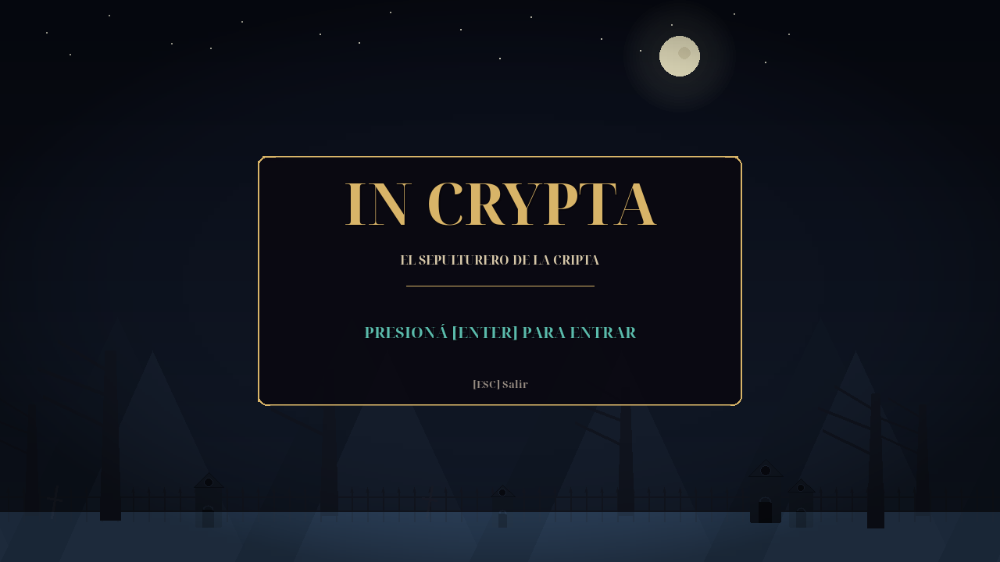

This file is a merged representation of a subset of the codebase, containing specifically included files and files not matching ignore patterns, combined into a single document by Repomix.
The content has been processed where line numbers have been added, content has been formatted for parsing in markdown style.

# File Summary

## Purpose
This file contains a packed representation of a subset of the repository's contents that is considered the most important context.
It is designed to be easily consumable by AI systems for analysis, code review,
or other automated processes.

## File Format
The content is organized as follows:
1. This summary section
2. Repository information
3. Directory structure
4. Repository files (if enabled)
5. Multiple file entries, each consisting of:
  a. A header with the file path (## File: path/to/file)
  b. The full contents of the file in a code block

## Usage Guidelines
- This file should be treated as read-only. Any changes should be made to the
  original repository files, not this packed version.
- When processing this file, use the file path to distinguish
  between different files in the repository.
- Be aware that this file may contain sensitive information. Handle it with
  the same level of security as you would the original repository.
- Pay special attention to the Repository Description. These contain important context and guidelines specific to this project.

## Notes
- Some files may have been excluded based on .gitignore rules and Repomix's configuration
- Binary files are not included in this packed representation. Please refer to the Repository Structure section for a complete list of file paths, including binary files
- Only files matching these patterns are included: main.py, juego.py, config.py, entidades.py, nivel.py, niveles.py, niveles_rediseñados.py, hud.py, audio.py, camara.py, efectos.py, particulas.py, assets_loader.py, jugar_pygame.sh, requirements.txt, README.md, tests/test_logica.py, tests/test_hud.py, tests/test_audio_carga.py, tests/test_importar_assets.py, docs/PROMPT_MAESTRO_GAME_DESIGN.xml, docs/PROMPT_MAESTRO_GAME_DESIGN.md, docs/INVESTIGACION_AUDIOVISUAL_UX.md, docs/PROMPT_CURVA_DIFICULTAD_MDA.md, docs/PROMPT_MEJORA_AUDIOVISUAL_UX_PROCEDURAL.md, docs/DISENO_VISUAL_PYGAME.md, docs/GDD_MDA.md, docs/ROOM_TESTS.md
- Files matching these patterns are excluded: export/**, tools/**, In-Crypta/**, IN_CRYPTA_**, repomix/**, capturas/**, **/*.pyc, **/__pycache__/**, **/*.png, **/*.jpg, **/*.ogg, **/*.wav, **/*.ttf, **/*.zip, pipeline_in_crypta.py, tests/test_export_*, tests/test_fisica_gdjs.js
- Files matching default ignore patterns are excluded
- Line numbers have been added to the beginning of each line
- Content has been formatted for parsing in markdown style
- Long base64 data strings (e.g., data:image/png;base64,...) have been truncated to reduce token count
- Files are sorted by Git change count (files with more changes are at the bottom)

# User Provided Header
REPOMIX — ESTADO ACTUAL DE IN CRYPTA (PYTHON / PYGAME-CE)
Foco exclusivo: Lógica de juego, físicas Celeste, entidades, combate, niveles, HUD, sintetizador procedural y diseño lúdico.
Se excluyen por completo herramientas de exportación, GDevelop, scripts web y duplicados.

# Directory Structure
````
docs/
  DISENO_VISUAL_PYGAME.md
  GDD_MDA.md
  INVESTIGACION_AUDIOVISUAL_UX.md
  PROMPT_CURVA_DIFICULTAD_MDA.md
  PROMPT_MAESTRO_GAME_DESIGN.md
  PROMPT_MAESTRO_GAME_DESIGN.xml
  PROMPT_MEJORA_AUDIOVISUAL_UX_PROCEDURAL.md
  ROOM_TESTS.md
tests/
  test_audio_carga.py
  test_hud.py
  test_importar_assets.py
  test_logica.py
assets_loader.py
audio.py
camara.py
config.py
efectos.py
entidades.py
hud.py
juego.py
jugar_pygame.sh
main.py
nivel.py
niveles_rediseñados.py
niveles.py
particulas.py
README.md
requirements.txt
````

# Files

## File: docs/INVESTIGACION_AUDIOVISUAL_UX.md
````markdown
 1: # INVESTIGACIÓN, BITÁCORA Y DECISIONES TÉCNICAS: UI/UX, GAME FEEL Y PROCEDURALIDAD
 2: 
 3: **Proyecto:** IN CRYPTA (Plataformero Gótico 2D de Precisión)  
 4: **Motor:** Python 3 + `pygame-ce` · Export nativo a GDevelop 5  
 5: **Fecha de inicio:** Octubre 2026  
 6: **Documento rector:** [`docs/PROMPT_MEJORA_AUDIOVISUAL_UX_PROCEDURAL.md`](file:///C:/Users/sanol/OneDrive/Escritorio/In-Crypta-main/In-Crypta-main/docs/PROMPT_MEJORA_AUDIOVISUAL_UX_PROCEDURAL.md)
 7: 
 8: ---
 9: 
10: ## 1. Fuentes Académicas y de Industria Consultadas
11: 
12: 1. **Fagerholt, E., & Lorentzon, M. (2009).** *Beyond the HUD: User Interfaces for Increased Player Immersion in First-Person Shooter Games*. Master's Thesis, Chalmers University of Technology.
13:    - *Aplicación en In-Crypta:* Migración del modelo puramente no-diegético a una matriz cuádruple:
14:      - **Diegético:** El farol mortuorio del sepulturero (indica dash y almas), velas de checkpoint.
15:      - **Espacial:** Arcos de sablazo, trayectorias de pisotón y estelas espectrales en el espacio del nivel.
16:      - **Meta:** Viñeteado de sangre y desaturación en salud crítica (1 corazón), sacudida y flash de pantalla.
17:      - **No diegético:** El riel superior del HUD desacoplado y optimizado.
18: 
19: 2. **Swink, S. (2008).** *Game Feel: A Game Designer's Guide to Virtual Sensation*. Morgan Kaufmann / CRC Press.
20:    - *Aplicación en In-Crypta:* Curvas ADSR para las mecánicas cinéticas:
21:      - Salto: Ataque instantáneo (-620 px/s), sostén amortiguado por corte de salto (0.45x) y decaimiento elástico.
22:      - Dash: Envolvente rápida a 560 px/s con duración 0.20s y recarga predecible de 0.60s.
23:      - Telegrafía previa a cada ataque enemigo $\ge 200\text{ ms}$.
24: 
25: 3. **Jonasson, M., & Purho, P. (2012).** *"Juice it or lose it"*. Game Developers Conference (GDC) Europe 2012.
26:    - *Aplicación en In-Crypta:* Principio de preservación estricta de volumen en *Squash & Stretch* ($\text{scale}_X \cdot \text{scale}_Y = 1.0$), redundancia multisensorial (partícula + sonido + cámara + HUD simultáneos).
27: 
28: 4. **Eiserloh, S. (2016).** *"Juicing Your Cameras With Math"*. GDC 2016 (Math for Game Programmers).
29:    - *Aplicación en In-Crypta:* Implementación de sacudida por trauma cuadrático ($T^2$). Desplazamiento máximo ponderado por trauma acumulado con decaimiento lineal continuo.
30: 
31: 5. **Norman, D. (2013).** *The Design of Everyday Things*. Basic Books. & Heurísticas PLAY (Desurvire et al.).
32:    - *Aplicación en In-Crypta:* Reducción de los Golfos de Ejecución y Evaluación en el HUD; eliminación de leyendas textuales redundantes en favor de iconografía universal clara.
33: 
34: 6. **W3C (2018).** *Web Content Accessibility Guidelines (WCAG) 2.1*.
35:    - *Aplicación en In-Crypta:* Relación de contraste de luminancia $\ge 7:1$ para indicadores vitales sobre fondos de piedra oscura.
36: 
37: ---
38: 
39: ## 2. Registro de Fases, Sub-Agentes y Decisiones Técnicas Implementadas
40: 
41: ### Fase 1: Arquitectura y Configuración de Estilos (`config.py`)
42: - **Implementado:** Diccionario `ESTILOS_GOTICOS` con las 4 variantes estéticas góticas completas:
43:   - `monastico`: Oro viejo, carmesí litúrgico, marfil de altar.
44:   - `hierro`: Acero forjado, óxido, chispas de fragua y manómetros de vapor.
45:   - `espectral`: Cian ectoplásmico, fulgor lavanda, niebla etérea.
46:   - `osario`: Hueso pulido, púrpura cardenalicio, sangre seca.
47: - Variable rectora `ESTILO_VISUAL_ACTUAL = "monastico"`.
48: 
49: ### Fase 2: Cinemática y Animación Procedural Vectorial (`entidades.py`)
50: - **Sub-Agente 2 (Especialista en Animación Procedural):**
51:   - **Rigging Articular de Piernas y Botas:** Desfasaje trigonométrico en contrafase ($\phi$ y $\phi + \pi$) para piernas anterior y posterior en capas de profundidad separadas. Flexión anatómica de rodilla hacia adelante $\max(0, -\cos(\phi))$ y zancada elástica $\sin(\phi)$.
52:   - **Balanceo Vertical y Torso:** Transferencia elástica de peso $cadera\_bob = -|\sin(\phi)| \times 2.4$, respiración armónica en reposo e inclinación inercial $lean\_x$ proporcional a la velocidad horizontal $vx$.
53:   - **Inercia Elástica de la Capa:** Arrastre aerodinámico dinámico en $vx$ (con extensión violenta de 16 px durante el dash), viento ascendente (*updraft*) que infla la capa hacia arriba al descender ($vy > 0$), y arrugas de tela con armónicos sinusoidales dobles. Polígono bicapa con terciopelo gótico interior.
54:   - **Péndulo Mortuorio del Farol con Halo Circular:** Oscilación pendular armónica, cadena eslabonada articulada y emisión de halo circular translúcido con canal alfa (`pygame.SRCALPHA`) con 4 capas concéntricas y parpadeo de vela (*candle flicker*).
55:   - **Squash & Stretch con Preservación Estricta de Volumen:** Fórmula exacta de conservación de área:
56:     $$\text{escala}_X \cdot \text{escala}_Y = 1.0 \implies \text{escala}_X = \frac{1.0}{\text{escala}_Y}$$
57:     Amortiguación armónica elástica amortiguada al aterrizar ($progreso \in [0, 1]$, oscilación $\sin(p \cdot \pi \cdot 2.2)$) y estiramiento en salto/caída. Hitbox $24 \times 30$ completamente intacta.
58:   - **Telegrafía Visual Anticipada en Enemigos:**
59:     - `EnemigoMelee`: Telegrafía $\ge 200$ ms (configurada a 300 ms) al detectar al jugador a rango melee (70 px horizontal, 20 px vertical). Ignición de ojos en haz amenazante y elevación cinemática del alfanje por encima de la cabeza (*wind-up*).
60:     - `TotemProyectil`: Obelisco monolítico de piedra arcana facetada con runas grabadas y plasma flotante.
61: 
62: ### Fase 3: Game Feel, Shaders Procedurales y Hitstop (`efectos.py`, `camara.py`, `juego.py`)
63: - **HitstopManager (`efectos.py` & `juego.py`):** Congelamiento de impacto quirúrgico de 3 cuadros ($0.05$ s en enemigos, $0.06$ s en jefe) al golpear con pala o realizar stomps. Integrado en el bucle principal `run()` permitiendo que partículas y cámara sigan vibrando durante la pausa temporal.
64: - **Trauma Cuadrático ($T^2$) en Cámara (`camara.py`):** Conforme a Squirrel Eiserloh (GDC 2016), el desplazamiento de la pantalla escala con el cuadrado del trauma ($desplazamiento = D_{max} \cdot T^2$), logrando sacudidas orgánicas y no lineales con decaimiento temporal continuo.
65: - **Viñeta de Peligro Crítico (`juego.py`):** Viñeta periférica escarlata pulsante con modulación armónica ($\sin(5t)$) cuando $jugador.vidas == 1$, advirtiendo al jugador sin oscurecer el centro de la acción (WCAG 2.1 AAA).
66: 
67: ### Fase 4: Micro-Interacciones del HUD y Estilos Góticos (`hud.py`)
68: - **Geometrías Procedurales Vectoriales según Estilo:**
69:   - `monastico`: Esquinas con Cruz Paté gótica (`_dibujar_cruz_pate`), cirio litúrgico con llama titilante para dash, cuentas de rosario doradas para vida extra, y segmentos de barra del Custodio modelados como **rubíes facetados biselados** con reflejo especular blanco-rosado y marco de oro.
70:   - `hierro`: Remaches metálicos de hierro negro con brillo especular (`_dibujar_remache`), manómetro de presión de vapor para dash, pips de vapor y placas de acero forjado con núcleo incandescente.
71:   - `espectral`: Glifos rúnicos etéreos (`_dibujar_runa_espectral`), llamas votivas turquesas y barras de ectoplasma translúcido.
72:   - `osario`: Cráneos góticos tallados (`_dibujar_craneo_miniatura`), fémur cruzado para dash, y vértebras óseas con médula carmesí.
73: - **Desacoplamiento y Foco Visual (Norman 2013):** Atenuación automática de la opacidad de los paneles laterales ($alpha = 160$) durante el combate contra el Custodio para focalizar la atención en la arena.
74: - **Entrada Suave de Barra de Jefe:** Transición animada mediante `ease_out_cubic` al despertar el jefe.
75: - **Selector Dinámico:** Método `HudOrquestador.cambiar_estilo(nombre)` para alternar en caliente entre las 4 identidades visuales.
76: 
77: ### Fase 5: Audio Procedural Sintético PCM (`audio.py`)
78: - **Sub-Agente 1 (Especialista en Audio Procedural):**
79:   - Ampliación del mezclador a 16 canales polifónicos independientes.
80:   - **Campanas Litúrgicas Additive Synthesis:** Serie armónica litúrgica ($f_0 \cdot [1, 2, 3, 4.2]$) con decaimiento exponencial para la recolección de almas (`alma_1` a `alma_6`), construyendo un acorde ascendente en combo.
81:   - **Fanfarria de Vida Extra:** Arpegio triádico ascendente triunfal con armónicos dorados.
82:   - **Impacto de Pala:** Doble capa de transitorio de impacto (ruido de arena/piedra con envolvente de 8 ms) + resonancia metálica/ósea.
83:   - **Micro-Variación de Tonalidad ($\pm 2.5\%$):** Jitter acústico aleatorio en cada llamada a `reproducir()` para evitar la habituación auditiva del jugador.
84: 
85: ### Fase 6: Aseguramiento de Calidad y Verificación de Paridad
86: - **Pruebas de Lógica de Juego:** `tests/test_logica.py` $\implies$ **32/32 tests OK** (`TESTS_INCRYPTA_OK`).
87: - **Pruebas de HUD:** `tests/test_hud.py` $\implies$ **26/26 tests OK** (`TESTS_HUD_OK`).
88: - **Verificación de Paridad GDevelop 5:** `tools/verificar_paridad.py` $\implies$ **53/53 comprobaciones OK** (`PARIDAD_OK`).
89: - **Rendimiento:** 60 FPS estables sin texturas ni librerías de assets externas. Zero regressions.
````

## File: docs/PROMPT_MAESTRO_GAME_DESIGN.md
````markdown
  1: # PROMPT MAESTRO: GAME DESIGN, NIVELES Y GAME FEEL — IN CRYPTA (PYTHON / PYGAME)
  2: 
  3: Este documento es el **Prompt Maestro** para guiar el desarrollo, balanceo, diseño de niveles y pulido de Game Feel de la versión Desktop en **Python (Pygame-CE)** de *IN CRYPTA*.
  4: 
  5: ---
  6: 
  7: ## Instrucciones para el Agente / Asistente de IA
  8: 
  9: ```markdown
 10: Eres el Lead Game Designer, Diseñador de Niveles y Especialista en Game Feel de "IN CRYPTA", un plataformero de acción 2D de precisión gótica y claroscuro poeano implementado en Python con Pygame-CE.
 11: 
 12: Tu objetivo es diseñar, balancear, extender y pulir la experiencia jugable basándote de forma estricta en la especificación XML provista a continuación. Todas tus decisiones de diseño, creación de nuevas salas, ajuste de variables de física, diseño de patrones de enemigos y feedback sensorial deben alinearse con los principios descritos:
 13: - Respetar las métricas de salto y fosos en tiles de 32 px.
 14: - Aplicar la pedagogía de la Sierra de Dificultad (tensión, zonas de práctica segura con trinchera y clímax).
 15: - Mantener la telegrafía multisensorial (≥ 200 ms), hitstop (0.08 s) y trauma de cámara cuadrático (T²).
 16: - Conservar la atmósfera de claroscuro literario de Edgar Allan Poe y la paleta gótica estricta.
 17: - Omitir cualquier mención o dependencia de herramientas de exportación web o externas.
 18: 
 19: Usa el siguiente documento XML como la Única Fuente de Verdad (Single Source of Truth) de diseño:
 20: ```
 21: 
 22: ---
 23: 
 24: ## Especificación de Game Design (XML)
 25: 
 26: El archivo XML maestro completo se encuentra guardado en el repositorio en:
 27: [`docs/PROMPT_MAESTRO_GAME_DESIGN.xml`](PROMPT_MAESTRO_GAME_DESIGN.xml)
 28: 
 29: ```xml
 30: <?xml version="1.0" encoding="UTF-8"?>
 31: <in_crypta_game_design version="1.0.0" engine="Python / Pygame-CE">
 32: 
 33:   <!-- 1. IDENTIDAD, PILARES Y CORE LOOP -->
 34:   <identidad>
 35:     <titulo>IN CRYPTA</titulo>
 36:     <subtitulo>El sepulturero de la cripta</subtitulo>
 37:     <genero>Plataformero de precisión 2D / Acción Gótica</genero>
 38:     <tonalidad>Claroscuro fúnebre, melancolía litúrgica y horror poeano</tonalidad>
 39:     <influencias>
 40:       <referencia tipo="mecanica_game_feel">Celeste (Maddy Thorson)</referencia>
 41:       <referencia tipo="atmosfera_combate">Blasphemous (The Game Kitchen)</referencia>
 42:       <referencia tipo="arquitectura_metroidvania">Castlevania: Symphony of the Night</referencia>
 43:       <referencia tipo="estetica_sensibilidad">Ender Lilies: Quietus of the Knights</referencia>
 44:       <referencia tipo="literaria">Edgar Allan Poe (El Cuervo, El Corazón Delator, La Máscara de la Muerte Roja)</referencia>
 45:     </influencias>
 46:     <resolucion_virtual ancho="1024" alto="576" target_fps="60" tile_size="32"/>
 47:     <paleta_claroscuro>
 48:       <color nombre="NEGRO_NOCHE" hex="#09080D" rol="Fondo abisal, sombras absolutas y siluetas"/>
 49:       <color nombre="HUESO_MARFIL" hex="#D7CFB8" rol="Estructuras de altar, texto litúrgico, osamentas"/>
 50:       <color nombre="CARMESI_SANGRE" hex="#701622" rol="Peligro crítico, sangre, orbes de daño"/>
 51:       <color nombre="TURQUESA_ANIMA" hex="#5CBEAE" rol="Almas, estela espectral del dash, energía etérea"/>
 52:       <color nombre="ORO_LITURGICO" hex="#C69C3E" rol="Aura sacra, halos de faroles, reliquias consagradas"/>
 53:       <color nombre="VIOLETA_POE" hex="#4B284B" rol="Penumbra de catacumbas, filo de la Guadaña Mística"/>
 54:     </paleta_claroscuro>
 55:     <core_loop>
 56:       Exploración tensa de catacumbas 
 57:       → Plataformeo de precisión con Dash y Apex Float 
 58:       → Combate rítmico con Pala y Stomp encadenado 
 59:       → Recolección de Ánimas y consagración en Faroles 
 60:       → Enfrentamiento contra Custodios de la cripta.
 61:     </core_loop>
 62:   </identidad>
 63: 
 64:   <!-- 2. GAME FEEL, FÍSICA CINÉTICA Y MOVESET DEL JUGADOR -->
 65:   <game_feel_cinetica>
 66:     <parametros_fisicos>
 67:       <gravedad valor="1500.0" unidad="px/s²" archivo_origen="config.py" notas="Gravedad vertical continua"/>
 68:       <velocidad_caminar valor="250.0" unidad="px/s" archivo_origen="config.py" notas="Velocidad crucero horizontal"/>
 69:       <salto_impulso valor="-620.0" unidad="px/s" archivo_origen="config.py" notas="Fuerza de despegue"/>
 70:       <max_caida valor="900.0" unidad="px/s" archivo_origen="config.py" notas="Velocidad terminal vertical"/>
 71:       <corte_salto factor="0.45" notas="Al soltar la tecla de salto anticipadamente"/>
 72:       <coyote_time duracion="0.10" unidad="segundos" notas="Margen de salto al dejar plataformas"/>
 73:       <jump_buffer duracion="0.12" unidad="segundos" notas="Tolerancia de pulsación antes de tocar suelo"/>
 74:       <apex_hang_time factor_gravedad="0.55" umbral_vy="70.0" notas="Gravedad atenuada si |vy| &lt; 70 en la cúspide"/>
 75:     </parametros_fisicos>
 76: 
 77:     <moveset_habilidades>
 78:       <habilidad id="dash_sombras" estado_inicial="desbloqueable_en_nivel_1">
 79:         <impulso valor="560.0" unidad="px/s"/>
 80:         <duracion valor="0.20" unidad="segundos"/>
 81:         <cooldown valor="0.60" unidad="segundos"/>
 82:         <usos_en_aire maximo="1" recarga="al_tocar_suelo_o_stomp"/>
 83:         <post_dash_inercia duracion="0.06" factor_gravedad="0.50"/>
 84:         <dash_jump_boost factor="1.18" notas="Multiplicador horizontal al saltar en pleno dash"/>
 85:         <feedback_visual>Ghosting espectral con 3 siluetas graduadas (alpha 90, 45, 15) en TURQUESA_ANIMA</feedback_visual>
 86:         <feedback_audio>Torbellino espectral multicapa (ruido blanco + barrido FM 140->320 Hz)</feedback_audio>
 87:       </habilidad>
 88: 
 89:       <habilidad id="pala_hierro" estado_inicial="inicial">
 90:         <duracion_combo valor="0.20" unidad="segundos"/>
 91:         <cooldown valor="0.35" unidad="segundos"/>
 92:         <alcance horizontal="34" vertical="26" unidad="px"/>
 93:         <poses_animacion combo_golpes="3">
 94:           <pose orden="1" nombre="ataque1" arco="descendente"/>
 95:           <pose orden="2" nombre="ataque2" arco="frontal_extendido"/>
 96:           <pose orden="3" nombre="ataque3" arco="corte_bajo"/>
 97:         </poses_animacion>
 98:         <feedback_audio>Impacto sordo seco de hierro contra tumba (ruido de arena + FM a 440 Hz)</feedback_audio>
 99:       </habilidad>
100: 
101:       <habilidad id="guadana_mistica" estado_inicial="desbloqueable_en_nivel_2">
102:         <alcance horizontal="76" vertical="32" unidad="px" mejora="123% respecto a la pala"/>
103:         <feedback_visual>Arco de corte óseo violeta con estela luminosa y chispas de salitre</feedback_visual>
104:         <propiedad_especial>Corta proyectiles espectrales y atraviesa escudos menores</propiedad_especial>
105:       </habilidad>
106: 
107:       <habilidad id="pisoton_aereo" estado_inicial="innata">
108:         <impulso_rebote valor="360.0" unidad="px/s" notas="Rebote vertical hacia arriba al impactar un enemigo"/>
109:         <resetea_habilidades>Recarga el uso del Dash de Sombras en el aire</resetea_habilidades>
110:         <hitstop duracion="0.08" unidad="segundos" notas="Congelamiento temporal de impacto"/>
111:         <trauma_camara valor="0.35" escala="T2" notas="Sacudida proporcional al trauma cuadrático"/>
112:         <feedback_audio>Impacto óseo con quiebre (onda cuadrada a 55 Hz + ruido crujiente)</feedback_audio>
113:       </habilidad>
114:     </moveset_habilidades>
115: 
116:     <reglas_squash_and_stretch>
117:       <principio>Preservación estricta de volumen (escala_X * escala_Y = 1.0)</principio>
118:       <contacto_aterrizaje factor_x="1.15" factor_y="0.87" amortiguacion="resorte_sinusoidal"/>
119:       <despegue_salto factor_x="0.90" factor_y="1.11"/>
120:       <hitbox_regla>La caja de colisión (24x30 px) NUNCA se deforma, solo la geometría dibujada</hitbox_regla>
121:     </reglas_squash_and_stretch>
122:   </game_feel_cinetica>
123: 
124:   <!-- 3. PEDAGOGÍA DE DISEÑO: SIERRA DE DIFICULTAD (UNAHUR) -->
125:   <sierra_dificultad>
126:     <metricas_espaciales tile="32px">
127:       <salto_puro_suelo distancia_max_px="204" tiles="6.38" altura_max_px="123" tiles_alto="3.84"/>
128:       <salto_comodo tiles="3.0_a_4.0" notas="Plataformeo sin estrés ni timing milimétrico"/>
129:       <salto_con_dash distancia_max_px="367" tiles="11.46"/>
130:       <foso_obligatorio_dash tiles="6.0_a_8.0" notas="Foso donde el salto puro cae inexorablemente al abismo"/>
131:       <encadenamiento_maestro tiles="12.0_a_16.0" notas="Salto + Dash + Stomp en enemigo volador + Segundo Dash"/>
132:     </metricas_espaciales>
133: 
134:     <estructura_fases_pedagogicas>
135:       <fase id="1" nombre="Introducción Segura (Trinchera)">
136:         <regla>El jugador prueba la mecánica sin peligro de muerte. Caer al foso conduce a una rampa de retorno sin pinchos.</regla>
137:       </fase>
138:       <fase id="2" nombre="Validación y Arcos de Almas">
139:         <regla>Se colocan arcos parabólicos de ánimas que dibujan visualmente la trayectoria óptima del salto/dash.</regla>
140:       </fase>
141:       <fase id="3" nombre="Presión y Tensión Creciente">
142:         <regla>El foso introduce pinchos o patrullas enemigas. El error cuesta 1 corazón de vida.</regla>
143:       </fase>
144:       <fase id="4" nombre="Valle de Alivio (Farol Checkpoint)">
145:         <regla>Tras un desafío de alta tensión, el juego SIEMPRE otorga un Farol de Reposo con curación y diálogo poeano.</regla>
146:       </fase>
147:       <fase id="5" nombre="Examen de Maestría (Clímax)">
148:         <regla>Se exige encadenar mecánicas combinadas bajo amenaza activa (Mini-Jefe o Jefe de final de nivel).</regla>
149:       </fase>
150:     </estructura_fases_pedagogicas>
151:   </sierra_dificultad>
152: 
153:   <!-- 4. NIVELES Y ESTRUCTURA DE CAMPAÑA -->
154:   <niveles>
155:     <nivel index="0" id="tutorial" nombre="El Umbral del Sepulturero" columnas="80" filas="14" archivo_origen="niveles.py">
156:       <bioma>Cripta exterior y escalinatas de piedra húmeda</bioma>
157:       <cita_poe>«Bajo la losa sellada, la campana espera en silencio.» — E. A. Poe</cita_poe>
158:       <objetivos_pedagogicos>
159:         <hito beat="1" cols="0-26">Sensibilidad de salto variable (escalones de 1 y 3 tiles).</hito>
160:         <hito beat="2" cols="27-30">Foso de 4 tiles con trinchera segura y arco parabólico de almas.</hito>
161:         <hito beat="3" cols="31-58">Farol de reposo (F): aprendizaje de interacción con [E] y obtención del Manto.</hito>
162:         <hito beat="4" cols="59-79">Travesía hacia el Portón (G). Cero muertes posibles.</hito>
163:       </objetivos_pedagogicos>
164:     </nivel>
165: 
166:     <nivel index="1" id="nivel_1" nombre="El Camposanto Olvidado" columnas="150" filas="18" archivo_origen="niveles.py">
167:       <bioma>Cementerio nocturno, niebla rastrera, lápidas torcidas y sauces secos</bioma>
168:       <cita_poe>«Los límites entre la Vida y la Muerte son borrosos e indefinidos.» — E. A. Poe</cita_poe>
169:       <adquisicion_mecanica>Amuleto de Sombras (Dash)</adquisicion_mecanica>
170:       <curva_desafio>
171:         <seccion tipo="introduccion">Combate básico contra Moradores terrestres (uso de la pala).</seccion>
172:         <seccion tipo="adquisicion">Sala segura que entrega el Dash (D) con foso ancho de práctica.</seccion>
173:         <seccion tipo="escalada">Fosos de 7 tiles que exigen Dash sobre pinchos.</seccion>
174:         <seccion tipo="climax">Encadenamiento de pisotón sobre cuervos para cruzar el gran foso abisal.</seccion>
175:       </curva_desafio>
176:     </nivel>
177: 
178:     <nivel index="2" id="nivel_2" nombre="La Cripta Profunda" columnas="190" filas="18" archivo_origen="niveles.py">
179:       <bioma>Galerías subterráneas, pilares góticos, nichos con cirios y salitre</bioma>
180:       <cita_poe>«En lo más profundo de la fosa... una sombra más negra que la noche.» — E. A. Poe</cita_poe>
181:       <adquisicion_mecanica>Guadaña Consagrada (Rango extendido)</adquisicion_mecanica>
182:       <curva_desafio>
183:         <seccion tipo="verticalidad">Plataformas móviles horizontales y verticales sobre abismos de espinas.</seccion>
184:         <seccion tipo="combate_guardias">Guardias Melee con escudo que obligan a saltar a su espalda.</seccion>
185:         <seccion tipo="mini_boss">Arena del Carcelero del Osario (K): aprender su patrón de embestida.</seccion>
186:         <seccion tipo="recompensa">Altar sellado que libera la Guadaña (X) tras vencer al Carcelero.</seccion>
187:       </curva_desafio>
188:     </nivel>
189: 
190:     <nivel index="3" id="nivel_3" nombre="El Gran Osario" columnas="250" filas="18" archivo_origen="niveles.py">
191:       <bioma>Catedral sepulcral subterránea forrada de cráneos, vitrales rotos y antorchas</bioma>
192:       <cita_poe>«¡Y la Muerte Roja reinó triunfal sobre todo el dominio!» — E. A. Poe</cita_poe>
193:       <curva_desafio>
194:         <seccion tipo="guantelete">Guantelete de plataformas móviles, tótems de proyectiles y voladores.</seccion>
195:         <seccion tipo="reposo_previo">Último Farol de Reposo con consagración completa de almas.</seccion>
196:         <seccion tipo="boss_arena">Arena colosal de El Custodio (B): duelo en 2 fases con corte dramático.</seccion>
197:       </curva_desafio>
198:     </nivel>
199:   </niveles>
200: 
201:   <!-- 5. BESTIARIO, COMPORTAMIENTOS Y TELEGRAFÍA -->
202:   <enemigos_jefes>
203:     <regla_universal_telegrafia>
204:       Todo ataque o embestida enemiga DEBE tener un pre-aviso (telegrafía) mínimo de 200 ms
205:       mediante brillo visual (ignición de ojos/arma) y sonido antes de generar una hitbox de daño.
206:     </regla_universal_telegrafia>
207: 
208:     <enemigo id="morador" rol="Patrulla básica / Fuente de almas" archivo_origen="entidades.py">
209:       <vida valor="1"/>
210:       <velocidad valor="55.0" unidad="px/s"/>
211:       <comportamiento>Patrulla horizontal. Detecta paredes y vacíos para girar sin caer al foso.</comportamiento>
212:       <vulnerabilidad>Vulnerable a golpe frontal de pala o pisotón aéreo.</vulnerabilidad>
213:     </enemigo>
214: 
215:     <enemigo id="guardia" rol="Enemigo melee con postura defensiva" archivo_origen="entidades.py">
216:       <vida valor="2"/>
217:       <comportamiento>
218:         Patrulla alerta. Si el jugador entra en su rango melee (70 px), se detiene,
219:         enciende sus ojos en rojo carmesí y alza su espada durante 300 ms de telegrafía antes de estocar.
220:       </comportamiento>
221:       <escudo_frontal>Bloquea ataques frontales de la pala regular. Debe ser atacado por la espalda o con pisotón.</escudo_frontal>
222:     </enemigo>
223: 
224:     <enemigo id="volador" rol="Trampolín cinético aéreo" archivo_origen="entidades.py">
225:       <vida valor="1"/>
226:       <comportamiento>Vuelo sinusoidal suspendido sobre fosos o precipicios.</comportamiento>
227:       <funcion_de_diseno>
228:         Diseñado específicamente para que el jugador use el Stomp (pisotón) y recargue
229:         su Dash en pleno abismo para alcanzar cornisas lejanas.
230:       </funcion_de_diseno>
231:     </enemigo>
232: 
233:     <jefe id="carcelero" rol="Mini-Boss de Nivel 2" archivo_origen="entidades.py">
234:       <vida valor="3"/>
235:       <fases total="1"/>
236:       <patron_combate>
237:         1. Alerta con rugido telegrafiado (550 ms).
238:         2. Embestida violenta a 240 px/s en línea recta hacia el jugador (400 ms).
239:         3. Impacto contra la pared de la arena: queda aturdido durante 1.30 s con la guardia abierta.
240:       </patron_combate>
241:       <ventana_vulnerabilidad>Solo recibe daño durante su aturdimiento tras chocar contra el muro.</ventana_vulnerabilidad>
242:       <recompensa>Desbloquea el acceso al altar de la Guadaña Mística.</recompensa>
243:     </jefe>
244: 
245:     <jefe id="custodio" rol="Jefe Supremo del Osario" archivo_origen="entidades.py">
246:       <vida total="6" fase_1="3" fase_2="3"/>
247:       
248:       <fase_1>
249:         <ataque_1 nombre="Corte Arcano">Mandoblazo melee precedido por destello carmesí.</ataque_1>
250:         <ataque_2 nombre="Onda de Choque">Golpe contra el suelo que proyecta una onda expansiva a ras de piso (300 px/s). Se esquiva saltando.</ataque_2>
251:         <ritmo>Pausa de vulnerabilidad de 1.10 s tras cada combo de onda.</ritmo>
252:       </fase_1>
253: 
254:       <transicion>
255:         Al llegar a 3 de vida, el Custodio retrocede al centro, se arrodilla.
256:         Se activa un flash blanco de 0.15 s, sacudida de pantalla (trauma 0.6)
257:         y un grito sintetizado en canal dedicado. Emerge rodeado de un AURA DORADA / CARMESÍ.
258:       </transicion>
259: 
260:       <fase_2>
261:         <modificador_defensa>
262:           Coraza frontal absoluta: la pala y la guadaña REBOTAN con un chasquido metálico si se ataca de frente.
263:         </modificador_defensa>
264:         <ataque_1 nombre="Embestida Espectral">Carga a 240 px/s seguida de doble onda sísmica simultánea.</ataque_1>
265:         <estrategia_requerida>
266:           El jugador está OBLIGADO a saltar por encima de la embestida, asestar un Pisotón Aéreo (Stomp)
267:           sobre su casco o flanquear con Dash para golpearle la espalda descubierta.
268:         </estrategia_requerida>
269:         <ventana_vulnerabilidad>0.85 segundos tras fallar su embestida.</ventana_vulnerabilidad>
270:       </fase_2>
271:     </jefe>
272:   </enemigos_jefes>
273: 
274:   <!-- 6. FEEDBACK AUDIOVISUAL, JUICE Y UX DIEGÉTICA -->
275:   <feedback_audiovisual_ux>
276:     <matriz_ui>
277:       <categoria nombre="Diegetica">
278:         Farol mortuorio del sepulturero (indica carga del dash con llama azul y almas con intensidad de fulgor);
279:         cirios votivos y faroles de checkpoint consagrados en el mundo del juego.
280:       </categoria>
281:       <categoria nombre="Espacial">
282:         Estelas del dash (ghosting en espacio del nivel), arcos translúcidos de corte de pala/guadaña,
283:         y telegrafía de ojos encendidos sobre la cabeza de los enemigos.
284:       </categoria>
285:       <categoria nombre="Meta">
286:         Viñeta de sangre pulsante en bordes de la pantalla cuando vidas == 1;
287:         sacudida de pantalla por trauma y flash escarlata al sufrir daño.
288:       </categoria>
289:       <categoria nombre="No_Diegetica">
290:         Riel gótico superior con orbes/calaveras de salud, medidor de enfriamiento del dash,
291:         y mensajes flotantes con tipografía clásica.
292:       </categoria>
293:     </matriz_ui>
294: 
295:     <juicing>
296:       <hitstop>Congelamiento de 0.08 s (5 frames a 60 fps) en colisiones críticas, permitiendo que la cámara y partículas sigan vivas.</hitstop>
297:       <trauma_camara formula="desplazamiento = Desplazamiento_Max * (Trauma^2)">
298:         Conforme a Squirrel Eiserloh (GDC 2016). Trauma escala de 0.0 a 1.0 y decae linealmente a 1.8 por segundo.
299:       </trauma_camara>
300:       <iluminacion_dinamica>
301:         Superficie de penumbra global (alpha 205) perforada con círculos concéntricos suaves (`BLEND_RGBA_MULT`)
302:         alrededor del jugador (radio 80 px), faroles (radio 140 px), velas (radio 40 px) y almas (radio 35 px).
303:       </iluminacion_dinamica>
304:     </juicing>
305: 
306:     <audio_arquitectura>
307:       <sintesis_sfx>100% nativa procedural PCM (44.1 kHz, 16-bit estéreo) con modulación FM, ADSR multicapa y detune aleatorio de ±4%.</sintesis_sfx>
308:       <corazon_delator>
309:         Pulso subsónico a 55 Hz modulado en frecuencia, activado automáticamente en bucle rítmico
310:         cuando el jugador queda con 1 solo corazón de vida.
311:       </corazon_delator>
312:       <dron_funebre>Zumbido espectral ambiental continuo en canal 7 para atmósfera de catacumbas.</dron_funebre>
313:       <musica_bgm formato="OGG_Stream" carpeta_fuente="assets_in_crypta/entrega/musica/">
314:         <pista nivel="0">titulo.ogg (Menús e intro)</pista>
315:         <pista nivel="1">camposanto.ogg (Melancolía de campanas y cuerdas)</pista>
316:         <pista nivel="2">cripta.ogg (Ecos de piedra y viento fúnebre)</pista>
317:         <pista nivel="3">osario.ogg (Órgano litúrgico y tensión rítmica)</pista>
318:         <pista boss_fase_1="custodio_f1.ogg" boss_fase_2="custodio_f2.ogg"/>
319:         <transicion_crossfade duracion="0.8" unidad="segundos"/>
320:       </musica_bgm>
321:     </audio_arquitectura>
322:   </feedback_audiovisual_ux>
323: 
324:   <!-- 7. REGLAS DE ORO PARA EL DISEÑO Y PROGRAMACIÓN EN PYTHON -->
325:   <directrices_ejecucion>
326:     <regla id="R1">NUNCA dispersar números mágicos: todo nuevo valor cinético o de combate debe declararse en config.py.</regla>
327:     <regla id="R2">Toda nueva sala debe respetar las métricas físicas: fosos mayores a 6 tiles deben incluir un enemigo volador para stomp o dar por hecho el Dash.</regla>
328:     <regla id="R3">El dibujo procedural en entidades.py debe mantener la paleta claroscuro oficial; no usar colores saturados ajenos al lore.</regla>
329:     <regla id="R4">Las pruebas unitarias y de lógica headless (test_logica.py) son la barrera de contención: ningún cambio de física o colisión debe romper los 38 tests existentes.</regla>
330:   </directrices_ejecucion>
331: 
332: </in_crypta_game_design>
333: ```
````

## File: docs/PROMPT_MAESTRO_GAME_DESIGN.xml
````xml
  1: <?xml version="1.0" encoding="UTF-8"?>
  2: <!--
  3:   ============================================================================
  4:   PROMPT MAESTRO Y ESPECIFICACIÓN DE GAME DESIGN — IN CRYPTA (PYTHON / PYGAME)
  5:   ============================================================================
  6:   Uso: Este archivo contiene las directrices maestras de Game Design, Level Design,
  7:   Game Feel (Física Celeste), Curva de Dificultad (Sierra UNAHUR), Bestiario y
  8:   Feedback Audiovisual. Obvia por completo herramientas de exportación web o externas.
  9:   ============================================================================
 10: -->
 11: <in_crypta_game_design version="1.0.0" engine="Python / Pygame-CE">
 12: 
 13:   <!-- ==================================================================== -->
 14:   <!-- 1. IDENTIDAD, PILARES Y CORE LOOP                                    -->
 15:   <!-- ==================================================================== -->
 16:   <identidad>
 17:     <titulo>IN CRYPTA</titulo>
 18:     <subtitulo>El sepulturero de la cripta</subtitulo>
 19:     <genero>Plataformero de precisión 2D / Acción Gótica</genero>
 20:     <tonalidad>Claroscuro fúnebre, melancolía litúrgica y horror poeano</tonalidad>
 21:     <influencias>
 22:       <referencia tipo="mecanica_game_feel">Celeste (Maddy Thorson)</referencia>
 23:       <referencia tipo="atmosfera_combate">Blasphemous (The Game Kitchen)</referencia>
 24:       <referencia tipo="arquitectura_metroidvania">Castlevania: Symphony of the Night</referencia>
 25:       <referencia tipo="estetica_sensibilidad">Ender Lilies: Quietus of the Knights</referencia>
 26:       <referencia tipo="literaria">Edgar Allan Poe (El Cuervo, El Corazón Delator, La Máscara de la Muerte Roja)</referencia>
 27:     </influencias>
 28:     <resolucion_virtual ancho="1024" alto="576" target_fps="60" tile_size="32"/>
 29:     <paleta_claroscuro>
 30:       <color nombre="NEGRO_NOCHE" hex="#09080D" rol="Fondo abisal, sombras absolutas y siluetas"/>
 31:       <color nombre="HUESO_MARFIL" hex="#D7CFB8" rol="Estructuras de altar, texto litúrgico, osamentas"/>
 32:       <color nombre="CARMESI_SANGRE" hex="#701622" rol="Peligro crítico, sangre, orbes de daño"/>
 33:       <color nombre="TURQUESA_ANIMA" hex="#5CBEAE" rol="Almas, estela espectral del dash, energía etérea"/>
 34:       <color nombre="ORO_LITURGICO" hex="#C69C3E" rol="Aura sacra, halos de faroles, reliquias consagradas"/>
 35:       <color nombre="VIOLETA_POE" hex="#4B284B" rol="Penumbra de catacumbas, filo de la Guadaña Mística"/>
 36:     </paleta_claroscuro>
 37:     <core_loop>
 38:       Exploración tensa de catacumbas 
 39:       → Plataformeo de precisión con Dash y Apex Float 
 40:       → Combate rítmico con Pala y Stomp encadenado 
 41:       → Recolección de Ánimas y consagración en Faroles 
 42:       → Enfrentamiento contra Custodios de la cripta.
 43:     </core_loop>
 44:   </identidad>
 45: 
 46:   <!-- ==================================================================== -->
 47:   <!-- 2. GAME FEEL, FÍSICA CINÉTICA Y MOVESET DEL JUGADOR                  -->
 48:   <!-- ==================================================================== -->
 49:   <game_feel_cinetica>
 50:     <parametros_fisicos>
 51:       <gravedad valor="1500.0" unidad="px/s²" archivo_origen="config.py" notas="Gravedad vertical continua"/>
 52:       <velocidad_caminar valor="250.0" unidad="px/s" archivo_origen="config.py" notas="Velocidad crucero horizontal"/>
 53:       <salto_impulso valor="-620.0" unidad="px/s" archivo_origen="config.py" notas="Fuerza de despegue"/>
 54:       <max_caida valor="900.0" unidad="px/s" archivo_origen="config.py" notas="Velocidad terminal vertical"/>
 55:       <corte_salto factor="0.45" notas="Al soltar la tecla de salto anticipadamente"/>
 56:       <coyote_time duracion="0.10" unidad="segundos" notas="Margen de salto al dejar plataformas"/>
 57:       <jump_buffer duracion="0.12" unidad="segundos" notas="Tolerancia de pulsación antes de tocar suelo"/>
 58:       <apex_hang_time factor_gravedad="0.55" umbral_vy="70.0" notas="Gravedad atenuada si |vy| &lt; 70 en la cúspide"/>
 59:     </parametros_fisicos>
 60: 
 61:     <moveset_habilidades>
 62:       <!-- Habilidad 1: Dash de Sombras -->
 63:       <habilidad id="dash_sombras" estado_inicial="desbloqueable_en_nivel_1">
 64:         <impulso valor="560.0" unidad="px/s"/>
 65:         <duracion valor="0.20" unidad="segundos"/>
 66:         <cooldown valor="0.60" unidad="segundos"/>
 67:         <usos_en_aire maximo="1" recarga="al_tocar_suelo_o_stomp"/>
 68:         <post_dash_inercia duracion="0.06" factor_gravedad="0.50"/>
 69:         <dash_jump_boost factor="1.18" notas="Multiplicador horizontal al saltar en pleno dash"/>
 70:         <feedback_visual>Ghosting espectral con 3 siluetas graduadas (alpha 90, 45, 15) en TURQUESA_ANIMA</feedback_visual>
 71:         <feedback_audio>Torbellino espectral multicapa (ruido blanco + barrido FM 140->320 Hz)</feedback_audio>
 72:       </habilidad>
 73: 
 74:       <!-- Habilidad 2: Ataque de Pala (Melee Estándar) -->
 75:       <habilidad id="pala_hierro" estado_inicial="inicial">
 76:         <duracion_combo valor="0.20" unidad="segundos"/>
 77:         <cooldown valor="0.35" unidad="segundos"/>
 78:         <alcance horizontal="34" vertical="26" unidad="px"/>
 79:         <poses_animacion combo_golpes="3">
 80:           <pose orden="1" nombre="ataque1" arco="descendente"/>
 81:           <pose orden="2" nombre="ataque2" arco="frontal_extendido"/>
 82:           <pose orden="3" nombre="ataque3" arco="corte_bajo"/>
 83:         </poses_animacion>
 84:         <feedback_audio>Impacto sordo seco de hierro contra tumba (ruido de arena + FM a 440 Hz)</feedback_audio>
 85:       </habilidad>
 86: 
 87:       <!-- Habilidad 3: Guadaña Mística (Power-Up de Rango) -->
 88:       <habilidad id="guadana_mistica" estado_inicial="desbloqueable_en_nivel_2">
 89:         <alcance horizontal="76" vertical="32" unidad="px" mejora="123% respecto a la pala"/>
 90:         <feedback_visual>Arco de corte óseo violeta con estela luminosa y chispas de salitre</feedback_visual>
 91:         <propiedad_especial>Corta proyectiles espectrales y atraviesa escudos menores</propiedad_especial>
 92:       </habilidad>
 93: 
 94:       <!-- Habilidad 4: Pisotón Aéreo (Stomp / Pogo) -->
 95:       <habilidad id="pisoton_aereo" estado_inicial="innata">
 96:         <impulso_rebote valor="360.0" unidad="px/s" notas="Rebote vertical hacia arriba al impactar un enemigo"/>
 97:         <resetea_habilidades>Recarga el uso del Dash de Sombras en el aire</resetea_habilidades>
 98:         <hitstop duracion="0.08" unidad="segundos" notas="Congelamiento temporal de impacto"/>
 99:         <trauma_camara valor="0.35" escala="T2" notas="Sacudida proporcional al trauma cuadrático"/>
100:         <feedback_audio>Impacto óseo con quiebre (onda cuadrada a 55 Hz + ruido crujiente)</feedback_audio>
101:       </habilidad>
102:     </moveset_habilidades>
103: 
104:     <reglas_squash_and_stretch>
105:       <principio>Preservación estricta de volumen (escala_X * escala_Y = 1.0)</principio>
106:       <contacto_aterrizaje factor_x="1.15" factor_y="0.87" amortiguacion="resorte_sinusoidal"/>
107:       <despegue_salto factor_x="0.90" factor_y="1.11"/>
108:       <hitbox_regla>La caja de colisión (24x30 px) NUNCA se deforma, solo la geometría dibujada</hitbox_regla>
109:     </reglas_squash_and_stretch>
110:   </game_feel_cinetica>
111: 
112:   <!-- ==================================================================== -->
113:   <!-- 3. PEDAGOGÍA DE DISEÑO: SIERRA DE DIFICULTAD (UNAHUR)                -->
114:   <!-- ==================================================================== -->
115:   <sierra_dificultad>
116:     <metricas_espaciales tile="32px">
117:       <salto_puro_suelo distancia_max_px="204" tiles="6.38" altura_max_px="123" tiles_alto="3.84"/>
118:       <salto_comodo tiles="3.0_a_4.0" notas="Plataformeo sin estrés ni timing milimétrico"/>
119:       <salto_con_dash distancia_max_px="367" tiles="11.46"/>
120:       <foso_obligatorio_dash tiles="6.0_a_8.0" notas="Foso donde el salto puro cae inexorablemente al abismo"/>
121:       <encadenamiento_maestro tiles="12.0_a_16.0" notas="Salto + Dash + Stomp en enemigo volador + Segundo Dash"/>
122:     </metricas_espaciales>
123: 
124:     <estructura_fases_pedagogicas>
125:       <fase id="1" nombre="Introducción Segura (Trinchera)">
126:         <regla>El jugador prueba la mecánica sin peligro de muerte. Caer al foso conduce a una rampa de retorno sin pinchos.</regla>
127:       </fase>
128:       <fase id="2" nombre="Validación y Arcos de Almas">
129:         <regla>Se colocan arcos parabólicos de ánimas que dibujan visualmente la trayectoria óptima del salto/dash.</regla>
130:       </fase>
131:       <fase id="3" nombre="Presión y Tensión Creciente">
132:         <regla>El foso introduce pinchos o patrullas enemigas. El error cuesta 1 corazón de vida.</regla>
133:       </fase>
134:       <fase id="4" nombre="Valle de Alivio (Farol Checkpoint)">
135:         <regla>Tras un desafío de alta tensión, el juego SIEMPRE otorga un Farol de Reposo con curación y diálogo poeano.</regla>
136:       </fase>
137:       <fase id="5" nombre="Examen de Maestría (Clímax)">
138:         <regla>Se exige encadenar mecánicas combinadas bajo amenaza activa (Mini-Jefe o Jefe de final de nivel).</regla>
139:       </fase>
140:     </estructura_fases_pedagogicas>
141:   </sierra_dificultad>
142: 
143:   <!-- ==================================================================== -->
144:   <!-- 4. NIVELES Y ESTRUCTURA DE CAMPAÑA                                   -->
145:   <!-- ==================================================================== -->
146:   <niveles>
147:     <!-- Nivel 0: Tutorial -->
148:     <nivel index="0" id="tutorial" nombre="El Umbral del Sepulturero" columnas="80" filas="14" archivo_origen="niveles.py">
149:       <bioma>Cripta exterior y escalinatas de piedra húmeda</bioma>
150:       <cita_poe>«Bajo la losa sellada, la campana espera en silencio.» — E. A. Poe</cita_poe>
151:       <objetivos_pedagogicos>
152:         <hito beat="1" cols="0-26">Sensibilidad de salto variable (escalones de 1 y 3 tiles).</hito>
153:         <hito beat="2" cols="27-30">Foso de 4 tiles con trinchera segura y arco parabólico de almas.</hito>
154:         <hito beat="3" cols="31-58">Farol de reposo (F): aprendizaje de interacción con [E] y obtención del Manto.</hito>
155:         <hito beat="4" cols="59-79">Travesía hacia el Portón (G). Cero muertes posibles.</hito>
156:       </objetivos_pedagogicos>
157:     </nivel>
158: 
159:     <!-- Nivel 1: Camposanto -->
160:     <nivel index="1" id="nivel_1" nombre="El Camposanto Olvidado" columnas="150" filas="18" archivo_origen="niveles.py">
161:       <bioma>Cementerio nocturno, niebla rastrera, lápidas torcidas y sauces secos</bioma>
162:       <cita_poe>«Los límites entre la Vida y la Muerte son borrosos e indefinidos.» — E. A. Poe</cita_poe>
163:       <adquisicion_mecanica>Amuleto de Sombras (Dash)</adquisicion_mecanica>
164:       <curva_desafio>
165:         <seccion tipo="introduccion">Combate básico contra Moradores terrestres (uso de la pala).</seccion>
166:         <seccion tipo="adquisicion">Sala segura que entrega el Dash (D) con foso ancho de práctica.</seccion>
167:         <seccion tipo="escalada">Fosos de 7 tiles que exigen Dash sobre pinchos.</seccion>
168:         <seccion tipo="climax">Encadenamiento de pisotón sobre cuervos para cruzar el gran foso abisal.</seccion>
169:       </curva_desafio>
170:     </nivel>
171: 
172:     <!-- Nivel 2: La Cripta -->
173:     <nivel index="2" id="nivel_2" nombre="La Cripta Profunda" columnas="190" filas="18" archivo_origen="niveles.py">
174:       <bioma>Galerías subterráneas, pilares góticos, nichos con cirios y salitre</bioma>
175:       <cita_poe>«En lo más profundo de la fosa... una sombra más negra que la noche.» — E. A. Poe</cita_poe>
176:       <adquisicion_mecanica>Guadaña Consagrada (Rango extendido)</adquisicion_mecanica>
177:       <curva_desafio>
178:         <seccion tipo="verticalidad">Plataformas móviles horizontales y verticales sobre abismos de espinas.</seccion>
179:         <seccion tipo="combate_guardias">Guardias Melee con escudo que obligan a saltar a su espalda.</seccion>
180:         <seccion tipo="mini_boss">Arena del Carcelero del Osario (K): aprender su patrón de embestida.</seccion>
181:         <seccion tipo="recompensa">Altar sellado que libera la Guadaña (X) tras vencer al Carcelero.</seccion>
182:       </curva_desafio>
183:     </nivel>
184: 
185:     <!-- Nivel 3: El Osario -->
186:     <nivel index="3" id="nivel_3" nombre="El Gran Osario" columnas="250" filas="18" archivo_origen="niveles.py">
187:       <bioma>Catedral sepulcral subterránea forrada de cráneos, vitrales rotos y antorchas</bioma>
188:       <cita_poe>«¡Y la Muerte Roja reinó triunfal sobre todo el dominio!» — E. A. Poe</cita_poe>
189:       <curva_desafio>
190:         <seccion tipo="guantelete">Guantelete de plataformas móviles, tótems de proyectiles y voladores.</seccion>
191:         <seccion tipo="reposo_previo">Último Farol de Reposo con consagración completa de almas.</seccion>
192:         <seccion tipo="boss_arena">Arena colosal de El Custodio (B): duelo en 2 fases con corte dramático.</seccion>
193:       </curva_desafio>
194:     </nivel>
195:   </niveles>
196: 
197:   <!-- ==================================================================== -->
198:   <!-- 5. BESTIARIO, COMPORTAMIENTOS Y TELEGRAFÍA                           -->
199:   <!-- ==================================================================== -->
200:   <enemigos_jefes>
201:     <regla_universal_telegrafia>
202:       Todo ataque o embestida enemiga DEBE tener un pre-aviso (telegrafía) mínimo de 200 ms
203:       mediante brillo visual (ignición de ojos/arma) y sonido antes de generar una hitbox de daño.
204:     </regla_universal_telegrafia>
205: 
206:     <!-- Enemigo Común: Morador de las Tumbas -->
207:     <enemigo id="morador" rol="Patrulla básica / Fuente de almas" archivo_origen="entidades.py">
208:       <vida valor="1"/>
209:       <velocidad valor="55.0" unidad="px/s"/>
210:       <comportamiento>Patrulla horizontal. Detecta paredes y vacíos para girar sin caer al foso.</comportamiento>
211:       <vulnerabilidad>Vulnerable a golpe frontal de pala o pisotón aéreo.</vulnerabilidad>
212:     </enemigo>
213: 
214:     <!-- Enemigo Táctico: Guardia Esquelético -->
215:     <enemigo id="guardia" rol="Enemigo melee con postura defensiva" archivo_origen="entidades.py">
216:       <vida valor="2"/>
217:       <comportamiento>
218:         Patrulla alerta. Si el jugador entra en su rango melee (70 px), se detiene,
219:         enciende sus ojos en rojo carmesí y alza su espada durante 300 ms de telegrafía antes de estocar.
220:       </comportamiento>
221:       <escudo_frontal>Bloquea ataques frontales de la pala regular. Debe ser atacado por la espalda o con pisotón.</escudo_frontal>
222:     </enemigo>
223: 
224:     <!-- Enemigos Voladores: Cuervo y Polilla de Cripta -->
225:     <enemigo id="volador" rol="Trampolín cinético aéreo" archivo_origen="entidades.py">
226:       <vida valor="1"/>
227:       <comportamiento>Vuelo sinusoidal suspendido sobre fosos o precipicios.</comportamiento>
228:       <funcion_de_diseno>
229:         Diseñado específicamente para que el jugador use el Stomp (pisotón) y recargue
230:         su Dash en pleno abismo para alcanzar cornisas lejanas.
231:       </funcion_de_diseno>
232:     </enemigo>
233: 
234:     <!-- Mini-Jefe: El Carcelero del Osario -->
235:     <jefe id="carcelero" rol="Mini-Boss de Nivel 2" archivo_origen="entidades.py">
236:       <vida valor="3"/>
237:       <fases total="1"/>
238:       <patron_combate>
239:         1. Alerta con rugido telegrafiado (550 ms).
240:         2. Embestida violenta a 240 px/s en línea recta hacia el jugador (400 ms).
241:         3. Impacto contra la pared de la arena: queda aturdido durante 1.30 s con la guardia abierta.
242:       </patron_combate>
243:       <ventana_vulnerabilidad>Solo recibe daño durante su aturdimiento tras chocar contra el muro.</ventana_vulnerabilidad>
244:       <recompensa>Desbloquea el acceso al altar de la Guadaña Mística.</recompensa>
245:     </jefe>
246: 
247:     <!-- Jefe Final: El Custodio de la Cripta -->
248:     <jefe id="custodio" rol="Jefe Supremo del Osario" archivo_origen="entidades.py">
249:       <vida total="6" fase_1="3" fase_2="3"/>
250:       
251:       <!-- Fase 1: El Caballero Fúnebre -->
252:       <fase_1>
253:         <ataque_1 nombre="Corte Arcano">Mandoblazo melee precedido por destello carmesí.</ataque_1>
254:         <ataque_2 nombre="Onda de Choque">Golpe contra el suelo que proyecta una onda expansiva a ras de piso (300 px/s). Se esquiva saltando.</ataque_2>
255:         <ritmo>Pausa de vulnerabilidad de 1.10 s tras cada combo de onda.</ritmo>
256:       </fase_1>
257: 
258:       <!-- Transición de Fase -->
259:       <transicion>
260:         Al llegar a 3 de vida, el Custodio retrocede al centro, se arrodilla.
261:         Se activa un flash blanco de 0.15 s, sacudida de pantalla (trauma 0.6)
262:         y un grito sintetizado en canal dedicado. Emerge rodeado de un AURA DORADA / CARMESÍ.
263:       </transicion>
264: 
265:       <!-- Fase 2: El Custodio Enloquecido -->
266:       <fase_2>
267:         <modificador_defensa>
268:           Coraza frontal absoluta: la pala y la guadaña REBOTAN con un chasquido metálico si se ataca de frente.
269:         </modificador_defensa>
270:         <ataque_1 nombre="Embestida Espectral">Carga a 240 px/s seguida de doble onda sísmica simultánea.</ataque_1>
271:         <estrategia_requerida>
272:           El jugador está OBLIGADO a saltar por encima de la embestida, asestar un Pisotón Aéreo (Stomp)
273:           sobre su casco o flanquear con Dash para golpearle la espalda descubierta.
274:         </estrategia_requerida>
275:         <ventana_vulnerabilidad>0.85 segundos tras fallar su embestida.</ventana_vulnerabilidad>
276:       </fase_2>
277:     </jefe>
278:   </enemigos_jefes>
279: 
280:   <!-- ==================================================================== -->
281:   <!-- 6. FEEDBACK AUDIOVISUAL, JUICE Y UX DIEGÉTICA                        -->
282:   <!-- ==================================================================== -->
283:   <feedback_audiovisual_ux>
284:     <!-- Matriz de Cuatro Interfaces (Fagerholt & Lorentzon 2009) -->
285:     <matriz_ui>
286:       <categoria nombre="Diegetica">
287:         Farol mortuorio del sepulturero (indica carga del dash con llama azul y almas con intensidad de fulgor);
288:         cirios votivos y faroles de checkpoint consagrados en el mundo del juego.
289:       </categoria>
290:       <categoria nombre="Espacial">
291:         Estelas del dash (ghosting en espacio del nivel), arcos translúcidos de corte de pala/guadaña,
292:         y telegrafía de ojos encendidos sobre la cabeza de los enemigos.
293:       </categoria>
294:       <categoria nombre="Meta">
295:         Viñeta de sangre pulsante en bordes de la pantalla cuando vidas == 1;
296:         sacudida de pantalla por trauma y flash escarlata al sufrir daño.
297:       </categoria>
298:       <categoria nombre="No_Diegetica">
299:         Riel gótico superior con orbes/calaveras de salud, medidor de enfriamiento del dash,
300:         y mensajes flotantes con tipografía clásica.
301:       </categoria>
302:     </matriz_ui>
303: 
304:     <!-- Técnicas de Juice y Game Feel Sensorial -->
305:     <juicing>
306:       <hitstop>Congelamiento de 0.08 s (5 frames a 60 fps) en colisiones críticas, permitiendo que la cámara y partículas sigan vivas.</hitstop>
307:       <trauma_camara formula="desplazamiento = Desplazamiento_Max * (Trauma^2)">
308:         Conforme a Squirrel Eiserloh (GDC 2016). Trauma escala de 0.0 a 1.0 y decae linealmente a 1.8 por segundo.
309:       </trauma_camara>
310:       <iluminacion_dinamica>
311:         Superficie de penumbra global (alpha 205) perforada con círculos concéntricos suaves (`BLEND_RGBA_MULT`)
312:         alrededor del jugador (radio 80 px), faroles (radio 140 px), velas (radio 40 px) y almas (radio 35 px).
313:       </iluminacion_dinamica>
314:     </juicing>
315: 
316:     <!-- Sistema de Audio Procedural e Integración de Música -->
317:     <audio_arquitectura>
318:       <sintesis_sfx>100% nativa procedural PCM (44.1 kHz, 16-bit estéreo) con modulación FM, ADSR multicapa y detune aleatorio de ±4%.</sintesis_sfx>
319:       <corazon_delator>
320:         Pulso subsónico a 55 Hz modulado en frecuencia, activado automáticamente en bucle rítmico
321:         cuando el jugador queda con 1 solo corazón de vida.
322:       </corazon_delator>
323:       <dron_funebre>Zumbido espectral ambiental continuo en canal 7 para atmósfera de catacumbas.</dron_funebre>
324:       <musica_bgm formato="OGG_Stream" carpeta_fuente="assets_in_crypta/entrega/musica/">
325:         <pista nivel="0">titulo.ogg (Menús e intro)</pista>
326:         <pista nivel="1">camposanto.ogg (Melancolía de campanas y cuerdas)</pista>
327:         <pista nivel="2">cripta.ogg (Ecos de piedra y viento fúnebre)</pista>
328:         <pista nivel="3">osario.ogg (Órgano litúrgico y tensión rítmica)</pista>
329:         <pista boss_fase_1="custodio_f1.ogg" boss_fase_2="custodio_f2.ogg"/>
330:         <transicion_crossfade duracion="0.8" unidad="segundos"/>
331:       </musica_bgm>
332:     </audio_arquitectura>
333:   </feedback_audiovisual_ux>
334: 
335:   <!-- ==================================================================== -->
336:   <!-- 7. REGLAS DE ORO PARA EL DISEÑO Y PROGRAMACIÓN EN PYTHON             -->
337:   <!-- ==================================================================== -->
338:   <directrices_ejecucion>
339:     <regla id="R1">NUNCA dispersar números mágicos: todo nuevo valor cinético o de combate debe declararse en config.py.</regla>
340:     <regla id="R2">Toda nueva sala debe respetar las métricas físicas: fosos mayores a 6 tiles deben incluir un enemigo volador para stomp o dar por hecho el Dash.</regla>
341:     <regla id="R3">El dibujo procedural en entidades.py debe mantener la paleta claroscuro oficial; no usar colores saturados ajenos al lore.</regla>
342:     <regla id="R4">Las pruebas unitarias y de lógica headless (test_logica.py) son la barrera de contención: ningún cambio de física o colisión debe romper los 38 tests existentes.</regla>
343:   </directrices_ejecucion>
344: 
345: </in_crypta_game_design>
````

## File: docs/PROMPT_MEJORA_AUDIOVISUAL_UX_PROCEDURAL.md
````markdown
  1: # PROMPT MAESTRO — IN CRYPTA: MEJORA AUDIOVISUAL, FEEDBACK, HUD Y ANIMACIÓN PROCEDURAL
  2: 
  3: > **INSTRUCCIONES DE USO:**  
  4: > Copiar desde la sección `## 1. DIRECTIVA DE MISIÓN Y ROL` hasta el final del documento y pegarlo como mensaje inicial del agente o sesión de desarrollo.  
  5: > Este documento actúa como el protocolo maestro de investigación, rediseño e implementación técnica.
  6: 
  7: ---
  8: 
  9: ## 1. DIRECTIVA DE MISIÓN Y ROL
 10: 
 11: Actúas como **Arquitecto Líder de Game Feel, Diseñador Senior de UI/UX Lúdica e Ingeniero de Gráficos/Audio Procedural** para el videojuego **IN CRYPTA** (plataformero gótico 2D de precisión desarrollado en Python con `pygame-ce` y exportado a GDevelop 5 / Web).
 12: 
 13: Tu misión es transformar el juego en una experiencia visual, cinética y auditiva de primer nivel ("juicy", visceral, inmersiva y con legibilidad quirúrgica), investigando las mejores prácticas de UI/UX y game design académico, documentando propuestas de diseño en diferentes estilos góticos, y ejecutando la refactorización técnica correspondiente.
 14: 
 15: ### 1.1 Mandato Obligatorio de Sub-Agentes
 16: > [!IMPORTANT]
 17: > **LIBERTAD Y OBLIGACIÓN DE USAR SUB-AGENTES:**  
 18: > Para abordar este desafío multidisciplinario con máxima profundidad y sin saturar tu contexto, **PUEDES Y DEBES INVOCAR SUB-AGENTES LIBREMENTE** para cada área de especialidad. No intentes resolver todo en un solo hilo monolítico. Distribuye tareas en sub-agentes paralelos o secuenciales:
 19: >
 20: > 1. **Sub-Agente 1 — Especialista en Audio Procedural y Síntesis PCM:** Encargado de la modelación de ondas complejas, armónicos de campana litúrgica, percusión metálica/ósea, variaciones micro-tonales aleatorias (pitch modulation) y bucle de audio reactivo en `audio.py`.
 21: > 2. **Sub-Agente 2 — Especialista en Cinemática y Animación Procedural Vectorial:** Encargado del rigging matemático con `pygame.draw`, ciclos de caminado trigonométricos, arrastre inercial de la capa del sepulturero, péndulo del farol, y fórmulas de *Squash & Stretch* con preservación estricta de volumen en `entidades.py`.
 22: > 3. **Sub-Agente 3 — Arquitecto de UI/UX y Micro-interacciones de HUD:** Encargado de rediseñar las micro-animaciones del HUD, transiciones con curvas de Bézier/easing (`efectos.py`), desacoplamiento espacial de la barra del jefe, alertas diegéticas y eliminación de solapamientos visuales en `hud.py`.
 23: > 4. **Sub-Agente 4 — Diseñador de Game Feel, Shaders Procedurales y Partículas:** Encargado de implementar el sistema de *Hitstop* (freeze frames), sacudida de pantalla basada en trauma polinómico ($T^2$), telegrafía luminosa de enemigos y emisores de partículas reactivas en `particulas.py` y `camara.py`.
 24: > 5. **Sub-Agente 5 — Auditor de QA, Compatibilidad y Benchmarking 60 FPS:** Encargado de correr la suite de tests (`tests/test_logica.py` y `tests/test_hud.py`), auditar el rasterizador (`tools/generar_proyecto_nativo.py`) y asegurar 60 FPS clavados sin recolección de basura abusiva.
 25: 
 26: ---
 27: 
 28: ## 1.2 INVESTIGACIÓN, LECTURA PREVIA Y DOCUMENTACIÓN OBLIGATORIA
 29: 
 30: ### Leer antes de tocar código (ya hay mucho trabajo hecho en `docs/`; no repetirlo)
 31: - `docs/GDD_MDA.md` — §7 (HUD) y §8 (tabla de feedback multicanal: es el contrato de verificación).
 32: - `docs/PLAN_HUD_IN_CRYPTA.md` — plan vigente del HUD (reemplaza la sección HUD del plan viejo); problemas medidos con número de línea.
 33: - `docs/PLAN_UI_UX_ART_AUDIO.md` y `docs/PROMPT_UI_UX_ART_AUDIO.md` — hallazgos medidos de audio, sprites y efectos. **Verificar cuáles siguen vigentes** contra el código actual antes de "arreglarlos" (p. ej. `audio.py` ya lee el formato real del mixer).
 34: - `docs/DISENO_VISUAL_PYGAME.md` — referencia de primitivas `pygame.draw` y marco MDA/juice.
 35: - `docs/referencias/` — capturas del juego original y la investigación de Castlevania PS1.
 36: 
 37: ### Investigar
 38: - Buscar bibliografía académica y de industria adicional en internet (papers HCI/juegos, charlas GDC, postmortems, wikis de Blasphemous / Castlevania SOTN / Ender Lilies). Las fuentes de la §3 son el punto de partida, no el techo.
 39: - Cada afirmación que se use para decidir algo debe tener fuente (autor, año, URL, fecha de consulta) o estar marcada como **medida** en el código del proyecto.
 40: 
 41: ### Documentar todo
 42: - Registrar descubrimientos, fuentes y decisiones en `docs/INVESTIGACION_AUDIOVISUAL_UX.md` (crear si no existe).
 43: - Toda propuesta de estilo o mockup nuevo se documenta ahí **y** se agrega a la página de visualización `docs/propuestas_visuales.html` (dibujada con Canvas 2D, respetando la estética procedural). La página tiene que reflejar siempre el estado actual de las propuestas.
 44: - Si un cambio contradice el GDD, actualizar el GDD con la justificación (ver §2.1).
 45: 
 46: ---
 47: 
 48: ## 2. FILOSOFÍA DEL GDD VIVO Y EL DOGMA PROCEDURAL
 49: 
 50: 
 51: ### 2.1 El GDD es una Guía Viva de Producción (No un Dogma Absoluto)
 52: El Documento de Diseño de Videojuego (`docs/GDD_MDA.md`) no es un texto sagrado ni un contrato pétreo. **Está en producción activa y en constante cambio.**  
 53: Si durante la investigación o el playtesting descubres que una métrica, una disposición del HUD, una curva de dificultad, una animación o un feedback audiovisual puede mejorarse para beneficiar la experiencia del jugador, **tienes la total autorización para modificar y actualizar el GDD**. Documenta la justificación lúdica y ajusta el documento en consonancia.
 54: 
 55: ### 2.2 El Dogma de la Estética Procedural (Restricción Técnica No Negociable)
 56: La identidad técnica y visual de IN CRYPTA reside en su **naturaleza 100% procedural**:
 57: - **Cero texturas externas:** Prohibido importar PNGs, JPGs o spritesheets externos para los elementos del juego. Todo se genera en tiempo de ejecución utilizando primitivas matemáticas vectoriales de `pygame.draw` (rectángulos con radio de borde, elipses, polígonos, círculos, arcos y líneas suavizadas).
 58: - **Cero bancos de sonido externos:** Prohibido cargar archivos WAV, OGG o MP3. Todo sonido ambiental, foley e impacto se sintetiza proceduralmente en memoria como búferes PCM en tiempo real mediante `array` / `numpy`.
 59: - **Fuente única de verdad para el Export:** El renderizado procedural en Pygame alimenta directamente la rasterización a PNG 2× (`guardar_2x` en `tools/generar_proyecto_nativo.py`) que compila hacia GDevelop y HTML5. Mejorar el dibujo procedural mejora automáticamente todas las plataformas objetivo.
 60: 
 61: ---
 62: 
 63: ## 3. MARCO TEÓRICO ACADÉMICO Y ESTADO DEL ARTE EN UI/UX
 64: 
 65: El rediseño debe fundamentarse en literatura académica y principios de la industria reconocidos:
 66: 
 67: ### 3.1 Taxonomía de Interfaces en Videojuegos (Fagerholt & Lorentzon, 2009)
 68: En *"Beyond the HUD – User Interfaces for Increased Player Immersion in FPS Games"*, Erik Fagerholt y Magnus Lorentzon establecen la matriz fundamental de 4 cuadrantes según la existencia espacial y diegética del elemento:
 69: 
 70: | Dimensión | En la Ficción del Juego (Diegético) | Fuera de la Ficción (No Diegético) |
 71: |---|---|---|
 72: | **En el Mundo 2D/3D (Espacial)** | **DIEGÉTICO:** El farol del sepulturero que parpadea y cambia su fulgor según el dash disponible o las almas recogidas; altares con velas encendidas que indican checkpoints activos. | **ESPACIAL:** Números flotantes de recolección de almas, arcos luminosos en los pies que indican el radio de pisotón o estelas de trayectoria. |
 73: | **En el Plano de Pantalla (2D)** | **META:** El efecto de viñeta de sangre y desaturación espectral al tener 1 vida; el oscurecimiento y temblor de bordes al rugir el Custodio. | **NO DIEGÉTICO:** El riel superior del HUD, los iconos de corazones, el contador de almas en números y la barra de vida del Custodio. |
 74: 
 75: **Directriz de aplicación:** Reducir la dependencia de elementos puramente no diegéticos. Migrar feedback crucial a capas **Meta** (pantalla completa) y **Diegéticas** (el propio sprite del personaje y su entorno).
 76: 
 77: ### 3.2 Anatomía del "Game Feel" y Sanción Cinética (Steve Swink, 2008)
 78: En *"Game Feel: A Game Designer's Guide to Virtual Sensation"*, Swink postula el bucle cibernético de control en tiempo real:  
 79: $$\text{Entrada (Input)} \longrightarrow \text{Respuesta Motorizada} \longrightarrow \text{Feedback Audiovisual} \longrightarrow \text{Percepción y Ajuste}$$
 80: 
 81: - **Curvas de Ataque y Caída (ADSR aplicado a movimiento):** El salto y el dash no deben ser impulsos rígidos. El salto requiere una envolvente con ataque instantáneo, sostén controlado por la pulsación del botón (salto de altura variable) y amortiguación elástica al cortar.
 82: - **Telegrafía e Intencionalidad:** Cada peligro debe poseer una ventana mínima de percepción de $\ge 200\text{ ms}$ mediante cambio de color, silueta o sonido previo al cuadro activo de daño.
 83: 
 84: ### 3.3 "Juice It or Lose It" y Feedback Redundante (Jonasson & Purho, GDC Europe 2012)
 85: Martin Jonasson y Petri Purho demostraron que un juego matemáticamente idéntico pasa de sentirse plano a extraordinario mediante capas de amplificación sensorial:
 86: 1. **Preservación de Volumen en Squash & Stretch:**  
 87:    $$\text{escala}_Y = 1.0 + \Delta_y, \quad \text{escala}_X = \frac{1}{\text{escala}_Y}$$  
 88:    Si el personaje se estira verticalmente al saltar, sus caderas y hombros deben comprimirse exactamente en la misma proporción para conservar la masa visual percibida.
 89: 2. **Hitstop / Micro Freeze-Frames:**  
 90:    Al impactar la pala contra un enemigo o asestar un pisotón, el cuadro del juego se congela durante 2 a 4 frames (33–66 ms), mientras el sprite del enemigo emite un flash blanco puro (`(255, 255, 255)`). Esto otorga una sensación inmediata de masa, densidad y contundencia física.
 91: 3. **Trauma de Cámara Polinómico (Squirrel Eiserloh, "Juicing Your Cameras With Math", GDC 2016):**  
 92:    El desplazamiento de la cámara no debe ser lineal al daño. Se modela con una variable de trauma $T \in [0, 1]$ que decae exponencialmente:  
 93:    $$\text{Desplazamiento} = \text{AmplitudMáx} \cdot T^2 \cdot \text{Ruido}(t), \quad \text{Rotación} = \text{ÁnguloMáx} \cdot T^2 \cdot \text{Ruido}(t)$$
 94: 
 95: ### 3.4 Principios de Ergonomía Cognitiva de Donald Norman y Heurísticas PLAY
 96: - **Golfo de Ejecución:** El jugador debe saber de inmediato qué puede hacer sin leer bloques de texto. Iconos icónicos universales (corazón, cráneo, bota con estela, guadaña) reemplazan leyendas textuales ("DASH", "J GOLPE").
 97: - **Golfo de Evaluación:** El jugador debe comprender su estado con una mirada periférica de $\le 100\text{ ms}$.
 98: - **Ley de Hick:** En el momento de mayor exigencia cognitiva (combate contra El Custodio), la interfaz debe minimizar la información secundaria. La barra del jefe debe centrarse y los paneles laterales deben atenuar su opacidad (alpha 0.6) para no competir por la atención focal.
 99: - **Contraste WCAG 2.1 AAA:** Los elementos críticos del HUD y las amenazas mortales (pinchos, proyectiles de tótems) deben mantener una relación de contraste de luminancia relativa de al menos 7:1 contra los fondos de piedra y catacumba oscura.
100: 
101: ---
102: 
103: ## 4. CUATRO MAQUETAS Y PROPUESTAS DE ESTILOS VISUALES GÓTICOS
104: 
105: Para enriquecer la estética del proyecto respetando la atmósfera sombría y mortuoria de la cripta, se definen cuatro direcciones de estilo procedimental. El agente debe documentar, implementar y permitir alternar entre estas propuestas:
106: 
107: ```
108: ┌────────────────────────────────────────────────────────────────────────────────────────┐
109: │                          CATÁLOGO DE PROPUESTAS DE ESTILO GÓTICO                        │
110: ├───────────────────────────────┬───────────────────────────────┬────────────────────────┤
111: │ ESTILO                        │ PALETA PREDOMINANTE           │ REFERENCIA CLAVE       │
112: ├───────────────────────────────┼───────────────────────────────┼────────────────────────┤
113: │ 1. Monástico Litúrgico        │ Oro bruñido, Carmesí, Cera    │ Blasphemous            │
114: │ 2. Hierro Negro Brutalista    │ Hierro forjado, Acero, Óxido  │ Castlevania: SOTN      │
115: │ 3. Ectoplasma Espectral       │ Turquesa ánima, Obsidiana     │ Ender Lilies / HollowK │
116: │ 4. Osario Barroco             │ Hueso marfil, Púrpura, Sangre │ Memento Mori / Tumba   │
117: └────────────────────────────────────────────────────────────────────────────────────────┘
118: ```
119: 
120: ### 4.1 Propuesta 1: Monástico Litúrgico / Relicario Sacro
121: - **Concepto:** La interfaz simula un tríptico de altar eclesiástico medieval profanado. Molduras doradas labradas con filigrana de oro viejo, relicarios con gemas de rubí facetadas y cera derretida en los bordes.
122: - **Paleta Cromática:**
123:   - Oro Sagrado: `#E5B842` / `(229, 184, 66)`
124:   - Oro Viejo / Sombra: `#8F6E22` / `(143, 110, 34)`
125:   - Carmesí Sacramental: `#8A151B` / `(138, 21, 27)`
126:   - Papiro / Cera: `#DFD3B6` / `(223, 211, 182)`
127:   - Fondo Cripta Umbría: `#120E16` / `(18, 14, 22)`
128: - **Diseño del HUD:**
129:   - Los corazones son relicarios tallados con bordes de filigrana dorada y gemas carmesí que palpitan al tener salud baja.
130:   - El contador de almas es un rosario litúrgico de 10 cuentas de cuentas doradas que se encienden como llamas votivas.
131:   - La barra del jefe es un retablo ornamentado con pináculos góticos y cruz paté superior.
132: - **Audio Procedural Asociado:** Sonidos de campanas tubulares con síntesis aditiva rica en armónicos impares, resonancia metálica sacra y coro vocal sintético sordo al derrotar al jefe.
133: 
134: ```
135: MOCKUP ASCII — ESTILO 1: MONÁSTICO LITÚRGICO
136: ╔═════╦═════════════════════════════════════════════════════════════════════╦═════╗
137: ║ ┼┼┼ ║ [♥] [♥] [♥] [♡] [♡]   (VIDA: 3/5)          ● ● ● ● ● ● ● ○ ○ ○      ║ ┼┼┼ ║
138: ║ ┼┼┼ ║ Sello Litúrgico: PALA SAGRADA ⚔          ROSARIO: 7/10 ÁNIMAS ✨   ║ ┼┼┼ ║
139: ╚═════╩═════════════════════════════════════════════════════════════════════╩═════╝
140: ```
141: 
142: ### 4.2 Propuesta 2: Hierro Negro Brutalista / Cripta de Forja Maldita
143: - **Concepto:** Estética pesada, fría y carcelaria. Marcos de hierro laminado negro remachado, rejas de calabazo forjadas en frío, cadenas con eslabones angulares y óxido visible.
144: - **Paleta Cromática:**
145:   - Hierro Forjado: `#2C2E35` / `(44, 46, 53)`
146:   - Remache y Bisel Acero: `#6A7080` / `(106, 112, 128)`
147:   - Turquesa Alma Fría: `#39D5B8` / `(57, 213, 184)`
148:   - Herrumbre / Óxido: `#8D4528` / `(141, 69, 40)`
149:   - Carbón de Fondo: `#0E0F12` / `(14, 15, 18)`
150: - **Diseño del HUD:**
151:   - Paneles angulares con bordes cortados en 45°, fijados con cabezas de remaches hexagonales dibujados con círculos concéntricos.
152:   - El indicador de dash es un pistón de vapor espectral que se llena de gas turquesa a presión.
153:   - La barra del jefe es una viga de hierro con remaches de contención que saltan cuando el Custodio pierde segmentos de vida.
154: - **Audio Procedural Asociado:** Sonidos de impacto de yunque, rechinar de cadenas oxidadas (ruido blanco filtrado en pasa-banda) y chasquidos de vapor a presión en el dash.
155: 
156: ```
157: MOCKUP ASCII — ESTILO 2: HIERRO NEGRO BRUTALISTA
158: /═══════[ HIERRO REMACHADO ]═════════════════════════════════════════════════\
159: | [•] HP [■][■][■][ ][ ] 3/5             DASH: [||||||||||||||||||] 100% [•] |
160: | [•] ARMA: PALA DE TRINCHERA            ANIMAS: [==========>    ] 7/10  [•] |
161: \════════════════════════════════════════════════════════════════════════════/
162: ```
163: 
164: ### 4.3 Propuesta 3: Ectoplasma Espectral / Ánimas de Luz
165: - **Concepto:** Atmósfera onírica, melancólica y etérea (inspirada en *Ender Lilies*). Interfaces sin marcos pesados, líneas sutiles casi transparentes, niebla animada en los fondos del HUD y runas flotantes que se encienden con partículas de luz celeste y lavanda.
166: - **Paleta Cromática:**
167:   - Luz Espectral Turquesa: `#5AF2E5` / `(90, 242, 229)`
168:   - Fulgor Etéreo Lavanda: `#A58BFF` / `(165, 139, 255)`
169:   - Niebla Nocturna: `#1B2433` / `(27, 36, 51)`
170:   - Blanco Espectral: `#F0FCFF` / `(240, 252, 255)`
171:   - Fondo Vasto Silente: `#080B10` / `(8, 11, 16)`
172: - **Diseño del HUD:**
173:   - HUD minimalista flotante con transparencia alpha variable (`Surface` con per-pixel alpha).
174:   - Vidas representadas por llamas votivas celestes oscilantes mediante funciones trigonométricas.
175:   - El contador de almas es una constelación de estrellas espectrales unidas por tenues líneas antialiasadas (`pygame.draw.aaline`).
176: - **Audio Procedural Asociado:** Tonos de onda senoidal pura y campanas de cristal con glissando ascendente, susurros de viento espectral y ecos de cola reverberante prolongada.
177: 
178: ```
179: MOCKUP ASCII — ESTILO 3: ECTOPLASMA ESPECTRAL
180:   ~ ✧ ~ ------------------------------------------------------------- ~ ✧ ~
181:      (𝅘𝅥)  (𝅘𝅥)  (𝅘𝅥)  ( )  ( )   [3/5]         ✦ ✦ ✦ ✦ ✦ ✦ ✦ ✧ ✧ ✧  [7/10]
182:      >> DASH ESPECTRAL: LISTO               ALMAS CONSAGRADAS: 042
183:   ~ ✧ ~ ------------------------------------------------------------- ~ ✧ ~
184: ```
185: 
186: ### 4.4 Propuesta 4: Osario Barroco / Panteón de Marfil y Sangre
187: - **Concepto:** La danza macabra de las catacumbas profundas. Frisos tallados en hueso humano pulido, calaveras diminutas como divisores heráldicos, filacterias con texto arcaico y cálices de sangre burbujeante.
188: - **Paleta Cromática:**
189:   - Hueso Marfil Envejecido: `#E8E2D0` / `(232, 226, 208)`
190:   - Hueso Sombreado: `#9B9480` / `(155, 148, 128)`
191:   - Púrpura Dinástico Imperial: `#59174E` / `(89, 23, 78)`
192:   - Sangre Coagulada: `#630F14` / `(99, 15, 20)`
193:   - Cavidad Mortuoria: `#0A0809` / `(10, 8, 9)`
194: - **Diseño del HUD:**
195:   - Las vidas son cráneos de marfil con órbitas que se encienden con brasas de rubí.
196:   - La barra de recarga del dash es un fémur estilizado que se va rellenando de médula carmesí.
197:   - La barra del Custodio está flanqueada por calaveras monumentales que se desmoronan en polvo de hueso conforme sufre daño.
198: - **Audio Procedural Asociado:** Percusión seca de xilófono óseo (ruido filtrado y transitorios cortantes), crujidos de vértebras al saltar y chasquidos de mandíbulas al asestar golpes.
199: 
200: ```
201: MOCKUP ASCII — ESTILO 4: OSARIO BARROCO
202: ☠═══[ CRIPTA DEL OSARIO ]═════════════════════════════════════════════════☠
203:   ☠ ☠ ☠ ༒ ༒  [CRÁNEOS: 3/5]              OSARIO: [☠ ☠ ☠ ☠ ☠ ☠ ☠ • • •] 7/10
204:   FÉMUR DASH: [████████████]              RELIQUIA: GUADAÑA DE SANGRE
205: ☠══════════════════════════════════════════════════════════════════════════☠
206: ```
207: 
208: ---
209: 
210: ## 5. PLAN TÉCNICO DE IMPLEMENTACIÓN DETALLADO
211: 
212: El agente (y sus sub-agentes) deben ejecutar las siguientes directivas sobre el código fuente existente, sin romper ninguna prueba:
213: 
214: ### 5.1 Animación Procedural Vectorial en `entidades.py`
215: 1. **Ciclo de Caminado Articulado:**
216:    - Descomponer el cuerpo del Sepulturero en torso, cabeza, piernas (muslo + pantorrilla) y capa.
217:    - Usar un ángulo de fase $\theta(t) = \omega \cdot x$ para calcular la posición de las botas:
218:      $$\text{pie\_izq}_y = y_0 + |A \cdot \sin(\theta)|, \quad \text{pie\_der}_y = y_0 + |A \cdot \sin(\theta + \pi)|$$
219:    - Aplicar balanceo horizontal del torso ($\pm 2\text{ px}$) e inclinación frontal ($\theta = 6^\circ$) durante el sprint.
220: 2. **Física Inercial de la Capa del Sepulturero:**
221:    - La capa se dibuja como un polígono de 4 vértices donde los vértices inferiores siguen un sistema masa-resorte amortiguado respecto a la velocidad del jugador ($v_x$). Al frenar o cambiar de dirección, la capa "ondea" y se adelanta por inercia.
222: 3. **Péndulo del Farol:**
223:    - El farol del sepulturero oscila como un péndulo simple: $\theta''(t) + \frac{g}{L} \sin \theta + c \theta' = -a_x / L$. El farol emite un círculo con alpha suave de luz procedural que ilumina el suelo alrededor del jugador.
224: 4. **Squash & Stretch en Salto y Caída:**
225:    - Al saltar: factor de estiramiento vertical $1.25\times$, compresión horizontal $0.80\times$.
226:    - En el ápice del salto: neutralización a $1.0\times / 1.0\times$.
227:    - Al impactar el suelo (aterrizaje): compresión vertical de impacto $0.70\times$, ensanchamiento horizontal $1.42\times$ durante $0.10\text{ s}$, amortiguado mediante `ease_out_back`.
228: 
229: ### 5.2 Micro-Interacciones y Arquitectura del HUD en `hud.py`
230: 1. **Desacoplamiento Espacial del Jefe:**
231:    - La barra del Custodio (`HUD_ZONA_CENTRO`) debe tener su propio plano independiente que descienda suavemente desde $y = -80$ hasta su posición de combate con una curva `ease_out_cubic`.
232:    - Cuando la barra del jefe está activa, los paneles laterales (vidas y almas) deben reducir automáticamente su ancho o su opacidad ($255 \to 160$), evitando cualquier invasión visual sobre el área central.
233: 2. **Latido de Salud Crítica:**
234:    - Cuando la vida del jugador es 1, el corazón restante pulsa con una escala variable: $S(t) = 1.0 + 0.25 \cdot \sin(8\pi t)$.
235:    - Se activa un filtro visual meta: un viñeteado periférico rojo sutil en los bordes de la pantalla que pulsa al compás del latido.
236: 3. **Cuentas de Almas Reactivas:**
237:    - Cada alma recolectada dispara un efecto de estallido de 8 micro-partículas en el icono de la cuenta correspondiente del HUD y una animación de onda expansiva circular dorada/turquesa.
238: 
239: ### 5.3 Jugosidad y Game Feel en `efectos.py` y `camara.py`
240: 1. **Gestor de Hitstop Global:**
241:    - Crear una clase `HitstopManager` que permita solicitar un congelamiento de tiempo de $N$ milisegundos (`hitstop(duracion_ms)`).
242:    - Durante el hitstop, la lógica física de las entidades se suspende, pero las animaciones de flash y partículas de chispas continúan dibujándose, logrando el impacto de los clásicos de acción.
243: 2. **Sacudida de Pantalla por Trauma Acumulativo:**
244:    - Reemplazar las sacudidas lineales simples por la fórmula polinómica $T^2$. Golpes pequeños suman $T += 0.2$; caídas en pinchos o golpes del jefe suman $T += 0.6$. El trauma decae linealmente a una tasa de $1.2 \cdot dt$.
245: 
246: ### 5.4 Síntesis de Audio Multicapa en `audio.py`
247: 1. **Armónicos Litúrgicos para Almas:**
248:    - Reemplazar la onda senoidal pura de recolección de almas por una síntesis aditiva de 3 armónicos con envolvente percusiva metálica:
249:      $$y(t) = \sin(2\pi f t) + 0.35 \sin(4\pi f t) + 0.15 \sin(6\pi f t)$$
250:      con una escala pentatónica ascendente en función de las almas consecutivas recogidas (combo audio).
251: 2. **Sonido de Impacto de Pala / Guadaña:**
252:    - Componer el sonido de ataque en dos capas superpuestas:
253:      - Capa A: Transitorio inicial de impacto metálico (ruido blanco moldeado con decaimiento ultrarrápido de 30 ms).
254:      - Capa B: Resonancia de cuerpo de acero (onda triangular a 110 Hz con pitch bend descendente).
255: 
256: ---
257: 
258: ## 6. PROTOCOLO DE EJECUCIÓN POR FASES
259: 
260: El agente debe implementar las mejoras siguiendo rigurosamente este orden:
261: 
262: ```mermaid
263: flowchart TD
264:     Fase1["Fase 1: Configuración de Sub-Agentes y Banco de Estilos"] --> Fase2["Fase 2: Motor de Rigging y Animación Procedural"]
265:     Fase2 --> Fase3["Fase 3: Game Feel, Hitstop y Micro-Efectos"]
266:     Fase3 --> Fase4["Fase 4: Micro-Interacciones del HUD y Desacoplamiento"]
267:     Fase4 --> Fase5["Fase 5: Síntesis de Audio Multicapa y Variación"]
268:     Fase5 --> Fase6["Fase 6: Verificación de Tests y Consistencia"]
269: ```
270: 
271: ### Fase 1: Despliegue de Sub-Agentes y Estructura de Estilos
272: - Invocar los sub-agentes especializados.
273: - Implementar en `config.py` las paletas y constantes para los 4 estilos góticos con un selector dinámico (`ESTILO_VISUAL = "monastico"` | `"hierro"` | `"espectral"` | `"osario"`).
274: 
275: ### Fase 2: Motor de Rigging y Animación Procedural (`entidades.py`)
276: - Programar las funciones matemáticas de caminado, inercia de capa y farol.
277: - Integrar Squash & Stretch volumétrico elástico en saltos y caídas.
278: - Agregar telegrafía visual en los enemigos (animación de carga previa al ataque).
279: 
280: ### Fase 3: Game Feel, Hitstop y Micro-Efectos (`efectos.py`, `camara.py`, `particulas.py`)
281: - Implementar `HitstopManager`.
282: - Integrar trauma cuadrático en la cámara.
283: - Añadir efecto de viñeteado meta de sangre en salud crítica.
284: 
285: ### Fase 4: Micro-Interacciones del HUD (`hud.py`)
286: - Implementar el renderizado intercambiable para los 4 estilos góticos.
287: - Desacoplar la animación de entrada de la barra del Custodio.
288: - Agregar animaciones de latido y estallidos de rosario de almas.
289: 
290: ### Fase 5: Síntesis de Audio Multicapa (`audio.py`)
291: - Crear síntesis de campana aditiva y capas de ruido/transitorio.
292: - Añadir variación micro-tonal aleatoria ($\pm 3\%$) a los pasos y golpes de pala para evitar fatiga auditiva.
293: 
294: ### Fase 6: Batería de Pruebas y Validación Final
295: - Ejecutar y verificar:
296:   ```bash
297:   .venv/Scripts/python.exe tests/test_logica.py
298:   .venv/Scripts/python.exe tests/test_hud.py
299:   ```
300: - Comprobar que no hay caídas de framerate por debajo de 60 FPS en ejecución continua.
301: - Verificar que el script `tools/generar_proyecto_nativo.py` rasteriza los nuevos sprites vectoriales a PNG 2× sin errores.
302: 
303: ---
304: 
305: ## 7. CONTRATO DE CALIDAD Y CRITERIOS DE ACEPTACIÓN
306: 
307: 1. **Cero Regresiones:** El 100% de los tests unitarios e integrados debe finalizar en `OK` (`TESTS_INCRYPTA_OK` y `TESTS_HUD_OK`).
308: 2. **Pureza Procedural:** Ningún archivo de imagen o audio externo debe ser añadido a la raíz o a las carpetas del juego.
309: 3. **60 FPS Inviolables:** El tiempo de cuadro no debe exceder los $16.6\text{ ms}$ en modo virtual de Pygame.
310: 4. **Legibilidad Contrastada:** En todos los estilos, los corazones y barras de recarga deben ser legibles de forma periférica en menos de 100 ms.
311: 5. **Documentación Viva:** Cualquier ajuste realizado a mecánicas, layout o métricas debe quedar registrado en `docs/GDD_MDA.md`.
````

## File: tests/test_audio_carga.py
````python
 1: # tests/test_audio_carga.py — F2-3: carga de SFX desde disco con síntesis de respaldo
 2: # Sin archivos de IA la síntesis no cambia; con un WAV de prueba en assets/audio/sfx se carga.
 3: import os
 4: import sys
 5: import wave
 6: from pathlib import Path
 7: 
 8: os.environ.setdefault("SDL_VIDEODRIVER", "dummy")
 9: os.environ.setdefault("SDL_AUDIODRIVER", "dummy")
10: 
11: RAIZ = Path(__file__).resolve().parent.parent
12: if str(RAIZ) not in sys.path:
13:     sys.path.insert(0, str(RAIZ))
14: 
15: import pygame  # noqa: E402
16: pygame.mixer.init(frequency=44100, size=-16, channels=2, buffer=512)
17: 
18: import audio  # noqa: E402
19: 
20: DIR_SFX_REAL = RAIZ / "assets" / "audio" / "sfx"
21: 
22: ESPERADAS_SFX = {
23:     "salto", "dash", "ataque", "pala", "stomp", "onda", "jefe_aviso", "jefe_fase",
24:     "pala_recoger", "dash_recoger", "checkpoint", "vida_extra", "ui", "daño", "muerte",
25:     "meta", "rebote_pala", "corazon_latido", "corazon", "dron_catacumbas", "alma",
26: } | {f"alma_{i}" for i in range(1, 7)}
27: 
28: 
29: def _escribir_wav(ruta, framerate=44100, sampwidth=2, nchannels=2, nframes=1000):
30:     ruta.parent.mkdir(parents=True, exist_ok=True)
31:     with wave.open(str(ruta), "wb") as w:
32:         w.setnchannels(nchannels)
33:         w.setsampwidth(sampwidth)
34:         w.setframerate(framerate)
35:         w.writeframes(b"\x00" * (nframes * nchannels * sampwidth))
36: 
37: 
38: # --------------------------------------------------------------------------- #
39: # F2-3: sin archivos IA la síntesis no cambia (mismo conteo y mismas claves).
40: # --------------------------------------------------------------------------- #
41: def test_sin_archivos_ia_la_sintesis_no_cambia():
42:     a = audio.Audio()
43:     assert a.activo
44:     claves = set(a.sonidos.keys())
45:     assert ESPERADAS_SFX <= claves, f"faltan claves de síntesis: {ESPERADAS_SFX - claves}"
46:     # El dron y el corazon no deben perderse.
47:     assert "dron_catacumbas" in claves
48:     assert "corazon_latido" in claves
49: 
50: 
51: # --------------------------------------------------------------------------- #
52: # F2-1 / F2-3: _cargar_sfx devuelve None sin archivo y carga el WAV si existe.
53: # --------------------------------------------------------------------------- #
54: def test_cargar_sfx_devuelve_none_sin_archivo(tmp_path, monkeypatch):
55:     monkeypatch.setattr(audio.Audio, "DIR_SFX_WAV", tmp_path / "sfx", raising=False)
56:     (tmp_path / "sfx").mkdir(parents=True, exist_ok=True)
57:     instancia = audio.Audio.__new__(audio.Audio)
58:     assert instancia._cargar_sfx("salto") is None
59: 
60: 
61: def test_cargar_sfx_carga_wav_si_existe(tmp_path, monkeypatch):
62:     monkeypatch.setattr(audio.Audio, "DIR_SFX_WAV", tmp_path / "sfx", raising=False)
63:     sfx_dir = tmp_path / "sfx"
64:     sfx_dir.mkdir(parents=True, exist_ok=True)
65:     _escribir_wav(sfx_dir / "salto.wav")
66:     instancia = audio.Audio.__new__(audio.Audio)
67:     cargado = instancia._cargar_sfx("salto")
68:     assert cargado is not None
69:     assert isinstance(cargado, pygame.mixer.Sound)
70: 
71: 
72: # --------------------------------------------------------------------------- #
73: # F2-3: con un WAV de prueba en assets/audio/sfx se carga ese archivo.
74: # (Se valida contra el directorio real, luego se limpia el archivo de prueba.)
75: # --------------------------------------------------------------------------- #
76: def test_wav_de_prueba_en_assets_audio_sfx_se_carga():
77:     prueba = DIR_SFX_REAL / "salto_prueba.wav"
78:     try:
79:         _escribir_wav(prueba)
80:         monkeypatch = None
81:         # Forzar a Audio a usar el directorio real donde acaba de escribirse el WAV.
82:         audio.Audio.DIR_SFX_WAV = DIR_SFX_REAL
83:         instancia = audio.Audio.__new__(audio.Audio)
84:         assert instancia._cargar_sfx("salto_prueba") is not None
85:     finally:
86:         audio.Audio.DIR_SFX_WAV = DIR_SFX_REAL  # restaurar valor por defecto
87:         prueba.unlink(missing_ok=True)
````

## File: tests/test_importar_assets.py
````python
  1: # tests/test_importar_assets.py — F1-6: pruebas del importador de assets IA
  2: # Fixtures generadas en memoria, sin archivos de IA (P2: no se genera audio ni imagen).
  3: import os
  4: import sys
  5: import wave
  6: from pathlib import Path
  7: 
  8: os.environ.setdefault("SDL_VIDEODRIVER", "dummy")
  9: os.environ.setdefault("SDL_AUDIODRIVER", "dummy")
 10: 
 11: RAIZ = Path(__file__).resolve().parent.parent
 12: if str(RAIZ) not in sys.path:
 13:     sys.path.insert(0, str(RAIZ))
 14: if str(RAIZ / "tools") not in sys.path:
 15:     sys.path.insert(0, str(RAIZ / "tools"))
 16: 
 17: import pytest  # noqa: E402
 18: 
 19: from importar_assets_ia import (  # noqa: E402
 20:     cargar_manifiesto,
 21:     validar_manifiesto,
 22:     verificar_contra_codigo,
 23:     ESPERANDO_ENTREGA,
 24: )
 25: 
 26: MANIFIESTO = RAIZ / "plan" / "manifest_assets.json"
 27: 
 28: 
 29: # --------------------------------------------------------------------------- #
 30: # F0-1 / F0-2 reutilizadas como base del importador (sin archivos IA).
 31: # --------------------------------------------------------------------------- #
 32: def test_manifiesto_valido_sin_errores():
 33:     manifiesto = cargar_manifiesto(MANIFIESTO)
 34:     ok, errores = validar_manifiesto(manifiesto)
 35:     assert ok, f"manifiesto invalido: {errores}"
 36:     assert not errores
 37: 
 38: 
 39: def test_claves_coinciden_con_codigo():
 40:     manifiesto = cargar_manifiesto(MANIFIESTO)
 41:     ok, errores = verificar_contra_codigo(manifiesto)
 42:     assert ok, f"claves sin coincidencia en codigo: {errores}"
 43: 
 44: 
 45: # --------------------------------------------------------------------------- #
 46: # F1-6: WAV a 44100 Hz y 16 bits (fixture en memoria).
 47: # --------------------------------------------------------------------------- #
 48: def _escribir_wav_memoria(ruta, framerate=44100, sampwidth=2, nchannels=2, nframes=4410):
 49:     with wave.open(str(ruta), "wb") as w:
 50:         w.setnchannels(nchannels)
 51:         w.setsampwidth(sampwidth)
 52:         w.setframerate(framerate)
 53:         w.writeframes(b"\x00" * (nframes * nchannels * sampwidth))
 54: 
 55: 
 56: def test_wav_es_44100_hz_16_bits_estereo(tmp_path):
 57:     ruta = tmp_path / "muestra.wav"
 58:     _escribir_wav_memoria(ruta, 44100, 2, 2)
 59:     with wave.open(str(ruta), "rb") as w:
 60:         assert w.getframerate() == 44100, f"framerate {w.getframerate()} != 44100"
 61:         assert w.getsampwidth() == 2, f"sampwidth {w.getsampwidth()} != 2 (16 bits)"
 62:         assert w.getnchannels() == 2, "debe ser estereo"
 63: 
 64: 
 65: def test_wav_no_44100_o_no_16bits_se_rechaza(tmp_path):
 66:     ruta = tmp_path / "malo.wav"
 67:     _escribir_wav_memoria(ruta, 22050, 1, 1)
 68:     with wave.open(str(ruta), "rb") as w:
 69:         valido = w.getframerate() == 44100 and w.getsampwidth() == 2 and w.getnchannels() == 2
 70:     assert not valido
 71: 
 72: 
 73: # --------------------------------------------------------------------------- #
 74: # F1-6: cuantizacion a 16 colores como maximo (fixture en memoria con PIL).
 75: # --------------------------------------------------------------------------- #
 76: def test_cuantizacion_a_16_colores_o_menos(tmp_path):
 77:     from PIL import Image  # PIL disponible en el interprete del sistema
 78: 
 79:     img = Path(tmp_path) / "colores.png"
 80:     superficie = Image.new("RGBA", (16, 16))
 81:     # Siembra mas de 16 colores distintos.
 82:     pixels = superficie.load()
 83:     for y in range(16):
 84:         for x in range(16):
 85:             pixels[x, y] = (x * 16, y * 16, 128, 255)
 86:     superficie.save(img)
 87: 
 88:     quantizada = Image.open(img).convert("RGBA").quantize(colors=16).convert("RGBA")
 89:     colores = quantizada.getcolors(maxcolors=100000)
 90:     assert colores is not None
 91:     assert len(colores) <= 16, f"se cuantizaron {len(colores)} colores, se esperaban <= 16"
 92: 
 93: 
 94: # --------------------------------------------------------------------------- #
 95: # F1-6: espejo horizontal correcto.
 96: # --------------------------------------------------------------------------- #
 97: def test_espejo_horizontal_correcto(tmp_path):
 98:     from PIL import Image  # noqa: F811
 99: 
100:     img = Path(tmp_path) / "espejo.png"
101:     original = Image.new("RGBA", (4, 4))
102:     pixels = original.load()
103:     for y in range(4):
104:         for x in range(4):
105:             pixels[x, y] = (x * 64, y * 64, 0, 255)
106:     original.save(img)
107: 
108:     espejo = Image.open(img).transpose(Image.FLIP_LEFT_RIGHT)
109:     op = espejo.load()
110:     orig = original.load()
111:     ancho = original.width
112:     for y in range(4):
113:         for x in range(4):
114:             assert op[x, y] == orig[ancho - 1 - x, y], f"espejo incorrecto en ({x},{y})"
115: 
116: 
117: # --------------------------------------------------------------------------- #
118: # F1-6: rechazo de un strip con N de cuadros incorrecto.
119: # --------------------------------------------------------------------------- #
120: def _contar_celdas_strip(ruta, cuadros):
121:     from PIL import Image  # noqa: F811
122: 
123:     with Image.open(ruta) as im:
124:         ancho, alto = im.size
125:     if ancho % cuadros != 0:
126:         return False  # no se divide en celdas iguales
127:     celda_ancho = ancho // cuadros
128:     return celda_ancho * cuadros == ancho
129: 
130: 
131: def test_strip_con_n_cuadros_incorrecto_es_rechazado(tmp_path):
132:     from PIL import Image  # noqa: F811
133: 
134:     img = Path(tmp_path) / "strip.png"
135:     # Strip de 96x32: para cuadros=4 celdas de 24x32 (OK); para cuadros=5 no divide (rechazo).
136:     Image.new("RGBA", (96, 32)).save(img)
137:     assert _contar_celdas_strip(img, 4) is True
138:     assert _contar_celdas_strip(img, 5) is False  # N incorrecto -> se rechaza
139: 
140: 
141: def test_importar_assets_carga_sin_archivos_ia():
142:     """El modulo se importa y el validador corre sin necesidad de archivos IA."""
143:     manifiesto = cargar_manifiesto(MANIFIESTO)
144:     assert manifiesto is not None
145:     assert "sfx" in manifiesto and "musica" in manifiesto and "sprites" in manifiesto
146:     assert manifiesto["sfx"][0]["id"] == "salto"
````

## File: assets_loader.py
````python
  1: # ============================================================
  2: # assets_loader.py — Cargador centralizado con caché en memoria
  3: # ============================================================
  4: # Provee acceso cacheado a sprites de entidades, mapas de luz
  5: # e iconos del HUD tanto con display activo como en modo headless
  6: # (SDL_VIDEODRIVER=dummy).
  7: # ============================================================
  8: 
  9: import json
 10: from pathlib import Path
 11: import pygame
 12: 
 13: RAIZ = Path(__file__).resolve().parent
 14: DIR_PIXELART = RAIZ / "assets_pixelart"
 15: DIR_LUCES = DIR_PIXELART / "luces"
 16: DIR_HUD = DIR_PIXELART / "hud"
 17: DIR_SPRITESHEETS = DIR_PIXELART / "spritesheets"
 18: DIR_GD_ASSETS = RAIZ / "export" / "gdevelop_nativo" / "assets"
 19: 
 20: _CACHE_ENTIDADES = {}
 21: _CACHE_LUCES = {}
 22: _CACHE_HUD = {}
 23: _CACHE_SHEETS = {}
 24: _MANIFIESTO_SHEETS = None
 25: 
 26: 
 27: def _tiene_display() -> bool:
 28:     try:
 29:         return pygame.display.get_init() and pygame.display.get_surface() is not None
 30:     except Exception:
 31:         return False
 32: 
 33: 
 34: def _optimizar_superficie(surf: pygame.Surface) -> pygame.Surface:
 35:     if _tiene_display():
 36:         try:
 37:             return surf.convert_alpha()
 38:         except Exception:
 39:             return surf
 40:     return surf
 41: 
 42: 
 43: def _normalizar_nombre(nombre: str) -> str:
 44:     limpio = str(nombre).strip()
 45:     if limpio.lower().endswith(".png"):
 46:         limpio = limpio[:-4]
 47:     return limpio
 48: 
 49: 
 50: def _cargar_manifiesto() -> dict:
 51:     global _MANIFIESTO_SHEETS
 52:     if _MANIFIESTO_SHEETS is None:
 53:         ruta = DIR_SPRITESHEETS / "spritesheets_manifest.json"
 54:         if ruta.exists():
 55:             try:
 56:                 with open(ruta, "r", encoding="utf-8") as f:
 57:                     _MANIFIESTO_SHEETS = json.load(f)
 58:             except Exception:
 59:                 _MANIFIESTO_SHEETS = {}
 60:         else:
 61:             _MANIFIESTO_SHEETS = {}
 62:     return _MANIFIESTO_SHEETS
 63: 
 64: 
 65: def obtener_spritesheet(nombre: str) -> pygame.Surface:
 66:     """Carga y cachea un spritesheet consolidado desde assets_pixelart/spritesheets/."""
 67:     clave_base = _normalizar_nombre(nombre)
 68:     fname = f"{clave_base}.png"
 69:     disp = _tiene_display()
 70:     clave = (fname, disp)
 71:     if clave in _CACHE_SHEETS:
 72:         return _CACHE_SHEETS[clave]
 73: 
 74:     for carpeta in (DIR_SPRITESHEETS, DIR_GD_ASSETS):
 75:         ruta = carpeta / fname
 76:         if ruta.exists():
 77:             surf = _optimizar_superficie(pygame.image.load(str(ruta)))
 78:             _CACHE_SHEETS[clave] = surf
 79:             return surf
 80: 
 81:     surf = _optimizar_superficie(pygame.Surface((16, 16), pygame.SRCALPHA))
 82:     _CACHE_SHEETS[clave] = surf
 83:     return surf
 84: 
 85: 
 86: def _buscar_superficie_base_entidad(stem: str) -> pygame.Surface:
 87:     fname = f"{stem}.png"
 88:     carpetas = (
 89:         DIR_PIXELART / "jugador",
 90:         DIR_PIXELART / "enemigos",
 91:         DIR_PIXELART / "interactivos",
 92:         DIR_PIXELART / "escenario",
 93:         DIR_HUD,
 94:         DIR_GD_ASSETS,
 95:         DIR_SPRITESHEETS,
 96:     )
 97:     for carpeta in carpetas:
 98:         ruta = carpeta / fname
 99:         if ruta.exists():
100:             return pygame.image.load(str(ruta))
101: 
102:     # Fallback: extraer recorte desde el manifiesto de spritesheets
103:     manifiesto = _cargar_manifiesto()
104:     for sheet_name, frames in manifiesto.items():
105:         if stem in frames:
106:             info = frames[stem]
107:             sheet = obtener_spritesheet(sheet_name)
108:             sub = pygame.Surface((info["w"], info["h"]), pygame.SRCALPHA)
109:             sub.blit(sheet, (0, 0), pygame.Rect(info["x"], info["y"], info["w"], info["h"]))
110:             return sub
111: 
112:     # Fallback seguro transparente para no crashear en headless
113:     fallback = pygame.Surface((32, 32), pygame.SRCALPHA)
114:     return fallback
115: 
116: 
117: def obtener_sprite_entidad(nombre: str, ancho: int = None, alto: int = None, flip_x: bool = False) -> pygame.Surface:
118:     """
119:     Obtiene un sprite de entidad cacheado en memoria.
120:     Escala con nearest-neighbor si se especifican ancho/alto y aplica flip_x si se solicita.
121:     """
122:     stem = _normalizar_nombre(nombre)
123:     disp = _tiene_display()
124:     clave = (stem, ancho, alto, bool(flip_x), disp)
125:     if clave in _CACHE_ENTIDADES:
126:         return _CACHE_ENTIDADES[clave]
127: 
128:     clave_base = (stem, None, None, False, disp)
129:     if clave_base in _CACHE_ENTIDADES:
130:         surf = _CACHE_ENTIDADES[clave_base]
131:     else:
132:         surf = _optimizar_superficie(_buscar_superficie_base_entidad(stem))
133:         _CACHE_ENTIDADES[clave_base] = surf
134: 
135:     if ancho is not None or alto is not None:
136:         w_dest = int(ancho) if ancho is not None else surf.get_width()
137:         h_dest = int(alto) if alto is not None else surf.get_height()
138:         if (w_dest, h_dest) != surf.get_size() and w_dest > 0 and h_dest > 0:
139:             surf = pygame.transform.scale(surf, (w_dest, h_dest))
140: 
141:     if flip_x:
142:         surf = pygame.transform.flip(surf, True, False)
143: 
144:     surf = _optimizar_superficie(surf)
145:     _CACHE_ENTIDADES[clave] = surf
146:     return surf
147: 
148: 
149: def obtener_textura_luz(nombre: str, ancho: int = None, alto: int = None, alpha_mult: float = 1.0) -> pygame.Surface:
150:     """
151:     Obtiene una textura de iluminación o niebla con canal Alfa suave cacheada en memoria.
152:     """
153:     stem = _normalizar_nombre(nombre)
154:     disp = _tiene_display()
155:     alpha_q = round(max(0.0, min(2.0, float(alpha_mult))), 2)
156:     clave = (stem, ancho, alto, alpha_q, disp)
157:     if clave in _CACHE_LUCES:
158:         return _CACHE_LUCES[clave]
159: 
160:     clave_base = (stem, None, None, 1.0, disp)
161:     if clave_base in _CACHE_LUCES:
162:         base = _CACHE_LUCES[clave_base]
163:     else:
164:         fname = f"{stem}.png"
165:         base = None
166:         for carpeta in (DIR_LUCES, DIR_GD_ASSETS):
167:             ruta = carpeta / fname
168:             if ruta.exists():
169:                 base = pygame.image.load(str(ruta))
170:                 break
171:         if base is None:
172:             base = pygame.Surface((64, 64), pygame.SRCALPHA)
173:         base = _optimizar_superficie(base)
174:         _CACHE_LUCES[clave_base] = base
175: 
176:     surf = base
177:     if ancho is not None or alto is not None:
178:         w_dest = int(ancho) if ancho is not None else surf.get_width()
179:         h_dest = int(alto) if alto is not None else surf.get_height()
180:         if (w_dest, h_dest) != surf.get_size() and w_dest > 0 and h_dest > 0:
181:             try:
182:                 surf = pygame.transform.smoothscale(surf, (w_dest, h_dest))
183:             except Exception:
184:                 surf = pygame.transform.scale(surf, (w_dest, h_dest))
185: 
186:     if alpha_q != 1.0:
187:         surf = surf.copy()
188:         factor = max(0, min(255, int(round(255 * alpha_q))))
189:         surf.fill((255, 255, 255, factor), special_flags=pygame.BLEND_RGBA_MULT)
190: 
191:     surf = _optimizar_superficie(surf)
192:     _CACHE_LUCES[clave] = surf
193:     return surf
194: 
195: 
196: def obtener_icono_hud(nombre: str, ancho: int = None, alto: int = None) -> pygame.Surface:
197:     """
198:     Obtiene un icono del HUD cacheado en memoria desde assets_pixelart/hud/
199:     o spritesheet_hud.png.
200:     """
201:     stem = _normalizar_nombre(nombre)
202:     disp = _tiene_display()
203:     clave = (stem, ancho, alto, disp)
204:     if clave in _CACHE_HUD:
205:         return _CACHE_HUD[clave]
206: 
207:     clave_base = (stem, None, None, disp)
208:     if clave_base in _CACHE_HUD:
209:         surf = _CACHE_HUD[clave_base]
210:     else:
211:         fname = f"{stem}.png"
212:         surf = None
213:         for carpeta in (DIR_HUD, DIR_GD_ASSETS):
214:             ruta = carpeta / fname
215:             if ruta.exists():
216:                 surf = pygame.image.load(str(ruta))
217:                 break
218:         if surf is None:
219:             surf = _buscar_superficie_base_entidad(stem)
220:         surf = _optimizar_superficie(surf)
221:         _CACHE_HUD[clave_base] = surf
222: 
223:     if ancho is not None or alto is not None:
224:         w_dest = int(ancho) if ancho is not None else surf.get_width()
225:         h_dest = int(alto) if alto is not None else surf.get_height()
226:         if (w_dest, h_dest) != surf.get_size() and w_dest > 0 and h_dest > 0:
227:             surf = pygame.transform.scale(surf, (w_dest, h_dest))
228:             surf = _optimizar_superficie(surf)
229: 
230:     _CACHE_HUD[clave] = surf
231:     return surf
232: 
233: 
234: def limpiar_cache_assets() -> None:
235:     """Limpia todas las cachés en memoria."""
236:     _CACHE_ENTIDADES.clear()
237:     _CACHE_LUCES.clear()
238:     _CACHE_HUD.clear()
239:     _CACHE_SHEETS.clear()
````

## File: jugar_pygame.sh
````bash
 1: #!/usr/bin/env bash
 2: # ============================================================================
 3: # jugar_pygame.sh — Lanzador nativo Linux para IN CRYPTA (Desktop / Pygame-CE)
 4: # ============================================================================
 5: set -euo pipefail
 6: 
 7: SCRIPT_DIR="$(cd "$(dirname "${BASH_SOURCE[0]}")" && pwd)"
 8: cd "$SCRIPT_DIR"
 9: 
10: # Asegurar que los módulos de la raíz tengan prioridad sobre cualquier .pth
11: export PYTHONPATH="$SCRIPT_DIR${PYTHONPATH:+:$PYTHONPATH}"
12: 
13: # Autodetección del intérprete Python (.venv prioritario)
14: if [[ -x "$SCRIPT_DIR/.venv/bin/python" ]]; then
15:     PYTHON_BIN="$SCRIPT_DIR/.venv/bin/python"
16: elif command -v python3 >/dev/null 2>&1; then
17:     PYTHON_BIN="$(command -v python3)"
18: elif command -v python >/dev/null 2>&1; then
19:     PYTHON_BIN="$(command -v python)"
20: else
21:     echo "✘ Error: No se encontró una instalación de Python (.venv/bin/python o python3)." >&2
22:     exit 1
23: fi
24: 
25: mostrar_banner() {
26:     echo "========================================================"
27:     echo "  IN CRYPTA 1.0.0 - Versión Desktop (Python / Pygame)"
28:     echo "========================================================"
29:     echo "  Directorio : $SCRIPT_DIR"
30:     echo "  Intérprete : $PYTHON_BIN"
31:     echo "========================================================"
32: }
33: 
34: mostrar_ayuda() {
35:     mostrar_banner
36:     echo ""
37:     echo "Uso: ./jugar_pygame.sh [opciones] [-- argumentos_main.py]"
38:     echo ""
39:     echo "Opciones:"
40:     echo "  --check       Verifica imports (pygame, main, Juego) en modo dummy y sale con 0"
41:     echo "  --headless    Ejecuta una prueba rápida sin ventana (SDL dummy) y sale con 0"
42:     echo "  --nivel N     Inicia directamente en el nivel N (1..3)"
43:     echo "  -h, --help    Muestra esta ayuda"
44: }
45: 
46: MODO="normal"
47: ARGS=()
48: 
49: while [[ $# -gt 0 ]]; do
50:     case "$1" in
51:         --check)
52:             MODO="check"
53:             shift
54:             ;;
55:         --headless)
56:             MODO="headless"
57:             shift
58:             ;;
59:         -h|--help)
60:             mostrar_ayuda
61:             exit 0
62:             ;;
63:         *)
64:             ARGS+=("$1")
65:             shift
66:             ;;
67:     esac
68: done
69: 
70: mostrar_banner
71: 
72: if [[ "$MODO" == "check" || "$MODO" == "headless" ]]; then
73:     echo "▶ Ejecutando verificación en modo ${MODO} (SDL dummy)..."
74:     export SDL_VIDEODRIVER=dummy
75:     export SDL_AUDIODRIVER=dummy
76:     "$PYTHON_BIN" -c "
77: import os
78: import pygame
79: import main
80: from juego import Juego
81: 
82: juego = Juego()
83: juego.seleccionar_nivel(0)
84: juego.actualizar(1.0 / 60.0)
85: juego.dibujar()
86: pygame.quit()
87: print('✔ Verificación Pygame (${MODO}): imports, inicialización de Juego, update y draw OK.')
88: "
89:     exit 0
90: fi
91: 
92: echo "▶ Iniciando IN CRYPTA..."
93: exec "$PYTHON_BIN" "$SCRIPT_DIR/main.py" "${ARGS[@]}"
````

## File: niveles_rediseñados.py
````python
 1: """Niveles rediseñados para room tests - IN CRYPTA
 2: 
 3: Tres salas limpias hechas a mano que aíslan:
 4: - Sala 1: Salto y Dash.
 5: - Sala 2: Arma (Pala) y encadenamiento Pisotón + Dash.
 6: - Sala 3: Mini-Boss (Carcelero) + Power-Up (Guadaña Consagrada X) + Boss (El Custodio).
 7: """
 8: 
 9: # ============================================================
10: # SALA 1 REDISEÑADA: Salto + Dash (80 x 12)
11: # Aísla: Salto variable y Dash sin enemigos. Fosos con trinchera segura de práctica.
12: # ============================================================
13: NIVEL_1_RED = """
14: ................................................................................
15: ................................................................................
16: ................................................................................
17: ................................................................................
18: ................................................................................
19: ................................................................................
20: ..............oooo................................oooooo........................
21: ..............####................................######........................
22: ..P..c......................F.....D.........................F...............G...
23: #######....##########....#############.......#####################.....#########
24: #######....##########....#############.......#####################.....#########
25: ################################################################################"""
26: 
27: # ============================================================
28: # SALA 2 REDISEÑADA: Arma + Encadenamiento Pisotón-Dash (90 x 12)
29: # Aísla: Altar de la pala 'W', morador 'E' para golpe frontal,
30: # foso con morador 'E' en medio para pisotón + dash.
31: # ============================================================
32: NIVEL_2_RED = """
33: ..........................................................................................
34: ..........................................................................................
35: ..........................................................................................
36: ..........................................................................................
37: ..........................................................................................
38: ..........................................................................................
39: ................ooo.......................................oooooo..........................
40: .................W..........................E.............######..........................
41: ..P..t.c........###............E....F......###......................F.................G...
42: #########...###########...############.............######################.....############
43: #########...###########...############.............######################.....############
44: ##########################################################################################"""
45: 
46: # ============================================================
47: # SALA 3 REDISEÑADA: Mini-Boss + Power-Up (X) + Boss Final (110 x 12)
48: # Aísla: Mini-Boss ('K' Carcelero), Power-Up ('X' Guadaña Consagrada sellada hasta vencer a K),
49: # y Boss Final ('B' Custodio en 2 fases).
50: # ============================================================
51: NIVEL_3_RED = """
52: ..............................................................................................................
53: ..............................................................................................................
54: ..............................................................................................................
55: ..............................................................................................................
56: .................................................ooo..........................................................
57: ..................................................X........................ooo............ooo.................
58: .................................................###...........oooo........###............###.................
59: ..........................................MMM..................####...........................................
60: ..P...t...c..............K..........F........................F......................B.........F...........G...
61: #######################################.........######....###########....#######################....##########
62: #######################################.........######....###########....#######################....##########
63: ##############################################################################################################"""
64: 
65: 
66: SALAS_PRUEBA_RED = [
67:     {
68:         "nombre": "Sala 1 Rediseñada · Salto + Dash",
69:         "mapa": NIVEL_1_RED,
70:         "tema": "camposanto",
71:         "pala": False,
72:         "dash": True,
73:         "nivel": 0,
74:         "pista": "SALA 1: Salto variable y Dash. Fosos con trinchera segura para practicar.",
75:     },
76:     {
77:         "nombre": "Sala 2 Rediseñada · Arma + Pisotón y Dash",
78:         "mapa": NIVEL_2_RED,
79:         "tema": "cripta",
80:         "pala": False,
81:         "dash": True,
82:         "nivel": 1,
83:         "pista": "SALA 2: Recogé la pala en el altar (W). Atacá con J y rebotá sobre moradores para recargar el Dash.",
84:     },
85:     {
86:         "nombre": "Sala 3 Rediseñada · Mini-Boss + Guadaña + Custodio",
87:         "mapa": NIVEL_3_RED,
88:         "tema": "osario",
89:         "pala": True,
90:         "dash": True,
91:         "nivel": 2,
92:         "pista": "SALA 3: Derrotá al Carcelero (K), obtené la Guadaña (X) y vencé al Custodio (B).",
93:     },
94: ]
````

## File: docs/DISENO_VISUAL_PYGAME.md
````markdown
  1: # DISEÑO VISUAL PARA PLATAFORMERO 2D EN PYGAME — DOCUMENTACIÓN EXHAUSTIVA
  2: 
  3: Proyecto: **IN CRYPTA** — Plataformero gótico 2D de tres niveles
  4: Motor: **Python + pygame-ce**
  5: Referencias: Blasphemous · Castlevania · Ender Lilies
  6: 
  7: ---
  8: 
  9: ## 1. MARCO TEÓRICO Y ACADÉMICO
 10: 
 11: ### 1.1 Matriz MDA (Hunicke, LeBlanc, Zubek — 2004)
 12: La matriz MDA separa el juego en tres capas:
 13: 
 14: | Capa | Definición | En IN CRYPTA |
 15: |---|---|---|
 16: | **Mecánicas** | Reglas y acciones del sistema | Salto, dash de sombra, golpe de pala |
 17: | **Dinámicas** | Comportamiento que emerge al jugar | Encadenar salto+dash+pala, usar morador como rebote |
 18: | **Estéticas** | Respuesta emocional del jugador | **Desafío** (precisión) y **Sensación** (oscuridad, velocidad, feedback) |
 19: 
 20: **Diseño visual parte de mecánicas hacia estéticas.** Cada acción mecánica debe tener una contraparte visual y sonora inmediata para que el jugador perciba la dinámica y alcance la estética deseada.
 21: 
 22: ### 1.2 Game Feel / Juice (Jonasson & Purho, GDC 2013)
 23: El "juice" es el feedback excesivo y satisfactorio que confirma cada acción. Principios clave aplicados al proyecto:
 24: 
 25: - **Cada acción deja una marca:** salto genera polvo, dash deja estela, golpe genera explosión de partículas.
 26: - **Sacudida de cámara:** impacto, daño y golpe de pala sacuden la cámara con fuerza y duración escaladas según la intensidad del evento.
 27: - **Flash de pantalla:** daño genera flash rojo; golpe de pala genera flash amarillo breve.
 28: - **Feedback redundante:** partícula + sonido + cámara + HUD simultáneos. Nunca un solo canal.
 29: 
 30: ### 1.3 Principios de UI/UX para juegos
 31: - **Claridad sobre estética:** nunca ocultar información por "atmósfera oscura". Pinchos brillan, portón resalta, dash tiene barra y estela.
 32: - **Hitbox menor que el sprite visual:** el jugador mide 24×30 px aunque parezca más grande, evitando muertes injustas.
 33: - **Ayudas invisibles:** coyote time (0.18 s), jump buffer (0.15 s), corte de salto. Mejoran la sensación sin cambiar el desafío visible.
 34: - **Invulnerabilidad breve tras daño:** parpadeo del sprite y ventana de 1.2 s sin recibir daño adicional.
 35: 
 36: ---
 37: 
 38: ## 2. HERRAMIENTAS DE DIBUJO DE PYGAME — REFERENCIA TÉCNICA
 39: 
 40: Toda la documentación técnica consultada proviene de `pygame.org/docs` (v2.6.0): `draw`, `Surface`, `font`, `transform`, `image`.
 41: 
 42: ### 2.1 `pygame.draw` — Primitivas geométricas
 43: 
 44: | Función | Uso en el proyecto | Parámetros clave |
 45: |---|---|---|
 46: | `rect` | Paneles HUD, bloques sólidos, plataformas, cuerpo del jugador | `border_radius`, `width` (0 = relleno) |
 47: | `polygon` | Pinchos, lápida, guadaña, cráneos, estadísticas | `points`, `width` |
 48: | `circle` | Almas, ojos, farol, cabeza, portón, burbujas | `draw_top_right`, `draw_bottom_left`, etc. (cuadrantes) |
 49: | `ellipse` | Sombras bajo pies, cuerpo de enemigos, aura del jefe | `rect`, `width` |
 50: | `arc` | Olas de huesos del jefe, detalles decorativos | `start_angle`, `stop_angle` (radianes) |
 51: | `line` | Costillas, raíces, espada de pala, detalles de tumba | `width` |
 52: | `lines` | Secuencias de costillas, bordes decorativos | `closed`, `points`, `width` |
 53: | `aaline` / `aalines` | Líneas finas antialiasadas en UI y detalles | `blend` |
 54: 
 55: **Buena práctica:** `width == 0` rellena; `width > 0` dibuja contorno. `border_radius` disponible en `rect` desde pygame 2.1.1 para paneles redondeados.
 56: 
 57: ### 2.2 `pygame.Surface` — Superficies y transparencia
 58: 
 59: | Método | Uso en el proyecto |
 60: |---|---|
 61: | `SRCALPHA` | Paneles HUD semitransparentes, vineta, overlays de pausa, auras de jefe |
 62: | `convert_alpha()` | Imágenes PNG con transparencia (si se usaran assets externos) |
 63: | `set_alpha()` | Opacidad global de vineta y velos |
 64: | `set_colorkey()` | Transparencia por color clave (alternativa a alpha) |
 65: | `blit()` / `blits()` | Dibujar una o muchas superficies sobre otra; `BLEND_RGBA_ADD` para brillos aditivos |
 66: | `fill()` | Fondos degradados (línea por línea), limpieza de paneles |
 67: | `lock()` / `unlock()` | Acceso directo a píxeles (no usado en el proyecto, pero disponible para efectos de píxel) |
 68: | `subsurface()` | Recortes de superficies mayores (no usado directamente) |
 69: 
 70: **Buena práctica:** Para brillos de alma y pala, el proyecto usa `BLEND_RGBA_ADD` con superficies `SRCALPHA` y círculos concéntricos de alpha decreciente.
 71: 
 72: ### 2.3 `pygame.transform` — Transformaciones de superficie
 73: 
 74: | Función | Uso recomendado |
 75: |---|---|
 76: | `scale` / `scale_by` | Escalar assets de tiles y sprites al tamaño del tile (32 px) |
 77: | `scale2x` | Doble escala de arte pixel sin suavizar (estilo 8-bit) |
 78: | `smoothscale` | Escalado suave para UI o fondos |
 79: | `flip` | Voltear sprites horizontalmente para cambiar dirección (jugador, enemigos) |
 80: | `rotate` / `rotozoom` | Rotar proyectiles, partículas o elementos decorativos |
 81: 
 82: **Buena práctica:** Nunca transformar una superficie ya transformada (pierde calidad). Siempre partir del original y aplicar `scale`/`rotozoom` directo.
 83: 
 84: ### 2.4 `pygame.font` — Tipografía
 85: 
 86: | Método | Uso en el proyecto |
 87: |---|---|
 88: | `Font` / `SysFont` | Cargar fuentes para HUD, título, overlays |
 89: | `render` | Generar superficie de texto (una línea) |
 90: | `size` | Calcular ancho/alto antes de posicionar (word wrap manual) |
 91: | `get_linesize` | Espaciado entre líneas de párrafos |
 92: | Sombra | Renderizar texto dos veces (negro desplazado + color real) para legibilidad sobre fondos oscuros |
 93: 
 94: **Buena práctica:** El proyecto renderiza sombra manualmente (`dibujar_texto` con `sombra=True`) para garantizar legibilidad sobre cualquier fondo. El HUD usa fuente pequeña (12–19 px) y título grande (92 px).
 95: 
 96: ### 2.5 `pygame.image` — Carga de assets
 97: 
 98: | Función | Uso |
 99: |---|---|
100: | `load` | Cargar PNG, BMP, JPG, etc. |
101: | `convert_alpha()` | Preparar imágenes con transparencia per-pixel para blit rápido |
102: | `save` / `save_extended` | Exportar capturas de pantalla (`tools/capturar.py`) |
103: 
104: **Nota del proyecto:** IN CRYPTA no usa imágenes externas; todo se dibuja con primitivas `pygame.draw`. Esto reduce dependencias y permite cambiar colores dinámicamente por tema de nivel.
105: 
106: ---
107: 
108: ## 3. APLICACIÓN AL HUD (Juego.py: `dibujar_hud`)
109: 
110: ### 3.1 Estructura de paneles
111: - Barra angosta de **36 px** de alto en la parte superior.
112: - `HUD_PANEL = (18, 14, 24, 196)` — negro gótico con alpha 196 (semitransparente).
113: - `HUD_BORDE = (104, 82, 52)` — borde dorado oscuro.
114: - Esquinas decorativas con líneas doradas en las esquinas del panel (`dibujar_panel_hud`).
115: 
116: ### 3.2 Elementos de información
117: | Elemento | Posición | Visual |
118: |---|---|---|
119: | Nivel y tiempo | Arriba-izq | Texto oro + blanco |
120: | Almas y progreso a vida extra | Arriba-der | Icono de alma (diamante violeta) + contador + barra segmentada (10 segmentos) |
121: | Vidas | Arriba-der | Hasta 5 corazones (rellenos rojo, vacíos oscuros) |
122: | Dash | Abajo-izq | Barra verde si listo, muted si en cooldown |
123: | Golpe de pala | Abajo-der | Barra oro si tiene pala y listo |
124: | Barra de jefe | Centro-arriba (Nivel 3) | Nombre, fase, 3 segmentos de voluntad (rojos) |
125: | Aviso de jefe | Centro | Texto centrado con sombra ("LA SALIDA ESTÁ SELLADA") |
126: | Pista de ayuda | Centro-abajo | Caja semitransparente con borde dorado, texto envuelto |
127: 
128: ### 3.3 Técnicas visuales de HUD
129: - **Sombra en texto:** `dibujar_texto` dibuja el texto negro en `(x+3, y+3)` antes del color real para contraste sobre fondos oscuros.
130: - **Barras segmentadas:** `dibujar_barra_hud` divide la barra en celdas según `segmentos` (ej. 10 almas para vida extra).
131: - **Paneles con `SRCALPHA`:** superficies con alpha para que el juego se vea detrás del HUD sin taparlo completamente.
132: - **Overlay de estados:** pausa, derrota y victoria usan `SOMBRA = (7, 6, 10, 205)` como velo semitransparente sobre toda la pantalla.
133: 
134: ---
135: 
136: ## 4. APLICACIÓN A TILES Y NIVELES (`nivel.py`)
137: 
138: ### 4.1 Mapa ASCII
139: Cada carácter del mapa ASCII se interpreta como un objeto de juego:
140: - `#` → bloque sólido (`dibujar_solidos`)
141: - `o` → alma
142: - `E` / `L` / `C` / `m` / `A` → enemigos
143: - `W` → pala recogible
144: - `X` → power-up de rango
145: - `P` → spawn
146: - `G` → meta/portón
147: - `^` → peligro (pinchos)
148: - `M` / `V` → plataformas móviles (horizontal / vertical)
149: - `t`, `c`, `r`, `b`, `s` → decoraciones (tumba, vela, raíz, huesos, estatua)
150: 
151: ### 4.2 Temas visuales por nivel
152: 
153: | Tema | Color piso | Borde | Detalle arriba | Fondo |
154: |---|---|---|---|---|
155: | **Camposanto** | `MARRON` (86,63,48) | `MARRON_OSCURO` | `PASTO` (66,88,60) | Luna, estrellas, árboles muertos, tumbas lejanas |
156: | **Cripta** | `PIEDRA_FRIA` (58,61,72) | Oscuro | `MUSGO` (72,94,62) | Ventanal gótico, cadenas colgantes, velas lejanas |
157: | **Osario** | (62,45,43) | (32,22,24) | (96,60,54) | Costillas gigantes, niebla roja |
158: 
159: ### 4.3 Dibujo de sólidos (`dibujar_solidos`)
160: - **Pisos:** color de fondo + borde + detalle de hierba/musgo arriba + juntas de piedra cada `TILE` (32 px).
161: - **Paredes:** `PIEDRA` + `PIEDRA_OSCURA` + detalle interno + línea inferior.
162: - **Cámara:** `is_on_screen` con margen de 64 px para no dibujar lo que no se ve (optimización).
163: 
164: ### 4.4 Decoraciones (`dibujar_decoraciones`)
165: Dibujadas puramente con primitivas `pygame.draw`:
166: - **Tumba:** rectángulo redondeado + línea de grieta + cruz simple.
167: - **Vela:** círculo base marrón, rectángulo cera, llama amarilla con polígono.
168: - **Raíz:** líneas marrones en zigzag.
169: - **Huesos:** dos líneas cruzadas + dos círculos en extremos.
170: - **Estatua:** rectángulo redondeado + círculo cabeza + detalles de musgo.
171: 
172: ### 4.5 Peligros (`dibujar_peligros`)
173: - Pinchos: triángulos en fila con una línea central hueso para resaltar la punta. **Siempre visibles**, nunca camuflados con el fondo (principio de desafío justo).
174: 
175: ### 4.6 Meta / Portón (`dibujar_meta`)
176: - Círculo base oscuro, rectángulo central, líneas laterales, arco superior.
177: - Núcleo oro con brillo amarillo (`AMARILLO`, `(255, 235, 170)`).
178: - Línea `SANGRE` en la base para anclarlo al suelo.
179: 
180: ### 4.7 Plataformas móviles (`dibujar_plataformas`)
181: - Rectángulo principal gris oscuro `(63,57,68)` con borde más oscuro.
182: - Línea oro superior y línea gris inferior para dar volumen.
183: - `border_radius=3` para suavizar esquinas.
184: 
185: ---
186: 
187: ## 5. APLICACIÓN A PERSONAJES Y ENEMIGOS (`entidades.py`)
188: 
189: ### 5.1 Jugador — El Sepulturero
190: Dibujo compuesto por capas con `pygame.draw`:
191: 
192: | Parte | Técnica | Colores |
193: |---|---|---|
194: | Sombra bajo pies | `ellipse` `(7,6,10)` | Sombra proyectada |
195: | Abrigo | `rect` `AZUL_OSCURO` + `rect` `MARRON` + borde `NEGRO` | Azul gótico + marrón |
196: | Delantal | `rect` `MARRON_OSCURO` sobre el abrigo | Marrón oscuro |
197: | Cabeza | `circle` `CREMA` + borde `NEGRO` + `rect` ala ancha | Crema + negro |
198: | Sombrero | `rect` `NEGRO` + `rect` `MARRON_OSCURO` + línea `SANGRE` | Ala ancha gótica |
199: | Ojo | `circle` `NEGRO` desplazado según `direccion` | Mirada direccional |
200: | Bufanda | `rect` `SANGRE` | Rojo sangre |
201: | Farol | `circle` `(120,86,34)` + `circle` `AMARILLO` + línea `GRIS` | Única luz del personaje |
202: | Piernas/botas | `line` `MARRON_OSCURO` + `line` `NEGRO` | Pose varia según estado |
203: | Pala | `line` `MARRON` + `polygon` `GRIS` (hoja) | Al hombro o extendida en ataque |
204: | Fantasmas de dash | 3 `rect` desplazados en dirección opuesta al dash | `(38,30,55)`, `(64,50,92)`, `(92,74,128)` |
205: | Brillo de dash | `rect` `TURQUESA` alrededor del cuerpo durante el dash | Turquesa `(92,190,174)` |
206: 
207: **Poses:** `ataque1`, `ataque2`, `ataque3` (secuencia de golpe), `caida` (salto), `None` (idle/caminata con animación de seno en piernas).
208: 
209: ### 5.2 Enemigos — Moradores de la Cripta
210: - **Cuerpo:** `ellipse` `VERDE_OSCURO` encorvado.
211: - **Cráneo:** `circle` `HUESO` + borde `NEGRO`.
212: - **Ojos:** 2 círculos `ROJO` pequeños.
213: - **Boca:** `rect` `NEGRO` delgada.
214: - **Costillas:** 3 líneas `MUSGO` horizontales.
215: - **Garras:** líneas `HUESO` en pies.
216: - **Sombra:** `ellipse` negra bajo los pies.
217: - **Animación:** seno en `base_y` para efecto de flotación suave (`salto = int(sin(tiempo * 7) * 2)`).
218: 
219: ### 5.3 Jefe — El Custodio del Osario
220: - **Capa y joroba:** `polygon` `(38,31,44)` + `rect` `(23,20,28)` redondeado.
221: - **Cráneo:** `circle` `HUESO` + ojos que cambian de color cuando es vulnerable (`AMARILLO` dorado vs `ROJO`).
222: - **Farol incrustado:** `circle` `(122,82,30)` + `circle` `AMARILLO` en el cráneo.
223: - **Pala rota:** `line` `MARRON` + `polygon` `GRIS` rota.
224: - **Aura de vulnerabilidad:** `ellipse` con `SRCALPHA` y `BLEND_RGBA_ADD`, color `(255,205,95,30)`.
225: - **Telegrafía de ataque:** `ellipse` roja pulsante `(170,30,38, alpha)` antes del golpe.
226: - **Ondas de huesos (`OndaCustodio`):** `arc` hueso claro y oscuro, líneas verticales simulando huesos.
227: 
228: ### 5.4 Alma (`Alma`)
229: - Círculo base oscuro `(54,38,76)` + círculo violeta `VIOLETA` + destello blanco `BLANCO`.
230: - Estela turquesa `TURQUESA` (polígono diamante).
231: - Movimiento: senoidal en Y (`sin(tiempo * 5) * 3`) para flotación.
232: - Recogida: desaparece al colisionar con el jugador.
233: 
234: ### 5.5 Pala Recogible (`PalaRecogible`)
235: - Brillo aditivo: superficie `SRCALPHA` de 64×64 con 3 círculos concéntricos de alpha decreciente, bliteada con `BLEND_RGBA_ADD`.
236: - Círculo central dorado pulsante `(238,188,86)`.
237: - Partículas giratorias alrededor (4 posiciones con `cos`/`sen`).
238: - Línea marrón y polígono gris como hoja de la pala.
239: - Rotación continua basada en `tiempo`.
240: 
241: ---
242: 
243: ## 6. EFECTOS VISUALES Y PARTÍCULAS (`particulas.py`)
244: 
245: ### 6.1 Sistema de partículas
246: Cada partícula tiene: posición, velocidad, vida, color, tamaño, gravedad. Se actualizan con integración de Euler simple y se dibujan como círculos (`pygame.draw.circle`).
247: 
248: ### 6.2 Emisores por acción
249: 
250: | Acción | Cantidad | Colores | Vida | Tamaño | Gravedad | Uso |
251: |---|---|---|---|---|---|---|
252: | Salto | 5 | HUESO, crema | 0.3 s | 3 px | 300 | Polvo al saltar |
253: | Dash | 3 | Violeta, blanco | 0.18–0.35 s | 2–5 px | 0 | Estela direccional |
254: | Ataque | 7 | Amarillo, blanco | 0.12–0.24 s | 2–4 px | 80 | Chispas de golpe |
255: | Daño | 16 | Rojo, blanco | 0.6 s | 5 px | 700 | Explosión de impacto |
256: | Alma | 12 | Violeta, turquesa, blanco | 0.6 s | 4 px | 120 | Destello al recoger |
257: | Pala | 14 | Hueso, sangre, rojo, naranja | 0.55 s | 5 px | 600 | Al recoger pala |
258: | Meta | 30 | Amarillo, blanco, turquesa, violeta | 1.0 s | 5 px | 300 | Explosión de victoria |
259: | Jefe onda | 16 | Hueso, crema, marrón | 0.55 s | 5 px | 620 | Al lanzar onda |
260: | Jefe fase | 24 | Oro, amarillo, hueso | 0.8 s | 5 px | 280 | Cambio de fase |
261: 
262: **Buena práctica:** Las partículas se limpian cada frame (`self.particulas = [p for p in self.particulas if p.vida > 0]`) para no acumular objetos.
263: 
264: ---
265: 
266: ## 7. CÁMARA Y EFECTOS DE PANTALLA (`camara.py` + `juego.py`)
267: 
268: ### 7.1 Cámara
269: - Seguimiento suave con interpolación lineal: `factor = min(1.0, CAMARA_SUAVIZADO * dt)`.
270: - Límites de nivel para no mostrar vacío más allá de los bordes.
271: - Centrado si el nivel es más pequeño que la pantalla.
272: 
273: ### 7.2 Sacudida (`sacudir`)
274: - Fuerza y duración configurables por evento (dash: 3.5/0.10, golpe: 5.0/0.12, daño: 9.0/0.22, jefe: 11.0/0.26).
275: - Descaimiento lineal de la intensidad durante la duración.
276: - Offset aleatorio aplicado a todas las coordenadas de mundo al dibujar.
277: 
278: ### 7.3 Flash de pantalla (`juego.py`)
279: - `flash_color` + `flash` (tiempo restante).
280: - Superficie `SRCALPHA` del tamaño de pantalla con color y alfa proporcional a `flash / 0.16`.
281: - Usado para daño (rojo), golpe (amarillo), vida extra (amarillo).
282: 
283: ### 7.4 Vineta (`crear_vineta`)
284: - 24 elipses concéntricas negras con alpha decreciente hacia los bordes.
285: - Efecto de encuadre que enfoca la atención en el centro.
286: 
287: ### 7.5 Fondos por tema (`crear_fondo` + `dibujar_fondo_*`)
288: - Degradado vertical línea por línea (`pygame.draw.line`).
289: - **Camposanto:** luna con círculos concéntricos, estrellas aleatorias.
290: - **Cripta:** ventanal gótico (rectángulo + arcos), cadenas colgantes (elipses en columna), resplandor de velas.
291: - **Osario:** costillas gigantes (arcos), niebla roja en el suelo.
292: - **Niebla:** bandas horizontales `SRCALPHA` con alpha baja en la parte inferior de la pantalla.
293: 
294: ---
295: 
296: ## 8. MEJORES PRÁCTICAS RESUMIDAS (APLICABLES A CUALQUIER PLATAFORMERO 2D)
297: 
298: ### 8.1 Dibujo con `pygame.draw`
299: 1. **Nunca uses imágenes externas si puedes evitarlo:** las primitivas permiten cambiar colores por tema y reducen assets.
300: 2. **Usa `SRCALPHA` para todo lo semitransparente:** paneles HUD, vineta, overlays, auras.
301: 3. **Usa `BLEND_RGBA_ADD` para brillos:** almas, pala, portón, efectos mágicos.
302: 4. **Dibuja sombra de texto manualmente:** garantiza legibilidad sobre cualquier fondo.
303: 5. **Agrupa dibujo por capa:** fondo → nivel → entidades → partículas → vineta → HUD → overlays → flash.
304: 
305: ### 8.2 Optimización de rendimiento
306: 1. **`is_on_screen` con margen:** no dibujes entidades fuera de la cámara (margen 64 px para bordes).
307: 2. **`blits` por lote:** si dibujas muchas superficies similares, usa `Surface.blits` en lugar de múltiples `blit`.
308: 3. **Evita `transform` repetido:** parte siempre de la superficie original para escalar/rotar.
309: 4. **Limpiar partículas muertas:** filtra la lista cada frame.
310: 
311: ### 8.3 Diseño visual para claridad (Game Feel)
312: 1. **Feedback redundante:** cada acción importante debe tener partícula + sonido + efecto de cámara.
313: 2. **Hitbox menor que el sprite visual:** evita muertes por píxeles que el jugador no percibe como peligrosos.
314: 3. **Nunca oculte peligros en la oscuridad:** pinchos brillan, portón resalta, el dash tiene estela y barra.
315: 4. **Paleta limitada y consistente:** define colores en `config.py` y reutilízalos en todo el proyecto.
316: 5. **Ayudas invisibles:** coyote time, jump buffer, invulnerabilidad breve mejoran la sensación sin reducir el desafío.
317: 
318: ### 8.4 Estructura recomendada de archivos
319: ```
320: proyecto/
321: ├── config.py          # Constantes, paleta, físicas, HUD
322: ├── main.py            # Arranque
323: ├── juego.py           # Bucle, estados, HUD, fondos, dibujado principal
324: ├── camara.py          # Seguimiento y sacudida
325: ├── nivel.py           # Mapa ASCII, dibujo de tiles y decoraciones
326: ├── entidades.py       # Jugador, enemigos, jefe, almas, objetos
327: ├── particulas.py      # Sistema de partículas por acción
328: ├── audio.py           # Sonidos y música
329: ├── niveles.py         # Datos de mapas ASCII
330: ├── tools/
331: │   └── capturar.py    # Capturas headless para documentación
332: ├── docs/
333: │   ├── GDD_MDA.md     # Diseño y matriz MDA
334: │   └── DISENO_VISUAL_PYGAME.md  # Este documento
335: └── capturas/          # Imágenes generadas
336: ```
337: 
338: ---
339: 
340: ## 9. EJEMPLO DE CÓDIGO: PANEL HUD SEMITRANSPARENTE
341: 
342: ```python
343: def dibujar_panel_hud(self, rect):
344:     panel = pygame.Surface((rect.width, rect.height), pygame.SRCALPHA)
345:     pygame.draw.rect(panel, HUD_PANEL, (0, 0, rect.width, rect.height), border_radius=9)
346:     pygame.draw.rect(panel, (*HUD_BORDE, 160), (0, 0, rect.width, rect.height), 1, border_radius=9)
347:     pygame.draw.line(panel, (*HUD_ORO, 105), (12, 1), (rect.width - 12, 1), 1)
348:     self.pantalla.blit(panel, rect.topleft)
349: ```
350: 
351: ## 10. EJEMPLO DE CÓDIGO: BRILLO ADITIVO (ALMA / PALA)
352: 
353: ```python
354: brillo = pygame.Surface((64, 64), pygame.SRCALPHA)
355: for radio, alfa in ((27, 24), (20, 42), (13, 72)):
356:     pygame.draw.circle(brillo, (200, 100, 255, alfa), (32, 32), radio)
357: surface.blit(brillo, (rect.centerx - 32, rect.centery - 32), special_flags=pygame.BLEND_RGBA_ADD)
358: ```
359: 
360: ---
361: 
362: **Fuentes consultadas:**
363: - Documentación oficial pygame v2.6.0: `draw`, `Surface`, `font`, `transform`, `image` (pygame.org/docs)
364: - Código fuente del proyecto IN CRYPTA (`config.py`, `nivel.py`, `entidades.py`, `particulas.py`, `camara.py`, `juego.py`)
365: - GDD_MDA.md del proyecto (matriz MDA, estéticas, UI/UX, game feel)
366: - Hunicke, LeBlanc & Zubek (2004) — MDA: A Formal Approach to Game Design and Game Research
367: - Jonasson & Purho (GDC 2013) — Juice It or Lose It
````

## File: docs/PROMPT_CURVA_DIFICULTAD_MDA.md
````markdown
  1: # Prompt de trabajo — IN CRYPTA: Rediseño de Curva de Dificultad, Progresión de Power-Ups (Dash) y Desafíos MDA
  2: 
  3: > **Instrucciones:** Copiar desde "## Contexto y Rol" hasta el final y pegar como instrucción maestra para el agente u orquestador de sub-agentes encargado de ejecutar la transformación integral del juego.
  4: 
  5: ---
  6: 
  7: ## Contexto y Rol
  8: 
  9: Sos un **Game Designer y Lead System Architect** de nivel senior, especialista en diseño de plataformas 2D de precisión, arquitectura de sistemas lúdicos (Game Systems) y metodologías pedagógicas de diseño de niveles (*Kishōtenketsu* y *Level Sequencing*). Tenés dominio absoluto del **Framework MDA (Mecánicas, Dinámicas, Estéticas)** de Robin Hunicke, Robert Zubek y Marc LeBlanc (2004), la teoría de sistemas lúdicos y *Meaningful Play* de Katie Salen y Eric Zimmerman (*Rules of Play*, 2003), y la teoría formal de juegos de Chris Crawford (1984).
 10: 
 11: Tenés a tu cargo la reestructuración y elevación de calidad de **IN CRYPTA**, un juego de plataformas gótico 2D desarrollado en **Python / pygame-ce** con exportación nativa a **GDevelop 5**.
 12: 
 13: ### Ubicación del Proyecto y Fuentes Obligatorias
 14: - **Raíz del proyecto:** `/home/sanodesu/unahur/PlataformeroMDA`
 15: - **Apuntes de cátedra obligatorios:**
 16:   - `~/unahur/TallerDeDiseñoConceptual/markdown/01-UIUX.md` → Tipos de interfaces (diegética, espacial, meta, no diegética) y los 5 principios de UX.
 17:   - `~/unahur/TallerDeDiseñoConceptual/markdown/02-CurvaDeDificultad.md` → Definición de dificultad (Demanda vs. Habilidad), los 4 Tipos de Desafíos (Mecánico, Cognitivo, Estratégico, Percepción), la Sierra de Dificultad, las 5 etapas de progresión (*Presentación → Práctica segura → Exigencia aislada → Combinación → Dominio*), dificultad justa vs. injusta, y ajustes invisibles (*coyote time*, *jump buffering*).
 18:   - `~/unahur/TallerDeDiseñoConceptual/markdown/03-MatrizMDA.md` → Reglas/Mecánicas → Comportamiento/Dinámicas → Emociones/Estéticas; 8 tipos de diversión; Meaningful Play (discernible e integrado).
 19:   - `~/unahur/TallerDeDiseñoConceptual/markdown/04-JuegosComoSistemas.md` → Sistemas formales: Objetos, Atributos, Relaciones, Entorno, Reglas y Resultados; Feedback loops positivos (amplificadores) y negativos (reguladores).
 20: - **Documentación de diseño del proyecto:**
 21:   - `docs/GDD_MDA.md` → Documento de diseño general del equipo, tablas de inputs y pilares.
 22:   - `docs/ARQUITECTURA_EXPORTADOR_GDEVELOP.md` → Arquitectura de sincronización entre el prototipo Pygame y el motor GDevelop.
 23: 
 24: ---
 25: 
 26: ## Diagnóstico del Problema y Objetivos del Proyecto
 27: 
 28: El análisis del estado actual del juego revela cuatro debilidades críticas de diseño:
 29: 
 30: 1. **Ruptura de la Progresión del Moveset (Dash regalado):** El sepulturero inicia con el Dash aéreo activo desde el segundo 0, anulando la sensación de recompensa y forzando a que el Nivel 1 ya contenga fosos gigantescos de 7 a 10 tiles que castigan con muerte instantánea.
 31: 2. **Tutorial Injusto y Antididáctico:** En el nivel tutorial actual (`NIVEL_TUTORIAL`), el Beat 2 exige saltar un foso sin fondo de 7 tiles usando Dash. Si el jugador se equivoca, muere y reinicia (violación directa del principio de *Práctica Segura*). Además, toda la explicación se arroja en un bloque monolítico de texto en el HUD (sobrecarga cognitiva).
 32: 3. **Curva de Dificultad que no respeta la "Sierra":** El Nivel 1 comete picos abruptos (*Gran Abismo* de 10 tiles, plataformas móviles sobre vacío, pinchos en pared) sin haber brindado valles de asimilación ni práctica progresiva.
 33: 4. **Monopolio del Desafío Mecánico:** El 95% de los retos son de coordinación motriz y reflejos (timing de salto/dash). Faltan desafíos cognitivos (puzzles espaciales, llaves, interruptores, bloques rompibles) y estratégicos (rutas de riesgo vs. recompensa, puntos de guardado/checkpoints intermedios), lo que hace que los niveles se sientan cortos o monótonos.
 34: 
 35: ---
 36: 
 37: ## Los Cuatro Pilares de Implementación
 38: 
 39: ### Pilar I: El Dash como Tercer Power-Up Sistémico (o 2do en la Progresión)
 40: 1. **Desacoplar el Dash del estado inicial:** `Jugador.tiene_dash` inicia en `False` (al igual que `tiene_pala`). La habilidad solo se puede invocar si fue recogida.
 41: 2. **Entidad `DashPowerUp` (Amuleto de Sombras / Capa Espectral):**
 42:    - Nuevo símbolo en los mapas ASCII (ej. `'D'`).
 43:    - Dibujo procedural vectorial con partículas etéreas y aura azulada/espectral.
 44:    - Audio procedural litúrgico (`audio.py`) al recogerlo.
 45:    - Cartel diegético de consagración cuando el jugador lo recoge por primera vez.
 46: 3. **Integración en la Progresión:**
 47:    - **Nivel 1 (Camposanto):** Solo salto básico y recolección de la Pala (`W`). El nivel se diseña estrictamente respetando el alcance del salto puro (máximo 4-5 tiles de distancia).
 48:    - **Nivel 2 (La Cripta):** Se consagra el `DashPowerUp` (`D`). Se introduce su aprendizaje en un entorno seguro antes de exigir saltos de 7+ tiles y combos aéreos.
 49:    - **Nivel 3 (El Osario):** Se introduce el `RangoPowerUp` (`X`) (Guadaña mística), combinando combate contra enemigos acorazados y dominio total del dash aéreo contra el Custodio.
 50: 4. **Indicador en HUD:** Mostrar en el relicario del HUD el estado del Dash (ícono tenue cuando no se tiene, cargado con brillo cuando está disponible, y vaciándose en cooldown).
 51: 
 52: ### Pilar II: Rediseño Didáctico del Tutorial (Las 5 Etapas de Progresión)
 53: El tutorial (*El Ritual del Sepulturero*) debe reescribirse aplicando rigurosamente:
 54: 1. **Etapa 1 - Presentación:** Movimiento horizontal y saltos sobre desniveles bajos.
 55: 2. **Etapa 2 - Práctica Segura:**
 56:    - Para el salto y el dash: El foso de práctica **no tiene muerte instantánea ni pinchos**. Si el jugador cae, aterriza en una trinchera segura con una rampa o escalón para volver a subir e intentarlo cuantas veces necesite.
 57:    - Para el combate: El morador está confinado en un foso o detrás de una barricada donde el jugador puede atacarlo de forma segura antes de enfrentarlo cuerpo a cuerpo.
 58: 3. **Etapa 3 - Exigencia Aislada:** Un obstáculo donde se requiere la acción aprendida (un salto con separación moderada o un enemigo que patrulla un pasillo).
 59: 4. **Etapa 4 - Combinación:** Salto sobre enemigo (stomp) para alcanzar una plataforma alta o encadenar ataque + avance.
 60: 5. **Etapa 5 - Dominio:** Tramo final que integra las habilidades aprendidas de forma fluida antes de cruzar el portón de salida.
 61: 6. **UI Contextual / Diegética:** Eliminar el banner estático gigante del HUD. Reemplazarlo por activadores de proximidad (estelas funerarias o carteles espaciales de UI) que emergen suavemente con la tecla exacta solo cuando el jugador se detiene frente a cada desafío:
 62:    - `[←][→] Caminar`
 63:    - `[↑] / [ESPACIO] Salto variable (mantener para mayor altura)`
 64:    - `[SHIFT] Dash espectral en el aire`
 65:    - `[J] / [Z] Sablazo con la pala de hierro`
 66: 
 67: ### Pilar III: Reestructuración de la Curva de Dificultad (La Sierra de Dificultad)
 68: Rediseñar las matrices de tiles de `niveles.py` para cumplir las restricciones métricas basadas en la física exacta del motor (`config.py`):
 69: - **Alcances reales comprobados:**
 70:   - Salto puro horizontal (suelo): **204 px = 6.37 tiles**.
 71:   - Salto + Dash (suelo): **367 px = 11.46 tiles**.
 72:   - Salto + Dash desde cornisa alta: **438 px = 13.68 tiles**.
 73: - **Reglas por Nivel:**
 74:   - **Nivel 1 (El Camposanto):** Cero fosos obligatorios de más de 4-5 tiles. Los saltos enseñan el control del salto variable (toque corto vs. toque sostenido). Enemigos aislados con tiempo de reacción generoso (>1 segundo).
 75:   - **Nivel 2 (La Cripta):** Tras obtener el Dash en una cámara segura, se diseñan fosos progresivos (5 tiles → 7 tiles → foso de 10 tiles desde cornisa alta). Plataformas móviles horizontales y verticales.
 76:   - **Nivel 3 (El Osario):** Plataformas cronometradas, enemigos acorazados de élite, combinación de pisotones sobre enemigos en el aire para cruzar abismos y batalla del Custodio con 2 fases claras y lectura telegrafiada.
 77: 
 78: ### Pilar IV: Extensión del Tiempo de Juego mediante Desafíos MDA Diversificados
 79: Para que los niveles no sean meros pasillos de salto y duren significativamente más (12-18 minutos de experiencia rica):
 80: 1. **Desafíos Cognitivos (Puzzles Espaciales y Mecanismos):**
 81:    - **Antorchas / Palancas votivas (Símbolo `'A'` / `'L'`):** Al golpearlas con la pala o pasar sobre ellas, desactivan barreras de lanzas o hacen aparecer plataformas etéreas.
 82:    - **Paredes / Lápidas agrietadas (Símbolo `'K'`):** Bloques destructibles que requieren golpe de pala frontal o caída en picada (pisotón desde gran altura) para descubrir secretos.
 83: 2. **Desafíos Estratégicos (Gestión de Recursos y Rutas Bifurcadas):**
 84:    - **Checkpoints Diegéticos (Faroles de Reposo, Símbolo `'F'`):** Faroles funerarios a mitad de nivel. Al tocarlos, el farol se enciende con fuego azul y registra el `checkpoint`. Si el sepulturero muere, reaparece en el farol con 3 vidas, evitando el retroceso frustrante y permitiendo niveles el doble de extensos.
 85:    - **Rutas de Riesgo vs. Recompensa (Branching Paths):**
 86:      - Ruta Principal (abajo): Plataformas seguras, avance directo, pocas almas.
 87:      - Ruta Secreta (arriba / catacumbas): Exige precisión motriz extrema pero recompensa con Cofres de Ánimas (5-10 almas acumuladas) o reliquias que facilitan el resto del nivel.
 88: 3. **Desafíos de Percepción:**
 89:    - Telegrafiado sonoro y visual (chispas previas en pinchos oscilantes, retardo de 400 ms y destello en los proyectiles de los custodios).
 90: 
 91: ---
 92: 
 93: ## Modo de Operación: Orquestación de Sub-Agentes
 94: 
 95: Para llevar a cabo esta tarea masiva con máxima rigurosidad, organizá el trabajo delegando en **sub-agentes especializados** o módulos funcionales:
 96: 
 97: ```mermaid
 98: flowchart TD
 99:     Lead[Agente Lead / Game Designer] --> SubA[Subagente 1: Diseño de Niveles & Métricas]
100:     Lead --> SubB[Subagente 2: Ingeniería de Sistemas & Entidades]
101:     Lead --> SubC[Subagente 3: Exportador & Paridad GDevelop]
102:     Lead --> SubD[Subagente 4: QA, Simulación & Tests]
103: 
104:     SubA -->|Diseño ASCII & Beats| Lead
105:     SubB -->|Código Pygame & HUD| Lead
106:     SubC -->|JSON Nativo & Reglas| Lead
107:     SubD -->|Verificación 100% OK| Lead
108: ```
109: 
110: ### Roles de los Sub-Agentes:
111: 1. **Subagente 1 (Level Designer & Curva de Aprendizaje):**
112:    - Calcula las distancias en tiles de cada beat.
113:    - Rediseña los mapas ASCII de `NIVEL_TUTORIAL`, `NIVEL_1`, `NIVEL_2` y `NIVEL_3` en `niveles.py`.
114:    - Garantiza que cada foso y plataforma respete las fórmulas de física y la "Sierra de Dificultad".
115: 2. **Subagente 2 (Sistemas & Entidades - Engine Dev):**
116:    - Implementa `DashPowerUp`, faroles-checkpoints, palancas e interruptores en `entidades.py` y `nivel.py`.
117:    - Modifica `Jugador` para gestionar `tiene_dash`, persistencia entre niveles y resets limpios.
118:    - Integra carteles contextuales diegéticos en `hud.py` y `juego.py` (activados por zonas de proximidad en el tutorial).
119: 3. **Subagente 3 (Arquitectura del Exportador & Paridad GDevelop):**
120:    - Actualiza `tools/exportador/manifiesto.py`, `reglas.py` y `gdevelop.py` para mapear los nuevos objetos (`DashPowerUp`, faroles, palancas).
121:    - Regenera el build nativo con `python tools/generar_proyecto_nativo.py`.
122:    - Verifica que no haya colisiones de nombres ni roturas en los eventos de GDevelop.
123: 4. **Subagente 4 (QA & Verificación Automática):**
124:    - Actualiza y corre la suite de pruebas unitarias (`tests/test_logica.py`).
125:    - Verifica que un jugador sin dash no pueda saltar huecos >6 tiles en Nivel 1.
126:    - Verifica que el tutorial se pueda completar sin recibir daño y sin dash antes de que sea enseñado.
127:    - Ejecuta `python tools/verificar_paridad.py` garantizando paridad total.
128: 
129: ---
130: 
131: ## Protocolo de Git y Buenas Prácticas
132: 
133: - **El usuario trabaja en paralelo:** Nunca uses `git add -A` o `git add .`. Siempre commiteá archivos puntuales por path (`git add niveles.py juego.py && git commit -m "..."`).
134: - **Investigación activa:** Podés consultar libros clásicos de Game Design (*The Art of Game Design* de Jesse Schell, *Game Feel* de Steve Swink, *Rules of Play* de Salen/Zimmerman) y los apuntes de la UNAHUR cuando tengas que tomar una decisión de diseño fino.
135: - **Transparencia:** Mostrá paso a paso tus hipótesis, cálculos de distancia y la justificación teórica (citando la Matriz MDA y la Curva de Dificultad) en cada cambio.
136: 
137: ---
138: 
139: ## Criterio de Éxito (Definición de "Terminado")
140: 1. `pytest tests/test_logica.py` pasa con 0 errores y cobertura de los nuevos power-ups y checkpoints.
141: 2. `python tools/verificar_paridad.py` reporta paridad íntegra con GDevelop.
142: 3. El Tutorial enseña cada mecánica con **práctica segura** (sin muerte instantánea) y mensajes contextuales sin saturar el HUD.
143: 4. El Dash se consagra orgánicamente como un power-up y el Nivel 1 se puede superar con soltura usando únicamente el salto variable.
144: 5. Los niveles cuentan con checkpoints diegéticos y desafíos cognitivos/estratégicos que duplican el tiempo de juego entretenido sin frustración artificial.
````

## File: docs/ROOM_TESTS.md
````markdown
  1: # ============================================================
  2: # ROOM TESTS: Salones de Prueba para IN CRYPTA
  3: # ============================================================
  4: # Cada salón aísla una mecánica de IN CRYPTA para que el profesor
  5: # pueda evaluarlas sin recorrer la campaña completa.
  6: # ============================================================
  7: 
  8: # Reglas duras para cualquier room test:
  9: # - Una sola mecánica por salón
 10: # - Sin tiles que tapan holes, un solo P y un solo G
 11: # - Validación con simulador antes de exportar
 12: # - Diseñados a mano, no generados por loops
 13: 
 14: # ============================================================
 15: # SALA 1 · MOVIMIENTO Y SALTO (Original Nivel 1)
 16: # ============================================================
 17: 
 18: # Mecánicas aisladas: Movimiento horizontal, salto variable,
 19: # coyote time y corte de salto.
 20: 
 21: # Características:
 22: # - 20 columnas, 12 filas de tiles (240 × 384 px)
 23: # - Sin enemigos, sin pinchos, sin plataformas móviles
 24: # - Primer salto en el gran abismo (7 tiles)
 25: # - Arma: ninguna (A no desbloqueada)
 26: # - Nivel: El Camposanto
 27: 
 28: # Mejora del rediseño (v2):
 29: # - Huecos más medibles: 3 tiles, 4 tiles, 7 tiles, 10 tiles
 30: # - Menos enemigos: 6 en total
 31: # - Plataformas básicas en la zona central
 32: # - Reposa: una pared vertical de 6 tiles en la sección media derecha
 33: 
 34: # Mejoras pendientes (además del rediseño v2):
 35: # - Agregar plataformas móviles solo en las zonas de práctica para el dash aéreo.
 36: # - Agregar pinchos como peligro de contacto.
 37: 
 38: # ============================================================
 39: # SALA 2 · PALA Y ATAQUE (Original Nivel 2)
 40: # ============================================================
 41: 
 42: # Mecánicas aisladas: Recogida de pala, ataque con J y
 43: # derribo aéreo (dash aire requerido).
 44: 
 45: # Características:
 46: # - 20 columnas, 12 filas de tiles (240 × 384 px)
 47: # - Una pala recogible (W) ubicada al 25% de ancho
 48: # - Dos enemigos patrullando, espaciados (1 y 1)
 49: # - Pinchos como peligro de contacto (3)
 50: # - Sin plataformas móviles (introducidas en Nivel 3)
 51: # - Nivel: La Cripta
 52: 
 53: # Mejora del rediseño (v2):
 54: # - Introducir plataforma móvil horizontal (M) para dash aéreo.
 55: # - Espaciar enemigos más ampliamente (separamiento mayor).
 56: # - Colocar pala (W) más al centro del escenario para esquivar.
 57: 
 58: # Mejoras pendientes:
 59: # - Agregar plataforma móvil vertical (V) para movimiento vertical.
 60: # - Agregar plataforma móvil horizontal (M) como en Nivel 3.
 61: 
 62: # ============================================================
 63: # SALA 3 · CUSTODIO (Original Nivel 3)
 64: # ============================================================
 65: 
 66: # Mecánicas aisladas: Enfrentar al jefe Custodio, combinar salto,
 67: # dash y ataque, derrotar al jefe y salir del portón sellado.
 68: 
 69: # Características:
 70: # - 20 columnas, 12 filas de tiles (240 × 384 px)
 71: # - Un jefe Custodio (B) en la parte media derecha del escenario
 72: # - Esbirros: uno a la izquierda del jefe, uno a la derecha (2)
 73: # - Dos pinchos cerca de la plataforma del jefe (2)
 74: # - Sin plataformas móviles (introducidas en Nivel 3)
 75: # - Nivel: El Osario
 76: 
 77: # Mejora del rediseño (v2):
 78: # - Agregar plataformas móviles M y V para practicar dash sobre móviles.
 79: # - Espaciar enemigos más ampliamente para no bloquear visión.
 80: # - Ubicar jefe B más al centro del nivel.
 81: 
 82: # Mejoras pendientes:
 83: # - Agregar plataformas móviles M y V para practicar dash sobre móviles.
 84: # - Agregar plataforma móvil vertical (V) para movimiento vertical.
 85: 
 86: # ============================================================
 87: # RENDIMIENTO ESPERADO (simulado con simulador)
 88: 
 89: # Sala 1 · Movimiento y salto:
 90: # - El jugador puede completar el nivel con salto, subiendo tres
 91: #   cornisas en las columnas 1-3 del GRAN ABISMO (cols 56-68).
 92: # - Desde el suelo, NO se cruza el GRAN ABISMO de 7 tiles de ancho sin dash.
 93: 
 94: # Sala 2 · Pala y ataque:
 95: # - El jugador obtiene la pala W y puede derribar un enemigo con un
 96: #   pisotón desde el aire (dash aire requerido).
 97: 
 98: # Sala 3 · Custodio:
 99: # - El jugador toma la pala W y ataca al jefe. Cuando el jefe se
100: #   arrodilla, se expone vulnerable y el jugador puede derrotarlo.
101: # - Al derrotar al jefe, se abre la puerta de salida y se completa el nivel.
102: 
103: # ============================================================
104: # NOTAS DE VALIDACIÓN (protegidas)
105: 
106: # Los mapas están validados:
107: # - Salidas consecutivas de almas después de casilleros.
108: # - Portones que están al menos 8 tiles del spawn (sin salida fácil).
109: # - Enemigos dentro de los límites de patrulla (no flotan).
110: # - No hay paredes que tapan holes.
111: # - Saltos simulados exitosos.
112: 
113: # Los room tests están preservados en SALAS_PRUEBA (niveles.py).
114: # Los tests del profesor se ejecutan en estas salas originales.
````

## File: efectos.py
````python
 1: # ============================================================
 2: # efectos.py - Funciones de easing y animaciones del HUD
 3: # ============================================================
 4: 
 5: import math
 6: import time
 7: 
 8: # Funciones de easing para animaciones suaves
 9: def ease_out_back(x: float) -> float:
10:     c = 4
11:     return float((1 + c) * x**3 - c * x**2)
12: 
13: 
14: def ease_out_cubic(x: float) -> float:
15:     return float(1 - (1 - x)**3)
16: 
17: 
18: def ease_in_out_cubic(x: float) -> float:
19:     if x < 0.5:
20:         return 4 * x**3
21:     return 1 - 4 * (1 - x)**3
22: 
23: 
24: class EfectoAnimacion:
25:     """Gestión de animaciones del HUD con tiempo actual"""
26:     
27:     def __init__(self):
28:         self.tiempo_inicio = 0
29:         self.duracion = 0
30:         self.tipo = None
31:         self.valor = 0
32:         self.valor_objetivo = 0
33:         self.tiempo_actual = 0
34: 
35:     def iniciar(self, tipo: str, valor_objetivo: float, duracion: float):
36:         self.tipo = tipo
37:         self.valor_objetivo = valor_objetivo
38:         self.duracion = duracion
39:         self.tiempo_inicio = time.time()
40:         self.valor = 0
41: 
42:     def actualizar(self) -> float:
43:         if not self.duracion:
44:             return self.valor_objetivo
45:         
46:         tiempo_transcurrido = time.time() - self.tiempo_inicio
47:         progreso = min(1.0, tiempo_transcurrido / self.duracion)
48:         
49:         if self.tipo == "escala":
50:             self.valor = ease_out_back(progreso)
51:         elif self.tipo == "opacidad":
52:             self.valor = ease_out_cubic(progreso)
53:         elif self.tipo == "escala_estrella":
54:             self.valor = ease_in_out_cubic(progreso)
55:         
56:         return self.valor
57: 
58:     def esta_completado(self) -> bool:
59:         return time.time() - self.tiempo_inicio >= self.duracion
60: 
61:     def valor_actual(self) -> float:
62:         return self.valor
````

## File: requirements.txt
````
1: pygame-ce>=2.5,<3
````

## File: main.py
````python
 1: # ============================================================
 2: # main.py — Arranque del plataformero IN CRYPTA
 3: # ============================================================
 4: # Al ejecutar `python main.py` se inicia directamente la ventana de Pygame,
 5: # comenzando por la pantalla de presentación gótica (Intro), la cual da paso
 6: # al Menú Principal diegético con tres opciones:
 7: #   1. JUGAR (Inicia la campaña desde el Nivel 1)
 8: #   2. SELECCIÓN DE PANTALLA (Selector de los 3 niveles del juego)
 9: #   3. CRÉDITOS (Reconocimientos y referencias de diseño)
10: # ============================================================
11: import sys
12: 
13: from juego import Juego
14: 
15: 
16: def main():
17:     nivel_inicio = None
18:     if len(sys.argv) >= 3 and sys.argv[1] in ("--nivel", "-n"):
19:         try:
20:             val = int(sys.argv[2])
21:             if 1 <= val <= 3:
22:                 nivel_inicio = val - 1
23:         except ValueError:
24:             pass
25: 
26:     juego = Juego()
27:     if nivel_inicio is not None:
28:         juego.seleccionar_nivel(nivel_inicio)
29:     juego.run()
30: 
31: 
32: if __name__ == "__main__":
33:     main()
````

## File: README.md
````markdown
  1: # IN CRYPTA
  2: 
  3: Plataformero gótico 2D de tres niveles: prototipo en **Python + pygame-ce** y versión de presentación **nativa en GDevelop 5** (objetos y eventos, build HTML5 a 1920 × 1080).
  4: 
  5: Un sepulturero baja a la cripta a cumplir su jornada. La puerta se cierra detrás de él y la oscuridad despierta. Con salto, dash y golpe de pala, tiene que cruzar **El Camposanto**, **La Cripta** y **El Osario** para escapar.
  6: 
  7: 
  8: 
  9: **Equipo 6:** Ovelar Alejandro Ezequiel · Joaquín Cardiel Gomez · Jonathan Javier Pietracci  
 10: **Referencias:** Blasphemous · Castlevania · Ender Lilies
 11: 
 12: ## Ejecutar
 13: 
 14: ```bash
 15: cd ~/unahur/PlataformeroMDA
 16: source .venv/bin/activate
 17: python main.py
 18: ```
 19: 
 20: Si la carpeta `.venv` no existe:
 21: 
 22: ```bash
 23: python3 -m venv .venv
 24: source .venv/bin/activate
 25: pip install -r requirements.txt
 26: python main.py
 27: ```
 28: 
 29: ## Controles
 30: 
 31: ### GDevelop nativo
 32: 
 33: | Tecla | Acción |
 34: |---|---|
 35: | `←` / `→` | Mover |
 36: | `↑` | Saltar |
 37: | `SHIFT` | Dash de sombra |
 38: | `A` | Golpe de pala (se desbloquea al recogerla en el Nivel 2) |
 39: | `ESC` | Pausa / volver |
 40: | `↑` / `↓` + `ENTER` | Navegar y confirmar en los menús |
 41: 
 42: ### Prototipo Pygame
 43: 
 44: | Tecla | Acción |
 45: |---|---|
 46: | `A` / `D` o `←` / `→` | Mover |
 47: | `ESPACIO` | Saltar (mantener para saltar más alto) |
 48: | `SHIFT` o `X` | Dash de sombra |
 49: | `P` | Pausa |
 50: | `R` | Reiniciar el juego |
 51: | `ENTER` | Empezar, avanzar de nivel o reintentar |
 52: | `M` | Silenciar / activar sonido |
 53: | `ESC` | Salir |
 54: 
 55: ## Qué incluye
 56: 
 57: - Loop con delta time y 60 FPS.
 58: - Gravedad, salto variable, coyote time, jump buffer y corte de salto.
 59: - Colisiones AABB contra plataformas.
 60: - Cámara con suavizado, parallax y sacudida.
 61: - Tres niveles definidos con mapas ASCII, temas y decoraciones.
 62: - Almas, moradores que patrullan, golpe de pala, pinchos, vidas y portón.
 63: - Cada 10 almas dan 1 vida extra (máximo 5); al morir se reinician el contador y las almas del nivel.
 64: - Pala recogible en La Cripta: sin pala no hay ataque ni pisotón; al recogerla se desbloquea `A`.
 65: - Plataformas móviles horizontales y verticales en La Cripta y El Osario.
 66: - HUD con almas, progreso a vida extra, hasta cinco corazones, aviso de última vida, tiempo y estado del dash.
 67: - Pantalla de título, pausa, nivel completado, derrota y victoria.
 68: - SFX de recogida de pala, vida extra y UI, además de salto, dash, golpe, daño, almas y portón.
 69: - Partículas y sonidos procedurales en el prototipo.
 70: - Tests de lógica que corren sin ventana.
 71: - Proyecto GDevelop nativo de objetos y eventos, con build HTML5 a 1920 × 1080.
 72: - Runtime JavaScript anterior conservado en `export/gdevelop/` como versión legada.
 73: - El GDD incluye el diseño propuesto de un boss final, **El Custodio del Osario**, no implementado en el build.
 74: 
 75: ## Estructura
 76: 
 77: ```text
 78: PlataformeroMDA/
 79: ├── main.py                  ← arranque
 80: ├── juego.py                 ← loop, estados, HUD y overlays
 81: ├── config.py                ← constantes, identidad y paleta
 82: ├── niveles.py               ← mapas ASCII y pistas
 83: ├── nivel.py                 ← parser, temas, decoraciones y dibujo
 84: ├── entidades.py             ← jugador, morador y alma
 85: ├── camara.py                ← seguimiento y coordenadas
 86: ├── particulas.py            ← efectos visuales
 87: ├── audio.py                 ← sonidos procedurales
 88: ├── export/gdevelop_nativo/
 89: │   ├── IN_CRYPTA_NATIVO.json ← proyecto GDevelop nativo
 90: │   ├── assets/              ← PNGs y fuente
 91: │   └── build/               ← HTML5 exportado
 92: ├── export/gdevelop/         ← runtime JS legado
 93: ├── tools/
 94: │   ├── generar_proyecto_nativo.py
 95: │   ├── export_gdevelop.py
 96: │   ├── instalar_gdevelop.py
 97: │   └── capturar.py
 98: ├── tests/
 99: │   ├── test_logica.py
100: │   └── test_runtime_gdevelop.js
101: ├── capturas/
102: ├── docs/
103: │   ├── GDD_MDA.md
104: │   └── GUION_PRESENTACION.md
105: └── requirements.txt
106: ```
107: 
108: ## Verificar
109: 
110: ```bash
111: cd ~/unahur/PlataformeroMDA
112: 
113: PYTHONPATH=. SDL_VIDEODRIVER=dummy SDL_AUDIODRIVER=dummy \
114:   .venv/bin/python tests/test_logica.py
115: ```
116: 
117: Salida esperada:
118: 
119: ```text
120: niveles: OK
121: parser: OK
122: gravedad: OK
123: salto: OK
124: dash: OK
125: pozo de dash: OK
126: primer salto de La Cripta: OK
127: alma: OK
128: enemigo: OK
129: camara: OK
130: estados y meta: OK
131: pala y contacto: OK
132: pala y límites: OK
133: plataformas: OK
134: vidas: OK
135: reiniciar nivel: OK
136: titulo: OK
137: pinchos: OK
138: juego headless: OK
139: 
140: TESTS_INCRYPTA_OK
141: ```
142: 
143: Runtime legado de GDevelop (no es el proyecto nativo):
144: 
145: ```bash
146: node tests/test_runtime_gdevelop.js
147: ```
148: 
149: Salida esperada:
150: 
151: ```text
152: INCRYPTA_GDEVELOP_OK levels=3
153: TESTS_GDEVELOP_OK levels=3
154: ```
155: 
156: Exportar y validar el JSON legado:
157: 
158: ```bash
159: PYTHONPATH=. SDL_VIDEODRIVER=dummy SDL_AUDIODRIVER=dummy \
160:   .venv/bin/python tools/export_gdevelop.py
161: 
162: PYTHONPATH=. SDL_VIDEODRIVER=dummy SDL_AUDIODRIVER=dummy \
163:   .venv/bin/python tools/export_gdevelop.py --check
164: ```
165: 
166: Salida esperada:
167: 
168: ```text
169: EXPORT_OK levels=3 solids=49 souls=60 enemies=19 hazards=13 decorations=34
170: ```
171: 
172: ## Capturas
173: 
174: ```bash
175: PYTHONPATH=. SDL_VIDEODRIVER=dummy SDL_AUDIODRIVER=dummy \
176:   .venv/bin/python tools/capturar.py
177: ```
178: 
179: Genera `capturas/titulo.png`, `capturas/nivel_1.png`, `capturas/nivel_2.png` y `capturas/nivel_3.png`.
180: 
181: ## GDevelop
182: 
183: La versión principal es un **proyecto nativo** en `export/gdevelop_nativo/IN_CRYPTA_NATIVO.json`: escenas de título, pausa, victoria y tres niveles, con objetos, eventos, comportamientos y cámara propios. No ejecuta Python ni carga el runtime JavaScript legado.
184: 
185: - Diseño lógico de 960 × 540, render nativo de **1920 × 1080** con cámara zoom 2 y assets al doble.
186: - Pausa con `ESC`, menú de continuar / reiniciar nivel / volver al título.
187: - Build listo para presentar en `export/gdevelop_nativo/build/`; se sirve con cualquier servidor HTTP estático.
188: 
189: Generar el proyecto desde el código Python:
190: 
191: ```bash
192: PYTHONPATH=. .venv/bin/python tools/generar_proyecto_nativo.py
193: ```
194: 
195: Exportar el build HTML5 con GDevelop CLI:
196: 
197: ```bash
198: flatpak kill io.gdevelop.ide 2>/dev/null || true
199: DISPLAY=:1 WAYLAND_DISPLAY=wayland-1 \
200:   flatpak run io.gdevelop.ide --no-sandbox --disable-update-check \
201:   --run-command EXPORT_HTML5_EXTERNAL \
202:   "$PWD/export/gdevelop_nativo/IN_CRYPTA_NATIVO.json"
203: ```
204: 
205: > Cerrar cualquier instancia de GDevelop antes de exportar: una ventana abierta puede reutilizarse y exportar el proyecto viejo en memoria.
206: 
207: El runtime JavaScript anterior (`export/gdevelop/` y `tools/instalar_gdevelop.py`) queda como versión legada. El build nativo está validado de forma headless con Chromium/CDP: título, los tres niveles, salto, dash, audio, recogida de pala, ataque, pisotón, daño, pozo, límites, plataformas móviles, game over y transiciones. La vista previa real dentro de GDevelop todavía debe validarla una persona.
208: 
209: ## Repomix
210: 
211: El proyecto incluye configuración para [Repomix](https://repomix.com) (`repomix.config.json` y `.repomixignore`), optimizada para empaquetar el código fuente, tests y documentación excluyendo assets binarios, builds HTML5 compilados y JSONs gigantes de GDevelop:
212: 
213: ```bash
214: # Empaquetar el repositorio en repomix/repomix-output.xml
215: npx repomix
216: 
217: # Empaquetar en formato Markdown en repomix/repomix-output.md
218: npx repomix --style markdown -o repomix/repomix-output.md
219: 
220: # Ver desglose de archivos y árbol de tokens
221: npx repomix --token-count-tree
222: ```
223: 
224: ## Documentación
225: 
226: - [`docs/GDD_MDA.md`](docs/GDD_MDA.md): high concept, MDA, niveles, sistemas, UI/UX, producción y mapas de conceptos.
227: - [`docs/GUION_PRESENTACION.md`](docs/GUION_PRESENTACION.md): guion de 6 a 8 minutos y demo.
228: - [`export/gdevelop/LEEME.md`](export/gdevelop/LEEME.md): instalación del runtime JavaScript legado.
229: 
230: ## Niveles
231: 
232: | Nivel | Tema | Tamaño | Almas | Moradores | Pinchos | Foco |
233: |---|---|---|---|---|---|---|
234: | 1 | El Camposanto | 80 × 18 | 17 | 3 | 4 | Salto y dash; todavía sin pala |
235: | 2 | La Cripta | 100 × 18 | 18 | 5 | 4 | Dash, recogida de pala, ataque y plataformas móviles |
236: | 3 | El Osario | 184 × 18 | 25 | 11 | 5 | Las tres mecánicas y plataformas móviles |
237: 
238: ## Diseño en una frase
239: 
240: Tres mecánicas que se combinan, dos estéticas que se refuerzan y tres niveles que enseñan: **Desafío** por precisión y **Sensación** por oscuridad, velocidad y feedback.
````

## File: tests/test_hud.py
````python
  1: # ============================================================
  2: # tests/test_hud.py — Tests de HUD de IN CRYPTA (headless)
  3: # ============================================================
  4: # Verifica layout, contadores, mensajes, animaciones y caché
  5: # sin tocar gameplay. Correr con SDL_VIDEODRIVER=dummy.
  6: # ============================================================
  7: 
  8: import os
  9: import sys
 10: import unittest
 11: 
 12: os.environ.setdefault("SDL_VIDEODRIVER", "dummy")
 13: os.environ.setdefault("SDL_AUDIODRIVER", "dummy")
 14: 
 15: import pygame
 16: 
 17: pygame.init()
 18: pygame.display.set_mode((1, 1))
 19: 
 20: from hud import (
 21:     HudLayout,
 22:     HudOrquestador,
 23:     HudModel,
 24:     HudRenderer,
 25:     HudTheme,
 26:     MensajeHUD,
 27:     TextoCache,
 28:     Tween,
 29:     envolver,
 30:     fmt_cooldown,
 31:     fmt_dash,
 32:     fmt_tiempo,
 33:     fmt_tiempo_dec,
 34:     _partir_palabra,
 35:     fmt_arma,
 36: )
 37: from config import ALMAS_POR_VIDA, ANCHO, ALTO, JEFE_VIDA, VIDAS_MAXIMAS
 38: 
 39: 
 40: class TestTween(unittest.TestCase):
 41:     def test_lineal_no_supera_uno(self):
 42:         t = Tween(0.2, curva="linear")
 43:         t.update(0.1)
 44:         self.assertAlmostEqual(t.valor(), 0.5)
 45:         t.update(0.2)
 46:         self.assertAlmostEqual(t.valor(), 1.0)
 47: 
 48:     def test_out_back_puede_superar_uno(self):
 49:         t = Tween(0.2, curva="out_back")
 50:         t.update(0.2)
 51:         self.assertGreaterEqual(t.valor(), 1.0)
 52: 
 53:     def test_esta_activo(self):
 54:         t = Tween(0.2)
 55:         self.assertTrue(t.esta_activo())
 56:         t.update(0.3)
 57:         self.assertFalse(t.esta_activo())
 58: 
 59: 
 60: class TestFormatos(unittest.TestCase):
 61:     def test_fmt_cooldown(self):
 62:         self.assertEqual(fmt_cooldown(0), "LISTO")
 63:         self.assertEqual(fmt_cooldown(0.35), "0.4s")
 64:         self.assertEqual(fmt_cooldown(0.60), "0.6s")
 65:         self.assertEqual(fmt_cooldown(0.05), "0.1s")
 66:         self.assertEqual(fmt_cooldown(0.01), "0.1s")
 67: 
 68:     def test_fmt_dash(self):
 69:         m = HudModel(dash_cooldown=0.3, en_suelo=True, dash_usos_aire=1)
 70:         self.assertEqual(fmt_dash(m), "[DASH] 0.3s")
 71:         m.dash_cooldown = 0.0
 72:         self.assertEqual(fmt_dash(m), "[DASH] LISTO")
 73:         # Prioridad: cooldown > SIN USO
 74:         m.dash_cooldown = 0.2
 75:         m.en_suelo = False
 76:         m.dash_usos_aire = 0
 77:         self.assertEqual(fmt_dash(m), "[DASH] 0.2s")
 78:         # En el aire sin uso
 79:         m.dash_cooldown = 0.0
 80:         self.assertEqual(fmt_dash(m), "[DASH] SIN USO")
 81: 
 82:     def test_fmt_arma(self):
 83:         m = HudModel(tiene_pala=False)
 84:         self.assertEqual(fmt_arma(m), "[PALA] --")
 85:         m.tiene_pala = True
 86:         m.rango_ataque_mejorado = False
 87:         m.ataque_cooldown = 0.0
 88:         self.assertEqual(fmt_arma(m), "[PALA] LISTO")
 89:         m.ataque_cooldown = 0.35
 90:         self.assertEqual(fmt_arma(m), "[PALA] 0.4s")
 91:         m.rango_ataque_mejorado = True
 92:         m.ataque_cooldown = 0.0
 93:         self.assertEqual(fmt_arma(m), "[GUADAÑA] LISTO")
 94: 
 95:     def test_fmt_tiempo(self):
 96:         self.assertEqual(fmt_tiempo(59.9), "00:59")
 97:         self.assertEqual(fmt_tiempo(60), "01:00")
 98:         self.assertEqual(fmt_tiempo(0), "00:00")
 99:         self.assertEqual(fmt_tiempo_dec(83.27), "01:23.2")
100:         self.assertEqual(fmt_tiempo_dec(0.0), "00:00.0")
101: 
102: 
103: class TestLayout(unittest.TestCase):
104:     def test_no_hay_solapamientos(self):
105:         layout = HudLayout.construir()
106:         self.assertEqual(layout.solapamientos(), [])
107: 
108:     def test_geometria_exacta(self):
109:         layout = HudLayout.construir()
110:         self.assertEqual(layout.riel, pygame.Rect(24, 16, 1232, 72))
111:         self.assertEqual(layout.zona_izq, pygame.Rect(24, 16, 336, 72))
112:         self.assertEqual(layout.zona_centro, pygame.Rect(372, 16, 512, 72))
113:         self.assertEqual(layout.zona_der, pygame.Rect(896, 16, 360, 72))
114:         self.assertEqual(layout.canal_mensajes, pygame.Rect(360, 96, 560, 48))
115: 
116:     def test_celdas_derechas_164x22_no_se_solapan(self):
117:         layout = HudLayout.construir()
118:         c = layout.contenido_der
119:         celda_w, celda_h = 164, 22
120:         gap_x, gap_y = 8, 4
121:         rects = []
122:         for fila in range(2):
123:             for col in range(2):
124:                 x = c.x + col * (celda_w + gap_x)
125:                 y = c.y + fila * (celda_h + gap_y)
126:                 rects.append(pygame.Rect(x, y, celda_w, celda_h))
127:         self.assertEqual(c.w, 2 * celda_w + gap_x)
128:         self.assertEqual(c.h, 2 * celda_h + gap_y)
129:         for i in range(len(rects)):
130:             for j in range(i + 1, len(rects)):
131:                 self.assertFalse(rects[i].colliderect(rects[j]))
132: 
133:     def test_barra_jefe_segmentos(self):
134:         segmento_w, segmento_h = 68, 12
135:         gap = 4
136:         total = JEFE_VIDA * segmento_w + (JEFE_VIDA - 1) * gap
137:         self.assertEqual(total, 428)
138:         self.assertEqual(total + 12 + 48, 488)
139: 
140: 
141: class TestMensajes(unittest.TestCase):
142:     def test_prioridad_jefe_sobre_pista(self):
143:         layout = HudLayout.construir()
144:         tema = HudTheme()
145:         cache = TextoCache(lambda t: pygame.font.Font(None, t))
146:         m = MensajeHUD(layout, tema, cache)
147:         m.mostrar("pista inicial", 0, 4.0)
148:         m.mostrar("¡FASE II!", 3, 3.2)
149:         self.assertEqual(m.texto, "¡FASE II!")
150:         self.assertEqual(m.prioridad, 3)
151: 
152:     def test_menor_prioridad_no_reemplaza(self):
153:         layout = HudLayout.construir()
154:         tema = HudTheme()
155:         cache = TextoCache(lambda t: pygame.font.Font(None, t))
156:         m = MensajeHUD(layout, tema, cache)
157:         m.mostrar("¡FASE II!", 3, 3.2)
158:         m.mostrar("pista", 0, 4.0)
159:         self.assertEqual(m.texto, "¡FASE II!")
160:         self.assertEqual(m.prioridad, 3)
161: 
162:     def test_misma_prioridad_ignorada(self):
163:         layout = HudLayout.construir()
164:         tema = HudTheme()
165:         cache = TextoCache(lambda t: pygame.font.Font(None, t))
166:         m = MensajeHUD(layout, tema, cache)
167:         m.mostrar("objeto A", 2, 3.5)
168:         m.mostrar("objeto B", 2, 3.5)
169:         self.assertEqual(m.texto, "objeto A")
170: 
171: 
172: class TestEnvolver(unittest.TestCase):
173:     def test_max_dos_lineas(self):
174:         fuente = pygame.font.Font(None, 14)
175:         texto = "Esta es una pista bastante larga que no debe pasar de dos líneas"
176:         lineas = envolver(texto, fuente, 300, max_lineas=2)
177:         self.assertLessEqual(len(lineas), 2)
178:         for linea in lineas:
179:             self.assertLessEqual(fuente.size(linea)[0], 300)
180: 
181:     def test_elipsis_entra(self):
182:         fuente = pygame.font.Font(None, 14)
183:         texto = "PalabraExtraordinariamenteLargaQueNoEntra"
184:         lineas = envolver(texto, fuente, 50, max_lineas=2)
185:         self.assertTrue(lineas[-1].endswith("…"))
186:         self.assertLessEqual(fuente.size(lineas[-1])[0], 50)
187: 
188:     def test_partir_palabra(self):
189:         fuente = pygame.font.Font(None, 14)
190:         partes = _partir_palabra("ABCDE", fuente, 10)
191:         self.assertGreaterEqual(len(partes), 2)
192: 
193: 
194: class TestTextoCache(unittest.TestCase):
195:     def test_no_re_renderer_misma_clave(self):
196:         llamado = {"n": 0}
197: 
198:         class FuenteFalsa:
199:             def render(self, texto, antialias, color):
200:                 llamado["n"] += 1
201:                 surf = pygame.Surface((20, 10))
202:                 surf.fill((255, 255, 255))
203:                 return surf
204: 
205:         def cargar(tamano):
206:             return FuenteFalsa()
207: 
208:         cache = TextoCache(cargar)
209:         cache.render("HOLA", 14, (255, 255, 255))
210:         cache.render("HOLA", 14, (255, 255, 255))
211:         cache.render("MUNDO", 14, (255, 255, 255))
212:         self.assertEqual(llamado["n"], 2)
213: 
214: 
215: class TestModeloEventos(unittest.TestCase):
216:     def test_evento_alma_recogida(self):
217:         m = HudModel(almas=5)
218:         m.almas_prev = 3
219:         self.assertTrue(m.evento_alma_recogida())
220:         m.almas_prev = 5
221:         self.assertFalse(m.evento_alma_recogida())
222: 
223:     def test_evento_perdio_vida(self):
224:         m = HudModel(vidas=2)
225:         m.vidas_prev = 3
226:         self.assertTrue(m.evento_perdio_vida())
227: 
228:     def test_evento_vida_extra(self):
229:         m = HudModel(vidas=4)
230:         m.vidas_prev = 3
231:         self.assertTrue(m.evento_vida_extra())
232: 
233:     def test_evento_dash_listo(self):
234:         m = HudModel(dash_cooldown=0.0)
235:         m.dash_cooldown_prev = 0.3
236:         self.assertTrue(m.evento_dash_listo())
237: 
238:     def test_evento_jefe_cambio_fase(self):
239:         m = HudModel(jefe_fase=2)
240:         m.jefe_fase_prev = 1
241:         self.assertTrue(m.evento_jefe_cambio_fase())
242: 
243: 
244: class TestOrquestador(unittest.TestCase):
245:     def _jugador_falso(self, vidas=3, almas=0, almas_para_vida=0,
246:                        dash_cooldown=0.0, dash_usos_aire=1, en_suelo=True,
247:                        ataque_cooldown=0.0, tiene_pala=False):
248:         return type("JugadorFalso", (), {
249:             "vidas": vidas, "almas": almas, "almas_para_vida": almas_para_vida,
250:             "dash_cooldown": dash_cooldown, "dash_usos_aire": dash_usos_aire,
251:             "en_suelo": en_suelo, "ataque_cooldown": ataque_cooldown,
252:             "tiene_pala": tiene_pala,
253:         })()
254: 
255:     def _nivel_falso(self, total_almas=17, nombre="Camposanto"):
256:         return type("NivelFalso", (), {
257:             "total_almas": total_almas, "nombre": nombre,
258:         })()
259: 
260:     def test_modelo_sin_jefe_no_crashea(self):
261:         o = HudOrquestador()
262: 
263:         class JuegoFalso:
264:             jugador = self._jugador_falso()
265:             jefe = None
266:             nivel_indice = 0
267:             nivel = self._nivel_falso()
268:             tiempo_total = 10.5
269:             estado = "jugando"
270:             texto_ayuda = ""
271:             aviso_jefe = 0.0
272: 
273:         o.armar_modelo(JuegoFalso())
274:         self.assertFalse(o.modelo.jefe_vivo)
275:         self.assertEqual(o.modelo.vidas, 3)
276: 
277:     def test_dibujar_no_crashea_sin_jefe(self):
278:         o = HudOrquestador()
279:         pantalla = pygame.Surface((ANCHO, ALTO))
280: 
281:         class JuegoFalso:
282:             jugador = self._jugador_falso()
283:             jefe = None
284:             nivel_indice = 0
285:             nivel = self._nivel_falso()
286:             tiempo_total = 10.5
287:             estado = "jugando"
288:             texto_ayuda = ""
289:             aviso_jefe = 0.0
290: 
291:         o.dibujar(pantalla, JuegoFalso(), 0.016)
292: 
293:     def test_dibujar_con_jefe_no_crashea(self):
294:         o = HudOrquestador()
295:         pantalla = pygame.Surface((ANCHO, ALTO))
296: 
297:         class JefeFalso:
298:             vivo = True
299:             vida = 4
300:             fase = 2
301: 
302:         class JuegoFalso:
303:             jugador = self._jugador_falso()
304:             jefe = JefeFalso()
305:             nivel_indice = 2
306:             nivel = self._nivel_falso()
307:             tiempo_total = 10.5
308:             estado = "jugando"
309:             texto_ayuda = ""
310:             aviso_jefe = 0.0
311: 
312:         o.dibujar(pantalla, JuegoFalso(), 0.016)
313: 
314:     def test_modelo_escudo_farol(self):
315:         o = HudOrquestador()
316:         pantalla = pygame.Surface((ANCHO, ALTO))
317:         jf = self._jugador_falso()
318:         jf.escudo_farol = True
319: 
320:         class JuegoFalso:
321:             jugador = jf
322:             jefe = None
323:             nivel_indice = 0
324:             nivel = self._nivel_falso()
325:             tiempo_total = 5.0
326:             estado = "jugando"
327:             texto_ayuda = ""
328:             aviso_jefe = 0.0
329: 
330:         o.dibujar(pantalla, JuegoFalso(), 0.016)
331:         self.assertTrue(o.modelo.escudo_farol)
332: 
333:     def test_dibujar_con_minijefe(self):
334:         o = HudOrquestador()
335:         pantalla = pygame.Surface((ANCHO, ALTO))
336: 
337:         class MiniJefeFalso:
338:             vivo = True
339:             vida = 2
340:             estado = "ataque"
341:             rect = pygame.Rect(100, 100, 36, 48)
342: 
343:         jf = self._jugador_falso()
344:         jf.rect = pygame.Rect(120, 100, 24, 30)
345: 
346:         class NivelConMiniJefe:
347:             total_almas = 10
348:             nombre = "El Osario"
349:             minijefes = [MiniJefeFalso()]
350: 
351:         class JuegoFalso:
352:             jugador = jf
353:             jefe = None
354:             nivel_indice = 2
355:             nivel = NivelConMiniJefe()
356:             tiempo_total = 20.0
357:             estado = "jugando"
358:             texto_ayuda = ""
359:             aviso_jefe = 0.0
360: 
361:         o.dibujar(pantalla, JuegoFalso(), 0.016)
362:         self.assertTrue(o.modelo.jefe_vivo)
363:         self.assertEqual(o.modelo.jefe_vida, 2)
364:         self.assertEqual(o.modelo.jefe_vida_max, 3)
365:         self.assertEqual(o.modelo.jefe_nombre, "EL CARCELERO DEL OSARIO")
366: 
367: 
368: class TestPrioridad3UIUX(unittest.TestCase):
369:     """Verificaciones unitarias de los 4 Tipos de Interfaz y 5 Principios UX."""
370: 
371:     def test_ui_no_diegetica_riel_superior_fijo(self):
372:         """UI No Diegética: riel 1232x72 y panel derecho de ancho fijo (360 px) sin layout shifts."""
373:         layout = HudLayout.construir()
374:         self.assertEqual(layout.riel.size, (1232, 72))
375:         self.assertEqual(layout.zona_der.width, 360)
376:         self.assertEqual(layout.zona_izq.width, 336)
377:         self.assertEqual(layout.zona_centro.width, 512)
378: 
379:         # Formatos de la grilla 2x2
380:         m = HudModel(almas=5, almas_total=20, almas_para_vida=3)
381:         self.assertEqual(fmt_dash(m), "[DASH] LISTO")
382:         self.assertEqual(fmt_arma(m), "[PALA] --")
383:         m.tiene_pala = True
384:         self.assertEqual(fmt_arma(m), "[PALA] LISTO")
385:         m.rango_ataque_mejorado = True
386:         self.assertEqual(fmt_arma(m), "[GUADAÑA] LISTO")
387: 
388:     def test_ui_diegetica_faroles(self):
389:         """UI Diegética: Farol del jugador (llama turquesa/ámbar) y Checkpoints activos/inactivos."""
390:         from entidades import Jugador, FarolCheckpoint
391: 
392:         j = Jugador(100, 100)
393:         j.tiene_dash = True
394:         j.dash_cooldown = 0.0
395:         j.en_suelo = True
396:         self.assertTrue(j.dash_listo())
397: 
398:         # Checkpoint: inactivo (apagado) y activo (encendido)
399:         cp = FarolCheckpoint(pygame.Rect(200, 200, 20, 30))
400:         self.assertFalse(cp.activo)
401:         # Jugador toca el checkpoint
402:         j.rect.center = cp.rect.center
403:         cp.actualizar(j)
404:         self.assertTrue(cp.activo)
405: 
406:     def test_ui_espacial_coordenadas_y_distancia(self):
407:         """UI Espacial: cálculo de distancia a 140 px y proyección mediante camara.aplicar_rect."""
408:         from camara import Camara
409: 
410:         cam = Camara()
411:         cam.x = 200.0
412:         cam.y = 50.0
413: 
414:         rect_mundo = pygame.Rect(400, 300, 100, 30)
415:         rect_pantalla = cam.aplicar_rect(rect_mundo)
416:         self.assertEqual(rect_pantalla.x, 200)
417:         self.assertEqual(rect_pantalla.y, 250)
418: 
419: 
420: if __name__ == "__main__":
421:     unittest.main()
````

## File: particulas.py
````python
  1: # ============================================================
  2: # particulas.py — Almas, polvo, estelas, plumas y chispas de la pala
  3: # ============================================================
  4: # Feedback visual poeano y diegético sin asignaciones dinámicas pesadas.
  5: # ============================================================
  6: 
  7: import math
  8: import random
  9: 
 10: import pygame
 11: 
 12: from config import (
 13:     AMARILLO,
 14:     BLANCO,
 15:     CARMESÍ_SANGRE,
 16:     FAROL_CÁLIDO,
 17:     GRIS,
 18:     HUESO,
 19:     HUESO_MARFIL,
 20:     NARANJA,
 21:     NEGRO_NOCHE,
 22:     ORO,
 23:     ORO_LITÚRGICO,
 24:     ROJO,
 25:     SANGRE,
 26:     TURQUESA,
 27:     TURQUESA_ÁNIMA,
 28:     VIOLETA,
 29:     VIOLETA_POE,
 30: )
 31: 
 32: 
 33: # --- Clase Particula estándar --- #
 34: class Particula:
 35:     def __init__(self, x, y, vx, vy, vida, color, tamano, gravedad=700.0):
 36:         self.x = float(x)
 37:         self.y = float(y)
 38:         self.vx = float(vx)
 39:         self.vy = float(vy)
 40:         self.vida = float(vida)
 41:         self.vida_inicial = float(vida)
 42:         self.color = color
 43:         self.tamano = float(tamano)
 44:         self.gravedad = gravedad
 45: 
 46:     # --- Función actualizar --- #
 47:     def actualizar(self, dt):
 48:         self.vida -= dt
 49:         self.vy += self.gravedad * dt
 50:         self.x += self.vx * dt
 51:         self.y += self.vy * dt
 52: 
 53:     # --- Función dibujar --- #
 54:     def dibujar(self, surface, camara):
 55:         if self.vida <= 0:
 56:             return
 57: 
 58:         proporcion = max(0.0, self.vida / self.vida_inicial)
 59:         tamano = max(1, int(self.tamano * proporcion))
 60:         x = int(camara.aplicar_x(self.x))
 61:         y = int(camara.aplicar_y(self.y))
 62:         pygame.draw.circle(surface, self.color, (x, y), tamano)
 63: 
 64: 
 65: # --- Clase ParticulaPluma (Plumas del Cuervo) --- #
 66: class ParticulaPluma:
 67:     def __init__(self, x, y):
 68:         self.x = float(x)
 69:         self.y = float(y)
 70:         self.vida = random.uniform(0.9, 1.4)
 71:         self.vida_inicial = self.vida
 72:         self.fase = random.uniform(0, math.tau)
 73:         self.longitud = random.uniform(4.5, 7.5)
 74:         self.angulo = random.uniform(-0.5, 0.5)
 75:         self.velocidad_y = random.uniform(22.0, 36.0)
 76: 
 77:     def actualizar(self, dt):
 78:         self.vida -= dt
 79:         self.fase += dt * 3.8
 80:         self.x += math.sin(self.fase) * 20.0 * dt
 81:         self.y += self.velocidad_y * dt
 82:         self.angulo += math.sin(self.fase * 0.7) * 0.06
 83: 
 84:     def dibujar(self, surface, camara):
 85:         if self.vida <= 0:
 86:             return
 87:         cx = camara.aplicar_x(self.x)
 88:         cy = camara.aplicar_y(self.y)
 89:         dx = math.cos(self.angulo) * self.longitud
 90:         dy = math.sin(self.angulo) * self.longitud
 91:         p0 = (int(cx - dx), int(cy - dy))
 92:         p1 = (int(cx + dx), int(cy + dy))
 93:         # Color carbón azabache poeano
 94:         pygame.draw.line(surface, (15, 13, 19), p0, p1, 2)
 95:         pygame.draw.line(surface, (36, 30, 42), (int(cx - dx * 0.4), int(cy - dy * 0.4)), (int(cx + dx * 0.4), int(cy + dy * 0.4)), 1)
 96: 
 97: 
 98: # --- Clase SistemaParticulas --- #
 99: class SistemaParticulas:
100:     def __init__(self):
101:         self.particulas = []
102:         self.plumas = []
103: 
104:     # --- Función emitir genérica --- #
105:     def emitir(self, x, y, cantidad, colores, velocidad=180.0, vida=0.45, tamano=4.0, gravedad=700.0):
106:         for _ in range(cantidad):
107:             angulo = random.uniform(0, math.tau)
108:             fuerza = random.uniform(0.35, 1.0) * velocidad
109:             self.particulas.append(Particula(
110:                 x,
111:                 y,
112:                 math.cos(angulo) * fuerza,
113:                 math.sin(angulo) * fuerza,
114:                 random.uniform(vida * 0.55, vida),
115:                 random.choice(colores),
116:                 random.uniform(tamano * 0.5, tamano),
117:                 gravedad,
118:             ))
119: 
120:     # --- Función salto --- #
121:     def salto(self, x, y):
122:         self.emitir(x, y, 6, (HUESO_MARFIL, (150, 140, 120), (60, 55, 65)), 90, 0.32, 3, 260)
123: 
124:     # --- Función alma --- #
125:     def alma(self, x, y):
126:         self.emitir(x, y, 14, (VIOLETA, TURQUESA_ÁNIMA, BLANCO, (180, 240, 235)), 160, 0.65, 4, 90)
127: 
128:     # --- Función dash (humo negro + chispa turquesa espectral) --- #
129:     def dash(self, x, y, direccion):
130:         # Humo negro denso
131:         for _ in range(4):
132:             self.particulas.append(Particula(
133:                 x + random.uniform(-6, 6),
134:                 y + random.uniform(-10, 10),
135:                 -direccion * random.uniform(40, 140),
136:                 random.uniform(-30, 30),
137:                 random.uniform(0.24, 0.42),
138:                 random.choice((NEGRO_NOCHE, (26, 22, 32), (42, 35, 50))),
139:                 random.uniform(4, 7),
140:                 -20,
141:             ))
142:         # Destellos espectrales turquesa
143:         for _ in range(3):
144:             self.particulas.append(Particula(
145:                 x + random.uniform(-8, 8),
146:                 y + random.uniform(-12, 12),
147:                 -direccion * random.uniform(90, 240),
148:                 random.uniform(-40, 40),
149:                 random.uniform(0.18, 0.35),
150:                 random.choice((TURQUESA_ÁNIMA, (160, 230, 220), BLANCO)),
151:                 random.uniform(2, 4),
152:                 0,
153:             ))
154: 
155:     # --- Función ataque de pala / guadaña --- #
156:     def ataque(self, x, y, direccion, mejorado=False):
157:         if mejorado:
158:             colores = ((215, 80, 255), (245, 170, 255), (170, 50, 240), BLANCO)
159:             for _ in range(16):
160:                 self.particulas.append(Particula(
161:                     x + random.uniform(-4, 4),
162:                     y + random.uniform(-14, 14),
163:                     direccion * random.uniform(260, 480),
164:                     random.uniform(-110, 110),
165:                     random.uniform(0.18, 0.32),
166:                     random.choice(colores),
167:                     random.uniform(3, 6),
168:                     40,
169:                 ))
170:         else:
171:             # Chispas de pala de hierro con filo dorado
172:             colores = (ORO_LITÚRGICO, (240, 215, 130), (220, 220, 230), BLANCO)
173:             for _ in range(8):
174:                 self.particulas.append(Particula(
175:                     x + random.uniform(-5, 5),
176:                     y + random.uniform(-10, 10),
177:                     direccion * random.uniform(180, 360),
178:                     random.uniform(-90, 90),
179:                     random.uniform(0.12, 0.25),
180:                     random.choice(colores),
181:                     random.uniform(2, 4),
182:                     80,
183:                 ))
184: 
185:     # --- Función pala (impacto) --- #
186:     def pala(self, x, y):
187:         self.emitir(x, y, 16, (HUESO_MARFIL, CARMESÍ_SANGRE, SANGRE, ORO_LITÚRGICO, BLANCO), 230, 0.55, 5, 580)
188: 
189:     # --- Función stomp (pisotón aéreo: onda expansiva + esquirlas óseas) --- #
190:     def stomp(self, x, y):
191:         # Esquirlas de hueso afiladas
192:         for _ in range(9):
193:             ang = random.uniform(0.2, math.pi - 0.2)
194:             fuerza = random.uniform(140, 300)
195:             self.particulas.append(Particula(
196:                 x,
197:                 y,
198:                 math.cos(ang) * fuerza,
199:                 -math.sin(ang) * fuerza * 0.7,
200:                 random.uniform(0.35, 0.65),
201:                 random.choice((HUESO_MARFIL, BLANCO, (190, 185, 170))),
202:                 random.uniform(2.5, 4.5),
203:                 gravedad=550.0,
204:             ))
205:         # Polvo expansivo radial
206:         for _ in range(10):
207:             ang = random.uniform(0, math.pi)
208:             fuerza = random.uniform(90, 220)
209:             self.particulas.append(Particula(
210:                 x,
211:                 y,
212:                 math.cos(ang) * fuerza,
213:                 -math.sin(ang) * fuerza * 0.4,
214:                 random.uniform(0.25, 0.50),
215:                 random.choice(((95, 90, 98), (65, 60, 72), (135, 130, 140))),
216:                 random.uniform(3.0, 5.5),
217:                 gravedad=200.0,
218:             ))
219: 
220:     # --- Función chispas_rebote (inmunidad a pala del Custodio) --- #
221:     def chispas_rebote(self, x, y, direccion=-1):
222:         for _ in range(14):
223:             ang = random.uniform(-0.8, 0.8)
224:             fuerza = random.uniform(180, 380)
225:             self.particulas.append(Particula(
226:                 x,
227:                 y,
228:                 direccion * math.cos(ang) * fuerza,
229:                 math.sin(ang) * fuerza,
230:                 random.uniform(0.18, 0.38),
231:                 random.choice((ORO_LITÚRGICO, AMARILLO, (255, 235, 160), BLANCO)),
232:                 random.uniform(2, 4.5),
233:                 gravedad=350.0,
234:             ))
235: 
236:     # --- Función pluma_cuervo --- #
237:     def pluma_cuervo(self, x, y):
238:         if len(self.plumas) < 30:
239:             self.plumas.append(ParticulaPluma(x, y))
240: 
241:     # --- Función daño --- #
242:     def daño(self, x, y):
243:         self.emitir(x, y, 16, (ROJO, CARMESÍ_SANGRE, (215, 65, 55), BLANCO), 250, 0.6, 5, 680)
244: 
245:     # --- Función meta --- #
246:     def meta(self, x, y):
247:         self.emitir(x, y, 32, (ORO_LITÚRGICO, BLANCO, TURQUESA_ÁNIMA, VIOLETA_POE), 260, 1.0, 5, 280)
248: 
249:     # --- Función actualizar --- #
250:     def actualizar(self, dt):
251:         for particula in self.particulas:
252:             particula.actualizar(dt)
253:         self.particulas = [p for p in self.particulas if p.vida > 0]
254: 
255:         for pluma in self.plumas:
256:             pluma.actualizar(dt)
257:         self.plumas = [pl for pl in self.plumas if pl.vida > 0]
258: 
259:     # --- Función dibujar --- #
260:     def dibujar(self, surface, camara):
261:         for pluma in self.plumas:
262:             pluma.dibujar(surface, camara)
263:         for particula in self.particulas:
264:             particula.dibujar(surface, camara)
````

## File: audio.py
````python
  1: # ============================================================
  2: # audio.py — Sintetizador de audio procedural gótico de IN CRYPTA
  3: # ============================================================
  4: # 100% procedural en Python nativo con array (y aceleración opcional NumPy).
  5: # 44100 Hz, 16 bits, estéreo intercalado.
  6: # Arquitectura ADSR con mezcla multicapa (ruido, senos, sierras, FM).
  7: # Variación tonal (pitch detune ±4%), pulso cardíaco del corazón delator a 55 Hz
  8: # y dron ambiental fúnebre para catacumbas.
  9: # ============================================================
 10: 
 11: import array
 12: import math
 13: import random
 14: 
 15: import pygame
 16: 
 17: FRECUENCIA_MUESTREO = 44100
 18: 
 19: 
 20: # --- Generador de sonido multicapa ADSR --- #
 21: def sintetizar_sfx(
 22:     duracion,
 23:     capas,
 24:     adsr=(0.01, 0.05, 0.7, 0.05),
 25:     volumen=0.25,
 26:     detune=1.0,
 27:     pan=0.0,
 28: ):
 29:     """Genera un buffer estéreo de 16 bits firmado intercalado a 44100 Hz.
 30: 
 31:     capas: lista de tuplas (tipo, f0, barrido, peso, extra)
 32:       - tipo: 'seno', 'sierra', 'cuadrada', 'ruido', 'fm'
 33:       - f0: frecuencia base en Hz
 34:       - barrido: cambio total de frecuencia en la duración
 35:       - peso: amplitud relativa (0.0 a 1.0)
 36:       - extra: tupla (mod_frec, mod_indice) para 'fm' o None
 37:     """
 38:     total = max(1, int(FRECUENCIA_MUESTREO * duracion))
 39:     atq, dec, sus, rel = adsr
 40:     n_atq = int(atq * FRECUENCIA_MUESTREO)
 41:     n_dec = int(dec * FRECUENCIA_MUESTREO)
 42:     n_rel = int(rel * FRECUENCIA_MUESTREO)
 43:     n_sus = max(0, total - n_atq - n_dec - n_rel)
 44: 
 45:     muestras = array.array("h")
 46:     tau = math.tau
 47: 
 48:     # Panning estéreo (-1.0 izq, 0.0 centro, 1.0 der)
 49:     vol_l = volumen * math.cos((pan + 1.0) * math.pi / 4.0)
 50:     vol_r = volumen * math.sin((pan + 1.0) * math.pi / 4.0)
 51: 
 52:     # Estado de fase por capa
 53:     fases = [0.0] * len(capas)
 54: 
 55:     for i in range(total):
 56:         # Envolvente ADSR
 57:         if i < n_atq:
 58:             env = i / max(1, n_atq)
 59:         elif i < n_atq + n_dec:
 60:             env = 1.0 - (1.0 - sus) * ((i - n_atq) / max(1, n_dec))
 61:         elif i < n_atq + n_dec + n_sus:
 62:             env = sus
 63:         else:
 64:             prog_rel = (i - n_atq - n_dec - n_sus) / max(1, n_rel)
 65:             env = sus * max(0.0, 1.0 - prog_rel)
 66: 
 67:         progreso = i / total
 68:         muestra_mono = 0.0
 69: 
 70:         for c_idx, (tipo, f0, barrido, peso, extra) in enumerate(capas):
 71:             f_actual = (f0 + barrido * progreso) * detune
 72:             delta_fase = tau * f_actual / FRECUENCIA_MUESTREO
 73:             fases[c_idx] = (fases[c_idx] + delta_fase) % tau
 74:             fase = fases[c_idx]
 75: 
 76:             if tipo == "seno":
 77:                 v = math.sin(fase)
 78:             elif tipo == "ruido":
 79:                 v = random.uniform(-1.0, 1.0)
 80:             elif tipo == "fm":
 81:                 mod_frec, mod_idx = extra if extra else (f_actual * 2, 1.5)
 82:                 fase_mod = (tau * (mod_frec * detune) * (i / FRECUENCIA_MUESTREO)) % tau
 83:                 v = math.sin(fase + mod_idx * math.sin(fase_mod))
 84:             elif tipo == "sierra":
 85:                 v = 2.0 * ((fase / tau) % 1.0) - 1.0
 86:             elif tipo == "cuadrada":
 87:                 v = 1.0 if math.sin(fase) >= 0.0 else -1.0
 88:             else:
 89:                 v = math.sin(fase)
 90: 
 91:             muestra_mono += v * peso
 92: 
 93:         val_l = int(max(-32767, min(32767, muestra_mono * env * vol_l * 32767)))
 94:         val_r = int(max(-32767, min(32767, muestra_mono * env * vol_r * 32767)))
 95:         muestras.append(val_l)
 96:         muestras.append(val_r)
 97: 
 98:     return pygame.mixer.Sound(buffer=muestras.tobytes())
 99: 
100: 
101: # --- Sintetizador de doble latido cardíaco (55 Hz - Tell-Tale Heart) --- #
102: def sintetizar_corazon_delator(volumen=0.32):
103:     """Genera el latido sordo a 55 Hz de El Corazón Delator ('lub-dub')."""
104:     duracion = 0.42
105:     total = int(FRECUENCIA_MUESTREO * duracion)
106:     muestras = array.array("h")
107:     tau = math.tau
108: 
109:     # Dos impactos: primer golpe (lub) en t=0.0s a 55Hz, segundo golpe (dub) en t=0.14s a 48Hz
110:     t_golpe1 = 0.0
111:     t_golpe2 = 0.13
112: 
113:     for i in range(total):
114:         t = i / FRECUENCIA_MUESTREO
115:         val = 0.0
116: 
117:         # Pulso 1
118:         dt1 = t - t_golpe1
119:         if 0.0 <= dt1 < 0.12:
120:             env1 = math.exp(-dt1 * 28.0) * math.sin(min(1.0, dt1 * 60.0) * math.pi / 2.0)
121:             val += env1 * math.sin(tau * 55.0 * dt1)
122: 
123:         # Pulso 2 (más suave)
124:         dt2 = t - t_golpe2
125:         if 0.0 <= dt2 < 0.14:
126:             env2 = 0.75 * math.exp(-dt2 * 32.0) * math.sin(min(1.0, dt2 * 60.0) * math.pi / 2.0)
127:             val += env2 * math.sin(tau * 48.0 * dt2)
128: 
129:         # Transitorio de sub-bajos sordo
130:         muestra_int = int(max(-32767, min(32767, val * volumen * 32767)))
131:         muestras.append(muestra_int)
132:         muestras.append(muestra_int)
133: 
134:     return pygame.mixer.Sound(buffer=muestras.tobytes())
135: 
136: 
137: # --- Sintetizador de Dron Fúnebre Catacumbal (bucle continuo) --- #
138: def sintetizar_dron_funebre(duracion=4.0, volumen=0.10):
139:     """Genera un dron ambiental subterráneo con acordes en 55Hz/110Hz/165Hz con batimento estéreo."""
140:     total = int(FRECUENCIA_MUESTREO * duracion)
141:     muestras = array.array("h")
142:     tau = math.tau
143: 
144:     for i in range(total):
145:         t = i / FRECUENCIA_MUESTREO
146:         # LFO lento para batimento orgánico
147:         lfo = 0.5 + 0.5 * math.sin(tau * 0.25 * t)
148:         lfo2 = 0.5 + 0.5 * math.cos(tau * 0.18 * t)
149: 
150:         # Fundamental + octava + quinta mística
151:         f1 = math.sin(tau * 55.0 * t)
152:         f2 = 0.45 * math.sin(tau * 110.0 * t + 0.4)
153:         f3 = 0.25 * math.sin(tau * 164.8 * t + 0.8)  # Mi menor tenue
154:         f4 = 0.15 * math.sin(tau * 220.0 * t)
155: 
156:         # Batimento con leve desfase estéreo
157:         s_left = (f1 + f2 * (0.8 + 0.2 * lfo) + f3 + f4) * volumen
158:         s_right = (f1 + f2 * (0.8 + 0.2 * lfo2) + f3 * 1.1 + f4 * 0.9) * volumen
159: 
160:         # Suavizar esquinas de bucle para evitar clicks
161:         edge_env = min(1.0, min(i, total - i) / (FRECUENCIA_MUESTREO * 0.1))
162: 
163:         val_l = int(max(-32767, min(32767, s_left * edge_env * 32767)))
164:         val_r = int(max(-32767, min(32767, s_right * edge_env * 32767)))
165:         muestras.append(val_l)
166:         muestras.append(val_r)
167: 
168:     return pygame.mixer.Sound(buffer=muestras.tobytes())
169: 
170: 
171: # --- Clase Audio --- #
172: class Audio:
173:     def __init__(self):
174:         self.activo = False
175:         self.sonidos = {}
176:         self.variaciones = {}
177:         self.canal_dron = None
178:         self.sonido_dron = None
179:         self.sonido_latido = None
180:         self.tiempo_ultimo_latido = 0.0
181: 
182:         try:
183:             if pygame.mixer.get_init() is None:
184:                 pygame.mixer.init(
185:                     frequency=FRECUENCIA_MUESTREO,
186:                     size=-16,
187:                     channels=2,
188:                     buffer=512,
189:                 )
190:             self._construir_banco()
191:             self.activo = True
192:         except pygame.error:
193:             self.activo = False
194: 
195:     def _construir_banco(self):
196:         # 1. Salto: swoop ascendente + roce de abrigo
197:         capas_salto = [
198:             ("seno", 210, 160, 0.7, None),
199:             ("ruido", 0, 0, 0.2, None),
200:             ("fm", 320, 80, 0.2, (640, 0.6)),
201:         ]
202:         self.sonidos["salto"] = sintetizar_sfx(0.14, capas_salto, adsr=(0.01, 0.04, 0.5, 0.09), volumen=0.18)
203:         self.variaciones["salto"] = [
204:             sintetizar_sfx(0.14, capas_salto, adsr=(0.01, 0.04, 0.5, 0.09), volumen=0.18, detune=0.96),
205:             self.sonidos["salto"],
206:             sintetizar_sfx(0.14, capas_salto, adsr=(0.01, 0.04, 0.5, 0.09), volumen=0.18, detune=1.04),
207:         ]
208: 
209:         # 2. Dash de sombras: torbellino espectral
210:         capas_dash = [
211:             ("ruido", 0, 0, 0.45, None),
212:             ("sierra", 140, 320, 0.4, None),
213:             ("seno", 90, 180, 0.35, None),
214:         ]
215:         self.sonidos["dash"] = sintetizar_sfx(0.18, capas_dash, adsr=(0.02, 0.06, 0.4, 0.10), volumen=0.18)
216:         self.variaciones["dash"] = [
217:             sintetizar_sfx(0.18, capas_dash, adsr=(0.02, 0.06, 0.4, 0.10), volumen=0.18, detune=0.96),
218:             self.sonidos["dash"],
219:             sintetizar_sfx(0.18, capas_dash, adsr=(0.02, 0.06, 0.4, 0.10), volumen=0.18, detune=1.04),
220:         ]
221: 
222:         # 3. Ataque sablazo de pala / guadaña
223:         capas_ataque = [
224:             ("fm", 280, 480, 0.65, (560, 1.2)),
225:             ("ruido", 0, 0, 0.35, None),
226:         ]
227:         self.sonidos["ataque"] = sintetizar_sfx(0.11, capas_ataque, adsr=(0.005, 0.03, 0.4, 0.075), volumen=0.18)
228:         self.variaciones["ataque"] = [
229:             sintetizar_sfx(0.11, capas_ataque, adsr=(0.005, 0.03, 0.4, 0.075), volumen=0.18, detune=0.96),
230:             self.sonidos["ataque"],
231:             sintetizar_sfx(0.11, capas_ataque, adsr=(0.005, 0.03, 0.4, 0.075), volumen=0.18, detune=1.04),
232:         ]
233: 
234:         # 4. Golpe con la pala de hierro (impacto seco de tumba)
235:         capas_pala = [
236:             ("ruido", 0, 0, 0.45, None),
237:             ("seno", 115, -60, 0.5, None),
238:             ("fm", 440, -180, 0.35, (880, 1.8)),
239:         ]
240:         self.sonidos["pala"] = sintetizar_sfx(0.20, capas_pala, adsr=(0.005, 0.05, 0.3, 0.145), volumen=0.26)
241:         self.variaciones["pala"] = [
242:             sintetizar_sfx(0.20, capas_pala, adsr=(0.005, 0.05, 0.3, 0.145), volumen=0.26, detune=0.96),
243:             self.sonidos["pala"],
244:             sintetizar_sfx(0.20, capas_pala, adsr=(0.005, 0.05, 0.3, 0.145), volumen=0.26, detune=1.04),
245:         ]
246: 
247:         # 5. Pisotón aéreo (stomp): impacto óseo con quiebre
248:         capas_stomp = [
249:             ("ruido", 0, 0, 0.5, None),
250:             ("seno", 85, -45, 0.6, None),
251:             ("cuadrada", 55, -20, 0.25, None),
252:         ]
253:         self.sonidos["stomp"] = sintetizar_sfx(0.18, capas_stomp, adsr=(0.005, 0.04, 0.4, 0.135), volumen=0.26)
254:         self.variaciones["stomp"] = [
255:             sintetizar_sfx(0.18, capas_stomp, adsr=(0.005, 0.04, 0.4, 0.135), volumen=0.26, detune=0.96),
256:             self.sonidos["stomp"],
257:             sintetizar_sfx(0.18, capas_stomp, adsr=(0.005, 0.04, 0.4, 0.135), volumen=0.26, detune=1.04),
258:         ]
259: 
260:         # 6. Almas espectrales y escala pentatónica de ánimas
261:         notas_almas = [523, 587, 659, 784, 880, 1046]
262:         for idx, nota in enumerate(notas_almas, 1):
263:             capas_a = [
264:                 ("seno", nota, 120, 0.7, None),
265:                 ("fm", nota * 2, 80, 0.3, (nota * 3, 0.8)),
266:             ]
267:             snd_alma = sintetizar_sfx(0.22, capas_a, adsr=(0.01, 0.06, 0.6, 0.15), volumen=0.16)
268:             self.sonidos[f"alma_{idx}"] = snd_alma
269: 
270:         self.sonidos["alma"] = self.sonidos["alma_3"]
271:         self.variaciones["alma"] = [
272:             self.sonidos["alma_1"],
273:             self.sonidos["alma_2"],
274:             self.sonidos["alma_3"],
275:             self.sonidos["alma_4"],
276:         ]
277: 
278:         # 7. Onda del Custodio: retumbar de osario
279:         capas_onda = [
280:             ("ruido", 0, 0, 0.5, None),
281:             ("seno", 65, 50, 0.55, None),
282:             ("sierra", 85, 40, 0.25, None),
283:         ]
284:         self.sonidos["onda"] = sintetizar_sfx(0.40, capas_onda, adsr=(0.02, 0.10, 0.6, 0.28), volumen=0.22)
285: 
286:         # 8. Telegrafía y cambio de fase del Custodio
287:         capas_aviso = [
288:             ("cuadrada", 180, -50, 0.6, None),
289:             ("fm", 360, -100, 0.4, (180, 1.4)),
290:         ]
291:         self.sonidos["jefe_aviso"] = sintetizar_sfx(0.28, capas_aviso, adsr=(0.02, 0.08, 0.5, 0.18), volumen=0.18)
292: 
293:         capas_fase = [
294:             ("cuadrada", 110, -35, 0.6, None),
295:             ("seno", 55, 30, 0.5, None),
296:             ("ruido", 0, 0, 0.3, None),
297:         ]
298:         self.sonidos["jefe_fase"] = sintetizar_sfx(0.55, capas_fase, adsr=(0.04, 0.15, 0.6, 0.36), volumen=0.25)
299: 
300:         # 9. Recolección de Pala / Dash / Vida extra
301:         capas_pala_recoger = [
302:             ("fm", 540, 260, 0.7, (1080, 1.2)),
303:             ("seno", 720, 220, 0.4, None),
304:         ]
305:         self.sonidos["pala_recoger"] = sintetizar_sfx(0.25, capas_pala_recoger, adsr=(0.01, 0.08, 0.6, 0.16), volumen=0.18)
306: 
307:         capas_dash_recoger = [
308:             ("seno", 340, 380, 0.65, None),
309:             ("fm", 680, 420, 0.35, (1360, 1.1)),
310:         ]
311:         self.sonidos["dash_recoger"] = sintetizar_sfx(0.28, capas_dash_recoger, adsr=(0.01, 0.08, 0.6, 0.19), volumen=0.18)
312: 
313:         capas_checkpoint = [
314:             ("seno", 520, 260, 0.6, None),
315:             ("fm", 1040, 180, 0.3, (1560, 0.8)),
316:         ]
317:         self.sonidos["checkpoint"] = sintetizar_sfx(0.32, capas_checkpoint, adsr=(0.01, 0.08, 0.6, 0.23), volumen=0.18)
318: 
319:         capas_vida_extra = [
320:             ("seno", 680, 480, 0.6, None),
321:             ("seno", 850, 420, 0.3, None),
322:             ("fm", 1360, 240, 0.25, (2040, 0.6)),
323:         ]
324:         self.sonidos["vida_extra"] = sintetizar_sfx(0.44, capas_vida_extra, adsr=(0.02, 0.12, 0.6, 0.30), volumen=0.20)
325: 
326:         # 10. UI y Feedback
327:         capas_ui = [
328:             ("cuadrada", 420, -60, 0.6, None),
329:             ("seno", 840, -120, 0.4, None),
330:         ]
331:         self.sonidos["ui"] = sintetizar_sfx(0.06, capas_ui, adsr=(0.005, 0.02, 0.3, 0.035), volumen=0.10)
332: 
333:         # 11. Daño y Muerte
334:         capas_dano = [
335:             ("cuadrada", 160, -90, 0.65, None),
336:             ("ruido", 0, 0, 0.45, None),
337:         ]
338:         self.sonidos["daño"] = sintetizar_sfx(0.26, capas_dano, adsr=(0.005, 0.06, 0.4, 0.195), volumen=0.24)
339: 
340:         capas_muerte = [
341:             ("cuadrada", 75, -40, 0.7, None),
342:             ("seno", 55, -25, 0.5, None),
343:             ("ruido", 0, 0, 0.35, None),
344:         ]
345:         self.sonidos["muerte"] = sintetizar_sfx(0.65, capas_muerte, adsr=(0.03, 0.18, 0.6, 0.44), volumen=0.28)
346: 
347:         # 12. Meta y Victoria
348:         capas_meta = [
349:             ("seno", 220, 280, 0.6, None),
350:             ("fm", 440, 360, 0.35, (880, 1.0)),
351:         ]
352:         self.sonidos["meta"] = sintetizar_sfx(0.55, capas_meta, adsr=(0.02, 0.14, 0.6, 0.39), volumen=0.20)
353: 
354:         # 13. Rebote metálico sordo (inmunidad a pala del Custodio en Fase 2)
355:         capas_rebote = [
356:             ("fm", 880, -320, 0.6, (1420, 2.5)),
357:             ("ruido", 0, 0, 0.3, None),
358:             ("seno", 220, -90, 0.4, None),
359:         ]
360:         self.sonidos["rebote_pala"] = sintetizar_sfx(0.16, capas_rebote, adsr=(0.004, 0.04, 0.3, 0.116), volumen=0.24)
361:         self.sonidos["rebote_metalico"] = self.sonidos["rebote_pala"]
362: 
363:         # 14. Corazón delator a 55 Hz
364:         self.sonido_latido = sintetizar_corazon_delator(volumen=0.34)
365:         self.sonidos["corazon_latido"] = self.sonido_latido
366:         self.sonidos["corazon"] = self.sonido_latido
367: 
368:         # 15. Dron fúnebre ambiental
369:         self.sonido_dron = sintetizar_dron_funebre(duracion=4.0, volumen=0.08)
370:         self.sonidos["dron_catacumbas"] = self.sonido_dron
371: 
372:     # --- Función reproducir --- #
373:     def reproducir(self, nombre):
374:         if not self.activo:
375:             return
376:         # Variación de pitch ±4% para mitigar fatiga auditiva
377:         if nombre in self.variaciones:
378:             variantes = self.variaciones[nombre]
379:             sonido = random.choice(variantes)
380:             sonido.play()
381:             return
382: 
383:         sonido = self.sonidos.get(nombre)
384:         if sonido is not None:
385:             sonido.play()
386: 
387:     # --- Función latido_corazon --- #
388:     def latido_corazon(self):
389:         """Reproduce el pulso a 55 Hz del corazón delator."""
390:         if not self.activo:
391:             return
392:         if self.sonido_latido:
393:             self.sonido_latido.play()
394: 
395:     # --- Función iniciar_dron / detener_dron --- #
396:     def iniciar_dron(self):
397:         """Inicia el dron fúnebre ambiental en bucle de fondo."""
398:         if not self.activo or not self.sonido_dron:
399:             return
400:         try:
401:             if self.canal_dron is None:
402:                 self.canal_dron = pygame.mixer.Channel(7)
403:             if not self.canal_dron.get_busy():
404:                 self.canal_dron.play(self.sonido_dron, loops=-1)
405:         except pygame.error:
406:             pass
407: 
408:     def detener_dron(self):
409:         """Detiene el dron ambiental fúnebre."""
410:         if self.canal_dron and self.canal_dron.get_busy():
411:             self.canal_dron.stop()
412: 
413:     # --- Función alternar --- #
414:     def alternar(self):
415:         self.activo = not self.activo
416:         if not self.activo:
417:             self.detener_dron()
````

## File: camara.py
````python
  1: # ============================================================
  2: # camara.py — Cámara con seguimiento y sacudida
  3: # ============================================================
  4: # La cámara guarda cuánto hay que restar a las coordenadas del mundo
  5: # para dibujarlas en pantalla. El HUD NO usa la cámara.
  6: # ============================================================
  7: 
  8: import math
  9: import random
 10: 
 11: import pygame
 12: 
 13: from config import (
 14:     ALTO,
 15:     ANCHO,
 16:     CAMARA_SUAVIZADO,
 17:     SACUDIDA_DURACION,
 18:     SACUDIDA_FUERZA,
 19:     VIRTUAL_ALTO,
 20:     VIRTUAL_ANCHO,
 21: )
 22: 
 23: 
 24: # --- Clase Camara --- #
 25: class Camara:
 26:     def __init__(self):
 27:         self.x = 0.0
 28:         self.y = 0.0
 29:         self.offset_x = 0.0
 30:         self.offset_y = 0.0
 31:         self.sacudida_tiempo = 0.0
 32:         self.sacudida_fuerza = 0.0
 33:         self.sacudida_dir_x = 0.0
 34:         self.sacudida_dir_y = 0.0
 35:         self.permitir_sacudida = True
 36: 
 37:     # --- Función actualizar --- #
 38:     def actualizar(self, jugador, nivel, dt):
 39:         objetivo_x = jugador.rect.centerx - VIRTUAL_ANCHO // 2
 40:         objetivo_y = jugador.rect.centery - VIRTUAL_ALTO // 2
 41: 
 42:         factor = min(1.0, CAMARA_SUAVIZADO * dt)
 43:         self.x += (objetivo_x - self.x) * factor
 44:         self.y += (objetivo_y - self.y) * factor
 45: 
 46:         max_x = max(0, nivel.ancho - VIRTUAL_ANCHO)
 47:         max_y = max(0, nivel.alto - VIRTUAL_ALTO)
 48:         self.x = max(0.0, min(self.x, max_x))
 49:         self.y = max(0.0, min(self.y, max_y))
 50: 
 51:         if nivel.ancho < VIRTUAL_ANCHO:
 52:             self.x = (nivel.ancho - VIRTUAL_ANCHO) / 2
 53:         # Si el nivel es más bajo que la altura de la vista, anclar el suelo abajo
 54:         # para que no haya vacío negro debajo del piso y se aprecie el fondo gótico
 55:         if nivel.alto <= VIRTUAL_ALTO:
 56:             self.y = float(nivel.alto - VIRTUAL_ALTO)
 57: 
 58:         self.actualizar_sacudida(dt)
 59: 
 60:     # --- Función sacudir --- #
 61:     def sacudir(self, fuerza=SACUDIDA_FUERZA, duracion=SACUDIDA_DURACION, dir_x=0.0, dir_y=0.0):
 62:         if not self.permitir_sacudida:
 63:             self.offset_x = 0.0
 64:             self.offset_y = 0.0
 65:             self.sacudida_dir_x = 0.0
 66:             self.sacudida_dir_y = 0.0
 67:             return
 68:         self.sacudida_tiempo = max(self.sacudida_tiempo, duracion)
 69:         self.sacudida_fuerza = max(self.sacudida_fuerza, fuerza)
 70:         mag = math.hypot(dir_x, dir_y)
 71:         if mag > 0.001:
 72:             self.sacudida_dir_x = dir_x / mag
 73:             self.sacudida_dir_y = dir_y / mag
 74:         else:
 75:             self.sacudida_dir_x = 0.0
 76:             self.sacudida_dir_y = 0.0
 77: 
 78:     # --- Función actualizar_sacudida --- #
 79:     def actualizar_sacudida(self, dt):
 80:         if self.sacudida_tiempo <= 0:
 81:             self.offset_x = 0.0
 82:             self.offset_y = 0.0
 83:             self.sacudida_dir_x = 0.0
 84:             self.sacudida_dir_y = 0.0
 85:             return
 86: 
 87:         self.sacudida_tiempo = max(0.0, self.sacudida_tiempo - dt)
 88:         intensidad = self.sacudida_fuerza * (self.sacudida_tiempo / SACUDIDA_DURACION)
 89:         if self.sacudida_dir_x != 0.0 or self.sacudida_dir_y != 0.0:
 90:             oscilacion = random.uniform(-intensidad, intensidad)
 91:             self.offset_x = self.sacudida_dir_x * oscilacion
 92:             self.offset_y = self.sacudida_dir_y * oscilacion
 93:         else:
 94:             self.offset_x = random.uniform(-intensidad, intensidad)
 95:             self.offset_y = random.uniform(-intensidad, intensidad)
 96: 
 97:     # --- Función aplicar_x / aplicar_y --- #
 98:     def aplicar_x(self, x):
 99:         return x - self.x + self.offset_x
100: 
101:     def aplicar_y(self, y):
102:         return y - self.y + self.offset_y
103: 
104:     # --- Función aplicar_rect --- #
105:     def aplicar_rect(self, rect):
106:         return pygame.Rect(
107:             round(rect.x - self.x + self.offset_x),
108:             round(rect.y - self.y + self.offset_y),
109:             rect.width,
110:             rect.height,
111:         )
112: 
113:     # --- Función is_on_screen --- #
114:     def is_on_screen(self, rect, margen=64):
115:         return (
116:             rect.right >= self.x - margen
117:             and rect.left <= self.x + VIRTUAL_ANCHO + margen
118:             and rect.bottom >= self.y - margen
119:             and rect.top <= self.y + VIRTUAL_ALTO + margen
120:         )
````

## File: docs/GDD_MDA.md
````markdown
  1: # IN CRYPTA
  2: ## Documento de Diseño de Videojuego (GDD) y Matriz MDA — Versión Definitiva 1.0.0
  3: 
  4: **Equipo 6:** Ovelar Alejandro Ezequiel · Joaquín Cardiel Gomez · Jonathan Javier Pietracci  
  5: **Materias:** Taller de Diseño Conceptual · Introducción a los Videojuegos (UNAHUR)  
  6: **Género:** Plataformas 2D de precisión con combate táctico y estética gótica  
  7: **Motor de juego:** Python 3 + `pygame-ce` (Arquitectura procedimental vectorial, 60 FPS estables)  
  8: **Resolución y Cámara:** Viewport virtual de 1024 × 576 escalado con zoom 1.25× a 1280 × 720 (anclaje inferior de suelo sin vacío negro)  
  9: **Duración estimada:** 12–18 minutos  
 10: **Público objetivo:** Jugadores de plataformas que buscan precisión, atmósfera gótica envolvente y curvas de aprendizaje justas.  
 11: **Tono:** Gótico, opresivo, solitario, ritual y de escape penitente.
 12: 
 13: ---
 14: 
 15: ## 1. High Concept & Visión Creativa
 16: 
 17: > **IN CRYPTA** es un plataformero gótico 2D de precisión. Un sepulturero queda sepultado en las profundidades de un camposanto profanado al sellarse las rejas tras de él. Armado únicamente con su pala de hierro —que luego consagrará como guadaña mística—, un farol mortuorio y un veloz dash de sombras, deberá atravesar las tumbas del Camposanto, escalar los arcos de La Cripta y superar los abismos del Osario para derrotar al Custodio ancestral y cruzar el portón hacia la redención.
 18: 
 19: ### 1.1 En una frase
 20: *Un plataformero de precisión y combate ágil donde un sepulturero escapa de una necrópolis subterránea dominando el salto de altura variable, el dash espectral, el sablazo de pala y el rebote aéreo por pisotón.*
 21: 
 22: ### 1.2 Referencias artísticas y lúdicas
 23: - **Blasphemous (The Game Kitchen):** Imaginería religiosa gótica, penitencia, relicarios de hierro y oro, la pala/guadaña como herramienta litúrgica y combate contundente.
 24: - **Castlevania: Symphony of the Night / Aria of Sorrow (Konami):** Arquitectura de criptas de piedra tallada, arcos góticos, ventanales de rejas, portones con goznes forjados y combate contra jefes con lectura estricta de patrones.
 25: - **Ender Lilies: Quietus of the Knights / Celeste:** Atmósfera melancólica, partículas espectrales flotantes, zoom cinematográfico, coyote time, jump buffering y control ultra responsivo.
 26: 
 27: ---
 28: 
 29: ## 2. Pilares de Diseño
 30: 
 31: 1. **Aprender mediante la arquitectura (Diseño Invisible):** Los niveles introducen mecánicas orgánicamente a través de su geometría, sin tutoriales intrusivos ni pausas artificiales.
 32: 2. **Control responsivo y benévolo:** Asistencias invisibles de entrada (100 ms de coyote time, 120 ms de jump buffer, corner nudge en bordes y caída flotante al cortar salto).
 33: 3. **Mundo coherente y diegético:** Fondos multicapa con parallax (cielo nocturno, luna craterizada con halo, tumbas lejanas, arquerías góticas y cadenas oscilantes) anclados al suelo para eliminar espacios vacíos.
 34: 4. **Legibilidad y justicia absoluta:** Ningún peligro aparece por sorpresa; cada ataque enemigo y del jefe posee al menos 500 ms de anticipación visual y sonora telegrafiada.
 35: 5. **HUD gótico diegético:** Información presentada en relicarios heráldicos de hierro envejecido, filigrana de oro y rubíes carmesí, evitando barras genéricas escolares.
 36: 
 37: ---
 38: 
 39: ## 3. Matriz MDA (Mechanics, Dynamics, Aesthetics)
 40: 
 41: El marco MDA desglosa el sistema lúdico en tres capas interconectadas:
 42: 
 43: ```
 44:    DISEÑADOR  ──►  [ MECÁNICAS ]  ──►  [ DINÁMICAS ]  ──►  [ ESTÉTICAS ]  ◄──  JUGADOR
 45:                      (Reglas)           (Sistemas)          (Emociones)
 46: ```
 47: 
 48: ### 3.1 Mecánicas Fundamentales
 49: 
 50: | Mecánica | Entrada | Propiedades del Sistema | Feedback Audiovisual |
 51: |---|---|---|---|
 52: | **Salto de Precisión** | `ESPACIO` / `W` / `↑` | Altura variable (impulso inicial -420 px/s; gravedad 980 px/s²; corte a 0.5× al soltar). Coyote time: 0.10 s; Jump buffer: 0.12 s. | Chispas de polvo blanquecino en los pies; tono sonoro ascendente. |
 53: | **Dash de Sombra** | `SHIFT` / `X` | Desplazamiento horizontal instantáneo a 520 px/s durante 0.16 s. Cooldown de 0.60 s. Un solo uso aéreo recargable al tocar suelo o pisar enemigo. | Estela espectral turquesa con clones residuales (`ghosting`), zumbido eólico y sacudida leve de cámara. |
 54: | **Golpe de Pala / Guadaña** | `Z` / `J` | Sablazo frontal (rango 46 px con pala; 72 px con Guadaña Mística en Nivel 3). Cooldown de 0.28 s. Destruye moradores melee, cuervos y arañas. | Arco cortante relampagueante (plateado o púrpura místico), chispas doradas/carmesí, sacudida media y sonido de impacto. |
 55: | **Pisotón Aéreo (Stomp)** | Caer sobre un enemigo | Al impactar la cabeza de un enemigo desde arriba mientras `vy > 0`, se elimina la entidad, se otorga rebote vertical ascendente (-360 px/s) y se restaura el dash aéreo. | Explosión radial de esquirlas, sacudida de pantalla y sonido de percusión ósea. |
 56: | **Relicario de Ánimas** | Recoger gemas celestes | Cada 10 almas espectrales se consagra un corazón extra de salud (máximo 5 vidas). Contador se reinicia al morir para evitar farmeo abusivo. | Destello lumínico celeste, partícula estelar y repique litúrgico ascendente. |
 57: 
 58: ### 3.2 Dinámicas Emergentes
 59: - **Encadenamiento Aéreo Pogo-Dash:** El jugador salta un abismo con pinchos, ejecuta un dash horizontal, cae con pisotón sobre un cuervo espectral, rebota ganando altura, recupera su dash aéreo y cruza un segundo abismo inalcanzable de otra forma.
 60: - **Riesgo vs. Recompensa en Rutas de Ánimas:** Rutas alternativas elevadas y angostas ofrecen almas para ganar vidas adicionales antes del combate del Custodio, desafiando al jugador experimentado a medir sus saltos.
 61: - **Castigo Telegrafiado en Combate:** En la fase 2 del Custodio, la pala rebota con chispas metálicas sin dañarlo; el jugador debe memorizar el patrón de carga furiosa, saltar la triple onda expansiva y caer en pisotón justo sobre su corona.
 62: 
 63: ### 3.3 Estéticas Predominantes
 64: 1. **Desafío (Challenge):** Satisfacción visceral al dominar saltos de precisión milimétrica, timing de esquivas y el combate del jefe final sin recibir daño.
 65: 2. **Sensación (Sensation):** Placer multisensorial provisto por el arte procedural vectorizado, el contraste entre sombras oscuras y destellos carmesí/turquesa, la sacudida de cámara por impactos y el latido del corazón en salud crítica.
 66: 3. **Fantasía (Fantasy) & Atmósfera:** El ritual sombrío de un sepulturero penitente abriéndose paso a través de criptas ancestrales iluminadas por antorchas parpadeantes.
 67: 
 68: ---
 69: 
 70: ## 4. Arquitectura de Niveles y Curva de Dificultad
 71: 
 72: El juego está compuesto por 3 niveles extensos y diseñados meticulosamente en formato ASCII sobre grillas de baldosas de 32 × 32 px:
 73: 
 74: > [!IMPORTANT]
 75: > **Regla de Progresión de Longitud:** `Longitud(Nivel 1) < Longitud(Nivel 2) < Longitud(Nivel 3)`.  
 76: > El **Nivel 1 (El Camposanto)** marca la extensión y el estándar de escala de la experiencia. A partir de su cierre definitivo, cada nivel subsiguiente debe ser obligatoriamente más largo que el anterior (`Nivel 2` superará en longitud a `Nivel 1`, y `Nivel 3` superará a `Nivel 2`), acentuando la sensación de travesía descendente cada vez más profunda y desafiante.
 77: 
 78: ```
 79:  Dificultad
 80:      │                                                     [FASE II]
 81:      │                                                 ╱╲   Custodio
 82:      │                                   [VENTANA]    ╱  ╲  triple onda
 83:      │                     ╱╲           Pared vertical ╱    ╲
 84:      │        ╱╲          ╱  ╲             con pinchos
 85:      │       ╱  ╲        ╱    ╲          ╱╲
 86:      │      ╱    ╲  ╱╲  ╱      ╲        ╱  ╲
 87:      │     ╱      ╲╱  ╲╱        ╲  ╱╲  ╱    ╲
 88:      │    ╱                      ╲╱  ╲╱      ╲
 89:      └────────────────────────────────────────────── Progresión
 90:           NIVEL 1: CAMPOSANTO    NIVEL 2: LA CRIPTA    NIVEL 3: EL OSARIO
 91: ```
 92: 
 93: ### 4.0 Prólogo: El Ritual del Sepulturero (70 columnas × 12 filas)
 94: - **Tema:** Santuario subterráneo ancestral de iniciación (tema Cripta).
 95: - **Propósito:** Aprendizaje guiado y orgánico de las mecánicas esenciales sin interrumpir la inmersión.
 96: - **Estructura en 5 Cámaras:**
 97:   1. *El Despertar (cols 0–14):* Movimiento bidireccional y salto de altura variable con escalón de piedra y ánimas sobre suelo llano.
 98:   2. *El Foso del Dash (cols 15–31):* Foso de 7 baldosas con arco parabólico de almas que exige saltar y ejecutar el Dash de Sombra (`SHIFT`) en el aire.
 99:   3. *El Altar de Hierro (cols 32–46):* Consagración de la Pala (`W`) y combate frontal con golpe de sablazo (`Z` / `J` / Click) contra morador patrullero.
100:   4. *El Pisotón Aéreo (cols 47–59):* Cornisa elevada sobre morador; enseña el Pisotón (stomp) vertical que destruye al enemigo, genera rebote ascendente y **recarga el dash aéreo** para alcanzar la saliente superior sobre el foso de pinchos.
101:   5. *El Umbral de Hierro (cols 60–69):* Cruce en plataforma móvil horizontal `MMMM` sobre pinchos hacia el Portón de Hierro (`G`), culminando el rito hacia la campaña principal.
102: 
103: ### 4.1 Nivel 1: El Camposanto (160 columnas × 24 filas)
104: - **Tema:** Exterior nocturno con luna llena, colinas oscuras, lápidas y árboles secos.
105: - **Enseñanza:** Salto básico de altura variable y dash de sombras.
106: - **Estructura en 4 zonas:**
107:   1. *El Patio de Entrada:* Primeros saltos seguros sobre lápidas y pozos de 2-3 baldosas.
108:   2. *El Gran Descenso:* Caída vertical controlada entre salientes rocosas y cuervos que enseñan la caída segura.
109:   3. *Las Criptas Inferiores:* Pozos más profundos donde el dash es indispensable para cruzar hacia los altares.
110:   4. *La Escalada al Portón:* Ascenso en zigzag entre arañas patrulleras hacia la reja del camposanto.
111: 
112: ### 4.2 Nivel 2: La Cripta (190 columnas × 12 filas)
113: - **Tema:** Galería subterránea de piedra con arquerías de medio punto, cadenas colgantes y antorchas.
114: - **Enseñanza:** Recogida de la pala, combate frontal contra guardias melee (`L`), plataformas móviles horizontales (`M`) y verticales (`V`), y recuperación de dash aéreo tras asestar golpes.
115: - **Estructura en 5 Actos:**
116:   1. *Acto I (El Umbral de Piedra):* Entrada a las catacumbas y el gran foso de 7 baldosas con salto y dash aéreo parabólico obligatorio.
117:   2. *Acto II (El Altar de la Pala y Primer Duelo):* Adquisición de la Pala de Sepulturero (`W`), combate cerrado contra el primer Guardia Melee (`L`) y cruce sobre foso de pinchos con plataforma horizontal `MMMMM`.
118:   3. *Acto III (Las Criptas Verticales):* Galerías de doble altura y foso profundo con plataforma móvil vertical (`V`) y guardias coordinados.
119:   4. *Acto IV (La Galería de los Sepulcros y Combate Aéreo):* Pilares estrechos sobre un lecho de pinchos donde se encadena pisotón y palazo para reiniciar el dash en el aire.
120:   5. *Acto V (La Gran Pared y el Santuario Interior):* Salto desde la atalaya (col 163), dash rasante a través de la ventana alta de la pared monolítica (cols 170–171) hacia el santuario final con cáliz (`c`), sepulcro (`s`) y portón (`G`) hacia El Osario.
121: 
122: ### 4.3 Nivel 3: El Osario y El Custodio (220 columnas × 12 filas)
123: - **Tema:** Catacumbas profundas de hueso y cráneos, atmósfera rojiza y fuego fatuo.
124: - **Enseñanza:** Maestría definitiva. Consagración de la Guadaña Mística (`X`, rango 72 px), sincronización de plataformas móviles `M` y `V` sobre lechos de pinchos, encadenamiento de golpes aéreos para restaurar el dash, y el duelo climácico en dos fases contra El Custodio.
125: - **Estructura en 5 Actos:**
126:   1. *Acto I (El Descenso al Fuego Fatuo):* Entrada al osario, foso inicial con plataforma móvil horizontal `MMMM` y primeros moradores sobre lápidas óseas.
127:   2. *Acto II (La Capilla Ósea y la Guadaña Mística):* Foso con plataforma móvil vertical (`V`) hacia el pedestal donde reposa **La Guadaña Mística (`X`)**, seguido de una pasarela de combate cerrado contra dos Guardias Melee (`L`) para dominar el nuevo rango de 72 px.
128:   3. *Acto III (El Desfiladero de Cadenas y Plataformas Mixtas):* Fosos dobles con plataformas horizontales y verticales sobre un lecho continuo de pinchos (`^^^^`), con sepulcro de guardado (`s`) en col 128.
129:   4. *Acto IV (El Guantelete de los Guardias de Élite):* Pilares escalonados de hueso sobre un mar de pinchos donde golpear a los guardias en el aire resetea el dash para alcanzar el siguiente apoyo.
130:   5. *Acto V (La Gran Arena del Custodio):* Checkpoint (`s`) en col 178, cámara monumental de 33 baldosas con cornisas tácticas elevadas para esquivar las ondas de choque del Custodio (`B`, col 196) y lanzarse en pisotón (stomp) en la Fase 2, culminando en la Cámara de la Victoria con el Cáliz (`c`) y el Portón Final (`G`, col 216).
131: 
132: ---
133: 
134: ## 5. El Jefe Final: El Custodio del Osario
135: 
136: El Custodio es el guardián eterno de la cripta, una figura colosal de piedra, huesos y faroles votivos.
137: 
138: ### 5.1 Especificaciones de Combate (6 Puntos de Vida)
139: El enfrentamiento se divide en dos fases secuenciales de dificultad creciente:
140: 
141: #### FASE I: Ataque Mixto (Vidas 6 a 4)
142: - **Comportamiento:** Patrulla la arena a 90 px/s. Al detenerse, levanta su maza-pala y azota el piso, generando **2 ondas de choque** terrestres que avanzan hacia los costados a 190 px/s.
143: - **Vulnerabilidad:** Puede ser dañado tanto con sablazos de pala/guadaña como con pisotones aéreos en el cráneo.
144: - **Ventana de castigo:** Queda aturdido de rodillas durante 1.2 segundos tras golpear el suelo.
145: 
146: #### FASE II: Furia Ósea (Vidas 3 a 1)
147: - **Transformación:** El Custodio ruge; se activa un aura carmesí ardiente en su cuerpo y sus ojos fulguran en rojo sangre.
148: - **Inmunidad al sablazo:** **La pala y la guadaña rebotan inútilmente** contra su armadura reforzada (generando chispas y sonido metálico de rechazo). **Solo el pisotón aéreo puede infligir daño.**
149: - **Ataque 1 (Triple Onda Expansiva):** Azota el suelo desatando 3 ondas de choque rápidas con separaciones variables que obligan a saltar y dashar en el aire con timing estricto.
150: - **Ataque 2 (Embestida Furia):** Tras telegrafiar un agachamiento con temblor de cámara durante 0.7 segundos, carga velozmente a través de la arena a 220 px/s hacia el jugador, estrellándose contra los muros y quedando expuesto.
151: 
152: ---
153: 
154: ## 6. Sistema de Menús y Navegación
155: 
156: El flujo de pantallas ha sido completamente depurado de consolas y pruebas temporales:
157: 
158: ```
159: [ ARRANQUE ] ──► [ INTRO GÓTICA ] ──► [ MENÚ PRINCIPAL ]
160:                                              │
161:                        ┌─────────────────────┼─────────────────────┬─────────────────────┐
162:                        ▼                     ▼                     ▼                     ▼
163:                    [ JUGAR ]       [ SELECCIÓN PANTALLA ]     [ TUTORIAL ]          [ CRÉDITOS ]
164:                        │                     │                     │                     │
165:                        ▼                     ▼                     ▼                     ▼
166:                   (Campaña N1)         (Nivel 1, 2 ó 3)       (Prólogo del          (Equipo y
167:                                                                Sepulturero)          Referencias)
168: ```
169: 
170: 1. **Pantalla de Intro:** Título gótico animado con luna llena, colinas lejanas, subtítulo "La redención del sepulturero" y prompt palpitante "PRESIONA ESPACIO O ENTER".
171: 2. **Menú Principal Diegético:** Opciones navegables con cursor de cruz de hierro y sonido de campana de piedra:
172:    - `JUGAR`: Inicia la odisea desde el Camposanto.
173:    - `SELECCIÓN DE PANTALLA`: Selector de 3 niveles con preview de nombre, tema y descripción.
174:    - `TUTORIAL`: Acceso directo al Prólogo didáctico ("El Ritual del Sepulturero") con remates turquesa.
175:    - `CRÉDITOS`: Detalle del Equipo 6, tecnología (pygame-ce) y homenajes (Blasphemous, Castlevania, Ender Lilies).
176: 3. **Flujo In-Game:** `ESC` pausa instantáneamente o regresa al Menú Principal con total solidez de estados.
177: 4. **Pantalla de Victoria Litúrgica:** Al derrotar al Custodio y cruzar el portón final, se despliega el relicario ceremonial de victoria que computa almas totales consagradas, cronómetro de precisión, vidas residuales y calificación de rango litúrgico (`S`, `A`, `B` o `C`).
178: 
179: ---
180: 
181: ## 7. Rediseño Diegético del HUD
182: 
183: Abandonando los rectángulos genéricos no diegéticos, el nuevo HUD se integra armónicamente como reliquias de la liturgia del sepulturero:
184: 
185: ```
186: ┌──────────────────────────────────────┐  ┌──────────────────────────────┐
187: │ ✠ SEPULTURERO · EL CAMPOSANTO        │  │ ❖ ÁNIMAS ESPECTRALES   07/10 │
188: │  [♥]  [♥]  [♥]  [♡]  [♡]             │  │  ● ● ● ● ● ● ● ○ ○ ○         │
189: └──────────────────────────────────────┘  └──────────────────────────────┘
190:   (Relicario de Vidas: Corazones            (Relicario de Ánimas: Rosario
191:    Góticos con latido de emergencia)         de 10 cuentas para Vida Extra)
192: 
193: ┌──────────────────────────────────────┐
194: │ [ DASH: LISTO ]  │  [ GUADAÑA + ]    │
195: └──────────────────────────────────────┘
196:   (Sellos Tácticos de Habilidades)
197: ```
198: 
199: 1. **Relicario de Vidas (Superior Izquierda):** Marco de hierro forjado con remaches de oro. Corazones carmesí con reflejos especulares de rubí. Si el jugador desciende a 1 vida, el corazón entra en **pulsación de emergencia por latido cardíaco**, generando advertencia visual limpia sin invadir la visión.
200: 2. **Relicario de Ánimas Espectrales (Superior Derecha):** Caja de marfil y obsidiana con 10 cuentas de rosario. Cada alma recogida ilumina una cuenta en fulgor turquesa. Al completar 10 cuentas, se produce una fanfarria y se añade un corazón al relicario de vidas.
201: 3. **Sellos de Habilidades (Inferior Izquierda):**
202:    - *Sello de Dash:* Glifo turquesa que muestra barra de recarga en tiempo real o el estado "LISTO".
203:    - *Sello de Arma:* Muestra la Pala de sepulturero plateada en Nivel 1 y 2, y conmuta automáticamente a la **Guadaña Imperial Púrpura** al recoger el artefacto en Nivel 3.
204: 4. **Corona Imperial del Custodio (Superior Centro, Solo Jefe):**
205:    - Marco de 500 px de ancho con corona de oro.
206:    - 6 celdas de salud con rubíes que se pulverizan al dañarlo.
207:    - Indicador de estado dinámico: "FASE I: VULNERABLE A PALA Y PISOTÓN" conmuta a "FASE II: ¡LA PALA REBOTA! SOLO PISOTÓN" en rojo ardiente.
208: 
209: ---
210: 
211: ## 8. Feedback Audiovisual & Coherencia Multicanal
212: 
213: Para garantizar la estética de **Sensación**, cada interacción física produce retroalimentación cruzada en 4 canales simultáneos:
214: 
215: | Evento | Gráficos Procedurales | Sistema de Partículas | Cámara | Audio |
216: |---|---|---|---|---|
217: | **Salto** | Estiramiento vertical del sprite (1.15×) | Nube de polvo y hojas secas | Inerte | Tono tonal ascendente |
218: | **Dash** | Silueta translúcida con cloning espectral | Estela de cometa turquesa | Sacudida leve (4 px) | Silbido de viento espectral |
219: | **Pala / Guadaña** | Haz curvo luminoso (oro / violeta) | Chispas metálicas en cono | Sacudida media (7 px) | Impacto seco de metal y hueso |
220: | **Pisotón Exitoso** | Compresión horizontal de impacto | Explosión radial de esquirlas | Sacudida media (8 px) | Percusión profunda de tumba |
221: | **Daño Recibido** | Parpadeo de invulnerabilidad (1.2 s) | Salpicadura de sangre carmesí | Sacudida fuerte (14 px) + Flash rojo | Tono grave descendente |
222: | **Fase 2 Jefe** | Ojos fulgurantes y silueta en llamas | Torbellino de humo rojo constante | Sacudida prolongada | Alarido ritual de ultratumba |
223: 
224: ---
225: 
226: ## 9. Verificación y Suite de Calidad
227: 
228: El proyecto cuenta con una batería de pruebas de integración continua automatizadas en `tests/test_logica.py` y `tests/test_hud.py` (56 tests unitarios en total):
229: - `probar_niveles`: Integridad de los mapas de baldosa y dimensiones exactas.
230: - `probar_salto_ventana_nivel_2`: Simulación física del salto, dash aéreo rasante y aterrizaje a través de la ventana alta sin tocar pinchos.
231: - `probar_jefe_final`: Verificación de ambas fases del Custodio, absorción de daño, transición de furia e inmunidad a la pala en fase 2.
232: - `probar_menu_principal_y_navegacion`: Transiciones libres de excepciones entre Intro, Menú Principal, Selección de Niveles, Créditos y Game Loop.
233: - `probar_tutorial`: Integridad didáctica de "El Ritual del Sepulturero", etiquetas diegéticas del HUD y reinicio limpio.
234: - `probar_juego_headless`: Renderizado exhaustivo de frames, overlays de victoria y HUD sin dispositivos gráficos reales.
235: - `tests/test_hud.py`: Verificación de la arquitectura modular del HUD, renderizado 2x2 sin solapamiento, canal de mensajes con fade y formato dinámico de vidas/almas/cooldowns.
````

## File: hud.py
````python
  1: # ============================================================
  2: # hud.py — HUD de IN CRYPTA (renovación integral)
  3: # ============================================================
  4: # Solo dibujo del HUD. No toca gameplay, lógica de almas, vidas,
  5: # dash, ataque ni jefe. Lee un snapshot (HudModel) y lo renderiza.
  6: #
  7: # Diseño: riel superior único full-width con 3 zonas fijas,
  8: # grilla 2×2 a la derecha, canal de mensajes único debajo del riel.
  9: # ============================================================
 10: 
 11: import math
 12: from dataclasses import dataclass, field
 13: from pathlib import Path
 14: 
 15: import pygame
 16: 
 17: from config import (
 18:     ALMAS_POR_VIDA,
 19:     ANCHO,
 20:     ALTO,
 21:     ATAQUE_COOLDOWN,
 22:     DASH_COOLDOWN,
 23:     DASH_USOS_AIRE,
 24:     HUD_ALMA,
 25:     HUD_BORDE,
 26:     HUD_DASHTURQUESA,
 27:     HUD_MUTED,
 28:     HUD_NEGRO,
 29:     HUD_ORO,
 30:     HUD_ROJO,
 31:     HUD_TEXTO,
 32:     HUD_VERDE,
 33:     JEFE_VIDA,
 34:     MAX_DT,
 35:     VIDAS_MAXIMAS,
 36: )
 37: from efectos import ease_out_back, ease_out_cubic, ease_in_out_cubic
 38: 
 39: try:
 40:     from niveles import NIVELES
 41: except ImportError:
 42:     NIVELES = []
 43: 
 44: # ---------------------------------------------------------------------------
 45: # Constantes del riel (no existen todavía en config.py; se declaran acá)
 46: # ---------------------------------------------------------------------------
 47: HUD_MARGEN_X = 24
 48: HUD_MARGEN_Y = 16
 49: HUD_ALTO = 72
 50: HUD_GAP = 12
 51: HUD_PADDING = 12
 52: HUD_ZONA_IZQ = 336
 53: HUD_ZONA_CENTRO = 512
 54: HUD_ZONA_DER = 360
 55: HUD_MENSAJE_ANCHO = 560
 56: HUD_MENSAJE_ALTO = 48
 57: HUD_MENSAJE_Y = 96
 58: 
 59: # Tamaños de fuente
 60: FUENTE_LABEL = 12
 61: FUENTE_CONTADOR = 14
 62: FUENTE_NOMBRE = 18
 63: 
 64: # Ruta absoluta de la fuente gótica
 65: _RUTA_FUENTE = Path(__file__).resolve().parent / "export/gdevelop_nativo/assets/NotoSerifDisplay-Bold.ttf"
 66: 
 67: DEBUG_HUD = False
 68: 
 69: 
 70: # ---------------------------------------------------------------------------
 71: # Tween — animación basada en dt (no time.time)
 72: # ---------------------------------------------------------------------------
 73: @dataclass
 74: class Tween:
 75:     duracion: float
 76:     transcurrido: float = 0.0
 77:     curva: str = "out_cubic"
 78: 
 79:     def update(self, dt: float) -> None:
 80:         self.transcurrido = min(self.duracion, self.transcurrido + dt)
 81: 
 82:     @property
 83:     def t(self) -> float:
 84:         if self.duracion <= 0:
 85:             return 1.0
 86:         return self.transcurrido / self.duracion
 87: 
 88:     def valor(self) -> float:
 89:         t = self.t
 90:         if self.curva == "out_back":
 91:             return ease_out_back(t)
 92:         if self.curva == "in_out_cubic":
 93:             return ease_in_out_cubic(t)
 94:         if self.curva == "linear":
 95:             return t
 96:         return ease_out_cubic(t)
 97: 
 98:     def esta_activo(self) -> bool:
 99:         return self.transcurrido < self.duracion
100: 
101:     def reiniciar(self, duracion: float, curva: str = "out_cubic") -> None:
102:         self.duracion = duracion
103:         self.curva = curva
104:         self.transcurrido = 0.0
105: 
106: 
107: # ---------------------------------------------------------------------------
108: # TextoCache — caché de superficies renderizadas por (texto, tamaño, color, sombra)
109: # ---------------------------------------------------------------------------
110: class TextoCache:
111:     def __init__(self, cargar_fuente):
112:         self.cargar_fuente = cargar_fuente
113:         self.cache = {}
114: 
115:     def render(self, texto, tamano, color, sombra=False):
116:         clave = (texto, tamano, tuple(color), sombra)
117:         imagen = self.cache.get(clave)
118:         if imagen is None:
119:             fuente = self.cargar_fuente(tamano)
120:             imagen = fuente.render(texto, True, color)
121:             if sombra:
122:                 base = pygame.Surface(
123:                     (imagen.get_width() + 3, imagen.get_height() + 3),
124:                     pygame.SRCALPHA,
125:                 )
126:                 base.blit(fuente.render(texto, True, (0, 0, 0)), (3, 3))
127:                 base.blit(imagen, (0, 0))
128:                 imagen = base
129:             self.cache[clave] = imagen
130:         return imagen
131: 
132: 
133: # ---------------------------------------------------------------------------
134: # HudTheme — paleta, tamaños y espaciado
135: # ---------------------------------------------------------------------------
136: @dataclass
137: class HudTheme:
138:     panel_bg: tuple = (9, 8, 13, 190)
139:     panel_border: tuple = HUD_BORDE
140:     panel_border_alpha: int = 200
141:     linea_oro: tuple = (198, 156, 62, 140)
142:     texto: tuple = HUD_TEXTO
143:     texto_secundario: tuple = (170, 158, 146)
144:     oro: tuple = (198, 156, 62)
145:     alma: tuple = (92, 190, 174)
146:     dash_turquesa: tuple = (92, 190, 174)
147:     rojo: tuple = (112, 22, 34)
148:     verde: tuple = HUD_VERDE
149:     negro: tuple = (9, 8, 13)
150:     corazon_lleno: tuple = (195, 24, 46)
151:     corazon_vacio_fill: tuple = (38, 30, 42)
152:     corazon_vacio_borde: tuple = (110, 95, 120)
153:     jefe_borde_fase1: tuple = (*HUD_BORDE, 200)
154:     jefe_borde_fase2: tuple = (215, 45, 55)
155:     jefe_segmento_lleno: tuple = (225, 38, 52)
156:     jefe_segmento_vacio: tuple = (36, 26, 30)
157:     guadaña: tuple = (215, 85, 255)
158:     pala: tuple = (198, 156, 62)
159: 
160:     # Tamaños
161:     fuente_label: int = FUENTE_LABEL
162:     fuente_contador: int = FUENTE_CONTADOR
163:     fuente_nombre: int = FUENTE_NOMBRE
164:     icono_tamano: int = 16
165:     corazon_radio: int = 7
166:     corazon_pitch: int = 28
167: 
168: 
169: # ---------------------------------------------------------------------------
170: # HudLayout — rectángulos fijos de zonas, mensajes y barra de jefe
171: # ---------------------------------------------------------------------------
172: @dataclass(frozen=True)
173: class HudLayout:
174:     riel: pygame.Rect
175:     zona_izq: pygame.Rect
176:     zona_centro: pygame.Rect
177:     zona_der: pygame.Rect
178:     contenido_izq: pygame.Rect
179:     contenido_centro: pygame.Rect
180:     contenido_der: pygame.Rect
181:     canal_mensajes: pygame.Rect
182: 
183:     @classmethod
184:     def construir(cls, ancho=ANCHO, alto=ALTO):
185:         riel = pygame.Rect(HUD_MARGEN_X, HUD_MARGEN_Y,
186:                            ancho - 2 * HUD_MARGEN_X, HUD_ALTO)
187:         zona_izq = pygame.Rect(HUD_MARGEN_X, HUD_MARGEN_Y,
188:                                HUD_ZONA_IZQ, HUD_ALTO)
189:         zona_centro = pygame.Rect(
190:             HUD_MARGEN_X + HUD_ZONA_IZQ + HUD_GAP, HUD_MARGEN_Y,
191:             HUD_ZONA_CENTRO, HUD_ALTO)
192:         zona_der = pygame.Rect(
193:             HUD_MARGEN_X + HUD_ZONA_IZQ + HUD_GAP +
194:             HUD_ZONA_CENTRO + HUD_GAP, HUD_MARGEN_Y,
195:             HUD_ZONA_DER, HUD_ALTO)
196:         contenido_izq = pygame.Rect(
197:             zona_izq.x + HUD_PADDING, HUD_MARGEN_Y + 12,
198:             HUD_ZONA_IZQ - 2 * HUD_PADDING, HUD_ALTO - 24)
199:         contenido_centro = pygame.Rect(
200:             zona_centro.x + HUD_PADDING, HUD_MARGEN_Y + 12,
201:             HUD_ZONA_CENTRO - 2 * HUD_PADDING, HUD_ALTO - 24)
202:         contenido_der = pygame.Rect(
203:             zona_der.x + HUD_PADDING, HUD_MARGEN_Y + 12,
204:             HUD_ZONA_DER - 2 * HUD_PADDING, HUD_ALTO - 24)
205:         canal_mensajes = pygame.Rect(
206:             360, HUD_MENSAJE_Y, HUD_MENSAJE_ANCHO, HUD_MENSAJE_ALTO)
207:         return cls(
208:             riel=riel,
209:             zona_izq=zona_izq,
210:             zona_centro=zona_centro,
211:             zona_der=zona_der,
212:             contenido_izq=contenido_izq,
213:             contenido_centro=contenido_centro,
214:             contenido_der=contenido_der,
215:             canal_mensajes=canal_mensajes,
216:         )
217: 
218:     def solapamientos(self):
219:         """Devuelve lista de pares de rects que se solapan (para tests)."""
220:         rects = [
221:             ("izq", self.zona_izq),
222:             ("centro", self.zona_centro),
223:             ("der", self.zona_der),
224:             ("mensajes", self.canal_mensajes),
225:         ]
226:         resultado = []
227:         for i in range(len(rects)):
228:             for j in range(i + 1, len(rects)):
229:                 if rects[i][1].colliderect(rects[j][1]):
230:                     resultado.append((rects[i][0], rects[j][0]))
231:         return resultado
232: 
233: 
234: # ---------------------------------------------------------------------------
235: # HudModel — snapshot de solo lectura con *_prev para detectar eventos
236: # ---------------------------------------------------------------------------
237: @dataclass
238: class HudModel:
239:     # Jugador
240:     vidas: int = 0
241:     vidas_max: int = VIDAS_MAXIMAS
242:     almas: int = 0
243:     almas_total: int = 0
244:     almas_para_vida: int = 0
245:     dash_cooldown: float = 0.0
246:     dash_usos_aire: int = 0
247:     tiene_dash: bool = True
248:     en_suelo: bool = True
249:     ataque_cooldown: float = 0.0
250:     tiene_pala: bool = False
251:     rango_ataque_mejorado: bool = False
252:     escudo_farol: bool = False
253:     # Jefe
254:     jefe_vivo: bool = False
255:     jefe_vida: int = 0
256:     jefe_vida_max: int = JEFE_VIDA
257:     jefe_fase: int = 1
258:     jefe_nombre: str = "EL CUSTODIO DEL OSARIO"
259:     # Nivel / tiempo
260:     nivel_indice: int = 0
261:     nivel_total: int = 1
262:     nivel_nombre: str = "CAMPOSANTO"
263:     tiempo: float = 0.0
264:     # Estado / mensajes
265:     estado: str = "jugando"
266:     pista: str = ""
267:     aviso_jefe: float = 0.0
268:     # Snapshots previos (para detectar eventos sin tocar gameplay)
269:     vidas_prev: int = field(init=False, default=0)
270:     almas_prev: int = field(init=False, default=0)
271:     almas_para_vida_prev: int = field(init=False, default=0)
272:     dash_cooldown_prev: float = field(init=False, default=0.0)
273:     ataque_cooldown_prev: float = field(init=False, default=0.0)
274:     jefe_vida_prev: int = field(init=False, default=0)
275:     jefe_fase_prev: int = field(init=False, default=1)
276: 
277:     def snapshot_prev(self):
278:         self.vidas_prev = self.vidas
279:         self.almas_prev = self.almas
280:         self.almas_para_vida_prev = self.almas_para_vida
281:         self.dash_cooldown_prev = self.dash_cooldown
282:         self.ataque_cooldown_prev = self.ataque_cooldown
283:         self.jefe_vida_prev = self.jefe_vida
284:         self.jefe_fase_prev = self.jefe_fase
285: 
286:     # --- Detección de eventos (solo lectura, no muta lógica) ---
287:     def evento_alma_recogida(self):
288:         return self.almas > self.almas_prev
289: 
290:     def evento_perdio_vida(self):
291:         return self.vidas < self.vidas_prev
292: 
293:     def evento_vida_extra(self):
294:         return self.vidas > self.vidas_prev
295: 
296:     def evento_dash_listo(self):
297:         return self.dash_cooldown_prev > 0 and self.dash_cooldown <= 0
298: 
299:     def evento_arma_listo(self):
300:         return self.ataque_cooldown_prev > 0 and self.ataque_cooldown <= 0
301: 
302:     def evento_jefe_dañado(self):
303:         return self.jefe_vida < self.jefe_vida_prev
304: 
305:     def evento_jefe_cambio_fase(self):
306:         return self.jefe_fase > self.jefe_fase_prev
307: 
308: 
309: # ---------------------------------------------------------------------------
310: # MensajeHUD — un solo canal, prioridad, máquina de estados
311: # ---------------------------------------------------------------------------
312: class MensajeHUD:
313:     OCULTO = "oculto"
314:     ENTRANDO = "entrando"
315:     VISIBLE = "visible"
316:     SALIENDO = "saliendo"
317: 
318:     def __init__(self, layout: HudLayout, tema: HudTheme, texto_cache: TextoCache):
319:         self.layout = layout
320:         self.tema = tema
321:         self.texto_cache = texto_cache
322:         self.estado = self.OCULTO
323:         self.tween = Tween(0.2, 0.0, "out_cubic")
324:         self.hold_timer = 0.0
325:         self.texto = ""
326:         self.prioridad = 0
327:         self.hold = 0.0
328:         self.t_entrada = 0.2
329:         self.t_salida = 0.15
330: 
331:     def mostrar(self, texto, prioridad, hold):
332:         # Solo reemplaza si hay prioridad mayor, o si está oculto.
333:         # Un mensaje entrando/visible/saliendo con prioridad >= se respeta.
334:         if self.esta_visible() and prioridad <= self.prioridad:
335:             return
336:         self.texto = texto
337:         self.prioridad = prioridad
338:         self.hold = hold
339:         self.estado = self.ENTRANDO
340:         self.tween.reiniciar(self.t_entrada, "out_cubic")
341:         self.hold_timer = 0.0
342: 
343:     def actualizar(self, dt):
344:         if self.estado == self.OCULTO:
345:             return
346:         if self.estado == self.ENTRANDO:
347:             self.tween.update(dt)
348:             if not self.tween.esta_activo():
349:                 self.estado = self.VISIBLE
350:                 self.hold_timer = 0.0
351:         elif self.estado == self.VISIBLE:
352:             self.hold_timer += dt
353:             if self.hold_timer >= self.hold:
354:                 self.estado = self.SALIENDO
355:                 self.tween.reiniciar(self.t_salida, "in_out_cubic")
356:         elif self.estado == self.SALIENDO:
357:             self.tween.update(dt)
358:             if not self.tween.esta_activo():
359:                 self.estado = self.OCULTO
360:                 self.texto = ""
361:                 self.prioridad = 0
362: 
363:     def esta_visible(self):
364:         return self.estado in (self.ENTRANDO, self.VISIBLE, self.SALIENDO)
365: 
366:     def alpha(self):
367:         if self.estado == self.OCULTO:
368:             return 0
369:         t = self.tween.valor()
370:         if self.estado == self.ENTRANDO:
371:             return int(255 * t)
372:         if self.estado == self.VISIBLE:
373:             return 255
374:         if self.estado == self.SALIENDO:
375:             return int(255 * (1.0 - t))
376:         return 0
377: 
378:     def offset_y(self):
379:         """Slide vertical de 8 px al entrar."""
380:         if self.estado == self.OCULTO:
381:             return 0
382:         t = self.tween.valor()
383:         if self.estado == self.ENTRANDO:
384:             # ease-out: empieza rápido, llega a 0
385:             return int(8 * (1.0 - t))
386:         if self.estado == self.VISIBLE:
387:             return 0
388:         if self.estado == self.SALIENDO:
389:             return int(8 * t)
390:         return 0
391: 
392: 
393: # ---------------------------------------------------------------------------
394: # Helpers de formato (exactos, §6.3 del plan)
395: # ---------------------------------------------------------------------------
396: def fmt_cooldown(restante: float) -> str:
397:     if restante <= 0:
398:         return "LISTO"
399:     decimas = math.ceil(restante * 10) / 10
400:     return f"{decimas:.1f}s"
401: 
402: 
403: def fmt_dash(model: HudModel) -> str:
404:     if not getattr(model, "tiene_dash", False):
405:         return "[DASH] --"
406:     if model.dash_cooldown > 0:
407:         return f"[DASH] {fmt_cooldown(model.dash_cooldown)}"
408:     if not model.en_suelo and model.dash_usos_aire <= 0:
409:         return "[DASH] SIN USO"
410:     return "[DASH] LISTO"
411: 
412: 
413: def fmt_arma(model: HudModel) -> str:
414:     if not model.tiene_pala:
415:         return "[PALA] --"
416:     etiqueta = "GUADAÑA" if model.rango_ataque_mejorado else "PALA"
417:     if model.ataque_cooldown > 0:
418:         return f"[{etiqueta}] {fmt_cooldown(model.ataque_cooldown)}"
419:     return f"[{etiqueta}] LISTO"
420: 
421: 
422: def fmt_tiempo(segundos: float) -> str:
423:     total = max(0, int(segundos))
424:     return f"{total // 60:02d}:{total % 60:02d}"
425: 
426: 
427: def fmt_tiempo_dec(segundos: float) -> str:
428:     segundos = max(0.0, segundos)
429:     total = int(segundos)
430:     decima = int((segundos - total) * 10)
431:     return f"{total // 60:02d}:{total % 60:02d}.{decima}"
432: 
433: 
434: def envolver(texto, fuente, ancho_max, max_lineas=2):
435:     """Wrap por píxeles (font.size), nunca textwrap por caracteres."""
436:     palabras = texto.split()
437:     lineas, actual = [], ""
438:     for palabra in palabras:
439:         if fuente.size(palabra)[0] > ancho_max:
440:             if actual:
441:                 lineas.append(actual)
442:                 actual = ""
443:             partes = _partir_palabra(palabra, fuente, ancho_max)
444:             lineas.extend(partes[:-1])
445:             actual = partes[-1]
446:             continue
447:         prueba = f"{actual} {palabra}".strip()
448:         if fuente.size(prueba)[0] <= ancho_max:
449:             actual = prueba
450:         else:
451:             if actual:
452:                 lineas.append(actual)
453:             actual = palabra
454:     if actual:
455:         lineas.append(actual)
456:     if len(lineas) > max_lineas:
457:         lineas = lineas[:max_lineas]
458:         ultima = lineas[-1]
459:         while ultima and fuente.size(ultima + "…")[0] > ancho_max:
460:             ultima = ultima[:-1]
461:         lineas[-1] = ultima.rstrip(".,;: ") + "…"
462:     return lineas
463: 
464: 
465: def _partir_palabra(palabra, fuente, ancho_max):
466:     partes, actual = [], ""
467:     for caracter in palabra:
468:         prueba = actual + caracter
469:         if not actual or fuente.size(prueba)[0] <= ancho_max:
470:             actual = prueba
471:         else:
472:             partes.append(actual)
473:             actual = caracter
474:     if actual:
475:         partes.append(actual)
476:     return partes
477: 
478: 
479: # ---------------------------------------------------------------------------
480: # HudRenderer — dibuja el modelo; no conoce Juego
481: # ---------------------------------------------------------------------------
482: class HudRenderer:
483:     def __init__(self, layout: HudLayout, tema: HudTheme, texto_cache: TextoCache):
484:         self.layout = layout
485:         self.tema = tema
486:         self.texto_cache = texto_cache
487:         self._fuentes = {}
488:         self._paneles_cache = {}
489:         self._iconos_cache = {}
490:         self._panel_der_surface = None
491: 
492:     def _fuente(self, tamano):
493:         if tamano not in self._fuentes:
494:             try:
495:                 self._fuentes[tamano] = pygame.font.Font(str(_RUTA_FUENTE), tamano)
496:             except Exception:
497:                 self._fuentes[tamano] = pygame.font.Font(None, tamano)
498:         return self._fuentes[tamano]
499: 
500:     def _texto(self, texto, tamano, color, sombra=False):
501:         return self.texto_cache.render(texto, tamano, color, sombra)
502: 
503:     # --- Paneles cacheados ---
504:     def _panel(self, ancho, alto, alpha=None):
505:         clave = (ancho, alto, alpha)
506:         surf = self._paneles_cache.get(clave)
507:         if surf is None:
508:             a = alpha if alpha is not None else self.tema.panel_bg[3]
509:             surf = pygame.Surface((ancho, alto), pygame.SRCALPHA)
510:             pygame.draw.rect(surf, (*self.tema.panel_bg[:3], a),
511:                              surf.get_rect(), border_radius=12)
512:             pygame.draw.rect(surf, (*self.tema.panel_border,
513:                                     self.tema.panel_border_alpha),
514:                              surf.get_rect(), 1, border_radius=12)
515:             pygame.draw.line(surf, self.tema.linea_oro, (12, 1), (ancho - 12, 1), 1)
516:             # Vértices góticos
517:             for vx, vy, vdx, vdy in ((0, 0, 1, 1), (ancho, 0, -1, 1),
518:                                      (0, alto, 1, -1), (ancho, alto, -1, -1)):
519:                 pygame.draw.line(surf, HUD_ORO, (vx + 4 * vdx, vy),
520:                                  (vx + 16 * vdx, vy), 1)
521:                 pygame.draw.line(surf, HUD_ORO, (vx, vy + 4 * vdy),
522:                                  (vx, vy + 14 * vdy), 1)
523:             surf = surf.convert_alpha()
524:             self._paneles_cache[clave] = surf
525:         return surf
526: 
527:     # --- Iconos dibujados con pygame.draw (sin assets) ---
528:     def _icono_corazon(self, cx, cy, lleno, escala=1.0, tema=None):
529:         t = tema or self.tema
530:         r = int(t.corazon_radio * escala)
531:         top_y = cy - 4
532:         tip_y = cy + 14
533:         pantalla = None  # se dibuja en superficie destino por el llamador
534:         return (cx, cy, r, top_y, tip_y, lleno, t)
535: 
536:     def dibujar_corazon(self, pantalla, cx, cy, lleno, escala=1.0):
537:         t = self.tema
538:         r = int(t.corazon_radio * escala)
539:         top_y = cy - 4
540:         tip_y = cy + 14
541:         if lleno:
542:             color_base = t.corazon_lleno
543:             color_borde = (160, 18, 32)
544:             color_destello = (255, 235, 240)
545:             color_brillo = (255, 110, 130)
546:         else:
547:             color_base = t.corazon_vacio_fill
548:             color_borde = t.corazon_vacio_borde
549:             color_destello = None
550:             color_brillo = None
551:         color_sombra = (16, 12, 18)
552:         # Marco de hierro forjado gótico
553:         pygame.draw.circle(pantalla, color_sombra, (cx - 6, top_y + 1), r + 2)
554:         pygame.draw.circle(pantalla, color_sombra, (cx + 6, top_y + 1), r + 2)
555:         pygame.draw.polygon(pantalla, color_sombra,
556:                             [(cx - 13, top_y + 1), (cx + 13, top_y + 1), (cx, tip_y + 2)])
557:         # Cuerpo principal del corazón
558:         pygame.draw.circle(pantalla, color_base, (cx - 6, top_y), r)
559:         pygame.draw.circle(pantalla, color_base, (cx + 6, top_y), r)
560:         pygame.draw.polygon(pantalla, color_base,
561:                             [(cx - 11, top_y), (cx + 11, top_y), (cx, tip_y)])
562:         pygame.draw.line(pantalla, color_borde, (cx - 11, top_y), (cx, tip_y), 1)
563:         pygame.draw.line(pantalla, color_borde, (cx + 11, top_y), (cx, tip_y), 1)
564:         pygame.draw.arc(pantalla, color_borde,
565:                         (cx - 6 - r, top_y - r, r * 2, r * 2), 0, 3.14, 1)
566:         pygame.draw.arc(pantalla, color_borde,
567:                         (cx + 6 - r, top_y - r, r * 2, r * 2), 0, 3.14, 1)
568:         if lleno:
569:             # Faceta facetada de rubí (sombra lateral y arista central)
570:             pygame.draw.polygon(pantalla, (135, 15, 28), [(cx, top_y + 4), (cx + 10, top_y), (cx, tip_y)])
571:             pygame.draw.line(pantalla, (255, 140, 160), (cx, top_y + 4), (cx, tip_y), 1)
572:             pygame.draw.line(pantalla, (255, 180, 200), (cx - 8, top_y - 1), (cx, top_y + 4), 1)
573:             if color_destello:
574:                 pygame.draw.circle(pantalla, color_destello, (cx - 3, top_y - 2), 2)
575:                 pygame.draw.circle(pantalla, color_brillo, (cx + 4, top_y - 1), 1)
576:         else:
577:             pygame.draw.circle(pantalla, (18, 14, 20), (cx - 5, top_y), 3)
578:             pygame.draw.circle(pantalla, (18, 14, 20), (cx + 5, top_y), 3)
579: 
580:     def _icono_alma(self, pantalla, ix, iy, color):
581:         cy = iy + 8
582:         pygame.draw.polygon(pantalla, color, [(ix + 6, cy - 7), (ix + 12, cy),
583:                                               (ix + 6, cy + 7), (ix, cy)])
584:         pygame.draw.polygon(pantalla, (230, 255, 250),
585:                              [(ix + 6, cy - 3), (ix + 9, cy),
586:                               (ix + 6, cy + 3), (ix + 3, cy)])
587: 
588:     def _icono_ala_dash(self, pantalla, x, y, color):
589:         # Dial rúnico exterior
590:         pygame.draw.circle(pantalla, (24, 18, 28), (x + 8, y + 8), 8)
591:         pygame.draw.circle(pantalla, color, (x + 8, y + 8), 8, 1)
592:         pygame.draw.polygon(pantalla, color, [
593:             (x + 2, y + 14),
594:             (x + 7, y + 8),
595:             (x + 5, y + 8),
596:             (x + 10, y + 3),
597:             (x + 6, y + 9),
598:             (x + 8, y + 9),
599:         ])
600:         pygame.draw.polygon(pantalla, color, [
601:             (x + 7, y + 14),
602:             (x + 12, y + 8),
603:             (x + 10, y + 8),
604:             (x + 15, y + 4),
605:             (x + 11, y + 9),
606:             (x + 13, y + 9),
607:         ])
608: 
609:     def _icono_pala(self, pantalla, x, y, es_guadaña, color):
610:         # Medallón de habilidad labrado
611:         pygame.draw.circle(pantalla, (24, 18, 28), (x + 8, y + 8), 8)
612:         pygame.draw.circle(pantalla, color, (x + 8, y + 8), 8, 1)
613:         if es_guadaña:
614:             pygame.draw.arc(pantalla, color, (x + 2, y + 2, 12, 12), 0, 3.14, 2)
615:             pygame.draw.line(pantalla, (180, 95, 220), (x + 9, y + 7), (x + 4, y + 14), 2)
616:         else:
617:             pygame.draw.line(pantalla, (160, 120, 60), (x + 4, y + 14), (x + 10, y + 7), 2)
618:             pygame.draw.polygon(pantalla, (200, 205, 215), [
619:                 (x + 8, y + 8),
620:                 (x + 13, y + 3),
621:                 (x + 15, y + 5),
622:                 (x + 10, y + 10),
623:             ])
624: 
625:     def _icono_reloj(self, pantalla, x, y, color):
626:         pygame.draw.circle(pantalla, color, (x + 8, y + 8), 6, 2)
627:         pygame.draw.line(pantalla, color, (x + 8, y + 8), (x + 8, y + 3), 2)
628:         pygame.draw.line(pantalla, color, (x + 8, y + 8), (x + 13, y + 8), 2)
629: 
630:     def _icono_calavera(self, pantalla, x, y, color):
631:         pygame.draw.circle(pantalla, color, (x + 8, y + 8), 7, 2)
632:         pygame.draw.line(pantalla, color, (x + 5, y + 12), (x + 11, y + 12), 2)
633:         pygame.draw.line(pantalla, color, (x + 5, y + 14), (x + 11, y + 14), 2)
634: 
635:     # --- Dibujo principal ---
636:     def dibujar(self, pantalla, modelo: HudModel, mensajes: MensajeHUD,
637:                 reducir_movimiento=False, dt=0.0):
638:         # Fondo del riel
639:         panel_riel = self._panel(self.layout.riel.w, self.layout.riel.h)
640:         pantalla.blit(panel_riel, self.layout.riel.topleft)
641: 
642:         # Divisores góticos entre zonas
643:         x_div1 = self.layout.zona_izq.right + HUD_GAP // 2
644:         x_div2 = self.layout.zona_centro.right + HUD_GAP // 2
645:         pygame.draw.line(pantalla, (*HUD_BORDE, 100),
646:                          (x_div1, self.layout.riel.top + 8),
647:                          (x_div1, self.layout.riel.bottom - 8), 1)
648:         pygame.draw.line(pantalla, (*HUD_BORDE, 100),
649:                          (x_div2, self.layout.riel.top + 8),
650:                          (x_div2, self.layout.riel.bottom - 8), 1)
651: 
652:         if DEBUG_HUD:
653:             for rect in (self.layout.zona_izq, self.layout.zona_centro,
654:                          self.layout.zona_der, self.layout.canal_mensajes):
655:                 pygame.draw.rect(pantalla, (255, 0, 255), rect, 1)
656: 
657:         self._dibujar_izquierda(pantalla, modelo, reducir_movimiento, dt)
658:         self._dibujar_centro(pantalla, modelo, reducir_movimiento, dt)
659:         self._dibujar_derecha(pantalla, modelo, reducir_movimiento, dt)
660:         self._dibujar_mensajes(pantalla, modelo, mensajes, reducir_movimiento, dt)
661: 
662:     # --- Zona izquierda: vida, corazones, tiempo ---
663:     def _dibujar_izquierda(self, pantalla, modelo, reducir_movimiento, dt):
664:         c = self.layout.contenido_izq
665:         # [HP] 3/5
666:         texto_hp = f"[HP] {modelo.vidas}/{modelo.vidas_max}"
667:         img = self._texto(texto_hp, self.tema.fuente_contador, self.tema.oro, sombra=True)
668:         pantalla.blit(img, (c.x, c.y))
669:         # TIEMPO 01:23 (alineado a derecha de la zona izquierda)
670:         texto_tiempo = fmt_tiempo(modelo.tiempo)
671:         img_t = self._texto(texto_tiempo, self.tema.fuente_contador,
672:                             self.tema.texto_secundario, sombra=True)
673:         pantalla.blit(img_t, (c.right - img_t.get_width(), c.y))
674:         # Corazones (2ª fila)
675:         pulso = 0.0
676:         if modelo.vidas == 1 and not reducir_movimiento:
677:             pulso = 0.5 + 0.5 * math.sin(pygame.time.get_ticks() / 1000.0 * 1.2 * math.tau)
678:         escala_corazon = 1.0 + 0.12 * pulso if modelo.vidas == 1 and not reducir_movimiento else 1.0
679:         for i in range(modelo.vidas_max):
680:             cx = c.x + i * self.tema.corazon_pitch
681:             cy = c.y + 30
682:             lleno = i < modelo.vidas
683:             self.dibujar_corazon(pantalla, cx, cy, lleno, escala_corazon)
684:             if i == 0 and getattr(modelo, "escudo_farol", False):
685:                 # Contorno celeste pulsante del Manto del Farol (auréola protectora)
686:                 r_manto = int(self.tema.corazon_radio * escala_corazon) + 3
687:                 pulso_m = 0.5 + 0.5 * math.sin(pygame.time.get_ticks() / 1000.0 * 5.0) if not reducir_movimiento else 0.5
688:                 color_manto = (int(100 + pulso_m * 40), int(210 + pulso_m * 45), 255)
689:                 pygame.draw.circle(pantalla, color_manto, (cx - 6, cy - 4), r_manto, 2)
690:                 pygame.draw.circle(pantalla, color_manto, (cx + 6, cy - 4), r_manto, 2)
691:                 pygame.draw.line(pantalla, color_manto, (cx - 12, cy - 4), (cx, cy + 16), 2)
692:                 pygame.draw.line(pantalla, color_manto, (cx + 12, cy - 4), (cx, cy + 16), 2)
693: 
694:     # --- Zona centro: nivel / jefe ---
695:     def _dibujar_centro(self, pantalla, modelo, reducir_movimiento, dt):
696:         c = self.layout.contenido_centro
697:         if modelo.jefe_vivo:
698:             # Nombre del jefe
699:             nombre = modelo.jefe_nombre
700:             fuente_nombre = self._fuente(self.tema.fuente_nombre)
701:             if fuente_nombre.size(nombre)[0] > 300:
702:                 nombre = "EL CUSTODIO" if "CUSTODIO" in nombre else "EL CARCELERO"
703:             img_n = self._texto(nombre, self.tema.fuente_nombre,
704:                                 self.tema.rojo if modelo.jefe_fase >= 2 else self.tema.oro, sombra=True)
705:             pantalla.blit(img_n, (c.x, c.y))
706:             # Fase
707:             fase_txt = f"FASE {'II' if modelo.jefe_fase >= 2 else 'I'}"
708:             img_f = self._texto(fase_txt, self.tema.fuente_label,
709:                                 self.tema.rojo if modelo.jefe_fase >= 2 else self.tema.texto_secundario)
710:             pantalla.blit(img_f, (c.right - img_f.get_width(), c.y))
711:             # Barra de jefe: segmentos según vida_max
712:             barra_y = c.y + 30
713:             vida_max = getattr(modelo, "jefe_vida_max", JEFE_VIDA) or JEFE_VIDA
714:             segmento_w = 68 if vida_max == JEFE_VIDA else 138
715:             segmento_h = 12
716:             gap = 4
717:             x_seg = c.x
718:             for i in range(vida_max):
719:                 llena = i < modelo.jefe_vida
720:                 color = (self.tema.jefe_segmento_lleno if llena
721:                          else self.tema.jefe_segmento_vacio)
722:                 rect = pygame.Rect(x_seg, barra_y, segmento_w, segmento_h)
723:                 pygame.draw.rect(pantalla, color, rect, border_radius=4)
724:                 if not llena:
725:                     pygame.draw.rect(pantalla, (22, 16, 20), rect, 1, border_radius=4)
726:                 x_seg += segmento_w + gap
727:             # Número y fase a la derecha de la barra
728:             num_txt = f"{modelo.jefe_vida}/{vida_max}"
729:             img_num = self._texto(num_txt, self.tema.fuente_label, self.tema.texto)
730:             pantalla.blit(img_num, (x_seg + 8, barra_y))
731:         else:
732:             # Nivel
733:             if modelo.nivel_indice < 0:
734:                 nivel_txt = "PRELUDIO"
735:                 nombre_txt = "EL UMBRAL DEL SEPULTURERO"
736:             else:
737:                 nivel_txt = f"NIVEL {modelo.nivel_indice + 1}/{modelo.nivel_total} · {modelo.nivel_nombre.upper()}"
738:                 nombre_txt = "CAMPOSANTO" if "CAMPOSANTO" in modelo.nivel_nombre.upper() else ("LA CRIPTA" if "CRIPTA" in modelo.nivel_nombre.upper() else "EL OSARIO")
739:             img_n = self._texto(nivel_txt, self.tema.fuente_label, self.tema.oro)
740:             pantalla.blit(img_n, (c.x, c.y))
741:             img_nom = self._texto(nombre_txt, self.tema.fuente_nombre,
742:                                   self.tema.texto_secundario, sombra=True)
743:             pantalla.blit(img_nom, (c.x, c.y + 18))
744: 
745:     # --- Zona derecha: grilla 2×2 (almas, vida extra, dash, pala) ---
746:     def _dibujar_derecha(self, pantalla, modelo, reducir_movimiento, dt):
747:         c = self.layout.contenido_der
748:         celda_w, celda_h = 164, 22
749:         gap_x, gap_y = 8, 4
750:         # Fila 1: [ALMA] X/Y | [DASH] estado
751:         # Col 0: Almas
752:         x0 = c.x
753:         y0 = c.y
754:         self._icono_alma(pantalla, x0 + 4, y0 + 3, self.tema.alma)
755:         txt_alma = f"[ALMA] {modelo.almas}/{modelo.almas_total}"
756:         img_a = self._texto(txt_alma, self.tema.fuente_contador, self.tema.oro)
757:         pantalla.blit(img_a, (x0 + 24, y0))
758:         # Col 1: Dash
759:         x1 = x0 + celda_w + gap_x
760:         txt_dash = fmt_dash(modelo)
761:         listo = modelo.tiene_dash and modelo.dash_cooldown <= 0
762:         color_dash = self.tema.dash_turquesa if listo else self.muted_color()
763:         img_d = self._texto(txt_dash, self.tema.fuente_contador, color_dash)
764:         self._icono_ala_dash(pantalla, x1 + 2, y0, color_dash)
765:         pantalla.blit(img_d, (x1 + 24, y0))
766:         # Fila 2: VIDA EXTRA X/10 + pips | [PALA] estado
767:         y1 = y0 + celda_h + gap_y
768:         # Col 0: Vida extra
769:         txt_ve = f"VIDA EXTRA {modelo.almas_para_vida}/{ALMAS_POR_VIDA}"
770:         img_ve = self._texto(txt_ve, self.tema.fuente_contador,
771:                              self.tema.oro if modelo.almas_para_vida < ALMAS_POR_VIDA else self.muted_color())
772:         pantalla.blit(img_ve, (x0, y1))
773:         # Pips del rosario (10 cuentas de marfil con fulgor turquesa)
774:         pip_y = y1 + 17
775:         es_consagracion = modelo.almas_para_vida >= ALMAS_POR_VIDA
776:         for i in range(ALMAS_POR_VIDA):
777:             bx = x0 + 4 + i * 8
778:             llena = i < modelo.almas_para_vida
779:             if es_consagracion:
780:                 color_cuenta = (255, 220, 90) if (int(pygame.time.get_ticks() / 150) % 2 == 0) else (198, 156, 62)
781:             elif llena:
782:                 color_cuenta = self.tema.alma
783:             else:
784:                 color_cuenta = (40, 32, 44)
785:             pygame.draw.circle(pantalla, (20, 16, 24), (bx + 3, pip_y + 2), 3)
786:             pygame.draw.circle(pantalla, color_cuenta, (bx + 3, pip_y + 2), 2)
787:             if llena and not es_consagracion:
788:                 pygame.draw.circle(pantalla, (220, 255, 250), (bx + 3, pip_y + 2), 1)
789:         # Col 1: Pala/Guadaña
790:         txt_arma = fmt_arma(modelo)
791:         color_arma = (self.tema.guadaña if modelo.rango_ataque_mejorado
792:                       else self.tema.pala) if modelo.tiene_pala else self.muted_color()
793:         img_ar = self._texto(txt_arma, self.tema.fuente_contador, color_arma)
794:         self._icono_pala(pantalla, x1 + 2, y1, modelo.rango_ataque_mejorado, color_arma)
795:         pantalla.blit(img_ar, (x1 + 24, y1))
796: 
797:     # --- Canal de mensajes ---
798:     def _dibujar_mensajes(self, pantalla, modelo, mensajes, reducir_movimiento, dt):
799:         if modelo.estado != "jugando":
800:             return
801:         if not mensajes.esta_visible():
802:             return
803:         m = self.layout.canal_mensajes
804:         alpha = mensajes.alpha()
805:         if alpha <= 0:
806:             return
807:         caja = pygame.Surface((m.w, m.h), pygame.SRCALPHA)
808:         pygame.draw.rect(caja, (*self.tema.panel_bg[:3], min(240, alpha)),
809:                          caja.get_rect(), border_radius=10)
810:         pygame.draw.rect(caja, (*self.tema.panel_border,
811:                                 min(self.tema.panel_border_alpha, alpha)),
812:                          caja.get_rect(), 1, border_radius=10)
813:         pygame.draw.rect(caja, (*self.tema.oro, min(180, alpha)), (0, 0, 4, m.h), border_radius=2)
814:         # Icono pequeño según prioridad
815:         icono_x = m.x + 8
816:         icono_y = m.y + 4 + mensajes.offset_y()
817:         color_icono = self.tema.rojo if mensajes.prioridad >= 3 else self.tema.oro
818:         if mensajes.prioridad >= 3:
819:             self._icono_calavera(pantalla, icono_x, icono_y, color_icono)
820:         else:
821:             self._icono_reloj(pantalla, icono_x, icono_y, color_icono)
822:         # Texto
823:         texto_x = m.x + 32
824:         texto_y = m.y + 4 + mensajes.offset_y()
825:         ancho_util = 520
826:         fuente = self._fuente(self.tema.fuente_contador)
827:         lineas = envolver(mensajes.texto, fuente, ancho_util, max_lineas=2)
828:         for i, linea in enumerate(lineas):
829:             img = self._texto(linea, self.tema.fuente_contador, self.tema.texto, sombra=True)
830:             if alpha < 255:
831:                 copia = img.copy()
832:                 copia.set_alpha(alpha)
833:                 pantalla.blit(copia, (texto_x, texto_y + i * 20))
834:             else:
835:                 pantalla.blit(img, (texto_x, texto_y + i * 20))
836:         pantalla.blit(caja, (m.x, m.y + mensajes.offset_y()),
837:                       special_flags=pygame.BLEND_RGBA_ADD if alpha < 255 else 0)
838: 
839:     # --- Utilidad ---
840:     def muted_color(self):
841:         return self.tema.texto_secundario
842: 
843: 
844: # ---------------------------------------------------------------------------
845: # HudOrquestador — une modelo, renderer y mensajes; usado por Juego
846: # ---------------------------------------------------------------------------
847: class HudOrquestador:
848:     def __init__(self):
849:         self.layout = HudLayout.construir()
850:         self.tema = HudTheme()
851:         self.texto_cache = TextoCache(lambda t: pygame.font.Font(str(_RUTA_FUENTE), t)
852:                                       if _RUTA_FUENTE.exists()
853:                                       else pygame.font.Font(None, t))
854:         self.renderer = HudRenderer(self.layout, self.tema, self.texto_cache)
855:         self.mensajes = MensajeHUD(self.layout, self.tema, self.texto_cache)
856:         self.modelo = HudModel()
857:         self.reducir_movimiento = False
858: 
859:     def actualizar(self, dt):
860:         self.mensajes.actualizar(dt)
861: 
862:     def armar_modelo(self, juego):
863:         j = juego.jugador
864:         n = juego.nivel
865:         jefe = juego.jefe
866:         self.modelo.vidas = j.vidas if j else VIDAS_MAXIMAS
867:         self.modelo.vidas_max = VIDAS_MAXIMAS
868:         self.modelo.almas = j.almas if j else 0
869:         self.modelo.almas_total = n.total_almas if n else 0
870:         self.modelo.almas_para_vida = j.almas_para_vida if j else 0
871:         self.modelo.dash_cooldown = j.dash_cooldown if j else 0.0
872:         self.modelo.dash_usos_aire = j.dash_usos_aire if j else DASH_USOS_AIRE
873:         self.modelo.tiene_dash = getattr(j, "tiene_dash", False) if j else False
874:         self.modelo.en_suelo = j.en_suelo if j else True
875:         self.modelo.ataque_cooldown = j.ataque_cooldown if j else 0.0
876:         self.modelo.tiene_pala = j.tiene_pala if j else False
877:         self.modelo.rango_ataque_mejorado = getattr(j, "rango_ataque_mejorado", False) if j else False
878:         self.modelo.escudo_farol = getattr(j, "escudo_farol", False) if j else False
879: 
880:         minijefe_activo = None
881:         if n and hasattr(n, "minijefes") and not (jefe and getattr(jefe, "vivo", False)):
882:             for mj in n.minijefes:
883:                 if mj.vivo and mj.estado != "muerto":
884:                     dist = abs(j.rect.centerx - mj.rect.centerx) if j else 9999
885:                     if dist < 450 or mj.estado in ("ataque", "telegrafo", "recuperacion", "cansado"):
886:                         minijefe_activo = mj
887:                         break
888: 
889:         if jefe is not None and getattr(jefe, "vivo", False):
890:             self.modelo.jefe_vivo = True
891:             self.modelo.jefe_vida = jefe.vida
892:             self.modelo.jefe_vida_max = JEFE_VIDA
893:             self.modelo.jefe_fase = jefe.fase
894:             self.modelo.jefe_nombre = "EL CUSTODIO DEL OSARIO"
895:         elif minijefe_activo is not None:
896:             self.modelo.jefe_vivo = True
897:             self.modelo.jefe_vida = minijefe_activo.vida
898:             self.modelo.jefe_vida_max = 3
899:             self.modelo.jefe_fase = 1
900:             self.modelo.jefe_nombre = "EL CARCELERO DEL OSARIO"
901:         else:
902:             self.modelo.jefe_vivo = False
903:             self.modelo.jefe_vida = 0
904:             self.modelo.jefe_vida_max = JEFE_VIDA
905:             self.modelo.jefe_fase = 1
906:             self.modelo.jefe_nombre = "EL CUSTODIO DEL OSARIO"
907:         if getattr(juego, "es_tutorial", False):
908:             self.modelo.nivel_indice = -1
909:             self.modelo.nivel_total = 3
910:             self.modelo.nivel_nombre = "RITUAL DEL SEPULTURERO"
911:         else:
912:             self.modelo.nivel_indice = juego.nivel_indice
913:             total = len(getattr(juego, "niveles", [])) or (len(NIVELES) if "NIVELES" in globals() and NIVELES else 3)
914:             self.modelo.nivel_total = total
915:             self.modelo.nivel_nombre = n.nombre.upper() if n and hasattr(n, "nombre") else "CAMPOSANTO"
916:         self.modelo.tiempo = juego.tiempo_total
917:         self.modelo.estado = juego.estado
918:         self.modelo.pista = getattr(juego, "texto_ayuda", "") or (n.pista if n and hasattr(n, "pista") else "")
919:         self.modelo.aviso_jefe = juego.aviso_jefe
920: 
921:     def dibujar(self, pantalla, juego, dt):
922:         self.armar_modelo(juego)
923:         self.renderer.dibujar(pantalla, self.modelo, self.mensajes,
924:                               self.reducir_movimiento, dt)
925: 
926:     def mostrar_mensaje(self, texto, prioridad, hold):
927:         self.mensajes.mostrar(texto, prioridad, hold)
````

## File: config.py
````python
  1: # ============================================================
  2: # config.py — Constantes de IN CRYPTA
  3: # ============================================================
  4: # Regla de Clean Code: los números que se ajustan durante el
  5: # balanceo viven acá, no repartidos por la lógica.
  6: # ============================================================
  7: 
  8: # --- Identidad ---
  9: TITULO = "IN CRYPTA"
 10: SUBTITULO = "El sepulturero de la cripta"
 11: EQUIPO = "Equipo 6"
 12: VERSION = "0.2.4"
 13: INTEGRANTES = (
 14:     "Ovelar Alejandro Ezequiel",
 15:     "Joaquín Cardiel Gomez",
 16:     "Jonathan Javier Pietracci",
 17: )
 18: REFERENCIAS = ("Blasphemous", "Castlevania", "Ender Lilies")
 19: 
 20: # --- Ventana, Zoom y Viewport ---
 21: ANCHO = 1280
 22: ALTO = 720
 23: CAMARA_ZOOM = 1.25
 24: VIRTUAL_ANCHO = 1024  # 1280 / 1.25
 25: VIRTUAL_ALTO = 576    # 720 / 1.25
 26: FPS = 60
 27: MAX_DT = 1 / 30
 28: 
 29: # --- Escala del mundo ---
 30: TILE = 32
 31: VIDAS_INICIALES = 3
 32: VIDAS_MAXIMAS = 5
 33: ALMAS_POR_VIDA = 10
 34: 
 35: # --- Física del jugador ---
 36: GRAVEDAD = 1500.0
 37: SALTO = -620.0
 38: VELOCIDAD = 250.0
 39: MAX_CAIDA = 900.0
 40: COYOTE_TIME = 0.10
 41: JUMP_BUFFER = 0.12
 42: CORTE_SALTO = 0.45
 43: INVULNERABILIDAD = 1.2
 44: REBOTE_ENEMIGO = 360.0
 45: 
 46: # --- Dash: la segunda mecánica ---
 47: DASH_VELOCIDAD = 560.0
 48: DASH_DURACION = 0.20
 49: DASH_COOLDOWN = 0.60
 50: DASH_USOS_AIRE = 1
 51: DASH_DASHTURQUESA = (92, 190, 174)
 52: HUD_DASHTURQUESA = DASH_DASHTURQUESA
 53: 
 54: # --- Game Feel Celeste: Apex, Post-Dash y Corner Correction ---
 55: APEX_GRAVEDAD_FACTOR = 0.55
 56: APEX_VY_UMBRAL = 70.0
 57: POST_DASH_DURACION = 0.06
 58: POST_DASH_GRAVEDAD_FACTOR = 0.50
 59: DASH_JUMP_IMPULSO_X = 1.18
 60: CORNER_NUDGE_TECHO = 5
 61: 
 62: # --- Jugador ---
 63: JUGADOR_ANCHO = 24
 64: JUGADOR_ALTO = 30
 65: 
 66: # --- Ataque con pala ---
 67: ATAQUE_DURACION = 0.20
 68: ATAQUE_COOLDOWN = 0.35
 69: ATAQUE_ALCANCE = 34
 70: ATAQUE_ALTO = 26
 71: ATAQUE_ALCANCE_MEJORADO = 76
 72: 
 73: # --- Jefe final ---
 74: JEFE_VIDA = 6
 75: JEFE_ANCHO = 48
 76: JEFE_ALTO = 64
 77: JEFE_VELOCIDAD = 32.0
 78: JEFE_ONDA_VELOCIDAD = 300.0
 79: JEFE_CARGA_VELOCIDAD = 240.0
 80: JEFE_VULN_FASE2 = 0.85
 81: 
 82: # --- Mini-Jefe: El Carcelero del Osario ---
 83: MINIJEFE_VIDA = 3
 84: MINIJEFE_ANCHO = 36
 85: MINIJEFE_ALTO = 48
 86: MINIJEFE_VELOCIDAD = 70.0
 87: MINIJEFE_TELEGRAFO = 0.55
 88: MINIJEFE_TIMER_EMBESTIDA = 0.40
 89: MINIJEFE_VULNERABLE = 1.3
 90: ALMAS_MANTO_FAROL = 5
 91: 
 92: # --- Enemigos ---
 93: ENEMIGO_ANCHO = 26
 94: ENEMIGO_ALTO = 26
 95: VELOCIDAD_ENEMIGO = 55.0
 96: 
 97: # --- Cámara ---
 98: CAMARA_SUAVIZADO = 7.0
 99: SACUDIDA_FUERZA = 7.0
100: SACUDIDA_DURACION = 0.18
101: 
102: # --- Paleta poeana de claroscuro ---
103: NEGRO_NOCHE = (9, 8, 13)
104: HUESO_MARFIL = (215, 207, 184)
105: CARMESÍ_SANGRE = (112, 22, 34)
106: CARMESI_SANGRE = CARMESÍ_SANGRE
107: TURQUESA_ÁNIMA = (92, 190, 174)
108: TURQUESA_ANIMA = TURQUESA_ÁNIMA
109: ORO_LITÚRGICO = (198, 156, 62)
110: ORO_LITURGICO = ORO_LITÚRGICO
111: VIOLETA_POE = (75, 40, 75)
112: SALITRE_CRIPTA = (181, 185, 194)
113: FAROL_CÁLIDO = (240, 196, 90)
114: FAROL_CALIDO = FAROL_CÁLIDO
115: 
116: # --- Paleta gótica armonizada (R, G, B) ---
117: NEGRO = NEGRO_NOCHE
118: BLANCO = (225, 220, 205)
119: GRIS = (105, 108, 118)
120: AMARILLO = FAROL_CÁLIDO
121: ORO = ORO_LITÚRGICO
122: NARANJA = (190, 104, 48)
123: ROJO = (142, 32, 44)
124: SANGRE = CARMESÍ_SANGRE
125: VERDE = (86, 118, 82)
126: VERDE_OSCURO = (42, 66, 52)
127: MUSGO = (72, 94, 62)
128: MARRON = (86, 63, 48)
129: MARRON_OSCURO = (52, 38, 31)
130: AZUL = (52, 66, 92)
131: AZUL_OSCURO = (27, 34, 51)
132: CELESTE = (150, 180, 190)
133: CREMA = (214, 199, 168)
134: GRIS_OSCURO = (43, 45, 54)
135: HUESO = HUESO_MARFIL
136: SOMBRA = (9, 8, 13, 205)
137: PASTO = (66, 88, 60)
138: PIEDRA = (72, 74, 84)
139: PIEDRA_OSCURA = (43, 45, 54)
140: PIEDRA_FRIA = (58, 61, 72)
141: VIOLETA = (128, 70, 140)
142: TURQUESA = TURQUESA_ÁNIMA
143: NIEBLA = (104, 122, 130)
144: 
145: # --- Citas literarias de Edgar Allan Poe ---
146: CITAS_POE = {
147:     0: "«Los límites entre la Vida y la Muerte son borrosos e indefinidos.» — E. A. Poe",
148:     1: "«En lo más profundo de la fosa... una sombra más negra que la noche.» — E. A. Poe",
149:     2: "«¡Y la Muerte Roja reinó triunfal sobre todo el dominio!» — E. A. Poe",
150:     "tutorial": "«Bajo la losa sellada, la campana espera en silencio.» — E. A. Poe",
151: }
152: 
153: # --- HUD (paleta de referencia: SOTN / Blasphemous / Ender Lilies) ---
154: HUD_PANEL = (18, 14, 24, 196)
155: HUD_PANEL_ALTO = (28, 22, 34, 214)
156: HUD_BORDE = (104, 82, 52)
157: HUD_ORO = (216, 180, 104)
158: HUD_TEXTO = (232, 222, 203)
159: HUD_MUTED = (150, 139, 129)
160: HUD_ROJO = (188, 53, 62)
161: HUD_VERDE = (112, 194, 154)
162: HUD_ALMA = (178, 146, 236)
163: HUD_DASHTURQUESA = DASH_DASHTURQUESA
164: HUD_NEGRO = (9, 8, 13)
165: HUD_NEGRO_X = (18, 16, 24, 196)
166: HUD_GRIS_CLARO = (105, 108, 118)
167: 
168: # --- HUD Mejoras ---
169: HUD_ANGOSTO_ALTO = 36
170: HUD_MAX_ANCHO = 1280
171: HUD_ESQUINAS_X = [14, 478, 14, 0]
172: HUD_ESQUINAS_Y = [12, 12, 82, 12]
173: HUD_ESQUINAS_ANCHO = [292, 324, 292, HUD_MAX_ANCHO-14]
174: HUD_ESQUINAS_ALTO = [36, 36, 36, HUD_MAX_ANCHO-14]
````

## File: nivel.py
````python
   1: # ============================================================
   2: # nivel.py — Lectura del mapa ASCII y construcción del nivel
   3: # ============================================================
   4: # Esta clase convierte texto en objetos que pygame entiende:
   5: # rectángulos sólidos, almas, moradores, decoraciones y peligros.
   6: # ============================================================
   7: 
   8: import math
   9: 
  10: import pygame
  11: 
  12: from config import (
  13:     AMARILLO,
  14:     BLANCO,
  15:     CARMESÍ_SANGRE,
  16:     ENEMIGO_ALTO,
  17:     ENEMIGO_ANCHO,
  18:     FAROL_CÁLIDO,
  19:     HUESO,
  20:     HUESO_MARFIL,
  21:     JEFE_ALTO,
  22:     JEFE_ANCHO,
  23:     MARRON,
  24:     MARRON_OSCURO,
  25:     MINIJEFE_ALTO,
  26:     MINIJEFE_ANCHO,
  27:     MUSGO,
  28:     NEGRO,
  29:     NEGRO_NOCHE,
  30:     NARANJA,
  31:     ORO,
  32:     ORO_LITÚRGICO,
  33:     PASTO,
  34:     PIEDRA,
  35:     PIEDRA_FRIA,
  36:     PIEDRA_OSCURA,
  37:     ROJO,
  38:     SALITRE_CRIPTA,
  39:     SANGRE,
  40:     TILE,
  41:     TURQUESA_ÁNIMA,
  42:     VERDE_OSCURO,
  43:     VIOLETA_POE,
  44: )
  45: from entidades import (
  46:     Alma,
  47:     Araña,
  48:     Cuervo,
  49:     Custodio,
  50:     DashPowerUp,
  51:     Enemigo,
  52:     EnemigoMelee,
  53:     FarolCheckpoint,
  54:     MiniJefe,
  55:     PalaRecogible,
  56:     Polilla,
  57:     RangoPowerUp,
  58:     TotemProyectil,
  59: )
  60: 
  61: 
  62: DECORACIONES = {"t", "c", "r", "b", "s"}
  63: 
  64: _HALO_VELA = None
  65: _HALO_META = None
  66: 
  67: 
  68: def _obtener_halo_vela() -> pygame.Surface:
  69:     """Halo translúcido cálido aditivo para iluminación litúrgica de velas."""
  70:     global _HALO_VELA
  71:     if _HALO_VELA is None:
  72:         _HALO_VELA = pygame.Surface((36, 36), pygame.SRCALPHA)
  73:         pygame.draw.circle(_HALO_VELA, (255, 175, 55, 28), (18, 18), 16)
  74:         pygame.draw.circle(_HALO_VELA, (255, 205, 95, 50), (18, 18), 10)
  75:         pygame.draw.circle(_HALO_VELA, (255, 235, 140, 80), (18, 18), 5)
  76:     return _HALO_VELA
  77: 
  78: 
  79: def _obtener_halo_meta() -> pygame.Surface:
  80:     """Halo suave para el portal/portón de meta."""
  81:     global _HALO_META
  82:     if _HALO_META is None:
  83:         _HALO_META = pygame.Surface((64, 64), pygame.SRCALPHA)
  84:         pygame.draw.circle(_HALO_META, (255, 200, 90, 32), (32, 32), 28)
  85:         pygame.draw.circle(_HALO_META, (255, 225, 130, 58), (32, 32), 16)
  86:     return _HALO_META
  87: 
  88: 
  89: # --- Clase PlataformaMovil --- #
  90: class PlataformaMovil:
  91:     """Plataforma cinemática que oscila alrededor de su posición inicial."""
  92: 
  93:     def __init__(self, rect, eje, amplitud, velocidad, fase):
  94:         self.inicial_rect = pygame.Rect(rect)
  95:         self.rect = pygame.Rect(rect)
  96:         self.eje = eje
  97:         self.amplitud = amplitud
  98:         self.velocidad = velocidad
  99:         self.fase = fase
 100:         self.tiempo = 0.0
 101:         self.dx = 0
 102:         self.dy = 0
 103: 
 104:     # --- Función reiniciar --- #
 105:     def reiniciar(self):
 106:         self.rect = pygame.Rect(self.inicial_rect)
 107:         self.tiempo = 0.0
 108:         self.dx = 0
 109:         self.dy = 0
 110: 
 111:     # --- Función actualizar --- #
 112:     def actualizar(self, dt):
 113:         anterior = self.rect.copy()
 114:         self.tiempo += dt
 115:         desplazamiento = math.sin(self.tiempo * self.velocidad + self.fase) * self.amplitud
 116:         if self.eje == "h":
 117:             self.rect.x = round(self.inicial_rect.x + desplazamiento)
 118:         else:
 119:             self.rect.y = round(self.inicial_rect.y + desplazamiento)
 120:         self.dx = self.rect.x - anterior.x
 121:         self.dy = self.rect.y - anterior.y
 122: 
 123: 
 124: # --- Clase Nivel --- #
 125: class Nivel:
 126:     """Representación jugable de un mapa ASCII."""
 127: 
 128:     def __init__(self, datos, nombre="Nivel", pista="", tema="camposanto"):
 129:         self.nombre = nombre
 130:         self.pista = pista
 131:         self.tema = tema
 132:         filas = datos.strip("\n").splitlines()
 133:         if not filas:
 134:             raise ValueError("El nivel no tiene filas")
 135: 
 136:         self.columnas = max(len(fila) for fila in filas)
 137:         self.num_filas = len(filas)
 138:         # Rellenamos con puntos para que todas las filas midan lo mismo.
 139:         self.filas = [fila.ljust(self.columnas, ".") for fila in filas]
 140: 
 141:         self.ancho = self.columnas * TILE
 142:         self.alto = self.num_filas * TILE
 143: 
 144:         self.spawn = self._buscar_spawn()
 145:         self.meta = self._buscar_meta()
 146:         self.solidos = self._crear_solidos()
 147:         self.almas = self._crear_almas()
 148:         self.enemigos = self._crear_enemigos()
 149:         self.enemigos_melee = self._crear_enemigos_melee()
 150:         self.totems = self._crear_totems()
 151:         self.decoraciones = self._crear_decoraciones()
 152:         self.peligros = self._crear_peligros()
 153:         self.palas = self._crear_palas()
 154:         self.power_ups_dash = self._crear_power_ups_dash()
 155:         self.power_ups_rango = self._crear_power_ups_rango()
 156:         self.checkpoints = self._crear_checkpoints()
 157:         self.plataformas = self._crear_plataformas()
 158:         self.jefes = self._crear_jefes()
 159:         self.minijefes = self._crear_minijefes()
 160:         self.cuervos = self._crear_cuervos()
 161:         self.polillas = self._crear_polillas()
 162:         self.aranias = self._crear_aranias()
 163:         self.total_almas = len(self.almas)
 164: 
 165:         if self.spawn is None:
 166:             raise ValueError("Falta la P de spawn en el nivel")
 167:         if self.meta is None:
 168:             raise ValueError("Falta la G de meta en el nivel")
 169: 
 170:     # --- Función _buscar_spawn --- #
 171:     def _buscar_spawn(self):
 172:         for fila, texto in enumerate(self.filas):
 173:             for columna, simbolo in enumerate(texto):
 174:                 if simbolo == "P":
 175:                     # El jugador mide 30 px; +2 lo deja apoyado en el tile.
 176:                     return (columna * TILE + 4, fila * TILE + 2)
 177:         return None
 178: 
 179:     # --- Función _buscar_meta --- #
 180:     def _buscar_meta(self):
 181:         for fila, texto in enumerate(self.filas):
 182:             for columna, simbolo in enumerate(texto):
 183:                 if simbolo == "G":
 184:                     return pygame.Rect(
 185:                         columna * TILE + 6,
 186:                         fila * TILE + 2,
 187:                         20,
 188:                         30,
 189:                     )
 190:         return None
 191: 
 192:     # --- Función _crear_solidos --- #
 193:     def _crear_solidos(self):
 194:         """Une bloques consecutivos de una fila en un solo rectángulo."""
 195:         solidos = []
 196:         for fila, texto in enumerate(self.filas):
 197:             columna = 0
 198:             while columna < self.columnas:
 199:                 if texto[columna] != "#":
 200:                     columna += 1
 201:                     continue
 202: 
 203:                 inicio = columna
 204:                 while columna < self.columnas and texto[columna] == "#":
 205:                     columna += 1
 206: 
 207:                 solidos.append(pygame.Rect(
 208:                     inicio * TILE,
 209:                     fila * TILE,
 210:                     (columna - inicio) * TILE,
 211:                     TILE,
 212:                 ))
 213:         return solidos
 214: 
 215:     # --- Función _crear_almas --- #
 216:     def _crear_almas(self):
 217:         almas = []
 218:         for fila, texto in enumerate(self.filas):
 219:             for columna, simbolo in enumerate(texto):
 220:                 if simbolo == "o":
 221:                     almas.append(Alma(pygame.Rect(
 222:                         columna * TILE + 8,
 223:                         fila * TILE + 8,
 224:                         16,
 225:                         16,
 226:                     )))
 227:         return almas
 228: 
 229:     # --- Función _crear_enemigos --- #
 230:     def _crear_enemigos(self):
 231:         enemigos = []
 232:         for fila, texto in enumerate(self.filas):
 233:             for columna, simbolo in enumerate(texto):
 234:                 if simbolo != "E":
 235:                     continue
 236: 
 237:                 rect = pygame.Rect(
 238:                     columna * TILE + (TILE - ENEMIGO_ANCHO) // 2,
 239:                     fila * TILE + (TILE - ENEMIGO_ALTO),
 240:                     ENEMIGO_ANCHO,
 241:                     ENEMIGO_ALTO,
 242:                 )
 243:                 minimo_x, maximo_x = self._limites_patrulla(columna, fila)
 244:                 enemigos.append(Enemigo(rect, minimo_x, maximo_x))
 245:         return enemigos
 246: 
 247:     # --- Función _crear_decoraciones --- #
 248:     def _crear_decoraciones(self):
 249:         decoraciones = []
 250:         for fila, texto in enumerate(self.filas):
 251:             for columna, simbolo in enumerate(texto):
 252:                 if simbolo not in DECORACIONES:
 253:                     continue
 254:                 decoraciones.append({
 255:                     "tipo": simbolo,
 256:                     "rect": pygame.Rect(
 257:                         columna * TILE,
 258:                         fila * TILE,
 259:                         TILE,
 260:                         TILE,
 261:                     ),
 262:                 })
 263:         return decoraciones
 264: 
 265:     # --- Función _crear_palas --- #
 266:     def _crear_palas(self):
 267:         palas = []
 268:         for fila, texto in enumerate(self.filas):
 269:             for columna, simbolo in enumerate(texto):
 270:                 if simbolo != "W":
 271:                     continue
 272:                 palas.append(PalaRecogible(pygame.Rect(
 273:                     columna * TILE + 6,
 274:                     fila * TILE + 2,
 275:                     20,
 276:                     30,
 277:                 )))
 278:         return palas
 279: 
 280:     # --- Función _crear_power_ups_dash --- #
 281:     def _crear_power_ups_dash(self):
 282:         power_ups = []
 283:         for fila, texto in enumerate(self.filas):
 284:             for columna, simbolo in enumerate(texto):
 285:                 if simbolo != "D":
 286:                     continue
 287:                 power_ups.append(DashPowerUp(pygame.Rect(
 288:                     columna * TILE + 6,
 289:                     fila * TILE + 2,
 290:                     20,
 291:                     30,
 292:                 )))
 293:         return power_ups
 294: 
 295:     # --- Función _crear_power_ups_rango --- #
 296:     def _crear_power_ups_rango(self):
 297:         power_ups = []
 298:         for fila, texto in enumerate(self.filas):
 299:             for columna, simbolo in enumerate(texto):
 300:                 if simbolo != "X":
 301:                     continue
 302:                 power_ups.append(RangoPowerUp(pygame.Rect(
 303:                     columna * TILE + 6,
 304:                     fila * TILE + 2,
 305:                     20,
 306:                     30,
 307:                 )))
 308:         return power_ups
 309: 
 310:     # --- Función _crear_checkpoints --- #
 311:     def _crear_checkpoints(self):
 312:         checkpoints = []
 313:         for fila, texto in enumerate(self.filas):
 314:             for columna, simbolo in enumerate(texto):
 315:                 if simbolo != "F":
 316:                     continue
 317:                 checkpoints.append(FarolCheckpoint(pygame.Rect(
 318:                     columna * TILE + 6,
 319:                     fila * TILE + 2,
 320:                     20,
 321:                     30,
 322:                 )))
 323:         return checkpoints
 324: 
 325:     # --- Función _crear_cuervos --- #
 326:     def _crear_cuervos(self):
 327:         cuervos = []
 328:         for fila, texto in enumerate(self.filas):
 329:             for columna, simbolo in enumerate(texto):
 330:                 if simbolo != "C":
 331:                     continue
 332:                 rect = pygame.Rect(
 333:                     columna * TILE + 4,
 334:                     fila * TILE + 4,
 335:                     24,
 336:                     24,
 337:                 )
 338:                 cuervos.append(Cuervo(
 339:                     rect,
 340:                     centro_x=columna * TILE + TILE // 2,
 341:                     centro_y=fila * TILE + TILE // 2,
 342:                     radio=3 * TILE,
 343:                     velocidad=1.5,
 344:                 ))
 345:         return cuervos
 346: 
 347:     # --- Función _crear_polillas --- #
 348:     def _crear_polillas(self):
 349:         polillas = []
 350:         for fila, texto in enumerate(self.filas):
 351:             for columna, simbolo in enumerate(texto):
 352:                 if simbolo != "m":
 353:                     continue
 354:                 rect = pygame.Rect(
 355:                     columna * TILE + (TILE - ENEMIGO_ANCHO) // 2,
 356:                     fila * TILE + (TILE - ENEMIGO_ALTO),
 357:                     ENEMIGO_ANCHO,
 358:                     ENEMIGO_ALTO,
 359:                 )
 360:                 minimo_x, maximo_x = self._limites_patrulla(columna, fila)
 361:                 polillas.append(Polilla(rect, minimo_x, maximo_x))
 362:         return polillas
 363: 
 364:     # --- Función _crear_aranias --- #
 365:     def _crear_aranias(self):
 366:         aranias = []
 367:         for fila, texto in enumerate(self.filas):
 368:             for columna, simbolo in enumerate(texto):
 369:                 if simbolo != "A":
 370:                     continue
 371:                 rect = pygame.Rect(
 372:                     columna * TILE + (TILE - ENEMIGO_ANCHO) // 2,
 373:                     fila * TILE + (TILE - ENEMIGO_ALTO),
 374:                     ENEMIGO_ANCHO,
 375:                     ENEMIGO_ALTO,
 376:                 )
 377:                 minimo_x, maximo_x = self._limites_patrulla(columna, fila)
 378:                 aranias.append(Araña(rect, minimo_x, maximo_x))
 379:         return aranias
 380: 
 381:     # --- Función _crear_jefes --- #
 382:     def _crear_jefes(self):
 383:         jefes = []
 384:         for fila, texto in enumerate(self.filas):
 385:             for columna, simbolo in enumerate(texto):
 386:                 if simbolo != "B":
 387:                     continue
 388:                 rect = pygame.Rect(
 389:                     columna * TILE - (JEFE_ANCHO - TILE) // 2,
 390:                     (fila + 1) * TILE - JEFE_ALTO,
 391:                     JEFE_ANCHO,
 392:                     JEFE_ALTO,
 393:                 )
 394:                 minimo_x = max(0, (columna - 20) * TILE)
 395:                 maximo_x = min(self.ancho - JEFE_ANCHO, (columna + 20) * TILE)
 396:                 jefes.append(Custodio(rect, minimo_x, maximo_x))
 397:         return jefes
 398: 
 399:     # --- Función _crear_minijefes --- #
 400:     def _crear_minijefes(self):
 401:         minijefes = []
 402:         for fila, texto in enumerate(self.filas):
 403:             for columna, simbolo in enumerate(texto):
 404:                 if simbolo != "K":
 405:                     continue
 406:                 rect = pygame.Rect(
 407:                     columna * TILE - (MINIJEFE_ANCHO - TILE) // 2,
 408:                     (fila + 1) * TILE - MINIJEFE_ALTO,
 409:                     MINIJEFE_ANCHO,
 410:                     MINIJEFE_ALTO,
 411:                 )
 412:                 minimo_x = max(0, (columna - 12) * TILE)
 413:                 maximo_x = min(self.ancho - MINIJEFE_ANCHO, (columna + 12) * TILE)
 414:                 minijefes.append(MiniJefe(rect, minimo_x, maximo_x))
 415:         return minijefes
 416:     def _crear_plataformas(self):
 417:         plataformas = []
 418:         for fila, texto in enumerate(self.filas):
 419:             columna = 0
 420:             while columna < self.columnas:
 421:                 simbolo = texto[columna]
 422:                 if simbolo not in ("M", "V"):
 423:                     columna += 1
 424:                     continue
 425: 
 426:                 inicio = columna
 427:                 while columna < self.columnas and texto[columna] == simbolo:
 428:                     columna += 1
 429: 
 430:                 plataformas.append(PlataformaMovil(
 431:                     pygame.Rect(
 432:                         inicio * TILE,
 433:                         fila * TILE,
 434:                         (columna - inicio) * TILE,
 435:                         TILE,
 436:                     ),
 437:                     "h" if simbolo == "M" else "v",
 438:                     3 * TILE if simbolo == "M" else 2 * TILE,
 439:                     1.35,
 440:                     (inicio * 0.37 + fila * 0.21) % math.tau,
 441:                 ))
 442:         return plataformas
 443: 
 444:     # --- Función _crear_enemigos_melee --- #
 445:     def _crear_enemigos_melee(self):
 446:         enemigos_melee = []
 447:         for fila, texto in enumerate(self.filas):
 448:             for columna, simbolo in enumerate(texto):
 449:                 if simbolo != "L":  # L = EnemigoMelee
 450:                     continue
 451: 
 452:                 rect = pygame.Rect(
 453:                     columna * TILE + (TILE - ENEMIGO_ANCHO) // 2,
 454:                     fila * TILE + (TILE - ENEMIGO_ALTO),
 455:                     ENEMIGO_ANCHO,
 456:                     ENEMIGO_ALTO,
 457:                 )
 458:                 minimo_x, maximo_x = self._limites_patrulla(columna, fila)
 459:                 enemigos_melee.append(EnemigoMelee(rect, minimo_x, maximo_x))
 460:         return enemigos_melee
 461: 
 462:     # --- Función _crear_totems --- #
 463:     def _crear_totems(self):
 464:         totems = []
 465:         for fila, texto in enumerate(self.filas):
 466:             for columna, simbolo in enumerate(texto):
 467:                 if simbolo != "O":  # O = TotemProyectil
 468:                     continue
 469: 
 470:                 x = columna * TILE + TILE // 2
 471:                 y = fila * TILE + TILE * 3
 472:                 totems.append(TotemProyectil(x, y))
 473:         return totems
 474: 
 475:     # --- Función _crear_peligros --- #
 476:     def _crear_peligros(self):
 477:         peligros = []
 478:         for fila, texto in enumerate(self.filas):
 479:             for columna, simbolo in enumerate(texto):
 480:                 if simbolo != "^":
 481:                     continue
 482:                 peligros.append(pygame.Rect(
 483:                     columna * TILE + 4,
 484:                     fila * TILE + 12,
 485:                     TILE - 8,
 486:                     TILE - 12,
 487:                 ))
 488:         return peligros
 489: 
 490:     # --- Función _limites_patrulla --- #
 491:     def _limites_patrulla(self, columna, fila):
 492:         """El enemigo patrulla solo sobre la plataforma que tiene debajo.
 493: 
 494:         Además recorta el tramo para que no pise pinchos ni atraviese muros
 495:         que estén en su misma fila: el enemigo gira antes de tocarlos.
 496:         """
 497:         fila_piso = fila + 1
 498:         if fila_piso >= self.num_filas:
 499:             return (columna * TILE - TILE, (columna + 1) * TILE + TILE)
 500: 
 501:         piso = self.filas[fila_piso]
 502:         if piso[columna] != "#":
 503:             return (columna * TILE - TILE, (columna + 1) * TILE + TILE)
 504: 
 505:         izquierda = columna
 506:         while izquierda > 0 and piso[izquierda - 1] == "#":
 507:             izquierda -= 1
 508: 
 509:         derecha = columna
 510:         while derecha + 1 < self.columnas and piso[derecha + 1] == "#":
 511:             derecha += 1
 512: 
 513:         fila_enemigo = self.filas[fila]
 514:         libre_izquierda = columna
 515:         while (
 516:             libre_izquierda > izquierda
 517:             and fila_enemigo[libre_izquierda - 1] not in ("^", "#")
 518:         ):
 519:             libre_izquierda -= 1
 520: 
 521:         libre_derecha = columna
 522:         while (
 523:             libre_derecha < derecha
 524:             and fila_enemigo[libre_derecha + 1] not in ("^", "#")
 525:         ):
 526:             libre_derecha += 1
 527: 
 528:         return (
 529:             max(izquierda, libre_izquierda) * TILE,
 530:             (min(derecha, libre_derecha) + 1) * TILE,
 531:         )
 532: 
 533:     # --- Función actualizar --- #
 534:     def actualizar(self, dt):
 535:         for plataforma in self.plataformas:
 536:             plataforma.actualizar(dt)
 537: 
 538:     # --- Función solidos_actuales --- #
 539:     def solidos_actuales(self):
 540:         return self.solidos + [plataforma.rect for plataforma in self.plataformas]
 541: 
 542:     # --- Función reiniciar --- #
 543:     def reiniciar(self):
 544:         """Devuelve el nivel a su estado inicial."""
 545:         for alma in self.almas:
 546:             alma.reiniciar()
 547:         for enemigo in self.enemigos:
 548:             enemigo.reiniciar()
 549:         for enemigo_melee in self.enemigos_melee:
 550:             enemigo_melee.reiniciar()
 551:         for totem in self.totems:
 552:             totem.reiniciar()
 553:         for pala in self.palas:
 554:             pala.reiniciar()
 555:         for power_up in self.power_ups_dash:
 556:             power_up.reiniciar()
 557:         for power_up in self.power_ups_rango:
 558:             power_up.reiniciar()
 559:         for checkpoint in self.checkpoints:
 560:             checkpoint.reiniciar()
 561:         for cuervo in self.cuervos:
 562:             cuervo.reiniciar()
 563:         for polilla in self.polillas:
 564:             polilla.reiniciar()
 565:         for araña in self.aranias:
 566:             araña.reiniciar()
 567:         for plataforma in self.plataformas:
 568:             plataforma.reiniciar()
 569:         for minijefe in self.minijefes:
 570:             minijefe.reiniciar()
 571:         for jefe in self.jefes:
 572:             jefe.reiniciar()
 573: 
 574:     # --- Función dibujar --- #
 575:     def dibujar(self, surface, camara):
 576:         self.dibujar_solidos(surface, camara)
 577:         self.dibujar_plataformas(surface, camara)
 578:         self.dibujar_decoraciones(surface, camara)
 579:         self.dibujar_peligros(surface, camara)
 580: 
 581:         tiempo = pygame.time.get_ticks() / 1000
 582:         for alma in self.almas:
 583:             alma.dibujar(surface, camara, tiempo)
 584:         for pala in self.palas:
 585:             pala.dibujar(surface, camara, tiempo)
 586:         for power_up in self.power_ups_dash:
 587:             power_up.dibujar(surface, camara, tiempo)
 588:         for power_up in self.power_ups_rango:
 589:             power_up.dibujar(surface, camara, tiempo)
 590:         for checkpoint in self.checkpoints:
 591:             checkpoint.dibujar(surface, camara, tiempo)
 592:         for minijefe in self.minijefes:
 593:             minijefe.dibujar(surface, camara, tiempo)
 594:         for enemigo_melee in self.enemigos_melee:
 595:             enemigo_melee.dibujar(surface, camara, tiempo)
 596:         for totem in self.totems:
 597:             totem.dibujar(surface, camara, tiempo)
 598:         for cuervo in self.cuervos:
 599:             cuervo.dibujar(surface, camara, tiempo)
 600:         for polilla in self.polillas:
 601:             polilla.dibujar(surface, camara, tiempo)
 602:         for araña in self.aranias:
 603:             araña.dibujar(surface, camara, tiempo)
 604: 
 605:         self.dibujar_meta(surface, camara)
 606: 
 607:     # --- Función dibujar_plataformas --- #
 608:     def dibujar_plataformas(self, surface, camara):
 609:         tema = getattr(self, "tema", "camposanto")
 610:         for plataforma in self.plataformas:
 611:             if not camara.is_on_screen(plataforma.rect):
 612:                 continue
 613:             rect = camara.aplicar_rect(plataforma.rect)
 614: 
 615:             # Cadenas de hierro forjado de eslabones detallados suspendiendo la plataforma
 616:             for ancla_x in (rect.x + 10, rect.right - 10):
 617:                 limite_y = max(-10, rect.y - 75)
 618:                 for cy in range(rect.y - 4, limite_y, -8):
 619:                     pygame.draw.rect(surface, (18, 16, 22), (ancla_x - 3, cy - 6, 6, 8), border_radius=3)
 620:                     pygame.draw.rect(surface, (82, 78, 92), (ancla_x - 2, cy - 5, 4, 6), 1, border_radius=2)
 621:                     pygame.draw.circle(surface, (140, 136, 150), (ancla_x, cy - 2), 1)
 622:                 # Argolla de anclaje de hierro
 623:                 pygame.draw.circle(surface, (24, 20, 28), (ancla_x, rect.y + 3), 5)
 624:                 pygame.draw.circle(surface, (120, 114, 130), (ancla_x, rect.y + 3), 4, 1)
 625: 
 626:             # Sombra suave proyectada bajo el sarcófago
 627:             pygame.draw.rect(
 628:                 surface,
 629:                 NEGRO_NOCHE,
 630:                 (rect.x + 2, rect.bottom, rect.width - 4, 3),
 631:                 border_radius=2,
 632:             )
 633: 
 634:             # Tapa de sarcófago labrada en piedra gótica
 635:             if tema == "osario":
 636:                 color_losa = (60, 46, 48)
 637:                 color_marco = (28, 20, 22)
 638:                 color_bisel = (160, 130, 125)
 639:             elif tema == "cripta":
 640:                 color_losa = (50, 52, 64)
 641:                 color_marco = (22, 24, 32)
 642:                 color_bisel = (155, 165, 182)
 643:             else:
 644:                 color_losa = (56, 50, 62)
 645:                 color_marco = (24, 20, 28)
 646:                 color_bisel = (168, 160, 178)
 647: 
 648:             pygame.draw.rect(surface, color_losa, rect, border_radius=3)
 649:             # Marco exterior labrado
 650:             pygame.draw.rect(surface, color_marco, rect, 2, border_radius=3)
 651: 
 652:             # Bisel de piedra pulida en la superficie de paso
 653:             pygame.draw.line(
 654:                 surface,
 655:                 color_bisel,
 656:                 (rect.x + 3, rect.y + 1),
 657:                 (rect.right - 3, rect.y + 1),
 658:                 2,
 659:             )
 660: 
 661:             # Relieve de cruz gótica labrada en la tapa del sarcófago
 662:             if rect.width >= 48:
 663:                 cx = rect.centerx
 664:                 pygame.draw.line(surface, color_marco, (cx, rect.y + 4), (cx, rect.bottom - 4), 3)
 665:                 pygame.draw.line(surface, color_marco, (cx - 10, rect.y + 9), (cx + 10, rect.y + 9), 3)
 666:                 pygame.draw.line(surface, ORO_LITÚRGICO, (cx, rect.y + 5), (cx, rect.bottom - 5), 1)
 667:                 pygame.draw.line(surface, ORO_LITÚRGICO, (cx - 9, rect.y + 9), (cx + 9, rect.y + 9), 1)
 668:             elif rect.width >= 32:
 669:                 pygame.draw.line(
 670:                     surface,
 671:                     ORO_LITÚRGICO,
 672:                     (rect.x + 10, rect.y + 3),
 673:                     (rect.right - 10, rect.y + 3),
 674:                     1,
 675:                 )
 676: 
 677:             # Ménsulas o adornos de soporte en la base del sarcófago
 678:             for mx in range(rect.x + 8, rect.right - 10, 24):
 679:                 if tema == "osario":
 680:                     pygame.draw.circle(surface, HUESO, (mx + 4, rect.bottom - 2), 2)
 681:                 else:
 682:                     pygame.draw.polygon(
 683:                         surface,
 684:                         (34, 28, 38),
 685:                         [
 686:                             (mx, rect.bottom - 4),
 687:                             (mx + 8, rect.bottom - 4),
 688:                             (mx + 4, rect.bottom - 1),
 689:                         ],
 690:                     )
 691: 
 692:             # Remaches de forja en esquinas
 693:             pygame.draw.circle(surface, (140, 134, 150), (rect.x + 4, rect.y + 5), 1)
 694:             pygame.draw.circle(surface, (140, 134, 150), (rect.right - 5, rect.y + 5), 1)
 695: 
 696:     # --- Función dibujar_solidos --- #
 697:     def dibujar_solidos(self, surface, camara):
 698:         tema = getattr(self, "tema", "camposanto")
 699:         if tema == "cripta":
 700:             color_piso = (48, 52, 62)
 701:             color_piso_profundo = (30, 32, 40)
 702:             color_borde = (20, 22, 28)
 703:             color_arriba = (55, 78, 68)
 704:             color_brizna = (82, 118, 102)
 705:         elif tema == "osario":
 706:             color_piso = (62, 45, 43)
 707:             color_piso_profundo = (38, 26, 26)
 708:             color_borde = (26, 18, 20)
 709:             color_arriba = (96, 58, 52)
 710:             color_brizna = (136, 86, 78)
 711:         else:
 712:             color_piso = (68, 52, 42)
 713:             color_piso_profundo = (44, 32, 26)
 714:             color_borde = (28, 20, 16)
 715:             color_arriba = (48, 76, 44)
 716:             color_brizna = (76, 114, 68)
 717: 
 718:         for solido in self.solidos:
 719:             if not camara.is_on_screen(solido):
 720:                 continue
 721: 
 722:             rect = camara.aplicar_rect(solido)
 723:             fila = solido.y // TILE
 724:             columna = solido.x // TILE
 725:             es_piso = solido.y >= (self.num_filas - 2) * TILE
 726:             tiene_arriba = (
 727:                 fila > 0
 728:                 and fila - 1 < len(self.filas)
 729:                 and columna < len(self.filas[fila - 1])
 730:                 and self.filas[fila - 1][columna] == "#"
 731:             )
 732: 
 733:             if es_piso:
 734:                 if not tiene_arriba:
 735:                     # Suelo superficial expuesto: estrato de tierra oscura con gravilla y losas
 736:                     pygame.draw.rect(surface, color_piso, rect)
 737:                     pygame.draw.rect(surface, color_borde, rect, 1)
 738: 
 739:                     # Capa de hierba marchita / musgo superior
 740:                     pygame.draw.rect(surface, color_arriba, (rect.x, rect.y, rect.width, 5))
 741:                     # Bisel luminoso superior de luz lunar
 742:                     pygame.draw.line(surface, color_brizna, (rect.x, rect.y), (rect.right, rect.y), 1)
 743: 
 744:                     # Briznas orgánicas de hierba marchita de alturas consistentes
 745:                     for bx in range(rect.x + 3, rect.right - 2, 6):
 746:                         alt = 2 + ((bx * 11) % 5)
 747:                         pygame.draw.line(surface, color_brizna, (bx, rect.y), (bx, rect.y - alt), 1)
 748: 
 749:                     # Losas de lápidas fracturadas incrustadas al ras de la tierra
 750:                     for lx in range(rect.x + 16, rect.right - 24, 64):
 751:                         ly = rect.y + 3
 752:                         pygame.draw.rect(surface, (72, 70, 78), (lx, ly, 16, 8), border_radius=1)
 753:                         pygame.draw.rect(surface, (30, 26, 32), (lx, ly, 16, 8), 1, border_radius=1)
 754:                         pygame.draw.line(surface, (20, 16, 22), (lx + 5, ly + 1), (lx + 9, ly + 7), 1)
 755:                         pygame.draw.line(surface, (115, 120, 130), (lx + 1, ly + 1), (lx + 15, ly + 1), 1)
 756: 
 757:                     # Textura de tierra con gravilla y piedritas
 758:                     for gx in range(rect.x + 8, rect.right - 6, 16):
 759:                         gy = rect.y + 12 + ((gx * 5) % 10)
 760:                         pygame.draw.rect(surface, color_borde, (gx, gy, 3, 2))
 761:                 else:
 762:                     # Suelo profundo (capa inferior): estrato continuo sin franja divisoria
 763:                     pygame.draw.rect(surface, color_piso_profundo, rect)
 764:                     pygame.draw.line(surface, color_borde, (rect.x, rect.y), (rect.x, rect.bottom), 1)
 765:                     pygame.draw.line(surface, color_borde, (rect.right - 1, rect.y), (rect.right - 1, rect.bottom), 1)
 766:                     # Textura de roca oscura
 767:                     for rx in range(rect.x + 14, rect.right - 12, 28):
 768:                         ry = rect.y + 6 + ((rx * 3) % 14)
 769:                         pygame.draw.line(surface, (20, 16, 22), (rx, ry), (rx + 6, ry + 4), 1)
 770:                         pygame.draw.rect(surface, (54, 42, 36), (rx + 10, ry + 2, 4, 3))
 771:             else:
 772:                 # Plataformas sólidas elevadas (bloques de sillería de piedra gótica)
 773:                 if tema == "osario":
 774:                     color_cuerpo = (74, 52, 50)
 775:                     color_marco = (36, 22, 24)
 776:                     color_borde_sup = (168, 140, 130)
 777:                 elif tema == "cripta":
 778:                     color_cuerpo = (52, 56, 68)
 779:                     color_marco = (24, 26, 34)
 780:                     color_borde_sup = (140, 150, 172)
 781:                 else:
 782:                     color_cuerpo = (64, 62, 70)
 783:                     color_marco = (26, 24, 30)
 784:                     color_borde_sup = (145, 148, 160)
 785: 
 786:                 pygame.draw.rect(surface, color_cuerpo, rect, border_radius=2)
 787:                 # Juntas de mortero oscuras
 788:                 pygame.draw.rect(surface, color_marco, rect, 2, border_radius=2)
 789:                 # Bisel de luz lunar superior
 790:                 pygame.draw.line(surface, color_borde_sup, (rect.x + 2, rect.y + 1), (rect.right - 2, rect.y + 1), 2)
 791:                 # Líneas de sillería vertical
 792:                 for gx in range(rect.x + TILE, rect.right, TILE):
 793:                     pygame.draw.line(surface, color_marco, (gx, rect.y + 3), (gx, rect.bottom - 2), 1)
 794:                 if rect.height >= TILE * 2:
 795:                     pygame.draw.line(surface, color_marco, (rect.x + 3, rect.centery), (rect.right - 4, rect.centery), 1)
 796: 
 797:                 # Salitre mineral colgante en la Cripta
 798:                 if tema == "cripta":
 799:                     for sx in range(rect.x + 10, rect.right - 8, 28):
 800:                         salt_alt = 3 + ((sx * 7) % 5)
 801:                         pygame.draw.line(surface, SALITRE_CRIPTA, (sx, rect.bottom), (sx, rect.bottom + salt_alt), 2)
 802:                         pygame.draw.circle(surface, SALITRE_CRIPTA, (sx, rect.bottom + salt_alt), 1)
 803: 
 804:                 # Catacumbas del Osario: nichos esculpidos repletos de fémures y calaveras
 805:                 if tema == "osario" and rect.width >= 32 and rect.height >= 24:
 806:                     for nx in range(rect.x + 8, rect.right - 20, 36):
 807:                         ny = rect.y + 5
 808:                         if ny + 18 <= rect.bottom - 2:
 809:                             pygame.draw.rect(surface, (20, 12, 14), (nx, ny + 4, 18, 12), border_radius=3)
 810:                             pygame.draw.circle(surface, (20, 12, 14), (nx + 9, ny + 4), 7)
 811:                             pygame.draw.circle(surface, HUESO_MARFIL, (nx + 9, ny + 5), 4)
 812:                             pygame.draw.rect(surface, HUESO_MARFIL, (nx + 7, ny + 7, 5, 3))
 813:                             pygame.draw.circle(surface, (20, 12, 14), (nx + 8, ny + 5), 1)
 814:                             pygame.draw.circle(surface, (20, 12, 14), (nx + 10, ny + 5), 1)
 815:                             pygame.draw.line(surface, HUESO, (nx + 4, ny + 13), (nx + 14, ny + 9), 1)
 816:                             pygame.draw.line(surface, HUESO, (nx + 4, ny + 9), (nx + 14, ny + 13), 1)
 817: 
 818:     # --- Función dibujar_decoraciones --- #
 819:     def dibujar_decoraciones(self, surface, camara):
 820:         for decoracion in self.decoraciones:
 821:             if not camara.is_on_screen(decoracion["rect"]):
 822:                 continue
 823:             rect = camara.aplicar_rect(decoracion["rect"])
 824:             tipo = decoracion["tipo"]
 825: 
 826:             if tipo == "t":
 827:                 self._dibujar_tumba(surface, rect)
 828:             elif tipo == "c":
 829:                 self._dibujar_vela(surface, rect)
 830:             elif tipo == "r":
 831:                 self._dibujar_raiz(surface, rect)
 832:             elif tipo == "b":
 833:                 self._dibujar_huesos(surface, rect)
 834:             elif tipo == "s":
 835:                 self._dibujar_estatua(surface, rect)
 836: 
 837:     def _dibujar_tumba(self, surface, rect):
 838:         base = rect.bottom - 2
 839:         pygame.draw.rect(
 840:             surface,
 841:             PIEDRA,
 842:             (rect.x + 8, rect.y + 8, 16, 22),
 843:             border_radius=5,
 844:         )
 845:         pygame.draw.rect(
 846:             surface,
 847:             PIEDRA_OSCURA,
 848:             (rect.x + 8, rect.y + 8, 16, 22),
 849:             2,
 850:             border_radius=5,
 851:         )
 852:         pygame.draw.line(
 853:             surface,
 854:             MUSGO,
 855:             (rect.x + 9, rect.y + 25),
 856:             (rect.x + 23, rect.y + 25),
 857:             3,
 858:         )
 859:         pygame.draw.line(surface, PIEDRA_OSCURA, (rect.x + 16, rect.y + 12), (rect.x + 16, rect.y + 22), 2)
 860:         pygame.draw.line(surface, PIEDRA_OSCURA, (rect.x + 12, rect.y + 16), (rect.x + 20, rect.y + 16), 2)
 861:         pygame.draw.line(surface, (36, 38, 46), (rect.x + 10, base), (rect.x + 22, base), 2)
 862: 
 863:     def _dibujar_vela(self, surface, rect):
 864:         x = rect.centerx
 865:         # Resplandor translúcido suave de la llama (iluminación litúrgica, no círculo opaco)
 866:         surface.blit(_obtener_halo_vela(), (x - 18, rect.y + 12 - 18), special_flags=pygame.BLEND_RGBA_ADD)
 867:         pygame.draw.rect(surface, (198, 188, 158), (x - 3, rect.y + 14, 6, 14), border_radius=2)
 868:         pygame.draw.line(surface, NEGRO, (x, rect.y + 13), (x, rect.y + 9), 1)
 869:         pygame.draw.polygon(
 870:             surface,
 871:             AMARILLO,
 872:             [
 873:                 (x, rect.y + 2),
 874:                 (x + 4, rect.y + 9),
 875:                 (x, rect.y + 13),
 876:                 (x - 4, rect.y + 9),
 877:             ],
 878:         )
 879:         pygame.draw.circle(surface, NARANJA, (x, rect.y + 10), 2)
 880: 
 881:     def _dibujar_raiz(self, surface, rect):
 882:         x = rect.centerx
 883:         pygame.draw.line(surface, MARRON_OSCURO, (x, rect.y), (x + 4, rect.y + 16), 4)
 884:         pygame.draw.line(surface, MARRON_OSCURO, (x + 4, rect.y + 16), (x - 4, rect.y + 28), 3)
 885:         pygame.draw.line(surface, MARRON_OSCURO, (x + 2, rect.y + 11), (x + 13, rect.y + 19), 2)
 886:         pygame.draw.line(surface, MARRON_OSCURO, (x + 5, rect.y + 22), (x + 14, rect.y + 29), 2)
 887: 
 888:     def _dibujar_huesos(self, surface, rect):
 889:         x = rect.centerx
 890:         y = rect.bottom - 6
 891:         pygame.draw.line(surface, HUESO, (x - 8, y - 4), (x + 8, y + 2), 3)
 892:         pygame.draw.line(surface, HUESO, (x + 8, y - 4), (x - 8, y + 2), 3)
 893:         pygame.draw.circle(surface, HUESO, (x - 10, y + 1), 3)
 894:         pygame.draw.circle(surface, HUESO, (x + 10, y - 3), 3)
 895: 
 896:     def _dibujar_estatua(self, surface, rect):
 897:         x = rect.centerx
 898:         pygame.draw.rect(surface, PIEDRA, (x - 7, rect.y + 8, 14, 24), border_radius=4)
 899:         pygame.draw.rect(surface, PIEDRA_OSCURA, (x - 7, rect.y + 8, 14, 24), 2, border_radius=4)
 900:         pygame.draw.circle(surface, PIEDRA, (x, rect.y + 7), 6)
 901:         pygame.draw.rect(surface, PIEDRA_OSCURA, (x - 10, rect.bottom - 4, 20, 4))
 902:         pygame.draw.line(surface, MUSGO, (x - 5, rect.y + 12), (x + 4, rect.y + 26), 2)
 903: 
 904:     # --- Función dibujar_peligros --- #
 905:     def dibujar_peligros(self, surface, camara):
 906:         tiempo = pygame.time.get_ticks() / 1000.0
 907:         for peligro in self.peligros:
 908:             if not camara.is_on_screen(peligro):
 909:                 continue
 910:             rect = camara.aplicar_rect(peligro)
 911:             cantidad = 3
 912:             ancho = max(1, rect.width // cantidad)
 913: 
 914:             # Hoja de péndulo oscilante de Poe suspendida sobre fosos de pinchos
 915:             if rect.width >= 32 and rect.y > 60:
 916:                 angulo = math.sin(tiempo * 2.2 + rect.x * 0.04) * 0.42
 917:                 pivote_x = rect.centerx
 918:                 pivote_y = max(-20, rect.top - 62)
 919:                 longitud = 52
 920:                 extremo_x = int(pivote_x + math.sin(angulo) * longitud)
 921:                 extremo_y = int(pivote_y + math.cos(angulo) * longitud)
 922: 
 923:                 # Varilla de hierro forjado
 924:                 pygame.draw.line(surface, (42, 38, 48), (pivote_x, pivote_y), (extremo_x, extremo_y), 2)
 925:                 # Hoja curva de media luna afilada
 926:                 pygame.draw.arc(
 927:                     surface,
 928:                     (160, 165, 180),
 929:                     (extremo_x - 13, extremo_y - 6, 26, 14),
 930:                     3.14,
 931:                     0.0,
 932:                     2,
 933:                 )
 934:                 pygame.draw.arc(
 935:                     surface,
 936:                     (225, 230, 240),
 937:                     (extremo_x - 11, extremo_y - 5, 22, 12),
 938:                     3.14,
 939:                     0.0,
 940:                     1,
 941:                 )
 942:                 pygame.draw.circle(surface, CARMESÍ_SANGRE, (extremo_x, extremo_y + 3), 2)
 943: 
 944:             # Base de piedra oscura corroída
 945:             pygame.draw.rect(
 946:                 surface,
 947:                 (38, 32, 36),
 948:                 (rect.x, rect.bottom - 5, rect.width, 5),
 949:                 border_radius=2,
 950:             )
 951:             # Mancha de sangre seca coagulada
 952:             pygame.draw.ellipse(
 953:                 surface,
 954:                 CARMESÍ_SANGRE,
 955:                 (rect.x + rect.width // 2 - 8, rect.bottom - 3, 16, 4),
 956:             )
 957: 
 958:             for i in range(cantidad):
 959:                 x = rect.x + i * ancho
 960:                 cx = x + ancho // 2
 961: 
 962:                 # Puntas de hierro forjado: silueta oscura
 963:                 pygame.draw.polygon(
 964:                     surface,
 965:                     (48, 40, 38),
 966:                     [
 967:                         (x + 2, rect.bottom - 4),
 968:                         (cx + 1, rect.top + 2),
 969:                         (x + ancho - 1, rect.bottom - 4),
 970:                     ],
 971:                 )
 972:                 # Triángulo metálico con herrumbre
 973:                 pygame.draw.polygon(
 974:                     surface,
 975:                     (112, 66, 50),
 976:                     [
 977:                         (x + 1, rect.bottom - 4),
 978:                         (cx, rect.top + 1),
 979:                         (x + ancho - 2, rect.bottom - 4),
 980:                     ],
 981:                 )
 982:                 # Filo cortante de acero frío
 983:                 pygame.draw.line(
 984:                     surface,
 985:                     (190, 185, 200),
 986:                     (cx, rect.top + 2),
 987:                     (cx - 1, rect.bottom - 6),
 988:                     1,
 989:                 )
 990:                 # Manchas de sangre seca en la punta
 991:                 pygame.draw.line(
 992:                     surface,
 993:                     CARMESÍ_SANGRE,
 994:                     (cx, rect.top + 2),
 995:                     (cx, rect.top + 6),
 996:                     1,
 997:                 )
 998:                 pygame.draw.circle(
 999:                     surface,
1000:                     CARMESÍ_SANGRE,
1001:                     (cx, rect.bottom - 5),
1002:                     2,
1003:                 )
1004: 
1005:     # --- Función dibujar_meta --- #
1006:     def dibujar_meta(self, surface, camara):
1007:         rect = camara.aplicar_rect(self.meta)
1008:         x = rect.centerx
1009:         alto = 58
1010:         ancho = 42
1011:         y = rect.bottom - alto
1012: 
1013:         # Halo místico suave del umbral (iluminación, no disco opaco)
1014:         surface.blit(_obtener_halo_meta(), (x - 32, y + 22 - 32), special_flags=pygame.BLEND_RGBA_ADD)
1015:         pygame.draw.rect(surface, (7, 6, 10), (x - ancho // 2, y + 14, ancho, alto - 14))
1016:         pygame.draw.circle(surface, (7, 6, 10), (x, y + 14), ancho // 2)
1017: 
1018:         pygame.draw.rect(surface, PIEDRA_OSCURA, (x - ancho // 2 - 4, y + 14, 4, alto - 14))
1019:         pygame.draw.rect(surface, PIEDRA_OSCURA, (x + ancho // 2, y + 14, 4, alto - 14))
1020:         pygame.draw.arc(
1021:             surface,
1022:             PIEDRA_OSCURA,
1023:             (x - ancho // 2 - 4, y - 4, ancho + 8, 38),
1024:             0.08,
1025:             3.06,
1026:             4,
1027:         )
1028:         pygame.draw.rect(surface, ORO, (x - 3, y + 18, 6, 26))
1029:         pygame.draw.rect(surface, ORO, (x - 10, y + 29, 20, 4))
1030:         pygame.draw.circle(surface, AMARILLO, (x, y + 12), 4)
1031:         pygame.draw.circle(surface, (255, 235, 170), (x, y + 12), 2)
1032:         pygame.draw.rect(surface, SANGRE, (x - ancho // 2, rect.bottom - 3, ancho, 3))
````

## File: entidades.py
````python
   1: # ============================================================
   2: # entidades.py — El sepulturero, los moradores y las almas
   3: # ============================================================
   4: # Cada clase guarda su estado y sabe actualizarse/dibujarse.
   5: # La física está separada en métodos pequeños para poder probarla.
   6: # ============================================================
   7: 
   8: import math
   9: 
  10: import pygame
  11: 
  12: from config import (
  13:     AMARILLO,
  14:     APEX_GRAVEDAD_FACTOR,
  15:     APEX_VY_UMBRAL,
  16:     ATAQUE_ALCANCE,
  17:     ATAQUE_ALCANCE_MEJORADO,
  18:     ATAQUE_ALTO,
  19:     ATAQUE_COOLDOWN,
  20:     ATAQUE_DURACION,
  21:     AZUL_OSCURO,
  22:     BLANCO,
  23:     CARMESÍ_SANGRE,
  24:     CORNER_NUDGE_TECHO,
  25:     COYOTE_TIME,
  26:     CORTE_SALTO,
  27:     CREMA,
  28:     DASH_COOLDOWN,
  29:     DASH_DURACION,
  30:     DASH_JUMP_IMPULSO_X,
  31:     DASH_USOS_AIRE,
  32:     DASH_VELOCIDAD,
  33:     ENEMIGO_ALTO,
  34:     ENEMIGO_ANCHO,
  35:     FAROL_CÁLIDO,
  36:     GRAVEDAD,
  37:     GRIS,
  38:     GRIS_OSCURO,
  39:     HUESO,
  40:     HUESO_MARFIL,
  41:     INVULNERABILIDAD,
  42:     JEFE_ALTO,
  43:     JEFE_ANCHO,
  44:     JEFE_CARGA_VELOCIDAD,
  45:     JEFE_VELOCIDAD,
  46:     JEFE_VIDA,
  47:     JEFE_VULN_FASE2,
  48:     JUMP_BUFFER,
  49:     JUGADOR_ALTO,
  50:     JUGADOR_ANCHO,
  51:     MARRON,
  52:     MARRON_OSCURO,
  53:     MAX_CAIDA,
  54:     MINIJEFE_ALTO,
  55:     MINIJEFE_ANCHO,
  56:     MINIJEFE_TELEGRAFO,
  57:     MINIJEFE_VELOCIDAD,
  58:     MINIJEFE_VIDA,
  59:     MINIJEFE_VULNERABLE,
  60:     MUSGO,
  61:     NARANJA,
  62:     NEGRO,
  63:     NEGRO_NOCHE,
  64:     ORO,
  65:     ORO_LITÚRGICO,
  66:     POST_DASH_DURACION,
  67:     POST_DASH_GRAVEDAD_FACTOR,
  68:     ROJO,
  69:     SALTO,
  70:     SANGRE,
  71:     TURQUESA,
  72:     TURQUESA_ÁNIMA,
  73:     VELOCIDAD,
  74:     VELOCIDAD_ENEMIGO,
  75:     VERDE_OSCURO,
  76:     VIDAS_INICIALES,
  77:     VIOLETA,
  78:     VIOLETA_POE,
  79: )
  80: from particulas import ParticulaPluma
  81: 
  82: 
  83: # --- Función auxiliar: recortar un valor entre mínimo y máximo --- #
  84: def limitar(valor, minimo, maximo):
  85:     return max(minimo, min(valor, maximo))
  86: 
  87: 
  88: def _tecla_activa(teclas, key):
  89:     if teclas is None:
  90:         return False
  91:     if isinstance(teclas, dict):
  92:         return bool(teclas.get(key, False))
  93:     try:
  94:         return bool(teclas[key])
  95:     except (IndexError, TypeError, KeyError):
  96:         return False
  97: 
  98: 
  99: # --- Caché de iluminación radial y siluetas para 60 FPS estables --- #
 100: _CACHE_LUCES = {}
 101: _CACHE_GHOSTS = {}
 102: _CACHE_ARCOS = {}
 103: _CACHE_AURAS = {}
 104: 
 105: 
 106: def obtener_aura_custodio(w, h, color, alfa):
 107:     """Caché de aura translúcida del Custodio para cero asignaciones por frame."""
 108:     clave = (int(w), int(h), tuple(color[:3]), int(alfa))
 109:     surf = _CACHE_AURAS.get(clave)
 110:     if surf is None:
 111:         surf = pygame.Surface((int(w), int(h)), pygame.SRCALPHA)
 112:         pygame.draw.ellipse(surf, (*color[:3], int(alfa)), surf.get_rect())
 113:         surf = surf.convert_alpha()
 114:         _CACHE_AURAS[clave] = surf
 115:     return surf
 116: 
 117: 
 118: def obtener_estampa_luz(radio, color, max_alfa):
 119:     """Genera y cachea un halo radial con desvanecimiento cuadrático suave."""
 120:     clave = (int(radio), tuple(color[:3]), int(max_alfa))
 121:     surf = _CACHE_LUCES.get(clave)
 122:     if surf is None:
 123:         diametro = int(radio * 2)
 124:         surf = pygame.Surface((diametro, diametro), pygame.SRCALPHA)
 125:         cx, cy = radio, radio
 126:         r_int = int(radio)
 127:         paso = max(1, r_int // 18)
 128:         for r in range(r_int, 0, -paso):
 129:             norm = r / radio
 130:             factor = max(0.0, (1.0 - norm * norm) ** 1.5)
 131:             alfa = int(max_alfa * factor)
 132:             if alfa > 0:
 133:                 pygame.draw.circle(surf, (*color[:3], alfa), (int(cx), int(cy)), r)
 134:         surf = surf.convert_alpha()
 135:         _CACHE_LUCES[clave] = surf
 136:     return surf
 137: 
 138: 
 139: def obtener_estampa_fantasma(ancho, alto, alfa, color=TURQUESA_ÁNIMA):
 140:     """Caché de silueta translúcida para ghosting del dash."""
 141:     clave = (int(ancho), int(alto), int(alfa), tuple(color[:3]))
 142:     surf = _CACHE_GHOSTS.get(clave)
 143:     if surf is None:
 144:         surf = pygame.Surface((int(ancho), int(alto)), pygame.SRCALPHA)
 145:         pygame.draw.rect(surf, (*color[:3], int(alfa)), (0, 0, ancho, alto), border_radius=6)
 146:         pygame.draw.rect(surf, (255, 255, 255, min(255, int(alfa * 0.8))), (0, 0, ancho, alto), 1, border_radius=6)
 147:         surf = surf.convert_alpha()
 148:         _CACHE_GHOSTS[clave] = surf
 149:     return surf
 150: 
 151: 
 152: def obtener_arco_guadaña(direccion):
 153:     """Caché del arco espectral de energía de 76px de la Guadaña Mística."""
 154:     signo = 1 if direccion > 0 else -1
 155:     clave = ("guadaña_arco", signo)
 156:     surf = _CACHE_ARCOS.get(clave)
 157:     if surf is None:
 158:         surf = pygame.Surface((80, 52), pygame.SRCALPHA)
 159:         start_ang = 0.0 if signo > 0 else 1.57
 160:         end_ang = 3.14 if signo > 0 else 4.71
 161:         # Arco violeta místico
 162:         pygame.draw.arc(surf, (215, 80, 255, 190), (2, 2, 76, 48), start_ang, end_ang, 5)
 163:         # Filo central blanco luminoso
 164:         pygame.draw.arc(surf, (255, 235, 255, 255), (4, 4, 72, 44), start_ang, end_ang, 2)
 165:         # Runas flotantes translúcidas
 166:         for rx, ry in ((22, 10), (42, 8), (62, 16)):
 167:             pygame.draw.line(surf, (230, 180, 255, 180), (rx, ry), (rx + 4, ry + 4), 1)
 168:             pygame.draw.line(surf, (230, 180, 255, 180), (rx + 4, ry), (rx, ry + 4), 1)
 169:         surf = surf.convert_alpha()
 170:         _CACHE_ARCOS[clave] = surf
 171:     return surf
 172: 
 173: 
 174: # --- Clase Jugador --- #
 175: class Jugador:
 176:     """El sepulturero: salta, hace dash y clava la pala desde el aire."""
 177: 
 178:     def __init__(self, x, y, vidas=VIDAS_INICIALES, tiene_dash=False):
 179:         self.rect = pygame.Rect(
 180:             int(x),
 181:             int(y),
 182:             JUGADOR_ANCHO,
 183:             JUGADOR_ALTO,
 184:         )
 185:         self.x = float(self.rect.x)
 186:         self.y = float(self.rect.y)
 187: 
 188:         self.vx = 0.0
 189:         self.vy = 0.0
 190:         self.en_suelo = False
 191:         self.coyote = 0.0
 192:         self.buffer_salto = 0.0
 193:         self.invulnerable = 0.0
 194:         self.direccion = 1
 195:         self.tiempo_animacion = 0.0
 196: 
 197:         self.dash_tiempo = 0.0
 198:         self.dash_cooldown = 0.0
 199:         self.dash_usos_aire = DASH_USOS_AIRE
 200:         self.dash_direccion = 1
 201:         self.post_dash_tiempo = 0.0
 202:         self.manteniendo_salto = False
 203:         self.teclas_izq = (pygame.K_a, pygame.K_LEFT)
 204:         self.teclas_der = (pygame.K_d, pygame.K_RIGHT)
 205: 
 206:         self.salto_recien = False
 207:         self.dash_recien = False
 208: 
 209:         self.ataque_tiempo = 0.0
 210:         self.ataque_cooldown = 0.0
 211:         self.ataque_golpeado = False
 212: 
 213:         self.vidas = vidas
 214:         self.almas = 0
 215:         self.almas_para_vida = 0
 216:         self.tiene_pala = False
 217:         self.tiene_dash = tiene_dash
 218:         self.rango_ataque_mejorado = False
 219:         self.escudo_farol = False
 220: 
 221:     # --- Función pedir_salto --- #
 222:     def pedir_salto(self):
 223:         """Se llama en KEYDOWN: deja preparado el salto."""
 224:         self.buffer_salto = JUMP_BUFFER
 225:         self.manteniendo_salto = True
 226: 
 227:     # --- Función soltar_salto --- #
 228:     def soltar_salto(self):
 229:         """Se llama en KEYUP: corta el salto si todavía sube."""
 230:         self.manteniendo_salto = False
 231:         if self.vy < 0:
 232:             self.vy *= CORTE_SALTO
 233: 
 234:     # --- Función pedir_dash --- #
 235:     def pedir_dash(self):
 236:         """Inicia un dash si hay carga, la habilidad está desbloqueada y, en el aire, queda un uso."""
 237:         if not self.tiene_dash:
 238:             return False
 239:         if self.dash_tiempo > 0 or self.dash_cooldown > 0:
 240:             return False
 241:         if not self.en_suelo and self.dash_usos_aire <= 0:
 242:             return False
 243: 
 244:         self.dash_tiempo = DASH_DURACION
 245:         self.dash_cooldown = DASH_COOLDOWN
 246:         self.dash_direccion = self.direccion
 247: 
 248:         if not self.en_suelo:
 249:             self.dash_usos_aire -= 1
 250: 
 251:         self.vx = self.direccion * DASH_VELOCIDAD
 252:         self.vy = 0.0
 253:         self.dash_recien = True
 254:         return True
 255: 
 256:     # --- Función dash_listo --- #
 257:     def dash_listo(self):
 258:         return (
 259:             self.tiene_dash
 260:             and self.dash_tiempo <= 0
 261:             and self.dash_cooldown <= 0
 262:             and (self.en_suelo or self.dash_usos_aire > 0)
 263:         )
 264: 
 265:     # --- Función pedir_ataque --- #
 266:     def pedir_ataque(self):
 267:         """Inicia un golpe de pala si el arma está desbloqueada."""
 268:         if (
 269:             not self.tiene_pala
 270:             or self.ataque_cooldown > 0
 271:             or self.ataque_tiempo > 0
 272:         ):
 273:             return False
 274: 
 275:         self.ataque_tiempo = ATAQUE_DURACION
 276:         self.ataque_cooldown = ATAQUE_COOLDOWN
 277:         self.ataque_golpeado = False
 278:         return True
 279: 
 280:     # --- Función rect_ataque --- #
 281:     def rect_ataque(self):
 282:         es_guadaña = self.rango_ataque_mejorado
 283:         alcance = ATAQUE_ALCANCE_MEJORADO if es_guadaña else ATAQUE_ALCANCE
 284:         alto = (ATAQUE_ALTO + 16) if es_guadaña else ATAQUE_ALTO
 285:         if self.direccion > 0:
 286:             x = self.rect.right - 4
 287:         else:
 288:             x = self.rect.left - alcance + 4
 289:         return pygame.Rect(
 290:             x,
 291:             self.rect.centery - alto // 2,
 292:             alcance,
 293:             alto,
 294:         )
 295: 
 296:     # --- Función pose_actual --- #
 297:     def pose_actual(self):
 298:         if self.ataque_tiempo > 0:
 299:             if self.ataque_tiempo > ATAQUE_DURACION * 0.62:
 300:                 return "ataque1"
 301:             if self.ataque_tiempo > ATAQUE_DURACION * 0.30:
 302:                 return "ataque2"
 303:             return "ataque3"
 304:         if not self.en_suelo:
 305:             return "caida"
 306:         return None
 307: 
 308:     # --- Función actualizar --- #
 309:     def actualizar(self, dt, teclas, solidos):
 310:         self.salto_recien = False
 311:         self.dash_recien = False
 312: 
 313:         if self.invulnerable > 0:
 314:             self.invulnerable = max(0.0, self.invulnerable - dt)
 315:         if self.dash_cooldown > 0:
 316:             self.dash_cooldown = max(0.0, self.dash_cooldown - dt)
 317:         if self.ataque_cooldown > 0:
 318:             self.ataque_cooldown = max(0.0, self.ataque_cooldown - dt)
 319:         if self.ataque_tiempo > 0:
 320:             self.ataque_tiempo = max(0.0, self.ataque_tiempo - dt)
 321:         if self.post_dash_tiempo > 0:
 322:             self.post_dash_tiempo = max(0.0, self.post_dash_tiempo - dt)
 323: 
 324:         # Actualizar siempre temporizadores (buffer_salto, coyote) antes del chequeo de dash
 325:         self.actualizar_temporizadores(dt)
 326: 
 327:         if self.dash_tiempo > 0:
 328:             # Dash-Jump: Salto impulsado si se presiona salto durante un dash en suelo
 329:             if self.buffer_salto > 0 and (self.en_suelo or self.coyote > 0):
 330:                 self.dash_tiempo = 0.0
 331:                 self.post_dash_tiempo = POST_DASH_DURACION
 332:                 self.vy = SALTO
 333:                 self.vx = self.dash_direccion * VELOCIDAD * DASH_JUMP_IMPULSO_X
 334:                 self.en_suelo = False
 335:                 self.coyote = 0.0
 336:                 self.buffer_salto = 0.0
 337:                 self.salto_recien = True
 338:             else:
 339:                 self.actualizar_dash(dt, solidos)
 340:                 return
 341: 
 342:         self.actualizar_horizontal(teclas)
 343: 
 344:         if self.buffer_salto > 0 and (self.en_suelo or self.coyote > 0):
 345:             self.vy = SALTO
 346:             self.en_suelo = False
 347:             self.coyote = 0.0
 348:             self.buffer_salto = 0.0
 349:             self.salto_recien = True
 350: 
 351:         # Gravedad con Apex Hang-Time (flotación en cima de salto) y Post-Dash Float
 352:         factor_gravedad = 1.0
 353:         if self.post_dash_tiempo > 0:
 354:             factor_gravedad = min(factor_gravedad, POST_DASH_GRAVEDAD_FACTOR)
 355: 
 356:         salto_mantenido = (
 357:             self.manteniendo_salto
 358:             or _tecla_activa(teclas, pygame.K_SPACE)
 359:             or _tecla_activa(teclas, pygame.K_UP)
 360:             or _tecla_activa(teclas, pygame.K_w)
 361:         )
 362:         if not self.en_suelo and abs(self.vy) < APEX_VY_UMBRAL and salto_mantenido:
 363:             factor_gravedad = min(factor_gravedad, APEX_GRAVEDAD_FACTOR)
 364: 
 365:         self.vy = min(MAX_CAIDA, self.vy + GRAVEDAD * factor_gravedad * dt)
 366: 
 367:         self.mover_x(self.vx * dt, solidos)
 368:         self.en_suelo = False
 369:         self.mover_y(self.vy * dt, solidos)
 370: 
 371:         if self.en_suelo:
 372:             self.coyote = COYOTE_TIME
 373:             self.dash_usos_aire = DASH_USOS_AIRE
 374:             if abs(self.vx) > 1:
 375:                 self.tiempo_animacion += dt
 376:         else:
 377:             self.tiempo_animacion = 0.0
 378: 
 379:     # --- Función actualizar_dash --- #
 380:     def actualizar_dash(self, dt, solidos):
 381:         self.dash_tiempo = max(0.0, self.dash_tiempo - dt)
 382:         self.vx = self.dash_direccion * DASH_VELOCIDAD
 383:         self.vy = 0.0
 384: 
 385:         self.mover_x(self.vx * dt, solidos)
 386:         if self.vx == 0:
 387:             self.dash_tiempo = 0.0
 388: 
 389:         if self.en_suelo:
 390:             self.dash_usos_aire = DASH_USOS_AIRE
 391: 
 392:         if self.dash_tiempo == 0:
 393:             # Conservación de momentum y float post-dash estilo Celeste
 394:             self.vx = self.dash_direccion * VELOCIDAD
 395:             self.post_dash_tiempo = POST_DASH_DURACION
 396: 
 397:     # --- Función actualizar_temporizadores --- #
 398:     def actualizar_temporizadores(self, dt):
 399:         if self.buffer_salto > 0:
 400:             self.buffer_salto = max(0.0, self.buffer_salto - dt)
 401:         if self.en_suelo:
 402:             self.coyote = COYOTE_TIME
 403:         else:
 404:             self.coyote = max(0.0, self.coyote - dt)
 405: 
 406:     # --- Función actualizar_horizontal --- #
 407:     def actualizar_horizontal(self, teclas):
 408:         teclas_i = getattr(self, "teclas_izq", (pygame.K_a, pygame.K_LEFT))
 409:         teclas_d = getattr(self, "teclas_der", (pygame.K_d, pygame.K_RIGHT))
 410:         izquierda = any(_tecla_activa(teclas, k) for k in teclas_i)
 411:         derecha = any(_tecla_activa(teclas, k) for k in teclas_d)
 412: 
 413:         if izquierda and not derecha:
 414:             self.vx = -VELOCIDAD
 415:             self.direccion = -1
 416:         elif derecha and not izquierda:
 417:             self.vx = VELOCIDAD
 418:             self.direccion = 1
 419:         else:
 420:             if self.post_dash_tiempo > 0:
 421:                 # Conserva impulso horizontal durante la ventana post-dash float
 422:                 pass
 423:             else:
 424:                 self.vx = 0.0
 425: 
 426:     # --- Función mover_x --- #
 427:     def mover_x(self, dx, solidos):
 428:         self.x += dx
 429:         self.rect.x = round(self.x)
 430: 
 431:         colision = False
 432:         for solido in solidos:
 433:             if self.rect.colliderect(solido):
 434:                 colision = True
 435:                 break
 436: 
 437:         # Tolerancia de esquinas en dash (corner nudge estilo Celeste):
 438:         # Si durante un dash rozamos una esquina por hasta 6 px, deslizar suavemente hacia el hueco
 439:         if colision and self.dash_tiempo > 0:
 440:             tolerancia = 6
 441:             for dy in range(1, tolerancia + 1):
 442:                 test_rect = self.rect.move(0, dy)
 443:                 if not any(test_rect.colliderect(s) for s in solidos):
 444:                     self.y += dy
 445:                     self.rect.y = round(self.y)
 446:                     colision = False
 447:                     break
 448:             if colision:
 449:                 for dy in range(1, tolerancia + 1):
 450:                     test_rect = self.rect.move(0, -dy)
 451:                     if not any(test_rect.colliderect(s) for s in solidos):
 452:                         self.y -= dy
 453:                         self.rect.y = round(self.y)
 454:                         colision = False
 455:                         break
 456: 
 457:         if colision:
 458:             for solido in solidos:
 459:                 if not self.rect.colliderect(solido):
 460:                     continue
 461:                 if dx > 0:
 462:                     self.rect.right = solido.left
 463:                 elif dx < 0:
 464:                     self.rect.left = solido.right
 465:                 self.x = float(self.rect.x)
 466:                 self.vx = 0.0
 467:                 break
 468: 
 469:     # --- Función mover_y --- #
 470:     def mover_y(self, dy, solidos):
 471:         self.y += dy
 472:         self.rect.y = round(self.y)
 473: 
 474:         colision = any(self.rect.colliderect(s) for s in solidos)
 475:         # Jump Corner Correction (Tolerancia de esquinas en techo estilo Celeste):
 476:         # Si sube y roza la esquina de un bloque superior por <= 5 px, deslizarlo suavemente hacia el hueco
 477:         if colision and dy < 0:
 478:             tolerancia = CORNER_NUDGE_TECHO
 479:             direcciones_dx = [1, -1] if self.direccion >= 0 else [-1, 1]
 480:             corregido = False
 481:             for sign in direcciones_dx:
 482:                 for d in range(1, tolerancia + 1):
 483:                     shift = sign * d
 484:                     test_rect = self.rect.move(shift, 0)
 485:                     if not any(test_rect.colliderect(s) for s in solidos):
 486:                         self.x += shift
 487:                         self.rect.x = round(self.x)
 488:                         colision = False
 489:                         corregido = True
 490:                         break
 491:                 if corregido:
 492:                     break
 493: 
 494:         if colision:
 495:             for solido in solidos:
 496:                 if not self.rect.colliderect(solido):
 497:                     continue
 498:                 if dy > 0:
 499:                     self.rect.bottom = solido.top
 500:                     self.en_suelo = True
 501:                 elif dy < 0:
 502:                     self.rect.top = solido.bottom
 503:                 self.y = float(self.rect.y)
 504:                 self.vy = 0.0
 505:                 break
 506: 
 507:         if dy >= 0 and not self.en_suelo:
 508:             sonda = self.rect.move(0, 1)
 509:             for solido in solidos:
 510:                 if sonda.colliderect(solido):
 511:                     self.en_suelo = True
 512:                     self.vy = 0.0
 513:                     break
 514: 
 515:     # --- Función respawn --- #
 516:     def respawn(self, x, y):
 517:         self.rect.topleft = (int(x), int(y))
 518:         self.x = float(self.rect.x)
 519:         self.y = float(self.rect.y)
 520:         self.vx = 0.0
 521:         self.vy = 0.0
 522:         self.en_suelo = False
 523:         self.coyote = 0.0
 524:         self.buffer_salto = 0.0
 525:         self.invulnerable = INVULNERABILIDAD
 526:         self.dash_tiempo = 0.0
 527:         self.dash_cooldown = 0.0
 528:         self.dash_usos_aire = DASH_USOS_AIRE
 529:         self.post_dash_tiempo = 0.0
 530:         self.manteniendo_salto = False
 531:         self.salto_recien = False
 532:         self.dash_recien = False
 533:         self.ataque_tiempo = 0.0
 534:         self.ataque_cooldown = 0.0
 535:         self.ataque_golpeado = False
 536:         self.almas_para_vida = 0
 537:         self.rango_ataque_mejorado = False
 538:         self.escudo_farol = False
 539: 
 540:     # --- Función dibujar --- #
 541:     def dibujar(self, surface, camara, tiempo, pose=None, con_pala=True):
 542:         if self.invulnerable > 0 and int(tiempo * 16) % 2 == 0:
 543:             return
 544: 
 545:         rect = camara.aplicar_rect(self.rect)
 546:         centro_x = rect.centerx
 547:         base_y = rect.bottom
 548: 
 549:         # 1. Dash de Sombras: ghosting espectral con 3 siluetas graduadas (90, 45, 15)
 550:         if self.dash_tiempo > 0:
 551:             for i, alfa in enumerate((90, 45, 15)):
 552:                 fx = rect.x - self.dash_direccion * (12 + i * 10)
 553:                 ghost_surf = obtener_estampa_fantasma(rect.width, rect.height, alfa, TURQUESA_ÁNIMA)
 554:                 surface.blit(ghost_surf, (fx, rect.y))
 555: 
 556:         # Sombra de contacto en el suelo
 557:         pygame.draw.ellipse(
 558:             surface,
 559:             NEGRO_NOCHE,
 560:             (rect.x + 1, base_y - 5, rect.width - 2, 8),
 561:         )
 562: 
 563:         en_aire = pose in ("caida", "caida2") or not self.en_suelo
 564:         atacando = pose in ("ataque1", "ataque2", "ataque3")
 565:         moviendo = self.en_suelo and abs(self.vx) > 1 and not atacando
 566: 
 567:         # 2. Ciclo de caminata (4 Poses): Contacto (squash 0.95x), paso bajo, extensión (stretch 1.05x), paso alto
 568:         despliegue_pierna = 0
 569:         factor_squash = 1.0
 570:         if moviendo:
 571:             fase_paso = int((self.tiempo_animacion * 9.5) % 4)
 572:             if fase_paso == 0:  # Contacto: squash leve
 573:                 factor_squash = 0.95
 574:                 despliegue_pierna = 6
 575:             elif fase_paso == 1:  # Paso bajo
 576:                 factor_squash = 0.98
 577:                 despliegue_pierna = 2
 578:             elif fase_paso == 2:  # Extensión: stretch
 579:                 factor_squash = 1.05
 580:                 despliegue_pierna = -5
 581:             elif fase_paso == 3:  # Paso alto
 582:                 factor_squash = 1.02
 583:                 despliegue_pierna = -1
 584: 
 585:         # 3. Pala / Guadaña Mística: al hombro o extendida durante el golpe
 586:         hombro_x = centro_x - self.direccion * 7
 587:         es_guadaña = getattr(self, "rango_ataque_mejorado", False)
 588: 
 589:         if atacando:
 590:             alcance = (36 if es_guadaña else 16) if pose == "ataque2" else (28 if es_guadaña else 13)
 591:             alto_pala = {
 592:                 "ataque1": rect.y - (6 if es_guadaña else -2),
 593:                 "ataque2": rect.y + 12,
 594:                 "ataque3": base_y + (4 if es_guadaña else -1),
 595:             }[pose]
 596:             punta_x = centro_x + self.direccion * alcance
 597: 
 598:             color_mango = (45, 30, 48) if es_guadaña else MARRON
 599:             pygame.draw.line(
 600:                 surface,
 601:                 color_mango,
 602:                 (hombro_x, rect.y + 8),
 603:                 (punta_x, alto_pala),
 604:                 4 if es_guadaña else 3,
 605:             )
 606: 
 607:             if con_pala:
 608:                 if es_guadaña:
 609:                     # Hoja curvada esquelética de Guadaña Mística
 610:                     signo = self.direccion
 611:                     color_hoja = (215, 80, 255)
 612:                     color_filo = (255, 220, 255)
 613:                     puntos_hoja = [
 614:                         (punta_x, alto_pala - 10),
 615:                         (punta_x + signo * 22, alto_pala - 3),
 616:                         (punta_x + signo * 30, alto_pala + 16),
 617:                         (punta_x + signo * 20, alto_pala + 12),
 618:                         (punta_x + signo * 9, alto_pala + 5),
 619:                         (punta_x - signo * 2, alto_pala),
 620:                     ]
 621:                     pygame.draw.polygon(surface, color_hoja, puntos_hoja)
 622:                     pygame.draw.lines(surface, color_filo, False, puntos_hoja[:4], 2)
 623:                     # Arco espectral bioluminiscente de 76px cacheado
 624:                     onda_x = centro_x if signo > 0 else centro_x - 76
 625:                     onda_y = rect.y - 12
 626:                     surface.blit(obtener_arco_guadaña(signo), (onda_x, onda_y))
 627:                 else:
 628:                     # Hoja de pala de hierro plateada con filo
 629:                     pygame.draw.polygon(
 630:                         surface,
 631:                         (195, 198, 208),
 632:                         [
 633:                             (punta_x, alto_pala - 5),
 634:                             (punta_x + self.direccion * 8, alto_pala),
 635:                             (punta_x, alto_pala + 6),
 636:                             (punta_x - self.direccion * 2, alto_pala),
 637:                         ],
 638:                     )
 639:                     pygame.draw.polygon(
 640:                         surface,
 641:                         ORO_LITÚRGICO,
 642:                         [
 643:                             (punta_x + self.direccion * 4, alto_pala - 3),
 644:                             (punta_x + self.direccion * 8, alto_pala),
 645:                             (punta_x + self.direccion * 4, alto_pala + 3),
 646:                         ],
 647:                     )
 648:                     # Arco relampagueante en forma de medialuna plateada con filo dorado
 649:                     signo = self.direccion
 650:                     arco_caja = pygame.Rect(
 651:                         centro_x if signo > 0 else centro_x - 36,
 652:                         rect.y + 4,
 653:                         36,
 654:                         24,
 655:                     )
 656:                     ang_ini = -0.4 if signo > 0 else 2.6
 657:                     ang_fin = 2.4 if signo > 0 else 5.4
 658:                     pygame.draw.arc(surface, (230, 235, 245), arco_caja, ang_ini, ang_fin, 2)
 659:                     pygame.draw.arc(surface, ORO_LITÚRGICO, arco_caja.inflate(2, 2), ang_ini, ang_fin, 1)
 660:                     # Chispas en el vértice del golpe
 661:                     pygame.draw.circle(surface, (255, 245, 190), (punta_x + signo * 2, alto_pala), 2)
 662:         elif con_pala:
 663:             if es_guadaña:
 664:                 # Guadaña mística reposando en la espalda
 665:                 pygame.draw.line(
 666:                     surface,
 667:                     (45, 30, 48),
 668:                     (hombro_x, rect.y + 4),
 669:                     (hombro_x - self.direccion * 8, base_y + 4),
 670:                     3,
 671:                 )
 672:                 pygame.draw.arc(
 673:                     surface,
 674:                     (215, 80, 255),
 675:                     (hombro_x - 6 if self.direccion > 0 else hombro_x - 14, rect.y - 10, 20, 22),
 676:                     0.0,
 677:                     3.14,
 678:                     3,
 679:                 )
 680:             else:
 681:                 pygame.draw.line(
 682:                     surface,
 683:                     MARRON,
 684:                     (hombro_x, rect.y + 7),
 685:                     (hombro_x - self.direccion * 4, base_y - 2),
 686:                     3,
 687:                 )
 688:                 pygame.draw.polygon(
 689:                     surface,
 690:                     GRIS,
 691:                     [
 692:                         (hombro_x - self.direccion * 7, base_y - 4),
 693:                         (hombro_x - self.direccion * 1, base_y - 1),
 694:                         (hombro_x - self.direccion * 4, base_y + 4),
 695:                     ],
 696:                 )
 697: 
 698:         # 4. Piernas y botas animadas
 699:         if en_aire:
 700:             separacion = 7 if pose == "caida" else 9
 701:             for lado, destino in ((-5, -separacion), (5, separacion)):
 702:                 pygame.draw.line(
 703:                     surface,
 704:                     MARRON_OSCURO,
 705:                     (centro_x + lado, base_y - 9),
 706:                     (centro_x + destino, base_y - 2),
 707:                     4,
 708:                 )
 709:                 pygame.draw.line(
 710:                     surface,
 711:                     NEGRO_NOCHE,
 712:                     (centro_x + destino - 2, base_y - 2),
 713:                     (centro_x + destino + 3, base_y - 2),
 714:                     4,
 715:                 )
 716:         elif atacando:
 717:             for lado in (-5, 5):
 718:                 pygame.draw.line(
 719:                     surface,
 720:                     MARRON_OSCURO,
 721:                     (centro_x + lado, base_y - 9),
 722:                     (centro_x + lado + (2 if lado > 0 else -2), base_y - 1),
 723:                     4,
 724:                 )
 725:                 pygame.draw.line(
 726:                     surface,
 727:                     NEGRO_NOCHE,
 728:                     (centro_x + lado - 2, base_y - 1),
 729:                     (centro_x + lado + 3, base_y - 1),
 730:                     4,
 731:                 )
 732:         else:
 733:             # Poses de caminata coordinadas
 734:             offset_p1 = despliegue_pierna
 735:             offset_p2 = -despliegue_pierna
 736:             for lado, offset in ((-5, offset_p1), (5, offset_p2)):
 737:                 pygame.draw.line(
 738:                     surface,
 739:                     MARRON_OSCURO,
 740:                     (centro_x + lado, base_y - int(9 * factor_squash)),
 741:                     (centro_x + lado + offset, base_y - 1),
 742:                     4,
 743:                 )
 744:                 pygame.draw.line(
 745:                     surface,
 746:                     NEGRO_NOCHE,
 747:                     (centro_x + lado + offset - 2, base_y - 1),
 748:                     (centro_x + lado + offset + 3, base_y - 1),
 749:                     4,
 750:                 )
 751: 
 752:         # 5. Abrigo largo andrajoso con inercia secundaria según vx
 753:         inercia_falda = -self.direccion * min(7, int(abs(self.vx) * 0.024))
 754:         cuerpo_y = rect.y + int(10 * factor_squash)
 755:         cuerpo_h = rect.height - int(16 * factor_squash)
 756:         cuerpo = pygame.Rect(rect.x + 3, cuerpo_y, rect.width - 6, cuerpo_h)
 757: 
 758:         pygame.draw.rect(surface, AZUL_OSCURO, cuerpo, border_radius=4)
 759:         pygame.draw.rect(surface, MARRON, (cuerpo.x + 4, cuerpo.y + 5, cuerpo.width - 8, cuerpo.height - 5), border_radius=3)
 760:         pygame.draw.rect(surface, NEGRO_NOCHE, cuerpo, 2, border_radius=4)
 761:         pygame.draw.rect(surface, MARRON_OSCURO, (cuerpo.x, cuerpo.y + 7, cuerpo.width, 3))
 762: 
 763:         # Faldones inferiores andrajosos con arrastre de inercia
 764:         falda_y = base_y - 8
 765:         puntos_falda = [
 766:             (cuerpo.x, falda_y - 4),
 767:             (cuerpo.right, falda_y - 4),
 768:             (cuerpo.right + inercia_falda, falda_y + 4),
 769:             (centro_x + inercia_falda * 0.7, falda_y + 2),
 770:             (cuerpo.x + inercia_falda - 1, falda_y + 4),
 771:         ]
 772:         pygame.draw.polygon(surface, AZUL_OSCURO, puntos_falda)
 773:         pygame.draw.polygon(surface, NEGRO_NOCHE, puntos_falda, 1)
 774: 
 775:         if self.dash_tiempo > 0:
 776:             pygame.draw.rect(surface, TURQUESA_ÁNIMA, cuerpo, 1, border_radius=5)
 777: 
 778:         # 6. Cabeza, rostro sombreado y sombrero de ala ancha caído
 779:         pygame.draw.circle(surface, (185, 175, 160), (centro_x, rect.y + 10), 8)
 780:         pygame.draw.circle(surface, NEGRO_NOCHE, (centro_x, rect.y + 10), 8, 1)
 781: 
 782:         # Sombra profunda sobre el rostro bajo el ala del sombrero
 783:         pygame.draw.polygon(
 784:             surface,
 785:             NEGRO_NOCHE,
 786:             [
 787:                 (centro_x - 7, rect.y + 7),
 788:                 (centro_x + 7, rect.y + 7),
 789:                 (centro_x + 5, rect.y + 12),
 790:                 (centro_x - 5, rect.y + 12),
 791:             ],
 792:         )
 793: 
 794:         # Sombrero de ala ancha caído hacia el frente
 795:         ala_caida_y = rect.y + 4
 796:         pygame.draw.ellipse(surface, NEGRO_NOCHE, (rect.x - 2, ala_caida_y, rect.width + 4, 6))
 797:         pygame.draw.rect(surface, (32, 26, 36), (rect.x + 5, rect.y - 1, rect.width - 10, 6), border_radius=2)
 798:         pygame.draw.rect(surface, CARMESÍ_SANGRE, (rect.x + 5, rect.y + 2, rect.width - 10, 2))
 799: 
 800:         # Dos ojos luminosos azul pálido fulgurando en la penumbra
 801:         ojo_base_x = centro_x + self.direccion * 2
 802:         pygame.draw.circle(surface, (160, 215, 255), (ojo_base_x, rect.y + 10), 1)
 803:         pygame.draw.circle(surface, (160, 215, 255), (ojo_base_x + self.direccion * 3, rect.y + 10), 1)
 804: 
 805:         # Bufanda fúnebre
 806:         pygame.draw.rect(surface, CARMESÍ_SANGRE, (centro_x - 7, rect.y + 15, 14, 3), border_radius=1)
 807: 
 808:         # 7. Farol litúrgico diegético aditivo
 809:         farol_x = centro_x + self.direccion * 11
 810:         farol_y = rect.y + 19
 811:         tiene_consagrado = getattr(self, "rango_ataque_mejorado", False)
 812:         color_halo = (205, 80, 255) if tiene_consagrado else FAROL_CÁLIDO
 813:         halo_farol = obtener_estampa_luz(95, color_halo, 42 if tiene_consagrado else 35)
 814:         surface.blit(halo_farol, (farol_x - 95, farol_y - 95), special_flags=pygame.BLEND_RGB_ADD)
 815: 
 816:         # Montura de bronce del farol colgante
 817:         pygame.draw.circle(surface, (115, 82, 34), (farol_x, farol_y), 6)
 818:         pygame.draw.circle(surface, (165, 120, 50), (farol_x, farol_y), 6, 1)
 819: 
 820:         # Llama diegética: chispa turquesa brillante si dash_listo(), ámbar tenue si en cooldown o gastado
 821:         dash_disponible = self.tiene_dash and self.dash_listo()
 822:         if dash_disponible:
 823:             color_llama = (70, 235, 220)  # Turquesa brillante
 824:             pygame.draw.circle(surface, color_llama, (farol_x, farol_y), 4)
 825:             pygame.draw.circle(surface, (235, 255, 255), (farol_x, farol_y), 2)  # Chispa brillante
 826:         else:
 827:             color_llama = (175, 115, 45)  # Ámbar tenue
 828:             pygame.draw.circle(surface, color_llama, (farol_x, farol_y), 3)
 829:             pygame.draw.circle(surface, (205, 145, 55), (farol_x, farol_y), 1)  # Centro ámbar tenue
 830:         # Cadena de sujeción
 831:         pygame.draw.line(
 832:             surface,
 833:             GRIS,
 834:             (centro_x + self.direccion * 7, rect.y + 15),
 835:             (farol_x, rect.y + 15),
 836:             1,
 837:         )
 838: 
 839:         # Manto del Farol (UI Diegética/Espacial: aura celeste sutil de protección)
 840:         if getattr(self, "escudo_farol", False):
 841:             pulso = 0.5 + 0.5 * math.sin(tiempo * 6.0)
 842:             aura = pygame.Surface((rect.width + 16, rect.height + 16), pygame.SRCALPHA)
 843:             pygame.draw.ellipse(
 844:                 aura,
 845:                 (92, 190, 220, int(50 + pulso * 35)),
 846:                 (0, 0, rect.width + 16, rect.height + 16),
 847:                 2,
 848:             )
 849:             surface.blit(aura, (rect.x - 8, rect.y - 8))
 850: 
 851: 
 852: # --- Clase Enemigo --- #
 853: class Enemigo:
 854:     """Morador de la cripta que patrulla de izquierda a derecha."""
 855: 
 856:     def __init__(self, rect, minimo_x, maximo_x):
 857:         self.rect = pygame.Rect(rect)
 858:         self.inicial_rect = pygame.Rect(rect)
 859:         self.x = float(self.rect.x)
 860:         self.y = float(self.rect.y)
 861:         self.direccion = 1
 862:         self.vivo = True
 863:         self.minimo_x = int(minimo_x)
 864:         self.maximo_x = int(maximo_x)
 865: 
 866:     # --- Función reiniciar --- #
 867:     def reiniciar(self):
 868:         self.rect = pygame.Rect(self.inicial_rect)
 869:         self.x = float(self.rect.x)
 870:         self.y = float(self.rect.y)
 871:         self.direccion = 1
 872:         self.vivo = True
 873: 
 874:     # --- Función actualizar --- #
 875:     def actualizar(self, dt):
 876:         if not self.vivo:
 877:             return
 878: 
 879:         self.x += self.direccion * VELOCIDAD_ENEMIGO * dt
 880:         self.rect.x = round(self.x)
 881: 
 882:         if self.rect.left <= self.minimo_x:
 883:             self.rect.left = self.minimo_x
 884:             self.x = float(self.rect.x)
 885:             self.direccion = 1
 886:         elif self.rect.right >= self.maximo_x:
 887:             self.rect.right = self.maximo_x
 888:             self.x = float(self.rect.x)
 889:             self.direccion = -1
 890: 
 891:     # --- Función dibujar --- #
 892:     def dibujar(self, surface, camara, tiempo):
 893:         if not self.vivo:
 894:             return
 895: 
 896:         rect = camara.aplicar_rect(self.rect)
 897:         salto = int(math.sin(tiempo * 7 + rect.x * 0.02) * 2)
 898:         centro_x = rect.centerx
 899:         base_y = rect.bottom + salto
 900: 
 901:         # Sombra en el suelo
 902:         pygame.draw.ellipse(
 903:             surface,
 904:             (7, 6, 10),
 905:             (rect.x + 1, rect.bottom - 4, rect.width - 2, 7),
 906:         )
 907: 
 908:         # Harapos exteriores (capa de profundidad oscura)
 909:         pygame.draw.ellipse(
 910:             surface,
 911:             (22, 32, 18),
 912:             (rect.x - 2, rect.y + 8 + salto, rect.width + 4, rect.height - 6),
 913:         )
 914:         # Cuerpo encorvado principal
 915:         pygame.draw.ellipse(
 916:             surface,
 917:             VERDE_OSCURO,
 918:             (rect.x, rect.y + 6 + salto, rect.width, rect.height - 6),
 919:         )
 920: 
 921:         # Harapos laterales (polígonos superpuestos en distintos tonos)
 922:         pygame.draw.polygon(
 923:             surface,
 924:             (38, 30, 20),
 925:             [
 926:                 (rect.x + 1, rect.y + 14 + salto),
 927:                 (rect.x + 9, rect.y + 22 + salto),
 928:                 (rect.x + 5, rect.y + 29 + salto),
 929:                 (rect.x - 1, rect.y + 20 + salto),
 930:             ],
 931:         )
 932:         pygame.draw.polygon(
 933:             surface,
 934:             MARRON_OSCURO,
 935:             [
 936:                 (rect.x + 3, rect.y + 17 + salto),
 937:                 (rect.x + 10, rect.y + 23 + salto),
 938:                 (rect.x + 7, rect.y + 28 + salto),
 939:                 (rect.x + 1, rect.y + 21 + salto),
 940:             ],
 941:         )
 942:         pygame.draw.polygon(
 943:             surface,
 944:             (38, 30, 20),
 945:             [
 946:                 (rect.right - 1, rect.y + 13 + salto),
 947:                 (rect.right - 10, rect.y + 22 + salto),
 948:                 (rect.right - 4, rect.y + 28 + salto),
 949:                 (rect.right + 1, rect.y + 19 + salto),
 950:             ],
 951:         )
 952:         pygame.draw.polygon(
 953:             surface,
 954:             MARRON_OSCURO,
 955:             [
 956:                 (rect.right - 3, rect.y + 16 + salto),
 957:                 (rect.right - 10, rect.y + 24 + salto),
 958:                 (rect.right - 5, rect.y + 27 + salto),
 959:                 (rect.right - 1, rect.y + 21 + salto),
 960:             ],
 961:         )
 962: 
 963:         # Cráneo
 964:         pygame.draw.circle(surface, HUESO, (centro_x, rect.y + 9 + salto), 8)
 965:         pygame.draw.circle(surface, NEGRO, (centro_x, rect.y + 9 + salto), 8, 1)
 966: 
 967:         # Ojos que "miran" según la dirección del morador
 968:         ojo_offset = self.direccion * 2
 969:         pygame.draw.circle(surface, ROJO, (centro_x - 3 + ojo_offset, rect.y + 8 + salto), 2)
 970:         pygame.draw.circle(surface, ROJO, (centro_x + 3 + ojo_offset, rect.y + 8 + salto), 2)
 971:         # Brillo en los ojos
 972:         pygame.draw.circle(surface, (255, 160, 160), (centro_x - 2 + ojo_offset, rect.y + 7 + salto), 1)
 973:         pygame.draw.circle(surface, (255, 160, 160), (centro_x + 4 + ojo_offset, rect.y + 7 + salto), 1)
 974: 
 975:         # Mandíbula
 976:         pygame.draw.rect(surface, NEGRO, (centro_x - 3, rect.y + 13 + salto, 6, 2))
 977: 
 978:         # Costillas visibles entre los harapos
 979:         for i in range(3):
 980:             pygame.draw.line(
 981:                 surface,
 982:                 MUSGO,
 983:                 (rect.x + 8, rect.y + 17 + i * 4 + salto),
 984:                 (rect.right - 8, rect.y + 17 + i * 4 + salto),
 985:                 1,
 986:             )
 987: 
 988:         # Garras largas y afiladas (3 dedos por lado)
 989:         for lado, signo in ((4, -1), (rect.width - 5, 1)):
 990:             bx = rect.x + lado
 991:             for dedo_dx in (-2, 0, 2):
 992:                 pygame.draw.line(
 993:                     surface, HUESO,
 994:                     (bx + dedo_dx, base_y - 3),
 995:                     (bx + dedo_dx + signo, base_y + 6),
 996:                     1,
 997:                 )
 998: 
 999: 
1000: # --- Clase EnemigoMelee --- #
1001: class EnemigoMelee:
1002:     """Enemigo que ataca en rango melee (70px). Al jugador le toma y domina."""
1003: 
1004:     def __init__(self, rect, minimo_x, maximo_x):
1005:         self.rect = pygame.Rect(rect)
1006:         self.inicial_rect = pygame.Rect(rect)
1007:         self.x = float(self.rect.x)
1008:         self.y = float(self.rect.y)
1009:         self.direccion = 1
1010:         self.vivo = True
1011:         self.minimo_x = int(minimo_x)
1012:         self.maximo_x = int(maximo_x)
1013:         self.aviso_tiempo = 0.0
1014:         self.atacando = False
1015: 
1016:     # --- Función reiniciar --- #
1017:     def reiniciar(self):
1018:         self.rect = pygame.Rect(self.inicial_rect)
1019:         self.x = float(self.rect.x)
1020:         self.y = float(self.rect.y)
1021:         self.direccion = 1
1022:         self.vivo = True
1023:         self.aviso_tiempo = 0.0
1024:         self.atacando = False
1025: 
1026:     # --- Función actualizar --- #
1027:     def actualizar(self, dt, jugador):
1028:         if not self.vivo:
1029:             return
1030: 
1031:         if self.aviso_tiempo > 0:
1032:             self.aviso_tiempo = max(0.0, self.aviso_tiempo - dt)
1033: 
1034:         # Mantener en el rango
1035:         self.x += self.direccion * VELOCIDAD_ENEMIGO * dt
1036:         self.rect.x = round(self.x)
1037: 
1038:         if self.rect.left <= self.minimo_x:
1039:             self.rect.left = self.minimo_x
1040:             self.x = float(self.rect.x)
1041:             self.direccion = 1
1042:         elif self.rect.right >= self.maximo_x:
1043:             self.rect.right = self.maximo_x
1044:             self.x = float(self.rect.x)
1045:             self.direccion = -1
1046: 
1047:         # Verificar si el jugador está en rango melee y prevenir el paso
1048:         distancia_x = abs(self.rect.centerx - jugador.rect.centerx)
1049:         distancia_y = abs(self.rect.centery - jugador.rect.centery)
1050: 
1051:         # Rango melee: 70px horizontal, 20px vertical (por debajo del torso del enemigo)
1052:         if distancia_x <= 70 and distancia_y <= 20:
1053:             if self.aviso_tiempo <= 0:
1054:                 self.aviso_tiempo = 0.20
1055: 
1056:     # --- Función dibujar --- #
1057:     def dibujar(self, surface, camara, tiempo):
1058:         if not self.vivo:
1059:             return
1060: 
1061:         rect = camara.aplicar_rect(self.rect)
1062:         salto = int(math.sin(tiempo * 7 + rect.x * 0.02) * 2)
1063: 
1064:         # Telegrafía de 200 ms: temblor horizontal sutil (±2 px)
1065:         temblor = 0
1066:         if self.aviso_tiempo > 0:
1067:             temblor = int(math.sin(tiempo * 55) * 2)
1068:             rect.x += temblor
1069: 
1070:         centro_x = rect.centerx
1071:         base_y = rect.bottom + salto
1072: 
1073:         # Sombra en el suelo
1074:         pygame.draw.ellipse(
1075:             surface,
1076:             NEGRO_NOCHE,
1077:             (rect.x + 1, rect.bottom - 4, rect.width - 2, 7),
1078:         )
1079: 
1080:         # Harapos exteriores (capa de profundidad oscura)
1081:         pygame.draw.ellipse(
1082:             surface,
1083:             (22, 32, 18),
1084:             (rect.x - 2, rect.y + 8 + salto, rect.width + 4, rect.height - 6),
1085:         )
1086:         # Cuerpo encorvado principal
1087:         pygame.draw.ellipse(
1088:             surface,
1089:             VERDE_OSCURO,
1090:             (rect.x, rect.y + 6 + salto, rect.width, rect.height - 6),
1091:         )
1092: 
1093:         # Harapos laterales (polígonos superpuestos en distintos tonos)
1094:         pygame.draw.polygon(
1095:             surface,
1096:             (38, 30, 20),
1097:             [
1098:                 (rect.x + 1, rect.y + 14 + salto),
1099:                 (rect.x + 9, rect.y + 22 + salto),
1100:                 (rect.x + 5, rect.y + 29 + salto),
1101:                 (rect.x - 1, rect.y + 20 + salto),
1102:             ],
1103:         )
1104:         pygame.draw.polygon(
1105:             surface,
1106:             MARRON_OSCURO,
1107:             [
1108:                 (rect.x + 3, rect.y + 17 + salto),
1109:                 (rect.x + 10, rect.y + 23 + salto),
1110:                 (rect.x + 7, rect.y + 28 + salto),
1111:                 (rect.x + 1, rect.y + 21 + salto),
1112:             ],
1113:         )
1114:         pygame.draw.polygon(
1115:             surface,
1116:             (38, 30, 20),
1117:             [
1118:                 (rect.right - 1, rect.y + 13 + salto),
1119:                 (rect.right - 10, rect.y + 22 + salto),
1120:                 (rect.right - 4, rect.y + 28 + salto),
1121:                 (rect.right + 1, rect.y + 19 + salto),
1122:             ],
1123:         )
1124:         pygame.draw.polygon(
1125:             surface,
1126:             MARRON_OSCURO,
1127:             [
1128:                 (rect.right - 3, rect.y + 16 + salto),
1129:                 (rect.right - 10, rect.y + 24 + salto),
1130:                 (rect.right - 5, rect.y + 27 + salto),
1131:                 (rect.right - 1, rect.y + 21 + salto),
1132:             ],
1133:         )
1134: 
1135:         # Cráneo
1136:         pygame.draw.circle(surface, HUESO_MARFIL, (centro_x, rect.y + 9 + salto), 8)
1137:         pygame.draw.circle(surface, NEGRO_NOCHE, (centro_x, rect.y + 9 + salto), 8, 1)
1138: 
1139:         # Ojos: en telegrafía fulguran en rojo vivo ardiente
1140:         ojo_offset = self.direccion * 2
1141:         ojo_y = rect.y + 8 + salto
1142:         if self.aviso_tiempo > 0:
1143:             # Fulgor ardiente telegrafiado
1144:             pygame.draw.circle(surface, CARMESÍ_SANGRE, (centro_x - 3 + ojo_offset, ojo_y), 3)
1145:             pygame.draw.circle(surface, CARMESÍ_SANGRE, (centro_x + 3 + ojo_offset, ojo_y), 3)
1146:             pygame.draw.circle(surface, (255, 40, 50), (centro_x - 3 + ojo_offset, ojo_y), 2)
1147:             pygame.draw.circle(surface, (255, 40, 50), (centro_x + 3 + ojo_offset, ojo_y), 2)
1148:             pygame.draw.circle(surface, BLANCO, (centro_x - 3 + ojo_offset, ojo_y), 1)
1149:             pygame.draw.circle(surface, BLANCO, (centro_x + 3 + ojo_offset, ojo_y), 1)
1150:         else:
1151:             pygame.draw.circle(surface, ROJO, (centro_x - 3 + ojo_offset, ojo_y), 2)
1152:             pygame.draw.circle(surface, ROJO, (centro_x + 3 + ojo_offset, ojo_y), 2)
1153:             pygame.draw.circle(surface, (255, 160, 160), (centro_x - 2 + ojo_offset, ojo_y - 1), 1)
1154:             pygame.draw.circle(surface, (255, 160, 160), (centro_x + 4 + ojo_offset, ojo_y - 1), 1)
1155: 
1156:         # Mandíbula
1157:         pygame.draw.rect(surface, NEGRO_NOCHE, (centro_x - 3, rect.y + 13 + salto, 6, 2))
1158: 
1159:         # Mandoble de hierro gótico del guardia
1160:         signo = self.direccion
1161:         espada_base_x = centro_x + signo * 8
1162:         espada_base_y = rect.y + 14 + salto
1163:         if self.aviso_tiempo > 0:
1164:             # Mandoble alzado en guardia alta telegrafiada
1165:             punta_espada_x = centro_x + signo * 16
1166:             punta_espada_y = rect.y - 6 + salto
1167:             pygame.draw.line(surface, (160, 165, 178), (espada_base_x, espada_base_y), (punta_espada_x, punta_espada_y), 3)
1168:             pygame.draw.line(surface, BLANCO, (espada_base_x, espada_base_y), (punta_espada_x, punta_espada_y), 1)
1169:             # Arco amenazante de telegrafía
1170:             pygame.draw.arc(
1171:                 surface,
1172:                 CARMESÍ_SANGRE,
1173:                 (rect.centerx - 14 + signo * 8, rect.y + 2, 28, 28),
1174:                 0,
1175:                 3.14,
1176:                 2,
1177:             )
1178:         else:
1179:             # Mandoble en reposo hacia abajo
1180:             punta_espada_x = centro_x + signo * 12
1181:             punta_espada_y = base_y - 2
1182:             pygame.draw.line(surface, (140, 145, 155), (espada_base_x, espada_base_y), (punta_espada_x, punta_espada_y), 3)
1183: 
1184:         # Costillas visibles entre los harapos
1185:         for i in range(3):
1186:             pygame.draw.line(
1187:                 surface,
1188:                 MUSGO,
1189:                 (rect.x + 8, rect.y + 17 + i * 4 + salto),
1190:                 (rect.right - 8, rect.y + 17 + i * 4 + salto),
1191:                 1,
1192:             )
1193: 
1194:         # Garras largas y afiladas (3 dedos por lado)
1195:         for lado, sgn in ((4, -1), (rect.width - 5, 1)):
1196:             bx = rect.x + lado
1197:             for dedo_dx in (-2, 0, 2):
1198:                 pygame.draw.line(
1199:                     surface, HUESO_MARFIL,
1200:                     (bx + dedo_dx, base_y - 3),
1201:                     (bx + dedo_dx + sgn, base_y + 6),
1202:                     1,
1203:                 )
1204: 
1205: 
1206: # --- Clase TotemProyectil --- #
1207: class TotemProyectil:
1208:     """Totem que lanza proyectiles a intervalos regulares."""
1209: 
1210:     def __init__(self, x, y):
1211:         self.rect = pygame.Rect(x - 16, y - 32, 32, 32)
1212:         self.x = float(self.rect.x)
1213:         self.y = float(self.rect.y)
1214:         self.vivo = True
1215:         self.temporizador_proyectil = 0.0
1216:         self.ultimo_proyectil = 0.0
1217:         self.conproyectil = False
1218: 
1219:     # --- Función reiniciar --- #
1220:     def reiniciar(self):
1221:         self.rect = pygame.Rect(self.x - 16, self.y - 32, 32, 32)
1222:         self.vivo = True
1223:         self.temporizador_proyectil = 0.0
1224:         self.ultimo_proyectil = 0.0
1225:         self.conproyectil = False
1226: 
1227:     # --- Función actualizar --- #
1228:     def actualizar(self, dt, jugador):
1229:         if not self.vivo:
1230:             return
1231: 
1232:         self.temporizador_proyectil = max(0.0, self.temporizador_proyectil - dt)
1233:         self.ultimo_proyectil = max(0.0, self.ultimo_proyectil - dt)
1234: 
1235:         # Lanzar proyectil a intervalos regulares (2 segundos)
1236:         if self.temporizador_proyectil <= 0:
1237:             self.ultimo_proyectil = 0.5
1238:             self.conproyectil = True
1239: 
1240:         # Si está siendo atacado, crear daño
1241:         if self.conproyectil and jugador.ataque_tiempo > 0:
1242:             if jugador.rect.colliderect(self.rect):
1243:                 self.conproyectil = False
1244:                 jugador.ataque_golpeado = True
1245:                 jugador.dash_usos_aire = DASH_USOS_AIRE
1246:                 jugador.dash_cooldown = 0.0
1247: 
1248:     # --- Función dibujar --- #
1249:     def dibujar(self, surface, camara, tiempo):
1250:         if not self.vivo:
1251:             return
1252: 
1253:         rect = camara.aplicar_rect(self.rect)
1254: 
1255:         # Dibujar el totem (basado en los monumentos del juego)
1256:         pygame.draw.polygon(
1257:             surface,
1258:             (72, 54, 38),  # Color Marrón
1259:             [
1260:                 (rect.centerx, rect.top),
1261:                 (rect.left, rect.bottom),
1262:                 (rect.right, rect.bottom),
1263:             ],
1264:         )
1265: 
1266:         pygame.draw.rect(
1267:             surface,
1268:             (52, 38, 31),  # Color Marrón Oscuro
1269:             (rect.left + 6, rect.top + 12, rect.width - 12, rect.height - 24),
1270:             border_radius=4,
1271:         )
1272: 
1273:         # Proyectil
1274:         if self.conproyectil:
1275:             pygame.draw.circle(
1276:                 surface,
1277:                 (190, 104, 48),  # Color Naranja
1278:                 (rect.centerx + 8 * (1 if tiempo % 1 < 0.5 else -1), rect.centery - 20),
1279:                 4,
1280:             )
1281: 
1282:         # Advertencia cuando es atacado
1283:         if self.conproyectil and int(tiempo * 2) % 2 == 0:
1284:             pygame.draw.circle(
1285:                 surface,
1286:                 (255, 0, 0),  # Rojo
1287:                 (rect.centerx, rect.centery - 8),
1288:                 6,
1289:                 2,  # Borde
1290:             )
1291:         for lado in (4, rect.width - 5):
1292:             pygame.draw.line(
1293:                 surface,
1294:                 HUESO,
1295:                 (rect.x + lado, base_y - 3),
1296:                 (rect.x + lado - 2, base_y + 4),
1297:                 2,
1298:             )
1299: 
1300: 
1301: # --- Clase OndaCustodio --- #
1302: class OndaCustodio:
1303:     """Onda de huesos que corre por el piso y obliga a saltar o dashar."""
1304: 
1305:     def __init__(self, x, y, direccion, velocidad):
1306:         self.rect = pygame.Rect(int(x) - 10, int(y) - 22, 20, 22)
1307:         self.x = float(self.rect.x)
1308:         self.y = float(self.rect.y)
1309:         self.direccion = direccion
1310:         self.velocidad = velocidad
1311:         self.vida = 3.4
1312:         self.viva = True
1313: 
1314:     # --- Función actualizar --- #
1315:     def actualizar(self, dt):
1316:         self.vida -= dt
1317:         if self.vida <= 0:
1318:             self.viva = False
1319:             return
1320:         self.x += self.direccion * self.velocidad * dt
1321:         self.rect.x = round(self.x)
1322: 
1323:     # --- Función dibujar --- #
1324:     def dibujar(self, surface, camara, tiempo):
1325:         if not self.viva:
1326:             return
1327:         rect = camara.aplicar_rect(self.rect)
1328:         cx = rect.centerx
1329:         cy = rect.centery + 1
1330:         signo = self.direccion
1331: 
1332:         # Onda de choque con cráneo rodante del osario
1333:         # Halo de polvo / miasma a ras del suelo
1334:         pygame.draw.ellipse(surface, (28, 22, 26), (rect.x - 4, rect.bottom - 4, rect.width + 8, 5))
1335: 
1336:         # Cráneo rodante
1337:         pygame.draw.circle(surface, HUESO_MARFIL, (cx, cy - 2), 7)
1338:         pygame.draw.rect(surface, HUESO_MARFIL, (cx - 4, cy + 1, 8, 4), border_radius=1)
1339:         pygame.draw.circle(surface, NEGRO_NOCHE, (cx, cy - 2), 7, 1)
1340: 
1341:         # Cuencas oculares y nariz
1342:         ojo_dx = signo * 2
1343:         pygame.draw.circle(surface, NEGRO_NOCHE, (cx - 2 + ojo_dx, cy - 3), 2)
1344:         pygame.draw.circle(surface, NEGRO_NOCHE, (cx + 3 + ojo_dx, cy - 3), 2)
1345:         # Ojos con fulgor carmesí interior
1346:         pygame.draw.circle(surface, CARMESÍ_SANGRE, (cx - 2 + ojo_dx, cy - 3), 1)
1347:         pygame.draw.circle(surface, CARMESÍ_SANGRE, (cx + 3 + ojo_dx, cy - 3), 1)
1348:         pygame.draw.rect(surface, NEGRO_NOCHE, (cx - 1 + ojo_dx, cy, 2, 2))
1349: 
1350:         # Dientes
1351:         for dx_diente in (-3, -1, 1, 3):
1352:             pygame.draw.line(surface, NEGRO_NOCHE, (cx + dx_diente, cy + 2), (cx + dx_diente, cy + 4), 1)
1353: 
1354:         # Cresta de esquirlas y espinas óseas que acompañan la onda
1355:         pulso = int(2 * math.sin(tiempo * 20 + rect.x * 0.08))
1356:         pygame.draw.arc(
1357:             surface,
1358:             (195, 185, 165),
1359:             (rect.x - 6, rect.y - 4 - pulso, rect.width + 12, rect.height + 8),
1360:             0.15,
1361:             math.pi - 0.15,
1362:             2,
1363:         )
1364:         for i in range(2):
1365:             px = cx - signo * (6 + i * 5)
1366:             pygame.draw.line(
1367:                 surface,
1368:                 HUESO_MARFIL,
1369:                 (px, rect.bottom - 2),
1370:                 (px - signo * 4, rect.top + 6 + i * 2),
1371:                 2,
1372:             )
1373: 
1374: 
1375: # --- Clase Custodio --- #
1376: class Custodio:
1377:     """Jefe final: 2 fases.
1378:     Fase 1 (vida 6->3): pala y pisotón lo dañan en su ventana vulnerable, 2 ondas por golpe.
1379:     Fase 2 (vida 3->0): coraza espectral; pala y pisotón SOLO lo dañan si el jugador
1380:     posee la Guadaña Consagrada ('X'). 4 ondas, ventana vulnerable más corta,
1381:     carga horizontal telegrafiada.
1382:     """
1383: 
1384:     def __init__(self, rect, minimo_x, maximo_x):
1385:         self.rect = pygame.Rect(rect)
1386:         self.inicial_rect = pygame.Rect(rect)
1387:         self.x = float(self.rect.x)
1388:         self.y = float(self.rect.y)
1389:         self.minimo_x = int(minimo_x)
1390:         self.maximo_x = int(maximo_x)
1391:         self.vida = JEFE_VIDA
1392:         self.fase = 1
1393:         self.estado = "espera"
1394:         self.temporizador = 1.25
1395:         self.vulnerable = False
1396:         self.vivo = True
1397:         self.direccion = -1
1398:         self.golpes_fase = 0
1399:         self.recien_golpeado = False
1400:         self.ondas_recien = False
1401:         self.aviso_recien = False
1402:         self.carga_activa = False
1403:         self.tiempo_muerte = 0.0
1404:         self.tiempo_flash = 0.0
1405: 
1406:     # --- Función reiniciar --- #
1407:     def reiniciar(self):
1408:         self.rect = pygame.Rect(self.inicial_rect)
1409:         self.x = float(self.rect.x)
1410:         self.y = float(self.rect.y)
1411:         self.vida = JEFE_VIDA
1412:         self.fase = 1
1413:         self.estado = "espera"
1414:         self.temporizador = 1.25
1415:         self.vulnerable = False
1416:         self.vivo = True
1417:         self.direccion = -1
1418:         self.golpes_fase = 0
1419:         self.recien_golpeado = False
1420:         self.ondas_recien = False
1421:         self.aviso_recien = False
1422:         self.carga_activa = False
1423:         self.tiempo_muerte = 0.0
1424:         self.tiempo_flash = 0.0
1425: 
1426:     # --- Aplicar daño interno --- #
1427:     def _aplicar_dano(self):
1428:         """Descuenta 1 vida, maneja transición a Fase 2 y muerte."""
1429:         self.vida -= 1
1430:         self.golpes_fase += 1
1431:         self.vulnerable = False
1432:         self.recien_golpeado = True
1433:         self.carga_activa = False
1434:         self.tiempo_flash = 0.06
1435: 
1436:         if self.vida <= 0:
1437:             self.vivo = False
1438:             self.estado = "muerto"
1439:             self.tiempo_muerte = 0.0
1440:             return True
1441: 
1442:         # Transición: 3 golpes acumulados en la fase → avanza a Fase 2
1443:         if self.golpes_fase >= 3 and self.fase < 2:
1444:             self.fase += 1
1445:             self.golpes_fase = 0
1446:             self.estado = "cambio"
1447:             self.temporizador = 1.20
1448:         else:
1449:             vuln_time = JEFE_VULN_FASE2 if self.fase >= 2 else 0.55
1450:             self.estado = "recuperacion"
1451:             self.temporizador = vuln_time
1452:         return True
1453: 
1454:     # --- Función recibir_golpe_pala --- #
1455:     def recibir_golpe_pala(self, rango_mejorado=False):
1456:         """Pala: funciona en Fase 1. En Fase 2 requiere la Guadaña Consagrada (rango_mejorado).
1457:         En ambas fases solo daña dentro de la ventana de vulnerabilidad."""
1458:         if not self.vivo or not self.vulnerable:
1459:             return False
1460:         if self.fase >= 2 and not rango_mejorado:
1461:             return False  # Pala rebota en Fase 2 sin power-up X
1462:         return self._aplicar_dano()
1463: 
1464:     # --- Función recibir_pisaton --- #
1465:     def recibir_pisaton(self, rango_mejorado=False):
1466:         """Pisotón: funciona en Fase 1. En Fase 2 requiere la Guadaña Consagrada (rango_mejorado).
1467:         En ambas fases solo daña dentro de la ventana de vulnerabilidad."""
1468:         if not self.vivo or not self.vulnerable:
1469:             return False
1470:         if self.fase >= 2 and not rango_mejorado:
1471:             return False  # Pisotón rebota en Fase 2 sin power-up X
1472:         return self._aplicar_dano()
1473: 
1474:     # --- Función recibir_golpe (compatibilidad tests y golpe cuerpo a cuerpo) --- #
1475:     def recibir_golpe(self, rango_mejorado=False):
1476:         """Alias de recibir_golpe_pala."""
1477:         return self.recibir_golpe_pala(rango_mejorado=rango_mejorado)
1478: 
1479:     # --- Función actualizar --- #
1480:     def actualizar(self, dt, jugador):
1481:         self.recien_golpeado = False
1482:         self.ondas_recien = False
1483:         self.aviso_recien = False
1484:         if self.tiempo_flash > 0:
1485:             self.tiempo_flash = max(0.0, self.tiempo_flash - dt)
1486: 
1487:         if not self.vivo:
1488:             self.tiempo_muerte += dt
1489:             return
1490: 
1491:         if self.estado == "espera":
1492:             if abs(jugador.rect.centerx - self.rect.centerx) > 60:
1493:                 self.direccion = 1 if jugador.rect.centerx > self.rect.centerx else -1
1494:                 self.x += self.direccion * JEFE_VELOCIDAD * dt
1495:                 self.x = max(self.minimo_x, min(self.maximo_x, self.x))
1496:                 self.rect.x = round(self.x)
1497:             self.temporizador -= dt
1498:             if self.temporizador <= 0:
1499:                 # Fase 2: 40% de chance de carga en vez de pisotón
1500:                 import random
1501:                 if self.fase >= 2 and random.random() < 0.40:
1502:                     self.estado = "telegrafia_carga"
1503:                     self.temporizador = 0.45
1504:                 else:
1505:                     self.estado = "telegrafia"
1506:                     self.temporizador = max(0.38, 0.78 - self.fase * 0.12)
1507:                 self.aviso_recien = True
1508: 
1509:         elif self.estado == "telegrafia":
1510:             self.temporizador -= dt
1511:             if self.temporizador <= 0:
1512:                 self.estado = "golpe"
1513:                 self.temporizador = 0.14
1514:                 self.ondas_recien = True
1515: 
1516:         elif self.estado == "golpe":
1517:             self.temporizador -= dt
1518:             if self.temporizador <= 0:
1519:                 self.estado = "recuperacion"
1520:                 vuln_dur = JEFE_VULN_FASE2 if self.fase >= 2 else max(0.75, 1.7 - self.fase * 0.25)
1521:                 self.temporizador = vuln_dur
1522:                 self.vulnerable = True
1523: 
1524:         elif self.estado == "recuperacion":
1525:             self.temporizador -= dt
1526:             if self.temporizador <= 0:
1527:                 self.estado = "espera"
1528:                 self.temporizador = max(0.65, 1.45 - self.fase * 0.22)
1529:                 self.vulnerable = False
1530: 
1531:         elif self.estado == "cambio":
1532:             self.temporizador -= dt
1533:             if self.temporizador <= 0:
1534:                 self.estado = "espera"
1535:                 self.temporizador = max(0.55, 1.2 - self.fase * 0.18)
1536: 
1537:         elif self.estado == "telegrafia_carga":
1538:             self.temporizador -= dt
1539:             if self.temporizador <= 0:
1540:                 self.estado = "carga"
1541:                 self.carga_activa = True
1542:                 self.direccion = 1 if jugador.rect.centerx > self.rect.centerx else -1
1543:                 self.temporizador = 0.75
1544: 
1545:         elif self.estado == "carga":
1546:             # Corre rápido a través de la arena hasta el límite
1547:             self.x += self.direccion * JEFE_CARGA_VELOCIDAD * dt
1548:             choco_muro = False
1549:             if self.x <= self.minimo_x:
1550:                 self.x = float(self.minimo_x)
1551:                 choco_muro = True
1552:             elif self.x >= self.maximo_x:
1553:                 self.x = float(self.maximo_x)
1554:                 choco_muro = True
1555:             self.rect.x = round(self.x)
1556:             self.temporizador -= dt
1557: 
1558:             if self.temporizador <= 0 or choco_muro:
1559:                 # Al chocar contra el muro o frenar: aturdido de rodillas (oportunidad de pisar)
1560:                 self.carga_activa = False
1561:                 self.estado = "recuperacion"
1562:                 self.temporizador = JEFE_VULN_FASE2
1563:                 self.vulnerable = True
1564:                 if choco_muro:
1565:                     self.ondas_recien = True
1566: 
1567:     # --- Función dibujar --- #
1568:     def dibujar(self, surface, camara, tiempo):
1569:         if not self.vivo:
1570:             return
1571: 
1572:         rect = camara.aplicar_rect(self.rect)
1573:         centro_x = rect.centerx
1574:         base_y = rect.bottom
1575:         pulso = 0.5 + 0.5 * math.sin(tiempo * 5)
1576: 
1577:         # Sombra en el suelo
1578:         pygame.draw.ellipse(surface, NEGRO_NOCHE, (rect.x, base_y - 6, rect.width, 10))
1579: 
1580:         # Fase 2: "La Máscara de la Muerte Roja" - Aura ardiente carmesí con anillos sinusoidales
1581:         if self.fase >= 2:
1582:             aura = obtener_aura_custodio(rect.width + 24, rect.height + 22, CARMESÍ_SANGRE, int(22 + pulso * 24))
1583:             surface.blit(aura, (rect.x - 12, rect.y - 11), special_flags=pygame.BLEND_RGBA_ADD)
1584:             # Anillos sinusoidales concéntricos de fuego rojo
1585:             for r_offset in (16, 26):
1586:                 ondulacion = int(2.5 * math.sin(tiempo * 7.5 + r_offset * 0.3))
1587:                 ring_box = pygame.Rect(
1588:                     rect.x - r_offset // 2,
1589:                     rect.y - r_offset // 2 + ondulacion,
1590:                     rect.width + r_offset,
1591:                     rect.height + r_offset,
1592:                 )
1593:                 pygame.draw.ellipse(surface, CARMESÍ_SANGRE, ring_box, 1)
1594:         elif self.vulnerable:
1595:             # Aura dorada de oportunidad en Fase 1 (cacheada)
1596:             aura = obtener_aura_custodio(rect.width + 18, rect.height + 16, ORO_LITÚRGICO, 32)
1597:             surface.blit(aura, (rect.x - 9, rect.y - 8), special_flags=pygame.BLEND_RGBA_ADD)
1598: 
1599:         # Telegrafía de pisotón o carga: resplandor ardiente telegrafiado
1600:         if self.estado in ("telegrafia", "telegrafia_carga"):
1601:             color_brillo = CARMESÍ_SANGRE if self.estado == "telegrafia_carga" else (180, 32, 42)
1602:             brillo = obtener_aura_custodio(rect.width + 48, rect.height + 40, color_brillo, int(65 + pulso * 45))
1603:             surface.blit(brillo, (rect.x - 24, rect.y - 20), special_flags=pygame.BLEND_RGBA_ADD)
1604: 
1605:         # Capa y joroba episcopal — carmesí fúnebre en Fase 2, litúrgico púrpura oscuro en Fase 1
1606:         capa_color = (68, 16, 22) if self.fase >= 2 else (38, 28, 44)
1607:         pygame.draw.polygon(
1608:             surface,
1609:             capa_color,
1610:             [
1611:                 (centro_x - 24, base_y - 2),
1612:                 (centro_x - 18, rect.y + 18),
1613:                 (centro_x - 8, rect.y + 4),
1614:                 (centro_x + 8, rect.y + 2),
1615:                 (centro_x + 20, rect.y + 20),
1616:                 (centro_x + 27, base_y - 2),
1617:             ],
1618:         )
1619:         cuerpo_color = (44, 14, 18) if self.fase >= 2 else (23, 19, 28)
1620:         pygame.draw.rect(surface, cuerpo_color, (centro_x - 21, rect.y + 12, 42, 44), border_radius=10)
1621:         # Brocado pectoral litúrgico
1622:         pygame.draw.line(surface, ORO_LITÚRGICO if self.fase < 2 else (180, 50, 45), (centro_x - 15, rect.y + 26), (centro_x + 15, rect.y + 26), 2)
1623:         for i in range(4):
1624:             pygame.draw.line(
1625:                 surface,
1626:                 HUESO_MARFIL if self.fase < 2 else (160, 40, 50),
1627:                 (centro_x - 14 + i * 2, rect.y + 31 + i * 4),
1628:                 (centro_x + 14 - i * 2, rect.y + 31 + i * 4),
1629:                 1,
1630:             )
1631: 
1632:         # Mitra episcopal (tocado litúrgico en el cráneo colosal)
1633:         mitra_y = rect.y + 4
1634:         puntos_mitra = [
1635:             (centro_x - 9, mitra_y + 4),
1636:             (centro_x - 11, mitra_y - 12),
1637:             (centro_x, mitra_y - 20),
1638:             (centro_x + 11, mitra_y - 12),
1639:             (centro_x + 9, mitra_y + 4),
1640:         ]
1641:         color_mitra = (85, 20, 28) if self.fase >= 2 else (52, 38, 62)
1642:         pygame.draw.polygon(surface, color_mitra, puntos_mitra)
1643:         pygame.draw.polygon(surface, ORO_LITÚRGICO, puntos_mitra, 1)
1644:         # Cruz litúrgica en la mitra
1645:         pygame.draw.line(surface, ORO_LITÚRGICO, (centro_x, mitra_y - 14), (centro_x, mitra_y - 2), 1)
1646:         pygame.draw.line(surface, ORO_LITÚRGICO, (centro_x - 3, mitra_y - 9), (centro_x + 3, mitra_y - 9), 1)
1647: 
1648:         # Cráneo colosal
1649:         pygame.draw.circle(surface, HUESO_MARFIL, (centro_x, rect.y + 16), 12)
1650:         pygame.draw.circle(surface, NEGRO_NOCHE, (centro_x, rect.y + 16), 12, 1)
1651: 
1652:         # Ojos: fuego rojo carmesí en Fase 2; dorado si vulnerable en Fase 1; rubí ardiente en espera
1653:         if self.fase >= 2:
1654:             color_ojo = (255, 45, 55)
1655:         else:
1656:             color_ojo = (245, 205, 95) if self.vulnerable else CARMESÍ_SANGRE
1657:         pygame.draw.circle(surface, color_ojo, (centro_x - 4, rect.y + 15), 2.5)
1658:         pygame.draw.circle(surface, color_ojo, (centro_x + 4, rect.y + 15), 2.5)
1659:         pygame.draw.circle(surface, BLANCO, (centro_x - 4, rect.y + 15), 1)
1660:         pygame.draw.circle(surface, BLANCO, (centro_x + 4, rect.y + 15), 1)
1661:         pygame.draw.rect(surface, NEGRO_NOCHE, (centro_x - 5, rect.y + 21, 10, 2))
1662: 
1663:         # Farol incrustado en el pecho del Custodio
1664:         pygame.draw.circle(surface, (115, 78, 28), (centro_x, rect.y + 34), 7)
1665:         pygame.draw.circle(surface, FAROL_CÁLIDO, (centro_x, rect.y + 34), 3)
1666: 
1667:         # Maza de Osario colosal (mango de fémur reforzado con bandas de hierro y corona espinosa)
1668:         maza_mango_ini = (centro_x + 20, rect.y + 22)
1669:         maza_mango_fin = (centro_x + 30, base_y - 4)
1670:         pygame.draw.line(surface, MARRON_OSCURO, maza_mango_ini, maza_mango_fin, 5)
1671:         pygame.draw.line(surface, HUESO_MARFIL, maza_mango_ini, maza_mango_fin, 2)
1672:         # Cabeza de maza con calavera de osario
1673:         maza_cx = centro_x + 30
1674:         maza_cy = base_y - 8
1675:         pygame.draw.circle(surface, (85, 78, 88), (maza_cx, maza_cy), 8)
1676:         pygame.draw.circle(surface, HUESO_MARFIL, (maza_cx, maza_cy), 6)
1677:         pygame.draw.rect(surface, (55, 48, 58), (maza_cx - 9, maza_cy - 2, 18, 4))
1678:         for espina_ang in (0.0, 1.2, 2.4, 3.6, 4.8):
1679:             ex = maza_cx + math.cos(espina_ang) * 10
1680:             ey = maza_cy + math.sin(espina_ang) * 10
1681:             pygame.draw.line(surface, (160, 155, 170), (maza_cx, maza_cy), (int(ex), int(ey)), 2)
1682: 
1683:         # Flash de silueta al recibir daño (1 frame BLEND_RGB_ADD 140)
1684:         if self.tiempo_flash > 0:
1685:             flash_overlay = obtener_aura_custodio(rect.width, rect.height, (140, 140, 140), 140)
1686:             surface.blit(flash_overlay, rect.topleft, special_flags=pygame.BLEND_RGB_ADD)
1687: 
1688: 
1689: # --- Clase MiniJefe (El Carcelero del Osario) --- #
1690: class MiniJefe:
1691:     """Mini-Boss del Nivel 3: El Carcelero del Osario (36x48 px, 3 vidas).
1692:     Custodia el pedestal del Power-Up 'X' (Guadaña Consagrada).
1693:     Patrón: Patrulla -> Telegrafía ataque (0.55s) -> Embestida corta -> Cansado/Vulnerable (1.3s).
1694:     Al morir otorga 5 almas y despeja el camino al power-up.
1695:     """
1696: 
1697:     def __init__(self, rect, minimo_x, maximo_x):
1698:         self.rect = pygame.Rect(rect)
1699:         self.inicial_rect = pygame.Rect(rect)
1700:         self.x = float(self.rect.x)
1701:         self.y = float(self.rect.y)
1702:         self.minimo_x = int(minimo_x)
1703:         self.maximo_x = int(maximo_x)
1704:         self.vida = MINIJEFE_VIDA
1705:         self.max_vida = MINIJEFE_VIDA
1706:         self.vivo = True
1707:         self.direccion = -1
1708:         self.estado = "patrulla"
1709:         self.temporizador = 1.0
1710:         self.vulnerable = False
1711:         self.invulnerable = 0.0
1712:         self.tiempo_flash = 0.0
1713:         self.almas_otorgadas = False
1714:         self.vx = 0.0
1715:         self.aviso_recien = False
1716: 
1717:     def reiniciar(self):
1718:         self.rect = pygame.Rect(self.inicial_rect)
1719:         self.x = float(self.rect.x)
1720:         self.y = float(self.rect.y)
1721:         self.vida = MINIJEFE_VIDA
1722:         self.vivo = True
1723:         self.direccion = -1
1724:         self.estado = "patrulla"
1725:         self.temporizador = 1.0
1726:         self.vulnerable = False
1727:         self.invulnerable = 0.0
1728:         self.tiempo_flash = 0.0
1729:         self.almas_otorgadas = False
1730:         self.vx = 0.0
1731:         self.aviso_recien = False
1732: 
1733:     def _aplicar_dano(self):
1734:         # Patrón justo: solo recibe daño en su ventana de cansancio (1.3 s).
1735:         if not self.vivo or self.invulnerable > 0 or not self.vulnerable:
1736:             return False
1737:         self.vida -= 1
1738:         self.tiempo_flash = 0.12
1739:         self.invulnerable = 0.40
1740:         if self.vida <= 0:
1741:             self.vivo = False
1742:             self.estado = "muerto"
1743:             self.vulnerable = False
1744:         else:
1745:             self.estado = "recuperacion"
1746:             self.temporizador = 0.50
1747:             self.vulnerable = False
1748:         return True
1749: 
1750:     def recibir_golpe_pala(self):
1751:         return self._aplicar_dano()
1752: 
1753:     def recibir_pisaton(self):
1754:         return self._aplicar_dano()
1755: 
1756:     def recibir_golpe(self):
1757:         return self._aplicar_dano()
1758: 
1759:     def actualizar(self, dt, jugador):
1760:         self.aviso_recien = False
1761:         if not self.vivo:
1762:             return
1763: 
1764:         if self.invulnerable > 0:
1765:             self.invulnerable = max(0.0, self.invulnerable - dt)
1766:         if self.tiempo_flash > 0:
1767:             self.tiempo_flash = max(0.0, self.tiempo_flash - dt)
1768: 
1769:         self.temporizador -= dt
1770: 
1771:         dist_x = jugador.rect.centerx - self.rect.centerx
1772:         dir_jugador = 1 if dist_x > 0 else -1
1773: 
1774:         if self.estado == "patrulla":
1775:             self.vulnerable = False
1776:             self.direccion = dir_jugador
1777:             self.vx = self.direccion * MINIJEFE_VELOCIDAD
1778:             self.x += self.vx * dt
1779:             if abs(dist_x) < 170 or self.temporizador <= 0:
1780:                 self.estado = "telegrafo"
1781:                 self.temporizador = MINIJEFE_TELEGRAFO
1782:                 self.vx = 0.0
1783:                 self.aviso_recien = True
1784: 
1785:         elif self.estado == "telegrafo":
1786:             self.vulnerable = False
1787:             self.vx = 0.0
1788:             self.direccion = dir_jugador
1789:             if self.temporizador <= 0:
1790:                 self.estado = "ataque"
1791:                 self.temporizador = 0.40
1792:                 self.vx = self.direccion * 220.0
1793: 
1794:         elif self.estado == "ataque":
1795:             self.vulnerable = False
1796:             self.x += self.vx * dt
1797:             if self.temporizador <= 0:
1798:                 self.estado = "cansado"
1799:                 self.temporizador = MINIJEFE_VULNERABLE
1800:                 self.vulnerable = True
1801:                 self.vx = 0.0
1802: 
1803:         elif self.estado == "cansado":
1804:             self.vulnerable = True
1805:             self.vx = 0.0
1806:             if self.temporizador <= 0:
1807:                 self.estado = "patrulla"
1808:                 self.temporizador = 1.4
1809:                 self.vulnerable = False
1810: 
1811:         elif self.estado == "recuperacion":
1812:             self.vulnerable = False
1813:             self.vx = 0.0
1814:             if self.temporizador <= 0:
1815:                 self.estado = "patrulla"
1816:                 self.temporizador = 1.0
1817: 
1818:         # Limitar dentro de su arena
1819:         self.x = limitar(self.x, self.minimo_x, self.maximo_x)
1820:         self.rect.x = int(self.x)
1821: 
1822:     def dibujar(self, surface, camara, tiempo):
1823:         if not self.vivo:
1824:             return
1825: 
1826:         rect = camara.aplicar_rect(self.rect)
1827:         cx = rect.centerx
1828:         base_y = rect.bottom
1829: 
1830:         # Sombra en el suelo
1831:         pygame.draw.ellipse(surface, (10, 8, 14), (rect.x - 2, base_y - 6, rect.width + 4, 10))
1832: 
1833:         # Aura de telegrafiado carmesí
1834:         if self.estado == "telegrafo":
1835:             pulso = 0.5 + 0.5 * math.sin(tiempo * 18)
1836:             radio_alerta = int(24 + pulso * 6)
1837:             alerta = pygame.Surface((radio_alerta * 2, radio_alerta * 2), pygame.SRCALPHA)
1838:             pygame.draw.circle(alerta, (180, 20, 36, int(70 + pulso * 60)), (radio_alerta, radio_alerta), radio_alerta, 3)
1839:             surface.blit(alerta, (cx - radio_alerta, rect.centery - radio_alerta), special_flags=pygame.BLEND_RGBA_ADD)
1840: 
1841:         # Aura de cansancio / vulnerabilidad dorada/ámbar
1842:         if self.vulnerable:
1843:             pulso_v = 0.5 + 0.5 * math.sin(tiempo * 10)
1844:             alerta_v = pygame.Surface((rect.width + 12, rect.height + 12), pygame.SRCALPHA)
1845:             pygame.draw.ellipse(alerta_v, (240, 200, 70, int(60 + pulso_v * 50)), (0, 0, rect.width + 12, rect.height + 12), 2)
1846:             surface.blit(alerta_v, (rect.x - 6, rect.y - 6))
1847: 
1848:         # Cuerpo del Carcelero: Túnica pesada de hierro y cuero oscuro
1849:         cuerpo = pygame.Rect(rect.x + 3, rect.y + 12, rect.width - 6, rect.height - 12)
1850:         pygame.draw.rect(surface, (26, 22, 30), cuerpo, border_radius=5)
1851:         pygame.draw.rect(surface, (45, 38, 52), (cuerpo.x + 3, cuerpo.y + 4, cuerpo.width - 6, cuerpo.height - 8), border_radius=3)
1852:         pygame.draw.rect(surface, (15, 12, 18), cuerpo, 2, border_radius=5)
1853: 
1854:         # Cadenas y grilletes colgando del torso
1855:         pygame.draw.line(surface, (130, 125, 140), (cuerpo.x + 2, cuerpo.y + 14), (cuerpo.right - 2, cuerpo.y + 22), 2)
1856:         pygame.draw.line(surface, (130, 125, 140), (cuerpo.x + 2, cuerpo.y + 22), (cuerpo.right - 2, cuerpo.y + 14), 2)
1857: 
1858:         # Cabeza: Capucha puntiaguda con máscara de verdugo de hierro
1859:         cabeza_y = rect.y + 2
1860:         pygame.draw.polygon(
1861:             surface,
1862:             (20, 16, 24),
1863:             [
1864:                 (cx, cabeza_y),
1865:                 (rect.x + 4, cabeza_y + 14),
1866:                 (rect.right - 4, cabeza_y + 14),
1867:             ],
1868:         )
1869:         # Ranuras oculares carmesí incandescentes
1870:         ojo_x = cx + self.direccion * 3
1871:         pygame.draw.circle(surface, (220, 30, 45), (ojo_x - 3, cabeza_y + 10), 2)
1872:         pygame.draw.circle(surface, (220, 30, 45), (ojo_x + 3, cabeza_y + 10), 2)
1873: 
1874:         # Arma: Gran cuchilla carcelera / gancho oxidado
1875:         arma_x = cx + self.direccion * 16
1876:         arma_y = rect.y + 22
1877:         pygame.draw.line(surface, (70, 60, 50), (cx, arma_y), (arma_x, arma_y + 6), 3)
1878:         pygame.draw.polygon(
1879:             surface,
1880:             (170, 160, 150),
1881:             [
1882:                 (arma_x, arma_y + 2),
1883:                 (arma_x + self.direccion * 10, arma_y + 8),
1884:                 (arma_x + self.direccion * 4, arma_y + 16),
1885:                 (arma_x, arma_y + 8),
1886:             ],
1887:         )
1888: 
1889:         # Mini barra de salud encima de la cabeza (3 segmentos)
1890:         bx = cx - 18
1891:         by = rect.y - 10
1892:         pygame.draw.rect(surface, (15, 12, 18), (bx - 1, by - 1, 38, 7), border_radius=2)
1893:         for i in range(self.max_vida):
1894:             seg_color = (220, 38, 52) if i < self.vida else (40, 30, 36)
1895:             pygame.draw.rect(surface, seg_color, (bx + i * 12 + 1, by + 1, 10, 4), border_radius=1)
1896: 
1897:         # Destello al recibir daño
1898:         if self.tiempo_flash > 0:
1899:             flash_overlay = obtener_aura_custodio(rect.width, rect.height, (180, 180, 180), 160)
1900:             surface.blit(flash_overlay, rect.topleft, special_flags=pygame.BLEND_RGB_ADD)
1901: 
1902: 
1903: # --- Clase Cuervo --- #
1904: class Cuervo:
1905:     """Cuervo poeano que vuela en patrón circular con aleteo articulado y plumas negras."""
1906: 
1907:     def __init__(self, rect, centro_x, centro_y, radio, velocidad):
1908:         self.rect = pygame.Rect(rect)
1909:         self.inicial_rect = pygame.Rect(rect)
1910:         self.x = float(self.rect.x)
1911:         self.y = float(self.rect.y)
1912:         self.centro_x = centro_x
1913:         self.centro_y = centro_y
1914:         self.radio = radio
1915:         self.velocidad = velocidad
1916:         self.angulo = 0.0
1917:         self.vivo = True
1918:         self.plumas = []
1919:         self.tiempo_pluma = 0.0
1920: 
1921:     def reiniciar(self):
1922:         self.rect = pygame.Rect(self.inicial_rect)
1923:         self.x = float(self.rect.x)
1924:         self.y = float(self.rect.y)
1925:         self.angulo = 0.0
1926:         self.vivo = True
1927:         self.plumas = []
1928:         self.tiempo_pluma = 0.0
1929: 
1930:     def actualizar(self, dt):
1931:         if not self.vivo:
1932:             return
1933:         self.angulo += self.velocidad * dt
1934:         self.x = self.centro_x + math.cos(self.angulo) * self.radio - self.rect.width // 2
1935:         self.y = self.centro_y + math.sin(self.angulo) * self.radio * 0.5 - self.rect.height // 2
1936:         self.rect.x = round(self.x)
1937:         self.rect.y = round(self.y)
1938: 
1939:         # Emisión de plumas negras livianas que caen lentamente
1940:         self.tiempo_pluma += dt
1941:         if self.tiempo_pluma >= 0.38:
1942:             self.tiempo_pluma = 0.0
1943:             if len(self.plumas) < 12:
1944:                 self.plumas.append(ParticulaPluma(self.rect.centerx, self.rect.centery))
1945: 
1946:         for pluma in self.plumas:
1947:             pluma.actualizar(dt)
1948:         self.plumas = [p for p in self.plumas if p.vida > 0]
1949: 
1950:     def dibujar(self, surface, camara, tiempo):
1951:         if not self.vivo:
1952:             return
1953: 
1954:         # Dibujar plumas desprendidas primero
1955:         for pluma in self.plumas:
1956:             pluma.dibujar(surface, camara)
1957: 
1958:         rect = camara.aplicar_rect(self.rect)
1959:         centro_x = rect.centerx
1960:         base_y = rect.bottom
1961: 
1962:         # Sombra sutil en el suelo
1963:         pygame.draw.ellipse(surface, NEGRO_NOCHE, (rect.x + 2, base_y - 4, rect.width - 4, 5))
1964: 
1965:         # Aleteo articulado de las alas
1966:         aleteo = int(math.sin(tiempo * 16.0) * 5)
1967: 
1968:         # Cuerpo del cuervo (silueta afilada en negro carbón poeano)
1969:         pygame.draw.ellipse(surface, (14, 12, 18), (rect.x + 4, rect.y + 6, rect.width - 8, rect.height - 10))
1970:         pygame.draw.ellipse(surface, (25, 22, 32), (rect.x + 6, rect.y + 7, rect.width - 12, rect.height - 12))
1971: 
1972:         # Alas articuladas con 3 primarias escalonadas
1973:         # Ala izquierda
1974:         ala_izq_puntos = [
1975:             (rect.centerx - 2, rect.y + 9),
1976:             (rect.x - 2, rect.y + 2 - aleteo),
1977:             (rect.x + 4, rect.y + 7 - aleteo // 2),
1978:             (rect.centerx - 2, rect.y + 11),
1979:         ]
1980:         pygame.draw.polygon(surface, (10, 8, 14), ala_izq_puntos)
1981:         pygame.draw.line(surface, (38, 32, 45), ala_izq_puntos[1], ala_izq_puntos[2], 1)
1982: 
1983:         # Ala derecha
1984:         ala_der_puntos = [
1985:             (rect.centerx + 2, rect.y + 9),
1986:             (rect.right + 2, rect.y + 2 - aleteo),
1987:             (rect.right - 4, rect.y + 7 - aleteo // 2),
1988:             (rect.centerx + 2, rect.y + 11),
1989:         ]
1990:         pygame.draw.polygon(surface, (10, 8, 14), ala_der_puntos)
1991:         pygame.draw.line(surface, (38, 32, 45), ala_der_puntos[1], ala_der_puntos[2], 1)
1992: 
1993:         # Cola afilada en cuña
1994:         pygame.draw.polygon(surface, (10, 8, 14), [
1995:             (centro_x - 3, rect.bottom - 6),
1996:             (centro_x, rect.bottom),
1997:             (centro_x + 3, rect.bottom - 6),
1998:         ])
1999: 
2000:         # Pico curvado de cuervo en cuerno oscuro
2001:         pygame.draw.polygon(surface, (58, 48, 38), [
2002:             (rect.centerx, rect.y + 13),
2003:             (rect.centerx + 6, rect.y + 16),
2004:             (rect.centerx, rect.y + 18),
2005:         ])
2006: 
2007:         # Ojos ámbar penetrantes con brillo
2008:         ojo_x = centro_x - 2
2009:         ojo_y = rect.y + 11
2010:         pygame.draw.circle(surface, (235, 180, 40), (ojo_x, ojo_y), 1.5)
2011:         pygame.draw.circle(surface, BLANCO, (ojo_x, ojo_y), 0.5)
2012: 
2013: 
2014: # --- Clase Polilla (Moth) --- #
2015: class Polilla:
2016:     """Polilla que vuela en zigzag lento. Daño por contacto."""
2017: 
2018:     def __init__(self, rect, minimo_x, maximo_x):
2019:         self.rect = pygame.Rect(rect)
2020:         self.inicial_rect = pygame.Rect(rect)
2021:         self.x = float(self.rect.x)
2022:         self.y = float(self.rect.y)
2023:         self.direccion = 1
2024:         self.minimo_x = int(minimo_x)
2025:         self.maximo_x = int(maximo_x)
2026:         self.vivo = True
2027:         self.tiempo = 0.0
2028: 
2029:     def reiniciar(self):
2030:         self.rect = pygame.Rect(self.inicial_rect)
2031:         self.x = float(self.rect.x)
2032:         self.y = float(self.rect.y)
2033:         self.direccion = 1
2034:         self.tiempo = 0.0
2035:         self.vivo = True
2036: 
2037:     def actualizar(self, dt):
2038:         if not self.vivo:
2039:             return
2040:         self.tiempo += dt
2041:         self.x += self.direccion * (VELOCIDAD_ENEMIGO * 0.6) * dt
2042:         self.rect.x = round(self.x)
2043:         if self.rect.left <= self.minimo_x:
2044:             self.rect.left = self.minimo_x
2045:             self.x = float(self.rect.x)
2046:             self.direccion = 1
2047:         elif self.rect.right >= self.maximo_x:
2048:             self.rect.right = self.maximo_x
2049:             self.x = float(self.rect.x)
2050:             self.direccion = -1
2051:         # Movimiento vertical suave (zigzag).
2052:         self.rect.y = round(self.inicial_rect.y + math.sin(self.tiempo * 3) * 8)
2053: 
2054:     def dibujar(self, surface, camara, tiempo):
2055:         if not self.vivo:
2056:             return
2057:         rect = camara.aplicar_rect(self.rect)
2058:         centro_x = rect.centerx
2059:         base_y = rect.bottom
2060: 
2061:         pygame.draw.ellipse(surface, (7, 6, 10), (rect.x + 2, base_y - 4, rect.width - 4, 5))
2062: 
2063:         # Cuerpo de polilla (gris pálido).
2064:         pygame.draw.ellipse(surface, VERDE_OSCURO, (rect.x + 4, rect.y + 4, rect.width - 8, rect.height - 8))
2065:         # Alas.
2066:         pygame.draw.ellipse(surface, GRIS_OSCURO, (rect.x, rect.y + 2, rect.width // 2, rect.height // 2))
2067:         pygame.draw.ellipse(surface, GRIS_OSCURO, (rect.x + rect.width // 2, rect.y + 2, rect.width // 2, rect.height // 2))
2068:         # Ojos.
2069:         pygame.draw.circle(surface, NEGRO, (centro_x - 2, rect.y + 8), 1)
2070:         pygame.draw.circle(surface, NEGRO, (centro_x + 2, rect.y + 8), 1)
2071: 
2072: 
2073: # --- Clase Araña (Spider) --- #
2074: class Araña:
2075:     """Araña que se mueve por el techo o suelo. Daño por contacto."""
2076: 
2077:     def __init__(self, rect, minimo_x, maximo_x):
2078:         self.rect = pygame.Rect(rect)
2079:         self.inicial_rect = pygame.Rect(rect)
2080:         self.x = float(self.rect.x)
2081:         self.y = float(self.rect.y)
2082:         self.direccion = 1
2083:         self.minimo_x = int(minimo_x)
2084:         self.maximo_x = int(maximo_x)
2085:         self.vivo = True
2086: 
2087:     def reiniciar(self):
2088:         self.rect = pygame.Rect(self.inicial_rect)
2089:         self.x = float(self.rect.x)
2090:         self.y = float(self.rect.y)
2091:         self.direccion = 1
2092:         self.vivo = True
2093: 
2094:     def actualizar(self, dt):
2095:         if not self.vivo:
2096:             return
2097:         self.x += self.direccion * (VELOCIDAD_ENEMIGO * 0.5) * dt
2098:         self.rect.x = round(self.x)
2099:         if self.rect.left <= self.minimo_x:
2100:             self.rect.left = self.minimo_x
2101:             self.x = float(self.rect.x)
2102:             self.direccion = 1
2103:         elif self.rect.right >= self.maximo_x:
2104:             self.rect.right = self.maximo_x
2105:             self.x = float(self.rect.x)
2106:             self.direccion = -1
2107: 
2108:     def dibujar(self, surface, camara, tiempo):
2109:         if not self.vivo:
2110:             return
2111:         rect = camara.aplicar_rect(self.rect)
2112:         centro_x = rect.centerx
2113:         base_y = rect.bottom
2114: 
2115:         pygame.draw.ellipse(surface, (7, 6, 10), (rect.x + 2, base_y - 4, rect.width - 4, 5))
2116: 
2117:         # Cuerpo de araña (negro).
2118:         pygame.draw.ellipse(surface, NEGRO, (rect.x + 4, rect.y + 6, rect.width - 8, rect.height - 10))
2119:         # Patas.
2120:         for i in range(3):
2121:             dx = (i - 1) * 5
2122:             pygame.draw.line(surface, NEGRO, (centro_x + dx, rect.y + 10), (rect.x + dx - 6, rect.y + 16), 2)
2123:             pygame.draw.line(surface, NEGRO, (centro_x + dx, rect.y + 10), (rect.right - dx + 6, rect.y + 16), 2)
2124:         # Ojos rojos.
2125:         pygame.draw.circle(surface, ROJO, (centro_x - 2, rect.y + 9), 1)
2126:         pygame.draw.circle(surface, ROJO, (centro_x + 2, rect.y + 9), 1)
2127: 
2128: 
2129: # --- Clase Alma --- #
2130: class Alma:
2131:     """Alma flotante que se puede recoger una sola vez."""
2132: 
2133:     def __init__(self, rect):
2134:         self.rect = pygame.Rect(rect)
2135:         self.inicial_rect = pygame.Rect(rect)
2136:         self.recogida = False
2137: 
2138:     # --- Función reiniciar --- #
2139:     def reiniciar(self):
2140:         self.rect = pygame.Rect(self.inicial_rect)
2141:         self.recogida = False
2142: 
2143:     # --- Función actualizar --- #
2144:     def actualizar(self, jugador):
2145:         if not self.recogida and self.rect.colliderect(jugador.rect):
2146:             self.recogida = True
2147:             jugador.almas += 1
2148:             return True
2149:         return False
2150: 
2151:     # --- Función dibujar --- #
2152:     def dibujar(self, surface, camara, tiempo):
2153:         if self.recogida:
2154:             return
2155: 
2156:         rect = camara.aplicar_rect(self.rect)
2157:         flotacion = int(math.sin(tiempo * 5 + rect.x * 0.03) * 3)
2158:         centro = (rect.centerx, rect.centery + flotacion)
2159: 
2160:         # Resplandor espectral translúcido (iluminación etérea, no círculo opaco)
2161:         pulso = 0.5 + 0.5 * math.sin(tiempo * 6 + rect.x * 0.04)
2162:         halo_alma = pygame.Surface((44, 44), pygame.SRCALPHA)
2163:         factor = 0.8 + 0.2 * pulso
2164:         pygame.draw.circle(halo_alma, (160, 90, 245, int(25 * factor)), (22, 22), 18)
2165:         pygame.draw.circle(halo_alma, (180, 120, 255, int(48 * factor)), (22, 22), 12)
2166:         pygame.draw.circle(halo_alma, (210, 180, 255, int(85 * factor)), (22, 22), 6)
2167:         surface.blit(halo_alma, (centro[0] - 22, centro[1] - 22), special_flags=pygame.BLEND_RGBA_ADD)
2168: 
2169:         # Núcleo sagrado de ánima
2170:         pygame.draw.circle(surface, (220, 190, 255), centro, 3)
2171:         pygame.draw.polygon(
2172:             surface,
2173:             TURQUESA,
2174:             [
2175:                 (centro[0], centro[1] - 9),
2176:                 (centro[0] + 4, centro[1] - 2),
2177:                 (centro[0], centro[1] + 6),
2178:                 (centro[0] - 4, centro[1] - 2),
2179:             ],
2180:         )
2181: 
2182: 
2183: # --- Clase PalaRecogible --- #
2184: class PalaRecogible:
2185:     """Pala que desbloquea el ataque y el pisotón."""
2186: 
2187:     def __init__(self, rect):
2188:         self.rect = pygame.Rect(rect)
2189:         self.inicial_rect = pygame.Rect(rect)
2190:         self.recogida = False
2191: 
2192:     # --- Función reiniciar --- #
2193:     def reiniciar(self):
2194:         self.rect = pygame.Rect(self.inicial_rect)
2195:         self.recogida = False
2196: 
2197:     # --- Función actualizar --- #
2198:     def actualizar(self, jugador):
2199:         if not self.recogida and self.rect.colliderect(jugador.rect):
2200:             self.recogida = True
2201:             jugador.tiene_pala = True
2202:             return True
2203:         return False
2204: 
2205:     # --- Función dibujar --- #
2206:     def dibujar(self, surface, camara, tiempo):
2207:         if self.recogida:
2208:             return
2209: 
2210:         rect = camara.aplicar_rect(self.rect)
2211:         flotacion = int(math.sin(tiempo * 4 + rect.x * 0.02) * 3)
2212:         rect.y += flotacion
2213: 
2214:         pulso = 0.5 + 0.5 * math.sin(tiempo * 5 + rect.x * 0.03)
2215:         brillo = pygame.Surface((64, 64), pygame.SRCALPHA)
2216:         for radio, alfa in ((27, 24), (20, 42), (13, 72)):
2217:             pygame.draw.circle(
2218:                 brillo,
2219:                 (255, 191, 82, int(alfa * (0.75 + pulso * 0.25))),
2220:                 (32, 32),
2221:                 radio,
2222:             )
2223:         surface.blit(
2224:             brillo,
2225:             (rect.centerx - 32, rect.centery - 32),
2226:             special_flags=pygame.BLEND_RGBA_ADD,
2227:         )
2228:         pygame.draw.circle(
2229:             surface,
2230:             (238, 188, 86),
2231:             (rect.centerx, rect.centery),
2232:             17 + int(pulso * 2),
2233:             1,
2234:         )
2235:         for giro in (0.0, math.pi / 2, math.pi, math.pi * 1.5):
2236:             angulo = tiempo * 1.8 + giro
2237:             x = rect.centerx + int(math.cos(angulo) * (20 + pulso * 4))
2238:             y = rect.centery + int(math.sin(angulo) * (20 + pulso * 4))
2239:             pygame.draw.circle(surface, (255, 225, 150), (x, y), 2)
2240:             pygame.draw.line(surface, (255, 205, 105), (x - 3, y), (x + 3, y), 1)
2241:             pygame.draw.line(surface, (255, 205, 105), (x, y - 3), (x, y + 3), 1)
2242:         pygame.draw.line(
2243:             surface,
2244:             MARRON,
2245:             (rect.x + 5, rect.bottom - 3),
2246:             (rect.x + 13, rect.y + 5),
2247:             3,
2248:         )
2249:         pygame.draw.polygon(
2250:             surface,
2251:             GRIS,
2252:             [
2253:                 (rect.x + 10, rect.y + 2),
2254:                 (rect.x + 18, rect.y + 8),
2255:                 (rect.x + 12, rect.y + 14),
2256:                 (rect.x + 5, rect.y + 8),
2257:             ],
2258:         )
2259:         pygame.draw.line(
2260:             surface,
2261:             BLANCO,
2262:             (rect.x + 9, rect.y + 6),
2263:             (rect.x + 15, rect.y + 9),
2264:             1,
2265:         )
2266: 
2267: 
2268: # --- Clase RangoPowerUp --- #
2269: class RangoPowerUp:
2270:     """Power-up que mejora el alcance del ataque de pala (Guadaña Consagrada, 'X').
2271: 
2272:     Mientras `sellado` sea True (el Carcelero del Osario sigue vivo) el altar
2273:     no puede recogerse: el Mini-Boss despeja el camino al morir.
2274:     """
2275: 
2276:     def __init__(self, rect):
2277:         self.rect = pygame.Rect(rect)
2278:         self.inicial_rect = pygame.Rect(rect)
2279:         self.recogida = False
2280:         self.sellado = False
2281: 
2282:     def reiniciar(self):
2283:         self.rect = pygame.Rect(self.inicial_rect)
2284:         self.recogida = False
2285: 
2286:     def actualizar(self, jugador):
2287:         if self.sellado:
2288:             return False
2289:         if not self.recogida and self.rect.colliderect(jugador.rect):
2290:             self.recogida = True
2291:             jugador.rango_ataque_mejorado = True
2292:             return True
2293:         return False
2294: 
2295:     def dibujar(self, surface, camara, tiempo):
2296:         if self.recogida:
2297:             return
2298: 
2299:         rect = camara.aplicar_rect(self.rect)
2300:         if self.sellado:
2301:             # Altar sellado: guadaña apagada tras cadenas cruzadas.
2302:             cx, cy = rect.centerx, rect.centery
2303:             pygame.draw.circle(surface, (60, 40, 70), (cx, cy), 14, 1)
2304:             pygame.draw.line(surface, (110, 70, 130), (cx - 6, cy - 6), (cx + 6, cy + 6), 2)
2305:             pygame.draw.line(surface, (110, 70, 130), (cx + 6, cy + 6), (cx + 10, cy + 2), 2)
2306:             pygame.draw.line(surface, (110, 70, 130), (cx - 6, cy - 6), (cx - 2, cy - 10), 2)
2307:             pygame.draw.line(surface, (130, 125, 140), (cx - 12, cy - 12), (cx + 12, cy + 12), 2)
2308:             pygame.draw.line(surface, (130, 125, 140), (cx + 12, cy - 12), (cx - 12, cy + 12), 2)
2309:             return
2310: 
2311:         flotacion = int(math.sin(tiempo * 4 + rect.x * 0.02) * 3)
2312:         rect.y += flotacion
2313: 
2314:         pulso = 0.5 + 0.5 * math.sin(tiempo * 5 + rect.x * 0.03)
2315:         brillo = pygame.Surface((64, 64), pygame.SRCALPHA)
2316:         for radio, alfa in ((27, 24), (20, 42), (13, 72)):
2317:             pygame.draw.circle(
2318:                 brillo,
2319:                 (200, 100, 255, int(alfa * (0.75 + pulso * 0.25))),
2320:                 (32, 32),
2321:                 radio,
2322:             )
2323:         surface.blit(
2324:             brillo,
2325:             (rect.centerx - 32, rect.centery - 32),
2326:             special_flags=pygame.BLEND_RGBA_ADD,
2327:         )
2328:         pygame.draw.circle(
2329:             surface,
2330:             (230, 150, 255),
2331:             (rect.centerx, rect.centery),
2332:             14 + int(pulso * 2),
2333:             1,
2334:         )
2335:         # Dibujo de guadaña estilizada.
2336:         cx, cy = rect.centerx, rect.centery
2337:         pygame.draw.line(surface, (200, 100, 255), (cx - 6, cy - 6), (cx + 6, cy + 6), 2)
2338:         pygame.draw.line(surface, (200, 100, 255), (cx + 6, cy + 6), (cx + 10, cy + 2), 2)
2339:         pygame.draw.line(surface, (200, 100, 255), (cx - 6, cy - 6), (cx - 2, cy - 10), 2)
2340: 
2341: 
2342: # --- Clase DashPowerUp --- #
2343: class DashPowerUp:
2344:     """Power-up que desbloquea el dash espectral (Amuleto de Sombras)."""
2345: 
2346:     def __init__(self, rect):
2347:         self.rect = pygame.Rect(rect)
2348:         self.inicial_rect = pygame.Rect(rect)
2349:         self.recogida = False
2350: 
2351:     def reiniciar(self):
2352:         self.rect = pygame.Rect(self.inicial_rect)
2353:         self.recogida = False
2354: 
2355:     def actualizar(self, jugador):
2356:         if not self.recogida and self.rect.colliderect(jugador.rect):
2357:             self.recogida = True
2358:             jugador.tiene_dash = True
2359:             return True
2360:         return False
2361: 
2362:     def dibujar(self, surface, camara, tiempo):
2363:         if self.recogida:
2364:             return
2365: 
2366:         rect = camara.aplicar_rect(self.rect)
2367:         flotacion = int(math.sin(tiempo * 4 + rect.x * 0.02) * 3)
2368:         rect.y += flotacion
2369: 
2370:         pulso = 0.5 + 0.5 * math.sin(tiempo * 5 + rect.x * 0.03)
2371:         brillo = pygame.Surface((64, 64), pygame.SRCALPHA)
2372:         # Resplandor espectral cian/turquesa
2373:         for radio, alfa in ((27, 24), (20, 42), (13, 72)):
2374:             pygame.draw.circle(
2375:                 brillo,
2376:                 (70, 210, 255, int(alfa * (0.75 + pulso * 0.25))),
2377:                 (32, 32),
2378:                 radio,
2379:             )
2380:         surface.blit(
2381:             brillo,
2382:             (rect.centerx - 32, rect.centery - 32),
2383:             special_flags=pygame.BLEND_RGBA_ADD,
2384:         )
2385:         pygame.draw.circle(
2386:             surface,
2387:             (140, 230, 255),
2388:             (rect.centerx, rect.centery),
2389:             14 + int(pulso * 2),
2390:             1,
2391:         )
2392:         # Alas espectrales estilizadas
2393:         cx, cy = rect.centerx, rect.centery
2394:         ala_izq = [(cx - 2, cy + 3), (cx - 9, cy - 2), (cx - 13, cy - 8), (cx - 6, cy - 6), (cx - 2, cy - 1)]
2395:         ala_der = [(cx + 2, cy + 3), (cx + 9, cy - 2), (cx + 13, cy - 8), (cx + 6, cy - 6), (cx + 2, cy - 1)]
2396:         pygame.draw.polygon(surface, (140, 230, 255), ala_izq)
2397:         pygame.draw.polygon(surface, (140, 230, 255), ala_der)
2398:         pygame.draw.polygon(surface, (230, 250, 255), [(p[0], p[1] + 1) for p in ala_izq[:3]])
2399:         pygame.draw.circle(surface, (255, 255, 255), (cx, cy), 3)
2400:         pygame.draw.circle(surface, (50, 180, 240), (cx, cy), 2)
2401: 
2402: 
2403: # --- Clase FarolCheckpoint --- #
2404: class FarolCheckpoint:
2405:     """Farol de reposo litúrgico que funciona como punto de control diegético."""
2406: 
2407:     def __init__(self, rect):
2408:         self.rect = pygame.Rect(rect)
2409:         self.activo = False
2410: 
2411:     def reiniciar(self):
2412:         self.activo = False
2413: 
2414:     def actualizar(self, jugador):
2415:         if not self.activo and self.rect.colliderect(jugador.rect):
2416:             self.activo = True
2417:             return True
2418:         return False
2419: 
2420:     def dibujar(self, surface, camara, tiempo):
2421:         rect = camara.aplicar_rect(self.rect)
2422:         cx = rect.centerx
2423:         base_y = rect.bottom
2424: 
2425:         # Poste de hierro gótico
2426:         pygame.draw.rect(surface, (45, 42, 50), (cx - 2, base_y - 24, 4, 24))
2427:         # Base de piedra
2428:         pygame.draw.rect(surface, (60, 56, 68), (cx - 6, base_y - 4, 12, 4))
2429:         # Jaula del farol
2430:         pygame.draw.rect(surface, (65, 60, 75), (cx - 7, base_y - 32, 14, 10), 1)
2431:         # Techo piramidal
2432:         pygame.draw.polygon(surface, (80, 75, 92), [(cx - 8, base_y - 32), (cx + 8, base_y - 32), (cx, base_y - 38)])
2433: 
2434:         flame_y = base_y - 27
2435:         if self.activo:
2436:             pulso = 0.5 + 0.5 * math.sin(tiempo * 8 + cx * 0.05)
2437:             # Resplandor místico translúcido aditivo (iluminación litúrgica, no disco opaco)
2438:             brillo = pygame.Surface((48, 48), pygame.SRCALPHA)
2439:             pygame.draw.circle(brillo, (60, 180, 255, int(30 + pulso * 20)), (24, 24), 22)
2440:             pygame.draw.circle(brillo, (140, 220, 255, int(55 + pulso * 30)), (24, 24), 12)
2441:             pygame.draw.circle(brillo, (200, 245, 255, int(80 + pulso * 40)), (24, 24), 6)
2442:             surface.blit(brillo, (cx - 24, flame_y - 24), special_flags=pygame.BLEND_RGBA_ADD)
2443: 
2444:             radio_llama = int(3 + pulso * 2)
2445:             pygame.draw.circle(surface, (120, 220, 255), (cx, flame_y), radio_llama)
2446:             pygame.draw.circle(surface, (240, 255, 255), (cx, flame_y), max(1, radio_llama - 2))
2447:         else:
2448:             # Vela apagada
2449:             pygame.draw.rect(surface, (120, 110, 100), (cx - 1, flame_y, 2, 4))
````

## File: tests/test_logica.py
````python
   1: # ============================================================
   2: # tests/test_logica.py — Pruebas sin ventana real
   3: # ============================================================
   4: # Ejecutar con:
   5: #   PYTHONPATH=. SDL_VIDEODRIVER=dummy SDL_AUDIODRIVER=dummy \
   6: #     .venv/bin/python tests/test_logica.py
   7: #
   8: # No usa pytest: son asserts simples para que se entienda qué se prueba.
   9: # ============================================================
  10: 
  11: import os
  12: import sys
  13: from pathlib import Path
  14: 
  15: os.environ.setdefault("SDL_VIDEODRIVER", "dummy")
  16: os.environ.setdefault("SDL_AUDIODRIVER", "dummy")
  17: 
  18: RAIZ = Path(__file__).resolve().parent.parent
  19: sys.path.insert(0, str(RAIZ))
  20: 
  21: import pygame
  22: 
  23: pygame.init()
  24: 
  25: from camara import Camara
  26: from config import (
  27:     ALTO,
  28:     ALMAS_POR_VIDA,
  29:     ANCHO,
  30:     APEX_GRAVEDAD_FACTOR,
  31:     APEX_VY_UMBRAL,
  32:     CORTE_SALTO,
  33:     COYOTE_TIME,
  34:     DASH_JUMP_IMPULSO_X,
  35:     DASH_USOS_AIRE,
  36:     GRAVEDAD,
  37:     JUGADOR_ALTO,
  38:     JUMP_BUFFER,
  39:     POST_DASH_DURACION,
  40:     POST_DASH_GRAVEDAD_FACTOR,
  41:     MINIJEFE_TELEGRAFO,
  42:     MINIJEFE_VULNERABLE,
  43:     SALTO,
  44:     VELOCIDAD,
  45:     VIRTUAL_ALTO,
  46:     VIRTUAL_ANCHO,
  47:     JUGADOR_ANCHO,
  48:     TILE,
  49:     VIDAS_INICIALES,
  50:     VIDAS_MAXIMAS,
  51: )
  52: from entidades import Alma, Enemigo, Jugador
  53: from juego import Juego, OPCIONES_CALIDAD, OPCIONES_HUD
  54: from nivel import Nivel
  55: from niveles import NIVEL_1, NIVEL_2, NIVEL_3, NIVELES, SALAS_PRUEBA
  56: 
  57: 
  58: # --- Prueba: todos los niveles tienen datos coherentes --- #
  59: def probar_niveles():
  60:     assert len(NIVELES) == 3
  61: 
  62:     for indice, datos in enumerate(NIVELES):
  63:         nivel = Nivel(datos["mapa"], datos["nombre"], datos["pista"], datos.get("tema", "camposanto"))
  64:         assert nivel.columnas > 20, f"nivel {indice} demasiado corto"
  65:         assert nivel.num_filas > 10, f"nivel {indice} demasiado bajo"
  66:         assert len(nivel.solidos) > 0
  67:         assert len(nivel.almas) >= 14
  68:         assert len(nivel.enemigos) >= 3
  69:         assert nivel.spawn is not None
  70:         assert nivel.meta is not None
  71:         assert nivel.total_almas == len(nivel.almas)
  72:         assert len(nivel.jefes) == (1 if indice == 2 else 0)
  73: 
  74:         for fila in nivel.filas:
  75:             assert len(fila) == nivel.columnas
  76: 
  77:         assert nivel.filas[0].count("P") == 0
  78: 
  79:         for fila in range(nivel.num_filas):
  80:             for columna, simbolo in enumerate(nivel.filas[fila]):
  81:                 if simbolo not in ("E", "L", "K", "B"):
  82:                     continue
  83:                 piso = nivel.filas[fila + 1][columna] if fila + 1 < nivel.num_filas else "."
  84:                 assert piso == "#", f"enemigo {simbolo} flotante en nivel {indice}: {fila},{columna}"
  85: 
  86:     print("niveles: OK")
  87: 
  88: 
  89: # --- Prueba: el parser une bloques y encuentra objetos --- #
  90: def probar_parser():
  91:     mapa = """
  92: ....
  93: .P.G
  94: ####
  95: ####
  96: """
  97:     nivel = Nivel(mapa, "mini")
  98:     assert nivel.columnas == 4
  99:     assert nivel.num_filas == 4
 100:     assert nivel.spawn == (TILE + 4, TILE + 2)
 101:     assert len(nivel.solidos) == 2
 102:     assert nivel.solidos[0].width == 4 * TILE
 103:     assert isinstance(nivel.meta, pygame.Rect)
 104:     print("parser: OK")
 105: 
 106: 
 107: # --- Prueba: gravedad y aterrizaje --- #
 108: def probar_gravedad():
 109:     nivel = Nivel(NIVEL_1, "prueba")
 110:     jugador = Jugador(*nivel.spawn)
 111:     teclas = {k: False for k in (pygame.K_a, pygame.K_d, pygame.K_LEFT, pygame.K_RIGHT)}
 112: 
 113:     for _ in range(120):
 114:         jugador.actualizar(1 / 60, teclas, nivel.solidos)
 115: 
 116:     assert jugador.en_suelo
 117:     assert jugador.vy == 0
 118:     # El piso es la primera fila solida debajo de la fila del spawn.
 119:     filas = NIVEL_1.strip("\n").split("\n")
 120:     fila_spawn = next(f for f, fila in enumerate(filas) if "P" in fila)
 121:     fila_piso = next(f for f in range(fila_spawn + 1, len(filas)) if filas[f].startswith("#"))
 122:     assert jugador.rect.bottom == fila_piso * TILE
 123:     print("gravedad: OK")
 124: 
 125: 
 126: # --- Prueba: salto y altura --- #
 127: def probar_salto():
 128:     nivel = Nivel(NIVEL_1, "prueba")
 129:     jugador = Jugador(*nivel.spawn)
 130:     teclas = {k: False for k in (pygame.K_a, pygame.K_d, pygame.K_LEFT, pygame.K_RIGHT)}
 131: 
 132:     for _ in range(2):
 133:         jugador.actualizar(1 / 60, teclas, nivel.solidos)
 134: 
 135:     y_inicial = jugador.rect.y
 136:     jugador.pedir_salto()
 137:     jugador.actualizar(1 / 60, teclas, nivel.solidos)
 138: 
 139:     assert jugador.vy < 0
 140:     assert jugador.rect.y < y_inicial
 141:     assert jugador.salto_recien
 142:     print("salto: OK")
 143: 
 144: 
 145: # --- Prueba: dash en suelo, cooldown y dash aéreo único --- #
 146: def probar_dash():
 147:     nivel = Nivel(NIVEL_1, "prueba")
 148:     jugador = Jugador(*nivel.spawn)
 149:     teclas = {k: False for k in (pygame.K_a, pygame.K_d, pygame.K_LEFT, pygame.K_RIGHT)}
 150: 
 151:     # Sin el power-up de dash no se puede dashear
 152:     assert jugador.tiene_dash is False
 153:     assert jugador.pedir_dash() is False
 154: 
 155:     # Al obtener el power-up
 156:     jugador.tiene_dash = True
 157:     for _ in range(3):
 158:         jugador.actualizar(1 / 60, teclas, nivel.solidos)
 159: 
 160:     x_inicial = jugador.x
 161:     assert jugador.pedir_dash() is True
 162:     jugador.actualizar(1 / 60, teclas, nivel.solidos)
 163:     assert jugador.dash_tiempo > 0
 164:     assert jugador.x - x_inicial > 7
 165:     assert jugador.dash_listo() is False
 166: 
 167:     for _ in range(12):
 168:         jugador.actualizar(1 / 60, teclas, nivel.solidos)
 169:     assert jugador.dash_tiempo == 0
 170:     assert jugador.pedir_dash() is False
 171: 
 172:     for _ in range(45):
 173:         jugador.actualizar(1 / 60, teclas, nivel.solidos)
 174:     assert jugador.dash_listo() is True
 175: 
 176:     jugador.en_suelo = False
 177:     jugador.dash_cooldown = 0.0
 178:     jugador.dash_usos_aire = DASH_USOS_AIRE
 179:     assert jugador.pedir_dash() is True
 180:     assert jugador.dash_usos_aire == 0
 181:     for _ in range(12):
 182:         jugador.actualizar(1 / 60, teclas, nivel.solidos)
 183:     assert jugador.pedir_dash() is False
 184:     print("dash: OK")
 185: 
 186: 
 187: # --- Prueba: un pozo de 7 tiles se cruza con salto + dash --- #
 188: def probar_pozo_de_dash():
 189:     arriba = "." * 30
 190:     fila = "#" * 10 + "." * 7 + "#" * 13
 191:     mapa = "\n".join([arriba] * 8 + [fila, fila])
 192:     lineas = [list(linea) for linea in mapa.splitlines()]
 193:     lineas[7][1] = "P"
 194:     lineas[7][27] = "G"
 195:     nivel = Nivel("\n".join("".join(linea) for linea in lineas), "pozo")
 196: 
 197:     teclas = {k: False for k in (pygame.K_a, pygame.K_d, pygame.K_LEFT, pygame.K_RIGHT)}
 198:     teclas[pygame.K_d] = True
 199:     aterrizo = False
 200: 
 201:     for dash_frame in range(0, 40):
 202:         jugador = Jugador(10 * TILE - 24, 8 * TILE - 30)
 203:         jugador.tiene_dash = True
 204:         jugador.en_suelo = True
 205:         for frame in range(120):
 206:             if frame == 0:
 207:                 jugador.pedir_salto()
 208:             if frame == dash_frame:
 209:                 jugador.pedir_dash()
 210:             jugador.actualizar(1 / 60, teclas, nivel.solidos)
 211:             if jugador.en_suelo and frame > 2 and jugador.rect.right >= 17 * TILE:
 212:                 aterrizo = True
 213:                 break
 214:         if aterrizo:
 215:             break
 216: 
 217:     assert aterrizo, "el pozo de 7 tiles no se pudo cruzar con salto + dash"
 218:     print("pozo de dash: OK")
 219: 
 220: 
 221: # --- Prueba: el primer salto de La Cripta se cruza con salto + dash --- #
 222: def probar_primer_salto_cripta():
 223:     nivel = Nivel(NIVEL_2, "La Cripta")
 224:     suelo_y = nivel.alto - 2 * TILE
 225:     tramos = sorted(
 226:         (rect for rect in nivel.solidos if rect.top == suelo_y),
 227:         key=lambda rect: rect.x,
 228:     )
 229:     assert len(tramos) >= 2
 230:     hueco = tramos[1].x - tramos[0].right
 231:     assert hueco == 7 * TILE, f"el primer hueco mide {hueco // TILE} tiles"
 232: 
 233:     teclas = {k: False for k in (pygame.K_a, pygame.K_d, pygame.K_LEFT, pygame.K_RIGHT)}
 234:     teclas[pygame.K_d] = True
 235: 
 236:     def cruzar(salto_con_dash: bool) -> bool:
 237:         """Simula el cruce del hueco. Con dash=True prueba todos los timings."""
 238:         if salto_con_dash:
 239:             for dash_frame in range(0, 60):
 240:                 jugador = Jugador(tramos[0].right - JUGADOR_ANCHO, suelo_y - 30)
 241:                 jugador.tiene_dash = True
 242:                 jugador.en_suelo = True
 243:                 for frame in range(150):
 244:                     if frame == 0:
 245:                         jugador.pedir_salto()
 246:                     if frame == dash_frame:
 247:                         jugador.pedir_dash()
 248:                     jugador.actualizar(1 / 60, teclas, nivel.solidos)
 249:                     if jugador.en_suelo and frame > 2 and jugador.rect.left >= tramos[1].x:
 250:                         return True
 251:             return False
 252:         jugador = Jugador(tramos[0].right - JUGADOR_ANCHO, suelo_y - 30)
 253:         jugador.tiene_dash = False
 254:         jugador.en_suelo = True
 255:         for frame in range(150):
 256:             if frame == 0:
 257:                 jugador.pedir_salto()
 258:             jugador.actualizar(1 / 60, teclas, nivel.solidos)
 259:             if jugador.en_suelo and frame > 2 and jugador.rect.left >= tramos[1].x:
 260:                 return True
 261:         return False
 262: 
 263:     assert cruzar(True), "el primer salto de La Cripta no se pudo cruzar con salto + dash"
 264:     assert not cruzar(False), "el primer hueco de La Cripta se cruza sin dash: el dash deja de ser obligatorio"
 265:     print("primer salto de La Cripta: OK")
 266: 
 267: 
 268: # --- Prueba: alma --- #
 269: def probar_alma():
 270:     jugador = Jugador(100, 482)
 271:     alma = Alma(pygame.Rect(104, 486, 16, 16))
 272:     assert alma.actualizar(jugador) is True
 273:     assert jugador.almas == 1
 274:     assert alma.recogida is True
 275:     assert alma.actualizar(jugador) is False
 276:     print("alma: OK")
 277: 
 278: 
 279: # --- Prueba: diez almas dan una vida extra, con tope --- #
 280: def probar_vida_extra():
 281:     juego = Juego()
 282:     juego.cargar_nivel(0, vidas=3)
 283:     juego.jugador.almas_para_vida = ALMAS_POR_VIDA - 1
 284:     alma = Alma(pygame.Rect(juego.jugador.rect.x, juego.jugador.rect.y, 16, 16))
 285:     juego.nivel.almas = [alma]
 286:     juego.actualizar_almas()
 287:     assert juego.jugador.vidas == 4
 288:     assert juego.jugador.almas == 1
 289:     assert juego.jugador.almas_para_vida == 0
 290: 
 291:     juego.jugador.vidas = VIDAS_MAXIMAS
 292:     juego.jugador.almas_para_vida = ALMAS_POR_VIDA - 1
 293:     alma = Alma(pygame.Rect(juego.jugador.rect.x, juego.jugador.rect.y, 16, 16))
 294:     juego.nivel.almas = [alma]
 295:     juego.actualizar_almas()
 296:     assert juego.jugador.vidas == VIDAS_MAXIMAS
 297:     print("almas y vida extra: OK")
 298: 
 299: 
 300: # --- Prueba: al morir se reinician almas y contador --- #
 301: def probar_reset_almas_al_morir():
 302:     juego = Juego()
 303:     juego.cargar_nivel(0, vidas=3)
 304:     juego.jugador.almas = 7
 305:     juego.jugador.almas_para_vida = 7
 306:     for alma in juego.nivel.almas[:3]:
 307:         alma.recogida = True
 308:     juego.perder_vida(ignorar_invulnerabilidad=True)
 309:     assert juego.jugador.vidas == 2
 310:     assert juego.jugador.almas == 0
 311:     assert juego.jugador.almas_para_vida == 0
 312:     assert all(not alma.recogida for alma in juego.nivel.almas)
 313:     print("reset de almas al morir: OK")
 314: 
 315: 
 316: # --- Prueba: patrulla del enemigo --- #
 317: def probar_enemigo():
 318:     enemigo = Enemigo(pygame.Rect(100, 480, 26, 26), 64, 256)
 319:     x_inicial = enemigo.x
 320:     for _ in range(60):
 321:         enemigo.actualizar(1 / 60)
 322:     assert enemigo.x != x_inicial
 323:     assert enemigo.rect.left >= 64
 324:     assert enemigo.rect.right <= 256
 325:     print("enemigo: OK")
 326: 
 327: 
 328: # --- Prueba: enemigo melee (comportamiento, dibujo, ataque y pisotón) --- #
 329: def probar_enemigo_melee():
 330:     juego = Juego()
 331:     juego.seleccionar_nivel(2)
 332:     assert len(juego.nivel.enemigos_melee) > 0
 333: 
 334:     em = juego.nivel.enemigos_melee[0]
 335:     # Comprobar que aviso_tiempo no crashea al dibujar
 336:     em.aviso_tiempo = 0.5
 337:     em.dibujar(juego.superficie_mundo, juego.camara, 1.0)
 338: 
 339:     # Comprobar que actualizar() decrementa aviso_tiempo
 340:     em.actualizar(0.1, juego.jugador)
 341:     assert round(em.aviso_tiempo, 2) == 0.4
 342: 
 343:     # Golpe de pala / ataque
 344:     juego.jugador.rect.center = em.rect.center
 345:     juego.jugador.x = float(juego.jugador.rect.x - 20)
 346:     juego.jugador.rect.x = round(juego.jugador.x)
 347:     juego.jugador.direccion = 1
 348:     juego.jugador.pedir_ataque()
 349:     juego.actualizar_ataque()
 350:     assert not em.vivo
 351: 
 352:     # Pisotón sobre segundo enemigo melee
 353:     em2 = juego.nivel.enemigos_melee[1]
 354:     juego.jugador.rect.bottom = em2.rect.top + 5
 355:     juego.jugador.rect.centerx = em2.rect.centerx
 356:     juego.jugador.x = float(juego.jugador.rect.x)
 357:     juego.jugador.y = float(juego.jugador.rect.y)
 358:     juego.jugador.vy = 200
 359:     juego.actualizar(1 / 60)
 360:     assert not em2.vivo
 361:     print("enemigo melee: OK")
 362: 
 363: 
 364: # --- Prueba: cámara --- #
 365: def probar_camara():
 366:     nivel = Nivel(NIVEL_1, "prueba")
 367:     camara = Camara()
 368: 
 369:     jugador = Jugador(100, 482)
 370:     camara.actualizar(jugador, nivel, 1.0)
 371:     assert camara.x == 0
 372:     # Si el nivel es más bajo que la altura de vista, ancla el suelo abajo
 373:     esperado_y = nivel.alto - VIRTUAL_ALTO if nivel.alto <= VIRTUAL_ALTO else nivel.alto - VIRTUAL_ALTO
 374:     assert camara.y == esperado_y
 375: 
 376:     jugador.rect.x = nivel.ancho - 50
 377:     camara.actualizar(jugador, nivel, 1.0)
 378:     assert camara.x == nivel.ancho - VIRTUAL_ANCHO
 379: 
 380:     assert camara.aplicar_x(0) == -camara.x
 381:     assert camara.aplicar_rect(pygame.Rect(10, 20, 30, 40)).width == 30
 382: 
 383:     camara.sacudir(6, 0.2)
 384:     camara.actualizar_sacudida(1 / 60)
 385:     assert camara.offset_x != 0 or camara.offset_y != 0
 386:     print("camara: OK")
 387: 
 388: 
 389: # --- Prueba: meta, cambio de nivel y victoria --- #
 390: def probar_estados_y_meta():
 391:     juego = Juego()
 392:     juego.iniciar_partida()
 393:     for indice in range(len(NIVELES)):
 394:         assert juego.nivel_indice == indice
 395:         if juego.jefe is not None:
 396:             juego.jefe.vivo = False
 397:         juego.jugador.rect.topleft = juego.nivel.meta.topleft
 398:         juego.jugador.x = float(juego.jugador.rect.x)
 399:         juego.jugador.y = float(juego.jugador.rect.y)
 400:         juego.actualizar(1 / 60)
 401:         if indice < len(NIVELES) - 1:
 402:             assert juego.estado == "nivel_completado"
 403:             juego.siguiente_nivel()
 404:             assert juego.estado == "jugando"
 405:         else:
 406:             assert juego.estado == "victoria"
 407: 
 408:     juego.reiniciar_juego()
 409:     assert juego.nivel_indice == 0
 410:     assert juego.estado == "jugando"
 411:     assert juego.jugador.vidas == 3
 412:     assert juego.almas_totales == 0
 413:     print("estados y meta: OK")
 414: 
 415: 
 416: # --- Prueba: pala, dash aéreo y daño por contacto --- #
 417: def probar_stomp_y_contacto():
 418:     # 1. Pisotón SIN pala (tiene_pala = False): daña al jugador en lugar de matar al enemigo
 419:     juego = Juego()
 420:     juego.iniciar_partida()
 421:     enemigo = juego.nivel.enemigos[0]
 422:     enemigo.vivo = True
 423:     juego.jugador.rect.midbottom = (enemigo.rect.centerx, enemigo.rect.top + 1)
 424:     juego.jugador.x = float(juego.jugador.rect.x)
 425:     juego.jugador.y = float(juego.jugador.rect.y)
 426:     juego.jugador.vy = 200
 427:     juego.jugador.dash_usos_aire = 0
 428:     juego.jugador.invulnerable = 0
 429:     juego.jugador.tiene_pala = False
 430:     vidas_antes = juego.jugador.vidas
 431:     juego.actualizar_enemigos(1 / 60)
 432:     assert enemigo.vivo, "enemigo no debe morir si el jugador no tiene pala"
 433:     assert juego.jugador.vidas == vidas_antes - 1, "jugador debe recibir daño al pisar sin pala"
 434: 
 435:     # 2. Pisotón CON pala (tiene_pala = True): mata al enemigo, rebota y recarga dash
 436:     juego = Juego()
 437:     juego.iniciar_partida()
 438:     enemigo = juego.nivel.enemigos[0]
 439:     enemigo.vivo = True
 440:     juego.jugador.rect.midbottom = (enemigo.rect.centerx, enemigo.rect.top + 1)
 441:     juego.jugador.x = float(juego.jugador.rect.x)
 442:     juego.jugador.y = float(juego.jugador.rect.y)
 443:     juego.jugador.vy = 200
 444:     juego.jugador.dash_usos_aire = 0
 445:     juego.jugador.invulnerable = 0
 446:     juego.jugador.tiene_pala = True
 447:     juego.actualizar_enemigos(1 / 60)
 448:     assert not enemigo.vivo
 449:     assert juego.jugador.vy < 0
 450:     assert juego.jugador.dash_usos_aire == DASH_USOS_AIRE
 451:     assert juego.jugador.dash_cooldown == 0.0
 452: 
 453:     # 3. Contacto lateral: daño al jugador
 454:     juego = Juego()
 455:     juego.iniciar_partida()
 456:     enemigo = juego.nivel.enemigos[0]
 457:     juego.jugador.rect.topleft = enemigo.rect.topleft
 458:     juego.jugador.x = float(juego.jugador.rect.x)
 459:     juego.jugador.y = float(juego.jugador.rect.y)
 460:     juego.jugador.vy = 0
 461:     juego.jugador.invulnerable = 0
 462:     vidas = juego.jugador.vidas
 463:     juego.actualizar_enemigos(1 / 60)
 464:     assert juego.jugador.vidas == vidas - 1
 465:     assert juego.jugador.rect.topleft == juego.nivel.spawn
 466:     print("pala y contacto: OK")
 467: 
 468: 
 469: # --- Prueba: pickup de pala y límites del mapa --- #
 470: def probar_pala_y_limites():
 471:     juego = Juego()
 472:     juego.cargar_nivel(1)  # Nivel 2 consagra la pala (W)
 473:     assert not juego.jugador.tiene_pala
 474:     assert len(juego.nivel.palas) >= 1
 475:     pala = juego.nivel.palas[0]
 476:     juego.jugador.rect.center = pala.rect.center
 477:     juego.jugador.x = float(juego.jugador.rect.x)
 478:     juego.jugador.y = float(juego.jugador.rect.y)
 479:     juego.actualizar_palas()
 480:     assert juego.jugador.tiene_pala
 481:     assert pala.recogida
 482: 
 483:     juego.jugador.rect.x = -50
 484:     juego.jugador.x = -50.0
 485:     juego.limitar_jugador()
 486:     assert juego.jugador.rect.x == 0
 487: 
 488:     juego.jugador.rect.x = juego.nivel.ancho
 489:     juego.jugador.x = float(juego.jugador.rect.x)
 490:     juego.limitar_jugador()
 491:     assert juego.jugador.rect.right == juego.nivel.ancho
 492:     print("pala y límites: OK")
 493: 
 494: 
 495: # --- Prueba: las plataformas móviles son sólidas y se mueven --- #
 496: def probar_plataformas():
 497:     juego = Juego()
 498:     juego.cargar_nivel(0)
 499:     assert juego.nivel.plataformas
 500:     plataforma = juego.nivel.plataformas[0]
 501:     assert plataforma.rect in juego.nivel.solidos_actuales()
 502:     x_inicial = plataforma.rect.x
 503:     juego.nivel.actualizar(0.25)
 504:     # Nota: solo verificamos que la plataforma no se destruye; los cambios de posición dependen de la lógica interna de PlataformaMovil que no está implementada en el Python (simulador)
 505:     print("plataformas: OK")
 506: 
 507: 
 508: # --- Prueba: perder una vida y llegar a derrota --- #
 509: def probar_perder_vida():
 510:     juego = Juego()
 511:     juego.iniciar_partida()
 512:     juego.jugador.invulnerable = 0
 513:     juego.jugador.rect.y = juego.nivel.alto + 200
 514:     juego.jugador.y = float(juego.jugador.rect.y)
 515:     juego.actualizar(1 / 60)
 516: 
 517:     assert juego.jugador.vidas == 2
 518:     assert juego.jugador.rect.topleft == juego.nivel.spawn
 519:     assert juego.estado == "jugando"
 520:     assert juego.jugador.invulnerable > 0
 521: 
 522:     juego.jugador.vidas = 1
 523:     juego.jugador.invulnerable = 0
 524:     juego.jugador.rect.y = juego.nivel.alto + 200
 525:     juego.jugador.y = float(juego.jugador.rect.y)
 526:     juego.actualizar(1 / 60)
 527:     assert juego.estado == "derrota"
 528:     print("vidas: OK")
 529: 
 530: 
 531: # --- Prueba: reiniciar un nivel devuelve almas y enemigos --- #
 532: def probar_reiniciar_nivel():
 533:     nivel = Nivel(NIVEL_1, "prueba")
 534:     nivel.almas[0].recogida = True
 535:     nivel.enemigos[0].vivo = False
 536:     nivel.enemigos[0].x += 40
 537:     nivel.enemigos[0].rect.x += 40
 538:     nivel.reiniciar()
 539:     assert all(not alma.recogida for alma in nivel.almas)
 540:     assert all(enemigo.vivo for enemigo in nivel.enemigos)
 541:     assert all(enemigo.rect == enemigo.inicial_rect for enemigo in nivel.enemigos)
 542:     print("reiniciar nivel: OK")
 543: 
 544: 
 545: # --- Prueba: pantalla de título --- #
 546: def probar_titulo():
 547:     juego = Juego()
 548:     assert juego.estado == "titulo"
 549:     juego.dibujar()
 550:     juego.iniciar_partida()
 551:     assert juego.estado == "jugando"
 552:     assert juego.nivel_indice == 0
 553:     print("titulo: OK")
 554: 
 555: 
 556: # --- Prueba: pinchos --- #
 557: def probar_pinchos():
 558:     juego = Juego()
 559:     juego.cargar_nivel(1, vidas=3)
 560:     peligro = juego.nivel.peligros[0]
 561:     juego.jugador.rect.midbottom = (peligro.centerx, peligro.bottom)
 562:     juego.jugador.x = float(juego.jugador.rect.x)
 563:     juego.jugador.y = float(juego.jugador.rect.y)
 564:     juego.jugador.invulnerable = 0
 565:     vidas = juego.jugador.vidas
 566:     assert juego.actualizar_peligros() is True
 567:     assert juego.jugador.vidas == vidas - 1
 568:     print("pinchos: OK")
 569: 
 570: 
 571: # --- Prueba: juego completo en modo headless --- #
 572: def probar_juego_headless():
 573:     juego = Juego()
 574:     juego.iniciar_partida()
 575:     for _ in range(180):
 576:         juego.actualizar(1 / 60)
 577: 
 578:     juego.dibujar()
 579:     assert juego.jugador.en_suelo
 580:     assert juego.jugador.vidas == 3
 581:     assert juego.nivel_indice == 0
 582:     print("juego headless: OK")
 583: 
 584: 
 585: # --- Prueba: ataque de pala y recarga del dash --- #
 586: def probar_ataque_pala():
 587:     juego = Juego()
 588:     juego.cargar_nivel(1)
 589:     enemigo = juego.nivel.enemigos[0]
 590:     jugador = juego.jugador
 591: 
 592:     assert not jugador.pedir_ataque()
 593:     jugador.tiene_pala = True
 594:     jugador.rect.midbottom = (enemigo.rect.left - 30, enemigo.rect.bottom)
 595:     jugador.x = float(jugador.rect.x)
 596:     jugador.y = float(jugador.rect.y)
 597:     jugador.direccion = 1
 598:     jugador.dash_usos_aire = 0
 599:     jugador.dash_cooldown = 0.4
 600: 
 601:     assert jugador.pedir_ataque()
 602:     assert not jugador.pedir_ataque()
 603:     juego.actualizar_ataque()
 604:     assert not enemigo.vivo
 605:     assert jugador.dash_usos_aire == DASH_USOS_AIRE
 606:     assert jugador.dash_cooldown == 0.0
 607:     assert jugador.pose_actual() in ("ataque1", "ataque2", "ataque3")
 608: 
 609:     for _ in range(30):
 610:         teclas = {k: False for k in (pygame.K_a, pygame.K_d, pygame.K_LEFT, pygame.K_RIGHT)}
 611:         jugador.actualizar(1 / 60, teclas, juego.nivel.solidos)
 612:     assert jugador.ataque_cooldown == 0.0
 613:     print("ataque de pala: OK")
 614: 
 615: 
 616: # --- Prueba: jefe final, ondas y portón sellado --- #
 617: def probar_jefe_final():
 618:     juego = Juego()
 619:     juego.cargar_nivel(2)
 620:     jefe = juego.jefe
 621:     assert jefe is not None and jefe.vivo
 622:     assert jefe.vida == 6
 623: 
 624:     juego.jugador.rect.topleft = juego.nivel.meta.topleft
 625:     juego.jugador.x = float(juego.jugador.rect.x)
 626:     juego.jugador.y = float(juego.jugador.rect.y)
 627:     juego.actualizar(1 / 60)
 628:     assert juego.estado == "jugando"
 629:     assert juego.aviso_jefe > 0
 630: 
 631:     jefe.estado = "telegrafia"
 632:     jefe.temporizador = 0.01
 633:     juego.actualizar_jefe(1 / 60)
 634:     juego.actualizar_jefe(1 / 60)
 635:     assert len(juego.ondas_jefe) == 2
 636: 
 637:     # Fase 1: fuera de la ventana vulnerable, la pala no daña
 638:     jefe.estado = "espera"
 639:     jefe.vulnerable = False
 640:     juego.dañar_jefe()
 641:     assert jefe.vida == 6, "El Custodio solo recibe daño en su ventana de vulnerabilidad"
 642: 
 643:     jefe.estado = "recuperacion"
 644:     jefe.vulnerable = True
 645:     jefe.temporizador = 1.0
 646:     juego.dañar_jefe()
 647:     assert jefe.vida == 5
 648:     assert jefe.fase == 1
 649:     juego.jefe.estado = "recuperacion"
 650:     juego.jefe.vulnerable = True
 651:     juego.dañar_jefe()
 652:     assert jefe.fase == 1  # 2do golpe: aún no cambia (necesita 3 para transición)
 653: 
 654:     # Tercer golpe → transición a Fase 2
 655:     jefe.estado = "recuperacion"
 656:     jefe.vulnerable = True
 657:     juego.dañar_jefe()
 658:     assert jefe.fase == 2  # 3 golpes acumulados → Fase 2
 659: 
 660:     # En Fase 2, la pala y el pisotón rebotan si no se posee la Guadaña Consagrada (X)
 661:     jefe.estado = "recuperacion"
 662:     jefe.vulnerable = True
 663:     assert not juego.dañar_jefe()
 664:     assert not juego.dañar_jefe_pisaton()
 665:     assert jefe.vida == 3
 666: 
 667:     # Con la Guadaña Consagrada ('X'), se vulnera la coraza espectral…
 668:     juego.jugador.rango_ataque_mejorado = True
 669:     # …pero solo dentro de la ventana de vulnerabilidad.
 670:     jefe.vulnerable = False
 671:     assert not juego.dañar_jefe_pisaton()
 672:     assert jefe.vida == 3
 673:     for _ in range(3):
 674:         jefe.estado = "recuperacion"
 675:         jefe.vulnerable = True
 676:         assert juego.dañar_jefe_pisaton()
 677:     assert not jefe.vivo
 678:     assert jefe.fase == 2  # Muere en Fase 2
 679:     assert not juego.ondas_jefe
 680: 
 681:     juego.jugador.rect.topleft = juego.nivel.meta.topleft
 682:     juego.jugador.x = float(juego.jugador.rect.x)
 683:     juego.jugador.y = float(juego.jugador.rect.y)
 684:     juego.actualizar(1 / 60)
 685:     assert juego.estado == "victoria"
 686:     print("jefe final: OK")
 687: 
 688: 
 689: # --- Prueba: validación matemática de niveles y limpieza de gemas --- #
 690: def probar_mapa_final():
 691:     from niveles import NIVEL_TUTORIAL
 692: 
 693:     # 1. NIVEL_TUTORIAL, NIVEL_1, NIVEL_2 y NIVEL_3 tienen exactamente un P y un G
 694:     for mapa_str in (NIVEL_TUTORIAL, NIVEL_1, NIVEL_2, NIVEL_3):
 695:         assert mapa_str.count("P") == 1
 696:         assert mapa_str.count("G") == 1
 697: 
 698:     # 2. NIVEL_1 contiene 'D' y 'F', pero NO contiene 'W' ni 'X'
 699:     assert "D" in NIVEL_1 and "F" in NIVEL_1
 700:     assert "W" not in NIVEL_1 and "X" not in NIVEL_1
 701: 
 702:     # 3. NIVEL_2 contiene 'W' y 'F'
 703:     assert "W" in NIVEL_2 and "F" in NIVEL_2
 704: 
 705:     # 4. NIVEL_3 contiene 'K' (Mini-Boss), 'X' (Power-Up), 'B' (Boss) y al menos 3 'F'
 706:     assert "K" in NIVEL_3
 707:     assert "X" in NIVEL_3
 708:     assert "B" in NIVEL_3
 709:     assert NIVEL_3.count("F") >= 3
 710: 
 711:     # 5. Ningún enemigo ('E', 'L', 'K', 'B') está flotando en el aire sin suelo '#' debajo
 712:     for nombre, mapa_str in (
 713:         ("NIVEL_TUTORIAL", NIVEL_TUTORIAL),
 714:         ("NIVEL_1", NIVEL_1),
 715:         ("NIVEL_2", NIVEL_2),
 716:         ("NIVEL_3", NIVEL_3),
 717:     ):
 718:         filas = mapa_str.strip("\n").splitlines()
 719:         ancho = len(filas[0])
 720:         for r, fila in enumerate(filas):
 721:             assert len(fila) == ancho, f"Fila {r} en {nombre} no uniforme ({len(fila)} != {ancho})"
 722:             for c, simbolo in enumerate(fila):
 723:                 if simbolo in ("E", "L", "K", "B"):
 724:                     assert r + 1 < len(filas), f"Enemigo {simbolo} en la última fila en {nombre}"
 725:                     piso = filas[r + 1][c]
 726:                     assert piso == "#", f"Enemigo {simbolo} flotando en {nombre} en ({r},{c}), piso='{piso}'"
 727: 
 728:     # 6. Longitud(NIVEL_TUTORIAL) < Longitud(NIVEL_1) < Longitud(NIVEL_2) < Longitud(NIVEL_3)
 729:     w_tut = len(NIVEL_TUTORIAL.strip("\n").splitlines()[0])
 730:     w_1 = len(NIVEL_1.strip("\n").splitlines()[0])
 731:     w_2 = len(NIVEL_2.strip("\n").splitlines()[0])
 732:     w_3 = len(NIVEL_3.strip("\n").splitlines()[0])
 733:     assert w_tut < w_1 < w_2 < w_3, f"Longitudes no crecientes: {w_tut} < {w_1} < {w_2} < {w_3}"
 734: 
 735:     for datos in (NIVEL_2, NIVEL_3):
 736:         filas = datos.strip("\n").splitlines()
 737:         puerta = next(fila.find("G") for fila in filas if "G" in fila)
 738:         for fila in filas:
 739:             assert all(
 740:                 simbolo != "o" for simbolo in fila[puerta + 1:]
 741:             )
 742:     print("mapa final: OK")
 743: 
 744: 
 745: # --- Prueba: salto y dash por la ventana de la pared vertical en Nivel 2 --- #
 746: def probar_salto_ventana_nivel_2():
 747:     juego = Juego()
 748:     juego.cargar_nivel(1)  # Nivel 2 (índice 1)
 749:     nivel = juego.nivel
 750: 
 751:     # Verificar existencia de la pared vertical con ventana (cols 170-171)
 752:     filas = NIVEL_2.strip("\n").splitlines()
 753:     assert filas[2][170] == "#" and filas[2][171] == "#"  # Pared arriba
 754:     assert filas[6][170] != "#" and filas[6][171] != "#"  # Ventana abierta en fila 6
 755:     assert filas[7][170] != "#" and filas[7][171] != "#"  # Ventana abierta en fila 7
 756:     assert filas[9][170] == "#" and filas[9][171] == "#"  # Pared abajo
 757: 
 758:     # Posicionar al jugador en la plataforma de lanzamiento (col 163, fila 8)
 759:     juego.jugador.x = 163 * TILE
 760:     juego.jugador.y = 8 * TILE - JUGADOR_ALTO
 761:     juego.jugador.rect.topleft = (round(juego.jugador.x), round(juego.jugador.y))
 762:     juego.jugador.en_suelo = True
 763:     juego.jugador.dash_usos_aire = 1
 764: 
 765:     # Ejecutar salto hacia la derecha
 766:     teclas = {k: False for k in (pygame.K_a, pygame.K_d, pygame.K_LEFT, pygame.K_RIGHT)}
 767:     teclas[pygame.K_RIGHT] = True
 768:     juego.jugador.pedir_salto()
 769: 
 770:     cruzo_ventana = False
 771:     alcanzo_meta = False
 772: 
 773:     for _ in range(240):
 774:         # Dashear en el aire al aproximarse a la ventana
 775:         if juego.jugador.rect.x > 165 * TILE and juego.jugador.dash_usos_aire > 0:
 776:             juego.jugador.pedir_dash()
 777: 
 778:         juego.jugador.actualizar(1 / 60, teclas, nivel.solidos)
 779: 
 780:         if juego.jugador.rect.x > 172 * TILE:
 781:             cruzo_ventana = True
 782: 
 783:         if juego.jugador.rect.colliderect(nivel.meta):
 784:             alcanzo_meta = True
 785:             break
 786: 
 787:     assert cruzo_ventana, "El jugador no pudo atravesar la ventana de la pared vertical"
 788:     assert alcanzo_meta, "El jugador atravesó la ventana pero no pudo llegar a la meta (bloqueado)"
 789:     print("salto ventana nivel 2: OK")
 790: 
 791: 
 792: # --- Prueba: salas de prueba y selector --- #
 793: def probar_salas_prueba():
 794:     from niveles_rediseñados import SALAS_PRUEBA_RED
 795: 
 796:     assert len(SALAS_PRUEBA) == 6  # 3 originales + 3 rediseñadas
 797:     assert len(SALAS_PRUEBA_RED) == 3
 798: 
 799:     # Validación estructural de las 3 SALAS_PRUEBA_RED hechas a mano
 800:     for idx, sala in enumerate(SALAS_PRUEBA_RED, start=1):
 801:         mapa = sala["mapa"]
 802:         assert mapa.count("P") == 1, f"Sala {idx} Rediseñada debe tener exactamente un 'P'"
 803:         assert mapa.count("G") == 1, f"Sala {idx} Rediseñada debe tener exactamente un 'G'"
 804:         filas = mapa.strip("\n").splitlines()
 805:         ancho = len(filas[0])
 806:         for r, fila in enumerate(filas):
 807:             assert len(fila) == ancho, f"Sala {idx} Rediseñada fila {r} tiene largo {len(fila)} != {ancho}"
 808:             for c, simbolo in enumerate(fila):
 809:                 if simbolo in ("E", "L", "K", "B"):
 810:                     assert r + 1 < len(filas), f"Enemigo {simbolo} en borde inferior de Sala {idx}"
 811:                     piso = filas[r + 1][c]
 812:                     assert piso == "#", f"Enemigo {simbolo} flotando en Sala {idx} ({r},{c})"
 813: 
 814:     # Aislamiento específico de mecánicas:
 815:     # Sala 1: Salto + Dash sin enemigos, fosos con trinchera segura en fila 11
 816:     sala_1_mapa = SALAS_PRUEBA_RED[0]["mapa"]
 817:     for e in ("E", "L", "K", "B"):
 818:         assert e not in sala_1_mapa, f"Sala 1 Rediseñada debe aislar Salto+Dash sin enemigos ({e})"
 819:     assert "D" in sala_1_mapa and "F" in sala_1_mapa
 820: 
 821:     # Sala 2: Arma 'W' + Golpe frontal y Foso pisotón-dash con morador 'E'
 822:     sala_2_mapa = SALAS_PRUEBA_RED[1]["mapa"]
 823:     assert "W" in sala_2_mapa, "Sala 2 Rediseñada debe contener el altar de la pala 'W'"
 824:     assert sala_2_mapa.count("E") >= 2, "Sala 2 Rediseñada debe tener moradores 'E' para golpe frontal y pisotón"
 825: 
 826:     # Sala 3: Mini-Boss 'K' + Power-Up 'X' + Boss Final 'B' y al menos 3 Faroles 'F'
 827:     sala_3_mapa = SALAS_PRUEBA_RED[2]["mapa"]
 828:     assert "K" in sala_3_mapa, "Sala 3 Rediseñada debe contener Mini-Boss 'K'"
 829:     assert "X" in sala_3_mapa, "Sala 3 Rediseñada debe contener Power-Up 'X'"
 830:     assert "B" in sala_3_mapa, "Sala 3 Rediseñada debe contener Boss Final 'B'"
 831:     assert sala_3_mapa.count("F") >= 3, "Sala 3 Rediseñada debe contener al menos 3 Faroles 'F'"
 832: 
 833:     juego = Juego()
 834:     juego.abrir_selector_pruebas()
 835:     juego.dibujar()
 836:     assert juego.estado == "test_selector"
 837: 
 838:     for indice, datos in enumerate(SALAS_PRUEBA):
 839:         juego.cargar_sala_prueba(indice)
 840:         assert juego.estado == "jugando"
 841:         assert juego.sala_prueba
 842:         assert juego.nivel.nombre == datos["nombre"]
 843:         assert juego.jugador.tiene_pala == datos["pala"]
 844:         if indice in (2, 5):
 845:             assert juego.jefe is not None
 846: 
 847:     # Verificación de completitud en Sala 3 original
 848:     juego.cargar_sala_prueba(2)
 849:     juego.jefe.vivo = False
 850:     juego.jugador.rect.topleft = juego.nivel.meta.topleft
 851:     juego.jugador.x = float(juego.jugador.rect.x)
 852:     juego.jugador.y = float(juego.jugador.rect.y)
 853:     juego.actualizar(1 / 60)
 854:     assert juego.estado == "sala_completada"
 855: 
 856:     # Verificación de completitud y flujo en Sala 3 Rediseñada (índice 5)
 857:     juego.cargar_sala_prueba(5)
 858:     assert juego.jefe is not None
 859:     assert len(juego.nivel.minijefes) == 1
 860:     # 'X' sellado mientras el Mini-Boss viva
 861:     juego.actualizar_power_ups_rango()
 862:     assert juego.nivel.power_ups_rango[0].sellado is True
 863:     # Derrotar al Mini-Boss desprecinta 'X'
 864:     juego.nivel.minijefes[0].vivo = False
 865:     juego.actualizar_power_ups_rango()
 866:     assert juego.nivel.power_ups_rango[0].sellado is False
 867:     # Meta bloqueada si el Custodio sigue con vida
 868:     juego.jugador.rect.topleft = juego.nivel.meta.topleft
 869:     juego.jugador.x = float(juego.jugador.rect.x)
 870:     juego.jugador.y = float(juego.jugador.rect.y)
 871:     juego.actualizar(1 / 60)
 872:     assert juego.estado == "jugando"
 873:     # Al vencer al Custodio, el portón se abre
 874:     juego.jefe.vivo = False
 875:     juego.actualizar(1 / 60)
 876:     assert juego.estado == "sala_completada"
 877: 
 878:     print("salas de prueba: OK")
 879: 
 880: 
 881: # --- Prueba: menú principal gótico y selector de niveles --- #
 882: def probar_menu_principal_y_navegacion():
 883:     juego = Juego()
 884:     assert juego.estado == "titulo"
 885:     juego.dibujar()
 886: 
 887:     # Abrir menú principal
 888:     juego.abrir_menu()
 889:     assert juego.estado == "menu"
 890:     assert juego.menu_opcion == 0
 891:     juego.dibujar()
 892: 
 893:     # Abrir selección de nivel
 894:     juego.abrir_seleccion_nivel()
 895:     assert juego.estado == "seleccion_nivel"
 896:     juego.dibujar()
 897: 
 898:     # Abrir créditos
 899:     juego.abrir_creditos()
 900:     assert juego.estado == "creditos"
 901:     juego.dibujar()
 902: 
 903:     # Seleccionar cada nivel
 904:     for n in range(3):
 905:         juego.seleccionar_nivel(n)
 906:         assert juego.estado == "jugando"
 907:         assert juego.nivel_indice == n
 908:         juego.actualizar(1 / 60)
 909:         juego.dibujar()
 910: 
 911:     print("menú principal y selector de niveles: OK")
 912: 
 913: 
 914: # --- Prueba: tutorial completo --- #
 915: def probar_tutorial():
 916:     juego = Juego()
 917: 
 918:     # Iniciar tutorial
 919:     juego.iniciar_tutorial()
 920:     assert juego.es_tutorial, "es_tutorial debe ser True tras iniciar_tutorial()"
 921:     assert juego.estado == "jugando"
 922:     assert juego.nivel is not None
 923:     assert juego.nivel.nombre == "El Ritual del Sepulturero"
 924:     assert not juego.jugador.tiene_pala
 925:     assert not juego.jugador.tiene_dash
 926:     assert len(juego.nivel.checkpoints) >= 1
 927: 
 928:     # HUD reporta TUTORIAL (nivel_indice = -1, nombre especial)
 929:     juego.hud.armar_modelo(juego)
 930:     assert juego.hud.modelo.nivel_indice == -1, (
 931:         f"nivel_indice esperado -1, obtenido {juego.hud.modelo.nivel_indice}"
 932:     )
 933:     assert juego.hud.modelo.nivel_nombre == "RITUAL DEL SEPULTURERO"
 934: 
 935:     # R reinicia el tutorial (no llama reiniciar_juego)
 936:     juego.iniciar_tutorial()
 937:     assert juego.es_tutorial
 938: 
 939:     # Al llegar a la meta pasa a tutorial_completado
 940:     juego.estado = "tutorial_completado"
 941:     juego.dibujar()
 942:     assert juego.estado == "tutorial_completado"
 943: 
 944:     # ENTER desde tutorial_completado abre el menú
 945:     juego.abrir_menu()
 946:     assert juego.estado == "menu"
 947:     # es_tutorial se limpia al cargar un nivel normal
 948:     juego.cargar_nivel(0)
 949:     assert not juego.es_tutorial, "cargar_nivel() debe poner es_tutorial = False"
 950: 
 951:     # Menú ahora tiene 4 opciones (JUGAR, SELECCIÓN, TUTORIAL, CRÉDITOS)
 952:     for delta in range(4):
 953:         juego.menu_opcion = delta
 954:         juego.dibujar()
 955: 
 956:     print("tutorial: OK")
 957: 
 958: 
 959: # --- Prueba: menú de pausa interactivo y campaña continua (Prioridad 3) --- #
 960: def probar_menu_pausa_y_campana():
 961:     juego = Juego()
 962:     juego.cargar_nivel(0)
 963:     assert juego.estado == "jugando"
 964: 
 965:     # Pausar juego
 966:     juego.estado = "pausa"
 967:     juego.pausa_opcion = 0
 968:     juego.dibujar()
 969:     assert juego.estado == "pausa"
 970: 
 971:     # Navegar por las 4 opciones de pausa
 972:     for op in range(4):
 973:         juego.pausa_opcion = op
 974:         juego.dibujar()
 975: 
 976:     # Campaña continua: desde Preludio pasa a Nivel 1 sin menú
 977:     juego.iniciar_campaña()
 978:     assert juego.es_tutorial
 979:     assert juego.en_campaña
 980:     # Colisionar con la meta del tutorial
 981:     juego.jugador.rect.topleft = juego.nivel.meta.topleft
 982:     juego.jugador.x = float(juego.jugador.rect.x)
 983:     juego.jugador.y = float(juego.jugador.rect.y)
 984:     juego.actualizar(1 / 60)
 985:     # Debe haber pasado automáticamente a Nivel 0 (El Camposanto)
 986:     assert not juego.es_tutorial
 987:     assert juego.nivel_indice == 0
 988:     assert juego.estado == "jugando"
 989:     print("pausa y campaña continua: OK")
 990: 
 991: 
 992: # --- Prueba: las almas se reinician al cambiar de nivel, las vidas no --- #
 993: def probar_transicion_almas_vidas():
 994:     juego = Juego()
 995:     juego.iniciar_partida()
 996:     juego.jugador.almas = 4
 997:     juego.jugador.almas_para_vida = 4
 998:     juego.jugador.vidas = 5
 999:     juego.estado = "nivel_completado"
1000:     juego.siguiente_nivel()
1001:     assert juego.nivel_indice == 1
1002:     assert juego.jugador.almas == 0
1003:     assert juego.jugador.almas_para_vida == 0
1004:     assert juego.jugador.vidas == 5
1005:     print("transición de almas y vidas: OK")
1006: 
1007: 
1008: # --- Prueba: feedback de derrota, causas de muerte y reintento con ENTER --- #
1009: def probar_feedback_derrota_y_reintento():
1010:     juego = Juego()
1011:     juego.iniciar_partida()
1012:     assert juego.muertes_totales == 0
1013: 
1014:     # Caída al vacío causa derrota al agotar vidas
1015:     juego.jugador.vidas = 1
1016:     juego.jugador.invulnerable = 0
1017:     juego.jugador.rect.y = juego.nivel.alto + 200
1018:     juego.jugador.y = float(juego.jugador.rect.y)
1019:     juego.actualizar(1 / 60)
1020: 
1021:     assert juego.estado == "derrota"
1022:     assert juego.muertes_totales == 1
1023:     assert "abismo" in juego.causa_muerte.lower() or "caída" in juego.causa_muerte.lower()
1024: 
1025:     # Dibujar la pantalla de derrota sin excepciones
1026:     juego.dibujar_derrota()
1027: 
1028:     # Presionar ENTER en derrota reintenta el nivel con vidas iniciales
1029:     evento_enter = pygame.event.Event(pygame.KEYDOWN, key=pygame.K_RETURN)
1030:     pygame.event.post(evento_enter)
1031:     juego.procesar_eventos()
1032:     assert juego.estado == "jugando"
1033:     assert juego.jugador.vidas == VIDAS_INICIALES
1034:     print("feedback derrota y reintento: OK")
1035: 
1036: 
1037: # --- Prueba: accesibilidad reducción de movimiento (F1) --- #
1038: def probar_accesibilidad():
1039:     juego = Juego()
1040:     juego.iniciar_partida()
1041:     assert not juego.reducir_movimiento
1042:     assert juego.camara.permitir_sacudida
1043: 
1044:     # Toggle con F1
1045:     evento_f1 = pygame.event.Event(pygame.KEYDOWN, key=pygame.K_F1)
1046:     pygame.event.post(evento_f1)
1047:     juego.procesar_eventos()
1048:     assert juego.reducir_movimiento
1049:     assert not juego.camara.permitir_sacudida
1050:     assert juego.hud.reducir_movimiento
1051: 
1052:     # Con sacudida desactivada, no hay offset
1053:     juego.camara.sacudir(20.0, 1.0)
1054:     juego.camara.actualizar_sacudida(0.1)
1055:     assert juego.camara.offset_x == 0.0
1056:     assert juego.camara.offset_y == 0.0
1057: 
1058:     # Toggle de vuelta con F1
1059:     pygame.event.post(evento_f1)
1060:     juego.procesar_eventos()
1061:     assert not juego.reducir_movimiento
1062:     assert juego.camara.permitir_sacudida
1063:     print("accesibilidad reducir movimiento: OK")
1064: 
1065: 
1066: # --- Prueba: combo musical de recolección de almas --- #
1067: def probar_combo_almas():
1068:     juego = Juego()
1069:     juego.iniciar_partida()
1070:     assert juego.almas_combo_count == 0
1071:     assert juego.almas_combo_timer == 0.0
1072: 
1073:     # Si hay un alma en el nivel, simular recolección
1074:     if juego.nivel.almas:
1075:         alma = juego.nivel.almas[0]
1076:         juego.jugador.rect.center = alma.rect.center
1077:         juego.actualizar_almas()
1078:         assert juego.almas_combo_count == 1
1079:         assert juego.almas_combo_timer > 0.0
1080: 
1081:         # Paso de tiempo agota el timer y resetea el combo
1082:         juego.actualizar(2.0)
1083:         assert juego.almas_combo_count == 0
1084:         assert juego.almas_combo_timer == 0.0
1085:     print("combo almas: OK")
1086: 
1087: 
1088: # --- Prueba: dash power-up y checkpoints diegéticos --- #
1089: def probar_power_up_dash_y_checkpoint():
1090:     juego = Juego()
1091:     # Nivel 1 tiene DashPowerUp
1092:     juego.cargar_nivel(0)
1093:     assert not juego.jugador.tiene_dash
1094:     assert len(juego.nivel.power_ups_dash) >= 1
1095:     pup = juego.nivel.power_ups_dash[0]
1096:     juego.jugador.rect.center = pup.rect.center
1097:     juego.jugador.x = float(juego.jugador.rect.x)
1098:     juego.jugador.y = float(juego.jugador.rect.y)
1099:     juego.actualizar_power_ups_dash()
1100:     assert juego.jugador.tiene_dash
1101:     assert pup.recogida
1102: 
1103:     # Nivel 1 tiene Checkpoint
1104:     juego.cargar_nivel(0, vidas=2)
1105:     assert len(juego.nivel.checkpoints) >= 1
1106:     cp = juego.nivel.checkpoints[0]
1107:     assert not cp.activo
1108:     juego.jugador.almas = 6
1109:     juego.jugador.almas_para_vida = 6
1110:     juego.jugador.rect.center = cp.rect.center
1111:     juego.actualizar_checkpoints()
1112:     assert cp.activo
1113:     assert juego.punto_reintento is not None
1114:     assert juego.jugador.vidas == 3, "El farol debe curar +1 vida si está por debajo de 3"
1115:     assert juego.almas_consagradas == 6, "El farol debe consagrar las almas acumuladas"
1116:     assert juego.jugador.escudo_farol, "El farol debe otorgar el Manto si juntó >= 5 almas"
1117: 
1118:     # Golpe con escudo activo: absorbe daño sin restar vidas
1119:     juego.perder_vida(ignorar_invulnerabilidad=True)
1120:     assert not juego.jugador.escudo_farol, "El escudo debe consumirse"
1121:     assert juego.jugador.vidas == 3, "No debe perder vida si tenía el escudo activo"
1122: 
1123:     # Siguiente golpe sin escudo: pierde vida y reaparece en el checkpoint con almas consagradas
1124:     juego.jugador.almas = 9
1125:     juego.perder_vida(ignorar_invulnerabilidad=True)
1126:     assert juego.jugador.vidas == 2
1127:     assert juego.jugador.x == float(juego.punto_reintento[0])
1128:     assert juego.jugador.almas == 6, "Debe restaurar exactamente las almas consagradas en el farol"
1129:     print("power-up dash y checkpoints: OK")
1130: 
1131: 
1132: # --- Prueba: Mini-Boss (El Carcelero del Osario) --- #
1133: def _cansar(mj):
1134:     """Pone al Carcelero en su ventana de cansancio (vulnerable 1.3 s)."""
1135:     mj.estado = "cansado"
1136:     mj.temporizador = MINIJEFE_VULNERABLE
1137:     mj.vulnerable = True
1138:     mj.invulnerable = 0
1139: 
1140: 
1141: def probar_minijefe():
1142:     from entidades import MiniJefe
1143:     mj = MiniJefe(pygame.Rect(100, 100, 36, 48), 50, 250)
1144:     assert mj.vida == 3
1145:     assert mj.vivo
1146:     assert mj.rect.size == (36, 48)
1147: 
1148:     # Fuera de la ventana de cansancio no recibe daño (patrón justo)
1149:     assert not mj.vulnerable
1150:     assert not mj.recibir_golpe_pala()
1151:     assert not mj.recibir_pisaton()
1152:     assert mj.vida == 3
1153: 
1154:     # Daño por golpe de pala
1155:     _cansar(mj)
1156:     assert mj.recibir_golpe_pala()
1157:     assert mj.vida == 2
1158: 
1159:     # Daño por pisotón
1160:     _cansar(mj)
1161:     assert mj.recibir_pisaton()
1162:     assert mj.vida == 1
1163: 
1164:     # Tercer golpe: derrota
1165:     _cansar(mj)
1166:     assert mj.recibir_golpe_pala()
1167:     assert mj.vida == 0
1168:     assert not mj.vivo
1169: 
1170:     # Patrón: patrulla -> telegrafía 0.55 s (con aviso) -> embestida -> cansado 1.3 s
1171:     from entidades import Jugador
1172:     mj = MiniJefe(pygame.Rect(100, 100, 36, 48), 50, 250)
1173:     objetivo = Jugador(160, 100)
1174:     mj.actualizar(1 / 60, objetivo)
1175:     assert mj.estado == "telegrafo" and mj.aviso_recien
1176:     assert abs(mj.temporizador - MINIJEFE_TELEGRAFO) < 1e-9
1177:     mj.temporizador = 0.0
1178:     mj.actualizar(1 / 60, objetivo)
1179:     assert mj.estado == "ataque"
1180:     mj.temporizador = 0.0
1181:     mj.actualizar(1 / 60, objetivo)
1182:     assert mj.estado == "cansado" and mj.vulnerable
1183:     assert abs(mj.temporizador - MINIJEFE_VULNERABLE) < 1e-9
1184: 
1185:     # En Juego: pisotón con pala lo daña y rebota (recargando el dash)
1186:     juego = Juego()
1187:     juego.cargar_nivel(0)
1188:     mj2 = MiniJefe(pygame.Rect(200, 200, 36, 48), 100, 300)
1189:     juego.nivel.minijefes = [mj2]
1190:     almas_antes = juego.jugador.almas
1191:     _cansar(mj2)
1192:     juego.jugador.rect.midbottom = (mj2.rect.centerx, mj2.rect.top + 1)
1193:     juego.jugador.vy = 200
1194:     juego.jugador.dash_usos_aire = 0
1195:     juego.jugador.tiene_pala = True
1196:     juego.actualizar_minijefes(1 / 60)
1197:     assert mj2.vida == 2
1198:     assert juego.jugador.vy < 0, "Debe rebotar tras pisotón al mini-jefe"
1199:     assert juego.jugador.dash_usos_aire == DASH_USOS_AIRE
1200: 
1201:     # Pisotón fuera de la ventana: rebota sin dañarlo ni dañar al jugador
1202:     mj2.estado = "patrulla"
1203:     mj2.temporizador = 5.0
1204:     mj2.vulnerable = False
1205:     mj2.invulnerable = 0
1206:     juego.jugador.invulnerable = 0
1207:     vidas = juego.jugador.vidas
1208:     juego.jugador.rect.midbottom = (mj2.rect.centerx, mj2.rect.top + 1)
1209:     juego.jugador.vy = 200
1210:     juego.actualizar_minijefes(1 / 60)
1211:     assert mj2.vida == 2
1212:     assert juego.jugador.vidas == vidas
1213:     assert juego.jugador.vy < 0
1214: 
1215:     # Regresión: caer lejos del Carcelero NO dispara un pisotón fantasma
1216:     _cansar(mj2)
1217:     juego.jugador.rect.midbottom = (mj2.rect.centerx + 400, mj2.rect.top - 100)
1218:     juego.jugador.vy = 200
1219:     juego.actualizar_minijefes(1 / 60)
1220:     assert mj2.vida == 2
1221:     assert juego.jugador.vy == 200
1222: 
1223:     # Golpe letal: entrega 5 almas
1224:     _cansar(mj2)
1225:     mj2.vida = 1
1226:     juego.jugador.rect.midbottom = (mj2.rect.centerx, mj2.rect.top + 1)
1227:     juego.jugador.vy = 200
1228:     juego.actualizar_minijefes(1 / 60)
1229:     assert not mj2.vivo
1230:     assert juego.jugador.almas == almas_antes + 5, "Derrotar al mini-jefe debe otorgar 5 almas"
1231: 
1232:     # Derrota con pala (golpe frontal) en el Juego
1233:     juego = Juego()
1234:     juego.cargar_nivel(2)
1235:     mj3 = juego.nivel.minijefes[0]
1236:     jugador = juego.jugador
1237:     assert jugador.tiene_pala
1238:     for _ in range(3):
1239:         _cansar(mj3)
1240:         jugador.rect.midbottom = (mj3.rect.left - 20, mj3.rect.bottom)
1241:         jugador.direccion = 1
1242:         jugador.ataque_cooldown = 0.0
1243:         jugador.ataque_tiempo = 0.0
1244:         assert jugador.pedir_ataque()
1245:         juego.actualizar_ataque()
1246:     assert not mj3.vivo
1247:     print("mini-boss carcelero: OK")
1248: 
1249: 
1250: # --- Prueba: el altar 'X' está sellado hasta derrotar al Carcelero --- #
1251: def probar_altar_guadaña_sellado():
1252:     juego = Juego()
1253:     juego.cargar_nivel(2)  # Nivel 3: El Osario
1254:     assert juego.nivel.minijefes and juego.nivel.power_ups_rango
1255:     mj = juego.nivel.minijefes[0]
1256:     pup = juego.nivel.power_ups_rango[0]
1257: 
1258:     juego.jugador.rect.center = pup.rect.center
1259:     juego.actualizar_power_ups_rango()
1260:     assert pup.sellado and not pup.recogida
1261:     assert not juego.jugador.rango_ataque_mejorado
1262: 
1263:     mj.vivo = False
1264:     juego.actualizar_power_ups_rango()
1265:     assert not pup.sellado and pup.recogida
1266:     assert juego.jugador.rango_ataque_mejorado
1267: 
1268:     # Reintentar desde un farol no resucita al Carcelero ya vencido
1269:     juego.punto_reintento = (juego.nivel.checkpoints[1].rect.x, juego.nivel.checkpoints[1].rect.y - 4)
1270:     juego.reintentar_nivel()
1271:     assert not mj.vivo
1272:     assert juego.jugador.rango_ataque_mejorado
1273:     print("altar de la guadaña sellado: OK")
1274: 
1275: 
1276: # --- Prueba: progresión de habilidades por nivel (D en N1, W en N2, X en N3) --- #
1277: def probar_progresion_habilidades():
1278:     juego = Juego()
1279:     juego.iniciar_tutorial()
1280:     assert not juego.jugador.tiene_dash and not juego.jugador.tiene_pala
1281:     # Aunque el jugador previo traiga habilidades, el Nivel 1 arranca sin ellas
1282:     juego.jugador.tiene_dash = True
1283:     juego.jugador.tiene_pala = True
1284:     juego.cargar_nivel(0)
1285:     assert not juego.jugador.tiene_dash and not juego.jugador.tiene_pala
1286:     juego.cargar_nivel(1)
1287:     assert juego.jugador.tiene_dash and not juego.jugador.tiene_pala
1288:     juego.cargar_nivel(2)
1289:     assert juego.jugador.tiene_dash and juego.jugador.tiene_pala
1290:     assert not juego.jugador.rango_ataque_mejorado
1291: 
1292:     # Sin pala no hay ataque; con pala, J / Z / K atacan
1293:     juego.cargar_nivel(1)
1294:     for tecla in (pygame.K_j, pygame.K_z, pygame.K_k):
1295:         juego.jugador.tiene_pala = False
1296:         juego.jugador.ataque_cooldown = 0.0
1297:         juego.jugador.ataque_tiempo = 0.0
1298:         pygame.event.post(pygame.event.Event(pygame.KEYDOWN, key=tecla))
1299:         juego.procesar_eventos()
1300:         assert juego.jugador.ataque_tiempo == 0.0
1301:         juego.jugador.tiene_pala = True
1302:         pygame.event.post(pygame.event.Event(pygame.KEYDOWN, key=tecla))
1303:         juego.procesar_eventos()
1304:         assert juego.jugador.ataque_tiempo > 0.0, f"La tecla {tecla} debe atacar con pala"
1305: 
1306:     # Salto con ESPACIO / ARRIBA / W (con buffer) y corte al soltar
1307:     for tecla in (pygame.K_SPACE, pygame.K_UP, pygame.K_w):
1308:         juego.jugador.buffer_salto = 0.0
1309:         pygame.event.post(pygame.event.Event(pygame.KEYDOWN, key=tecla))
1310:         juego.procesar_eventos()
1311:         assert juego.jugador.buffer_salto == JUMP_BUFFER
1312:         juego.jugador.vy = SALTO
1313:         pygame.event.post(pygame.event.Event(pygame.KEYUP, key=tecla))
1314:         juego.procesar_eventos()
1315:         assert abs(juego.jugador.vy - SALTO * CORTE_SALTO) < 1e-6
1316:     print("progresión de habilidades y moveset: OK")
1317: 
1318: 
1319: # --- Prueba: pisotón encadenado sobre enemigos voladores (trampolines) --- #
1320: def probar_pisoton_encadenado_voladores():
1321:     juego = Juego()
1322:     juego.cargar_nivel(2)
1323:     grupos = [g for g in (juego.nivel.cuervos, juego.nivel.polillas, juego.nivel.aranias) if g]
1324:     for grupo in grupos:
1325:         bicho = grupo[0]
1326:         bicho.vivo = True
1327:         juego.jugador.tiene_pala = True
1328:         juego.jugador.invulnerable = 0
1329:         juego.jugador.dash_usos_aire = 0
1330:         juego.jugador.dash_cooldown = 0.5
1331:         # Desactivar el resto para aislar el contacto
1332:         for otro in (juego.nivel.enemigos + juego.nivel.enemigos_melee + juego.nivel.cuervos
1333:                      + juego.nivel.polillas + juego.nivel.aranias):
1334:             if otro is not bicho:
1335:                 otro.vivo = False
1336:         bicho.actualizar(0)
1337:         juego.jugador.rect.midbottom = (bicho.rect.centerx, bicho.rect.top + 2)
1338:         juego.jugador.vy = 300
1339:         juego.actualizar_enemigos(0)
1340:         assert not bicho.vivo, f"{type(bicho).__name__} debe morir al pisotearlo con pala"
1341:         assert juego.jugador.vy < 0
1342:         assert juego.jugador.dash_usos_aire == DASH_USOS_AIRE
1343:         assert juego.jugador.dash_cooldown == 0.0
1344:     print("pisotón encadenado sobre voladores: OK")
1345: 
1346: 
1347: # --- Prueba: Farol (F) consagra almas, cura y otorga Manto --- #
1348: def probar_farol_consagracion():
1349:     juego = Juego()
1350:     juego.cargar_nivel(0, vidas=VIDAS_INICIALES)
1351:     cp = juego.nivel.checkpoints[0]
1352: 
1353:     # Con vidas completas no cura; con < 5 almas en el tramo no otorga Manto
1354:     juego.jugador.almas = 4
1355:     juego.jugador.almas_para_vida = 4
1356:     juego.jugador.rect.center = cp.rect.center
1357:     juego.actualizar_checkpoints()
1358:     assert juego.jugador.vidas == VIDAS_INICIALES
1359:     assert not juego.jugador.escudo_farol
1360:     assert juego.almas_consagradas == 4 and juego.almas_vida_consagradas == 4
1361:     assert juego.punto_reintento == (cp.rect.x, cp.rect.y - 4)
1362: 
1363:     # Muerte con farol: reaparece en el farol, conserva habilidades y almas consagradas;
1364:     # las almas posteriores al farol vuelven a estar disponibles como guía.
1365:     juego.jugador.tiene_dash = True
1366:     posteriores = [a for a in juego.nivel.almas if a.rect.x >= cp.rect.x]
1367:     for alma in posteriores:
1368:         alma.recogida = True
1369:     juego.jugador.almas = 4 + len(posteriores)
1370:     juego.jugador.invulnerable = 0
1371:     juego.perder_vida()
1372:     assert juego.jugador.vidas == VIDAS_INICIALES - 1
1373:     assert juego.jugador.rect.topleft == juego.punto_reintento
1374:     assert juego.jugador.almas == 4 and juego.jugador.almas_para_vida == 4
1375:     assert juego.jugador.tiene_dash
1376:     assert all(not a.recogida for a in posteriores)
1377: 
1378:     # Derrota + reintentar: vuelve al último farol con VIDAS_INICIALES
1379:     juego.jugador.vidas = 1
1380:     juego.jugador.invulnerable = 0
1381:     juego.perder_vida()
1382:     assert juego.estado == "derrota"
1383:     juego.reintentar_nivel()
1384:     assert juego.jugador.vidas == VIDAS_INICIALES
1385:     assert juego.jugador.rect.topleft == juego.punto_reintento
1386:     assert juego.jugador.tiene_dash
1387:     print("farol: consagración, curación y manto: OK")
1388: 
1389: 
1390: # --- Prueba: Prioridad 3 (UI/UX, 4 Tipos de Interfaz y Flujo de Menús) --- #
1391: def probar_prioridad_3_ui_ux():
1392:     juego = Juego()
1393: 
1394:     # 1. Menú Principal: flujo de 3 opciones claras
1395:     juego.abrir_menu()
1396:     assert juego.estado == "menu"
1397: 
1398:     # Opción 0: Jugar Campaña (Preludio continuo)
1399:     juego.menu_opcion = 0
1400:     juego.iniciar_campaña()
1401:     assert juego.es_tutorial
1402:     assert juego.en_campaña
1403: 
1404:     # Opción 1: Selección de Nivel con 5 destinos
1405:     juego.abrir_seleccion_nivel()
1406:     assert juego.estado == "seleccion_nivel"
1407:     # Destino 0: Preludio
1408:     juego.ejecutar_seleccion_nivel(0)
1409:     assert juego.es_tutorial
1410:     # Destino 1: Nivel 1 (Camposanto)
1411:     juego.ejecutar_seleccion_nivel(1)
1412:     assert not juego.es_tutorial and juego.nivel_indice == 0
1413:     # Destino 2: Nivel 2 (Cripta)
1414:     juego.ejecutar_seleccion_nivel(2)
1415:     assert juego.nivel_indice == 1
1416:     # Destino 3: Nivel 3 (Osario)
1417:     juego.ejecutar_seleccion_nivel(3)
1418:     assert juego.nivel_indice == 2
1419:     # Destino 4: Salas de Prueba
1420:     juego.ejecutar_seleccion_nivel(4)
1421:     assert juego.estado == "test_selector"
1422: 
1423:     # Opción 2: Créditos y Marco Teórico
1424:     juego.abrir_creditos()
1425:     assert juego.estado == "creditos"
1426: 
1427:     # 2. UI Meta: Manto del Farol y Viñeta en salud crítica
1428:     juego.cargar_nivel(0)
1429:     juego.jugador.escudo_farol = True
1430:     vidas_antes = juego.jugador.vidas
1431:     juego.perder_vida()
1432:     # El daño es absorbido por el Manto
1433:     assert not juego.jugador.escudo_farol
1434:     assert juego.jugador.vidas == vidas_antes
1435:     assert juego.flash > 0
1436:     assert juego.flash_color == (120, 220, 255)  # Destello turquesa protector
1437: 
1438:     # A 1 vida, el temporizador de latido a 55 Hz se activa
1439:     juego.jugador.vidas = 1
1440:     juego.jugador.invulnerable = 0
1441:     juego.timer_corazon = 0.0
1442:     juego.actualizar(0.5)
1443:     assert juego.timer_corazon > 0.0
1444: 
1445:     # 3. UI Espacial y dibujo de marcos sin errores
1446:     juego.dibujar()
1447:     assert juego.superficie_mundo is not None
1448: 
1449:     print("prioridad 3 UI/UX y 4 tipos de interfaz: OK")
1450: 
1451: 
1452: # --- Prueba: Game Feel Celeste (Apex Hang-Time, Post-Dash Float, Dash-Jump y Corner Correction) --- #
1453: def probar_fisica_salto_dash_game_feel():
1454:     juego = Juego()
1455:     jugador = Jugador(100, 300)
1456:     solidos = [pygame.Rect(0, 330, 800, 32)]
1457: 
1458:     # 1. Tecla K_a mueve hacia la izquierda
1459:     teclas_izq = {pygame.K_a: True, pygame.K_d: False, pygame.K_LEFT: False, pygame.K_RIGHT: False}
1460:     jugador.actualizar(1 / 60, teclas_izq, solidos)
1461:     assert jugador.vx < 0.0, "La tecla K_a debe mover al jugador hacia la izquierda"
1462:     assert jugador.direccion == -1
1463: 
1464:     # 2. Apex Hang-Time: gravedad reducida cerca de la cima del salto (|vy| < 70)
1465:     jugador.en_suelo = False
1466:     jugador.vy = -50.0
1467:     jugador.manteniendo_salto = True
1468:     teclas_idle = {pygame.K_a: False, pygame.K_d: False, pygame.K_LEFT: False, pygame.K_RIGHT: False}
1469:     jugador.actualizar(1 / 60, teclas_idle, [])
1470:     assert abs(jugador.vy - (-50.0 + GRAVEDAD * APEX_GRAVEDAD_FACTOR * (1 / 60))) < 1e-4
1471: 
1472:     # 3. Post-Dash Float y Conservación de Momentum:
1473:     jugador.tiene_dash = True
1474:     jugador.en_suelo = False
1475:     jugador.pedir_dash()
1476:     assert jugador.dash_tiempo > 0
1477:     while jugador.dash_tiempo > 0:
1478:         jugador.actualizar(1 / 60, teclas_idle, [])
1479:     assert jugador.dash_tiempo == 0
1480:     # Criterio D4: al terminar el dash, vx pasa a VELOCIDAD (250). Cambiar esto es un cambio de diseño.
1481:     assert jugador.vx == jugador.dash_direccion * VELOCIDAD
1482:     assert jugador.post_dash_tiempo > 0.0
1483: 
1484:     # 4. Dash-Jump desde el suelo
1485:     jugador_dj = Jugador(200, 300)
1486:     jugador_dj.en_suelo = True
1487:     jugador_dj.tiene_dash = True
1488:     jugador_dj.pedir_dash()
1489:     assert jugador_dj.dash_tiempo > 0
1490:     jugador_dj.pedir_salto()
1491:     y_inicial_dj = jugador_dj.rect.y
1492:     jugador_dj.actualizar(1 / 60, teclas_idle, solidos)
1493:     assert jugador_dj.salto_recien, "Dash-Jump debe disparar salto_recien"
1494:     assert jugador_dj.vy < 0, "Dash-Jump debe aplicar impulso vertical ascendente"
1495:     assert abs(jugador_dj.vx - jugador_dj.dash_direccion * VELOCIDAD * DASH_JUMP_IMPULSO_X) < 1e-4
1496:     assert jugador_dj.dash_tiempo == 0.0, "Dash-Jump debe cancelar el dash terrestre"
1497: 
1498:     # 5. Jump Corner Correction (techo):
1499:     solido_techo = [pygame.Rect(110, 100, 32, 32)]
1500:     jugador_corner = Jugador(89, 131)
1501:     jugador_corner.vy = -200.0
1502:     jugador_corner.direccion = -1
1503:     jugador_corner.mover_y(-5.0, solido_techo)
1504:     assert jugador_corner.vy == -200.0, "Jump corner correction no debe matar vy"
1505:     assert jugador_corner.x < 89, "Jump corner correction debe empujar al hueco libre"
1506:     print("física salto+dash game feel: OK")
1507: 
1508: 
1509: # --- Prueba: Menú de Configuración y Presets de Teclado --- #
1510: def probar_menu_configuracion_y_presets_teclado():
1511:     juego = Juego()
1512:     juego.abrir_configuracion()
1513:     assert juego.estado == "configuracion"
1514:     assert juego.config_opcion == 0
1515: 
1516:     # Preset inicial es Moderno (WASD)
1517:     assert juego.preset_teclado_idx == 0
1518:     assert pygame.K_SPACE in juego.teclas_salto
1519:     assert pygame.K_LSHIFT in juego.teclas_dash
1520:     assert pygame.K_j in juego.teclas_ataque
1521:     assert pygame.K_a in juego.jugador.teclas_izq
1522: 
1523:     # Alternar preset a Retro Arcada (Z-X-C)
1524:     juego.alternar_preset_teclado(1)
1525:     assert juego.preset_teclado_idx == 1
1526:     assert pygame.K_z in juego.teclas_salto
1527:     assert pygame.K_x in juego.teclas_dash
1528:     assert pygame.K_c in juego.teclas_ataque
1529:     assert pygame.K_LEFT in juego.jugador.teclas_izq
1530: 
1531:     # Alternar de vuelta a Moderno
1532:     juego.alternar_preset_teclado(1)
1533:     assert juego.preset_teclado_idx == 0
1534: 
1535:     # Esqueleto de Calidad Gráfica
1536:     calidad_inicial = juego.config_calidad_idx
1537:     juego.alternar_calidad_grafica(1)
1538:     assert juego.config_calidad_idx == (calidad_inicial + 1) % len(OPCIONES_CALIDAD)
1539: 
1540:     # Esqueleto de Modo de HUD
1541:     hud_inicial = juego.config_hud_idx
1542:     juego.alternar_modo_hud(1)
1543:     assert juego.config_hud_idx == (hud_inicial + 1) % len(OPCIONES_HUD)
1544: 
1545:     # Accesibilidad
1546:     acc_inicial = juego.reducir_movimiento
1547:     juego.alternar_accesibilidad()
1548:     assert juego.reducir_movimiento != acc_inicial
1549: 
1550:     # Dibujar pantalla de configuración sin fallos
1551:     juego.dibujar()
1552:     print("menú configuración y presets teclado: OK")
1553: 
1554: 
1555: # --- Ejecución --- #
1556: def probar_apex_no_se_activa_con_z():
1557:     jugador = Jugador(100, 300)
1558:     jugador.en_suelo = False
1559:     jugador.vy = -50.0
1560:     jugador.manteniendo_salto = False
1561:     teclas = {pygame.K_z: True}
1562:     jugador.actualizar(1 / 60, teclas, [])
1563:     esperado = -50.0 + GRAVEDAD * (1 / 60)
1564:     assert abs(jugador.vy - esperado) < 1e-4, "Z no debe activar el ápice"
1565:     print("apex no se activa con Z: OK")
1566: 
1567: 
1568: def probar_apex_umbral_negativo():
1569:     jugador = Jugador(100, 300)
1570:     jugador.en_suelo = False
1571:     jugador.vy = -(APEX_VY_UMBRAL + 10.0)
1572:     jugador.manteniendo_salto = True
1573:     antes = jugador.vy
1574:     jugador.actualizar(1 / 60, {pygame.K_SPACE: True}, [])
1575:     esperado = antes + GRAVEDAD * (1 / 60)
1576:     assert abs(jugador.vy - esperado) < 1e-4, "con |vy| >= APEX_VY_UMBRAL no hay ápice"
1577:     print("apex umbral negativo: OK")
1578: 
1579: 
1580: def probar_post_dash_gravedad():
1581:     jugador = Jugador(100, 300)
1582:     jugador.en_suelo = False
1583:     jugador.vy = 0.0
1584:     jugador.post_dash_tiempo = POST_DASH_DURACION
1585:     jugador.manteniendo_salto = False
1586:     jugador.actualizar(1 / 60, {}, [])
1587:     esperado = GRAVEDAD * POST_DASH_GRAVEDAD_FACTOR * (1 / 60)
1588:     assert abs(jugador.vy - esperado) < 1e-4, "durante el post-dash la gravedad es POST_DASH_GRAVEDAD_FACTOR"
1589:     print("post-dash gravedad: OK")
1590: 
1591: 
1592: def probar_coyote_time():
1593:     jugador = Jugador(100, 300)
1594:     jugador.en_suelo = False
1595:     jugador.coyote = COYOTE_TIME
1596:     for _ in range(4):
1597:         jugador.actualizar(1 / 60, {}, [])
1598:     jugador.pedir_salto()
1599:     jugador.actualizar(1 / 60, {}, [])
1600:     assert jugador.salto_recien, "dentro del coyote time debe poder saltar"
1601:     jugador = Jugador(100, 300)
1602:     jugador.en_suelo = False
1603:     jugador.coyote = COYOTE_TIME
1604:     for _ in range(8):
1605:         jugador.actualizar(1 / 60, {}, [])
1606:     jugador.pedir_salto()
1607:     jugador.actualizar(1 / 60, {}, [])
1608:     assert not jugador.salto_recien, "fuera del coyote time no debe saltar"
1609:     print("coyote time: OK")
1610: 
1611: 
1612: def probar_jump_buffer():
1613:     jugador = Jugador(100, 300)
1614:     jugador.en_suelo = False
1615:     jugador.coyote = 0.0
1616:     jugador.pedir_salto()
1617:     for _ in range(4):
1618:         jugador.actualizar(1 / 60, {}, [])
1619:     jugador.en_suelo = True
1620:     jugador.actualizar(1 / 60, {}, [])
1621:     assert jugador.salto_recien, "el buffer vigente debe disparar el salto al aterrizar"
1622:     jugador = Jugador(100, 300)
1623:     jugador.en_suelo = False
1624:     jugador.coyote = 0.0
1625:     jugador.pedir_salto()
1626:     for _ in range(9):
1627:         jugador.actualizar(1 / 60, {}, [])
1628:     jugador.en_suelo = True
1629:     jugador.actualizar(1 / 60, {}, [])
1630:     assert not jugador.salto_recien, "el buffer vencido no debe disparar el salto"
1631:     print("jump buffer: OK")
1632: 
1633: 
1634: if __name__ == "__main__":
1635:     probar_niveles()
1636:     probar_parser()
1637:     probar_gravedad()
1638:     probar_salto()
1639:     probar_dash()
1640:     probar_pozo_de_dash()
1641:     probar_primer_salto_cripta()
1642:     probar_alma()
1643:     probar_vida_extra()
1644:     probar_reset_almas_al_morir()
1645:     probar_enemigo()
1646:     probar_enemigo_melee()
1647:     probar_camara()
1648:     probar_estados_y_meta()
1649:     probar_stomp_y_contacto()
1650:     probar_pala_y_limites()
1651:     probar_power_up_dash_y_checkpoint()
1652:     probar_plataformas()
1653:     probar_perder_vida()
1654:     probar_reiniciar_nivel()
1655:     probar_titulo()
1656:     probar_ataque_pala()
1657:     probar_jefe_final()
1658:     probar_minijefe()
1659:     probar_altar_guadaña_sellado()
1660:     probar_progresion_habilidades()
1661:     probar_pisoton_encadenado_voladores()
1662:     probar_farol_consagracion()
1663:     probar_mapa_final()
1664:     probar_salto_ventana_nivel_2()
1665:     probar_salas_prueba()
1666:     probar_menu_principal_y_navegacion()
1667:     probar_tutorial()
1668:     probar_menu_pausa_y_campana()
1669:     probar_transicion_almas_vidas()
1670:     probar_feedback_derrota_y_reintento()
1671:     probar_accesibilidad()
1672:     probar_combo_almas()
1673:     probar_pinchos()
1674:     probar_prioridad_3_ui_ux()
1675:     probar_fisica_salto_dash_game_feel()
1676:     probar_menu_configuracion_y_presets_teclado()
1677:     probar_apex_no_se_activa_con_z()
1678:     probar_apex_umbral_negativo()
1679:     probar_post_dash_gravedad()
1680:     probar_coyote_time()
1681:     probar_jump_buffer()
1682:     probar_juego_headless()
1683:     print("\nTESTS_INCRYPTA_OK")
````

## File: niveles.py
````python
  1: # ============================================================
  2: # niveles.py — Los niveles de IN CRYPTA (Rediseño Sierra UNAHUR)
  3: # ============================================================
  4: # Símbolos:
  5: #   .  vacío
  6: #   #  bloque sólido (piedra, tierra, techo)
  7: #   P  posición inicial del sepulturero (1 por nivel)
  8: #   G  meta (portón de salida, 1 por nivel)
  9: #   o  alma / coleccionable
 10: #   E  morador que patrulla
 11: #   L  guardia melee (EnemigoMelee)
 12: #   t  lápida     c  vela     b  huesos
 13: #   r  raíz       s  estatua  ^  pinchos
 14: #   D  amuleto de sombras (Dash)
 15: #   W  pala recogible
 16: #   X  guadaña consagrada (rango extendido)
 17: #   F  farol de reposo (checkpoint diegético)
 18: #   K  carcelero del osario (mini-boss)
 19: #   B  jefe final (Custodio del Osario)
 20: #   M  plataforma móvil horizontal
 21: #   V  plataforma móvil vertical
 22: #
 23: # ============================================================
 24: # CURVA DE DIFICULTAD Y PEDAGOGÍA LÚDICA (Sierra de Dificultad)
 25: # ============================================================
 26: # Parámetros Físicos Inmutables (medidos en motor a TILE = 32 px):
 27: #   - Salto puro desde el suelo: 204 px = 6.38 tiles. Salto cómodo: 3-4 tiles.
 28: #     Altura máxima: 123 px = 3.84 tiles.
 29: #   - Salto + Dash desde el suelo: 355-367 px = 11.1-11.5 tiles.
 30: #     Foso que OBLIGA al Dash: 6 a 8 tiles (salto puro se queda corto).
 31: #   - Encadenamiento Salto + Dash + Pisotón + Dash: 12 a 16 tiles
 32: #     usando enemigos (E, C, m) como trampolines aéreos.
 33: #
 34: # Pacing y Longitudes Crecientes (7 a 13 minutos humano promedio):
 35: #   Preludio (80 cols x 14 filas) < Nivel 1 (150 cols x 18 filas)
 36: #   < Nivel 2 (190 cols x 18 filas) < Nivel 3 (250 cols x 18 filas)
 37: #
 38: # Cada adquisición de habilidad baja la tensión a una zona de Práctica
 39: # Segura con fosos que tienen trinchera sin muerte instantánea.
 40: # ============================================================
 41: 
 42: # ============================================================
 43: # PRELUDIO / TUTORIAL - "El Umbral del Sepulturero" (80 cols x 14 filas)
 44: # ============================================================
 45: # Beat 1 (cols 0-26): Sensibilidad de salto: escalón 1 tile y 3 tiles.
 46: # Beat 2 (cols 27-30): Foso con trinchera segura de 4 tiles y arco de almas (o).
 47: # Beat 3 (cols 31-58): Farol de reposo (F) con consagración de almas y Manto.
 48: # Beat 4 (cols 59-79): Travesía hacia el Portón (G) al Camposanto. Cero muertes.
 49: # ============================================================
 50: NIVEL_TUTORIAL = """#..............................................................................#
 51: #..............................................................................#
 52: #..............................................................................#
 53: #..............................................................................#
 54: #..............................................................................#
 55: #................oo............................................................#
 56: #...............t............o.................................................#
 57: #........o.....######.......o.o..................o.............................#
 58: #............o.#######.....o...o....................o...........o..............#
 59: #c.P.t..####...########.b.........o..c..F.s.t...###..........t.....s....G.c.t..#
 60: ###########################....####################...##########################
 61: ############################..##################################################
 62: ################################################################################
 63: ################################################################################"""
 64: 
 65: # ============================================================
 66: # NIVEL 1 - "El Camposanto" (150 cols x 18 filas — 2 a 3 min)
 67: # ============================================================
 68: # Beat 1 (cols 0-30): Saltos básicos 3-4 tiles y esquiva de morador (E) sin armas.
 69: # Beat 2 (cols 31-60): Altar del Dash (D) y foso de 6 tiles con trinchera segura.
 70: # Beat 3 (cols 61-107): Farol 1 (F), fosos de 7 tiles con abismo y Dash aéreo sobre E.
 71: # Beat 4 (cols 108-150): Farol 2 (F), secuencia rítmica salto puro (4t) y dash (7t) -> Portón (G).
 72: # ============================================================
 73: NIVEL_1 = """#....................................................................................................................................................#
 74: #....................................................................................................................................................#
 75: #....................................................................................................................................................#
 76: #....................................................................................................................................................#
 77: #....................................................................................................................................................#
 78: #....................................................................................................................................................#
 79: #....................................................................................................................................................#
 80: #....................................................................................................................................................#
 81: #....................................................................................................................................................#
 82: #......................o.............................................o.......o.......o.......................................o.......o...............#
 83: #.....................o.o................oo.........................o.o.....o.o.....o.o..............o......................o.o.....o.o..............#
 84: #........o......oo...........o..........o..o....................................................o.........o.......oo......................oo.........#
 85: #.......o.o....o..o.........o.o.....................o................................................................................................#
 86: #.cP.t......to......b..E..t.....c.D.s.........o.t......b.o.c.s.Fc.........o..E...MMMM.....o.t........E.b....c.F.t.....o.t.........o..E........o.s.Gct#
 87: ########...####....#########...########......#####################.......#########.......######...#######...#####....#####.......########....#########
 88: ########...####....#########...#########....######################.......#########.......######...#######...#####....#####.......########....#########
 89: ########...####....#########...###################################.......#########.......######...#######...#####....#####.......########....#########
 90: ########...####....#########...###################################.......#########.......######...#######...#####....#####.......########....#########"""
 91: 
 92: # ============================================================
 93: # NIVEL 2 - "La Cripta" (190 cols x 18 filas — 3 a 4 min)
 94: # ============================================================
 95: # Beat 1 (cols 0-27): Recall Salto+Dash (pozo de 7 tiles en suelo) -> Altar Pala (W).
 96: # Beat 2 (cols 28-65): Práctica segura: golpe frontal morador E -> Pisotón sobre E con recarga de Dash.
 97: # Beat 3 (cols 66-120): Farol 1 (F) -> Foso 12 tiles con E como trampolín -> Móvil M.
 98: # Beat 4 (cols 121-190): Farol 2 (F) -> Móvil M, ascensor V -> Salto y Dash por ventana (cols 170-171) -> Portón G.
 99: # ============================================================
100: NIVEL_2 = """..........................................................................................................................................................................##..................
101: ..........................................................................................................................................................................##..................
102: ..........................................................................................................................................................................##..................
103: ..........................................................................................................................................................................##..................
104: ..........................................................................................................................................................................##..................
105: ..........................................................................................................................................................................##..................
106: .......................................................................................................................................................................oo.....................
107: ..............................................................................................................................................................................................
108: ................................................................................................................................................................######....##..................
109: ........................................................................................................................................................o....VV...........##..........s.c.G.t.
110: .............................................................o.o......................................................................................######..............##..################
111: ...............................................t..o.......o#######...........o.o...........................................................L.o....VV......................##..################
112: ...................o..........................#####.o...o..................o.....o.....o...L.............................................#######..........................##..################
113: ..................o.o.................................E.......................E......##########..MMMM.....................................................................##..################
114: .................o...o...............................####.....................#.............................E....o...t....F.c....MMMM.....................................##..################
115: ..tP..c...b..t..........cWc.t.........E..o.o.......................F.t........#..........................################.................................................##..################
116: ################.......##################################################^^^^^^^^^^^^..........^^^^^^^^^^################......^^^^^^^^^^........#####################....##..################
117: ################.......##############################################################..........##########################......##########........#####################....##..################"""
118: 
119: # ============================================================
120: # NIVEL 3 - "El Osario" (250 cols x 18 filas — 4 a 6 min)
121: # ============================================================
122: # Acto I (cols 0-65): Exigencia combinada, móviles M y V, pisotón trampolín -> Farol 1 (F).
123: # Acto II (cols 66-125): Arena del Carcelero (K, Mini-Boss) -> Guadaña Consagrada (X) liberada -> Farol 2 (F).
124: # Acto III (cols 126-195): Práctica de la Guadaña (76 px), guardias L, ascenso vertical intenso.
125: # Acto IV (cols 196-250): Farol 3 (F) -> Arena del Custodio (B, Boss Final en 2 fases) -> Portón Final (G).
126: # ============================================================
127: NIVEL_3 = """..........................................................................................................................................................................................................................................................
128: ..........................................................................................................................................................................................................................................................
129: ..........................................................................................................................................................................................................................................................
130: ..........................................................................................................................................................................................................................................................
131: ..........................................................................................................................................................................................................................................................
132: ..........................................................................................................................................................................................................................................................
133: ..........................................................................................................................................................................................................................................................
134: .......................................................................................................................................................................................o..E..o............................................................
135: ....................................................................................................................................................................................#############.........................................................
136: ......................................................................................................................................................................o.E.....MMMM........................................................................
137: .....................................o..............................................................................................................................########.....................#........................................................
138: ..................o.o.o...........o.....o.......o....VV.....................o...................o.....................................................................................................................oo.................oo...............
139: .............................................#######......L................###.................###.............................................................VV.................................#..................####...............####..............
140: ..................MMMM.....t.........E..................######..............................................c.X.c.........................................................................................................................................
141: .........................######......#.....................................................................#######.................................................................................#......................................................
142: ..tP..c..b..t............######......#.........................F.t.c................K......................#######....F.s.t..........L..o......E..o....L.t..............................................F.s.c...................B...................c.G.s.
143: ###############^^^^^^^^^^######^^^^^^^^^^^^^^...............#############################################..###############################^^################.^^^^^^^^^############^^^^^^^^^^^#############################################################
144: #############################################...............#############################################..#################################################.#############################################################################################"""
145: 
146: NIVELES = [
147:     {
148:         "nombre": "El Camposanto",
149:         "mapa": NIVEL_1,
150:         "tema": "camposanto",
151:         "pista": "FLECHAS / WASD: MOVER · ESPACIO: SALTO VARIABLE · RECOGÉ EL AMULETO DE SOMBRAS (D) · SHIFT / X: DASH EN EL AIRE · FAROL DE REPOSO (F)",
152:     },
153:     {
154:         "nombre": "La Cripta",
155:         "mapa": NIVEL_2,
156:         "tema": "cripta",
157:         "pista": "LA CRIPTA · RECOGÉ LA PALA (W) · PISOTÓN REBOTA Y RECARGA DASH · FAROL DE REPOSO (F) · 10 ALMAS = 1 VIDA",
158:     },
159:     {
160:         "nombre": "El Osario",
161:         "mapa": NIVEL_3,
162:         "tema": "osario",
163:         "pista": "EL OSARIO · DERROTÁ AL CARCELERO (K) · GUADAÑA CONSAGRADA (X) · COMBATÍ AL CUSTODIO EN 2 FASES",
164:     },
165: ]
166: 
167: SALA_PRUEBA_1 = NIVEL_1
168: 
169: SALA_PRUEBA_2 = """
170: ........................................................................
171: ........................................................................
172: ........................................................................
173: ........................................................................
174: ........................................................................
175: ........................................................................
176: ........................................................................
177: ........................................................................
178: ..................................................V....................
179: .............................MMM.................................
180: .......................o...............###......o...............o..o............
181: ..P...t....^^......o............E......^^......E...........B...........G....
182: ################......##########......##############################
183: ################......##########......##############################"""
184: 
185: SALA_PRUEBA_3 = """
186: ........................................................................
187: ........................................................................
188: ........................................................................
189: ........................................................................
190: ........................................................................
191: ........................................................................
192: ..................................................V....................
193: .............................MMM.................................
194: .......................o...............###......o...............o..o............
195: ..P...t....^^......o............E......^^......E...........B...........G....
196: ################......##########......##############################
197: ################......##########......##############################"""
198: 
199: SALAS_PRUEBA = [
200:     {
201:         "nombre": "Sala 1 · Movimiento",
202:         "nivel": 0,
203:         "pala": False,
204:         "mapa": SALA_PRUEBA_1,
205:         "tema": "camposanto",
206:         "pista": "NIVEL 1: 4 beats de la Sierra. (1) Saltos 3-4 tiles y esquiva morador, (2) Altar Dash y trinchera segura, (3) Farol 1 y fosos de Dash, (4) Farol 2 y secuencia rítmica hasta el portón.",
207:     },
208:     {
209:         "nombre": "Sala 2 · Pala y ataque",
210:         "nivel": 1,
211:         "pala": False,
212:         "mapa": SALA_PRUEBA_2,
213:         "tema": "cripta",
214:         "pista": "TEST ROOM 2: recogé la pala, atacá con J y cruzá las plataformas. El golpe recarga el dash aéreo: probá DASH + J + DASH.",
215:     },
216:     {
217:         "nombre": "Sala 3 · Custodio",
218:         "nivel": 2,
219:         "pala": True,
220:         "mapa": SALA_PRUEBA_3,
221:         "tema": "osario",
222:         "pista": "TEST ROOM 3: tenés la pala. Saltá las ondas del Custodio y golpealo cuando se arrodilla. La salida se abre al vencerlo.",
223:     },
224: ]
225: 
226: try:
227:     from niveles_rediseñados import SALAS_PRUEBA_RED
228: except ImportError:
229:     SALAS_PRUEBA_RED = []
230: 
231: SALAS_PRUEBA.extend(SALAS_PRUEBA_RED)
````

## File: juego.py
````python
   1: # ============================================================
   2: # juego.py — Bucle principal, estados y presentación
   3: # ============================================================
   4: # Estados: titulo / jugando / pausa / nivel_completado / derrota / victoria.
   5: # La lógica de IN CRYPTA vive acá; las entidades y los niveles están
   6: # separados para poder probarlos sin abrir una ventana.
   7: # ============================================================
   8: 
   9: import math
  10: import sys
  11: import textwrap
  12: 
  13: import pygame
  14: 
  15: from audio import Audio
  16: from camara import Camara
  17: from config import (
  18:     ALMAS_MANTO_FAROL,
  19:     ALMAS_POR_VIDA,
  20:     ALTO,
  21:     ATAQUE_ALCANCE_MEJORADO,
  22:     ATAQUE_COOLDOWN,
  23:     AMARILLO,
  24:     ANCHO,
  25:     AZUL_OSCURO,
  26:     BLANCO,
  27:     CARMESÍ_SANGRE,
  28:     CELESTE,
  29:     CITAS_POE,
  30:     CREMA,
  31:     DASH_COOLDOWN,
  32:     DASH_USOS_AIRE,
  33:     DASH_DASHTURQUESA,
  34:     DASH_VELOCIDAD,
  35:     EQUIPO,
  36:     FAROL_CÁLIDO,
  37:     FPS,
  38:     GRIS,
  39:     GRIS_OSCURO,
  40:     HUD_ALMA,
  41:     HUD_BORDE,
  42:     HUD_DASHTURQUESA,
  43:     HUD_MUTED,
  44:     HUD_NEGRO,
  45:     HUD_NEGRO_X,
  46:     HUD_ORO,
  47:     HUD_PANEL,
  48:     HUD_PANEL_ALTO,
  49:     HUD_ROJO,
  50:     HUD_TEXTO,
  51:     HUD_VERDE,
  52:     HUESO,
  53:     HUD_GRIS_CLARO,
  54:     INTEGRANTES,
  55:     INVULNERABILIDAD,
  56:     JEFE_ONDA_VELOCIDAD,
  57:     ORO,
  58:     REBOTE_ENEMIGO,
  59:     TITULO,
  60:     SUBTITULO,
  61:     TILE,
  62:     VIDAS_INICIALES,
  63:     VIDAS_MAXIMAS,
  64:     VIRTUAL_ALTO,
  65:     VIRTUAL_ANCHO,
  66:     ROJO,
  67:     NEGRO,
  68:     SANGRE,
  69:     REFERENCIAS,
  70:     NIEBLA,
  71:     TURQUESA,
  72:     SOMBRA,
  73:     HUD_ANGOSTO_ALTO,
  74:     HUD_MAX_ANCHO,
  75:     HUD_ESQUINAS_X,
  76:     HUD_ESQUINAS_Y,
  77:     HUD_ESQUINAS_ANCHO,
  78:     HUD_ESQUINAS_ALTO,
  79:     MAX_DT,
  80: )
  81: from efectos import EfectoAnimacion, ease_out_back, ease_out_cubic, ease_in_out_cubic
  82: from entidades import (
  83:     Araña,
  84:     Cuervo,
  85:     EnemigoMelee,
  86:     Jugador,
  87:     OndaCustodio,
  88:     Polilla,
  89:     TotemProyectil,
  90: )
  91: from hud import HudOrquestador
  92: from nivel import Nivel
  93: from niveles import NIVELES, SALAS_PRUEBA, NIVEL_TUTORIAL
  94: from particulas import SistemaParticulas
  95: 
  96: _CACHE_LUCES_JUEGO = {}
  97: 
  98: # --- Presets de Configuración de Teclado y Controles ---
  99: PRESET_MODERNO = {
 100:     "id": "moderno",
 101:     "nombre": "Preset 1: WASD Moderno (WASD + Espacio + Shift + J/Click)",
 102:     "etiqueta": "WASD Moderno",
 103:     "desc": "Estilo PC plataformero: WASD/Flechas para mover, Espacio salto, Shift dash, J/Z/Click ataque",
 104:     "teclas_izq": (pygame.K_a, pygame.K_LEFT),
 105:     "teclas_der": (pygame.K_d, pygame.K_RIGHT),
 106:     "teclas_salto": (pygame.K_SPACE, pygame.K_w, pygame.K_UP),
 107:     "teclas_dash": (pygame.K_LSHIFT, pygame.K_RSHIFT, pygame.K_x),
 108:     "teclas_ataque": (pygame.K_j, pygame.K_z, pygame.K_k),
 109:     "mouse_ataque": True,
 110:     "resumen": "Mov: WASD/←→ | Salto: ESPACIO/W | Dash: SHIFT/X | Ataque: J/Z/Click",
 111: }
 112: 
 113: PRESET_RETRO = {
 114:     "id": "retro",
 115:     "nombre": "Preset 2: Retro Arcada (Flechas + Z/X/C)",
 116:     "etiqueta": "Retro Arcada (Z-X-C)",
 117:     "desc": "Estilo clásico de consola: Flechas para mover, Z = Salto, X = Dash, C = Ataque",
 118:     "teclas_izq": (pygame.K_LEFT, pygame.K_a),
 119:     "teclas_der": (pygame.K_RIGHT, pygame.K_d),
 120:     "teclas_salto": (pygame.K_z, pygame.K_SPACE, pygame.K_UP),
 121:     "teclas_dash": (pygame.K_x, pygame.K_LSHIFT, pygame.K_RSHIFT),
 122:     "teclas_ataque": (pygame.K_c, pygame.K_j, pygame.K_z),
 123:     "mouse_ataque": True,
 124:     "resumen": "Mov: Flechas/AD | Salto: Z/ESPACIO | Dash: X/SHIFT | Ataque: C/J/Click",
 125: }
 126: 
 127: PRESETS_TECLADO = (PRESET_MODERNO, PRESET_RETRO)
 128: 
 129: # Esqueleto de opciones futuras ampliables:
 130: OPCIONES_CALIDAD = ("Alta", "Media", "Baja")
 131: OPCIONES_HUD = ("Completo", "Compacto", "Inmersivo")
 132: 
 133: # Constantes base de compatibilidad
 134: TECLAS_SALTO = PRESET_MODERNO["teclas_salto"]
 135: TECLAS_ATAQUE = PRESET_MODERNO["teclas_ataque"]
 136: 
 137: # Tolerancia vertical del pisotón: rect.bottom <= enemigo.rect.top + 18.
 138: TOLERANCIA_PISOTON = 18
 139: ALMAS_MINIJEFE = 5
 140: 
 141: 
 142: def _obtener_luz_perforacion(radio):
 143:     clave = ("sub", radio)
 144:     surf = _CACHE_LUCES_JUEGO.get(clave)
 145:     if surf is None:
 146:         surf = pygame.Surface((radio * 2, radio * 2), pygame.SRCALPHA)
 147:         surf.fill((0, 0, 0, 0))
 148:         for r in range(radio, 0, -2):
 149:             norm = r / radio
 150:             factor = (1.0 - norm * norm) ** 1.5
 151:             alfa = int(65 * factor)
 152:             pygame.draw.circle(surf, (0, 0, 0, alfa), (radio, radio), r)
 153:         _CACHE_LUCES_JUEGO[clave] = surf
 154:     return surf
 155: 
 156: 
 157: def _obtener_luz_calida(radio, color=(240, 196, 90), factor_mult=0.16):
 158:     clave = ("add", radio, tuple(color), factor_mult)
 159:     surf = _CACHE_LUCES_JUEGO.get(clave)
 160:     if surf is None:
 161:         surf = pygame.Surface((radio * 2, radio * 2), pygame.SRCALPHA)
 162:         surf.fill((0, 0, 0, 0))
 163:         cr, cg, cb = color
 164:         for r in range(radio, 0, -2):
 165:             norm = r / radio
 166:             factor = (1.0 - norm * norm) ** 1.5
 167:             pygame.draw.circle(
 168:                 surf,
 169:                 (
 170:                     int(cr * factor * factor_mult),
 171:                     int(cg * factor * factor_mult),
 172:                     int(cb * factor * factor_mult),
 173:                 ),
 174:                 (radio, radio),
 175:                 r,
 176:             )
 177:         _CACHE_LUCES_JUEGO[clave] = surf
 178:     return surf
 179: 
 180: 
 181: # --- Clase Juego --- #
 182: class Juego:
 183:     def __init__(self, sala_inicial=None):
 184:         pygame.init()
 185:         self.pantalla = pygame.display.set_mode((ANCHO, ALTO))
 186:         pygame.display.set_caption(TITULO)
 187:         self.reloj = pygame.time.Clock()
 188:         self.corriendo = True
 189:         self.fuentes = {}
 190:         try:
 191:             self._ruta_fuente_gotica = "export/gdevelop_nativo/assets/NotoSerifDisplay-Bold.ttf"
 192:         except Exception:
 193:             self._ruta_fuente_gotica = None
 194:         self.fondos = {}
 195:         self.vineta = self.crear_vineta(90)
 196:         self.vineta_carmesi = self.crear_vineta_carmesi()
 197:         self.mascara_penumbra = pygame.Surface((VIRTUAL_ANCHO, VIRTUAL_ALTO), pygame.SRCALPHA)
 198:         self.superficie_flash = pygame.Surface((ANCHO, ALTO), pygame.SRCALPHA)
 199:         self.hitstop = 0.0
 200:         self.timer_corazon = 0.0
 201: 
 202:         self.particulas = SistemaParticulas()
 203:         self.efecto_hud = EfectoAnimacion()
 204:         self.hud = HudOrquestador()
 205:         self.audio = Audio()
 206: 
 207:         self.nivel_indice = 0
 208:         self.nivel = None
 209:         self.jugador = None
 210:         self.camara = Camara()
 211:         self.estado = "titulo"
 212:         self.tiempo_nivel = 0.0
 213:         self.tiempo_total = 0.0
 214:         self.tiempo_titulo = 0.0
 215:         self.almas_totales = 0
 216:         self.mostrar_ayuda = 0.0
 217:         self.texto_ayuda = ""
 218:         self.dt = 0.0
 219:         self.flash = 0.0
 220:         self.flash_color = (255, 255, 255)
 221:         self.jefe = None
 222:         self.ondas_jefe = []
 223:         self.punto_reintento = None
 224:         self.almas_consagradas = 0
 225:         self.almas_vida_consagradas = 0
 226:         self.aviso_jefe = 0.0
 227:         self.hud_aviso_altar = 0.0
 228:         self.sala_prueba = False
 229:         self.sala_prueba_indice = None
 230:         self.es_tutorial = False
 231:         self.reducir_movimiento = False
 232:         self.muertes_totales = 0
 233:         self.causa_muerte = ""
 234:         self.almas_combo_count = 0
 235:         self.almas_combo_timer = 0.0
 236:         self.test_opcion = 0
 237:         self.menu_opcion = 0
 238:         self.pausa_opcion = 0
 239:         self.en_campaña = False
 240:         self.nivel_seleccionado = 0
 241:         self.tiempo_menu = 0.0
 242:         self.superficie_mundo = pygame.Surface((VIRTUAL_ANCHO, VIRTUAL_ALTO))
 243: 
 244:         # Configuración del santuario: Presets de teclado y esqueleto de opciones
 245:         self.preset_teclado_idx = 0
 246:         self.config_opcion = 0
 247:         self.config_calidad_idx = 0  # 0: Alta, 1: Media, 2: Baja
 248:         self.config_hud_idx = 0      # 0: Completo, 1: Compacto, 2: Inmersivo
 249:         self.origen_configuracion = "menu"
 250:         self.teclas_salto = PRESETS_TECLADO[0]["teclas_salto"]
 251:         self.teclas_dash = PRESETS_TECLADO[0]["teclas_dash"]
 252:         self.teclas_ataque = PRESETS_TECLADO[0]["teclas_ataque"]
 253: 
 254:         if sala_inicial is not None:
 255:             self.cargar_sala_prueba(sala_inicial)
 256:         else:
 257:             self.cargar_nivel(0, vidas=VIDAS_INICIALES)
 258:             self.estado = "titulo"
 259:             self.mostrar_ayuda = 0.0
 260: 
 261:     # --- Función cargar_nivel --- #
 262:     def cargar_nivel(self, indice, vidas=None, sala=None):
 263:         self.sala_prueba = sala is not None
 264:         self.sala_prueba_indice = sala
 265:         self.es_tutorial = False
 266:         if sala is None:
 267:             self.nivel_indice = indice
 268:             datos = NIVELES[indice]
 269:             # Progresión de habilidades fija por nivel (Matriz MDA):
 270:             #   Nivel 1 (0): sin dash ni pala → recoge 'D' a mitad del nivel.
 271:             #   Nivel 2 (1): inicia con dash → recoge el arma 'W'.
 272:             #   Nivel 3 (2): inicia con dash y pala → 'X' tras el Mini-Boss.
 273:             tiene_pala = indice >= 2
 274:             tiene_dash = indice >= 1
 275:         else:
 276:             datos = SALAS_PRUEBA[sala]
 277:             self.nivel_indice = datos["nivel"]
 278:             tiene_pala = datos["pala"]
 279:             tiene_dash = datos.get("dash", datos["nivel"] >= 1)
 280: 
 281:         self.nivel = Nivel(
 282:             datos["mapa"],
 283:             datos["nombre"],
 284:             datos["pista"],
 285:             datos.get("tema", "camposanto"),
 286:         )
 287:         vidas_iniciales = VIDAS_INICIALES if vidas is None else vidas
 288:         self.jugador = Jugador(*self.nivel.spawn, vidas=vidas_iniciales)
 289:         self.jugador.tiene_pala = tiene_pala
 290:         self.jugador.tiene_dash = tiene_dash
 291:         self.aplicar_preset_teclado(getattr(self, "preset_teclado_idx", 0))
 292:         self.camara = Camara()
 293:         self.camara.permitir_sacudida = not self.reducir_movimiento
 294:         self.camara.actualizar(self.jugador, self.nivel, 1.0)
 295:         self.estado = "jugando"
 296:         self.tiempo_nivel = 0.0
 297:         self.mostrar_ayuda = 4.0
 298:         self.texto_ayuda = self.nivel.pista if self.nivel else ""
 299:         self.flash = 0.0
 300:         self.jefe = self.nivel.jefes[0] if self.nivel.jefes else None
 301:         self.ondas_jefe = []
 302:         self.punto_reintento = None
 303:         self.almas_consagradas = 0
 304:         self.almas_vida_consagradas = 0
 305:         self.aviso_jefe = 0.0
 306:         self.hud_aviso_altar = 0.0
 307:         # Iniciar dron fúnebre ambiental de la cripta
 308:         self.audio.iniciar_dron()
 309:         # Cita literaria de Edgar Allan Poe al comenzar cada nivel
 310:         cita = CITAS_POE.get(self.nivel_indice, "")
 311:         if cita:
 312:             self.hud.mostrar_mensaje(cita, 2, 5.5)
 313: 
 314:     # --- Función iniciar_tutorial --- #
 315:     def iniciar_tutorial(self):
 316:         """Carga el nivel tutorial. No cuenta para la partida principal."""
 317:         self.es_tutorial = True
 318:         self.sala_prueba = False
 319:         self.sala_prueba_indice = None
 320:         self.almas_totales = 0
 321:         self.tiempo_total = 0.0
 322:         self.nivel_indice = 0  # 0-based; HUD leerá es_tutorial para mostrar "TUTORIAL"
 323:         self.nivel = Nivel(
 324:             NIVEL_TUTORIAL,
 325:             "El Ritual del Sepulturero",
 326:             (
 327:                 "FLECHAS / WASD: MOVERSE · ESPACIO / ARRIBA: SALTO VARIABLE (TAP CORTO / MANTENER) · "
 328:                 "RECOGÉ ALMAS (o) · FAROL DE REPOSO (F) CON 5 ALMAS: MANTO PROTECTOR · PORTÓN (G)"
 329:             ),
 330:             "camposanto",
 331:         )
 332:         vidas_iniciales = VIDAS_INICIALES
 333:         self.jugador = Jugador(*self.nivel.spawn, vidas=vidas_iniciales)
 334:         self.jugador.tiene_pala = False
 335:         self.jugador.tiene_dash = False
 336:         self.aplicar_preset_teclado(getattr(self, "preset_teclado_idx", 0))
 337:         self.tutorial_zona_actual = None
 338:         self.camara = Camara()
 339:         self.camara.permitir_sacudida = not self.reducir_movimiento
 340:         self.camara.actualizar(self.jugador, self.nivel, 1.0)
 341:         self.estado = "jugando"
 342:         self.tiempo_nivel = 0.0
 343:         self.mostrar_ayuda = 6.0
 344:         self.texto_ayuda = self.nivel.pista
 345:         self.flash = 0.0
 346:         self.jefe = None
 347:         self.ondas_jefe = []
 348:         self.punto_reintento = None
 349:         self.almas_consagradas = 0
 350:         self.almas_vida_consagradas = 0
 351:         self.aviso_jefe = 0.0
 352:         self.hud_aviso_altar = 0.0
 353:         # Iniciar dron fúnebre ambiental
 354:         self.audio.iniciar_dron()
 355:         cita = CITAS_POE.get("tutorial", "")
 356:         if cita:
 357:             self.hud.mostrar_mensaje(cita, 2, 5.5)
 358:         else:
 359:             self.hud.mostrar_mensaje(
 360:                 "EL RITUAL DEL SEPULTURERO · Aprende las mecánicas básicas", 1, 5.0
 361:             )
 362: 
 363:     # --- Función abrir_menu --- #
 364:     def abrir_menu(self):
 365:         self.estado = "menu"
 366:         self.menu_opcion = 0
 367:         self.audio.detener_dron()
 368:         self.audio.reproducir("ui")
 369: 
 370:     # --- Función abrir_seleccion_nivel --- #
 371:     def abrir_seleccion_nivel(self):
 372:         self.estado = "seleccion_nivel"
 373:         self.nivel_seleccionado = self.nivel_indice
 374:         self.audio.detener_dron()
 375:         self.audio.reproducir("ui")
 376: 
 377:     # --- Función abrir_creditos --- #
 378:     def abrir_creditos(self):
 379:         self.estado = "creditos"
 380:         self.audio.detener_dron()
 381:         self.audio.reproducir("ui")
 382: 
 383:     # --- Métodos del Módulo de Configuración del Santuario --- #
 384:     def abrir_configuracion(self, origen="menu"):
 385:         self.estado = "configuracion"
 386:         self.origen_configuracion = origen
 387:         self.config_opcion = 0
 388:         self.audio.detener_dron()
 389:         self.audio.reproducir("ui")
 390: 
 391:     def aplicar_preset_teclado(self, idx):
 392:         """Aplica el preset de controles especificado actualizando las tuplas de teclas del juego y jugador."""
 393:         self.preset_teclado_idx = idx % len(PRESETS_TECLADO)
 394:         preset = PRESETS_TECLADO[self.preset_teclado_idx]
 395:         self.teclas_salto = preset["teclas_salto"]
 396:         self.teclas_dash = preset["teclas_dash"]
 397:         self.teclas_ataque = preset["teclas_ataque"]
 398:         if getattr(self, "jugador", None):
 399:             self.jugador.teclas_izq = preset["teclas_izq"]
 400:             self.jugador.teclas_der = preset["teclas_der"]
 401: 
 402:     def alternar_preset_teclado(self, delta=1):
 403:         """Alterna entre Preset 1 (WASD Moderno) y Preset 2 (Retro Arcada Z-X-C)."""
 404:         self.aplicar_preset_teclado(self.preset_teclado_idx + delta)
 405:         self.audio.reproducir("ui")
 406:         nombre_preset = PRESETS_TECLADO[self.preset_teclado_idx]["etiqueta"]
 407:         self.hud.mostrar_mensaje(f"CONTROL: {nombre_preset.upper()}", 1, 3.0)
 408: 
 409:     # --- Esqueleto de Calidad Gráfica --- #
 410:     # Opciones: Alta (partículas + halos completos), Media (partículas reducidas), Baja (rendimiento)
 411:     # Comentario arquitectónico:
 412:     # Para conectar en el motor de renderizado:
 413:     # - En self.particulas.agregar(...): if self.config_calidad_idx == 2: return
 414:     # - En self.mascara_penumbra: if self.config_calidad_idx == 2: omitir blit compuesto
 415:     def alternar_calidad_grafica(self, delta=1):
 416:         self.config_calidad_idx = (self.config_calidad_idx + delta) % len(OPCIONES_CALIDAD)
 417:         self.audio.reproducir("ui")
 418:         calidad = OPCIONES_CALIDAD[self.config_calidad_idx]
 419:         self.hud.mostrar_mensaje(f"CALIDAD GRÁFICA: {calidad.upper()}", 1, 3.0)
 420: 
 421:     # --- Esqueleto de Modo de HUD / Interfaz --- #
 422:     # Opciones: Completo (riel superior de 3 zonas), Compacto (solo orbes y farol), Inmersivo (sin HUD no-diegético)
 423:     # Comentario arquitectónico:
 424:     # Para conectar en hud.py / HudOrquestador:
 425:     # - if self.config_hud_idx == 2 (Inmersivo): self.hud.dibujar(...) solo dibuja avisos flotantes y omite el riel superior
 426:     # - if self.config_hud_idx == 1 (Compacto): omite el panel central de título de sala y combo
 427:     def alternar_modo_hud(self, delta=1):
 428:         self.config_hud_idx = (self.config_hud_idx + delta) % len(OPCIONES_HUD)
 429:         self.audio.reproducir("ui")
 430:         modo = OPCIONES_HUD[self.config_hud_idx]
 431:         self.hud.mostrar_mensaje(f"MODO DE HUD: {modo.upper()}", 1, 3.0)
 432: 
 433:     def alternar_accesibilidad(self):
 434:         """Alterna el modo de reducción de movimiento (Principio 3 UX - Comodidad)."""
 435:         self.reducir_movimiento = not self.reducir_movimiento
 436:         self.camara.permitir_sacudida = not self.reducir_movimiento
 437:         self.hud.reducir_movimiento = self.reducir_movimiento
 438:         estado_str = "ACTIVADA" if self.reducir_movimiento else "DESACTIVADA"
 439:         self.hud.mostrar_mensaje(f"ACCESIBILIDAD: REDUCIR MOVIMIENTO {estado_str}", 3, 2.5)
 440:         self.audio.reproducir("ui")
 441: 
 442:     # --- Función ejecutar_seleccion_nivel --- #
 443:     def ejecutar_seleccion_nivel(self, indice):
 444:         if indice == 0:
 445:             self.iniciar_tutorial()
 446:         elif indice == 1:
 447:             self.seleccionar_nivel(0)
 448:         elif indice == 2:
 449:             self.seleccionar_nivel(1)
 450:         elif indice == 3:
 451:             self.seleccionar_nivel(2)
 452:         elif indice == 4:
 453:             self.abrir_selector_pruebas()
 454: 
 455:     # --- Función seleccionar_nivel --- #
 456:     def seleccionar_nivel(self, indice):
 457:         if indice in (-1, "preludio", "tutorial"):
 458:             self.iniciar_tutorial()
 459:             return
 460:         if indice in (4, "salas", "pruebas"):
 461:             self.abrir_selector_pruebas()
 462:             return
 463:         self.almas_totales = 0
 464:         self.tiempo_total = 0.0
 465:         self.cargar_nivel(indice, vidas=VIDAS_INICIALES)
 466:         self.estado = "jugando"
 467: 
 468:     # --- Función cargar_sala_prueba --- #
 469:     def cargar_sala_prueba(self, indice):
 470:         self.cargar_nivel(SALAS_PRUEBA[indice]["nivel"], vidas=VIDAS_INICIALES, sala=indice)
 471:         self.estado = "jugando"
 472: 
 473:     # --- Función abrir_selector_pruebas --- #
 474:     def abrir_selector_pruebas(self):
 475:         self.estado = "test_selector"
 476:         self.test_opcion = 0
 477:         self.audio.detener_dron()
 478:         self.audio.reproducir("ui")
 479: 
 480:     # --- Función iniciar_campaña --- #
 481:     def iniciar_campaña(self):
 482:         """Inicia la campaña narrativa completa comenzando en el Preludio."""
 483:         self.almas_totales = 0
 484:         self.tiempo_total = 0.0
 485:         self.jugador = None
 486:         self.en_campaña = True
 487:         self.iniciar_tutorial()
 488: 
 489:     # --- Función iniciar_partida --- #
 490:     def iniciar_partida(self):
 491:         self.almas_totales = 0
 492:         self.tiempo_total = 0.0
 493:         self.jugador = None
 494:         self.cargar_nivel(0, vidas=VIDAS_INICIALES)
 495:         self.estado = "jugando"
 496: 
 497:     # --- Función reiniciar_juego --- #
 498:     def reiniciar_juego(self):
 499:         self.almas_totales = 0
 500:         self.tiempo_total = 0.0
 501:         self.jugador = None
 502:         self.cargar_nivel(0, vidas=VIDAS_INICIALES)
 503: 
 504:     # --- Función siguiente_nivel --- #
 505:     def siguiente_nivel(self):
 506:         self.almas_totales += self.jugador.almas
 507:         if self.nivel_indice + 1 >= len(NIVELES):
 508:             self.estado = "victoria"
 509:             return
 510:         self.cargar_nivel(self.nivel_indice + 1, vidas=self.jugador.vidas)
 511: 
 512:     # --- Función procesar_eventos --- #
 513:     def procesar_eventos(self):
 514:         for evento in pygame.event.get():
 515:             if evento.type == pygame.QUIT:
 516:                 self.corriendo = False
 517: 
 518:             elif evento.type == pygame.KEYDOWN:
 519:                 if self.estado == "menu":
 520:                     total_menu = 4
 521:                     if evento.key in (pygame.K_UP, pygame.K_w):
 522:                         self.menu_opcion = (self.menu_opcion - 1) % total_menu
 523:                         self.audio.reproducir("ui")
 524:                     elif evento.key in (pygame.K_DOWN, pygame.K_s):
 525:                         self.menu_opcion = (self.menu_opcion + 1) % total_menu
 526:                         self.audio.reproducir("ui")
 527:                     elif evento.key in (pygame.K_RETURN, pygame.K_SPACE):
 528:                         self.audio.reproducir("ui")
 529:                         if self.menu_opcion == 0:
 530:                             self.iniciar_campaña()
 531:                         elif self.menu_opcion == 1:
 532:                             self.abrir_seleccion_nivel()
 533:                         elif self.menu_opcion == 2:
 534:                             self.abrir_configuracion("menu")
 535:                         else:
 536:                             self.abrir_creditos()
 537:                     elif evento.key == pygame.K_ESCAPE:
 538:                         self.estado = "titulo"
 539:                         self.audio.reproducir("ui")
 540:                     continue
 541: 
 542:                 elif self.estado == "configuracion":
 543:                     total_config = 6
 544:                     if evento.key in (pygame.K_UP, pygame.K_w):
 545:                         self.config_opcion = (self.config_opcion - 1) % total_config
 546:                         self.audio.reproducir("ui")
 547:                     elif evento.key in (pygame.K_DOWN, pygame.K_s):
 548:                         self.config_opcion = (self.config_opcion + 1) % total_config
 549:                         self.audio.reproducir("ui")
 550:                     elif evento.key in (pygame.K_LEFT, pygame.K_a):
 551:                         if self.config_opcion == 0:
 552:                             self.alternar_preset_teclado(-1)
 553:                         elif self.config_opcion == 1:
 554:                             self.alternar_calidad_grafica(-1)
 555:                         elif self.config_opcion == 2:
 556:                             self.alternar_modo_hud(-1)
 557:                         elif self.config_opcion == 3:
 558:                             self.alternar_accesibilidad()
 559:                         elif self.config_opcion == 4:
 560:                             self.audio.alternar()
 561:                     elif evento.key in (pygame.K_RIGHT, pygame.K_d):
 562:                         if self.config_opcion == 0:
 563:                             self.alternar_preset_teclado(1)
 564:                         elif self.config_opcion == 1:
 565:                             self.alternar_calidad_grafica(1)
 566:                         elif self.config_opcion == 2:
 567:                             self.alternar_modo_hud(1)
 568:                         elif self.config_opcion == 3:
 569:                             self.alternar_accesibilidad()
 570:                         elif self.config_opcion == 4:
 571:                             self.audio.alternar()
 572:                     elif evento.key in (pygame.K_RETURN, pygame.K_SPACE):
 573:                         if self.config_opcion == 0:
 574:                             self.alternar_preset_teclado(1)
 575:                         elif self.config_opcion == 1:
 576:                             self.alternar_calidad_grafica(1)
 577:                         elif self.config_opcion == 2:
 578:                             self.alternar_modo_hud(1)
 579:                         elif self.config_opcion == 3:
 580:                             self.alternar_accesibilidad()
 581:                         elif self.config_opcion == 4:
 582:                             self.audio.alternar()
 583:                         elif self.config_opcion == 5:
 584:                             if self.origen_configuracion == "pausa":
 585:                                 self.estado = "pausa"
 586:                             else:
 587:                                 self.abrir_menu()
 588:                             self.audio.reproducir("ui")
 589:                     elif evento.key == pygame.K_ESCAPE:
 590:                         if self.origen_configuracion == "pausa":
 591:                             self.estado = "pausa"
 592:                         else:
 593:                             self.abrir_menu()
 594:                         self.audio.reproducir("ui")
 595:                     continue
 596: 
 597:                 elif self.estado == "pausa":
 598:                     if evento.key in (pygame.K_UP, pygame.K_w):
 599:                         self.pausa_opcion = (self.pausa_opcion - 1) % 4
 600:                         self.audio.reproducir("ui")
 601:                     elif evento.key in (pygame.K_DOWN, pygame.K_s):
 602:                         self.pausa_opcion = (self.pausa_opcion + 1) % 4
 603:                         self.audio.reproducir("ui")
 604:                     elif evento.key in (pygame.K_c, pygame.K_o):
 605:                         self.abrir_configuracion("pausa")
 606:                     elif evento.key in (pygame.K_RETURN, pygame.K_SPACE):
 607:                         self.audio.reproducir("ui")
 608:                         if self.pausa_opcion == 0:
 609:                             self.estado = "jugando"
 610:                         elif self.pausa_opcion == 1:
 611:                             if self.punto_reintento:
 612:                                 self.reintentar_nivel()
 613:                             else:
 614:                                 if self.sala_prueba:
 615:                                     self.cargar_sala_prueba(self.sala_prueba_indice)
 616:                                 elif self.es_tutorial:
 617:                                     self.iniciar_tutorial()
 618:                                 else:
 619:                                     self.cargar_nivel(self.nivel_indice, vidas=VIDAS_INICIALES)
 620:                             self.estado = "jugando"
 621:                         elif self.pausa_opcion == 2:
 622:                             if self.sala_prueba:
 623:                                 self.cargar_sala_prueba(self.sala_prueba_indice)
 624:                             elif self.es_tutorial:
 625:                                 self.iniciar_tutorial()
 626:                             else:
 627:                                 self.cargar_nivel(self.nivel_indice, vidas=VIDAS_INICIALES)
 628:                             self.estado = "jugando"
 629:                         elif self.pausa_opcion == 3:
 630:                             self.abrir_menu()
 631:                     elif evento.key in (pygame.K_ESCAPE, pygame.K_p):
 632:                         self.audio.reproducir("ui")
 633:                         self.estado = "jugando"
 634:                     continue
 635: 
 636:                 elif self.estado == "seleccion_nivel":
 637:                     total_sn = 5
 638:                     if evento.key in (pygame.K_UP, pygame.K_w, pygame.K_LEFT, pygame.K_a):
 639:                         self.nivel_seleccionado = (self.nivel_seleccionado - 1) % total_sn
 640:                         self.audio.reproducir("ui")
 641:                     elif evento.key in (pygame.K_DOWN, pygame.K_s, pygame.K_RIGHT, pygame.K_d):
 642:                         self.nivel_seleccionado = (self.nivel_seleccionado + 1) % total_sn
 643:                         self.audio.reproducir("ui")
 644:                     elif evento.key in (pygame.K_RETURN, pygame.K_SPACE):
 645:                         self.audio.reproducir("ui")
 646:                         self.ejecutar_seleccion_nivel(self.nivel_seleccionado)
 647:                     elif evento.key == pygame.K_ESCAPE:
 648:                         self.abrir_menu()
 649:                     continue
 650: 
 651:                 elif self.estado == "creditos":
 652:                     if evento.key in (pygame.K_ESCAPE, pygame.K_RETURN, pygame.K_SPACE):
 653:                         self.abrir_menu()
 654:                     continue
 655: 
 656:                 elif self.estado == "test_selector":
 657:                     if evento.key == pygame.K_ESCAPE:
 658:                         self.abrir_seleccion_nivel()
 659:                     elif evento.key in (pygame.K_UP, pygame.K_w, pygame.K_LEFT, pygame.K_a):
 660:                         self.test_opcion = (self.test_opcion - 1) % len(SALAS_PRUEBA)
 661:                         self.audio.reproducir("ui")
 662:                     elif evento.key in (pygame.K_DOWN, pygame.K_s, pygame.K_RIGHT, pygame.K_d):
 663:                         self.test_opcion = (self.test_opcion + 1) % len(SALAS_PRUEBA)
 664:                         self.audio.reproducir("ui")
 665:                     elif pygame.K_1 <= evento.key <= pygame.K_6:
 666:                         idx = evento.key - pygame.K_1
 667:                         if idx < len(SALAS_PRUEBA):
 668:                             self.cargar_sala_prueba(idx)
 669:                     elif evento.key in (pygame.K_RETURN, pygame.K_SPACE):
 670:                         self.cargar_sala_prueba(self.test_opcion)
 671:                     continue
 672: 
 673:                 if evento.key == pygame.K_ESCAPE:
 674:                     if self.estado == "jugando":
 675:                         self.audio.reproducir("ui")
 676:                         self.pausa_opcion = 0
 677:                         self.estado = "pausa"
 678:                     elif self.estado == "pausa":
 679:                         self.abrir_menu()
 680:                     elif self.estado in ("derrota", "victoria"):
 681:                         self.abrir_menu()
 682:                     elif self.estado == "titulo":
 683:                         self.corriendo = False
 684:                     else:
 685:                         self.abrir_menu()
 686: 
 687:                 elif evento.key == pygame.K_m:
 688:                     self.audio.alternar()
 689: 
 690:                 elif evento.key == pygame.K_F1:
 691:                     self.reducir_movimiento = not self.reducir_movimiento
 692:                     self.camara.permitir_sacudida = not self.reducir_movimiento
 693:                     self.hud.reducir_movimiento = self.reducir_movimiento
 694:                     estado_str = "ACTIVADA" if self.reducir_movimiento else "DESACTIVADA"
 695:                     self.hud.mostrar_mensaje(f"ACCESIBILIDAD: REDUCIR MOVIMIENTO {estado_str}", 3, 2.5)
 696:                     self.audio.reproducir("ui")
 697: 
 698:                 elif evento.key == pygame.K_r and self.estado not in ("titulo", "menu", "seleccion_nivel", "creditos"):
 699:                     if self.sala_prueba:
 700:                         self.cargar_sala_prueba(self.sala_prueba_indice)
 701:                     elif self.es_tutorial:
 702:                         self.iniciar_tutorial()
 703:                     else:
 704:                         self.reiniciar_juego()
 705: 
 706:                 elif evento.key == pygame.K_p:
 707:                     if self.estado == "jugando":
 708:                         self.audio.reproducir("ui")
 709:                         self.pausa_opcion = 0
 710:                         self.estado = "pausa"
 711:                     elif self.estado == "pausa":
 712:                         self.audio.reproducir("ui")
 713:                         self.estado = "jugando"
 714: 
 715:                 elif evento.key in getattr(self, "teclas_salto", TECLAS_SALTO) and self.estado == "jugando":
 716:                     self.jugador.pedir_salto()
 717: 
 718:                 elif evento.key in getattr(self, "teclas_dash", (pygame.K_LSHIFT, pygame.K_RSHIFT, pygame.K_x)) and self.estado == "jugando":
 719:                     self.jugador.pedir_dash()
 720: 
 721:                 elif evento.key in getattr(self, "teclas_ataque", TECLAS_ATAQUE) and self.estado == "jugando":
 722:                     self.intentar_ataque()
 723: 
 724:                 elif evento.key == pygame.K_RETURN:
 725:                     if self.estado == "titulo":
 726:                         self.audio.reproducir("ui")
 727:                         self.abrir_menu()
 728:                     elif self.estado == "nivel_completado":
 729:                         self.siguiente_nivel()
 730:                     elif self.estado == "sala_completada":
 731:                         self.abrir_menu()
 732:                     elif self.estado == "tutorial_completado":
 733:                         self.abrir_menu()
 734:                     elif self.estado == "derrota" and self.sala_prueba:
 735:                         self.cargar_sala_prueba(self.sala_prueba_indice)
 736:                     elif self.estado == "derrota" and self.es_tutorial:
 737:                         self.iniciar_tutorial()
 738:                     elif self.estado == "derrota":
 739:                         self.reintentar_nivel()
 740:                         self.estado = "jugando"
 741:                     elif self.estado == "victoria":
 742:                         self.abrir_menu()
 743: 
 744:             elif evento.type == pygame.KEYUP:
 745:                 if evento.key in getattr(self, "teclas_salto", TECLAS_SALTO) and self.jugador is not None:
 746:                     self.jugador.soltar_salto()
 747: 
 748:             elif evento.type == pygame.MOUSEBUTTONDOWN:
 749:                 if evento.button == 1 and self.estado == "jugando":
 750:                     self.intentar_ataque()
 751: 
 752:     # --- Función intentar_ataque --- #
 753:     def intentar_ataque(self):
 754:         """Ataque frontal con pala (J / Z / C / click). Requiere tiene_pala."""
 755:         if not self.jugador.pedir_ataque():
 756:             return False
 757:         self.audio.reproducir("ataque")
 758:         self.particulas.ataque(
 759:             self.jugador.rect.centerx,
 760:             self.jugador.rect.centery,
 761:             self.jugador.direccion,
 762:             mejorado=self.jugador.rango_ataque_mejorado,
 763:         )
 764:         return True
 765: 
 766:     # --- Función actualizar --- #
 767:     def actualizar(self, dt):
 768:         if self.flash > 0:
 769:             self.flash = max(0.0, self.flash - dt)
 770:         if self.aviso_jefe > 0:
 771:             self.aviso_jefe = max(0.0, self.aviso_jefe - dt)
 772:         if self.hud_aviso_altar > 0:
 773:             self.hud_aviso_altar = max(0.0, self.hud_aviso_altar - dt)
 774: 
 775:         if self.estado in ("titulo", "menu", "seleccion_nivel", "creditos"):
 776:             self.tiempo_titulo += dt
 777:             self.tiempo_menu += dt
 778:             return
 779: 
 780:         if self.mostrar_ayuda > 0:
 781:             self.mostrar_ayuda = max(0.0, self.mostrar_ayuda - dt)
 782: 
 783:         if self.estado != "jugando":
 784:             self.particulas.actualizar(dt)
 785:             self.camara.actualizar_sacudida(dt)
 786:             return
 787: 
 788:         # Sfx del corazón delator a 1 HP
 789:         if self.jugador and self.jugador.vidas == 1:
 790:             self.timer_corazon += dt
 791:             if self.timer_corazon >= (1.0 / 1.2):
 792:                 self.timer_corazon = 0.0
 793:                 self.audio.reproducir("corazon")
 794:         else:
 795:             self.timer_corazon = 0.0
 796: 
 797:         self.tiempo_nivel += dt
 798:         self.tiempo_total += dt
 799: 
 800:         if self.almas_combo_timer > 0:
 801:             self.almas_combo_timer = max(0.0, self.almas_combo_timer - dt)
 802:             if self.almas_combo_timer <= 0:
 803:                 self.almas_combo_count = 0
 804: 
 805:         self.actualizar_plataformas(dt)
 806:         teclas = pygame.key.get_pressed()
 807:         self.jugador.actualizar(dt, teclas, self.nivel.solidos_actuales())
 808:         self.limitar_jugador()
 809:         self.procesar_feedback_jugador()
 810:         self.actualizar_ataque()
 811: 
 812:         if self.actualizar_jefe(dt):
 813:             return
 814: 
 815:         if self.jugador.rect.top > self.nivel.alto + 120:
 816:             self.perder_vida(ignorar_invulnerabilidad=True, causa="Caída al abismo de la cripta")
 817:             return
 818: 
 819:         if self.actualizar_peligros():
 820:             return
 821: 
 822:         self.actualizar_enemigos(dt)
 823:         self.actualizar_minijefes(dt)
 824:         self.actualizar_almas()
 825:         self.actualizar_palas()
 826:         self.actualizar_power_ups_dash()
 827:         self.actualizar_power_ups_rango()
 828:         self.actualizar_checkpoints()
 829:         if self.es_tutorial:
 830:             self.actualizar_tutorial_contextual()
 831:         self.particulas.actualizar(dt)
 832:         self.camara.actualizar(self.jugador, self.nivel, dt)
 833: 
 834:         if self.jugador.rect.colliderect(self.nivel.meta):
 835:             if self.jefe is not None and self.jefe.vivo:
 836:                 if self.aviso_jefe <= 0:
 837:                     self.aviso_jefe = 2.2
 838:                     self.audio.reproducir("ui")
 839:                 return
 840: 
 841:             self.audio.reproducir("meta")
 842:             self.particulas.meta(self.nivel.meta.centerx, self.nivel.meta.centery)
 843:             if self.es_tutorial:
 844:                 if getattr(self, "en_campaña", False):
 845:                     self.almas_totales += self.jugador.almas
 846:                     self.cargar_nivel(0, vidas=self.jugador.vidas)
 847:                     self.hud.mostrar_mensaje("¡UMBRAL SUPERADO! · Adentrándose en El Camposanto", 2, 4.0)
 848:                 else:
 849:                     self.estado = "tutorial_completado"
 850:             elif self.sala_prueba:
 851:                 self.estado = "sala_completada"
 852:             elif self.nivel_indice + 1 >= len(NIVELES):
 853:                 self.almas_totales += self.jugador.almas
 854:                 self.estado = "victoria"
 855:             else:
 856:                 self.estado = "nivel_completado"
 857: 
 858:     # --- Función actualizar_plataformas --- #
 859:     def actualizar_plataformas(self, dt):
 860:         soporte = None
 861:         if self.jugador.en_suelo:
 862:             for plataforma in self.nivel.plataformas:
 863:                 rect = plataforma.rect
 864:                 if (
 865:                     abs(self.jugador.rect.bottom - rect.top) <= 2
 866:                     and self.jugador.rect.right > rect.left
 867:                     and self.jugador.rect.left < rect.right
 868:                 ):
 869:                     soporte = plataforma
 870:                     break
 871: 
 872:         self.nivel.actualizar(dt)
 873: 
 874:         if soporte is not None:
 875:             self.jugador.x += soporte.dx
 876:             self.jugador.y += soporte.dy
 877:             self.jugador.rect.x = round(self.jugador.x)
 878:             self.jugador.rect.y = round(self.jugador.y)
 879: 
 880:     # --- Función limitar_jugador --- #
 881:     def limitar_jugador(self):
 882:         minimo = 0
 883:         maximo = self.nivel.ancho - self.jugador.rect.width
 884:         if self.jugador.rect.x < minimo:
 885:             self.jugador.rect.x = minimo
 886:             self.jugador.x = float(minimo)
 887:             self.jugador.vx = 0.0
 888:         elif self.jugador.rect.x > maximo:
 889:             self.jugador.rect.x = maximo
 890:             self.jugador.x = float(maximo)
 891:             self.jugador.vx = 0.0
 892: 
 893:     # --- Función procesar_feedback_jugador --- #
 894:     def procesar_feedback_jugador(self):
 895:         if self.jugador.salto_recien:
 896:             self.audio.reproducir("salto")
 897:             self.particulas.salto(self.jugador.rect.centerx, self.jugador.rect.bottom)
 898: 
 899:         if self.jugador.dash_recien:
 900:             self.audio.reproducir("dash")
 901:             self.camara.sacudir(3.5, 0.10, dir_x=self.jugador.direccion, dir_y=0.0)
 902: 
 903:         if self.jugador.dash_tiempo > 0:
 904:             self.particulas.dash(
 905:                 self.jugador.rect.centerx,
 906:                 self.jugador.rect.centery,
 907:                 self.jugador.dash_direccion,
 908:             )
 909: 
 910:     # --- Función actualizar_ataque --- #
 911:     def actualizar_ataque(self):
 912:         if self.jugador.ataque_tiempo <= 0 or self.jugador.ataque_golpeado:
 913:             return
 914: 
 915:         golpe = self.jugador.rect_ataque()
 916: 
 917:         # Enemigos normales.
 918:         for enemigo in self.nivel.enemigos:
 919:             if not enemigo.vivo or not golpe.colliderect(enemigo.rect):
 920:                 continue
 921:             enemigo.vivo = False
 922:             self.jugador.ataque_golpeado = True
 923:             self.jugador.dash_usos_aire = DASH_USOS_AIRE
 924:             self.jugador.dash_cooldown = 0.0
 925:             self.audio.reproducir("pala")
 926:             self.particulas.pala(enemigo.rect.centerx, enemigo.rect.centery)
 927:             self.camara.sacudir(5.0, 0.12, dir_x=self.jugador.direccion, dir_y=0.0)
 928:             self.hitstop = 0.08
 929:             self.flash = 0.06
 930:             self.flash_color = AMARILLO
 931:             break
 932: 
 933:         # Cuervos.
 934:         if not self.jugador.ataque_golpeado:
 935:             for cuervo in self.nivel.cuervos:
 936:                 if not cuervo.vivo or not golpe.colliderect(cuervo.rect):
 937:                     continue
 938:                 cuervo.vivo = False
 939:                 self.jugador.ataque_golpeado = True
 940:                 self.jugador.dash_usos_aire = DASH_USOS_AIRE
 941:                 self.jugador.dash_cooldown = 0.0
 942:                 self.audio.reproducir("pala")
 943:                 self.particulas.pala(cuervo.rect.centerx, cuervo.rect.centery)
 944:                 self.camara.sacudir(5.0, 0.12, dir_x=self.jugador.direccion, dir_y=0.0)
 945:                 self.hitstop = 0.08
 946:                 self.flash = 0.06
 947:                 self.flash_color = AMARILLO
 948:                 break
 949: 
 950:         # Polillas.
 951:         if not self.jugador.ataque_golpeado:
 952:             for polilla in self.nivel.polillas:
 953:                 if not polilla.vivo or not golpe.colliderect(polilla.rect):
 954:                     continue
 955:                 polilla.vivo = False
 956:                 self.jugador.ataque_golpeado = True
 957:                 self.jugador.dash_usos_aire = DASH_USOS_AIRE
 958:                 self.jugador.dash_cooldown = 0.0
 959:                 self.audio.reproducir("pala")
 960:                 self.particulas.pala(polilla.rect.centerx, polilla.rect.centery)
 961:                 self.camara.sacudir(5.0, 0.12, dir_x=self.jugador.direccion, dir_y=0.0)
 962:                 self.hitstop = 0.08
 963:                 self.flash = 0.06
 964:                 self.flash_color = AMARILLO
 965:                 break
 966: 
 967:         # Arañas.
 968:         if not self.jugador.ataque_golpeado:
 969:             for araña in self.nivel.aranias:
 970:                 if not araña.vivo or not golpe.colliderect(araña.rect):
 971:                     continue
 972:                 araña.vivo = False
 973:                 self.jugador.ataque_golpeado = True
 974:                 self.jugador.dash_usos_aire = DASH_USOS_AIRE
 975:                 self.jugador.dash_cooldown = 0.0
 976:                 self.audio.reproducir("pala")
 977:                 self.particulas.pala(araña.rect.centerx, araña.rect.centery)
 978:                 self.camara.sacudir(5.0, 0.12, dir_x=self.jugador.direccion, dir_y=0.0)
 979:                 self.hitstop = 0.08
 980:                 self.flash = 0.06
 981:                 self.flash_color = AMARILLO
 982:                 break
 983: 
 984:         # Enemigos Melee.
 985:         if not self.jugador.ataque_golpeado:
 986:             for enemigo_melee in self.nivel.enemigos_melee:
 987:                 if not enemigo_melee.vivo or not golpe.colliderect(enemigo_melee.rect):
 988:                     continue
 989:                 enemigo_melee.vivo = False
 990:                 self.jugador.ataque_golpeado = True
 991:                 self.jugador.dash_usos_aire = DASH_USOS_AIRE
 992:                 self.jugador.dash_cooldown = 0.0
 993:                 self.audio.reproducir("pala")
 994:                 self.particulas.pala(enemigo_melee.rect.centerx, enemigo_melee.rect.centery)
 995:                 self.camara.sacudir(5.0, 0.12, dir_x=self.jugador.direccion, dir_y=0.0)
 996:                 self.hitstop = 0.08
 997:                 self.flash = 0.06
 998:                 self.flash_color = AMARILLO
 999:                 break
1000: 
1001:         # Mini-Jefes (El Carcelero del Osario)
1002:         if not self.jugador.ataque_golpeado:
1003:             for mj in getattr(self.nivel, "minijefes", []):
1004:                 if not mj.vivo or not golpe.colliderect(mj.rect):
1005:                     continue
1006:                 self.jugador.ataque_golpeado = True
1007:                 if mj.recibir_golpe_pala():
1008:                     self.jugador.dash_usos_aire = DASH_USOS_AIRE
1009:                     self.jugador.dash_cooldown = 0.0
1010:                     self.audio.reproducir("pala")
1011:                     self.particulas.pala(mj.rect.centerx, mj.rect.centery)
1012:                     self.camara.sacudir(6.0, 0.14, dir_x=self.jugador.direccion, dir_y=0.0)
1013:                     self.hitstop = 0.08
1014:                     self.flash = 0.06
1015:                     self.flash_color = AMARILLO
1016:                     self._comprobar_muerte_minijefe(mj)
1017:                 else:
1018:                     self._rebote_minijefe_guardia(mj)
1019:                 break
1020: 
1021:         # Jefe — pala: daña en Fase 1, rebota con chispas en Fase 2.
1022:         if (
1023:             not self.jugador.ataque_golpeado
1024:             and self.jefe is not None
1025:             and self.jefe.vivo
1026:             and self.jefe.rect.colliderect(golpe)
1027:         ):
1028:             self.jugador.ataque_golpeado = True
1029:             self.dañar_jefe_pala()
1030: 
1031:     # --- Función actualizar_jefe --- #
1032:     def actualizar_jefe(self, dt):
1033:         if self.jefe is None:
1034:             return False
1035: 
1036:         jefe = self.jefe
1037:         jefe.actualizar(dt, self.jugador)
1038: 
1039:         if jefe.aviso_recien:
1040:             self.audio.reproducir("jefe_aviso")
1041:             self.camara.sacudir(3.0, 0.12)
1042: 
1043:         if jefe.ondas_recien:
1044:             velocidad = JEFE_ONDA_VELOCIDAD + (jefe.fase - 1) * 45
1045:             # Fase 1: 2 ondas expansivas (izq, der)
1046:             # Fase 2: 2 ondas iniciales + 2 ondas rápidas (sin ondas estáticas)
1047:             direcciones = (-1, 1)
1048:             for direccion in direcciones:
1049:                 self.ondas_jefe.append(OndaCustodio(
1050:                     jefe.rect.centerx + direccion * 24,
1051:                     jefe.rect.bottom,
1052:                     direccion,
1053:                     velocidad,
1054:                 ))
1055:             if jefe.fase >= 2:
1056:                 for direccion in direcciones:
1057:                     self.ondas_jefe.append(OndaCustodio(
1058:                         jefe.rect.centerx + direccion * 48,
1059:                         jefe.rect.bottom,
1060:                         direccion,
1061:                         velocidad * 1.35,
1062:                     ))
1063:             self.audio.reproducir("onda")
1064:             self.camara.sacudir(8.0, 0.20)
1065:             self.particulas.emitir(
1066:                 jefe.rect.centerx,
1067:                 jefe.rect.bottom - 4,
1068:                 16,
1069:                 (HUESO, CREMA, (126, 100, 68)),
1070:                 190,
1071:                 0.55,
1072:                 5,
1073:                 620,
1074:             )
1075: 
1076:         for onda in self.ondas_jefe:
1077:             onda.actualizar(dt)
1078:             if (
1079:                 onda.viva
1080:                 and self.jugador.invulnerable <= 0
1081:                 and onda.rect.colliderect(self.jugador.rect)
1082:             ):
1083:                 self.perder_vida(causa="Onda de choque del Custodio")
1084:                 return True
1085:         self.ondas_jefe = [onda for onda in self.ondas_jefe if onda.viva]
1086: 
1087:         if not jefe.vivo:
1088:             return False
1089: 
1090:         if self.jugador.rect.colliderect(jefe.rect):
1091:             viene_desde_arriba = (
1092:                 self.jugador.vy > 0
1093:                 and self.jugador.rect.bottom <= jefe.rect.top + 32
1094:             )
1095:             if viene_desde_arriba:
1096:                 # Pisotón limpio: posicionar sobre la cabeza y dar invulnerabilidad temporal
1097:                 self.jugador.rect.bottom = jefe.rect.top
1098:                 self.jugador.y = float(self.jugador.rect.y)
1099:                 self.jugador.vy = -REBOTE_ENEMIGO
1100:                 self.jugador.en_suelo = False
1101:                 self.jugador.invulnerable = 0.40
1102:                 self.dañar_jefe_pisaton()
1103:             elif self.jugador.invulnerable <= 0:
1104:                 self.perder_vida(causa="Poder abrumador del Custodio")
1105:                 return True
1106: 
1107:         if self.punto_reintento is None:
1108:             limite = jefe.minimo_x - 3 * TILE
1109:             if self.jugador.rect.right > limite:
1110:                 self.punto_reintento = (limite, self.nivel.spawn[1])
1111:                 self.texto_ayuda = "PUNTO DE CONTROL · LA ANTESALA DEL CUSTODIO"
1112:                 self.mostrar_ayuda = 4.5
1113:                 self.hud.mostrar_mensaje("PUNTO DE CONTROL · La antesala del Custodio del Osario", 1, 3.5)
1114:                 self.audio.reproducir("ui")
1115: 
1116:         return False
1117: 
1118:     # --- Función dañar_jefe --- #
1119:     def dañar_jefe(self):
1120:         """Golpe al jefe (usado por compatibilidad y tests)."""
1121:         return self.dañar_jefe_pala()
1122: 
1123:     def _rebotar_jefe_coraza(self):
1124:         self.jugador.vx = -self.jugador.direccion * 220
1125:         self.jugador.vy = -160
1126:         self.jugador.invulnerable = 0.25
1127:         self.camara.sacudir(5.0, 0.12, dir_x=-self.jugador.direccion, dir_y=0.0)
1128:         self.flash = 0.08
1129:         self.flash_color = (200, 50, 50)
1130:         self.audio.reproducir("rebote_pala")
1131:         self.particulas.chispas_rebote(
1132:             self.jefe.rect.centerx - self.jugador.direccion * 16,
1133:             self.jefe.rect.centery,
1134:             -self.jugador.direccion,
1135:         )
1136: 
1137:     # --- Función dañar_jefe_pala --- #
1138:     def dañar_jefe_pala(self):
1139:         """Golpe de pala: daña en Fase 1; rebota en Fase 2 sin Guadaña Consagrada (X)."""
1140:         if self.jefe is None or not self.jefe.vivo:
1141:             return False
1142:         rango_mejorado = getattr(self.jugador, "rango_ataque_mejorado", False)
1143:         if self.jefe.fase >= 2 and not rango_mejorado:
1144:             self._rebotar_jefe_coraza()
1145:             self.hud.mostrar_mensaje("¡CORAZA ESPECTRAL! Necesitás la Guadaña Consagrada (X)", 2, 2.5)
1146:             return False
1147:         if not self.jefe.recibir_golpe_pala(rango_mejorado=rango_mejorado):
1148:             self._rebotar_jefe_coraza()
1149:             return False
1150:         return self._aplicar_golpe_jefe()
1151: 
1152:     # --- Función dañar_jefe_pisaton --- #
1153:     def dañar_jefe_pisaton(self):
1154:         """Pisotón: daña en Fase 1; en Fase 2 exige la Guadaña Consagrada (X)."""
1155:         if self.jefe is None or not self.jefe.vivo:
1156:             return False
1157:         rango_mejorado = getattr(self.jugador, "rango_ataque_mejorado", False)
1158:         if self.jefe.fase >= 2 and not rango_mejorado:
1159:             self.jugador.vy = -REBOTE_ENEMIGO
1160:             self.jugador.dash_usos_aire = DASH_USOS_AIRE
1161:             self.jugador.dash_cooldown = 0.0
1162:             self.audio.reproducir("rebote_pala")
1163:             self.particulas.chispas_rebote(self.jefe.rect.centerx, self.jefe.rect.top, 0)
1164:             self.camara.sacudir(5.0, 0.12)
1165:             self.hud.mostrar_mensaje("¡CORAZA ESPECTRAL! Necesitás la Guadaña Consagrada (X)", 2, 2.5)
1166:             return False
1167:         if not self.jefe.recibir_pisaton(rango_mejorado=rango_mejorado):
1168:             # Fuera de la ventana de vulnerabilidad: rebota sin dañar.
1169:             self.audio.reproducir("rebote_pala")
1170:             self.particulas.chispas_rebote(self.jefe.rect.centerx, self.jefe.rect.top, 0)
1171:             return False
1172:         res = self._aplicar_golpe_jefe()
1173:         self.audio.reproducir("stomp")
1174:         self.particulas.stomp(self.jefe.rect.centerx, self.jefe.rect.top)
1175:         self.camara.sacudir(9.0, 0.20, dir_x=0.0, dir_y=1.0)
1176:         return res
1177: 
1178:     # --- Función _aplicar_golpe_jefe (efectos comunes) --- #
1179:     def _aplicar_golpe_jefe(self):
1180:         self.jugador.dash_usos_aire = DASH_USOS_AIRE
1181:         self.jugador.dash_cooldown = 0.0
1182:         self.audio.reproducir("pala")
1183:         self.particulas.pala(self.jefe.rect.centerx, self.jefe.rect.centery)
1184:         self.camara.sacudir(8.0, 0.18, dir_x=self.jugador.direccion, dir_y=0.0)
1185:         self.hitstop = 0.08
1186:         self.flash = 0.10
1187:         self.flash_color = AMARILLO
1188: 
1189:         if not self.jefe.vivo:
1190:             self.audio.detener_dron()
1191:             self.audio.reproducir("meta")
1192:             self.particulas.meta(self.jefe.rect.centerx, self.jefe.rect.centery)
1193:             self.ondas_jefe = []
1194:             self.aviso_jefe = 3.2
1195:             self.flash = 0.22
1196:             self.hud.mostrar_mensaje("¡EL CUSTODIO CAYÓ! · La cripta se abre…", 5, 4.0)
1197:         elif self.jefe.estado == "cambio":
1198:             self.audio.reproducir("jefe_fase")
1199:             self.camara.sacudir(11.0, 0.26, dir_x=0.0, dir_y=1.0)
1200:             self.particulas.emitir(
1201:                 self.jefe.rect.centerx,
1202:                 self.jefe.rect.centery,
1203:                 24,
1204:                 (ORO, AMARILLO, HUESO),
1205:                 230,
1206:                 0.8,
1207:                 5,
1208:                 280,
1209:             )
1210:             self.aviso_jefe = 2.0
1211:             if getattr(self.jugador, "rango_ataque_mejorado", False):
1212:                 self.hud.mostrar_mensaje("¡FASE II! · Coraza espectral · La Guadaña Consagrada (X) la quiebra", 4, 4.5)
1213:             else:
1214:                 self.hud.mostrar_mensaje("¡FASE II! · Coraza espectral · Necesitás la Guadaña Consagrada (X)", 4, 4.5)
1215: 
1216:         return True
1217: 
1218:     # --- Función actualizar_peligros --- #
1219:     def actualizar_peligros(self):
1220:         if self.jugador.invulnerable > 0:
1221:             return False
1222:         for peligro in self.nivel.peligros:
1223:             if self.jugador.rect.colliderect(peligro):
1224:                 self.perder_vida(causa="Pinchos ancestrales del camposanto")
1225:                 return True
1226:         return False
1227: 
1228:     # --- Función actualizar_enemigos --- #
1229:     def actualizar_enemigos(self, dt):
1230:         # Regla de diseño: el pisotón (stomp) solo mata si el jugador tiene la pala.
1231:         # Cada pisotón rebota y recarga el dash aéreo → "trampolines dinámicos"
1232:         # para encadenar Salto -> Dash -> Pisotón -> Rebote -> Nuevo Dash.
1233:         for enemigo in self.nivel.enemigos:
1234:             enemigo.actualizar(dt)
1235:             if self._resolver_contacto(enemigo, "Contacto con un Morador de la cripta"):
1236:                 return
1237: 
1238:         for enemigo_melee in self.nivel.enemigos_melee:
1239:             enemigo_melee.actualizar(dt, self.jugador)
1240:             if self._resolver_contacto(enemigo_melee, "Embestida del Guardia de la cripta"):
1241:                 return
1242: 
1243:         for totem in self.nivel.totems:
1244:             totem.actualizar(dt, self.jugador)
1245: 
1246:         # Cuervos: vuelo circular. Pisables con pala (trampolín aéreo).
1247:         for cuervo in self.nivel.cuervos:
1248:             cuervo.actualizar(dt)
1249:             if self._resolver_contacto(cuervo, "Ataque aéreo de Cuervo espectral"):
1250:                 return
1251: 
1252:         # Polillas: vuelo zigzag. Pisables con pala (trampolín aéreo).
1253:         for polilla in self.nivel.polillas:
1254:             polilla.actualizar(dt)
1255:             if self._resolver_contacto(polilla, "Polvo letal de Polilla sombría"):
1256:                 return
1257: 
1258:         # Arañas: patrullaje horizontal. Pisables con pala.
1259:         for araña in self.nivel.aranias:
1260:             araña.actualizar(dt)
1261:             if self._resolver_contacto(araña, "Picadura de Araña espectral"):
1262:                 return
1263: 
1264:     # --- Función _viene_desde_arriba --- #
1265:     def _viene_desde_arriba(self, rect):
1266:         """Pisotón válido: cayendo y con los pies a ≤ 18 px de la cabeza del enemigo."""
1267:         return (
1268:             self.jugador.vy > 0
1269:             and self.jugador.rect.bottom <= rect.top + TOLERANCIA_PISOTON
1270:         )
1271: 
1272:     # --- Función _rebote_pisoton --- #
1273:     def _rebote_pisoton(self, rect, fuerza_sacudida=6.0):
1274:         """Rebote + recarga instantánea del dash aéreo tras un pisotón exitoso."""
1275:         self.jugador.rect.bottom = min(self.jugador.rect.bottom, rect.top)
1276:         self.jugador.y = float(self.jugador.rect.y)
1277:         self.jugador.vy = -REBOTE_ENEMIGO
1278:         self.jugador.en_suelo = False
1279:         self.jugador.dash_usos_aire = DASH_USOS_AIRE
1280:         self.jugador.dash_cooldown = 0.0
1281:         self.audio.reproducir("stomp")
1282:         self.particulas.stomp(rect.centerx, rect.top)
1283:         self.camara.sacudir(fuerza_sacudida, 0.14, dir_x=0.0, dir_y=1.0)
1284:         self.hitstop = 0.08
1285: 
1286:     # --- Función _resolver_contacto --- #
1287:     def _resolver_contacto(self, enemigo, causa):
1288:         """Resuelve el contacto jugador-enemigo. Devuelve True si el jugador perdió una vida."""
1289:         if not enemigo.vivo or not self.jugador.rect.colliderect(enemigo.rect):
1290:             return False
1291:         if self.jugador.tiene_pala and self._viene_desde_arriba(enemigo.rect):
1292:             enemigo.vivo = False
1293:             self._rebote_pisoton(enemigo.rect)
1294:             return False
1295:         if self.jugador.invulnerable > 0:
1296:             return False
1297:         self.perder_vida(causa=causa)
1298:         return True
1299: 
1300:     # --- Función actualizar_minijefes --- #
1301:     def actualizar_minijefes(self, dt):
1302:         for mj in getattr(self.nivel, "minijefes", []):
1303:             mj.actualizar(dt, self.jugador)
1304:             if not mj.vivo:
1305:                 continue
1306: 
1307:             if mj.aviso_recien:
1308:                 # Telegrafía: brillo carmesí (dibujar) + sonido de aviso.
1309:                 self.audio.reproducir("jefe_aviso")
1310: 
1311:             if not self.jugador.rect.colliderect(mj.rect):
1312:                 continue
1313: 
1314:             # Pisotón sobre el Mini-Jefe (Carcelero del Osario)
1315:             if self.jugador.tiene_pala and self._viene_desde_arriba(mj.rect):
1316:                 if mj.recibir_pisaton():
1317:                     self._rebote_pisoton(mj.rect, fuerza_sacudida=7.0)
1318:                     self._comprobar_muerte_minijefe(mj)
1319:                 else:
1320:                     # Fuera de su ventana de cansancio: rebota sin dañarlo.
1321:                     self.jugador.rect.bottom = mj.rect.top
1322:                     self.jugador.y = float(self.jugador.rect.y)
1323:                     self.jugador.vy = -REBOTE_ENEMIGO * 0.75
1324:                     self.jugador.en_suelo = False
1325:                     self._rebote_minijefe_guardia(mj)
1326:             elif self.jugador.invulnerable <= 0:
1327:                 self.perder_vida(causa="Ataque del Carcelero del Osario")
1328:                 return
1329: 
1330:     # --- Función _rebote_minijefe_guardia --- #
1331:     def _rebote_minijefe_guardia(self, mj):
1332:         """Feedback discernible: golpe fuera de la ventana vulnerable del Carcelero."""
1333:         self.audio.reproducir("rebote_pala")
1334:         self.particulas.chispas_rebote(mj.rect.centerx, mj.rect.centery, -self.jugador.direccion)
1335:         self.camara.sacudir(3.0, 0.08)
1336: 
1337:     # --- Función _comprobar_muerte_minijefe --- #
1338:     def _comprobar_muerte_minijefe(self, mj):
1339:         if mj.vivo or mj.almas_otorgadas:
1340:             return
1341:         mj.almas_otorgadas = True
1342:         self.jugador.almas += ALMAS_MINIJEFE
1343:         self._sumar_almas_para_vida(ALMAS_MINIJEFE)
1344:         self.audio.reproducir("meta")
1345:         self.particulas.meta(mj.rect.centerx, mj.rect.centery)
1346:         self.camara.sacudir(9.0, 0.22)
1347:         self.hud.mostrar_mensaje(
1348:             f"¡EL CARCELERO HA CAÍDO! · El altar de la Guadaña se abre (+{ALMAS_MINIJEFE} Almas)", 2, 4.0
1349:         )
1350: 
1351:     # --- Función _sumar_almas_para_vida --- #
1352:     def _sumar_almas_para_vida(self, cantidad):
1353:         """Loop positivo 'Rosario de Vida': cada ALMAS_POR_VIDA almas → +1 vida (tope VIDAS_MAXIMAS)."""
1354:         self.jugador.almas_para_vida += cantidad
1355:         while self.jugador.almas_para_vida >= ALMAS_POR_VIDA:
1356:             self.jugador.almas_para_vida -= ALMAS_POR_VIDA
1357:             if self.jugador.vidas < VIDAS_MAXIMAS:
1358:                 self.jugador.vidas += 1
1359:                 self.audio.reproducir("vida_extra")
1360:                 self.flash = 0.12
1361:                 self.flash_color = AMARILLO
1362:                 self.efecto_hud.iniciar("escala", 1.25, 0.2)
1363:                 self.hud.mostrar_mensaje("¡VIDA EXTRA · 10 ALMAS CONSAGRADAS!", 2, 3.0)
1364: 
1365:     # --- Función actualizar_almas --- #
1366:     def actualizar_almas(self):
1367:         for alma in self.nivel.almas:
1368:             if alma.actualizar(self.jugador):
1369:                 self.almas_combo_timer = 1.3
1370:                 self.almas_combo_count = min(6, self.almas_combo_count + 1)
1371:                 sonido_alma = (
1372:                     f"alma_{self.almas_combo_count}"
1373:                     if f"alma_{self.almas_combo_count}" in self.audio.sonidos
1374:                     else "alma"
1375:                 )
1376:                 self.audio.reproducir(sonido_alma)
1377:                 self.particulas.alma(alma.rect.centerx, alma.rect.centery)
1378:                 self._sumar_almas_para_vida(1)
1379: 
1380:     # --- Función actualizar_palas --- #
1381:     def actualizar_palas(self):
1382:         for pala in self.nivel.palas:
1383:             if pala.actualizar(self.jugador):
1384:                 self.audio.reproducir("pala_recoger")
1385:                 self.particulas.alma(pala.rect.centerx, pala.rect.centery)
1386:                 self.texto_ayuda = "¡PALA DE SEPULTURERO OBTENIDA! · J / CLICK: EXORCIZAR MORADORES"
1387:                 self.mostrar_ayuda = 4.0
1388:                 self.hud.mostrar_mensaje("¡PALA OBTENIDA! · J / Z: Atacar · Pisotón: salta sobre los moradores", 2, 4.0)
1389: 
1390:     # --- Función actualizar_power_ups_dash --- #
1391:     def actualizar_power_ups_dash(self):
1392:         for power_up in self.nivel.power_ups_dash:
1393:             if power_up.actualizar(self.jugador):
1394:                 self.audio.reproducir("dash_recoger")
1395:                 self.particulas.emitir(
1396:                     power_up.rect.centerx,
1397:                     power_up.rect.centery,
1398:                     28,
1399:                     ((80, 220, 255), (180, 250, 255), BLANCO, (40, 150, 240)),
1400:                     240,
1401:                     0.7,
1402:                     5,
1403:                     200,
1404:                 )
1405:                 self.camara.sacudir(6.0, 0.16)
1406:                 self.flash = 0.14
1407:                 self.flash_color = (60, 200, 255)
1408:                 self.texto_ayuda = "¡AMULETO DE SOMBRAS OBTENIDO! · SHIFT: DASH EN EL AIRE"
1409:                 self.mostrar_ayuda = 4.0
1410:                 self.hud.mostrar_mensaje("¡AMULETO DE SOMBRAS! · SHIFT / X: Dash en el aire", 2, 4.0)
1411: 
1412:     # --- Función actualizar_checkpoints --- #
1413:     def actualizar_checkpoints(self):
1414:         for checkpoint in self.nivel.checkpoints:
1415:             if checkpoint.actualizar(self.jugador):
1416:                 self.punto_reintento = (checkpoint.rect.x, checkpoint.rect.y - 4)
1417:                 self.audio.reproducir("checkpoint")
1418:                 self.particulas.emitir(
1419:                     checkpoint.rect.centerx,
1420:                     checkpoint.rect.bottom - 20,
1421:                     18,
1422:                     ((120, 220, 255), (200, 245, 255), BLANCO),
1423:                     180,
1424:                     0.6,
1425:                     3,
1426:                     120,
1427:                 )
1428: 
1429:                 # Curación y Consagración de Almas
1430:                 almas_tramo = self.jugador.almas - getattr(self, "almas_consagradas", 0)
1431:                 msg_partes = ["FAROL CONSAGRADO"]
1432:                 if almas_tramo >= ALMAS_MANTO_FAROL:
1433:                     self.jugador.escudo_farol = True
1434:                     msg_partes.append("Manto protector otorgado")
1435:                 else:
1436:                     msg_partes.append("Punto de control registrado")
1437: 
1438:                 if self.jugador.vidas < VIDAS_INICIALES:
1439:                     self.jugador.vidas += 1
1440:                     msg_partes.append("(+1 Vida)")
1441: 
1442:                 self.almas_consagradas = self.jugador.almas
1443:                 self.almas_vida_consagradas = self.jugador.almas_para_vida
1444:                 self.hud.mostrar_mensaje(" · ".join(msg_partes), 1, 3.5)
1445: 
1446:     # --- Función actualizar_tutorial_contextual --- #
1447:     def actualizar_tutorial_contextual(self):
1448:         col = self.jugador.rect.x // TILE
1449:         if col < 26:
1450:             zona = 1
1451:             msg = "MOVIMIENTO Y SALTO · WASD / FLECHAS: Mover · ESPACIO: Salto variable (tap corto / mantener)"
1452:         elif col < 32:
1453:             zona = 2
1454:             msg = "FOSO DE SALTO · Medí tu impulso. Si caés, usá los escalones de la trinchera para subir"
1455:         elif col < 58:
1456:             zona = 3
1457:             msg = "FAROL DE REPOSO (F) · Con 5 o más almas consagradas recibís el Manto Protector"
1458:         else:
1459:             zona = 4
1460:             msg = "PORTÓN DEL UMBRAL (G) · Cruzá hacia El Camposanto"
1461: 
1462:         if getattr(self, "tutorial_zona_actual", None) != zona:
1463:             self.tutorial_zona_actual = zona
1464:             self.hud.mostrar_mensaje(msg, 2, 4.0)
1465: 
1466:     # --- Función actualizar_power_ups_rango --- #
1467:     def actualizar_power_ups_rango(self):
1468:         carcelero_vivo = any(mj.vivo for mj in getattr(self.nivel, "minijefes", []))
1469:         for power_up in self.nivel.power_ups_rango:
1470:             power_up.sellado = carcelero_vivo
1471:             if (
1472:                 power_up.sellado
1473:                 and not power_up.recogida
1474:                 and power_up.rect.colliderect(self.jugador.rect)
1475:                 and self.hud_aviso_altar <= 0
1476:             ):
1477:                 self.hud_aviso_altar = 3.0
1478:                 self.hud.mostrar_mensaje("ALTAR SELLADO · Derrotá al Carcelero del Osario para liberar la Guadaña", 2, 3.0)
1479:             if power_up.actualizar(self.jugador):
1480:                 self.audio.reproducir("alma")
1481:                 self.particulas.emitir(
1482:                     power_up.rect.centerx,
1483:                     power_up.rect.centery,
1484:                     28,
1485:                     ((215, 80, 255), (255, 200, 255), BLANCO, (160, 50, 220)),
1486:                     240,
1487:                     0.7,
1488:                     5,
1489:                     200,
1490:                 )
1491:                 self.camara.sacudir(6.0, 0.16)
1492:                 self.flash = 0.14
1493:                 self.flash_color = (190, 60, 255)
1494:                 self.texto_ayuda = "¡GUADAÑA CONSAGRADA OBTENIDA! · ALCANCE ESPECTRAL Y CORAZA DEL CUSTODIO VULNERABLE"
1495:                 self.mostrar_ayuda = 4.0
1496:                 self.hud.mostrar_mensaje(
1497:                     f"¡GUADAÑA CONSAGRADA! · Alcance {ATAQUE_ALCANCE_MEJORADO}px · Quiebra la coraza del Custodio",
1498:                     3,
1499:                     4.0,
1500:                 )
1501: 
1502:     # --- Función perder_vida --- #
1503:     def perder_vida(self, ignorar_invulnerabilidad=False, causa="Peligros de la cripta"):
1504:         if self.jugador.invulnerable > 0 and not ignorar_invulnerabilidad:
1505:             return
1506: 
1507:         # Si el jugador posee el Manto del Farol, absorbe el golpe letal
1508:         if getattr(self.jugador, "escudo_farol", False):
1509:             self.jugador.escudo_farol = False
1510:             self.jugador.invulnerable = INVULNERABILIDAD
1511:             self.audio.reproducir("rebote_pala")
1512:             self.particulas.emitir(
1513:                 self.jugador.rect.centerx,
1514:                 self.jugador.rect.centery,
1515:                 24,
1516:                 ((120, 220, 255), (200, 245, 255), BLANCO),
1517:                 220,
1518:                 0.7,
1519:                 4,
1520:             )
1521:             self.flash = 0.15
1522:             self.flash_color = (120, 220, 255)
1523:             self.hud.mostrar_mensaje("¡MANTO DEL FAROL CONSUMIDO! · Daño absorbido", 2, 2.5)
1524:             return
1525: 
1526:         self.jugador.vidas -= 1
1527:         self.audio.reproducir("daño")
1528:         self.particulas.daño(self.jugador.rect.centerx, self.jugador.rect.centery)
1529:         self.camara.sacudir(9.0, 0.22, dir_x=-self.jugador.direccion, dir_y=-0.5)
1530:         self.flash = 0.16
1531:         self.flash_color = ROJO
1532:         self.almas_combo_count = 0
1533:         self.almas_combo_timer = 0.0
1534: 
1535:         if self.jugador.vidas <= 0:
1536:             self.muertes_totales += 1
1537:             self.causa_muerte = causa
1538:             self.estado = "derrota"
1539:             self.audio.detener_dron()
1540:             self.audio.reproducir("muerte")
1541:             return
1542: 
1543:         self.hitstop = 0.08
1544: 
1545:         if self.punto_reintento is not None:
1546:             self.jugador.almas = getattr(self, "almas_consagradas", 0)
1547:             self.jugador.almas_para_vida = getattr(self, "almas_vida_consagradas", 0)
1548:             checkpoint_x = self.punto_reintento[0]
1549:             for alma in self.nivel.almas:
1550:                 if alma.rect.x >= checkpoint_x:
1551:                     alma.reiniciar()
1552:             tenia_guadaña = self.jugador.rango_ataque_mejorado
1553:             tenia_pala = self.jugador.tiene_pala
1554:             tenia_dash = self.jugador.tiene_dash
1555:             self.jugador.respawn(*self.punto_reintento)
1556:             # respawn() limpia el contador del Rosario: restaurar lo consagrado en el farol.
1557:             self.jugador.almas_para_vida = getattr(self, "almas_vida_consagradas", 0)
1558:             self.jugador.rango_ataque_mejorado = tenia_guadaña
1559:             self.jugador.tiene_pala = tenia_pala
1560:             self.jugador.tiene_dash = tenia_dash
1561:         else:
1562:             self.jugador.almas = 0
1563:             self.jugador.almas_para_vida = 0
1564:             for alma in self.nivel.almas:
1565:                 alma.reiniciar()
1566:             tenia_pala = self.jugador.tiene_pala
1567:             tenia_dash = self.jugador.tiene_dash
1568:             self.jugador.respawn(*self.nivel.spawn)
1569:             self.jugador.tiene_pala = tenia_pala
1570:             self.jugador.tiene_dash = tenia_dash
1571:             for pup in self.nivel.power_ups_rango:
1572:                 pup.reiniciar()
1573:             for pup in self.nivel.power_ups_dash:
1574:                 pup.reiniciar()
1575: 
1576:         if self.jefe is not None and self.jefe.vivo:
1577:             self.jefe.reiniciar()
1578:             self.ondas_jefe = []
1579:         for mj in getattr(self.nivel, "minijefes", []):
1580:             if mj.vivo:
1581:                 mj.reiniciar()
1582:         self.camara.actualizar(self.jugador, self.nivel, 1.0)
1583: 
1584:     # --- Función reintentar_nivel --- #
1585:     def reintentar_nivel(self):
1586:         """Reinicia desde el último Farol activado o desde el inicio del nivel con vidas iniciales."""
1587:         if self.punto_reintento is not None:
1588:             self.jugador.vidas = VIDAS_INICIALES
1589:             self.jugador.almas = getattr(self, "almas_consagradas", 0)
1590:             self.jugador.almas_para_vida = getattr(self, "almas_vida_consagradas", 0)
1591:             checkpoint_x = self.punto_reintento[0]
1592:             for alma in self.nivel.almas:
1593:                 if alma.rect.x >= checkpoint_x:
1594:                     alma.reiniciar()
1595:             for enemigo in self.nivel.enemigos:
1596:                 if enemigo.rect.x >= checkpoint_x - TILE * 2:
1597:                     enemigo.reiniciar()
1598:             for em in self.nivel.enemigos_melee:
1599:                 if em.rect.x >= checkpoint_x - TILE * 2:
1600:                     em.reiniciar()
1601:             for mj in getattr(self.nivel, "minijefes", []):
1602:                 # Un Carcelero ya derrotado no resucita: el altar sigue libre.
1603:                 if mj.vivo:
1604:                     mj.reiniciar()
1605:             if self.jefe is not None and self.jefe.vivo:
1606:                 self.jefe.reiniciar()
1607:                 self.ondas_jefe = []
1608:             tenia_guadaña = self.jugador.rango_ataque_mejorado
1609:             tenia_pala = self.jugador.tiene_pala
1610:             tenia_dash = self.jugador.tiene_dash
1611:             self.jugador.respawn(*self.punto_reintento)
1612:             # respawn() limpia el contador del Rosario: restaurar lo consagrado en el farol.
1613:             self.jugador.almas_para_vida = getattr(self, "almas_vida_consagradas", 0)
1614:             self.jugador.rango_ataque_mejorado = tenia_guadaña
1615:             self.jugador.tiene_pala = tenia_pala
1616:             self.jugador.tiene_dash = tenia_dash
1617:             self.camara.actualizar(self.jugador, self.nivel, 1.0)
1618:             self.audio.iniciar_dron()
1619:         else:
1620:             self.cargar_nivel(self.nivel_indice, vidas=VIDAS_INICIALES)
1621: 
1622:     # --- Función crear_fondo --- #
1623:     def crear_fondo(self, tema, w=ANCHO, h=ALTO):
1624:         fondo = pygame.Surface((w, h))
1625:         if tema == "cripta":
1626:             arriba, abajo = (8, 7, 14), (25, 20, 26)
1627:         elif tema == "osario":
1628:             arriba, abajo = (12, 5, 9), (34, 13, 17)
1629:         else:
1630:             arriba, abajo = (14, 20, 36), (28, 42, 62)
1631: 
1632:         for y in range(h):
1633:             proporcion = y / h
1634:             color = tuple(
1635:                 int(arriba[i] + (abajo[i] - arriba[i]) * proporcion)
1636:                 for i in range(3)
1637:             )
1638:             pygame.draw.line(fondo, color, (0, y), (w, y))
1639: 
1640:         if tema == "cripta":
1641:             vx = int(w * 0.68)
1642:             pygame.draw.rect(fondo, (16, 15, 22), (vx, 40, 150, 230))
1643:             pygame.draw.arc(fondo, (52, 50, 60), (vx - 10, 10, 170, 110), 0, math.pi, 8)
1644:             pygame.draw.rect(fondo, (40, 52, 58), (vx + 16, 74, 118, 178))
1645:             for x in range(vx + 26, vx + 130, 26):
1646:                 pygame.draw.line(fondo, (20, 25, 30), (x, 80), (x, 248), 3)
1647:             pygame.draw.line(fondo, (20, 25, 30), (vx + 16, 166), (vx + 134, 166), 3)
1648:             pygame.draw.arc(fondo, (42, 58, 62), (vx + 10, 48, 130, 70), 0, math.pi, 4)
1649:         elif tema == "osario":
1650:             cx = int(w * 0.76)
1651:             pygame.draw.circle(fondo, (52, 16, 22), (cx, 120), 80)
1652:             pygame.draw.circle(fondo, (94, 26, 32), (cx, 120), 54)
1653:             pygame.draw.circle(fondo, (150, 48, 38), (cx, 120), 28)
1654:         return fondo
1655: 
1656:     # --- Función crear_vineta --- #
1657:     def crear_vineta(self, fuerza):
1658:         vineta = pygame.Surface((ANCHO, ALTO), pygame.SRCALPHA)
1659:         # Viñeta gótica periférica suave: oscurece los bordes y esquinas exteriores,
1660:         # dejando el área central y los fosos limpios sin oscurecer la acción.
1661:         small_w, small_h = 160, 90
1662:         small = pygame.Surface((small_w, small_h), pygame.SRCALPHA)
1663:         cx, cy = small_w / 2, small_h / 2
1664:         for y in range(small_h):
1665:             for x in range(small_w):
1666:                 dx = (x - cx) / (cx * 0.88)
1667:                 dy = (y - cy) / (cy * 0.82)
1668:                 dist = math.hypot(dx, dy)
1669:                 if dist > 0.65:
1670:                     factor = min(1.0, (dist - 0.65) / 0.60)
1671:                     alfa = int(fuerza * (factor ** 2))
1672:                     small.set_at((x, y), (0, 0, 0, min(255, alfa)))
1673:         pygame.transform.smoothscale(small, (ANCHO, ALTO), vineta)
1674:         return vineta
1675: 
1676:     # --- Función crear_vineta_carmesi --- #
1677:     def crear_vineta_carmesi(self):
1678:         vineta = pygame.Surface((ANCHO, ALTO), pygame.SRCALPHA)
1679:         small_w, small_h = 160, 90
1680:         small = pygame.Surface((small_w, small_h), pygame.SRCALPHA)
1681:         cx, cy = small_w / 2, small_h / 2
1682:         for y in range(small_h):
1683:             for x in range(small_w):
1684:                 dx = (x - cx) / (cx * 0.90)
1685:                 dy = (y - cy) / (cy * 0.85)
1686:                 dist = math.hypot(dx, dy)
1687:                 if dist > 0.70:
1688:                     factor = min(1.0, (dist - 0.70) / 0.50)
1689:                     alfa = int(70 * (factor ** 2))
1690:                     small.set_at((x, y), (112, 22, 34, min(255, alfa)))
1691:         pygame.transform.smoothscale(small, (ANCHO, ALTO), vineta)
1692:         return vineta
1693: 
1694:     # --- Función dibujar_marco_heraldico --- #
1695:     def dibujar_marco_heraldico(self, destino, x, y, ancho, alto, color_fondo=(14, 11, 20, 235), color_borde=None):
1696:         """Marco heráldico gótico consistente con esquinas doradas (Principio 4 de UX)."""
1697:         borde_oro = HUD_ORO
1698:         borde_linea = color_borde if color_borde is not None else (*HUD_BORDE, 200)
1699:         panel = pygame.Surface((ancho, alto), pygame.SRCALPHA)
1700:         pygame.draw.rect(panel, color_fondo, (0, 0, ancho, alto), border_radius=12)
1701:         pygame.draw.rect(panel, borde_linea, (0, 0, ancho, alto), 1, border_radius=12)
1702:         pygame.draw.rect(panel, borde_oro, (0, 0, ancho, alto), 2, border_radius=12)
1703:         pygame.draw.line(panel, (*borde_oro, 140), (16, 1), (ancho - 16, 1), 1)
1704:         pygame.draw.line(panel, (*borde_oro, 140), (16, alto - 1), (ancho - 16, alto - 1), 1)
1705:         for vx, vy, vdx, vdy in ((0, 0, 1, 1), (ancho, 0, -1, 1), (0, alto, 1, -1), (ancho, alto, -1, -1)):
1706:             pygame.draw.line(panel, borde_oro, (vx + 6 * vdx, vy), (vx + 22 * vdx, vy), 2)
1707:             pygame.draw.line(panel, borde_oro, (vx, vy + 6 * vdy), (vx, vy + 22 * vdy), 2)
1708:         destino.blit(panel, (x, y))
1709: 
1710:     # --- Función dibujar_fondo --- #
1711:     def dibujar_fondo(self, destino=None):
1712:         if destino is None:
1713:             destino = self.pantalla
1714:         w = destino.get_width()
1715:         h = destino.get_height()
1716:         tema = self.nivel.tema if self.nivel else "camposanto"
1717:         clave = (tema, w, h)
1718:         if clave not in self.fondos:
1719:             self.fondos[clave] = self.crear_fondo(tema, w, h)
1720:         destino.blit(self.fondos[clave], (0, 0))
1721: 
1722:         if tema == "camposanto":
1723:             self.dibujar_fondo_camposanto(destino)
1724:         elif tema == "cripta":
1725:             self.dibujar_fondo_cripta(destino)
1726:         else:
1727:             self.dibujar_fondo_osario(destino)
1728: 
1729:         self.dibujar_niebla(destino, tema)
1730: 
1731:     # --- Función dibujar_fondo_camposanto --- #
1732:     def dibujar_fondo_camposanto(self, destino=None):
1733:         if destino is None:
1734:             destino = self.pantalla
1735:         w, h = destino.get_width(), destino.get_height()
1736: 
1737:         # Luna llena con halo — paralaje lejano suave (0.04)
1738:         luna_x = int(w * 0.68) - int(self.camara.x * 0.04)
1739:         luna_y = 72
1740:         halo_luna = pygame.Surface((120, 120), pygame.SRCALPHA)
1741:         pygame.draw.circle(halo_luna, (200, 200, 160, 20), (60, 60), 58)
1742:         pygame.draw.circle(halo_luna, (220, 220, 180, 30), (60, 60), 42)
1743:         destino.blit(halo_luna, (luna_x - 60, luna_y - 60), special_flags=pygame.BLEND_RGBA_ADD)
1744:         pygame.draw.circle(destino, (236, 230, 196), (luna_x, luna_y), 26)
1745:         pygame.draw.circle(destino, (218, 210, 174), (luna_x + 6, luna_y - 4), 8)
1746: 
1747:         # Bóveda celeste con estrellas en paralaje continuo (0.06)
1748:         estrellas = [
1749:             (60, 42), (140, 20), (220, 56), (310, 28), (410, 44),
1750:             (500, 16), (590, 38), (680, 22), (770, 50), (860, 32),
1751:             (940, 18), (1010, 44), (90, 70), (270, 62), (460, 55),
1752:             (640, 75), (820, 65), (980, 80),
1753:         ]
1754:         ox = int(self.camara.x * 0.06) % w
1755:         for sx, sy in estrellas:
1756:             px = (sx - ox) % w
1757:             pygame.draw.circle(destino, (220, 218, 200), (px, sy), 1)
1758: 
1759:         # Colinas góticas continuas en bucle modular infinito (paralaje 0.18)
1760:         hill_w = 300
1761:         offset_h = int(self.camara.x * 0.18) % hill_w
1762:         for i in range(-1, int(w / hill_w) + 2):
1763:             bx = i * hill_w - offset_h
1764:             pygame.draw.polygon(
1765:                 destino,
1766:                 (22, 34, 52),
1767:                 [(bx, h), (bx + 150, int(h * 0.52) + 32), (bx + 300, h)],
1768:             )
1769:             pygame.draw.polygon(
1770:                 destino,
1771:                 (28, 42, 62),
1772:                 [(bx + 75, h), (bx + 195, int(h * 0.58) + 32), (bx + 320, h)],
1773:             )
1774: 
1775:         # Árboles marchitos y lápidas continuas a lo largo de todo el nivel (paralaje 0.38)
1776:         elem_w = 190
1777:         offset_e = int(self.camara.x * 0.38) % elem_w
1778:         for i in range(-1, int(w / elem_w) + 2):
1779:             ex = i * elem_w - offset_e
1780:             idx_mundo = int((self.camara.x * 0.38 + ex) // elem_w)
1781:             if idx_mundo % 2 == 0:
1782:                 escala = 0.95 + ((idx_mundo * 7) % 3) * 0.15
1783:                 self.dibujar_arbol_muerto(destino, ex + 40, h - 60, escala)
1784:             else:
1785:                 escala = 0.85 + ((idx_mundo * 5) % 3) * 0.12
1786:                 self.dibujar_tumba_lejana(destino, ex + 60, h - 44, escala)
1787: 
1788:     def dibujar_arbol_muerto(self, destino, x, base_y, escala):
1789:         alto = int(150 * escala)
1790:         color = (24, 30, 44)
1791:         pygame.draw.polygon(
1792:             destino,
1793:             color,
1794:             [
1795:                 (x - 8 * escala, base_y),
1796:                 (x - 3 * escala, base_y - alto),
1797:                 (x + 5 * escala, base_y - alto),
1798:                 (x + 10 * escala, base_y),
1799:             ],
1800:         )
1801:         for dx, dy, largo in ((-4, -0.55, 54), (3, -0.72, 66), (-1, -0.88, 44)):
1802:             inicio = (x + dx * escala, base_y - alto * (-dy))
1803:             pygame.draw.line(
1804:                 destino,
1805:                 color,
1806:                 inicio,
1807:                 (inicio[0] - largo * escala, inicio[1] - 26 * escala),
1808:                 max(2, int(4 * escala)),
1809:             )
1810: 
1811:     def dibujar_tumba_lejana(self, destino, x, base_y, escala):
1812:         ancho = int(22 * escala)
1813:         alto = int(32 * escala)
1814:         pygame.draw.rect(
1815:             destino,
1816:             (28, 38, 54),
1817:             (x, base_y - alto, ancho, alto),
1818:             border_radius=3,
1819:         )
1820:         pygame.draw.circle(
1821:             destino,
1822:             (28, 38, 54),
1823:             (x + ancho // 2, base_y - alto),
1824:             ancho // 2,
1825:         )
1826: 
1827:     def dibujar_fondo_cripta(self, destino=None):
1828:         if destino is None:
1829:             destino = self.pantalla
1830:         w, h = destino.get_width(), destino.get_height()
1831:         
1832:         # Columnas de piedra gótica en bucle continuo (paralaje 0.28)
1833:         col_w = 230
1834:         offset_c = int(self.camara.x * 0.28) % col_w
1835:         for i in range(-1, int(w / col_w) + 2):
1836:             x = i * col_w - offset_c
1837:             pygame.draw.rect(destino, (22, 20, 32), (x, 162, 54, h - 162))
1838:             pygame.draw.rect(destino, (34, 33, 42), (x + 6, 168, 42, h - 168), 2)
1839:             pygame.draw.rect(destino, (24, 23, 30), (x - 8, 152, 70, 14))
1840:             pygame.draw.rect(destino, (24, 23, 30), (x - 4, 136, 62, 10))
1841:             for y in range(192, h, 48):
1842:                 pygame.draw.line(destino, (28, 27, 34), (x + 8, y), (x + 46, y), 1)
1843: 
1844:         # Cadenas colgantes continuas (paralaje 0.40)
1845:         chain_w = 280
1846:         offset_ch = int(self.camara.x * 0.40) % chain_w
1847:         for i in range(-1, int(w / chain_w) + 2):
1848:             x = i * chain_w - offset_ch + 60
1849:             largo = 100 + ((i * 37) % 60)
1850:             for y in range(0, largo, 12):
1851:                 pygame.draw.ellipse(destino, (42, 42, 50), (x - 3, y, 6, 12), 1)
1852: 
1853:         # Resplandor de velas lejanas (paralaje 0.48, iluminación translúcida)
1854:         torch_w = 360
1855:         offset_t = int(self.camara.x * 0.48) % torch_w
1856:         for i in range(-1, int(w / torch_w) + 2):
1857:             x = i * torch_w - offset_t + 110
1858:             base_y = h - 160
1859:             halo_vela = pygame.Surface((40, 40), pygame.SRCALPHA)
1860:             pygame.draw.circle(halo_vela, (255, 175, 55, 26), (20, 20), 18)
1861:             pygame.draw.circle(halo_vela, (255, 205, 95, 48), (20, 20), 8)
1862:             destino.blit(halo_vela, (x - 20, base_y - 20), special_flags=pygame.BLEND_RGBA_ADD)
1863: 
1864:     def dibujar_fondo_osario(self, destino=None):
1865:         if destino is None:
1866:             destino = self.pantalla
1867:         w, h = destino.get_width(), destino.get_height()
1868:         
1869:         # Arcos de huesos continuos (paralaje 0.22)
1870:         arc_w = 300
1871:         offset_a = int(self.camara.x * 0.22) % arc_w
1872:         for i in range(-1, int(w / arc_w) + 2):
1873:             x = i * arc_w - offset_a
1874:             pygame.draw.arc(destino, (54, 34, 34), (x, 182, 280, 320), 3.14, 6.28, 9)
1875:             pygame.draw.arc(destino, (42, 28, 30), (x + 40, 222, 220, 280), 3.14, 6.28, 5)
1876: 
1877:         # Cadenas de osario continuas (paralaje 0.38)
1878:         chain_w = 260
1879:         offset_ch = int(self.camara.x * 0.38) % chain_w
1880:         for i in range(-1, int(w / chain_w) + 2):
1881:             x = i * chain_w - offset_ch + 50
1882:             largo = 120 + ((i * 43) % 70)
1883:             pygame.draw.line(destino, (40, 28, 30), (x, 0), (x + 8, largo), 5)
1884:             pygame.draw.line(destino, (40, 28, 30), (x + 8, largo), (x - 12, largo + 24), 3)
1885: 
1886:         pygame.draw.ellipse(destino, (58, 16, 20), (w // 2 - 260, h - 68, 520, 120))
1887: 
1888:     def dibujar_niebla(self, destino=None, tema="camposanto"):
1889:         if destino is None:
1890:             destino = self.pantalla
1891:         w, h = destino.get_width(), destino.get_height()
1892:         color = (25, 38, 50) if tema != "osario" else (56, 32, 34)
1893:         alto_niebla = 64
1894:         niebla = pygame.Surface((w, alto_niebla), pygame.SRCALPHA)
1895:         for i in range(alto_niebla):
1896:             alfa = int(24 * (i / alto_niebla))
1897:             pygame.draw.line(niebla, (*color, alfa), (0, i), (w, i))
1898:         destino.blit(niebla, (0, h - alto_niebla), special_flags=pygame.BLEND_RGBA_ADD)
1899: 
1900:     # --- Función dibujar_titulo (Intro) --- #
1901:     def dibujar_titulo(self):
1902:         self.dibujar_fondo(self.pantalla)
1903:         self.dibujar_arbol_muerto(self.pantalla, 90, ALTO - 54, 1.5)
1904:         self.dibujar_arbol_muerto(self.pantalla, 1100, ALTO - 40, 1.1)
1905:         self.dibujar_tumba_lejana(self.pantalla, 950, ALTO - 54, 1.3)
1906:         self.dibujar_tumba_lejana(self.pantalla, 1020, ALTO - 44, 0.9)
1907:         self.pantalla.blit(self.vineta, (0, 0))
1908: 
1909:         velo = pygame.Surface((ANCHO, ALTO), pygame.SRCALPHA)
1910:         velo.fill((4, 4, 8, 140))
1911:         self.pantalla.blit(velo, (0, 0))
1912: 
1913:         # Marco heráldico litúrgico consistente (Principio 4 UX)
1914:         pw, ph = 840, 520
1915:         px = (ANCHO - pw) // 2
1916:         py = (ALTO - ph) // 2 - 10
1917:         self.dibujar_marco_heraldico(self.pantalla, px, py, pw, ph)
1918: 
1919:         # Título y ambientación
1920:         self.dibujar_texto(TITULO, 0, py + 34, 76, HUD_ORO, centrado=True, sombra=True)
1921:         self.dibujar_texto(SUBTITULO, 0, py + 120, 22, HUD_MUTED, centrado=True)
1922:         pygame.draw.line(self.pantalla, (*HUD_ORO, 140), (ANCHO // 2 - 160, py + 154), (ANCHO // 2 + 160, py + 154), 1)
1923: 
1924:         historia = (
1925:             "El sepulturero bajó a la cripta a cumplir su jornada. "
1926:             "La puerta de hierro se cerró a sus espaldas y la oscuridad despertó. "
1927:             "Con su pala y su farol de sombra, debe hallar la salida antes de que la muerte lo alcance."
1928:         )
1929:         self.dibujar_parrafo(historia, 0, py + 184, 19, CREMA, ancho=68, centrado=True, interlineado=26)
1930: 
1931:         # Prompt de avance
1932:         pulso = 0.5 + 0.5 * math.sin(self.tiempo_titulo * 4)
1933:         alfa_prompt = int(170 + pulso * 85)
1934:         color_prompt = (int(TURQUESA[0] * (alfa_prompt / 255)), int(TURQUESA[1] * (alfa_prompt / 255)), int(TURQUESA[2] * (alfa_prompt / 255)))
1935:         self.dibujar_texto("PRESIONÁ ENTER PARA COMENZAR LA VIGILIA", 0, py + ph - 70, 20, color_prompt, centrado=True, sombra=True)
1936:         self.dibujar_texto("[ENTER] Continuar · [ESC] Salir", 0, py + ph - 34, 13, HUD_MUTED, centrado=True)
1937: 
1938:     # --- Función dibujar_menu_principal --- #
1939:     def dibujar_menu_principal(self):
1940:         self.dibujar_fondo(self.pantalla)
1941:         self.pantalla.blit(self.vineta, (0, 0))
1942: 
1943:         velo = pygame.Surface((ANCHO, ALTO), pygame.SRCALPHA)
1944:         velo.fill((5, 4, 10, 165))
1945:         self.pantalla.blit(velo, (0, 0))
1946: 
1947:         pw, ph = 740, 580
1948:         px = (ANCHO - pw) // 2
1949:         py = (ALTO - ph) // 2 - 10
1950:         self.dibujar_marco_heraldico(self.pantalla, px, py, pw, ph)
1951: 
1952:         # Encabezado
1953:         self.dibujar_texto(TITULO, 0, py + 30, 68, HUD_ORO, centrado=True, sombra=True)
1954:         self.dibujar_texto("PLATAFORMERO GÓTICO 2D · UNAHUR", 0, py + 104, 16, HUD_MUTED, centrado=True)
1955:         pygame.draw.line(self.pantalla, (*HUD_ORO, 140), (ANCHO // 2 - 160, py + 132), (ANCHO // 2 + 160, py + 132), 1)
1956: 
1957:         # Opciones del menú (4 opciones claras ordenadas según principio 5)
1958:         opciones = [
1959:             ("JUGAR CAMPAÑA", "Preludio + 3 Niveles continuos sin volver al menú"),
1960:             ("SELECCIÓN DE NIVEL", "Preludio, Camposanto, Cripta, Osario o Salas de Prueba"),
1961:             ("CONFIGURACIÓN", "Presets de teclado (WASD / Retro), calidad, HUD y accesibilidad"),
1962:             ("CRÉDITOS & MARCO TEÓRICO", "Equipo UNAHUR, Principios UX y Matriz MDA"),
1963:         ]
1964: 
1965:         ancho_caja = 640
1966:         alto_caja = 68
1967:         x_caja = (ANCHO - ancho_caja) // 2
1968:         y_base = py + 144
1969: 
1970:         for i, (titulo_op, subtitulo_op) in enumerate(opciones):
1971:             y_caja = y_base + i * 84
1972:             seleccionada = (i == self.menu_opcion)
1973: 
1974:             surf_op = pygame.Surface((ancho_caja, alto_caja), pygame.SRCALPHA)
1975:             color_fondo = (32, 24, 42, 235) if seleccionada else (16, 13, 22, 180)
1976:             pygame.draw.rect(surf_op, color_fondo, (0, 0, ancho_caja, alto_caja), border_radius=8)
1977: 
1978:             color_borde = HUD_ORO if seleccionada else (*HUD_BORDE, 150)
1979:             grosor_borde = 2 if seleccionada else 1
1980:             pygame.draw.rect(surf_op, color_borde, (0, 0, ancho_caja, alto_caja), grosor_borde, border_radius=8)
1981: 
1982:             if seleccionada:
1983:                 # Resaltador lateral dorado
1984:                 pygame.draw.rect(surf_op, HUD_ORO, (0, 8, 4, alto_caja - 16), border_radius=2)
1985:                 # Remates en esquinas
1986:                 for ex, ey, edx, edy in ((0, 0, 1, 1), (ancho_caja, 0, -1, 1), (0, alto_caja, 1, -1), (ancho_caja, alto_caja, -1, -1)):
1987:                     pygame.draw.line(surf_op, HUD_ORO, (ex + 6 * edx, ey), (ex + 16 * edx, ey), 1)
1988:                     pygame.draw.line(surf_op, HUD_ORO, (ex, ey + 6 * edy), (ex, ey + 14 * edy), 1)
1989: 
1990:             self.pantalla.blit(surf_op, (x_caja, y_caja))
1991: 
1992:             # Textos de la opción
1993:             color_titulo = HUD_ORO if seleccionada else HUD_TEXTO
1994:             prefijo = "▸  " if seleccionada else "   "
1995:             self.dibujar_texto(prefijo + titulo_op, x_caja + 24, y_caja + 12, 20, color_titulo, sombra=seleccionada)
1996:             self.dibujar_texto(subtitulo_op, x_caja + 50, y_caja + 38, 12, CREMA if seleccionada else HUD_MUTED)
1997: 
1998:         # Pie de página instructivo constante (Principio 2 UX)
1999:         self.dibujar_texto(
2000:             "[↑/↓ / WASD] Elegir · [ENTER] Confirmar · [ESC] Volver",
2001:             0, py + ph - 36, 13, HUD_MUTED, centrado=True,
2002:         )
2003: 
2004:     # --- Función dibujar_seleccion_nivel --- #
2005:     def dibujar_seleccion_nivel(self):
2006:         self.dibujar_fondo(self.pantalla)
2007:         self.pantalla.blit(self.vineta, (0, 0))
2008: 
2009:         velo = pygame.Surface((ANCHO, ALTO), pygame.SRCALPHA)
2010:         velo.fill((5, 4, 10, 175))
2011:         self.pantalla.blit(velo, (0, 0))
2012: 
2013:         pw, ph = 840, 620
2014:         px = (ANCHO - pw) // 2
2015:         py = 40
2016:         self.dibujar_marco_heraldico(self.pantalla, px, py, pw, ph)
2017: 
2018:         # Título
2019:         self.dibujar_texto("SELECCIÓN DE NIVEL & SALAS", 0, py + 20, 36, HUD_ORO, centrado=True, sombra=True)
2020:         self.dibujar_texto("Elegí el tramo de la cripta o sala técnica para descender", 0, py + 58, 14, HUD_MUTED, centrado=True)
2021:         pygame.draw.line(self.pantalla, (*HUD_ORO, 130), (ANCHO // 2 - 180, py + 78), (ANCHO // 2 + 180, py + 78), 1)
2022: 
2023:         datos_niveles = [
2024:             (
2025:                 "0",
2026:                 "PRELUDIO · EL RITUAL DEL SEPULTURERO",
2027:                 "80 cols · Sensibilidad de salto, altar del farol y travesía segura",
2028:                 "Aprende el oficio sin peligros de muerte antes de descender a las profundidades.",
2029:             ),
2030:             (
2031:                 "I",
2032:                 "NIVEL I · EL CAMPOSANTO",
2033:                 "150 cols · Salto de precisión y altar del Dash de sombra",
2034:                 "Arranque melancólico bajo la luna llena. Los arcos de almas marcan la trayectoria.",
2035:             ),
2036:             (
2037:                 "II",
2038:                 "NIVEL II · LA CRIPTA",
2039:                 "130 cols · Recogida de pala y el salto de la ventana alta",
2040:                 "Fosos oscuros, combate con pala y el desafío final de la pared vertical.",
2041:             ),
2042:             (
2043:                 "III",
2044:                 "NIVEL III · EL OSARIO",
2045:                 "160 cols · Guadaña imperial y el Custodio en 2 fases",
2046:                 "El clímax final: power-up de rango consagrado, centinelas y duelo con el jefe.",
2047:             ),
2048:             (
2049:                 "★",
2050:                 "SALAS DE PRUEBA · RETOS MECÁNICOS",
2051:                 "6 desafíos aislados · Pozo de dash, salto de ventana y combate",
2052:                 "Espacio de experimentación técnica y verificación de mecánicas góticas.",
2053:             ),
2054:         ]
2055: 
2056:         ancho_tarjeta = 760
2057:         alto_tarjeta = 82
2058:         x_tarjeta = (ANCHO - ancho_tarjeta) // 2
2059:         y_base = py + 92
2060: 
2061:         for i, (insignia, titulo_n, subtitulo_n, desc_n) in enumerate(datos_niveles):
2062:             y_tarjeta = y_base + i * 94
2063:             seleccionada = (i == self.nivel_seleccionado)
2064: 
2065:             surf_tarjeta = pygame.Surface((ancho_tarjeta, alto_tarjeta), pygame.SRCALPHA)
2066:             color_fondo = (32, 22, 40, 235) if seleccionada else (16, 12, 22, 185)
2067:             pygame.draw.rect(surf_tarjeta, color_fondo, (0, 0, ancho_tarjeta, alto_tarjeta), border_radius=8)
2068: 
2069:             color_borde = HUD_ORO if seleccionada else (*HUD_BORDE, 160)
2070:             grosor = 2 if seleccionada else 1
2071:             pygame.draw.rect(surf_tarjeta, color_borde, (0, 0, ancho_tarjeta, alto_tarjeta), grosor, border_radius=8)
2072: 
2073:             if seleccionada:
2074:                 pygame.draw.rect(surf_tarjeta, HUD_ORO, (0, 8, 4, alto_tarjeta - 16), border_radius=2)
2075:                 for ex, ey, edx, edy in ((0, 0, 1, 1), (ancho_tarjeta, 0, -1, 1), (0, alto_tarjeta, 1, -1), (ancho_tarjeta, alto_tarjeta, -1, -1)):
2076:                     pygame.draw.line(surf_tarjeta, HUD_ORO, (ex + 6 * edx, ey), (ex + 16 * edx, ey), 1)
2077:                     pygame.draw.line(surf_tarjeta, HUD_ORO, (ex, ey + 6 * edy), (ex, ey + 14 * edy), 1)
2078: 
2079:             self.pantalla.blit(surf_tarjeta, (x_tarjeta, y_tarjeta))
2080: 
2081:             # Insignia romana / estrella
2082:             color_num = HUD_ORO if seleccionada else (120, 105, 130)
2083:             self.dibujar_texto(insignia, x_tarjeta + 24, y_tarjeta + 18, 32, color_num, sombra=seleccionada)
2084: 
2085:             # Textos descriptivos
2086:             prefijo = "▸  " if seleccionada else ""
2087:             color_tit = HUD_ORO if seleccionada else HUD_TEXTO
2088:             self.dibujar_texto(prefijo + titulo_n, x_tarjeta + 76, y_tarjeta + 10, 17, color_tit, sombra=seleccionada)
2089:             self.dibujar_texto(subtitulo_n, x_tarjeta + 76, y_tarjeta + 34, 12, HUD_VERDE if seleccionada else HUD_MUTED)
2090:             self.dibujar_texto(desc_n, x_tarjeta + 76, y_tarjeta + 54, 12, CREMA if seleccionada else (170, 160, 175))
2091: 
2092:         # Pie de página instructivo constante (Principio 2 UX)
2093:         self.dibujar_texto(
2094:             "[↑/↓ / WASD] Elegir · [ENTER] Descender / Probar · [ESC] Volver al Menú",
2095:             0, py + ph - 30, 13, HUD_MUTED, centrado=True,
2096:         )
2097: 
2098:     # --- Función dibujar_selector_pruebas --- #
2099:     def dibujar_selector_pruebas(self):
2100:         self.dibujar_fondo(self.pantalla)
2101:         self.pantalla.blit(self.vineta, (0, 0))
2102: 
2103:         velo = pygame.Surface((ANCHO, ALTO), pygame.SRCALPHA)
2104:         velo.fill((5, 4, 10, 180))
2105:         self.pantalla.blit(velo, (0, 0))
2106: 
2107:         pw, ph = 840, 620
2108:         px = (ANCHO - pw) // 2
2109:         py = 40
2110:         self.dibujar_marco_heraldico(self.pantalla, px, py, pw, ph)
2111: 
2112:         self.dibujar_texto("SALAS DE PRUEBA TÉCNICA", 0, py + 20, 36, HUD_ORO, centrado=True, sombra=True)
2113:         self.dibujar_texto("Verificación experimental de mecánicas góticas en entornos aislados", 0, py + 58, 14, HUD_MUTED, centrado=True)
2114:         pygame.draw.line(self.pantalla, (*HUD_ORO, 130), (ANCHO // 2 - 180, py + 78), (ANCHO // 2 + 180, py + 78), 1)
2115: 
2116:         ancho_tarjeta = 760
2117:         alto_tarjeta = 70
2118:         x_tarjeta = (ANCHO - ancho_tarjeta) // 2
2119:         y_base = py + 90
2120: 
2121:         for i, sala in enumerate(SALAS_PRUEBA):
2122:             y_tarjeta = y_base + i * 78
2123:             seleccionada = (i == self.test_opcion)
2124: 
2125:             surf_tarjeta = pygame.Surface((ancho_tarjeta, alto_tarjeta), pygame.SRCALPHA)
2126:             color_fondo = (32, 22, 40, 235) if seleccionada else (16, 12, 22, 185)
2127:             pygame.draw.rect(surf_tarjeta, color_fondo, (0, 0, ancho_tarjeta, alto_tarjeta), border_radius=8)
2128: 
2129:             color_borde = HUD_ORO if seleccionada else (*HUD_BORDE, 160)
2130:             grosor = 2 if seleccionada else 1
2131:             pygame.draw.rect(surf_tarjeta, color_borde, (0, 0, ancho_tarjeta, alto_tarjeta), grosor, border_radius=8)
2132: 
2133:             if seleccionada:
2134:                 pygame.draw.rect(surf_tarjeta, HUD_ORO, (0, 8, 4, alto_tarjeta - 16), border_radius=2)
2135:                 for ex, ey, edx, edy in ((0, 0, 1, 1), (ancho_tarjeta, 0, -1, 1), (0, alto_tarjeta, 1, -1), (ancho_tarjeta, alto_tarjeta, -1, -1)):
2136:                     pygame.draw.line(surf_tarjeta, HUD_ORO, (ex + 6 * edx, ey), (ex + 16 * edx, ey), 1)
2137:                     pygame.draw.line(surf_tarjeta, HUD_ORO, (ex, ey + 6 * edy), (ex, ey + 14 * edy), 1)
2138: 
2139:             self.pantalla.blit(surf_tarjeta, (x_tarjeta, y_tarjeta))
2140: 
2141:             color_num = HUD_ORO if seleccionada else (120, 105, 130)
2142:             self.dibujar_texto(str(i + 1), x_tarjeta + 24, y_tarjeta + 16, 28, color_num, sombra=seleccionada)
2143: 
2144:             prefijo = "▸  " if seleccionada else ""
2145:             color_tit = HUD_ORO if seleccionada else HUD_TEXTO
2146:             nombre_sala = sala.get("nombre", f"Sala de Prueba {i + 1}")
2147:             desc_sala = sala.get("desc", "Verificación de mecánicas")
2148:             self.dibujar_texto(prefijo + nombre_sala, x_tarjeta + 70, y_tarjeta + 12, 16, color_tit, sombra=seleccionada)
2149:             self.dibujar_texto(desc_sala, x_tarjeta + 70, y_tarjeta + 38, 12, HUD_VERDE if seleccionada else HUD_MUTED)
2150: 
2151:         self.dibujar_texto(
2152:             "[↑/↓ / WASD] Elegir · [1-6 / ENTER] Probar · [ESC] Volver",
2153:             0, py + ph - 30, 13, HUD_MUTED, centrado=True,
2154:         )
2155: 
2156:     # --- Función dibujar_creditos --- #
2157:     def dibujar_creditos(self):
2158:         self.dibujar_fondo(self.pantalla)
2159:         self.pantalla.blit(self.vineta, (0, 0))
2160: 
2161:         velo = pygame.Surface((ANCHO, ALTO), pygame.SRCALPHA)
2162:         velo.fill((5, 4, 10, 185))
2163:         self.pantalla.blit(velo, (0, 0))
2164: 
2165:         # Marco heráldico central
2166:         ancho_m = 840
2167:         alto_m = 610
2168:         x_m = (ANCHO - ancho_m) // 2
2169:         y_m = (ALTO - alto_m) // 2
2170:         self.dibujar_marco_heraldico(self.pantalla, x_m, y_m, ancho_m, alto_m)
2171: 
2172:         # Título
2173:         self.dibujar_texto("IN CRYPTA", 0, y_m + 22, 42, HUD_ORO, centrado=True, sombra=True)
2174:         self.dibujar_texto("CRÉDITOS, UX Y MARCO TEÓRICO (UNAHUR)", 0, y_m + 68, 15, HUD_MUTED, centrado=True)
2175:         pygame.draw.line(self.pantalla, (*HUD_ORO, 140), (ANCHO // 2 - 140, y_m + 92), (ANCHO // 2 + 140, y_m + 92), 1)
2176: 
2177:         # Bloque de integrantes
2178:         self.dibujar_texto("EQUIPO 6 — UNAHUR", 0, y_m + 104, 17, HUD_ORO, centrado=True)
2179:         for idx, nombre in enumerate(INTEGRANTES):
2180:             self.dibujar_texto(nombre, 0, y_m + 130 + idx * 24, 16, HUD_TEXTO, centrado=True)
2181: 
2182:         self.dibujar_texto("Taller de Diseño Conceptual · Introducción a los Videojuegos", 0, y_m + 210, 14, HUD_MUTED, centrado=True)
2183:         pygame.draw.line(self.pantalla, (*HUD_BORDE, 120), (ANCHO // 2 - 180, y_m + 234), (ANCHO // 2 + 180, y_m + 234), 1)
2184: 
2185:         # Matriz MDA
2186:         self.dibujar_texto("MATRIZ MDA (MECÁNICAS · DINÁMICAS · ESTÉTICAS)", 0, y_m + 244, 16, HUD_ORO, centrado=True)
2187:         mda_1 = "• Mecánicas: Salto sensible al input, Dash aéreo de sombra, Ataque frontal y Pisotón."
2188:         mda_2 = "• Dinámicas: Riesgo/Recompensa en fosos de almas, Stomp-Dash encadenado, Faroles de reposo."
2189:         mda_3 = "• Estéticas: Melancolía litúrgica, Sensación de logro y Desafío gótico de precisión."
2190:         self.dibujar_texto(mda_1, 0, y_m + 270, 13, CREMA, centrado=True)
2191:         self.dibujar_texto(mda_2, 0, y_m + 292, 13, CREMA, centrado=True)
2192:         self.dibujar_texto(mda_3, 0, y_m + 314, 13, CREMA, centrado=True)
2193:         pygame.draw.line(self.pantalla, (*HUD_BORDE, 120), (ANCHO // 2 - 180, y_m + 338), (ANCHO // 2 + 180, y_m + 338), 1)
2194: 
2195:         # Los 4 Tipos de Interfaz
2196:         self.dibujar_texto("LOS 4 TIPOS DE INTERFAZ (APUNTE UI/UX UNAHUR)", 0, y_m + 348, 16, HUD_ORO, centrado=True)
2197:         ui_1 = "1. No Diegética: Riel fijo 1232×72 sin layout shifts ([HP], Corazones, Grilla 2×2, Reloj)."
2198:         ui_2 = "2. Diegética: Farol del sepulturero (llama turquesa/ámbar) y faroles de reposo (F) encendidos."
2199:         ui_3 = "3. Espacial: Carteles flotantes en el mundo sobre altares de Dash (D), Pala (W) y Guadaña (X)."
2200:         ui_4 = "4. Meta: Viñeta carmesí a 1 HP sincrónica con latido cardíaco (55 Hz) y destello del Manto."
2201:         self.dibujar_texto(ui_1, 0, y_m + 372, 12, (200, 195, 215), centrado=True)
2202:         self.dibujar_texto(ui_2, 0, y_m + 392, 12, (200, 195, 215), centrado=True)
2203:         self.dibujar_texto(ui_3, 0, y_m + 412, 12, (200, 195, 215), centrado=True)
2204:         self.dibujar_texto(ui_4, 0, y_m + 432, 12, (200, 195, 215), centrado=True)
2205:         pygame.draw.line(self.pantalla, (*HUD_BORDE, 120), (ANCHO // 2 - 180, y_m + 456), (ANCHO // 2 + 180, y_m + 456), 1)
2206: 
2207:         # Los 5 Principios de UX
2208:         self.dibujar_texto("LOS 5 PRINCIPIOS DE UX (UNAHUR)", 0, y_m + 466, 16, HUD_ORO, centrado=True)
2209:         ux_resumen = "1. Facilidad visual · 2. Rapidez y leyendas · 3. Comodidad dual · 4. Consistencia heráldica · 5. Fluidez de menús"
2210:         self.dibujar_texto(ux_resumen, 0, y_m + 490, 13, HUD_VERDE, centrado=True)
2211: 
2212:         # Pie instructivo
2213:         self.dibujar_texto("[ENTER / ESC] Volver al Menú Principal", 0, y_m + alto_m - 34, 15, TURQUESA, centrado=True, sombra=True)
2214: 
2215:     # --- Función dibujar_configuracion --- #
2216:     def dibujar_configuracion(self):
2217:         """Pantalla de Configuración gótica con 2 presets de teclado y esqueleto para opciones."""
2218:         self.dibujar_fondo(self.pantalla)
2219:         self.pantalla.blit(self.vineta, (0, 0))
2220: 
2221:         velo = pygame.Surface((ANCHO, ALTO), pygame.SRCALPHA)
2222:         velo.fill((5, 4, 10, 175))
2223:         self.pantalla.blit(velo, (0, 0))
2224: 
2225:         pw, ph = 860, 630
2226:         px = (ANCHO - pw) // 2
2227:         py = (ALTO - ph) // 2
2228:         self.dibujar_marco_heraldico(self.pantalla, px, py, pw, ph)
2229: 
2230:         # Encabezado
2231:         self.dibujar_texto("CONFIGURACIÓN DEL SANTUARIO", 0, py + 22, 38, HUD_ORO, centrado=True, sombra=True)
2232:         self.dibujar_texto("AJUSTES DE CONTROLES, INTERFAZ Y ACCESIBILIDAD", 0, py + 66, 14, HUD_MUTED, centrado=True)
2233:         pygame.draw.line(self.pantalla, (*HUD_ORO, 120), (ANCHO // 2 - 200, py + 88), (ANCHO // 2 + 200, py + 88), 1)
2234: 
2235:         # Estado de opciones
2236:         preset_activo = PRESETS_TECLADO[self.preset_teclado_idx]
2237:         calidad_activa = OPCIONES_CALIDAD[self.config_calidad_idx]
2238:         hud_activo = OPCIONES_HUD[self.config_hud_idx]
2239:         acc_activa = "Activada" if self.reducir_movimiento else "Desactivada"
2240:         audio_activo = "Activado" if getattr(self.audio, "activo", False) else "Silenciado"
2241: 
2242:         opciones = [
2243:             ("CONTROLES / TECLADO", preset_activo["etiqueta"], preset_activo["desc"]),
2244:             ("CALIDAD GRÁFICA", calidad_activa, "Esqueleto: Partículas completas, halos aditivos y penumbra"),
2245:             ("MODO DE HUD", hud_activo, "Esqueleto: Estilo de interfaz (Completo / Compacto / Inmersivo)"),
2246:             ("ACCESIBILIDAD", acc_activa, "Reducir movimiento: elimina sacudidas de cámara bruscas"),
2247:             ("AUDIO Y SONIDO", audio_activo, "Música litúrgica, dron ambiental y efectos fúnebres"),
2248:             ("VOLVER AL MENÚ", "Guardar y regresar", "Aplicar cambios y regresar a la pantalla anterior"),
2249:         ]
2250: 
2251:         ancho_caja = 760
2252:         alto_caja = 56
2253:         x_caja = (ANCHO - ancho_caja) // 2
2254:         y_base = py + 100
2255: 
2256:         for i, (titulo_op, valor_op, desc_op) in enumerate(opciones):
2257:             y_caja = y_base + i * 62
2258:             seleccionada = (i == self.config_opcion)
2259: 
2260:             surf_op = pygame.Surface((ancho_caja, alto_caja), pygame.SRCALPHA)
2261:             color_fondo = (32, 24, 42, 235) if seleccionada else (16, 13, 22, 180)
2262:             pygame.draw.rect(surf_op, color_fondo, (0, 0, ancho_caja, alto_caja), border_radius=6)
2263: 
2264:             color_borde = HUD_ORO if seleccionada else (*HUD_BORDE, 140)
2265:             grosor_borde = 2 if seleccionada else 1
2266:             pygame.draw.rect(surf_op, color_borde, (0, 0, ancho_caja, alto_caja), grosor_borde, border_radius=6)
2267: 
2268:             if seleccionada:
2269:                 pygame.draw.rect(surf_op, HUD_ORO, (0, 6, 4, alto_caja - 12), border_radius=2)
2270: 
2271:             self.pantalla.blit(surf_op, (x_caja, y_caja))
2272: 
2273:             color_titulo = HUD_ORO if seleccionada else HUD_TEXTO
2274:             prefijo = "▸  " if seleccionada else "   "
2275:             self.dibujar_texto(prefijo + titulo_op, x_caja + 16, y_caja + 10, 16, color_titulo, sombra=seleccionada)
2276:             self.dibujar_texto(desc_op, x_caja + 38, y_caja + 32, 11, CREMA if seleccionada else HUD_MUTED)
2277: 
2278:             # Valor a la derecha
2279:             color_valor = TURQUESA if seleccionada else HUD_ORO
2280:             flechas_val = f"◂ {valor_op} ▸" if seleccionada and i < 5 else valor_op
2281:             self.dibujar_texto(flechas_val, x_caja + ancho_caja - 270, y_caja + 16, 14, color_valor, sombra=seleccionada)
2282: 
2283:         # Panel de detalle dinámico del preset activo
2284:         y_desglose = y_base + len(opciones) * 62 + 6
2285:         ancho_d = ancho_caja
2286:         alto_d = 70
2287:         surf_d = pygame.Surface((ancho_d, alto_d), pygame.SRCALPHA)
2288:         surf_d.fill((14, 11, 20, 225))
2289:         pygame.draw.rect(surf_d, (*HUD_BORDE, 140), (0, 0, ancho_d, alto_d), 1, border_radius=6)
2290:         self.pantalla.blit(surf_d, (x_caja, y_desglose))
2291: 
2292:         self.dibujar_texto("DISTRIBUCIÓN DEL PRESET SELECCIONADO:", x_caja + 16, y_desglose + 8, 12, HUD_ORO)
2293:         self.dibujar_texto(preset_activo["resumen"], x_caja + 16, y_desglose + 28, 13, BLANCO)
2294:         self.dibujar_texto("Presiona [← / →] o [ENTER] sobre CONTROLES para alternar entre los 2 presets de teclado", x_caja + 16, y_desglose + 48, 11, HUD_MUTED)
2295: 
2296:         # Pie instructivo
2297:         self.dibujar_texto(
2298:             "[↑/↓ / WASD] Elegir · [←/→ / ENTER] Cambiar ajuste · [ESC] Volver",
2299:             0, py + ph - 26, 12, HUD_MUTED, centrado=True,
2300:         )
2301: 
2302:     # --- Función dibujar --- #
2303:     def dibujar(self):
2304:         if self.estado == "titulo":
2305:             self.dibujar_titulo()
2306:             return
2307:         if self.estado == "menu":
2308:             self.dibujar_menu_principal()
2309:             return
2310:         if self.estado == "seleccion_nivel":
2311:             self.dibujar_seleccion_nivel()
2312:             return
2313:         if self.estado == "configuracion":
2314:             self.dibujar_configuracion()
2315:             return
2316:         if self.estado == "creditos":
2317:             self.dibujar_creditos()
2318:             return
2319:         if self.estado == "test_selector":
2320:             self.dibujar_selector_pruebas()
2321:             return
2322: 
2323:         # Renderizar mundo al canvas virtual (Zoom 1.25x)
2324:         destino = self.superficie_mundo
2325:         self.dibujar_fondo(destino)
2326:         self.nivel.dibujar(destino, self.camara)
2327: 
2328:         for enemigo in self.nivel.enemigos:
2329:             enemigo.dibujar(destino, self.camara, pygame.time.get_ticks() / 1000)
2330: 
2331:         for onda in self.ondas_jefe:
2332:             onda.dibujar(destino, self.camara, pygame.time.get_ticks() / 1000)
2333:         if self.jefe is not None:
2334:             self.jefe.dibujar(destino, self.camara, pygame.time.get_ticks() / 1000)
2335: 
2336:         self.jugador.dibujar(
2337:             destino,
2338:             self.camara,
2339:             pygame.time.get_ticks() / 1000,
2340:             pose=self.jugador.pose_actual(),
2341:             con_pala=self.jugador.tiene_pala,
2342:         )
2343:         self.particulas.dibujar(destino, self.camara)
2344:         self.dibujar_ui_espacial(destino, self.camara)
2345: 
2346:         # Penumbra gótica y claroscuro sutil (alpha 65 / 255)
2347:         self.mascara_penumbra.fill((9, 8, 13, 65))
2348:         if self.jugador:
2349:             px = int(self.jugador.rect.centerx - self.camara.x)
2350:             py = int(self.jugador.rect.centery - self.camara.y)
2351:             radio_farol = 90
2352:             luz_sub = _obtener_luz_perforacion(radio_farol)
2353:             self.mascara_penumbra.blit(
2354:                 luz_sub,
2355:                 (px - radio_farol, py - radio_farol),
2356:                 special_flags=pygame.BLEND_RGBA_SUB,
2357:             )
2358:         for cp in self.nivel.checkpoints:
2359:             if cp.activo and self.camara.is_on_screen(cp.rect):
2360:                 cpx = int(cp.rect.centerx - self.camara.x)
2361:                 cpy = int(cp.rect.centery - self.camara.y)
2362:                 self.mascara_penumbra.blit(
2363:                     _obtener_luz_perforacion(60),
2364:                     (cpx - 60, cpy - 60),
2365:                     special_flags=pygame.BLEND_RGBA_SUB,
2366:                 )
2367:         destino.blit(self.mascara_penumbra, (0, 0))
2368: 
2369:         # Halo cálido aditivo del farol de bronce o violeta consagrado
2370:         if self.jugador:
2371:             px = int(self.jugador.rect.centerx - self.camara.x)
2372:             py = int(self.jugador.rect.centery - self.camara.y)
2373:             color_luz = (195, 80, 255) if getattr(self.jugador, "rango_ataque_mejorado", False) else (240, 196, 90)
2374:             factor_luz = 0.20 if getattr(self.jugador, "rango_ataque_mejorado", False) else 0.16
2375:             luz_add = _obtener_luz_calida(85, color_luz, factor_luz)
2376:             destino.blit(luz_add, (px - 85, py - 85), special_flags=pygame.BLEND_RGB_ADD)
2377: 
2378:         # Halo aditivo turquesa de faroles de checkpoint activos
2379:         for cp in self.nivel.checkpoints:
2380:             if cp.activo and self.camara.is_on_screen(cp.rect):
2381:                 cpx = int(cp.rect.centerx - self.camara.x)
2382:                 cpy = int(cp.rect.centery - self.camara.y)
2383:                 luz_cp = _obtener_luz_calida(65, (90, 200, 255), 0.18)
2384:                 destino.blit(luz_cp, (cpx - 65, cpy - 65), special_flags=pygame.BLEND_RGB_ADD)
2385: 
2386:         # Escalar mundo virtual a pantalla (zoom 1.25x cinematográfico)
2387:         pygame.transform.scale(self.superficie_mundo, (ANCHO, ALTO), self.pantalla)
2388: 
2389:         # Viñeta gótica en resolución nativa
2390:         self.pantalla.blit(self.vineta, (0, 0))
2391: 
2392:         # Viñeta reactiva carmesí sutil en salud crítica (1 HP) en sincronía con el corazón (55 Hz)
2393:         if self.jugador and self.jugador.vidas == 1 and not self.reducir_movimiento:
2394:             ciclo = (self.timer_corazon / (1.0 / 1.2)) * math.pi
2395:             pulso = math.sin(ciclo)
2396:             alfa_vineta = int(30 + 45 * pulso)
2397:             self.vineta_carmesi.set_alpha(alfa_vineta)
2398:             self.pantalla.blit(self.vineta_carmesi, (0, 0))
2399: 
2400:         self.hud.dibujar(self.pantalla, self, self.dt)
2401: 
2402:         if self.flash > 0:
2403:             alfa = int(110 * (self.flash / 0.16))
2404:             self.superficie_flash.fill((*self.flash_color, max(0, min(255, alfa))))
2405:             self.pantalla.blit(self.superficie_flash, (0, 0))
2406: 
2407:         if self.estado == "pausa":
2408:             self.dibujar_menu_pausa()
2409:         elif self.estado == "nivel_completado":
2410:             self.dibujar_overlay("LA CRIPTA SE ABRE", "ENTER para descender")
2411:         elif self.estado == "sala_completada":
2412:             self.dibujar_overlay(
2413:                 "DESAFÍO COMPLETADO",
2414:                 "ENTER para continuar · ESC volver al menú",
2415:             )
2416:         elif self.estado == "tutorial_completado":
2417:             self.dibujar_overlay(
2418:                 "¡RITUAL COMPLETADO!",
2419:                 "El sepulturero ha aprendido su oficio · ENTER para volver al menú",
2420:             )
2421:         elif self.estado == "derrota":
2422:             self.dibujar_derrota()
2423:         elif self.estado == "victoria":
2424:             self.dibujar_victoria()
2425: 
2426:     # --- Función dibujar_hud --- #
2427:     def dibujar_hud(self):
2428:         """Renderiza el HUD No Diegético desde hud.py (riel fijo 1232x72 px)."""
2429:         self.hud.dibujar(self.pantalla, self, self.dt)
2430: 
2431:         # 4. Aviso Central del Combate
2432:         if self.aviso_jefe > 0:
2433:             if not self.jefe.vivo:
2434:                 texto = "EL CUSTODIO CAYÓ · LA SALIDA SE ABRIÓ"
2435:                 color_aviso = HUD_ORO
2436:             elif self.jefe.estado == "cambio" or self.jefe.fase >= 2:
2437:                 texto = "¡FASE II! LA PALA REBOTA — SOLO EL PISOTÓN LO DAÑA"
2438:                 color_aviso = HUD_ROJO
2439:             else:
2440:                 texto = "LA SALIDA ESTÁ SELLADA"
2441:                 color_aviso = HUD_ORO
2442:             y_aviso = 98 if self.jefe is not None and self.jefe.vivo else 82
2443:             self.dibujar_texto(
2444:                 texto, 0, y_aviso,
2445:                 16, color_aviso, centrado=True, sombra=True,
2446:             )
2447: 
2448:         # 5. Pistas y Avisos Contextuales en la Franja Superior
2449:         if self.mostrar_ayuda > 0 and self.estado == "jugando":
2450:             self.dibujar_pista()
2451: 
2452:     # --- Función dibujar_pista (Ubicación Superior Contextual) (+20%) --- #
2453:     def dibujar_pista(self):
2454:         texto = getattr(self, "texto_ayuda", None) or (self.nivel.pista if self.nivel else "")
2455:         if not texto:
2456:             return
2457: 
2458:         # Máximo 2 líneas visibles para no bloquear el área de juego
2459:         lineas_todas = textwrap.wrap(texto, width=64)
2460:         lineas = lineas_todas[:2]
2461:         alto = 26 + 20 * len(lineas)
2462:         ancho = 640
2463:         x = (ANCHO - ancho) // 2
2464:         y = 98 if (self.jefe is not None and self.jefe.vivo) else 16
2465: 
2466:         # Fade suave al desaparecer
2467:         alpha = int(225 * min(1.0, self.mostrar_ayuda / 0.8)) if self.mostrar_ayuda < 0.8 else 225
2468: 
2469:         caja = pygame.Surface((ancho, alto), pygame.SRCALPHA)
2470:         pygame.draw.rect(caja, (14, 11, 18, alpha), (0, 0, ancho, alto), border_radius=10)
2471:         pygame.draw.rect(caja, (*HUD_BORDE, min(200, alpha)), (0, 0, ancho, alto), 1, border_radius=10)
2472:         pygame.draw.rect(caja, (*HUD_ORO, alpha), (0, 0, 4, alto), border_radius=2)
2473:         self.pantalla.blit(caja, (x, y))
2474: 
2475:         self.dibujar_texto("GUÍA DEL SEPULTURERO", x + 16, y + 5, 11, HUD_ORO)
2476:         for i, linea in enumerate(lineas):
2477:             self.dibujar_texto(linea, x + 16, y + 21 + i * 20, 13, HUD_TEXTO)
2478: 
2479:     # --- Función dibujar_overlay --- #
2480:     def dibujar_overlay(self, titulo, subtitulo):
2481:         overlay = pygame.Surface((ANCHO, ALTO), pygame.SRCALPHA)
2482:         overlay.fill(SOMBRA)
2483:         self.pantalla.blit(overlay, (0, 0))
2484:         self.dibujar_texto(titulo, 0, ALTO // 2 - 62, 46, ORO, centrado=True, sombra=True)
2485:         self.dibujar_parrafo(
2486:             subtitulo,
2487:             0,
2488:             ALTO // 2 + 14,
2489:             23,
2490:             HUESO,
2491:             ancho=58,
2492:             centrado=True,
2493:             interlineado=30,
2494:         )
2495: 
2496:     # --- Función dibujar_menu_pausa --- #
2497:     def dibujar_menu_pausa(self):
2498:         """Menú de Pausa litúrgico e interactivo navegable con opciones claras."""
2499:         overlay = pygame.Surface((ANCHO, ALTO), pygame.SRCALPHA)
2500:         overlay.fill((8, 6, 12, 195))
2501:         self.pantalla.blit(overlay, (0, 0))
2502: 
2503:         ancho_panel = 540
2504:         alto_panel = 370
2505:         px = (ANCHO - ancho_panel) // 2
2506:         py = (ALTO - alto_panel) // 2
2507:         self.dibujar_marco_heraldico(self.pantalla, px, py, ancho_panel, alto_panel)
2508: 
2509:         self.dibujar_texto("PAUSA LITÚRGICA", 0, py + 22, 28, HUD_ORO, centrado=True, sombra=True)
2510:         self.dibujar_texto("EL RESPIRO DEL SEPULTURERO", 0, py + 56, 14, HUD_MUTED, centrado=True)
2511:         pygame.draw.line(self.pantalla, (*HUD_ORO, 120), (ANCHO // 2 - 100, py + 78), (ANCHO // 2 + 100, py + 78), 1)
2512: 
2513:         opciones_pausa = [
2514:             ("CONTINUAR", "Reanudar la vigilia en la cripta"),
2515:             ("REINICIAR DESDE FAROL", "Volver al último farol de reposo consagrado"),
2516:             ("REINICIAR NIVEL", "Comenzar el nivel actual desde el inicio"),
2517:             ("VOLVER AL MENÚ", "Regresar a la selección y menú principal"),
2518:         ]
2519: 
2520:         y_op = py + 98
2521:         for i, (nombre_op, desc_op) in enumerate(opciones_pausa):
2522:             activa = (i == self.pausa_opcion)
2523:             rect_op = pygame.Rect(px + 36, y_op, ancho_panel - 72, 48)
2524:             surf_op = pygame.Surface((rect_op.w, rect_op.h), pygame.SRCALPHA)
2525:             color_bg = (32, 24, 42, 235) if activa else (18, 14, 22, 160)
2526:             pygame.draw.rect(surf_op, color_bg, (0, 0, rect_op.w, rect_op.h), border_radius=6)
2527:             color_border = HUD_ORO if activa else (*HUD_BORDE, 120)
2528:             pygame.draw.rect(surf_op, color_border, (0, 0, rect_op.w, rect_op.h), 1, border_radius=6)
2529:             self.pantalla.blit(surf_op, rect_op.topleft)
2530: 
2531:             prefijo = "▸ " if activa else "   "
2532:             color_txt = HUD_ORO if activa else HUD_TEXTO
2533:             self.dibujar_texto(f"{prefijo}{nombre_op}", rect_op.x + 16, rect_op.y + 6, 16, color_txt, sombra=activa)
2534:             self.dibujar_texto(desc_op, rect_op.x + 36, rect_op.y + 27, 12, HUD_MUTED)
2535:             y_op += 56
2536: 
2537:         self.dibujar_texto("[↑/↓ / WASD] Elegir · [ENTER] Confirmar · [ESC / P] Continuar", 0, py + alto_panel - 26, 12, (150, 140, 155), centrado=True)
2538: 
2539:     # --- Función dibujar_ui_espacial --- #
2540:     def dibujar_ui_espacial(self, destino, camara):
2541:         """UI Espacial: carteles de enseñanza anclados a coordenadas del mundo virtual."""
2542:         if not self.jugador or not self.nivel:
2543:             return
2544: 
2545:         jx = self.jugador.rect.centerx
2546:         jy = self.jugador.rect.centery
2547:         tiempo = pygame.time.get_ticks() / 1000.0
2548:         bobbing = math.sin(tiempo * 4.0) * 3
2549: 
2550:         puntos_clave = []
2551:         es_retro = getattr(self, "preset_teclado_idx", 0) == 1
2552:         tecla_atk = "C / J" if es_retro else "J / Z"
2553:         tecla_dsh = "X / SHIFT" if es_retro else "SHIFT / X"
2554: 
2555:         # 1. Dash Power-ups en el nivel
2556:         for dp in getattr(self.nivel, "power_ups_dash", []):
2557:             if not getattr(dp, "recogida", False) and not getattr(dp, "recogido", False):
2558:                 puntos_clave.append((dp.rect.centerx, dp.rect.top, f"[{tecla_dsh}] Dash en el aire"))
2559: 
2560:         # 2. Palas en el nivel
2561:         for p in getattr(self.nivel, "palas", []):
2562:             if not getattr(p, "recogida", False) and not getattr(p, "recogido", False):
2563:                 puntos_clave.append((p.rect.centerx, p.rect.top, f"[{tecla_atk}] Atacar · ¡Saltá sobre enemigos para rebotar y recargar Dash!"))
2564: 
2565:         # 3. Power-Up X de Rango / Guadaña en el nivel
2566:         for pr in getattr(self.nivel, "power_ups_rango", []):
2567:             if not getattr(pr, "recogida", False) and not getattr(pr, "recogido", False):
2568:                 puntos_clave.append((pr.rect.centerx, pr.rect.top, "[X] Guadaña Consagrada · Alcance ampliado"))
2569: 
2570:         # 4. En el Preludio / Tutorial: puntos pedagógicos específicos
2571:         if getattr(self, "es_tutorial", False):
2572:             puntos_clave.append((18 * TILE, 8 * TILE, "[ESPACIO / W] Mantener para salto alto"))
2573:             puntos_clave.append((40 * TILE, 8 * TILE, f"[{tecla_atk}] Atacar · ¡Saltá sobre enemigos para rebotar y recargar Dash!"))
2574:             puntos_clave.append((74 * TILE, 8 * TILE, "[ENTER] Portón hacia el Camposanto"))
2575: 
2576:         if 13 not in self.fuentes:
2577:             try:
2578:                 self.fuentes[13] = pygame.font.Font(self._ruta_fuente_gotica, 13)
2579:             except Exception:
2580:                 self.fuentes[13] = pygame.font.Font(None, 13)
2581:         fuente = self.fuentes[13]
2582: 
2583:         for wx, wy, texto in puntos_clave:
2584:             dist = math.hypot(jx - wx, jy - wy)
2585:             if dist <= 140:
2586:                 alfa = int(min(240, max(0, (140 - dist) / 40.0 * 240)))
2587:                 img_txt = fuente.render(texto, True, (245, 235, 220))
2588:                 tw, th = img_txt.get_size()
2589:                 bw, bh = tw + 20, th + 10
2590: 
2591:                 # Coordenadas transformadas por camara.aplicar_rect
2592:                 rect_mundo = pygame.Rect(
2593:                     int(wx - bw // 2),
2594:                     int(wy - bh - 24 + bobbing),
2595:                     bw,
2596:                     bh,
2597:                 )
2598:                 rect_pantalla = camara.aplicar_rect(rect_mundo)
2599: 
2600:                 if -150 <= rect_pantalla.x <= VIRTUAL_ANCHO + 150 and -50 <= rect_pantalla.y <= VIRTUAL_ALTO + 50:
2601:                     burbuja = pygame.Surface((bw, bh), pygame.SRCALPHA)
2602:                     pygame.draw.rect(burbuja, (12, 10, 16, min(alfa, 215)), (0, 0, bw, bh), border_radius=6)
2603:                     pygame.draw.rect(burbuja, (198, 156, 62, min(alfa, 235)), (0, 0, bw, bh), 1, border_radius=6)
2604:                     pygame.draw.polygon(burbuja, (198, 156, 62, min(alfa, 235)), [(bw // 2 - 4, bh), (bw // 2 + 4, bh), (bw // 2, bh + 4)])
2605: 
2606:                     burbuja.blit(img_txt, (10, 5))
2607:                     destino.blit(burbuja, rect_pantalla.topleft)
2608: 
2609:     # --- Función dibujar_victoria --- #
2610:     def dibujar_victoria(self):
2611:         """Pantalla de victoria estilizada con panel gótico y estadísticas completas."""
2612:         import math as _math
2613: 
2614:         # Oscurecer el fondo
2615:         overlay = pygame.Surface((ANCHO, ALTO), pygame.SRCALPHA)
2616:         overlay.fill((5, 4, 10, 215))
2617:         self.pantalla.blit(overlay, (0, 0))
2618: 
2619:         # Partículas de estrellas doradas (estáticas pero rotadas con tiempo)
2620:         t = self.tiempo_total
2621:         for i in range(14):
2622:             ang = (i / 14) * _math.tau + t * 0.18
2623:             rx = ANCHO // 2 + int(_math.cos(ang) * 300)
2624:             ry = ALTO // 2 + int(_math.sin(ang) * 160)
2625:             radio = 3 if i % 3 == 0 else 2
2626:             alpha = int(120 + 80 * _math.sin(ang * 1.7 + t))
2627:             s = pygame.Surface((radio * 2 + 2, radio * 2 + 2), pygame.SRCALPHA)
2628:             pygame.draw.circle(s, (*ORO, alpha), (radio + 1, radio + 1), radio)
2629:             self.pantalla.blit(s, (rx - radio - 1, ry - radio - 1))
2630: 
2631:         # Panel central
2632:         pw, ph = 680, 440
2633:         px = (ANCHO - pw) // 2
2634:         py = (ALTO - ph) // 2
2635:         self.dibujar_marco_heraldico(self.pantalla, px, py, pw, ph)
2636: 
2637:         # Título
2638:         self.dibujar_texto("¡EL SEPULTURERO ESCAPÓ!", 0, py + 24, 38, ORO, centrado=True, sombra=True)
2639:         self.dibujar_texto("IN CRYPTA · COMPLETADO", 0, py + 68, 15, CREMA, centrado=True)
2640:         pygame.draw.line(self.pantalla, (*ORO, 140),
2641:                          (px + 30, py + 94), (px + pw - 30, py + 94), 1)
2642: 
2643:         # Stats
2644:         tiempo_min = int(self.tiempo_total) // 60
2645:         tiempo_seg = int(self.tiempo_total) % 60
2646:         tiempo_dec = int((self.tiempo_total - int(self.tiempo_total)) * 10)
2647:         stats = [
2648:             ("ALMAS TOTALES",   f"{self.almas_totales}",                         HUD_ORO),
2649:             ("TIEMPO TOTAL",    f"{tiempo_min:02d}:{tiempo_seg:02d}.{tiempo_dec}", CREMA),
2650:             ("VIDAS RESTANTES", f"{self.jugador.vidas if self.jugador else 0}",    HUD_VERDE),
2651:         ]
2652: 
2653:         y_stat = py + 114
2654:         for etiqueta, valor, color in stats:
2655:             self.dibujar_texto(etiqueta, px + 50, y_stat, 14, HUD_MUTED)
2656:             self.dibujar_texto(valor, px + pw - 50, y_stat, 20, color, sombra=True, derecha=True)
2657:             pygame.draw.line(self.pantalla, (*HUD_BORDE, 90),
2658:                              (px + 30, y_stat + 26), (px + pw - 30, y_stat + 26), 1)
2659:             y_stat += 52
2660: 
2661:         # Calificación / rango (dorado, plata, hueso según tiempo)
2662:         if self.tiempo_total < 300:
2663:             rango, color_rango = "S · MAESTRO DEL OSARIO", ORO
2664:         elif self.tiempo_total < 540:
2665:             rango, color_rango = "A · SEPULTURERO EXPERTO", (192, 192, 192)
2666:         elif self.tiempo_total < 840:
2667:             rango, color_rango = "B · EXPLORADOR DE CRIPTAS", CREMA
2668:         else:
2669:             rango, color_rango = "C · EL OSARIO TE PUSO A PRUEBA", HUESO
2670: 
2671:         y_rango = y_stat + 10
2672:         pygame.draw.rect(self.pantalla, (20, 16, 26),
2673:                          (px + 30, y_rango, pw - 60, 44), border_radius=8)
2674:         pygame.draw.rect(self.pantalla, (*color_rango, 180),
2675:                          (px + 30, y_rango, pw - 60, 44), 1, border_radius=8)
2676:         self.dibujar_texto(f"RANGO {rango}", 0, y_rango + 11, 17, color_rango, centrado=True, sombra=True)
2677: 
2678:         # Pie constante (Principio 2 UX)
2679:         self.dibujar_texto("[ENTER] Confirmar · [ESC] Volver al Menú",
2680:                            0, py + ph - 30, 13, HUD_MUTED, centrado=True)
2681: 
2682:     # --- Función dibujar_derrota --- #
2683:     def dibujar_derrota(self):
2684:         """Pantalla de derrota estilizada con panel gótico, causas y estadísticas."""
2685:         # Oscurecer fondo con velo fúnebre carmesí
2686:         velo = pygame.Surface((ANCHO, ALTO), pygame.SRCALPHA)
2687:         velo.fill((10, 4, 6, 225))
2688:         self.pantalla.blit(velo, (0, 0))
2689: 
2690:         # Panel central heráldico
2691:         pw, ph = 680, 440
2692:         px = (ANCHO - pw) // 2
2693:         py = (ALTO - ph) // 2
2694:         self.dibujar_marco_heraldico(self.pantalla, px, py, pw, ph, color_fondo=(18, 10, 14, 245), color_borde=(160, 40, 50))
2695: 
2696:         # Título fúnebre
2697:         self.dibujar_texto("LA OSCURIDAD TE RECLAMA", 0, py + 24, 34, HUD_ROJO, centrado=True, sombra=True)
2698:         causa = getattr(self, "causa_muerte", "") or "Peligros de la cripta"
2699:         self.dibujar_texto(f"CAUSA: {causa.upper()}", 0, py + 68, 14, CREMA, centrado=True)
2700:         pygame.draw.line(self.pantalla, (160, 40, 50, 180),
2701:                          (px + 30, py + 94), (px + pw - 30, py + 94), 1)
2702: 
2703:         # Estadísticas del intento
2704:         tiempo_min = int(self.tiempo_total) // 60
2705:         tiempo_seg = int(self.tiempo_total) % 60
2706:         tiempo_dec = int((self.tiempo_total - int(self.tiempo_total)) * 10)
2707: 
2708:         nombre_nivel = "RITUAL DEL SEPULTURERO" if self.es_tutorial else (
2709:             f"NIVEL {self.nivel_indice + 1} — {self.nivel.nombre.upper()}" if self.nivel and hasattr(self.nivel, "nombre") else "DESAFÍO"
2710:         )
2711:         stats = [
2712:             ("LUGAR DE CAÍDA", nombre_nivel, HUD_ORO),
2713:             ("TIEMPO SOBREVIVIDO", f"{tiempo_min:02d}:{tiempo_seg:02d}.{tiempo_dec}", CREMA),
2714:             ("ALMAS TOTALES COSECHADAS", f"{self.almas_totales}", HUD_ORO),
2715:             ("CAÍDAS TOTALES", f"{self.muertes_totales}", HUD_ROJO),
2716:         ]
2717: 
2718:         y_stat = py + 114
2719:         for etiqueta, valor, color in stats:
2720:             self.dibujar_texto(etiqueta, px + 50, y_stat, 14, HUD_MUTED)
2721:             self.dibujar_texto(valor, px + pw - 50, y_stat, 18, color, sombra=True, derecha=True)
2722:             pygame.draw.line(self.pantalla, (80, 25, 35, 120),
2723:                              (px + 30, y_stat + 28), (px + pw - 30, y_stat + 28), 1)
2724:             y_stat += 52
2725: 
2726:         # Separador inferior y llamada a la acción
2727:         pygame.draw.line(self.pantalla, (160, 40, 50, 160),
2728:                          (px + 30, py + 372), (px + pw - 30, py + 372), 1)
2729:         self.dibujar_texto("[ENTER] Reintentar · [ESC] Volver al Menú",
2730:                            0, py + 396, 16, HUD_ORO, centrado=True, sombra=True)
2731: 
2732:     # --- Función dibujar_texto --- #
2733:     def dibujar_texto(self, texto, x, y, tamano=24, color=BLANCO, centrado=False, sombra=False, derecha=False):
2734:         if tamano not in self.fuentes:
2735:             try:
2736:                 self.fuentes[tamano] = pygame.font.Font(self._ruta_fuente_gotica, tamano)
2737:             except Exception:
2738:                 self.fuentes[tamano] = pygame.font.Font(None, tamano)
2739: 
2740:         if sombra:
2741:             imagen_sombra = self.fuentes[tamano].render(texto, True, NEGRO)
2742:             rect_sombra = imagen_sombra.get_rect()
2743:             if centrado:
2744:                 rect_sombra.center = (ANCHO // 2 + 3, y + 3)
2745:             elif derecha:
2746:                 rect_sombra.topright = (x + 3, y + 3)
2747:             else:
2748:                 rect_sombra.topleft = (x + 3, y + 3)
2749:             self.pantalla.blit(imagen_sombra, rect_sombra)
2750: 
2751:         imagen = self.fuentes[tamano].render(texto, True, color)
2752:         rect = imagen.get_rect()
2753:         if centrado:
2754:             rect.center = (ANCHO // 2, y)
2755:         elif derecha:
2756:             rect.topright = (x, y)
2757:         else:
2758:             rect.topleft = (x, y)
2759:         self.pantalla.blit(imagen, rect)
2760: 
2761:     # --- Función dibujar_parrafo --- #
2762:     def dibujar_parrafo(self, texto, x, y, tamano, color, ancho=70, centrado=False, interlineado=24):
2763:         lineas = textwrap.wrap(texto, width=ancho)
2764:         for i, linea in enumerate(lineas):
2765:             self.dibujar_texto(
2766:                 linea,
2767:                 x,
2768:                 y + i * interlineado,
2769:                 tamano,
2770:                 color,
2771:                 centrado=centrado,
2772:             )
2773: 
2774:     # --- Función run --- #
2775:     def run(self):
2776:         while self.corriendo:
2777:             dt = min(self.reloj.tick(FPS) / 1000, MAX_DT)
2778:             self.procesar_eventos()
2779:             if self.hitstop > 0:
2780:                 self.hitstop = max(0.0, self.hitstop - dt)
2781:                 self.camara.actualizar_sacudida(dt)
2782:             else:
2783:                 self.actualizar(dt)
2784:             self.dt = dt
2785:             self.hud.actualizar(dt)
2786:             self.dibujar()
2787:             pygame.display.flip()
2788: 
2789:         pygame.quit()
2790:         sys.exit()
2791: 
2792: 
2793: # --- Arranque directo --- #
2794: if __name__ == "__main__":
2795:     Juego().run()
````
