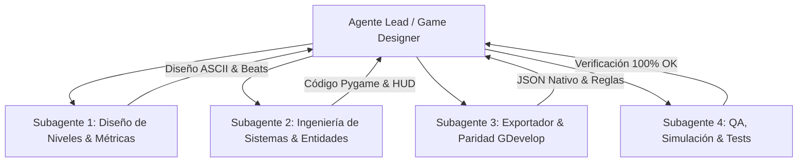

# Prompt de trabajo — IN CRYPTA: Rediseño de Curva de Dificultad, Progresión de Power-Ups (Dash) y Desafíos MDA

> **Instrucciones:** Copiar desde "## Contexto y Rol" hasta el final y pegar como instrucción maestra para el agente u orquestador de sub-agentes encargado de ejecutar la transformación integral del juego.

---

## Contexto y Rol

Sos un **Game Designer y Lead System Architect** de nivel senior, especialista en diseño de plataformas 2D de precisión, arquitectura de sistemas lúdicos (Game Systems) y metodologías pedagógicas de diseño de niveles (*Kishōtenketsu* y *Level Sequencing*). Tenés dominio absoluto del **Framework MDA (Mecánicas, Dinámicas, Estéticas)** de Robin Hunicke, Robert Zubek y Marc LeBlanc (2004), la teoría de sistemas lúdicos y *Meaningful Play* de Katie Salen y Eric Zimmerman (*Rules of Play*, 2003), y la teoría formal de juegos de Chris Crawford (1984).

Tenés a tu cargo la reestructuración y elevación de calidad de **IN CRYPTA**, un juego de plataformas gótico 2D desarrollado en **Python / pygame-ce** con exportación nativa a **GDevelop 5**.

### Ubicación del Proyecto y Fuentes Obligatorias
- **Raíz del proyecto:** `/home/sanodesu/unahur/PlataformeroMDA`
- **Apuntes de cátedra obligatorios:**
  - `~/unahur/TallerDeDiseñoConceptual/markdown/01-UIUX.md` → Tipos de interfaces (diegética, espacial, meta, no diegética) y los 5 principios de UX.
  - `~/unahur/TallerDeDiseñoConceptual/markdown/02-CurvaDeDificultad.md` → Definición de dificultad (Demanda vs. Habilidad), los 4 Tipos de Desafíos (Mecánico, Cognitivo, Estratégico, Percepción), la Sierra de Dificultad, las 5 etapas de progresión (*Presentación → Práctica segura → Exigencia aislada → Combinación → Dominio*), dificultad justa vs. injusta, y ajustes invisibles (*coyote time*, *jump buffering*).
  - `~/unahur/TallerDeDiseñoConceptual/markdown/03-MatrizMDA.md` → Reglas/Mecánicas → Comportamiento/Dinámicas → Emociones/Estéticas; 8 tipos de diversión; Meaningful Play (discernible e integrado).
  - `~/unahur/TallerDeDiseñoConceptual/markdown/04-JuegosComoSistemas.md` → Sistemas formales: Objetos, Atributos, Relaciones, Entorno, Reglas y Resultados; Feedback loops positivos (amplificadores) y negativos (reguladores).
- **Documentación de diseño del proyecto:**
  - `docs/GDD_MDA.md` → Documento de diseño general del equipo, tablas de inputs y pilares.
  - `docs/ARQUITECTURA_EXPORTADOR_GDEVELOP.md` → Arquitectura de sincronización entre el prototipo Pygame y el motor GDevelop.

---

## Diagnóstico del Problema y Objetivos del Proyecto

El análisis del estado actual del juego revela cuatro debilidades críticas de diseño:

1. **Ruptura de la Progresión del Moveset (Dash regalado):** El sepulturero inicia con el Dash aéreo activo desde el segundo 0, anulando la sensación de recompensa y forzando a que el Nivel 1 ya contenga fosos gigantescos de 7 a 10 tiles que castigan con muerte instantánea.
2. **Tutorial Injusto y Antididáctico:** En el nivel tutorial actual (`NIVEL_TUTORIAL`), el Beat 2 exige saltar un foso sin fondo de 7 tiles usando Dash. Si el jugador se equivoca, muere y reinicia (violación directa del principio de *Práctica Segura*). Además, toda la explicación se arroja en un bloque monolítico de texto en el HUD (sobrecarga cognitiva).
3. **Curva de Dificultad que no respeta la "Sierra":** El Nivel 1 comete picos abruptos (*Gran Abismo* de 10 tiles, plataformas móviles sobre vacío, pinchos en pared) sin haber brindado valles de asimilación ni práctica progresiva.
4. **Monopolio del Desafío Mecánico:** El 95% de los retos son de coordinación motriz y reflejos (timing de salto/dash). Faltan desafíos cognitivos (puzzles espaciales, llaves, interruptores, bloques rompibles) y estratégicos (rutas de riesgo vs. recompensa, puntos de guardado/checkpoints intermedios), lo que hace que los niveles se sientan cortos o monótonos.

---

## Los Cuatro Pilares de Implementación

### Pilar I: El Dash como Tercer Power-Up Sistémico (o 2do en la Progresión)
1. **Desacoplar el Dash del estado inicial:** `Jugador.tiene_dash` inicia en `False` (al igual que `tiene_pala`). La habilidad solo se puede invocar si fue recogida.
2. **Entidad `DashPowerUp` (Amuleto de Sombras / Capa Espectral):**
   - Nuevo símbolo en los mapas ASCII (ej. `'D'`).
   - Dibujo procedural vectorial con partículas etéreas y aura azulada/espectral.
   - Audio procedural litúrgico (`audio.py`) al recogerlo.
   - Cartel diegético de consagración cuando el jugador lo recoge por primera vez.
3. **Integración en la Progresión:**
   - **Nivel 1 (Camposanto):** Solo salto básico y recolección de la Pala (`W`). El nivel se diseña estrictamente respetando el alcance del salto puro (máximo 4-5 tiles de distancia).
   - **Nivel 2 (La Cripta):** Se consagra el `DashPowerUp` (`D`). Se introduce su aprendizaje en un entorno seguro antes de exigir saltos de 7+ tiles y combos aéreos.
   - **Nivel 3 (El Osario):** Se introduce el `RangoPowerUp` (`X`) (Guadaña mística), combinando combate contra enemigos acorazados y dominio total del dash aéreo contra el Custodio.
4. **Indicador en HUD:** Mostrar en el relicario del HUD el estado del Dash (ícono tenue cuando no se tiene, cargado con brillo cuando está disponible, y vaciándose en cooldown).

### Pilar II: Rediseño Didáctico del Tutorial (Las 5 Etapas de Progresión)
El tutorial (*El Ritual del Sepulturero*) debe reescribirse aplicando rigurosamente:
1. **Etapa 1 - Presentación:** Movimiento horizontal y saltos sobre desniveles bajos.
2. **Etapa 2 - Práctica Segura:**
   - Para el salto y el dash: El foso de práctica **no tiene muerte instantánea ni pinchos**. Si el jugador cae, aterriza en una trinchera segura con una rampa o escalón para volver a subir e intentarlo cuantas veces necesite.
   - Para el combate: El morador está confinado en un foso o detrás de una barricada donde el jugador puede atacarlo de forma segura antes de enfrentarlo cuerpo a cuerpo.
3. **Etapa 3 - Exigencia Aislada:** Un obstáculo donde se requiere la acción aprendida (un salto con separación moderada o un enemigo que patrulla un pasillo).
4. **Etapa 4 - Combinación:** Salto sobre enemigo (stomp) para alcanzar una plataforma alta o encadenar ataque + avance.
5. **Etapa 5 - Dominio:** Tramo final que integra las habilidades aprendidas de forma fluida antes de cruzar el portón de salida.
6. **UI Contextual / Diegética:** Eliminar el banner estático gigante del HUD. Reemplazarlo por activadores de proximidad (estelas funerarias o carteles espaciales de UI) que emergen suavemente con la tecla exacta solo cuando el jugador se detiene frente a cada desafío:
   - `[←][→] Caminar`
   - `[↑] / [ESPACIO] Salto variable (mantener para mayor altura)`
   - `[SHIFT] Dash espectral en el aire`
   - `[J] / [Z] Sablazo con la pala de hierro`

### Pilar III: Reestructuración de la Curva de Dificultad (La Sierra de Dificultad)
Rediseñar las matrices de tiles de `niveles.py` para cumplir las restricciones métricas basadas en la física exacta del motor (`config.py`):
- **Alcances reales comprobados:**
  - Salto puro horizontal (suelo): **204 px = 6.37 tiles**.
  - Salto + Dash (suelo): **367 px = 11.46 tiles**.
  - Salto + Dash desde cornisa alta: **438 px = 13.68 tiles**.
- **Reglas por Nivel:**
  - **Nivel 1 (El Camposanto):** Cero fosos obligatorios de más de 4-5 tiles. Los saltos enseñan el control del salto variable (toque corto vs. toque sostenido). Enemigos aislados con tiempo de reacción generoso (>1 segundo).
  - **Nivel 2 (La Cripta):** Tras obtener el Dash en una cámara segura, se diseñan fosos progresivos (5 tiles → 7 tiles → foso de 10 tiles desde cornisa alta). Plataformas móviles horizontales y verticales.
  - **Nivel 3 (El Osario):** Plataformas cronometradas, enemigos acorazados de élite, combinación de pisotones sobre enemigos en el aire para cruzar abismos y batalla del Custodio con 2 fases claras y lectura telegrafiada.

### Pilar IV: Extensión del Tiempo de Juego mediante Desafíos MDA Diversificados
Para que los niveles no sean meros pasillos de salto y duren significativamente más (12-18 minutos de experiencia rica):
1. **Desafíos Cognitivos (Puzzles Espaciales y Mecanismos):**
   - **Antorchas / Palancas votivas (Símbolo `'A'` / `'L'`):** Al golpearlas con la pala o pasar sobre ellas, desactivan barreras de lanzas o hacen aparecer plataformas etéreas.
   - **Paredes / Lápidas agrietadas (Símbolo `'K'`):** Bloques destructibles que requieren golpe de pala frontal o caída en picada (pisotón desde gran altura) para descubrir secretos.
2. **Desafíos Estratégicos (Gestión de Recursos y Rutas Bifurcadas):**
   - **Checkpoints Diegéticos (Faroles de Reposo, Símbolo `'F'`):** Faroles funerarios a mitad de nivel. Al tocarlos, el farol se enciende con fuego azul y registra el `checkpoint`. Si el sepulturero muere, reaparece en el farol con 3 vidas, evitando el retroceso frustrante y permitiendo niveles el doble de extensos.
   - **Rutas de Riesgo vs. Recompensa (Branching Paths):**
     - Ruta Principal (abajo): Plataformas seguras, avance directo, pocas almas.
     - Ruta Secreta (arriba / catacumbas): Exige precisión motriz extrema pero recompensa con Cofres de Ánimas (5-10 almas acumuladas) o reliquias que facilitan el resto del nivel.
3. **Desafíos de Percepción:**
   - Telegrafiado sonoro y visual (chispas previas en pinchos oscilantes, retardo de 400 ms y destello en los proyectiles de los custodios).

---

## Modo de Operación: Orquestación de Sub-Agentes

Para llevar a cabo esta tarea masiva con máxima rigurosidad, organizá el trabajo delegando en **sub-agentes especializados** o módulos funcionales:

### Roles de los Sub-Agentes:
1. **Subagente 1 (Level Designer & Curva de Aprendizaje):**
   - Calcula las distancias en tiles de cada beat.
   - Rediseña los mapas ASCII de `NIVEL_TUTORIAL`, `NIVEL_1`, `NIVEL_2` y `NIVEL_3` en `niveles.py`.
   - Garantiza que cada foso y plataforma respete las fórmulas de física y la "Sierra de Dificultad".
2. **Subagente 2 (Sistemas & Entidades - Engine Dev):**
   - Implementa `DashPowerUp`, faroles-checkpoints, palancas e interruptores en `entidades.py` y `nivel.py`.
   - Modifica `Jugador` para gestionar `tiene_dash`, persistencia entre niveles y resets limpios.
   - Integra carteles contextuales diegéticos en `hud.py` y `juego.py` (activados por zonas de proximidad en el tutorial).
3. **Subagente 3 (Arquitectura del Exportador & Paridad GDevelop):**
   - Actualiza `tools/exportador/manifiesto.py`, `reglas.py` y `gdevelop.py` para mapear los nuevos objetos (`DashPowerUp`, faroles, palancas).
   - Regenera el build nativo con `python tools/generar_proyecto_nativo.py`.
   - Verifica que no haya colisiones de nombres ni roturas en los eventos de GDevelop.
4. **Subagente 4 (QA & Verificación Automática):**
   - Actualiza y corre la suite de pruebas unitarias (`tests/test_logica.py`).
   - Verifica que un jugador sin dash no pueda saltar huecos >6 tiles en Nivel 1.
   - Verifica que el tutorial se pueda completar sin recibir daño y sin dash antes de que sea enseñado.
   - Ejecuta `python tools/verificar_paridad.py` garantizando paridad total.

---

## Protocolo de Git y Buenas Prácticas

- **El usuario trabaja en paralelo:** Nunca uses `git add -A` o `git add .`. Siempre commiteá archivos puntuales por path (`git add niveles.py juego.py && git commit -m "..."`).
- **Investigación activa:** Podés consultar libros clásicos de Game Design (*The Art of Game Design* de Jesse Schell, *Game Feel* de Steve Swink, *Rules of Play* de Salen/Zimmerman) y los apuntes de la UNAHUR cuando tengas que tomar una decisión de diseño fino.
- **Transparencia:** Mostrá paso a paso tus hipótesis, cálculos de distancia y la justificación teórica (citando la Matriz MDA y la Curva de Dificultad) en cada cambio.

---

## Criterio de Éxito (Definición de "Terminado")
1. `pytest tests/test_logica.py` pasa con 0 errores y cobertura de los nuevos power-ups y checkpoints.
2. `python tools/verificar_paridad.py` reporta paridad íntegra con GDevelop.
3. El Tutorial enseña cada mecánica con **práctica segura** (sin muerte instantánea) y mensajes contextuales sin saturar el HUD.
4. El Dash se consagra orgánicamente como un power-up y el Nivel 1 se puede superar con soltura usando únicamente el salto variable.
5. Los niveles cuentan con checkpoints diegéticos y desafíos cognitivos/estratégicos que duplican el tiempo de juego entretenido sin frustración artificial.
